# BayesPO: Bayesian Prompt Optimization via Parallel-Tempered Gradient-Guided Discrete MCMC

Junjie Zhou Affiliation: Speech Processing and Machine Intelligence
(SPMI) Lab    Zhijian Ou ^(†)^(†)thanks: Corresponding author
(ozj@tsinghua.edu.cn). This work is partly supported by the National
Science and Technology Major Project (2023ZD0121401).
Affiliation: Tsinghua University, China

###### Abstract

Prompt optimization adapts large language models (LLMs) without updating
model parameters, but many automatic prompt optimizers remain heuristic
search procedures over candidate instructions. This paper studies prompt
optimization as Bayesian posterior sampling over discrete prompt tokens.
We define a posterior distribution by combining a task likelihood term,
which rewards prompts that explain input-output examples, with a
language-model prior, which favors fluent instructions. This converts
prompt optimization into an energy-based posterior sampling problem, for
which gradients can be used to guide discrete Markov chain Monte Carlo
(MCMC) proposals over vocabulary tokens. We refer to our framework as
BayesPO, short for Bayesian Prompt Optimization. In this paper, BayesPO
is instantiated with Markov chain Monte Carlo: it uses a
Metropolis-Hastings corrected Gibbs-with-Langevin (GwL) proposal and
integrates parallel tempering for global exploration of rugged
LLM-induced energy landscapes. The concrete sampler further adapts the
GwL sampler to the practical constraints of non-weight-tied LLM
embeddings. Experiments with Qwen2.5 models show that the sampler
discovers semantically meaningful prompts on diagnostic tasks, that
parallel tempering helps escape a local optimum in a poetry completion
task, and that post-optimizing APE prompts on 24 instruction-induction
subtasks improves average accuracy from 60.04% to 63.23%. The study also
reveals two main limitations: energy minimization may overfit small
optimization sets, and the current sampler remains computationally
expensive. These findings position Bayesian prompt sampling as a
principled post-optimization tool and point to a promising direction for
probabilistic prompt optimization.

|     |
| --- |
|     |

## 1 Introduction

Large language models (LLMs) can be adapted to many downstream tasks by
modifying only the natural-language prompt. This property makes prompt
optimization attractive when updating model parameters is unnecessary,
costly, or undesirable. However, prompt optimization is a hard
combinatorial search problem. A prompt is a sequence of discrete tokens,
so the number of possible prompts grows exponentially with length;
moreover, evaluating one candidate prompt usually requires at least one
LLM forward pass.

Existing automatic prompt optimization methods follow several major
paradigms. Gradient-based methods such as AutoPrompt use token-level
gradients to greedily replace prompt tokens (Shin et al., 2020).
LLM-generation methods such as Automatic Prompt Engineering (APE) sample
candidate task descriptions from input-output examples and select the
best candidates by downstream evaluation (Zhou et al., 2023). More
recent methods use natural-language feedback or textual gradients to
edit prompts iteratively (Pryzant et al., 2023; Das et al., 2024). These
approaches are effective in many cases, but they are often designed as
heuristic optimization procedures. They optimize a finite candidate set,
perform local greedy edits, or rely on an LLM to generate the next
candidate. They do not explicitly define a posterior distribution over
prompts, nor do they provide a Markov chain whose stationary
distribution is the desired prompt posterior.

This paper asks whether prompt optimization can be formulated as
posterior sampling in a discrete token space. We treat the prompt as a
discrete random variable conditioned on a small set of input-output
examples. The posterior combines two signals: a task likelihood that
measures whether a prompt induces the desired outputs, and a
language-model prior that encourages the prompt itself to remain
natural. This posterior can be written as an energy-based model (EBM)
(LeCun et al., 2006; Ou, 2024), making it possible to use MCMC methods.
The central challenge is that random-walk MCMC is inefficient in a
high-dimensional discrete vocabulary, while continuous relaxations
introduce a mismatch when projected back to tokens.

We therefore propose BayesPO, a Bayesian prompt optimization framework
based on parallel-tempered gradient-guided discrete MCMC. Figure 1
summarizes the method. We first construct a prompt energy from task
likelihood and prompt prior. We then compute the gradient of this energy
with respect to prompt embeddings and use it to build a discrete
proposal over vocabulary tokens. A Metropolis-Hastings (MH) correction
preserves the target distribution. In practice, full-sequence
gradient-guided discrete proposals (Du et al., 2024) often have very low
acceptance rates, because changing many tokens simultaneously can
sharply increase energy. We therefore use a Gibbs-with-Langevin (GwL)
variant (Du et al., 2024) that updates one prompt position at a time and
immediately applies accepted changes. Finally, because LLM-induced
energy landscapes can be multimodal, we use parallel tempering (PT)
(Hukushima and Nemoto, 1996; Geyer, 2011): high-temperature chains
explore broadly, while swap moves transfer promising states back to the
target-temperature chain.


Figure 1: Overview of BayesPO. A prompt posterior over discrete token
sequences is converted into an energy. A gradient-guided vocabulary
proposal and MH correction produce a valid discrete MCMC update.
Parallel tempering runs several temperature-scaled chains and swaps
states to improve global exploration.

Our experiments provide both positive evidence and cautionary
observations. On two small semantic transformation tasks, the sampler
decreases energy and discovers prompts that are aligned with the tasks.
In a poetry completion task, a single GwL chain remains trapped near an
incorrect completion, while PT transfers a better state to the target
chain and recovers the correct line. On the APE instruction induction
benchmark, starting from APE prompts, BayesPO improves average test
accuracy over 24 subtasks by 3.19 percentage points. The largest gains
occur when the APE prompt is initially semantically misaligned. However,
the sampler can also degrade accuracy even as the training energy
decreases, revealing an energy-accuracy mismatch under extremely small
training sets.

The contributions of this work are:

- •
  We formulate prompt optimization as Bayesian posterior sampling over
  discrete prompt tokens, with an energy function combining task
  likelihood and an LLM prompt prior.
- •
  We adapt gradient-guided discrete MCMC to prompt optimization through
  an MH-corrected GwL sampler, including a treatment of non-weight-tied
  input and output embeddings.
- •
  We integrate parallel tempering to improve global exploration, showing
  its value in a local-optimum poetry completion task and using it as a
  key exploration component in the APE instruction-induction benchmark.
- •
  We conduct an empirical study on the APE instruction induction
  benchmark, analyzing gains, failures, computation, and the mismatch
  between lower training energy and test accuracy.

## 2 Related Work

#### Automatic prompt optimization.

AutoPrompt searches for discrete trigger tokens using gradients from
masked language models (Shin et al., 2020). APE treats prompt
optimization as black-box candidate generation and evaluation, showing
that LLMs can infer task instructions from examples (Zhou et al., 2023).
ProTeGi edits prompts using natural-language gradients and beam search
(Pryzant et al., 2023). GReaTer extends gradient-based prompt
optimization to reasoning traces (Das et al., 2024). Surveys of prompt
optimization emphasize the diversity of candidate generation,
evaluation, and search operators (Cui et al., 2025). BayesPO is
complementary to these methods: it can take a generated or manually
written prompt as initialization, and then refine it under an explicit
posterior energy with MCMC updates.

#### Bayesian optimization versus Bayesian sampling for prompts.

Several recent works also use the word “Bayesian” in prompt
optimization, but the underlying formulation differs from ours. Tomar et
al. propose BODE-GEN for test-driven code generation, where Bayesian
Optimization (BO) searches for prompts by fitting surrogate models in a
continuous embedding space and using an auxiliary LLM to bridge discrete
prompts and continuous representations (Tomar et al., 2025). Sabbatella
et al. similarly formulate prompt optimization as a black-box
combinatorial optimization problem and apply BO over a continuous
relaxation of the prompt space (Sabbatella et al., 2025). These methods
solve an optimization problem with BO: the goal is to adaptively select
the next candidate prompt to evaluate. In contrast, BayesPO formulates
prompt optimization as a Monte Carlo sampling problem: we define an
energy-based posterior distribution over discrete prompt tokens and
build an MH-corrected Markov chain to sample from it. This distinction
matters because our proposal is not a Gaussian-process surrogate
acquisition loop; it is a gradient-guided MCMC transition kernel with a
target stationary distribution.

#### Black-box prompt optimization and BPO.

Black-Box Prompt Optimization (BPO) optimizes user prompts for LLM
alignment without model training and leverages human preferences to
improve win rates (Cheng et al., 2024). We deliberately avoid using the
bare acronym BPO for our method because BPO already strongly refers to
Black-Box Prompt Optimization. More importantly, the technical setting
is different: BPO is a black-box alignment-oriented prompt optimizer
driven by preference feedback, whereas BayesPO is a white-box or
gray-box Bayesian sampler that uses gradients of an explicit prompt
energy, MH correction, and parallel tempering. The methods are therefore
orthogonal: black-box preference optimization and posterior sampling
address different prompt optimization regimes.

#### Gibbs sampling for prompt inference.

Reprompting uses Gibbs sampling to infer chain-of-thought (CoT) recipes
for reasoning tasks (Xu et al., 2024). It iteratively samples new CoT
recipes using previously sampled recipes as parent prompts and an LLM as
the proposal mechanism. Reprompting is close in spirit to our work
because both use sampling ideas for prompt inference. The differences
are threefold. First, Reprompting targets CoT recipes, while BayesPO
optimizes general instruction prompts. Second, Reprompting samples
natural-language recipes with LLM-generated proposals, while BayesPO
constructs token-level discrete proposals from energy gradients. Third,
BayesPO includes an explicit EBM posterior, MH correction, and PT,
whereas Reprompting is not designed as gradient-guided posterior
sampling over vocabulary tokens.

#### Energy-based models and discrete MCMC for text.

Energy-based models define unnormalized distributions through scalar
energies (LeCun et al., 2006). EBMs have been used and studied broadly
in speech and language processing, including language modeling, sequence
labeling, speech recognition, and text generation (Ou, 2024). COLD
decoding and MuCoLa optimize continuous relaxations of token embeddings
with Langevin dynamics or gradient descent for constrained generation
(Qin et al., 2022; Kumar et al., 2022). Continuous relaxations are
convenient, but the projection back to discrete tokens can bias the
distribution. Recent gradient-guided discrete MCMC samplers for text,
including the Gibbs-with-Langevin (GwL) variant, construct proposals
directly in a finite discrete vocabulary and apply MH correction (Du et
al., 2024). BayesPO adapts this line of work to prompt optimization,
where the sampled text is not the final response but the instruction
that controls downstream behavior.

#### Parallel tempering.

Parallel tempering, also known as exchange Monte Carlo, runs multiple
chains at different temperatures and swaps states between chains to
improve mixing in multimodal landscapes (Hukushima and Nemoto, 1996;
Geyer, 2011). The target-temperature chain preserves the desired
distribution, while high-temperature chains cross energy barriers more
easily. We use PT to address local modes in LLM-induced prompt energy
landscapes.

## 3 BayesPO

This section presents the complete BayesPO sampler. Section 3.1
formulates prompt optimization as posterior sampling over discrete
prompt tokens. Section 3.2 defines the task-likelihood and prompt-prior
energy. Section 3.3 constructs a gradient-guided discrete proposal and
explains its GwL implementation. Section 3.4 adapts the proposal to
non-weight-tied LLMs. Section 3.5 adds parallel tempering for global
exploration.

### 3.1 Problem Formulation

Let $`\rho=(\rho_{1},\ldots,\rho_{N})`$ be a prompt token sequence of
fixed length $`N`$, and let $`\mathcal{D}=\{(x_{i},y_{i})\}_{i=1}^{K}`$
be a small optimization set for the task. We model the prompt posterior
as

```math
P(\rho\mid\mathcal{D})\propto P(\rho)\left[\prod_{i=1}^{K}P(y_{i}\mid\rho,x_{i})\right], \tag{1}
```

where $`P(\rho)`$ is a prompt prior induced by the same or another
language model, and $`P(y_{i}\mid\rho,x_{i})`$ is the LLM likelihood of
generating target output $`y_{i}`$ when the prompt $`\rho`$ is used with
input $`x_{i}`$. Taking the negative log posterior yields the energy

```math
U(\rho)=-\log P(\rho)-\sum_{i=1}^{K}\log P(y_{i}\mid\rho,x_{i}). \tag{2}
```

The resulting energy-based model defines

```math
\pi(\rho)\propto\exp[-U(\rho)]. \tag{3}
```

Low-energy prompts have high posterior probability, because they both
explain the task examples and remain plausible prompt strings under the
language model prior.

### 3.2 Prompt Energy

For an instruction-tuned LLM with a chat template, the likelihood term
in Eq. (2) is computed by placing the prompt in the global instruction
field, the task input in the user field, and the target output in the
assistant field. Our experiments instantiate this generic construction
with the Qwen-Instruct template; Appendix B.1 gives the exact formatting
used in all likelihood computations. The negative log-likelihood of the
assistant tokens is summed over the $`K`$ examples. The prompt prior is
autoregressive:

```math
-\log P(\rho)=-\log P(\rho_{1})-\sum_{t=2}^{N}\log P(\rho_{t}\mid\rho_{1},\ldots,\rho_{t-1}). \tag{4}
```

The prior discourages degenerate token sequences and biases the sampler
toward fluent instructions. In practice, the strength of the prior can
be tuned, but the experiments reported here use the direct sum in
Eq. (2).

### 3.3 Gradient-Guided Discrete Proposal

Let $`\theta=(\theta_{1},\ldots,\theta_{N})\in E^{N}`$ be the embedding
sequence corresponding to the discrete prompt $`\rho`$, and let
$`E=\{e_{v}:v\in\mathcal{V}\}`$ denote the vocabulary embedding table.
With abuse of notation, we write $`U(\theta)`$ for the same energy
$`U(\rho)`$ evaluated through the LLM computation graph on the embedding
sequence induced by $`\rho`$. The proposal for the discrete transition
$`q(\rho^{\prime}\mid\rho)`$ is expressed as a proposal
$`q(\theta^{\prime}\mid\theta)`$ over $`E^{N}`$ with
$`\theta^{\prime}\in E^{N}`$, as follows.

The full-sequence $`\ell_{p}`$-Norm Constrained Gradient (p-NCG)
proposal (Du et al., 2024) has the form

```math
q(\theta^{\prime}\mid\theta)\propto\exp\left[-\frac{1}{2}\nabla U(\theta)^{\top}(\theta^{\prime}-\theta)-\frac{1}{2\alpha}\|\theta^{\prime}-\theta\|_{p}^{p}\right], \tag{5}
```

where $`\alpha`$ controls the proposal step size. Because the
$`\ell_{p}`$ norm term factorizes across token positions, this proposal
can be written as

```math
q(\theta^{\prime}\mid\theta)=\prod_{t=1}^{N}q(\theta^{\prime}_{t}\mid\theta), \tag{6}
```

with

```math
q(\theta^{\prime}_{t}\mid\theta)\propto\exp\left[-\frac{1}{2}\nabla_{t}U(\theta)^{\top}(\theta^{\prime}_{t}-\theta_{t})-\frac{1}{2\alpha}\|\theta^{\prime}_{t}-\theta_{t}\|_{p}^{p}\right],\quad\theta^{\prime}_{t}\in E. \tag{7}
```

A sampled embedding is mapped back to its corresponding vocabulary token
to obtain the discrete candidate prompt. This means that the proposal
treats word positions as conditionally independent given the current
sequence, allowing each word embedding to be sampled in parallel from a
vocabulary-sized categorical distribution. The first term favors
candidates in a local energy-decreasing direction, while the second
term, namely the $`\ell_{p}`$ norm term, penalizes excessively large
jumps in embedding space.

A full p-NCG proposal updates all positions in parallel, but this can
lead to low acceptance rates for prompt optimization because changing
many tokens at once produces large energy fluctuations. We therefore use
a Gibbs-with-Langevin (GwL) variant (Du et al., 2024). Each scan
randomly permutes the prompt positions; for each position, Eq. (7) is
used to sample a single-token replacement while all other positions
remain fixed. The proposal excludes self-transitions because MH
rejection already allows the chain to stay at the current state. The
accepted replacement is applied immediately, so later positions in the
same scan use the updated prompt.

Given a candidate state $`\rho^{\prime}`$, the MH acceptance probability
is

```math
\alpha_{\mathrm{acc}}=\min\left\{1,\frac{\pi(\rho^{\prime})q(\rho\mid\rho^{\prime})}{\pi(\rho)q(\rho^{\prime}\mid\rho)}\right\}. \tag{8}
```

This correction compensates for the asymmetry of the gradient-guided
proposal and preserves the target distribution in the ideal chain.

### 3.4 Non-Weight-Tied Embeddings

Many modern LLMs, including Qwen2.5-Instruct models (Qwen Team, 2025),
do not tie their input embedding matrix and output projection matrix.
This requires care because a prompt token participates in the energy in
two ways. In the likelihood term, prompt tokens act as input prefix
tokens and contribute gradients through the input embeddings. In the
prior term, a prompt token can be a predicted token through the output
projection and a prefix token for later positions through the input
embeddings. This issue does not arise in the original p-NCG
text-generation experiments using GPT-2, because GPT-2 uses tied input
and output embeddings (Du et al., 2024).

Let $`[\theta]_{i}`$ and $`[\theta]_{o}`$ denote the input and output
embeddings associated with the same token sequence. We decompose

```math
U(\rho)=U_{\mathrm{like}}([\theta]_{i})+U_{\mathrm{prior}}([\theta]_{i},[\theta]_{o}). \tag{9}
```

The gradients used in the proposal are

```math
\nabla_{[\theta]_{i}}U=\nabla_{[\theta]_{i}}U_{\mathrm{like}}+\nabla_{[\theta]_{i}}U_{\mathrm{prior}},\quad\nabla_{[\theta]_{o}}U=\nabla_{[\theta]_{o}}U_{\mathrm{prior}}. \tag{10}
```

Accordingly, the gradient-guided proposal’s linear term is modified to
combine input-side and output-side gradient contributions:

```math
q(\theta^{\prime}\mid\theta)\propto\exp\left[-\frac{1}{2}\left(\nabla_{[\theta]_{i}}U^{\top}([\theta^{\prime}]_{i}-[\theta]_{i})+\nabla_{[\theta]_{o}}U^{\top}([\theta^{\prime}]_{o}-[\theta]_{o})\right)-\frac{1}{2\alpha}\|[\theta^{\prime}]_{i}-[\theta]_{i}\|_{p}^{p}\right]. \tag{11}
```

The locality penalty is computed in the input embedding space because
this space directly determines the prompt representation seen by the
model. This separation makes the sampler applicable to non-weight-tied
instruction-tuned LLMs while preserving a discrete vocabulary proposal.

### 3.5 Parallel Tempering

To improve global exploration, BayesPO uses parallel tempering
(Hukushima and Nemoto, 1996; Geyer, 2011) and runs $`M+1`$ chains with
temperatures $`\{T_{0},\ldots,T_{M}\}`$, where $`T_{0}=1`$ is the target
chain. Chain $`m`$ targets

```math
\pi_{m}(\rho)\propto\exp[-U(\rho)/T_{m}]. \tag{12}
```

High-temperature chains flatten the energy landscape and cross barriers
more easily. After within-chain GwL scans, adjacent chains attempt state
swaps. For chains $`i`$ and $`j`$ with inverse temperatures
$`\beta_{i}=1/T_{i}`$ and $`\beta_{j}=1/T_{j}`$, the swap acceptance
probability is

```math
\alpha_{\mathrm{swap}}=\min\{1,\exp[(\beta_{i}-\beta_{j})(U(\rho_{i})-U(\rho_{j}))]\}. \tag{13}
```

The target chain records the lowest-energy prompt encountered during
sampling.

Algorithm 1: BayesPO Input: initial prompts
$`\{\rho^{(m,0)}\}_{m=0}^{M}`$, temperatures $`\{T_{m}\}_{m=0}^{M}`$,
optimization set $`\mathcal{D}`$, step size $`\alpha`$, total iterations
$`S`$. For $`s=1,\ldots,S`$: 1. For each chain $`m`$, randomly permute
the $`N`$ prompt positions. 2. For each position $`t`$, compute
$`\nabla_{t}U(\rho^{(m)})`$, build the discrete vocabulary proposal in
Eq. (7), sample a candidate replacement, and accept it with Eq. (8)
using the temperature-scaled energy $`U/T_{m}`$. 3. Sample a neighboring
pair of temperatures and attempt a state swap with Eq. (13). 4. Update
the best prompt recorded by the target chain $`T_{0}=1`$. Output: the
lowest-energy prompt observed on the target chain.

Figure 2: The complete sampler combines local GwL token updates and
parallel-tempered state swaps.

## 4 Experiments

This section evaluates BayesPO from simple to realistic settings.
Section 4.1 describes the models, implementation, and inference
template. Section 4.2 validates whether GwL discovers meaningful prompts
on two diagnostic tasks. Section 4.3 isolates the role of PT on a poetry
completion task. Sections 4.4 and 4.5 evaluate post-optimization on the
APE instruction-induction benchmark and analyze energy-accuracy
mismatch. Section 4.6 discusses computational cost.

### 4.1 Experimental Setup

We use Qwen2.5-Instruct models. Diagnostic prompt optimization uses
Qwen2.5-0.5B-Instruct to verify basic sampler behavior on small semantic
transformation tasks. The poetry completion and APE benchmark
experiments use Qwen2.5-7B-Instruct, where the energy landscape is more
rugged and PT becomes important. All experiments use the official
Qwen-Instruct chat template; Appendix B collects the model-template and
diagnostic-task details; Appendix B.1 specifies the exact
system/user/assistant formatting used to compute likelihood terms.
Experiments are implemented in PyTorch with mixed precision; generation
uses vLLM when applicable. The hardware environment uses a multi-GPU
server with NVIDIA RTX 3090 GPUs. Additional experiment details,
reproducibility information, and the language-model-use statement are
provided first in Appendix A.

### 4.2 Diagnostic Prompt Optimization

We first evaluate whether the sampler can discover task-relevant prompts
from random initializations. In both diagnostic tasks, we use $`K=4`$
input-output examples; the exact task examples $`\{(x_{i},y_{i})\}`$ are
shown in Appendix B.2, and the diagnostic-task hyperparameters are
reported in Appendix B.3. The _classical Chinese translation_ task maps
English sentences into classical Chinese-style Chinese. The _antonym
generation_ task maps a Chinese word to its antonym. Because this
experiment is intended as a qualitative demonstration and
Qwen2.5-0.5B-Instruct has a relatively simple energy landscape, we use
single-chain GwL rather than PT and select the best result across ten
random seeds.

After passing the four input-output pairs to the sampler, we run
$`S=1000`$ iterations for the classical Chinese translation task and
$`S=500`$ iterations for the antonym generation task. Figure 3 plots the
energy trajectories of the target chain during sampling. The dashed line
is the mean energy of 100 prior-sampled sequences of fixed length
$`N=10`$ for the classical Chinese task and fixed length $`N=20`$ for
the antonym task. The solid line is the mean trajectory over ten random
seeds, and the shaded region denotes one standard deviation over the ten
seeds. Energy steadily decreases from the high-energy initial region and
converges to lower-energy regions, indicating that the sampler
continuously finds prompt sequences that better match the task
objective.

For the classical Chinese translation task, the lowest-energy prompt
sequence found by the sampler is:

> _编写成一句简单的古代汉字表达式_ (English: “Write it as a simple
> ancient Chinese expression.”)

For the antonym generation task, the lowest-energy prompt sequence is:

> _生成一个否定的陈述。你可以用任何你想要的词汇_ (English: “Generate a
> negative statement. You may use any vocabulary you want.”)

The two exact sequences contain task-relevant semantic cues, such as
ancient Chinese expression and negation, showing that gradient-guided
discrete MCMC can move random prompt strings toward meaningful prompt
regions.

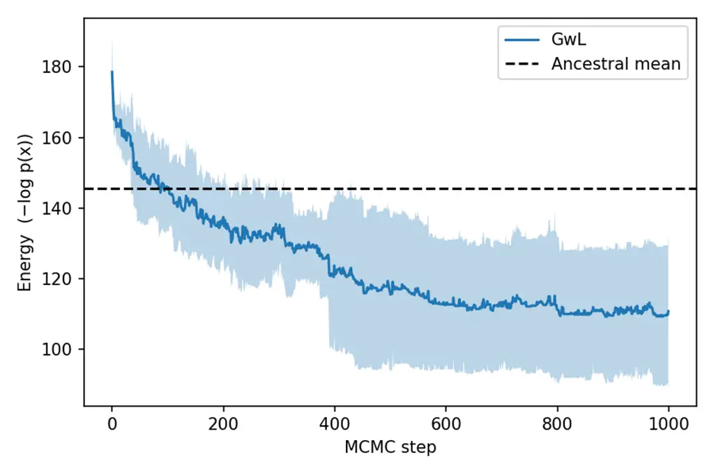

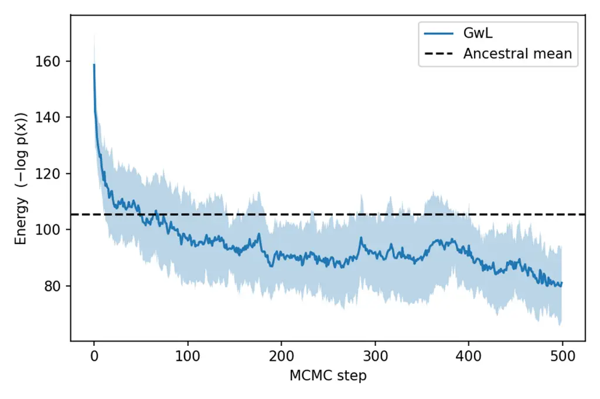

Figure 3: Diagnostic prompt optimization. Left: classical Chinese
translation. Right: antonym generation. The sampler reduces energy and
reaches lower-energy prompt regions than ancestral random prompt
samples.

### 4.3 Parallel Tempering for Poetry Completion

We next test whether PT helps escape local optima through a poetry
completion task based on Li Bai’s 《静夜思》 (_Quiet Night Thought_).¹¹
1 The full poem is: “床前明月光，疑是地上霜。举头望明月，低头思故乡。” A
literal English rendering is: “Bright moonlight before my bed; I suspect
it is frost on the ground. I raise my head and gaze at the bright moon;
I lower my head and think of home.” This makes the task difficult. Under
a prefix such as “下面是《静夜思》中的两句诗：”, a left-to-right
completion is likely to fill the first line, “床前明月光，”, which
corresponds to a local optimum. However, the suffix is the fourth line,
“低头思故乡。”. Considering both the prefix and the suffix, the
completion “举头望明月，” attains lower energy and acts as the global
optimum in this controlled task, because it both follows the prefix and
connects naturally to the suffix. The experiment fixes the prefix as
“下面是《静夜思》中的两句诗：” (“Below are two lines from _Quiet Night
Thought_:’’) and the suffix as ‘‘低头思故乡。’’ (‘‘I lower my head and
think of home.’’). The missing middle sequence has a fixed length of six
tokens and is initialized as ‘‘床前明月光，’’ (‘‘Moonlight shines before
my bed,’’). This initialization is obtained by giving the prefix and
suffix to Qwen2.5-7B-Instruct and letting the model autonomously
complete the missing text.²² 2 The template for using
Qwen2.5-7B-Instruct to generate the missing line for initialization is
shown in Appendix A.3. The task requires the sampler, guided by the
energy function, to generate a middle text that is semantically coherent
with the prefix and suffix and consistent with the original poem.

The single-chain GwL baseline uses the same prefix, suffix,
initialization, and sampling length, but does not use PT. The PT run
uses nine chains with temperatures
$`\{2.0,1.6,1.33,1.28,1.22,1.17,1.11,1.06,1.0\}`$, with $`T_{0}=1.0`$ as
the target chain, $`S=4000`$ iterations, and step size $`\alpha=4.0`$.

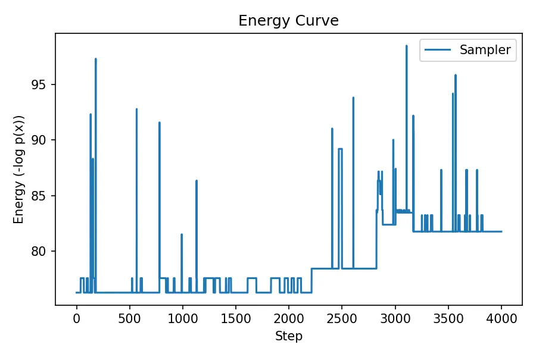

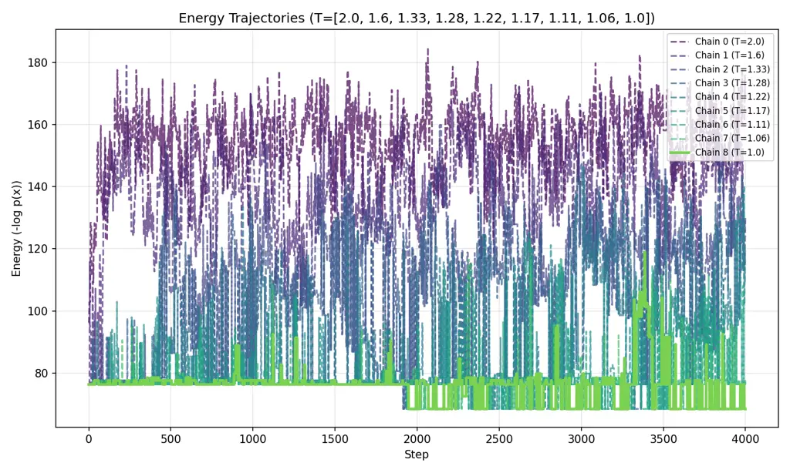

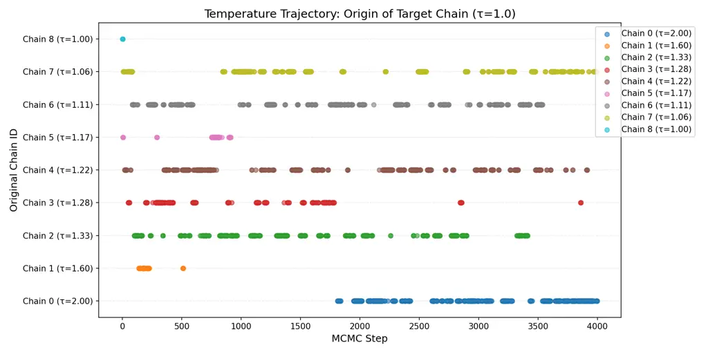

Figure 4: Parallel tempering for poetry completion. Top-left: a single
GwL chain remains trapped. Top-right: PT explores multiple energy
regions. Bottom: temperature trajectory of states reaching the target
chain, showing extensive state exchange across temperatures.

As shown in Figure 4 (top-left), the single-chain GwL baseline remains
near the initialization and fails to cross the energy barrier; its
lowest-energy completion remains “床前明月光，” (“Moonlight shines
before my bed,”). In contrast, Figure 4 (top-right) shows that PT
explores multiple energy regions, and the target chain recovers the
correct missing line “举头望明月，” (“I raise my head and gaze at the
bright moon,”). Figure 4 (bottom) is the temperature traversal plot
during parallel-tempered sampling: each dot indicates which original
chain supplied the state currently occupying the target chain at that
step. The plot shows frequent state exchanges across temperatures. In
particular, the high-temperature chain ($`T=2.0`$) explores broadly and
can pass low-energy states back to the target chain, confirming that the
improvement is due to multi-temperature exploration rather than local
single-chain refinement.

### 4.4 APE Instruction Induction Benchmark

We evaluate on the 24-task instruction induction benchmark used by APE
(Zhou et al., 2023; Honovich et al., 2022). For each task, we randomly
select six training examples. Three examples are used for APE candidate
generation, three for APE online evaluation, and all six examples are
used to construct our energy. The original APE test sets are used for
final evaluation. APE prompts serve both as the baseline and as
initialization for BayesPO.

We run eight PT chains at temperatures
$`\{1.8,1.5,1.4,1.33,1.28,1.2,1.1,1.0\}`$ for 1000 iterations with
$`\alpha=4.0`$. The optimized prompt length is 20 tokens for all tasks
except Sentence Similarity, where it is 50 tokens. A fixed prefix “The
instruction was to” is used to bias the generated sequence toward an
instruction.

Figure 5 and Table 1 report the results. The average accuracy improves
from 60.04% to 63.23%. The largest gains occur on tasks where the APE
prompt is initially poor: Second Letter improves from 10% to 63%, Word
in Context from 8% to 34%, Larger Animal from 51% to 66%, and
English-Spanish translation from 66% to 82%. These cases suggest that
BayesPO is particularly useful for post-correcting a generated prompt
whose task description has semantic drift or weak output-format
constraints. Appendix C.1 lists the full before/after prompt pairs and
accuracies for all 24 APE subtasks.

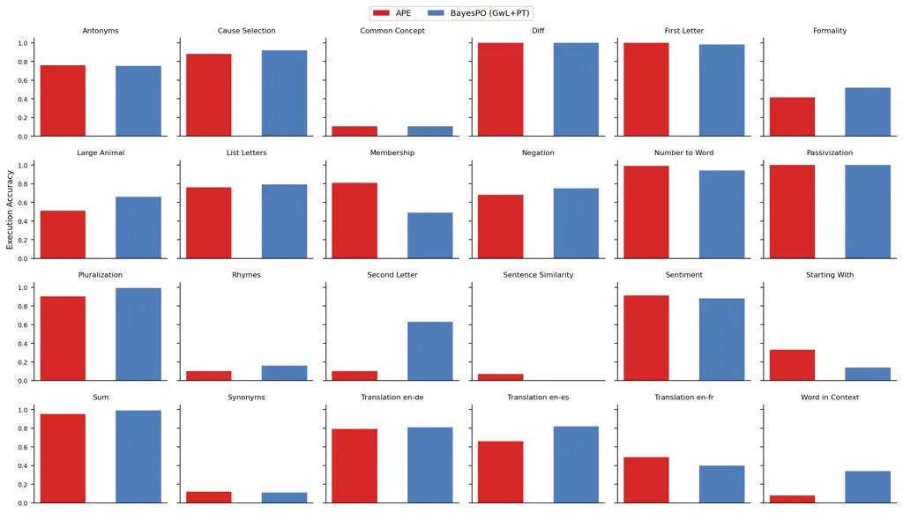

Figure 5: Accuracy comparison on all 24 APE instruction induction
subtasks. Red bars are APE-initialized prompts, and blue bars are
prompts after BayesPO (GwL+PT optimization).

| Task                | APE    | BayesPO | $`\Delta`$ | Task            | APE    | BayesPO | $`\Delta`$ |
| ------------------- | ------ | ------- | ---------- | --------------- | ------ | ------- | ---------- |
| Passivization       | 100.00 | 100.00  | 0.00       | Antonyms        | 76.00  | 75.00   | -1.00      |
| Cause Selection     | 88.00  | 92.00   | +4.00      | Common Concept  | 10.42  | 10.54   | +0.12      |
| Difference          | 100.00 | 100.00  | 0.00       | First Letter    | 100.00 | 98.00   | -2.00      |
| Formality           | 41.56  | 51.96   | +10.40     | Number to Word  | 99.00  | 94.00   | -5.00      |
| Larger Animal       | 51.00  | 66.00   | +15.00     | List Letters    | 76.00  | 79.00   | +3.00      |
| Negation            | 68.00  | 75.00   | +7.00      | Starting With   | 33.00  | 14.00   | -19.00     |
| Rhymes              | 10.00  | 16.00   | +6.00      | Second Letter   | 10.00  | 63.00   | +53.00     |
| Sentiment           | 91.00  | 88.00   | -3.00      | Pluralization   | 90.00  | 99.00   | +9.00      |
| Sentence Similarity | 7.00   | 0.00    | -7.00      | Sum             | 95.00  | 99.00   | +4.00      |
| English-German      | 79.00  | 81.00   | +2.00      | Synonyms        | 12.00  | 11.00   | -1.00      |
| Membership          | 81.00  | 49.00   | -32.00     | English-Spanish | 66.00  | 82.00   | +16.00     |
| English-French      | 49.00  | 40.00   | -9.00      | Word in Context | 8.00   | 34.00   | +26.00     |
| Average             | 60.04  | 63.23   | +3.19      |                 |        |         |            |

Table 1: Test accuracy on the APE instruction induction benchmark.
BayesPO uses the APE prompt as initialization and applies GwL+PT
optimization.

### 4.5 Energy-Accuracy Mismatch

Table 2 highlights a key empirical finding: reducing training energy
does not always improve test accuracy. In Second Letter and Word in
Context, large energy reductions coincide with large accuracy gains. In
Second Letter, the APE prompt drifts toward extracting the penultimate
letter, whereas the optimized prompt refocuses on generating the second
letter. In Word in Context, the optimized prompt more explicitly
constrains the output format by asking the model to type “same.”

However, Membership and Starting With degrade despite lower energy.
Membership drops from 81% to 49%; its optimized prompt introduces an
overly specific length constraint that likely fits the six optimization
examples but fails on the full test distribution. Starting With
similarly changes a general “input sentence” instruction into a narrower
“selected SMS” framing. These failures indicate overfitting to spurious
patterns in extremely small optimization sets.

| Task            | $`U_{\mathrm{APE}}`$ | $`U_{\mathrm{BayesPO}}`$ | Acc. APE | Acc. BayesPO |
| --------------- | -------------------- | ------------------------ | -------- | ------------ |
| Second Letter   | 178.19               | 91.04                    | 10.00    | 63.00        |
| Word in Context | 236.09               | 129.09                   | 8.00     | 34.00        |
| Membership      | 324.07               | 147.27                   | 81.00    | 49.00        |
| Starting With   | 190.53               | 141.22                   | 33.00    | 14.00        |
| Difference      | 85.57                | 72.44                    | 100.00   | 100.00       |
| Passivization   | 109.56               | 66.18                    | 100.00   | 100.00       |

Table 2: Representative energy and accuracy changes. Energy decreases in
all examples, but generalization can either improve or degrade.

Figure 6 shows representative target-chain energy trajectories.
Additional trajectories for improved, degraded, and stable tasks are
provided in Appendix C.2. The decreasing curves confirm that the sampler
optimizes the specified training energy. The contrasting accuracy
outcomes show that the energy itself must be designed or validated
carefully when only a few examples are available.

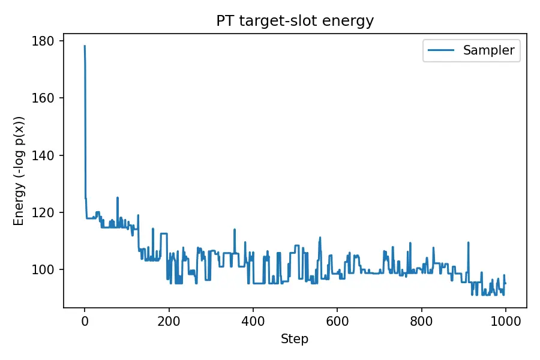

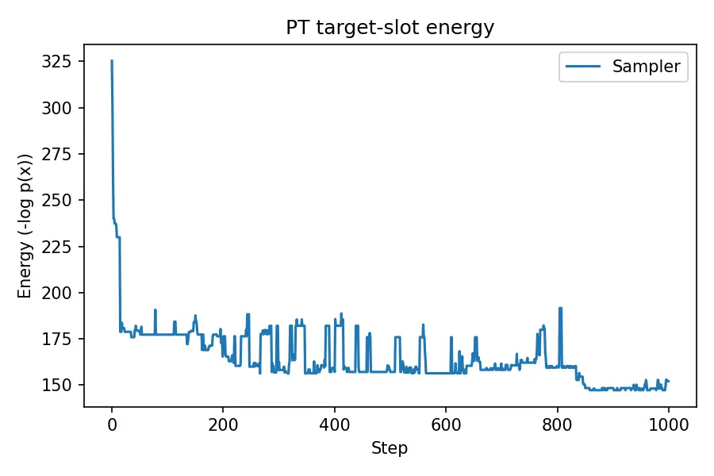

Figure 6: Representative APE-task energy trajectories. Left: Second
Letter, where energy reduction improves accuracy. Right: Membership,
where energy reduction overfits and accuracy drops.

### 4.6 Computational Cost

Let $`N`$ be prompt length, $`S`$ be the number of global iterations,
and $`M+1`$ be the number of temperature chains. A GwL scan updates
$`N`$ positions, and each position requires forward/backward computation
for the current state and a forward computation for MH evaluation. Thus
the wall-clock cost scales approximately as

```math
\mathcal{T}_{\mathrm{GwL+PT}}=\Theta(SMNC_{\mathrm{model}}), \tag{14}
```

where $`C_{\mathrm{model}}`$ includes forward, backward, and
MH-evaluation costs. By contrast, APE requires forward-only candidate
generation and evaluation. In the current implementation, the sampler is
roughly one order of magnitude slower than APE on a single optimization
run. This cost is acceptable only when prompt optimization can be
amortized over repeated deployment, when prompts must be highly
reliable, or when a strong initialization still contains local semantic
errors.

## 5 Discussion

First, computational cost and Monte Carlo efficiency. BayesPO is
currently computation-intensive because it uses many MC iterations,
repeated backward passes, and multiple temperature chains. One direct
direction is to design faster-mixing Monte Carlo methods for
high-dimensional discrete prompt spaces. Another possible direction
concerns the interaction between BayesPO and the LLM pretraining
objective. Current autoregressive LLMs are trained with next-token
prediction, which is essentially suffix prediction from a left context.
In contrast, Bayesian posterior sampling for prompt optimization behaves
more like a prefix-prediction problem: the sampler must infer a good
preceding instruction from desired downstream input-output behavior.
These two objectives are not fully aligned. A speculative but
interesting possibility is that LLM training could incorporate
prefix-prediction or instruction-inversion objectives, so that the
resulting model provides more informative gradients and better proposal
distributions for BayesPO, thereby improving MC efficiency.

Second, fixed prompt length. The current sampler assumes a fixed prompt
length, whereas natural instructions often benefit from insertions,
deletions, and variable-length edits. Trans-dimensional Monte Carlo
methods offer a promising path beyond this restriction. In particular,
trans-dimensional random fields were developed to model observations of
different lengths in language modeling (Wang et al., 2018). Future
BayesPO variants could combine token replacement moves with birth-death
or reversible-jump style moves so that the Markov chain explores prompt
strings of different lengths while maintaining a well-defined target
distribution.

Third, small optimization sets and energy-accuracy mismatch. The APE
experiments show that small optimization sets can cause overfitting: a
lower training energy may correspond to a prompt that fits a few
examples but generalizes worse. When the number of task demonstration
examples increases, mini-batch stochastic-gradient sampling becomes
attractive. Stochastic Gradient Langevin Dynamics (SGLD) provides a
continuous-space Bayesian sampling method with convergence guarantees
under annealed step sizes (Welling and Teh, 2011). For discrete prompt
optimization, however, gradient-guided MCMC still needs MH correction to
preserve the target distribution. Discrete-space mini-batch MCMC with
valid or approximately valid correction is therefore an important future
research direction for scaling BayesPO to larger optimization sets.

## 6 Conclusion

We presented BayesPO, a Bayesian prompt optimization framework based on
parallel-tempered gradient-guided discrete MCMC. The method defines a
posterior over prompt tokens, constructs an energy from task likelihood
and an LLM prior, uses MH-corrected GwL proposals for token-level
updates, adapts the proposal to non-weight-tied LLM embeddings, and
integrates PT for global exploration. Experiments show that the method
can discover meaningful prompts, escape a local optimum in a controlled
text completion task, and improve average accuracy on APE instruction
induction when used as a post-optimizer. At the same time, the study
reveals that energy minimization may overfit small optimization sets and
that the current sampler remains computationally expensive. Future work
will therefore focus on faster-mixing Monte Carlo methods,
prefix-prediction-aligned LLM training signals, trans-dimensional
prompt-length sampling, and discrete mini-batch MCMC with valid
correction mechanisms.

## Appendix A Experiment Details and Use of Language Models

### A.1 Reproducibility Details

The experiments use Qwen2.5-0.5B-Instruct for diagnostic prompt
optimization and Qwen2.5-7B-Instruct for PT and APE benchmark
experiments. The APE experiments use 24 instruction-induction subtasks,
six training examples per task, eight PT chains with temperatures
$`\{1.8,1.5,1.4,1.33,1.28,1.2,1.1,1.0\}`$, 1000 iterations, and step
size $`\alpha=4.0`$. Prompt length is 20 tokens except for Sentence
Similarity, where it is 50. The poetry completion experiment uses nine
chains with temperatures
$`\{2.0,1.6,1.33,1.28,1.22,1.17,1.11,1.06,1.0\}`$ and 4000 iterations.

### A.2 Use of Language Models

The authors used large language models to polish and revise the writing
of the manuscript. The models were not used to generate ideas, perform
analysis, or produce original scientific content.

### A.3 Poetry Initialization Template

For the poetry completion experiment, the initialization of the missing
middle line is generated by Qwen2.5-7B-Instruct using the following
chat-template messages. The variable middle_len is set to 6, prefix_text
is “下面是《静夜思》中的两句诗：”, and suffix_text is “低头思故乡。”.

> { "role": "system", "content":
> f"你是一个文本补全助手。请在给定的前缀和后缀之间，生成恰好{middle_len}个token的合理中间内容。不要生成多余内容。"
> }, { "role": "user", "content":
> f"前缀：{prefix_text}\n后缀：{suffix_text}\n请生成中间的{middle_len}个token："
> }

## Appendix B Model Inference and Diagnostic Task Details

### B.1 Qwen-Instruct Chat Template

All experiments use the official Qwen-Instruct chat template to organize
the input sequence. The exact format is:

> ```ltx_verbatim
> <|im_start|>system
>     (prompt sequence)<|im_end|>
> <|im_start|>user
>     (standard input text)<|im_end|>
> <|im_start|>assistant
>     (standard output text)<|im_end|>
> ```

The prompt sequence, namely the optimized $`\rho`$, is placed in the
system role as a global instruction. The task input $`x_{i}`$ is placed
in the user role. The target output $`y_{i}`$ is placed in the assistant
role and is used to compute the likelihood term
$`\log P(y_{i}\mid\rho,x_{i})`$. The template is kept identical for
Qwen2.5-0.5B-Instruct and Qwen2.5-7B-Instruct.

### B.2 Diagnostic Task Examples

Table 3 lists the four examples used in each diagnostic task.

[TABLE]

Table 3: Input-output examples for the two diagnostic tasks.

### B.3 Diagnostic Hyperparameters

Because the diagnostic experiment is mainly qualitative and
Qwen2.5-0.5B-Instruct is small with a relatively simple energy
landscape, single-chain GwL is sufficient for effective optimization. We
therefore do not introduce parallel tempering in these two tasks;
instead, we run ten random seeds and select the best result. To test the
sampler on different sequence lengths, the prompt length is fixed to
$`N=10`$ for the classical Chinese task and $`N=20`$ for the antonym
task. The step size is $`\alpha=4.0`$ in both tasks. The fixed prefix is
“指令：” (“Instruction:”), and these prefix tokens are not changed
during sampling; they are used to encourage the LLM to output an
instruction-like prompt. The total iteration count is $`S=1000`$ for
classical Chinese translation and $`S=500`$ for antonym generation.

## Appendix C APE Benchmark: Full Prompt Changes and Energy Trajectories

### C.1 Full Before/After Prompt Comparison

Table 4 gives the before/after prompt texts and test accuracies for all
24 APE instruction induction subtasks. The “APE initialization” column
corresponds to the best prompt obtained by reproducing APE; the
“Optimized prompt” column corresponds to the lowest-energy prompt
obtained by initializing BayesPO with the APE prompt and then applying
GwL+PT.

| Task                        | APE initialization                                                                                                                                                                                                                                                               | Acc.   | BayesPO prompt                                                                                                                                                                                                                                                                   | Acc.   |
| --------------------------- | -------------------------------------------------------------------------------------------------------------------------------------------------------------------------------------------------------------------------------------------------------------------------------- | ------ | -------------------------------------------------------------------------------------------------------------------------------------------------------------------------------------------------------------------------------------------------------------------------------- | ------ |
| Passivization               | The instruction was to transform the sentence from active voice to passive voice, but it seems that my friend did not follow the                                                                                                                                                 | 1.00   | The instruction was to transform the sentences from active voice to passive voice, and it seems like the response did not follow the                                                                                                                                             | 1.00   |
| Antonyms                    | The instruction was to transform the word into its opposite. However, I am wondering if there is another way to interpret this                                                                                                                                                   | 0.76   | The instruction was to translate a sentence into its opposite. However, I’m glad that there’s no instruction to do that                                                                                                                                                          | 0.75   |
| Cause Selection             | The instruction was to select the sentence that is more likely to be the cause of the other. However, the output does                                                                                                                                                            | 0.88   | The instruction was to give the sentence that was most likely to be the cause of the another. Here is the pair:                                                                                                                                                                  | 0.92   |
| Common Concept              | The instruction was to provide an output that describes the input in one word. Can you help me refine the instruction to achieve                                                                                                                                                 | 0.1042 | The instruction was to find a sequence that predictions a target in one word, which, help me continue the paragraph as \[’                                                                                                                                                       | 0.1054 |
| Difference                  | The instruction was to take the two inputs and produce an output, where the output is the first number minus the second number                                                                                                                                                   | 1.00   | The instruction was to take the two numbers and produce an output, where the output is the first number minus the second number                                                                                                                                                  | 1.00   |
| First Letter                | The instruction was to take the first letter of the word. Is that correct? Yes, based on the input-output pairs                                                                                                                                                                  | 1.00   | The instruction was to take the first letter of each word, is this instruction unclear or incorrect based on the input/output provided                                                                                                                                           | 0.98   |
| Formality                   | The instruction was to convert the input into an equivalent output using more formal language. However, I feel that the outputs are                                                                                                                                              | 0.4156 | The instruction was to rewrite the following in an acceptable subset of mainstream formal English: apparently, they, and one investigator suggests                                                                                                                               | 0.5196 |
| Number to Word              | The instruction was to write the number in words. What is the instruction that produced these input-output pairs? The instruction that                                                                                                                                           | 0.99   | The instruction was to translate the following in words. Here are the instruction that gave these input-output pairs. The input is                                                                                                                                               | 0.94   |
| Larger Animal               | The instruction was to take two animals and return the one that is more intelligent. Is there any error in the output?                                                                                                                                                           | 0.51   | The instruction was to take two numbers and find the one that is more significant. I need an answer of the form \\                                                                                                                                                               | 0.66   |
| List Letters                | The instruction was to write the letters of the word in uppercase and separate each letter with a space. What would be the                                                                                                                                                       | 0.76   | The instruction was to write the characters of the phrase in order and separate each character with a space. What would be the                                                                                                                                                   | 0.79   |
| Negation                    | The instruction was to reverse the truth value, but it seems my friend is not only reversing the truth value but also changing                                                                                                                                                   | 0.68   | The instruction was to reverse the truth value, but it seems the response provided not only reverse the truth value but also negate                                                                                                                                              | 0.75   |
| Starting With               | The instruction was to take an input sentence and output only the words that begin with the specified letter. However, there are                                                                                                                                                 | 0.33   | The instruction was to take an selected SMS and produce only the words which start with the given alphabet. Also add few spaces                                                                                                                                                  | 0.14   |
| Rhymes                      | The instruction was to reverse the word and remove the first letter. Is this correct? Yes, based on the provided input                                                                                                                                                           | 0.10   | The instruction was to continue the word by changing the previous one. Is that correct? Yes, based on your instruction,                                                                                                                                                          | 0.16   |
| Second Letter               | The instruction was to extract the second letter of the word, but I actually wanted them to extract the penultimate (second                                                                                                                                                      | 0.10   | The instruction was to generate the second letter of a word, but in doing so I also output the penultimate letter of                                                                                                                                                             | 0.63   |
| Sentiment Analysis          | The instruction was to produce the output sentiment (positive or negative) based on the given input. Can you produce some additional                                                                                                                                             | 0.91   | The instruction was to return the correct sentiment (positive: negative) based on the given sentence. This movie was a complete                                                                                                                                                  | 0.88   |
| Pluralization               | The instruction was to pluralize the word. Is there a way to test if the output is correct? Yes, you                                                                                                                                                                             | 0.90   | “The instruction was to pluralize the words. Is there a way to confirm that the task was completed? Yes, there                                                                                                                                                                   | 0.99   |
| Sentence Similarity         | The instruction was to generate the output based on the similarity between the two sentences, with the following possible outputs: 1 - definitely not 2 - possibly 3 - probably 4 - almost perfectly Can you please provide a new pair of sentences that would produce an output | 0.07   | The instruction was to produce an output based on the similarity between 2 sentences, with the following possible outcomes: 1 - probably not 2 - possibly 3 - probably 4 - almost perfectly Can you please generate a similar set of responses that would indicate the following | 0.00   |
| Sum                         | The instruction was to take two numbers as inputs and produce their sum as output. Is there a more concise way to describe                                                                                                                                                       | 0.95   | The instruction was to take two halves of input and make their sum into output. Is there a more concise way to say                                                                                                                                                               | 0.99   |
| Translation English-German  | The instruction was to translate the words into German. Is it possible to produce the following output based on the given instruction?                                                                                                                                           | 0.79   | The instruction was to write the text in German. Is it possible to provide the German text based on the following input?                                                                                                                                                         | 0.81   |
| Synonyms                    | The instruction was to replace the given word with its synonym, but I made an exception for certain words. Can you figure                                                                                                                                                        | 0.12   | The instruction was to replace the given text with its shorter alternative, I have an exception for proper nouns. I also                                                                                                                                                         | 0.11   |
| Membership                  | The instruction was to select words that were either an animal or could be an animal. However, it seems like there might                                                                                                                                                         | 0.81   | The instruction was to write words that are sorted and are or could be an animal (4-5 characters in a sentence                                                                                                                                                                   | 0.49   |
| Translation English-Spanish | The instruction was to translate words from English to Spanish. Is this correct? Yes, based on the input-output pairs you                                                                                                                                                        | 0.66   | The instruction was to translate from English to Spanish A possible and more accurate version based on the context provided below:                                                                                                                                               | 0.82   |
| Translation English-French  | The instruction was to translate words from French to English. Can you explain what went wrong in the translations? The translations provided                                                                                                                                    | 0.49   | The instruction was to translate words from English to French. Can you explain what went wrong in the translations? The translations received                                                                                                                                    | 0.40   |
| Word in Context             | The instruction was to determine if the two sentences are using the word in the same way or not, and output same                                                                                                                                                                 | 0.08   | The instruction was to \\ tell if the two constructions are using the same r the same construction or not, simply type same                                                                                                                                                      | 0.34   |

Table 4: APE instruction induction full before/after prompt comparison.

### C.2 Additional APE Energy Trajectories

Figure 7 reports additional APE-task energy trajectories for tasks with
different accuracy outcomes. The corresponding accuracy changes are Word
in Context: +26.00 percentage points, Starting With: -19.00 points,
Difference: +0.00 points, and Passivization: +0.00 points. These curves
are useful diagnostics: the sampler consistently decreases the specified
training energy, but the relationship between training energy and test
accuracy depends on whether the optimization examples are
representative.

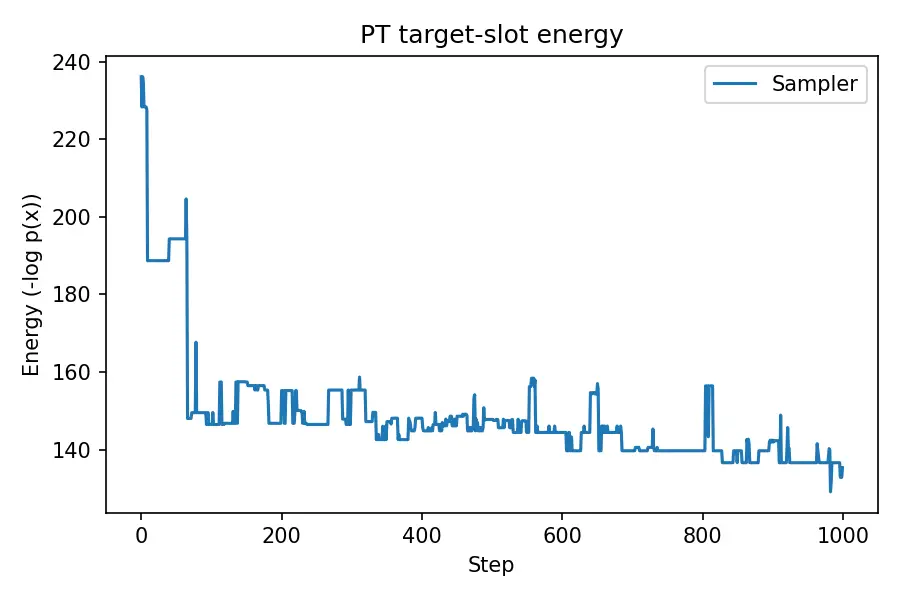

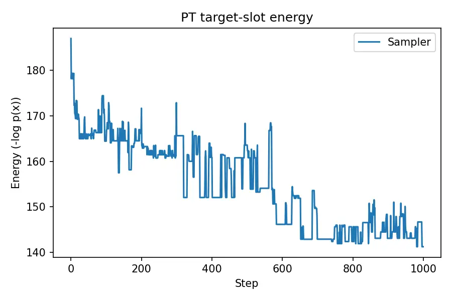

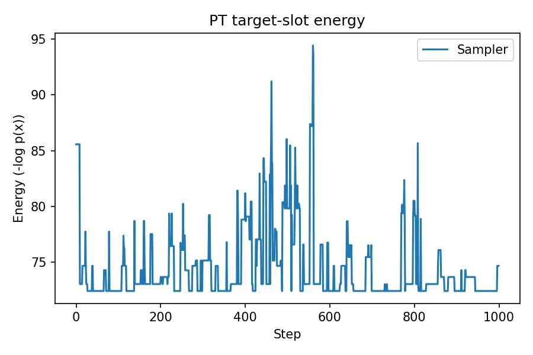

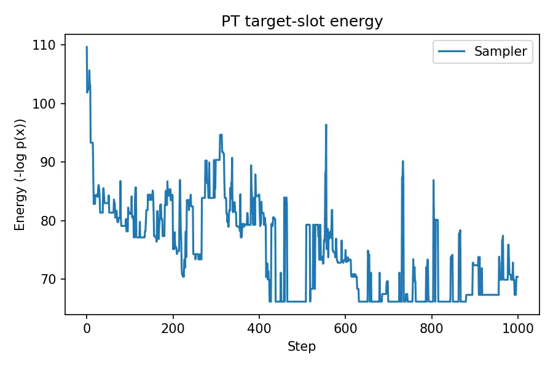

Figure 7: Additional target-chain energy trajectories. Top-left: Word in
Context (+26.00 points). Top-right: Starting With (-19.00 points).
Bottom-left: Difference (+0.00 points). Bottom-right: Passivization
(+0.00 points).

## References

- Cheng et al. (2024) J. Cheng, X. Liu, K. Zheng, P. Ke, H. Wang, Y.
  Dong, J. Tang, and M. Huang Black-box prompt optimization: aligning
  large language models without model training. In Proceedings of the
  62nd Annual Meeting of the Association for Computational Linguistics
  (Volume 1: Long Papers), pp. 3201–3219. External Links:
  [Document](https://dx.doi.org/10.18653/v1/2024.acl-long.176) Cited by:
  §2.
- Cui et al. (2025) W. Cui, J. Zhang, Z. Li, et al. Automatic prompt
  optimization via heuristic search: a survey. Note: Findings of ACL
  Cited by: §2.
- Das et al. (2024) S. S. S. Das, R. Kamoi, B. Pang, et al. GReaTer:
  gradients over reasoning makes smaller language models strong prompt
  optimizers. Note: arXiv preprint Cited by: §1, §2.
- Du et al. (2024) L. Du, A. Amini, L. T. Hennigen, et al. Principled
  gradient-based markov chain monte carlo for text generation. In
  International Conference on Learning Representations, Cited by: §1,
  §2, §3.3, §3.3, §3.4.
- Geyer (2011) C. J. Geyer Importance sampling, simulated tempering, and
  umbrella sampling. In Handbook of Markov Chain Monte Carlo,
  pp. 295–311. Cited by: §1, §2, §3.5.
- Honovich et al. (2022) O. Honovich, U. Shaham, S. R. Bowman, and O.
  Levy Instruction induction: from few examples to natural language task
  descriptions. Note: arXiv:2205.10782 Cited by: §4.4.
- Hukushima and Nemoto (1996) K. Hukushima and K. Nemoto Exchange monte
  carlo method and application to spin glass simulations. Journal of the
  Physical Society of Japan 65 (6), pp. 1604–1608. Cited by: §1, §2,
  §3.5.
- Kumar et al. (2022) S. Kumar, B. Paria, and Y. Tsvetkov Gradient-based
  constrained sampling from language models. In Proceedings of the 2022
  Conference on Empirical Methods in Natural Language Processing,
  pp. 2252–2271. Cited by: §2.
- LeCun et al. (2006) Y. LeCun, S. Chopra, R. Hadsell, M. Ranzato,
  and F. J. Huang A tutorial on energy-based learning. In Predicting
  Structured Data, pp. 191–246. Cited by: §1, §2.
- Ou (2024) Z. Ou Energy-based models with applications to speech and
  language processing. Foundations and Trends in Signal Processing 18
  (1–2), pp. 1–199. Note: arXiv:2403.10961 Cited by: §1, §2.
- Pryzant et al. (2023) R. Pryzant, D. Iter, J. Li, Y. T. Lee, C. Zhu,
  and M. Zeng Automatic prompt optimization with gradient descent and
  beam search. In Proceedings of the 2023 Conference on Empirical
  Methods in Natural Language Processing, pp. 7957–7968. Cited by: §1,
  §2.
- Qin et al. (2022) L. Qin, S. Welleck, D. Khashabi, and Y. Choi COLD
  decoding: energy-based constrained text generation with langevin
  dynamics. In Advances in Neural Information Processing Systems, Vol. 35. Cited by: §2.
- Qwen Team (2025) Qwen Team Qwen2.5 technical report. Note:
  arXiv:2412.15115 Cited by: §3.4.
- Sabbatella et al. (2025) A. Sabbatella, A. Ponti, I. Giordani, and F.
  Archetti A bayesian approach for prompt optimization in llms. In
  Learning and Intelligent Optimization, Lecture Notes in Computer
  Science, Vol. 14990, pp. 348–360. External Links:
  [Document](https://dx.doi.org/10.1007/978-3-031-75623-8%5F28) Cited
  by: §2.
- Shin et al. (2020) T. Shin, Y. Razeghi, R. L. Logan IV, E. Wallace,
  and S. Singh AutoPrompt: eliciting knowledge from language models with
  automatically generated prompts. In Proceedings of the 2020 Conference
  on Empirical Methods in Natural Language Processing, pp. 4222–4235.
  Cited by: §1, §2.
- Tomar et al. (2025) S. Tomar, A. Deshwal, E. Villalovoz, M.
  Fazzini, H. Cai, and J. R. Doppa An exploratory study of bayesian
  prompt optimization for test-driven code generation with large
  language models. Note: arXiv:2512.15076 Cited by: §2.
- Wang et al. (2018) B. Wang, Z. Ou, and Z. Tan Learning
  trans-dimensional random fields with applications to language
  modeling. IEEE Transactions on Pattern Analysis and Machine
  Intelligence 40 (4), pp. 876–890. External Links:
  [Document](https://dx.doi.org/10.1109/TPAMI.2017.2693180) Cited by:
  §5.
- Welling and Teh (2011) M. Welling and Y. W. Teh Bayesian learning via
  stochastic gradient langevin dynamics. In Proceedings of the 28th
  International Conference on Machine Learning, pp. 681–688. Cited by:
  §5.
- Xu et al. (2024) W. Xu, A. Banburski-Fahey, and N. Jojic Reprompting:
  automated chain-of-thought prompt inference through gibbs sampling. In
  International Conference on Machine Learning, Cited by: §2.
- Zhou et al. (2023) Y. Zhou, A. I. Muresanu, Z. Han, K. Paster, S.
  Pitis, H. Chan, and J. Ba Large language models are human-level prompt
  engineers. In International Conference on Learning Representations,
  Cited by: §1, §2, §4.4.
