# One Rewrite to Fix Them All? Type-Aware Repair Allocation for Text-to-Image Prompt Optimization

Haoyue Liu Affiliation:  School of Science and Engineering, The Chinese
University of Hong Kong, Shenzhen 518172, China    Xiaoyu Ma
Affiliation:  School of Science and Engineering, The Chinese University
of Hong Kong, Shenzhen 518172, China    Ye Chen Affiliation: 
XJTU-POLIMI Joint School, Xi’an Jiaotong University, Xi’an 710049, China
   Shuguang Cui Affiliation:  School of Science and Engineering, The
Chinese University of Hong Kong, Shenzhen 518172, China Affiliation: 
Shenzhen Future Network of Intelligence Institute (FNii-Shenzhen)   
Xiaoying Tang Affiliation:  School of Science and Engineering, The
Chinese University of Hong Kong, Shenzhen 518172, China Affiliation: 
Shenzhen Future Network of Intelligence Institute (FNii-Shenzhen)

###### Abstract

Text-to-image (T2I) generators often fail to follow their prompts
faithfully, producing wrong counts, swapped attributes, ambiguous
relations, and illegible text. Prompt optimization repairs such failures
by rewriting the user prompt, requiring no generator retraining, and has
yielded promising results. However, existing optimizers absorb
heterogeneous failures into one uniform prompt expansion, even though
each calls for different repair language. We formulate semantic prompt
optimization as _atomic repair allocation_: each failed proposition is
routed to a type-conditioned repair operator before the resulting local
constraints are compiled into one executable prompt. We instantiate this
formulation in the training-free Type-Aware Repair Allocation (TARA)
framework, which separates diagnosis, allocation, compilation, and a
semantic repair gate—an accept-or-revert controller over exactly one
prescribed repair that prevents semantic regressions. Extensive
experiments on DSG and TIFA across four frozen generators demonstrate
that TARA achieves the best semantic accuracy in all eight
benchmark–generator cells, improving over VisualPrompter by
$`+5.6`$/$`+2.6`$ points on DSG/TIFA, while maintaining image quality
and running fastest in our matched local setting ($`16.0`$s versus
$`20.0`$s per prompt).

|     |
| --- |
|     |

²²footnotetext: Corresponding author.

## 1 Introduction

Text-to-image (T2I) generation has become a default way to turn language
into pictures (Ho et al., 2020; Rombach et al., 2022; Black Forest Labs,
2024; Chen et al., 2025), yet making an image actually satisfy its
prompt is still fragile: modern generators routinely drop a requested
object, miscount, swap an attribute, scramble a relation, or render text
no one can read. Prompt optimization has therefore emerged as a
practical remedy that requires no generator retraining. Keyword-driven
rewriters such as Promptist (Hao et al., 2023), BeautifulPrompt (Cao
et al., 2023), NeuroPrompts (Rosenman et al., 2024), and TIPO (Yeh
et al., 2024) increase visual appeal, and recent visual-feedback methods
such as VisualPrompter (Wu et al., 2026) decompose the prompt into
atomic propositions and detect missing concepts with a VLM, targeting
semantic faithfulness directly.

Despite this progress, existing optimizers share an unavoidable
drawback: _whatever the failure, the prompt is repaired by a single
uniform expansion_. A missing object, a wrong count, a broken relation,
and illegible text are handled by the same enrichment rule, so the
repair seldom matches the failure; VisualPrompter, for instance, uses
atomic feedback to decide _what_ is missing, but still applies a largely
type-agnostic strategy when deciding _how_ to rewrite it. As illustrated
in Figure 1, on a prompt that jointly demands a count, an attribute, a
layout, and a legible sign, one such expansion leaves several errors
standing. Notably, _different failures call for different repair
language_: a missing object must be made salient, a wrong count needs
explicit cardinality and separation, a spatial relation needs an
unambiguous layout, and rendered text needs the exact string with
legible typography. Under our formulation, uniform expansion is a
degenerate allocation policy with one type-invariant shared operator
across failure types. Rather than using atomic categories only to
describe what failed, TARA operationalizes them as routing variables
that determine how each failed proposition is repaired.

To tackle the above problem, we rethink how visual feedback should drive
prompt rewriting and address the following core question:

_Can atomic visual feedback be used not merely to trigger a rewrite, but
to route heterogeneous failures to specialized repairs and compile them
into one reliable prompt under a single-regeneration budget?_

Hence, we formulate semantic prompt optimization as _atomic repair
allocation_ and instantiate it with the _Type-Aware Repair Allocation_
(TARA) method. TARA follows four explicit stages: _Diagnose_ which
atomic propositions fail; _Allocate_ each failure to a type-conditioned
repair operator; _Compile_ the resulting local constraints into one
concise executable prompt through a text-only portfolio-and-fusion step;
and _Adopt_ the single repaired image only when a semantic repair gate
deems it a reliable replacement. This design separates decisions that
existing prompt optimizers conflate or leave uncontrolled: what went
wrong, how each failure should be repaired, how heterogeneous local
repairs should coexist in one prompt, and whether the result should
replace the original output. The repair budget is a single additional
image generation, matched to prior visual-feedback optimizers; TARA
needs no task-specific training labels, generator finetuning, or
white-box access, and can be applied out of the box across diverse
frozen T2I generators. We summarize the contributions of this paper as
follows:

- •
  We formulate visual-feedback prompt optimization as _atomic repair
  allocation_. Rather than using atomic feedback only to trigger one
  global expansion, TARA treats each failed proposition as an
  intervention unit and assigns it a type-conditioned local repair;
  uniform expansion is the single-operator special case.
- •
  We instantiate this formulation with TARA, a training-free framework
  that compiles heterogeneous local repairs into one executable prompt
  under a single-regeneration budget and uses a semantic repair gate to
  prevent the prescribed repair from introducing regressions.
- •
  Across DSG and TIFA, four generators, and three seeds, TARA leads all
  eight benchmark–generator cells. Its gains persist across semantic
  types and independent evaluators, while controlled ablations isolate
  the explicit typed-expansion branch, repair compilation, recovery, and
  adoption under a matched image budget.

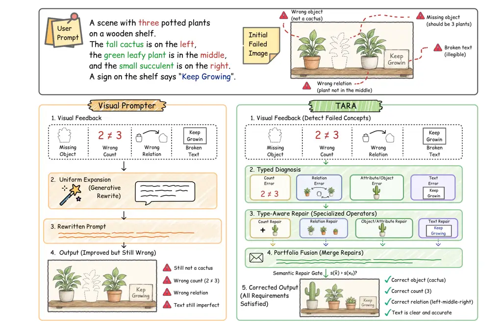

Figure 1: Type-agnostic expansion (VisualPrompter, left) versus atomic
repair allocation (TARA, right). One uniform expansion leaves several
fine-grained failures unresolved, whereas TARA routes each failure to a
type-conditioned repair within the same single re-generation budget.

## 2 TARA

The discussion above motivates a four-stage view of prompt optimization:
_Diagnose_ failed atomic requirements, _Allocate_ a type-conditioned
operator to each failure, _Compile_ the allocated local repairs into one
globally coherent prompt, and _Adopt_ the repaired output only when it
is a reliable replacement. The following subsections instantiate these
four decisions without training or extra repaired-image candidates.

### 2.1 Overview and Problem Setup

We cast prompt optimization as single-pass visual feedback. Let $`G`$ be
a frozen text-to-image generator and $`p`$ a user prompt. Following
DSG (Cho et al., 2024), $`p`$ is decomposed into atomic semantic
propositions $`Q(p)=\{q_{1},\dots,q_{n}\}`$, each carrying a
natural-language verification question and a semantic category. A frozen
VLM judge $`V`$ answers each question on an image $`x`$, and we define
the semantic score

```math
s(x)\;=\;\frac{1}{n}\,\bigl|\{\,i:V(x,q_{i})=\textsc{correct}\,\}\bigr|, \tag{1}
```

computed with the same DSG evaluator and judge for every method, so all
methods are scored under an identical protocol.

TARA first renders $`x_{0}=G(p)`$ and obtains diagnosis $`d_{0}`$. Let

```math
\displaystyle F_{0}(x_{0},p) \displaystyle=\{(q_{i},t_{i}):q_{i}\text{ is diagnosed as failed on }x_{0}\}, \tag{2}
```

```math
\displaystyle F \displaystyle=F_{0}\cup\mathcal{R}(d_{0}), \displaystyle r_{i} \displaystyle=\mathcal{A}(q_{i},t_{i}),
```

```math
\displaystyle\hat{p} \displaystyle=\mathcal{C}\!\left(p,\{r_{i}\}_{(q_{i},t_{i})\in F}\right),
```

where $`t_{i}`$ is the diagnosed error type and $`\mathcal{R}(d_{0})`$
recovers pruned relation/action constraints needed for repair. The
allocator $`\mathcal{A}`$ maps each target to a local repair constraint
$`r_{i}`$, and the compiler $`\mathcal{C}`$ realizes all allocated
repairs through one prompt. In TARA, a repair operator is a fixed local
language-transformation rule rather than a learned router. Uniform
expansion is the type-invariant special case

```math
\mathcal{A}_{\mathrm{uni}}(q,t)=R_{\mathrm{uni}}(q)\qquad\text{for every type }t, \tag{3}
```

so the resulting constraint may depend on the failed proposition $`q`$,
but the repair policy does not change with its type $`t`$.

Operationally, TARA (i) diagnoses the failed propositions in $`x_{0}`$;
(ii) allocates each failure to a type-conditioned repair operator; (iii)
compiles the resulting local constraints into one optimized prompt
$`\hat{p}`$; and (iv) renders a single repaired image
$`\hat{x}=G(\hat{p})`$, which is adopted only if it improves the score
and is otherwise discarded in favor of $`x_{0}`$. TARA thus uses at most
two image generations, one diagnostic and one repaired, while all
diagnosis, candidate construction, selection, and fusion are text- or
VLM-side. Figure 2 summarizes the two stages (initial diagnosis, then
type-aware repair with a final gate), and Algorithm 1 in the appendix
gives the full procedure.

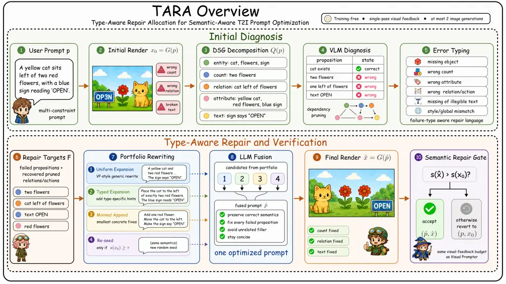

Figure 2: Overview of TARA. It diagnoses failed atomic propositions,
allocates type-conditioned repairs, compiles them into one prompt, and
adopts the single repaired image only if its semantic score improves.
Training-free, within at most two image generations.

### 2.2 Typed Visual Diagnosis

Following DSG (Cho et al., 2024), each prompt is decomposed into atomic
propositions, and the VLM judge assigns every proposition one of three
states (_correct_, _absent_ when not generated, or _wrong_ when
generated but incorrect), together with a semantic category (entity,
attribute, relation, action, count, text, style, or global). The DSG
dependency graph prunes invalid downstream questions: if an entity is
absent, questions about its attributes or relations are not counted as
independent failures. Following the DSG evaluation protocol, a pruned
proposition counts as zero in the numerator of Eq. 1 but stays in its
denominator, so TARA and all baselines are compared under an identical
metric rather than a more lenient one.

TARA maps each failed proposition to a repairable error type through a
fixed category-to-type table: entity $`\rightarrow`$ _missing object_,
count $`\rightarrow`$ _wrong count_, attribute $`\rightarrow`$ _wrong
attribute_, relation $`\rightarrow`$ _wrong relation_, action
$`\rightarrow`$ _wrong action_, text $`\rightarrow`$ _missing or
illegible text_, style $`\rightarrow`$ _style mismatch_, and global
$`\rightarrow`$ _global mismatch_. Through this fixed mapping, shared
across all benchmarks and generators, TARA organizes diagnosed failures
into eight repairable types that act as actionable routing variables.
The type determines the repair language: explicit cardinality and
separation for counts, unambiguous spatial anchors for relations,
visible pose and contact for actions, an exact quoted string with
legible typography for text, and salient foreground grounding for
missing objects, all while leaving already-correct content untouched.
These typed failures instantiate the base set $`F_{0}`$ in Eq. 2.

A failed entity prunes its dependent relations, which can trap an
optimizer into repeatedly re-adding the missing object while never
re-describing the layout. TARA therefore _also_ adds pruned relation and
action propositions that are themselves wrong or absent into $`F`$, so
that a single rewrite can re-describe a missing object together with its
spatial relation. This recovery affects only the repair targets, not the
comparable score of Eq. 1.

### 2.3 Typed Repair Compilation and Output Adoption

Once each failed proposition has been allocated a repair operator, TARA
must compile heterogeneous local constraints into one globally coherent
prompt. Directly committing to one rewrite bias is brittle: a
conservative edit may under-specify a missing concept, while an
aggressive one may inject unrelated detail. TARA therefore implements
typed repair compilation with a small portfolio $`C`$ of text-only
rewrite drafts, each encoding a different compilation bias:

1.  1.  Uniform expansion: a type-agnostic rewrite that enriches $`p`$ so
        all failed aspects are depicted at once, with no type
        information—mirroring the uniform-expansion bias of prior optimizers
        and serving as an in-method control for typing. Like every
        candidate, it is a non-final draft built from the recovered targets
        $`F`$ and later passed to fusion.
2.  2.  Typed expansion: the same expansion, but each failed aspect is
        annotated with its error type and a type-specific repair phrase
        (word-and-digit counts, spatial anchors, quoted legible text, pose
        and contact for actions).
3.  3.  Minimal append: keeps $`p`$ almost verbatim and appends only the
        shortest concrete clauses needed to fix the failures, for strong
        generators where a full rewrite tends to drift from the original
        intent.

When the initial image is already close to correct
($`s(x_{0})\geq\tau`$, with $`\tau{=}0.72`$), TARA additionally admits a
re-seed candidate that retains $`p`$ unchanged, allowing the single
repair-generation step to use a fresh seed instead of a rewritten
prompt—avoiding harmful edits to near-correct images. We use
$`\tau{=}0.72`$ as a near-correct cutoff (roughly “most propositions
already pass”); a threshold sweep (Appendix C.2) shows that all values
in $`[0.60,0.84]`$ give large gains at a comparable image budget, and we
keep this single global $`\tau`$ fixed rather than tuning it per
generator or benchmark. Because every candidate is text-only, the
portfolio adds no image generations. The portfolio is not an image-level
candidate set: none of its drafts is rendered or scored as an image.
Instead, it provides complementary textual realizations of the allocated
local repairs so they can be compiled into one prompt under the
single-regeneration budget.

TARA then fuses the portfolio into one optimized prompt $`\hat{p}`$ with
a text-only LLM step whose instruction enforces four principles:
preserve all already-correct semantics, fix every failed proposition,
avoid unrelated objects and generic aesthetic filler, and stay concise.
As an implementation alternative, we also consider a purely heuristic
selector that instead picks one existing candidate by a text-only score
rewarding coverage of failed-proposition words and preservation of the
original wording while penalizing over-long prompts; it never inspects
an image, preserving the single-pass budget.

Even a type-targeted rewrite may remove previously correct content. TARA
therefore ends its inference policy with a semantic repair gate: after
generating exactly one prescribed repair $`\hat{x}=G(\hat{p})`$, it
adopts the repair iff $`s(\hat{x})>s(x_{0})`$ and otherwise reverts to
$`(p,x_{0})`$. This accept-or-revert regression guard is not a
best-of-$`N`$ selector: it generates no additional repaired candidates
and performs no image search. It operates per input without ground-truth
annotations or reference images, and its full cost is included in our
runtime accounting (Appendix A.1).

## 3 Experiments

We organize our study around four questions, answered in turn:

- •
  Q1 (accuracy). Does TARA produce more semantically accurate images
  than existing prompt optimizers?
- •
  Q2 (quality). Does it do so without sacrificing CLIP alignment or
  aesthetics?
- •
  Q3 (allocation). Does explicit type-conditioned repair contribute, and
  do gains hold across semantic categories and generators?
- •
  Q4 (reliability and efficiency). Do repair compilation and adoption
  contribute under the matched budget, and is TARA efficient?

Implementation details, repair templates, seed robustness,
proposition-type breakdowns, and preference numbers are in the Appendix.

### 3.1 Experiment Setup

We evaluate on DSG-1k (Cho et al., 2024) (10 source datasets) and TIFA
v1.0 (Hu et al., 2023), running three seeds with 200 stratified prompts
per seed for each benchmark-generator-method cell.

Our primary metric is Semantic Accuracy: the fraction of atomic
propositions answered “yes” by the shared VLM judge (pruned propositions
count as zero but stay in the denominator). We also report CLIP
Score (Hessel et al., 2021), Aesthetic Score (Schuhmann et al., 2022),
and a VLM-as-Judge preference study. The VLM never sees the optimized
prompt text, so a rewrite cannot cue the evaluator.

Four generators: SD v1.5, SD v2.1 (Rombach et al., 2022),
Flux-dev (Black Forest Labs, 2024), and Janus-Pro (Chen et al., 2025).
Baselines: Promptist (Hao et al., 2023), BeautifulPrompt (Cao et al.,
2023), NeuroPrompts (Rosenman et al., 2024), TIPO (Yeh et al., 2024),
and VisualPrompter (Wu et al., 2026). All methods share prompts, seeds,
image sizes, judge, and evaluation protocol, and each is evaluated in
its native end-to-end configuration under the same maximum
image-generation budget: VisualPrompter follows its published pipeline,
whereas TARA includes the semantic repair gate as part of its inference
procedure, with all additional model calls and end-to-end costs
reported. External methods remain native; the gate’s contribution is
isolated by the controlled within-TARA ablation in §3.5. The external
VisualPrompter baseline is distinct from TARA’s internal
uniform-expansion candidate (§2.3), a non-final draft used as an
in-method control for typing. Details are in Appendix A.1.

### 3.2 A1: TARA Achieves the Best Semantic Accuracy in Every Cell

TARA is the strongest method in all eight benchmark-generator cells. As
shown in Tables 2 and 3 (whose Avg columns give the per-generator
overall), TARA improves over VisualPrompter by +5.6 points on DSG
(76.4$`\pm`$0.2 vs. 70.8$`\pm`$0.7) and +2.6 on TIFA (85.4$`\pm`$0.2 vs.
82.8$`\pm`$0.6), with prompt-clustered paired bootstrap 95% CIs of
$`[4.7,6.5]`$ and $`[1.6,3.6]`$, respectively. Across 4,800 paired
evaluations, the mean paired gain is $`+4.11`$ points (95% CI
$`[3.45,4.80]`$). Re-scoring the saved final images with four held-out
VLM evaluators, none of which participates in diagnosis or gate
decisions, confirms the ranking, with Overall gains ranging from
$`+2.4`$ to $`+3.2`$ points (Table 1). In contrast, aesthetics-oriented
optimizers such as BeautifulPrompt and TIPO fall well below the
raw-prompt baseline, showing that generic enrichment can actively hurt
semantics.

| Evaluator               | DSG  |      |      | TIFA |      |      | Overall |      |      |
| ----------------------- | ---- | ---- | ---- | ---- | ---- | ---- | ------- | ---- | ---- |
|                         | VP   | TARA | Gap  | VP   | TARA | Gap  | VP      | TARA | Gap  |
| Qwen3.5-4B              | 72.9 | 76.1 | +3.2 | 82.6 | 84.6 | +2.0 | 77.7    | 80.4 | +2.6 |
| Qwen2.5-VL- 7B-Instruct | 71.0 | 74.0 | +3.0 | 80.5 | 82.4 | +1.9 | 75.8    | 78.2 | +2.4 |
| Gemma4-31B              | 69.7 | 72.4 | +2.7 | 79.2 | 81.3 | +2.1 | 74.5    | 76.9 | +2.4 |
| Qwen3.5-27B             | 71.2 | 75.3 | +4.1 | 82.6 | 84.8 | +2.2 | 76.9    | 80.1 | +3.2 |

Table 1: Evaluator robustness for VP and TARA. Scores are averages over
four generators.

Because visual feedback methods can be sensitive to the VLM used for
diagnosis and scoring, we also test evaluator robustness. Keeping the
generated images fixed, we re-run only the atomic yes/no evaluation for
the strongest semantic baseline, VisualPrompter, and TARA using four
held-out VLM judges. Table 1 shows that the ranking does not depend on
the main evaluator: TARA remains better on both DSG and TIFA averages
under all four judges.

The gains are not uniform across difficulty: TARA improves the most on
DSG, whose prompts carry more explicit counts, relations, text, and
unusual compositions, exactly the cases where a single uniform expansion
is least adequate and type-aware repair helps most.

| Generator | Method          | Whoops       | Localized    | PoseScript   | VRD          | CountBench   | Midjourney   | TIFA160      | DrawText     | Stanford     | DiffusionDB  | Avg          |
| --------- | --------------- | ------------ | ------------ | ------------ | ------------ | ------------ | ------------ | ------------ | ------------ | ------------ | ------------ | ------------ |
| SD 1.5    | Raw prompt      | 74.0\_(±1.4) | 69.1\_(±3.1) | 60.3\_(±1.6) | 60.4\_(±4.1) | 51.2\_(±2.6) | 57.5\_(±3.6) | 67.9\_(±5.5) | 53.2\_(±3.4) | 69.5\_(±2.6) | 53.6\_(±4.5) | 61.7\_(±0.5) |
|           | NeuroPrompts    | 63.2\_(±2.1) | 56.2\_(±2.9) | 48.9\_(±4.7) | 63.9\_(±2.8) | 38.2\_(±4.4) | 38.9\_(±3.0) | 45.6\_(±6.7) | 37.1\_(±3.9) | 62.6\_(±3.5) | 47.4\_(±1.6) | 50.2\_(±1.5) |
|           | Promptist       | 70.8\_(±6.6) | 64.0\_(±0.7) | 48.3\_(±3.3) | 65.1\_(±2.9) | 42.1\_(±5.9) | 50.4\_(±3.1) | 55.3\_(±2.8) | 42.5\_(±1.2) | 62.0\_(±0.6) | 49.1\_(±0.7) | 55.0\_(±1.3) |
|           | BeautifulPrompt | 52.9\_(±7.2) | 42.9\_(±4.8) | 36.7\_(±2.0) | 49.6\_(±5.5) | 35.4\_(±6.6) | 31.4\_(±4.3) | 38.8\_(±2.8) | 30.7\_(±5.6) | 31.0\_(±4.8) | 33.1\_(±6.5) | 38.2\_(±0.8) |
|           | TIPO            | 59.4\_(±3.3) | 58.4\_(±2.2) | 56.1\_(±7.3) | 62.8\_(±3.7) | 40.5\_(±3.7) | 50.2\_(±0.9) | 57.6\_(±5.5) | 47.1\_(±0.7) | 62.6\_(±2.8) | 47.1\_(±2.4) | 54.2\_(±1.1) |
|           | VisualPrompter  | 77.7\_(±5.1) | 70.4\_(±2.2) | 57.9\_(±1.3) | 67.0\_(±2.9) | 61.1\_(±2.1) | 53.8\_(±3.8) | 69.1\_(±2.0) | 48.9\_(±2.9) | 63.5\_(±4.1) | 57.3\_(±2.4) | 62.7\_(±1.3) |
|           | TARA (Ours)     | 80.4\_(±4.4) | 74.2\_(±0.9) | 66.3\_(±2.8) | 77.9\_(±2.8) | 62.7\_(±6.1) | 65.2\_(±2.2) | 79.1\_(±1.5) | 60.9\_(±1.0) | 74.5\_(±2.5) | 57.6\_(±5.0) | 69.9\_(±0.7) |
|           | TARA$`-`$VP     | +2.7         | +3.8         | +8.4         | +10.9        | +1.6         | +11.4        | +10.0        | +12.1        | +11.0        | +0.4         | +7.2         |
| SD 2.1    | Raw prompt      | 80.9\_(±1.5) | 67.7\_(±2.0) | 61.6\_(±1.8) | 70.6\_(±2.1) | 57.2\_(±0.3) | 56.7\_(±3.8) | 70.5\_(±2.0) | 57.7\_(±3.2) | 75.9\_(±3.3) | 52.4\_(±4.7) | 65.1\_(±1.5) |
|           | NeuroPrompts    | 58.4\_(±3.2) | 69.9\_(±1.6) | 52.2\_(±2.3) | 68.0\_(±1.9) | 53.7\_(±2.0) | 49.7\_(±2.1) | 69.8\_(±2.8) | 49.0\_(±3.8) | 69.6\_(±2.8) | 50.1\_(±0.8) | 59.0\_(±0.3) |
|           | Promptist       | 69.3\_(±2.9) | 73.5\_(±2.9) | 56.5\_(±1.4) | 66.4\_(±7.4) | 53.0\_(±3.7) | 53.2\_(±1.7) | 69.1\_(±3.0) | 50.4\_(±4.7) | 69.2\_(±1.4) | 52.1\_(±3.4) | 61.3\_(±1.1) |
|           | BeautifulPrompt | 50.8\_(±2.8) | 43.3\_(±8.7) | 41.2\_(±6.1) | 51.1\_(±1.1) | 33.1\_(±1.1) | 33.0\_(±4.8) | 44.5\_(±7.6) | 35.3\_(±5.5) | 31.8\_(±1.8) | 36.4\_(±9.4) | 40.1\_(±1.0) |
|           | TIPO            | 51.9\_(±3.4) | 61.1\_(±3.1) | 56.7\_(±0.5) | 59.7\_(±5.5) | 43.0\_(±6.3) | 39.5\_(±3.6) | 57.8\_(±2.5) | 43.6\_(±1.6) | 66.3\_(±3.2) | 42.7\_(±3.4) | 52.2\_(±0.8) |
|           | VisualPrompter  | 79.8\_(±2.1) | 71.2\_(±4.0) | 63.9\_(±0.3) | 77.3\_(±2.3) | 53.9\_(±3.7) | 58.7\_(±4.3) | 73.5\_(±3.7) | 55.7\_(±2.5) | 77.7\_(±2.5) | 54.5\_(±2.2) | 66.6\_(±0.8) |
|           | TARA (Ours)     | 87.1\_(±1.1) | 77.3\_(±2.5) | 68.6\_(±0.8) | 82.3\_(±1.1) | 65.3\_(±1.3) | 65.5\_(±5.6) | 79.0\_(±1.3) | 60.4\_(±0.8) | 84.5\_(±4.4) | 62.6\_(±2.3) | 73.2\_(±0.5) |
|           | TARA$`-`$VP     | +7.3         | +6.1         | +4.7         | +5.0         | +11.3        | +6.8         | +5.5         | +4.7         | +6.8         | +8.0         | +6.6         |
| Flux-dev  | Raw prompt      | 82.4\_(±3.1) | 85.7\_(±2.3) | 73.2\_(±4.1) | 85.5\_(±1.2) | 67.7\_(±1.7) | 46.8\_(±2.7) | 79.9\_(±1.8) | 75.0\_(±3.6) | 92.8\_(±1.2) | 56.2\_(±2.7) | 74.5\_(±1.0) |
|           | NeuroPrompts    | 76.7\_(±3.0) | 76.6\_(±2.8) | 67.3\_(±6.3) | 87.6\_(±2.7) | 60.7\_(±2.7) | 41.7\_(±2.7) | 83.8\_(±1.1) | 64.8\_(±0.7) | 89.5\_(±2.2) | 49.2\_(±1.6) | 69.8\_(±0.6) |
|           | Promptist       | 78.6\_(±7.0) | 84.4\_(±2.8) | 66.4\_(±1.3) | 84.1\_(±2.2) | 67.0\_(±5.9) | 48.2\_(±0.9) | 79.3\_(±1.1) | 69.8\_(±1.4) | 86.6\_(±2.2) | 51.0\_(±2.8) | 71.5\_(±0.8) |
|           | BeautifulPrompt | 60.5\_(±3.3) | 44.8\_(±7.7) | 49.1\_(±2.3) | 63.8\_(±4.9) | 36.7\_(±4.2) | 29.7\_(±4.1) | 49.0\_(±7.7) | 35.6\_(±1.2) | 37.0\_(±1.8) | 43.1\_(±6.5) | 44.9\_(±1.0) |
|           | TIPO            | 73.3\_(±3.5) | 77.1\_(±1.6) | 65.3\_(±2.7) | 80.2\_(±3.4) | 54.9\_(±2.9) | 34.8\_(±4.6) | 72.6\_(±5.9) | 64.8\_(±3.5) | 87.2\_(±2.8) | 44.9\_(±3.0) | 65.5\_(±1.5) |
|           | VisualPrompter  | 85.7\_(±3.6) | 85.3\_(±2.5) | 72.3\_(±3.0) | 92.2\_(±2.4) | 69.7\_(±3.3) | 53.4\_(±3.4) | 88.3\_(±0.3) | 83.1\_(±0.6) | 92.7\_(±1.9) | 62.9\_(±0.9) | 78.6\_(±1.1) |
|           | TARA (Ours)     | 88.4\_(±1.3) | 87.8\_(±1.6) | 78.5\_(±1.7) | 95.8\_(±0.8) | 77.6\_(±1.4) | 58.1\_(±1.9) | 89.4\_(±1.5) | 86.3\_(±2.4) | 94.7\_(±0.6) | 61.6\_(±1.2) | 81.8\_(±0.5) |
|           | TARA$`-`$VP     | +2.7         | +2.6         | +6.2         | +3.5         | +7.8         | +4.7         | +1.2         | +3.3         | +2.1         | $`-`$1.3     | +3.3         |
| Janus-Pro | Raw prompt      | 80.4\_(±1.6) | 82.1\_(±1.8) | 61.0\_(±3.7) | 83.7\_(±1.5) | 56.0\_(±7.5) | 52.8\_(±4.5) | 81.1\_(±1.5) | 75.8\_(±5.6) | 85.5\_(±1.6) | 58.7\_(±5.2) | 71.7\_(±1.3) |
|           | NeuroPrompts    | 80.8\_(±2.5) | 78.5\_(±1.8) | 61.6\_(±3.8) | 85.8\_(±0.8) | 57.6\_(±2.4) | 47.3\_(±2.7) | 84.0\_(±2.4) | 69.3\_(±1.9) | 87.6\_(±2.8) | 53.7\_(±0.8) | 70.6\_(±0.6) |
|           | Promptist       | 79.2\_(±3.4) | 78.8\_(±1.8) | 62.0\_(±2.2) | 85.1\_(±2.0) | 59.8\_(±2.7) | 52.6\_(±4.7) | 83.2\_(±1.9) | 69.7\_(±2.0) | 82.5\_(±1.6) | 54.3\_(±3.3) | 70.7\_(±1.3) |
|           | BeautifulPrompt | 61.0\_(±4.6) | 42.8\_(±5.0) | 47.9\_(±0.8) | 63.5\_(±0.5) | 32.5\_(±3.3) | 33.5\_(±5.7) | 54.4\_(±4.5) | 44.6\_(±2.1) | 35.9\_(±3.0) | 39.9\_(±8.0) | 45.6\_(±1.9) |
|           | TIPO            | 76.0\_(±5.2) | 79.4\_(±1.7) | 60.8\_(±2.3) | 79.0\_(±3.3) | 51.0\_(±8.8) | 36.7\_(±4.1) | 69.5\_(±1.3) | 56.7\_(±4.9) | 82.6\_(±1.9) | 43.6\_(±3.8) | 63.5\_(±2.4) |
|           | VisualPrompter  | 85.1\_(±2.0) | 82.9\_(±3.4) | 68.0\_(±1.4) | 89.7\_(±1.3) | 64.1\_(±3.8) | 54.3\_(±1.9) | 83.4\_(±1.9) | 76.5\_(±1.5) | 90.1\_(±1.5) | 58.4\_(±2.6) | 75.2\_(±0.4) |
|           | TARA (Ours)     | 89.5\_(±0.6) | 85.5\_(±0.7) | 68.4\_(±2.8) | 91.7\_(±1.4) | 73.2\_(±3.7) | 64.9\_(±1.9) | 88.0\_(±2.3) | 84.0\_(±4.2) | 93.5\_(±1.3) | 66.9\_(±4.0) | 80.6\_(±1.1) |
|           | TARA$`-`$VP     | +4.5         | +2.6         | +0.4         | +2.0         | +9.1         | +10.7        | +4.6         | +7.5         | +3.3         | +8.5         | +5.3         |

Table 2: Per-source semantic accuracy (%) on DSG across four generators
and seven methods (3-seed mean$`\pm`$std; per-column best in bold;
colored row is TARA$`-`$VisualPrompter).

| Generator | Source      | Raw          | Neuro        | Promptist    | Beauty       | TIPO         | VP           | TARA         | TARA$`-`$VP |
| --------- | ----------- | ------------ | ------------ | ------------ | ------------ | ------------ | ------------ | ------------ | ----------- |
| SD 1.5    | COCO        | 75.6\_(±2.8) | 61.3\_(±2.6) | 71.9\_(±0.2) | 51.9\_(±2.6) | 63.4\_(±2.2) | 82.8\_(±4.3) | 85.3\_(±0.4) | +2.5        |
|           | DrawBench   | 56.6\_(±2.8) | 44.0\_(±4.1) | 54.6\_(±3.0) | 40.5\_(±3.6) | 35.3\_(±5.3) | 62.0\_(±1.9) | 66.1\_(±2.1) | +4.2        |
|           | PartiPrompt | 72.1\_(±2.9) | 48.1\_(±4.4) | 71.0\_(±2.9) | 41.3\_(±4.4) | 49.3\_(±2.8) | 79.0\_(±2.4) | 80.9\_(±0.6) | +1.9        |
|           | PaintSkill  | 59.4\_(±1.3) | 41.8\_(±1.0) | 54.8\_(±1.5) | 37.6\_(±2.0) | 38.6\_(±7.1) | 65.6\_(±3.6) | 70.8\_(±3.3) | +5.2        |
|           | Avg         | 66.0\_(±0.5) | 48.8\_(±0.8) | 63.0\_(±0.8) | 42.8\_(±0.3) | 46.6\_(±1.2) | 72.3\_(±2.5) | 75.8\_(±1.4) | +3.5        |
| SD 2.1    | COCO        | 80.8\_(±2.3) | 73.8\_(±2.0) | 78.0\_(±3.6) | 56.3\_(±0.9) | 65.3\_(±0.9) | 86.2\_(±2.6) | 88.8\_(±0.8) | +2.6        |
|           | DrawBench   | 64.5\_(±0.9) | 57.7\_(±1.7) | 64.1\_(±0.9) | 44.4\_(±2.5) | 38.0\_(±0.1) | 66.4\_(±1.6) | 73.6\_(±1.7) | +7.2        |
|           | PartiPrompt | 80.9\_(±2.8) | 65.8\_(±4.9) | 71.8\_(±4.9) | 40.7\_(±4.6) | 51.2\_(±1.6) | 83.9\_(±0.5) | 87.5\_(±1.9) | +3.6        |
|           | PaintSkill  | 68.3\_(±0.0) | 61.2\_(±3.4) | 67.2\_(±2.2) | 45.8\_(±2.8) | 47.2\_(±4.7) | 73.9\_(±1.2) | 77.3\_(±3.9) | +3.4        |
|           | Avg         | 73.6\_(±0.1) | 64.6\_(±2.0) | 70.3\_(±0.2) | 46.8\_(±1.2) | 50.4\_(±0.6) | 77.6\_(±0.1) | 81.8\_(±1.5) | +4.2        |
| Flux-dev  | COCO        | 87.8\_(±1.2) | 84.6\_(±2.6) | 87.0\_(±1.3) | 62.3\_(±3.3) | 80.0\_(±3.2) | 91.7\_(±0.9) | 93.2\_(±0.9) | +1.5        |
|           | DrawBench   | 80.2\_(±1.3) | 72.0\_(±2.3) | 71.4\_(±1.6) | 51.6\_(±4.8) | 63.7\_(±2.5) | 85.5\_(±0.2) | 87.9\_(±1.0) | +2.4        |
|           | PartiPrompt | 93.2\_(±0.7) | 84.9\_(±0.6) | 89.1\_(±1.8) | 46.9\_(±5.0) | 77.9\_(±6.0) | 93.8\_(±1.2) | 94.9\_(±2.1) | +1.1        |
|           | PaintSkill  | 76.8\_(±1.3) | 74.3\_(±2.9) | 75.9\_(±1.2) | 54.3\_(±3.5) | 78.1\_(±1.3) | 94.4\_(±1.5) | 95.9\_(±2.8) | +1.4        |
|           | Avg         | 84.5\_(±0.3) | 79.0\_(±1.1) | 80.8\_(±0.3) | 53.8\_(±1.5) | 74.9\_(±1.3) | 91.4\_(±0.6) | 93.0\_(±1.6) | +1.6        |
| Janus-Pro | COCO        | 89.6\_(±0.8) | 90.1\_(±1.6) | 90.1\_(±1.3) | 63.0\_(±2.0) | 80.6\_(±2.7) | 93.0\_(±2.4) | 94.7\_(±0.4) | +1.7        |
|           | DrawBench   | 75.2\_(±0.8) | 80.9\_(±1.7) | 73.1\_(±2.4) | 55.0\_(±2.9) | 60.8\_(±1.5) | 82.6\_(±0.4) | 86.9\_(±1.3) | +4.3        |
|           | PartiPrompt | 77.9\_(±7.2) | 78.7\_(±1.0) | 83.4\_(±3.0) | 44.6\_(±3.5) | 69.1\_(±3.6) | 90.0\_(±0.8) | 89.8\_(±1.1) | $`-`$0.2    |
|           | PaintSkill  | 80.8\_(±3.1) | 84.3\_(±0.9) | 82.4\_(±2.7) | 56.6\_(±4.2) | 72.0\_(±2.5) | 93.1\_(±1.7) | 92.1\_(±1.5) | $`-`$1.0    |
|           | Avg         | 80.9\_(±0.7) | 83.5\_(±0.8) | 82.3\_(±1.4) | 54.8\_(±1.4) | 70.6\_(±0.9) | 89.7\_(±0.8) | 90.9\_(±0.4) | +1.2        |

Table 3: Per-source semantic accuracy (%) on TIFA across four generators
and seven methods (transposed: rows are sources, columns are methods).
Conventions as in Table 2.

Tables 2 and 3 break down DSG and TIFA by source category across all
four generators. The largest gains appear in sources that emphasize
difficult semantic structure: CountBench requires explicit cardinality,
PoseScript and VRD require relations and actions, and DrawText requires
robust text constraints. This supports the central claim that atomic
repair allocation is more effective than absorbing heterogeneous
failures into a single uniform expansion.

Figure 3 compares all seven methods on two SD v1.5 cases. In the count
case (top), most baselines render the wrong number of manikins and
aesthetics-oriented methods drift to stylized figures, whereas TARA
yields three clean, countable manikins. In the object/relation case
(bottom), only TARA keeps both the orange car and the background screen.
Additional cases are in Figure 8.

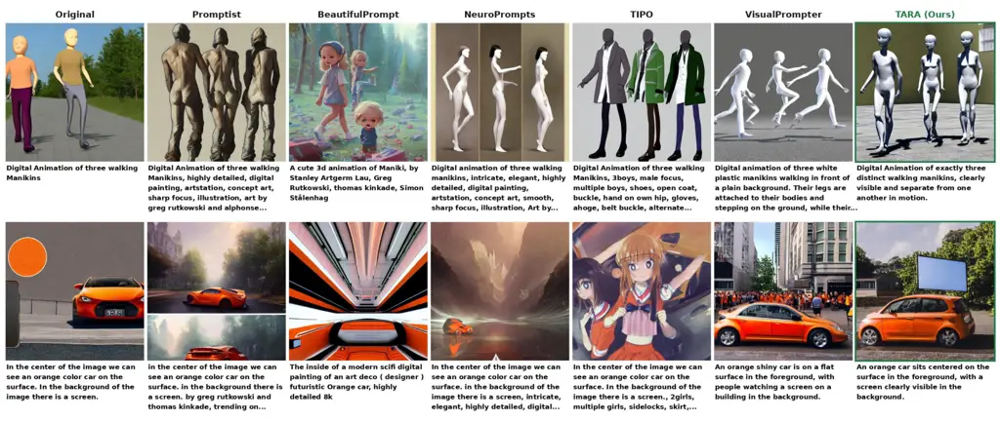

Figure 3: Qualitative comparison on SD v1.5. TARA (green) fixes the
count (top) and the missing screen (bottom) that baselines miss.

### 3.3 A2: TARA Preserves Image Quality While Fixing Semantics

Higher semantic accuracy does not cost image quality. From Table 5 and
Table 5 on DSG, we observe that

1.  1.  TARA attains the highest average CLIP score and the best CLIP score
        on all four generators (mean $`31.86`$ vs. $`31.45`$ for
        VisualPrompter), so its prompts stay tightly aligned with the
        rendered images.
2.  2.  Aesthetic-oriented baselines such as NeuroPrompts and
        BeautifulPrompt reach higher aesthetic scores but suffer large
        semantic drops, exposing a quality-for-semantics trade-off that TARA
        avoids.
3.  3.  TARA stays within $`0.02`$ of VisualPrompter and the raw prompt in
        aesthetic score while improving semantic alignment, adding
        correctness without degrading visual appeal. This is a direct
        consequence of typed repair compilation: by targeting only the
        diagnosed failures with short, specific clauses rather than
        injecting generic aesthetic filler, TARA avoids the style drift that
        afflicts verbose expansion methods.

|                 |       |       |       |       |       |
| --------------- | ----- | ----- | ----- | ----- | ----- |
| Method          | SD1.5 | SD2.1 | Flux  | Janus | Mean  |
| Raw prompt      | 31.66 | 31.67 | 31.53 | 31.74 | 31.65 |
| NeuroPrompts    | 28.91 | 29.86 | 30.63 | 31.29 | 30.17 |
| Promptist       | 30.43 | 30.79 | 31.22 | 31.20 | 30.91 |
| BeautifulPrompt | 25.89 | 26.11 | 26.11 | 26.94 | 26.26 |
| TIPO            | 28.37 | 27.32 | 27.68 | 27.77 | 27.78 |
| VisualPrompter  | 30.86 | 31.59 | 31.61 | 31.74 | 31.45 |
| TARA (Ours)     | 31.71 | 31.96 | 31.71 | 32.05 | 31.86 |

Table 4: CLIP Score on DSG.

|                 |       |       |      |       |      |
| --------------- | ----- | ----- | ---- | ----- | ---- |
| Method          | SD1.5 | SD2.1 | Flux | Janus | Mean |
| Raw prompt      | 5.30  | 5.40  | 5.87 | 5.46  | 5.51 |
| NeuroPrompts    | 6.13  | 6.02  | 6.51 | 6.26  | 6.23 |
| Promptist       | 5.99  | 5.89  | 6.35 | 6.01  | 6.06 |
| BeautifulPrompt | 6.01  | 5.98  | 6.53 | 6.27  | 6.20 |
| TIPO            | 5.33  | 5.54  | 6.02 | 5.73  | 5.66 |
| VisualPrompter  | 5.31  | 5.42  | 5.72 | 5.45  | 5.48 |
| TARA (Ours)     | 5.31  | 5.42  | 5.80 | 5.48  | 5.50 |

Table 5: Aesthetic Score on DSG.

### 3.4 A3: TARA Performs Consistently across Types and Generators

The improvement is broad, not a trade between failure types. Aggregating
over all 24 benchmark–generator–seed cells (Figure 4), TARA improves
over the raw prompt on all eight semantic categories and over _every_
prompt-optimization baseline on seven of them, essentially matching
VisualPrompter on action ($`83.2`$ vs. $`83.3`$), rather than improving
one category at another’s expense. Action and style are the two rarest
categories, so their per-method margins carry wider sampling noise;
per-type repair behavior for all eight types is detailed in Table 13.
The gains are largest on style ($`+4.3`$), attribute ($`+4.2`$), entity
($`+4.1`$), and relation ($`+3.7`$)—exactly the types where uniform
expansion under-specifies or drifts. A complementary VLM-as-Judge
preference study (Appendix C.4) favors TARA in $`69.0\%`$ of
changed-prompt cases for semantic consistency. This per-type consistency
is the empirical signature of type-aware repair: each failed proposition
is rewritten with type-specific language, so gains accrue across
categories rather than trading one for another.

Figure 4: Per-type semantic accuracy of seven methods over eight
categories, aggregated over 24 benchmark–generator–seed cells; the pill
above each green bar is TARA’s gain over VisualPrompter.

Figure 5: Human preferences on 100 sampled cases under VisualPrompter’s
three-way protocol: TARA / Tie / Original.

Following the human-evaluation protocol of VisualPrompter (Wu et al.,
2026), we compare TARA-optimized outputs against their original-prompt
counterparts on 100 sampled cases from two representative generators,
allowing raters to express equal preference. Human judgments corroborate
the automatic results (Figure 5). For semantic consistency, raters
prefer TARA in 62% of Stable Diffusion v1.5 cases and 58% of Flux-dev
cases, compared with 18% and 20% for the original outputs. TARA is also
favored in overall preference (58% and 54%, versus 24% and 26%), showing
that its semantic gains translate to perceptually preferable images
rather than metric-specific improvements.

TARA’s typed prompts also show qualitative transfer to closed commercial
systems; Appendix B.3 gives examples on Doubao and GPT Image where TARA
realizes the requested layout while baselines leave text incomplete or
split objects.

### 3.5 A4: TARA Runs Faster than VisualPrompter, and Each Component Helps

|                 |       |       |      |       |      |
| --------------- | ----- | ----- | ---- | ----- | ---- |
| Method          | SD1.5 | SD2.1 | Flux | Janus | Mean |
| Raw prompt      | 2.5   | 4.8   | 26.2 | 21.3  | 13.7 |
| NeuroPrompts    | 11.6  | 14.5  | 50.7 | 35.6  | 28.1 |
| Promptist       | 5.1   | 10.7  | 53.5 | 42.7  | 28.0 |
| BeautifulPrompt | 5.2   | 10.9  | 43.4 | 43.0  | 25.6 |
| TIPO            | 11.1  | 14.2  | 41.6 | 34.4  | 25.3 |
| VisualPrompter  | 9.5   | 12.5  | 31.3 | 26.7  | 20.0 |
| TARA (Ours)     | 5.4   | 7.7   | 27.9 | 23.2  | 16.0 |

Table 6: End-to-end time per prompt (s).

TARA is the fastest optimizer in our setting. At a matched $`1.64`$
image generations per prompt, it averages $`16.0`$s versus $`20.0`$s for
VisualPrompter and $`25`$–$`28`$s for the others (Table 6). Although
TARA uses more cheap text-only calls, its repaired prompts are shorter
(22.7 vs. 41.6 words) and repair is faster (19.37 vs. 25.47s). Repairs
are attempted on roughly two-thirds of prompts (those whose initial
diagnosis reports a failure), unrepaired prompts finish in about
$`10`$s, and per-type adoption rates range from $`22.5\%`$ to $`29.7\%`$
(Table 13). Short, targeted rewrites thus improve both speed and
accuracy; details are in Appendix A.1.

Figure 6: Full-scale DSG ablation across four generators and three
seeds; diamonds denote means.

Figure 6 reports a full-scale ablation on DSG across all four
generators, three seeds, and 200 stratified prompts per seed, totaling
2,400 prompt–generator–seed evaluations for each variant. At a fixed
image budget, full TARA reaches $`82.8`$; removing the explicit
typed-expansion branch, the repair gate, the portfolio, or recovery
lowers it by $`3.8`$, $`3.6`$, $`2.2`$, or $`1.3`$ points, respectively.
The comparable first two drops show that gains arise jointly from
explicit type-conditioned repair language and regression-controlled
adoption, rather than from the gate alone.

_W/o explicit type branch_ removes explicit type labels and the
typed-expansion candidate while retaining the other portfolio
branches—including minimal append—as well as fusion, recovery, the
repair gate, and the matched image budget; _w/o recovery_ omits pruned
relation/action recovery; and _w/o portfolio_ replaces typed repair
compilation with a one-shot typed holistic rewrite. _W/o repair gate_
retains the complete repair pipeline and matched image budget but
unconditionally adopts the single repaired image, isolating only the
accept-or-revert policy.

## 4 Related Work

Diffusion models (Ho et al., 2020; Song et al., 2021b; Song et al.,
2021a; Dhariwal & Nichol, 2021; Kingma & Welling, 2014; Rombach et al.,
2022; Ho & Salimans, 2022; Radford et al., 2021; Raffel et al., 2020),
scaled by stronger backbones such as SDXL (Podell et al., 2024),
SD 3 (Esser et al., 2024), and Flux (Black Forest Labs, 2024), and
joined by autoregressive generators like Janus-Pro (Chen et al., 2025),
have made high-fidelity synthesis routine yet still fail on
compositional and fine-grained semantic constraints, motivating
prompt-side optimization without retraining or internal access.

Early work targets visual appeal via style modifiers and keyword
search (Liu et al., 2023; Sahoo et al., 2024; Liu & Chilton, 2022;
Pavlichenko & Ustalov, 2023; Oppenlaender, 2024). Interactive
systems (Wang et al., 2023; Brade et al., 2023; Feng et al., 2024; Wang
et al., 2024; Datta et al., 2024) and learned rewriters—Promptist (Hao
et al., 2023), BeautifulPrompt (Cao et al., 2023),
NeuroPrompts (Rosenman et al., 2024), TIPO (Yeh et al., 2024)—automate
prompt refinement but mainly improve aesthetics rather than semantic
faithfulness. VisualPrompter (Wu et al., 2026) closes this gap by
feeding VLM diagnostic feedback back into prompt rewriting, yet it
applies one uniform expansion regardless of failure type. Under our
formulation, such feedback-triggered rewriting is a single-operator
allocation policy; TARA instead uses feedback to route each atomic
failure to a type-conditioned intervention. The distinction is therefore
not whether visual feedback is available, but how it is operationalized:
prior methods decide _what_ to rewrite, whereas TARA additionally
decides _how each failure should be repaired_. Process-side methods (Hei
et al., 2024; Mañas et al., 2024; Jiang et al., 2024; Zhang et al., 2026) improve alignment through multi-round generation or direct latent
manipulation, requiring additional generator calls or internal access.
TARA compiles its allocated local repairs into one prompt and gates one
repaired output, achieving stronger accuracy within a single
re-generation.

Global metrics such as FID (Heusel et al., 2017), CLIPScore (Hessel
et al., 2021), and learned preference scores (Kirstain et al., 2023; Wu
et al., 2023) capture distributional or perceptual quality but cannot
pinpoint which semantic requirements are met. Recent work decomposes
prompts into atomic checkable questions (Yarom et al., 2023; Cho et al.,
2023; Deutsch et al., 2021; Min et al., 2023); DSG (Cho et al., 2024)
and TIFA (Hu et al., 2023) instantiate this for T2I with
dependency-aware question generation and VLM-based verification. TARA
moves from feedback-triggered rewriting to feedback-routed repair:
atomic feedback is not only an evaluation signal, but the routing
variable that selects how each failed proposition is repaired.

## 5 Conclusion

_TARA_ reformulates semantic prompt optimization as atomic repair
allocation: diagnose, allocate, compile, and adopt. It leads all eight
benchmark–generator cells ($`+5.6`$/$`+2.6`$ over VisualPrompter),
preserves image quality, and runs fastest. More broadly, atomic visual
feedback should not merely identify what failed; it should determine how
each failure is repaired.

## References

- Black Forest Labs (2024) Black Forest Labs. FLUX.
  [https://github.com/black-forest-labs/flux](https://github.com/black-forest-labs/flux), 2024.
- Brade et al. (2023) Stephen Brade, Bryan Wang, Mauricio Sousa, Sageev
  Oore, and Tovi Grossman. Promptify: Text-to-image generation through
  interactive prompt exploration with large language models. In
  _Proceedings of the 36th Annual ACM Symposium on User Interface
  Software and Technology_, pp. 1–14, 2023.
- Cao et al. (2023) Tingfeng Cao, Chengyu Wang, Bingyan Liu, Ziheng Wu,
  Jinhui Zhu, and Jun Huang. BeautifulPrompt: Towards automatic prompt
  engineering for text-to-image synthesis. In _Proceedings of the 2023
  Conference on Empirical Methods in Natural Language Processing:
  Industry Track_, pp. 1–11, 2023.
- Chen et al. (2025) Xiaokang Chen, Zhiyu Wu, Xingchao Liu, Zizheng Pan,
  Wen Liu, Zhenda Xie, Xingkai Yu, and Chong Ruan. Janus-Pro: Unified
  multimodal understanding and generation with data and model scaling.
  _arXiv preprint arXiv:2501.17811_, 2025.
- Cho et al. (2023) Jaemin Cho, Abhay Zala, and Mohit Bansal. Visual
  programming for step-by-step text-to-image generation and evaluation.
  In _Advances in Neural Information Processing Systems_, volume 36, pp.
  6048–6069, 2023.
- Cho et al. (2024) Jaemin Cho, Yushi Hu, Jason Baldridge, Roopal Garg,
  Peter Anderson, Ranjay Krishna, Mohit Bansal, Jordi Pont-Tuset, and
  Su Wang. Davidsonian scene graph: Improving reliability in
  fine-grained evaluation for text-to-image generation. In
  _International Conference on Learning Representations_, 2024. URL
  [https://openreview.net/forum?id=ITq4ZRUT4a](https://openreview.net/forum?id=ITq4ZRUT4a).
- Datta et al. (2024) Siddhartha Datta, Alexander Ku, Deepak
  Ramachandran, and Peter Anderson. Prompt expansion for adaptive
  text-to-image generation. In _Proceedings of the 62nd Annual Meeting
  of the Association for Computational Linguistics (Volume 1: Long
  Papers)_, pp. 3449–3476, 2024.
- Deutsch et al. (2021) Daniel Deutsch, Tania Bedrax-Weiss, and Dan
  Roth. Towards question-answering as an automatic metric for evaluating
  the content quality of a summary. _Transactions of the Association for
  Computational Linguistics_, 9:774–789, 2021. doi:
  10.1162/tacl_a_00397. URL
  [https://aclanthology.org/2021.tacl-1.47/](https://aclanthology.org/2021.tacl-1.47/).
- Dhariwal & Nichol (2021) Prafulla Dhariwal and Alexander Nichol.
  Diffusion models beat GANs on image synthesis. In _Advances in Neural
  Information Processing Systems_, volume 34, pp. 8780–8794, 2021.
- Esser et al. (2024) Patrick Esser, Sumith Kulal, Andreas Blattmann,
  Rahim Entezari, Jonas Müller, Harry Saini, Yam Levi, Dominik Lorenz,
  Axel Sauer, Frederic Boesel, et al. Scaling rectified flow
  transformers for high-resolution image synthesis. In _Forty-first
  international conference on machine learning_, 2024.
- Feng et al. (2024) Yingchaojie Feng, Xingbo Wang, Kam Kwai Wong, Sijia
  Wang, Yuhong Lu, Minfeng Zhu, Baicheng Wang, and Wei Chen.
  PromptMagician: Interactive prompt engineering for text-to-image
  creation. _IEEE Transactions on Visualization and Computer Graphics_,
  30(1):295–305, 2024.
- Hao et al. (2023) Yaru Hao, Zewen Chi, Li Dong, and Furu Wei.
  Optimizing prompts for text-to-image generation. In _Advances in
  Neural Information Processing Systems_, volume 36, pp.
  66923–66939, 2023.
- Hei et al. (2024) Nailei Hei, Qianyu Guo, Zihao Wang, Yan Wang, Haofen
  Wang, and Wenqiang Zhang. A user-friendly framework for generating
  model-preferred prompts in text-to-image synthesis. In _Proceedings of
  the AAAI Conference on Artificial Intelligence_, volume 38, pp.
  2139–2147, 2024.
- Hessel et al. (2021) Jack Hessel, Ari Holtzman, Maxwell Forbes, Ronan
  Le Bras, and Yejin Choi. CLIPScore: A reference-free evaluation metric
  for image captioning. In _Proceedings of the 2021 conference on
  empirical methods in natural language processing_, pp.
  7514–7528, 2021.
- Heusel et al. (2017) Martin Heusel, Hubert Ramsauer, Thomas
  Unterthiner, Bernhard Nessler, and Sepp Hochreiter. GANs trained by a
  two time-scale update rule converge to a local nash equilibrium. In
  _Advances in Neural Information Processing Systems_, volume 30, 2017.
- Ho & Salimans (2022) Jonathan Ho and Tim Salimans. Classifier-free
  diffusion guidance. _arXiv preprint arXiv:2207.12598_, 2022.
- Ho et al. (2020) Jonathan Ho, Ajay Jain, and Pieter Abbeel. Denoising
  diffusion probabilistic models. In _Advances in Neural Information
  Processing Systems_, volume 33, pp. 6840–6851, 2020.
- Hu et al. (2023) Yushi Hu, Benlin Liu, Jungo Kasai, Yizhong Wang, Mari
  Ostendorf, Ranjay Krishna, and Noah A Smith. TIFA: Accurate and
  interpretable text-to-image faithfulness evaluation with question
  answering. In _Proceedings of the IEEE/CVF International Conference on
  Computer Vision_, pp. 20406–20417, 2023.
- Jiang et al. (2024) Liyao Jiang, Negar Hassanpour, Mohammad Salameh,
  Mohan Sai Singamsetti, Fengyu Sun, Wei Lu, and Di Niu. FRAP: Faithful
  and realistic text-to-image generation with adaptive prompt weighting.
  _arXiv preprint arXiv:2408.11706_, 2024.
- Kingma & Welling (2014) Diederik P. Kingma and Max Welling.
  Auto-encoding variational bayes. In _International Conference on
  Learning Representations_, 2014. URL
  [http://arxiv.org/abs/1312.6114](http://arxiv.org/abs/1312.6114).
- Kirstain et al. (2023) Yuval Kirstain, Adam Polyak, Uriel Singer,
  Shahbuland Matiana, Joe Penna, and Omer Levy. Pick-a-pic: An open
  dataset of user preferences for text-to-image generation. In _Advances
  in Neural Information Processing Systems 36, NeurIPS 2023_, 2023.
- Liu et al. (2023) Pengfei Liu, Weizhe Yuan, Jinlan Fu, Zhengbao Jiang,
  Hiroaki Hayashi, and Graham Neubig. Pre-train, prompt, and predict: A
  systematic survey of prompting methods in natural language processing.
  _ACM computing surveys_, 55(9):1–35, 2023.
- Liu & Chilton (2022) Vivian Liu and Lydia B Chilton. Design guidelines
  for prompt engineering text-to-image generative models. In
  _Proceedings of the 2022 CHI conference on human factors in computing
  systems_, pp. 1–23, 2022.
- Mañas et al. (2024) Oscar Mañas, Pietro Astolfi, Melissa Hall, Candace
  Ross, Jack Urbanek, Adina Williams, Aishwarya Agrawal, Adriana
  Romero-Soriano, and Michal Drozdzal. Improving Text-to-Image
  Consistency via Automatic Prompt Optimization. _Transactions on
  Machine Learning Research_, 2024. URL
  [https://mlanthology.org/tmlr/2024/manas2024tmlr-improving/](https://mlanthology.org/tmlr/2024/manas2024tmlr-improving/).
- Min et al. (2023) Sewon Min, Kalpesh Krishna, Xinxi Lyu, Mike Lewis,
  Wen-tau Yih, Pang Koh, Mohit Iyyer, Luke Zettlemoyer, and Hannaneh
  Hajishirzi. FActScore: Fine-grained atomic evaluation of factual
  precision in long form text generation. In _Proceedings of the 2023
  Conference on Empirical Methods in Natural Language Processing_, pp.
  12076–12100, 2023.
- Oppenlaender (2024) Jonas Oppenlaender. A taxonomy of prompt modifiers
  for text-to-image generation. _Behaviour & Information Technology_,
  43(15):3763–3776, 2024.
- Pavlichenko & Ustalov (2023) Nikita Pavlichenko and Dmitry Ustalov.
  Best prompts for text-to-image models and how to find them. In
  _Proceedings of the 46th International ACM SIGIR Conference on
  Research and Development in Information Retrieval_, pp.
  2067–2071, 2023.
- Podell et al. (2024) Dustin Podell, Zion English, Kyle Lacey, Andreas
  Blattmann, Tim Dockhorn, Jonas Müller, Joe Penna, and Robin Rombach.
  SDXL: Improving latent diffusion models for high-resolution image
  synthesis. In _International Conference on Learning
  Representations_, 2024.
- Radford et al. (2021) Alec Radford, Jong Wook Kim, Chris Hallacy,
  Aditya Ramesh, Gabriel Goh, Sandhini Agarwal, Girish Sastry, Amanda
  Askell, Pamela Mishkin, Jack Clark, et al. Learning transferable
  visual models from natural language supervision. In _International
  Conference on Machine Learning_, pp. 8748–8763. PMLR, 2021.
- Raffel et al. (2020) Colin Raffel, Noam Shazeer, Adam Roberts,
  Katherine Lee, Sharan Narang, Michael Matena, Yanqi Zhou, Wei Li, and
  Peter J Liu. Exploring the limits of transfer learning with a unified
  text-to-text transformer. _Journal of machine learning research_,
  21(140):1–67, 2020.
- Rombach et al. (2022) Robin Rombach, Andreas Blattmann, Dominik
  Lorenz, Patrick Esser, and Björn Ommer. High-resolution image
  synthesis with latent diffusion models. In _Proceedings of the
  IEEE/CVF conference on computer vision and pattern recognition_, pp.
  10684–10695, 2022.
- Rosenman et al. (2024) Shachar Rosenman, Vasudev Lal, and Phillip
  Howard. NeuroPrompts: An adaptive framework to optimize prompts for
  text-to-image generation. In _Proceedings of the 18th Conference of
  the European Chapter of the Association for Computational Linguistics:
  System Demonstrations_, pp. 159–167, 2024.
- Sahoo et al. (2024) Pranab Sahoo, Ayush Kumar Singh, Sriparna Saha,
  Vinija Jain, Samrat Mondal, and Aman Chadha. A systematic survey of
  prompt engineering in large language models: Techniques and
  applications. _arXiv preprint arXiv:2402.07927_, 1, 2024.
- Schuhmann et al. (2022) Christoph Schuhmann, Romain Beaumont, Richard
  Vencu, Cade Gordon, Ross Wightman, Mehdi Cherti, Theo Coombes, Aarush
  Katta, Clayton Mullis, Mitchell Wortsman, et al. LAION-5B: An open
  large-scale dataset for training next generation image-text models. In
  _Advances in Neural Information Processing Systems_, volume 35, pp.
  25278–25294, 2022.
- Song et al. (2021a) Jiaming Song, Chenlin Meng, and Stefano Ermon.
  Denoising diffusion implicit models. In _International Conference on
  Learning Representations_, 2021a. URL
  [https://openreview.net/forum?id=St1giarCHLP](https://openreview.net/forum?id=St1giarCHLP).
- Song et al. (2021b) Yang Song, Jascha Sohl-Dickstein, Diederik P
  Kingma, Abhishek Kumar, Stefano Ermon, and Ben Poole. Score-based
  generative modeling through stochastic differential equations. In
  _International Conference on Learning Representations_, 2021b. URL
  [https://openreview.net/forum?id=PxTIG12RRHS](https://openreview.net/forum?id=PxTIG12RRHS).
- Wang et al. (2023) Yunlong Wang, Shuyuan Shen, and Brian Y Lim.
  RePrompt: Automatic prompt editing to refine AI-generative art towards
  precise expressions. In _Proceedings of the 2023 CHI conference on
  human factors in computing systems_, pp. 1–29, 2023.
- Wang et al. (2024) Zhijie Wang, Yuheng Huang, Da Song, Lei Ma, and
  Tianyi Zhang. PromptCharm: Text-to-image generation through
  multi-modal prompting and refinement. In _Proceedings of the 2024 CHI
  conference on human factors in computing systems_, pp. 1–21, 2024.
- Wu et al. (2026) Shiyu Wu, Mingzhen Sun, Weining Wang, Yequan Wang,
  and Jing Liu. VisualPrompter: Semantic-aware prompt optimization with
  visual feedback for text-to-image synthesis. In _The Fourteenth
  International Conference on Learning Representations_, 2026. URL
  [https://openreview.net/forum?id=hIwVFRLaFy](https://openreview.net/forum?id=hIwVFRLaFy).
- Wu et al. (2023) Xiaoshi Wu, Keqiang Sun, Feng Zhu, Rui Zhao, and
  Hongsheng Li. Human preference score: Better aligning text-to-image
  models with human preference. In _Proceedings of the IEEE/CVF
  International Conference on Computer Vision_, pp. 2096–2105, 2023.
- Yarom et al. (2023) Michal Yarom, Yonatan Bitton, Soravit Changpinyo,
  Roee Aharoni, Jonathan Herzig, Oran Lang, Eran Ofek, and Idan
  Szpektor. What you see is what you read? improving text-image
  alignment evaluation. In _Advances in Neural Information Processing
  Systems_, volume 36, pp. 1601–1619, 2023.
- Yeh et al. (2024) Shih-Ying Yeh, Yi Li, Sang-Hyun Park, Giyeong Oh,
  Xuehai Wang, Min Song, Youngjae Yu, and Shang-Hong Lai. TIPO: Text to
  image with text presampling for prompt optimization. _arXiv preprint
  arXiv:2411.08127_, 2024.
- Zhang et al. (2026) Ruiqiang Zhang, Hengyi Wang, Chang Liu, Guanjie
  Wang, Zehua Ma, and Weiming Zhang. FreeText: Training-free text
  rendering via attention localization and spectral glyph injection. In
  _Proceedings of the 43rd International Conference on Machine
  Learning_, 2026. URL
  [https://icml.cc/virtual/2026/poster/62440](https://icml.cc/virtual/2026/poster/62440).

###### Contents of the Paper

1.  1 Introduction
2.  2 TARA
    1.  2.1 Overview and Problem Setup
    2.  2.2 Typed Visual Diagnosis
    3.  2.3 Typed Repair Compilation and Output Adoption
3.  3 Experiments
    1.  3.1 Experiment Setup
    2.  3.2 A1: TARA Achieves the Best Semantic Accuracy in Every Cell
    3.  3.3 A2: TARA Preserves Image Quality While Fixing Semantics
    4.  3.4 A3: TARA Performs Consistently across Types and Generators
    5.  3.5 A4: TARA Runs Faster than VisualPrompter, and Each Component
        Helps
4.  4 Related Work
5.  5 Conclusion
6.  References
7.  A Experimental Setup and Method Details
    1.  A.1 Implementation and Runtime Protocol
    2.  A.2 Repair Mapping and Templates
    3.  A.3 Full Algorithm
    4.  A.4 Prompt Templates
    5.  A.5 Worked Example
8.  B Supplementary Qualitative Results
    1.  B.1 Qualitative Comparisons
    2.  B.2 Per-Generator Galleries
    3.  B.3 Adaptation to Commercial Online Generators
    4.  B.4 Failure Cases
9.  C Supplementary Quantitative Results
    1.  C.1 Behavioral Analysis
    2.  C.2 Threshold Sensitivity
    3.  C.3 Robustness and Diagnostic Breakdowns
    4.  C.4 VLM-as-Judge Preference Details

## Appendix A Experimental Setup and Method Details

This appendix provides full details: implementation and decoding
settings, repair-language templates, the complete prompt templates used
in portfolio rewriting and fusion (per-type rules, few-shot examples,
fusion/minimal-append/uniform instructions), worked examples with
step-by-step repair traces, qualitative comparisons across all
generators and benchmarks, runtime accounting, threshold sensitivity,
random-seed robustness, optimized-prompt-length and per-error-type
repair-behavior analyses, and the complete VLM-as-Judge preference
numbers. Unless otherwise specified, all semantic scores are percentages
averaged over three seed groups with 200 prompts per seed group.

### A.1 Implementation and Runtime Protocol

All visual-feedback methods are run locally with the same
OpenAI-compatible vLLM protocol for VLM diagnosis and LLM rewriting. The
main endpoint serves Qwen3.5-9B under the alias qwen3.5-9b; distributed
runs use local ports 8013/8023 for the same model, and the
ablation/robustness runs use the same protocol on ports 8004/8026. The
endpoints are local-only (127.0.0.1) and are called with environment
proxies disabled. The main semantic judge and prompt rewriter therefore
share the same model family for VisualPrompter and TARA. The repair gate
is executed per input before dataset-level aggregation, with one global
rule fixed across all generators and benchmarks; no threshold or
decision rule is tuned on the test set. After those outputs are fixed,
Table 1 independently re-scores them with Qwen3.5-4B,
Qwen2.5-VL-7B-Instruct, Gemma4-31B, and Qwen3.5-27B evaluators that play
no role in gate decisions.

For VLM yes/no diagnosis, the request contains the image and one
benchmark atomic question only; it does not contain either the original
prompt or the rewritten prompt. We use deterministic decoding for
scoring (temperature $`0`$, maximum 8 output tokens for yes/no answers;
auxiliary visual evidence, when enabled, is capped at 256 tokens).
Prompt rewriting uses maximum 1024 new tokens. VisualPrompter follows
its deterministic single-rewrite setting, while TARA samples text-only
candidate rewrites with temperature $`0.7`$ and top-$`p`$ $`0.8`$ before
fusing them into one final prompt. All random seeds are derived from the
prompt id and seed group, and API sampling seeds are fixed per request
for reproducibility. Table 7 summarizes the image-generation and
decoding settings used throughout.

| Generator             | Resolution          | Steps | Guidance | Device dispatch |
| --------------------- | ------------------- | ----- | -------- | --------------- |
| Stable Diffusion v1.5 | $`512\times 512`$   | 30    | 7.5      | CUDA:2 / CUDA:6 |
| Stable Diffusion v2.1 | $`768\times 768`$   | 30    | 7.5      | CUDA:2 / CUDA:6 |
| Flux-dev              | $`1024\times 1024`$ | 28    | 3.5      | CUDA:2 / CUDA:6 |
| Janus-Pro             | $`384\times 384`$   | 576   | 5.0      | CUDA:2 / CUDA:6 |

Table 7: Image-generation and decoding settings used in the main
experiments. SD models use 30 denoising steps and guidance 7.5 unless
otherwise noted.

Table 8 accounts for the per-prompt cost of the two visual-feedback
methods: both spend the same image budget, but TARA trades one long
rewrite for several cheap text-only calls, ending with a shorter prompt
and a lower repair time.

| Method         | Image gens / prompt | Text LLM calls / prompt | Final words if repaired | No-repair time (s) | Repair time (s) |
| -------------- | ------------------- | ----------------------- | ----------------------- | ------------------ | --------------- |
| VisualPrompter | 1.64                | 0.64                    | 41.6                    | 10.30              | 25.47           |
| TARA (Ours)    | 1.64                | 3.37                    | 22.7                    | 10.15              | 19.37           |

Table 8: Runtime accounting for the two visual-feedback methods. Image
budget is matched; TARA spends more cheap text-only calls but keeps each
rewrite short. “Repair time” is measured on prompts whose initial image
triggers a rewrite.

The end-to-end times in Table 6 include image generation, VLM diagnosis,
prompt rewriting, the final gate check, and disk I/O for saved records.
They exclude only one-time model loading. Because all methods use the
same generated images for scoring and the same local evaluation
endpoint, the runtime comparison measures the optimizer pipeline rather
than differences in evaluator deployment.

### A.2 Repair Mapping and Templates

TARA maps atomic-evaluation categories to eight repairable error types,
each associated with a distinct local language transformation. The
mapping is fixed before evaluation and shared across all generators and
benchmarks. Table 9 lists the exact categories and representative
templates.

| DSG category | Repair type               | Repair language used in candidate prompts                                                                                       |
| ------------ | ------------------------- | ------------------------------------------------------------------------------------------------------------------------------- |
| Entity       | Missing object            | Make \[object\] clearly visible and salient in the scene; keep its requested attributes and relation anchors.                   |
| Count        | Wrong count               | Show exactly \[number\] distinct \[objects\], separated and countable; avoid extra or missing instances.                        |
| Attribute    | Wrong attribute           | Bind \[attribute\] directly to \[object\]; avoid transferring the attribute to other objects.                                   |
| Relation     | Wrong relation            | Place \[subject\] unambiguously \[relation\] \[object\] with clear spatial anchors such as left/right/above/below/inside.       |
| Action       | Wrong action              | Depict \[subject\] visibly performing \[action\] with pose, contact, or motion cues involving \[object\] when present.          |
| Text         | Missing or illegible text | Render the exact quoted string \[text\] in large, legible letters on the requested carrier (sign, label, smoke trail, etc.).    |
| Style        | Style mismatch            | Strengthen the required style (medium, lighting, mood, era) without changing any scene content, objects, counts, or attributes. |
| Global       | Global mismatch           | Preserve the concrete scene while enforcing the requested global condition, viewpoint, or scene-level constraint.               |

Table 9: Category-to-type mapping and repair-language templates used by
TARA. Bracketed fields are filled from the failed atomic proposition;
already-correct entities and attributes are explicitly preserved in the
LLM instruction.

These templates only shape the rewritten prompt. During evaluation, the
VLM judge receives neither the template nor the optimized prompt, only
the image and the original benchmark question. This separation is
important: type-aware language can help the image generator attend to
the missing semantics, but it cannot directly hint the automatic yes/no
evaluator.

### A.3 Full Algorithm

Algorithm 1 states the complete single-pass procedure illustrated in
Figure 2.

1: prompt $`p`$, generator $`G`$, judge $`V`$, propositions $`Q(p)`$,
threshold $`\tau{=}0.72`$

2:
$`x_{0}\leftarrow G(p)`$; $`d_{0}\leftarrow\textsc{Diagnose}(x_{0},Q(p),V)`$

3: if $`d_{0}`$ is perfect then

4:   return $`(p,x_{0})`$ $`\triangleright`$ already correct: one
generation

5: end if

6: $`F\leftarrow\textsc{RepairTargets}(d_{0})`$ $`\triangleright`$
failures $`+`$ pruned wrong relations/actions

7:
$`C\leftarrow\{\textsc{Uniform},\textsc{Typed},\textsc{MinimalAppend}\}(p,F)`$
$`\triangleright`$ text-only

8: if $`s(x_{0})\geq\tau`$ then

9:   $`C\leftarrow C\cup\{\textsc{ReSeed}(p)\}`$

10: end if

11: $`\hat{p}\leftarrow\textsc{LLMFuse}(C,F,p)`$ $`\triangleright`$
text-only: one fused prompt

12:
$`\hat{x}\leftarrow G(\hat{p})`$; $`\hat{d}\leftarrow\textsc{Diagnose}(\hat{x},Q(p),V)`$
$`\triangleright`$ $`\hat{d}`$ yields $`s(\hat{x})`$

13: if $`s(\hat{x})>s(x_{0})`$ then

14:   return $`(\hat{p},\hat{x})`$ $`\triangleright`$ accept: two
generations

15: else

16:   return $`(p,x_{0})`$ $`\triangleright`$ reject and revert

17: end if

Algorithm 1 TARA: single-pass atomic repair allocation

### A.4 Prompt Templates

Below we list the exact prompt templates used by TARA’s portfolio
rewriting and fusion stages. Bracketed fields (e.g. {original_prompt})
are filled at runtime from the diagnosed prompt and its failed atomic
propositions.

#### Per-type repair rules.

Each error type maps to a type-specific system instruction that encodes
domain knowledge about how diffusion models fail on that type
(Table 10).

| Error type      | Repair rule (system instruction to LLM)                                                                                                                                                                                                                             |
| --------------- | ------------------------------------------------------------------------------------------------------------------------------------------------------------------------------------------------------------------------------------------------------------------- |
| Missing object  | Rewrite the prompt so each missing object becomes an explicit, concrete subject of the scene and is made visually salient: name it directly, give it a short concrete description, and place it in the foreground rather than merely implying it.                   |
| Wrong count     | Pin the exact quantity hard: state the number as BOTH a word and a digit, describe the instances as separate and individually visible (e.g. “exactly three cats (3), three separate cats, evenly spaced, fully visible, not overlapping”), and avoid vague plurals. |
| Wrong attribute | Bind each attribute tightly to ITS object: put the adjective immediately before the noun, repeat the binding once for emphasis, and leave every other object’s attributes unchanged (e.g. “a bright red car, the car painted solid red”).                           |
| Wrong relation  | Make the relation explicit with concrete positional/action language, and describe a simple layout that anchors BOTH objects (e.g. “a lamp on the left and a sofa on the right, the lamp clearly to the left of the sofa”).                                          |
| Wrong action    | Depict the subject visibly performing the action: make pose, contact, and motion cues explicit and keep the interacting object present; do not replace the action with a static description.                                                                        |
| Style mismatch  | Strengthen the required style with concrete descriptors (medium, lighting, mood, era/artist if implied) WITHOUT changing any scene content, objects, counts, or attributes.                                                                                         |
| Missing text    | Quote the exact string and request it to be legible (e.g. “the word ‘OPEN’ written clearly in large bold letters”). Keep the text short and exact; do not paraphrase it.                                                                                            |
| Global mismatch | Enforce the requested viewpoint, scene-level condition, or overall composition explicitly, while keeping all local objects, counts, and attributes unchanged.                                                                                                       |

Table 10: Per-type repair rules used in the typed-expansion candidate.
Each rule is the system instruction given to the LLM rewriter for that
failure type.

#### Global constraints.

Every rewrite candidate receives the following constraint block appended
to its type-specific rule:

> Rules: fix ONLY the issues listed below; keep everything already
> correct unchanged; do NOT add objects that are not in the original
> prompt or the issues; preserve the user’s intent and overall scene;
> output exactly ONE image prompt on a single line --- no quotes, no
> list, no explanation.

#### Few-shot examples.

Representative type-specific instructions include one or two few-shot
examples; Table 11 lists the examples used.

| Type            | Issue                                      | Rewritten prompt                                                                                               |
| --------------- | ------------------------------------------ | -------------------------------------------------------------------------------------------------------------- |
| Missing object  | the oven is missing                        | a cozy kitchen with a large stainless-steel oven clearly visible in the foreground                             |
| Wrong count     | there must be exactly three cats           | exactly three cats (3) sitting on a sofa, three separate cats evenly spaced and fully visible, not overlapping |
| Wrong count     | there must be five balloons                | exactly five balloons (5) floating in the sky, five distinct balloons clearly separated                        |
| Wrong attribute | the car should be red                      | a man standing next to a bright red car, the car painted solid red                                             |
| Wrong relation  | the cat should be inside the box           | a cat sitting inside an open cardboard box, the cat fully contained within the box                             |
| Wrong relation  | the lamp should be to the left of the sofa | a room with a lamp on the left side and a sofa on the right side, the lamp clearly to the left of the sofa     |
| Style mismatch  | it should look cinematic                   | a street at night, cinematic film still, dramatic lighting, moody atmosphere, deep shadows                     |
| Missing text    | the sign should read OPEN                  | a shop sign on a wall with the word “OPEN” written clearly and legibly in large bold letters                   |

Table 11: Representative few-shot examples used in the type-specific
rewrite instructions.

#### Fusion instruction.

After the portfolio candidates are generated, TARA fuses them with the
following LLM instruction:

> You are selecting the final prompt for a text-to-image generator.
> There is only ONE remaining image generation, so choose the prompt
> most likely to satisfy the semantic questions.
>
> Original prompt: {original_prompt}
>
> Already-correct aspects to preserve: {passed}
>
> Failed aspects to fix: {failed}
>
> Candidate prompts: {choices}
>
> Decision rule: Prefer semantic correctness over aesthetics. Penalize
> prompts that drop original entities, add unrelated objects, make
> counts ambiguous, or describe relations/actions vaguely.
>
> Task: Synthesize one final image prompt using the strongest parts of
> the candidates. Keep the original intent, preserve already-correct
> aspects, fix all failed aspects, avoid unrelated objects and generic
> quality filler, and stay under 70 words if possible. Output exactly
> one final image prompt, no explanation.

#### Minimal-append instruction.

The conservative candidate keeps the original prompt nearly verbatim and
appends only the shortest typed clauses:

> Keep the original prompt almost verbatim. Append only the shortest
> concrete phrases needed to fix the failed aspects. Do not rewrite
> correct content, do not add unrelated objects, and do not add generic
> aesthetic filler.
>
> Type rules: For count, use exact word + digit and separate visible
> instances. For relation, add a clear left/right/above/below layout.
> For action, add visible pose/contact/motion. For text, quote the exact
> legible text. For object/attribute/global/style, add only the missing
> concrete phrase.

#### Uniform-expansion instruction (in-method control).

The type-agnostic uniform-expansion candidate receives no type
information:

> You repair text-to-image prompts. The aspects below were requested but
> are missing or incorrect in the generated image. Rewrite the prompt by
> enriching it with concrete detail so that ALL listed aspects are
> clearly depicted at once, while preserving the original intent and
> everything already correct. Output exactly ONE image prompt on a
> single line, no explanation.

### A.5 Worked Example

Figure 7 traces one prompt through TARA’s pipeline: the initial render,
the per-proposition diagnosis with assigned error types, the typed
repairs fused into a single rewrite, and the regenerated image—using the
category-to-type templates of Table 9.

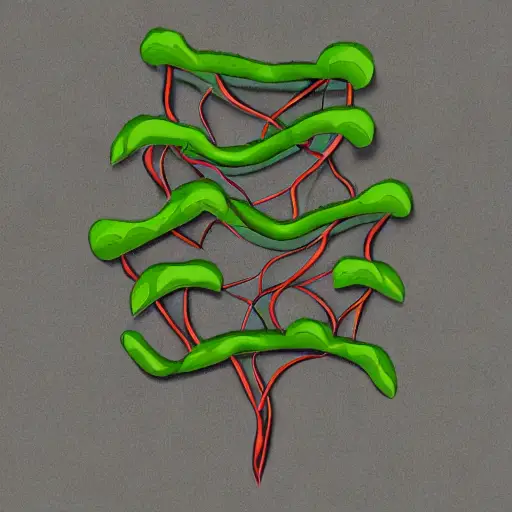

Initial render, score $`0.00`$

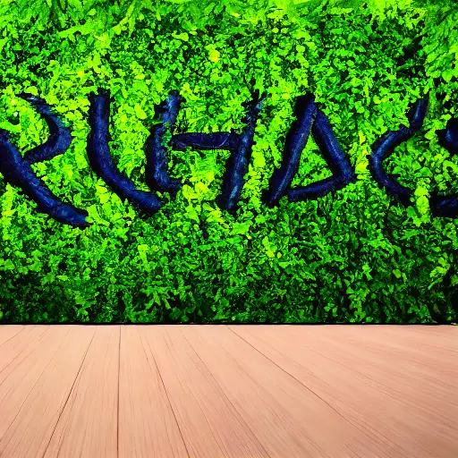

TARA render, score $`\mathbf{0.83}`$

Original: studio shot of vines in the shape of text knowledge is power
sprouting, centered

TARA (one fused rewrite, one regeneration): a studio shot of lush green
vines clearly shaped into the large, legible text “knowledge is power”
sprouting from the ground and centered in the frame

| \#  | Atomic proposition (DSG question)       | Category  | Initial | Routed repair operator |
| --- | --------------------------------------- | --------- | ------- | ---------------------- |
| 1   | Is this a studio shot?                  | global    | fail    | ENFORCE_GLOBAL         |
| 2   | Are there vines?                        | entity    | fail    | ADD_OBJECT             |
| 3   | Are the vines in the shape of text?     | attribute | pass    | —                      |
| 4   | Does the text say “knowledge is power”? | text      | fail    | ENFORCE_TEXT           |
| 5   | Are the vines sprouting?                | attribute | pass    | —                      |
| 6   | Are the vines centered?                 | attribute | pass    | —                      |

Figure 7: Worked example of type-aware repair (SD 1.5, DrawText). The
initial image is decomposed into DSG atomic propositions and judged by
the VLM; the three failed propositions are each routed to type-specific
operators (global condition, missing object, and rendered text). TARA
fuses the three typed repairs into a _single_ rewritten prompt,
regenerates once, and the semantic score rises from $`0.00`$ to
$`0.83`$—all within the single-pass image budget.

#### Additional worked examples (text-only).

Below we show two further cases where TARA’s typed repair produces a
large score jump, one for _wrong count_ and one for _wrong relation_.
For post-hoc analysis only, we additionally rendered each candidate’s
output in isolation; these renders are not part of TARA’s inference and
are excluded from the main image budget. In each case no individually
rendered candidate improves the score, while the fused prompt combines
the strongest typed clauses and jumps sharply.

Count repair (SD 2.1, DSG, localized_narratives_59). Original: “In this
image I can see few white color flowers. In the background I can see few
leaves.” Initial score: $`0.67`$. The separately rendered uniform,
typed, minimal-append, and heuristic-selector outputs all score
$`0.67`$; the fused prompt—“In this image I can see exactly two white
flowers and exactly five leaves in the background, all clearly visible
and distinct”—scores $`\mathbf{1.00}`$, fixing both vague counts.

Relation repair (SD 2.1, DSG, vrd_42). Original: “person sit on chair.
chair on the right of monitor. vase on table. pot on table.” Initial
score: $`0.55`$. Again, the separately rendered outputs stay at
$`0.55`$; fusion yields “A person sits on a chair positioned to the
right of a monitor, with a vase and a pot placed on a table in the
scene”—score $`\mathbf{0.91}`$, resolving ambiguous spatial relations.

## Appendix B Supplementary Qualitative Results

### B.1 Qualitative Comparisons

Figure 8 shows representative cases on Stable Diffusion v1.5 (DSG) where
every prompt-optimization baseline—including the official
VisualPrompter—fails to satisfy the prompt while TARA renders an image
that does. The number below each image is its VLM semantic score for
that prompt.

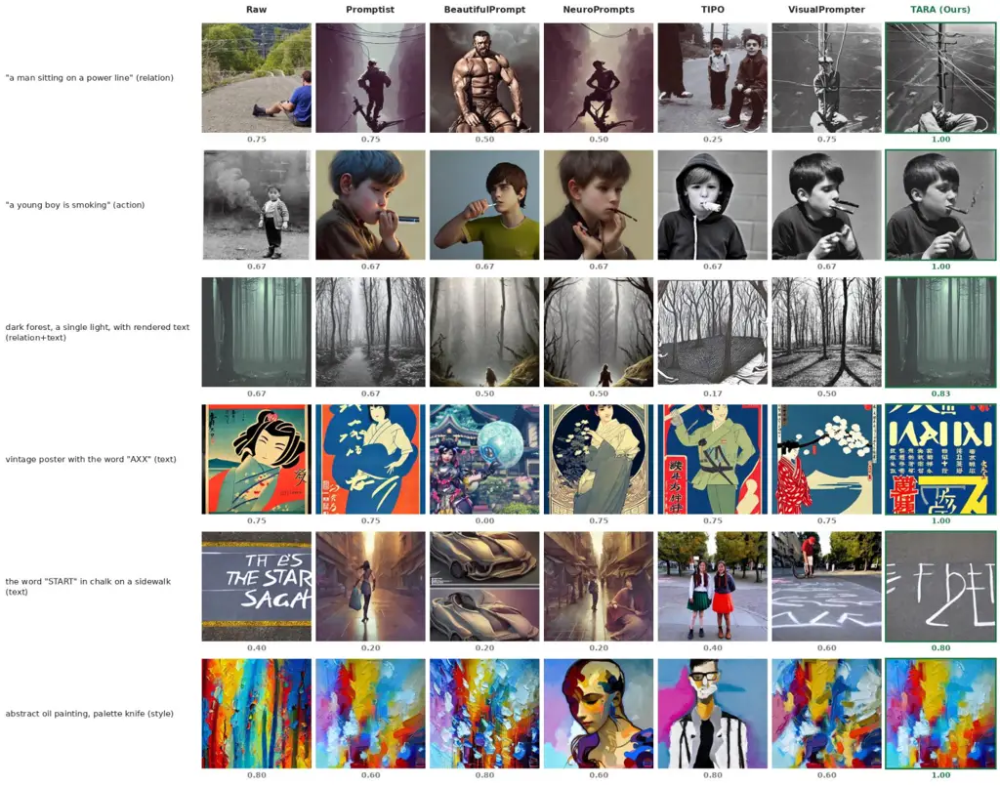

Figure 8: Qualitative comparison on SD 1.5 / DSG. Each row is one
prompt; columns are the raw prompt, four prompt-optimization baselines,
the official VisualPrompter, and TARA (green outline). The number below
each image is its VLM semantic score. TARA satisfies all atomic
requirements—relations, actions, rendered text, and global style—where
the baselines leave at least one unmet.

### B.2 Per-Generator Galleries

Figures 9–16 show, for each generator and both benchmarks (DSG and
TIFA), original vs. TARA-optimized images grouped by source category. In
every pair the left image is rendered from the original prompt and the
right (green outline) from TARA’s optimized prompt; the numbers are VLM
semantic scores. The gains are largest exactly where typed repair
targets—counts, relations and poses, and rendered text—and they transfer
across both benchmarks.

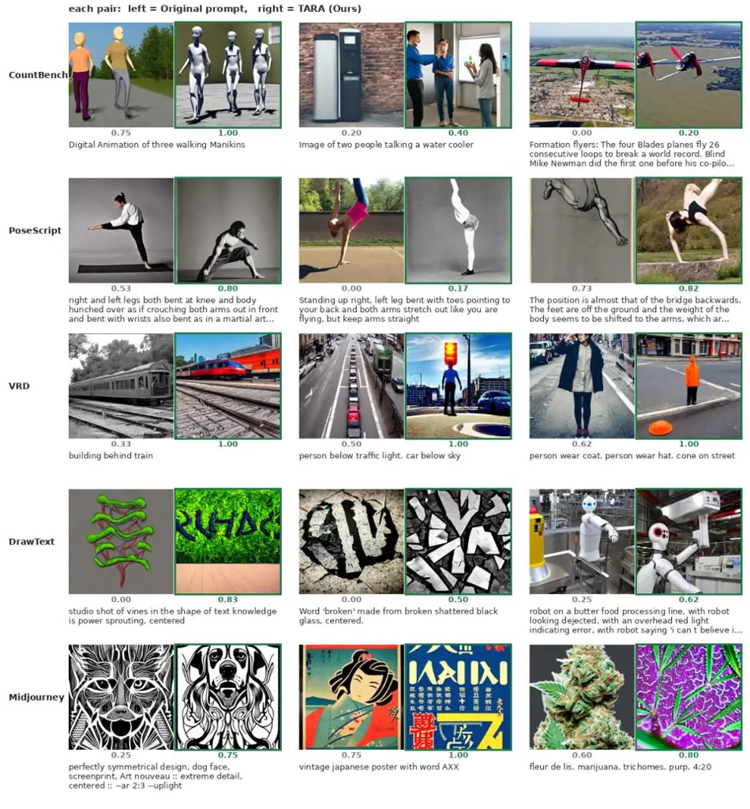

Figure 9: Original vs. TARA on Stable Diffusion v1.5 (DSG), grouped by
source category. Left: original prompt; right (green outline): TARA.
Numbers are VLM semantic scores.

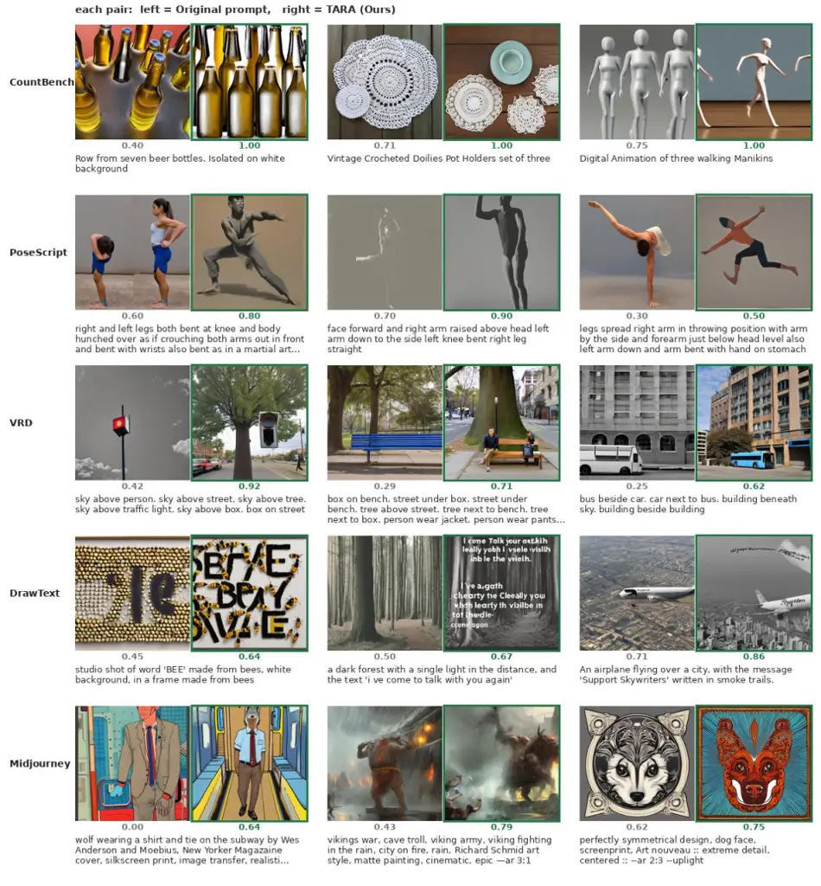

Figure 10: Original vs. TARA on Stable Diffusion v2.1 (DSG). Conventions
as in Figure 9.

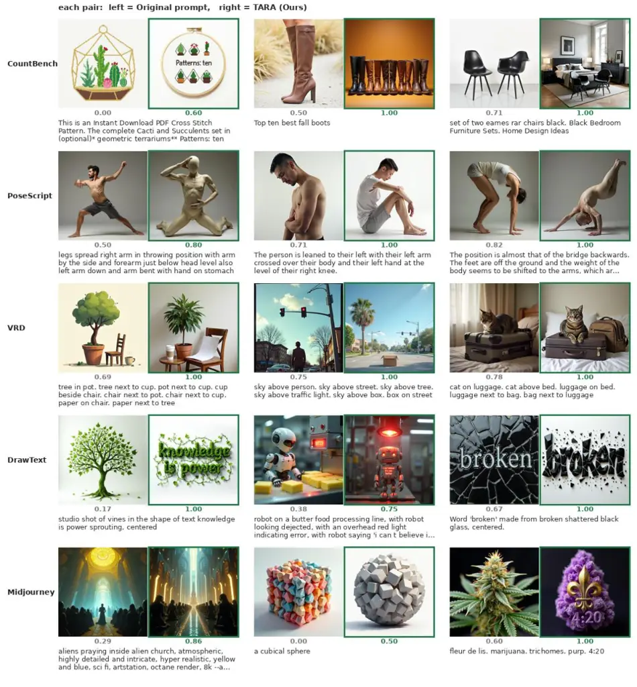

Figure 11: Original vs. TARA on FLUX-dev (DSG). Conventions as in
Figure 9.

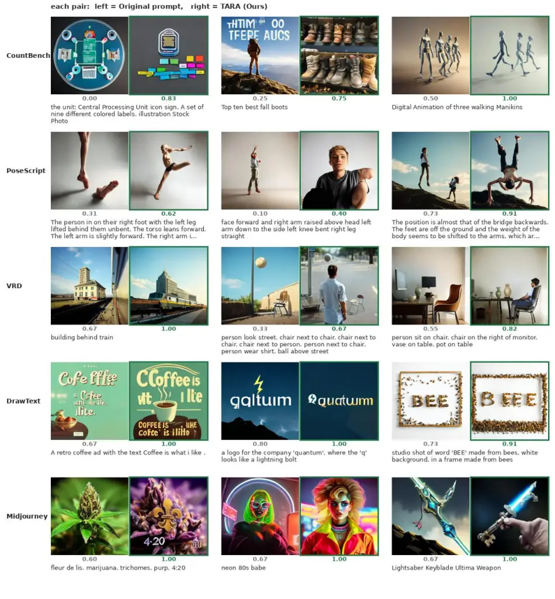

Figure 12: Original vs. TARA on Janus-Pro (DSG). Conventions as in
Figure 9.

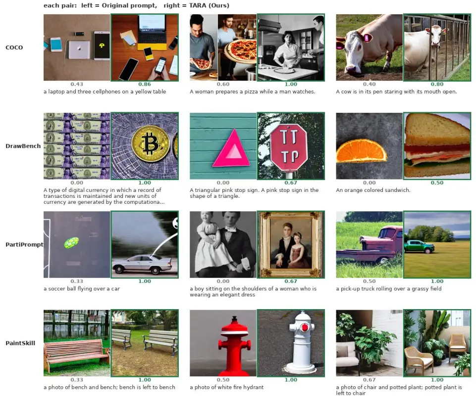

Figure 13: Original vs. TARA on Stable Diffusion v1.5 (TIFA), grouped by
source category. Conventions as in Figure 9.

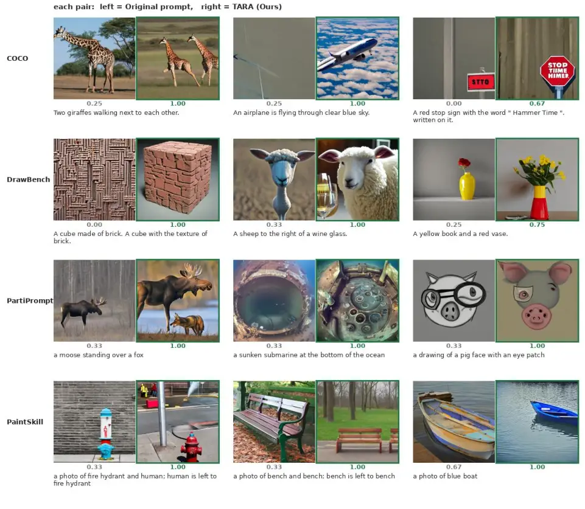

Figure 14: Original vs. TARA on Stable Diffusion v2.1 (TIFA).
Conventions as in Figure 9.

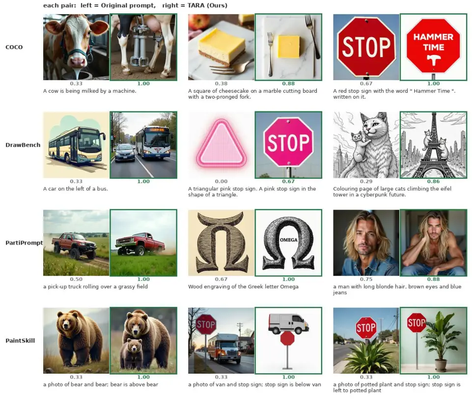

Figure 15: Original vs. TARA on FLUX-dev (TIFA). Conventions as in
Figure 9.

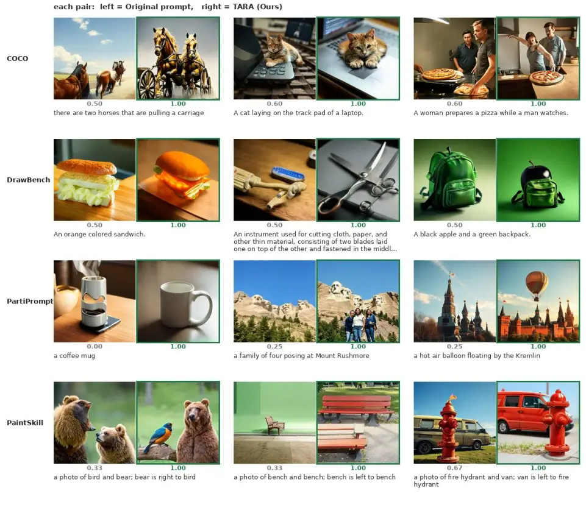

Figure 16: Original vs. TARA on Janus-Pro (TIFA). Conventions as in
Figure 9.

### B.3 Adaptation to Commercial Online Generators

Beyond the open-source generators studied above, we check whether TARA’s
typed prompts transfer to commercial online systems. Figure 17 compares
the original, VisualPrompter, and TARA prompts on two such
systems—Doubao on a smoke-trail text case, and GPT Image on a “dining
table above a bear” spatial case. In both, TARA’s typed rewrite realizes
the layout the prompt asks for—a complete smoke-trail script with a
visible contrail, and a table placed directly above the bear—whereas the
baselines leave the text incomplete or split the two objects onto
separate levels.

|                                                                                                |                                                                                                                                                                             |                                                                                                                                  |
| ---------------------------------------------------------------------------------------------- | --------------------------------------------------------------------------------------------------------------------------------------------------------------------------- | -------------------------------------------------------------------------------------------------------------------------------- |
| Original                                                                                       | VisualPrompter                                                                                                                                                              | TARA (Ours)                                                                                                                      |
|                                    |                                                                                                                 |                                                                      |
| An airplane flying over a city, with the message ‘Support Skywriters’ written in smoke trails. | An airplane is flying over a city, with white smoke above the city. The smoke creates the message “Support Skywriters” in the sky. Tall buildings are in the city.          | An airplane flying over a city, with the message ‘Support Skywriters’ clearly written in large, legible smoke trails.            |
| 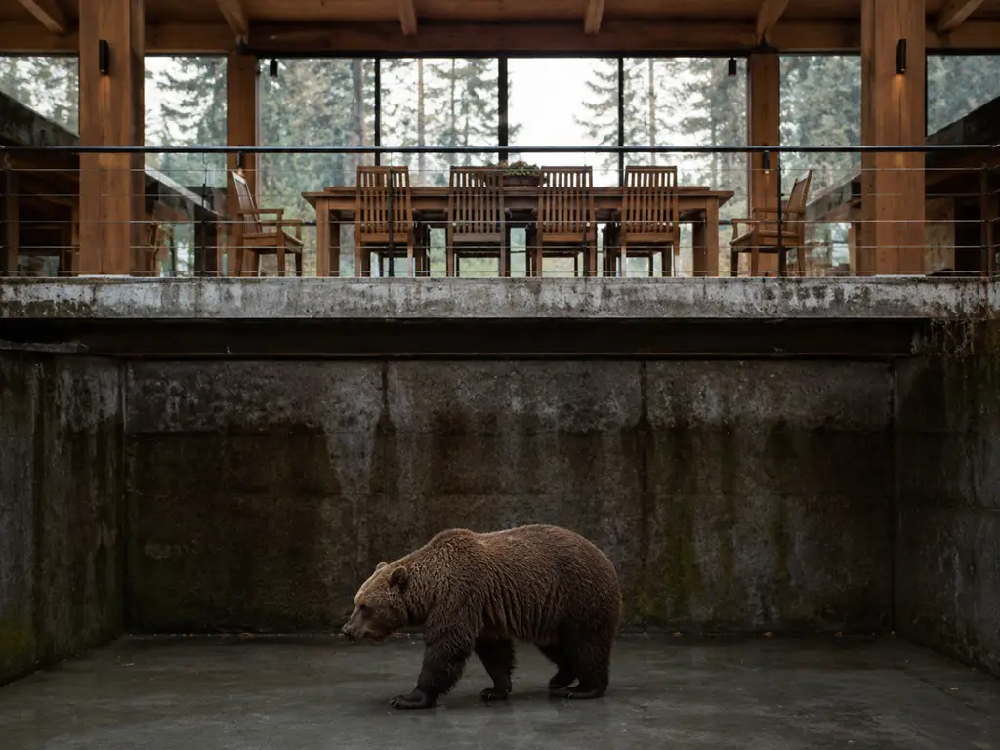                                   |                                                                                                                 |                                                                      |
| a photo of bear and dining table; dining table is above bear                                   | a photo of wooden dining table and bear; dining table is above bear with its light on. There are some fruits on the dining table, and the bear is eating them on the table. | a photo of a bear and a dining table where the dining table is positioned above the bear, with the bear located below the table. |

Figure 17: Adaptation to commercial online generators—top: Doubao (text
“Support Skywriters” in smoke trails), bottom: GPT Image (a dining table
above a bear). Each cell shows the rendered image with its prompt
beneath. TARA produces the complete smoke-trail text and places the
table directly above the bear, while the baselines leave the text
incomplete or split the two objects.

### B.4 Failure Cases

Figure 18 shows cases where the optimized image still misses a
requirement. Most residual failures stem from generator-side
limits—multi-object counting, rare poses, and long rendered
strings—where a better prompt is not enough to force compliance; the
repair gate then keeps the higher-scoring of the two images under the
atomic evaluator but cannot manufacture a capability the generator
lacks.

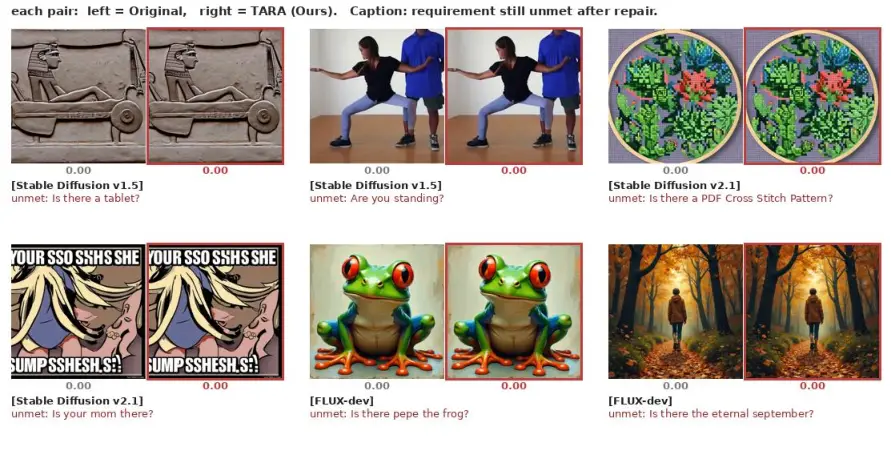

Figure 18: Failure cases (DSG). Left: original; right (red outline):
TARA. Numbers are VLM semantic scores; the caption under each pair is a
requirement still unmet after repair.

## Appendix C Supplementary Quantitative Results

### C.1 Behavioral Analysis

Diagnosed failures are diverse. Figure 19 shows the complete eight-type
distribution over all diagnosed failures. Missing objects ($`29.9\%`$),
wrong relations ($`27.1\%`$), and wrong attributes ($`23.0\%`$) are most
frequent, while action and style errors are rarer but remain explicitly
routed by TARA. A single uniform expansion cannot match this
heterogeneity; routing each failure to a type-specific repair is exactly
what this calls for.

Figure 19: Distribution of all eight diagnosed error types over failed
atomic propositions, aggregated across the 24 benchmark–generator–seed
cells.

TARA’s prompts stay short. Figure 20 compares the length of the
optimized prompts. Over all prompts TARA averages $`18`$ words versus
$`30`$ for VisualPrompter, because typed repair compilation makes a
short targeted edit instead of a verbose global expansion.

Figure 20: Optimized-prompt length over all prompts (DSG and TIFA, four
generators). TARA’s compiled typed repairs are substantially shorter
than VisualPrompter’s uniform expansions.

Table 12 extends the length comparison to all seven methods.
Aesthetics-oriented optimizers inflate the prompt the most (NeuroPrompts
and TIPO exceed $`50`$ words), VisualPrompter’s uniform expansion
averages $`30`$, whereas TARA’s typed repair compilation stays at
$`18`$—the shortest among the rewriters while remaining the most
faithful.

| Method          | SD 1.5 | SD 2.1 | Flux-dev | Janus-Pro | All  |
| --------------- | ------ | ------ | -------- | --------- | ---- |
| Raw prompt      | 14.2   | 14.2   | 14.2     | 14.2      | 14.2 |
| NeuroPrompts    | 57.5   | 57.5   | 57.5     | 57.5      | 57.5 |
| Promptist       | 23.1   | 23.1   | 23.1     | 23.1      | 23.1 |
| BeautifulPrompt | 29.1   | 29.1   | 29.1     | 29.1      | 29.1 |
| TIPO            | 47.0   | 47.0   | 47.0     | 73.0      | 53.5 |
| VisualPrompter  | 32.2   | 31.3   | 28.5     | 29.1      | 30.3 |
| TARA (Ours)     | 18.3   | 18.0   | 18.2     | 18.5      | 18.2 |

Table 12: Optimized-prompt length (mean words) by method and generator,
over all prompts. Aesthetics-oriented optimizers inflate the prompt the
most; VisualPrompter’s uniform expansion is long, whereas TARA’s typed
repair compilation stays the shortest among the rewriters while still
being the most faithful (cf. main results).

The repair traces let us inspect TARA’s behavior per failure type.
Table 13 reports, for each diagnosed error type, its frequency, how
often a typed rewrite improves the semantic score and is kept, and the
mean gain when accepted: missing objects and actions are the most
repairable, whereas rendered text is the hardest, echoing the per-type
accuracy in the main text. Table 14 breaks the accept rate down by
generator—the same failure type is far more repairable on stronger
generators, indicating that part of the ceiling is generator capacity
rather than the optimizer.

| Error type      | Frequency | Accept rate (%) | Mean gain  |
| --------------- | --------- | --------------- | ---------- |
| Missing object  | 4837      | 29.7            | $`+0.133`$ |
| Wrong relation  | 4379      | 27.7            | $`+0.084`$ |
| Wrong attribute | 3716      | 24.5            | $`+0.061`$ |
| Wrong count     | 1042      | 27.0            | $`+0.094`$ |
| Wrong action    | 238       | 29.0            | $`+0.114`$ |
| Global mismatch | 1168      | 26.5            | $`+0.075`$ |
| Missing text    | 711       | 22.5            | $`+0.048`$ |
| Style mismatch  | 95        | 26.3            | $`+0.080`$ |

Table 13: Repair behavior by error type (TARA, aggregated over all 24
benchmark–generator–seed cells). _Frequency_ is the number of diagnosed
failures of each type; _accept rate_ is the fraction whose typed rewrite
improved the semantic score and was kept; _mean gain_ is the average
score increase of accepted repairs. Object and action failures are the
most repairable, whereas rendered text is the hardest—consistent with
the per-type accuracy in the main text. Each diagnosed failure
occurrence inherits its prompt’s gate decision, so prompts containing
multiple error types contribute to multiple rows.

| Error type      | SD 1.5 | SD 2.1 | Flux-dev | Janus-Pro |
| --------------- | ------ | ------ | -------- | --------- |
| Missing object  | 29     | 29     | 31       | 31        |
| Wrong relation  | 27     | 27     | 30       | 28        |
| Wrong attribute | 24     | 24     | 23       | 26        |
| Wrong count     | 26     | 27     | 28       | 27        |
| Wrong action    | 30     | 30     | 30       | 26        |
| Global mismatch | 24     | 28     | 26       | 27        |
| Missing text    | 21     | 20     | 27       | 25        |
| Style mismatch  | 20     | 20     | 37       | 25        |

Table 14: Repair accept rate (%) by error type and generator (TARA).
Darker is higher. The same failure type is far more repairable on
stronger generators—e.g. rendered text is nearly unrepairable on Stable
Diffusion but much easier on Flux/Janus—showing that part of the ceiling
is generator capacity, not the optimizer.

### C.2 Threshold Sensitivity

TARA fixes a single global $`\tau{=}0.72`$ (the same value across every
generator and benchmark) to admit the conservative re-seed candidate
only when the initial image is already near-correct. A threshold sweep
on DSG/SD 2.1 (Table 15) shows that all tested values in $`[0.60,0.84]`$
produce large gains over the initial image ($`+8`$ to $`+10`$ points) at
a similar image budget ($`1.78`$–$`1.81`$ generations). We therefore
keep $`\tau{=}0.72`$ fixed throughout, without tuning it per generator
or benchmark.

| Threshold $`\tau`$ | Init  | Final | $`\Delta`$ | Gens |
| ------------------ | ----- | ----- | ---------- | ---- |
| 0.60               | 65.48 | 73.63 | $`+8.16`$  | 1.78 |
| 0.66               | 65.48 | 74.49 | $`+9.01`$  | 1.78 |
| 0.72 (default)     | 65.06 | 73.69 | $`+8.63`$  | 1.81 |
| 0.78               | 65.48 | 74.75 | $`+9.28`$  | 1.78 |
| 0.84               | 65.48 | 75.41 | $`+9.93`$  | 1.78 |

Table 15: Sensitivity to the re-seed threshold on DSG/SD 2.1 (single
seed $`s{=}1234`$, $`n{=}200`$). All tested thresholds give large gains
over the initial image at a comparable image budget. The default row
reuses the main-experiment run, whereas the remaining rows come from a
separately launched sensitivity sweep. Although the nominal seed is
shared, image generation is not guaranteed to be bitwise deterministic
across independent GPU sessions, leading to the small difference in
Init.

### C.3 Robustness and Diagnostic Breakdowns

To quantify uncertainty in the comparison with VisualPrompter, we use a
prompt-clustered paired bootstrap. Within each benchmark, one cluster
contains a prompt’s 12 paired TARA-minus-VisualPrompter differences
across four generators and three seeds; we average within each cluster
and resample the 200 prompt clusters with replacement for 100,000
replicates (random seed 20260713). The overall interval averages
benchmark-stratified bootstrap draws. The 2.5th and 97.5th percentiles
give 95% CIs of $`[4.72,6.52]`$ for DSG, $`[1.63,3.63]`$ for TIFA, and
$`[3.45,4.80]`$ overall, all excluding zero.

Table 16 reports semantic accuracy by seed group, each averaged over the
four generators; the scores are stable across the three groups,
confirming the main results are not seed-specific.

| Method          | DSG   |       |       |                  | TIFA  |       |       |                  |
| --------------- | ----- | ----- | ----- | ---------------- | ----- | ----- | ----- | ---------------- |
|                 | s1234 | s2345 | s3456 | Mean $`\pm`$ Std | s1234 | s2345 | s3456 | Mean $`\pm`$ Std |
| Raw prompt      | 68.4  | 69.0  | 67.3  | 68.3 $`\pm`$ 0.9 | 76.4  | 75.8  | 76.5  | 76.2 $`\pm`$ 0.4 |
| NeuroPrompts    | 62.4  | 62.1  | 62.7  | 62.4 $`\pm`$ 0.3 | 68.8  | 70.1  | 68.0  | 69.0 $`\pm`$ 1.0 |
| Promptist       | 65.0  | 64.9  | 64.0  | 64.6 $`\pm`$ 0.6 | 74.0  | 74.6  | 73.7  | 74.1 $`\pm`$ 0.4 |
| BeautifulPrompt | 41.8  | 42.8  | 42.0  | 42.2 $`\pm`$ 0.6 | 50.3  | 49.6  | 48.8  | 49.6 $`\pm`$ 0.7 |
| TIPO            | 58.4  | 59.9  | 58.3  | 58.9 $`\pm`$ 0.9 | 60.8  | 60.4  | 60.8  | 60.7 $`\pm`$ 0.2 |
| VisualPrompter  | 71.5  | 70.3  | 70.5  | 70.8 $`\pm`$ 0.7 | 82.5  | 82.4  | 83.4  | 82.8 $`\pm`$ 0.6 |
| TARA (Ours)     | 76.2  | 76.6  | 76.3  | 76.4 $`\pm`$ 0.2 | 85.1  | 85.5  | 85.4  | 85.4 $`\pm`$ 0.2 |

Table 16: Random-seed robustness. Each seed column averages semantic
accuracy (%) over four generators; the final column reports mean $`\pm`$
standard deviation over the three seed groups.

### C.4 VLM-as-Judge Preference Details

Table 17 details the VLM-as-Judge preference between TARA and the raw
prompt on changed-prompt cases, for both semantic consistency and
aesthetics.

| Model    | $`n`$ | Semantic Consistency | Aesthetics        |
| -------- | ----- | -------------------- | ----------------- |
| SD 1.5   | 17    | 70.6 / 17.6 / 11.8   | 52.9 / 0.0 / 47.1 |
| Flux-dev | 12    | 66.7 / 0.0 / 33.3    | 50.0 / 0.0 / 50.0 |
| Average  | 29    | 69.0 / 10.3 / 20.7   | 51.7 / 0.0 / 48.3 |

Table 17: Detailed VLM-as-Judge preference on changed-prompt cases. Each
entry is TARA / Tie / Raw preference percentage.
