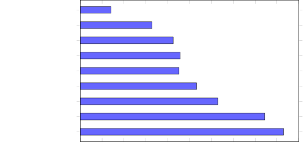
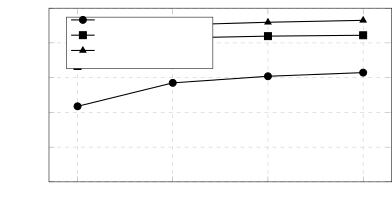
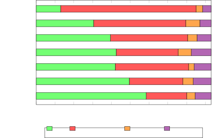

# Verifier-First Evaluation of Agentic LLMs for Infrastructure-as-Code Generation

Mohamed Jouini

## Abstract

Infrastructure-as-Code (IaC) generation from natural language requires
satisfying provider schemas, dependency planning, and organizational
policy constraints — not merely producing syntactically plausible
configurations. We present a verifier-first empirical study of seven
agentic strategies for Terraform generation evaluated on IaC-Eval v2, a
modernized 186-task AWS/Terraform benchmark with Rego v1 intent
policies. Our evaluation separates failures into three verifier stages
(terraform validate, terraform plan, opa eval) and applies McNemar’s
test with Wilson confidence intervals on all pairwise comparisons
($`n=186`$, $`\alpha=0.05`$).

We report five principal findings. (1) Active retrieval via ReAct agents
with MCP or ChromaDB-backed RAG raises Qwen2.5-Coder 7B from 14.0% to
45.7% pass@1 ($`p<0.0001`$), primarily by reducing VALIDATE_FAIL from
144 to 66 tasks. (2) Iterative refinement with verifier feedback
achieves 62.9% (Qwen 7B) and 84.4% (GPT-4o) pass@1, exhibiting binary
convergence — tasks either resolve in one retry or exhaust the budget.
(3) GEPA reflective instruction optimization raises the Active RAG
baseline by +7.5 pp ($`p=0.026`$) using only 80 verifier-guided
rollouts, providing evidence that prompt optimizers can improve
verifiable IaC generation without weight updates. (4) SIMBA teacher-free
demonstration injection achieves performance equivalent to Active RAG
($`p=1.0`$) without retrieval infrastructure, but fails to address the
dominant SELF_DEFINED_PROPERTY error class (50% of failures). (5) A
diagnostic Rego-injection experiment shows that 79% of post-refinement
OPA failures are information-gap failures resolvable when policy text is
visible ($`p=0.016`$), motivating policy-aware prompt construction
rather than treating all policy failures as model-capability failures.

These results argue that IaC generation evaluation requires
stage-specific failure decomposition, that retrieval and repair target
orthogonal failure classes, and that instruction-level optimization
(GEPA) outperforms demonstration-level optimization (SIMBA) for
schema-constrained code generation tasks.

Keywords: Infrastructure-as-Code, Terraform, LLM code generation,
agentic AI, DSPy, ReAct, retrieval-augmented generation, iterative
refinement, prompt optimization, Open Policy Agent

 

## 1 Introduction

Infrastructure-as-Code (IaC) enables cloud resources to be defined,
versioned, reviewed, and audited through declarative configuration files
\[HashiCorp, 2024\]. Terraform uses HashiCorp Configuration Language
(HCL) with a typed resource-block model spanning over 1,000 AWS resource
types. A correct Terraform configuration must simultaneously satisfy
four constraints: syntactic validity against the provider plugin,
schema-level conformance to the current provider version,
dependency-graph coherence across referenced resources, and compliance
with organizational policy specifications.

These layered requirements distinguish IaC generation from standard
code-completion benchmarks. Kon et al. \[2024\] demonstrate that GPT-4
achieves 86.6% on tightened Python tiers but only 19.36% on IaC-Eval
Terraform tasks — a gap attributable to provider-schema breadth,
declarative semantics, and external policy gates absent from
function-level code synthesis. Zhang et al. \[2025\] show that iterative
feedback substantially improves CloudFormation deployability but do not
evaluate policy compliance. Neither study systematically evaluates
modern agentic techniques (ReAct tool use, RAG-based retrieval, DSPy
optimization) under a unified, multi-stage verification harness.

This paper addresses this gap through a verifier-first empirical study
organized around four research questions:

- •
  RQ1 (Retrieval): When does active retrieval through ReAct agents with
  MCP or RAG improve Terraform correctness over static context
  injection?
- •
  RQ2 (Repair): Which verifier-stage failures are recoverable through
  iterative refinement, and which persist across attempts?
- •
  RQ3 (Optimization): Can DSPy optimizers (SIMBA, GEPA) improve
  local-model IaC generation without weight updates or retrieval
  infrastructure?
- •
  RQ4 (Failure Semantics): Which residual errors are model capability
  failures, and which are information gaps in the prompt–policy
  interface?

Every strategy is evaluated through the same three-stage pipeline,
enabling direct attribution of improvements to specific failure modes.
All results are statistically validated with McNemar’s test on 186
paired binary outcomes.

### 1.1 Contributions

This work makes six contributions:

1.  1.  IaC-Eval v2 benchmark artifact. A modernized 186-task Terraform/AWS
        dataset with AWS provider ~\> 6.0, Rego v1 policies, corrected
        benchmark defects, and Hugging Face packaging
        (iac-eval-v2/iac-eval-v2).
2.  2.  Verifier-stage evaluation methodology. Explicit separation of
        failures into VALIDATE_FAIL, PLAN_FAIL, and OPA_FAIL categories with
        per-gate attribution of strategy improvements.
3.  3.  Comparative study of seven agentic strategies across three models
        (GPT-4o, GPT-5.4, Qwen2.5-Coder 7B), demonstrating that retrieval,
        repair, and optimization address different verifier stages.
4.  4.  Application of GEPA and SIMBA to IaC generation with verifiable OPA
        rewards, extending DSPy optimization from NLP tasks to
        schema-constrained code generation.
5.  5.  Failure taxonomy and error-class hierarchy. We show that
        SELF_DEFINED_PROPERTY (schema hallucination) is model-scale-limited:
        SIMBA (50%) → GEPA (23%) → GPT-4o (9%), establishing that
        instruction optimization partially compensates for parametric
        knowledge gaps.
6.  6.  Reproducible observability methodology. Every reported metric is
        traceable to a specific MLflow trace ID, experiment, and per-span
        execution record, enabling independent verification of all claims.

 

## 2 Related Work

### 2.1 IaC Benchmarks and Evaluation

IaC-Eval \[Kon et al., 2024\] introduced a Terraform/AWS benchmark with
OPA-based intent verification, establishing that IaC generation is
substantially harder than compact code-completion tasks. The original
study reports low pass@1 for GPT-4 on Terraform (19.36%) despite much
stronger performance on Python tiers (86.6%), motivating IaC as a
distinct evaluation domain. Our work builds on IaC-Eval by (i)
modernizing the dataset to current Terraform/AWS provider versions, (ii)
separating PLAN_FAIL from VALIDATE_FAIL, and (iii) evaluating seven
orchestration strategies under a common verifier-first harness.

IaCGen \[Zhang et al., 2025\] studies deployability-centric
CloudFormation generation and shows that iterative error feedback
substantially improves deployability after up to 25 regeneration
attempts. Our study complements IaCGen by focusing on Terraform,
distinguishing validation from planning from policy failures, and
evaluating policy compliance via OPA — a dimension absent from IaCGen’s
CloudFormation-centric evaluation. The SELF_DEFINED_PROPERTY error class
we identify corresponds to IaCGen’s “Invalid Attribute” category,
confirming that schema hallucination is cross-language (HCL and YAML).

EXP-Bench \[Kon et al., 2025\] evaluates agents on long-horizon research
tasks and finds that structured task decomposition predicts agent
performance. Our three-stage pipeline (Analyze → Generate → Assemble)
aligns with this insight: each stage has narrower scope than monolithic
generation.

### 2.2 LLM Code Generation and Self-Repair

General code-generation benchmarks such as HumanEval \[Chen et al.,
2021\] emphasize compact programs with executable tests but do not
capture IaC-specific requirements: provider-version drift, declarative
dependency graphs, and external policy engines. Self-Refine \[Madaan et
al., 2023\] demonstrates that iterative refinement with self-feedback
can improve generated programs, while empirical analyses of self-repair
\[Olausson et al., 2023\] show that repair is not uniformly reliable.
Our results extend this line by decomposing repair outcomes by verifier
stage: validation and planning errors are largely repairable, while OPA
policy failures require information absent from the natural-language
prompt.

CEDAR \[Nashid et al., 2023\] demonstrates retrieval-based prompt
selection for code-related few-shot learning, finding that selecting
relevant code examples improves generation quality. Our SIMBA experiment
provides a complementary finding: DSPy’s automated demonstration
selection via trajectory contrast achieves performance equivalent to
active retrieval (McNemar $`p=1.0`$) but fails to address
schema-constraint errors that require abstract instruction rules rather
than concrete examples.

### 2.3 Retrieval-Augmented Generation

RAG \[Lewis et al., 2020\] motivates external knowledge sources when
model parameters alone are insufficient. Adaptive-RAG \[Jeong et al.,
2024\] conditions retrieval behavior on query complexity. In our study,
Active MCP and Active RAG instantiate adaptive retrieval for Terraform
provider documentation: the model requests schema information during
generation via ReAct tool calls. Our finding that active retrieval
outperforms static retrieval by +12.9 pp ($`p=0.004`$) confirms
Adaptive-RAG’s thesis for IaC: agentic, query-driven retrieval is more
effective than pre-fetched context for multi-resource compositions.

### 2.4 Prompt Optimization

DSPy \[Khattab et al., 2024\] treats instructions and demonstrations as
optimizable parameters. MIPROv2 \[Opsahl-Ong et al., 2024\] demonstrates
joint instruction and demonstration optimization. GEPA \[Agrawal et al.,
2026\] extends the optimizer family with reflective prompt evolution
guided by a strong teacher LM, achieving +6% average over GRPO across
six NLP tasks with 35× fewer rollouts. SIMBA uses trajectory contrast to
inject demonstrations and rules without a teacher model.

To our knowledge, this is among the first studies to evaluate GEPA and
SIMBA on IaC generation with deterministic verifiable rewards. We find
that instruction-level evolution (GEPA: +7.5 pp over Active RAG,
$`p=0.026`$) improves schema-constrained code generation, while
demonstration-level injection (SIMBA: -0.5 pp vs. Active RAG, $`p=1.0`$)
matches retrieval performance but does not improve over it. The
GEPA-vs-SIMBA difference trends in favor of GEPA but is borderline at
$`\alpha=0.05`$ ($`p=0.059`$), so we report it as suggestive rather than
conclusive.

### 2.5 Agentic Evaluation and Observability

ReAct \[Yao et al., 2023\] interleaves reasoning and tool-invocation
actions in a Thought → Action → Observation loop. We implement ReAct
agents with both MCP-based structured tool access \[Anthropic et al.,
2024\] and dense retrieval over ChromaDB, demonstrating that the
retrieval channel affects which resources the model can correctly
generate but not the fundamental architecture of the agent loop.

Our observability methodology — MLflow experiment tracking with per-span
tracing of every LM call — follows the growing concern that agent
evaluations should be traceable \[Kon et al., 2025\]. Every percentage
point we report can be expanded into task IDs, error classes, and full
execution traces.

 

## 3 Benchmark and Methodology

### 3.1 IaC-Eval v2 Dataset

IaC-Eval v2 is a 186-task Terraform/AWS benchmark derived from IaC-Eval
\[Kon et al., 2024\], modernized along four dimensions: (i) Terraform
constraints updated to $`\geq`$ 1.15 with AWS provider ~\> 6.0; (ii)
Rego policies migrated to Rego v1 (import rego.v1); (iii) benchmark
defects corrected (false OPA failures from unknown-after-apply values,
malformed Rego expressions); (iv) all reference solutions revalidated.
The dataset is released as iac-eval-v2/iac-eval-v2 on Hugging Face.

Each task comprises a natural-language prompt, a reference HCL solution,
and a Rego intent specification. Tasks span 186 AWS scenarios at six
difficulty levels, covering EC2, S3, Lambda, RDS, MSK, SageMaker, VPC,
IAM, Lightsail, DynamoDB, ElastiCache, and Lex service families.

### 3.2 Evaluation Pipeline

Our harness implements a three-stage verifier-first pipeline:

```math
\text{HCL}\xrightarrow{\text{validate}}\text{PASS/FAIL}\xrightarrow{\text{plan}}\text{PASS/FAIL}\xrightarrow{\text{opa eval}}\text{PASS/FAIL}
```

Failures are classified into a taxonomy: - VALIDATE_FAIL: Provider
schema or syntax errors (e.g., unsupported argument, invalid block
type) - PLAN_FAIL: Dependency resolution or reference errors (e.g.,
undeclared resource, missing file) - OPA_FAIL: Policy intent violations
(valid and plannable code that does not satisfy the Rego specification)

Primary metric: pass@1 — the fraction of tasks passing all three gates
on the first attempt. For iterative strategies, passItr@$`k`$ with
budget $`k=4`$ (initial + 3 retries).

Statistical tests: All pairwise comparisons use McNemar’s test on 186
paired binary outcomes (continuity-corrected $`\chi^{2}`$). Confidence
intervals are Wilson score intervals at 95%.

### 3.3 Models

| Model            | Parameters  | Context | Deployment                  | Role                          |
| ---------------- | ----------- | ------- | --------------------------- | ----------------------------- |
| GPT-4o           | Undisclosed | 128K    | OpenAI API via LiteLLM      | Strong baseline; repair + MCP |
| GPT-5.4          | Undisclosed | 128K    | OpenAI API via LiteLLM      | CoT baseline; GEPA teacher    |
| Qwen2.5-Coder 7B | 7B          | 32K     | vLLM (AWQ 4-bit, local GPU) | Local-model stress test       |

All experiments use temperature=0.0 and max_tokens=2048. The LiteLLM
proxy provides a unified OpenAI-compatible API across all models.

### 3.4 Agentic Strategies

| Strategy             | Description                                                                  | Model(s)        |
| -------------------- | ---------------------------------------------------------------------------- | --------------- |
| CoT baseline         | Zero-shot chain-of-thought prompting                                         | All three       |
| ReAct + MCP          | ReAct agent with MCP documentation tools                                     | GPT-4o, Qwen 7B |
| ReAct + RAG          | ReAct agent with dense ChromaDB retrieval tools                              | Qwen 7B         |
| Static RAG           | Single pre-fetch of provider docs before a three-stage CoT pipeline          | Qwen 7B         |
| Iterative Refinement | Initial generation followed by up to three verifier-guided retries ($`k=4`$) | GPT-4o, Qwen 7B |
| Rego Oracle          | Iterative refinement with full Rego policy text injected into the prompt     | GPT-4o          |
| GEPA-RAG             | GEPA-optimized ReAct+RAG pipeline (reflection LM: GPT-5.4)                   | Qwen 7B         |
| SIMBA                | SIMBA-optimized passive-context pipeline, no retrieval at inference          | Qwen 7B         |

### 3.5 DSPy Optimization Configuration

GEPA is applied to the ReAct+RAG pipeline with GPT-5.4 as the reflection
LM. The optimizer runs for 80 verifier-guided rollouts with a 20-task
Pareto validation set and a 124-task training set.

SIMBA is applied to the passive-context pipeline with no retrieval at
inference time. The student model is Qwen 7B (teacher-free). The
optimizer is run at a minimal configuration to establish a lower-bound
result, with a 124-task training set.

### 3.6 Observability and Reproducibility

Every experiment runs under a dual-sink observability stack. MLflow v3
provides persistent per-span tracing of every LM call, module
invocation, and tool use, with one experiment per strategy and one trace
per task. Arize Phoenix provides real-time trace visualization via the
OpenInference protocol.

The observability infrastructure is deployed on Kubernetes via
Terraform. A command-line trace query toolkit provides programmatic
access to all traces via the MLflow REST API, enabling independent
verification of any reported result.

 

## 4 Results

### 4.1 Baseline Performance (RQ1–RQ4 Context)

Table 1 reports baseline CoT performance establishing the need for
staged evaluation.

Table 1. Baseline CoT performance (zero-shot, no retrieval, no repair).

| Model   | pass@1 | 95% CI         | valid@1 | VALIDATE | PLAN | OPA |
| ------- | ------ | -------------- | ------- | -------- | ---- | --- |
| GPT-4o  | 41.4%  | \[34.5, 48.6\] | 59.1%   | 76       | 15   | 18  |
| GPT-5.4 | 62.4%  | \[55.2, 69.1\] | 84.9%   | 28       | 14   | 28  |
| Qwen 7B | 14.0%  | \[9.7, 19.7\]  | 22.6%   | 144      | 7    | 9   |

Finding 1. Qwen 7B fails primarily at validation (144/186, 77.4%),
indicating that the dominant bottleneck for small models is
provider-schema hallucination. GPT-5.4’s failures shift to OPA (28
tasks), demonstrating that a stronger model reaches later verifier
stages more frequently — a phenomenon we term failure promotion.



Figure 1: Overall pass@1 rate across all evaluated strategies (IaC-Eval
v2, $`n=186`$). The performance ladder progresses from CoT through
active retrieval, prompt optimization, iterative refinement, and the
diagnostic policy oracle.

Figure 1. Overall pass rate across evaluated strategies. The main
performance ladder is CoT \< static retrieval \< active retrieval \<
prompt optimization \< iterative refinement \< diagnostic policy oracle.

### 4.2 RQ1: Active Retrieval Reduces Schema Failures

Table 2. Retrieval strategy comparison (Qwen2.5-Coder 7B, 186 tasks).

| Strategy           | pass@1 | 95% CI         | valid@1 | VAL | PLN | OPA | Avg time |
| ------------------ | ------ | -------------- | ------- | --- | --- | --- | -------- |
| CoT (no retrieval) | 14.0%  | \[9.7, 19.7\]  | 22.6%   | 144 | 7   | 9   | 42s      |
| Static RAG         | 32.8%  | \[26.5, 39.8\] | 47.3%   | 98  | 15  | 12  | 54s      |
| Active MCP (ReAct) | 42.5%  | \[35.6, 49.7\] | 55.9%   | 82  | 10  | 15  | 38s      |
| Active RAG (ReAct) | 45.7%  | \[38.7, 52.9\] | 64.5%   | 66  | 14  | 21  | 36s      |

Table 3. Pairwise McNemar tests — retrieval strategies ($`n=186`$).

| Comparison              | Wins A | Wins B | $`p`$-value | Verdict         |
| ----------------------- | ------ | ------ | ----------- | --------------- |
| ActiveRAG vs. CoT       | 67     | 8      | $`<0.0001`$ | Significant     |
| ActiveRAG vs. StaticRAG | 43     | 19     | 0.004       | Significant     |
| ActiveRAG vs. MCP       | 27     | 21     | 0.47        | Not significant |
| MCP vs. StaticRAG       | 35     | 17     | 0.018       | Significant     |

Finding 2. Active retrieval significantly outperforms static retrieval
(McNemar $`p=0.004`$). The +12.9 pp gap between Active RAG and Static
RAG is concentrated at the validation stage: VALIDATE_FAIL drops from 98
to 66 ($`-`$33%). Active retrieval discovers dependencies and nested
provider schema details that keyword-based pre-fetching misses.

Finding 3. Active RAG and Active MCP are statistically equivalent
($`p=0.38`$). ChromaDB dense retrieval edges MCP by +3.2 pp in valid@1
(64.5% vs. 55.9%), attributable to pre-processed chunks optimized for
the 32K context window versus verbose MCP tool responses.

Finding 4 (GPT-4o retrieval lift). Active MCP raises GPT-4o from 41.4%
to 70.4% (+29.0 pp), reducing OPA_FAIL to only 9 tasks (4.8%). For a
strong model, retrieval largely addresses the schema knowledge gap —
residual failures shift to policy compliance.

### 4.3 RQ2: Iterative Refinement Recovers Validation Failures

Table 4. Iterative refinement results (budget $`k=4`$: initial + 3
retries).

| Strategy                 | Model   | pass@1 | 95% CI         | VAL | PLN | OPA | Avg time | Avg att. |
| ------------------------ | ------- | ------ | -------------- | --- | --- | --- | -------- | -------- |
| Active RAG (single-pass) | Qwen 7B | 45.7%  | \[38.7, 52.9\] | 66  | 14  | 21  | 36s      | 1.0      |
| + Repair ($`k=4`$)       | Qwen 7B | 62.9%  | \[55.8, 69.5\] | 43  | 9   | 17  | 203s     | 2.35     |
| Active MCP (single-pass) | GPT-4o  | 70.4%  | \[63.4, 76.6\] | 27  | 19  | 9   | 60s      | 1.0      |
| + Repair ($`k=4`$)       | GPT-4o  | 84.4%  | \[78.4, 89.1\] | 8   | 7   | 14  | 98s      | 1.3      |
| + Rego Oracle ($`k=4`$)  | GPT-4o  | 93.0%  | \[88.4, 96.0\] | 1   | 9   | 3   | 86s      | 1.2      |

Finding 5 (Binary convergence). The repair-attempt distribution is
bimodal: 83% of GPT-4o tasks pass in 1–2 attempts; 16% exhaust the full
budget. Tasks either resolve immediately upon seeing the error or do not
resolve at all within $`k=4`$. This validates the binary convergence
pattern first documented for general code self-repair \[Olausson et al.,
2023\] and extends it to IaC with verifier feedback.

Finding 6 (Repair promotes failures). GPT-4o repair reduces
VALIDATE_FAIL from 27→8 and PLAN_FAIL from 19→7, but OPA_FAIL increases
from 9→14. This is not regression — it is failure promotion: previously
invalid configurations that now pass validation and planning are exposed
to the policy gate for the first time. IaCGen \[Zhang et al., 2025\]
reports a similar pattern for CloudFormation deployability but does not
evaluate policy compliance to observe this effect.

Finding 7 (SELF_DEFINED_PROPERTY persistence under repair). For Qwen 7B,
SELF_DEFINED_PROPERTY remains the largest manually coded residual error
class after refinement (27 of 69 failures, 39.1%). The repair loop
cannot reliably correct schema hallucination when the model’s parametric
knowledge does not contain the correct attribute name — the error
message states “argument not expected here” but does not suggest the
correct alternative. This is an inherent limitation of repair: it
provides _negative feedback_ (what is wrong) but not _positive
knowledge_ (what is right). IaCGen \[Zhang et al., 2025\] identifies
“Invalid Attribute” as the analogous dominant failure class for
CloudFormation.



Figure 2: Iterative refinement convergence curves. GPT-4o achieves most
gains by the second attempt; Qwen 7B benefits from additional retries
but remains bounded by schema-knowledge failures.

Figure 2. Refinement convergence by attempt budget. GPT-4o obtains
almost all gains by the second attempt, while Qwen 7B benefits from
additional retries but remains bounded by schema-knowledge failures.

### 4.4 RQ3: DSPy Optimization

Table 5. DSPy optimization results (Qwen2.5-Coder 7B, 186 tasks,
single-pass).

| Strategy              | pass@1 | 95% CI         | VAL | PLN | OPA | Avg time | Teacher |
| --------------------- | ------ | -------------- | --- | --- | --- | -------- | ------- |
| Active RAG (baseline) | 45.7%  | \[38.7, 52.9\] | 66  | 14  | 21  | 36s      | —       |
| SIMBA (passive ctx.)  | 45.2%  | \[38.2, 52.3\] | 78  | 6   | 18  | 48s      | None    |
| GEPA-RAG              | 53.2%  | \[46.1, 60.3\] | 57  | 11  | 19  | 40s      | GPT-5.4 |

Table 6. Pairwise McNemar tests — optimization strategies ($`n=186`$).

| Comparison          | Wins A | Wins B | $`p`$-value | Verdict         |
| ------------------- | ------ | ------ | ----------- | --------------- |
| GEPA vs. ActiveRAG  | 24     | 10     | 0.026       | Significant     |
| GEPA vs. SIMBA      | 35     | 20     | 0.059       | Borderline      |
| SIMBA vs. ActiveRAG | 29     | 30     | 1.00        | Not significant |
| SIMBA vs. CoT       | 63     | 5      | $`<0.0001`$ | Significant     |
| SIMBA vs. StaticRAG | 41     | 18     | 0.004       | Significant     |

Finding 8 (GEPA for IaC optimization). GEPA instruction optimization
raises the Active RAG agent from 45.7% to 53.2% (+7.5 pp, McNemar
$`p=0.026`$) using only 80 verifier-guided rollouts with GPT-5.4 as
reflection LM. This extends GEPA \[Agrawal et al., 2026\] to IaC
generation with OPA-gated verifiable rewards — a qualitatively different
domain from the NLP tasks (HotpotQA, AIME, IFBench) in the original GEPA
evaluation. The +16.4% relative improvement is consistent with the upper
range of GEPA’s reported gains (+6% average over GRPO across six tasks).

Finding 9 (GEPA automates schema-rule engineering). Inspection of the
optimized instruction text reveals three domain-specific rules learned
from training failures: - aws_elasticache_user: passwords must be 16–128
characters - aws_elasticache_user: engine = "redis" (exact lowercase) -
aws_dynamodb_contributor_insights: requires both table and insights
resources

These rules correspond to recurring failure patterns that GPT-5.4
identified by reflecting on verifier error messages. This is automated
system-prompt engineering — GEPA discovers what IaCGen \[Zhang et al.,
2025\] engineers manually for CloudFormation.

Finding 10 (SIMBA: teacher-free optimization matches retrieval). SIMBA
achieves 45.2% without retrieval infrastructure — statistically
equivalent to Active RAG (45.7%, $`p=1.0`$). This demonstrates that
teacher-free demonstration injection can match architecturally more
complex retrieval pipelines, requiring neither a vector store nor a
teacher model. However, SIMBA’s single easy demonstration (Task 265:
aws_iam_group) provides no schema guidance for complex resources,
leaving SELF_DEFINED_PROPERTY unchanged at 50% of failures.

Finding 11 (Instruction evolution is the stronger signal in this
setting). GEPA (+7.5 pp over Active RAG, $`p=0.026`$) improves the
retrieval baseline, whereas SIMBA is statistically indistinguishable
from Active RAG ($`p=1.0`$). GEPA also trends above SIMBA (+8.0 pp), but
the paired comparison is borderline ($`p=0.059`$) and should not be
interpreted as a definitive superiority claim. The mechanistic
explanation is nevertheless informative: instructions encode _abstract
rules_ that generalize across task complexities (“only use documented
attributes”), while demonstrations anchor _specific output formats_ that
generalize mostly to structurally similar tasks.

Finding 12 (SIMBA + GEPA complementarity). SIMBA uniquely solves 20
tasks GEPA misses; GEPA uniquely solves 35 tasks SIMBA misses. Their
union yields an oracle pass rate of 119/186 (64.0%) — nearly identical
to the observed iterative refinement result (62.9%). This suggests that:
(a) single-pass optimization strategies collectively approach the same
bound as test-time adaptive correction; (b) an ensemble or sequential
application (SIMBA → GEPA) could achieve this bound in a single pass.

### 4.5 RQ4: Information-Gap vs. Capability-Gap Failures

Table 7. Rego oracle experiment — GPT-4o repair → Rego injection
transitions.

| Transition  | Tasks | Interpretation                                |
| ----------- | ----- | --------------------------------------------- |
| PASS → PASS | 156   | Already correct                               |
| OPA → PASS  | 11    | Information gap (policy visible → resolved)   |
| VAL → PASS  | 6     | Upstream fix from Rego context                |
| OPA → OPA   | 3     | Capability gap (model fails even with policy) |
| PLAN → PLAN | 7     | Lambda sandbox cluster (structural)           |

Finding 13 (79% of OPA failures are information gaps). Of 14 post-repair
OPA failures, 11 resolve when the Rego policy text is injected into the
prompt. These tasks share a common structure: the policy checks specific
resource labels (e.g., bucket.name == "example") never communicated in
the natural-language prompt. The model generates functionally correct
configurations rejected only because arbitrary naming conventions are
invisible. McNemar test on the 14 OPA failures transitioning to 3 yields
$`p=0.016`$.

Finding 14 (Residual oracle failures expose benchmark artifacts). The 3
remaining OPA failures under Rego visibility (1.6% of the benchmark)
should not be read as a definitive model ceiling without qualification.
Further analysis shows that these failures are benchmark artifacts: two
involve self-contradictory Rego rules, and one uses an incorrect JSON
path in the OPA query. Excluding these artifacts gives a corrected
diagnostic upper bound of 176/183 (96.2%) for GPT-4o under the oracle
setup.

Finding 15 (Dataset design observation). Approximately 6% of IaC-Eval v2
(11/186 tasks) tests implicit naming conventions rather than
infrastructure behavior. Future benchmark iterations should separate
behavioral specifications (resource types, attributes, relationships)
from naming specifications (arbitrary label choices) to avoid conflating
model capability with prompt completeness.

### 4.6 Error Taxonomy: SELF_DEFINED_PROPERTY Hierarchy

Table 8. SELF_DEFINED_PROPERTY prevalence in manually coded error
analyses.

| Strategy          | Model   | SELF_DEFINED errors | Total failures | Share |
| ----------------- | ------- | ------------------- | -------------- | ----- |
| Qwen refinement   | Qwen 7B | 27                  | 69             | 39.1% |
| SIMBA             | Qwen 7B | 51                  | 102            | 50.0% |
| GEPA-RAG          | Qwen 7B | 20                  | 87             | 23.0% |
| GPT-4o refinement | GPT-4o  | 2                   | 29             | 6.9%  |

Finding 16 (Three-tier schema hallucination hierarchy). Provider-schema
hallucination resolves at three distinct intervention levels: -
Demonstration anchoring (SIMBA): No reduction — 50% of failures remain
SELF_DEFINED_PROPERTY. - Instruction rules (GEPA): Partial reduction to
23% — abstract rules constrain attribute generation. - Model scaling
(GPT-4o): Near-elimination at 6.9% — parametric knowledge contains
correct schemas.

This hierarchy suggests that SELF_DEFINED_PROPERTY is strongly tied to
model capacity and schema knowledge, not only prompt format. Instruction
optimization (GEPA) provides an intermediate-cost mitigation between
demonstration-only optimization and scaling to a stronger model.

 

## 5 Stratified Analysis

### 5.1 Performance by Difficulty Level

Table 9. Pass@1 by difficulty level (selected strategies).

| Strategy           | L1 (41) | L2 (43) | L3 (52) | L4 (22) | L5 (11) | L6 (17) |
| ------------------ | ------- | ------- | ------- | ------- | ------- | ------- |
| CoT Qwen 7B        | 14.6%   | 27.9%   | 13.5%   | 4.5%    | 0.0%    | 0.0%    |
| Active RAG Qwen 7B | 68.3%   | 55.8%   | 50.0%   | 13.6%   | 27.3%   | 5.9%    |
| GEPA-RAG Qwen 7B   | 63.4%   | 69.8%   | 57.7%   | 22.7%   | 18.2%   | 35.3%   |
| Repair GPT-4o      | 87.8%   | 95.3%   | 80.8%   | 68.2%   | 63.6%   | 94.1%   |
| Rego Oracle GPT-4o | 100%    | 97.7%   | 88.5%   | 77.3%   | 90.9%   | 100%    |

Finding 17 (Non-monotonic difficulty). The difficulty label is not
monotonic with observed pass rates: L6 frequently outperforms L5 for the
same strategy (e.g., Repair GPT-4o: 94.1% on L6 vs. 63.6% on L5). L5
clusters around specific service families (Lex, Lightsail-database) with
deep schema constraints. Service composition matters more than the
numeric difficulty label.

### 5.2 Performance by Service Family

Table 10. Pass@1 by dominant AWS service family (selected strategies).

| Strategy           | IAM (25) | DynamoDB (20) | RDS (19) | S3 (15) | Lightsail (15) | ElastiCache (12) | Lex (8) |
| ------------------ | -------- | ------------- | -------- | ------- | -------------- | ---------------- | ------- |
| Active RAG Qwen 7B | 24%      | 35%           | 63%      | 67%     | 60%            | 42%              | 0%      |
| GEPA-RAG Qwen 7B   | 24%      | 55%           | 63%      | 67%     | 47%            | 50%              | 0%      |
| Repair GPT-4o      | 56%      | 85%           | 95%      | 87%     | 87%            | 83%              | 100%    |

Finding 18 (IAM is the persistent weak spot). IAM tasks have the lowest
pass rate across all strategies. Even the Rego oracle reaches only 72%
on IAM — the lowest family score. IAM requires constructing precise
assume_role_policy JSON embedded within HCL, forming dependency chains
that terraform plan validates strictly.

Finding 19 (Lex is all-or-nothing). Every Qwen strategy scores 0–12.5%
on Lex (8 tasks); GPT-4o + MCP achieves 100%. Lex requires nested
intent/slot_type/fulfillment_activity blocks whose grammar is
provider-v6-specific. Small models lack the parametric knowledge; large
models with retrieval can reconstruct it.

### 5.3 Universally Unsolved Tasks

Eight tasks (4.3%) fail across all single-pass strategies evaluated:

| Cluster                        | Tasks   | Root cause                                             |
| ------------------------------ | ------- | ------------------------------------------------------ |
| Lambda zip-file PLAN_FAIL      | 4 tasks | filebase64sha256("…zip") requires a real file          |
| OPA capability gap             | 2 tasks | True reasoning failure (or benchmark defect)           |
| Lightsail region constraint    | 1 task  | availability_zone must match provider region           |
| Lex multi-resource composition | 1 task  | Requires correct ordering of 3 dependent Lex resources |

These 8 tasks represent the structural lower bound on benchmark residual
error — unsolvable under any evaluated strategy due to harness
constraints, benchmark artifacts, or genuine model capability gaps.

 

## 6 Discussion

### 6.1 Retrieval, Repair, and Optimization Target Different Verifier Stages

The central insight of this study is that IaC generation improvements
are stage-specific. Table 11 summarizes the failure trajectory for Qwen
7B across the strategy ladder. Each row accounts for the same 186 tasks:
tasks first fail at terraform validate, then surviving tasks may fail at
terraform plan, then surviving plannable tasks may fail at opa eval; the
remaining tasks are counted as PASS. The columns therefore represent a
sequential verifier funnel, not independent error categories.

Table 11. Failure trajectory across strategies (Qwen 7B, 186 tasks).

| Strategy             | PASS | VALIDATE_FAIL | PLAN_FAIL | OPA_FAIL | pass@1 |
| -------------------- | ---- | ------------- | --------- | -------- | ------ |
| CoT                  | 26   | 144           | 7         | 9        | 14.0%  |
| Static RAG           | 61   | 98            | 15        | 12       | 32.8%  |
| Active MCP           | 79   | 82            | 10        | 15       | 42.5%  |
| Active RAG           | 85   | 66            | 14        | 21       | 45.7%  |
| SIMBA                | 84   | 78            | 6         | 18       | 45.2%  |
| GEPA-RAG             | 99   | 57            | 11        | 19       | 53.2%  |
| Iterative refinement | 117  | 43            | 9         | 17       | 62.9%  |



Figure 3: Failure-stage decomposition across Qwen 7B strategies.
Improvements primarily reduce validate_fail; OPA failures grow modestly
as configurations progress further through the pipeline (failure
promotion).

Figure 3. Failure-stage decomposition across Qwen strategies. The figure
uses the same columns as Table 11: PASS, VALIDATE_FAIL, PLAN_FAIL, and
OPA_FAIL. The “Iterative refinement” row is the same strategy called “+
Repair” in Table 4: the model generates an initial answer, receives
verifier errors, and retries up to three times. In this section we use
“iterative refinement” for the strategy name and “repair” for the retry
mechanism. The figure should be read left-to-right as a movement through
the verifier funnel. The largest visible effect of retrieval, GEPA, and
iterative refinement is the shrinking VALIDATE_FAIL segment: Qwen moves
from 144 validation failures under CoT to 43 after refinement. PLAN_FAIL
remains comparatively small and stable. OPA_FAIL does not disappear
because more generated configurations now survive validation and
planning, meaning the policy gate receives more candidates to evaluate.

Three patterns emerge: 1. Most gains come from reducing schema failures:
VALIDATE_FAIL falls from 144 to 43 ($`-`$70%), showing that retrieval,
optimization, and repair mainly improve provider-schema correctness. 2.
PLAN_FAIL is approximately constant (6–15 range): This is the Lambda
zip-file cluster — an immobile harness artifact. 3. OPA failures are
promoted failures, not necessarily regressions: OPA grows from 9 to 17
because more tasks reach the policy gate. Once validation errors are
reduced, prompt or policy enrichment becomes necessary to address these
later-stage failures.

### 6.2 GEPA and RAG Are Complementary

GEPA optimizes _reasoning strategy_ (how to generate Terraform from
retrieved docs); RAG provides _knowledge content_ (which docs to
retrieve). The +7.5 pp GEPA improvement comes from filling gaps that RAG
cannot address: API constraint knowledge that appears in AWS validation
errors, not in provider documentation. This defines a complementarity
principle: use RAG for schema knowledge gaps; use GEPA for implicit
constraint gaps.

### 6.3 The Pareto Frontier of Accuracy vs. Latency

Table 12. Pareto frontier — accuracy vs. latency (all strategies).

| Tier                       | Strategy       | pass@1 | Latency | Infrastructure                    |
| -------------------------- | -------------- | ------ | ------- | --------------------------------- |
| Fast single-pass           | CoT Qwen 7B    | 14.0%  | 42s     | None                              |
| Retrieval-augmented        | Active RAG     | 45.7%  | 36s     | ChromaDB                          |
| Optimized (teacher-free)   | SIMBA          | 45.2%  | 48s     | None (one-time 2h train)          |
| Optimized (teacher-backed) | GEPA-RAG       | 53.2%  | 40s     | ChromaDB + GPT-5.4 (compile only) |
| Iterative (local)          | Repair Qwen 7B | 62.9%  | 203s    | MCP + verifier                    |
| Iterative (frontier)       | Repair GPT-4o  | 84.4%  | 98s     | MCP + verifier + API cost         |
| Oracle                     | Rego injection | 93.0%  | 86s     | + Rego policy visibility          |

For production deployment: - Latency-critical (\<=50s): GEPA-RAG (53.2%)
is Pareto-optimal in the fast tier. - Accuracy-critical: GPT-4o + Repair
(84.4%) at 4× latency cost. - Infrastructure-constrained: SIMBA (45.2%)
requires no runtime dependencies beyond the model.

### 6.4 Implications for IaC Generation Research

1.  1.  Evaluation should preserve verifier-stage information. A single
        pass@1 cannot distinguish schema hallucination from policy
        non-compliance. Stage-decomposed reporting is essential.
2.  2.  Retrieval and repair are complementary, not interchangeable.
        Retrieval prevents errors before generation; repair corrects them
        after. They address different failure classes.
3.  3.  Policy compliance requires different information than schema
        correctness. The Rego oracle shows that 79% of policy failures arise
        because the prompt omits constraints the policy enforces — not
        because the model cannot generate compliant code.
4.  4.  Instruction optimization (GEPA) is automated system-prompt
        engineering and is more effective than demonstration optimization
        (SIMBA) for schema-constrained domains.
5.  5.  Schema hallucination is primarily a model-scale limitation
        addressable by instruction rules (partial) or model scaling (full),
        not by demonstrations or retrieval alone.

 

## 7 Observability and Reproducibility

### 7.1 Experimental Infrastructure

All experiments run on a Kubernetes cluster provisioned via Terraform.
The observability stack comprises: - MLflow v3: Persistent experiment
tracking with per-span tracing of every LM call. One experiment per
strategy (14 experiments, ~3,400 total traces). - Phoenix (Arize):
Real-time trace visualization via OpenInference protocol. - DSPy
autolog: Automatic instrumentation of all DSPy module calls,
predictions, agent steps, and LM invocations.

### 7.2 Trace-Level Verifiability

Every numerical result in this paper is traceable to a specific
experiment, a per-task execution trace, and individual span records
capturing model inputs, outputs, tool calls, and timing. This level of
reproducibility exceeds the standard for code-generation benchmarks,
where typically only aggregate metrics are reported. Our methodology
enables independent researchers to verify any individual task outcome by
examining its trace, reproduce error taxonomy results by parsing
span-level outputs, and confirm statistical claims from the released
per-task pass/fail vectors.

### 7.3 Artifact Availability

| Artifact                  | Location                                        | Description                                                                                                                              |
| ------------------------- | ----------------------------------------------- | ---------------------------------------------------------------------------------------------------------------------------------------- |
| IaC-Eval v2 dataset       | huggingface.co/datasets/iac-eval-v2/iac-eval-v2 | 186 tasks with natural-language prompts, Rego intent specifications, and reference HCL solutions                                         |
| Per-task result files     | Released with the paper                         | Per-strategy JSON files with pass/fail outcome, verifier-stage classification, attempt count, and elapsed time for each of the 186 tasks |
| Compiled optimizer states | Released with the paper                         | Serialized GEPA and SIMBA optimizer states encoding learned instructions and demonstrations                                              |
| Trace query toolkit       | Released with the paper                         | Scripts for programmatic access to all MLflow traces via the REST API                                                                    |
| Infrastructure code       | Released with the paper                         | Full Terraform configuration for the Kubernetes-based observability and inference platform                                               |

 

## 8 Threats to Validity

Internal validity. All metrics are single-run at temperature=0.0. This
makes the evaluation deterministic for a fixed model endpoint, but it
does not measure run-to-run variance from hosted-model changes,
inference nondeterminism, or backend routing. Paired McNemar tests
reduce noise for strategy comparisons, but borderline results such as
GEPA vs. SIMBA ($`p=0.059`$) should be treated as suggestive.

Construct validity. terraform validate, terraform plan, and opa eval are
strong proxies for deployable and policy-compliant Terraform, but they
are not a complete production deployment test. Some PLAN_FAIL cases,
especially Lambda zip-file tasks, reflect benchmark-harness constraints
rather than pure model errors.

External validity. IaC-Eval v2 covers AWS/Terraform only. The failure
taxonomy is likely relevant to other declarative IaC languages, but
generalization to Azure/Bicep, GCP, Pulumi, or Kubernetes manifests
requires separate evaluation.

Optimizer validity. GEPA uses a moderate optimization budget, while
SIMBA is run at a deliberately minimal configuration to establish a
lower bound. The optimizer comparison therefore supports conclusions
about the evaluated configurations, not final ceilings for either
optimizer.

Policy leakage. The Rego-injection experiment is a diagnostic oracle,
not a realistic production strategy. It measures how many OPA failures
are caused by missing policy information in the prompt, but it should
not be compared directly to non-oracle systems as a deployable method.

Cost measurement. LiteLLM did not consistently forward per-call token
accounting for all local and proxied runs. We therefore report latency
and pass rates as primary metrics and treat cost estimates as secondary.

 

## 9 Future Work

1.  1.  GEPA + Repair composition. Combine GEPA-optimized instructions
        (53.2% first-pass) with iterative refinement to test whether
        compile-time and runtime corrections compose cleanly.
2.  2.  Scaled SIMBA evaluation. Run SIMBA at steps=8, num_candidates=8
        (~30h) to determine whether teacher-free optimization can match GEPA
        without a frontier model.
3.  3.  Adaptive optimizer selection. Route tasks to SIMBA (demo-based) or
        GEPA (rule-based) based on predicted failure mode, analogous to
        Adaptive-RAG for retrieval strategy.
4.  4.  Multi-provider generalization. Evaluate whether the verifier-stage
        methodology and failure taxonomy transfer to Azure/Bicep,
        GCP/Deployment Manager, and Pulumi.
5.  5.  Policy-aware prompt enrichment. The Rego oracle shows policy
        visibility resolves 79% of OPA failures. Developing practical,
        privacy-preserving policy summarization for production use is a
        natural next step.

 

## 10 Conclusion

This paper demonstrates that reliable IaC generation requires
stage-aware evaluation and intervention design. On IaC-Eval v2 (186
Terraform/AWS tasks), we show that:

- •
  Retrieval (ReAct + RAG) reduces provider-schema failures from 144 to
  66 tasks, raising pass@1 from 14.0% to 45.7% ($`p<0.0001`$).
- •
  GEPA instruction optimization adds +7.5 pp ($`p=0.026`$) by encoding
  verifier-derived constraint rules into instruction text, showing that
  prompt optimization can improve verifiable IaC generation.
- •
  Iterative refinement recovers validation and planning failures to
  reach 84.4% (GPT-4o), but cannot address policy failures without
  policy visibility.
- •
  Schema hallucination (SELF_DEFINED_PROPERTY) is the dominant failure
  mode for local models, addressable only partially by instruction rules
  and fully by model scaling.
- •
  79% of residual policy failures are information gaps in the
  prompt–policy interface, not model capability failures.

The broader lesson is that a single pass@1 score hides the structure of
IaC generation failures. By reporting per-stage metrics, applying paired
statistical tests, and maintaining trace-level reproducibility, we
provide an empirical foundation for designing IaC agents that target
specific failure classes rather than optimizing an aggregate score.

 

## References

\[Agrawal et al., 2026\] Agrawal, L. A. et al. “GEPA: Reflective Prompt
Evolution Can Outperform Reinforcement Learning.” ICLR 2026 (Oral).
arXiv:2507.19457.

\[Anthropic et al., 2024\] Anthropic et al. “Model Context Protocol.”
Specification, November 2024. https://modelcontextprotocol.io

\[Chen et al., 2021\] Chen, M. et al. “Evaluating Large Language Models
Trained on Code.” arXiv:2107.03374.

\[HashiCorp, 2024\] HashiCorp. “Terraform Documentation.”
https://developer.hashicorp.com/terraform/docs

\[Jeong et al., 2024\] Jeong, S. et al. “Adaptive-RAG: Learning to Adapt
Retrieval-Augmented Large Language Models through Question Complexity.”
NAACL 2024. arXiv:2403.14403.

\[Khattab et al., 2024\] Khattab, O. et al. “DSPy: Compiling Declarative
Language Model Calls into Self-Improving Pipelines.” ICLR 2024.
arXiv:2310.03714.

\[Kon et al., 2024\] Kon, P. T. J. et al. “IaC-Eval: A Code Generation
Benchmark for Cloud Infrastructure-as-Code Programs.” NeurIPS 2024
(Datasets & Benchmarks). DOI:10.52202/079017-4273.

\[Kon et al., 2025\] Kon, P. T. J. et al. “EXP-Bench: Can AI Conduct AI
Research Experiments?” arXiv:2505.24785.

\[Lewis et al., 2020\] Lewis, P. et al. “Retrieval-Augmented Generation
for Knowledge-Intensive NLP Tasks.” NeurIPS 2020. arXiv:2005.11401.

\[Madaan et al., 2023\] Madaan, A. et al. “Self-Refine: Iterative
Refinement with Self-Feedback.” NeurIPS 2023. arXiv:2303.17651.

\[Nashid et al., 2023\] Nashid, N. et al. “Retrieval-Based Prompt
Selection for Code-Related Few-Shot Learning.” ICSE 2023.

\[Olausson et al., 2023\] Olausson, T. X. et al. “Is Self-Repair a
Silver Bullet for Code Generation?” arXiv:2306.09896.

\[Opsahl-Ong et al., 2024\] Opsahl-Ong, K. et al. “Optimizing
Instructions and Demonstrations for Multi-Stage Language Model
Programs.” arXiv:2406.11695.

\[Yao et al., 2023\] Yao, S. et al. “ReAct: Synergizing Reasoning and
Acting in Language Models.” ICLR 2023. arXiv:2210.03629.

\[Zhang et al., 2025\] Zhang, T. et al. “Deployability-Centric
Infrastructure-as-Code Generation.” FSE 2025. arXiv:2506.05623.

 

## Appendix A Dataset Composition

| Dimension      | Bucket | Tasks | Share |
| -------------- | ------ | ----- | ----- |
| Difficulty     | L1     | 41    | 22.0% |
|                | L2     | 43    | 23.1% |
|                | L3     | 52    | 28.0% |
|                | L4     | 22    | 11.8% |
|                | L5     | 11    | 5.9%  |
|                | L6     | 17    | 9.1%  |
| Resource count | 1      | 84    | 45.2% |
|                | 2–3    | 51    | 27.4% |
|                | 4–6    | 45    | 24.2% |
|                | 7+     | 6     | 3.2%  |

## Appendix B GEPA Evolved Instruction (Excerpt)

The GEPA-optimized instruction evolved from a 3-word default (“Generate
Terraform HCL”) to a 40+ line domain specification. Key rules learned:

```ltx_verbatim
- aws_elasticache_user: passwords must be 16–128 chars, use random_password
- aws_elasticache_user: engine must be exactly "redis" (lowercase)
- aws_dynamodb_contributor_insights: requires BOTH aws_dynamodb_table
  AND aws_dynamodb_contributor_insights resources
- aws_msk_cluster: Prometheus monitoring under open_monitoring.prometheus,
  NOT under broker_node_group_info
- aws_lightsail_database: requires blueprint_id = "postgres_12"
- aws_rds_cluster: Aurora MySQL uses engine = "aurora-mysql", NOT "aurora"
```

## Appendix C SIMBA Selected Demonstration

SIMBA selected Task 265 (basic aws_iam_group with a single name
attribute) as the demonstration for all three pipeline modules. This
reflects SIMBA’s contrast-maximization criterion: trivially simple tasks
produce the largest score-variance gap between good and bad
trajectories, making them maximally informative under SIMBA’s
optimization objective — but minimally informative for complex
schema-constrained generation.

## Appendix D Statistical Methods

McNemar’s test (continuity-corrected): For paired binary outcomes
$`(a_{ij})`$ where $`b`$ = tasks strategy A passes and B fails, $`c`$ =
tasks B passes and A fails:

```math
\chi^{2}=\frac{(|b-c|-1)^{2}}{b+c}
```

with 1 degree of freedom. Reported $`p`$-values are two-tailed.

Wilson score interval: For $`k`$ successes in $`n`$ trials at confidence
level $`z_{\alpha/2}`$:

```math
\tilde{p}=\frac{k+z^{2}/2}{n+z^{2}},\quad w=\frac{z}{n+z^{2}}\sqrt{kq/n+z^{2}/4n}
```

where $`q=n-k`$. The interval is $`[\tilde{p}-w,\tilde{p}+w]`$.

## Appendix E Artifact Availability and Reproducibility

The released artifact package includes:

- •
  Dataset: IaC-Eval v2 on Hugging Face
  (huggingface.co/datasets/iac-eval-v2/iac-eval-v2) — 186 tasks with
  prompts, Rego specifications, and reference solutions.
- •
  Per-task results: One result file per strategy, containing per-task
  pass/fail outcome, verifier-stage classification, attempt count, and
  elapsed time.
- •
  Compiled optimizer states: Serialized GEPA and SIMBA pipeline states
  encoding learned instructions and demonstrations.
- •
  MLflow trace archive: All experiments and task-level execution traces
  accessible via the MLflow REST API.
- •
  Statistical analysis: McNemar tests and Wilson confidence intervals
  computed from per-task pass/fail vectors, with the computation script
  included.
- •
  Infrastructure code: Full Terraform configuration for the
  Kubernetes-based platform.
