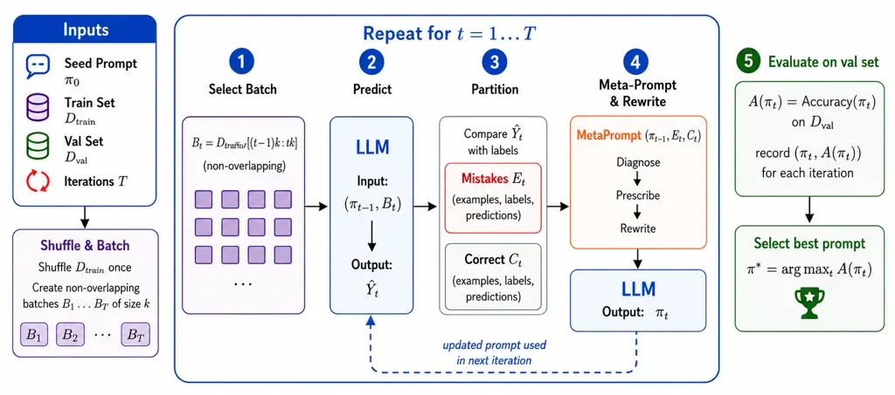
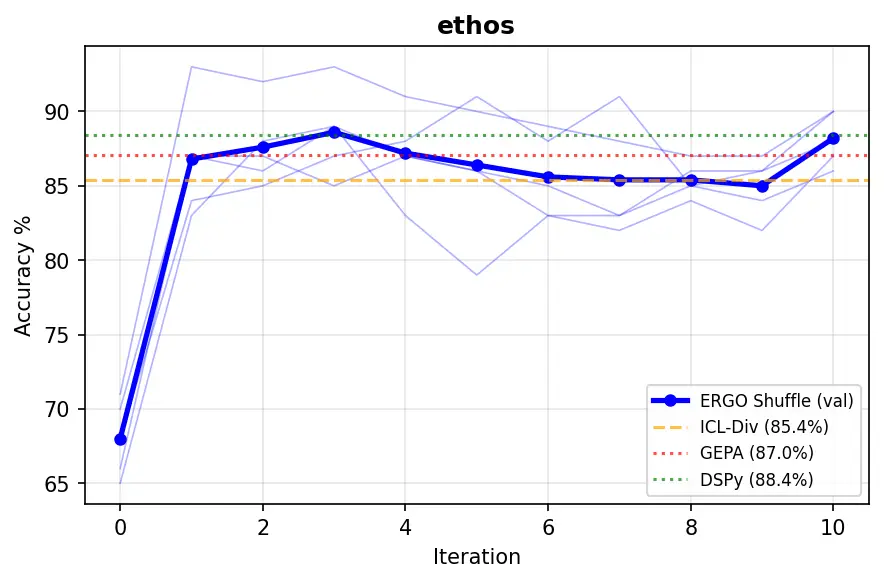
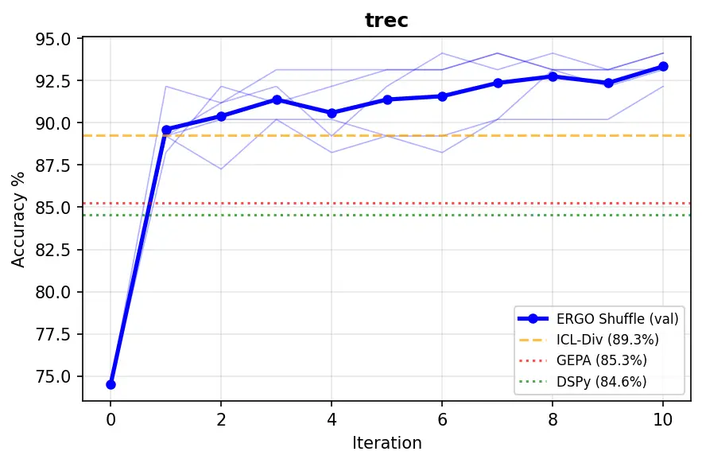

# From Errors to Rules: Iterative Prompt Optimization for Text Classification

Yueying Cui    Renhao Xue    Yi Zhang    Mukul Prasad
Affiliation: Amazon Web Services

###### Abstract

Prompt optimization for text classification spans diverse approaches,
from demonstration selection to exploration-based search to error-driven
diagnosis, each with known but incompletely characterized strengths and
limitations. We conduct a comprehensive empirical study across diverse
classification benchmarks (2 to 150 classes) comparing these paradigms
through both quantitative evaluation and qualitative analysis of
optimization traces, revealing that each paradigm excels on structurally
different task types and that no single method dominates. Guided by
these insights, we propose Error-Guided Optimization (ERGO), an
error-driven method that iterates over the full training set in
non-overlapping batches, diagnoses classification failures, and
generates targeted decision rules through a diagnose-prescribe-rewrite
feedback loop. ERGO achieves the best accuracy on tasks where errors
concentrate in specific confused label pairs (which we term
boundary-learnable tasks): TREC: 90.0%, CLINC150: 94.4%, converges in
3-5 iterations, and produces interpretable decision rules. While ERGO
does not achieve the highest overall average, it fills a complementary
role: demonstration-based ICL wins on coverage-dependent tasks,
exploration-based search wins on many-class intent, and ERGO wins where
decision boundaries are learnable from error patterns. We provide a
complementarity framework linking task characteristics to optimal
paradigm selection, offering practical guidance for practitioners.

## 1 Introduction

Prompt optimization for text classification has produced a rich
landscape of methods, from demonstration selection Liu et al. (2022) to
exploration-based search Zhou et al. (2023); Khattab et al. (2024) to
error-driven diagnosis Pryzant et al. (2023). Unlike fine-tuned models
Devlin et al. (2019); Botunac et al. (2024) that require substantial
labeled data, these methods operate in the few-shot regime Sahoo et al.
(2024), yet they embody fundamentally different optimization strategies.
Existing comparisons typically focus on overall accuracy without
analyzing when and why each approach excels Li et al. (2025); Ramnath et
al. (2025). Recent findings that prompt optimization is “statistically
indistinguishable from a coin flip” Zhang et al. (2026) further
underscore the need for a deeper understanding of which tasks benefit
from which paradigm.

We address this gap through a comprehensive empirical study across
diverse classification benchmarks (2–150 classes), comparing three
paradigms: demonstration selection methods that choose diverse few-shot
examples Liu et al. (2022); Yu et al. (2023), exploration-based methods
that search over instruction–demonstration combinations (DSPy Khattab et
al. (2024), GEPA Agrawal et al. (2026), APE Zhou et al. (2023)), and our
proposed diagnosis-based method (ERGO) that uses classification errors
to generate targeted decision rules. Our analysis reveals that these
paradigms are complementary rather than competing: each excels on
structurally different task types, and no single method dominates
overall.

We propose Error-Guided Optimization (ERGO), which iterates over the
full training set using a
diagnose$`\rightarrow`$prescribe$`\rightarrow`$rewrite meta-prompt: at
each iteration, ERGO classifies a batch, identifies confused label
pairs, and generates explicit decision rules. Unlike exploration-based
methods that treat accuracy as a black-box signal, ERGO jointly refines
instructions, demonstrations, and classification guidelines from actual
error patterns, producing interpretable rules that encode task-intrinsic
knowledge.

ERGO provides unique value on boundary-learnable tasks, where
classification errors concentrate in specific confused pairs amenable to
natural-language rules. On such tasks, ERGO achieves the best accuracy
(TREC: 90.0%, CLINC150: 94.4%), typically converges in 3-5 iterations,
and produces rules that transfer across model families. For instance, a
single misclassified query about a company triggers the rule
“organizations $`\rightarrow`$ human beings,” fixing 25+ test queries.
However, ERGO does not dominate overall: ICL-Diversity wins on
coverage-dependent tasks at zero optimization cost, and DSPy wins on
many-class tasks, confirming that the paradigms are complementary rather
than competing.

Our main contributions:

- •
  ERGO, an error-driven prompt optimization method that produces
  interpretable, transferable decision rules through iterative feedback
  over the full training set (Section 3).
- •
  A characterization of _boundary learnability_, grounded in the
  observed error structure, that identifies where those rules pay off:
  whether errors express a recurring distinction (_discovery_), whether
  it is pair-local, spread across many rare pairs, or diffuse
  (_structure_), and whether acting on it helps without collateral
  damage (_repairability_).
- •
  Case studies showing how ERGO discovers learnable decision boundaries
  that other methods miss: hidden conventions, progressive boundary
  refinement, and structural rules that generalize across label pairs
  (Section 6).
- •
  Quantitative analysis showing ERGO generalizes across 5 models from 4
  families and transfers prompts from stronger to weaker models without
  statistically significant accuracy loss (Section 5).
- •
  A practical paradigm selection framework, validated on 6 held-out
  datasets: start with ICL-Diversity, apply ERGO for boundary-learnable
  tasks, use DSPy for many-class tasks (Sections 7 and F).

## 2 Prompt Optimization Paradigms

We organize prompt-based classification methods into three paradigms:
selecting demonstrations without iterative optimization (Demonstrate),
searching over prompt variants guided by accuracy signals (Explore), and
systematically diagnosing classification errors to refine prompts
(Diagnose).

#### Paradigm 1: Demonstrate.

Select diverse few-shot examples as demonstrations Brown et al. (2020);
Dong et al. (2024). Research has explored selection strategies Liu et
al. (2022); Margatina et al. (2023), ordering effects Guo et al. (2024),
and diversity-based retrieval Yu et al. (2023). In our setup,
ICL-Diversity selects $`k{=}20`$ demonstrations via $`k`$-means on
Sentence-BERT Reimers and Gurevych (2019) embeddings Su et al. (2023);
ICL-Uniform samples randomly Brown et al. (2020). Neither involves
iterative refinement or adapts to classification errors.

#### Paradigm 2: Explore.

Methods in this paradigm search over prompt variants guided by accuracy
signals. APE Zhou et al. (2023); Honovich et al. (2023) generates
instruction candidates via LLM sampling. OPRO Yang et al. (2024) uses
LLM-driven meta-optimization. DSPy/MIPROv2 Khattab et al. (2024)
explores instruction$`\times`$demonstration combinations via Bayesian
optimization, selecting candidates based on 35-item minibatch scores.
GEPA Agrawal et al. (2026) uses evolutionary search with per-example
error feedback to guide instruction evolution. Other methods include
PromptWizard Agarwal et al. (2025), self-refinement Madaan et al.
(2023), and RL-based approaches Deng et al. (2022).

#### Paradigm 3: Diagnose.

Our contribution. While Explore methods also iterate and can use error
feedback, they treat prompt refinement as a search problem (generate
variants, evaluate, select). ERGO instead uses a structured
diagnose$`\rightarrow`$prescribe$`\rightarrow`$rewrite meta-prompt: at
each iteration, it shows the LLM both correct and incorrect predictions
from a batch, asks it to identify confused label pairs and why, then
jointly rewrites the full prompt (instruction + demonstrations +
classification guidelines) in one pass. ProTeGi Pryzant et al. (2023)
also uses LLM-generated feedback but optimizes instructions only.

#### Why does this matter?

Concurrent work Zhang et al. (2026) finds prompt optimization is
“statistically indistinguishable from a coin flip” across 4 tasks,
raising the question of when optimization is worthwhile. Prior work on
dataset difficulty Collins et al. (2018) has shown that task
characteristics are measurable from data alone; we build on this insight
to identify when error-driven refinement specifically provides value. We
confirm the overall finding: DSPy’s optimization finds no improvement
over the default instruction in 35% of runs, and evaluates candidates on
35-item minibatches that overfit by up to 14 percentage points relative
to test accuracy. Error-driven optimization addresses this by focusing
search on what actually fails: rather than searching over instruction
variants (DSPy/GEPA) or relying on fixed examples (ICL), it learns
task-specific conventions directly from structured error diagnosis.



Figure 1: ERGO overview. Inputs: a seed prompt $`\pi_{0}`$, training set
$`D_{\text{train}}`$, validation set $`D_{\text{val}}`$, and iteration
budget $`T`$. Training data is shuffled once into non-overlapping
batches of size $`k`$. Loop (steps 1–4): each iteration selects the next
batch, classifies it with the current prompt, partitions predictions
into mistakes $`E_{t}`$ and correct $`C_{t}`$, then applies the
diagnose$`\rightarrow`$prescribe$`\rightarrow`$rewrite meta-prompt to
produce an updated prompt $`\pi_{t}`$. Step 5: every candidate is
evaluated on $`D_{\text{val}}`$; the best-on-val prompt
$`\pi^{*}=\arg\max_{t}A(\pi_{t})`$ is returned.

## 3 ERGO: Error-Driven Prompt Refinement

### 3.1 Problem Formulation

Let $`\mathcal{X}`$ be an input space and
$`\mathcal{Y}=\{y_{1},\ldots,y_{K}\}`$ a finite label set. We define a
prompt $`\pi`$ as a structured tuple:

```math
\pi=(\tau,\mathcal{D},\mathcal{G}) \tag{1}
```

where $`\tau\in\mathcal{T}`$ is a natural language instruction,
$`\mathcal{D}=\{(x_{i},y_{i})\}_{i=1}^{n}`$ is a set of in-context
demonstrations, and $`\mathcal{G}`$ is a set of decision guidelines
(classification rules, boundary conditions, common pitfalls).

Given a frozen LLM
$`f_{\theta}:\mathcal{X}\times\Pi\rightarrow\mathcal{Y}`$, the prompt
optimization problem is:

```math
\displaystyle\pi^{*} \displaystyle=\arg\max_{\pi\in\Pi}\;A(\pi), \tag{2}
```

```math
\displaystyle A(\pi) \displaystyle=\mathbb{E}_{(x,y)\sim\mathcal{P}}\left[\mathbf{1}[f_{\theta}(x;\pi)=y]\right] \tag{3}
```

Since $`A(\pi)`$ depends on the full tuple
$`(\tau,\mathcal{D},\mathcal{G})`$ and the components interact (the
effectiveness of demonstrations $`\mathcal{D}`$ depends on the
instruction $`\tau`$ that frames them), we optimize all three jointly
rather than in isolation.

### 3.2 Overview

Figure 1 shows the loop. Each iteration selects the next disjoint batch
(Step 1), classifies it with the current prompt (Step 2), and partitions
predictions into mistakes and correct examples (Step 3). Both go to the
meta-prompt, which diagnoses the confused label pairs, prescribes rules
resolving them, and rewrites the full prompt (Step 4). The candidate is
scored on validation (Step 5); after $`T`$ iterations the best-scoring
candidate is returned. Correct predictions are supplied alongside errors
because they constrain the rewrite: without them the model
over-generalizes a rule and damages cases the prompt already handled.

We instantiate error-driven refinement as Error-Guided Optimization
(ERGO). Unlike exploration-based search which explores prompt variants,
ERGO uses classification errors as structured feedback: at each
iteration, it identifies _which_ label pairs are confused and generates
_why_-level decision rules to disambiguate them. Training examples are
partitioned into non-overlapping batches, ensuring every example is seen
exactly once across iterations.

### 3.3 Algorithm

#### Seed prompt.

ERGO starts from a minimal instruction (“Classify the input as exactly
one of: {LABELS}”) with a structured output format and no
demonstrations. The method’s gains come entirely from iterative
refinement.

|                       |         |         |      |      |      |      |
| --------------------- | ------- | ------- | ---- | ---- | ---- | ---- |
| Dataset               | ICL-Uni | ICL-Div | APE  | DSPy | GEPA | ERGO |
| TREC (6 cls)          | 87.8    | 89.3    | 86.8 | 84.6 | 85.3 | 90.0 |
| CLINC150 (150 cls)    | 93.0    | 93.0    | 92.8 | 93.7 | 93.2 | 94.4 |
| RTE (2 cls)           | 91.8    | 91.3    | 92.5 | 92.7 | 93.0 | 93.2 |
| Ethos (2 cls)         | 85.6    | 85.4    | 63.4 | 88.4 | 87.0 | 88.1 |
| Yahoo (10 cls)        | 73.3    | 72.7    | 72.5 | 73.9 | 72.9 | 71.7 |
| 20Newsgroups (20 cls) | 69.9    | 70.8    | 67.7 | 69.2 | 68.7 | 66.8 |
| Rotten Tom. (2 cls)   | 93.2    | 93.2    | 92.6 | 92.9 | 93.7 | 92.8 |
| MASSIVE (60 cls)      | 90.1    | 89.2    | 89.3 | 90.0 | 89.4 | 87.8 |
| Average (8)           | 85.6    | 85.6    | 82.2 | 85.7 | 85.4 | 85.6 |

Table 1: Test accuracy (%) on 8 classification benchmarks (mean over 5
seeds; $`\pm`$std in Table 15). Bold = best. No method significantly
outperforms all others overall (paired $`t`$-test, $`p{>}0.05`$).

#### Feedback-first meta-prompt.

At each iteration, the meta-prompt provides the LLM with: (a) all
correctly classified examples from the batch, (b) all misclassified
examples with predicted vs. true labels, and instructs the LLM to: (1)
_diagnose_ which label pairs are confused and why, (2) _prescribe_
specific decision rules, (3) _rewrite_ the full prompt (full template in
Appendix M; pseudocode in Algorithm 1). A key byproduct is
interpretability: the resulting prompts contain human-readable decision
rules that practitioners can audit, refine, or use as annotation
guidelines.

#### Random non-overlapping batches.

Training examples are shuffled once; sequential 20-item batches ensure
each example is seen exactly once across iterations, maximizing
information coverage without stratification complexity.

#### Best-of-$`T`$ selection.

Since LLM generation is stochastic and improvement is not guaranteed at
every step, ERGO retains all candidate prompts and returns the best by
validation accuracy. Each candidate is evaluated on the full validation
set to reduce selection noise. Empirically, the optimal prompt is found
within 3–5 iterations.

## 4 Experiments

### 4.1 Setup

#### Datasets.

We evaluate on 8 representative classification benchmarks spanning 2–150
classes, including Ethos Mollas et al. (2022), RTE Wang et al. (2018),
and CLINC150 among others (full details in Appendix A). Each uses a
stratified split targeting 200 training, 100 validation, and 500 test
examples, reduced proportionally for smaller datasets (CLINC150: 150
validation examples, 1/class with full label coverage).

#### Model.

Claude Sonnet 4.5 via AWS Bedrock (temperature=0.0). Per run, ERGO
completes in 16.4 min on average vs. DSPy (28.8 min) and GEPA (30.9
min); full cost comparison in Table 19. All hyperparameters are
consolidated in Appendix J.

#### Seeds.

All experiments use 5 random seeds (42, 123, 7, 1, 2). Statistical
significance via paired $`t`$-test at 5% level across all 40
configurations (8 datasets $`\times`$ 5 seeds).

#### Baselines.

\(1\) ICL-Uniform: 20 random demos; (2) ICL-Diversity: 20 demos via
$`k`$-means on Sentence-BERT Reimers and Gurevych (2019); (3) APE Zhou
et al. (2023): best-of-5 instructions; (4) DSPy Khattab et al. (2024);
Sarmah et al. (2024): MIPROv2 auto="light"; (5) GEPA Agrawal et al.
(2026): evolutionary prompt optimization (our primary comparison target
as the closest iterative method). We also evaluate ProTeGi Pryzant et
al. (2023), another error-feedback method; its $`7.7\times`$ higher
compute cost and instruction-only optimization make it less directly
comparable, so we report it separately in Appendix K.

### 4.2 Main Results

Table 1 shows results on 8 classification benchmarks.

#### Error structure identifies where optimization pays off.

On tasks whose errors concentrate in a learnable boundary, ERGO
discovers reusable decision rules. On TREC, one confused pair (entities
$`\leftrightarrow`$ human beings) accounts for most errors and one rule
resolves them: this is a pair-local boundary, and ERGO reaches 90.0%
(+4.7 pp over GEPA). CLINC150 exhibits shared structural boundaries,
where several rare pairs each express the same distinction (a specific
intent collapsing into its general sibling), and ERGO leads with 94.4%
(+1.2%, $`p{=}0.043`$). In both cases the errors satisfy the three
conditions of boundary learnability: a recurring distinction surfaces
(_discovery_), it compresses into reusable rules (_structure_), and
applying the rules improves accuracy with limited collateral damage
(_repairability_).

#### Explore and Demonstrate win on coverage tasks.

ICL-Diversity wins on 20Newsgroups (70.8% vs ERGO’s 66.8%,
$`p{=}0.013`$), ICL-Uniform on MASSIVE (90.1% vs 87.8%, $`p{<}0.001`$),
and DSPy on Yahoo (73.9% vs 71.7%, $`p{=}0.046`$). These tasks require
broad coverage of many overlapping categories whose errors do not
concentrate in a few learnable pairs, so demonstrations or exploration
outperform targeted rules (Table 12 in the appendix summarizes the error
structure of all benchmarks).

#### Overall: no method dominates.

ERGO averages 85.6%, not significantly different from ICL-Diversity
(85.6%), DSPy (85.7%), or GEPA (85.4%), all pairwise $`p{>}0.6`$. Only
APE is significantly worse ($`p{=}0.013`$). The ordering is unchanged
under macro-F1 and macro-recall (Appendix D). The contribution is not a
new state-of-the-art but identifying when each paradigm provides unique
value: ERGO for boundary-learnable tasks, ICL for coverage tasks, and
DSPy/GEPA for broad-coverage optimization.

## 5 Quantitative Analysis

### 5.1 Convergence: Rapid Error-Driven Learning



(a) Ethos: 68%$`\rightarrow`$88.6% in 3 iters



(b) TREC: 74.5%$`\rightarrow`$91.4% in 3 iters

Figure 2: ERGO convergence on boundary-learnable tasks. Dashed lines:
ICL-Div, GEPA, and DSPy baselines. ERGO captures 80% of total gain in
the first 3 iterations.

Figure 2 shows ERGO’s convergence on the two tasks with most dramatic
early improvement. On Ethos, ERGO jumps from 68% to 88.6% (+20.6%) in
just 3 iterations as it learns the profanity-vs-targeting boundary. On
TREC, it jumps from 74.5% to 91.4% (+16.9%) as it discovers the
organizations-as-human-beings convention. Both surpass GEPA’s final
accuracy within 1–2 iterations; on TREC, ERGO also surpasses DSPy. Rapid
convergence is a signature of boundary learnability: when errors have
pair-local structure, a single iteration can discover the dominant
confused pair and prescribe a rule that repairs it, so most of the gain
is available early.

### 5.2 Homogeneous Training: Model Generalization

To test whether ERGO generalizes beyond Claude, we run the full protocol
(optimize, validate, and infer with the same model) on five models from
four families: Claude Haiku 4.5 and Sonnet 4.5, Gemma 3 27B IT, and
Mistral Large 3 (Table 2; per-dataset breakdown in Table 10). Pooled
across all 200 (model, dataset, seed) triples, ERGO improves over the
baseline by $`+5.67`$ pp ($`t{=}6.34`$, $`p{=}1.5{\times}10^{-9}`$).
Four of five models gain significantly with the same meta-prompt and no
model-specific tuning. ERGO wins on $`61.0\%`$ of individual (dataset,
seed) pairs.

#### Largest gains come from weak-baseline datasets.

ETHOS ($`+28.7`$ pp) and TREC ($`+16.4`$ pp) drive most of the
cross-model improvement: the seed prompt produces near-random output for
several models, and ERGO’s error-driven feedback corrects these issues
within a few iterations. On near-ceiling tasks ($`\geq 0.93`$ baseline)
gains are minimal.

|             |          |       |                          |
| ----------- | -------- | ----- | ------------------------ |
| Model       | Baseline | ERGO  | $`\Delta`$ (pp)          |
| Sonnet 4.5  | 80.30    | 85.55 | $`+5.25^{**}`$           |
| Haiku 4.5   | 74.09    | 82.37 | $`+8.29^{**}`$           |
| Mistral L3  | 75.44    | 78.97 | $`+3.53^{*}`$            |
| Gemma 3 27B | 69.33    | 70.51 | $`+1.18^{\text{n.s.}}`$  |
| Overall     | 74.31    | 79.98 | $`\mathbf{+5.67^{***}}`$ |

Table 2: Homogeneous training: ERGO vs. seed-prompt baseline across
model families (8 datasets, 5 seeds, $`N{=}40`$ per model). $`\Delta`$
in percentage points; $`p`$-value from paired $`t`$-test.
$`{}^{***}\,p{<}0.001`$, $`{}^{**}\,p{<}0.01`$, $`{}^{*}\,p{<}0.05`$.

### 5.3 Homogeneous Training: Ablation Studies

We isolate the effect of four ERGO hyperparameters on Sonnet 4.5 across
all 8 datasets with 3 seeds (Table 18 in Appendix). Across all 16
variants the spread is only $`1.40`$ pp (84.85–86.24), and no variant
differs significantly from the default except $`k{=}50`$ batch size
($`+1.29`$ pp, $`p{=}7.5{\times}10^{-3}`$). Key findings: accuracy
plateaus by T$`{=}5`$ (99% of T$`{=}10`$ at 73% cost), shuffle
outperforms class-balanced sampling while using 18% fewer calls, and
joint rewriting of all components avoids catastrophic failures on
boundary-learnable tasks despite demos-only yielding marginally higher
average accuracy. ERGO is robust to hyperparameter choice.

### 5.4 Heterogeneous Training: Sonnet Refines, Haiku Infers

We next decouple the refinement and inference models. Claude Sonnet 4.5
runs the ERGO loop (generating refined prompts from its own
classifications and feedback), and the resulting best-on-val prompt is
then used by Claude Haiku 4.5 for test-time inference (Table 3;
per-dataset numbers in Table 11). Sonnet-refined prompts give Haiku a
$`+8.83`$ pp lift over its seed-prompt baseline ($`t{=}3.52`$,
$`p{=}1.1{\times}10^{-3}`$). The gap to homogeneous Haiku-ERGO is
$`+0.55`$ pp, which is not significant ($`p{=}0.22`$). The optimized
prompt thus carries task knowledge that transfers cleanly to a smaller
inference model: a stronger model can be used once for refinement, and
the resulting prompt can be deployed with a cheaper model without
statistically significant accuracy loss ($`p{=}0.22`$).

|                                                   |      |
| ------------------------------------------------- | ---- |
| Setting                                           | Acc  |
| Baseline (seed prompt, Haiku)                     | 74.1 |
| Heterogeneous ERGO (Sonnet $`\rightarrow`$ Haiku) | 82.9 |
| Homogeneous ERGO (Haiku $`\rightarrow`$ Haiku)    | 82.4 |

Table 3: Heterogeneous training: prompts refined on Sonnet 4.5 are used
by Haiku 4.5 at test time (8 datasets, 5 seeds). Hetero vs. baseline:
$`p{=}0.001`$; hetero vs. homo: $`p{=}0.22`$ (n.s.).

### 5.5 Robustness to Annotation Noise

We identify 162 queries (4.6% of all test data) where ERGO, DSPy, and
GEPA across all 5 seeds unanimously predict the same “wrong” answer.
Manual review confirms the majority are clear annotation errors (e.g.,
gold labels contradicting the text), with the remainder being ambiguous
boundary cases. Removing these, the relative performance gaps are
unchanged (ERGO vs GEPA: +0.3% raw $`\rightarrow`$ +0.3% clean),
confirming that ERGO’s advantage comes from learning genuine task
conventions, not fitting annotation noise.

|                           |                      |                |                       |
| ------------------------- | -------------------- | -------------- | --------------------- |
| Task characteristic       | Recommended paradigm | Method         | Example datasets      |
| Learnable boundaries      | Diagnose             | ERGO           | TREC, Ethos, CLINC150 |
| Need interpretable output | Diagnose             | ERGO           | Ethos                 |
| Many-class + broad        | Explore              | DSPy           | MASSIVE, Yahoo        |
| Many overlapping classes  | Demonstrate          | ICL            | 20News                |
| Zero optimization budget  | Demonstrate          | ICL            | Any                   |
| Near-ceiling tasks        | Any                  | ICL (cheapest) | Rotten Tom.           |

Table 4: Paradigm selection guide based on task characteristics.

## 6 Case Studies

The quantitative results show that ERGO wins on boundary-learnable
tasks; here we show why, with each case study illustrating a different
condition of boundary learnability: _discovery_ of a recurring
distinction from a single error (TREC), _structure_ where one rule
repairs an entire class of confusions (CLINC150), and _repairability_
through progressive refinement (Ethos).

### 6.1 TREC: Learning Hidden Conventions

TREC (6-class question type classification) illustrates _pair-local_
boundary learnability: errors concentrate in one confused pair, and a
single rule resolves them. The task contains a counterintuitive labeling
convention: questions about companies, schools, or organizations should
be classified as “human beings,” a rule that cannot be inferred from the
label name alone. For instance, “What is the first personal computer
company?” and “What army’s motto is Blood and Fire?” are both
gold-labeled “human beings” (full table in Appendix B).

ERGO discovers this convention at iteration 3 (seed 123), when the batch
contains “What Japanese electronics company was named for a coastal
city?” misclassified as “entities.” The meta-prompt diagnoses: _“The
classifier incorrectly treats companies as entities rather than human
organizations,”_ and prescribes: _“Add rule: ‘What
\[company/organization/band/team\]’ $`\rightarrow`$ human beings.”_ This
single error triggers a rule that fixes 25+ test queries across all
seeds. Per-class analysis confirms ERGO’s gains concentrate on the
“human beings” class (+5.5 pp over ICL-Diversity; Table 7).

### 6.2 CLINC150: Structural Rule Generalization

CLINC150 (150-class intent detection) illustrates _shared structural_
boundaries: many individually rare confused pairs all instantiate the
same distinction, so a single rule repairs them together. The task
contains many near-identical label pairs that differ only by action vs.
status: “set up a reminder so I don’t forget the baby shower” should map
to reminder_update (creating), not reminder (querying); similarly, “how
did my bank account get frozen” maps to account_blocked (status), not
freeze_account (action).

ERGO learns the general principle from a single misclassified example:
creating or modifying maps to \_update variants, while querying or
viewing maps to base variants. This structural rule generalizes across
multiple label pairs (reminder/reminder_update,
calendar/calendar_update, freeze_account/account_blocked): a single
principle learned from one error fixes an entire class of confusions
(Table 9).

### 6.3 Ethos: Progressive Boundary Refinement

Ethos (binary hate speech detection) illustrates _repairability_: each
iteration prescribes a rule that repairs a subset of errors without
damaging cases the prompt already handles. ERGO learns the
profanity-vs-targeting boundary progressively over 3 iterations, jumping
from 68% to 86.8% at iteration 1 by prescribing “True requires BOTH
targeting based on identity AND dehumanization/threats,” then refining
with two further rules about abstract dismissals and non-protected
characteristics (full progression in Appendix B). The final prompt is
directly interpretable and auditable as an annotation guideline. We note
that this rule captures the annotation criterion used in the Ethos
dataset; other hate-speech datasets with different annotation guidelines
may require different boundary rules, which ERGO would discover from
their respective error patterns.

## 7 Comparative Analysis

The three paradigms are complementary: _demonstrate_ (ICL) excels on
coverage-dependent tasks, _explore_ (DSPy/GEPA) on many-class tasks, and
_diagnose_ (ERGO) on boundary-learnable tasks.

### 7.1 ERGO vs. GEPA: Error-Driven vs. Exploration-Based

We compare against GEPA as the closest iterative method: both refine
instruction-based prompts, but GEPA generates rules via evolutionary
search while ERGO learns them incrementally from errors.

Across our benchmarks, we identify 113 queries where ERGO consistently
gets right but GEPA gets wrong (3+ seeds), and 84 in the reverse
direction.

#### Why they fail in opposite ways:

ERGO over-constrains (rules too specific misfire on edge cases); GEPA
under-constrains (generic guidelines miss task-specific boundaries). On
TREC, GEPA’s rule covers only organizations that “did something,”
missing identification questions. Conversely, ERGO’s “profanity $`\neq`$
hate” rule misses gendered slurs that GEPA’s broader definition catches.
The failure modes reflect boundary structure: ERGO excels on
_pair-local_ and _shared structural_ tasks where errors compress into
reusable rules (TREC, Ethos, CLINC150); exploration and demonstrations
win on coverage tasks (20Newsgroups, Yahoo, MASSIVE) where errors do not
concentrate in learnable pairs (see Section B.4 for a detailed
20Newsgroups example).

#### Convergence and stability:

On boundary-learnable tasks, ERGO converges in 3 iterations (Ethos:
68%$`\rightarrow`$88.6%, TREC: 74.5%$`\rightarrow`$91.4%), surpassing
GEPA’s final accuracy within 1–2 iterations. GEPA finds one good
mutation early then cannot improve further (Ethos: 1 accepted out of 124
iterations). ERGO is 4–10$`\times`$ more stable across seeds (Ethos: std
0.13% vs 1.25%) because learned rules apply deterministically
(Table 15).

### 7.2 ERGO vs. ICL: Rules vs. Demonstrations

ICL-Diversity edges ERGO overall (85.9% vs. 85.6%), though the
difference is not statistically significant. ERGO wins on 4
boundary-learnable tasks (Ethos +2.6%, RTE +1.9%, CLINC150 +1.4%, TREC
+0.7%); ICL wins on broad-coverage tasks (20Newsgroups $`-`$4.0%,
MASSIVE $`-`$1.3%).

#### Why they differ:

Demonstrations cannot express abstract rules. On Ethos, a demo showing
“Kill them all = False” helps one query, but ERGO’s explicit rule
“profanity without group targeting = False” generalizes to all similar
cases. On CLINC150, 20 demos cover only 13% of 150 labels and cannot
demonstrate the action-vs-status distinction for most pairs. Conversely,
on broad-coverage tasks, ICL’s holistic pattern matching outperforms
ERGO’s keyword-based rules that misfire across overlapping categories.
The fundamental tradeoff: rules are precise but brittle; demonstrations
are robust but implicit.

### 7.3 When Does Each Paradigm Win?

A key finding is that the cheapest method (ICL-Diversity, zero
optimization cost) is already optimal on the majority of tasks —
iterative optimization is justified only under specific, identifiable
conditions (Table 4).

We recommend the following decision procedure: (1) start with
ICL-Diversity as a zero-cost baseline; (2) inspect the errors: if they
reveal a recurring distinction (_discovery_) that is either _pair-local_
(one dominant confused pair) or _shared structural_ (many rare pairs
expressing the same distinction), apply ERGO; verify the rules help
without collateral damage (_repairability_); (3) if errors spread across
many pairs with no shared mechanism, try DSPy’s structured taxonomy
framing; (4) when interpretability or annotation guidelines are needed,
prefer ERGO regardless of margin.

For near-ceiling tasks where all methods converge to similar accuracy,
ICL is the cheapest option and optimization provides no statistically
significant benefit. We validate this procedure on 6 additional datasets
(Appendix F): errors spread across many pairs with no shared mechanism
reliably identify tasks where optimization is unnecessary, and
concentrated errors with _pair-local_ or _shared structural_ form that
prove repairable identify tasks where ERGO provides value.

## 8 Conclusion

We propose ERGO, a prompt optimization method that iterates over the
full training set in non-overlapping batches, diagnoses classification
errors using both mistakes and correct predictions as contrast, and
generates interpretable decision rules. Through case studies on 8
classification benchmarks, we demonstrate that error-driven refinement
discovers task conventions invisible to other paradigms, such as
“organizations = human beings” in TREC and “profanity without targeting
$`\neq`$ hate speech” in Ethos.

Our central finding is that the three paradigms (demonstrate, explore,
and diagnose) are complementary rather than competing: no method
significantly outperforms the others overall. ERGO excels on
boundary-learnable tasks, those whose errors satisfy _discovery_,
_structure_, and _repairability_, while ICL-Diversity on
coverage-dependent tasks at zero optimization cost, and DSPy/GEPA on
many-class tasks requiring broad exploration.

The practical contribution is a paradigm selection framework linking
task characteristics to the optimal method. Future work includes
adapting batch strategies for many-class settings and exploring hybrid
approaches that combine multiple paradigms.

## Limitations

#### Not universally better.

ERGO is not significantly different from ICL-Diversity overall, though
it shows lower accuracy on coverage-dependent tasks such as 20Newsgroups
and MASSIVE. We do not claim dominance; the contribution is identifying
when error-driven refinement provides unique value.

#### Task scope.

ERGO is designed for classification with learnable boundaries and is not
suitable for generation or multi-hop reasoning. All benchmarks are
English-only, and while they span diverse domains and class counts, many
task domains (e.g., legal, medical) remain untested; generalizability
beyond our benchmark suite remains to be validated.

#### Scaling and batch coverage.

The fixed batch size ($`k{=}20`$) may need adjustment for many-class
tasks. On CLINC150 (150 classes) and MASSIVE (60 classes), random
20-item batches cover only 10–15% of classes per iteration, limiting
error signal diversity. As the number of classes grows, the generated
rules may not generalize across all class boundaries, and limited or
imbalanced training data may not expose representative error patterns.

#### Heterogeneous training assumption.

We assume the learning model (which generates rules) is at least as
strong as the task model (which applies them at inference).
Weak-to-strong settings (e.g., Haiku optimizing prompts for Sonnet)
remain to be validated.

#### Use of AI assistants.

AI writing assistants were used for language editing and literature
searching during the preparation of this manuscript. All generated
content was verified, revised, and approved by the authors, who take
full responsibility for the final text.

## References

- Agarwal et al. (2025) E. Agarwal, R. Magazine, J. Singh, V. Dani, T.
  Ganu, and A. Nambi PromptWizard: optimizing prompts via task-aware,
  feedback-driven self-evolution. In Findings of the Association for
  Computational Linguistics: ACL 2025, Vienna, Austria, pp. 19974–20003.
  External Links:
  [Link](https://aclanthology.org/2025.findings-acl.1025/) Cited by: §2.
- Agrawal et al. (2026) L. A. Agrawal, S. Tan, D. Soylu, N. Ziems, R.
  Khare, K. Opsahl-Ong, A. Singhvi, H. Shandilya, M. J. Ryan, M.
  Jiang, C. Potts, K. Sen, A. Dimakis, I. Stoica, D. Klein, M. Zaharia,
  and O. Khattab GEPA: reflective prompt evolution can outperform
  reinforcement learning. In International Conference on Learning
  Representations, External Links:
  [Link](https://openreview.net/forum?id=RQm2KQTM5r) Cited by: §1, §2,
  §4.1.
- Botunac et al. (2024) I. Botunac, M. Brkić Bakarić, and M. Matetić
  Comparing fine-tuning and prompt engineering for multi-class
  classification in hospitality review analysis. Applied Sciences 14
  (14), pp. 6254. External Links:
  [Document](https://dx.doi.org/10.3390/app14146254),
  [Link](https://doi.org/10.3390/app14146254) Cited by: §1.
- Brown et al. (2020) T. B. Brown, B. Mann, N. Ryder, M. Subbiah, J.
  Kaplan, P. Dhariwal, A. Neelakantan, P. Shyam, G. Sastry, A.
  Askell, S. Agarwal, A. Herbert-Voss, G. Krueger, T. Henighan, R.
  Child, A. Ramesh, D. M. Ziegler, J. Wu, C. Winter, C. Hesse, M.
  Chen, E. Sigler, M. Litwin, S. Gray, B. Chess, J. Clark, C. Berner, S.
  McCandlish, A. Radford, I. Sutskever, and D. Amodei Language models
  are few-shot learners. In Advances in Neural Information Processing
  Systems, Vol. 33, pp. 1877–1901. External Links:
  [Link](https://proceedings.neurips.cc/paper/2020/hash/1457c0d6bfcb4967418bfb8ac142f64a-Abstract.html)
  Cited by: §2.
- Casanueva et al. (2020) I. Casanueva, T. Temcinas, D. Gerz, M.
  Henderson, and I. Vulic Efficient intent detection with dual sentence
  encoders. In Proceedings of the 2nd Workshop on Natural Language
  Processing for Conversational AI, pp. 38–45. Cited by: Table 13.
- Collins et al. (2018) E. Collins, N. Rozanov, and B. Zhang
  Evolutionary data measures: understanding the difficulty of text
  classification tasks. External Links: 1811.01910,
  [Link](https://arxiv.org/abs/1811.01910) Cited by: §2.
- Deng et al. (2022) M. Deng, J. Wang, C. Hsieh, Y. Wang, H. Guo, T.
  Shu, M. Song, E. Xing, and Z. Hu RLPrompt: optimizing discrete text
  prompts with reinforcement learning. In Proceedings of the 2022
  Conference on Empirical Methods in Natural Language Processing, Abu
  Dhabi, United Arab Emirates, pp. 3369–3391. External Links:
  [Document](https://dx.doi.org/10.18653/v1/2022.emnlp-main.222),
  [Link](https://aclanthology.org/2022.emnlp-main.222/) Cited by: §2.
- Devlin et al. (2019) J. Devlin, M. Chang, K. Lee, and K. Toutanova
  BERT: pre-training of deep bidirectional transformers for language
  understanding. In Proceedings of the 2019 Conference of the North
  American Chapter of the Association for Computational Linguistics:
  Human Language Technologies, Vol. 1, Minneapolis, Minnesota,
  pp. 4171–4186. External Links:
  [Document](https://dx.doi.org/10.18653/v1/N19-1423),
  [Link](https://aclanthology.org/N19-1423) Cited by: §1.
- Dong et al. (2024) Q. Dong, L. Li, D. Dai, C. Zheng, J. Ma, R. Li, H.
  Xia, J. Xu, Z. Wu, B. Chang, X. Sun, L. Li, and Z. Sui A survey on
  in-context learning. In Proceedings of the 2024 Conference on
  Empirical Methods in Natural Language Processing, Miami, Florida, USA,
  pp. 1107–1128. External Links:
  [Document](https://dx.doi.org/10.18653/v1/2024.emnlp-main.64),
  [Link](https://aclanthology.org/2024.emnlp-main.64) Cited by: §2.
- FitzGerald et al. (2023) J. FitzGerald, C. Hench, C. Peris, S.
  Mackie, K. Rottmann, A. Sanchez, A. Nash, L. Urbach, V. Kakarala, R.
  Singh, S. Ranganath, L. Crist, M. Britan, W. Leeuwis, G. Tur, and P.
  Natarajan MASSIVE: a 1m-example multilingual natural language
  understanding dataset with 51 typologically-diverse languages. In
  Proceedings of the 61st Annual Meeting of the Association for
  Computational Linguistics (Volume 1: Long Papers), Toronto, Canada,
  pp. 4277–4302. External Links:
  [Document](https://dx.doi.org/10.18653/v1/2023.acl-long.235),
  [Link](https://aclanthology.org/2023.acl-long.235/) Cited by: Table 5.
- Guo et al. (2024) Q. Guo, L. Wang, Y. Wang, W. Ye, and S. Zhang What
  makes a good order of examples in in-context learning. In Findings of
  the Association for Computational Linguistics: ACL 2024, Bangkok,
  Thailand, pp. 14892–14904. External Links:
  [Document](https://dx.doi.org/10.18653/v1/2024.findings-acl.884),
  [Link](https://aclanthology.org/2024.findings-acl.884/) Cited by: §2.
- Honovich et al. (2023) O. Honovich, U. Shaham, S. R. Bowman, and O.
  Levy Instruction induction: from few examples to natural language task
  descriptions. In Proceedings of the 61st Annual Meeting of the
  Association for Computational Linguistics (Volume 1: Long Papers),
  Toronto, Canada, pp. 1935–1952. External Links:
  [Document](https://dx.doi.org/10.18653/v1/2023.acl-long.108),
  [Link](https://aclanthology.org/2023.acl-long.108/) Cited by: §2.
- Khattab et al. (2024) O. Khattab, A. Singhvi, P. Maheshwari, Z.
  Zhang, K. Santhanam, S. Vardhamanan, S. Haq, A. Sharma, T. T.
  Joshi, H. Moazam, H. Miller, M. Zaharia, and C. Potts DSPy: compiling
  declarative language model calls into state-of-the-art pipelines. In
  International Conference on Learning Representations, External Links:
  [Link](https://openreview.net/forum?id=sY5N0zY5Od) Cited by: §1, §1,
  §2, §4.1.
- Lang (1995) K. Lang NewsWeeder: learning to filter netnews. In Machine
  Learning Proceedings 1995, pp. 331–339. External Links:
  [Document](https://dx.doi.org/10.1016/B978-1-55860-377-6.50048-7),
  [Link](https://doi.org/10.1016/B978-1-55860-377-6.50048-7) Cited by:
  Table 5.
- Larson et al. (2019) S. Larson, A. Mahendran, J. J. Peper, C.
  Clarke, A. Lee, P. Hill, J. K. Kummerfeld, K. Leach, M. A.
  Laurenzano, L. Tang, and J. Mars An evaluation dataset for intent
  classification and out-of-scope prediction. In Proceedings of the 2019
  Conference on Empirical Methods in Natural Language Processing and the
  9th International Joint Conference on Natural Language Processing,
  Hong Kong, China, pp. 1311–1316. External Links:
  [Document](https://dx.doi.org/10.18653/v1/D19-1131),
  [Link](https://aclanthology.org/D19-1131/) Cited by: Table 5.
- Leone (2020) S. Leone Rotten tomatoes movies and critic reviews
  dataset. Kaggle. External Links:
  [Link](https://www.kaggle.com/datasets/stefanoleone992/rotten-tomatoes-movies-and-critic-reviews-dataset)
  Cited by: Table 5.
- Li et al. (2025) W. Li, X. Wang, W. Li, and B. Jin A survey of
  automatic prompt engineering: an optimization perspective. External
  Links: 2502.11560,
  [Document](https://dx.doi.org/10.48550/arXiv.2502.11560),
  [Link](https://arxiv.org/abs/2502.11560) Cited by: §1.
- Li and Roth (2002) X. Li and D. Roth Learning question classifiers. In
  COLING 2002: The 19th International Conference on Computational
  Linguistics, External Links:
  [Link](https://aclanthology.org/C02-1150/) Cited by: Table 5.
- Liu et al. (2022) J. Liu, D. Shen, Y. Zhang, B. Dolan, L. Carin,
  and W. Chen What makes good in-context examples for GPT-3?. In
  Proceedings of Deep Learning Inside Out (DeeLIO 2022): The 3rd
  Workshop on Knowledge Extraction and Integration for Deep Learning
  Architectures, Dublin, Ireland and Online, pp. 100–114. External
  Links: [Document](https://dx.doi.org/10.18653/v1/2022.deelio-1.10),
  [Link](https://aclanthology.org/2022.deelio-1.10) Cited by: §1, §1,
  §2.
- Maas et al. (2011) A. L. Maas, R. E. Daly, P. T. Pham, D. Huang, A. Y.
  Ng, and C. Potts Learning word vectors for sentiment analysis. In
  Proceedings of the 49th Annual Meeting of the Association for
  Computational Linguistics, pp. 142–150. Cited by: Table 13.
- Madaan et al. (2023) A. Madaan, N. Tandon, P. Gupta, S. Hallinan, L.
  Gao, S. Wiegreffe, U. Alon, N. Dziri, S. Prabhumoye, Y. Yang, S.
  Gupta, B. P. Majumder, K. Hermann, S. Welleck, A. Yazdanbakhsh, and P.
  Clark Self-refine: iterative refinement with self-feedback. In
  Advances in Neural Information Processing Systems, Vol. 36. External
  Links:
  [Link](https://proceedings.neurips.cc/paper_files/paper/2023/hash/91edff07232fb1b55a505a9e9f6c0ff3-Abstract-Conference.html)
  Cited by: §2.
- Maggie et al. (2020) Maggie, P. Culliton, and W. Chen Tweet sentiment
  extraction. Kaggle. External Links:
  [Link](https://kaggle.com/competitions/tweet-sentiment-extraction)
  Cited by: Table 13.
- Margatina et al. (2023) K. Margatina, T. Schick, N. Aletras, and J.
  Dwivedi-Yu Active learning principles for in-context learning with
  large language models. In Findings of the Association for
  Computational Linguistics: EMNLP 2023, Singapore, pp. 5011–5034.
  External Links:
  [Document](https://dx.doi.org/10.18653/v1/2023.findings-emnlp.334),
  [Link](https://aclanthology.org/2023.findings-emnlp.334) Cited by: §2.
- Misra (2022) R. Misra News category dataset. External Links:
  [Link](https://arxiv.org/abs/2209.11429) Cited by: Table 13.
- Mollas et al. (2022) I. Mollas, Z. Chrysopoulou, S. Karlos, and G.
  Tsoumakas ETHOS: a multi-label hate speech detection dataset. Complex
  & Intelligent Systems 8 (6), pp. 4663–4678. External Links:
  [Document](https://dx.doi.org/10.1007/s40747-021-00608-2) Cited by:
  Table 5, §4.1.
- Pryzant et al. (2023) R. Pryzant, D. Iter, J. Li, Y. Lee, C. Zhu,
  and M. Zeng Automatic prompt optimization with “gradient descent” and
  beam search. In Proceedings of the 2023 conference on empirical
  methods in natural language processing, pp. 7957–7968. Cited by:
  Appendix K, §1, §2, §4.1.
- Ramnath et al. (2025) K. Ramnath, K. Zhou, S. Guan, S. S. Mishra, X.
  Qi, Z. Shen, S. Wang, S. Woo, S. Jeoung, Y. Wang, H. Wang, H. Ding, Y.
  Lu, Z. Xu, Y. Zhou, B. Srinivasan, Q. Yan, Y. Chen, H. Ding, P. Xu,
  and L. L. Cheong A systematic survey of automatic prompt optimization
  techniques. In Proceedings of the 2025 Conference on Empirical Methods
  in Natural Language Processing, Suzhou, China, pp. 33078–33110.
  External Links:
  [Document](https://dx.doi.org/10.18653/v1/2025.emnlp-main.1681),
  [Link](https://aclanthology.org/2025.emnlp-main.1681/) Cited by: §1.
- Reimers and Gurevych (2019) N. Reimers and I. Gurevych Sentence-bert:
  sentence embeddings using siamese bert-networks. In Proceedings of the
  2019 conference on empirical methods in natural language processing
  and the 9th international joint conference on natural language
  processing (EMNLP-IJCNLP), pp. 3982–3992. Cited by: §2, §4.1.
- Sahoo et al. (2024) P. Sahoo, A. K. Singh, S. Saha, V. Jain, S.
  Mondal, and A. Chadha A systematic survey of prompt engineering in
  large language models: techniques and applications. External Links:
  2402.07927, [Link](https://arxiv.org/abs/2402.07927) Cited by: §1.
- Sarmah et al. (2024) B. Sarmah, K. Dutta, A. Grigoryan, S. Tiwari, S.
  Pasquali, and D. Mehta A comparative study of DSPy teleprompter
  algorithms for aligning large language models evaluation metrics to
  human evaluation. External Links: 2412.15298,
  [Document](https://dx.doi.org/10.48550/arXiv.2412.15298),
  [Link](https://arxiv.org/abs/2412.15298) Cited by: §4.1.
- Su et al. (2023) H. Su, J. Kasai, C. H. Wu, W. Shi, T. Wang, J.
  Xin, R. Zhang, M. Ostendorf, L. Zettlemoyer, N. A. Smith, and T. Yu
  Selective annotation makes language models better few-shot learners.
  In International Conference on Learning Representations, External
  Links: [Link](https://openreview.net/forum?id=qY1hlv7gwg) Cited by:
  §2.
- Talmor et al. (2019) A. Talmor, J. Herzig, N. Lourie, and J. Berant
  CommonsenseQA: a question answering challenge targeting world
  knowledge. In Proceedings of NAACL-HLT, pp. 4149–4158. Cited by: Table 13.
- Wang et al. (2018) A. Wang, A. Singh, J. Michael, F. Hill, O. Levy,
  and S. Bowman GLUE: a multi-task benchmark and analysis platform for
  natural language understanding. In Proceedings of the 2018 EMNLP
  workshop BlackboxNLP: Analyzing and interpreting neural networks for
  NLP, pp. 353–355. Cited by: Table 5, §4.1.
- Yang et al. (2024) C. Yang, X. Wang, Y. Lu, H. Liu, Q. V. Le, D. Zhou,
  and X. Chen Large language models as optimizers. In International
  Conference on Learning Representations, External Links:
  [Link](https://openreview.net/forum?id=Bb4VGOWELI) Cited by: §2.
- Yu et al. (2023) W. Yu, D. Iter, S. Wang, Y. Xu, M. Ju, S. Sanyal, C.
  Zhu, M. Zeng, and M. Jiang Generate rather than retrieve: large
  language models are strong context generators. In International
  Conference on Learning Representations, External Links:
  [Link](https://openreview.net/forum?id=fB0hRu9GZUS) Cited by: §1, §2.
- Zhang et al. (2015a) X. Zhang, J. Zhao, and Y. LeCun Character-level
  convolutional networks for text classification. In Advances in Neural
  Information Processing Systems, C. Cortes, N. Lawrence, D. Lee, M.
  Sugiyama, and R. Garnett (Eds.), Vol. 28, pp. . External Links:
  [Link](https://proceedings.neurips.cc/paper_files/paper/2015/file/250cf8b51c773f3f8dc8b4be867a9a02-Paper.pdf)
  Cited by: Table 5.
- Zhang et al. (2015b) X. Zhang, J. Zhao, and Y. LeCun Character-level
  convolutional networks for text classification. In Advances in Neural
  Information Processing Systems 28 (NIPS 2015), pp. 649–657. External
  Links: [Link](https://nips.cc) Cited by: Table 13.
- Zhang et al. (2026) X. Zhang, G. Wang, Y. Cui, W. Qiu, Z. Li, B. Zhu,
  and P. He Prompt optimization is a coin flip: diagnosing when it helps
  in compound AI systems. External Links: 2604.14585,
  [Document](https://dx.doi.org/10.48550/arXiv.2604.14585),
  [Link](https://arxiv.org/abs/2604.14585) Cited by: §1, §2.
- Zhou et al. (2023) Y. Zhou, A. I. Muresanu, Z. Han, K. Paster, S.
  Pitis, H. Chan, and J. Ba Large language models are human-level prompt
  engineers. In International Conference on Learning Representations,
  External Links: [Link](https://openreview.net/forum?id=92gvk82DE-)
  Cited by: §1, §1, §2, §4.1.

## Appendix A Dataset Details

Table 5 summarizes the 8 classification benchmarks used in our
evaluation, spanning 2 to 150 classes across diverse domains. Training
sets provide ERGO’s refinement batches. Validation sets are used for
prompt selection. Test sets are held out for final reporting. All
datasets are publicly available and used consistent with their intended
purpose of classification benchmarking. No dataset is used outside its
original research context.

|                                    |         |       |     |      |                  |
| ---------------------------------- | ------- | ----- | --- | ---- | ---------------- |
| Dataset                            | Classes | Train | Val | Test | Domain           |
| TREC Li and Roth (2002)            | 6       | 198   | 102 | 451  | Question type    |
| CLINC150 Larson et al. (2019)      | 150     | 150   | 150 | 450  | Intent detection |
| RTE Wang et al. (2018)             | 2       | 80    | 40  | 157  | NLI              |
| Ethos Mollas et al. (2022)         | 2       | 200   | 100 | 698  | Hate speech      |
| Yahoo Answers Zhang et al. (2015a) | 10      | 200   | 100 | 500  | Topic            |
| Rotten Tomatoes Leone (2020)       | 2       | 200   | 100 | 500  | Sentiment        |
| 20Newsgroups Lang (1995)           | 20      | 200   | 100 | 500  | Topic            |
| MASSIVE FitzGerald et al. (2023)   | 60      | 120   | 60  | 288  | VA intent        |

Table 5: Dataset statistics. All splits are stratified; many-class
datasets ensure $`\geq`$2 examples per class in training.

## Appendix B Case Study Details

### B.1 TREC: Query Examples

|                                                            |              |
| ---------------------------------------------------------- | ------------ |
| Query                                                      | Gold         |
| “What is the first personal computer company?”             | human beings |
| “What army’s motto is Blood and Fire?”                     | human beings |
| “Rotary engine cars were made by what company?”            | human beings |
| “What group asked ‘Do You Believe in Magic’?”              | human beings |
| “What party was Winston Churchill a member of?”            | human beings |
| “What are the major companies that are part of Dow Jones?” | human beings |

Table 6: TREC queries: ERGO correct (5/5 seeds), GEPA wrong (5/5 seeds).
GEPA predicts “entities” for all.

|                |         |       |            |
| -------------- | ------- | ----- | ---------- |
| Class          | ICL-Div | ERGO  | $`\Delta`$ |
| human beings   | 89.9%   | 95.4% | +5.5       |
| description    | 89.2%   | 92.8% | $`+`$3.6   |
| entities       | 81.2%   | 82.2% | $`+`$1.0   |
| numeric values | 99.8%   | 98.8% | $`-`$1.0   |
| locations      | 85.5%   | 82.2% | $`-`$3.4   |
| abbreviation   | 91.1%   | 86.7% | $`-`$4.4   |

Table 7: Per-class accuracy on TREC: ERGO’s gains concentrate on the
target class (human beings).

### B.2 Ethos: Query Examples

ERGO learns the profanity-vs-targeting boundary progressively. At
iteration 1 (9 mistakes), it prescribes: “True requires BOTH targeting
based on identity AND dehumanization/threats,” jumping from 68% to
86.8%. Iteration 2 (6 mistakes) adds: “dismissing a condition in
abstract terms $`\neq`$ targeting people with that condition.” Iteration
3 (4 mistakes) adds: “economic status and occupation are NOT protected
characteristics.” The result: texts with profanity but no identity-group
targeting are correctly classified as False.

|                                                                                 |       |
| ------------------------------------------------------------------------------- | ----- |
| Text                                                                            | Seeds |
| “Holy shit! Kill them all!”                                                     | 4/5   |
| “Go f\*\*\*ing kill yourself… useless pile of shit scumbag”                     | 4/5   |
| “Not only the politicians are going into the wood chippers but also the police” | 4/5   |
| “Every time that blonde lady talks I lose twenty brain cells”                   | 3/5   |
| “I very much appreciate the Asian woman’s smarts”                               | 3/5   |

Table 8: Ethos: ERGO correct, GEPA wrong (4–5/5 seeds). Gold = False
(not hate speech). GEPA predicts True for all.

### B.3 CLINC150: Query Examples

|                                                       |                 |                    |
| ----------------------------------------------------- | --------------- | ------------------ |
| Query                                                 | Gold            | GEPA pred          |
| “set up a reminder so I don’t forget the baby shower” | reminder_update | reminder           |
| “i need to get a new credit card application”         | new_card        | application_status |
| “how long will I have to wait at cheesecake factory”  | how_busy        | restaurant_reviews |
| “what is the best way to remove this appointment”     | calendar_update | cancel_reservation |

Table 9: CLINC150: ERGO correct, GEPA wrong (4/5 seeds).

ERGO learns that intent labels distinguish between _performing an
action_ and _querying status_:

- •
  “set up a reminder so I don’t forget the baby shower” $`\rightarrow`$
  reminder_update (creating), not reminder (querying)
- •
  “how did my bank account get frozen” $`\rightarrow`$ account_blocked
  (status), not freeze_account (action)
- •
  “what is the best way to remove this appointment” $`\rightarrow`$
  calendar_update (modifying), not cancel_reservation

GEPA’s generic prompt cannot teach this structural distinction. ICL’s 20
demos (covering only 13% of 150 labels) are unlikely to include both
members of these confusable pairs.

### B.4 Where GEPA Wins: 20Newsgroups

GEPA outperforms ERGO by 1.9% on 20Newsgroups because its evolutionary
search produces holistic guidelines: _“Look for context beyond
surface-level keywords. A discussion about ‘scientific facts’ may
actually be part of a religious debate.”_ ERGO’s keyword-based rules
(learned from 20-item batches) cannot capture this holistic
understanding of 20 overlapping categories.

### B.5 Rotten Tomatoes: Conditional Recommendations

ERGO learns that hedged or conditional positive language does not
override strong negative criticism:

- •
  “the four feathers is definitely horse feathers, but if you go in
  knowing that, you might have fun” (Gold: Negative, initial: Positive)
- •
  “moderately involving despite bargain-basement photography and
  hackneyed romance” (Gold: Negative, initial: Positive)

ERGO’s rule: _“Weak conditional positives (‘you might have fun if…’) do
not override strong negative qualifiers (‘bargain-basement,’
‘hackneyed’). Classify based on the dominant critical assessment.”_

## Appendix C Cross-Model Transfer and Generalization

|             |           |      |            |      |             |      |            |      |
| ----------- | --------- | ---- | ---------- | ---- | ----------- | ---- | ---------- | ---- |
|             | Haiku 4.5 |      | Sonnet 4.5 |      | Gemma 3 27B |      | Mistral L3 |      |
| Dataset     | B         | I    | B          | I    | B           | I    | B          | I    |
| TREC        | 51.4      | 84.7 | 71.9       | 90.0 | 41.5        | 41.4 | 58.6       | 60.0 |
| CLINC150    | 90.2      | 92.8 | 92.7       | 94.2 | 85.6        | 85.4 | 88.4       | 88.7 |
| RTE         | 91.7      | 93.5 | 93.1       | 93.6 | 86.6        | 86.6 | 88.8       | 89.7 |
| Ethos       | 48.9      | 86.2 | 63.4       | 87.7 | 42.3        | 50.4 | 54.8       | 83.4 |
| Yahoo       | 71.6      | 66.2 | 72.8       | 71.2 | 70.8        | 70.8 | 73.3       | 71.4 |
| Rotten Tom. | 91.6      | 89.9 | 91.4       | 93.0 | 90.2        | 91.9 | 89.4       | 90.4 |
| 20News      | 63.0      | 62.6 | 67.6       | 67.0 | 57.5        | 57.6 | 63.7       | 63.0 |
| MASSIVE     | 84.2      | 83.1 | 89.4       | 87.7 | 80.1        | 79.9 | 86.7       | 85.2 |
| Average     | 74.1      | 82.4 | 80.3       | 85.6 | 69.3        | 70.5 | 75.5       | 79.0 |

Table 10: Homogeneous training: per-model per-dataset baseline (B) and
ERGO (I) accuracy (%, mean over 5 seeds). 8 datasets, 4 models.

|             |      |        |      |                    |
| ----------- | ---- | ------ | ---- | ------------------ |
| Dataset     | Base | Hetero | Homo | $`\Delta`$ vs Base |
| TREC        | 51.4 | 86.2   | 84.7 | $`+34.7`$          |
| CLINC150    | 90.2 | 92.6   | 92.8 | $`+2.4`$           |
| RTE         | 91.7 | 92.2   | 93.5 | $`+0.5`$           |
| Ethos       | 48.9 | 85.6   | 86.2 | $`+36.7`$          |
| Yahoo       | 71.6 | 69.6   | 66.2 | $`-2.0`$           |
| Rotten Tom. | 91.6 | 90.3   | 89.9 | $`-1.3`$           |
| 20News      | 63.0 | 62.4   | 62.6 | $`-0.6`$           |
| MASSIVE     | 84.3 | 84.4   | 83.1 | $`+0.1`$           |
| Average     | 74.1 | 82.9   | 82.4 | $`+8.8`$           |

Table 11: Heterogeneous training: prompts refined on Sonnet 4.5, used by
Haiku 4.5 at test time (per-dataset accuracy, %, mean over 5 seeds).
Hetero vs. baseline: $`+8.83`$ pp, $`p{=}0.001`$; hetero vs. homo:
$`+0.55`$ pp, $`p{=}0.22`$ (n.s.).

## Appendix D Macro-F1 and Per-Class Recall

Accuracy can be carried by frequent classes, which matters most on
imbalanced and many-class benchmarks. Table 16 and Table 17 repeat the
main comparison under macro-averaged F1 and macro-averaged recall, which
weight every gold class equally.

No conclusion changes under either metric: the same datasets favour ERGO
(TREC, CLINC150, RTE), the same datasets favour other paradigms
(20Newsgroups, MASSIVE, Yahoo), and the pooled differences remain inside
seed noise. Where the ordering moves, it moves slightly towards ERGO,
consistent with explicit rules helping classes that are individually
rare since macro-averaging stops those classes being diluted. Per-class
accuracy for TREC appears in Table 7; category-level confusion analysis
for CLINC150 and MASSIVE appears in Appendix E.

## Appendix E Category-Level Error Analysis

We analyze the top confused label pairs on the two many-class datasets
(CLINC150: 150 classes, MASSIVE: 60 classes) to characterize error
structure across methods. Confusion counts are pooled over 5 seeds.

#### CLINC150.

ERGO makes 125 errors (fewest), spread across many rare pairs with low
concentration (top-3 pairs account for 13.6% of errors). DSPy (150
errors), GEPA (153), and ICL-Div (157) all share the same dominant
confusion: reminder_update$`\rightarrow`$reminder (10.0%, 7.8%, 9.6%
respectively). ERGO resolves this pair entirely through its
action-vs-status rule (Section 6), which is why it does not appear in
ERGO’s error list. ERGO’s residual errors are diffuse and
dataset-specific (e.g., food_last$`\rightarrow`$expiration_date),
confirming that the learnable boundaries have been resolved.

#### MASSIVE.

All methods share the same dominant confusion:
iot_hue_lightup$`\rightarrow`$iot_hue_lighton (5.7–6.6% of errors across
methods) and datetime_convert$`\rightarrow`$datetime_query (4.6–5.8%).
These pairs persist across ERGO (175 errors), DSPy (150), GEPA (152),
and ICL-Div (156), indicating annotation-level ambiguity rather than
learnable boundaries. The top-3 pair concentration is similar across
methods (14.7–17.9%), confirming MASSIVE’s diffuse error structure where
no single rule provides leverage.

## Appendix F Decision Procedure Validation on Held-Out Datasets

Table 12 summarizes the error structure of the 8 main benchmarks,
showing how the boundary learnability framework predicts ERGO’s
performance.

|                       |         |         |      |      |      |      |        |                      |
| --------------------- | ------- | ------- | ---- | ---- | ---- | ---- | ------ | -------------------- |
| Dataset               | ICL-Uni | ICL-Div | APE  | DSPy | GEPA | ERGO | Top-3% | Error pattern        |
| RTE (2 cls)           | 91.8    | 91.3    | 92.5 | 92.7 | 93.0 | 93.2 | 100.0  | Pair-local (subtle)  |
| Ethos (2 cls)         | 85.6    | 85.4    | 63.4 | 88.4 | 87.0 | 88.1 | 100.0  | Pair-local (subtle)  |
| Rotten Tom. (2 cls)   | 93.2    | 93.2    | 92.6 | 92.9 | 93.7 | 92.8 | 100.0  | Pair-local (obvious) |
| TREC (6 cls)          | 87.8    | 89.3    | 86.8 | 84.6 | 85.3 | 90.0 | 60.7   | Pair-local (hidden)  |
| Yahoo (10 cls)        | 73.3    | 72.7    | 72.5 | 73.9 | 72.9 | 71.7 | 16.8   | Diffuse              |
| 20Newsgroups (20 cls) | 69.9    | 70.8    | 67.7 | 69.2 | 68.7 | 66.8 | 16.7   | Diffuse              |
| MASSIVE (60 cls)      | 90.1    | 89.2    | 89.3 | 90.0 | 89.4 | 87.8 | 17.9   | Diffuse              |
| CLINC150 (150 cls)    | 93.0    | 93.0    | 92.8 | 93.7 | 93.2 | 94.4 | 22.3   | Shared structural    |

Table 12: Main benchmarks with error structure classification. Top-3% =
fraction of ICL-Diversity errors in the 3 most confused pairs. ERGO wins
on pair-local (hidden/subtle) and shared structural tasks; other
paradigms win on diffuse or pair-local (obvious) tasks.

We then test the paradigm selection guidance on 6 additional datasets
not used to develop the framework (Tables 13 and 14): AG News (4 cls),
Banking77 (77 cls), CSQA (5 cls), IMDB (2 cls), News Category (20 cls),
and Tweet Sentiment (3 cls). All use the same protocol (Sonnet 4.5, 5
seeds).

|                                      |         |       |     |      |                |
| ------------------------------------ | ------- | ----- | --- | ---- | -------------- |
| Dataset                              | Classes | Train | Val | Test | Domain         |
| IMDB Maas et al. (2011)              | 2       | 200   | 100 | 500  | Sentiment      |
| Tweet Sentiment Maggie et al. (2020) | 3       | 200   | 100 | 501  | Sentiment      |
| AG News Zhang et al. (2015b)         | 4       | 200   | 100 | 500  | News topic     |
| CSQA Talmor et al. (2019)            | 5       | 200   | 100 | 500  | Commonsense QA |
| News Category Misra (2022)           | 20      | 200   | 100 | 500  | News topic     |
| Banking77 Casanueva et al. (2020)    | 77      | 154   | 77  | 462  | Banking intent |

Table 13: Held-out dataset statistics (6 datasets not used to develop
the decision procedure).

|                     |         |         |      |      |      |      |        |                      |
| ------------------- | ------- | ------- | ---- | ---- | ---- | ---- | ------ | -------------------- |
| Dataset             | ICL-Uni | ICL-Div | APE  | DSPy | GEPA | ERGO | Top-3% | Error pattern        |
| IMDB (2 cls)        | 93.8    | 93.9    | 92.7 | 93.1 | 91.2 | 92.8 | 98.0   | Pair-local (obvious) |
| Tweet Sent. (3 cls) | 66.1    | 67.8    | 65.5 | 66.3 | 64.8 | 67.0 | 82.3   | Pair-local (subtle)  |
| AG News (4 cls)     | 88.0    | 88.7    | 86.2 | 88.4 | 88.1 | 87.1 | 69.3   | Pair-local (obvious) |
| CSQA (5 cls)        | 82.5    | 82.6    | 81.4 | 81.7 | 81.0 | 81.1 | 27.6   | Diffuse              |
| News Cat. (20 cls)  | 61.6    | 62.8    | 58.6 | 64.0 | 61.7 | 63.8 | 15.6   | Shared structural    |
| Banking77 (77 cls)  | 77.1    | 77.3    | 74.6 | 77.6 | 76.4 | 76.7 | 11.0   | Diffuse              |
| Average (6)         | 78.2    | 78.9    | 76.5 | 78.5 | 77.2 | 78.1 |        |                      |

Table 14: Test accuracy (%) on 6 held-out datasets (mean over 5 seeds).
Bold = best, underline = second. ERGO is second on News Category and
Tweet Sentiment, the two non-ceiling tasks with moderate error
concentration.

#### The negative signal validates.

We compute error concentration from a single ICL-Diversity run: pooling
misclassifications across 5 seeds and measuring what fraction of errors
falls in the top-3 confused label pairs. The decision procedure’s
recommendation “if errors are diffuse, do not use ERGO” holds on all 6
datasets. On the three datasets with low error concentration (Banking77:
11.0%, top pair card_arrival$`\rightarrow`$card_delivery; News Category:
15.6%, healthy_living$`\rightarrow`$wellness; CSQA: 27.6%), ERGO does
not win, confirming that diffuse error structure reliably predicts ERGO
will not provide value.

#### The positive signal.

On the three high-concentration datasets (AG News: 69.3%, top pair
SciTech$`\rightarrow`$Business; IMDB: 98.0%,
Positive$`\rightarrow`$Negative; Tweet Sentiment: 82.3%,
neutral$`\rightarrow`$negative), ERGO does not win but is second on
Tweet Sentiment and News Category (the latter despite low concentration
at 15.6%). AG News and IMDB errors reflect obvious distinctions already
captured by label names, leaving no hidden convention to discover. Error
concentration identifies candidate boundaries, but the three conditions
must be verified by inspecting the errors.

#### News Category: a shared structural case.

Despite low top-3 concentration (15.6%), ERGO is second because the
errors share a _mechanism_: near-synonym category pairs
(PARENTING$`\leftrightarrow`$PARENTS, HEALTHY
LIVING$`\leftrightarrow`$WELLNESS, THE
WORLDPOST$`\rightarrow`$POLITICS). ERGO discovers rules distinguishing
these, reducing errors on PARENTING$`\rightarrow`$PARENTS from 49 to 20
and THE WORLDPOST$`\rightarrow`$POLITICS from 37 to 17. This mirrors the
_shared structural_ pattern from CLINC150: individually rare pairs that
all express the same distinction.

## Appendix G Stability Analysis

|                       |                 |                 |                 |                 |                 |                 |
| --------------------- | --------------- | --------------- | --------------- | --------------- | --------------- | --------------- |
| Dataset               | ICL-Uni         | ICL-Div         | APE             | DSPy            | GEPA            | ERGO            |
| TREC (6 cls)          | 87.8$`\pm`$1.81 | 89.3$`\pm`$1.81 | 86.8$`\pm`$2.10 | 84.6$`\pm`$1.51 | 85.3$`\pm`$2.05 | 90.0$`\pm`$0.48 |
| CLINC150 (150 cls)    | 93.0$`\pm`$0.73 | 93.0$`\pm`$0.73 | 92.8$`\pm`$0.89 | 93.7$`\pm`$0.54 | 93.2$`\pm`$0.60 | 94.4$`\pm`$1.03 |
| RTE (2 cls)           | 91.8$`\pm`$0.97 | 91.3$`\pm`$0.97 | 92.5$`\pm`$1.12 | 92.7$`\pm`$1.07 | 93.0$`\pm`$1.27 | 93.2$`\pm`$0.35 |
| Ethos (2 cls)         | 85.6$`\pm`$1.55 | 85.4$`\pm`$1.55 | 63.4$`\pm`$11.5 | 88.4$`\pm`$0.48 | 87.0$`\pm`$1.25 | 88.1$`\pm`$0.13 |
| Yahoo (10 cls)        | 73.3$`\pm`$0.36 | 72.7$`\pm`$0.36 | 72.5$`\pm`$1.04 | 73.9$`\pm`$0.18 | 72.9$`\pm`$2.00 | 71.7$`\pm`$1.86 |
| 20Newsgroups (20 cls) | 69.9$`\pm`$1.17 | 70.8$`\pm`$1.17 | 67.7$`\pm`$1.58 | 69.2$`\pm`$1.64 | 68.7$`\pm`$0.97 | 66.8$`\pm`$1.42 |
| Rotten Tom. (2 cls)   | 93.2$`\pm`$0.30 | 93.2$`\pm`$0.30 | 92.6$`\pm`$0.65 | 92.9$`\pm`$0.72 | 93.7$`\pm`$0.30 | 92.8$`\pm`$0.37 |
| MASSIVE (60 cls)      | 90.1$`\pm`$0.83 | 89.2$`\pm`$0.83 | 89.3$`\pm`$0.71 | 90.0$`\pm`$0.38 | 89.4$`\pm`$0.40 | 87.8$`\pm`$0.55 |
| Average (8)           | 85.6$`\pm`$0.97 | 85.6$`\pm`$0.97 | 82.2$`\pm`$2.45 | 85.7$`\pm`$0.82 | 85.4$`\pm`$1.10 | 85.6$`\pm`$0.77 |

Table 15: Test accuracy (%) with standard deviation over 5 seeds (mean
$`\pm`$ std). Bold std = lowest (most stable). Corresponds to Table 1 in
the main text.

|                       |         |         |      |      |      |      |
| --------------------- | ------- | ------- | ---- | ---- | ---- | ---- |
| Dataset               | ICL-Uni | ICL-Div | APE  | DSPy | GEPA | ERGO |
| TREC (6 cls)          | 88.8    | 90.0    | 87.1 | 85.9 | 86.3 | 90.3 |
| CLINC150 (150 cls)    | 92.1    | 92.3    | 91.9 | 92.5 | 92.4 | 94.0 |
| RTE (2 cls)           | 91.8    | 91.3    | 92.4 | 93.1 | 92.9 | 93.2 |
| Ethos (2 cls)         | 85.5    | 85.3    | 63.1 | 87.9 | 86.8 | 87.7 |
| Yahoo (10 cls)        | 73.1    | 72.4    | 72.1 | 73.7 | 72.7 | 71.2 |
| 20Newsgroups (20 cls) | 71.3    | 71.9    | 69.4 | 70.0 | 70.0 | 69.1 |
| Rotten Tom. (2 cls)   | 93.2    | 93.3    | 92.6 | 93.4 | 93.7 | 92.8 |
| MASSIVE (60 cls)      | 89.6    | 88.7    | 89.1 | 88.6 | 88.6 | 87.3 |
| Average (8)           | 85.7    | 85.7    | 82.2 | 85.6 | 85.4 | 85.7 |

Table 16: Macro-F1 (%), mean over 5 seeds. Averaging F1 per class
weights rare classes equally with frequent ones. The ordering of methods
is unchanged from accuracy (Table 1).

|                       |         |         |      |      |      |      |
| --------------------- | ------- | ------- | ---- | ---- | ---- | ---- |
| Dataset               | ICL-Uni | ICL-Div | APE  | DSPy | GEPA | ERGO |
| TREC (6 cls)          | 88.2    | 89.4    | 87.0 | 85.2 | 85.5 | 89.7 |
| CLINC150 (150 cls)    | 93.0    | 93.0    | 92.8 | 93.3 | 93.2 | 94.4 |
| RTE (2 cls)           | 91.9    | 91.5    | 92.3 | 93.2 | 92.8 | 93.1 |
| Ethos (2 cls)         | 87.0    | 86.8    | 64.5 | 88.7 | 87.7 | 87.5 |
| Yahoo (10 cls)        | 73.3    | 72.7    | 72.5 | 74.0 | 72.9 | 71.7 |
| 20Newsgroups (20 cls) | 69.9    | 70.8    | 67.7 | 68.6 | 68.7 | 66.8 |
| Rotten Tom. (2 cls)   | 93.2    | 93.2    | 92.6 | 93.4 | 93.7 | 92.8 |
| MASSIVE (60 cls)      | 90.1    | 89.2    | 89.1 | 89.6 | 89.4 | 87.7 |
| Average (8)           | 85.8    | 85.8    | 82.3 | 85.8 | 85.5 | 85.5 |

Table 17: Macro-averaged recall (%), mean over 5 seeds. Macro-recall
exposes whether a method abandons rare classes, since accuracy on
many-class benchmarks can be carried by a few frequent classes.

## Appendix H Ablation Studies

|                    |               |       |       |
| ------------------ | ------------- | ----- | ----- |
| Dimension          | Variant       | Acc   | Calls |
| Iterations (T)     | T=1           | 85.17 | 657   |
|                    | T=3           | 85.20 | 850   |
|                    | T=5           | 85.35 | 1056  |
|                    | T=10^(†)      | 85.54 | 1444  |
|                    | T=15          | 85.43 | 1458  |
| Batch size ($`k`$) | $`k`$=5       | 84.85 | 1116  |
|                    | $`k`$=10      | 85.35 | 1301  |
|                    | $`k`$=20^(†)  | 85.38 | 1444  |
|                    | $`k`$=30      | 85.77 | 1205  |
|                    | $`k`$=50^(∗∗) | 86.13 | 1017  |
| Contrast sample    | shuffle^(†)   | 85.71 | 1456  |
|                    | balanced      | 85.18 | 1723  |
| Component          | full^(†)      | 85.57 | 1457  |
|                    | instruction   | 85.18 | 1469  |
|                    | demos         | 86.24 | 1445  |
|                    | rules         | 85.42 | 1430  |

Table 18: Ablation results on Sonnet 4.5 (8 datasets, 3 seeds,
$`N{=}24`$ per variant). Defaults marked $`\dagger`$. “Calls” is mean
LLM calls per run. Significance: paired $`t`$-test vs default;
$`{}^{*}\,p{<}0.05`$, $`{}^{**}\,p{<}0.01`$.

Each ablation varies one parameter and holds the others at their
defaults (T$`{=}10`$, batch size $`k{=}20`$, shuffle batches, full
prompt rewrite). Significance is paired $`t`$-test against the default,
$`N{=}24`$.

#### Iterations.

Accuracy plateaus rapidly. No variant differs significantly from
T$`{=}10`$ (all $`p{>}0.35`$). T$`{=}5`$ vs T$`{=}1`$ is not significant
($`+0.18`$ pp, $`p{=}0.59`$); T$`{=}15`$ adds nothing over T$`{=}5`$
($`+0.08`$ pp, $`p{=}0.77`$).

#### Batch size.

$`k{=}50`$ uses 30% fewer LLM calls than $`k{=}20`$ because larger
batches exhaust training data sooner. $`k{=}50`$ vs $`k{=}5`$ is the
only significant comparison ($`+1.29`$ pp, $`p{=}7.5{\times}10^{-3}`$);
no individual variant differs significantly from the default.

#### Contrast sample.

Shuffle outperforms class-balanced sampling by $`0.53`$ pp
($`p{=}0.42`$, n.s.) while using 18% fewer calls. Balanced helps on
many-class tasks (CLINC150 $`+1.78`$, TREC $`+2.14`$, 20Newsgroups
$`+1.13`$) but hurts on naturally imbalanced ones (Yahoo $`-5.00`$,
Ethos $`-1.81`$).

#### Component.

Restricting the LLM to rewrite only demonstrations yields the highest
accuracy ($`+0.67`$ pp over full, $`p{=}0.087`$), though not
significant. However, demos-only drops 5.5 pp on TREC, the
boundary-learnable task where explicit rules are essential. We retain
joint rewriting to produce auditable rules and avoid catastrophic
failures.

## Appendix I Computational Cost

|               |           |            |          |
| ------------- | --------- | ---------- | -------- |
| Method        | Opt Calls | Time (min) | Accuracy |
| ICL-Diversity | 0         | 4.8        | 85.6%    |
| APE           | 576       | 10.8       | 82.2%    |
| ERGO          | 1,054     | 16.4       | 85.6%    |
| DSPy          | 659       | 28.8       | 85.7%    |
| GEPA          | 807       | 30.9       | 85.4%    |

Table 19: Computational cost per method (averaged over 8 datasets, 5
seeds).

ERGO uses more LLM calls than DSPy and GEPA but runs faster because its
calls are predominantly short classifications (input $`\rightarrow`$
label, $`{\sim}`$0.8s each), while DSPy and GEPA include long-generation
calls for bootstrapping, instruction proposals, and reflections
($`{\sim}`$1.5s each). ERGO also parallelizes batch classification,
whereas DSPy and GEPA have sequential coordination overhead from
Bayesian optimization trials and population management.

#### Data-access asymmetry.

ERGO reads the full sampled training set ($`{\sim}`$200 examples) while
the ICL baselines see only 20 demonstrations, so the comparison is not
budget-matched. Two measurements bound what this asymmetry buys. First,
ICL-Diversity spends *zero* optimization calls and matches ERGO on
average (85.6% vs. 85.6%), so the extra data access does not convert
into an accuracy advantage. Second, the ablation shows T$`{=}5`$ reaches
99% of T$`{=}10`$ accuracy (1056 vs 1444 calls), and T$`{=}1`$ is not
significantly different from T$`{=}5`$ ($`+0.18`$ pp, $`p{=}0.59`$),
meaning ERGO’s advantage on boundary-learnable tasks is available from
the first 20 examples it processes. We report the asymmetry rather than
equalizing it: 20 demonstrations is the practical ceiling for in-context
learning, whereas an error-driven loop is defined by sweeping the data
it is given.

## Appendix J Hyperparameters and Configuration

All settings used in the paper, consolidated in one place.

#### Inference.

All methods call their model at temperature $`0`$ with a fixed output
format. Predictions that do not parse to a declared class are scored as
errors and excluded as format failures rather than counted as semantic
confusions.

#### ERGO.

$`T{=}10`$ iterations; batch size $`k{=}20`$; batches drawn by
shuffle-once, non-overlapping so each training example is seen exactly
once; full prompt rewrite (instruction, demonstrations, and
classification guidelines jointly); candidate selection by best-of-$`T`$
on the full validation set. The seed prompt is the minimal instruction
given in Section 3, with no demonstrations. Appendix H varies each of
these.

#### Baselines.

ICL-Uniform: 20 demonstrations sampled uniformly. ICL-Diversity: 20
demonstrations by $`k`$-means over Sentence-BERT embeddings. APE: best
of 5 proposed instructions by validation accuracy. DSPy: MIPROv2 with
auto="light". GEPA: default evolutionary configuration.

#### Models.

Claude Sonnet 4.5 for the main study; generalization (Section 5.2)
additionally uses Claude Haiku 4.5, Gemma 3 27B IT, and Mistral Large 3,
all through AWS Bedrock. The heterogeneous setting (Section 5.4) refines
on Sonnet 4.5 and infers with Haiku 4.5.

#### Seeds and splits.

5 seeds (42, 123, 7, 1, 2) for the main study and generalization, 3 for
the ablations. Each uses a stratified split targeting 200 training, 100
validation, and 500 test examples, reduced proportionally for smaller
datasets (Appendix A).

#### Statistics.

Paired $`t`$-test on per-seed accuracy and Wilcoxon signed-rank as its
distribution-free counterpart, at the 5% significance level across 40
configurations (8 datasets $`\times`$ 5 seeds).

## Appendix K ProTeGi Comparison

We additionally evaluate ProTeGi Pryzant et al. (2023), another baseline
that refines prompts from misclassified examples, under a more rigorous
statistical protocol. ProTeGi uses textual-gradient beam search with UCB
bandit selection on 32-example training subsamples.

#### Protocol.

To ensure a fair head-to-head comparison, we re-run both ERGO and
ProTeGi under the same rigorous protocol: 8 datasets, 5 seeds (42, 123,
7, 1, 2), with splits following a bootstrap stratified allocation
test-first. Test is drawn by stratified sampling and locked by a fixed
split seed (byte-identical across all runs), training is a stratified
bootstrap with replacement using the per-run seed, and validation is the
out-of-bag complement. Both methods thus see identical test data and
receive the same training and validation sets on each seed.

|                |       |         |
| -------------- | ----- | ------- |
|                | ERGO  | ProTeGi |
| Mean accuracy  | 84.7% | 83.5%   |
| Datasets won   | 3     | 0       |
| LLM calls/run  | 1,501 | 11,533  |
| Time/run (min) | 17.1  | 116.1   |

Table 20: ProTeGi vs. ERGO. ProTeGi uses $`7.7\times`$ the LLM calls.

#### Results.

Pooled over the 40 (dataset, seed) pairs, ERGO leads by $`+1.21`$ pp
($`p{=}0.011`$, Wilcoxon signed-rank; better on 25 of 40 pairs). ProTeGi
wins zero datasets; its only advantages over ERGO are Ethos ($`+0.08`$
pp) and MASSIVE ($`+0.35`$ pp), both inside seed noise.

## Appendix L Algorithm

0:  Seed prompt $`\pi_{0}`$, train set $`\mathcal{D}_{\text{train}}`$,
val set $`\mathcal{D}_{\text{val}}`$, batch size $`k{=}20`$, LLM
$`f_{\theta}`$

0:  Optimized prompt $`\pi^{*}`$

1:  Initialize $`\pi_{0}`$ with seed prompt (instruction + output
format)

2:
 $`\mathcal{D}_{\text{shuffled}}\leftarrow\text{RandomShuffle}(\mathcal{D}_{\text{train}})`$
{shuffle once at start}

3:  $`T\leftarrow\lceil|\mathcal{D}_{\text{train}}|/k\rceil`$ {number of
batches}

4:  $`\pi^{*}\leftarrow\pi_{0}`$;
$`A^{*}\leftarrow\text{Accuracy}(f_{\theta},\pi_{0},\mathcal{D}_{\text{val}})`$

5:  for $`t=1`$ to $`T`$ do

6:
  $`\mathcal{B}_{t}\leftarrow\mathcal{D}_{\text{shuffled}}[(t{-}1)k:tk]`$
{non-overlapping batch}

7:
  $`\hat{\mathcal{Y}}_{t}\leftarrow f_{\theta}(\pi_{t-1},\mathcal{B}_{t})`$
{classify batch}

8:
  $`\mathcal{E}_{t}\leftarrow\{(x,\hat{y},y):x\in\mathcal{B}_{t},\;\hat{y}\neq y\}`$;
$`\mathcal{C}_{t}\leftarrow\{(x,y):x\in\mathcal{B}_{t},\;\hat{y}=y\}`$

9:   if $`\mathcal{E}_{t}=\emptyset`$ then

10:    $`\pi_{t}\leftarrow\pi_{t-1}`$ {no errors, skip refinement}

11:   else

12:
   $`\pi_{t}\leftarrow f_{\theta}(\text{MetaPrompt}(\pi_{t-1},\mathcal{E}_{t},\mathcal{C}_{t}))`$
{diagnose $`\rightarrow`$ prescribe $`\rightarrow`$ rewrite}

13:   end if

14:
  $`A(\pi_{t})\leftarrow\text{Accuracy}(f_{\theta},\pi_{t},\mathcal{D}_{\text{val}})`$

15:   if $`A(\pi_{t})\geq A^{*}`$ then

16:    $`\pi^{*}\leftarrow\pi_{t}`$; $`A^{*}\leftarrow A(\pi_{t})`$

17:   end if

18:  end for

19:  return $`\pi^{*}`$

Algorithm 1 Error-Guided Optimization (ERGO)

## Appendix M Meta-Prompt

The following is an example of the meta-prompt template used at each
iteration:

```ltx_verbatim
You are a prompt engineer that rephrase and
improve the original multiclass classifier
system prompt using the input samples.

<original_multiclass_classifier_system_prompt>
{current_prompt}
</original_multiclass_classifier_system_prompt>

The classifier made these predictions on the
batch:

<correct_predictions>
{correct_predictions}
</correct_predictions>

<wrong_predictions>
{wrong_predictions}
</wrong_predictions>

Please output a critic feedback of the original
system prompt, actionable improvements and the
improved multiclass classifier system prompt
according to your instructions:
<feedback>feedback</feedback>
<improvement>improvement</improvement>
<improved_multiclass_classifier_system_prompt>
improved_multiclass_classifier_system_prompt
</improved_multiclass_classifier_system_prompt>

<reminder>
REMINDER: DO NOT CHANGE THE OUTPUT FORMAT and
LABELS. DO NOT ADD EXTRA OUTPUTS.
</reminder>
```

Each correct prediction is formatted as Input: {text}\nLabel: {label}.
Each wrong prediction is formatted as Input: {text}\nPredicted:
{pred}\nCorrect: {label}. Multiple predictions are separated by a
triple-dash delimiter. The LLM’s response is parsed to extract the
improved prompt from the XML tags.
