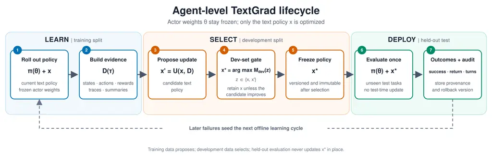

# From Agent Failures to Text Policies: What Works and What Breaks

Jaideep Ray Affiliation: Independent Researcher
Email: [jaray@acm.org](mailto:)    Ankit Goyal Affiliation: Independent
Researcher Email: [ankit@goyalankit.com](mailto:)

###### Abstract

TextGrad improves language-model systems by revising text from feedback.
Its core thesis is that natural-language feedback can act as a gradient
for optimizing text components without changing model weights. Applying
it to agents is harder because feedback arrives only after a sequence of
actions, making it difficult to identify which decision caused failure.
We study this problem by separating the ability to follow a useful
policy from the ability to learn that policy from experience. Our main
finding is a clear gap between these two abilities. Human-written
policies improve two frozen 7B agents on TextWorldExpress by 5.0 success
points, showing that useful policy text exists. However, policies
generated from agent trajectories do not reliably outperform fixed
prompting, even with richer traces, counterfactual evidence, or
iterative GEPA search. The main challenge for agent-level TextGrad is
therefore not executing textual policy updates, but reliably generating
and selecting them from experience.

## 1 Introduction

Many deployed language agents cannot be fine-tuned. Their weights may be
frozen, available only through an API, or too expensive to update. Their
instructions, however, remain editable. This makes text optimization an
appealing way to improve an agent without changing its model.

TextGrad follows this idea. It treats text as an optimizable component
and revises that text from natural-language feedback (Yuksekgonul et
al., 2025). The idea is straightforward for an input-output system
because the output can be judged directly. It is harder for an agent. An
agent takes a sequence of actions, and an early mistake changes every
state that follows. A final failure therefore does not reveal which
action should change or what lesson will transfer to another task.

We study this problem with frozen language agents and short textual
policies. After a training task, a learner reads the agent’s trajectory
and proposes a reusable rule. The rule is then frozen and tested on new
tasks. We call this prototype RulePI. Our goal is not to present another
prompt optimizer. It is to identify where this kind of optimization
succeeds and where it breaks.

We separate the process into four questions:

- •
  Execution: can the frozen agent follow a useful rule?
- •
  Evidence: does the trajectory show which decision mattered?
- •
  Update: can the learner turn that evidence into a reusable rule?
- •
  Selection: can validation keep helpful rules and reject harmful ones?

An end-to-end learner fails if any one answer is no.

Our main finding is a gap between execution and learning. Human-written
policies improve two real 7B agents on TextWorldExpress by 5.0 success
points. The agents can therefore use good policy text. Yet rules learned
from their trajectories do not reliably beat fixed prompting. This
remains true when we provide richer step-by-step traces, compare actions
from the same state, or use official GEPA search. The evidence points to
a specific bottleneck: the tested systems do not reliably turn
experience into a good rule and decide whether to keep it.

## 2 Related Work

Several methods improve agents by storing language rather than changing
model weights. Reflexion writes feedback for another attempt on the same
task (Shinn et al., 2023). ExpeL extracts lessons from training
experience and retrieves them later (Zhao et al., 2023). RulePI asks a
narrower question: can a lesson from past failures become a small policy
that helps on new tasks without another test-time attempt?

TextGrad, ProTeGi, and PACE revise prompts from textual critiques
(Yuksekgonul et al., 2025; Pryzant et al., 2023; Dong et al., 2024).
GEPA extends this idea with repeated mutation and Pareto selection,
while RAPOA and Feedback Descent use richer analysis or pairwise
feedback (Agrawal et al., 2026; Fernandes et al., 2026; Lee et al.,
2025). Kintsugi also edits an agent’s control logic (Cao et al., 2026).
We directly test official GEPA because it is a strong frozen-weight
optimizer.

Other methods update model weights. StarPO, multi-module GRPO, JERP, and
experiential RL learn from trajectories through training (Wang et al.,
2025; Ziems et al., 2026; Ye and Yu, 2026; Shi et al., 2026). HiPER and
HCAPO assign credit to intermediate planning or execution steps before
updating weights (Peng et al., 2026; Tan et al., 2026). LangMARL
produces language-based credit for multiple agents (Yao et al., 2026).
These methods offer stronger ways to locate important decisions, but
they answer a different question because they change weights or study
multi-agent learning.

## 3 Agent-Level TextGrad

Let $`x`$ be the current text policy and let $`\theta`$ be the frozen
model weights. One update has three steps:

```math
\displaystyle\tau \displaystyle\sim\pi_{\theta}(\cdot\mid x), \tag{1}
```

```math
\displaystyle g_{\mathrm{text}} \displaystyle=D(\tau,R(\tau)), \tag{2}
```

```math
\displaystyle x^{\prime} \displaystyle=U(x,g_{\mathrm{text}}), \tag{3}
```

The agent first produces a trajectory $`\tau`$ under policy $`x`$. The
diagnosis function $`D`$ turns the trajectory and its reward into
textual feedback $`g_{\mathrm{text}}`$. The update function $`U`$ uses
that feedback to propose a new policy $`x^{\prime}`$. We freeze
$`x^{\prime}`$ before test and reuse it across held-out tasks. Unlike a
retry controller, the policy sees no failure from the current test task
before acting.

We use four tests to locate failure. First, a capacity test supplies
human-written rules with the correct benchmark-family label. This is
privileged information. It asks whether the actor can use a good rule,
not whether the learner can discover one. Second, an evidence test
compares short failure summaries with context-bounded traces that align
each observation, action, and reward. Third, a counterfactual test
compares two actions taken from the same failing state. This removes
many differences that confound two complete retries. Finally, a search
test runs official GEPA, which proposes and selects policies over
several rounds. Figure 1 shows how these pieces fit into one lifecycle
while keeping training, development, and held-out deployment separate.

The single-rule learner may produce one typed rule of at most 80 words
for each model and task family. The eight human-written TextWorldExpress
rules contain 15–38 words each (mean 26.4; 211 words in total). Thus,
each individual target strategy fits within the learner’s limit,
although the capacity condition receives the full labeled library. This
makes every update easy to inspect, but it also limits what the learner
can express. The appendix gives the exact evidence limits, prompts, and
selection rules.



Figure 1: Agent-level TextGrad lifecycle. Actor weights remain frozen
while training evidence proposes text-policy updates. Development tasks
select and freeze the policy, which is evaluated once on unseen held-out
tasks without test-time updates.

## 4 Experimental Setup

#### Agents and environments.

We test Qwen2.5-7B-Instruct and Mistral-7B-Instruct-v0.3 with
deterministic decoding. The environments are TextWorld,
TextWorldExpress, and TextArena (Côté et al., 2018; Jansen and Côté,
2022; Guertler et al., 2025). Our first study contains 6,160 test
records across the two models, three benchmarks, and seven conditions.
The clearest real-agent capacity comparison comes from TextWorldExpress,
so the main text centers on that benchmark. The full cross-benchmark
results appear in the appendix.

#### Policies and baselines.

The fixed baseline uses the original instructions. The human-policy
condition adds rules written for each TextWorldExpress family. Because
both the rules and their family routing are supplied by people, this
condition is a capacity test rather than an autonomous learning method.
The diagnostic-retry control gives a failed task one more attempt with
the matching human rule. The learned conditions instead generate rules
from summaries, step traces, matched counterfactual branches, or GEPA
search. All policies use separate training, development, and test seeds
and are frozen before test.

#### Evaluation.

We pair methods on the same environment, seed, and target side. We
report 95% cluster-bootstrap intervals from 10,000 resamples. The
counterfactual study evaluates 320 paired episodes per policy and gives
both learners 102 extra rollouts. The GEPA study evaluates 160 paired
episodes per method after a nominal 320 search calls per model. These
intervals are exploratory because the number of model-family clusters is
small. Our primary capacity estimate pools both models and all eight
TextWorldExpress families. Per-model rows are consistency checks.
Per-family estimates are reported separately in the appendix with
unadjusted hierarchical intervals and are not used for confirmatory
claims.

| Actor      | Fixed | Human policy | $`\Delta`$ \[95% CI\] |
| ---------- | ----- | ------------ | --------------------- |
| Qwen-7B    | 17.50 | 21.25        | +3.75 \[1.25, 7.50\]  |
| Mistral-7B | 13.75 | 20.00        | +6.25 \[1.25, 13.75\] |
| Pooled     | 15.63 | 20.63        | +5.00 \[1.88, 9.38\]  |

Table 1: TextWorldExpress success (%). The two actor rows are per-model
estimates; the pooled row is the primary capacity estimate across two
models and eight families. These are not per-family effects. The rules
and family routing are privileged.

## 5 Results

### 5.1 Frozen Agents Can Use Good Policy Text

Table 1 answers the first question. Human-written rules raise pooled
TextWorldExpress success from 15.63% to 20.63%, a gain of 5.0 points
(CI: +1.88 to +9.38). They also reduce interaction by 2.64 turns on
average (CI: $`-5.15`$ to $`-0.41`$). Both real 7B models improve. The
pooled row is the estimate used in our claim. The model rows show that
the direction is not driven by one actor; they do not establish uniform
gains across task families.

This result is intentionally limited. People wrote the rules and
supplied the correct task-family routing. The experiment does not show
that the system learned those rules. It shows something more basic but
necessary: useful text policies exist, and the frozen agents can follow
them.

### 5.2 Trajectory-Based Learning Does Not Recover the Gain

We next ask whether the system can learn similarly useful rules from
experience. Table 2 summarizes three increasingly strong attempts.

| Test       | Comparison          | Success $`\Delta`$            |
| ---------- | ------------------- | ----------------------------- |
| Capacity   | Human $`-`$ fixed   | +5.00 \[1.88, 9.38\]          |
| Evidence   | Trace $`-`$ summary | +3.75 \[0.00, 8.12\]          |
| End to end | Trace $`-`$ fixed   | $`-1.88`$ \[$`-5.62`$, 1.88\] |
| Credit     | Branch $`-`$ retry  | +0.31 \[0.00, 0.94\]          |
| End to end | Branch $`-`$ fixed  | $`-1.25`$ \[$`-3.75`$, 0.00\] |
| Search     | GEPA $`-`$ fixed    | +1.25 \[$`-3.13`$, 5.63\]     |

Table 2: Pooled TextWorldExpress results in percentage points with
paired 95% intervals. Each row pools two models and eight families
within its own matched study. Rows are neither per-family effects nor
one leaderboard.

First, step-by-step traces help more than compact summaries. They
improve success by 3.75 points over summaries. However, the trace policy
is still 1.88 points below fixed prompting. The learner benefits from
richer evidence but does not turn that evidence into a better policy.

Second, same-prefix branches give a cleaner comparison than full
retries. They compare two actions from the same state while spending the
same 102 extra rollouts as the retry control. The resulting policy is
0.31 points above retry learning, but 1.25 points below fixed prompting.
This is weak directional evidence for better credit, not an end-to-end
improvement.

Third, multi-round search does not reliably close the gap at the tested
budget. Official GEPA reaches 20.00% success versus 18.75% for fixed
prompting after 642 construction rollouts and 62 reflection calls. The
gain is 1.25 points, but its interval spans zero. The model-level
effects also disagree: Qwen falls by 1.25 points while Mistral rises by
3.75 points.

Across all three tests, better evidence or broader search changes the
policy, but does not produce a reliable held-out gain. A manual audit of
the 32 directly comparable summary and trace rules helps explain why:
only seven are grounded, executable strategies; nine are plausible but
too generic; and sixteen are shortcuts, semantically wrong, or
malformed. The full taxonomy and examples appear in the appendix.

### 5.3 Two Transitions Limit End-to-End Learning

The counterfactual study narrows the diagnosis. A matched branch can
show that one action is preferable at a particular state, but a
deployable policy must also say when that preference should apply again.
This requires the learner to recover a trigger, an action, a scope, and
an exception from a local comparison. The proposer often loses that
structure: it copies an instance detail, broadens a local contrast into
unsupported advice, or produces a rule too vague to change behavior.
Cleaner credit assignment therefore does not automatically produce a
reusable policy update.

Selection is a separate transition. A candidate may improve the
situations that motivated it while degrading other tasks, and a pooled
development score gives limited evidence about that trade-off. A
reliable gate must evaluate support, consistency, and regressions across
the relevant task families, not simply choose the candidate with the
best observed mean. Selecting the best available candidate is not the
same as establishing that it improves on the current policy.

The pipeline therefore has two distinct interfaces: trajectory evidence
must become a properly scoped policy, and that policy must earn
deployment through calibrated validation. The capacity test shows that
the actor can execute a concise policy once these decisions are
supplied. The unresolved challenge is making both decisions reliably
from experience.

## 6 Discussion

The experiments separate policy capacity from policy induction. The
capacity test shows that frozen agents can improve when given a short,
family-specific policy. The learned-policy studies do not establish a
comparable held-out improvement. Because the human rules are only 15–38
words each, the 80-word limit alone does not explain this gap. The
evidence instead points to two linked difficulties: deriving a correct
reusable update from a trajectory and deciding whether to retain it from
limited development data.

Richer evidence improves intermediate comparisons. Step-aligned traces
outperform compact summaries, and same-prefix branches isolate action
differences more directly than full retries. Yet neither intervention
consistently increases held-out completion after rule generation and
selection. GEPA expands the update space and uses iterative search, but
its pooled held-out interval includes zero. These results distinguish
evidence quality from end-to-end policy improvement: better evidence can
clarify the update target, but its value depends on the generation and
selection procedures that follow.

The results motivate two priorities. Update operators should preserve
the comparison supplied by matched branches and generate multiple typed
candidates or compositional policy sets. Selectors should use paired,
family-aware validation, uncertainty estimates, minimum support, and
explicit regression constraints. Future studies should compare these
designs under matched rollout and token budgets and report candidate
yield, acceptance calibration, family-level effects, and deployment
cost.

## 7 Conclusion

Frozen language agents can benefit from useful text policies. In our
experiments, the difficult part is learning those policies from
trajectories. Richer evidence and broader search help intermediate
steps, but they do not yield a reliable end-to-end gain. Agent-level
TextGrad therefore needs better rule generation and better rule
selection, not only more feedback.

## Limitations

Our evidence covers two 7B models and three text benchmarks. It may not
transfer to web, software, robotics, or safety-critical agents. The
human rules and their family routing are privileged, so their gain is an
upper-bound capacity test rather than an autonomous method. The
structured controls are even narrower because some rule phrases activate
pre-written routines.

The trace study keeps every step but shortens some observations and
valid-action lists. The counterfactual study produces only seven valid
rules, which limits conclusions about the update operator. Its
validation sets contain eight instances per family. The GEPA test uses
one benchmark, the same 7B model for acting and reflection, and more
construction rollouts than the single-rule studies. We do not provide
matched tests of RAPOA, Reflexion, ExpeL, or weight-training methods.
Finally, the intervals are exploratory and do not account for multiple
comparisons, tokens, latency, energy, or monetary cost.

## Ethical Considerations

The environments are synthetic and contain no personal data. A learned
rule can still spread one error across many later tasks. Practical
systems should record where each rule came from, test protected behavior
before deployment, restrict what an update may change, and support
rollback.

## References

- Agrawal et al. (2026) L. A. Agrawal, S. Tan, D. Soylu, N. Ziems, R.
  Khare, K. Opsahl-Ong, A. Singhvi, H. Shandilya, M. J. Ryan, M.
  Jiang, C. Potts, K. Sen, A. G. Dimakis, I. Stoica, D. Klein, M.
  Zaharia, and O. Khattab GEPA: reflective prompt evolution can
  outperform reinforcement learning. arXiv preprint arXiv:2507.19457.
  External Links: [Link](https://arxiv.org/abs/2507.19457) Cited by: §2.
- Cao et al. (2026) T. Cao, Y. Deng, H. Shindo, Q. Delfosse, L. Wen, S.
  Wang, J. Blüml, C. Tauchmann, and K. Kersting Kintsugi: learning
  policies by repairing executable knowledge bases. Computing Research
  Repository arXiv:2605.09487. External Links:
  [Link](https://arxiv.org/abs/2605.09487) Cited by: §2.
- Côté et al. (2018) M. Côté, À. Kádár, X. Yuan, B. Kybartas, T.
  Barnes, E. Fine, J. Moore, R. Y. Tao, M. Hausknecht, L. El Asri, M.
  Adada, W. Tay, and A. Trischler TextWorld: a learning environment for
  text-based games. Computing Research Repository arXiv:1806.11532.
  External Links: [Link](https://arxiv.org/abs/1806.11532) Cited by: §4.
- Dong et al. (2024) Y. Dong, K. Luo, X. Jiang, Z. Jin, and G. Li PACE:
  improving prompt with actor-critic editing for large language model.
  In Findings of the Association for Computational Linguistics: ACL
  2024, External Links:
  [Link](https://aclanthology.org/2024.findings-acl.436/) Cited by: §2.
- Fernandes et al. (2026) R. C. Fernandes, L. Fehring, T. Eimer, M.
  Lindauer, and M. Feurer Environment-grounded automated prompt
  optimization for LLM game agents. arXiv preprint arXiv:2606.17838.
  External Links: [Link](https://arxiv.org/abs/2606.17838) Cited by: §2.
- Guertler et al. (2025) L. Guertler, B. Cheng, S. Yu, B. Liu, L.
  Choshen, and C. Tan TextArena. Computing Research Repository
  arXiv:2504.11442. External Links:
  [Link](https://arxiv.org/abs/2504.11442) Cited by: §4.
- Jansen and Côté (2022) P. A. Jansen and M. Côté TextWorldExpress:
  simulating text games at one million steps per second. Computing
  Research Repository arXiv:2208.01174. External Links:
  [Link](https://arxiv.org/abs/2208.01174) Cited by: §4.
- Lee et al. (2025) Y. Lee, J. Boen, and C. Finn Feedback descent:
  open-ended text optimization via pairwise comparison. arXiv preprint
  arXiv:2511.07919. External Links:
  [Link](https://arxiv.org/abs/2511.07919) Cited by: §2.
- Peng et al. (2026) J. Peng, Y. Liu, R. Zhou, C. Fleming, Z. Wang, A.
  Garcia, and M. Hong HiPER: hierarchical reinforcement learning with
  explicit credit assignment for large language model agents. arXiv
  preprint arXiv:2602.16165. External Links:
  [Link](https://arxiv.org/abs/2602.16165) Cited by: §2.
- Pryzant et al. (2023) R. Pryzant, D. Iter, J. Li, Y. T. Lee, C. Zhu,
  and M. Zeng Automatic prompt optimization with “gradient descent” and
  beam search. In Proceedings of the 2023 Conference on Empirical
  Methods in Natural Language Processing, pp. 7957–7968. External Links:
  [Document](https://dx.doi.org/10.18653/v1/2023.emnlp-main.494),
  [Link](https://aclanthology.org/2023.emnlp-main.494/) Cited by: §2.
- Shi et al. (2026) T. Shi, S. Chen, B. Jiang, L. Song, L. Yang, and J.
  Zhao Experiential reinforcement learning. Computing Research
  Repository arXiv:2602.13949. External Links:
  [Link](https://arxiv.org/abs/2602.13949) Cited by: §2.
- Shinn et al. (2023) N. Shinn, F. Cassano, A. Gopinath, K. Narasimhan,
  and S. Yao Reflexion: language agents with verbal reinforcement
  learning. In Advances in Neural Information Processing Systems, Vol.
  36, pp. 8634–8652. External Links:
  [Link](https://proceedings.neurips.cc/paper_files/paper/2023/hash/1b44b878bb782e6954cd888628510e90-Abstract-Conference.html)
  Cited by: §2.
- Tan et al. (2026) H. Tan, X. Yang, H. Chen, J. Shao, Y. Wen, Y.
  Shen, W. Luo, X. Du, L. Guo, and Y. Li Hindsight credit assignment for
  long-horizon LLM agents. arXiv preprint arXiv:2603.08754. External
  Links: [Link](https://arxiv.org/abs/2603.08754) Cited by: §2.
- Wang et al. (2025) Z. Wang, K. Wang, Q. Wang, P. Zhang, L. Li, Z.
  Yang, X. Jin, K. Yu, M. N. Nguyen, L. Liu, E. Gottlieb, Y. Lu, K.
  Cho, J. Wu, L. Fei-Fei, L. Wang, Y. Choi, and M. Li RAGEN:
  understanding self-evolution in LLM agents via multi-turn
  reinforcement learning. arXiv preprint arXiv:2504.20073. External
  Links: [Link](https://arxiv.org/abs/2504.20073) Cited by: §2.
- Yao et al. (2026) H. Yao, L. Da, X. Liu, C. Fleming, T. Chen, and H.
  Wei LangMARL: natural language multi-agent reinforcement learning.
  arXiv preprint arXiv:2604.00722. External Links:
  [Link](https://arxiv.org/abs/2604.00722) Cited by: §2.
- Ye and Yu (2026) S. Ye and C. Yu Joint learning of experiential rules
  and policies for large language model agents. arXiv preprint
  arXiv:2606.27136. External Links:
  [Link](https://arxiv.org/abs/2606.27136) Cited by: §2.
- Yuksekgonul et al. (2025) M. Yuksekgonul, F. Bianchi, J. Boen, S.
  Liu, P. Lu, Z. Huang, C. Guestrin, and J. Zou Optimizing generative AI
  by backpropagating language model feedback. Nature 639, pp. 609–616.
  External Links:
  [Document](https://dx.doi.org/10.1038/s41586-025-08661-4),
  [Link](https://doi.org/10.1038/s41586-025-08661-4) Cited by: §1, §2.
- Zhao et al. (2023) A. Zhao, D. Huang, Q. Xu, M. Lin, Y. Liu, and G.
  Huang ExpeL: LLM agents are experiential learners. Computing Research
  Repository arXiv:2308.10144. External Links:
  [Link](https://arxiv.org/abs/2308.10144) Cited by: §2.
- Ziems et al. (2026) N. Ziems, D. Soylu, L. A. Agrawal, I. Miller, L.
  Lai, C. Qian, K. Song, M. Jiang, D. Klein, M. Zaharia, K.
  D’Oosterlinck, C. Potts, and O. Khattab Composing policy gradients and
  prompt optimization for language model programs. arXiv preprint
  arXiv:2508.04660. External Links:
  [Link](https://arxiv.org/abs/2508.04660) Cited by: §2.

## Appendix A Policy, Gate, and Comparator Details

#### Curated basis and detector.

The capacity test uses a small human-written rule library. Table 3
reports its size and coverage. For real models, each rule is ordinary
prompt text. For structured actors, some phrases turn on matching
routines already present in code.

The routing is also human-written. For each failed training record, a
benchmark-specific detector chooses the rule for that task family and
adds it once. The test therefore measures whether an actor can use a
known rule under a known family label. It does not measure autonomous
diagnosis or retrieval.

Representative rules describe objective order and graph exploration in
TextWorld, arithmetic and map navigation in TextWorldExpress, and game
strategies in TextArena. The supplement contains the exact text in
RULE_TEXTS, RULE_BY_GAME, ENV_RULES, and SLM_HINTS.

| Setting        | Basis | Selected | Trigger               |
| -------------- | ----- | -------- | --------------------- |
| Structured TW  | 3     | 3        | failure family        |
| Structured TA  | 12    | 6        | negative advantage    |
| Real TW        | 3     | 3/3      | keyed failure         |
| Real TWExpress | 8     | 8/8      | fail/invalid/repeat   |
| Real TextArena | 12    | 10/12    | fail/invalid/truncate |

Table 3: Curated rule counts. Real-model counts are identical for both
actors. “Selected” is not generated text: the detector activates a
human-authored rule keyed to the benchmark family. Real TextArena also
retains its standard environment hint in the fixed condition.

#### Mechanism control: structured actors (not text-only).

This appendix-only study asks whether storing a known control choice can
save later interaction when the interface already implements that
choice. These actors are not ordinary language models: a rule phrase can
activate a matching routine already present in code. We therefore
exclude these results from the real-agent tables and central claim. They
demonstrate a possible efficiency mechanism, not an effect for text-only
agents. At matched success, a stored policy uses 46.5% fewer actions
than retry with persistence on TextWorld and 41.0% fewer on TextArena
(Table 4). A random policy of the same size performs worse on TextArena,
so prompt length alone does not explain the gain.

|           |                 |         |          |         |
| --------- | --------------- | ------- | -------- | ------- |
| Suite     | Method          | Success | Attempts | Actions |
| TextWorld | Stored policy   | 56.7    | 1.00     | 42.25   |
| TextWorld | Retry + persist | 56.7    | 1.48     | 78.94   |
| TextArena | Stored policy   | 61.5    | 1.00     | 10.19   |
| TextArena | Random rules    | 42.8    | 1.00     | 11.19   |
| TextArena | Retry + persist | 61.5    | 1.43     | 17.28   |

Table 4: Mechanism control with routine-triggering structured actors:
success (%), attempts, and mean test actions. Random is the mean over 30
policies with six rules each. These results are not directly comparable
to the text-only language-agent results.

The broader structured suite has the same limit. Supported interfaces
improve sharply, while generic fallback tasks do not change (Table 5).
These controls show policy execution inside known interfaces, not
general transfer.

| Suite            | Success         | Invalid         | Turns             |
| ---------------- | --------------- | --------------- | ----------------- |
| Broad-50 overall | 18.5$`\to`$36.9 | 51.8$`\to`$45.1 | 9.32$`\to`$8.50   |
| Supported        | 16.7$`\to`$66.7 | 22.2$`\to`$4.2  | 13.29$`\to`$11.07 |
| Generic fallback | 19.5$`\to`$19.5 | 69.1$`\to`$69.1 | 7.00$`\to`$7.00   |
| Difficulty       | 16.7$`\to`$83.3 | 13.9$`\to`$0.0  | 22.60$`\to`$16.96 |
| MiniWoB-50       | 20.0$`\to`$27.3 | 2.0$`\to`$2.0   | 4.05$`\to`$3.86   |

Table 5: Descriptive mechanism controls with structured actors (%). Bold
rows are the largest changes. These rows have no confirmatory intervals
and support no claim about text-only agents.

Policy construction uses 7,965 TextWorld and 7,921 TextArena training
actions. The estimated break-even points are 202 and 756 deployments.
Only TextWorld reaches its break-even point in this evaluation.

#### Retry semantics.

The retry control first runs the fixed policy. If that attempt succeeds,
it stops. If it fails, the task receives one more attempt with the
matching human guidance. Reported turns include both attempts, and the
second attempt determines the final outcome. This control does not
generate a Reflexion-style critique, retrieve ExpeL-style training
memories, or keep lessons discovered during test.

#### Context-bounded trace protocol.

For each model and each of eight TextWorldExpress families, both
learners see the same three training trajectories and generate one rule
at temperature 0. The summary learner sees the final outcome and the
last 12 actions. The trace learner sees every observation, action, and
reward, plus at most 20 valid actions per step. We shorten observations
only when the family evidence would exceed 90,000 characters in a
32,768-token context.

The study keeps all 999 steps, executed actions, and rewards. It
shortens 220 observations, or 22.0% of steps, while retaining 88.1% of
observation characters overall. It retains 9,932 of 12,042 valid-action
candidates. Each learned rule is frozen and tested on ten paired seeds,
giving 160 episodes per method and 16 model-family clusters. Because the
trace is still bounded, this study measures the effect of richer
evidence rather than a truly unbounded trace.

| Model      | Fixed | Summary | Bounded | Bounded $`-`$ summary     |
| ---------- | ----- | ------- | ------- | ------------------------- |
| Mistral-7B | 16.25 | 13.75   | 16.25   | +2.50 \[$`-2.50`$, 8.75\] |
| Qwen-7B    | 17.50 | 8.75    | 13.75   | +5.00 \[1.25, 10.00\]     |
| Pooled     | 16.88 | 11.25   | 15.00   | +3.75 \[0.00, 8.12\]      |

Table 6: Success (%) when the learner sees a compact summary or a
context-bounded step trace. The final column gives paired 95% intervals.

#### Generated-rule taxonomy.

We manually code the 32 directly comparable rules from the evidence
study: two models, eight families, and two evidence formats. A _grounded
strategy_ has a detectable trigger, an executable response, and a
relation that should persist within the family. A _generic heuristic_ is
plausible but redundant or too vague to select the next action. An
_instance shortcut_ hard-codes a room, object, direction, operation, or
sequence that need not persist. A _semantic error_ encodes the wrong
objective or causal relation. A _malformed_ rule has a conflicting
condition and action or returns an unconditional script. We assign one
dominant label without using held-out outcome. The audit is descriptive,
single-coder, not blind, and not independently double-coded.

| Primary label          | Summary | Trace | Total |
| ---------------------- | ------- | ----- | ----- |
| Grounded strategy      | 3       | 4     | 7     |
| Generic heuristic      | 5       | 4     | 9     |
| Instance shortcut      | 3       | 2     | 5     |
| Semantic error         | 5       | 4     | 9     |
| Malformed/unexecutable | 0       | 2     | 2     |

Table 7: Manual taxonomy of 32 generated TextWorldExpress rules. Counts
are descriptive and mutually exclusive; several rules exhibit secondary
problems.

Only two rules are malformed, so formatting is not the dominant failure.
Fourteen are semantically wrong or instance-specific, and nine more are
insufficiently specific. The trace condition raises grounded strategies
only from 3/16 to 4/16. It fixes some causal omissions: Qwen’s summary
rule for Simon Says invents a transition between fruit actions, while
its trace rule correctly reacts to the observed “Simon says” command.
But richer evidence can still be abstracted badly. Mistral’s trace rule
for coin conditions on an open south door and then says to take a coin
even when none is visible; its map rule is an unconditional action list.

The other operators show the same failure types. GEPA’s Qwen policy
mainly accumulates generic restatements of the seed prompt. Its Mistral
policy introduces unsupported affordances such as asking another agent
for help or using a key or crowbar. The counterfactual audit also
separates proposal quality from selection quality: the gate accepts a
shortcut-like coin rule that lowers completion by 20 points, yet rejects
a grounded arithmetic rule that raises completion by 5 points. The
qualitative evidence therefore points to three distinct problems:
semantic wrongness, overfitting to observed details, and advice that is
too vague to change an action.

#### Exploratory per-family outcomes.

The primary capacity result pools all eight families. Table 8 shows its
heterogeneity rather than eight additional claims. Every episode
receives the complete policy library. The rows therefore report
family-level outcomes, not the isolated effect of one rule. Each
interval hierarchically resamples the two models and then the ten paired
seeds within each sampled model. With only 20 pairs and two model
clusters per family, the intervals are unadjusted, low-powered, and not
confirmatory.

| Family       | Success $`\Delta`$ \[95% CI\] | Turns $`\Delta`$ \[95% CI\]          |
| ------------ | ----------------------------- | ------------------------------------ |
| arithmetic   | +5 \[$`-10`$, 25\]            | $`-5.00`$ \[$`-8.30`$, $`-2.50`$\]   |
| coin         | +15 \[$`-15`$, 45\]           | $`-5.70`$ \[$`-15.40`$, 2.20\]       |
| cookingworld | 0 \[0, 0\]                    | +2.20 \[$`-6.15`$, 9.90\]            |
| mapreader    | +5 \[0, 20\]                  | $`-2.05`$ \[$`-6.70`$, 0.00\]        |
| peckingorder | 0 \[0, 0\]                    | +0.45 \[$`-3.60`$, 3.65\]            |
| simonsays    | +5 \[0, 20\]                  | +0.20 \[0.00, 0.80\]                 |
| sorting      | +10 \[0, 25\]                 | $`-11.25`$ \[$`-19.30`$, $`-4.85`$\] |
| twc          | 0 \[0, 0\]                    | 0.00 \[0.00, 0.00\]                  |

Table 8: Curated policy minus fixed by family: success in percentage
points and mean turns. Each row has 20 paired episodes across two real
models. Intervals are unadjusted hierarchical paired-bootstrap intervals
and are exploratory.

#### Selection protocol and audit.

The original gate combines several outcomes into one score. It rewards
return and success and penalizes errors, repetition, and turns. For text
games, the score is $`r+0.5s-0.4i-0.2p-0.1q-0.004T`$, where $`s`$ is
success, $`i`$ is an invalid action, $`p`$ is a parse failure, $`q`$ is
repetition, and $`T`$ is turns. TextArena uses
$`r+0.5s-0.5i-0.25u-0.005T`$, where $`u`$ is truncation. These formulas
were fixed before test but were not calibrated or preregistered.

Each model-benchmark cell tests four rules on 96 TextArena, 32
TextWorld, or 64 TextWorldExpress development episodes. It keeps the
best rule only if its score beats the fixed policy by at least 0.001.
Across six cells, this process proposes 24 rules and deploys three.

The replication uses a simpler rule that was locked before results were
known. On eight development instances per model-family, it first
compares success, then normalized return, and finally turns. It never
accepts a rule merely because it reaches the same failed outcome faster.

| Study       | Proposed | Accepted | Held-out audit                |
| ----------- | -------- | -------- | ----------------------------- |
| Original    | 24       | 3        | 0 clear positive cells        |
| Replication | 7        | 3        | 1 harmful; 1 helpful rejected |

Table 9: Selection audit. The original gate uses benchmark-level
development sets; the replication uses eight instances per family.

| Model   | Benchmark | Ungated $`\Delta`$          | Gated $`\Delta`$       |
| ------- | --------- | --------------------------- | ---------------------- |
| Qwen    | TextArena | +0.8 \[0.0, 2.5\]           | 0.0 \[0.0, 0.0\]       |
| Qwen    | TWExpress | $`-2.5`$ \[$`-6.3`$, 0.0\]  | +1.3 \[$`-3.8`$, 7.5\] |
| Qwen    | TextWorld | +2.5 \[0.4, 4.6\]           | 0.0 \[0.0, 0.0\]       |
| Mistral | TextArena | $`-6.7`$ \[$`-25.0`$, 5.0\] | 0.0 \[0.0, 0.0\]       |
| Mistral | TWExpress | +1.3 \[0.0, 3.8\]           | +2.5 \[0.0, 7.5\]      |
| Mistral | TextWorld | $`-2.1`$ \[$`-4.6`$, 0.4\]  | 0.0 \[0.0, 0.0\]       |

Table 10: Original generated-policy success deltas in percentage points
relative to fixed prompting. Ungated always deploys the edit; gated may
retain the base.

A post-hoc sensitivity test uses saved structured TextWorld
trajectories. Raising the required score gain from 0.001 to 0.05 and
0.20 reduces acceptance from 10/10 to 9/10 and 6/10. Test success falls
from 56.7% to 54.2% and 46.2%. A gate that protects every family accepts
7/10 rules and reaches 49.2%. Stricter gates can therefore reject
helpful changes. Because this analysis reuses development data, it does
not establish a better gate. Paired confidence bounds, family-level
regression checks, and abstention are promising, but we do not validate
them here.

#### Counterfactual-credit protocol and outcomes.

The counterfactual study uses training seeds 397001–397002, development
seeds 407001–407008, and test seeds 417001–417020. The branch and retry
learners share the same actor, rule format, action validator,
development gate, and frozen test policy. Branching finds 19 same-state
action comparisons with different outcomes and turns them into seven
valid rules. Full retries find 41 trajectory pairs with different
outcomes and produce five valid rules. The gate accepts three branch
rules and one retry rule.

| Policy                  | Success | Return     | Turns |
| ----------------------- | ------- | ---------- | ----- |
| Fixed                   | 15.31   | $`-0.164`$ | 22.01 |
| Retry-only, gated       | 13.75   | $`-0.179`$ | 22.36 |
| Counterfactual, ungated | 14.37   | $`-0.155`$ | 22.80 |
| Counterfactual, gated   | 14.06   | $`-0.159`$ | 22.87 |

Table 11: Counterfactual replication with 320 paired episodes per
policy. Success is percent; return is normalized environment return.

| Model   | Family       | Support | P   | A   | $`\Delta`$S / $`\Delta`$R |
| ------- | ------------ | ------- | --- | --- | ------------------------- |
| Qwen    | arithmetic   | 0       | N   | N   | 0 / .000                  |
| Qwen    | coin         | 0       | N   | N   | 0 / .000                  |
| Qwen    | cookingworld | 1       | N   | N   | 0 / .000                  |
| Qwen    | mapreader    | 3       | N   | N   | 0 / .000                  |
| Qwen    | peckingorder | 0       | N   | N   | 0 / .000                  |
| Qwen    | simonsays    | 0       | N   | N   | 0 / .000                  |
| Qwen    | sorting      | 0       | N   | N   | 0 / .000                  |
| Qwen    | twc          | 2       | Y   | Y   | 0 / +.119                 |
| Mistral | arithmetic   | 1       | Y   | N   | +5 / +.100                |
| Mistral | coin         | 2       | Y   | Y   | $`-20`$ / $`-.200`$       |
| Mistral | cookingworld | 1       | Y   | N   | 0 / $`-.007`$             |
| Mistral | mapreader    | 2       | N   | N   | 0 / .000                  |
| Mistral | peckingorder | 1       | Y   | N   | 0 / .000                  |
| Mistral | simonsays    | 0       | N   | N   | 0 / .000                  |
| Mistral | sorting      | 2       | Y   | Y   | 0 / +.150                 |
| Mistral | twc          | 4       | Y   | N   | 0 / $`-.019`$             |

Table 12: Audit of every counterfactual rule. Support counts same-state
comparisons with different outcomes. P/A mean proposed/accepted.
$`\Delta`$S and $`\Delta`$R are changes in test success and normalized
return.

Two accepted rules leave success unchanged but improve partial return:
Qwen twc by 0.119 and Mistral sorting by 0.150. The accepted Mistral
coin rule is harmful: success falls from 5/20 to 1/20. The gate also
rejects a Mistral arithmetic rule that raises success from 1/20 to 2/20.
These two errors explain why the learned policy is not ready for
deployment. The 320 test episodes measure policy outcomes well enough
for this study, but only seven valid rules support claims about the
update process itself.

#### Contemporary comparators.

Table 14 separates methods that update text from methods that update
model weights. Our direct comparison uses official GEPA 0.1.1 on fresh
TextWorldExpress seeds. GEPA starts from the same fixed global policy.
It repeatedly reflects on traces, mutates the policy, and keeps
candidates that perform well on different development instances. It
receives no human rule library or family routing.

For each model, GEPA searches on 24 training cases, selects on 32
development cases, and freezes one policy for 80 paired test cases. The
same 7B model acts and reflects. The nominal budget is 320 metric calls
per model. The implementation logs 320 calls for Qwen and 322 for
Mistral because it checks the budget between iterations. Together, the
two searches use 642 environment rollouts and 62 reflection calls.

| Model      | Fixed | GEPA  | $`\Delta`$ \[95% CI\]         |
| ---------- | ----- | ----- | ----------------------------- |
| Qwen-7B    | 20.00 | 18.75 | $`-1.25`$ \[$`-7.50`$, 5.00\] |
| Mistral-7B | 17.50 | 21.25 | +3.75 \[$`-2.50`$, 10.00\]    |
| Pooled     | 18.75 | 20.00 | +1.25 \[$`-3.13`$, 5.63\]     |

Table 13: Official GEPA versus fixed prompting on held-out
TextWorldExpress seeds. Values are success percentages with paired
model-family intervals.

GEPA explores seven Qwen candidates and six Mistral candidates. It
improves the best development score for both models, but its pooled
held-out interval spans zero (Table 13). Normalized return rises by
0.035 (CI: $`-0.026`$ to 0.096), and turns fall by 0.49 (CI: $`-1.44`$
to 0.43). Those intervals also span zero. This result is inconclusive,
not evidence that GEPA fails in general.

We do not run matched versions of RAPOA, Reflexion, or ExpeL. Feedback
Descent also remains unmatched because it requires pairwise textual
comparisons. HiPER and HCAPO assign credit to intermediate steps before
updating model weights. LangMARL learns language policies from
multi-agent credit. JERP, multi-module GRPO, and StarPO also change
weights. A fair comparison with those methods would need to match
training compute as well as environment episodes.

#### Deployment scope.

We do not test semantic retrieval for individual instances. Generated
rules are shared within a model-family cell. Human rules use
hand-written task routing, and the trace study uses one rule per family.
This family routing should not be read as learned retrieval from the
current observation.

| Method            | Updated artifact   | Search/credit                |
| ----------------- | ------------------ | ---------------------------- |
| RulePI            | rule text          | 4 edits + mean gate          |
| GEPA              | prompts/components | reflect, Pareto, merge       |
| RAPOA             | agent prompts      | analyzer + evolution         |
| Feedback Descent  | arbitrary text     | pairwise rationales          |
| LangMARL          | language policies  | causal replay + agent credit |
| JERP              | rules + weights    | retrieval + joint training   |
| Multi-module GRPO | module weights     | module-level gradients       |
| StarPO            | model weights      | trajectory-level RL          |
| HiPER             | model weights      | hierarchical advantages      |
| HCAPO             | model weights      | hindsight step values        |

Table 14: Conceptual comparison. Only GEPA receives a direct
fixed-policy comparison here; this is not a common-budget leaderboard.

## Appendix B Reproducibility Details

The real-agent study uses Qwen/Qwen2.5-7B-Instruct and
mistralai/Mistral-7B-Instruct-v0.3. Actor decoding is deterministic,
with an 8,192-token context unless noted below. TextWorldExpress uses
three training seeds, eight development seeds, and ten test seeds per
family. The oracle study uses test seeds that do not overlap with
training. Every policy is frozen before test records are read.

The rule prompt asks for a reusable lesson of at most 80 words. It
forbids hidden state, test answers, complete walkthroughs, and
seed-specific shortcuts. In the original study, $`D`$ keeps the outcome,
error status, turns, final six actions, and terminal failure. The same
7B model then produces four candidate JSON edits through $`U`$.

The trace study is the only run with a 32,768-token context. Its two
evidence conditions share actor trajectories, generation budget, rule
length, test seeds, and deterministic rule generation. The
counterfactual study uses two training, eight development, and twenty
test seeds per family. It matches 102 branch rollouts with 102 full
retries in the same model-family cells.

GEPA uses actor temperature 0 and reflection temperature 0.7 with a
32,768-token context. It keeps every executed action and reward. It
normalizes whitespace, limits each observation to 600 characters, and
limits valid-action text to 120 characters. No executed-action text is
removed.

Bootstrap intervals cluster TextWorldExpress by family, TextArena by
environment, and TextWorld by generated suite. The supplement contains
exact prompts and examples of helpful and harmful generated rules.
