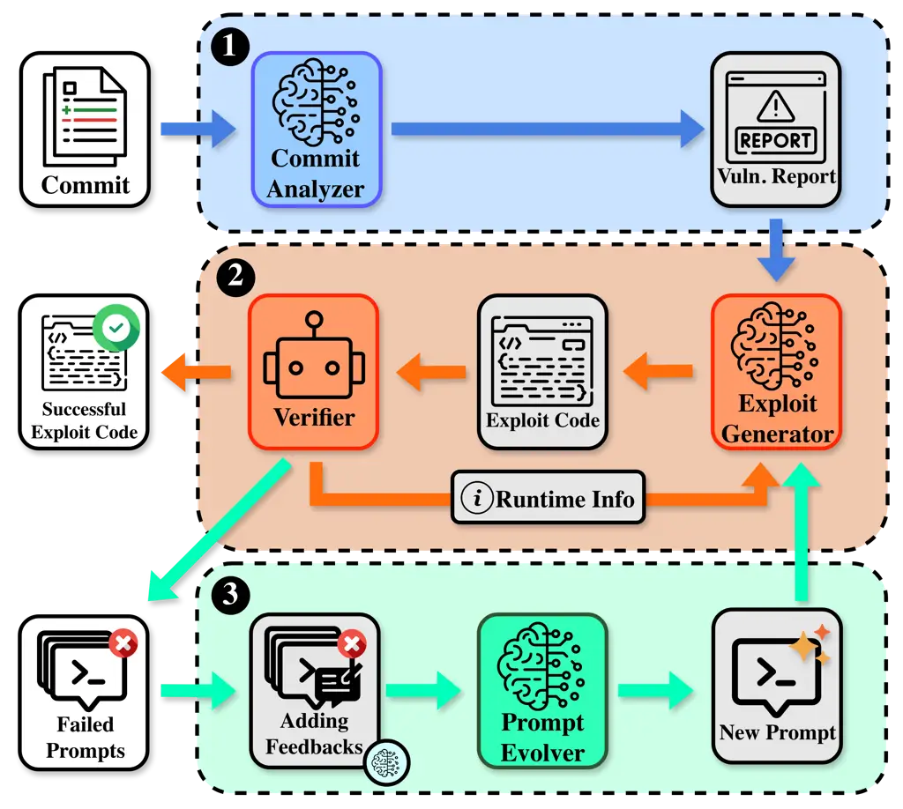
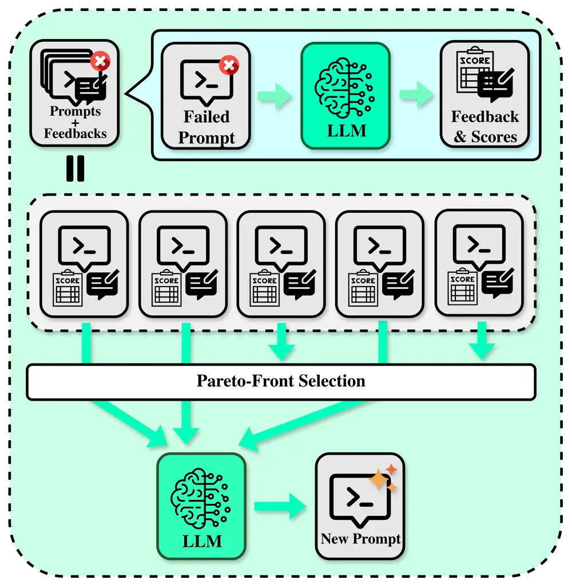
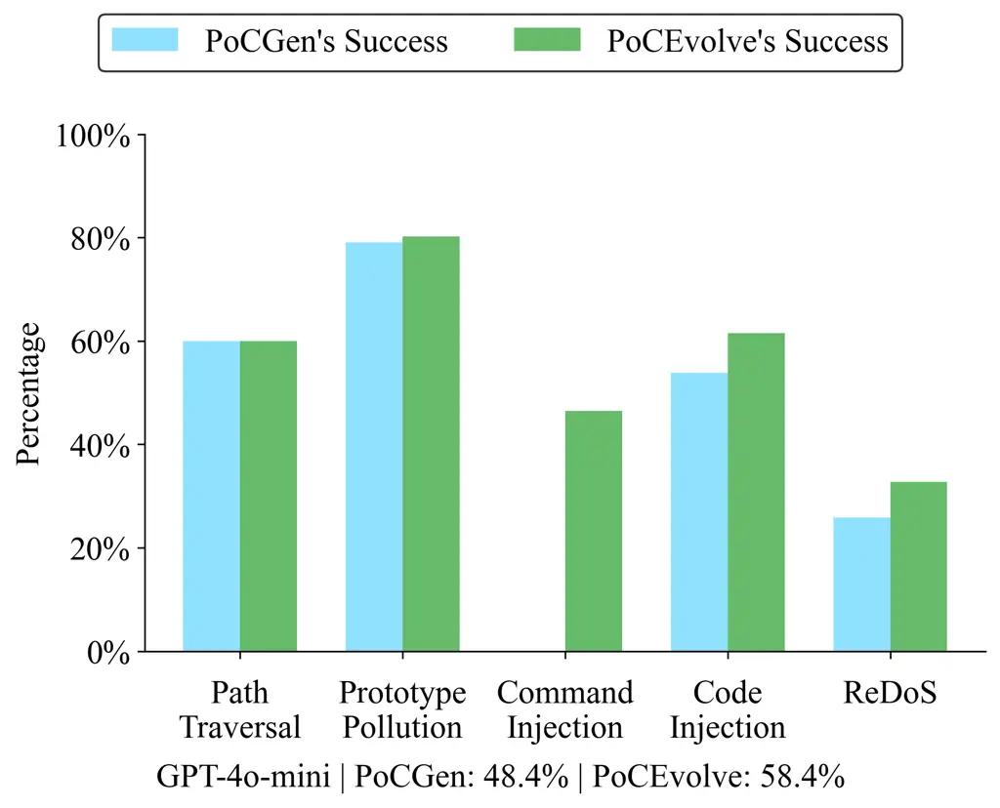
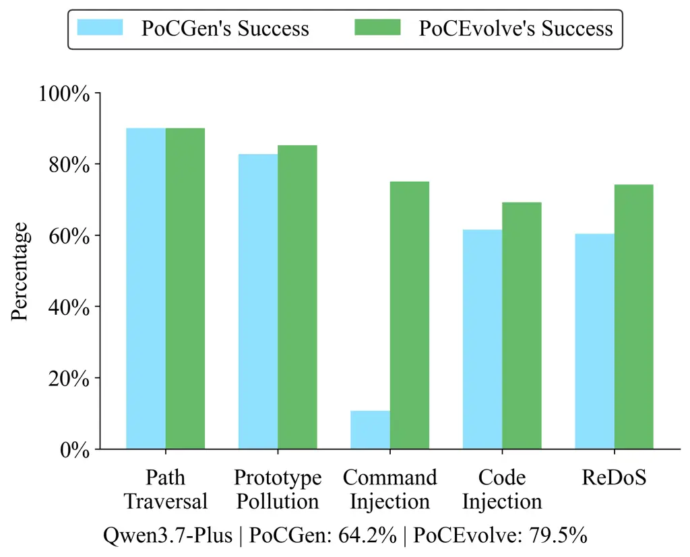
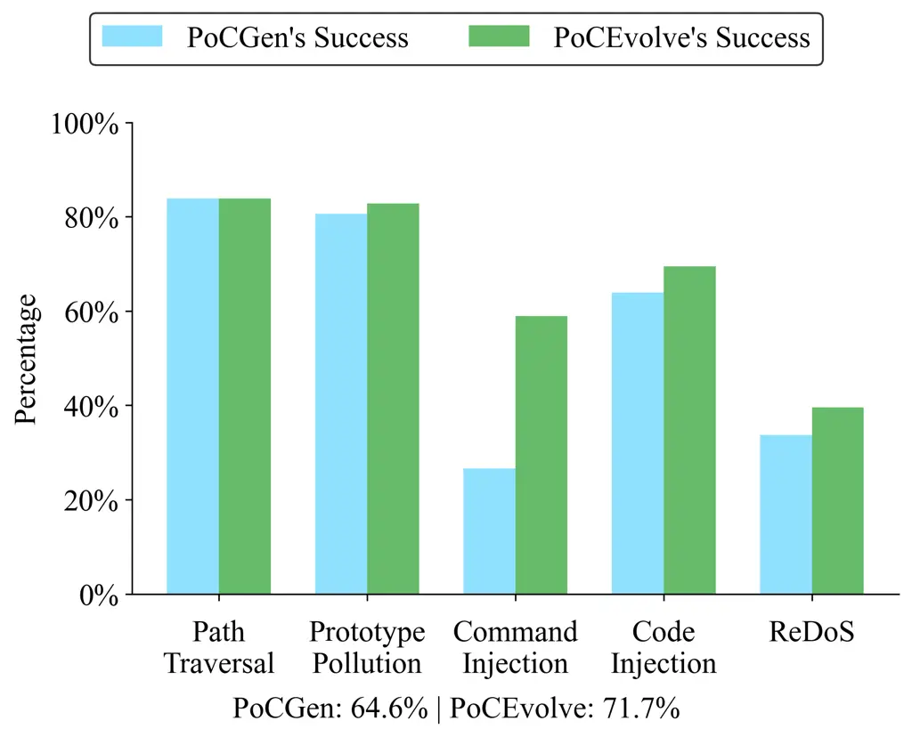

# PoCEvolve: Generating Proof-of-Concept Exploits from Security Patches with Vulnerability-Aware Prompt Evolution

Duc Manh Tran    Ratnadira Widyasari    Ivana Clairine Irsan    Huihui
Huang    Ting Zhang^(\*)    Shar Lwin Khin    Ouh Eng Lieh    Hong Jin
Kang    David Lo ^(†)^(†)thanks: Duc Manh Tran and Hong Jin Kang are
with The University of Sydney, Sydney, NSW, Australia.^(†)^(†)thanks:
Ratnadira Widyasari, Ivana Clairine Irsan, Huihui Huang, Shar Lwin Khin,
Eng Lieh Ouh, and David Lo are with Singapore Management University,
Singapore.^(†)^(†)thanks: Ting Zhang is with Monash University,
Australia. ^(\*)Corresponding author.

###### Abstract

Ideally, the detailed information about a vulnerability should be made
available together with the fixing commit. In practice, however, such
details often become available only long after the commit, even when a
CVE has already been published. During this window, the patch is already
public, so attackers can reverse-engineer it, yet defenders lack the
details needed to assess exposure, prioritize, and validate the fix.
Executable evidence, such as a proof-of-concept (PoC) exploit, could
fill this gap. Prior work has automated PoC generation, but the
state-of-the-art approach, PoCGen, assumes that a detailed vulnerability
report is already available, which is precisely what is missing during
this window. In this paper, we first present an empirical study
quantifying the long delay between the fixing commit and the
availability of a detailed vulnerability report. We then introduce
PoCEvolve, a vulnerability-aware prompt-evolution framework that
generates PoCs directly from vulnerability-fixing commits. Given a
vulnerability-fixing commit, PoCEvolve synthesizes a corresponding PoC
exploit. To learn from unsuccessful generation attempts, PoCEvolve
assesses the usefulness of different dimensions of vulnerability-related
context, including the inferred vulnerable API and code-coverage
information. These assessments guide prompt evolution towards more
effective exploit-generation prompts. We evaluate PoCEvolve on
SecBench.VFC.js, where PoCEvolve achieves a PoC generation success rate
of 58.4%, corresponding to relative improvements of 20.7% over PoCGen
and 200.0% over the LLM baseline with GPT-4o-mini. With a recent model,
Qwen3.7-Plus, PoCEvolve achieves a higher success rate of 85.3%. When
detailed vulnerability reports are available, PoCEvolve achieves a
success rate of 71.7%, improving over PoCGen by 11.1%. Across the
proposed-setting configurations, the average cost per evaluated
vulnerability ranges from \$0.0292 for PoCEvolve (LLM) with GPT-4o-mini
to \$0.2492 for the full PoCEvolve with Qwen3.7-Plus.

###### Index Terms: 

Exploit Generation, Prompt Evolution

## I Introduction

When a security vulnerability is discovered, it is reported to the
software development team and a CVE Numbering Authority (CNA). The
vulnerability is assigned a CVE identifier and, after the relevant
evidence is collected and the vulnerability is confirmed, the CVE is
publicly disclosed \[1\]. Crucially, the security patch and this public
disclosure rarely occur at the same time. Vulnerabilities are often
patched before they are publicly disclosed \[2, 3, 4, 5\], and the delay
between the two can be substantial \[2\]. This gap creates a significant
window in which attackers can infer the vulnerability from the public
patch, while downstream users may remain unaware that their deployed
systems are affected and require urgent updating \[6\]. During this
interval, defenders need executable evidence to determine whether their
systems are affected and to validate that a patch removes the vulnerable
behavior. However, such evidence is often unavailable because a detailed
vulnerability report is not yet available.

To assess how common this patch-only setting is in practice, we conduct
an empirical study of patching practices across 26,803 CVEs. Our
analysis shows that security fixes usually precede public disclosure:
97.1% of the CVEs in our dataset were patched before they were publicly
disclosed, with a median patch-to-disclosure gap of 18 days and a mean
gap of 147 days. Thus, for many vulnerabilities, the patch is available
before defenders have access to a public report or advisory. Moreover,
over 70% of CVE patches contain no test files, making it challenging for
downstream users to confirm the vulnerable behavior or validate the
patch. These findings motivate the problem we address: generating PoC
exploits directly from vulnerability-fixing commits, before a detailed
vulnerability report is available. Automated PoC generation is a natural
way to supply this missing evidence.

Existing techniques generate PoCs through symbolic execution \[7, 8\] or
fuzzing \[9\] to discover inputs that trigger vulnerabilities. More
recently, Simsek et al. \[10\] proposed PoCGen, which combines LLMs with
program analysis to generate exploits from vulnerability reports. PoCGen
outperforms prior approaches \[9, 7, 8\], and is the state-of-the art
approach in automated PoC generation, which makes it our closest point
of comparison. PoCGen, however, assumes that a vulnerability report is
available. It does not operate directly from the vulnerability-fixing
commit alone, which is often the only information available after the
vulnerability is fixed and before security engineers have analyzed the
vulnerability.

Generating PoC exploits directly from vulnerability-fixing commits is
challenging for three reasons. First, unlike detailed vulnerability
reports, commit messages and diffs do not directly disclose critical
information, such as the vulnerability’s root cause or affected
API \[11, 12\]. Second, vulnerability-fixing commits do not necessarily
show how the vulnerability can be triggered; constructing a valid PoC
exploit requires understanding the broader repository context, including
API usage patterns and runtime assumptions. Third,
vulnerability-triggering conditions are heterogeneous and sensitive:
small differences in payload length, structure, or environment setup can
cause an exploit to fail.

To address these challenges, we formulate a new PoC generation setting
in which only a vulnerability-fixing commit is provided without a
vulnerability report, while the vulnerable repository and package
context remain accessible for analysis. In this setting we present
PoCEvolve, a framework for generating PoC exploits from security
patches. First, PoCEvolve reconstructs the missing link between the
underlying vulnerability and how it can be triggered: it extracts
security-relevant information from the commit, such as the vulnerability
type and affected APIs, and uses it to reconstruct a vulnerability
report, which is passed to an exploit generator that produces multiple
candidate PoC exploits. Second, to cope with the small differences that
make exploit synthesis brittle, PoCEvolve learns from failed attempts:
it records the prompts behind failed candidates and scores each along
several vulnerability-context dimensions, then generates feedback
identifying the dimension along which the prompt should be revised. This
vulnerability-context-guided feedback drives the evolution of the
exploit-generation prompt, allowing it to better target the observed
failures.

On our SecBench.VFC.js benchmark of real-world vulnerabilities,
constructed from 190 vulnerabilities of SecBench.js by filtering for
cases with available vulnerability-fixing commits, we find that prompt
evolution improves both evaluated Exploit Generators without access to
vulnerability reports. With GPT-4o-mini, PoCEvolve (LLM) improves direct
LLM prompting from 19.5% to 28.4%, while the full PoCEvolve improves
PoCGen from 48.4% to 58.4%. With Qwen3.7-Plus, the corresponding success
rates increase from 77.9% to 85.3% and from 64.2% to 79.5%,
respectively. We also evaluate PoCEvolve when vulnerability reports are
available. In this setting, PoCEvolve improves over PoCGen by 11.1%,
indicating that prompt evolution remains useful when more vulnerability
information is available. In the proposed setting, the average cost per
evaluated vulnerability ranges from \$0.0292 to \$0.2492 across the
evaluated model and Exploit Generator configurations.

The main contributions of this paper are as follows:

- •
  We formulate a new problem setting for generating PoC exploits
  directly from vulnerability-fixing commits and conduct an empirical
  study showing that this patch-only setting is prevalent in practice.
- •
  We propose PoCEvolve, which leverages feedback from
  vulnerability-related contextual dimensions to iteratively improve
  exploit-generation prompts. PoCEvolve features a
  vulnerability-context-guided Prompt Evolver that evaluates failed
  prompts and provides feedback for prompt refinement.
- •
  We conduct an extensive evaluation of PoCEvolve in both the proposed
  and report-guided settings, demonstrating its effectiveness across
  different underlying LLMs and input conditions, as well as its
  practical monetary and runtime costs.

The remainder of this paper is organized as follows. Section II provides
background on exploit generation and presents our empirical study of CVE
patch practices, Section III illustrates the motivation of this work
through an example, Section IV presents the problem statement, Section V
describes the PoCEvolve approach, Section VI details our evaluation
setup, Section VII reports the experimental results, Section VIII
provides a qualitative analysis, failure analysis, and discusses threats
to validity. Section IX reviews related work, and finally, Section X
concludes the paper.

## II Background

### II-A Empirical Study on Characteristics of CVE Patch Practices

We collected a snapshot of 359,627 CVE records from the official CVE
List repository \[13\] on 22/06/2026, covering CVEs published since 1999. Among them, 31,935 CVEs reference a GitHub patch link. Using the
GitHub API, we successfully retrieved the patches for 26,803 CVEs and
analyzed this subset of CVEs. Our analysis reveals three findings that
motivate this work.

##### Patch-to-disclosure gap

We use a CVE’s publication date as its public disclosure timestamp,
i.e., the point at which the vulnerability first becomes publicly known.
For 97.1% of CVEs, the fix was committed before this disclosure, with a
median gap of 18 days and a mean of 147 days between the earliest patch
commit and disclosure. Since a detailed vulnerability report is often
released only after the CVE is published, the window during which a fix
is public but no detailed report is available is at least this long.
Public patch diffs can reveal the underlying vulnerability, so attackers
may develop exploits before defenders receive sufficient
information \[6\]. This motivates techniques that can analyze patches
and generate executable PoCs as soon as a fix becomes available.

##### JavaScript ecosystem dominance

The share of JavaScript CVEs increased from below 10% before 2018 to
19.5% in 2025 and 23.3% in 2026, making it the largest language
ecosystem in both years. This trend indicates that the JavaScript
ecosystem has become an increasingly prominent source of vulnerabilities
and is likely to attract further attacker attention as its adoption
continues to grow. We therefore focus on JavaScript vulnerabilities as a
timely and security-critical target for automated PoC generation.

##### Absence of test cases in patches

We find that 70.2% of CVE patches contain no test files. We identify
test files by checking whether the changed file path contains test or
tests. Without tests, patches provide no machine-executable
specification of the vulnerable behavior or its triggering conditions.
This finding directly motivates our investigation of automated PoC
generation as a complement to patch analysis.

### II-B Proof-of-Concept Exploit Generation Approaches

Automated PoC exploit generation aims to synthesize executable inputs
that trigger software vulnerabilities. Prior work uses symbolic
execution \[7, 8\], fuzzing \[9\], and program analysis-assisted exploit
synthesis. However, they struggle to reason about complex program
behaviors.

Recently, LLM-based approaches have been shown to be effective.
PoCGen \[10\] is the state-of-the-art approach for automatically
generating PoC exploits for real-world vulnerabilities. Given a
vulnerability report, PoCGen combines LLMs with static program analysis
to identify relevant vulnerability information and synthesize candidate
exploits. Generated exploits are executed and validated in a controlled
environment, where runtime feedback from a validation mechanism is
iteratively used to refine failed exploit attempts. This feedback-driven
refinement process enables robust exploit synthesis. However, this
refinement depends on incorporating manual feedback into the prompt for
the LLM to successfully generate an exploit. For example, if an exploit
executes a shell command but fails to achieve the expected outcome, the
validation mechanism in PoCGen appends a fixed, prewritten hint into its
prompt: "The reason for this might be that the command is not injected
properly or escaped." Each prewritten hint handles a predefined failure
pattern. This suggests the need for automatically adapting prompts based
on their failures in generating an exploit that triggers the
vulnerability.

### II-C Self-Evolving Systems

Self-evolving systems aim to iteratively improve generation quality by
leveraging feedback from previous outputs. In the context of LLM-based
systems, prior work has explored iterative refinement, reflection-based
prompting, and prompt evolution techniques to improve reasoning and code
generation performance \[14, 15, 16, 17, 18, 19, 20\]. These approaches
typically use execution feedback, error traces, or model-generated
reflections to revise prompts and guide subsequent generations.

Genetic-Pareto Prompt Optimization (GEPA) \[21\], a state-of-the-art
prompt evolution technique, enables multi-objective prompt evolution.
Instead of targeting a single objective, as is done with simple runtime
feedback, GEPA jointly considers multiple dimensions. After generating
multiple candidate prompts, the prompts are evaluated using LLM-based
reflection to analyze the failures and propose targeted improvements. A
Pareto-based selection strategy is then applied to retain prompts that
achieve strong trade-offs across objectives, encouraging both
effectiveness and diversity among evolved prompts. Compared to prior
prompt-evolution approaches, GEPA incorporates structured feedback and
multi-objective optimization, enabling robust prompt refinement.

As PoCGen \[10\], the state-of-the-art Exploit Generator, relies on a
static prompt construction strategy, it suffers from the same
limitations that prompt-evolution methods are designed to address.
However, general prompt-evolution methods do not specify how
vulnerability-related context should be evaluated. This motivates our
design of task-specific criteria that provide vulnerability-specific
optimization signals for PoC exploit generation.

## III Motivating Example

// lexer.js

-lexer.addRule(/”((?:\[^”\\\]+\|\\.)\*)(”\|\$)/, …)

+lexer.addRule(/”((?:\\.\|\[^”\])\*)(\$\|”)/, …)

Fig. 1: Vulnerability-fixing commit for npm:dirty-json:20180213: the
inner quantifier \[^"\\\]+ (one-or-more) is replaced by \[^"\] (single
character), eliminating the ambiguity that causes catastrophic
backtracking when matching against quoted strings.

// dirty-json/lexer.js

lexer.addRule(/”((?:\[^”\\\]+\|\\.)\*)(”\|\$)/, (lexeme, txt) =\> {

return { type: LEX_QUOTE, value: stripslashes(txt) }

})

Fig. 2: Vulnerable code in dirty-json (npm:dirty-json:20180213).

// Exploit Code 1

const lexer = require(”dirty-json/lexer”);

// input is missing backslash sequences

const input = ’”’.repeat(30000) + ’”’;

const result = await lexer.lexString(input, (token) =\> { });

// Exploit Code 2

const lexer = require(”dirty-json/lexer”);

const maliciousInput = ’”\\’.repeat(1000) + ’”’;

// missing a function call to ‘emit‘

const result = await lexer.lexString(maliciousInput);

// Exploit Code 3

const lexer = require(”dirty-json/lexer”);

// insufficient length

let payload = ’”\\’” + ’”.repeat(10000) + ’”’;

let tokens = \[\];

const emit = (token) =\> { tokens.push(token); };

lexer.lexString(payload, emit);

Fig. 3: Representative failed exploit candidates generated by PoCGen.

We conduct a preliminary experiment on the dirty-json\[22\] npm package,
which suffered from a Regular Expression Denial of Service (ReDoS)
vulnerability \[23\]. The dirty-json package is designed to parse
non-conforming JSON inputs. Listing 1 shows its vulnerability-fixing
commit, titled “(probably) fixed REDOS issues,” which replaces the inner
quantifier \[^"\\\]+ (one or more) with \[^"\] (single character),
eliminating the cause of catastrophic backtracking.

From its vulnerability-fixing commit, the vulnerable code and the type
of vulnerability, a ReDoS, are identified. PoCGen generates multiple PoC
candidates, shown in Listing 3. Exploit Code 1 uses a sufficiently long
input, but it fails to include quoted strings. Exploit Code 2 constructs
the payload using repeated escaped-character patterns, but omits the
emit callback. Exploit Code 3 includes the required emit callback and a
partially correct input structure, but it is not long enough.

These failed attempts reveal the requirements for a successful PoC
exploit, which must preserve three key elements: 1) a sufficiently large
input, 2) an escaped-character pattern that exercises the vulnerable
quoted-string regular expression, and 3) the emit callback required by
the lexer. PoCGen does not consistently preserve these critical elements
as it refines the exploit and improves it along individual dimensions.
For example, PoCGen removes the emit callback when improving the payload
structure. This highlights a key limitation of runtime feedback alone,
as partial progress is not recognized and can be discarded.

A successful exploit generated by PoCEvolve, shown in Listing 4,
combines the key characteristics from the failed attempts. Although no
individual attempt constitutes a valid exploit, the attempts
collectively suggest a viable exploit strategy.

const lexer = require(”dirty-json/lexer”);

// Escaped-character pattern with sufficient length

const payload = ’\\”’.repeat(20000) + ’\\”’ + ’a’.repeat(30000);

const tokens = \[\];

// emit callback required by lexString()

const emit = (token) =\> { tokens.push(token); };

lexer.lexString(payload, emit);

Fig. 4: Correct exploit after learning from failed attempts.

## IV Problem Statement

We formulate the task of automatically generating PoC exploits from
vulnerability-fixing commits without ground-truth vulnerability reports.
Unlike prior work \[10\], which assumes access to report-provided
information such as the affected API and vulnerability type, our setting
provides the vulnerability-fixing commit as the primary
vulnerability-specific artifact. We assume that the commits made to
open-source repositories may be monitored for changes that fix security
issues. Prior work identifies such monitoring as a realistic capability
for both adversaries and security practitioners \[2, 24, 25, 26\].

Let $`C=(m,d)`$ denote a vulnerability-fixing commit, where $`m`$ is the
commit message and $`d`$ is the code diff that patches a vulnerable
program $`P`$. Let $`R`$ denote the accessible repository and package
context, including the vulnerable source code, package metadata,
documentation, and usage examples. Given $`C`$ and $`R`$, but without a
ground-truth vulnerability report, the goal is to synthesize a PoC
exploit $`E`$ through a generator $`f`$:

```math
E=f(C,R)=f(m,d,R).
```

## V Approach



Fig. 5: Overview of PoCEvolve. Given a vulnerability-fixing commit, the
Commit Analyzer generates a structured vulnerability report, which
guides the Exploit Generator in producing candidate PoC exploits. The
Verifier evaluates each candidate and returns execution feedback. After
repeated failures, the Prompt Evolver analyzes previous attempts and
synthesizes an improved prompt for the next generation iteration.

Figure 5 presents an overview of PoCEvolve, which operates in three
phases. In Phase 1, given a vulnerability-fixing commit and accessible
repository context, the Commit Analyzer reconstructs a vulnerability
report containing the vulnerability type, vulnerable API, and a
natural-language description of the vulnerability (Section V-A). No
ground-truth vulnerability report is provided in this phase. In Phase 2,
the Exploit Generator uses this report to produce candidate PoC exploits
(Section V-B), while the Verifier validates each candidate using runtime
feedback and security-specific checks (Section VI-B4). If validation
succeeds, PoCEvolve outputs the exploit code. Otherwise, after repeated
unsuccessful attempts, Phase 3 invokes the Prompt Evolver, which
analyzes the failed generation prompts, incorporates additional
feedback, and synthesizes an improved prompt for the next generation
attempt (Section V-C). This process continues until a valid exploit is
produced or the resource budget is exhausted.

### V-A Vulnerability-Fixing Commit Analyzer

The Commit Analyzer first employs an LLM to classify the vulnerability
fixed by each commit into its vulnerability type. Following Simsek et
al. \[10\], we focus our evaluation on five vulnerability types commonly
observed in JavaScript programs: _Path Traversal_, _Prototype
Pollution_, _Command Injection_, _Code Injection_, and _ReDoS_. The
analyzer then identifies vulnerability-related information from the
package metadata, commit message, and code changes, including the
vulnerable API, modified code regions, and relevant file locations.
Finally, it generates a structured vulnerability description, which
later guides downstream exploit generation. The analyzer prompt uses the
package name, vulnerable version, commit message, and code changes as
input, and constrains the LLM to return a JSON object containing the
predicted vulnerability type, vulnerable API, and concise vulnerability
description.

### V-B Exploit Generator

After vulnerability analysis, the Exploit Generator produces candidate
PoC exploits based on structured inputs provided by the analyzer. The
generator takes as input (i) the vulnerability type, (ii) the vulnerable
API, including function names, module imports, and file paths, (iii) the
relevant code context or diff snippet, and (iv) the associated commit
message. Together, these signals provide both the semantic and syntactic
context required for constructing a targeted exploit.

The design of PoCEvolve is modular, allowing any capable system to serve
as the Exploit Generator. In this work, we adopt PoCGen as the default
generator due to its strong empirical performance and its ability to
generalize across diverse vulnerability types. Prior work reports that
PoCGen achieves a success rate of approximately 77% on SecBench.js,
significantly outperforming alternative approaches such as Explode.js
(50–60%), which does not leverage LLMs, and AutoGPT-based approaches
(25–35%), which suffer from high computational overhead and cost.

Beyond successful generations, PoCEvolve also explicitly collects failed
generation attempts produced during refinement. These include user
prompts that have been iteratively modified across the
generator-verifier loop but still fail verification. Although labeled as
unsuccessful by the verifier, these failed exploit candidates are
informative, as they preserve rich contextual signals reflecting how the
model attempted to repair earlier mistakes. This failure corpus is later
leveraged by the Prompt Evolver to guide structured refinement and
improve subsequent generations.

### V-C Prompt Evolver



Fig. 6: Overview of the Prompt Evolver. Starting from failed prompt
candidates, the Prompt Evolver uses an LLM to assess the usefulness of
vulnerability-related context, derives structured feedback, maintains a
pool of prompt-feedback-score candidates, selects Pareto-front
candidates, and synthesizes a new prompt for the next generation
iteration.

To improve on PoCGen’s heuristic refiner, the Prompt Evolver introduces
a task-specific evaluation space for vulnerability reasoning. This
includes eight dimensions representing different categories of
vulnerability-related context, including the candidate vulnerable API,
usage snippets, exploit structure, debugger output, and code coverage.
Table I describes these dimensions.

For a failed exploit, the score for the prompt that produced it is given
a score that estimates how useful the information corresponding to the
dimension is for diagnosing the failure and revising the next prompt.
This score does not measure whether the generated exploit satisfies the
concrete triggering condition, which is not known at generation time.
Instead, it estimates how likely the corresponding context dimension has
been addressed by the exploit-generating prompt. PoCEvolve scores the
usefulness of the available context along each dimension and generates a
brief justification. The justifications are then used to produce natural
language feedback for prompt evolution. They enforce a structure to the
assessment of the context and help identify areas that need improvement.

For configurations that use PoCGen as the Exploit Generator, a failed
generation episode may produce multiple prompt candidates from different
exploitation sources and refinement attempts. We use these failed prompt
candidates as the initial population for the Prompt Evolver and retain
five semantically diverse candidates to cover representative failure
modes while avoiding redundant LLM calls. Each failed prompt candidate
is represented together with the model response and the generated PoC
exploit, which provides the input context for scoring, feedback
generation, and prompt evolution.

Figure 6 illustrates the two-stage workflow of the Prompt Evolver. In
the first stage, an LLM evaluates each failed prompt candidate using a
rubric-based scoring prompt. We design eight dimensions for assessing
the usefulness of vulnerability-related context: candidate vulnerable
API, vulnerability description, usage snippets, exploit skeleton,
similar exploits, taint-path snippets, debugger output, and
code-coverage signals. For each criterion, the LLM assigns a score in
the normalized range $`[0,1]`$ and returns a concise justification. This
constrained output format makes heterogeneous vulnerability-related
context comparable across candidates.

|                           |                                                                                                                                                                                                                                                                                                                                                                                                                                                      |
| ------------------------- | ---------------------------------------------------------------------------------------------------------------------------------------------------------------------------------------------------------------------------------------------------------------------------------------------------------------------------------------------------------------------------------------------------------------------------------------------------- |
| Context dimension         | Vulnerability-Related Context Assessed                                                                                                                                                                                                                                                                                                                                                                                                               |
| Candidate Vulnerable API  | Information identifying a plausible API, method, or code location through which the vulnerable behavior may be reached. The scoring model evaluates whether this information is sufficiently supported and useful for constructing an exploit that reaches the relevant execution path \[27, 28, 29\].                                                                                                                                               |
| Vulnerability Description | Information describing the vulnerability type, trigger condition, and attacker-controlled input. The scoring model evaluates whether this description is consistent with the available evidence and provides useful guidance for exposing the vulnerable behavior \[27, 30\].                                                                                                                                                                        |
| Usage Snippets            | Information showing how the candidate vulnerable API is installed, configured, and invoked in tests, documentation, or examples. The scoring model evaluates whether these snippets provide useful call patterns and constraints for constructing an executable PoC exploit \[29, 28, 31, 32\].                                                                                                                                                      |
| Exploit Skeleton          | Information describing the high-level structure of a PoC exploit, including its setup, payload placement, vulnerable invocation, and validation. The scoring model evaluates whether this structure provides useful guidance for producing a complete and executable exploit \[8, 33\]. Examples of the exploit skeletons used in our study are provided in the replication package¹¹ 1 https://github.com/manh-td/pocevolve/blob/main/Appendix.pdf. |
| Similar Exploits          | Information from prior exploits, including attack patterns, payload formats, call sequences, and validation strategies. The scoring model evaluates whether these examples are relevant to the current vulnerability and provide useful patterns that can be adapted to it \[34, 28, 35\].                                                                                                                                                           |
| Taint-path Snippets       | Information showing how attacker-controlled data propagates from an input source to vulnerability-relevant operations. The scoring model evaluates whether these data-flow paths provide useful guidance about where the payload should enter the program and how it should reach the vulnerable code \[36, 9, 8\].                                                                                                                                  |
| Debugger Output           | Information about runtime values, exceptions, crashes, and other observations produced by a failed exploit attempt. The scoring model evaluates whether this output provides actionable evidence for revising the payload, API invocation, or execution setup \[9, 35, 37\].                                                                                                                                                                         |
| Code Coverage             | Information about whether the generated exploit reaches vulnerability-relevant code and where its execution diverges. PoCGen gets code coverage by driving Node’s V8 Inspector Profiler directly around each PoC’s execution in its validator. The scoring model evaluates whether these signals provide actionable guidance for revising the entry point, payload, or trigger condition \[38, 9, 35, 37, 39\].                                      |

TABLE I: Vulnerability-context dimensions for evaluating failed
exploit-generation attempts.

The scoring process turns heterogeneous vulnerability-related context
into structured optimization signals. Rather than treating all available
information as equally useful, the Prompt Evolver estimates how useful
the information associated with each context dimension is for revising
the failed generation attempt, and which are associated with irrelevant,
redundant, or misleading context.

In the second stage, the Prompt Evolver uses these scores to generate
structured feedback and optimize prompts across iterations. Algorithm 1
summarizes the overall evolution process. As depicted in the lower part
of Figure 6, each prompt is paired with its generated exploit, Verifier
result, usefulness scores, and feedback to form a candidate prompt
state. The Prompt Evolver then applies Pareto candidate selection,
detailed in Algorithm 2, to retain only non-dominated prompts that
achieve strong trade-offs across the vulnerability-context dimensions.
This design prevents the evolution process from overfitting to a single
feedback signal and preserves diverse prompt candidates that may support
different exploit-generation strategies.

For feedback generation, the Prompt Evolver constructs a patch- and
execution-aware diagnostic prompt. This prompt provides the failed
prompt, model response, generated PoC exploit, vulnerability-fixing
commit, vulnerability type, and the criterion usefulness scores. The LLM
is instructed to identify why the attempt failed, and produce concise,
actionable edits that should be made to the prompt. We constrain the
feedback format to two parts: why the PoC exploit failed and how the
user prompt should be changed, using operations such as adding,
removing, or replacing prompt content.

Building on the selected Pareto-front candidates, an LLM performs
reflective prompt evolution using a synthesis prompt. The prompt
provides the current seed prompt, when available, together with
Pareto-front prompt–feedback examples. The LLM is instructed to extract
recurring failure patterns, such as missing code blocks, unclear
payloads, incorrect API usage, excessive verbosity, or missing
vulnerability-specific details, and synthesize one improved user prompt
that directly addresses these failures while preserving the
exploit-generation objective. The resulting prompt is then used in the
next generation attempt, forming a closed-loop process that iteratively
revises the prompt based on the assessed usefulness of
vulnerability-related context. The process terminates as soon as the
Verifier confirms that a generated PoC successfully triggers the
vulnerability or when the predefined evolution budget, set to 5
iterations in our experiments, is exhausted.

The Prompt Evolver complements runtime-based refinement with
vulnerability-context-guided scoring and feedback. While GEPA provides
the general evolutionary optimization mechanism, our task-specific
criteria define how vulnerability-related context is assessed and
transformed into optimization signals. The Prompt Evolver combines these
signals with Verifier’s feedback to evolve prompts toward executable
exploit generation, particularly when execution feedback alone is
insufficient to explain why an attempt fails.

1: Vulnerability context $`\mathcal{C}`$, diverse seed prompt groups
$`{\mathcal{P}_{1},\ldots,\mathcal{P}_{m}}`$, Exploit Generator
$`\mathcal{G}`$, Verifier $`\mathcal{V}`$, vulnerability-context
dimensions $`\mathcal{K}`$, iteration budget $`T`$

2: Successful PoC exploit $`e^{*}`$ or best evolved prompt $`p^{*}`$

3: $`\mathcal{A}_{\mathrm{all}}\leftarrow\emptyset`$

4: for all seed group $`\mathcal{P}_{i}`$ do

5:   $`\mathcal{A}\leftarrow\emptyset`$

6:   for all $`p\in\mathcal{P}_{i}`$ do $`\triangleright`$ evaluate
pre-generated responses

7:    $`e\leftarrow\textsc{Extract}(p.\mathit{response})`$

8:    $`r\leftarrow\mathcal{V}(e)`$

9:    if $`r.\textsc{success}`$ then

10:       return $`e`$

11:    end if

12:    $`s\leftarrow\textsc{Score}(p,e,\mathcal{C},\mathcal{K})`$

13:    $`f\leftarrow\textsc{Feedback}(p,e,r,\mathcal{C},s)`$

14:    $`\mathcal{A}\leftarrow\mathcal{A}\cup\{(p,e,r,s,f)\}`$

15:
   $`\mathcal{A}_{\mathrm{all}}\leftarrow\mathcal{A}_{\mathrm{all}}\cup\{(p,e,r,s,f)\}`$

16:   end for

17:   for $`t=1`$ to $`T`$ do

18:
   $`\mathcal{Q}\leftarrow\textsc{ParetoCandidateSelection}(\mathcal{A},\mathcal{K})`$

19:
   $`p^{\prime}\leftarrow\textsc{EvolvePrompt}(\mathcal{C},\mathcal{Q})`$

20:    $`e^{\prime}\leftarrow\mathcal{G}(p^{\prime})`$

21:    $`r^{\prime}\leftarrow\mathcal{V}(e^{\prime})`$

22:    if $`r^{\prime}.\textsc{success}`$ then

23:       return $`e^{\prime}`$

24:    end if

25:
   $`s^{\prime}\leftarrow\textsc{Score}(p^{\prime},e^{\prime},\mathcal{C},\mathcal{K})`$

26:
   $`f^{\prime}\leftarrow\textsc{Feedback}(p^{\prime},e^{\prime},r^{\prime},\mathcal{C},s^{\prime})`$

27:
   $`\mathcal{A}\leftarrow\mathcal{A}\cup\{(p^{\prime},e^{\prime},r^{\prime},s^{\prime},f^{\prime})\}`$

28:
   $`\mathcal{A}_{\mathrm{all}}\leftarrow\mathcal{A}_{\mathrm{all}}\cup\{(p^{\prime},e^{\prime},r^{\prime},s^{\prime},f^{\prime})\}`$

29:   end for

30: end for

31:
$`a^{*}\leftarrow\arg\max_{a\in\mathcal{A}_{\mathrm{all}}}\textsc{AggregateScore}(a.s,a.r)`$

32: return $`a^{*}.p`$

Algorithm 1 Prompt Evolver

1: Candidate states $`\mathcal{A}=\{(p,e,r,s,f)\}`$,
vulnerability-context criteria $`\mathcal{K}`$

2: Pareto-front candidate set $`\mathcal{Q}`$

3: if $`\mathcal{A}=\emptyset`$ then

4:   return $`\emptyset`$

5: end if

6: $`\mathcal{Q}\leftarrow\emptyset`$

7: for all $`a_{i}\in\mathcal{A}`$ do

8:   $`\mathit{dominated}\leftarrow\textsc{False}`$

9:   for all $`a_{j}\in\mathcal{A}`$ do

10:    if $`a_{i}\neq a_{j}`$ and
$`\forall k\in\mathcal{K}:a_{j}.s[d]\geq a_{i}.s[d]`$ and
$`\exists k\in\mathcal{K}:a_{j}.s[d]>a_{i}.s[d]`$ then

11:       $`\mathit{dominated}\leftarrow\textsc{True}`$

12:       break

13:    end if

14:   end for

15:   if $`\neg\mathit{dominated}`$ then

16:    $`\mathcal{Q}\leftarrow\mathcal{Q}\cup\{a_{i}\}`$

17:   end if

18: end for

19: return $`\mathcal{Q}`$

Algorithm 2 Pareto Candidate Selection

## VI Evaluation Settings

### VI-A Research Questions

To evaluate the effectiveness and practicality of PoCEvolve, we
investigate the following research questions:

- •
  RQ1: To what extent can PoCEvolve generate PoC exploits directly from
  vulnerability-fixing commits?
- •
  RQ2: How well does PoCEvolve perform when vulnerability report
  information is available?
- •
  RQ3: What trade-offs does PoCEvolve achieve between PoC exploit
  generation effectiveness, monetary cost, and runtime overhead?

RQ1 evaluates PoCEvolve in our proposed setting, where vulnerability
reports are not provided. We run our experiments on SecBench.VFC.js, as
described in Section VI-B1. We compare PoCEvolve against PoCGen, which
receives vulnerability information recovered from the fixing commit
instead of a vulnerability report. End-to-end success is measured using
success rate, defined as the proportion of vulnerabilities for which the
generator produces an exploit validated by the verifier provided by
Simsek et al. \[10\].

RQ2 evaluates PoCEvolve against PoCGen on SecBench.js when vulnerability
report information is available. In this setting, PoCEvolve uses
report-provided vulnerability information directly and skips the Commit
Analyzer. This setting examines whether prompt evolution can further
improve PoC exploit generation when richer vulnerability context is
provided.

RQ3 examines the practicality of PoCEvolve. While prompt evolution may
improve exploit-generation effectiveness, it also introduces additional
LLM calls, which can increase monetary cost and runtime. We therefore
measure the trade-offs between success rate, cost, and runtime overhead
to determine whether the effectiveness gains remain practical.

### VI-B Experimental Setup

#### VI-B1 Benchmark

We construct our benchmark based on SecBench.js \[40\]. To ensure a fair
comparison with PoCGen, we use the same subset of vulnerabilities from
SecBench.js that were evaluated by Simsek et al. \[10\]. We refer to
this subset of vulnerabilities as SecBench.js. Table II summarizes the
distribution of vulnerability types in SecBench.js.

To evaluate exploit generation directly from code changes, we further
filter SecBench.js to retain only vulnerabilities with corresponding
vulnerability-fixing commits or pull requests provided by Bhuiyan et
al. \[40\]. Among these, 219 vulnerabilities are associated with
vulnerability-fixing commits. We extract the commit messages and code
changes from these commits, and exclude any vulnerabilities whose
associated commit contains no source code changes, such as those
involving only documentation or test modifications. We further eliminate
duplicate vulnerabilities. Although such duplicates may correspond to
multiple vulnerability types, they typically share identical
functionality and exploit patterns. After deduplication, the final
benchmark consists of 190 vulnerabilities with source code changes,
which we refer to as SecBench.VFC.js. SecBench.VFC.js is used in RQ1,
while SecBench.js is used in RQ2. Table II summarizes the distribution
of vulnerability types before and after filtering.

|                     |             |      |       |                 |      |       |
| ------------------- | ----------- | ---- | ----- | --------------- | ---- | ----- |
| Vulnerability Type  | SecBench.js |      |       | SecBench.VFC.js |      |       |
|                     | GHSA        | Snyk | Total | GHSA            | Snyk | Total |
| Path Traversal      | 85          | 82   | 167   | 8               | 2    | 10    |
| Prototype Pollution | 136         | 44   | 180   | 61              | 20   | 81    |
| Command Injection   | 66          | 24   | 90    | 24              | 4    | 28    |
| Code Injection      | 26          | 10   | 36    | 9               | 4    | 13    |
| ReDoS               | 59          | 27   | 86    | 40              | 18   | 58    |
| Total               | 372         | 187  | 559   | 142             | 48   | 190   |

TABLE II: Distribution of vulnerability types in SecBench.js and
SecBench.VFC.js.

#### VI-B2 Large Language Models

We evaluate GPT-4o-mini and Qwen3.7-Plus as the underlying LLMs.
GPT-4o-mini is selected as it was used in the original PoCGen
evaluation, enabling a direct comparison. We additionally evaluate both
PoCEvolve configurations with Qwen3.7-Plus in RQ1 and RQ3 to examine how
effectiveness, monetary cost, and runtime vary across underlying LLMs
and Exploit Generators. Within each configuration, the same underlying
LLM is used for the Commit Analyzer, Exploit Generator, and Prompt
Evolver. We use a temperature of 1, consistent with the original PoCGen
configuration. Although this setting permits stochastic outputs, three
repeated runs showed little variation in the overall results.
GPT-4o-mini is accessed through the OpenAI API, while Qwen3.7-Plus is
accessed through the OpenRouter API.

#### VI-B3 Baselines

Large Language Model. Given that LLMs have demonstrated strong
capabilities across a wide range of software engineering tasks \[41, 42,
43\], we use direct LLM prompting as a baseline to evaluate whether an
LLM can generate PoC exploits from vulnerability-fixing commits without
the specialized components of PoCEvolve. The LLM receives the
vulnerability-fixing commit and accessible repository context and is
prompted directly to generate a PoC exploit. This baseline does not use
PoCGen’s program-analysis-assisted generation process or PoCEvolve’s
Prompt Evolver.

PoCGen. PoCGen has been shown to outperform prior npm vulnerability
exploitation tools, including NodeMedic-FINE \[9\], FAST \[7\], and
Explode.js \[8\]. We use PoCGen as the state-of-the-art baseline exploit
generator.

For RQ1, we adapt PoCGen to the simulated use case of generating
exploits before a complete vulnerability report is available. While
PoCGen requires detailed vulnerability information, such information is
unavailable in this setting. Instead of using the vulnerability reports,
we provide the commit-recovered vulnerability information inferred by
the Commit Analyzer. For RQ2, we use the original implementation of
PoCGen as the vulnerability reports are provided. However, all
approaches are evaluated using our corrected verifier, which addresses
the false-positive behavior identified for Command Injection
vulnerabilities.

#### VI-B4 Testbed and Verifier

To ensure a fair comparison with prior work, we use the execution
environment provided by PoCGen’s replication package. We reuse their
scripts to download vulnerable packages and construct Docker containers
for evaluation. This allows an evaluation of PoCEvolve under the same
conditions. For exploit validation, we use the verifier functions
provided by PoCGen, with a correction to the Command Injection verifier
that prevents false-positive exploits from being accepted. The same
corrected verifier is applied to all evaluated approaches. They
automatically determine whether a generated exploit successfully
triggers the target vulnerability, ensuring consistent evaluation across
all approaches.

#### VI-B5 Implementation and Hardware

Our approach is implemented in Python 3. We use the OpenAI API to
interact with GPT-family models and the GitHub REST API²² 2
[https://docs.github.com/en/rest](https://docs.github.com/en/rest) to
retrieve repository data. We build on the replication package of PoCGen,
extending and modifying it to support our experimental settings while
preserving its default hyperparameters, including up to 30 iterative
refinement rounds and a temperature of 1, which PoCEvolve also uses
across all OpenAI API interactions. Since we adopt PoCGen’s Verifier and
generation interface, generated exploits follow the same output
convention and are wrapped inside a single entry function exploit() for
compatibility with the evaluation framework. We provide all prompts used
in our implementation in the replication package³³ 3
https://github.com/manh-td/pocevolve/blob/main/Appendix.pdf.

During prompt evolution, we initialized the Prompt Evolver with five
semantically diverse prompts selected from failed PoCGen generations and
performed five evolution iterations. For PoCEvolve (LLM), we limited the
generator’s refinement loop to five iterations to balance between
success rate and cost.

All experiments are conducted on a server equipped with AMD EPYC 7763
64-Core Processor @ 3.53 GHz, 251 GB RAM, and running Ubuntu 22.04.5
LTS. To improve efficiency, we execute multiple experiments in parallel.
To avoid race conditions during file operations, we run 10 independent
pipelines, each within a separate Docker container.

## VII Experimental Results

### VII-A RQ1: To what extent can PoCEvolve generate PoC exploits directly from vulnerability-fixing commits?

We evaluate PoCEvolve and the baselines on SecBench.VFC.js in our
proposed setting using two underlying LLMs: GPT-4o-mini and
Qwen3.7-Plus. For both LLMs, we evaluate four configurations: LLM,
PoCEvolve (LLM), PoCGen, and PoCEvolve. Within each comparison,
PoCEvolve and its corresponding baseline use the same underlying LLM,
allowing us to isolate the contribution of prompt evolution.

Table III presents the overall success rates. With GPT-4o-mini, the LLM
baseline achieves a success rate of 19.5%. Applying PoCEvolve’s Prompt
Evolver to the LLM generator increases the success rate to 28.4%,
representing a relative improvement of 45.9%. PoCGen achieves a success
rate of 48.4%. By applying prompt evolution to PoCGen, PoCEvolve further
increases the success rate to 58.4%. This corresponds to absolute
improvements of 10.0 percentage points over PoCGen and 38.9 percentage
points over the LLM baseline, equivalent to relative improvements of
20.7% and 200.0%⁴⁴ 4 Relative improvements are calculated using the
underlying success counts as
$`(\text{new}-\text{old})/\text{old}\times 100\%`$; for example,
$`(111-37)/37\times 100\%=200.0\%`$., respectively.

With Qwen3.7-Plus, the LLM baseline achieves a success rate of 77.9%.
Applying the Prompt Evolver to the direct LLM generator increases the
success rate to 85.3%, corresponding to an absolute improvement of 7.4
percentage points and a relative improvement of 9.5%. For the
PoCGen-based configurations, PoCGen achieves a success rate of 64.2%,
while the full PoCEvolve achieves 79.5%. This corresponds to an absolute
improvement of 15.3 percentage points and a relative improvement of
23.8%. Thus, prompt evolution improves both evaluated Exploit Generators
with Qwen3.7-Plus.

Figure 7 reports the results by vulnerability type. PoCEvolve
outperforms PoCGen for four of the five vulnerability types under both
LLMs and achieves the same success rate for Path Traversal. The largest
improvement is observed for Command Injection. With GPT-4o-mini, PoCGen
fails to generate any successful Command Injection exploits, whereas
PoCEvolve succeeds on nearly half of these vulnerabilities. With
Qwen3.7-Plus, PoCEvolve increases the Command Injection success rate
from approximately 11% to 75%. Command Injection often requires
simultaneously identifying the correct vulnerable API, constructing an
appropriate payload, and satisfying environment-specific triggering
conditions. Prompt evolution uses feedback derived from failed attempts
to revise the API, payload, and environment information expressed in
subsequent prompts.

These results show that vulnerability-fixing commits and repository
context can provide sufficient information to generate executable PoC
exploits. With GPT-4o-mini, PoCEvolve (LLM) and the full PoCEvolve
achieve success rates of 28.4% and 58.4%, respectively. With
Qwen3.7-Plus, these configurations achieve success rates of 85.3% and
79.5%, respectively. Prompt evolution improves its corresponding Exploit
Generator under both underlying LLMs.

These findings suggest that vulnerability-fixing commits can support the
reconstruction of concrete vulnerability-triggering behavior and
motivate evaluating future exploit generators under a patch-only setting
rather than assuming that a detailed report is already available.


[TABLE]

TABLE III: PoC exploit generation results on SecBench.VFC.js. PoCEvolve
(LLM) denotes a variant of PoCEvolve that does not use PoCGen as its
exploit-generation component, instead relying on direct LLM prompting.





Fig. 7: PoC exploit generation success rates by vulnerability type using
GPT-4o-mini (left panel) and Qwen3.7-Plus (right panel) in our proposed
setting. Within each panel, the left bar represents PoCGen, while the
right bar represents PoCEvolve.

### VII-B RQ2: How well does PoCEvolve perform when vulnerability report information is available?

We evaluate PoCEvolve and PoCGen on SecBench.js with vulnerability
report information provided to both approaches. For this RQ, we use only
GPT-4o-mini as the underlying LLM because it is the model used in the
original PoCGen evaluation. This choice enables a direct comparison with
PoCGen while keeping the underlying model and experimental configuration
consistent. Therefore, the observed performance differences primarily
reflect the contribution of PoCEvolve’s prompt evolution rather than
differences between LLMs.

Figure 8 presents the results in the report-guided setting, where
vulnerability reports are available. It shows that PoCEvolve achieves a
success rate of 71.7%, while PoCGen achieves a PoC exploit generation
success rate of 64.6%. This improvement is particularly pronounced for
Command Injection vulnerabilities. This result suggests that prompt
evolution can recover unsuccessful generations for which PoCGen’s
predefined runtime feedback is insufficient.

Detailed vulnerability reports do not eliminate failures in exploit
generation. Even in the report-guided setting, PoCEvolve improves the
success rate from 64.6% to 71.7%, suggesting that some unsuccessful
PoCGen executions contain information that can be recovered through
subsequent feedback-guided prompt revision. Thus, runtime feedback
expressed through fixed, predefined hints does not fully exploit the
information available in failed attempts. Structuring the assessment of
vulnerability-related context and generating attempt-specific feedback
can improve refinement even when the initial vulnerability description
is already detailed.

Overall, these results show that prompt evolution is able to recover
helpful information even if detailed vulnerability reports are
available. Although the report-guided setting provides rich
vulnerability information, PoCEvolve can still generate useful
attempt-specific feedback from unsuccessful generations and use it to
guide subsequent refinement. This guides PoCGen toward valid PoC
exploits.




Fig. 8: Experimental results by vulnerability type in the Report-guided
setting, i.e., detailed vulnerability reports are available. For each
vulnerability type, the left bar shows the success rate of PoCGen, while
the right bar shows the success rate of PoCEvolve.

### VII-C RQ3: What trade-offs does PoCEvolve achieve between PoC exploit generation effectiveness, monetary cost, and runtime overhead?

|                 |              |                      |                 |      |                 |                                   |           |         |        |                                          |           |         |         |
| --------------- | ------------ | -------------------- | --------------- | ---- | --------------- | --------------------------------- | --------- | ------- | ------ | ---------------------------------------- | --------- | ------- | ------- |
| Approach        | Model        | Setting              | Dataset         | Size | Subset          | Mean cost per vulnerability (USD) |           |         |        | Mean runtime per vulnerability (H:MM:SS) |           |         |         |
|                 |              |                      |                 |      |                 | Analyzer                          | Generator | Evolver | Total  | Analyzer                                 | Generator | Evolver | Total   |
| PoCEvolve       | GPT-4o-mini  | Report-guided        | SecBench.js     | 559  | Successful only | –                                 | 0.0077    | 0.0237  | 0.0313 | –                                        | 0:04:38   | 0:04:46 | 0:09:24 |
|                 |              |                      |                 |      | All             | –                                 | 0.0300    | 0.0530  | 0.0830 | –                                        | 0:13:12   | 0:08:32 | 0:21:43 |
| PoCEvolve (LLM) | GPT-4o-mini  | Our proposed setting | SecBench.VFC.js | 190  | Successful only | 0.0003                            | 0.0007    | 0.0152  | 0.0162 | 0:00:02                                  | 0:00:19   | 0:03:10 | 0:03:29 |
|                 |              |                      |                 |      | All             | 0.0003                            | 0.0029    | 0.0260  | 0.0292 | 0:00:02                                  | 0:01:05   | 0:04:46 | 0:05:52 |
| PoCEvolve       | GPT-4o-mini  | Our proposed setting | SecBench.VFC.js | 190  | Successful only | 0.0003                            | 0.0077    | 0.0174  | 0.0253 | 0:00:02                                  | 0:05:26   | 0:04:31 | 0:09:57 |
|                 |              |                      |                 |      | All             | 0.0003                            | 0.0363    | 0.0529  | 0.0895 | 0:00:02                                  | 0:15:06   | 0:11:14 | 0:26:19 |
| PoCEvolve (LLM) | Qwen3.7-Plus | Our proposed setting | SecBench.VFC.js | 190  | Successful only | 0.0018                            | 0.0068    | 0.0631  | 0.0717 | 0:02:00                                  | 0:02:17   | 0:25:07 | 0:29:24 |
|                 |              |                      |                 |      | All             | 0.0020                            | 0.0113    | 0.1081  | 0.1214 | 0:02:00                                  | 0:04:32   | 0:38:08 | 0:44:40 |
| PoCEvolve       | Qwen3.7-Plus | Our proposed setting | SecBench.VFC.js | 190  | Successful only | 0.0018                            | 0.0350    | 0.1057  | 0.1425 | 0:02:00                                  | 0:12:07   | 0:17:15 | 0:31:22 |
|                 |              |                      |                 |      | All             | 0.0020                            | 0.0690    | 0.1782  | 0.2492 | 0:02:00                                  | 0:19:49   | 0:31:06 | 0:52:54 |

TABLE IV: Monetary cost and runtime per vulnerability across the
evaluated configurations and settings. PoCEvolve (LLM) denotes a variant
of PoCEvolve that does not use PoCGen as its exploit-generation
component, instead relying on direct LLM prompting.

Table IV presents the monetary cost and runtime per vulnerability across
the evaluated configurations. Regarding monetary cost, with GPT-4o-mini
in the proposed setting, PoCEvolve (LLM) costs \$0.0162 per successful
vulnerability and \$0.0292 across all evaluated vulnerabilities, while
the full PoCEvolve costs \$0.0253 and \$0.0895, respectively. The
overall cost of the full GPT-4o-mini configuration is 2.47 times its
generator-only cost of \$0.0363. In the report-guided setting, the full
PoCEvolve costs \$0.0313 per successful vulnerability and \$0.0830
across all evaluated vulnerabilities.

With Qwen3.7-Plus in the proposed setting, PoCEvolve (LLM) costs
\$0.0717 per successful vulnerability and \$0.1214 across all evaluated
vulnerabilities. The full PoCEvolve costs \$0.1425 and \$0.2492,
respectively. Thus, compared with the full Qwen3.7-Plus configuration,
PoCEvolve (LLM) reduces the total cost by 49.7% for successful
vulnerabilities and by 51.3% across all evaluated vulnerabilities.

Regarding runtime, with GPT-4o-mini in the proposed setting, PoCEvolve
(LLM) requires 3 minutes and 29 seconds per successful vulnerability and
5 minutes and 52 seconds across all evaluated vulnerabilities. The full
PoCEvolve requires 9 minutes and 57 seconds and 26 minutes and 19
seconds, respectively. In the report-guided setting, the full PoCEvolve
requires 9 minutes and 24 seconds per successful vulnerability and 21
minutes and 43 seconds across all evaluated vulnerabilities.

With Qwen3.7-Plus, PoCEvolve (LLM) requires 29 minutes and 24 seconds
per successful vulnerability and 44 minutes and 40 seconds across all
evaluated vulnerabilities. The full PoCEvolve requires 31 minutes and 22
seconds and 52 minutes and 54 seconds, respectively. Compared with the
full Qwen3.7-Plus configuration, PoCEvolve (LLM) reduces runtime by 1
minute and 58 seconds for successful vulnerabilities and by 8 minutes
and 14 seconds across all evaluated vulnerabilities. The Prompt Evolver
accounts for most of the total cost and runtime of PoCEvolve (LLM), for
which the direct LLM generator itself is comparatively inexpensive.

The evaluated configurations exhibit different trade-offs between
effectiveness, monetary cost, and runtime. With GPT-4o-mini, PoCEvolve
(LLM) achieves a success rate of 28.4% at an average cost of \$0.0292
and a runtime of 5 minutes and 52 seconds per evaluated vulnerability,
while the full PoCEvolve achieves 58.4% at \$0.0895 and 26 minutes and
19 seconds. With Qwen3.7-Plus, PoCEvolve (LLM) achieves 85.3% at
\$0.1214 and 44 minutes and 40 seconds, while the full PoCEvolve
achieves 79.5% at \$0.2492 and 52 minutes and 54 seconds. These results
show that both the underlying LLM and the choice of Exploit Generator
materially affect the effectiveness and resource requirements of prompt
evolution. The additional cost and runtime introduced by prompt
evolution should be considered relative to the security window in which
the technique is intended to operate.

Our empirical study in Section II-A indicates that the median interval
between the first vulnerability-fixing commit and vulnerability
disclosure is 18 days. Across the proposed-setting configurations, the
mean runtime ranges from 5 minutes and 52 seconds to 52 minutes and 54
seconds per evaluated vulnerability. Although processing a large
collection of vulnerabilities would require parallel execution, these
per-vulnerability runtimes are substantially shorter than the median
patch-to-disclosure interval. This suggests that automated PoC synthesis
can be performed within the patch-to-disclosure window, reinforcing the
need for rapid patch deployment.


## VIII Discussion

### VIII-A Qualitative Analysis

#### VIII-A1 Success Case

CVE-2019-10750 is a prototype pollution vulnerability in deeply, a
library for recursively merging JavaScript objects. The
vulnerability-fixing commit introduces a check that rejects an
enumerable \_\_proto\_\_ key in an argument to the reduceObject
function. If the \_\_proto\_\_ key in an input object can be treated as
enumerable, an attacker can pollute the base JavaScript object prototype
to introduce unsafe behaviors.

PoCEvolve initially generates unsuccessful exploits. One such exploit
used \_proto\_ (with single underscores instead of double underscores)
as the payload key. PoCEvolve’s feedback identified the error: “Based on
the structured payload using \_proto\_ instead of the correct
\_\_proto\_\_, hence the exploit did not trigger the expected prototype
pollution. Add clarification to use \_\_proto\_\_ as the key in the
payload, ensuring the user understands the necessary structure for
prototype pollution.” and this is used to automatically improve the
exploit generation prompt. Other exploit candidates, shown in Listing 9,
fail to target the right vulnerable API, and instead targets the
deeply.adapters.object and deeply.adapters.functionsExtend, which do not
trigger the vulnerable execution path. Several candidate exploits use
payloads with the right \_\_proto\_\_ key, but without preserving it as
an enumerable property. PoCEvolve requires multiple iterations to
accumulate enough information about each dimension required for the
exploit. In particular, the feedback along some dimensions can be
incorrect, such as those caused by the LLM’s imperfect analysis,
including cases when it incorrectly attributes an error to unrelated
code. This requires multiple iterations for PoCEvolve to receive more
feedback that accounts for these errors.

As shown in Listing 10, using the feedback accumulated across multiple
iterations, PoCEvolve changes its strategy. It invokes the public
deeply() API with a payload created by JSON.parse. The use of the public
API routes it to the vulnerable code in reduceObject. The use of
JSON.parse allows it to preserve \_\_proto\_\_ as an enumerable
property. Such behavior demonstrates how multiple iterations are
necessary to derive and refine the information for successful
exploitation. In particular, these pieces of information were not
directly present in the vulnerability-fixing commit.

// Incorrect key

deeply.adapters.object({}, {\_proto\_: {exploited: true}}, (a, b) =\>
b);

// Object-literal payload

deeply.adapters.object({}, {”\_\_proto\_\_”: {exploited: true}}, (a, b)
=\> b);

// Adapter incompatible with object inputs

deeply.adapters.functionsExtend({}, {”\_\_proto\_\_”: {exploited:
true}});

Fig. 9: Representative unsuccessful PoCEvolve exploits.

const deeply = require(’deeply’);

const payload = JSON.parse(’{”\_\_proto\_\_”: {”exploited”: true}}’);

const target = {};

deeply(target, payload);

Fig. 10: Successful PoCEvolve exploit.

#### VIII-A2 Analysis of Failure Cases

We analyze the cases where PoCEvolve fails to generate an exploit, and
identify two main failure modes.

LLM context length limitations interrupt optimization. PoCEvolve can
also fail when the context accumulated across iterations exceeds the
LLM’s maximum context length. Since each iteration appends the prior
prompt, exploit attempt, and execution feedback rather than replacing
it, the size of the input grows monotonically as more iterations are
attempted. One common issue is that vulnerabilities requiring several
refinement iterations, or involving verbose source code and execution
logs, accumulate context that exceeds this limit before the optimization
loop reaches its maximum number of iterations. Once this limit is
reached, the underlying LLM call fails outright, regardless of whether
earlier iterations were converging toward a working exploit. For
example, in SNYK-JS-CODEMIRROR-1016937 \[44\], repeated iterations
accumulate prior attempts and execution logs until the prompt exceeds
the token limit of the underlying LLM, causing the call to fail before
optimization completes. As a result, PoCEvolve fails to produce a
working exploit for this vulnerability.

Failures in the underlying exploit generator propagate to PoCEvolve.
PoCEvolve can also be misled when the underlying Exploit Generator,
e.g., PoCGen, incorrectly identifies vulnerability information. If the
initial vulnerability analysis is incorrect, PoCEvolve does not always
recover from it. One common issue is that the vulnerable API is
inaccurately identified. As the ground-truth information is not
provided, PoCEvolve prompt evolver does not always succeed in
identifying that this dimension of the exploit is incorrect as long as a
plausible API is present. For example, in CVE-2021-23436 \[45\], the
ground-truth vulnerability affects the applyPatches API, while PoCGen
focuses on produce, Immer’s standard API. As the use of a standard API
looked like a plausible entry point, PoCEvolve fails to identify that
this dimension of the exploit is not correct.

### VIII-B Threats to Validity

One threat to internal validity is implementation mistakes. To prevent
errors, we have double-checked our implementation. Another possible
threat is that LLMs are recalling exploits from training data instead of
synthesizing them. However, this threat is mitigated as we have used
both a standard LLM approach and PoCGen as a baseline, which would
obtain the same results as PoCEvolve if that were the case.

Another threat to internal validity is the LLM context-length limit, as
PoCEvolve accumulates substantial context across iterations, potentially
interrupting its execution. However, this occurred no more than four
times in any GPT-4o-mini setting and was not observed with Qwen3.7-Plus,
which has a larger context window.

One threat to external validity is our focus on the npm ecosystem. For a
fair comparison against PoCGen, our experiments used the same
experimental setup as Simsek et al. \[10\]. This may prevent our
findings from generalizing to other languages. However, this is
mitigated as the design of our approach is language-agnostic and our
experiments include vulnerabilities of a range of different projects.

One threat to construct validity is the choice of oracles for detecting
the success of an exploit. This is mitigated as we adopted the same
oracle-based evaluation protocol as Simsek et al. \[10\] which ensures a
fair comparison. We also manually validated the verifiers and
benchmarking code, including reproducing the results of Simsek et
al. \[10\]. Our manual analysis was thorough, including identifying a
flaw in the verifier from PoCGen for Command Injection
vulnerabilities.⁵⁵ 5 We have reported this issue to the authors of
PoCGen. As such, there is minimal threat to construct validity.

## IX Related Work

Just-in-Time Vulnerability and Defect Prediction. Just-in-time (JIT)
defect prediction classifies whether a commit introduces a bug using
commit-level features, code diffs, and increasingly large language
models \[46, 47, 48, 49, 50, 51, 52, 53\]. JIT vulnerability prediction
extends this to security-critical changes, flagging commits likely to
introduce exploitable weaknesses \[54, 55, 56, 57, 58\]. Regression bug
detection similarly targets change-inducing defects at the commit
level \[59\]. These approaches produce a risk score or label, but do not
offer executable evidence that a vulnerability is exploitable. PoCEvolve
automatically generates PoC exploits that confirm a vulnerability is
real and reachable.

Detecting and Exploiting Node.js Vulnerabilities. Prior tools for npm
vulnerability detection and exploitation include NODEMEDIC-FINE \[9\],
which uses dynamic taint analysis with fuzzer-generated inputs;
FAST \[7\], which traverses enriched control flow graphs to collect
sink-reaching constraints; and Explode.js \[8\], which synthesizes
guaranteed side-effect-producing exploits for multi-interaction
vulnerabilities. PoCGen \[10\] outperforms the above approaches.
However, PoCGen assumes the availability of explicit vulnerability
reports, limiting its applicability to newly fixed vulnerabilities.
PoCEvolve complements this by operating in a setting where vulnerability
descriptions are unavailable.

Self-Evolving and Prompt Evolution. Recent work explores self-evolving
LLMs that iteratively improve outputs using feedback \[16, 17, 21, 18,
20, 19, 60\]. Self-Refine\[16\] enables models to generate, critique,
and refine their outputs in multiple iterations, while Reflexion\[17\]
leverages verbal self-reflection and memory to learn from past failures
and improve across trials. GEPA \[21\] is a prompt-evolution technique
that uses reflective feedback and evolutionary optimization to improve
prompts. PoCEvolve adopts GEPA’s Pareto-selection mechanism, but
instantiates its evaluation for vulnerability analysis. Specifically, it
refines vulnerability-context dimensions for assessing failed
exploit-generation attempts and structures the feedback for evolution.
These dimensions define the domain-specific scores for structuring
feedback to guide GEPA-style evolution toward valid PoC exploits.

Meta Prompting. Meta-prompting techniques allow LLMs to reason about or
generate prompts themselves, rather than being used directly to solve a
task \[61, 62, 63\]. Instead of crafting a fixed prompt by hand, the
system uses feedback and prior outcomes to produce improved prompts
dynamically. Similarly, PoCEvolve treats failed exploit-generation
prompts as evolvable artifacts, and uses failure signals from
unsuccessful PoC exploit attempts to synthesize new candidate prompts
from iterative refinement of a population of prompts.

## X Conclusion and Future Work

We argue for the need for exploit generators to consider a setting where
generating PoC exploits directly from vulnerability-fixing commits
before detailed analyses are available. We present PoCEvolve, an
automated PoC exploit generator. To adapt to vulnerability-specific
conditions, PoCEvolve designs task-specific criteria for assessing
vulnerability-related context and uses the resulting feedback to guide
prompt evolution. Our evaluation on SecBench.VFC.js shows that prompt
evolution improves both evaluated Exploit Generators across the two
underlying LLMs. With GPT-4o-mini, PoCEvolve (LLM) improves direct LLM
prompting from 19.5% to 28.4%, while the full PoCEvolve improves PoCGen
from 48.4% to 58.4%. With Qwen3.7-Plus, the corresponding success rates
increase from 77.9% to 85.3% and from 64.2% to 79.5%, respectively. When
vulnerability reports are available, our PoCEvolve can achieve a success
rate of 71.7%, improving over PoCGen by 11.1%. For the full PoCEvolve,
the average cost per evaluated vulnerability is \$0.0895 with
GPT-4o-mini and \$0.2492 with Qwen3.7-Plus. We discuss the implications
of our findings, including challenges for coordinated disclosure.

In the future, we will extend PoCEvolve beyond JavaScript and npm
packages to support a broader range of programming languages and
software ecosystems. Future work can also systematically evaluate a
wider range of LLMs and Exploit Generator configurations, providing
deeper insights into the strengths and limitations of different models
and generation strategies.

## Data Availability

All artifacts, including code, benchmarks are available at:
[https://github.com/manh-td/pocevolve](https://github.com/manh-td/pocevolve)

## References

- \[1\] Cymulate What are cves? understanding common vulnerabilities.
  Note:
  [https://cymulate.com/cybersecurity-glossary/common-vulnerabilities-and-exposures-cve/](https://cymulate.com/cybersecurity-glossary/common-vulnerabilities-and-exposures-cve/)Accessed:
  2026-07-02 Cited by: §I.
- \[2\] F. Li and V. Paxson (2017) A large-scale empirical study of
  security patches. In Proceedings of the 2017 ACM SIGSAC Conference on
  Computer and Communications Security, pp. 2201–2215. Cited by: §I,
  §IV.
- \[3\] X. Wang, K. Sun, A. Batcheller, and S. Jajodia (2019) Detecting”
  0-day” vulnerability: an empirical study of secret security patch in
  oss. In 2019 49th Annual IEEE/IFIP International Conference on
  Dependable Systems and Networks (DSN), pp. 485–492. Cited by: §I.
- \[4\] J. Zhou, M. Pacheco, Z. Wan, X. Xia, D. Lo, Y. Wang, and A. E.
  Hassan (2021) Finding a needle in a haystack: automated mining of
  silent vulnerability fixes. In 2021 36th IEEE/ACM International
  Conference on Automated Software Engineering (ASE), pp. 705–716. Cited
  by: §I.
- \[5\] J. Dong, X. Chen, W. Susilo, N. Sun, A. Shaghaghi, and S.
  Ma (2025) What lies beneath: an empirical study of silent
  vulnerability fixes in open-source software. In 2025 55th Annual
  IEEE/IFIP International Conference on Dependable Systems and Networks
  (DSN), pp. 345–357. Cited by: §I.
- \[6\] D. Brumley, P. Poosankam, D. Song, and J. Zheng (2008) Automatic
  patch-based exploit generation is possible: techniques and
  implications. In Proceedings of the 2008 IEEE Symposium on Security
  and Privacy, SP ’08, USA, pp. 143–157. External Links: ISBN
  9780769531687, [Link](https://doi.org/10.1109/SP.2008.17),
  [Document](https://dx.doi.org/10.1109/SP.2008.17) Cited by: §I, §II-A.
- \[7\] M. Kang, Y. Xu, S. Li, R. Gjomemo, J. Hou, V. Venkatakrishnan,
  and Y. Cao (2023) Scaling javascript abstract interpretation to detect
  and exploit node. js taint-style vulnerability. In 2023 IEEE Symposium
  on Security and Privacy (SP), pp. 1059–1076. Cited by: §I, §II-B,
  §VI-B3, §IX.
- \[8\] F. Marques, M. Ferreira, A. Nascimento, M. E. Coimbra, N.
  Santos, L. Jia, and J. Fragoso Santos (2025) Automated exploit
  generation for node. js packages. Proceedings of the ACM on
  Programming Languages 9 (PLDI), pp. 1341–1366. Cited by: §I, §II-B,
  TABLE I, TABLE I, §VI-B3, §IX.
- \[9\] D. Cassel, N. Sabino, M. Hsu, R. Martins, and L. Jia (2025)
  NodeMedic-fine: automatic detection and exploit synthesis for node. js
  vulnerabilities.. In NDSS, Cited by: §I, §II-B, TABLE I, TABLE I,
  TABLE I, §VI-B3, §IX.
- \[10\] D. Simsek, A. Eghbali, and M. Pradel (2026) PoCGen: generating
  proof-of-concept exploits for vulnerabilities in npm packages. Proc.
  ACM Softw. Eng. 3 (FSE). External Links:
  [Link](https://doi.org/10.1145/3808178),
  [Document](https://dx.doi.org/10.1145/3808178) Cited by: §I, §II-B,
  §II-C, §IV, §V-A, §VI-A, §VI-B1, §VIII-B, §VIII-B, §IX.
- \[11\] X. Yang, W. Zhu, M. Pacheco, J. Zhou, S. Wang, X. Hu, and K.
  Liu (2025) Code change intention, development artifact, and history
  vulnerability: putting them together for vulnerability fix detection
  by llm. Proceedings of the ACM on Software Engineering 2 (FSE),
  pp. 489–510. Cited by: §I.
- \[12\] Y. Song, D. Xie, L. Xu, H. Zhang, C. Zhou, and X. Xie (2025)
  Not every patch is an island: llm-enhanced identification of multiple
  vulnerability patches. In 2025 40th IEEE/ACM International Conference
  on Automated Software Engineering (ASE), pp. 996–1007. Cited by: §I.
- \[13\] CVE Program CVE List V5. Note:
  [https://github.com/CVEProject/cvelistV5](https://github.com/CVEProject/cvelistV5)Official
  repository of CVE records in CVE JSON 5 format. Accessed: 2026-07-02
  Cited by: §II-A.
- \[14\] Y. Zhou, A. I. Muresanu, Z. Han, K. Paster, S. Pitis, H. Chan,
  and J. Ba (2023) Large language models are human-level prompt
  engineers. In The Eleventh International Conference on Learning
  Representations, External Links:
  [Link](https://openreview.net/forum?id=92gvk82DE-) Cited by: §II-C.
- \[15\] C. Fernando, D. S. Banarse, H. Michalewski, S. Osindero, and T.
  Rocktäschel (2024) Promptbreeder: self-referential self-improvement
  via prompt evolution. In Proceedings of the 41st International
  Conference on Machine Learning, R. Salakhutdinov, Z. Kolter, K.
  Heller, A. Weller, N. Oliver, J. Scarlett, and F. Berkenkamp (Eds.),
  Proceedings of Machine Learning Research, Vol. 235, pp. 13481–13544.
  External Links:
  [Link](https://proceedings.mlr.press/v235/fernando24a.html) Cited by:
  §II-C.
- \[16\] A. Madaan, N. Tandon, P. Gupta, S. Hallinan, L. Gao, S.
  Wiegreffe, U. Alon, N. Dziri, S. Prabhumoye, Y. Yang, et al. (2023)
  Self-refine: iterative refinement with self-feedback. Advances in
  neural information processing systems 36, pp. 46534–46594. Cited by:
  §II-C, §IX, §IX.
- \[17\] N. Shinn, F. Cassano, A. Gopinath, K. Narasimhan, and S.
  Yao (2023) Reflexion: language agents with verbal reinforcement
  learning. Advances in neural information processing systems 36,
  pp. 8634–8652. Cited by: §II-C, §IX, §IX.
- \[18\] R. Pryzant, D. Iter, J. Li, Y. Lee, C. Zhu, and M. Zeng (2023)
  Automatic prompt optimization with “gradient descent” and beam search.
  In Proceedings of the 2023 conference on empirical methods in natural
  language processing, pp. 7957–7968. Cited by: §II-C, §IX.
- \[19\] Z. Gou, Z. Shao, Y. Gong, Y. Yang, N. Duan, W. Chen, et
  al. (2024) Critic: large language models can self-correct with
  tool-interactive critiquing. In International Conference on Learning
  Representations, Vol. 2024, pp. 57734–57811. Cited by: §II-C, §IX.
- \[20\] C. Yang, X. Wang, Y. Lu, H. Liu, Q. V. Le, D. Zhou, and X.
  Chen (2024) Large language models as optimizers. In International
  Conference on Learning Representations, Vol. 2024, pp. 12028–12068.
  Cited by: §II-C, §IX.
- \[21\] L. A. Agrawal, S. Tan, D. Soylu, N. Ziems, R. Khare, K.
  Opsahl-Ong, A. Singhvi, H. Shandilya, M. J. Ryan, M. Jiang, C.
  Potts, K. Sen, A. Dimakis, I. Stoica, D. Klein, M. Zaharia, and O.
  Khattab (2026) GEPA: reflective prompt evolution can outperform
  reinforcement learning. In The Fourteenth International Conference on
  Learning Representations, External Links:
  [Link](https://openreview.net/forum?id=RQm2KQTM5r) Cited by: §II-C,
  §IX.
- \[22\] npm, Inc. (2026) dirty-json. Note:
  [https://www.npmjs.com/package/dirty-json](https://www.npmjs.com/package/dirty-json)npm
  package page. Accessed: 2026-05-24 Cited by: §III.
- \[23\] Snyk (2018) dirty-json Vulnerability: Prototype Pollution.
  Note:
  [https://security.snyk.io/vuln/npm:dirty-json:20180213](https://security.snyk.io/vuln/npm:dirty-json:20180213)Snyk
  Vulnerability Database. Accessed: 2026-05-24 Cited by: §III.
- \[24\] A. D. Sawadogo, T. F. Bissyandé, N. Moha, K. Allix, J.
  Klein, L. Li, and Y. L. Traon (2022) SSPCatcher: learning to catch
  security patches. Empirical Software Engineering 27 (6), pp. 151.
  External Links:
  [Document](https://dx.doi.org/10.1007/s10664-022-10168-9) Cited by:
  §IV.
- \[25\] T. G. Nguyen, T. Le-Cong, H. J. Kang, X. D. Le, and D.
  Lo (2022) VulCurator: a vulnerability-fixing commit detector. In
  Proceedings of the 30th ACM Joint European Software Engineering
  Conference and Symposium on the Foundations of Software Engineering,
  pp. 1726–1730. External Links:
  [Document](https://dx.doi.org/10.1145/3540250.3558936) Cited by: §IV.
- \[26\] Y. Zhou, J. K. Siow, C. Wang, S. Liu, and Y. Liu (2022) SPI:
  automated identification of security patches via commits. ACM
  Transactions on Software Engineering and Methodology 31 (1),
  pp. 13:1–13:27. External Links:
  [Document](https://dx.doi.org/10.1145/3468854) Cited by: §IV.
- \[27\] W. You, P. Zong, K. Chen, X. Wang, X. Liao, P. Bian, and B.
  Liang (2017) Semfuzz: semantics-based automatic generation of
  proof-of-concept exploits. In Proceedings of the 2017 ACM SIGSAC
  conference on computer and communications security, pp. 2139–2154.
  Cited by: TABLE I, TABLE I.
- \[28\] Z. Chen, X. Hu, X. Xia, Y. Gao, T. Xu, D. Lo, and X.
  Yang (2024) Exploiting library vulnerability via migration based
  automating test generation. In Proceedings of the IEEE/ACM 46th
  International Conference on Software Engineering, pp. 1–12. Cited by:
  TABLE I, TABLE I, TABLE I.
- \[29\] H. J. Kang, T. G. Nguyen, B. Le, C. S. Păsăreanu, and D.
  Lo (2022) Test mimicry to assess the exploitability of library
  vulnerabilities. In Proceedings of the 31st ACM SIGSOFT International
  Symposium on Software Testing and Analysis, pp. 276–288. Cited by:
  TABLE I, TABLE I.
- \[30\] Y. Nong, H. Yang, L. Cheng, H. Hu, and H. Cai (2025)
  $`\{`$appatch$`\}`$: Automated adaptive prompting large language
  models for $`\{`$real-world$`\}`$ software vulnerability patching. In
  34th USENIX Security Symposium (USENIX Security 25), pp. 4481–4500.
  Cited by: TABLE I.
- \[31\] D. Xie, Y. Li, M. Kim, H. V. Pham, L. Tan, X. Zhang, and M. W.
  Godfrey (2022) Docter: documentation-guided fuzzing for testing deep
  learning api functions. In Proceedings of the 31st ACM SIGSOFT
  international symposium on software testing and analysis, pp. 176–188.
  Cited by: TABLE I.
- \[32\] D. Wang, Y. Li, Z. Zhang, and K. Chen (2023)
  $`\{`$carpetfuzz$`\}`$: Automatic program option constraint extraction
  from documentation for fuzzing. In 32nd USENIX Security Symposium
  (USENIX Security 23), pp. 1919–1936. Cited by: TABLE I.
- \[33\] K. Sun, Z. Xu, K. Li, L. Zhang, Y. Feng, D. Wu, and Y.
  Liu (2025) Learning from the past: real-world exploit migration for
  smart contract poc generation. In 2025 40th IEEE/ACM International
  Conference on Automated Software Engineering (ASE), pp. 52–64. Cited
  by: TABLE I.
- \[34\] T. B. Brown, B. Mann, N. Ryder, M. Subbiah, J. Kaplan, P.
  Dhariwal, A. Neelakantan, P. Shyam, G. Sastry, A. Askell, S.
  Agarwal, A. Herbert-Voss, G. Krueger, T. Henighan, R. Child, A.
  Ramesh, D. M. Ziegler, J. Wu, C. Winter, C. Hesse, M. Chen, E.
  Sigler, M. Litwin, S. Gray, B. Chess, J. Clark, C. Berner, S.
  McCandlish, A. Radford, I. Sutskever, and D. Amodei (2020) Language
  models are few-shot learners. In Proceedings of the 34th International
  Conference on Neural Information Processing Systems, NIPS ’20, Red
  Hook, NY, USA. External Links: ISBN 9781713829546 Cited by: TABLE I.
- \[35\] P. Deng, L. Zhang, Y. Meng, Z. Yang, and Y. Zhang (2025)
  $`\{`$chainfuzz$`\}`$: Exploiting upstream vulnerabilities in
  $`\{`$open-source$`\}`$ supply chains. In 34th USENIX Security
  Symposium (USENIX Security 25), pp. 6199–6218. Cited by: TABLE I,
  TABLE I, TABLE I.
- \[36\] A. Alhuzali, R. Gjomemo, B. Eshete, and V.
  Venkatakrishnan (2018) $`\{`$navex$`\}`$: Precise and scalable exploit
  generation for dynamic web applications. In 27th USENIX Security
  Symposium (USENIX Security 18), pp. 377–392. Cited by: TABLE I.
- \[37\] Y. Wang, C. Zhang, X. Xiang, Z. Zhao, W. Li, X. Gong, B.
  Liu, K. Chen, and W. Zou (2018) Revery: from proof-of-concept to
  exploitable. In Proceedings of the 2018 ACM SIGSAC conference on
  computer and communications security, pp. 1914–1927. Cited by: TABLE
  I, TABLE I.
- \[38\] S. Yang, Y. He, K. Chen, Z. Ma, X. Luo, Y. Xie, J. Chen, and C.
  Zhang (2023) 1dfuzz: reproduce 1-day vulnerabilities with directed
  differential fuzzing. In Proceedings of the 32nd ACM SIGSOFT
  International Symposium on Software Testing and Analysis, pp. 867–879.
  Cited by: TABLE I.
- \[39\] T. Houis, S. Jiang, M. Mannan, and A. Youssef (2026) Bullseye:
  detecting prototype pollution in npm packages with proof of concept
  exploits. In Network and Distributed System Security Symposium
  (NDSS’26), San Diego, CA, USA, Cited by: TABLE I.
- \[40\] M. H. M. Bhuiyan, A. S. Parthasarathy, N. Vasilakis, M. Pradel,
  and C. Staicu (2023) Secbench. js: an executable security benchmark
  suite for server-side javascript. In 2023 IEEE/ACM 45th International
  Conference on Software Engineering (ICSE), pp. 1059–1070. Cited by:
  §VI-B1, §VI-B1.
- \[41\] W. C. Ouédraogo, A. K. Kaboré, Y. Li, H. Tian, A. Koyuncu, J.
  Klein, D. Lo, and T. F. Bissyandé (2026) Prompt engineering in llms
  for automated unit test generation: a large-scale study. Empirical
  Software Engineering 31 (4), pp. 103. Cited by: §VI-B3.
- \[42\] X. Zhou, T. Zhang, and D. Lo (2024) Large language model for
  vulnerability detection: emerging results and future directions. In
  Proceedings of the 2024 ACM/IEEE 44th International Conference on
  Software Engineering: New Ideas and Emerging Results, pp. 47–51. Cited
  by: §VI-B3.
- \[43\] H. Pearce, B. Tan, B. Ahmad, R. Karri, and B.
  Dolan-Gavitt (2023) Examining zero-shot vulnerability repair with
  large language models. In 2023 IEEE symposium on security and privacy
  (SP), pp. 2339–2356. Cited by: §VI-B3.
- \[44\] Snyk (2020) Regular expression denial of service (ReDoS) in
  codemirror. Note:
  [https://security.snyk.io/vuln/SNYK-JS-CODEMIRROR-1016937](https://security.snyk.io/vuln/SNYK-JS-CODEMIRROR-1016937)Snyk
  ID: SNYK-JS-CODEMIRROR-1016937; CVE-2020-7760; accessed 14 July 2026
  Cited by: §VIII-A2.
- \[45\] Snyk Prototype Pollution in immer. Note:
  [https://security.snyk.io/vuln/SNYK-JS-IMMER-1540542](https://security.snyk.io/vuln/SNYK-JS-IMMER-1540542)Snyk
  ID: SNYK-JS-IMMER-1540542; CVE-2021-23436; published 1 Sept. 2021;
  disclosed 12 Aug. 2021; accessed 6 Jul. 2026 Cited by: §VIII-A2.
- \[46\] C. Ni, X. Xia, D. Lo, X. Yang, and A. E. Hassan (2022)
  Just-in-time defect prediction on javascript projects: a replication
  study. ACM Transactions on Software Engineering and Methodology
  (TOSEM) 31 (4), pp. 1–38. Cited by: §IX.
- \[47\] X. Chen, F. Xu, Y. Huang, N. Zhang, and Z. Zheng (2024)
  Jit-smart: a multi-task learning framework for just-in-time defect
  prediction and localization. Proceedings of the ACM on Software
  Engineering 1 (FSE), pp. 1–23. Cited by: §IX.
- \[48\] X. Zhou, D. Han, and D. Lo (2025) Bridging expert knowledge
  with deep learning techniques for just-in-time defect prediction.
  Empirical Software Engineering 30 (1), pp. 37. Cited by: §IX.
- \[49\] Y. Kamei, E. Shihab, B. Adams, A. E. Hassan, A. Mockus, A.
  Sinha, and N. Ubayashi (2012) A large-scale empirical study of
  just-in-time quality assurance. IEEE Transactions on Software
  Engineering 39 (6), pp. 757–773. Cited by: §IX.
- \[50\] T. Fukushima, Y. Kamei, S. McIntosh, K. Yamashita, and N.
  Ubayashi (2014) An empirical study of just-in-time defect prediction
  using cross-project models. In Proceedings of the 11th working
  conference on mining software repositories, pp. 172–181. Cited by:
  §IX.
- \[51\] Z. Zeng, Y. Zhang, H. Zhang, and L. Zhang (2021) Deep
  just-in-time defect prediction: how far are we?. In Proceedings of the
  30th ACM SIGSOFT international symposium on software testing and
  analysis, pp. 427–438. Cited by: §IX.
- \[52\] T. Hoang, H. J. Kang, D. Lo, and J. Lawall (2020) Cc2vec:
  distributed representations of code changes. In Proceedings of the
  ACM/IEEE 42nd international conference on software engineering,
  pp. 518–529. Cited by: §IX.
- \[53\] T. Hoang, H. K. Dam, Y. Kamei, D. Lo, and N. Ubayashi (2019)
  Deepjit: an end-to-end deep learning framework for just-in-time defect
  prediction. In 2019 IEEE/ACM 16th International Conference on Mining
  Software Repositories (MSR), pp. 34–45. Cited by: §IX.
- \[54\] D. Nguyen, T. Le-Cong, T. H. M. Le, M. A. Babar, and Q.
  Huynh (2025) Toward realistic evaluations of just-in-time
  vulnerability prediction. In 2025 IEEE International Conference on
  Software Maintenance and Evolution (ICSME), pp. 1–10. Cited by: §IX.
- \[55\] H. Perl, S. Dechand, M. Smith, D. Arp, F. Yamaguchi, K.
  Rieck, S. Fahl, and Y. Acar (2015) Vccfinder: finding potential
  vulnerabilities in open-source projects to assist code audits. In
  Proceedings of the 22nd ACM SIGSAC conference on computer and
  communications security, pp. 426–437. Cited by: §IX.
- \[56\] S. Pan, L. Bao, X. Xia, D. Lo, and S. Li (2023) Fine-grained
  commit-level vulnerability type prediction by cwe tree structure. In
  2023 IEEE/ACM 45th International Conference on Software Engineering
  (ICSE), pp. 957–969. Cited by: §IX.
- \[57\] Y. Li, A. Yadavally, J. Zhang, S. Wang, and T. N. Nguyen (2023)
  Commit-level, neural vulnerability detection and assessment. In
  Proceedings of the 31st ACM Joint European Software Engineering
  Conference and Symposium on the Foundations of Software Engineering,
  pp. 1024–1036. Cited by: §IX.
- \[58\] T. H. Minh Le, D. Hin, R. Croft, and M. Ali Babar (2021)
  DeepCVA: automated commit-level vulnerability assessment with deep
  multi-task learning. In 2021 36th IEEE/ACM International Conference on
  Automated Software Engineering (ASE), pp. 69. Cited by: §IX.
- \[59\] M. Pradel (2025) Testora: using natural language intent to
  detect behavioral regressions. arXiv preprint arXiv:2503.18597. Cited
  by: §IX.
- \[60\] G. Zhao, B. Yoon, G. Park, S. Jha, S. Yoo, and X. Qian (2025)
  Pareto prompt optimization. In International Conference on Learning
  Representations, Vol. 2025, pp. 6770–6785. Cited by: §IX.
- \[61\] S. Hong, M. Zhuge, J. Chen, X. Zheng, Y. Cheng, J. Wang, C.
  Zhang, S. Yau, Z. Lin, L. Zhou, et al. (2024) MetaGPT: meta
  programming for a multi-agent collaborative framework. In
  International Conference on Learning Representations, Vol. 2024,
  pp. 23247–23275. Cited by: §IX.
- \[62\] O. Khattab, A. Singhvi, P. Maheshwari, Z. Zhang, K.
  Santhanam, S. Vardhamanan, S. Haq, A. Sharma, T. T. Joshi, H. Moazam,
  et al. (2023) Dspy: compiling declarative language model calls into
  self-improving pipelines. arXiv preprint arXiv:2310.03714. Cited by:
  §IX.
- \[63\] M. Suzgun and A. T. Kalai (2024) Meta-prompting: enhancing
  language models with task-agnostic scaffolding. arXiv preprint
  arXiv:2401.12954. Cited by: §IX.
