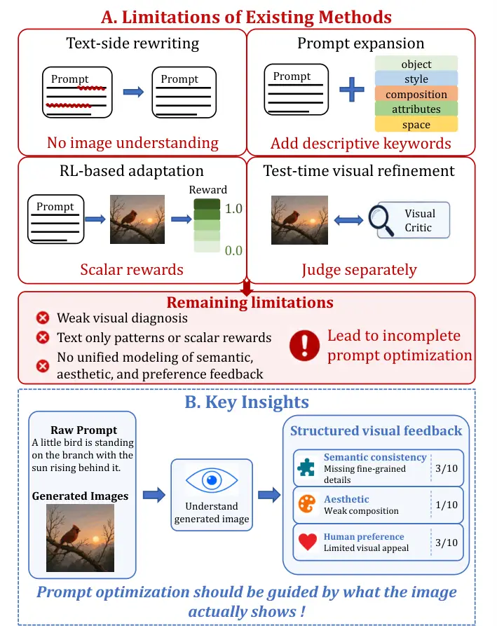
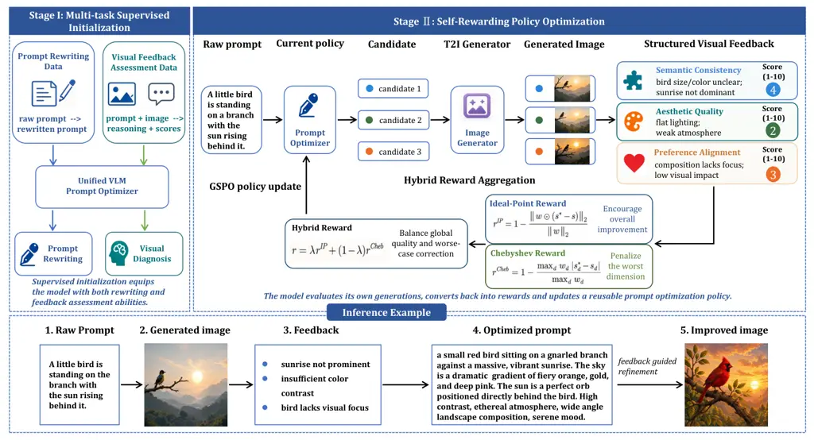
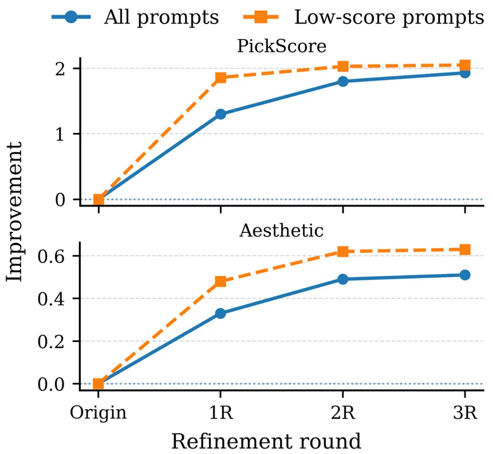
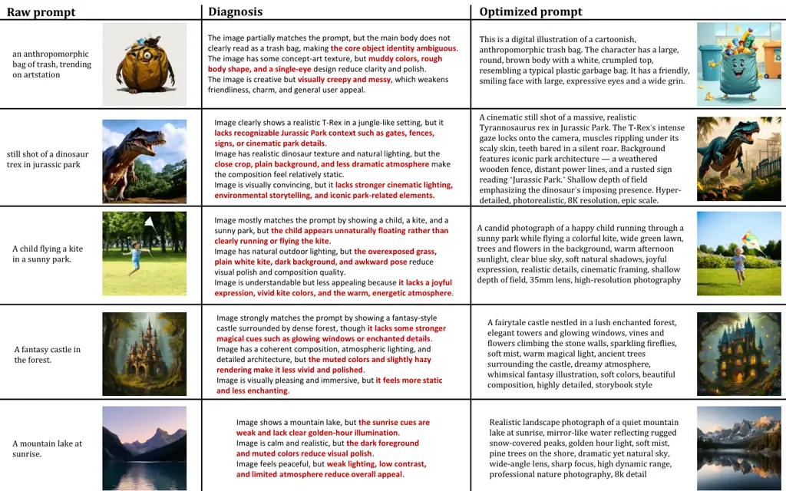
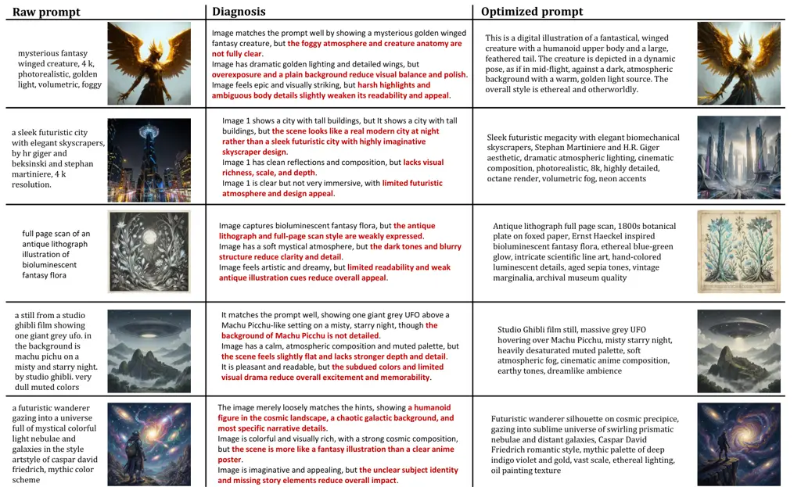

# PRISM: Prompt Refinement via Image-grounded Self-rewarding Mechanism for Text-to-Image Generation

Guo Tang Affiliation: Harbin Institute of Technology, Shenzhen   
HongJie Luo Affiliation: Sun Yat-sen University    Tianxu Wang
Affiliation: South China University of Technology    Ying Zhang
Affiliation: Guangdong University of Technology
Correspondence:[guot3907@gamil.com](mailto:email@domain)    Hao Wang
Affiliation: South China University of Technology

###### Abstract

Text-to-image generation models can synthesize high-quality images from
natural language descriptions, but their performance remains highly
sensitive to prompt formulation. Existing prompt optimization methods
mainly rely on text-side rewriting, prompt expansion, or external reward
signals, offering limited image-grounded diagnosis and weak support for
learning reusable optimization policies. In this paper, we propose
PRISM, a Prompt Refinement framework via Image-grounded Self-rewarding
Mechanism. PRISM closes the prompt-image-feedback loop by interpreting
generated images with structured visual diagnosis and scoring them along
semantic consistency, aesthetic quality, and human preference alignment.
It first initializes a unified VLM through multi-task supervised
fine-tuning, and then improves the prompt policy via self-rewarding
optimization with a hybrid ideal-point and Chebyshev reward. Extensive
experiments show that PRISM improves holistic image quality and
fine-grained semantic alignment, while providing interpretable feedback
for targeted prompt refinement. The code is available at
[https://anonymous.4open.science/r/PRISM-FF81](https://anonymous.4open.science/r/PRISM-FF81)

## 1 Introduction

Text-to-image (T2I) generation has made remarkable progress in
synthesizing high-quality images from natural language
descriptions Esser et al. (2024); Podell et al. (2024); Chen et al.
(2024). However, its performance remains highly sensitive to prompt
formulation, as under-specified prompts often fail to provide the
object, attribute, style, and composition details required for
controllable and faithful generation Huang et al. (2023); Mahajan et al.
(2024). As a result, prompt optimization has become an important
technique for improving generation quality Chen et al. (2025).



Figure 1: Motivation of the proposed PRISM framework.

Existing prompt optimization methods have explored text-side rewriting,
prompt expansion, and reinforcement learning-based prompt adaptation Cao
et al. (2023); Pavlichenko and Ustalov (2023); Yang et al. (2025). While
effective, most of them rely on textual patterns or scalar rewards,
providing limited diagnostic guidance on why a generated image succeeds
or fails. Recent visual-feedback-based methods incorporate generated
images into prompt refinement, but they are often implemented as
test-time pipelines with separate critic and rewriter modules, which
limits their ability to learn a reusable optimization policy Wu et al.
(2025); Khan et al. (2025). Moreover, existing feedback signals usually
emphasize isolated objectives, rather than jointly modeling semantic
consistency, aesthetic quality, and preference alignment within a
unified framework Zhang et al. (2024). As illustrated in Fig. 1, these
limitations suggest that prompt optimization should be guided by
structured visual feedback derived from what the generated image
actually shows.

Motivated by this observation, we propose PRISM, a Prompt Refinement
framework via Image-grounded Self-rewarding Mechanism for T2I prompt
optimization. Instead of learning prompt rewriting solely from text
pairs, our method directly interprets generated images through
structured visual diagnosis and uses the feedback to guide prompt
optimization. Specifically, we train a Vision-Language Model (VLM) to
assess generated images along three complementary dimensions: semantic
consistency, aesthetic quality, and human preference alignment. The
predicted diagnostic feedback and dimension-specific scores are then
used for both prompt revision and reward computation. We initialize the
VLM through multi-task supervised fine-tuning for joint prompt rewriting
and visual feedback assessment, and further optimize the prompt policy
via self-rewarding learning using Group Sequence Policy Optimization
(GSPO) Zheng et al. (2025). A hybrid ideal-point and Chebyshev reward
encourages the optimized prompts to approach the ideal visual feedback
scores while penalizing weak dimensions, leading to more balanced
improvements.

The main contributions of this work are summarized as follows:

- •
  PRISM framework. We propose a unified multimodal framework that learns
  a reusable prompt optimization policy by integrating visual feedback
  assessment and prompt rewriting.
- •
  A diagnosis-guided reward mechanism. We introduce a multi-dimensional
  reward mechanism based on structured visual diagnosis, where semantic
  consistency, aesthetic quality, and human preference alignment are
  jointly considered through a hybrid ideal-point and Chebyshev
  objective.
- •
  Comprehensive empirical validation. Extensive experiments on multiple
  benchmarks demonstrate the effectiveness of PRISM in prompt
  optimization and targeted feedback-guided refinement.

## 2 Related Work

### 2.1 Text-to-Image generation

T2I generation aims to synthesize visually realistic and semantically
aligned images from natural language descriptions. Early studies
explored GAN-based text-conditioned generation Reed et al. (2016); Zhang
et al. (2017); Xu et al. (2018), while autoregressive models further
formulated image synthesis as sequence modeling over visual
tokens Ramesh et al. (2021); Ding et al. (2021). More recently,
diffusion models have become the dominant paradigm for high-fidelity T2I
generation Ho et al. (2020); Dhariwal and Nichol (2021). Representative
systems such as GLIDE Nichol et al. (2021), Imagen Saharia et al.
(2022), Latent Diffusion Models Rombach et al. (2022), SDXL Podell et
al. (2024), and Stable Diffusion 3 Esser et al. (2024) have
substantially improved photorealism, image-text alignment, efficiency,
and high-resolution synthesis.

Despite these advances, T2I models remain highly sensitive to prompt
formulation. Well-designed prompts are often required to specify
objects, attributes, relations, style, and composition, making prompt
engineering and automatic prompt optimization important directions for
controllable and preference-aligned generation.

### 2.2 Prompt Engineering

Prompt engineering aims to improve the controllability, fidelity, and
visual quality of T2I generation by refining input prompts. For example,
BestPrompt searches effective prompt keywords with genetic
algorithms Pavlichenko and Ustalov (2023), and PEZ optimizes discrete
hard prompts via gradient-based search Wen et al. (2023). Promptist
learns to adapt user inputs into model-preferred prompts using
supervised fine-tuning and reinforcement learning Hao et al. (2023),
while BeautifulPrompt further leverages visual AI feedback Cao et al.
(2023). More recently, self-rewarding VLMs have been explored to unify
prompt rewriting and image evaluation within a single model Yang et al.
(2025). Although these methods improve prompt quality, they provide
limited image-grounded diagnosis of generation failures.

Beyond text-side optimization, recent methods incorporate generated
images or external evaluators into prompt refinement. PromptMagician
supports interactive prompt exploration by retrieving similar
prompt-image pairs and recommending important keywords Feng et al.
(2023). OPT2I iteratively revises prompts with an LLM to maximize
prompt-image consistency Mañas et al. (2024), while T2I-Copilot Chen et
al. (2025) and PromptSculptor Xiang et al. (2025) employ multi-agent
systems for evaluator-guided refinement. TIR performs closed-loop
test-time refinement by using an MLLM to check prompt-image alignment
and update prompts with history-aware feedback Khan et al. (2025).
VisualPrompter further decomposes prompts into atomic semantic concepts
with Davidsonian Scene Graphs Cho et al. (2024) and uses visual feedback
to identify missing concepts for target-specific optimization Wu et al.
(2025). These feedback-aware methods show the value of generated images
for prompt refinement, but they are often constrained by fragmented
feedback objectives, reliance on external or test-time evaluators, and
limited ability to transform structured visual feedback into a reusable
self-optimizing prompt policy.

## 3 Methodology

In this section, we introduce PRISM for image-grounded self-rewarding
prompt refinement. The overall framework is shown in Fig. 2. We
formulate prompt optimization as a closed-loop process that connects the
user prompt, prompt optimizer, T2I generator, and generated image. Based
on structured visual feedback, we introduce a two-stage training
procedure consisting of supervised initialization and self-rewarding
prompt optimization.



Figure 2: Overview of the proposed PRISM framework. Stage I performs
multi-task supervised initialization to equip the VLM with prompt
rewriting and visual feedback assessment abilities. Stage II optimizes
the prompt policy through self-rewarding learning, where candidate
prompts are rendered by a frozen T2I generator, evaluated with
structured visual feedback, and updated using hybrid reward aggregation.
The bottom row illustrates an inference example of feedback-guided
prompt refinement.

### 3.1 Problem Formulation

Given a user prompt $`x`$, prompt optimization aims to generate an
improved prompt $`\hat{x}`$ that preserves the user intent while better
adapting to a target T2I generator. Let $`\pi_{\theta}`$ denote the
prompt optimization policy and $`G`$ denote the frozen T2I generator.
The generation process is formulated as

```math
\hat{x}\sim\pi_{\theta}(\cdot\mid x),\quad I=G(\hat{x}), \tag{1}
```

where $`I`$ is the image generated from the optimized prompt.

To incorporate visual evidence into prompt optimization, we define a
visual feedback function $`F`$ that produces both textual diagnosis and
numerical scores:

```math
\displaystyle\mathcal{F} \displaystyle=F(x,\hat{x},I) \tag{2}
```

```math
\displaystyle=\left\{(f_{\mathrm{sem}},r_{\mathrm{sem}}),(f_{\mathrm{aes}},r_{\mathrm{aes}}),(f_{\mathrm{pref}},r_{\mathrm{pref}})\right\},
```

where $`f_{\mathrm{sem}}`$, $`f_{\mathrm{aes}}`$, and
$`f_{\mathrm{pref}}`$ denote textual diagnostic feedback, and
$`r_{\mathrm{sem}}`$, $`r_{\mathrm{aes}}`$, and $`r_{\mathrm{pref}}`$
denote the corresponding scores for semantic consistency, aesthetic
quality, and preference alignment, respectively. The scores are
collected into a reward vector

```math
\mathbf{r}=\left[r_{\mathrm{sem}},r_{\mathrm{aes}},r_{\mathrm{pref}}\right], \tag{3}
```

and further aggregated into a scalar reward by

```math
R(x,\hat{x},I)=\Phi(\mathbf{r}). \tag{4}
```

Thus, the objective of our framework is to learn a reusable prompt
optimization policy by maximizing the expected visual-feedback reward:

```math
\max_{\theta}\mathbb{E}_{x\sim\mathcal{D},\,\hat{x}\sim\pi_{\theta}(\cdot\mid x)}\left[R(x,\hat{x},G(\hat{x}))\right]. \tag{5}
```

### 3.2 Visual Feedback Construction

As defined in Equation (2), visual feedback $`\mathcal{F}`$ contains
both textual diagnosis and numerical scores along three dimensions:
semantic consistency, aesthetic quality, and preference alignment.
Semantic consistency measures whether the generated image preserves the
original user intent, including objects, attributes, actions, counting,
spatial relations, and interactions. Aesthetic quality evaluates visual
appeal beyond semantic correctness, such as composition, lighting, color
harmony, clarity, details, and artifacts. Preference alignment captures
holistic user-oriented judgments, including naturalness, coherence,
style appropriateness, attractiveness, and overall satisfaction. Details
are provided in the Appendix A.4.

### 3.3 Supervised Initialization for Prompt Rewriting and Visual Feedback Assessment

Before self-rewarding optimization, the VLM is initialized with two core
abilities: prompt rewriting and structured visual feedback assessment.
We train a single VLM under a multi-task supervised objective, enabling
it to act as both the prompt optimizer and the feedback provider in the
subsequent optimization stage.

Training data construction. We construct the supervised dataset from
four instruction types:

```math
\mathcal{D}_{\mathrm{sup}}=\mathcal{D}_{\mathrm{rew}}\cup\mathcal{D}_{\mathrm{fb}}\cup\mathcal{D}_{\mathrm{score}}\cup\mathcal{D}_{\mathrm{fgr}}. \tag{6}
```

The prompt rewriting set is defined as

```math
\mathcal{D}_{\mathrm{rew}}=\{(x,\hat{x}^{*})\}, \tag{7}
```

where $`x`$ is the user prompt and $`\hat{x}^{*}`$ is the reference
optimized prompt. The visual feedback assessment set is defined as

```math
\mathcal{D}_{\mathrm{fb}}=\{(p,I_{p},\mathcal{F}^{*}_{p})\},\ p\in\{x,\hat{x}^{*}\},\ I_{p}=G(p), \tag{8}
```

where $`\mathcal{F}^{*}_{p}`$ contains reference diagnostic feedback and
dimension-specific scores. To calibrate numerical judgment, we further
construct a score-only subset

```math
\mathcal{D}_{\mathrm{score}}=\{(p,I_{p},\mathbf{r}^{*}_{p})\}, \tag{9}
```

where
$`\mathbf{r}^{*}_{p}=[r^{*}_{\mathrm{sem}},r^{*}_{\mathrm{aes}},r^{*}_{\mathrm{pref}}]`$.
Finally, the feedback guided rewriting set is defined as

```math
\mathcal{D}_{\mathrm{fgr}}=\{(x,I_{x},\mathcal{F}^{*}_{x},\hat{x}^{*})\}, \tag{10}
```

which trains the model to revise under-specified prompts using explicit
visual feedback. Detailed data construction procedures and instruction
templates are provided in Appendix A.

Multi-task supervised fine-tuning. All training samples are converted
into instruction-following formats and can be viewed in the Appendix B.
Let
$`\mathcal{T}=\{\mathrm{rew},\mathrm{fb},\mathrm{score},\mathrm{fgr}\}`$
denote the set of supervised tasks, corresponding to prompt rewriting,
visual feedback assessment, score-only calibration, and feedback-guided
prompt rewriting, respectively. For each task $`t\in\mathcal{T}`$, we
denote the instruction input as $`u`$ and the target response as $`y`$.
The model is optimized with a response-only autoregressive objective:

```math
\mathcal{L}_{\mathrm{SFT}}=-\sum_{t\in\mathcal{T}}\lambda_{t}\mathbb{E}_{(u,y)\sim\mathcal{D}_{t}}\left[\sum_{j=1}^{|y|}\log\pi_{\theta}(y_{j}\mid u,y_{<j})\right], \tag{11}
```

where $`\lambda_{t}`$ controls the contribution of task $`t`$, and
$`\mathcal{D}_{t}`$ denotes its corresponding training set.

Task-specific instructions are used to specify the expected output
format, including optimized prompts, diagnostic feedback with scores,
score-only responses, and feedback-guided revised prompts. This
multi-task initialization enables the same VLM to perform both prompt
rewriting and visual feedback assessment, providing the starting policy
for self-rewarding optimization.

### 3.4 Self-Rewarding Prompt Optimization

After supervised initialization, the VLM is further optimized through
self-rewarding training. In each iteration, the model acts as a prompt
policy to generate candidate prompts and as a visual judge to provide
reward signals. Given a user prompt $`x`$, we sample $`K`$ candidate
prompts from the old policy:

```math
\hat{x}_{i}\sim\pi_{\theta_{\mathrm{old}}}(\cdot\mid x),\quad i=1,\ldots,K, \tag{12}
```

and generate the corresponding images with the frozen T2I generator:

```math
I_{i}=G(\hat{x}_{i}). \tag{13}
```

A frozen copy of the initialized VLM is then used in feedback assessment
mode to produce dimension-specific scores:

```math
\mathcal{F}_{i}=F_{\theta_{\mathrm{old}}}(x,\hat{x}_{i},I_{i}),\quad\mathbf{r}_{i}=[r_{\mathrm{sem}}^{i},r_{\mathrm{aes}}^{i},r_{\mathrm{pref}}^{i}]. \tag{14}
```

Hybrid reward aggregation. The multi-dimensional feedback scores are
aggregated into a scalar reward for policy optimization. Since semantic
consistency, aesthetic quality, and preference alignment capture
complementary aspects of generation quality, optimizing a single
dimension may lead to biased prompt improvement. We therefore adopt a
hybrid reward aggregation strategy that combines the ideal-point
distance with the Chebyshev distance.

The feedback scores are first normalized into $`[0,1]`$, yielding
$`\bar{\mathbf{r}}_{i}=[\bar{r}_{\mathrm{sem}}^{i},\bar{r}_{\mathrm{aes}}^{i},\bar{r}_{\mathrm{pref}}^{i}]`$.
We define the ideal feedback vector as $`\mathbf{r}^{*}=[1,1,1]`$ and
compute the weighted deviation:

```math
\mathbf{d}_{i}=\mathbf{w}\odot(\mathbf{r}^{*}-\bar{\mathbf{r}}_{i}), \tag{15}
```

where
$`\mathbf{w}=[w_{\mathrm{sem}},w_{\mathrm{aes}},w_{\mathrm{pref}}]`$
controls the importance of different feedback dimensions. The scalar
reward combines an ideal-point objective and a Chebyshev objective:

```math
\begin{gathered}R^{\mathrm{ideal}}_{i}=1-\frac{\|\mathbf{d}_{i}\|_{2}}{\|\mathbf{w}\odot\mathbf{r}^{*}\|_{2}},\\[5.69054pt]
R^{\mathrm{cheb}}_{i}=1-\frac{\|\mathbf{d}_{i}\|_{\infty}}{\|\mathbf{w}\odot\mathbf{r}^{*}\|_{\infty}},\\[5.69054pt]
R_{i}=\alpha R^{\mathrm{ideal}}_{i}+(1-\alpha)R^{\mathrm{cheb}}_{i}.\end{gathered} \tag{16}
```

Here, $`R^{\mathrm{ideal}}_{i}`$ encourages overall improvement toward
the ideal feedback vector, while $`R^{\mathrm{cheb}}_{i}`$ penalizes the
weakest dimension. The coefficient $`\alpha\in[0,1]`$ controls the
trade-off between overall quality and worst-dimension penalty.

Group-wise advantage estimation. To reduce absolute score bias, we
compute relative advantages within each candidate group:

```math
A_{i}=\frac{R_{i}-\mathrm{mean}(\{R_{j}\}_{j=1}^{K})}{\mathrm{std}(\{R_{j}\}_{j=1}^{K})+\epsilon}. \tag{17}
```

This group-wise normalization encourages the policy to prefer prompts
that achieve stronger visual feedback than other candidates sampled for
the same input.

Since the reward is assigned to the whole optimized prompt, we adopt
GSPO Zheng et al. (2025), which performs sequence-level rewarding,
clipping, and policy optimization. For each candidate prompt
$`\hat{x}_{i}=(y_{1},\ldots,y_{T})`$, the sequence-level importance
ratio is defined as

```math
\rho_{i}(\theta)=\exp\left(\frac{1}{T}\sum_{t=1}^{T}\log\frac{\pi_{\theta}(y_{t}\mid x,y_{<t})}{\pi_{\theta_{\mathrm{old}}}(y_{t}\mid x,y_{<t})}\right). \tag{18}
```

We clip the ratio by

```math
\tilde{\rho}_{i}(\theta)=\mathrm{clip}\left(\rho_{i}(\theta),1-\epsilon_{c},1+\epsilon_{c}\right), \tag{19}
```

where $`\epsilon_{c}`$ is the sequence-level clipping threshold. The
self-rewarding loss is

```math
\displaystyle\mathcal{L}_{\mathrm{SR}}=- \displaystyle\mathbb{E}_{x}\left[\frac{1}{K}\sum_{i=1}^{K}\min\left(\rho_{i}(\theta)A_{i},\tilde{\rho}_{i}(\theta)A_{i}\right)\right] \tag{20}
```

```math
\displaystyle+\beta\mathcal{D}_{\mathrm{KL}}\left(\pi_{\theta}\|\pi_{\mathrm{ref}}\right),
```

where $`\pi_{\mathrm{ref}}`$ denotes the supervised initialized
reference policy and $`\beta`$ controls the KL regularization strength.

This self-rewarding stage reinforces prompts that receive stronger
multi-dimensional visual feedback, enabling the policy to progressively
improve prompt optimization without relying on a fixed external reward
model.

## 4 Experiments

|                                               |                        |                        |                        |                    |                          |
| --------------------------------------------- | ---------------------- | ---------------------- | ---------------------- | ------------------ | ------------------------ |
| Method                                        | CLIPScore $`\uparrow`$ | Aesthetic $`\uparrow`$ | PickScore $`\uparrow`$ | HPSv2 $`\uparrow`$ | ImageReward $`\uparrow`$ |
| Original Prompt                               | 0.282                  | 6.106                  | 21.219                 | 0.276              | 0.989                    |
| Text-only prompt optimization                 |                        |                        |                        |                    |                          |
| BestPrompt                                    | 0.268                  | 6.182                  | 20.143                 | 0.260              | 0.914                    |
| BeautifulPrompt                               | 0.272                  | 6.291                  | 21.088                 | 0.277              | 1.050                    |
| Promptist                                     | 0.283                  | 6.263                  | 21.506                 | 0.281              | 1.019                    |
| NeuroPrompts                                  | 0.277                  | 6.219                  | 22.195                 | 0.285              | 1.112                    |
| Qwen3-VL-8B                                   | 0.245                  | 6.136                  | 21.128                 | 0.278              | 1.195                    |
| PRISM-SFT                                     | 0.280                  | 6.198                  | 22.149                 | 0.297              | 1.201                    |
| PRISM                                         | 0.291                  | 6.307                  | 22.457                 | 0.302              | 1.218                    |
| Text-image feedback-based prompt optimization |                        |                        |                        |                    |                          |
| VisualPrompter                                | 0.304                  | 6.131                  | 21.208                 | 0.288              | 0.993                    |
| TIR                                           | 0.285                  | 6.176                  | 21.657                 | 0.280              | 0.972                    |
| OPT2I                                         | 0.291                  | 6.150                  | 21.501                 | 0.272              | 1.006                    |
| GPT-4o                                        | 0.275                  | 6.255                  | 21.955                 | 0.283              | 1.198                    |
| Qwen3-VL-235B-A22B                            | 0.269                  | 6.172                  | 22.381                 | 0.289              | 1.269                    |
| Qwen3-VL-8B                                   | 0.261                  | 6.129                  | 21.628                 | 0.288              | 1.176                    |
| PRISM-SFT                                     | 0.278                  | 6.223                  | 22.254                 | 0.303              | 1.252                    |
| PRISM                                         | 0.299                  | 6.318                  | 22.526                 | 0.305              | 1.285                    |

Table 1: Holistic image-level evaluation on the BeautifulPrompt test
set. PRISM-SFT denotes the supervised-initialized variant without
self-rewarding optimization, and PRISM denotes the full model. Best and
second-best results within each group are highlighted in bold and
underlined, respectively.

We evaluate PRISM on T2I prompt optimization. Our experiments examine
whether the learned prompt policy improves image-text alignment, visual
quality, and human preference alignment, and whether visual feedback and
self-rewarding optimization provide consistent gains over supervised
initialization.

### 4.1 Experimental Settings

We adopt Qwen3-VL-8B-Instruct Bai et al. (2025) as the backbone VLM.
Stable Diffusion 3.5 medium¹¹ 1
[https://huggingface.co/stabilityai/stable-diffusion-3.5-medium](https://huggingface.co/stabilityai/stable-diffusion-3.5-medium)
is used as the primary target T2I generator with 28 denoising steps,
while additional results on FLUX.2-klein²² 2
[https://huggingface.co/black-forest-labs/FLUX.2-klein-4B](https://huggingface.co/black-forest-labs/FLUX.2-klein-4B)
are reported in Appendix C to evaluate cross-generator generalization.

Supervised fine-tuning. We train the VLM with AdamW Loshchilov and
Hutter (2017) using $`\beta_{1}=0.9`$, $`\beta_{2}=0.95`$, a batch size
of 32, and weight decay of 0.1. The learning rate is initialized to
$`2\times 10^{-5}`$ and scheduled with linear warm-up followed by cosine
decay. For the multi-task SFT objective, we set the task loss weights to
$`\lambda_{\mathrm{rew}}:\lambda_{\mathrm{fb}}:\lambda_{\mathrm{score}}:\lambda_{\mathrm{fgr}}=1:1:1:2`$
emphasizing feedback-guided prompt rewriting.

Self-rewarding optimization. For each input prompt, the policy samples
$`K=8`$ candidate prompts with temperature $`T=0.9`$ and top-$`p=0.9`$.
We set the sequence-level clipping threshold to $`\epsilon_{c}=0.2`$ and
the KL coefficient to $`\beta=0.3`$, using the SFT model as the
reference policy $`\pi_{\mathrm{ref}}`$. The scalar reward follows the
hybrid aggregation strategy in Section 3.4, with
$`\mathbf{w}=[0.5,0.25,0.25]`$ to emphasize semantic consistency. Each
visual assessment is repeated three times and averaged for stability. We
perform two self-rewarding iterations.

During training and evaluation, all T2I generators are frozen. All
methods are evaluated under the same generation settings for fair
comparison. All experiments are conducted on NVIDIA A800 80G GPUs.

### 4.2 Benchmarks and Evaluation Metrics

We evaluate PRISM on two types of benchmarks. For general prompt
optimization, we use the 2k BeautifulPrompt test prompts Cao et al.
(2023) and report CLIPScore Hessel et al. (2021), Aesthetic Score Podell
et al. (2024), ImageReward Xu et al. (2023), PickScore Kirstain et al.
(2023), and HPSv2 Wu et al. (2023) to measure image-text alignment,
visual quality, and human preference. For fine-grained semantic
alignment, we evaluate on T2I-CompBench Huang et al. (2023) and TIFA Hu
et al. (2023). T2I-CompBench assesses compositional generation over
attributes, relations, and complex prompts, while TIFA measures
prompt-image faithfulness via automatically generated visual questions.
For all benchmarks, metrics are computed with respect to the original
user prompt rather than the optimized prompt, ensuring that the
evaluation reflects preservation and enhancement of the original user
intent.

### 4.3 Comparative Results

|                    |                   |                            |       |         |         |            |         |       |
| ------------------ | ----------------- | -------------------------- | ----- | ------- | ------- | ---------- | ------- | ----- |
| Method             | TIFA $`\uparrow`$ | T2I-CompBench $`\uparrow`$ |       |         |         |            |         |       |
|                    |                   | Color                      | Shape | Texture | Spatial | NonSpatial | Complex | Avg.  |
| Original Prompt    | 76.1              | 0.736                      | 0.510 | 0.627   | 0.259   | 0.265      | 0.298   | 0.449 |
| VisualPrompter     | 87.8              | 0.791                      | 0.605 | 0.692   | 0.403   | 0.315      | 0.402   | 0.535 |
| TIR                | 82.4              | 0.820                      | 0.559 | 0.715   | 0.355   | 0.309      | 0.384   | 0.524 |
| OPT2I              | 85.1              | 0.812                      | 0.592 | 0.724   | 0.386   | 0.314      | 0.372   | 0.533 |
| GPT-4o             | 90.3              | 0.835                      | 0.548 | 0.713   | 0.415   | 0.302      | 0.377   | 0.532 |
| Qwen3-VL-235B-A22B | 89.6              | 0.808                      | 0.577 | 0.708   | 0.392   | 0.318      | 0.395   | 0.533 |
| Qwen3-VL-8B        | 87.5              | 0.754                      | 0.580 | 0.682   | 0.371   | 0.313      | 0.364   | 0.511 |
| PRISM-SFT          | 88.9              | 0.793                      | 0.585 | 0.704   | 0.385   | 0.311      | 0.396   | 0.529 |
| PRISM              | 91.4              | 0.843                      | 0.603 | 0.732   | 0.429   | 0.316      | 0.405   | 0.555 |

Table 2: Fine-grained semantic alignment evaluation on TIFA and
T2I-CompBench. Best and second-best results are highlighted in bold and
underlined, respectively.

Holistic image-level evaluation. Table 1 reports the main results on the
BeautifulPrompt test set. In the text-only setting, PRISM achieves the
best results across all five metrics, showing consistent gains over both
original prompts and prior prompt optimization methods. In the
text-image feedback setting, PRISM obtains the best Aesthetic,
PickScore, HPSv2, and ImageReward scores, while remaining competitive on
CLIPScore. These results indicate that visual-feedback-driven
optimization improves prompt quality in a balanced manner, enhancing not
only image-text alignment but also aesthetic quality and human
preference alignment.

Fine-grained semantic alignment. Table 2 reports the results on TIFA and
T2I-CompBench. PRISM achieves the best overall performance, improving
TIFA from 76.1 to 91.4 and the T2I-CompBench average from 0.449 to 0.555
compared with the original prompts. It also surpasses the strongest
baselines on both TIFA and the average compositional score, and obtains
the best results on color, texture, spatial relation, and complex
composition. Moreover, the gains over PRISM-SFT demonstrate that the
self-rewarding stage further strengthens fine-grained semantic alignment
by leveraging structured visual feedback, particularly for attribute
binding, spatial reasoning, and complex compositions.

### 4.4 Ablation Study

| Method      | FB   | Train | PS $`\uparrow`$ | TIFA $`\uparrow`$ | $`C_{\mathrm{T2I}}\downarrow`$ | $`C_{\mathrm{VLM}}\downarrow`$ |
| ----------- | ---- | ----- | --------------- | ----------------- | ------------------------------ | ------------------------------ |
| TF-Ext (1R) | Ext  | No    | 20.984          | 86.3              | 2                              | 1                              |
| TF-Ext (2R) | Ext  | No    | 21.343          | 88.2              | 3                              | 2                              |
| Self-FB     | Self | SFT   | 22.254          | 88.9              | 2                              | 1                              |
| Ext-VLM     | Ext  | RL    | 22.411          | 90.0              | 2                              | 1                              |
| PRISM       | Self | RL    | 22.526          | 91.4              | 2                              | 1                              |

Table 3: Ablation on feedback sources. PS denotes PickScore. FB denotes
feedback source. 1R/2R denote one/two test-time refinement rounds.
$`C_{\mathrm{T2I}}`$ and $`C_{\mathrm{VLM}}`$ denote the numbers of T2I
and VLM calls per input prompt.

Effect of feedback source. Table 3 shows that learning with feedback is
more effective than training-free refinement. Under the same inference
cost as TF-Ext (1R), Self-FB improves PS from 20.984 to 22.254 and TIFA
from 86.3 to 88.9. With self-rewarding optimization, PRISM further
achieves the best results on both PS and TIFA, outperforming Ext-VLM
under the same cost. This suggests that integrating self-feedback into
the trainable policy provides more effective and consistent reward
signals.



Figure 3: Iterative feedback refinement results across multiple
refinement rounds.



Figure 4: Qualitative examples of PRISM. Each example shows the original
prompt, initial generated image, structured visual feedback, optimized
prompt, and final generated image, illustrating how diagnosed visual
issues guide targeted prompt refinement.

Iterative feedback refinement. We further evaluate whether the model can
benefit from repeated visual feedback. Starting from the original
prompt, we perform multiple refinement rounds by feeding the generated
image and its visual feedback back into the model. As shown in Fig. 3,
the second refinement round brings additional improvements, especially
for samples with low first-pass scores. This suggests that PRISM can act
as a feedback-aware prompt optimizer rather than a one-shot prompt
enhancer.

Effect of reward aggregation. Table 4 compares different reward
aggregation strategies. The hybrid reward achieves the best performance
across all metrics. Compared with the weighted-sum reward, the hybrid
strategy further improves TIFA by 3.3 points while maintaining slightly
better aesthetic and preference scores. Although the ideal-point and
Chebyshev rewards improve semantic faithfulness over the weighted-sum
baseline, they show weaker aesthetic or preference performance when used
alone. These results indicate that combining overall closeness to the
ideal feedback profile with worst-dimension penalty leads to more
balanced prompt optimization.

| Reward       | Aesthetic $`\uparrow`$ | PickScore $`\uparrow`$ | TIFA $`\uparrow`$ |
| ------------ | ---------------------- | ---------------------- | ----------------- |
| Weighted Sum | 6.312                  | 22.512                 | 88.1              |
| Ideal-point  | 6.281                  | 22.495                 | 89.8              |
| Chebyshev    | 6.275                  | 22.403                 | 89.2              |
| Hybrid       | 6.318                  | 22.526                 | 91.4              |

Table 4: Ablation on reward aggregation strategies.

### 4.5 Qualitative Analysis

Fig. 4 presents representative examples of the visual-feedback-guided
prompt refinement process in PRISM. The model identifies concrete
generation issues, such as missing objects, weak spatial relations, and
style mismatch, and revises the prompt accordingly. These examples
demonstrate that structured visual feedback provides interpretable
correction cues for targeted prompt refinement.

## 5 Conclusion

In this paper, we propose PRISM, a Prompt Refinement framework via
Image-grounded Self-rewarding Mechanism for text-to-image prompt
optimization. PRISM uses structured visual diagnosis to guide prompt
rewriting and reward computation across semantic consistency, aesthetic
quality, and preference alignment. Through multi-task supervised
initialization and self-rewarding policy optimization, the VLM learns to
jointly perform prompt rewriting and visual feedback assessment.
Extensive experiments demonstrate that PRISM improves holistic image
quality and fine-grained semantic alignment, while providing
interpretable feedback for targeted prompt refinement.

## Limitations

Although PRISM demonstrates strong effectiveness, several aspects remain
open for future work. First, the current feedback design focuses on
semantic consistency, aesthetic quality, and preference alignment;
extending it to more fine-grained or domain-specific criteria could
further improve controllability. Second, iterative feedback refinement
is evaluated with a limited number of rounds to maintain inference
efficiency, while adaptive stopping strategies may provide a better
trade-off between quality and cost.

## References

- Bai et al. (2025) S. Bai, Y. Cai, R. Chen, K. Chen, X. Chen, Z.
  Cheng, L. Deng, W. Ding, C. Gao, C. Ge, W. Ge, Z. Guo, Q. Huang, J.
  Huang, F. Huang, B. Hui, S. Jiang, Z. Li, M. Li, M. Li, K. Li, Z.
  Lin, J. Lin, X. Liu, J. Liu, C. Liu, Y. Liu, D. Liu, S. Liu, D. Lu, R.
  Luo, C. Lv, R. Men, L. Meng, X. Ren, X. Ren, S. Song, Y. Sun, J.
  Tang, J. Tu, J. Wan, P. Wang, P. Wang, Q. Wang, Y. Wang, T. Xie, Y.
  Xu, H. Xu, J. Xu, Z. Yang, M. Yang, J. Yang, A. Yang, B. Yu, F.
  Zhang, H. Zhang, X. Zhang, B. Zheng, H. Zhong, J. Zhou, F. Zhou, J.
  Zhou, Y. Zhu, and K. Zhu Qwen3-vl technical report. arXiv preprint
  arXiv:2511.21631. Cited by: §4.1.
- Cao et al. (2023) T. Cao, C. Wang, B. Liu, Z. Wu, J. Zhu, and J. Huang
  Beautifulprompt: towards automatic prompt engineering for
  text-to-image synthesis. In Proceedings of the 2023 Conference on
  Empirical Methods in Natural Language Processing: Industry Track,
  pp. 1–11. Cited by: §1, §2.2, §4.2.
- Chen et al. (2025) C. Chen, M. Shi, G. Zhang, and H. Shi T2i-copilot:
  a training-free multi-agent text-to-image system for enhanced prompt
  interpretation and interactive generation. In Proceedings of the
  IEEE/CVF International Conference on Computer Vision, pp. 19396–19405.
  Cited by: §1, §2.2.
- Chen et al. (2024) J. Chen, J. Yu, C. Ge, L. Yao, E. Xie, Z. Wang, J.
  Kwok, P. Luo, H. Lu, and Z. Li Pixart-$`\alpha`$: fast training of
  diffusion transformer for photorealistic text-to-image synthesis. In
  International conference on learning representations, Vol. 2024,
  pp. 57611–57640. Cited by: §1.
- Cho et al. (2024) J. Cho, Y. Hu, J. Baldridge, R. Garg, P.
  Anderson, R. Krishna, M. Bansal, J. Pont-Tuset, and S. Wang
  Davidsonian scene graph: improving reliability in fine-grained
  evaluation for text-to-image generation. In International conference
  on learning representations, Vol. 2024, pp. 15625–15645. Cited by:
  §2.2.
- Dhariwal and Nichol (2021) P. Dhariwal and A. Nichol Diffusion models
  beat gans on image synthesis. Advances in neural information
  processing systems 34, pp. 8780–8794. Cited by: §2.1.
- Ding et al. (2021) M. Ding, Z. Yang, W. Hong, W. Zheng, C. Zhou, D.
  Yin, J. Lin, X. Zou, Z. Shao, H. Yang, and J. Tang Cogview: mastering
  text-to-image generation via transformers. Advances in neural
  information processing systems 34, pp. 19822–19835. Cited by: §2.1.
- Esser et al. (2024) P. Esser, S. Kulal, A. Blattmann, R. Entezari, J.
  Müller, H. Saini, Y. Levi, D. Lorenz, A. Sauer, F. Boesel, D.
  Podell, T. Dockhorn, Z. English, K. Lacey, A. Goodwin, Y. Marek,
  and R. Rombach Scaling rectified flow transformers for high-resolution
  image synthesis. In Forty-first international conference on machine
  learning, Cited by: §1, §2.1.
- Feng et al. (2023) Y. Feng, X. Wang, K. K. Wong, S. Wang, Y. Lu, M.
  Zhu, B. Wang, and W. Chen Promptmagician: interactive prompt
  engineering for text-to-image creation. IEEE Transactions on
  Visualization and Computer Graphics 30 (1), pp. 295–305. Cited by:
  §2.2.
- Hao et al. (2023) Y. Hao, Z. Chi, L. Dong, and F. Wei Optimizing
  prompts for text-to-image generation. Advances in Neural Information
  Processing Systems 36, pp. 66923–66939. Cited by: §2.2.
- Hessel et al. (2021) J. Hessel, A. Holtzman, M. Forbes, R. Le Bras,
  and Y. Choi Clipscore: a reference-free evaluation metric for image
  captioning. In Proceedings of the 2021 conference on empirical methods
  in natural language processing, pp. 7514–7528. Cited by: §4.2.
- Ho et al. (2020) J. Ho, A. Jain, and P. Abbeel Denoising diffusion
  probabilistic models. Advances in neural information processing
  systems 33, pp. 6840–6851. Cited by: §2.1.
- Hu et al. (2023) Y. Hu, B. Liu, J. Kasai, Y. Wang, M. Ostendorf, R.
  Krishna, and N. A. Smith Tifa: accurate and interpretable
  text-to-image faithfulness evaluation with question answering. In
  Proceedings of the IEEE/CVF International Conference on Computer
  Vision, pp. 20406–20417. Cited by: §4.2.
- Huang et al. (2023) K. Huang, K. Sun, E. Xie, Z. Li, and X. Liu
  T2i-compbench: a comprehensive benchmark for open-world compositional
  text-to-image generation. Advances in Neural Information Processing
  Systems 36, pp. 78723–78747. Cited by: §1, §4.2.
- Khan et al. (2025) M. A. H. Khan, Y. Jain, S. Bhattacharyya, and V.
  Vineet Test-time prompt refinement for text-to-image models. In
  Proceedings of the IEEE/CVF International Conference on Computer
  Vision, pp. 6506–6516. Cited by: §1, §2.2.
- Kirstain et al. (2023) Y. Kirstain, A. Polyak, U. Singer, S.
  Matiana, J. Penna, and O. Levy Pick-a-pic: an open dataset of user
  preferences for text-to-image generation. Advances in neural
  information processing systems 36, pp. 36652–36663. Cited by: §4.2.
- Loshchilov and Hutter (2017) I. Loshchilov and F. Hutter Decoupled
  weight decay regularization. arXiv preprint arXiv:1711.05101. Cited
  by: §4.1.
- Mahajan et al. (2024) S. Mahajan, T. Rahman, K. M. Yi, and L. Sigal
  Prompting hard or hardly prompting: prompt inversion for text-to-image
  diffusion models. In Proceedings of the IEEE/CVF Conference on
  Computer Vision and Pattern Recognition, pp. 6808–6817. Cited by: §1.
- Mañas et al. (2024) O. Mañas, P. Astolfi, M. Hall, C. Ross, J.
  Urbanek, A. Williams, A. Agrawal, A. Romero-Soriano, and M. Drozdzal
  Improving text-to-image consistency via automatic prompt optimization.
  arXiv preprint arXiv:2403.17804. Cited by: §2.2.
- Nichol et al. (2021) A. Nichol, P. Dhariwal, A. Ramesh, P. Shyam, P.
  Mishkin, B. McGrew, I. Sutskever, and M. Chen Glide: towards
  photorealistic image generation and editing with text-guided diffusion
  models. arXiv preprint arXiv:2112.10741. Cited by: §2.1.
- Pavlichenko and Ustalov (2023) N. Pavlichenko and D. Ustalov Best
  prompts for text-to-image models and how to find them. In Proceedings
  of the 46th International ACM SIGIR Conference on Research and
  Development in Information Retrieval, pp. 2067–2071. Cited by: §1,
  §2.2.
- Podell et al. (2024) D. Podell, Z. English, K. Lacey, A. Blattmann, T.
  Dockhorn, J. Müller, J. Penna, and R. Rombach Sdxl: improving latent
  diffusion models for high-resolution image synthesis. In International
  Conference on Learning Representations, Vol. 2024, pp. 1862–1874.
  Cited by: §1, §2.1, §4.2.
- Ramesh et al. (2021) A. Ramesh, M. Pavlov, G. Goh, S. Gray, C.
  Voss, A. Radford, M. Chen, and I. Sutskever Zero-shot text-to-image
  generation. In International conference on machine learning,
  pp. 8821–8831. Cited by: §2.1.
- Reed et al. (2016) S. Reed, Z. Akata, X. Yan, L. Logeswaran, B.
  Schiele, and H. Lee Generative adversarial text to image synthesis. In
  International conference on machine learning, pp. 1060–1069. Cited by:
  §2.1.
- Rombach et al. (2022) R. Rombach, A. Blattmann, D. Lorenz, P. Esser,
  and B. Ommer High-resolution image synthesis with latent diffusion
  models. In Proceedings of the IEEE/CVF conference on computer vision
  and pattern recognition, pp. 10684–10695. Cited by: §2.1.
- Saharia et al. (2022) C. Saharia, W. Chan, S. Saxena, L. Li, J.
  Whang, E. Denton, S. K. Seyed Ghasemipour, B. K. Ayan, S. S.
  Mahdavi, R. Gontijo Lopes, T. Salimans, J. Ho, D. J. Fleet, and M.
  Norouzi Photorealistic text-to-image diffusion models with deep
  language understanding. Advances in neural information processing
  systems 35, pp. 36479–36494. Cited by: §2.1.
- Wen et al. (2023) Y. Wen, N. Jain, J. Kirchenbauer, M. Goldblum, J.
  Geiping, and T. Goldstein Hard prompts made easy: gradient-based
  discrete optimization for prompt tuning and discovery. Advances in
  Neural Information Processing Systems 36, pp. 51008–51025. Cited by:
  §2.2.
- Wu et al. (2025) S. Wu, M. Sun, W. Wang, Y. Wang, and J. Liu
  VisualPrompter: semantic-aware prompt optimization with visual
  feedback for text-to-image synthesis. In The Fourteenth International
  Conference on Learning Representations, Cited by: §1, §2.2.
- Wu et al. (2023) X. Wu, Y. Hao, K. Sun, Y. Chen, F. Zhu, R. Zhao,
  and H. Li Human preference score v2: a solid benchmark for evaluating
  human preferences of text-to-image synthesis. arXiv preprint
  arXiv:2306.09341. Cited by: §4.2.
- Xiang et al. (2025) D. Xiang, W. Xu, K. Chu, T. Ding, Z. Shen, Y.
  Zeng, J. Su, and W. Zhang Promptsculptor: multi-agent based
  text-to-image prompt optimization. In Proceedings of the 2025
  Conference on Empirical Methods in Natural Language Processing: System
  Demonstrations, pp. 774–786. Cited by: §2.2.
- Xu et al. (2023) J. Xu, X. Liu, Y. Wu, Y. Tong, Q. Li, M. Ding, J.
  Tang, and Y. Dong Imagereward: learning and evaluating human
  preferences for text-to-image generation. Advances in Neural
  Information Processing Systems 36, pp. 15903–15935. Cited by: §4.2.
- Xu et al. (2018) T. Xu, P. Zhang, Q. Huang, H. Zhang, Z. Gan, X.
  Huang, and X. He Attngan: fine-grained text to image generation with
  attentional generative adversarial networks. In Proceedings of the
  IEEE conference on computer vision and pattern recognition,
  pp. 1316–1324. Cited by: §2.1.
- Yang et al. (2025) H. Yang, Y. Zhou, W. Han, and J. Shen
  Self-rewarding large vision-language models for optimizing prompts in
  text-to-image generation. In Findings of the Association for
  Computational Linguistics: ACL 2025, pp. 7332–7349. Cited by: §1,
  §2.2.
- Zhang et al. (2017) H. Zhang, T. Xu, H. Li, S. Zhang, X. Wang, X.
  Huang, and D. N. Metaxas Stackgan: text to photo-realistic image
  synthesis with stacked generative adversarial networks. In Proceedings
  of the IEEE international conference on computer vision,
  pp. 5907–5915. Cited by: §2.1.
- Zhang et al. (2024) S. Zhang, B. Wang, J. Wu, Y. Li, T. Gao, D. Zhang,
  and Z. Wang Learning multi-dimensional human preference for
  text-to-image generation. In Proceedings of the IEEE/CVF Conference on
  Computer Vision and Pattern Recognition, pp. 8018–8027. Cited by: §1.
- Zheng et al. (2025) C. Zheng, S. Liu, M. Li, X. Chen, B. Yu, C.
  Gao, K. Dang, Y. Liu, R. Men, A. Yang, J. Zhou, and J. Lin Group
  sequence policy optimization. arXiv preprint arXiv:2507.18071. Cited
  by: §1, §3.4.

## Appendix A Data Processing Pipeline

We construct four types of training data for PRISM: (i) rewriting data
$`\mathcal{D}_{\mathrm{rew}}`$, (ii) visual feedback data
$`\mathcal{D}_{\mathrm{vf}}`$, and (iii) score-only calibration data
$`\mathcal{D}_{\mathrm{score}}`$. The rewriting data are sampled from
BeautifulPrompt. For visual feedback data, we first build a tractable
candidate pool from open community T2I data sources, including
DiffusionDB, JourneyDB, and Pick-a-Pic. We then select high-quality
image-text pairs from this candidate pool and construct degraded prompts
through controlled simplification. The resulting data support three
objectives: basic prompt rewriting $`x\rightarrow\hat{x}`$, visual
feedback estimation $`F(x,\hat{x},I)`$, and feedback-conditioned prompt
refinement $`(x,I,\mathcal{F})\rightarrow\hat{x}`$.

### A.1 Unified Quality Score

Let $`a_{i}`$, $`p_{i}`$, and $`c_{i}`$ denote the Aesthetic score,
PickScore, and CLIPScore of the $`i`$-th sample, respectively. For a
candidate pool $`\mathcal{U}`$, each metric is normalized by pool-wise
min–max scaling:

```math
\tilde{m}_{i}=\frac{m_{i}-\min_{j\in\mathcal{U}}m_{j}}{\max_{j\in\mathcal{U}}m_{j}-\min_{j\in\mathcal{U}}m_{j}+\epsilon}, \tag{21}
```

where $`m\in\{a,p,c\}`$ and $`\epsilon=10^{-8}`$. We then define a
unified quality score:

```math
S_{i}=0.25\,\tilde{a}_{i}+0.25\,\tilde{p}_{i}+0.50\,\tilde{c}_{i}. \tag{22}
```

The larger CLIPScore weight emphasizes image-text semantic alignment. We
use Equation( (22)) for ranking samples in both Type-I and Type-II data
construction.

### A.2 BeautifulPrompt Rewriting Data

BeautifulPrompt contains approximately $`143`$k prompt pairs. Since its
training metadata already provides Aesthetic, PickScore, and CLIPScore
annotations, we do not perform additional external rescoring. We rank
the BeautifulPrompt training pool $`\mathcal{U}_{\mathrm{BP}}`$ using
Eqs. (21)–(22), and retain the top $`N_{1}=10{,}000`$ pairs,
corresponding to about $`7.0\%`$ of the original training pool.

The resulting Type-I dataset is
$`\mathcal{D}_{\mathrm{rew}}=\{(x_{i},\hat{x}_{i})\}_{i=1}^{N_{1}}`$,
where $`x_{i}`$ is a low-quality prompt, and $`\hat{x}_{i}`$ is its
high-quality rewritten version. This dataset is used only for supervised
initialization of the prompt optimizer $`\pi_{\theta}`$, i.e.,
$`x\rightarrow\hat{x}`$.

### A.3 Community Data and Controlled Prompt Simplification

#### A.3.1 Candidate pool construction

We construct feedback-oriented data from publicly available and
license-permissive AI-generated image resources. Rather than processing
full-scale community datasets, we first sample a tractable candidate
pool $`\mathcal{U}_{\mathrm{T2I}}`$ with $`C`$ image-text pairs. In our
implementation, we set $`C=50{,}000`$ and perform all metric computation
and filtering only within this sampled pool. The pool can be
instantiated from open community T2I resources, including DiffusionDB,
JourneyDB, and Pick-a-Pic, depending on data availability and
experimental needs.

Each candidate sample is represented as $`(\hat{x}_{i},I_{i}^{+})`$,
where $`\hat{x}_{i}`$ is a community-written prompt and $`I_{i}^{+}`$ is
its associated generated image. Since community prompts often contain
rich visual details and generation-oriented expressions, we treat
$`\hat{x}_{i}`$ as a model-preferred prompt. For each candidate pair, we
compute three quality indicators: $`a_{i}`$ for aesthetic quality,
$`p_{i}`$ for preference alignment, and $`c_{i}`$ for image-text
alignment. After min–max normalization within
$`\mathcal{U}_{\mathrm{T2I}}`$, we compute the unified quality score in
Equation( (22)) and retain the top $`N_{2}=5{,}000`$ high-quality pairs.

The retained high-quality pool is denoted as
$`\mathcal{D}_{\mathrm{high}}=\{(\hat{x}_{i},I_{i}^{+})\}_{i=1}^{N_{2}}`$.
This pool serves as the source for constructing paired prompts
$`(x_{i},\hat{x}_{i})`$ and their feedback-oriented supervision.

#### A.3.2 Controlled prompt simplification

For each high-quality prompt $`\hat{x}_{i}`$, we apply a stochastic
simplification operator $`\mathcal{T}`$ to construct an under-specified
counterpart $`x_{i}=\mathcal{T}(\hat{x}_{i})`$. The goal is not to
introduce semantic errors, but to preserve the core intent while
removing details that are commonly missing in user-provided prompts.
This yields paired prompts $`(x_{i},\hat{x}_{i})`$ with explicit
optimization gaps.

The simplification process follows four primary strategies:

- •
  Summarization and abstraction ($`30\%`$). We compress a long prompt
  into a short sentence or tag chain, with target length ratio
  $`r\sim\mathcal{U}(0.25,0.50)`$. Fine-grained nouns may be replaced by
  more generic hypernyms, while the main entity and action are retained.
  For example, a Victorian gothic cathedral, dramatic backlight,
  intricate stone texture is simplified to an old cathedral with
  dramatic light.
- •
  Removal of style and quality modifiers ($`25\%`$). We remove common
  style, quality, and rendering modifiers, such as masterpiece, best
  quality, ultra-detailed, 8k, RAW photo, cinematic lighting, octane
  render, artstation, unreal engine, sharp focus. Specifically, we
  randomly delete $`60\%\!\sim\!100\%`$ of matched modifiers. For
  example, masterpiece, ultra detailed, 8k, cinematic lighting, 1 girl
  is reduced to 1 girl.
- •
  Weakening attributes, relations, scenes, and composition ($`30\%`$).
  We decompose $`\hat{x}_{i}`$ into atomic semantic units and remove
  $`1\!\sim\!3`$ non-core atoms, preferably attributes, relations, scene
  details, and composition descriptions. This includes removing color,
  material, texture, clothing, spatial relations, exact counts, camera
  views, and framing details. For example, three red apples on the left
  side of a wooden table, close-up shot is simplified to apples on a
  table.
- •
  Omission of secondary entities ($`15\%`$). When a prompt contains
  multiple entities, background objects, or auxiliary events, we keep
  the main entity and at most one supporting entity, while removing
  peripheral clauses and minor interactions. For example, a boy reading
  near a window, with a cat on the sofa and plants in the background is
  simplified to a boy reading near a window.

To improve degradation diversity, we additionally apply one secondary
micro-edit with probability $`0.35`$. During simplification, we enforce
three constraints: at least one main entity is preserved, the token
retention ratio satisfies $`r\in[0.25,0.70]`$, and the degraded prompt
is non-empty.

For each paired prompt sample $`(x_{i},\hat{x}_{i})`$, we associate
images with prompts $`p\in\{x_{i},\hat{x}_{i}\}`$. Specifically,
$`I_{i}`$ is generated by the frozen target T2I generator $`G`$, i.e.,
$`I_{i}=G(x_{i})`$. For the optimized prompt $`\hat{x}_{i}`$, we reuse
the original community image $`I_{i}^{+}`$. This produces intermediate
prompt-image samples of the form
$`\{x_{i},I_{i},\hat{x}_{i},I_{i}^{+}\}`$. These samples are then
organized into the feedback assessment, score-only calibration, and
feedback-guided rewriting datasets described below.

### A.4 Visual Feedback Annotation Pipeline

##### Semantic feedback.

Semantic feedback evaluates whether the generated image $`I_{p}`$
preserves the semantic intent specified by the reference prompt $`p`$.
Similar to Davidsonian Scene Graph(DSG)-based semantic prompt analysis,
we decompose the reference prompt into atomic semantic units and compare
them with the image through question answering. When $`p=x_{i}`$, we use
$`\hat{x}_{i}`$ as the reference prompt, so that the feedback can reveal
semantic and compositional details missing from the under-specified
prompt. When $`p=\hat{x}_{i}`$, the optimized prompt itself is used as
the reference.

Concretely, we first use Qwen3 to parse the reference prompt into
DSG-style atomic units and convert them into yes/no questions. The
questions cover entity, attribute, relation, count, text, and spatial
concepts. Given $`I_{p}`$, Qwen3-VL answers each question to obtain the
predicted label $`\hat{y}_{q}\in\{0,1\}`$, where $`y_{q}\in\{0,1\}`$
denotes the expected answer.

We compute the semantic score by dependency-aware question-answering
accuracy:

```math
\bar{r}_{p,\mathrm{sem}}=\frac{1}{|Q|}\sum_{q\in Q}\mathbbm{1}[\hat{y}_{q}=y_{q}],\quad\bar{r}_{p,\mathrm{sem}}\in[0,1]. \tag{23}
```

The atomic comparison results $`\{(q,y_{q},\hat{y}_{q})\}_{q\in Q}`$ are
then summarized by Qwen3 into concise textual diagnostic feedback
$`f^{*}_{p,\mathrm{sem}}`$. The final semantic score
$`r^{*}_{p,\mathrm{sem}}\in\{1,\dots,10\}`$ is obtained by discretizing
$`\bar{r}_{p,\mathrm{sem}}`$ in Appendix A.5.

##### Aesthetic feedback.

Aesthetic feedback evaluates the visual quality of the generated image
$`I_{p}`$. We use Qwen3-VL to produce textual diagnostic feedback
$`f^{*}_{p,\mathrm{aes}}`$ according to a fixed rubric: _composition,
lighting, color harmony, image clarity, visual details, artifacts_.
Qwen3-VL is only used for diagnosis generation and does not provide the
final supervised score.

For numerical assessment, we compute an aesthetic metric score $`a_{p}`$
for $`I_{p}`$ and normalize it:
$`\bar{r}_{p,\mathrm{aes}}=\mathrm{mm}(a_{p};\mathcal{D}_{\mathrm{high}}),`$
where $`\mathrm{mm}(\cdot)`$ denotes the min–max normalization in
Equation( (21)). The normalized score
$`\bar{r}_{p,\mathrm{aes}}\in[0,1]`$ is used only as an intermediate
continuous score. The final aesthetic score
$`r^{*}_{p,\mathrm{aes}}\in\{1,\dots,10\}`$ is obtained by
quantile-based discretization in Appendix. A.5.

##### Preference feedback.

Preference feedback captures overall user satisfaction and preference
alignment. The textual feedback $`f^{*}_{p,\mathrm{pref}}`$ is generated
from five aspects: _naturalness, coherence, style appropriateness,
attractiveness, overall satisfaction_. The numerical preference score is
computed by averaging normalized scores from multiple preference
scorers:

```math
\bar{r}_{p,\mathrm{pref}}=\frac{\tilde{r}^{\mathrm{IR}}_{p}+\tilde{r}^{\mathrm{PS}}_{p}+\tilde{r}^{\mathrm{HPS}}_{p}}{3},\quad\bar{r}_{p,\mathrm{pref}}\in[0,1]. \tag{24}
```

where $`\tilde{r}^{\mathrm{IR}}_{p}`$, $`\tilde{r}^{\mathrm{PS}}_{p}`$,
and $`\tilde{r}^{\mathrm{HPS}}_{p}`$ denote normalized ImageReward,
PickScore, and HPSv2 scores, respectively. The final preference score
$`r^{*}_{p,\mathrm{pref}}\in\{1,\dots,10\}`$ is obtained by
quantile-based discretization in Appendix. A.5. This design decouples
interpretable textual critique from reproducible numerical supervision.

| Dataset                          | Source                                      | Sample Format                             | Size         |
| -------------------------------- | ------------------------------------------- | ----------------------------------------- | ------------ |
| $`\mathcal{D}_{\mathrm{rew}}`$   | BeautifulPrompt                             | $`(x,\hat{x}^{*})`$                       | $`10{,}000`$ |
| $`\mathcal{D}_{\mathrm{fb}}`$    | Sampled community T2I pool                  | $`(p,I_{p},\mathcal{F}^{*}_{p})`$         | $`10{,}000`$ |
| $`\mathcal{D}_{\mathrm{score}}`$ | Generated or reused images                  | $`(p,I_{p},\mathbf{r}^{*}_{p})`$          | $`10,000`$   |
| $`\mathcal{D}_{\mathrm{fgr}}`$   | Sampled community T2I pool $`+`$ target T2I | $`(x,I_{x},\mathcal{F}^{*}_{x},\hat{x})`$ | $`5{,}000`$  |

Table 5: Summary of the training datasets. Here $`p\in\{x,\hat{x}\}`$,
$`\mathcal{F}^{*}_{p}`$ denotes reference visual feedback, and
$`\mathbf{r}^{*}_{p}=[r^{*}_{p,\mathrm{sem}},r^{*}_{p,\mathrm{aes}},r^{*}_{p,\mathrm{pref}}]`$.
The size $`M`$ depends on the number of samples included for score-only
calibration.

### A.5 Discretization

The feedback annotation pipeline first produces continuous intermediate
scores
$`\bar{\mathbf{r}}_{p}=[\bar{r}_{p,\mathrm{sem}},\bar{r}_{p,\mathrm{aes}},\bar{r}_{p,\mathrm{pref}}]\in[0,1]^{3}`$.
For supervision and reward computation, we discretize them into integer
scores
$`\mathbf{r}^{*}_{p}=[r^{*}_{p,\mathrm{sem}},r^{*}_{p,\mathrm{aes}},r^{*}_{p,\mathrm{pref}}]\in\{1,\dots,10\}^{3}`$.
Thus, $`\mathbf{r}^{*}_{p}`$ denotes the final reference score vector
used in $`\mathcal{D}_{\mathrm{fb}}`$, $`\mathcal{D}_{\mathrm{score}}`$,
and reward aggregation.

For semantic consistency, we use uniform bins over $`[0,1]`$:

```math
r^{*}_{p,\mathrm{sem}}=\begin{cases}10,&\bar{r}_{p,\mathrm{sem}}=1,\\[5.69054pt]
\lfloor 10\bar{r}_{p,\mathrm{sem}}\rfloor+1,&0\leq\bar{r}_{p,\mathrm{sem}}<1.\end{cases} \tag{25}
```

For aesthetic quality and preference alignment, we use training-set
quantile bins to reduce distribution imbalance. For each
$`u\in\{\bar{r}_{p,\mathrm{aes}},\bar{r}_{p,\mathrm{pref}}\}`$, we
compute nine decile thresholds on the training split:
$`e_{k}(u)=\operatorname{Quantile}(u_{\mathrm{train}},0.1k)`$,
$`k=1,\dots,9`$. The discretized score is then defined as

```math
r^{*}_{p,d}=1+\sum_{k=1}^{9}\mathbbm{1}[\bar{r}_{p,d}\geq e_{k}(d)],\quad d\in\{\mathrm{aes},\mathrm{pref}\}. \tag{26}
```

All final scores are therefore integers in $`\{1,\dots,10\}`$, where
larger values indicate better semantic consistency, aesthetic quality,
or preference alignment.

### A.6 Supervision Formats

The constructed samples are organized into four supervision formats,
consistent with the main paper. Table 5 summarizes the training
datasets.

##### Prompt rewriting data.

The first type is prompt rewriting data:

```math
\mathcal{D}_{\mathrm{rew}}=\{(x,\hat{x}^{*})\}. \tag{27}
```

We use a curated $`10`$k-sample subset of BeautifulPrompt. This dataset
teaches the prompt optimizer $`\pi_{\theta}`$ to transform simple or
under-specified user prompts into more detailed and model-preferred
prompts.

##### Visual feedback assessment data.

The second type is visual feedback assessment data:

```math
\mathcal{D}_{\mathrm{fb}}=\{(p,I_{p},\mathcal{F}^{*}_{p})\}. \tag{28}
```

Here, $`p\in\{x_{i},\hat{x}_{i}\}`$, $`I_{p}`$ is the generated or
reused image associated with prompt $`p`$, and $`\mathcal{F}^{*}_{p}`$
contains structured diagnostic feedback and scores over semantic
consistency, aesthetic quality, and preference alignment. This dataset
initializes the model’s ability to assess generated images and produce
interpretable feedback.

##### Score-only calibration data.

To stabilize numerical scoring, we additionally construct score-only
calibration data:

```math
\mathcal{D}_{\mathrm{score}}=\{(p,I_{p},\mathbf{r}^{*}_{p})\}. \tag{29}
```

This subset removes long-form diagnostic text and retains only the score
vector
$`\mathbf{r}^{*}_{p}=[r^{*}_{p,\mathrm{sem}},r^{*}_{p,\mathrm{aes}},r^{*}_{p,\mathrm{pref}}]`$.
It prevents score prediction from being overwhelmed by free-form
diagnostic supervision.

##### Feedback-guided prompt rewriting data.

The final instruction type is feedback-guided prompt rewriting data:

```math
\mathcal{D}_{\mathrm{fgr}}=\{(x_{i},I_{i},\mathcal{F}^{*}_{x_{i}},\hat{x}_{i})\}. \tag{30}
```

Unlike $`\mathcal{D}_{\mathrm{fb}}`$, this task explicitly connects
visual diagnosis with prompt revision. Given an under-specified prompt
$`x_{i}`$, its generated image $`I_{i}=G(x_{i})`$, and its visual
feedback $`\mathcal{F}^{*}_{x_{i}}`$, the model is trained to revise the
prompt toward the optimized counterpart $`\hat{x}_{i}`$. This encourages
the model to use visual feedback as explicit correction cues rather than
treating image assessment and prompt rewriting as isolated tasks.

## Appendix B Training Data Prompt Templates

We provide the prompt templates used to construct the four types of
training data. Each template is written in an instruction-style format,
matching the actual input-output structure used during data generation.


For $`\mathcal{D}_{\mathrm{fb}}`$ and $`\mathcal{D}_{\mathrm{score}}`$,
all visual scores are assigned according to a shared 1–10 scoring
rubric. This shared reference ensures consistent criteria between
feedback annotation and reward score generation. The detailed scoring
rubric is provided below.


## Appendix C Additional Results on FLUX.2-klein

|                                               |                        |                        |                        |                    |                          |
| --------------------------------------------- | ---------------------- | ---------------------- | ---------------------- | ------------------ | ------------------------ |
| Method                                        | CLIPScore $`\uparrow`$ | Aesthetic $`\uparrow`$ | PickScore $`\uparrow`$ | HPSv2 $`\uparrow`$ | ImageReward $`\uparrow`$ |
| Original Prompt                               | 0.285                  | 6.129                  | 20.782                 | 0.274              | 1.066                    |
| Text-only prompt optimization                 |                        |                        |                        |                    |                          |
| BestPrompt                                    | 0.274                  | 6.215                  | 20.576                 | 0.283              | 1.096                    |
| BeautifulPrompt                               | 0.249                  | 6.201                  | 21.505                 | 0.285              | 1.112                    |
| Promptist                                     | 0.287                  | 6.127                  | 20.802                 | 0.279              | 1.147                    |
| NeuroPrompts                                  | 0.265                  | 6.180                  | 21.945                 | 0.270              | 1.198                    |
| Qwen3-VL-8B                                   | 0.251                  | 6.188                  | 20.247                 | 0.281              | 1.074                    |
| PRISM-SFT                                     | 0.283                  | 6.224                  | 21.584                 | 0.295              | 1.181                    |
| PRISM                                         | 0.292                  | 6.296                  | 22.319                 | 0.301              | 1.205                    |
| Text-image feedback-based prompt optimization |                        |                        |                        |                    |                          |
| VisualPrompter                                | 0.308                  | 6.124                  | 21.286                 | 0.286              | 0.981                    |
| TIR                                           | 0.288                  | 6.184                  | 21.594                 | 0.282              | 0.989                    |
| OPT2I                                         | 0.302                  | 6.163                  | 21.448                 | 0.274              | 1.017                    |
| GPT-4o                                        | 0.272                  | 6.228                  | 20.946                 | 0.296              | 1.218                    |
| Qwen3-VL-235B-A22B                            | 0.273                  | 6.145                  | 22.659                 | 0.291              | 1.247                    |
| Qwen3-VL-8B                                   | 0.258                  | 6.118                  | 21.702                 | 0.287              | 1.193                    |
| PRISM-SFT                                     | 0.276                  | 6.209                  | 22.371                 | 0.302              | 1.231                    |
| PRISM                                         | 0.300                  | 6.334                  | 22.948                 | 0.306              | 1.286                    |

Table 6: Holistic image-level evaluation results on Flux.2-klein 4B. The
best and second-best results in each setting are highlighted in bold and
underlined, respectively.

We provide the comparison results on FLUX.2-klein 4B with 4 denoising
steps as additional evidence of cross-generator generalization. The
evaluation protocol follows the main experiments, with all methods
tested under the same settings.

Holistic image-level evaluation. Table 6 reports the results on the
BeautifulPrompt test set. Consistent with the Stable Diffusion 3.5
results, our method achieves stronger overall performance across
alignment, aesthetic quality, and preference-related metrics. This shows
that PRISM can improve image-level generation quality on FLUX.2-klein as
well.

Fine-grained semantic alignment. Table 7 presents the results on
T2I-CompBench and TIFA. PRISM also obtains better fine-grained semantic
alignment, indicating that the optimized prompts better preserve
compositional attributes, object relations, and detail-level
prompt-image consistency.

Qualitative analysis. Figure 5 shows qualitative comparisons on
FLUX.2-klein. Compared with the original prompts and baseline prompt
optimization methods, PRISM generates images with more faithful
prompt-image correspondence and richer visual details. In particular,
the optimized prompts help recover missing attributes, improve
object-level relationships, and produce more coherent composition and
style. These examples further show that PRISM can provide effective
prompt corrections under a different T2I generator.

|                    |                   |                            |       |         |         |            |         |       |
| ------------------ | ----------------- | -------------------------- | ----- | ------- | ------- | ---------- | ------- | ----- |
| Method             | TIFA $`\uparrow`$ | T2I-CompBench $`\uparrow`$ |       |         |         |            |         |       |
|                    |                   | Color                      | Shape | Texture | Spatial | NonSpatial | Complex | Avg.  |
| Original Prompt    | 76.7              | 0.785                      | 0.516 | 0.634   | 0.266   | 0.271      | 0.305   | 0.463 |
| VisualPrompter     | 88.2              | 0.841                      | 0.602 | 0.701   | 0.410   | 0.322      | 0.410   | 0.548 |
| TIR                | 83.1              | 0.828                      | 0.566 | 0.723   | 0.363   | 0.316      | 0.391   | 0.531 |
| OPT2I              | 85.7              | 0.825                      | 0.599 | 0.732   | 0.394   | 0.321      | 0.380   | 0.542 |
| GPT-4o             | 90.8              | 0.813                      | 0.555 | 0.721   | 0.436   | 0.315      | 0.386   | 0.538 |
| Qwen3-VL-235B-A22B | 90.2              | 0.816                      | 0.584 | 0.716   | 0.405   | 0.326      | 0.402   | 0.541 |
| Qwen3-VL-8B        | 88.0              | 0.794                      | 0.587 | 0.691   | 0.379   | 0.320      | 0.372   | 0.524 |
| PRISM-SFT          | 89.5              | 0.801                      | 0.592 | 0.719   | 0.393   | 0.318      | 0.403   | 0.538 |
| PRISM              | 91.3              | 0.852                      | 0.609 | 0.738   | 0.425   | 0.330      | 0.414   | 0.561 |

Table 7: Fine-grained semantic alignment evaluation on Flux.2-klein 4B.
The best and second-best results are highlighted in bold and underlined,
respectively.

Overall, the FLUX.2-klein results are consistent with the main
experiments, further supporting the robustness and cross-generator
applicability of PRISM.



Figure 5: Qualitative examples of PRISM. Each example shows the original
prompt, initial generated image, structured visual feedback, optimized
prompt, and final generated image, illustrating how diagnosed visual
issues guide targeted prompt refinement.

## Appendix D Artifact Licenses, Terms of Use, and Intended Use

We use existing publicly available artifacts only for research purposes,
including pretrained models, text-to-image generators, datasets,
benchmarks, and evaluation tools. The main artifacts include Qwen3-VL,
Stable Diffusion 3.5, FLUX.2-klein, BeautifulPrompt, DiffusionDB,
JourneyDB, Pick-a-Pic, T2I-CompBench, TIFA, CLIPScore, ImageReward,
PickScore, and HPSv2. We follow the licenses, terms of use, and access
conditions specified by the original creators and distribution
platforms. Our use of these artifacts is consistent with their intended
research and evaluation purposes. The derived training and evaluation
data constructed in this work are intended only for research on
text-to-image prompt optimization and visual-feedback-based model
analysis, and should not be used outside research contexts or for
generating harmful, misleading, or unauthorized content. No existing
artifact is redistributed as part of this submission.

## Appendix E AI Assistance Statement

The authors used AI-assisted tools only for grammar checking, formatting
inspection, and language polishing of the manuscript. No AI tools were
used to generate the research ideas, formulate the method, design or
conduct experiments, analyze results, create figures or tables, or draw
scientific conclusions. All technical content, experimental results,
claims, and final manuscript decisions were written, reviewed, and
verified by the authors, who take full responsibility for the accuracy,
originality, and integrity of the work.
