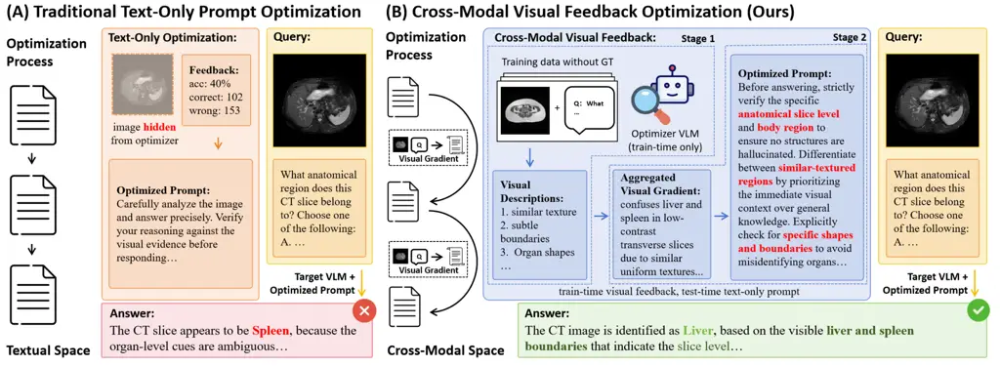
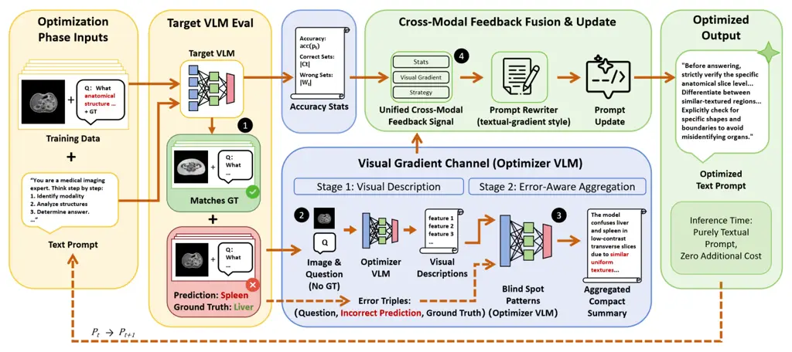

# Are Prompt Optimizers Blind? Cross-Modal Visual Feedback for Automatic Prompt Optimization

Haoyue Liu    Xiaoyu Ma    Ye Chen    Yuexian Zou    Xiaoying
Tang\corresponding

###### Abstract

Automatic prompt optimization (APO) has been widely adopted to adapt
vision-language models (VLMs) to downstream tasks without weight
updates, yielding promising results. However, on multimodal tasks the
effectiveness of APO is fundamentally bottlenecked by a _blind feedback
channel_: the optimizer reads the question, the prediction, and the gold
answer, but never the input image on which the model failed, and
therefore cannot diagnose visually grounded errors. As a remedy, we
introduce Cross-Modal Visual Feedback (CMVF). CMVF incorporates (1) a
failure-conditioned visual diagnosis stage, in which a stronger
optimizer VLM inspects each failed image _without access to predictions
or labels_, and (2) an error-aware aggregation stage that compresses
these observations into reusable, task-level visual blind-spot patterns
that drive the prompt rewrite. Crucially, the image is consumed _only_
during optimization; the deployed artifact is an ordinary text prompt
that runs at the same inference cost as any text-only baseline.
Extensive results across 12 VQA datasets and 4 target VLMs demonstrate
that CMVF consistently ranks first, improving over the strongest
baseline on every target by +2.4 points on average (up to +6.5 on
individual benchmarks), while the optimizer self-organizes into
expert-style visual checklists that transfer across models without
re-optimization. Our code and optimized prompts will be released.

¹ The Chinese University of Hong Kong, Shenzhen, China

² Xi’an Jiaotong University, China

³ Peking University, China

⁴ Guangdong Provincial Key Laboratory of Ultra High Definition Immersive
Media Technology, China

## 1 Introduction

Vision-language models (VLMs) are the default substrate for visual
question answering, medical imaging, chart understanding, and document
interpretation (Masry et al. 2022; Mathew, Karatzas, and Jawahar 2021),
yet their accuracy is notoriously sensitive to the wording of the
textual prompt—on our benchmarks, mean accuracy on Qwen3.5-4B varies
from 70.3% to 75.0% across competitive prompts alone. Automatic prompt
optimization (APO)—spanning *evolutionary search* (Fernando et al. 2024;
Guo et al. 2024), *textual-gradient methods* (Pryzant et al. 2023;
Yuksekgonul et al. 2025), *response-trajectory tracking* (Zhang et al.
2025), and *declarative program compilation* (Khattab et al. 2024)—has
become an effective, weight-free way to adapt these models, yielding
promising results on text-centric tasks.

However, when applied to multimodal tasks these optimizers all share the
same structural gap: their feedback channel is _blind_. The optimizer
sees the question, the prediction, and the gold answer, but never the
image on which the target failed (Figure 1)—like a teacher grading an
exam without ever seeing the figures. It can register _that_ an error
occurred but not _why_: a confused anatomical slice level, an overlooked
axis label, or a global scene prior that overrides local evidence. We
argue that the bottleneck of multimodal APO is not the optimization
machinery but the _evidence_ available to it.



Figure 1: Motivation for CMVF. Existing text-only APO sees scores and
error triples but misses the visual causes of failures. CMVF uses failed
images only during optimization to aggregate visual blind spots into a
reusable text prompt, with no extra visual-feedback calls at test time.

As a remedy, we introduce Cross-Modal Visual Feedback (CMVF), built on a
simple principle: _optimization feedback must have access to the
modality in which failures originate._ CMVF lets a stronger optimizer
VLM inspect the failed images during optimization—first describing
question-relevant visual evidence without seeing the prediction or
ground-truth answer, then aggregating these descriptions with the error
triples into reusable visual blind spots that drive the prompt rewrite.
Unlike multimodal prompt optimization (MPO) (Choi et al. 2026), which
jointly optimizes a $`(\text{text},\text{image})`$ prompt pair and keeps
the image in the loop at deployment, CMVF pays for the visual signal
_only once_, at optimization time, and compiles it into a purely textual
prompt; deployment therefore adds no VLM calls and reuses the same
serving interface as any text-only prompt.

Our contributions are three-fold:

1.  1.  Problem. We identify and characterize the _visual-feedback
        blindness_ shared by all text-only APO methods on multimodal tasks,
        and show the bottleneck is _evidence_, not optimization machinery.
2.  2.  Method. We propose CMVF, which incorporates (1) failure-conditioned,
        label-free visual diagnosis and (2) error-aware aggregation into
        reusable visual blind-spot patterns, realizing a
        _train-time-multimodal, deploy-time-text-only_ design at zero added
        inference cost.
3.  3.  Results & analysis. Across 12 datasets and 4 target VLMs, CMVF ranks
        first everywhere, beating the strongest baseline by $`+2.4`$ pp on
        average (up to $`+6.5`$ pp); token-budget-matched ablations
        attribute the gain to visual perception, the optimizer
        self-organizes into _expert-style visual checklists_, and these
        strategies transfer across models without re-optimization.

## 2 Cross-Modal Visual Feedback

The preceding discussion raises two questions that define the design of
CMVF. _First_, how can a prompt optimizer obtain visual diagnostic
information without leaking the ground-truth answer into the visual
analysis? _Second_, how can this visual information improve the deployed
prompt without adding any inference-time VLM calls? CMVF answers these
two questions with a two-stage visual-gradient channel (Section 2.3) and
a fusion-update loop that preserves a standard textual-prompt inference
interface (Section 2.4).

### 2.1 Problem Setup

Given a target VLM $`\mathcal{M}_{T}`$ and training data
$`\mathcal{D}=\{(x_{i},q_{i},y_{i})\}_{i=1}^{N}`$ ($`x_{i}`$ image,
$`q_{i}`$ question, $`y_{i}`$ ground-truth answer), we seek a text
prompt $`p^{*}\in\mathcal{P}`$ that maximizes task accuracy:

```math
p^{*}=\arg\max_{p\in\mathcal{P}}\frac{1}{N}\sum_{i=1}^{N}\mathbf{1}[\mathcal{M}_{T}(p,x_{i},q_{i})=y_{i}]. \tag{1}
```

Following TextGrad (Yuksekgonul et al. 2025), we optimize two prompts
jointly: $`p_{yn}`$ for yes/no questions and $`p_{oe}`$ for open-ended
questions, both with a {fs} placeholder for few-shot examples. At step
$`t\!\in\!\{1,\dots,T\}`$, let
$`\hat{y}_{i}\!:=\!\mathcal{M}_{T}(p_{t},x_{i},q_{i})`$ be the
prediction under the current prompt
$`p_{t}=(p_{yn}^{(t)},p_{oe}^{(t)})`$; we form the correct set
$`\mathcal{C}_{t}`$ and the wrong set
$`\mathcal{W}_{t}=\{(x_{i},q_{i},\hat{y}_{i},y_{i}):\hat{y}_{i}\neq y_{i}\}`$.
A validation set $`\mathcal{V}`$ selects the best prompt across steps,
and if a rewrite drops the {fs} placeholder we restore the
validation-best prompt.

### 2.2 The Visual-Feedback Bottleneck

Standard APO constructs feedback from accuracy and textual error
triples,
$`g_{t}^{\text{text}}=\big(\text{acc}(p_{t}),\mathcal{E}_{t}^{\text{sub}}\big)`$
with
$`\mathcal{E}_{t}^{\text{sub}}\!\subseteq\!\{(q_{i},\hat{y}_{i},y_{i})\}`$.
This exposes _which_ questions failed but omits the visual evidence that
caused them: a medical VQA model may confuse adjacent anatomical slice
levels, a chart model may miss a small axis label, a real-world model
may rely on a global scene prior. The textual triple sees the symptom;
the cause stays hidden. CMVF closes this loop with the two-stage visual
channel below.

### 2.3 Visual Diagnostic Channel

CMVF adds a visual-gradient channel to the feedback loop. During
optimization only, a stronger optimizer VLM $`\mathcal{M}_{O}`$ inspects
failed images and summarizes recurring visual blind spots. Figure 2
gives the overview.



Figure 2: CMVF optimization pipeline. The target VLM is evaluated on
training examples; the optimizer VLM inspects failed images, aggregates
visual blind spots, and rewrites the text prompt. Inference uses the
optimized text prompt with no extra visual-feedback calls.

#### Stage 1: question-aware visual description.

For every wrong example, $`\mathcal{M}_{O}`$ receives only the image and
question and produces a question-aware visual description:

```math
v_{i}=\mathcal{M}_{O}(x_{i},q_{i};\pi_{\text{vis}}),\quad\forall(x_{i},q_{i},\hat{y}_{i},y_{i})\in\mathcal{W}_{t}, \tag{2}
```

where $`\pi_{\text{vis}}`$ is a fixed Stage-1 meta-prompt asking for
question-relevant visual evidence (supplementary material). Crucially,
the prediction $`\hat{y}_{i}`$ and ground truth $`y_{i}`$ are _withheld_
at this stage. This prevents answer-conditioned rationalization—the
optimizer cannot manufacture a post-hoc explanation for a label it has
not yet seen—and forces it to record perception-level evidence rather
than rationalize a known label.

#### Stage 2: error-aware aggregation.

Individual descriptions are noisy and idiosyncratic. We therefore pair
each $`v_{i}`$ with its error triple and ask $`\mathcal{M}_{O}`$ to
summarize recurring blind spots:

```math
g_{t}^{\text{vis}}=\text{Agg}\big(\{(q_{i},\hat{y}_{i},y_{i},v_{i}):(x_{i},q_{i},\hat{y}_{i},y_{i})\in\mathcal{W}_{t}\}\big). \tag{3}
```

The aggregator receives at most 30 wrong cases per step with field-level
truncation. The two-stage decomposition separates visual perception from
supervised error attribution: Stage 1 records _what is visible_; Stage 2
identifies _which visual patterns repeatedly correlate with mistakes_,
compressing them into a compact set of reusable diagnostic instructions
(e.g., “check small text,” “verify anatomical slice level,” “avoid
global scene priors”). This compression is what makes broad inspection
at Stage 1 affordable: many descriptions in, one prompt-sized signal
out.

### 2.4 Fusion, Prompt Update, and Inference

#### Fused feedback.

We fuse accuracy statistics and visual blind spots into a unified
feedback string:

```math
g_{t}^{\text{CM}}=\textsc{Concat}\big(\text{acc}(p_{t}),|\mathcal{C}_{t}|,|\mathcal{W}_{t}|,g_{t}^{\text{vis}},s\big), \tag{4}
```

where $`s`$ instructs the optimizer to rewrite the prompt so the target
model explicitly checks the identified visual features before answering.
Because $`g_{t}^{\text{vis}}`$ is constructed from both visual
descriptions and textual error triples, CMVF _augments_ rather than
replaces the existing textual error signal.

#### Update and inference.

The prompt is updated by
$`p_{t+1}=\textsc{Update}(p_{t},g_{t}^{\text{CM}})`$. The default Update
is a TextGrad-style rewrite (Yuksekgonul et al. 2025); CMVF^(∗) swaps in
a REVOLVE-style alternative (Zhang et al. 2025) on the same
visual-gradient pipeline, isolating whether gains come from the visual
channel rather than a particular rewriter. At deployment, the target VLM
receives only the image, question, and optimized text prompt
$`(p_{yn},p_{oe})`$—no additional visual analysis at inference
(Algorithm 1).

0:  Target VLM $`\mathcal{M}_{T}`$, optimizer VLM $`\mathcal{M}_{O}`$,
training set $`\mathcal{D}`$, validation set $`\mathcal{V}`$, steps
$`T`$

1:  Initialize prompts $`(p_{yn},p_{oe})`$ and validation-best prompts

2:  for $`t=1`$ to $`T`$ do

3:   Evaluate $`\mathcal{M}_{T}`$ on $`\mathcal{D}`$ to obtain
$`\mathcal{C}_{t}`$ and $`\mathcal{W}_{t}`$

4:   Evaluate on $`\mathcal{V}`$ and update the validation-best prompts
if improved

5:   for each $`(x_{i},q_{i},\hat{y}_{i},y_{i})\in\mathcal{W}_{t}`$ do

6:    $`v_{i}\leftarrow\mathcal{M}_{O}(x_{i},q_{i};\pi_{\text{vis}})`$
{image + question only}

7:   end for

8:
  $`g_{t}^{\text{vis}}\leftarrow\textsc{Agg}(\{(q_{i},\hat{y}_{i},y_{i},v_{i}):(x_{i},q_{i},\hat{y}_{i},y_{i})\in\mathcal{W}_{t}\})`$

9:
  $`g_{t}^{\text{CM}}\leftarrow\textsc{Concat}(\text{acc}(p_{t}),|\mathcal{C}_{t}|,|\mathcal{W}_{t}|,g_{t}^{\text{vis}},s)`$

10:
  $`(p_{yn},p_{oe})\leftarrow\textsc{Update}((p_{yn},p_{oe}),g_{t}^{\text{CM}})`$

11:   Restore validation-best prompts if {fs} is lost

12:  end for

13:  return validation-best prompts

Algorithm 1 CMVF Prompt Optimization

### 2.5 Modeling Intuition

The role of visual feedback can be understood through a simple
error-cause decomposition. Let $`\alpha_{V}\in[0,1]`$ denote the
fraction of currently wrong examples whose failure has a visual
component, and let $`I_{V}\in[0,1]`$ denote how informative the
optimizer’s visual analysis is about these causes. Feedback without
visual inspection carries only indirect visual hints; denote its
residual visual signal by $`\delta_{T}`$. With error rate
$`L(p)\!:=\!1{-}\text{acc}(p)`$ and per-step reduction
$`\Delta L\!:=\!L(p_{t}){-}L(p_{t+1})`$, under an additive view of
textual and visual error sources the expected advantage of cross-modal
feedback scales as

```math
\mathbb{E}\big[\Delta L_{\text{CM}}-\Delta L_{\text{text}}\big]\;\gtrsim\;\alpha_{V}\,I_{V}\;-\;\delta_{T}. \tag{5}
```

This intuition (not a convergence guarantee) predicts CMVF should help
most when $`\alpha_{V}`$ is large (medical VQA, TextVQA OCR,
RealWorldQA) and least when $`\alpha_{V}\!\to\!0`$; both match our
empirical pattern in Section 3.2. This also clarifies the role of
Stage-2 aggregation. A single visual description may be noisy or
instance-specific, so its information about the underlying visual cause
is limited. By aggregating many failed cases, CMVF suppresses
instance-specific noise, surfaces recurring visual patterns, and
converts per-image observations into a compact prompt-level signal. In
this sense, aggregation increases the _effective_ $`I_{V}`$, which is
consistent with the ablation results in Section 3.5.

## 3 Experiments

In this section, we run experiments to address five questions:

- •
  Q1: Does CMVF beat APO baselines that do not incorporate visual
  feedback, across multiple target VLMs? (Section 3.2)
- •
  Q2: Does the optimizer learn anything _interpretable_ about the
  failure modes? (Section 3.3)
- •
  Q3: Do the optimized strategies _transfer_ across target models
  without re-optimization? (Section 3.4)
- •
  Q4: Where do the gains come from—image-aware perception, or extra
  feedback tokens? (Section 3.5)
- •
  Q5: Does CMVF generalize and pay an acceptable training cost with
  unchanged inference? (Section 3.6)

Stage-2 variants (CM-Mem, Diff), dataset details, prompt templates, and
case studies are in the Appendix.

### 3.1 Setup

#### Models and benchmarks.

We use Qwen3.5-9B as the optimizer VLM $`\mathcal{M}_{O}`$ and evaluate
four target VLMs: Qwen3.5-4B, Qwen2.5-VL-7B (Wang et al. 2024),
LLaVA-1.6-Mistral-7B (Li et al. 2023), and Phi-3.5-vision (Abdin et al.
2024). The suite covers 12 datasets: medical VQA datasets SLAKE
CT/MRI/X-Ray, VQA-RAD, and PathVQA (Liu et al. 2021; Lau et al. 2018; He
et al. 2020); reasoning and chart/OCR datasets ScienceQA, ChartQA,
TextVQA, and MMMU (Lu et al. 2022; Masry et al. 2022; Singh et al. 2019;
Yue et al. 2024); and RealWorldQA, AI2D, and DocVQA (xAI 2024; Kembhavi
et al. 2016; Mathew, Karatzas, and Jawahar 2021). We focus the main
comparison on eight benchmarks and report the remaining four (ScienceQA,
AI2D, DocVQA, MMMU) separately in Table 2.

#### Baselines and protocol.

We compare against ProTeGi (Pryzant et al. 2023), OPRO (Yang et al.
2024), DSPy (Khattab et al. 2024), TextGrad (TG) (Yuksekgonul et al.
2025), and REVOLVE (RE) (Zhang et al. 2025). Each benchmark uses 150
training samples, 150 validation samples, and the full test set. All
methods share data splits, initialization prompts, the same optimizer
VLM, and 20 optimization steps. Results are averaged over 3 runs.
Evaluation follows each benchmark’s official scoring protocol (exact
match after lowercasing and punctuation removal, plus a small set of
domain synonyms, e.g., “x-ray”/“xray”).

### 3.2 A1: CMVF Ranks First on All Four Target VLMs

|                                                                                               |                  |                          |              |              |              |              |                          |              |               |                      |
| --------------------------------------------------------------------------------------------- | ---------------- | ------------------------ | ------------ | ------------ | ------------ | ------------ | ------------------------ | ------------ | ------------- | -------------------- |
| Model                                                                                         | Method           | Medical VQA $`\uparrow`$ |              |              |              |              | General VQA $`\uparrow`$ |              |               | Mean $`\uparrow`$    |
|                                                                                               |                  | CT                       | MRI          | X-Ray        | RAD          | Path         | Chart                    | Text         | RWQA          |                      |
| ![[Uncaptioned image]](arxiv-2607-24354v1--9fc7ae19ef8e.figures/figure-3.webp) Qwen3.5-4B     | ProTeGi          | 75.3\_(±2.8)             | 78.1\_(±0.9) | 81.7\_(±1.4) | 59.4\_(±3.1) | 45.4\_(±0.5) | 78.0\_(±3.4)             | 65.2\_(±2.3) | 80.4\_(±1.9)  | 70.4                 |
|                                                                                               | OPRO             | 73.2\_(±3.4)             | 67.7\_(±6.1) | 81.8\_(±1.0) | 55.2\_(±4.7) | 44.6\_(±1.9) | 25.1\_(±28.4)            | 69.1\_(±0.6) | 81.7\_(±3.3)  | 62.3                 |
|                                                                                               | DSPy             | 77.6\_(±1.1)             | 77.7\_(±1.4) | 80.7\_(±1.3) | 62.1\_(±0.8) | 47.5\_(±2.8) | 81.6\_(±1.9)             | 66.3\_(±2.2) | 82.6\_(±0.9)  | 72.0                 |
|                                                                                               | TG               | 75.9\_(±0.3)             | 75.3\_(±1.3) | 80.7\_(±1.6) | 57.9\_(±3.1) | 45.4\_(±2.0) | 78.6\_(±2.7)             | 63.8\_(±1.4) | 84.8\_(±0.7)  | 70.3                 |
|                                                                                               | RE               | 75.5\_(±0.6)             | 79.0\_(±0.1) | 83.8\_(±0.5) | 59.2\_(±2.0) | 44.3\_(±1.1) | 75.1\_(±2.7)             | 64.3\_(±1.6) | 80.9\_(±2.2)  | 70.3                 |
|                                                                                               | CMVF$`{}^{\!*}`$ | 76.8\_(±0.4)             | 77.9\_(±2.2) | 84.1\_(±0.2) | 61.3\_(±1.4) | 46.9\_(±0.8) | 78.8\_(±2.0)             | 65.7\_(±0.8) | 83.3\_(±1.8)  | 71.9                 |
|                                                                                               | CMVF             | 77.9\_(±1.3)             | 80.7\_(±3.1) | 84.5\_(±1.2) | 63.4\_(±1.0) | 49.0\_(±2.8) | 81.4\_(±2.0)             | 71.5\_(±2.7) | 91.3\_(±3.8)  | 75.0 $`\uparrow`$3.0 |
| ![[Uncaptioned image]](arxiv-2607-24354v1--9fc7ae19ef8e.figures/figure-3.webp) Qwen2.5-VL-7B  | ProTeGi          | 64.0\_(±1.3)             | 59.4\_(±4.9) | 73.5\_(±1.1) | 47.5\_(±2.3) | 37.9\_(±0.9) | 56.3\_(±0.6)             | 59.8\_(±0.6) | 58.3\_(±11.0) | 57.1                 |
|                                                                                               | OPRO             | 60.1\_(±6.4)             | 61.4\_(±8.3) | 69.4\_(±7.5) | 42.6\_(±0.1) | 29.5\_(±4.4) | 54.2\_(±3.8)             | 60.0\_(±0.2) | 50.4\_(±8.0)  | 53.4                 |
|                                                                                               | DSPy             | 60.8\_(±1.1)             | 61.0\_(±2.8) | 72.1\_(±1.3) | 47.0\_(±0.6) | 32.7\_(±1.3) | 59.4\_(±2.1)             | 55.5\_(±2.6) | 60.0\_(±8.6)  | 56.1                 |
|                                                                                               | TG               | 64.5\_(±2.0)             | 69.2\_(±1.3) | 73.5\_(±1.6) | 48.8\_(±1.6) | 36.8\_(±1.9) | 54.4\_(±1.9)             | 59.4\_(±1.8) | 61.9\_(±2.7)  | 58.6                 |
|                                                                                               | RE               | 63.5\_(±0.2)             | 69.4\_(±0.6) | 72.1\_(±0.2) | 48.3\_(±1.0) | 38.6\_(±0.9) | 57.5\_(±0.3)             | 57.1\_(±3.7) | 58.7\_(±2.1)  | 58.2                 |
|                                                                                               | CMVF$`{}^{\!*}`$ | 63.8\_(±0.9)             | 68.7\_(±3.2) | 73.2\_(±2.2) | 49.9\_(±1.4) | 35.4\_(±2.7) | 55.7\_(±1.2)             | 59.3\_(±1.5) | 61.9\_(±0.7)  | 58.5                 |
|                                                                                               | CMVF             | 65.0\_(±1.1)             | 69.4\_(±2.3) | 75.0\_(±3.0) | 51.0\_(±1.8) | 40.2\_(±2.2) | 56.1\_(±2.9)             | 62.3\_(±1.7) | 62.2\_(±3.2)  | 60.1 $`\uparrow`$1.6 |
| ![[Uncaptioned image]](arxiv-2607-24354v1--9fc7ae19ef8e.figures/figure-4.webp) LLaVA-1.6-7B   | ProTeGi          | 58.4\_(±0.9)             | 72.7\_(±0.1) | 76.8\_(±0.4) | 45.6\_(±0.6) | 38.6\_(±0.2) | 25.5\_(±0.9)             | 45.3\_(±1.8) | 81.6\_(±1.2)  | 55.6                 |
|                                                                                               | OPRO             | 58.3\_(±1.6)             | 65.6\_(±0.3) | 71.9\_(±1.2) | 41.1\_(±0.8) | 36.3\_(±0.2) | 32.3\_(±3.7)             | 49.5\_(±2.4) | 80.1\_(±0.5)  | 54.4                 |
|                                                                                               | DSPy             | 58.5\_(±0.6)             | 66.9\_(±1.1) | 74.5\_(±0.9) | 44.3\_(±1.7) | 37.8\_(±0.7) | 31.4\_(±5.2)             | 49.4\_(±3.0) | 80.3\_(±1.3)  | 55.4                 |
|                                                                                               | TG               | 58.9\_(±2.4)             | 70.1\_(±2.6) | 75.7\_(±0.2) | 43.8\_(±1.1) | 34.9\_(±2.0) | 30.9\_(±2.1)             | 45.9\_(±3.4) | 76.1\_(±6.8)  | 54.5                 |
|                                                                                               | RE               | 56.4\_(±1.2)             | 69.6\_(±2.8) | 76.1\_(±0.5) | 45.1\_(±0.3) | 37.6\_(±1.4) | 29.1\_(±1.1)             | 43.6\_(±1.8) | 80.4\_(±0.6)  | 54.7                 |
|                                                                                               | CMVF$`{}^{\!*}`$ | 60.3\_(±0.3)             | 70.9\_(±1.0) | 75.8\_(±0.9) | 48.0\_(±2.5) | 40.6\_(±0.2) | 37.7\_(±3.7)             | 53.5\_(±1.5) | 81.0\_(±0.2)  | 58.5                 |
|                                                                                               | CMVF             | 59.6\_(±0.6)             | 71.1\_(±0.4) | 77.7\_(±0.6) | 48.2\_(±0.1) | 41.9\_(±3.3) | 38.3\_(±4.4)             | 51.3\_(±1.9) | 81.3\_(±0.4)  | 58.7 $`\uparrow`$3.1 |
| ![[Uncaptioned image]](arxiv-2607-24354v1--9fc7ae19ef8e.figures/figure-5.webp) Phi-3.5-vision | ProTeGi          | 58.2\_(±2.1)             | 72.0\_(±4.9) | 76.0\_(±0.6) | 45.5\_(±2.4) | 32.5\_(±1.6) | 50.9\_(±1.8)             | 47.4\_(±1.7) | 45.8\_(±2.0)  | 53.5                 |
|                                                                                               | OPRO             | 59.2\_(±1.0)             | 63.8\_(±2.5) | 69.5\_(±2.2) | 40.4\_(±2.9) | 31.9\_(±0.8) | 45.0\_(±6.4)             | 49.3\_(±2.0) | 48.1\_(±3.9)  | 50.9                 |
|                                                                                               | DSPy             | 57.4\_(±1.7)             | 64.0\_(±1.4) | 74.1\_(±2.1) | 42.6\_(±1.3) | 34.4\_(±1.0) | 51.1\_(±1.8)             | 51.2\_(±1.5) | 55.7\_(±6.8)  | 53.8                 |
|                                                                                               | TG               | 57.7\_(±2.1)             | 68.5\_(±2.6) | 75.0\_(±0.7) | 43.0\_(±2.3) | 34.1\_(±1.1) | 51.2\_(±1.6)             | 49.5\_(±2.1) | 45.7\_(±5.0)  | 53.1                 |
|                                                                                               | RE               | 56.4\_(±0.8)             | 68.6\_(±2.1) | 75.0\_(±1.2) | 43.3\_(±0.6) | 37.1\_(±0.8) | 48.6\_(±1.1)             | 51.8\_(±0.7) | 48.6\_(±3.7)  | 53.7                 |
|                                                                                               | CMVF$`{}^{\!*}`$ | 60.1\_(±1.1)             | 71.9\_(±0.9) | 77.3\_(±1.6) | 46.4\_(±3.0) | 38.5\_(±1.0) | 54.4\_(±2.6)             | 52.3\_(±1.4) | 45.2\_(±1.2)  | 55.8                 |
|                                                                                               | CMVF             | 58.9\_(±1.9)             | 72.4\_(±1.5) | 77.1\_(±2.3) | 46.5\_(±0.5) | 38.0\_(±1.5) | 53.4\_(±1.1)             | 51.4\_(±1.9) | 49.8\_(±1.4)  | 55.9 $`\uparrow`$2.1 |

Table 1: Accuracy on 8 benchmarks. Rows group target VLMs; per model the
CMVF (our method) row is shaded green and the runner-up by mean gray.
Bold/underline mark best/second best; gray subscripts show std over 3
runs.

#### Headline result.

Table 1 restores the full comparison across all five baselines without
visual feedback, CMVF, and CMVF^(∗) for all four target VLMs. CMVF ranks
first on mean accuracy for every target, with the largest absolute gain
on LLaVA-1.6-Mistral-7B (+3.1 pp) and a comparable +3.0 pp on
Qwen3.5-4B.

#### Where the wins concentrate.

The per-dataset pattern is consistent with the visual-feedback
hypothesis: gains cluster on visually demanding benchmarks. On
Qwen3.5-4B, CMVF improves RealWorldQA by +6.5 pp, TextVQA by +2.4 pp,
and PathVQA by +1.5 pp over the strongest baseline without visual
feedback. On LLaVA, ChartQA jumps by +6.0 pp and PathVQA by +3.3 pp. On
the four additional benchmarks, CMVF again ranks first, by $`+1.12`$ to
$`+3.88`$ pp over the strongest baseline (Table 2). This matches the
modeling intuition in Equation 5: the gain scales with $`\alpha_{V}`$,
the fraction of visually-grounded errors, which is largest precisely on
perception-heavy tasks.

#### The gains are statistically significant.

Exact McNemar tests against the strongest baseline, on paired
per-example predictions, confirm the improvements:
$`p=7.9\times 10^{-14}`$ on LLaVA/TextVQA, $`p=0.021`$ on LLaVA/ChartQA,
and $`p=0.015`$ on Qwen2.5-VL/TextVQA—significant precisely on OCR,
chart-grounding, and fine-grained visual tasks, where visual evidence is
essential.

|         |       |        |       |       |       |
| ------- | ----- | ------ | ----- | ----- | ----- |
| Method  | AI2D  | DocVQA | MMMU  | SciQA | Mean  |
| ProTeGi | 78.46 | 68.31  | 47.62 | 81.42 | 68.95 |
| OPRO    | 76.83 | 64.28  | 45.89 | 85.30 | 68.08 |
| DSPy    | 74.21 | 66.74  | 43.47 | 78.95 | 65.84 |
| TG      | 72.68 | 62.53  | 41.16 | 76.63 | 63.25 |
| RE      | 80.91 | 70.86  | 47.62 | 83.07 | 70.62 |
| CMVF    | 84.62 | 74.74  | 48.74 | 87.60 | 73.93 |

Table 2: Accuracy (%) on the four additional benchmarks (Qwen3.5-4B).
The CMVF row is highlighted; the runner-up by mean (RE) is shaded gray.
Bold: best; underline: best baseline (ProTeGi and RE tie on MMMU). CMVF
ranks first on all four and on their mean.

#### It is not the rewriter.

CMVF^(∗) uses a REVOLVE-style rewriter on top of the same
visual-gradient pipeline. Relative to its counterpart without visual
feedback, adding the visual-gradient channel improves a REVOLVE-style
update on most targets (e.g., 70.3$`\rightarrow`$71.9 on Qwen3.5-4B,
54.7$`\rightarrow`$58.5 on LLaVA, and 53.7$`\rightarrow`$55.8 on Phi).
This shows that the visual channel is not tied to a TextGrad-style
rewriter, while the remaining gap to CMVF also makes clear that the
rewriter choice still matters.

### 3.3 A2: The Optimizer Self-Discovers Expert-Style Visual Inspection Checklists

Beyond the headline accuracy gains, we observe a striking qualitative
effect: the optimizer VLM is not given dataset-specific visual failure
rules, yet it converges on instructions that look like a domain expert’s
checklist. This emergent self-diagnostic behavior is, in our view, the
most interesting observation of this paper.

#### Prompt contrast and source audit.

Table 3 lists representative deployed prompts on Qwen3.5-4B. Baselines
without visual feedback converge on _generic, vision-agnostic_ hedges
(“read step by step,” “be precise”), while CMVF produces _task-specific
visual checklists_. Crucially, this is not an artifact of hand-written
rules: the Stage-1 prompt is deliberately broad (“key diagnostic
finding” for medical, “key visual details” for general) and never
mentions chart axes, small-text OCR, slice-level checks, or local-object
priors—yet the final prompts recover exactly these task-level routines
from failed-image evidence.

|                                                                |                                                                                                                                                                                                            |                      |
| -------------------------------------------------------------- | ---------------------------------------------------------------------------------------------------------------------------------------------------------------------------------------------------------- | -------------------- |
| Method                                                         | Deployed prompt (visual-specific clauses highlighted)                                                                                                                                                      | Acc                  |
| $`\blacksquare`$ TextVQA (scene text, OCR)                     |                                                                                                                                                                                                            |                      |
| OPRO                                                           | Imagine your mind is a vast, still pond where ripples of distraction fade away until only the single drop of truth answering the question can be seen; gently surface to inspect this one isolated ripple… | 69.1                 |
| TG                                                             | Analyze the image to extract only visual information, explicitly ignoring any text, labels, or metadata that cannot be verified by visual inspection alone.                                                | 63.8                 |
| CMVF                                                           | Meticulously scan the entire image to verify specific counts, read small text, and confirm fine details rather than relying on generic associations or prominent but unrelated features.                   | 71.5 $`\uparrow`$2.4 |
| $`\blacksquare`$ ChartQA (chart reasoning, axes/legends)       |                                                                                                                                                                                                            |                      |
| TG                                                             | Examine the chart and answer the question. Be precise and double-check your interpretation before giving the final answer.                                                                                 | 78.6                 |
| RE                                                             | Analyze the chart step by step, revise any inconsistent interpretation, and return the final value or category.                                                                                            | 75.1                 |
| CMVF                                                           | Read axis labels, units, and the legend mapping before reasoning about magnitudes; identify the requested data point and verify its exact value before answering.                                          | 81.4 $`\uparrow`$2.8 |
| $`\blacksquare`$ RealWorldQA (real-world VQA, scene reasoning) |                                                                                                                                                                                                            |                      |
| DSPy                                                           | You are a visual question answering assistant. Inspect the image and answer the question accurately.                                                                                                       | 82.6                 |
| TG                                                             | Look at the image carefully and answer the question. Make sure your reasoning is grounded in what is actually visible.                                                                                     | 84.8                 |
| CMVF                                                           | Scan for small, low-contrast, occluded, or background objects; verify orientation, signs, and object states; avoid global scene priors when the question is about a local object.                          | 91.3 $`\uparrow`$6.5 |

Table 3: Representative deployed prompts on Qwen3.5-4B. For each
benchmark we show two baselines (without visual feedback, gray italics)
and CMVF (green). Bold marks the decisive clause: baselines stay generic
or, on TextVQA, even instruct the model to _ignore_ text, whereas CMVF
names the exact visual check the task demands. Acc is test accuracy.

#### What CMVF rewrites the prompt to say.

Feedback without visual inspection typically yields generic advice
(“verify your reasoning against the visual evidence,” “be careful with
details”). CMVF instead discovers _task-specific_ routines across the 8
benchmarks: (1) SLAKE-CT/MRI prompts ask the model to verify anatomical
slice level and separate similar-density regions; (2) VQA-RAD/PathVQA
prompts locate the focal abnormality before classification; (3) ChartQA
prompts read axes, units, and legends before comparing values; (4)
TextVQA prompts scan for small or non-salient text; and (5) RealWorldQA
prompts check occlusion and avoid global scene priors for local-object
questions. These instructions are not pre-specified in the seed prompt
or Stage-1 description prompt; they arise from Stage-2 aggregation over
Stage-1 perception, showing that a frozen optimizer VLM can
self-organize reusable visual checklists from failed-image evidence
alone.

#### Why this matters.

The phenomenon suggests that the bottleneck of multimodal APO is not
optimization machinery but _evidence_: once the optimizer can see failed
images, recurring visual failure modes become extractable in language
and can be carried by a static inference-time text prompt.

### 3.4 A3: Optimized Strategies Transfer Across Target Models

If CMVF merely memorized target-specific quirks, its prompts would not
survive being moved to a different model. We test this directly: the
CMVF prompt optimized on each of Qwen2.5-VL-7B, LLaVA-1.6-7B, and
Phi-3.5-vision is deployed _unchanged_ on Qwen3.5-4B, with _no_
re-optimization (Table 4). Every transferred prompt outperforms a
TextGrad prompt optimized _directly_ on Qwen3.5-4B (70.3), by $`+1.2`$
to $`+2.8`$ pp on the 8-benchmark mean, and the advantage holds
per-dataset rather than on a few benchmarks—on ChartQA a transferred
prompt even exceeds the in-domain one. This indicates that Stage-2
aggregation surfaces reusable, _task-level_ visual strategies rather
than spurious correlations bound to a single model, directly addressing
the concern that access to ground-truth labels could induce dataset- or
target-specific overfitting. The in-domain prompt optimized on 4B
remains best overall (75.0), as expected.

|                                    |      |      |       |      |      |       |      |      |      |
| ---------------------------------- | ---- | ---- | ----- | ---- | ---- | ----- | ---- | ---- | ---- |
| Prompt source $`\to`$ Qwen3.5-4B   | CT   | MRI  | X-Ray | RAD  | Path | Chart | Text | RWQA | Mean |
| TextGrad (direct on 4B)            | 75.9 | 75.3 | 80.7  | 57.9 | 45.4 | 78.6  | 63.8 | 84.8 | 70.3 |
| CMVF $`\leftarrow`$ Qwen2.5-VL-7B  | 76.0 | 76.8 | 82.5  | 57.4 | 44.8 | 83.2  | 66.1 | 84.8 | 71.5 |
| CMVF $`\leftarrow`$ LLaVA-1.6-7B   | 76.4 | 78.7 | 83.4  | 59.4 | 48.2 | 80.5  | 65.5 | 84.3 | 72.1 |
| CMVF $`\leftarrow`$ Phi-3.5-vision | 76.0 | 79.0 | 83.0  | 58.3 | 47.6 | 84.3  | 69.7 | 87.0 | 73.1 |
| CMVF (direct on 4B)                | 77.9 | 80.7 | 84.5  | 63.4 | 49.0 | 81.4  | 71.5 | 91.3 | 75.0 |

Table 4: Cross-target transfer: a CMVF prompt optimized on one model and
deployed on Qwen3.5-4B _without_ re-optimization still beats TextGrad
optimized directly on 4B. Every transferred prompt exceeds the direct
TextGrad baseline; on ChartQA transfer even beats the in-domain prompt.
Bold: best per column.

### 3.5 A4: Image-Aware Perception Drives the Gains, Not Extra Tokens

|            |            |               |      |              |      |
| ---------- | ---------- | ------------- | ---- | ------------ | ---- |
|            | Qwen3.5-4B | Qwen2.5-VL-7B |      | LLaVA-1.6-7B |      |
| Method     | Mean       | RWQA          | Text | RWQA         | Text |
| CM-Blind   | 71.9       | 56.1          | 56.1 | 69.1         | 39.5 |
| CM-Caption | 72.2       | 58.3          | 58.2 | 71.3         | 41.5 |
| CM-Vis     | 72.8       | 60.5          | 60.4 | 73.5         | 43.8 |
| CMVF       | 75.0       | 62.2          | 62.3 | 81.3         | 51.3 |

Table 5: Feedback-channel ablation across three target VLMs (methods
defined in text; token-budget matched). _Qwen3.5-4B_ is the 8-benchmark
mean; the other two targets are per-dataset (official protocol). Every
column rises monotonically—CMVF (green) best, CM-Vis (gray) runner-up.

Figure 3: Validation accuracy over 20 optimization steps on eight
Phi-3.5-vision benchmarks (top: MRI, X-Ray, VQA-RAD, RealWorldQA;
bottom: CT, PathVQA, ChartQA, TextVQA). CMVF (red) stays above both
text-only baselines (TextGrad, REVOLVE) and keeps improving after they
plateau; the shaded band marks CMVF’s margin over the stronger baseline.

#### Tokens are cheap; pixels are decisive.

A2 attributed the gains to image-aware evidence; Table 5 now rules out
longer feedback as the cause under a token-budget-matched protocol on
Qwen3.5-4B. CM-Blind adds the same number of feedback tokens as CMVF but
_without image access_; it reaches only 71.9 (+1.6 pp over TG).
CM-Caption feeds the optimizer generic, question-agnostic captions and
reaches 72.2. CM-Vis keeps the visual channel but drops the fused error
attribution—concatenating raw per-image descriptions into the rewrite
prompt, closely matching the IPO-style (Du, Sun, and Snoek 2024) recipe
adapted from CLIP class-template prompts to VQA instruction
prompts—reaching 72.8, while the full CMVF adds Stage-2 aggregation over
_all_ wrong samples and reaches 75.0. The implication is direct: longer
prompts alone account for at most $`+1.6`$ pp over TG, while
_question-aware visual perception with aggregation_ accounts for the
remaining $`+3.1`$ pp. CMVF’s _deployed_ prompt averages $`\sim`$205 BPE
tokens (excluding {fs}), comparable to TG/RE (185–192) and 14–26%
shorter than DSPy/OPRO/ProTeGi (239–276); the gain cannot be attributed
to a longer inference-time prompt.

#### The ordering generalizes across targets.

The same monotone channel progression—CM-Blind $`<`$ CM-Caption $`<`$
CM-Vis $`<`$ CMVF—holds on _every_ (target, dataset) pair for two
additional target VLMs (Table 5), so the effect is not specific to
Qwen3.5-4B. The margin widens on the cross-family target LLaVA-1.6-7B
(CMVF $`+7.8`$ over CM-Vis on RealWorldQA and $`+7.5`$ on TextVQA),
consistent with a weaker base model leaving more visually-groundable
headroom for the visual channel to recover.

Two alternative Stage-2 aggregation modes further isolate _why_ unified
aggregation is preferred: CM-Mem ($`72.1`$, $`-2.9`$ vs. CMVF), which
carries a cross-step memory pool and is misled by stale signals from
earlier weaker prompts, and Diff ($`72.2`$, $`-2.8`$), which fragments
the visual signal by partitioning errors before aggregation. Both
underperform unified CMVF (full design-space sweep in the appendix),
confirming that the gain comes from question-aware perception of _all_
wrong samples with a single unified aggregation step, not from any
individual component.

### 3.6 A5: CMVF Generalizes Better at ~25% Training-Time Overhead and No Additional Inference Cost

Figure 4: Generalization gap (validation-best accuracy minus test
accuracy; lower is better) on 8 benchmarks. CMVF has the smallest
average gap and reduces high-gap cases such as ChartQA and VQA-RAD.

#### Late-stage improvement.

Figure 3 shows that CMVF _continues_ improving after baselines without
visual feedback flatten on these settings. Once feedback without visual
inspection has corrected the linguistically obvious failures, the
remaining errors are more likely to be visually grounded, so an
image-grounded gradient can keep moving.

#### Generalization gap.

Figure 4(a) shows that CMVF has the _smallest_ average
validation-to-test gap among all six methods, and Figure 4(b) confirms
this advantage holds per-dataset rather than coming from a few easy
benchmarks. We attribute this to aggregation: instead of overfitting
prompts to isolated validation errors, CMVF rewrites them around
_recurring_ visual patterns—a form of implicit regularization.

#### Cost in practice.

The visual-gradient pipeline adds a one-shot training-time overhead but
_no additional_ inference-time cost. End-to-end optimization on
Qwen3.5-4B takes 2.6 h for CMVF versus 2.1 h for TextGrad and 2.4 h for
REVOLVE—a $`\sim\!20`$–$`25\%`$ wall-clock increase that buys
$`+3.0`$ pp mean accuracy. Compared to ProTeGi (5.9 h), CMVF is more
than $`2{\times}`$ faster while delivering substantially higher
accuracy. Crucially, the final deployed artifact is a standard text
prompt, so inference uses the _same serving interface and call count_ as
a vanilla deployment.

## 4 Related Work

#### Automatic prompt optimization.

Early APO methods search over prompt candidates or use LLMs as
meta-optimizers (Yang et al. 2024; Zhou et al. 2023), including
reinforcement-learning, black-box, and evolutionary variants (Deng
et al. 2022; Chen et al. 2024; Fernando et al. 2024; Guo et al. 2024).
DSPy compiles declarative LLM programs into optimized prompt
pipelines (Khattab et al. 2024), gradient-inspired methods such as
ProTeGi and TextGrad use natural-language critiques as textual
gradients (Pryzant et al. 2023; Yuksekgonul et al. 2025), and REVOLVE
tracks response evolution across iterations (Zhang et al. 2025). As
prompts are highly sensitive to surface form (Sclar et al. 2024), recent
work also explores symbolic and structure-factorized prompt spaces (Ou
et al. 2025; Liu et al. 2026). These methods keep the feedback channel
textual even when the downstream task is multimodal.

#### Prompt learning for vision-language models.

A parallel line adapts VLMs by learning _continuous_ prompts: CoOp and
CoCoOp tune soft context vectors for CLIP-style classifiers (Zhou et al.
2022b; Zhou et al. 2022a), VPT prepends learnable visual tokens (Jia
et al. 2022), and MaPLe couples prompts across the vision and language
branches (Khattak et al. 2023). These require gradient access to the
backbone and deploy a non-textual prompt, whereas CMVF optimizes a
_discrete, human-readable_ instruction and treats the target VLM as a
black box at both optimization and deployment time.

#### Multimodal prompting, visual feedback, and self-refinement.

The closest prior work is IPO (Du, Sun, and Snoek 2024), which lets an
LMM describe training images and rewrites a CLIP class-template prompt
for zero-shot classification. CMVF shares its recipe of _answer-agnostic
visual descriptions + LMM optimizer + textual-prompt deployment_, but
inspects only the wrong set $`\mathcal{W}_{t}`$, adds a Stage-2
error-aware aggregation into reusable blind-spot patterns (removing it
costs 2.2 pp; Table 5), and targets generative VQA prompts on four VLMs
(4B–7B) rather than a fixed CLIP backbone. Concurrently, _multimodal
prompt optimization_ (MPO) (Choi et al. 2026) keeps the deployed prompt
multimodal at a per-query visual cost, whereas CMVF deploys a standard
textual prompt. Unlike self-refinement methods that critique outputs per
instance at inference time (Madaan et al. 2023; Shinn et al. 2023), CMVF
aggregates cross-example visual evidence _once_, at optimization time.

## 5 Conclusion

We introduce CMVF, a two-stage method that lets the optimizer VLM
inspect the images the target model failed on and compiles that evidence
into an ordinary text prompt. CMVF ranks first on all four target VLMs,
beating the strongest baseline by $`+2.4`$ pp on average (up to
$`+6.5`$ pp) at no added inference cost, and the optimizer
self-organizes into transferable expert-style visual checklists. The
bottleneck of multimodal APO is _visual evidence_, not optimization
machinery.

## References

- Abdin et al. (2024) Abdin, M.; Aneja, J.; Awadalla, H.; Awadallah, A.;
  Awan, A. A.; Bach, N.; Bahree, A.; et al. 2024. Phi-3 Technical
  Report: A Highly Capable Language Model Locally on Your Phone. _arXiv
  preprint arXiv:2404.14219_.
- Chen et al. (2024) Chen, L.; Chen, J.; Goldstein, T.; Huang, H.; and
  Zhou, T. 2024. InstructZero: Efficient Instruction Optimization for
  Black-Box Large Language Models. In _Proceedings of the 41st
  International Conference on Machine Learning_, volume 235 of
  _Proceedings of Machine Learning Research_, 6503–6518. PMLR.
- Choi et al. (2026) Choi, Y.; Kim, D.; Baek, J.; and Hwang, S. J. 2026.
  Multimodal Prompt Optimization: Why Not Leverage Multiple Modalities
  for MLLMs. In _International Conference on Learning Representations_.
- Deng et al. (2022) Deng, M.; Wang, J.; Hsieh, C.-P.; Wang, Y.; Guo,
  H.; Shu, T.; Song, M.; Xing, E. P.; and Hu, Z. 2022. RLPrompt:
  Optimizing Discrete Text Prompts with Reinforcement Learning. In
  _Proceedings of the 2022 Conference on Empirical Methods in Natural
  Language Processing (EMNLP)_, 3369–3391.
- Du, Sun, and Snoek (2024) Du, Y.; Sun, W.; and Snoek, C. G. 2024. IPO:
  Interpretable Prompt Optimization for Vision-Language Models.
  _Advances in Neural Information Processing Systems_, 37:
  126725–126766.
- Fernando et al. (2024) Fernando, C.; Banarse, D. S.; Michalewski, H.;
  Osindero, S.; and Rocktäschel, T. 2024. Promptbreeder:
  Self-Referential Self-Improvement via Prompt Evolution. In
  _Proceedings of the 41st International Conference on Machine
  Learning_, volume 235 of _Proceedings of Machine Learning Research_,
  13481–13544. PMLR.
- Guo et al. (2024) Guo, Q.; Wang, R.; Guo, J.; Li, B.; Song, K.; Tan,
  X.; Liu, G.; Bian, J.; and Yang, Y. 2024. Connecting Large Language
  Models with Evolutionary Algorithms Yields Powerful Prompt Optimizers.
  In _International Conference on Learning Representations_.
- He et al. (2020) He, X.; Zhang, Y.; Mou, L.; Xing, E.; and
  Xie, P. 2020. PathVQA: 30000+ Questions for Medical Visual Question
  Answering. _arXiv preprint arXiv:2003.10286_.
- Jia et al. (2022) Jia, M.; Tang, L.; Chen, B.-C.; Cardie, C.;
  Belongie, S.; Hariharan, B.; and Lim, S.-N. 2022. Visual prompt
  tuning. In _European Conference on Computer Vision_, 709–727.
  Springer.
- Kembhavi et al. (2016) Kembhavi, A.; Salvato, M.; Kolve, E.; Seo, M.;
  Hajishirzi, H.; and Farhadi, A. 2016. A diagram is worth a dozen
  images. In _European Conference on Computer Vision_, 235–251.
  Springer.
- Khattab et al. (2024) Khattab, O.; Singhvi, A.; Maheshwari, P.; Zhang,
  Z.; Santhanam, K.; Vardhamanan, S.; Haq, S.; Sharma, A.; Joshi, T. T.;
  Moazam, H.; Miller, H.; Zaharia, M.; and Potts, C. 2024. DSPy:
  Compiling Declarative Language Model Calls into State-of-the-Art
  Pipelines. In _International Conference on Learning Representations_.
- Khattak et al. (2023) Khattak, M. U.; Rasheed, H.; Maaz, M.; Khan, S.;
  and Khan, F. S. 2023. MaPLe: Multi-Modal Prompt Learning. In
  _Proceedings of the IEEE/CVF Conference on Computer Vision and Pattern
  Recognition_, 19113–19122.
- Lau et al. (2018) Lau, J. J.; Gayen, S.; Ben Abacha, A.; and
  Demner-Fushman, D. 2018. A dataset of clinically generated visual
  questions and answers about radiology images. _Scientific Data_,
  5(1): 180251.
- Li et al. (2023) Li, C.; Wong, C.; Zhang, S.; Usuyama, N.; Liu, H.;
  Yang, J.; Naumann, T.; Poon, H.; and Gao, J. 2023. LLaVA-Med: Training
  a Large Language-and-Vision Assistant for Biomedicine in One Day.
  _Advances in Neural Information Processing Systems_, 36: 28541–28564.
- Liu et al. (2021) Liu, B.; Zhan, L.-M.; Xu, L.; Ma, L.; Yang, Y.; and
  Wu, X.-M. 2021. SLAKE: A Semantically-Labeled Knowledge-Enhanced
  Dataset for Medical Visual Question Answering. In _2021 IEEE 18th
  International Symposium on Biomedical Imaging (ISBI)_, 1650–1654.
  IEEE.
- Liu et al. (2026) Liu, H.; Wang, Z.; Guo, Y.; Shou, H.; and
  Tang, X. 2026. Adaptive Prompt Structure Factorization: A Framework
  for Self-Discovering and Optimizing Compositional Prompt Programs. In
  _Proceedings of the 64th Annual Meeting of the Association for
  Computational Linguistics (Volume 1: Long Papers)_, 11690–11714.
  Association for Computational Linguistics.
- Lu et al. (2022) Lu, P.; Mishra, S.; Xia, T.; Qiu, L.; Chang, K.-W.;
  Zhu, S.-C.; Tafjord, O.; Clark, P.; and Kalyan, A. 2022. Learn to
  explain: Multimodal reasoning via thought chains for science question
  answering. _Advances in Neural Information Processing Systems_, 35:
  2507–2521.
- Madaan et al. (2023) Madaan, A.; Tandon, N.; Gupta, P.; Hallinan, S.;
  Gao, L.; Wiegreffe, S.; Alon, U.; Dziri, N.; Prabhumoye, S.; Yang, Y.;
  Gupta, S.; Majumder, B. P.; Hermann, K.; Welleck, S.; Yazdanbakhsh,
  A.; and Clark, P. 2023. Self-Refine: Iterative Refinement with
  Self-Feedback. In _Advances in Neural Information Processing Systems
  (NeurIPS)_, volume 36, 46534–46594.
- Masry et al. (2022) Masry, A.; Long, D. X.; Tan, J. Q.; Joty, S.; and
  Hoque, E. 2022. ChartQA: A Benchmark for Question Answering about
  Charts with Visual and Logical Reasoning. In _Findings of the
  Association for Computational Linguistics: ACL 2022_, 2263–2279.
- Mathew, Karatzas, and Jawahar (2021) Mathew, M.; Karatzas, D.; and
  Jawahar, C. 2021. DocVQA: A Dataset for VQA on Document Images. In
  _Proceedings of the IEEE/CVF Winter Conference on Applications of
  Computer Vision_, 2200–2209.
- Ou et al. (2025) Ou, Y.; Zhou, W.; Ding, S.; Li, L.; Wu, J.; Wang, T.;
  Chen, J.; Wang, S.; Xu, X.; Zhang, N.; Chen, H.; and Jiang,
  Y. E. 2025. Symbolic learning enables self-evolving agents. _AI Open_,
  6: 314–322.
- Pryzant et al. (2023) Pryzant, R.; Iter, D.; Li, J.; Lee, Y.; Zhu, C.;
  and Zeng, M. 2023. Automatic Prompt Optimization with “Gradient
  Descent” and Beam Search. In _Proceedings of the 2023 Conference on
  Empirical Methods in Natural Language Processing_, 7957–7968.
- Sclar et al. (2024) Sclar, M.; Choi, Y.; Tsvetkov, Y.; and
  Suhr, A. 2024. Quantifying Language Models’ Sensitivity to Spurious
  Features in Prompt Design or: How I learned to start worrying about
  prompt formatting. In _International Conference on Learning
  Representations_.
- Shinn et al. (2023) Shinn, N.; Cassano, F.; Gopinath, A.; Narasimhan,
  K.; and Yao, S. 2023. Reflexion: Language Agents with Verbal
  Reinforcement Learning. In _Advances in Neural Information Processing
  Systems (NeurIPS)_, volume 36, 8634–8652.
- Singh et al. (2019) Singh, A.; Natarajan, V.; Shah, M.; Jiang, Y.;
  Chen, X.; Batra, D.; Parikh, D.; and Rohrbach, M. 2019. Towards VQA
  Models That Can Read. In _Proceedings of the IEEE/CVF Conference on
  Computer Vision and Pattern Recognition_, 8317–8326.
- Wang et al. (2024) Wang, P.; Bai, S.; Tan, S.; Wang, S.; Fan, Z.; Bai,
  J.; Chen, K.; Liu, X.; Wang, J.; Ge, W.; et al. 2024. Qwen2-VL:
  Enhancing Vision-Language Model’s Perception of the World at Any
  Resolution. _arXiv preprint arXiv:2409.12191_.
- xAI (2024) xAI. 2024. RealWorldQA.
  https://huggingface.co/datasets/xai-org/RealworldQA. Dataset on
  Hugging Face; accessed 2026-07-24.
- Yang et al. (2024) Yang, C.; Wang, X.; Lu, Y.; Liu, H.; Le, Q. V.;
  Zhou, D.; and Chen, X. 2024. Large language models as optimizers. In
  _International Conference on Learning Representations_.
- Yue et al. (2024) Yue, X.; Ni, Y.; Zhang, K.; Zheng, T.; Liu, R.;
  Zhang, G.; Stevens, S.; Jiang, D.; Ren, W.; Sun, Y.; Wei, C.; Yu, B.;
  Yuan, R.; Sun, R.; Yin, M.; Zheng, B.; Yang, Z.; Liu, Y.; Huang, W.;
  Sun, H.; Su, Y.; and Chen, W. 2024. MMMU: A Massive Multi-Discipline
  Multimodal Understanding and Reasoning Benchmark for Expert AGI. In
  _Proceedings of the IEEE/CVF Conference on Computer Vision and Pattern
  Recognition_, 9556–9567.
- Yuksekgonul et al. (2025) Yuksekgonul, M.; Bianchi, F.; Boen, J.; Liu,
  S.; Lu, P.; Huang, Z.; Guestrin, C.; and Zou, J. 2025. Optimizing
  Generative AI by Backpropagating Language Model Feedback. _Nature_,
  639(8055): 609–616.
- Zhang et al. (2025) Zhang, P.; Jin, H.; Hu, L.; Li, X.; Kang, L.; Luo,
  M.; Song, Y.; and Wang, H. 2025. REVOLVE: Optimizing AI Systems by
  Tracking Response Evolution in Textual Optimization. In _Proceedings
  of the 42nd International Conference on Machine Learning_, volume 267
  of _Proceedings of Machine Learning Research_, 75216–75233. PMLR.
- Zhou et al. (2022a) Zhou, K.; Yang, J.; Loy, C. C.; and Liu, Z. 2022a.
  Conditional Prompt Learning for Vision-Language Models. In
  _Proceedings of the IEEE/CVF Conference on Computer Vision and Pattern
  Recognition (CVPR)_, 16816–16825.
- Zhou et al. (2022b) Zhou, K.; Yang, J.; Loy, C. C.; and Liu, Z. 2022b.
  Learning to Prompt for Vision-Language Models. _International Journal
  of Computer Vision (IJCV)_, 130(9): 2337–2348.
- Zhou et al. (2023) Zhou, Y.; Muresanu, A. I.; Han, Z.; Paster, K.;
  Pitis, S.; Chan, H.; and Ba, J. 2023. Large language models are
  human-level prompt engineers. In _The Eleventh International
  Conference on Learning Representations_.
