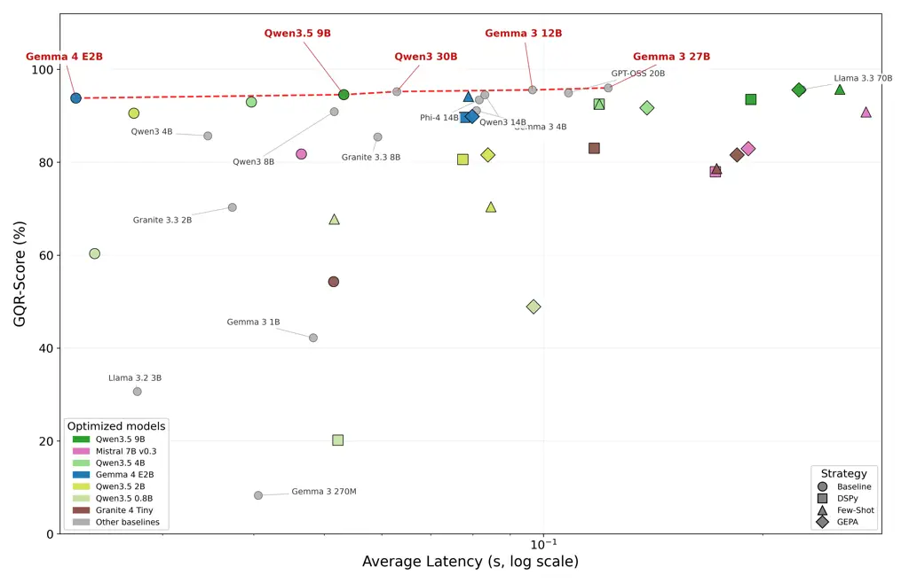
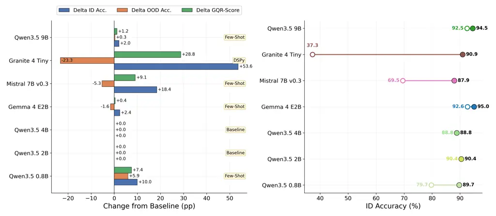
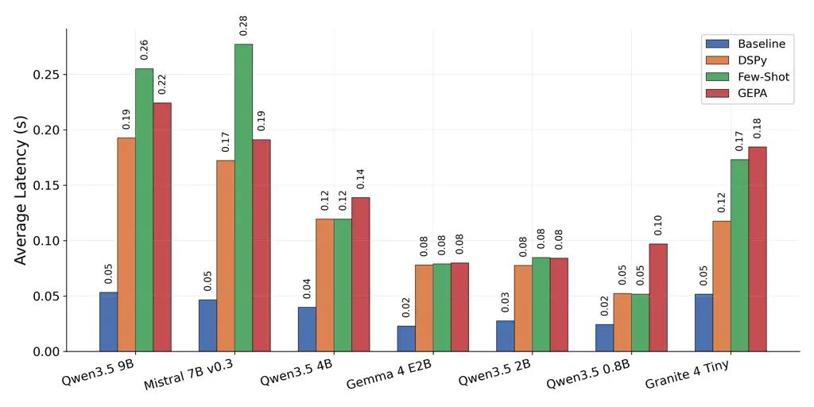

# Influence of Prompt Engineering on Small Language Models for Guarded Query Routing

Richard Šléher

Affiliation: Faculty of Informatics and Information Technologies, Slovak
University of Technology in Bratislava, Bratislava, Slovakia
E-mail <%7Bxsleher,william.brach,kristian.kostal%7D@stuba.sk>    William
Brach(🖂)

Affiliation: Faculty of Informatics and Information Technologies, Slovak
University of Technology in Bratislava, Bratislava, Slovakia
E-mail <%7Bxsleher,william.brach,kristian.kostal%7D@stuba.sk>   
Kristián Košťál

Affiliation: Faculty of Informatics and Information Technologies, Slovak
University of Technology in Bratislava, Bratislava, Slovakia
E-mail <%7Bxsleher,william.brach,kristian.kostal%7D@stuba.sk>    Lukas
Galke Poech

Affiliation: Department of Mathematics and Computer Science (IMADA),
University of Southern Denmark, Odense, Denmark
E-mail <galke@imada.sdu.dk>

###### Abstract

We study the problem of guarded query routing, where we assume that a
user query first meets a router that either determines the ideal
endpoint for in-distribution queries, or rejects out-of-distribution
queries that are potentially unsafe or out of the system’s scope. We
investigate whether compact open-weight Small Language Models (SLMs) can
jointly handle both tasks under latency constraints. We evaluate 22
models on GQR-Bench and score them with the harmonic mean of
in-distribution and out-of-distribution accuracy. We find that mid-scale
SLMs come close to frontier model routing quality at much lower latency.
Still, many compact models fail because they do not reliably follow the
required output format. However, our results show that prompt
optimization techniques enable SLMs to handle such cases gracefully –
without changing the models’ weights. Moreover, few-shot prompt
optimization raises Mistral 7B from 81.79 to 90.87 GQR-Score and lifts
Qwen3.5 9B to 95.74, the best optimized score in our study and within
0.3 points of the strongest unoptimized larger model: Gemma 3 27B at
96.01. The bare DSPy signature, without in-context exemplars, is the
most effective strategy for Granite 4 Tiny, raising its score from 54.29
to 83.05. These results show that prompt optimization is a useful first
step for guarded query routing, while weaker models may still need
weight-level adaptation or schema-aware training.

###### Keywords: 

Guarded Query Routing Small Language Models Prompt Optimization
Selective Classification Out-of-Distribution Detection.

## 1 Introduction

In many LLM deployments, a user query does not go directly to a large
model \[7\]. It first passes through a router, which decides which
expert should handle the request. In a guarded system, this first
decision is also a safety decision, since the router should reject any
query that is off-topic, adversarial, or outside the supported domains
before downstream tools are invoked \[38, 16\]. A guarded router,
therefore, has to do two things at once. It must classify valid
in-distribution (ID) queries, while rejecting out-of-distribution (OOD)
inputs.

This makes the router important but also fragile. It sits on the
critical path of every request, so its latency is paid every time the
system is used. Its mistakes are also costly. An unsafe query may reach
a downstream expert, while a legitimate query may be blocked. The
problem is harder than ordinary intent classification because OOD
queries can look similar to valid domain queries, and confidence scores
often become unreliable under distribution shift \[13, 23\]. LLM-based
detectors inherit this problem and add their own sensitivity to prompt
wording \[19, 43\]. A practical router must therefore be fast,
selective, and stable under near-OOD inputs \[6, 8\].

One simple design is to place a classifier in front of a separate
guardrail. That design is easy to understand, but it incurs two costs
per request and splits one semantic decision into two thresholds. The
classifier decides where the query should go; the guardrail later
decides whether it should have gone anywhere at all. If these two
decisions disagree, errors compound. A single router with an explicit
reject option avoids this split by treating dispatch and refusal as one
calibrated decision \[40, 39\]. The open question is whether a compact
open-weight model can make this joint decision well enough while staying
fast.

This paper makes two empirical contributions. First, we benchmark 22
open-weight models on GQR-Bench \[38\] and show where they fall on the
latency–efficacy trade-off. Mid-scale language models approach much
larger models, while smaller models often reject OOD inputs but fail to
commit to the correct ID label. Second, we study whether prompt-only
optimization can repair this failure. On seven representative models,
DSPy’s Few-Shot optimization and GEPA show that simple in-context
examples can recover ID accuracy by up to 57.6 percentage points without
weight updates.

## 2 Related Work

Guarded Query Routing (GQR) was recently formalized in \[38\] as a joint
routing and rejection problem. The router must send valid queries to one
of several expert domains and reject queries that are off-topic, in
another unsupported setting, or unsafe. GQR-Bench captures this setting
with three ID domains (Law, Finance, Healthcare) and seven OOD splits.
The original benchmark showed that efficient classifiers such as
fastText \[3, 18\] and WideMLP \[10\] offer a strong latency–efficacy
trade-off, often running far faster than LLM routers. Our work starts
with that result and asks a follow-up question: whether compact,
open-weight LLMs can become better guarded routers merely by changing
their prompts.

This question connects to several lines of work. Semantic routers use
embeddings or keyword overlap to choose among routes \[36, 46\], but
guarded routing also needs a reject option. The fields of
out-of-distribution detection and abstention directly study the
rejection problem \[13, 23, 40, 39, 24\], but often place less emphasis
on ID classification. They show why confidence alone is risky under a
distribution shift, especially when an OOD query shares words with a
valid domain. These methods often assume a separate discriminative
classifier. A compact generative model offers a different path,
producing the route label and the reject label in one forward pass when
it follows the output schema reliably.

SLMs are attractive here as they can be employed much more efficiently
than frontier models while still performing well on classification
tasks \[21, 41, 9\]. That matters because the router runs before every
downstream LLM call \[6, 8, 36\]. But the benefit comes with a catch: In
GQR, the model must return one of a few exact labels, which entails a
structured-output and instruction-following problem \[47, 42\].

This is why prompt engineering is a natural first tool. If the routing
schema or rejection policy changes, a prompt can be inspected, changed,
and rolled back without retraining the model. For a guarded router, that
kind of lightweight adaptation is useful, since the system can be
adjusted without changing weights or redeploying a new model.

Prompting methods range from manual templates to automated search \[34,
35, 22\]. Few-shot prompting is especially relevant because examples can
show the model what a valid routing answer looks like \[5, 33\].
Automated systems such as MIPROv2 and GEPA go further by searching over
instructions and demonstrations without changing model weights \[2, 25,
30\]. These methods fit our setting well, as they do not come with
additional resource requirements and allow rapid adaptation if, for
example, a new domain is added.

Most prior routing work focuses on where to send a query, while most
guardrail work focuses on whether a query is safe \[21, 6, 8, 36, 46,
31, 16, 28, 32\]. GQR combines both questions into a single decision.
The router must determine whether the query falls within the supported
domains at all and, when it does, which expert should receive it. This
leaves a gap. We still do not know how compact open-weight language
models behave when routing and rejection are forced into one small label
set. We study that gap directly. We keep the router structure fixed,
score the joint decision with the GQR-Score \[38\], and study how far
prompt adaptation can move compact models without weight updates.

## 3 Setup

##### Task:

Each query has one of four possible outcomes, namely Law, Finance,
Healthcare, or a synthetic class for OOD examples. The first three are
supported ID domains, while the last means that the query should be
rejected. We run all evaluations on GQR-Bench \[38\], which combines ten
public datasets into this single routing setup. Three splits provide the
ID domains. Seven splits test rejection. Five contain unsafe or
adversarial content (Jigsaw \[4\], OLID \[45\], HateXplain \[26\],
dkhate \[37\], and the Slovak-language TUKE SK set \[14\]), while two
contain benign but unsupported topics: general web questions from Web Q
and machine-learning questions from ML Q.

##### Evaluation Metrics:

A guarded router should not win by refusing everything, and it should
not win by sending every query to an expert. We therefore report ID
Accuracy, OOD Accuracy, and the GQR-Score from GQR-Bench \[38\]. ID
Accuracy is the macro-average over the three supported domains. OOD
Accuracy is the size-weighted average over the seven rejection splits.
GQR-Score, the harmonic mean of ID and OOD accuracy, is our headline
metric because it rewards routers that do both jobs well. We also report
Unsafe Avg., the size-weighted mean over the five unsafe OOD subsets, to
isolate safety-critical refusal.

### 3.1 Models and Prompt Optimization

We evaluate 22 open-weight models spanning ten model families or release
lines, namely Gemma 3 \[11\] (270M–27B), Gemma 4 E2B (5B),
Llama 3 \[12\] (3B–70B), Qwen3 \[44\] (4B–14B), Qwen3.5 (0.8B–9B),
Phi-4 \[1\] (14B), Mistral \[17\] (7B), Granite 3.3 \[15\] (2B–8B),
Granite 4 Tiny (7B), and GPT-OSS \[29\] (20B). This diversity of
architectures, training recipes, and parameter counts ensures that our
findings on guarded routing do not depend on any single release.

From this pool, we select seven models for prompt optimization, namely
Qwen3.5 9B, Qwen3.5 4B, Qwen3.5 2B, Qwen3.5 0.8B, Gemma 4 E2B 5B,
Granite 4 Tiny 7B, and Mistral 7B. This subset spans four families and
covers the 0.8B–9B parameter range where over-rejection under standard
prompting is most pronounced. Rather than hand-tuning prompts, we employ
the DSPy \[20\] framework, which provides a stable and reproducible
prompt optimization implementation. The router signature is displayed in
Listing 2. Each selected model is run under four prompting strategies.
The first is _standard prompting_ with a fixed baseline template
(Listing 1), used to isolate the effect of DSPy from the raw text
prompts employed with the initial pool. The second is the _DSPy
baseline_: the bare dspy.Predict(Classify) program with no in-context
exemplars, which isolates the effect of DSPy’s signature-driven prompt
formatting from any exemplar selection. The third is _Few-Shot_
optimization via BootstrapFewShotWithRandomSearch. This optimizer runs
the unoptimized program on the training inputs, retains those whose
traces produced the correct route as candidate in-context
demonstrations, samples several alternative demonstration sets, and
returns the single best-scoring program on a held-out validation slice;
it selects exemplars by search and does not average outputs across runs.
We use max_labeled_demos=6 and num_candidate_programs=4 on 30 training
samples from GQR-Bench, deliberately below the DSPy defaults of 16 to
yield a time-efficient configuration suited to single-machine
exploration. The fourth is _GEPA_ evolutionary refinement \[2\], where
we employ gpt-5.4 as the teacher model; GEPA is initialized from the
Few-Shot prompt and runs under the automatic light preset with 100
training and 30 validation samples drawn from GQR-Bench.

system_prompt = """You are a highly accurate text classifier. Your task
is to categorize passages into one of four predefined domains. The ONLY
valid categories are: law, finance, healthcare, and ood. Any passage
that does not clearly belong to law, finance, or healthcare MUST be
categorized as ood. You must respond with ONLY the category name, and
nothing else. No explanations, no extra words."""

user_prompt = """Classify the following passage into one of the
categories: law, finance, healthcare, or ood.

Passage:

{query}

Category:"""

Listing 1: Baseline prompt used for LLM-as-a-Router under standard
prompting

class Classify(dspy.Signature):

"""

You are a highly accurate text classifier. Your task is to categorize
queries

into one of four predefined domains. The ONLY valid categories are: law,
finance, healthcare, ood

Any query that does not clearly belong to the domains above MUST be
categorized as ood.

You must respond with ONLY the category name, and nothing else. No
explanations, no extra words.

"""

query: str = dspy.InputField(desc="The query to classify.")

route: Literal\["law", "finance", "healthcare", "ood"\] =
dspy.OutputField(desc="The predicted category. If the query does not
clearly belong to category - law, finance, healthcare. Predict 'ood'.")

Listing 2: DSPy routing signature used during prompt optimization

### 3.2 Hardware and Inference Protocol

All experiments ran on a single machine with two RTX 4090 GPUs, an AMD
Threadripper PRO 7965WX (24 cores), and 256 GB RAM. We serve models with
vLLM \[27\] using greedy decoding (temperature 0) and the default
quantization for each model tag. Reported latency is the mean
single-request inference time over the full test split, measured
warm-start with one request in flight at a time, which matches the
interactive routing setting where sub-second responses are expected. All
results come from a single run and should be read as point estimates for
this configuration.

## 4 Experiments

We examine whether open-weight SLMs can function as guarded query
routers. We report results for standard prompting, DSPy-optimized
prompting, and DSPy with GEPA refinement, using the GQR-Bench evaluation
protocol.

|                         |        |        |            |        |         |       |        |             |         |          |           |
| ----------------------- | ------ | ------ | ---------- | ------ | ------- | ----- | ------ | ----------- | ------- | -------- | --------- |
| Model                   | Jigsaw | OLID   | HateXplain | dkhate | TUKE SK | Web Q | ML Q   | Unsafe Avg. | ID Acc. | OOD Acc. | GQR-Score |
| _Non LLM baselines_     |        |        |            |        |         |       |        |             |         |          |           |
| fastText                | 74.46  | 61.51  | 54.46      | 74.77  | 83.11   | 70.37 | 63.28  | 69.66       | 95.80   | 68.85    | 80.12     |
| WideMLP ($`\tau`$=0.99) | 93.83  | 93.49  | 91.00      | 86.93  | 80.60   | 99.16 | 93.75  | 89.17       | 84.49   | 91.25    | 87.74     |
| _Standard prompting_    |        |        |            |        |         |       |        |             |         |          |           |
| Llama 3.3 70B           | 97.60  | 85.81  | 97.84      | 96.66  | 96.98   | 91.98 | 100.00 | 94.98       | 96.04   | 95.27    | 95.65     |
| Qwen3 30B               | 98.88  | 91.74  | 99.07      | 96.66  | 96.14   | 91.14 | 99.22  | 96.50       | 94.33   | 96.12    | 95.22     |
| Gemma 3 27B             | 97.39  | 93.84  | 99.36      | 98.78  | 98.54   | 94.49 | 99.22  | 97.58       | 94.69   | 97.37    | 96.01     |
| GPT-OSS 20B             | 97.29  | 90.58  | 97.89      | 93.92  | 91.76   | 92.91 | 100.00 | 94.29       | 94.99   | 94.91    | 94.95     |
| Phi-4 14B               | 95.08  | 80.47  | 96.71      | 92.71  | 88.74   | 89.42 | 93.75  | 90.74       | 96.03   | 90.98    | 93.44     |
| Qwen3 14B               | 98.35  | 94.07  | 98.65      | 93.92  | 93.74   | 92.37 | 100.00 | 95.75       | 93.19   | 95.87    | 94.51     |
| Gemma 3 12B             | 97.64  | 92.91  | 99.12      | 97.57  | 95.41   | 94.34 | 99.22  | 96.53       | 94.56   | 96.60    | 95.57     |
| Qwen3.5 9B              | 99.10  | 90.93  | 99.02      | 97.87  | 96.25   | 93.80 | 100.00 | 96.63       | 92.48   | 96.71    | 94.55     |
| Granite 3.3 8B          | 98.97  | 96.05  | 99.46      | 100.00 | 99.58   | 94.59 | 100.00 | 98.81       | 75.54   | 98.38    | 85.46     |
| Qwen3 8B                | 99.60  | 98.60  | 99.71      | 99.09  | 99.58   | 92.96 | 99.22  | 99.32       | 84.46   | 98.40    | 90.89     |
| Mistral 7B              | 99.35  | 97.56  | 99.98      | 99.70  | 99.17   | 99.26 | 100.00 | 99.15       | 69.53   | 99.29    | 81.79     |
| Granite 4 Tiny 7B       | 99.91  | 100.00 | 100.00     | 100.00 | 99.90   | 98.47 | 100.00 | 99.96       | 37.29   | 99.75    | 54.29     |
| Gemma 4 E2B 5B          | 97.92  | 89.30  | 98.23      | 94.53  | 95.52   | 92.72 | 96.88  | 95.10       | 92.63   | 95.01    | 93.81     |
| Qwen3.5 4B              | 99.19  | 95.23  | 99.31      | 98.48  | 96.66   | 94.00 | 100.00 | 97.78       | 88.80   | 97.55    | 92.97     |
| Qwen3 4B                | 99.28  | 97.33  | 99.44      | 97.57  | 97.60   | 86.71 | 98.44  | 98.24       | 76.99   | 96.62    | 85.70     |
| Gemma 3 4B              | 98.38  | 94.42  | 99.49      | 97.87  | 98.64   | 97.88 | 100.00 | 97.76       | 85.04   | 98.10    | 91.11     |
| Llama 3.2 3B            | 99.91  | 100.00 | 100.00     | 100.00 | 100.00  | 99.85 | 100.00 | 99.98       | 18.11   | 99.97    | 30.67     |
| Granite 3.3 2B          | 99.94  | 99.07  | 100.00     | 99.70  | 99.69   | 96.95 | 100.00 | 99.68       | 54.42   | 99.33    | 70.32     |
| Qwen3.5 2B              | 97.01  | 91.28  | 95.60      | 96.35  | 94.58   | 83.76 | 76.56  | 94.96       | 90.42   | 90.74    | 90.58     |
| Gemma 3 1B              | 26.14  | 41.63  | 35.77      | 52.58  | 45.36   | 16.68 | 0.00   | 40.30       | 65.43   | 31.17    | 42.22     |
| Qwen3.5 0.8B            | 63.66  | 38.95  | 58.92      | 57.45  | 54.85   | 21.51 | 44.53  | 54.77       | 79.73   | 48.55    | 60.35     |
| Gemma 3 270M            | 10.36  | 5.12   | 3.22       | 1.82   | 0.83    | 1.72  | 8.59   | 4.27        | 50.28   | 4.52     | 8.30      |
| _DSPy baseline_         |        |        |            |        |         |       |        |             |         |          |           |
| Qwen3.5 9B              | 97.54  | 78.84  | 96.04      | 90.58  | 90.09   | 93.11 | 100.00 | 90.62       | 94.84   | 92.31    | 93.56     |
| Granite 4 Tiny 7B       | 91.79  | 80.12  | 91.76      | 86.93  | 79.77   | 59.50 | 45.31  | 86.07       | 90.90   | 76.45    | 83.05     |
| Mistral 7B              | 98.23  | 89.88  | 98.99      | 94.83  | 91.87   | 85.38 | 91.41  | 94.76       | 67.18   | 92.94    | 77.99     |
| Gemma 4 E2B 5B          | 92.16  | 73.49  | 90.03      | 86.93  | 78.83   | 81.15 | 93.75  | 84.29       | 94.72   | 85.19    | 89.70     |
| Qwen3.5 4B              | 98.01  | 88.26  | 97.62      | 96.96  | 94.99   | 94.64 | 100.00 | 95.17       | 89.44   | 95.78    | 92.51     |
| Qwen3.5 2B              | 94.90  | 78.37  | 92.23      | 92.10  | 85.30   | 74.51 | 58.59  | 88.58       | 79.06   | 82.29    | 80.64     |
| Qwen3.5 0.8B            | 99.97  | 99.42  | 99.97      | 100.00 | 99.90   | 97.64 | 100.00 | 99.85       | 11.22   | 99.56    | 20.17     |
| _Few-Shot_              |        |        |            |        |         |       |        |             |         |          |           |
| Qwen3.5 9B              | 99.13  | 93.02  | 98.97      | 97.26  | 96.25   | 95.13 | 99.22  | 96.93       | 94.52   | 97.00    | 95.74     |
| Granite 4 Tiny 7B       | 83.39  | 70.93  | 83.03      | 65.65  | 53.91   | 55.56 | 57.81  | 71.38       | 94.88   | 67.18    | 78.66     |
| Mistral 7B              | 98.16  | 91.98  | 98.10      | 93.92  | 91.24   | 95.67 | 89.06  | 94.68       | 87.93   | 94.02    | 90.87     |
| Gemma 4 E2B 5B          | 97.45  | 86.28  | 95.97      | 95.14  | 94.68   | 89.62 | 94.53  | 93.90       | 95.02   | 93.38    | 94.19     |
| Qwen3.5 4B              | 98.01  | 88.26  | 97.62      | 96.96  | 94.99   | 94.64 | 100.00 | 95.17       | 89.44   | 95.78    | 92.51     |
| Qwen3.5 2B              | 65.81  | 59.42  | 74.76      | 80.85  | 71.43   | 40.94 | 1.56   | 70.45       | 93.78   | 56.40    | 70.43     |
| Qwen3.5 0.8B            | 87.37  | 74.77  | 92.35      | 52.28  | 37.33   | 26.33 | 10.94  | 68.82       | 89.71   | 54.48    | 67.79     |
| _GEPA_                  |        |        |            |        |         |       |        |             |         |          |           |
| Qwen3.5 9B              | 98.57  | 90.58  | 98.53      | 97.57  | 94.99   | 94.29 | 100.00 | 96.05       | 94.81   | 96.36    | 95.58     |
| Granite 4 Tiny 7B       | 89.83  | 76.16  | 89.74      | 82.37  | 80.29   | 49.56 | 32.03  | 83.68       | 95.09   | 71.43    | 81.58     |
| Mistral 7B              | 84.44  | 70.23  | 83.61      | 84.19  | 71.22   | 75.30 | 57.81  | 78.74       | 92.37   | 75.26    | 82.94     |
| Gemma 4 E2B 5B          | 93.22  | 80.00  | 92.10      | 89.97  | 86.24   | 89.91 | 67.19  | 88.31       | 94.71   | 85.52    | 89.88     |
| Qwen3.5 4B              | 98.48  | 92.44  | 98.26      | 96.66  | 94.79   | 97.54 | 100.00 | 96.13       | 87.08   | 96.88    | 91.72     |
| Qwen3.5 2B              | 86.65  | 75.58  | 86.76      | 86.32  | 74.45   | 57.92 | 39.06  | 81.95       | 93.52   | 72.39    | 81.61     |
| Qwen3.5 0.8B            | 99.78  | 98.95  | 99.95      | 100.00 | 99.58   | 94.59 | 100.00 | 99.65       | 32.49   | 98.98    | 48.92     |

Table 1: Performance of evaluated open-weight models on GQR-Bench. We
compare ID Accuracy, OOD Accuracy, and their harmonic GQR-Score. Strong
guarded routers must both dispatch valid ID queries and reject OOD
inputs. Key takeaways are that Gemma 3 27B is the strongest model
overall (96.01 GQR), Qwen3.5 9B under Few-Shot gives the best optimized
score (95.74 GQR), and Granite 4 Tiny illustrates the high-OOD/low-ID
failure mode under standard prompting before the DSPy baseline raises it
to 83.05 GQR.

### 4.1 Baseline Routing Performance

The first result is that guarded routing does not simply reward the
largest model. Under the standard prompt in Listing 1, GQR-Scores in
Figure 1 range from 8.30 (Gemma 3 270M) to 96.01 (Gemma 3 27B). The top
three models, Gemma 3 27B (96.01), Llama 3.3 70B (95.65), and
Gemma 3 12B (95.57), differ greatly in size but finish within 0.44
points of one another. This suggests that GQR-Bench saturates once a
model is capable enough. The more important break appears below roughly
2B parameters, where models such as Gemma 3 270M (8.30) and Gemma 3 1B
(42.22) no longer maintain a usable decision boundary.

Figure 1: Inference latency vs. GQR-Score trade-off of evaluated
open-weight models on GQR-Bench. The horizontal axis shows inference
latency on a logarithmic scale, and the vertical axis reports the
GQR-Score. Red markers connected by a dashed line indicate the Pareto
frontier, while gray markers are non-frontier models. The main
interpretation is that several mid-scale SLMs occupy the useful
upper-left region, where they approach large-model quality while
remaining much cheaper to serve as per-query routers.

A deeper analysis of the components of the GQR score reveals the main
failure: Mid-scale models usually know when something should be
rejected, but they often hesitate on valid ID queries. Granite 4 Tiny
reaches 99.75% OOD accuracy but only 37.29% ID accuracy (GQR 54.29);
Llama 3.2 3B reaches 99.97% OOD accuracy, but only 18.11% ID accuracy
(GQR 30.67); and Mistral 7B reaches 99.29% OOD accuracy but only 69.53%
ID accuracy (GQR 81.79). These models look safe because they reject
almost everything, but a router that blocks valid requests is not
useful. The pattern points to format-constrained instruction
following \[47, 42\], not missing domain knowledge. The model often
recognizes that a query belongs somewhere, but it does not reliably
commit to one of the four allowed labels.

Across OOD splits, Web Q and OLID are typically the lowest-accuracy
columns under standard prompting (Table 1), indicating that benign but
out-of-scope queries and offensive language remain the hardest rejection
subtasks when the router must simultaneously maintain an ID routing
signal.

### 4.2 Effect of Prompt Optimization

We then ask whether prompts can teach the router to commit to the right
label. We apply the three DSPy \[20\] strategies defined in Section 3.1
(DSPy baseline, Few-Shot via BootstrapFewShotWithRandomSearch, and
GEPA \[2\]) to seven models selected from the standard-prompting pool,
namely Qwen3.5 9B, Qwen3.5 4B, Qwen3.5 2B, Qwen3.5 0.8B, Gemma 4 E2B 5B,
Granite 4 Tiny 7B, and Mistral 7B. Table 1 reports every strategy model
combination.

Few-Shot gives the best GQR-Score for four of the seven models
(Qwen3.5 9B, Mistral 7B, Gemma 4 E2B, and Qwen3.5 0.8B). The DSPy
baseline wins for Granite 4 Tiny, and standard prompting remains best
for Qwen3.5 4B and Qwen3.5 2B. GEPA does not yield the best score for
any model in this set. The largest gains occur when the model
over-rejects under standard prompting. Granite 4 Tiny gains +28.8 GQR
points under the DSPy baseline, while Qwen3.5 2B gains nothing because
its standard-prompting score was already balanced.

Figure 2 shows where the gains come from. Prompt optimization does not
mainly improve OOD rejection, which was already high for most models.
Instead, it recovers ID routing. Granite 4 Tiny rises from 37.29% to
94.88% ID accuracy under Few-Shot, and Mistral 7B rises from 69.53% to
87.93%. The exception is Qwen3.5 0.8B, whose standard-prompting OOD
accuracy was unusually low (48.55%) and therefore also improves on OOD.

Figure 2: Decomposition of GQR-Score gains from prompt optimization. The
left panel shows the change in ID accuracy (blue), OOD accuracy
(orange), and GQR-Score (green) relative to standard prompting for each
model’s best strategy (annotated). The right panel shows absolute ID
accuracy before (hollow) and after (filled) optimization, with
connecting lines indicating the magnitude of ID recovery. The figure
shows that prompt optimization mainly helps by repairing ID routing, not
by further improving already high OOD rejection.

##### Effect of Few-shot prompting

Few-shot constitutes the single most effective prompt-only
strategy \[20\]. Under Few-Shot optimization, Qwen3.5 9B reaches 95.74,
within 0.3 points of the best unoptimized model (Gemma 3 27B at 96.01);
Gemma 4 E2B follows at 94.19, Qwen3.5 4B at 92.51, and Mistral 7B at
90.87.

The underlying mechanism is ID recovery through exemplar-based format
demonstration. Granite 4 Tiny improves from 37.29% to 94.88% ID accuracy
(+57.6 pp), and Mistral 7B from 69.53% to 87.93% (+18.4 pp). These
models did not lack domain knowledge. Their baseline OOD accuracy
already exceeded 99%, but they failed to commit to an ID label under the
strict output schema. In-context exemplars resolve this by demonstrating
the expected format of a correct routing decision \[5, 33, 47, 42\].
Both models pay an OOD cost. Granite 4 Tiny incurs a $`-`$32.6 pp OOD
penalty (from 99.75% to 67.18%), and Mistral 7B incurs a smaller
$`-`$5.3 pp OOD penalty (from 99.29% to 94.02%). The net Few-Shot GQR
gains of +24.4 (Granite) and +9.1 (Mistral) still justify the exchange,
as the standard-prompting routers were effectively non-functional on the
ID side; for Granite 4 Tiny, the DSPy baseline further improves the
trade-off to 83.05 GQR.

Two models illustrate where few-shot optimization breaks down.
Qwen3.5 2B drops from a baseline GQR of 90.58 to 70.43 under Few-Shot.
ID accuracy rises to 93.78%, but OOD accuracy falls to 56.40%,
indicating that the exemplars overcorrect and the model ceases to reject
out-of-distribution inputs. Qwen3.5 0.8B attains a Few-Shot GQR of only
67.79, suggesting that a 0.8B parameter budget is fragile for reliable
four-way classification under exemplar-based prompts.

##### Effect of GEPA Refinement

GEPA refinement \[2\] does not yield the best GQR-Score for any of the
seven models evaluated. For Qwen3.5 9B, GEPA reaches 95.58, above the
standard-prompting baseline (94.55) but below Few-Shot (95.74). For
Qwen3.5 0.8B, GEPA actually underperforms both Few-Shot (67.79) and the
standard-prompting baseline (60.35), reaching only 48.92. For the
remaining models, GEPA generally lands between the standard baseline and
Few-Shot: Gemma 4 E2B drops from 94.19 (Few-Shot) to 89.88, and
Mistral 7B drops from 90.87 to 82.94. Granite 4 Tiny is the one model
where GEPA (81.58) exceeds Few-Shot (78.66), though the DSPy baseline
(83.05) remains the best strategy for that model.

This pattern is interpretable. For mid-strength models that already
achieved a strong Few-Shot prompt, the instruction-optimization
landscape is brittle. Minor perturbations either preserve routing
semantics (no effect) or shift the OOD/ID balance enough to harm GQR
(degradation), leaving little room for improvement through instruction
editing alone. The bootstrapped few-shot prompt already sits at a robust
local optimum that evolutionary search cannot easily escape within this
budget, which separates constrained classification from the open-ended
generation tasks where GEPA has shown larger gains \[2, 25\].

### 4.3 Latency

Figure 3: Average router inference latency by prompting strategy.
Few-Shot increases latency primarily because in-context exemplars
lengthen the prompt. The figure clarifies the central deployment
trade-off, showing that prompt optimization can recover routing
accuracy, but the longer prompt must still fit the latency budget of a
router that runs on every request.

Prompt optimization increases inference latency because optimized
prompts are longer (Figure 3). Under standard prompting, all seven
optimized models run between 0.02 s (Gemma 4 E2B) and 0.05 s
(Qwen3.5 9B) per query, well within interactive routing budgets. After
optimization, latencies cluster between 0.05 s and 0.28 s across DSPy,
Few-Shot, and GEPA strategies, roughly a 2$`\times`$ to 6$`\times`$
increase. All three strategies produce prompts of similar length and
therefore yield comparable latencies for most models; differences across
strategies for a given model are small relative to differences across
models. The non-LLM baselines (fastText, WideMLP) remain two to three
orders of magnitude faster \[38\], so whether the GQR gain justifies the
added latency depends on the error-cost asymmetry of the deployment.

## 5 Discussion

Taken together, the results support a number of recommendations for
practice: Compact models do not automatically serve as effective guarded
routers, but mid-scale SLMs become strong once the prompt teaches them
the required format. Under Few-Shot, Qwen3.5 9B (95.74) comes within 0.3
GQR points of the best unoptimized model, Gemma 3 27B (96.01), while
running at lower latency (Figure 1), with Gemma 4 E2B (94.19) and
Qwen3.5 4B (92.51) following. Nevertheless, this does not mean that
every SLM should replace a classical classifier. WideMLP with confidence
thresholding reaches 87.74 \[38\] and runs two to three orders of
magnitude faster. The useful SLM regime is therefore the middle range,
where models are large enough to follow the format but small enough to
remain practical routers \[6, 8\].

The bottleneck for most of these models is not OOD detection but ID
commitment, and within ID commitment, two qualitatively different
failure modes appear: Mistral 7B, Granite 4 Tiny, and Llama 3.2 3B
reject OOD queries reliably (over 99% OOD accuracy) but under-commit on
ID, defaulting to the rejection label even for valid domain queries.
This is a partial-commit failure, and it is largely recoverable through
prompting: optimization lifts the ID accuracy of Granite 4 Tiny from
37.29% to 94.88% and that of Mistral 7B from 69.53% to 87.93% without
weight updates. Larger models such as Phi-4 14B, Gemma 3 12B,
Qwen3.5 9B, and GPT-OSS 20B exhibit neither pattern, which suggests that
GQR is not inherently a trade-off between ID and OOD accuracy. The
trade-off appears specifically when a model is capable enough to sense
the domain but does not commit to one of the four allowed labels \[47,
42\].

No single optimization strategy dominates. Few-Shot yields the best GQR
for four of the seven optimized models, the DSPy baseline is the best
strategy for Granite 4 Tiny (54.29 $`\rightarrow`$ 83.05), and standard
prompting already beats both optimized variants for Qwen3.5 4B and
Qwen3.5 2B. GEPA never produces the best score for any model in this
set, although it does improve over standard prompting for Qwen3.5 9B
(94.55 $`\rightarrow`$ 95.58) and Granite 4 Tiny
(54.29 $`\rightarrow`$ 81.58). Once a few-shot prompt has taught the
four-label format, the instruction-optimization landscape is brittle:
small edits either preserve the same behavior or break the format. This
differs from open-ended generation, in which reflective refinement has
more freedom to improve the answer \[2, 25\].

Prompt-only optimization is also limited at the smaller end of the
scale. Qwen3.5 0.8B reaches only 67.79 even under Few-Shot prompting,
and the still smaller Gemma 3 1B (42.22) and Gemma 3 270M (8.30), which
sit below the 0.8B threshold and were not part of the seven-model
optimization subset (Section 3.1), already collapse under standard
prompting (Listing 1), so adding exemplars is unlikely to rescue them.
Conversely, a well-calibrated standard-prompting score can be damaged by
exemplars when there is little to fix, as Qwen3.5 2B illustrates.

The four-label schema is easy to deploy, but it conflates at least three
failure modes that Table 1 alone cannot separate: a model may lack the
domain knowledge, may know the domain but fail to follow the format, or
may refuse on principle. The single GQR-Score collapses these into one
number, which makes it difficult to choose between weight-level
adaptation, prompt repair, and schema redesign for any given model. The
same observation applies at the column level: Web Q and OLID are the
hardest rejection splits under standard prompting (Table 1) and remain
the hardest after optimization, but the schema does not indicate whether
this reflects a domain-boundary problem or a residual format-following
problem.

##### Future work

should investigate weight-level adaptation, in particular, Low-Rank
Adaptation (LoRA) or Quantized LoRA (QLoRA) fine-tuning combined with
DSPy optimized signatures, to determine whether the format-following
bottleneck identified here can be resolved below the prompt layer.
Compared with prompt-only methods, lightweight adaptation would require
a training and deployment step, but it may provide a more stable way to
bind compact models to the allowed label set and reduce the brittle
overcorrection observed for Qwen3.5 2B and Qwen3.5 0.8B.

## 6 Conclusion

We benchmarked 22 open-weight models on GQR-Bench and found a clear
pattern. The best mid-scale SLMs can approach much larger models, but
weaker models often fail in a specific way. They reject OOD inputs well,
yet do not reliably choose the right ID label. Few-shot prompting
repairs much of this format-following problem. Mistral 7B rises from
81.79 to 90.87 GQR-Score, Granite 4 Tiny rises from 54.29 to 83.05 under
the DSPy baseline, and Few-Shot brings Qwen3.5 9B to 95.74, just below
the strongest unoptimized model, Gemma 3 27B at 96.01. Compact
open-weight SLMs can therefore be practical guarded routers in the
tested GQR-Bench setting, but broader deployment still requires testing
other schemas, label granularities, and lightweight adaptation methods.

## 7 Limitations

All results are single-run point estimates on a fixed two-GPU
configuration (2$`\times`$ RTX 4090); no run-to-run variance is
characterized, and the shape of the Pareto frontier is
hardware-dependent \[27\]. GEPA uses gpt-5.4 as the teacher model, and
the effectiveness of evolutionary refinement with weaker or open-weight
teachers remains untested. The analysis is also tied to the GQR-Bench
schema, with three ID domains and one catch-all OOD label. Other routing
deployments may require finer label granularity, hierarchical abstention
labels, or different output formats, which could change the balance
between prompt-following failures and true domain errors. Finally, we do
not evaluate LoRA, QLoRA, or other lightweight weight-adaptation
methods; these methods may mitigate the format-following bottleneck more
directly than prompt edits, but they introduce additional training and
deployment costs that fall outside this study.

## 8 Ethical Considerations

Over-rejection by a guarded router denies legitimate users access to
legal, financial, or medical assistance, a failure mode that
disproportionately affects queries sharing surface vocabulary with
sensitive content. The high-OOD, low-ID profiles of Mistral 7B and
Granite 4 Tiny illustrate this risk in practice. A router deployed with
either model under standard prompting would block the majority of valid
requests. We also note a dual-use concern, since a well-calibrated
guarded router can function as a content gate, and narrowing the ID
taxonomy without disclosure could enable selective censorship.

#### Acknowledgements

This work was supported by the Science Grant Agency – project VEGA
1/0300/25. This research was further supported in part by the MIST
project, funded by the Novo Nordisk Foundation under grant reference
number NNF25OC0103204.

#### Disclosure of Interests.

The authors have no competing interests to declare that are relevant to
the content of this article.

## References

- \[1\] M. Abdin et al. (2024) Phi-4 technical report. External Links:
  2412.08905, [Link](https://arxiv.org/pdf/2412.08905.pdf) Cited by:
  §3.1.
- \[2\] A. Agrawal et al. (2025) GEPA: reflective prompt evolution can
  outperform reinforcement learning. External Links: 2507.19457,
  [Link](https://arxiv.org/pdf/2507.19457.pdf) Cited by: §2, §3.1, §4.2,
  §4.2, §4.2, §5.
- \[3\] P. Bojanowski, E. Grave, A. Joulin, and T. Mikolov (2017)
  Enriching word vectors with subword information. Transactions of the
  association for computational linguistics 5, pp. 135–146. Cited by:
  §2.
- \[4\] D. Borkan, L. Dixon, J. Sorensen, N. Thain, and L.
  Vasserman (2019) Nuanced metrics for measuring unintended bias with
  real data for text classification. In Companion Proceedings of The
  2019 World Wide Web Conference (WWW), pp. 491–500. External Links:
  [Document](https://dx.doi.org/10.1145/3308560.3317593) Cited by: §3.
- \[5\] T. B. Brown et al. (2020) Language models are few-shot learners.
  In Advances in Neural Information Processing Systems (NeurIPS), Cited
  by: §2, §4.2.
- \[6\] L. Chen, M. Zaharia, and J. Zou (2023) FrugalGPT: how to use
  large language models while reducing cost and improving performance.
  Transactions on Machine Learning Research. Cited by: §1, §2, §2, §5.
- \[7\] J. Dekoninck, M. Baader, and M. Vechev (2024) A unified approach
  to routing and cascading for llms. arXiv preprint arXiv:2410.10347.
  Cited by: §1.
- \[8\] J. Dekoninck, M. Baader, and M. Vechev (2025) A unified approach
  to routing and cascading for LLMs. In ICML, pp. 12987–13010. Cited by:
  §1, §2, §2, §5.
- \[9\] L. Galke, A. Diera, B. X. Lin, B. Khera, T. Meuser, T.
  Singhal, F. Karl, and A. Scherp (2022) Are we really making much
  progress in text classification? a comparative review. arXiv preprint
  arXiv:2204.03954. Cited by: §2.
- \[10\] L. Galke and A. Scherp (2022) Bag-of-words vs. graph vs.
  sequence in text classification: questioning the necessity of
  text-graphs and the surprising strength of a wide MLP. In ACL,
  pp. 4038–4051. External Links:
  [Document](https://dx.doi.org/10.18653/v1/2022.acl-long.279) Cited by:
  §2.
- \[11\] Gemma Team (2025) Gemma 3 technical report. External Links:
  2503.19786, [Link](https://arxiv.org/pdf/2503.19786.pdf) Cited by:
  §3.1.
- \[12\] A. Grattafiori et al. (2024) The llama 3 herd of models.
  External Links: 2407.21783,
  [Link](https://arxiv.org/pdf/2407.21783.pdf) Cited by: §3.1.
- \[13\] D. Hendrycks and K. Gimpel (2017) A baseline for detecting
  misclassified and out-of-distribution examples in neural networks. In
  ICLR, Cited by: §1, §2.
- \[14\] D. Hládek, J. Staš, M. Pleva, and Y. Bobrýek (2023) Slovak
  dataset for hate speech detection. In Proceedings of the International
  Conference on Emerging eLearning Technologies and Applications
  (ICETA), Cited by: §3.
- \[15\] IBM Granite Team (2025) Granite 3.3 language models. External
  Links:
  [Link](https://huggingface.co/ibm-granite/granite-3.3-8b-instruct)
  Cited by: §3.1.
- \[16\] H. Inan et al. (2023) Llama guard: llm-based input-output
  safeguard for human-ai conversations. External Links: 2312.06674,
  [Link](https://arxiv.org/abs/2312.06674) Cited by: §1, §2.
- \[17\] A. Q. Jiang et al. (2023) Mistral 7b. External Links:
  2310.06825, [Link](https://arxiv.org/abs/2310.06825) Cited by: §3.1.
- \[18\] A. Joulin, E. Grave, P. Bojanowski, and T. Mikolov (2017) Bag
  of tricks for efficient text classification. In EACL: Short papers,
  pp. 427–431. Cited by: §2.
- \[19\] M. C. Jung, H. Zhao, J. Dipnall, B. Gabbe, and L. Du (2025)
  Enhancing near out-of-distribution detection in prompt learning:
  maximum gains, minimal costs. In ICLR, Cited by: §1.
- \[20\] O. Khattab et al. (2024) DSPy: compiling declarative language
  model calls into state-of-the-art pipelines. In ICLR, Cited by: §3.1,
  §4.2, §4.2.
- \[21\] J. Lakha, M. Yu, and R. Shahout (2025) Faster, cheaper, just as
  good: cost- and latency-constrained routing for llms. In ICLR, Cited
  by: §2, §2.
- \[22\] B. Lester, R. Al-Rfou, and N. Constant (2021) The power of
  scale for parameter-efficient prompt tuning. In EMNLP, pp. 3045–3059.
  Cited by: §2.
- \[23\] S. Liang, Y. Li, and R. Srikant (2018) Enhancing the
  reliability of out-of-distribution image detection in neural networks.
  In ICLR, Cited by: §1, §2.
- \[24\] W. Liu, X. Wang, J. D. Owens, and Y. Li (2020) Energy-based
  out-of-distribution detection. In Advances in Neural Information
  Processing Systems (NeurIPS), Cited by: §2.
- \[25\] A. Madaan et al. (2023) Self-refine: iterative refinement with
  self-feedback. In Advances in Neural Information Processing Systems
  (NeurIPS), Cited by: §2, §4.2, §5.
- \[26\] B. Mathew, P. Saha, S. M. Yimam, C. Biemann, P. Goyal, and A.
  Mukherjee (2021) HateXplain: a benchmark dataset for explainable hate
  speech detection. In Proceedings of the AAAI Conference on Artificial
  Intelligence, Vol. 35, pp. 14867–14875. Cited by: §3.
- \[27\] Ollama (2025) Ollama. External Links:
  [Link](https://github.com/ollama/ollama) Cited by: §3.2, §7.
- \[28\] I. Ong, A. Almahairi, V. Wu, W. Chiang, T. Wu, J. E.
  Gonzalez, M. W. Kadous, and I. Stoica (2024) RouteLLM: learning to
  route LLMs with preference data. External Links: 2406.18665,
  [Link](https://arxiv.org/abs/2406.18665) Cited by: §2.
- \[29\] OpenAI and S. Agarwal and others (2025) Gpt-oss-120b &
  gpt-oss-20b model card. External Links: 2508.10925,
  [Link](https://arxiv.org/abs/2508.10925) Cited by: §3.1.
- \[30\] K. Opsahl-Ong, M. J. Ryan, J. Purtell, D. Broman, C. Potts, M.
  Zaharia, and O. Khattab (2024) Optimizing instructions and
  demonstrations for multi-stage language model programs. In EMNLP,
  Cited by: §2.
- \[31\] Qian et al. (2025) XRouter: training cost-aware llms
  orchestration system via reinforcement learning. arXiv preprint
  arXiv:2510.08439. Cited by: §2.
- \[32\] T. Rebedea, R. Dinu, M. Sreedhar, C. Parisien, and J.
  Cohen (2023) NeMo Guardrails: a toolkit for controllable and safe LLM
  applications with programmable rails. In EMNLP: System Demonstrations,
  Cited by: §2.
- \[33\] T. Schick and H. Schütze (2021) Exploiting cloze questions for
  few-shot text classification and natural language inference. In EACL,
  Cited by: §2, §4.2.
- \[34\] S. Schulhoff et al. (2024) The prompt report: a systematic
  survey of prompting techniques. External Links: 2406.06608,
  [Link](https://arxiv.org/pdf/2406.06608.pdf) Cited by: §2.
- \[35\] T. Shin, Y. Razeghi, R. L. L. IV, E. Wallace, and S.
  Singh (2020) AutoPrompt: eliciting knowledge from language models with
  automatically generated prompts. In EMNLP, Cited by: §2.
- \[36\] T. Shnitzer et al. (2024) Large language model routing with
  benchmark datasets. In CoLM, Cited by: §2, §2, §2.
- \[37\] G. I. Sigurbergsson and L. Derczynski (2020) Offensive language
  and hate speech detection for Danish. In Proceedings of the 12th
  Language Resources and Evaluation Conference (LREC), pp. 3498–3508.
  Cited by: §3.
- \[38\] R. Šléher, W. Brach, T. Sloboda, K. Košťáľ, and L. Galke (2025)
  Guarded query routing for large language models. In ECAI, Cited by:
  §1, §1, §2, §2, §3, §3, §4.3, §5.
- \[39\] S. Tayebati, D. Kumar, N. Darabi, D. Jayasuriya, R. Krishnan,
  and A. R. Trivedi (2025) CAP: conformalized abstention policies for
  context-adaptive risk management for LLMs and VLMs. In Asian
  Conference on Machine Learning (ACML), Cited by: §1, §2.
- \[40\] C. Tomani, K. Chaudhuri, I. Evtimov, D. Cremers, and M.
  Ibrahim (2025) Uncertainty-based abstention in large language models
  improves safety and reduces hallucinations. In ICLR, Cited by: §1, §2.
- \[41\] F. Wang et al. (2025) A comprehensive survey of small language
  models in the era of large language models: techniques, enhancements,
  applications, collaboration with llms, and trustworthiness. ACM
  Transactions on Intelligent Systems and Technology. Cited by: §2.
- \[42\] B. T. Willard and R. Louf (2023) Efficient guided generation
  for large language models. External Links: 2307.09702,
  [Link](https://arxiv.org/abs/2307.09702) Cited by: §2, §4.1, §4.2, §5.
- \[43\] R. Xu and K. Ding (2025) Large language models for anomaly and
  out-of-distribution detection: a survey. In Findings of the
  Association for Computational Linguistics: NAACL, Cited by: §1.
- \[44\] A. Yang et al. (2025) Qwen3 technical report. External Links:
  2505.09388, [Link](https://arxiv.org/pdf/2505.09388.pdf) Cited by:
  §3.1.
- \[45\] M. Zampieri, S. Malmasi, P. Nakov, S. Rosenthal, N. Farra,
  and R. Kumar (2019) Predicting the type and target of offensive posts
  in social media. In Proceedings of the Conference of the North
  American Chapter of the Association for Computational Linguistics:
  Human Language Technologies (NAACL-HLT), pp. 1415–1420. Cited by: §3.
- \[46\] E. Zhao, P. Awasthi, Z. Chen, S. Gollapudi, and D.
  Delling (2024) Semantic routing via autoregressive modeling. In
  Advances in Neural Information Processing Systems, A. Globerson et al.
  (Eds.), Vol. 37, pp. 10060–10087. External Links:
  [Document](https://dx.doi.org/10.52202/079017-0323) Cited by: §2, §2.
- \[47\] J. Zhou, T. Lu, S. Mishra, S. Brahma, S. Basu, Y. Luan, D.
  Zhou, and L. Hou (2023) Instruction-following evaluation for large
  language models. External Links: 2311.07911,
  [Link](https://arxiv.org/abs/2311.07911) Cited by: §2, §4.1, §4.2, §5.
