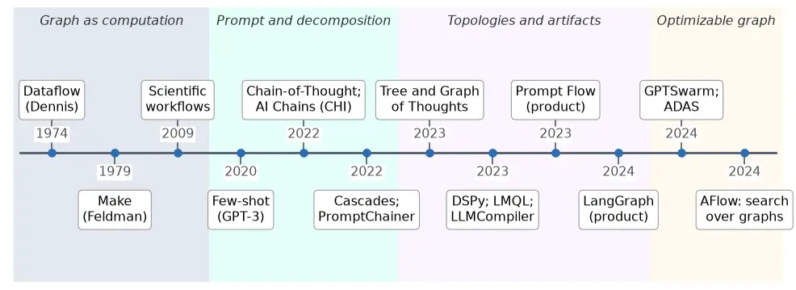
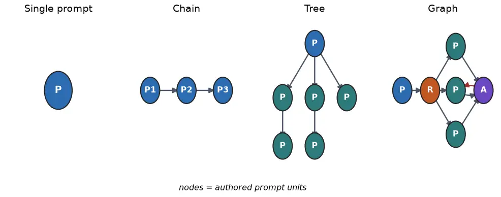
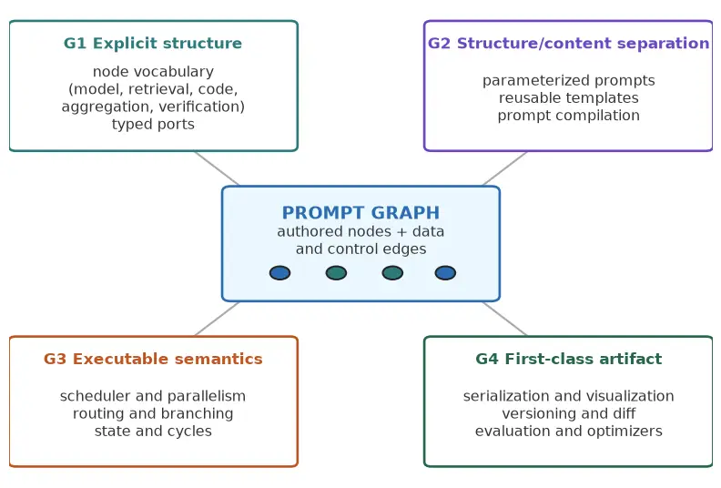
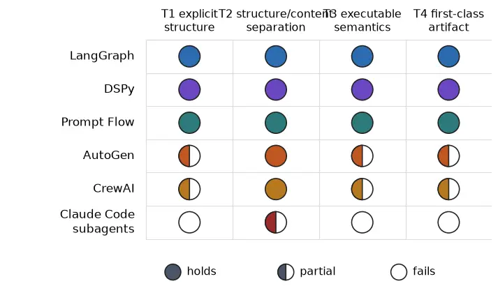
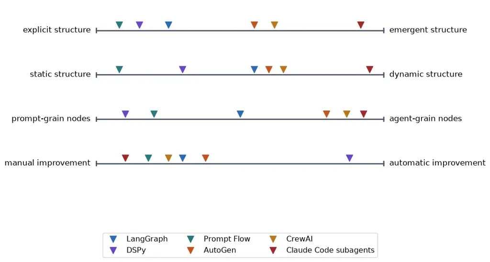

# What makes prompts a graph: necessary and sufficient conditions for prompt graph engineering

Sandeco Macedo Affiliation: Federal Institute of Goiás Email:
[sanderson.macedo@ifg.edu.br](mailto:)

August 24, 2026

###### Abstract

Prompts stopped being isolated strings some time ago. In real systems,
one model call feeds another, retrieval interleaves with generation,
routers branch, and aggregators merge parallel results. Practice
converged on a single structure to hold this together: the graph.
Frameworks such as LangGraph, DSPy, and Prompt Flow expose it openly,
and research systems already optimize it automatically. The vocabulary,
however, lags behind. Graph names, variously, a reasoning topology
inside one sampling strategy, a multi-agent conversation, or an
orchestration artifact, while prompt engineering still evokes writing
one good string. What is missing is a reference definition treating
prompts as nodes of an explicit, executable, improvable graph. We build
that definition through conceptual analysis over sources with persistent
identifiers, complemented by primary grey literature. We reconstruct the
genealogy of the idea, from dataflow graphs and build systems, through
prompt chaining and the thought topologies (chain, tree, graph), to
graphs compiled and optimized as artifacts. We then propose a
constitutive definition of prompt graph engineering, state its four
conditions (explicit structure, separation between structure and prompt
content, executable semantics, and the graph as a first-class
engineering artifact), and operationalize them as an inclusion and
exclusion test. We draw the boundary against six neighboring concepts
and apply the test to six real systems (LangGraph, DSPy, Prompt Flow,
AutoGen, CrewAI, and Claude Code subagents); it includes and excludes
consistently. We close with a research agenda organized along four
design tension axes. The contribution is an operational definition and a
shared vocabulary for a practice that industry already exercises daily
without naming precisely.

Keywords: prompt graph engineering; prompt engineering; large language
models; LLM pipelines; agentic workflows; graph of thoughts; operational
definition.

## 1 Introduction

Ask an engineer to show you the prompt of a modern language model
application and the honest answer is that there is no such prompt. There
is a retrieval step that fetches context, a first call that plans, a
router that decides which specialist handles the case, three calls that
run in parallel, an aggregator that votes on their outputs, and a
verifier that refuses to pass along an answer that fails its checks. The
unit of engineering is no longer a string. It is a structure that
connects many strings, and that structure has a mathematical name that
practitioners already use without ceremony: a graph, with prompts on the
nodes and dependencies on the edges.

The path to that structure was fast. Large language models first showed
that a single well-crafted prompt could steer a general model to a task
\[4\], and instruction tuning made that steering reliable enough to
build on \[36, 60\]. A craft grew around the single string, with its
patterns, catalogs, and surveys \[30, 39, 41\]. But the single string
hit its ceiling early. Complex tasks demanded decomposition, and
decomposition produced multiplicity: chains of model calls curated by
humans \[50\], chains of intermediate reasoning inside one generation
\[46\], trees that branch and backtrack \[55\], and finally graphs,
where partial results merge, loop, and feed one another \[1\]. In
parallel, an engineering lineage turned those structures into programs:
declarative pipelines that compile \[23\], function-call DAGs that
schedule in parallel \[25\], agent workflows represented and even
searched as graphs \[64, 59\]. Products followed the same drift;
LangGraph names the graph in its own name, and Prompt Flow renders it on
screen.¹¹ 1 LangGraph documentation:
[https://langchain-ai.github.io/langgraph/](https://langchain-ai.github.io/langgraph/).
Microsoft Prompt Flow documentation:
[https://microsoft.github.io/promptflow/](https://microsoft.github.io/promptflow/).
Accessed July 2026.

The structure converged; the vocabulary did not. Graph names at least
three different things in current usage. In graph-of-thoughts it names a
topology of model-generated thoughts inside a single problem-solving
episode \[1\]. In multi-agent systems it names, often only implicitly,
whatever shape a free conversation among agents happens to trace \[44\].
In orchestration frameworks it names an authored artifact, drawn or
coded by an engineer, that a runtime executes. Meanwhile prompt
engineering still evokes the craft of one good string \[39\]. The
closest existing name, flow engineering, coined for the code-generation
flow of AlphaCodium, points at the practice but stops at pointing: it
names the shift from the single prompt to a structured flow of calls
without saying which conditions a flow must meet, and a flow, unlike a
graph, does not commit to explicit routing, merging, or artifact status
\[38\]. What is missing, then, is not a word but a constitutive
definition of the discipline that sits between prompt craft and agent
architecture: the engineering of the structure itself, of how
prompt-bearing nodes compose, route, and execute. The polysemy is not
cosmetic. It prevents us from saying which systems share a design, from
comparing a compiled DSPy pipeline with a hand-drawn flow on equal
terms, and from accumulating knowledge about when structure, rather than
prompt wording, is what improves a system \[15\].

The practical consequence is familiar to anyone who has debugged one of
these systems. When the flow lives inside an opaque script, or inside
the improvised turns of a conversation among agents, there is nothing to
inspect when it misbehaves, nothing to type-check before running it,
nothing to version when it changes, and nothing for an optimizer to hold
on to. The lineage of automatic optimizers makes the point sharply: a
structure can only be tuned if it exists as an object \[58, 59\]. Naming
the discipline that produces such objects is the purpose of this
article.

This article delivers a reference definition of prompt graph
engineering. The central question is direct: what conditions are
necessary and sufficient for a practice, or a system, to count as
engineering prompts as a graph, and how do we turn that into an
instrument that discriminates cases? We organize five contributions
around five research questions. RQ1 (genealogy): where does the idea of
structuring prompts as a graph come from, and how did its sense migrate
from reasoning topology to engineering artifact? RQ2 (constitutive
definition): what conditions are necessary and sufficient for prompt
graph engineering? RQ3 (boundary): how does the definition distinguish
the concept from classic prompt engineering, thought topologies, agent
orchestration, prompt programming, RAG pipelines, and classic workflow
engines? RQ4 (application): how do real systems instantiate the
constitutive conditions? RQ5 (agenda): which design axes remain open?

The contributions are, in order: a genealogy that reconstructs the
migration of the graph from mathematical model of computation to
engineering artifact for prompts (Section 3); a constitutive definition
operationalized as an inclusion and exclusion test (Section 4); a
boundary delimitation against six neighboring concepts (Section 5); the
application of the definition to six real systems, showing that it
classifies consistently (Section 6); and a research agenda organized by
tension axes (Section 7). Section 2 positions the article against the
literature.

Positioning. This article is deliberately definitional. It does not
propose a new framework, does not benchmark systems, and does not survey
the prompt engineering literature, which already has its surveys \[41\].
Its product is conceptual: a shared vocabulary and a reproducible test
of membership in the concept. A note on method: this is a work of
conceptual clarification; each source with a verified DOI enters as a
formal citation, while product documentation, where much of the practice
actually lives, enters as footnotes with URLs.

## 2 Related Work

Five research lines surround the concept without defining it, and three
smaller neighborhoods, the interface antecedents, the terminological
plane, and the definitional method, complete the picture. The prompt
engineering surveys systematize techniques for the individual prompt and
its variations, from the pre-train, prompt, and predict paradigm to
pattern catalogs and broad technique taxonomies \[30, 47, 39, 41\];
their unit of analysis is the prompt, not the structure that connects
prompts. The taxonomies of thought topologies compare chain, tree, and
graph as shapes of intermediate reasoning \[2, 53, 10\]; they classify
topologies inside a solving episode and stop short of the graph as an
authored engineering object. The agent surveys describe architectures,
components, and design patterns of LLM-based agents and multi-agent
systems \[44, 52, 17, 34, 31\]; the flow among agents appears as a
byproduct of the architecture, rarely as the object itself. The
programming lineage gives prompts formal structure, from probabilistic
cascades over model calls \[11\], to query and programming languages
\[3, 43\], to declarative pipelines that compile \[22, 23\], to runtimes
that schedule structured programs \[61, 25\]; it builds instances of the
concept without naming or delimiting it. And the optimization lineage
treats prompts, and lately whole workflows, as search spaces \[63, 13,
58, 19, 59, 64\]; it presupposes exactly the artifact this article
defines, since only an explicit graph can be searched. The closest
antecedents come from human-computer interaction, where chaining model
calls and editing the chain visually were proposed early \[50, 49\];
those works demonstrated the value of the artifact but framed it as an
interface technique, not as a discipline with membership conditions. On
the terminological side, flow engineering, coined alongside AlphaCodium
to name iterative, structured code-generation flows \[38\], baptizes the
practice without delimiting it, offering neither conditions of
membership nor a boundary against neighboring concepts; and compound AI
systems names the broad class of systems that tackle AI tasks with
multiple interacting components, model calls, retrievers, and tools,
delimiting the class by component count rather than by structure, and
demanding neither an explicit graph, nor separation of structure and
content, nor artifact status.²² 2 Zaharia et al., The Shift from Models
to Compound AI Systems, BAIR Blog, February 2024:
[https://bair.berkeley.edu/blog/2024/02/18/compound-ai-systems/](https://bair.berkeley.edu/blog/2024/02/18/compound-ai-systems/).
Accessed July 2026. In method, the closest neighbors of this article are
two earlier definitional studies by the same author, on adjacent layers
of the same stack: one gives necessary and sufficient conditions for the
agent harness, the runtime that turns an LLM into an agent \[7\], and
the other defines loop engineering, the design of the external loop that
drives a harness in place of step-by-step prompting, placed in the
progression from prompt to context, harness, and loop \[32\]. This
article defines the layer that organizes the prompts themselves: where
the loop drives the agent from the outside, the graph structures the
composition of calls on the inside. What no line delivers is the
constitutive definition: which conditions make a system an instance of
prompt graph engineering, and which neighbors fail which condition. For
the definitional method itself we follow the classic criteria for
designing shared conceptualizations \[16\].

## 3 Genealogy (RQ1)

The idea that computation should be drawn as a graph is half a century
older than the prompt. Dataflow models represented a program as nodes
that fire when their inputs arrive, with edges carrying data between
them \[9, 6\]. The same shape reappeared wherever engineers needed to
coordinate steps they did not want to weld together: Make expressed a
build as a dependency graph among targets \[12\], and scientific
workflow systems scaled the pattern to entire experiments, with the
graph as the unit that is shared, audited, and rerun \[8\]. Three
lessons from that tradition matter here. The graph separates
orchestration from computation. The graph makes dependencies explicit,
so independent work can run in parallel. And the graph is an artifact:
it can be checked before running and inspected after failing.

The prompt entered this story innocent of all that. A prompt was a
string handed to a model, and the early craft consisted of making that
one string work: few-shot examples in context \[4\], instructions that
models learned to follow \[36\], even the bare magic words that elicit
step-by-step reasoning \[26\]. The craft matured into catalogs and
surveys \[30, 47\], but its unit never stopped being the individual
string. The first crack in that unit came from decomposition.
Least-to-most prompting solved a hard problem by chaining the solutions
of its subproblems \[62\], and decomposed prompting made the move
architectural: a library of subtask handlers that a decomposer prompt
invokes, explicitly modular \[24\]. Once a task spans multiple calls,
something must say which call feeds which. Structure had arrived, even
if nobody drew it yet.

Two lineages then took the structure in different directions. The first
kept it inside the model’s reasoning. Chain-of-thought made the model
produce a linear sequence of intermediate steps within a single
generation \[46\]; self-consistency sampled many chains in parallel and
voted \[45\]; tree-of-thoughts turned generation into search over a
branching space of partial thoughts \[55\]; and graph-of-thoughts
generalized the shape to arbitrary graphs where thoughts merge, refine,
and loop \[1\], with variants that condition generation on
graph-structured context \[57\] and skeleton-first strategies that
parallelize expansion \[35\]. The community itself began classifying
these shapes as topologies of reasoning \[2, 53, 10\]. In this lineage
the graph describes what the model thinks. Its nodes are thoughts the
model generated; its shape is chosen by a search strategy, per problem
instance.

The second lineage pulled the structure out of the model and into the
engineer’s hands. AI Chains showed that humans compose chains of model
calls, each call doing one thing, and that the chain itself improves
outcomes and controllability \[50\]; PromptChainer gave that chain a
visual editor, nodes on a canvas, edges dragged by hand \[49\]. Language
model cascades framed multi-call compositions as probabilistic programs,
giving the practice formal semantics \[11\]. Offloading turned nodes
heterogeneous: a node could run code rather than sample a model \[14,
5\]. Then the programming lineage industrialized the artifact.
Demonstrate-search-predict composed retrieval and generation into
declarative pipelines \[22\]; DSPy separated the program’s structure
from the prompt text of its modules and compiled the latter against the
former \[23\]; LMQL and PDL made calls and constraints part of a
language \[3, 43\]; SGLang gave structured programs a runtime \[61\];
and LLMCompiler scheduled function calls as a dependency DAG, recovering
the parallelism argument of dataflow almost verbatim \[25\].

The agentic wave completed the migration. Multi-agent systems composed
role-played model instances into conversations \[28, 48\], standardized
operating procedures \[18\], chat chains for software development
\[37\], and explicit state machines \[51\], with flows proposed as the
general abstraction for structured interaction \[21\]. And then the
artifact became not only explicit but optimizable: GPTSwarm represented
agent societies literally as computational graphs whose nodes and edges
are optimized \[64\]; ADAS searched the space of agent designs in code
\[19\]; AFlow searched workflow graphs by Monte Carlo tree search
\[59\]. Products consolidated the practice: LangGraph exposes a state
graph as its central API, Prompt Flow renders a DAG of prompt and tool
nodes, and visual builders put the canvas in front of non-programmers.³³
3 LangGraph:
[https://langchain-ai.github.io/langgraph/](https://langchain-ai.github.io/langgraph/),
announced in January 2024:
[https://blog.langchain.com/langgraph/](https://blog.langchain.com/langgraph/).
Prompt Flow:
[https://microsoft.github.io/promptflow/](https://microsoft.github.io/promptflow/),
first public release in 2023:
[https://github.com/microsoft/promptflow](https://github.com/microsoft/promptflow).
Flowise: [https://flowiseai.com/](https://flowiseai.com/). Similar
canvases predate LLM pipelines in other domains, for example ComfyUI for
image generation:
[https://github.com/comfyanonymous/ComfyUI](https://github.com/comfyanonymous/ComfyUI).
Accessed July 2026.

Figure 1 condenses the migration; Figure 2 shows the shapes it passed
through. Two histories must be kept apart here, because their
chronologies differ. The structure came first through chains: the
engineering lineage was already composing authored calls in 2021 and
2022 \[50, 11\], before any thought topology carried the word graph. The
word came later and from the other lineage: graph entered the shared
vocabulary through graph-of-thoughts in 2023 \[1\] and was claimed by
the engineering side within months, in product names and in research
systems \[64\]. So the migration this genealogy establishes is of the
word’s dominant sense, not of the practice: the practice grew
continuously out of chaining, while the word graph moved from
mathematics to reasoning topology to engineering artifact. In that final
sense the object changed owners, from the search strategy to the
engineer, and that is the sense, the graph as the unit of engineering
for prompt-mediated computation, that this article defines.

Figure 1: Genealogy of the prompt graph. The graph as model of
computation (dataflow, build systems, scientific workflows) meets the
prompt (few-shot, instruction following), passes through decomposition
and chaining, splits into reasoning topologies (chain, tree, graph of
thoughts) and engineering artifacts (cascades, DSP/DSPy, LLMCompiler,
agent workflow graphs), and converges on graphs that are compiled and
optimized as first-class objects. The background bands mark periods, not
categories: each event sits in its date’s band, whatever its lineage.

Figure 2: From string to graph. The four shapes of prompt-mediated
computation: the single prompt; the chain, where each call feeds the
next; the tree, where branches explore alternatives; and the graph,
where routing, parallel branches, aggregation, and cycles compose
freely: node R routes, node A aggregates, and the pair of edges between
the central node and A (forth and back) forms a refinement cycle. In
prompt graph engineering the nodes are authored prompt units, not
model-generated thoughts.

## 4 Constitutive Definition (RQ2)

The genealogy tells us where the structure comes from. What remains is
to say what the discipline is, and precisely. We define prompt graph
engineering by conditions, not by examples, and we turn the definition
into a test that includes and excludes concrete cases: this is our
answer to RQ2. A good constitutive definition enumerates what is
necessary, drops what is incidental, and separates the concept from its
neighbors \[16\].

We propose the following reference definition.

> Prompt graph engineering is the discipline that represents, composes,
> and executes prompt-mediated language model computation as an explicit
> graph, in which: (i) the nodes are authored units of computation,
> prompt-parameterized model invocations or deterministic transforms,
> and the edges are data or control dependencies among them; (ii) the
> structure of the graph is separated from the prompt content of its
> nodes, so that either can change without rewriting the other; (iii)
> the graph has executable semantics, a runtime that schedules nodes,
> routes outputs, and manages shared state, including branching,
> parallelism, and cycles; and (iv) the graph is a first-class
> engineering artifact, an object that can be inspected, versioned,
> validated, and optimized independently of any particular execution.

A practice, or a system, belongs to prompt graph engineering if and only
if it instantiates the four elements above, which we will call G1
(explicit structure), G2 (separation of structure and content), G3
(executable semantics), and G4 (first-class artifact status). The
definition states conditions, not cases, and each condition earns its
place by lineage. Explicit structure with firing nodes and dependency
edges is the dataflow inheritance \[9, 6\]. Separation between structure
and content is what made chains editable in the first HCI systems \[50,
49\] and what DSPy radicalized by compiling prompt text against a fixed
program structure \[23\]. Executable semantics is what distinguishes an
architecture diagram from a program, whether the semantics is
probabilistic \[11\], scheduled as a parallel DAG \[25\], or interpreted
over shared state by a product runtime.⁴⁴ 4 LangGraph’s StateGraph is
the clearest product example: nodes update a shared typed state, edges
and conditional edges route among them:
[https://langchain-ai.github.io/langgraph/](https://langchain-ai.github.io/langgraph/).
Accessed July 2026. And first-class artifact status is what the
optimization lineage presupposes: a graph can only be searched,
differentiated through, or refactored if it exists as an object \[64,
59, 58\]. A note on the order of derivation, to keep the definition
honest: the four conditions were fixed from these lineages, dataflow,
HCI chaining, programming, and optimization, before any present-day
framework was examined, and Section 6 then applies them to systems
chosen to span the practice. The test is not tailored to bless the
systems that inspired the genealogy; one indication is that it excludes
a popular contemporary system outright.

Figure 3 opens the concept into components. At the center, the graph
itself: prompt nodes, transform nodes, and the edges among them. Around
it, the machinery the four conditions demand: a node vocabulary (model
call, retrieval, code execution, aggregation, verification \[27, 14, 45,
33\]), typed ports that make dependencies checkable, a scheduler that
exploits the parallelism the edges reveal \[25\], state and routing for
cycles and feedback loops \[42, 51\], and the artifact services:
serialization, visualization, versioning, evaluation, and optimizers
that improve prompts given their position in the structure \[23, 58\].
Not every system ships every component. The four conditions, though, are
the core; without them there is no prompt graph engineering.

Figure 3: Anatomy of prompt graph engineering. At the center, the graph:
authored prompt and transform nodes connected by data and control edges.
Around it, what the four conditions demand: node vocabulary and typed
ports (G1), parameterization that separates structure from prompt
content (G2), scheduler, state, and routing (G3), and artifact services
such as serialization, visualization, evaluation, and optimization (G4).

Each condition is necessary, and removing one at a time shows why.
Remove explicit structure (G1) and the flow retreats into code paths or
conversation turns; the system may work, but nothing enumerates its
steps, and the practice collapses back into script writing, exactly the
opacity that chaining research set out to cure \[50\]. Remove the
separation of structure and content (G2) and every structural change
forces prompt rewrites and vice versa; nodes cannot be reused, and no
optimizer can hold the structure fixed while tuning the text, the very
operation DSPy defines \[23\]. Remove executable semantics (G3) and the
graph is a picture; architecture diagrams of agent systems abound in
surveys \[34\], and none of them runs. Remove artifact status (G4) and
the graph exists only at runtime, as a trace; it cannot be versioned,
statically checked, or searched, which forfeits the entire optimization
lineage \[19, 59\]. The four together are sufficient: a system that
satisfies G1 through G4 already exhibits everything the concept was
coined to capture, structure you can see, edit, run, and improve. There
is no fifth condition to add; observability, caching, cost control, and
human-in-the-loop nodes are specializations of the four, not new
elements.

What is NOT required also has to be said, and the definition stays lean
because it leaves the incidental out. Prompt graph engineering does not
require a visual editor: a graph defined in code, as in DSPy modules or
LangGraph builders, is exactly as explicit as one drawn on a canvas
\[23\]. It does not require acyclicity: cycles with exit conditions are
constitutive of reflection and retry loops \[42, 33\], and the
definition demands executable semantics for them, not their absence. It
does not require multiple models, a specific framework, or agents: a
graph whose nodes all call one model is still a prompt graph, and
agenthood is a property some nodes may have, not a condition on the
graph. And it does not require automatic optimization: G4 demands that
the graph be optimizable in principle, an object something could
improve; hand-tuning a versioned graph satisfies it.

The definition becomes an instrument once we turn it into a decision
procedure. Given a candidate practice or system, ask, in order: (T1) is
there an explicit representation in which prompt-bearing computation
units are nodes and their data or control dependencies are edges,
enumerable without running the system? (T2) can the structure be changed
without rewriting the prompt content of the nodes, and the content
without changing the structure? (T3) does a runtime execute that
representation, scheduling nodes, routing outputs, and managing state?
(T4) is the graph available as an object beyond any single run, one that
can be inspected, versioned, validated, or optimized? A candidate
belongs to the concept if it answers yes to T1 through T4. Fail any one
and it falls into a neighboring category; Section 5 shows which. Table 1
summarizes the test.

| Test | Question                                                                                   | If the answer is no                                                                                                    |
| ---- | ------------------------------------------------------------------------------------------ | ---------------------------------------------------------------------------------------------------------------------- |
| T1   | Are prompt units nodes, and dependencies edges, in an explicit, enumerable representation? | Monolithic prompt, opaque script, or emergent conversation                                                             |
| T2   | Can structure and prompt content change independently of each other?                       | Welded chain, or nodes authored by the model rather than the engineer; structure and content cannot vary independently |
| T3   | Does a runtime execute the graph, with scheduling, routing, and state?                     | Architecture diagram or documentation drawing; it does not run                                                         |
| T4   | Is the graph an object beyond a single run, inspectable and improvable?                    | Ephemeral trace; nothing to version, check, or optimize                                                                |

Table 1: Inclusion and exclusion test derived from the constitutive
definition. A practice or system belongs to prompt graph engineering if
it answers yes to T1 through T4; each failure indicates the neighboring
category into which the candidate falls.

Two caveats keep the test from being read naively. The first concerns
thresholds. T1 asks for more than plurality: two calls glued by string
concatenation inside a function body are a chain in spirit but not an
explicit representation; the criterion is that nodes and edges can be
enumerated by inspection, by an API, or by serialization, without
executing the system. T3 asks for more than sequencing: a runtime
satisfies it when the graph, not hand-written control flow around it,
determines what runs next; and dynamic graphs satisfy it as long as the
construction rules are themselves explicit, the position taken by
systems that build the DAG on the fly \[25\]. T4 has a verifiable
criterion: some tool or process other than the executor must be able to
consume the graph, a type checker, a visualizer, a diff, an optimizer;
if the only consumer of the structure is the run itself, T4 fails. The
second caveat: membership is binary, quality is gradual. A three-node
retrieve, generate, verify graph serialized in YAML passes T1 through T4
and is a legitimate, if modest, instance of the concept. What separates
it from a compiled DSPy program with an optimizer in the loop is not
membership but maturity, above all in G4. The test decides whether a
practice is prompt graph engineering. The anatomy qualifiers measure how
developed it is. Conflating those two questions produces most of the
terminological noise this article addresses.

## 5 Boundary (RQ3)

A definition proves itself at the edges. This section walks the boundary
of prompt graph engineering against six neighboring concepts, and for
each neighbor names the condition it fails. The neighbors are not
adversaries; most are ingredients or ancestors of the concept. The point
is that the test discriminates.

Classic prompt engineering is the nearest neighbor and the easiest to
separate. Its craft is intra-node: wording, examples, format, patterns
\[47, 39, 41\]. It fails T1: there is one prompt, so there is no
structure to represent. The relation between the two disciplines is
containment of scope, not competition: every node of a prompt graph
deserves good prompt engineering, and techniques cataloged at the prompt
level parameterize nodes at the graph level. The graph does not make
wording irrelevant; it makes wording local.

The thought topologies, chain, tree, and graph of thoughts, are the
neighbor most often conflated with the concept, because they share the
word graph. Chain-of-thought fails T1 outright: its chain is a
rhetorical structure inside one generated text, not a structure of
invocations \[46, 26\]. Tree and graph of thoughts do orchestrate many
invocations over an explicit topology maintained by a controller \[55,
1\], and graph-of-thoughts even reifies a graph of operations, so T1 and
T3 arguably pass. The failure is T2, and it is diagnostic: the nodes are
thoughts the model generated, not prompt units an engineer authored;
structure and content cannot vary independently because the content is
the model’s output and the structure is the search schedule that
produced it. The same holds for the broader X-of-thought family and its
taxonomies \[57, 35, 53, 10, 2\]: they are inference strategies,
describable as graphs, that can be wrapped inside a node of a prompt
graph. The boundary line is authorship: in prompt graph engineering the
engineer owns the nodes; in thought topologies the model does.

Agent orchestration overlaps the concept without coinciding with it.
Multi-agent systems in free conversation, role-play societies, and group
chats \[28, 48, 37\] fail T1: the interaction shape emerges turn by
turn, and no representation enumerates it beforehand; the surveys
themselves describe these flows as emergent \[44, 17, 52\].
Orchestration crosses the boundary exactly when the flow is reified:
MetaGPT’s standardized procedures \[18\], StateFlow’s state machines
\[51\], and flows as a compositional abstraction \[21\] all pass T1 and
T3, and pass T2 and T4 to the degree that the flow is authored and
persists as an object. The granularity also differs: agent orchestration
composes agents, units with goals, memory, and tools; prompt graph
engineering composes computation at the finer grain of
prompt-parameterized invocations. An agent can be a node, but the
concept does not require nodes that thick.

Prompt programming, the lineage of LMQL, PDL, DSP, and DSPy, is not a
neighbor to exclude but the code-shaped form of the concept, and drawing
this boundary carefully matters because it shows the definition is about
structure, not syntax. A DSPy program passes all four tests: modules are
nodes (T1), signatures separate structure from prompt text, which the
compiler generates (T2, radicalized), execution interprets the module
composition (T3), and the program is exactly the artifact optimizers
consume (T4) \[22, 23\]. Language-level systems sit at the boundary’s
inner edge: LMQL structures constraints and control within what is
largely a single query’s scope \[3\], and PDL makes call composition
declarative \[43\]; they pass when a program composes multiple
prompt-bearing units, and fail T1 when it structures only one. SGLang
and LLMCompiler supply T3 machinery, runtimes and schedulers, for
whoever authors the structure \[61, 25\].

RAG pipelines are an instructive partial case, and the verdict depends
on where the flow lives. Hardwired in application code, the fixed
retrieve-then-generate pipeline \[27\] already fails T1, by the
threshold of Section 4: there is a chain in spirit, but no
representation enumerable without running the system. Declared as a
framework object, with its two or three nodes and one edge, T1 passes in
a degenerate way, and what typically fails is T4, and often T2: the
object is not available beyond the run to inspect or optimize, and
swapping the generator prompt means editing the same declaration that
fixes the flow. The RAG literature itself documents the drift toward
richer shapes, adaptive retrieval, routing, feedback loops \[15\], and
graph-structured retrieval couples the two worlds further \[20\]. A RAG
pipeline becomes prompt graph engineering exactly when its flow is
lifted into an explicit, manipulable graph; nothing about retrieval
prevents that, and modern adaptive RAG built on graph runtimes is
precisely that lift.

Classic workflow engines fail on the opposite side of every neighbor
above: they have the graph and lack the prompt. Make, dataflow systems,
and scientific workflow managers pass T1 through T4 for their own node
kinds \[12, 6, 8\]. What they miss is the object clause of the
definition: nodes that are prompt-parameterized model invocations, with
the semantics that entails, stochastic outputs, natural-language
parameterization, per-call cost and latency, and results whose
correctness is not decidable by exit code. That difference is not
cosmetic; it changes the engineering. Caching must reason about semantic
equivalence, validation must judge text, optimization must rewrite
prompts rather than flags. Prompt graph engineering is therefore not
workflow engineering applied unchanged to a new node type; it inherits
the graph discipline and adds the discipline the new node semantics
demands.

The picture that emerges is a genus and a differentia. The genus is the
dataflow tradition: explicit, executable, first-class graphs. The
differentia is the node: authored, prompt-parameterized model
invocations. Thought topologies have graph without authorship; free
agent conversations have prompts without structure; classic engines have
structure without prompts; single-prompt craft has neither. The concept
sits where both hold, and each neighbor’s failing condition says which
half it lacks.

## 6 Applying the Test to Real Systems (RQ4)

A definition that only works on paper is a slogan. This section applies
T1 through T4 to six real systems, chosen to span the practice: two
orchestration frameworks born graph-first (LangGraph and Microsoft
Prompt Flow), one prompt programming framework (DSPy), two multi-agent
frameworks (AutoGen and CrewAI), and one coding harness with subagent
delegation (Claude Code). For the framework systems we rely on the
primary documentation, cited in footnotes, and on peer-reviewed or
preprint literature with persistent identifiers where it exists; the
classification is ours, and its criteria are the verifiable ones stated
in Section 4. One scope note is owed up front: these are living systems,
so the classification is a dated snapshot, based on documentation
accessed in July 2026, and cells of Figure 4 may move as the frameworks
evolve; what does not move is the test that produced them. Figure 4
summarizes the result; Table 2 gives the verdicts.

LangGraph passes the four tests cleanly. The StateGraph is an explicit
object built from named nodes and edges, including conditional edges
(T1); nodes are functions or prompt-bearing runnables attached to the
structure, so either side changes independently (T2); the runtime
executes the graph over a shared typed state, with cycles, branching,
interrupts, and checkpointing (T3); and the compiled graph is
serializable, visualizable, and consumed by external tooling for tracing
and evaluation (T4).⁵⁵ 5 LangGraph documentation:
[https://langchain-ai.github.io/langgraph/](https://langchain-ai.github.io/langgraph/).
Tracing and evaluation via LangSmith:
[https://docs.smith.langchain.com/](https://docs.smith.langchain.com/).
Accessed July 2026. Its strength among the six is G3: state, cycles, and
human-in-the-loop interrupts are native, which is exactly what fixed DAG
tools lack.

DSPy also passes the four, with a different center of gravity. Modules
compose into a program whose structure is enumerable (T1); signatures
declare what each node consumes and produces while the compiler
generates the prompt text, the most radical separation of structure and
content in the sample (T2); execution interprets the composition (T3);
and the program is the explicit substrate of optimizers that tune
prompts and demonstrations against a metric (T4) \[22, 23\]. DSPy shows
that the concept does not require a canvas: the graph lives in code, and
its G4 is the strongest of the six.⁶⁶ 6 DSPy documentation:
[https://dspy.ai](https://dspy.ai). Accessed July 2026.

Prompt Flow passes the four in the most literal form. A flow is a
YAML-declared DAG of prompt nodes and tool nodes (T1); prompt content
lives in template files referenced by the structure (T2); a runtime
executes the DAG (T3); and the artifact is rendered visually, versioned
as files, and fed to batch evaluation (T4).⁷⁷ 7 Microsoft Prompt Flow
documentation:
[https://microsoft.github.io/promptflow/](https://microsoft.github.io/promptflow/).
Accessed July 2026. Its limits mirror its literalness: without native
cycles, feedback loops must be pushed inside nodes, which weakens G3 for
reflective patterns \[33\].

AutoGen splits across its two operating modes, and the test registers
the split. In conversational mode, agents exchange messages and the
interaction shape emerges turn by turn \[48\]; T1 fails, and what
remains after a run is a transcript, not an artifact, so T4 fails too.
In GraphFlow mode, the framework reifies the flow as an explicit
directed graph over agents with conditional edges, and T1, T3, and
substantially T4 pass.⁸⁸ 8 AutoGen GraphFlow documentation:
[https://microsoft.github.io/autogen/stable/user-guide/agentchat-user-guide/graph-flow.html](https://microsoft.github.io/autogen/stable/user-guide/agentchat-user-guide/graph-flow.html).
Accessed July 2026. In both modes, prompt content (system messages and
agent descriptions) is authored and separate from whichever structure,
emergent or reified, composes the agents, which satisfies T2. The
verdict is partial by construction: AutoGen contains prompt graph
engineering as one of its modes, and the emergent mode shows precisely
what the concept excludes. StateFlow makes the same movement inside the
same ecosystem by modeling task flows as state machines \[51\].

CrewAI shows the same duality with different emphasis. Crews compose
role-defined agents whose task delegation is partly emergent; the
structure of a crew run is not enumerable beforehand, so T1 is at best
partial. Flows, the second abstraction, are explicit event-driven
compositions with routing and state, and pass T1 and T3.⁹⁹ 9 CrewAI
documentation, Crews and Flows:
[https://docs.crewai.com/](https://docs.crewai.com/). Accessed July 2026. Prompt content (role, goal, backstory, task descriptions) is
authored separately from either structure, satisfying T2. T4 is partial:
flows are code artifacts and can be versioned, but the crew-level
interaction has no graph object to inspect or optimize.

Claude Code subagents are the deliberate counterexample, and the test
excludes them for reasons worth stating. The harness lets an
orchestrating agent delegate work to authored subagents, each a
prompt-parameterized unit; the nodes, in our vocabulary, exist and
satisfy the spirit of T2, since subagent definitions are files authored
independently of any flow.¹⁰¹⁰ 10 Claude Code subagents documentation:
[https://code.claude.com/docs/en/sub-agents](https://code.claude.com/docs/en/sub-agents).
Accessed July 2026. But which subagent runs, when, and feeding what to
what is decided by the orchestrator model at runtime, turn by turn; no
representation enumerates the flow beforehand (T1 fails), the runtime
executes tool calls rather than a graph (T3 in the graph sense fails),
and what persists is a transcript (T4 fails). One scope caveat matters
here: the test targets subagent delegation, the mechanism by which the
harness composes prompt-bearing units; the harness also exposes authored
surfaces, such as commands and hooks, but these automate points of the
working loop without reifying the delegation flow into a graph. The
delegation topology is real but emergent, closer to the free
conversations of multi-agent systems \[44\] than to an authored graph;
coding agents in general share this profile, with the agent-computer
interface, not a flow artifact, as their structural core \[54\]. The
exclusion is not a demerit: a harness solves a different problem. It
merely is not prompt graph engineering, and a definition that included
it would have dissolved the concept.

Figure 4: The inclusion and exclusion test applied to six real systems.
Filled cells indicate that the condition holds; half-filled cells
indicate partial satisfaction (typically one operating mode passes and
another fails); empty cells indicate failure. The three fully included
systems pass the core cleanly; the multi-agent frameworks split across
modes; the coding harness fails the structural conditions, which is
exactly the discrimination the test exists to make.

|                       |         |         |         |         |                                                               |
| --------------------- | ------- | ------- | ------- | ------- | ------------------------------------------------------------- |
| System                | T1      | T2      | T3      | T4      | Verdict                                                       |
| LangGraph             | yes     | yes     | yes     | yes     | Included; strongest in executable semantics (G3)              |
| DSPy                  | yes     | yes     | yes     | yes     | Included; strongest in artifact status and optimization (G4)  |
| Prompt Flow           | yes     | yes     | yes     | yes     | Included; most literal DAG, weak on cycles                    |
| AutoGen               | partial | yes     | partial | partial | Included in GraphFlow mode; excluded in emergent conversation |
| CrewAI                | partial | yes     | partial | partial | Included via Flows; crew-level delegation remains emergent    |
| Claude Code subagents | no      | partial | no      | no      | Excluded; authored nodes, but flow is emergent at runtime     |

Table 2: Verdicts of the inclusion and exclusion test for the six
systems analyzed. Partial entries typically indicate systems with more
than one operating mode, where one mode passes the condition and another
does not.

Beyond the six, the research frontier passes the test maximally and
confirms the definition’s direction of travel. GPTSwarm represents agent
societies as computational graphs whose edges are optimized directly
\[64\]; AFlow searches the space of workflow graphs with tree search
\[59\]; ADAS searches agent designs expressed as code \[19\]; and
LLMCompiler builds the dependency DAG dynamically and schedules it
\[25\]. All four treat the graph as the object of study, not as
plumbing. At the opposite extreme, the everyday counterexamples fail
exactly where expected: a script that concatenates two API calls fails
T1 and T4; an architecture diagram in a survey fails T3; a single
elaborate prompt, however sophisticated its internal reasoning \[46\],
fails T1. The test sorts the field into the same regions a
practitioner’s intuition does, which is what an operational definition
is for.

The limits of this exercise should be stated as plainly as its results.
The classification was performed by a single analyst; T1 through T4 have
verifiable criteria precisely to make the exercise repeatable, but no
second rater has yet repeated it, and inter-rater agreement is the
obvious first empirical follow-up. The evidence base for the product
systems is grey literature, which moves faster than any article; the
snapshot caveat above is a mitigation, not a cure. And the sample of six
systems, chosen to span the practice, remains a sample: applying the
test to serving-layer systems, visual builders, and enterprise
orchestrators may stress conditions, especially the T3 threshold, in
ways these six do not.

## 7 Research Agenda (RQ5)

The application of the test did more than classify; it exposed where
real systems disagree. Those disagreements are not noise. They are open
design questions, and we organize the agenda along four tension axes,
summarized in Figure 5.

The first axis runs from explicit to emergent structure. The three
graph-first systems author the flow; the multi-agent frameworks let it
emerge and reify it only in dedicated modes; the coding harness leaves
it emergent entirely. Emergence buys adaptivity: an orchestrator that
decides delegation at runtime handles tasks its author never anticipated
\[44, 52\]. Explicitness buys everything Section 4 enumerated:
inspection, verification, optimization. The open question is whether the
trade is fundamental or technological: can a system record the emergent
flow, lift it into an explicit graph, and replay or refine it, making
emergence a discovery mode for structures that then become artifacts?
The dynamic DAG construction of LLMCompiler suggests the two ends can
meet \[25\], but, to our knowledge, no system today closes the loop from
trace to versioned, optimized graph.

The second axis runs from static to dynamic structure. Prompt Flow fixes
the DAG before execution; LangGraph routes conditionally over a fixed
node set; LLMCompiler builds the graph per task instance \[25\]; and the
thought topologies rebuild it per problem \[55, 1\]. More dynamism means
more expressiveness and less static knowledge. The interesting middle is
barely explored: graphs with static skeletons and dynamically
instantiated regions, and type systems that can say something useful
about a graph whose shape is partly decided at runtime. The
skeleton-first decomposition strategies hint at what such contracts
could look like \[35, 24\].

The third axis concerns node granularity: prompt-parameterized
invocations at one end, full agents with goals, memory, and tools at the
other. Fine grain gives analyzable dataflow, as in compiled pipelines
\[23\]; coarse grain gives encapsulation and role clarity, as in agent
societies \[28, 18, 37\]. Today the choice is forced by the framework
rather than made by the engineer, and the design patterns literature
records the same split without resolving it \[31, 17, 34\]. The open
problem is composition across grains: graphs whose nodes are themselves
graphs, with semantics for state, cost, and failure that survive the
nesting, the direction the flows abstraction points toward \[21\].

The fourth axis runs from manual to automatic improvement. Hand-tuned
graphs occupy one end; at the other, prompt optimization \[63, 13\],
textual gradients propagated through compositions \[58\], compiled
pipelines \[23\], and searches over the structures themselves \[19, 59,
64\]. Automation presupposes G4 and rewards it; that is the deepest
argument for the discipline this article defines. But automated search
over graphs whose nodes are stochastic and expensive raises questions
the classic AutoML literature never faced: evaluation noise on every
fitness call, cost ceilings that bound the search budget, and the risk
that an optimizer exploits benchmark idiosyncrasies rather than
improving the structure.

Across the four axes, three transversal problems deserve statement.
Verification: which properties of a prompt graph can be checked
statically, type compatibility along edges, termination of cycles with
exit conditions, cost and latency bounds, and which require semantic
judgment of text, where verification itself may need model-bearing nodes
\[33, 42\]? Context discipline: decomposition into nodes is also a
context management strategy, since each node sees a curated window
rather than an accumulated history whose middle the model loses \[29\];
the interaction between graph shape and per-node context quality is
unmeasured. And equivalence: when are two prompt graphs the same
program, what refactorings preserve behavior in distribution, and can
retrieval-heavy and reasoning-heavy shapes be compared on common ground
\[15, 20\]? Tool-use research keeps adding node vocabularies \[40, 56\],
and each new vocabulary re-poses all three problems.

Figure 5: The six analyzed systems positioned on the four design tension
axes: explicit versus emergent structure, static versus dynamic
structure, prompt-grain versus agent-grain nodes, and manual versus
automatic improvement. The positions follow the classification in
Section 6; systems with two operating modes appear at the position of
their graph-reifying mode.

## 8 Conclusion

Practice ran ahead of vocabulary. Engineers already compose prompts into
routed, parallel, cyclic structures every day, and frameworks already
expose those structures as their central abstraction, yet the discipline
had no definition that says what it is and what it is not. We reversed
that order. We reconstructed the genealogy of the prompt graph, from
dataflow models and build systems, through chaining and the thought
topologies, to graphs that are compiled and searched as objects. The
thread is single: the graph earns its keep whenever computation must be
seen, divided, and controlled, and prompts became computation worth all
three.

On that base we defined prompt graph engineering by four conditions,
explicit structure, separation of structure and prompt content,
executable semantics, and the graph as a first-class artifact, and
turned the definition into an inclusion and exclusion test. The test
drew a boundary that neighbors fail for nameable reasons: classic prompt
engineering has no structure to represent; thought topologies have
graphs the model, not the engineer, authors; free agent conversations
leave no artifact; classic workflow engines have the graph but not the
prompt. Applied to six real systems, the test included the graph-first
frameworks, split the multi-agent frameworks along their own operating
modes, and excluded a coding harness whose delegation is real but
emergent; it sorts the field the way practitioner intuition does, with
reasons attached.

At bottom, the contribution is conceptual hygiene with an engineering
payoff. The four conditions are not bureaucracy; each one is the
precondition for something practice already wants: inspection needs
explicit structure, reuse and compilation need separation, execution
needs semantics, and the entire optimization lineage needs the artifact.
The definition also opens the question it cannot answer alone: how much
of a system’s quality lives in the structure rather than in the prompts,
and when does lifting an emergent flow into an explicit graph pay for
itself? Those are empirical questions, and they need the vocabulary this
article fixed before they can be asked cleanly. Knowing what prompt
graph engineering is was the necessary step toward measuring, next, what
it is worth.

## Declaration on the Use of Generative AI

The author conducted the research and wrote the manuscript. During the
preparation of this study, however, the author used Grammarly tools to
improve textual agreement and Claude Opus 4.8 to support text
structuring and translation into English. After using these
tools/services, the author reviewed and edited the content as needed and
takes full responsibility for the content of the publication.

## References

- \[1\] M. Besta, N. Blach, A. Kubicek, R. Gerstenberger, M.
  Podstawski, L. Gianinazzi, J. Gajda, T. Lehmann, H. Niewiadomski, P.
  Nyczyk, and T. Hoefler (2024) Graph of Thoughts: Solving Elaborate
  Problems with Large Language Models. In Proceedings of the AAAI
  Conference on Artificial Intelligence, pp. 17682–17690. Note:
  [doi:10.1609/aaai.v38i16.29720](https://doi.org/10.1609/aaai.v38i16.29720)
  External Links:
  [Document](https://dx.doi.org/10.1609/aaai.v38i16.29720) Cited by: §1,
  §1, §3, §3, §5, §7.
- \[2\] M. Besta, F. Memedi, Z. Zhang, R. Gerstenberger, G. Piao, N.
  Blach, P. Nyczyk, M. Copik, G. Kwaśniewski, J. Müller, L.
  Gianinazzi, A. Kubicek, H. Niewiadomski, A. O’Mahony, O. Mutlu, and T.
  Hoefler (2024) Demystifying Chains, Trees, and Graphs of Thoughts.
  Note: Preprint, arXiv.
  [doi:10.48550/arXiv.2401.14295](https://doi.org/10.48550/arXiv.2401.14295)
  External Links:
  [Document](https://dx.doi.org/10.48550/arXiv.2401.14295) Cited by: §2,
  §3, §5.
- \[3\] L. Beurer-Kellner, M. Fischer, and M. Vechev (2023) Prompting Is
  Programming: A Query Language for Large Language Models. Proceedings
  of the ACM on Programming Languages 7, pp. 1946–1969. Note:
  [doi:10.1145/3591300](https://doi.org/10.1145/3591300) External Links:
  [Document](https://dx.doi.org/10.1145/3591300) Cited by: §2, §3, §5.
- \[4\] T. B. Brown, B. Mann, N. Ryder, M. Subbiah, J. Kaplan, P.
  Dhariwal, A. Neelakantan, P. Shyam, G. Sastry, A. Askell, S.
  Agarwal, A. Herbert-Voss, G. Krueger, T. Henighan, R. Child, A.
  Ramesh, D. M. Ziegler, J. Wu, C. Winter, C. Hesse, M. Chen, E.
  Sigler, M. Litwin, S. Gray, B. Chess, J. Clark, C. Berner, S.
  McCandlish, A. Radford, I. Sutskever, and D. Amodei (2020) Language
  Models are Few-Shot Learners. Note: Preprint, arXiv.
  [doi:10.48550/arXiv.2005.14165](https://doi.org/10.48550/arXiv.2005.14165)
  External Links:
  [Document](https://dx.doi.org/10.48550/arXiv.2005.14165) Cited by: §1,
  §3.
- \[5\] W. Chen, X. Ma, X. Wang, and W. W. Cohen (2022) Program of
  Thoughts Prompting: Disentangling Computation from Reasoning for
  Numerical Reasoning Tasks. Note: Preprint, arXiv.
  [doi:10.48550/arXiv.2211.12588](https://doi.org/10.48550/arXiv.2211.12588)
  External Links:
  [Document](https://dx.doi.org/10.48550/arXiv.2211.12588) Cited by: §3.
- \[6\] Davis and Keller (1982) Data Flow Program Graphs. Computer 15,
  pp. 26–41. Note:
  [doi:10.1109/MC.1982.1653939](https://doi.org/10.1109/MC.1982.1653939)
  External Links: [Document](https://dx.doi.org/10.1109/MC.1982.1653939)
  Cited by: §3, §4, §5.
- \[7\] S. O. de Macedo (2026) What makes a harness a harness: necessary
  and sufficient conditions for an agent harness. Note: Preprint, arXiv.
  [doi:10.48550/arXiv.2606.10106](https://doi.org/10.48550/arXiv.2606.10106)
  External Links:
  [Document](https://dx.doi.org/10.48550/arXiv.2606.10106) Cited by: §2.
- \[8\] E. Deelman, D. Gannon, M. Shields, and I. Taylor (2009)
  Workflows and e-Science: An overview of workflow system features and
  capabilities. Future Generation Computer Systems 25, pp. 528–540.
  Note:
  [doi:10.1016/j.future.2008.06.012](https://doi.org/10.1016/j.future.2008.06.012)
  External Links:
  [Document](https://dx.doi.org/10.1016/j.future.2008.06.012) Cited by:
  §3, §5.
- \[9\] J. B. Dennis (1974) First version of a data flow procedure
  language. In Lecture Notes in Computer Science, pp. 362–376. Note:
  [doi:10.1007/3-540-06859-7_145](https://doi.org/10.1007/3-540-06859-7_145)
  External Links:
  [Document](https://dx.doi.org/10.1007/3-540-06859-7%5F145) Cited by:
  §3, §4.
- \[10\] R. Ding, C. Zhang, L. Wang, Y. Xu, M. Ma, W. Zhang, S. Qin, S.
  Rajmohan, Q. Lin, and D. Zhang (2023) Everything of Thoughts: Defying
  the Law of Penrose Triangle for Thought Generation. Note: Preprint,
  arXiv.
  [doi:10.48550/arXiv.2311.04254](https://doi.org/10.48550/arXiv.2311.04254)
  External Links:
  [Document](https://dx.doi.org/10.48550/arXiv.2311.04254) Cited by: §2,
  §3, §5.
- \[11\] D. Dohan, W. Xu, A. Lewkowycz, J. Austin, D. Bieber, R. G.
  Lopes, Y. Wu, H. Michalewski, R. A. Saurous, J. Sohl-dickstein, K.
  Murphy, and C. Sutton (2022) Language Model Cascades. Note: Preprint,
  arXiv.
  [doi:10.48550/arXiv.2207.10342](https://doi.org/10.48550/arXiv.2207.10342)
  External Links:
  [Document](https://dx.doi.org/10.48550/arXiv.2207.10342) Cited by: §2,
  §3, §3, §4.
- \[12\] S. I. Feldman (1979) Make, a program for maintaining computer
  programs. Software: Practice and Experience 9, pp. 255–265. Note:
  [doi:10.1002/spe.4380090402](https://doi.org/10.1002/spe.4380090402)
  External Links: [Document](https://dx.doi.org/10.1002/spe.4380090402)
  Cited by: §3, §5.
- \[13\] C. Fernando, D. Banarse, H. Michalewski, S. Osindero, and T.
  Rocktäschel (2023) Promptbreeder: Self-Referential Self-Improvement
  Via Prompt Evolution. Note: Preprint, arXiv.
  [doi:10.48550/arXiv.2309.16797](https://doi.org/10.48550/arXiv.2309.16797)
  External Links:
  [Document](https://dx.doi.org/10.48550/arXiv.2309.16797) Cited by: §2,
  §7.
- \[14\] L. Gao, A. Madaan, S. Zhou, U. Alon, P. Liu, Y. Yang, J.
  Callan, and G. Neubig (2022) PAL: Program-aided Language Models. Note:
  Preprint, arXiv.
  [doi:10.48550/arXiv.2211.10435](https://doi.org/10.48550/arXiv.2211.10435)
  External Links:
  [Document](https://dx.doi.org/10.48550/arXiv.2211.10435) Cited by: §3,
  §4.
- \[15\] Y. Gao, Y. Xiong, X. Gao, K. Jia, J. Pan, Y. Bi, Y. Dai, J.
  Sun, M. Wang, and H. Wang (2023) Retrieval-Augmented Generation for
  Large Language Models: A Survey. Note: Preprint, arXiv.
  [doi:10.48550/arXiv.2312.10997](https://doi.org/10.48550/arXiv.2312.10997)
  External Links:
  [Document](https://dx.doi.org/10.48550/arXiv.2312.10997) Cited by: §1,
  §5, §7.
- \[16\] T. R. Gruber (1995) Toward principles for the design of
  ontologies used for knowledge sharing?. International Journal of
  Human-Computer Studies 43, pp. 907–928. Note:
  [doi:10.1006/ijhc.1995.1081](https://doi.org/10.1006/ijhc.1995.1081)
  External Links: [Document](https://dx.doi.org/10.1006/ijhc.1995.1081)
  Cited by: §2, §4.
- \[17\] T. Guo, X. Chen, Y. Wang, R. Chang, S. Pei, N. V. Chawla, O.
  Wiest, and X. Zhang (2024) Large Language Model based Multi-Agents: A
  Survey of Progress and Challenges. Note: Preprint, arXiv.
  [doi:10.48550/arXiv.2402.01680](https://doi.org/10.48550/arXiv.2402.01680)
  External Links:
  [Document](https://dx.doi.org/10.48550/arXiv.2402.01680) Cited by: §2,
  §5, §7.
- \[18\] S. Hong, M. Zhuge, J. Chen, X. Zheng, Y. Cheng, C. Zhang, J.
  Wang, Z. Wang, S. K. S. Yau, Z. Lin, L. Zhou, C. Ran, L. Xiao, C. Wu,
  and J. Schmidhuber (2023) MetaGPT: Meta Programming for A Multi-Agent
  Collaborative Framework. Note: Preprint, arXiv.
  [doi:10.48550/arXiv.2308.00352](https://doi.org/10.48550/arXiv.2308.00352)
  External Links:
  [Document](https://dx.doi.org/10.48550/arXiv.2308.00352) Cited by: §3,
  §5, §7.
- \[19\] S. Hu, C. Lu, and J. Clune (2024) Automated Design of Agentic
  Systems. Note: Preprint, arXiv.
  [doi:10.48550/arXiv.2408.08435](https://doi.org/10.48550/arXiv.2408.08435)
  External Links:
  [Document](https://dx.doi.org/10.48550/arXiv.2408.08435) Cited by: §2,
  §3, §4, §6, §7.
- \[20\] B. Jin, C. Xie, J. Zhang, K. K. Roy, Y. Zhang, Z. Li, R. Li, X.
  Tang, S. Wang, Y. Meng, and J. Han (2024) Graph Chain-of-Thought:
  Augmenting Large Language Models by Reasoning on Graphs. Note:
  Preprint, arXiv.
  [doi:10.48550/arXiv.2404.07103](https://doi.org/10.48550/arXiv.2404.07103)
  External Links:
  [Document](https://dx.doi.org/10.48550/arXiv.2404.07103) Cited by: §5,
  §7.
- \[21\] M. Josifoski, L. Klein, M. Peyrard, N. Baldwin, Y. Li, S.
  Geng, J. P. Schnitzler, Y. Yao, J. Wei, D. Paul, and R. West (2023)
  Flows: Building Blocks of Reasoning and Collaborating AI. Note:
  Preprint, arXiv.
  [doi:10.48550/arXiv.2308.01285](https://doi.org/10.48550/arXiv.2308.01285)
  External Links:
  [Document](https://dx.doi.org/10.48550/arXiv.2308.01285) Cited by: §3,
  §5, §7.
- \[22\] O. Khattab, K. Santhanam, X. L. Li, D. Hall, P. Liang, C.
  Potts, and M. Zaharia (2022) Demonstrate-Search-Predict: Composing
  retrieval and language models for knowledge-intensive NLP. Note:
  Preprint, arXiv.
  [doi:10.48550/arXiv.2212.14024](https://doi.org/10.48550/arXiv.2212.14024)
  External Links:
  [Document](https://dx.doi.org/10.48550/arXiv.2212.14024) Cited by: §2,
  §3, §5, §6.
- \[23\] O. Khattab, A. Singhvi, P. Maheshwari, Z. Zhang, K.
  Santhanam, S. Vardhamanan, S. Haq, A. Sharma, T. T. Joshi, H.
  Moazam, H. Miller, M. Zaharia, and C. Potts (2023) DSPy: Compiling
  Declarative Language Model Calls into Self-Improving Pipelines. Note:
  Preprint, arXiv.
  [doi:10.48550/arXiv.2310.03714](https://doi.org/10.48550/arXiv.2310.03714)
  External Links:
  [Document](https://dx.doi.org/10.48550/arXiv.2310.03714) Cited by: §1,
  §2, §3, §4, §4, §4, §4, §5, §6, §7, §7.
- \[24\] T. Khot, H. Trivedi, M. Finlayson, Y. Fu, K. Richardson, P.
  Clark, and A. Sabharwal (2022) Decomposed Prompting: A Modular
  Approach for Solving Complex Tasks. Note: Preprint, arXiv.
  [doi:10.48550/arXiv.2210.02406](https://doi.org/10.48550/arXiv.2210.02406)
  External Links:
  [Document](https://dx.doi.org/10.48550/arXiv.2210.02406) Cited by: §3,
  §7.
- \[25\] S. Kim, S. Moon, R. Tabrizi, N. Lee, M. W. Mahoney, K. Keutzer,
  and A. Gholami (2023) An LLM Compiler for Parallel Function Calling.
  Note: Preprint, arXiv.
  [doi:10.48550/arXiv.2312.04511](https://doi.org/10.48550/arXiv.2312.04511)
  External Links:
  [Document](https://dx.doi.org/10.48550/arXiv.2312.04511) Cited by: §1,
  §2, §3, §4, §4, §4, §5, §6, §7, §7.
- \[26\] T. Kojima, S. S. Gu, M. Reid, Y. Matsuo, and Y. Iwasawa (2022)
  Large Language Models are Zero-Shot Reasoners. Note: Preprint, arXiv.
  [doi:10.48550/arXiv.2205.11916](https://doi.org/10.48550/arXiv.2205.11916)
  External Links:
  [Document](https://dx.doi.org/10.48550/arXiv.2205.11916) Cited by: §3,
  §5.
- \[27\] P. Lewis, E. Perez, A. Piktus, F. Petroni, V. Karpukhin, N.
  Goyal, H. Küttler, M. Lewis, W. Yih, T. Rocktäschel, S. Riedel, and D.
  Kiela (2020) Retrieval-Augmented Generation for Knowledge-Intensive
  NLP Tasks. Note: Preprint, arXiv.
  [doi:10.48550/arXiv.2005.11401](https://doi.org/10.48550/arXiv.2005.11401)
  External Links:
  [Document](https://dx.doi.org/10.48550/arXiv.2005.11401) Cited by: §4,
  §5.
- \[28\] G. Li, H. A. A. K. Hammoud, H. Itani, D. Khizbullin, and B.
  Ghanem (2023) CAMEL: Communicative Agents for "Mind" Exploration of
  Large Language Model Society. Note: Preprint, arXiv.
  [doi:10.48550/arXiv.2303.17760](https://doi.org/10.48550/arXiv.2303.17760)
  External Links:
  [Document](https://dx.doi.org/10.48550/arXiv.2303.17760) Cited by: §3,
  §5, §7.
- \[29\] N. F. Liu, K. Lin, J. Hewitt, A. Paranjape, M. Bevilacqua, F.
  Petroni, and P. Liang (2024) Lost in the Middle: How Language Models
  Use Long Contexts. Transactions of the Association for Computational
  Linguistics 12, pp. 157–173. Note:
  [doi:10.1162/tacl_a_00638](https://doi.org/10.1162/tacl_a_00638)
  External Links:
  [Document](https://dx.doi.org/10.1162/tacl%5Fa%5F00638) Cited by: §7.
- \[30\] P. Liu, W. Yuan, J. Fu, Z. Jiang, H. Hayashi, and G.
  Neubig (2023) Pre-train, Prompt, and Predict: A Systematic Survey of
  Prompting Methods in Natural Language Processing. ACM Computing
  Surveys 55, pp. 1–35. Note:
  [doi:10.1145/3560815](https://doi.org/10.1145/3560815) External Links:
  [Document](https://dx.doi.org/10.1145/3560815) Cited by: §1, §2, §3.
- \[31\] Y. Liu, S. K. Lo, Q. Lu, L. Zhu, D. Zhao, X. Xu, S. Harrer,
  and J. Whittle (2024) Agent Design Pattern Catalogue: A Collection of
  Architectural Patterns for Foundation Model based Agents. Note:
  Preprint, arXiv.
  [doi:10.48550/arXiv.2405.10467](https://doi.org/10.48550/arXiv.2405.10467)
  External Links:
  [Document](https://dx.doi.org/10.48550/arXiv.2405.10467) Cited by: §2,
  §7.
- \[32\] S. Macedo (2026) Stop Hand-Holding Your Coding Agent:
  Engineering the Loops that Replace Step-by-Step Prompting. Note:
  Preprint, arXiv.
  [doi:10.48550/arXiv.2607.00038](https://doi.org/10.48550/arXiv.2607.00038)
  External Links:
  [Document](https://dx.doi.org/10.48550/arXiv.2607.00038) Cited by: §2.
- \[33\] A. Madaan, N. Tandon, P. Gupta, S. Hallinan, L. Gao, S.
  Wiegreffe, U. Alon, N. Dziri, S. Prabhumoye, Y. Yang, S. Gupta, B. P.
  Majumder, K. Hermann, S. Welleck, A. Yazdanbakhsh, and P. Clark (2023)
  Self-Refine: Iterative Refinement with Self-Feedback. Note: Preprint,
  arXiv.
  [doi:10.48550/arXiv.2303.17651](https://doi.org/10.48550/arXiv.2303.17651)
  External Links:
  [Document](https://dx.doi.org/10.48550/arXiv.2303.17651) Cited by: §4,
  §4, §6, §7.
- \[34\] T. Masterman, S. Besen, M. Sawtell, and A. Chao (2024) The
  Landscape of Emerging AI Agent Architectures for Reasoning, Planning,
  and Tool Calling: A Survey. Note: Preprint, arXiv.
  [doi:10.48550/arXiv.2404.11584](https://doi.org/10.48550/arXiv.2404.11584)
  External Links:
  [Document](https://dx.doi.org/10.48550/arXiv.2404.11584) Cited by: §2,
  §4, §7.
- \[35\] X. Ning, Z. Lin, Z. Zhou, Z. Wang, H. Yang, and Y. Wang (2023)
  Skeleton-of-Thought: Prompting LLMs for Efficient Parallel Generation.
  Note: Preprint, arXiv.
  [doi:10.48550/arXiv.2307.15337](https://doi.org/10.48550/arXiv.2307.15337)
  External Links:
  [Document](https://dx.doi.org/10.48550/arXiv.2307.15337) Cited by: §3,
  §5, §7.
- \[36\] L. Ouyang, J. Wu, X. Jiang, D. Almeida, C. L. Wainwright, P.
  Mishkin, C. Zhang, S. Agarwal, K. Slama, A. Ray, J. Schulman, J.
  Hilton, F. Kelton, L. Miller, M. Simens, A. Askell, P. Welinder, P.
  Christiano, J. Leike, and R. Lowe (2022) Training language models to
  follow instructions with human feedback. Note: Preprint, arXiv.
  [doi:10.48550/arXiv.2203.02155](https://doi.org/10.48550/arXiv.2203.02155)
  External Links:
  [Document](https://dx.doi.org/10.48550/arXiv.2203.02155) Cited by: §1,
  §3.
- \[37\] C. Qian, W. Liu, H. Liu, N. Chen, Y. Dang, J. Li, C. Yang, W.
  Chen, Y. Su, X. Cong, J. Xu, D. Li, Z. Liu, and M. Sun (2023) ChatDev:
  Communicative Agents for Software Development. Note: Preprint, arXiv.
  [doi:10.48550/arXiv.2307.07924](https://doi.org/10.48550/arXiv.2307.07924)
  External Links:
  [Document](https://dx.doi.org/10.48550/arXiv.2307.07924) Cited by: §3,
  §5, §7.
- \[38\] T. Ridnik, D. Kredo, and I. Friedman (2024) Code Generation
  with AlphaCodium: From Prompt Engineering to Flow Engineering. Note:
  Preprint, arXiv.
  [doi:10.48550/arXiv.2401.08500](https://doi.org/10.48550/arXiv.2401.08500)
  External Links:
  [Document](https://dx.doi.org/10.48550/arXiv.2401.08500) Cited by: §1,
  §2.
- \[39\] P. Sahoo, A. K. Singh, S. Saha, V. Jain, S. Mondal, and A.
  Chadha (2024) A Systematic Survey of Prompt Engineering in Large
  Language Models: Techniques and Applications. Note: Preprint, arXiv.
  [doi:10.48550/arXiv.2402.07927](https://doi.org/10.48550/arXiv.2402.07927)
  External Links:
  [Document](https://dx.doi.org/10.48550/arXiv.2402.07927) Cited by: §1,
  §1, §2, §5.
- \[40\] T. Schick, J. Dwivedi-Yu, R. Dessì, R. Raileanu, M. Lomeli, L.
  Zettlemoyer, N. Cancedda, and T. Scialom (2023) Toolformer: Language
  Models Can Teach Themselves to Use Tools. Note: Preprint, arXiv.
  [doi:10.48550/arXiv.2302.04761](https://doi.org/10.48550/arXiv.2302.04761)
  External Links:
  [Document](https://dx.doi.org/10.48550/arXiv.2302.04761) Cited by: §7.
- \[41\] S. Schulhoff, M. Ilie, N. Balepur, K. Kahadze, A. Liu, C.
  Si, Y. Li, A. Gupta, H. Han, S. Schulhoff, P. S. Dulepet, S.
  Vidyadhara, D. Ki, S. Agrawal, C. Pham, G. Kroiz, F. Li, H. Tao, A.
  Srivastava, H. D. Costa, S. Gupta, M. L. Rogers, I. Goncearenco, G.
  Sarli, I. Galynker, D. Peskoff, M. Carpuat, J. White, S. Anadkat, A.
  Hoyle, and P. Resnik (2024) The Prompt Report: A Systematic Survey of
  Prompt Engineering Techniques. Note: Preprint, arXiv.
  [doi:10.48550/arXiv.2406.06608](https://doi.org/10.48550/arXiv.2406.06608)
  External Links:
  [Document](https://dx.doi.org/10.48550/arXiv.2406.06608) Cited by: §1,
  §1, §2, §5.
- \[42\] N. Shinn, F. Cassano, E. Berman, A. Gopinath, K. Narasimhan,
  and S. Yao (2023) Reflexion: Language Agents with Verbal Reinforcement
  Learning. Note: Preprint, arXiv.
  [doi:10.48550/arXiv.2303.11366](https://doi.org/10.48550/arXiv.2303.11366)
  External Links:
  [Document](https://dx.doi.org/10.48550/arXiv.2303.11366) Cited by: §4,
  §4, §7.
- \[43\] M. Vaziri, L. Mandel, C. Spiess, and M. Hirzel (2024) PDL: A
  Declarative Prompt Programming Language. Note: Preprint, arXiv.
  [doi:10.48550/arXiv.2410.19135](https://doi.org/10.48550/arXiv.2410.19135)
  External Links:
  [Document](https://dx.doi.org/10.48550/arXiv.2410.19135) Cited by: §2,
  §3, §5.
- \[44\] L. Wang, C. Ma, X. Feng, Z. Zhang, H. Yang, J. Zhang, Z.
  Chen, J. Tang, X. Chen, Y. Lin, W. X. Zhao, Z. Wei, and J. Wen (2023)
  A Survey on Large Language Model based Autonomous Agents. Note:
  Preprint, arXiv.
  [doi:10.48550/arXiv.2308.11432](https://doi.org/10.48550/arXiv.2308.11432)
  External Links:
  [Document](https://dx.doi.org/10.48550/arXiv.2308.11432) Cited by: §1,
  §2, §5, §6, §7.
- \[45\] X. Wang, J. Wei, D. Schuurmans, Q. Le, E. Chi, S. Narang, A.
  Chowdhery, and D. Zhou (2022) Self-Consistency Improves Chain of
  Thought Reasoning in Language Models. Note: Preprint, arXiv.
  [doi:10.48550/arXiv.2203.11171](https://doi.org/10.48550/arXiv.2203.11171)
  External Links:
  [Document](https://dx.doi.org/10.48550/arXiv.2203.11171) Cited by: §3,
  §4.
- \[46\] J. Wei, X. Wang, D. Schuurmans, M. Bosma, B. Ichter, F. Xia, E.
  Chi, Q. Le, and D. Zhou (2022) Chain-of-Thought Prompting Elicits
  Reasoning in Large Language Models. Note: Preprint, arXiv.
  [doi:10.48550/arXiv.2201.11903](https://doi.org/10.48550/arXiv.2201.11903)
  External Links:
  [Document](https://dx.doi.org/10.48550/arXiv.2201.11903) Cited by: §1,
  §3, §5, §6.
- \[47\] J. White, Q. Fu, S. Hays, M. Sandborn, C. Olea, H. Gilbert, A.
  Elnashar, J. Spencer-Smith, and D. C. Schmidt (2023) A Prompt Pattern
  Catalog to Enhance Prompt Engineering with ChatGPT. Note: Preprint,
  arXiv.
  [doi:10.48550/arXiv.2302.11382](https://doi.org/10.48550/arXiv.2302.11382)
  External Links:
  [Document](https://dx.doi.org/10.48550/arXiv.2302.11382) Cited by: §2,
  §3, §5.
- \[48\] Q. Wu, G. Bansal, J. Zhang, Y. Wu, B. Li, E. Zhu, L. Jiang, X.
  Zhang, S. Zhang, J. Liu, A. H. Awadallah, R. W. White, D. Burger,
  and C. Wang (2023) AutoGen: Enabling Next-Gen LLM Applications via
  Multi-Agent Conversation. Note: Preprint, arXiv.
  [doi:10.48550/arXiv.2308.08155](https://doi.org/10.48550/arXiv.2308.08155)
  External Links:
  [Document](https://dx.doi.org/10.48550/arXiv.2308.08155) Cited by: §3,
  §5, §6.
- \[49\] T. Wu, E. Jiang, A. Donsbach, J. Gray, A. Molina, M. Terry,
  and C. J. Cai (2022) PromptChainer: Chaining Large Language Model
  Prompts through Visual Programming. In CHI Conference on Human Factors
  in Computing Systems Extended Abstracts, pp. 1–10. Note:
  [doi:10.1145/3491101.3519729](https://doi.org/10.1145/3491101.3519729)
  External Links: [Document](https://dx.doi.org/10.1145/3491101.3519729)
  Cited by: §2, §3, §4.
- \[50\] T. Wu, M. Terry, and C. J. Cai (2022) AI Chains: Transparent
  and Controllable Human-AI Interaction by Chaining Large Language Model
  Prompts. In CHI Conference on Human Factors in Computing Systems,
  pp. 1–22. Note:
  [doi:10.1145/3491102.3517582](https://doi.org/10.1145/3491102.3517582)
  External Links: [Document](https://dx.doi.org/10.1145/3491102.3517582)
  Cited by: §1, §2, §3, §3, §4, §4.
- \[51\] Y. Wu, T. Yue, S. Zhang, C. Wang, and Q. Wu (2024) StateFlow:
  Enhancing LLM Task-Solving through State-Driven Workflows. Note:
  Preprint, arXiv.
  [doi:10.48550/arXiv.2403.11322](https://doi.org/10.48550/arXiv.2403.11322)
  External Links:
  [Document](https://dx.doi.org/10.48550/arXiv.2403.11322) Cited by: §3,
  §4, §5, §6.
- \[52\] Z. Xi, W. Chen, X. Guo, W. He, Y. Ding, B. Hong, M. Zhang, J.
  Wang, S. Jin, E. Zhou, R. Zheng, X. Fan, X. Wang, L. Xiong, Y.
  Zhou, W. Wang, C. Jiang, Y. Zou, X. Liu, Z. Yin, S. Dou, R. Weng, W.
  Cheng, Q. Zhang, W. Qin, Y. Zheng, X. Qiu, X. Huang, and T. Gui (2023)
  The Rise and Potential of Large Language Model Based Agents: A Survey.
  Note: Preprint, arXiv.
  [doi:10.48550/arXiv.2309.07864](https://doi.org/10.48550/arXiv.2309.07864)
  External Links:
  [Document](https://dx.doi.org/10.48550/arXiv.2309.07864) Cited by: §2,
  §5, §7.
- \[53\] Y. Xia, R. Wang, X. Liu, M. Li, T. Yu, X. Chen, J. McAuley,
  and S. Li (2024) Beyond Chain-of-Thought: A Survey of Chain-of-X
  Paradigms for LLMs. Note: Preprint, arXiv.
  [doi:10.48550/arXiv.2404.15676](https://doi.org/10.48550/arXiv.2404.15676)
  External Links:
  [Document](https://dx.doi.org/10.48550/arXiv.2404.15676) Cited by: §2,
  §3, §5.
- \[54\] J. Yang, C. E. Jimenez, A. Wettig, K. Lieret, S. Yao, K.
  Narasimhan, and O. Press (2024) SWE-agent: Agent-Computer Interfaces
  Enable Automated Software Engineering. Note: Preprint, arXiv.
  [doi:10.48550/arXiv.2405.15793](https://doi.org/10.48550/arXiv.2405.15793)
  External Links:
  [Document](https://dx.doi.org/10.48550/arXiv.2405.15793) Cited by: §6.
- \[55\] S. Yao, D. Yu, J. Zhao, I. Shafran, T. L. Griffiths, Y. Cao,
  and K. Narasimhan (2023) Tree of Thoughts: Deliberate Problem Solving
  with Large Language Models. Note: Preprint, arXiv.
  [doi:10.48550/arXiv.2305.10601](https://doi.org/10.48550/arXiv.2305.10601)
  External Links:
  [Document](https://dx.doi.org/10.48550/arXiv.2305.10601) Cited by: §1,
  §3, §5, §7.
- \[56\] S. Yao, J. Zhao, D. Yu, N. Du, I. Shafran, K. Narasimhan,
  and Y. Cao (2022) ReAct: Synergizing Reasoning and Acting in Language
  Models. Note: Preprint, arXiv.
  [doi:10.48550/arXiv.2210.03629](https://doi.org/10.48550/arXiv.2210.03629)
  External Links:
  [Document](https://dx.doi.org/10.48550/arXiv.2210.03629) Cited by: §7.
- \[57\] Y. Yao, Z. Li, and H. Zhao (2023) Beyond Chain-of-Thought,
  Effective Graph-of-Thought Reasoning in Language Models. Note:
  Preprint, arXiv.
  [doi:10.48550/arXiv.2305.16582](https://doi.org/10.48550/arXiv.2305.16582)
  External Links:
  [Document](https://dx.doi.org/10.48550/arXiv.2305.16582) Cited by: §3,
  §5.
- \[58\] M. Yuksekgonul, F. Bianchi, J. Boen, S. Liu, Z. Huang, C.
  Guestrin, and J. Zou (2024) TextGrad: Automatic "Differentiation" via
  Text. Note: Preprint, arXiv.
  [doi:10.48550/arXiv.2406.07496](https://doi.org/10.48550/arXiv.2406.07496)
  External Links:
  [Document](https://dx.doi.org/10.48550/arXiv.2406.07496) Cited by: §1,
  §2, §4, §4, §7.
- \[59\] J. Zhang, J. Xiang, Z. Yu, F. Teng, X. Chen, J. Chen, M.
  Zhuge, X. Cheng, S. Hong, J. Wang, B. Zheng, B. Liu, Y. Luo, and C.
  Wu (2024) AFlow: Automating Agentic Workflow Generation. Note:
  Preprint, arXiv.
  [doi:10.48550/arXiv.2410.10762](https://doi.org/10.48550/arXiv.2410.10762)
  External Links:
  [Document](https://dx.doi.org/10.48550/arXiv.2410.10762) Cited by: §1,
  §1, §2, §3, §4, §4, §6, §7.
- \[60\] W. X. Zhao, K. Zhou, J. Li, T. Tang, X. Wang, Y. Hou, Y.
  Min, B. Zhang, J. Zhang, Z. Dong, Y. Du, C. Yang, Y. Chen, Z. Chen, J.
  Jiang, R. Ren, Y. Li, X. Tang, Z. Liu, P. Liu, J. Nie, and J.
  Wen (2023) A Survey of Large Language Models. Note: Preprint, arXiv.
  [doi:10.48550/arXiv.2303.18223](https://doi.org/10.48550/arXiv.2303.18223)
  External Links:
  [Document](https://dx.doi.org/10.48550/arXiv.2303.18223) Cited by: §1.
- \[61\] L. Zheng, L. Yin, Z. Xie, C. Sun, J. Huang, C. H. Yu, S.
  Cao, C. Kozyrakis, I. Stoica, J. E. Gonzalez, C. Barrett, and Y.
  Sheng (2023) SGLang: Efficient Execution of Structured Language Model
  Programs. Note: Preprint, arXiv.
  [doi:10.48550/arXiv.2312.07104](https://doi.org/10.48550/arXiv.2312.07104)
  External Links:
  [Document](https://dx.doi.org/10.48550/arXiv.2312.07104) Cited by: §2,
  §3, §5.
- \[62\] D. Zhou, N. Schärli, L. Hou, J. Wei, N. Scales, X. Wang, D.
  Schuurmans, C. Cui, O. Bousquet, Q. Le, and E. Chi (2022)
  Least-to-Most Prompting Enables Complex Reasoning in Large Language
  Models. Note: Preprint, arXiv.
  [doi:10.48550/arXiv.2205.10625](https://doi.org/10.48550/arXiv.2205.10625)
  External Links:
  [Document](https://dx.doi.org/10.48550/arXiv.2205.10625) Cited by: §3.
- \[63\] Y. Zhou, A. I. Muresanu, Z. Han, K. Paster, S. Pitis, H. Chan,
  and J. Ba (2022) Large Language Models Are Human-Level Prompt
  Engineers. Note: Preprint, arXiv.
  [doi:10.48550/arXiv.2211.01910](https://doi.org/10.48550/arXiv.2211.01910)
  External Links:
  [Document](https://dx.doi.org/10.48550/arXiv.2211.01910) Cited by: §2,
  §7.
- \[64\] M. Zhuge, W. Wang, L. Kirsch, F. Faccio, D. Khizbullin, and J.
  Schmidhuber (2024) Language Agents as Optimizable Graphs. Note:
  Preprint, arXiv.
  [doi:10.48550/arXiv.2402.16823](https://doi.org/10.48550/arXiv.2402.16823)
  External Links:
  [Document](https://dx.doi.org/10.48550/arXiv.2402.16823) Cited by: §1,
  §2, §3, §3, §4, §6, §7.
