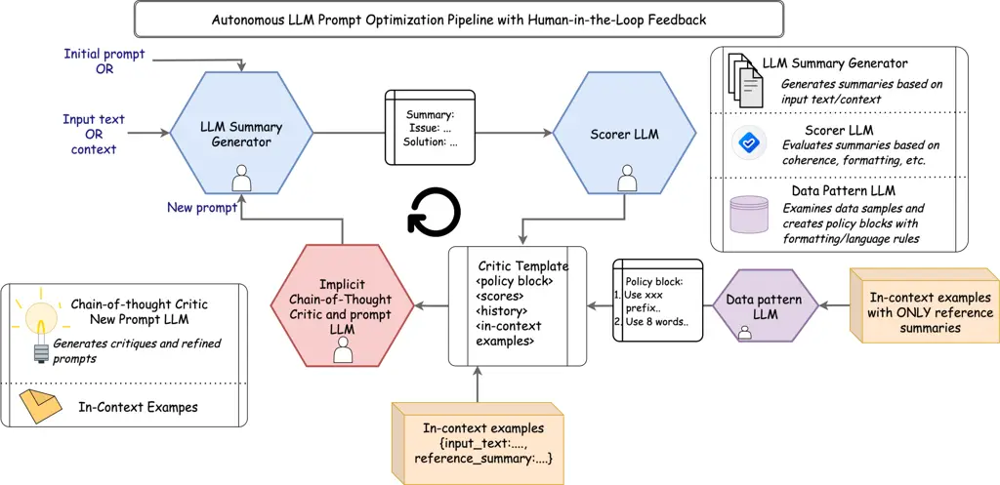
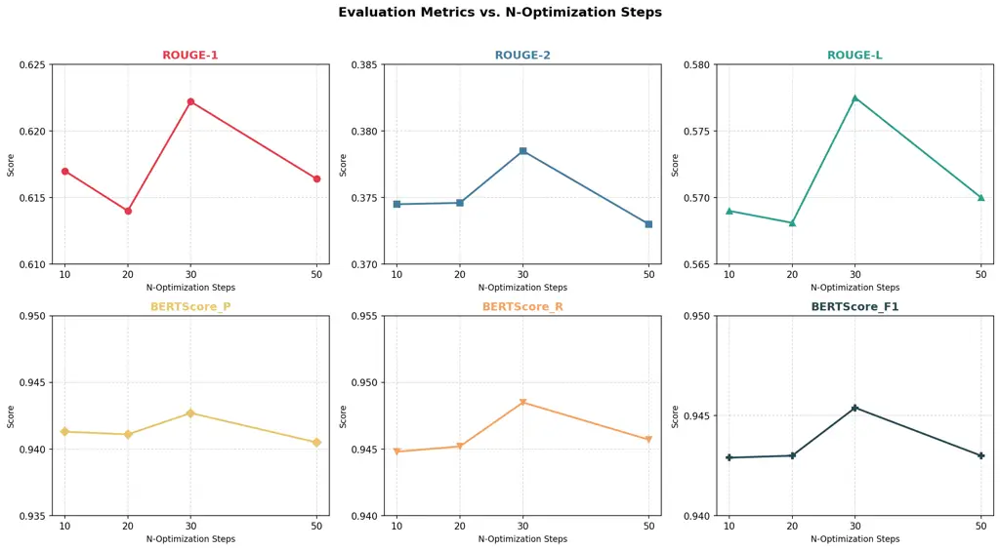

# MIDAS: Multi-LLM Iterative Data-Adaptive Summarization

Karen Lee    Dhanashree Balaram    Seojun Shon    Umair Rasheed
^(†)^(†)thanks: Project Manager Affiliation: Volkswagen Group
Innovation, California

###### Keywords: 

LLM-based Summarization Prompt Optimization Personalization Customer
Ticket Analysis Document Summarization

## 1 Abstract

Text summarization is deceptively difficult. While condensing
information seems straightforward, real-world enterprise summarization
of support tickets, legal documents, incident reports, and more, demands
strict adherence to domain-specific guidelines, output formats, and
organizational conventions. Crafting prompts that reliably satisfy these
constraints is labor-intensive, requiring significant human expertise
and continuous maintenance as requirements evolve. Existing automated
prompt optimization methods reduce this burden through LLM (LLM)
critique-driven refinement, yet remain limited by static prompts that
cannot adapt to the diversity of summary applications. We propose MIDAS
(MIDAS), a multi-LLM framework that extends this paradigm with
data-driven pattern learning and use-case-specific personalization,
enabling automatic adaptation to different summarization requirements
without manual prompt engineering. Applied to enterprise customer ticket
summarization across five output formats, MIDAS achieves the strongest
overall performance against state-of-the-art critique-driven
optimization frameworks such as CriSPO and ZERA, improving ROUGE-1 by up
to 11.0%, ROUGE-2 by up to 18.2%, and ROUGE-L by up to 8.0%, while
consistently improving BERTScore F₁ across all formats and output types.
We additionally demonstrate cross-model and cross-domain generalization
through multi-LLM configurations and finance-domain summarization
benchmarks.

## 2 Introduction

Automated text summarization has matured significantly with the advent
of LLM, yet deploying these systems in enterprise settings reveals a
fundamental tension: different organizations, teams, and use cases
demand fundamentally different summaries. A legal department summarizing
contract clauses, a financial analyst condensing earnings reports, and a
logistics coordinator reviewing shipment incidents each expect distinct
formats, vocabularies, and levels of detail. This diversity makes
one-size-fits-all prompt design impractical at enterprise scale.

A particularly relevant domain is customer support ticketing. Across
industries, from automotive OEM and dealerships to software vendors and
consumer electronics manufacturers, support tickets are the primary
record of customer issues and resolutions. At scale, manually processing
these tickets is estimated to absorb 20–40% of support agent
capacity \[3\]. Summarization requirements vary considerably across
roles: a field service engineer needs technical root cause and
diagnostics, while a warranty administrator prioritizes customer impact
and resolution status. These differences create strict, role-specific
expectations for format and content that generic prompting strategies
cannot reliably satisfy.

Existing prompt optimization frameworks such as
Critique-Suggestion-guided Automatic Prompt Optimization for Text
Generation(CriSPO) \[5\] partially address this through critique-driven
iterative refinement, but apply critique dimensions that are agnostic to
the target dataset and do not leverage structural patterns present in
reference summaries. As a result, prompts must still be manually tuned
per domain, limiting scalability.

To address these limitations, we propose MIDAS, a multi-LLM framework
that grounds prompt optimization in the properties of the target domain.
MIDAS analyzes reference summaries to extract domain-specific patterns
and conditions critique generation on a rich multi-source context,
enabling automatic adaptation to diverse summarization requirements
without manual prompt engineering. We evaluate MIDAS on a large-scale
enterprise IT help desk dataset \[1\] across five output format
configurations, demonstrating consistent improvements over zero-shot,
ICL (ICL), and CriSPO (CriSPO) baselines. Our main contributions are:

- •
  Data-Aware Policy Block Generation: A dedicated Data Pattern LLM
  extracts domain-specific formatting constraints from reference
  summaries and encodes them as policy blocks that ground iterative
  prompt refinement.
- •
  Unified CoT (CoT) Critic: A single CoT LLM jointly generates
  structured critique and a refined prompt in one pass, eliminating the
  separate suggestion step in CriSPO and reducing inference overhead.
- •
  Comprehensive Evaluation: Five output format configurations spanning
  structured metadata, subject lines, multilingual summaries, and
  keyword tags, with ROUGE (ROUGE)-1/2/L gains of up to 11.0%/18.2%/8.0%
  and consistent BERTScore F₁ improvements over CriSPO across all
  formats.
- •
  Cross-Model and Cross-Domain Generalization: MIDAS demonstrates
  consistent performance across heterogeneous LLM backbones and distinct
  enterprise domains, achieving the strongest overall performance
  against CriS-PO and ZERA across both IT help desk and finance
  summarization benchmarks.

The remainder of the paper is organized as follows. Section 3 reviews
related work. Section 4 describes the MIDAS framework. Section 5
presents the data and experimental setup, and Section 6 reports results
and discussion. Section 7 concludes.

## 3 Related Work

Automatic prompt engineering has emerged as a critical research
direction for improving large language model (LLM) \[19\] performance
without the computational overhead of fine-tuning. We review existing
approaches in two key dimensions: (1) automatic prompt optimization
methods and (2) LLM personalization techniques. Our analysis reveals a
systematic gap: while prompt optimization methods remain _static in
their adaptation criteria_, and personalization methods focus
exclusively on _individual user preferences_, neither addresses the
challenge of learning _organizational format requirements_ from
reference data.

### 3.1 Automatic Prompt Optimization

Early work on automatic prompt engineering established LLMs as effective
optimizers of their own prompts. APE(Automatic Prompt Engineer) \[20\],
OPRO (Optimization by PROmpting) \[15\], and EvoPrompt \[4\] demonstrate
that LLMs can iteratively optimize prompts through candidate generation,
trajectory-aware refinement, and evolutionary search strategies.
However, these methods primarily rely on scalar optimization feedback
rather than interpretable structural guidance. This becomes limiting in
enterprise summarization settings where "quality" is not only semantic
correctness but also adherence to organization-specific templates,
headings, and prefixes.

### 3.2 Critique and Feedback Guided Prompt Refinement

To make optimization more interpretable and actionable, recent work
incorporates natural language critique as an intermediate signal. CriSPO
\[5\] proposes Critique-Suggestion-guided Prompt Optimization, designed
specifically for text generation tasks where metrics like ROUGE \[7\]
provide limited guidance. CriSPO introduces a critique-guided prompt
refinement for text generation by producing actionable natural-language
feedback across multiple evaluation aspects. However, its critique
policy remains static and does not adapt to domain-specific structural
conventions from reference summaries.

ZERA \[16\] also follows the critique-driven lineage but grounds
refinement in eight predefined, task-agnostic evaluation
principles—completeness, conciseness, correctness, expression style,
faithfulness, meaning accuracy, reasoning quality, and structural
alignment—whose relative importance weights are inferred per task. It
separates evaluation (principle-based critique generation) from
refinement (meta-cognitive prompt refinement) and jointly optimizes the
system prompt, user prompt, and task description from an underspecified
("zero-init") initialization using few samples and short iteration
cycles. Although ZERA improves generality through principle-based
optimization, its evaluation rubric remains task-agnostic and does not
explicitly model dataset- specific formatting constraints such as
mandatory prefixes, delimiters, or language normalization rules. MIDAS
complements this approach through a dedicated Data Pattern LLM that
derives such constraints directly from reference data via policy block
induction.

Recent approaches such as ProRefine \[14\], PDO (Prompt-Dueling
Optimization) \[2\], and PMPO (Probabilistic Metric Prompt Optimization)
\[13\] explore alternative prompt refinement strategies including
inference-time feedback loops, pairwise prompt comparison, and
probabilistic metric-based optimization. While these methods improve
refinement efficiency and search stability, they do not directly address
the core requirement in enterprise summarization: discovering and
enforcing organization-specific output schemas induced from reference
data.

### 3.3 LLM Personalization

Personalization research aims to adapt LLM behavior to individuals by
modeling user preferences, writing style, or interests. A common
approach is retrieval-augmented personalization, where past user
interactions are retrieved and injected into prompts at runtime.
LaMP \[12\] formalizes this setting through a benchmark suite spanning
classification and generation tasks with user profiles and histories,
while summary-augmented retrieval approaches \[11\] combine offline user
summaries with selective retrieval to reduce retrieval overhead while
preserving personalization quality.

Beyond discrete prompting, soft prompt methods encode user history into
continuous embeddings that function as learned prompt vectors.
Representative approaches include PERSOMA \[6\], PeaPOD \[10\],
CoLLM \[18\], and PersonalLLM \[21\], which model personalization
through soft prompts, collaborative embeddings, or reward-model
ensembles.

Existing personalization approaches primarily target user-level
adaptation such as writing style, recommendation behavior, or preference
alignment, often relying on retrieval pipelines, embedding methods, or
parameter-efficient tuning. In contrast, enterprise summarization
requires organizational-level personalization: adherence to
organization-specific templates, terminology, and formatting
conventions. MIDAS addresses this setting through a purely prompt-based
framework that learns structural constraints directly from reference
data via data-driven pattern learning and policy block induction.

## 4 Methodology



Figure 1: Overview of MIDAS, an iterative multi-agent framework for
automated prompt refinement. An LLM Summary Generator produces summaries
that are evaluated by a Scorer LLM. A Data Pattern LLM extracts
dataset-specific structural rules from a stratified holdout subset.
These signals, together with optimization history, are provided to an
Implicit Chain-of-Thought Critic and Prompt LLM, which generates
critiques and refined prompts. The loop repeats for $`N`$ iterations,
and the best-performing prompt is selected for final inference.

### 4.1 Data Pattern Learning

MIDAS introduces a Data Pattern Learning component implemented via
in-context learning. A dedicated subset of the training data is reserved
exclusively for structural pattern extraction (ensuring no leakage into
train or test set for optimization). Rather than random sampling, we
adopt a distribution-aware sampling strategy to preserve key structural
proportions in the dataset. Reference summaries (ground-truth summaries
paired with each input ticket) are analyzed to identify formatting
regularities. For example, if 30% of reference summaries begin with a
specific prefix (e.g., “Severity:”), the holdout subset maintains this
proportion, ensuring the extracted patterns faithfully reflect the full
dataset distribution rather than a biased sample. The sampled reference
summaries are then provided to a dedicated Data Pattern LLM, which
identifies structural regularities such as formatting rules, section
ordering, and stylistic constraints, and encodes them as a set of
explicit natural-language rules as a policy block. The exact
rule-induction template used for policy block generation is provided in
Appendix 0.A.2. For example, a customer ticket dataset might create
rules such as: “Summaries must begin with a Severity field”, or
“Resolution steps should be listed as a numbered sequence”. These rules
collectively form a policy block that is injected into the critic
template, grounding downstream critique and prompt refinement in the
observed conventions of the target domain.


### 4.2 Multi-LLM Summary Generation and Implicit CoT Critic and Prompt Optimization

MIDAS implements an iterative prompt refinement loop using three
coordinated LLM agents: (1) an LLM Summary Generator, (2) a Scorer LLM,
and (3) an Implicit Chain-of-Thought Critic and Prompt LLM (Figure 1).
In our implementation, all three agents share the same underlying
foundation model, instantiated with different prompts tailored to their
respective roles. The framework is model-agnostic and can, in principle,
be instantiated with alternative backbone models. For stability, we use
deterministic decoding for scoring-time generation to reduce evaluation
variance.

##### Summary Generation.

Given an input ticket $`x`$ and a task prompt $`p`$ (initialized with an
initial prompt and updated across iterations; see Appendix 0.A.1), the
LLM Summary Generator produces a summary $`\hat{y}=\mathrm{Gen}(x,p)`$.
Concretely, we generate one summary per input in the selected evaluation
subset, where the input to the generator is the raw ticket text
formatted with the current prompt. Across iterations, $`p`$ is updated
by the prompt refinement module (described below).

##### LLM-Based Evaluation (Scorer LLM).

To score generated summaries, MIDAS uses an LLM-based evaluator rather
than relying solely on automatic metrics such as ROUGE \[7\] or
BERTScore \[17\]. Prior work \[9\] suggests that LLM-based evaluators
better align with human judgment on summarization tasks. Our Scorer LLM
evaluates a generated summary $`\hat{y}`$ against a reference summary
$`y`$ given the original ticket $`x`$, using a structured rubric that
returns multiple dimension scores (e.g., _Core Meaning_, _Unsupported
Additions_, _Format & Style Fidelity_) and an explanation. The full
evaluation prompt and scoring rubric used by the Scorer LLM are
reproduced verbatim in Appendix 0.A.4. We then compute a scalar
optimization score as a weighted combination of these dimensions, with
weights configurable by the user:

```math
s(\hat{y},y,x)=\sum_{d\in\mathcal{D}}w_{d}\,s_{d}(\hat{y},y,x),\quad\text{where }\sum_{d}w_{d}=1.
```

In our experiments, we set
$`(w_{\text{core}},w_{\text{unsupported}},w_{\text{format}})=(0.4,0.3,0.3)`$,
based on our task-specific prioritization of semantic fidelity and
formatting consistency; however, these guidelines are user-configurable
and can be adjusted to reflect different application requirements. For
stability, scoring uses deterministic generation where applicable.

##### Multi-suggestion Prompt Proposal and Fast Selection.

At each iteration, users may request $`M`$ candidate prompt suggestions.
For each candidate prompt, MIDAS performs a fast evaluation on a
_representative subset_ of the training set (default: 25 examples out of 40) to estimate the candidate’s average LLM-based score. The subset is
selected using the same distribution-aware sampling strategy described
in Section 4.1.

##### Implicit Chain-of-Thought Critic and Prompt LLM.

The prompt refinement stage jointly produces (i) a structured critique
of the current prompt behavior and (ii) a revised prompt for the next
iteration. We implement this using a single LLM call with two tagged
outputs: \<Critique\> and \<Suggestion\>, where the suggestion contains
the full revised task prompt. The critic template incorporates the
current prompt and score, generated examples (raw text, generated
summary, reference summary), optimization history consisting of the
top-$`K`$ prior prompts with associated scores and critiques, and a
policy block containing dataset-specific formatting constraints induced
by the Data Pattern LLM (Section 4.1). This policy block grounds
critique and refinement in observed domain conventions. The complete
critic template is provided in Appendix 0.A.3, and representative prompt
templates are included in Appendix 0.A.

##### Efficiency Relative to CriSPO.

A key architectural difference from CriSPO \[5\] is that MIDAS
consolidates critique generation and prompt optimization into a single
module (Implicit Chain-of-Thought Critic and Prompt LLM). CriSPO
separates these into two LLM stages: one LLM produces critiques and
suggestions, while another consumes those suggestions to generate the
next prompt. In MIDAS, critique signals are directly incorporated into
prompt refinement within a single generation step, eliminating an
intermediate LLM call and streamlining the iterative optimization
process.

## 5 Experiments

### 5.1 Dataset

We evaluate MIDAS on a publicly available multilingual enterprise IT
help desk ticket dataset \[1\], containing approximately 50,000 support
tickets spanning multiple organizational workflows, languages, and
service queues. Each record contains customer ticket content (Subject
and Body), the corresponding help desk response (Answer), and associated
structured metadata such as ticket type, routing queue, priority,
language, business category, and categorical tags.

After filtering for entries with all required fields present across all
five output configurations, we obtain a working corpus of 24,635
tickets. All experiments use GPT-5.2 as the backbone model for summary
generation, critique, scoring, and data pattern learning.

##### Data Representation.

Each ticket is converted into a structured input concatenating the body
and agent answer and paired with five parallel reference summaries.
Table 1 shows a representative example.

| Field        | Content                                                                |
| ------------ | ---------------------------------------------------------------------- |
| Raw Text     | Body: Dear Customer Support Team, I am writing to report a             |
|              | significant problem with our account…Answer: …                         |
| Format Type1 | Type: Incident, Queue: Technical Support, Priority: high, Language: en |
| Format Type2 | Subject: Account Disruption                                            |
| Format Type3 | There is an account outage causing a disruption.                       |
| Format Type4 | There is an account outage causing a disruption.                       |
| Format Type5 | Tag_1: Account, Tag_2: Disruption, Tag_3: Outage                       |

Table 1: Example of a single ticket converted into all five output
format configurations. Format Type3 and Format Type4 reference summaries
are generated by GPT-5.2 conditioned on the ticket’s tag fields
(grounded generation), and subsequently verified by human annotators to
ensure factual consistency with the source ticket.

Note that Format Type3 and Format Type4 are identical for
English-language tickets; the distinction becomes apparent for
non-English inputs, where Format Type3 mirrors the ticket’s original
language while Format Type4 normalizes to English.

##### Output Format Configurations.

Different enterprise roles require different summary structures from the
same underlying ticket. To reflect this, we construct five output format
configurations (Format Type1–Format Type5), where each ticket is paired
with one of five reference summary formats:

- •
  Format Type1 — Structured Metadata. Type:{type}, Queue:{queue},
  Priority:{priority}, Language:{language}.
- •
  Format Type2 — Subject Line. Subject:{subject}. A concise one-line
  summary. Entries with missing subject fields (3,838) are excluded from
  this configuration.
- •
  Format Type3 — Natural Language Summary (Original Language). A
  free-text summary generated by GPT-5.2 from ticket tag metadata, then
  verified and corrected by human annotators. Summaries are written in
  the original language of the ticket to evaluate multilingual
  generation behavior.
- •
  Format Type4 — Natural Language Summary (English Only). The same
  summary format as Format Type3, but normalized to English, testing
  whether MIDAS can learn and enforce language normalization constraints
  from reference summaries.
- •
  Format Type5 — Structured Tag Output. tag_1: {tag_1}, tag_2: {tag_2},
  tag_3: {tag_3}. Only the first three tag fields are used, as later tag
  columns are sparsely populated in the filtered corpus.

### 5.2 Experimental Setup

##### Data Splits.

For each output configuration, prompt optimization is performed using a
fixed pool of 40 training examples and 10 development examples. We
analyze performance on 30 test samples drawn randomly from the remaining
corpus, with the same random seed applied across all configurations to
ensure comparability. A separate stratified holdout subset of 200
samples is reserved exclusively for data pattern learning and is
excluded from both optimization and evaluation to prevent data leakage.
Beyond these splits, the remaining 24,355 tickets serve as a large-scale
unseen holdout set, used to validate the best-performing prompts from
each experimental condition and confirm that gains generalize beyond the
small optimization pool.

We compare MIDAS against Zero-Shot, ICL ($`k{=}3`$), CriSPO, CriSPO (100
iter), and ZERA, a state-of-the-art framework for critique-driven prompt
optimization. We report ROUGE-1/2/L F₁ \[8\] and BERTScore F₁ \[17\]
independently for each output type. ROUGE is particularly informative
for structured outputs (Format 1, Format 5) where exact field matching
is expected, while BERTScore better captures semantic similarity for
free-text configurations (Format 3, Format 4). All runs use $`N{=}30`$
optimization iterations (selected via ablation over
$`N\in\{10,20,30,50\}`$; Figure 2) with identical generation parameters
and 2 random seeds.

Our experiments address six questions: whether MIDAS achieves the
strongest overall performance across output formats (Table 2); whether
its gains are architectural rather than a product of more iterations
(CriSPO 100 iter controls for compute budget); what the optimal
iteration count is (Figure 2); whether MIDAS generalizes across
structurally diverse output types spanning metadata, subject lines,
multilingual summaries, and keyword tags; whether the framework remains
effective under heterogeneous multi-LLM configurations (Table 2); and
whether the proposed policy-learning mechanism generalizes across
distinct enterprise domains (Table 3).

### 5.3 Cross-Domain Evaluation

To evaluate whether MIDAS generalizes beyond enterprise IT help desk
summarization, we additionally evaluate on the ECTSum finance-domain
benchmark, which consists of financial earnings call transcripts paired
with concise analyst-style summary annotations. Compared to the IT help
desk dataset, ECTSum contains substantially different terminology,
discourse structure, and summarization objectives, focusing on financial
performance indicators, operational reporting, and market-related events
rather than incident resolution workflows. For cross-domain evaluation,
we compare MIDAS against CriSPO and ZERA under the same GPT-5.2 backbone
and identical 30-iteration optimization setting used in the primary
experiments. This experiment evaluates whether data-driven policy
learning generalizes under domain shift without requiring manually
engineered formatting rules.

## 6 Results and Discussion

| Summary  | Method            | R-1    | R-2    | R-L    | BS-F1  |
| -------- | ----------------- | ------ | ------ | ------ | ------ |
| Format 1 | ZS                | 0.6655 | 0.3928 | 0.6654 | 0.9530 |
|          | ICL               | 0.7330 | 0.4876 | 0.7330 | 0.9583 |
|          | CRISPO            | 0.7352 | 0.4768 | 0.7352 | 0.9673 |
|          | CRISPO (100 iter) | 0.7154 | 0.4514 | 0.7154 | 0.9168 |
|          | ZERA              | 0.7549 | 0.5353 | 0.7549 | 0.9676 |
|          | MIDAS             | 0.7521 | 0.5303 | 0.7521 | 0.9688 |
|          | MIDAS (Multi-LLM) | 0.7312 | 0.5035 | 0.7312 | 0.9653 |
| Format 2 | ZS                | 0.2789 | 0.1240 | 0.2499 | 0.8101 |
|          | ICL               | 0.4364 | 0.1670 | 0.4088 | 0.8632 |
|          | CRISPO            | 0.4565 | 0.1431 | 0.4146 | 0.8715 |
|          | CRISPO (100 iter) | 0.4552 | 0.1640 | 0.4206 | 0.8743 |
|          | ZERA              | 0.4350 | 0.1458 | 0.4099 | 0.8646 |
|          | MIDAS             | 0.4744 | 0.1699 | 0.4431 | 0.8800 |
|          | MIDAS (Multi-LLM) | 0.4669 | 0.1833 | 0.4408 | 0.8801 |
| Format 3 | ZS                | 0.3654 | 0.1776 | 0.2932 | 0.8351 |
|          | ICL               | 0.4418 | 0.2268 | 0.3665 | 0.8554 |
|          | CRISPO            | 0.3749 | 0.1862 | 0.3080 | 0.8361 |
|          | CRISPO (100 iter) | 0.4211 | 0.2065 | 0.3410 | 0.8528 |
|          | ZERA              | 0.4523 | 0.2451 | 0.3807 | 0.8574 |
|          | MIDAS             | 0.4862 | 0.2795 | 0.4253 | 0.8693 |
|          | MIDAS (Multi-LLM) | 0.4822 | 0.2668 | 0.4126 | 0.8707 |
| Format 4 | ZS                | 0.4364 | 0.2094 | 0.3425 | 0.8606 |
|          | ICL               | 0.5111 | 0.2509 | 0.4131 | 0.8719 |
|          | CRISPO            | 0.5575 | 0.2941 | 0.4614 | 0.8875 |
|          | CRISPO (100 iter) | 0.5513 | 0.2937 | 0.4650 | 0.8888 |
|          | ZERA              | 0.5493 | 0.2912 | 0.4481 | 0.8862 |
|          | MIDAS             | 0.5684 | 0.3079 | 0.4749 | 0.8896 |
|          | MIDAS (Multi-LLM) | 0.5574 | 0.2974 | 0.4633 | 0.8857 |
| Format 5 | ZS                | 0.6471 | 0.3671 | 0.6055 | 0.9220 |
|          | ICL               | 0.7055 | 0.4554 | 0.6721 | 0.9396 |
|          | CRISPO            | 0.7455 | 0.5409 | 0.7142 | 0.9626 |
|          | CRISPO (100 iter) | 0.6717 | 0.4350 | 0.6440 | 0.9272 |
|          | ZERA              | 0.8009 | 0.5940 | 0.7387 | 0.9363 |
|          | MIDAS             | 0.8277 | 0.6393 | 0.7716 | 0.9745 |
|          | MIDAS (Multi-LLM) | 0.8253 | 0.6276 | 0.7655 | 0.9746 |

Table 2: Evaluation results on the enterprise IT help desk dataset for
Zero-Shot (ZS), In-Context Learning (ICL, $`k{=}3`$), CRISPO, CRISPO
(100 iter), ZERA, and two MIDAS instantiations across all five summary
output types. MIDAS uses GPT-5.2 for all agents, while MIDAS (Multi-LLM)
uses heterogeneous backbone assignments. R-1/2/L denote ROUGE-1/2/L F₁;
BS-F1 denotes BERTScore F₁. Best result per metric per type is in bold.

Table 2 reports evaluation results on the enterprise IT help desk
benchmark across all five output configurations. MIDAS achieves the
strongest overall performance, consistently outperforming all baselines
across Format 2–Format 5 while remaining competitive with ZERA on
Format 1, where it achieves the highest BERTScore F₁. These results
demonstrate that data-driven policy learning yields consistent gains
over both non-optimized baselines and critique-driven optimization
frameworks.

##### Gains over non-optimized baselines.

Compared to Zero-Shot, MIDAS improves ROUGE-1 by up to 18.1 points
(Format 5: 0.8277 vs. 0.6471) and BERTScore F₁ by up to 5.3 points
(Format 5: 0.9745 vs. 0.9220). ICL narrows this gap but remains
consistently below MIDAS, confirming that fixed demonstration examples
alone are insufficient to capture domain-specific formatting
constraints.

##### Gains over critique-driven baselines.

MIDAS consistently outperforms both Cri-SPO and ZERA across
Format 2–Format 5, with the largest gains observed on Format 5. Compared
to CriSPO, MIDAS improves ROUGE-1 from 74.6 to 82.8, ROUGE-2 from 54.1
to 63.9, and ROUGE-L from 71.4 to 77.2 on this format. Notably, on
Format 3 — the multilingual free-text configuration — CriSPO
underperforms ICL (ROUGE-1: 0.3749 vs. 0.4418), suggesting that generic
critique-driven optimization can regress without data-grounded
constraints. In contrast, MIDAS achieves a ROUGE-1 score of 0.4862 on
the same format, which we attribute to the policy block explicitly
encoding language and structural conventions extracted from reference
summaries.

##### Format 2 is the hardest task.

Subject line generation yields the lowest absolute scores across all
methods, reflecting the difficulty of compressing a full ticket into a
single concise line with high lexical fidelity. Despite this, MIDAS
still outperforms all baselines, including critique-driven optimization
frameworks such as CriSPO and ZERA, suggesting that iterative prompt
refinement grounded in reference patterns is particularly beneficial for
constrained, short-form generation.

##### Architectural Advantage.

Extending CriSPO to 100 iterations (based on best results from \[5\])
yields diminishing returns and in some configurations produces lower
scores than its 30-iteration counterpart (e.g., Format 5: ROUGE-1 0.6717
vs. 0.7455), suggesting that additional optimization steps alone are
insufficient without data-grounded constraints to guide refinement.
Similarly, although ZERA introduces more sophisticated critique
dimensions, its task-agnostic refinement strategy still underperforms
MIDAS across most formats. These findings highlight the importance of
MIDAS’s policy block and unified CoT critic, which provide
reference-informed structural grounding rather than relying solely on
longer optimization or generic critique refinement.

##### Effect of Optimization Iterations.



Figure 2: Effect of optimization iterations on summarization quality.
ROUGE-1/2/L and BERTScore P/R/F₁ across $`N\in\{10,20,30,50\}`$
iterations on a 30-sample test set. $`N{=}30`$ achieves the best
performance across all metrics.

Figure 2 shows evaluation metrics across $`N\in\{10,20,30,50\}`$
optimization steps. Performance improves from $`N{=}10`$ to $`N{=}30`$
across all six metrics (ROUGE-1/2/L and BERTScore P/R/F₁), then declines
slightly at $`N{=}50`$. This pattern is consistent across metrics,
indicating that $`N{=}30`$ represents the optimal performance-efficiency
trade-off. All reported results use $`N{=}30`$.

##### Generalization Across Output Types.

MIDAS achieves top overall performance across all five structurally
distinct output configurations, ranging from categorical metadata
(Format 1) to free-text multilingual summaries (Format 3) and structured
tag outputs (Format 5). The consistent advantage across formats of
varying complexity and output structure demonstrates that MIDAS’s
data-driven pattern learning generalizes beyond any single output type,
adapting its optimization trajectory to the conventions of each target
format without manual reconfiguration.

##### Large-Scale Validation.

Beyond the 30-sample test sets used during optimization, we validate the
best-performing prompts from each configuration on the full
24,355-ticket holdout corpus from the enterprise IT help desk dataset.
Results on this large-scale set are consistent with optimization-time
findings, confirming that MIDAS generalizes beyond the small
optimization pool to large-scale unseen data.

##### Multi-LLM Generalization.

To evaluate whether MIDAS depends on a single backbone model, we
construct a heterogeneous multi-LLM configuration in which different
agents are instantiated using different foundation models. Specifically,
Claude Sonnet 4.6 is used as the Scorer LLM, Claude Opus 4.6 is used for
critique generation and data pattern learning, and GPT-5.2 is used for
summary generation and prompt optimization. All runs use the same
30-iteration setting identified in Figure 2. Table 2 compares the
standard single-backbone GPT-5.2 configuration against a heterogeneous
multi-LLM variant of MIDAS. Results show that MIDAS maintains strong
performance under heterogeneous model assignments across all output
configurations, confirming that the framework is model-agnostic rather
than tied to a specific LLM family. Although the single-backbone GPT-5.2
configuration achieves the strongest overall performance, the multi-LLM
configuration remains highly competitive and achieves slightly higher
scores on several metrics, suggesting that specialization across
different LLM agents can benefit iterative prompt optimization.

##### Cross-Domain Generalization.

| Method | R-1    | R-2    | R-L    | BS-F1  |
| ------ | ------ | ------ | ------ | ------ |
| CRISPO | 0.3521 | 0.1859 | 0.3078 | 0.8278 |
| ZERA   | 0.3630 | 0.1816 | 0.2716 | 0.8217 |
| MIDAS  | 0.3953 | 0.2414 | 0.3454 | 0.8508 |

Table 3: Evaluation results on the ECTSum finance-domain benchmark using
GPT-5.2 and 30 optimization iterations. Best result per metric is shown
in bold.

Table 3 reports results on the ECTSum finance-domain benchmark. MIDAS
achieves the best performance across all evaluation metrics,
outperforming both CriSPO and ZERA despite the substantial domain shift
from enterprise IT help desk summarization to finance-oriented
summarization. These results suggest that MIDAS learns transferable
structural constraints rather than overfitting to a single domain.

## 7 Conclusion

We presented MIDAS, a multi-LLM framework for enterprise summarization
that extends CriSPO with data-driven policy learning and a unified CoT
critic. By extracting domain-specific formatting constraints from
reference summaries and grounding iterative prompt refinement in these
patterns, MIDAS adapts to diverse summarization requirements without
manual prompt engineering. Across five output configurations on a
24,635-ticket enterprise IT help desk corpus, MIDAS achieves the
strongest overall performance, consistently outperforming zero-shot,
ICL, CriSPO, and ZERA across Format 2–Format 5 while remaining
competitive with ZERA on Format 1. Compared to CriSPO, MIDAS improves
ROUGE-1 by up to 11.0%, ROUGE-2 by up to 18.2%, and ROUGE-L by up to
8.0%, with gains that generalize across large-scale validation,
heterogeneous multi-LLM configurations, and finance-domain benchmarks.

##### Limitations and Future Work:

Further evaluation on smaller open-weight models and broader enterprise
domains would strengthen deployment robustness claims. Future work may
also explore dynamic policy adaptation under evolving organizational
conventions.

#### Disclosure of Interests.

The authors declare no competing interests relevant to this work.

## References

- \[1\] T. Bück (2026) Multilingual customer support tickets. Note:
  Dataset, Kaggle External Links:
  [Link](https://www.kaggle.com/datasets/tobiasbueck/multilingual-customer-support-tickets)
  Cited by: §2, §5.1.
- \[2\] Y. Chen et al. (2025) PDO: prompt-dueling optimization for
  label-free LLM evaluation. arXiv preprint arXiv:2510.13907. Cited by:
  §3.2.
- \[3\] Forrester Consulting and Zendesk (2023) The total economic
  impact™ of zendesk. Technical Report Forrester Consulting. Cited by:
  §2.
- \[4\] Q. Guo, R. Wang, J. Guo, B. Li, K. Song, X. Tan, G. Liu, J.
  Bian, and Y. Yang (2024) Connecting large language models with
  evolutionary algorithms yields powerful prompt optimizers. In
  Proceedings of the International Conference on Learning
  Representations (ICLR), Cited by: §3.1.
- \[5\] H. He, Q. Liu, L. Xu, C. P. Shivade, Y. Zhang, S. Srinivasan,
  and K. Kirchhoff (2024) CriSPO: multi-aspect
  critique-suggestion-guided automatic prompt optimization for text
  generation. In AAAI Conference on Artificial Intelligence, External
  Links: [Link](https://api.semanticscholar.org/CorpusID:273098751)
  Cited by: §2, §3.2, §4.2, §6.
- \[6\] L. Hebert, K. Sayana, A. Jash, A. Karatzoglou, S. Sodhi, S.
  Doddapaneni, Y. Cai, and D. Kuzmin (2024) PERSOMA: personalized soft
  prompt adapter architecture for personalized language prompting. In
  Proceedings of the KDD Workshop on Generative AI for Recommendation
  and Personalization (GenAIRecP), Cited by: §3.3.
- \[7\] C. Lin (2004) ROUGE: a package for automatic evaluation of
  summaries. In Text Summarization Branches Out, Barcelona, Spain,
  pp. 74–81. External Links: [Link](https://aclanthology.org/W04-1013/)
  Cited by: §3.2, §4.2.
- \[8\] C. Lin (2004) ROUGE: a package for automatic evaluation of
  summaries. In Annual Meeting of the Association for Computational
  Linguistics, External Links:
  [Link](https://api.semanticscholar.org/CorpusID:964287) Cited by:
  §5.2.
- \[9\] H. Nguyen, H. Chen, L. Pobbathi, and J. Ding (2024) A
  comparative study of quality evaluation methods for text
  summarization. CoRR abs/2407.00747. External Links: 2407.00747,
  [Link](https://arxiv.org/abs/2407.00747) Cited by: §4.2.
- \[10\] J. Ramos, B. Wu, and A. Lipani (2024) PeaPOD: personalized
  prompt distillation for generative recommendation. arXiv preprint
  arXiv:2407.05033. Cited by: §3.3.
- \[11\] C. Richardson, Y. Zhang, K. Gillespie, S. Kar, A. Singh, Z.
  Raeesy, O. Z. Khan, and A. Sethy (2023) Integrating summarization and
  retrieval for enhanced personalization via large language models.
  External Links: 2310.20081, [Link](https://arxiv.org/abs/2310.20081)
  Cited by: §3.3.
- \[12\] A. Salemi, S. Mysore, M. Bendersky, and H. Zamani (2024) LaMP:
  when large language models meet personalization. In Proceedings of the
  62nd Annual Meeting of the Association for Computational Linguistics
  (ACL), pp. 7370–7392. Cited by: §3.3.
- \[13\] Z. Wang et al. (2025) PMPO: probabilistic metric prompt
  optimization for small and large language models. arXiv preprint
  arXiv:2505.16307. Cited by: §3.2.
- \[14\] T. Weerasooriya M. Liakata et al. (2025) ProRefine:
  inference-time prompt refinement with textual feedback. arXiv preprint
  arXiv:2506.05305. Cited by: §3.2.
- \[15\] C. Yang, X. Wang, Y. Lu, H. Liu, Q. V. Le, D. Zhou, and X.
  Chen (2024) Large language models as optimizers. In Proceedings of the
  Advances in Neural Information Processing Systems (NeurIPS), Vol. 36.
  Cited by: §3.1.
- \[16\] S. Yi, M. Khang, and S. Park (2025) ZERA: zero-init instruction
  evolving refinement agent: from zero instructions to structured
  prompts via principle-based optimization. arXiv preprint
  arXiv:2509.18158. Cited by: §3.2.
- \[17\] T. Zhang, V. Kishore, F. Wu, K. Q. Weinberger, and Y.
  Artzi (2019) BERTScore: evaluating text generation with bert. ArXiv
  abs/1904.09675. External Links:
  [Link](https://api.semanticscholar.org/CorpusID:127986044) Cited by:
  §4.2, §5.2.
- \[18\] Y. Zhang, F. Feng, J. Zhang, K. Bao, Q. Wang, and X. He (2025)
  CoLLM: integrating collaborative embeddings into large language models
  for recommendation. IEEE Transactions on Knowledge and Data
  Engineering. Cited by: §3.3.
- \[19\] W. X. Zhao, K. Zhou, J. Li, T. Tang, X. Wang, Y. Hou, Y.
  Min, B. Zhang, J. Zhang, Z. Dong, et al. (2023) A survey of large
  language models. arXiv preprint arXiv:2303.18223. Cited by: §3.
- \[20\] Y. Zhou, A. I. Muresanu, Z. Han, K. Paster, S. Pitis, H. Chan,
  and J. Ba (2023) Large language models are human-level prompt
  engineers. In Proceedings of the International Conference on Learning
  Representations (ICLR), Cited by: §3.1.
- \[21\] T. P. Zollo, A. W. T. Siah, N. Ye, A. Li, and H.
  Namkoong (2025) PersonalLLM: tailoring LLMs to individual preferences.
  In Proceedings of the International Conference on Learning
  Representations (ICLR), Cited by: §3.3.

## Appendix 0.A Prompt Templates

Appendix A presents representative prompt templates that preserve the
core structure and optimization behavior used in MIDAS while omitting
implementation-specific verbosity for readability.

### 0.A.1 Initial Prompt

INITIAL_PROMPT = "Provide summary following the format of reference
summary."

### 0.A.2 Data Pattern LLM Template (Policy Block Induction)


### 0.A.3 Implicit Chain-of-Thought Critic and Prompt LLM Template


### 0.A.4 Scorer LLM Template


