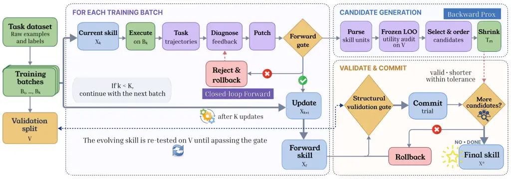
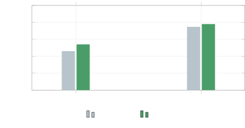

# SkillProx: Self-Evolving Agent Skills via Proximal Textual Gradient Descent

Mingxuan Zheng    Yujin Zhou    Chuxue Cao    Boqin Yin    Yuyao Zhang
   Jiapeng Sun    Shuaishuai Gong    Sirui Han\correspondingYike
Guo\corresponding

###### Abstract

LLM agents increasingly adapt to recurring tasks by accumulating
procedural knowledge in skills. These skills are lightweight, reusable
textual artifacts that are loaded into the agent’s context without
weight updates. Recent methods refine skills through iterative task
execution, failure diagnosis, and trajectory-guided text-space updates.
However, existing frameworks lack explicit diagnosis–outcome feedback
and treat deletion as a generic edit operation rather than a dedicated
mechanism for consolidating accumulated knowledge. We introduce
SkillProx, a proximal-gradient-inspired forward–backward framework that
couples closed-loop diagnostic evolution with utility-aware proximal
refinement. Motivated by a composite objective balancing task loss and
skill complexity, the forward stage re-executes diagnosis-driven edits
on the same task batch, rolls back regressions, and feeds measured
outcomes into subsequent diagnoses. The backward stage decomposes the
resulting skill into auditable knowledge units, estimates their
contributions using a frozen leave-one-out utility audit, and applies
validation-gated consolidation, demotion, or removal. Experiments on
in-distribution and out-of-distribution benchmarks across multiple
backbone LLMs show that SkillProx improves average accuracy by 3.0
percentage points over the strongest gradient-based baseline. Component
ablations demonstrate the complementary effects of closed-loop diagnosis
and proximal refinement. ¹¹ 1 Code will be available at
https://github.com/Steven011018/SkillProx.

¹Hong Kong University of Science and Technology

²Macau University

mzhengan@connect.ust.hk

## 1 Introduction



Figure 1: Pipeline of SkillProx. The forward stage iteratively executes,
diagnoses, and patches the current skill, using same-batch re-execution
to accept beneficial updates or roll back rejected ones with outcome
feedback. After $`K`$ updates, the backward stage audits the utility of
knowledge units on a fixed validation split and applies validation-gated
consolidation, demotion, or removal. Accepted edits produce the final
skill $`X^{\star}`$.

Large language model (LLM) agents have demonstrated strong capabilities
in solving complex tasks through reasoning, tool use, and interaction
with external environments (Yao et al. 2023; Feng et al. 2025; Luo et
al. 2025; Team et al. 2026b; Team et al. 2026a). To reuse procedural
knowledge acquired from previous experience, recent agents increasingly
externalize task-solving procedures, tool-use strategies (Yuan et al.
2024; Lu et al. 2025; Zhou et al. 2026b; Bai et al. 2026), and
domain-specific heuristics as persistent and editable *skills* (Xu and
Yan 2026a; Jiang et al. 2026). Previous studies primarily focus on skill
synthesis, constructing reusable skills from demonstrations, successful
trajectories, or external documents (Chen et al. 2023). However,
benchmarks such as SkillsBench (Li et al. 2026) show that one-shot
synthesis can provide uneven or even negative gains across heterogeneous
tasks, since a skill constructed once cannot anticipate the diverse
situation it will later encounter. This limitation motivates a shift
from static skill construction to skill evolution. Representative
methods such as SkillGrad (Wang et al. 2026a) treat task failures as
textual gradients, diagnosing failures as new tasks arrive and directly
commiting the inference experience as a patch, thereby tuning a static
skill artifact into an evolving form of procedural memory.

Despite this progress, existing skill evolution methodologies face two
critical limitations. (i) Unverified forward updates. An LLM-generated
diagnosis is commonly treated as a valid update direction without
verifying the realized effect of the resulting skill edit. Once a patch
is generated, it is typically committed directly, and its effectiveness
is neither measured through re-execution nor provided as feedback to
subsequent diagnoses. (ii) Unregulated skill growth. Iterative patching
continuously expands the skill without an explicit mechanism for
reassessing accumulated knowledge. The resulting artifact may contain
repetitive instructions, conflicting heuristics, or task-specific
solutions incorrectly generalized as reusable rules, some of which can
interfere with useful knowledge rather than merely increase textual
complexity. This raises a central question: _how can outcome-verified
forward diagnosis be coupled with structure-aware backward refinement,
so that a skill’s task capability and its accumulated structure
co-evolve?_

To explore this question, we conduct an analysis of open-loop,
growth-oriented skill evolution, which points to two actionable design
principles. On the forward side, we find that updates cannot be judged
from their diagnostic text alone, but re-executing the updated skill on
the same task batch directly reveals whether an update helps or hurts,
suggesting that realized outcomes should gate whether an update is
retained. On the backward side, we find that accumulated knowledge can
be audited at the unit level, where removing negative-utility content
improves accuracy from 46% to 54%, suggesting that skill health should
be maintained through selective consolidation rather than continual
growth.

Guided by these principles, we propose SkillProx, a coupled
forward–backward framework that realizes _diagnostic–proximal
co-evolution_. To resolve unverified forward updates, its forward
component re-executes each candidate skill on the same task batch and
commits the update only when it satisfies an outcome-grounded
performance gate. Otherwise, the update is rolled back and retried,
while its measured effect and rejected edit direction are retained as
feedback for subsequent diagnoses. The diagnostic process therefore
evolves according to the realized consequences of previous updates
rather than their semantic plausibility alone. To counter unregulated
skill growth, the backward component decomposes the accumulated skill
into auditable knowledge units and estimates their contributions through
a frozen leave-one-out utility audit. It then performs validation-gated
proximal refinement, proposing consolidation, demotion, or removal edits
and retaining only those that preserve structural validity and task
performance. Together, the forward process determines which newly
proposed knowledge should enter the skill, while the backward process
determines which accumulated knowledge should persist, allowing
diagnostic evolution and proximal consolidation to jointly shape the
skill. Our main contributions are summarized as follows:

- •
  A forward–backward formulation of skill evolution. We formulate skill
  evolution as composite optimization over task performance and skill
  complexity, revealing two missing components in existing methods:
  outcome-grounded verification of forward updates and utility-guided
  regularization of accumulated knowledge.
- •
  The SkillProx framework. We introduce SkillProx, which combines
  closed-loop diagnostic co-evolution including same-batch re-execution,
  rollback, retry, and accept/reject memory with validation-gated
  proximal shrinkage. This design enables online prevention of harmful
  edits and retrospective removal of negative-utility knowledge.
- •
  Empirical validation of diagnostic–proximal co-evolution. Across three
  backbone LLMs, we compare SkillProx against six baselines on one
  in-distribution and two out-of-distribution benchmarks, observing
  performance gains in most evaluated settings. Component ablations
  further show that closed-loop diagnosis improves task accuracy, while
  proximal refinement provides additional gains through utility-aware
  knowledge consolidation.

## 2 Related Works

Recent LLM agents increasingly externalize procedural knowledge into
_skills_—structured bundles of instructions, scripts, and resources that
are loaded into the agent’s context at inference time and improve task
execution without any weight update (Xia et al. 2026; Xu and Yan 2026b;
Xu and Yan 2026b; Zhou et al. 2026a). Because authoring such skills by
hand is label-intensive, hard to scale, and prone to human–machine
cognitive misalignment (Alzubi et al. 2026; Li et al. 2026; Yu et al.
2026; Yang et al. 2026a), a first line of work studies _skill
synthesis_, which distills reusable skills from agent experience:
Trace2Skill (Ni et al. 2026) distills trajectories into skill artifacts,
EvoSkill (Alzubi et al. 2026) discovers and edits skills through
iterative failure analysis with validation-based selection,
CoEvoSkills (Zhang et al. 2026a) couples a skill generator with a
co-evolving surrogate verifier to build multi-file packages without
ground-truth tests, and SkillComposer (Zhang et al. 2026b) build skills
via decomposing skill construction into three learnable operations.

However, SkillsBench (Li et al. 2026) shows that one-shot synthesis is
far from sufficient: curated skills help unevenly across domains, and
self-generated skills yield negligible or even negative gains. Motivated
by this observation, a second line of work builds on prior advances in
text-space optimization, notably TextGrad’s backpropagation of
natural-language feedback (Yuksekgonul et al. 2024) and GEPA’s
reflective, Pareto-guided prompt evolution (Agrawal et al. 2026), and
transplants these ideas to the skill artifact itself. SkillOpt (Yang et
al. 2026b) bounds each edit with a textual learning rate and a held-out
gate, while SkillGrad (Wang et al. 2026b) treats the skill package as a
structured parameter updated by trajectory-level loss evidence, textual
gradients, and momentum. These methods, however, remain _open-loop and
growth-oriented_: a diagnosis is accepted as a valid update direction
without verifying its realized effect, so its outcome is never fed back
to subsequent diagnoses, and deletion is treated as one generic edit
among many rather than a dedicated shrinkage mechanism, letting
redundant, conflicting, or instance-specific content accumulate and
interfere with useful knowledge. SkillProx addresses both gaps by
closing the diagnosis–validation loop in the forward step and
introducing a utility-aware proximal step that explicitly optimizes the
complexity term.

## 3 Preliminaries & Motivation

### 3.1 Problem Formulation

Let $`X`$ denote a complete structured skill artifact. A skill consists
of a primary instruction file, SKILL.md, and an optional references/
directory containing auxiliary instructions, examples, or resources. Let
$`\mathcal{X}`$ denote the feasible space of structurally valid skill
artifacts. For any task set $`D`$, let $`H_{D}(X)`$ and $`C_{D}(X)`$
denote the hard accuracy and mean cell accuracy obtained using skill
$`X`$, respectively. Let $`G(X)`$ denote the textual complexity of
$`X`$, implemented as the total number of characters in SKILL.md and all
active reference files. Because a skill is structured, it can be
decomposed into a collection of knowledge units

```math
\mathcal{Q}(X)=\{q_{1},q_{2},\ldots,q_{m}\}, \tag{1}
```

where each unit may correspond to an instruction section or a referenced
resource. The concrete unit decomposition used by SkillProx is
introduced in Section 4.3. Conceptually, task loss and textual
complexity define the following composite optimization problem:

```math
\min_{X\in\mathcal{X}}\quad J_{\lambda}(X):=L_{\mathcal{T}}(X)+\lambda G(X),\qquad\lambda\geq 0, \tag{2}
```

where $`L_{\mathcal{T}}(X)`$ denotes the expected loss of $`X`$ over an
unknown task distribution $`\mathcal{T}`$, and $`\lambda`$ represents a
conceptual trade-off between task performance and textual complexity.
Equation (2) characterizes the two objectives involved in skill
evolution rather than an objective directly optimized by our
implementation. Textual skills are discrete and non-differentiable, and
our method does not take $`\lambda`$ as an explicit input. The
formulation instead provides a common basis for examining
performance-oriented skill updates and complexity-oriented knowledge
consolidation, which we motivate empirically in the following two
subsections.

### 3.2 Motivation

Learning from Realized Update Effects. Across ten Qwen3.6-27B training
runs, open-loop skill evolution achieves an average OJ hard accuracy of
$`50.30\pm 2.50`$, whereas a feedback-controlled variant achieves
$`51.40\pm 1.51`$. Inspection of representative training trajectories
shows that some updates appear reasonable from the diagnosis alone but
reduce task performance after being incorporated into the skill. This
discrepancy indicates that the quality of a textual update cannot be
reliably determined from its semantic plausibility alone and instead
needs to be assessed through its realized execution outcomes.
Re-evaluating the updated skill on the same task batch provides direct
evidence of whether an update improves, preserves, or degrades
performance. This evidence can be used both to determine whether the
update should be retained and to inform subsequent diagnoses about
previously effective or ineffective directions. These observations
motivate a closed-loop process of diagnosis, evaluation, and outcome
feedback, in which the skill and its diagnostic process co-evolve
according to the realized effects of proposed updates.

Consolidating Accumulated Knowledge. Representative evolved skills
exhibit repeated procedural instructions and task-specific solutions
presented as reusable rules. Additional skill content therefore does not
necessarily translate into additional task-solving capability.
Leave-one-out evaluation further identifies accumulated knowledge units
with negative utility, meaning that their removal improves validation
performance. In one representative case, utility-aware consolidation
reduces the skill size by 3.12% while improving OJ hard accuracy from
46% to 54%. These observations motivate a backward process that
reassesses accumulated knowledge at the unit level and selectively
removes or consolidates harmful content while preserving knowledge that
contributes to task performance. Case studies of the above description
are provided in the Appendix A.

### 3.3 Proximal Gradient Descent

The preceding observations motivate two complementary operations: a
forward process that evaluates and improves newly proposed knowledge,
and a backward process that reassesses and consolidates accumulated
knowledge (Tanabe et al. 2019). Proximal gradient descent provides a
natural conceptual framework for relating these operations. For a
continuous composite objective

```math
\min_{x}\quad f(x)+\lambda g(x), \tag{3}
```

proximal gradient descent first performs a forward gradient step on the
differentiable objective $`f`$ and then applies a backward proximal step
associated with the potentially non-smooth regularizer $`g`$:

```math
\displaystyle v_{k} \displaystyle=x_{k}-\eta\nabla f(x_{k}), \tag{4}
```

```math
\displaystyle x_{k+1} \displaystyle=\operatorname{prox}_{\eta\lambda g}(v_{k}),
```

```math
\displaystyle\operatorname{prox}_{\eta\lambda g}(v) \displaystyle=\arg\min_{x}\left\{\lambda g(x)+\frac{\lVert x-v\rVert_{2}^{2}}{2\eta}\right\},
```

where $`\eta>0`$ denotes the forward step size and $`\lambda\geq 0`$
controls the regularization strength. The forward step primarily reduces
the task objective, whereas the proximal step controls the structure or
complexity of the resulting solution. Skill text is discrete and
non-differentiable and therefore does not admit a direct numerical
gradient or a standard proximal operator. Our implementation also does
not explicitly optimize Equation (2) or take $`\eta`$ and $`\lambda`$ as
inputs. We retain only the forward–backward division of
responsibilities: diagnostic evolution serves as an inexact,
performance-oriented forward operator, while utility-aware consolidation
serves as a discrete backward operator for controlling accumulated
knowledge. Section 4 instantiates this decomposition through closed-loop
diagnostic evolution and validation-gated proximal refinement.

| Component          | Standard PGD                                               | Proposed method                                                                                               |
| ------------------ | ---------------------------------------------------------- | ------------------------------------------------------------------------------------------------------------- |
| Objective          | Composite task loss $`f`$ and complexity regularizer $`g`$ | Two-stage task optimization and text complexity control                                                       |
| Forward direction  | Analytical direction $`-\nabla f`$                         | Natural-language edit direction inferred from task trajectories                                               |
| Forward update     | $`v_{k}=x_{k}-\eta\nabla f(x_{k})`$                        | Diagnose, patch, same-batch re-execute, reject feedback, and rollback                                         |
| Backward step      | Solve a proximal subproblem                                | Frozen utility audit, semantic shrinkage, structural checks, and validation gating                            |
| Locality           | Distance penalty $`\lVert x-v\rVert_{2}^{2}/(2\eta)`$      | Local single-target edits and a soft compression cap $`\rho`$                                                 |
| Shrinkage strength | Controlled by $`\eta\lambda`$                              | Candidate, quality, and range controlled separately by $`\tau`$, $`\delta_{h}`$, $`\delta_{c}`$, and $`\rho`$ |
| Analysis           | Convergence under smoothness and related assumptions       | Finite termination, empirical gating, and strict complexity reduction                                         |

Table 1: Structural alignment between standard PGD and the proposed
method.

## 4 Method

### 4.1 Overview

Figure 1 summarizes the SkillProx pipeline. Following the
forward–backward view introduced in Section 3.3, SkillProx maps an
initial skill $`X_{0}`$ to an intermediate skill $`X_{f}`$ through
forward diagnostic evolution and subsequently produces the final skill
$`X^{\star}`$ through backward proximal refinement. Forward iteration
$`k`$ uses a training batch $`B_{k}`$, whereas utility auditing and
backward validation use a fixed validation split $`V`$. Together, the
two stages realize _diagnostic–proximal co-evolution_. Forward diagnosis
evolves the task-solving content of the skill according to realized
execution outcomes, while backward Prox evolves its structure by
selectively preserving and consolidating accumulated knowledge. The
remainder of this section follows the execution order of the method. We
first introduce the closed-loop forward update, followed by the frozen
utility audit and candidate construction, validation-gated proximal
refinement, and the implementation-level properties of the resulting
procedure.

### 4.2 Closed-Loop Forward Update

At forward iteration $`k`$, the current skill $`X_{k}`$ is executed on
training batch $`B_{k}`$. A diagnostician uses failed trajectories,
contrastive successful trajectories, recent history, and the rejection
reason from the previous attempt to propose an edit direction. The
Patcher then produces candidate $`\widetilde{X}_{k}^{(j)}`$ for attempt
$`j`$ from the same pre-iteration snapshot. The candidate is re-executed
on the same batch and accepted according to

```math
\displaystyle\operatorname{Gate}_{\mathrm{fwd}}\!\left(\widetilde{X}_{k}^{(j)}\right) \displaystyle=\mathbf{1}\!\left[H_{B_{k}}\!\left(\widetilde{X}_{k}^{(j)}\right)\geq H_{B_{k}}(X_{k})\right] \tag{5}
```

```math
\displaystyle\times\mathbf{1}\!\left[C_{B_{k}}\!\left(\widetilde{X}_{k}^{(j)}\right)\geq C_{B_{k}}(X_{k})\right].
```

Here, $`\mathbf{1}[\cdot]`$ denotes the indicator function, which equals
$`1`$ when its enclosed condition is true and $`0`$ otherwise.
Consequently, the forward gate equals $`1`$ only when both the hard
accuracy and mean cell accuracy satisfy their respective acceptance
conditions. The first candidate with a strict hard-accuracy gain
terminates the search early. If no candidate strictly improves hard
accuracy, the method evaluates at most three attempts and selects the
lexicographically best attempted candidate by hard and cell accuracy.
The winner must still satisfy Eq. (5); otherwise, the iteration keeps
$`X_{k}`$ unchanged. For a rejected attempt, the observed hard/cell
changes and attempted directions are provided to the next diagnosis.
Across iterations, compact accept/reject summaries form a semantic
history for subsequent diagnoses.

Equation (5) constrains only the current training batch $`B_{k}`$.
Because different iterations use different batches, it does not imply
monotonic performance across iterations, on the validation split, or on
the test set.

### 4.3 Frozen Utility Audit and Candidate Selection

After forward optimization, $`X_{f}`$ is parsed into $`n`$ auditable L2
sections and L3 reference groups:

```math
\mathcal{Q}(X_{f})=\left\{q_{1},q_{2},\ldots,q_{n}\right\}. \tag{6}
```

Let $`\operatorname{Ablate}(X_{f},q_{i})`$ denote a copy of $`X_{f}`$
with unit $`q_{i}`$ fully removed. For an L2 unit, the corresponding
section is removed. For an L3 unit, the reference file and all of its
pointers are removed. We define the hard and cell marginal utilities of
$`q_{i}`$ as

```math
\displaystyle u_{i}^{\mathrm{hard}} \displaystyle=H_{V}(X_{f})-H_{V}\!\left(\operatorname{Ablate}(X_{f},q_{i})\right), \tag{7}
```

```math
\displaystyle u_{i}^{\mathrm{cell}} \displaystyle=C_{V}(X_{f})-C_{V}\!\left(\operatorname{Ablate}(X_{f},q_{i})\right).
```

A positive value in Eq. (7) means that removing the unit lowers
performance; a negative value means that the ablated version performs
better. All utilities are measured once before Prox and remain frozen
throughout the candidate traversal. Prox selects candidates directly
from raw cell utility. The candidate set and processing order are

```math
\displaystyle\mathcal{I}_{\tau}=\left\{i\in\{1,\ldots,n\}:u_{i}^{\mathrm{cell}}<\tau\right\},\tau=-0.001, \tag{8}
```

```math
\displaystyle i\prec j\Longleftrightarrow\left(u_{i}^{\mathrm{cell}},u_{i}^{\mathrm{hard}}\right)<_{\mathrm{lex}}\left(u_{j}^{\mathrm{cell}},u_{j}^{\mathrm{hard}}\right).
```

Here, $`<_{\mathrm{lex}}`$ denotes ascending lexicographic order, rather
than an independent mathematical operator. Specifically,
$`(a,b)<_{\mathrm{lex}}(c,d)`$ holds if $`a<c`$, or if $`a=c`$ and
$`b<d`$. Therefore, candidates are first ordered by cell utility, with
smaller values processed earlier, and ties are broken by hard utility.
The audit determines only candidate eligibility and processing order. It
evaluates full ablation, whereas the Shrinker may consolidate, demote,
or remove the target. Every realized trial must therefore be evaluated
again in the current state.

### 4.4 Prox: Single-Pass Validation-Gated Shrinkage

Let $`(i_{1},\ldots,i_{M})`$ be the candidates ordered by Eq. (8), and
initialize $`X^{(0)}=X_{f}`$. Each candidate is processed at most once.
If an earlier consolidation has already removed its target, the
candidate is skipped. Otherwise, the Shrinker produces a trial $`T_{m}`$
in a temporary copy of the current skill. The trial must first satisfy
structural validity and strict complexity reduction:

```math
\displaystyle\operatorname{StructOK}(T_{m}) \displaystyle=1,G(T_{m})<G\!\left(X^{(m)}\right). \tag{9}
```

If Eq. (9) holds, $`T_{m}`$ is evaluated on the fixed validation split
$`V`$. It must satisfy the hard, cell, and compression-range conditions

```math
\displaystyle H_{V}(T_{m})\geq H_{V}\!\left(X^{(m)}\right)-\delta_{h}, \tag{10}
```

```math
\displaystyle C_{V}(T_{m})\geq C_{V}\!\left(X^{(m)}\right)-\delta_{c},
```

```math
\displaystyle 1-\frac{G\!\left(X^{(m)}\right)}{G(X_{f})}<\rho,
```

```math
\displaystyle\delta_{h}=0,\delta_{c}=0.02,\rho=0.10.
```

Here, $`\delta_{h}\geq 0`$ and $`\delta_{c}\geq 0`$ are the maximum
absolute per-edit decreases allowed in hard accuracy and cell accuracy,
respectively, while $`\rho\in[0,1]`$ is the cumulative compression
threshold measured relative to the forward skill $`X_{f}`$. We set
$`\delta_{h}=0`$, requiring recorded validation hard accuracy not to
decrease, and $`\delta_{c}=0.02`$, allowing each accepted edit to reduce
mean cell accuracy by at most $`0.02`$, or two percentage points when
the metric is normalized to $`[0,1]`$. We set $`\rho=0.10`$. This
condition is evaluated on the active skill $`X^{(m)}`$ before the trial
is committed, rather than on $`T_{m}`$ itself. Therefore, $`\rho`$ is
not a strict upper bound on the compression ratio of the final output;
it is a soft stopping threshold that determines whether another
shrinkage attempt may proceed. As long as the current cumulative
compression remains below $`\rho`$, the next trial may be accepted and
move the final compression ratio beyond $`\rho`$. The active state is
updated as

```math
\displaystyle X^{(m+1)} \displaystyle=\begin{cases}T_{m},&\text{if all gates pass},\\
X^{(m)},&\text{otherwise},\end{cases} \tag{11}
```

```math
\displaystyle X^{\star} \displaystyle=X^{(M)}.
```

All edits are first applied to a trial copy. A rejected trial is
deleted, while an accepted trial replaces the active skill. A candidate
that produces no accepted deletion does not terminate the loop;
processing continues until the candidate sequence is exhausted. The
compression condition in Eq. (10) is evaluated on $`X^{(m)}`$ before
applying $`T_{m}`$. Thus, $`\rho=0.10`$ is a soft cap: the final
accepted edit may move the total compression beyond $`10\%`$.

### 4.5 Implementation-Level Properties and Trade-offs

The Prox candidate set is finite, and each candidate is processed at
most once; therefore, shrinkage terminates after a finite number of
trials. Every accepted edit must strictly reduce text complexity,
whereas a rejected trial leaves the active skill unchanged. The
validation gate provides only a per-edit empirical constraint on
recorded validation performance and does not imply test-set monotonicity
or classical PGD convergence. Formal statements, cumulative performance
bounds, and evaluation-complexity analysis are provided in Appendix B.

Shrinkage strength is jointly determined by the candidate threshold,
performance tolerances, and compression range. Varying these controls
produces skills with different text-compression ratios and held-out
performance, yielding an empirical compression–performance trade-off. We
study this relationship primarily through a sweep over the candidate
threshold $`\tau`$; the sweep configuration, evaluation protocol, and
Pareto filtering procedure are described in Subsection 5.4. Importantly,
$`\tau`$ changes candidate coverage under the frozen utility audit but
is not the explicit regularization weight $`\lambda`$ in the composite
objective. The $`\tau`$-sweep should therefore be interpreted as a
threshold-induced empirical trade-off curve rather than an exact
$`\lambda`$-regularization path. The ideal regularized decision rule and
its approximate relationship to $`\tau`$ are discussed in Appendix B.

## 5 Experiments

| Model       | Method           | IID                         | OOD                         |                             |
| ----------- | ---------------- | --------------------------- | --------------------------- | --------------------------- |
|             |                  | Spreadsheet                 | WikiTQ                      | HiTab                       |
| Qwen3.5-4B  | No Skill         | $`20.3_{\pm 1.5}`$          | $`65.0_{\pm 3.3}`$          | $`61.7_{\pm 2.0}`$          |
|             | Human Skill      | $`20.3_{\pm 4.2}`$          | $`68.3_{\pm 1.6}`$          | $`63.5_{\pm 0.9}`$          |
|             | EvoSkill         | $`6.7_{\pm 2.1}`$           | $`76.8_{\pm 8.1}`$          | $`63.3_{\pm 2.3}`$          |
|             | Trace2Skill      | $`10.0_{\pm 0.0}`$          | $`66.0_{\pm 2.3}`$          | $`57.5_{\pm 1.7}`$          |
|             | SkillOpt         | $`15.3_{\pm 2.5}`$          | $`26.0_{\pm 6.6}`$          | $`16.0_{\pm 1.3}`$          |
|             | SkillGrad        | $`19.3_{\pm 0.5}`$          | $`69.7_{\pm 0.8}`$          | $`65.4_{\pm 3.4}`$          |
|             | SkillProx (ours) | $`\mathbf{21.0}_{\pm 1.4}`$ | $`\mathbf{78.5}_{\pm 2.9}`$ | $`\mathbf{69.2}_{\pm 2.3}`$ |
| Qwen3.5-27B | No Skill         | $`44.0_{\pm 6.1}`$          | $`85.3_{\pm 1.8}`$          | $`78.5_{\pm 1.0}`$          |
|             | Human Skill      | $`38.3_{\pm 7.6}`$          | $`85.5_{\pm 0.0}`$          | $`\mathbf{78.7}_{\pm 1.3}`$ |
|             | EvoSkill         | $`8.7_{\pm 3.5}`$           | $`86.0_{\pm 0.5}`$          | $`\mathbf{78.7}_{\pm 0.3}`$ |
|             | Trace2Skill      | $`32.0_{\pm 9.6}`$          | $`84.2_{\pm 0.8}`$          | $`76.7_{\pm 1.9}`$          |
|             | SkillOpt         | $`51.3_{\pm 4.7}`$          | $`77.1_{\pm 1.9}`$          | $`66.8_{\pm 0.3}`$          |
|             | SkillGrad        | $`51.3_{\pm 0.9}`$          | $`85.2_{\pm 0.6}`$          | $`77.5_{\pm 0.4}`$          |
|             | SkillProx (ours) | $`\mathbf{51.3}_{\pm 1.2}`$ | $`\mathbf{86.8}_{\pm 1.1}`$ | $`78.5_{\pm 1.1}`$          |
| Qwen3.6-27B | No Skill         | $`45.3_{\pm 4.7}`$          | $`85.8_{\pm 0.8}`$          | $`78.2_{\pm 1.0}`$          |
|             | Human Skill      | $`36.7_{\pm 8.1}`$          | $`85.7_{\pm 1.2}`$          | $`78.0_{\pm 0.9}`$          |
|             | EvoSkill         | $`13.0_{\pm 4.4}`$          | $`\mathbf{87.7}_{\pm 1.8}`$ | $`77.8_{\pm 2.0}`$          |
|             | Trace2Skill      | $`35.3_{\pm 3.1}`$          | $`85.2_{\pm 0.6}`$          | $`78.7_{\pm 2.3}`$          |
|             | SkillOpt         | $`53.3_{\pm 7.6}`$          | $`82.2_{\pm 0.6}`$          | $`79.7_{\pm 0.8}`$          |
|             | SkillGrad        | $`50.0_{\pm 3.3}`$          | $`84.8_{\pm 0.6}`$          | $`78.3_{\pm 0.3}`$          |
|             | SkillProx (ours) | $`\mathbf{54.5}_{\pm 0.5}`$ | $`86.2_{\pm 0.3}`$          | $`\mathbf{80.0}_{\pm 1.3}`$ |

Table 2: Main results across three benchmarks. R is the average score
(0–100, $`\uparrow`$); values are mean$`\pm`$std over seeds. Spreadsheet
is the in-domain setting; WikiTQ and HiTab are out-of-domain. Best in
bold, second-best underlined.

### 5.1 Experimental Setups

##### Benchmarks

To comprehensively assess the effectiveness of our approach, we conduct
experiments under both in-distribution (IID) and out-of-distribution
(OOD) settings. For the IID evaluation, we adopt SpreadsheetBench
Verified (Ma et al. 2024), a human-validated subset of SpreadsheetBench
that is specifically curated to enable reliable automatic evaluation.
For the OOD evaluation, we further evaluate our method on
WikiTableQuestions (Pasupat and Liang 2015) and HiTab (Cheng et al.
2022), which allows us to examine the generalization ability of the
learned skills beyond the training distribution. Detailed descriptions
of the above datasets are provided in the Appendix C.

##### Baselines

We compare our method against a broad range of baselines that span
several representative categories. First, we consider two fundamental
settings: No Skill, where the model operates without any auxiliary
skill, and Human Skill, where a manually curated skill is provided. Note
that Human Skill also serves as the base skill that SkillProx optimizes.
Second, for methods that leverage LLM-generated skills, we compare
against EvoSkill (Alzubi et al. 2026) and Trace2Skill (Ni et al. 2026).
Third, for methods that focus on skill self-evolution, we compare
against SkillGrad (Wang et al. 2026b) and SkillOpt (Yang et al. 2026b).
All baselines and our method are evaluated on Qwen3.5-4B, Qwen3.5-27B,
and Qwen3.6-27B to ensure a comprehensive and fair comparison across
model scales and versions.

##### Implementation Details

For the training configuration, we follow the settings of SkillOpt and
SkillGrad. Specifically, we partition each dataset into training,
validation, and test splits with a ratio of 2:1:8. The maximum number of
interaction turns is set to 30 for all methods. For EvoSkill and
Trace2Skill, we adopt their official configurations to guarantee a
faithful comparison. For the evaluation protocol, we report accuracy as
the primary metric. More details are provided in the Appendix C.

| Variant                   | Mean$`\pm`$Std              | $`\Delta`$ Acc. |
| ------------------------- | --------------------------- | --------------- |
| w/o closed-loop diagnosis | $`53.0_{\pm 1.0}`$          | $`-1.5`$        |
| w/o Prox                  | $`52.0_{\pm 1.0}`$          | $`-2.5`$        |
| SkillProx (full)          | $`\mathbf{54.5}_{\pm 0.5}`$ | $`-`$           |

Table 3: Component ablation on SpreadsheetBench with Qwen3.6-27B. The
variant “w/o closed-loop diagnosis” keeps only proximal gradient descent
(Prox); the variant “w/o Prox” keeps the closed-loop forward update; the
full method combines both stages. Best in bold.

### 5.2 Main results

##### SkillProx reliably improves the base skill into a net-positive signal across all backbones.

Starting from the Human Skill initialization it optimizes, SkillProx
delivers consistent gains on every backbone: it lifts the base skill by
$`13.0`$ pp on Qwen3.5-27B ($`38.3\rightarrow 51.3`$) and by $`17.8`$ pp
on Qwen3.6-27B ($`36.7\rightarrow 54.5`$), while remaining slightly
positive on the smaller Qwen3.5-4B ($`20.3\rightarrow 21.0`$). By
treating the skill as an optimizable artifact rather than a fixed input,
SkillProx converts the base initialization into stable, positive
guidance.

##### SkillProx outperforms both LLM-generated and self-evolving skill baselines on the in-domain task.

On SpreadsheetBench, SkillProx attains the best IID accuracy on all
three backbones ($`21.0`$, $`51.3`$, and $`54.5`$). The margin over
LLM-generated skills is largest on the weaker 4B executor, where
SkillProx exceeds EvoSkill by $`14.3`$ pp and Trace2Skill by $`11.0`$
pp, and it still edges out the strongest self-evolving baseline
SkillGrad ($`19.3\rightarrow 21.0`$). It also exhibits the lowest
variance among the self-evolving methods (e.g. $`\pm 0.5`$ vs.
$`\pm 7.6`$ for SkillOpt on Qwen3.6-27B), indicating that its gains are
stable across seeds rather than an artifact of favorable initialization.
Together, these results show that optimizing a skill yields more
reliable behavior than merely generating one.

##### SkillProx generalizes robustly to out-of-domain tasks without overfitting to the training distribution.

Although the skills are optimized solely on SpreadsheetBench, they
transfer to OOD benchmarks with different formats and output spaces. On
WikiTQ, SkillProx achieves the best accuracy on Qwen3.5-4B ($`78.5`$),
improving over No Skill by $`13.5`$ pp and over SkillGrad by $`8.8`$ pp,
and is also best on Qwen3.5-27B ($`86.8`$) while remaining competitive
on Qwen3.6-27B ($`86.2`$). On HiTab it is best on both Qwen3.5-4B
($`69.2`$) and Qwen3.6-27B ($`80.0`$). This robustness stands in sharp
contrast to SkillOpt, which overfits to the in-domain style and
collapses OOD, e.g. on the 4B model ($`26.0`$ on WikiTQ, $`16.0`$ on
HiTab) and even on Qwen3.5-27B ($`77.1`$ and $`66.8`$).

### 5.3 Ablation Studies

We ablate the two core stages of SkillProx in Table  (3): the
closed-loop diagnostic forward update and the proximal shrinkage
backward stage, i.e. Prox. This yields two variants. The first removes
the closed-loop diagnosis and keeps only proximal gradient descent. The
second keeps the closed-loop forward update but removes Prox. All
component ablations use Qwen3.6-27B with the same training configuration
and a fixed training-set seed. We adopt the same evaluation protocol and
metric as the main experiments, reporting results on the in-domain
SpreadsheetBench setting.

Table 3 shows that removing either stage degrades held-out accuracy
relative to the full method. Removing the closed-loop diagnosis lowers
accuracy from $`54.5`$ to $`53.0`$ ($`-1.5`$ pp), while removing Prox
lowers it further to $`52.0`$ ($`-2.5`$ pp). The larger drop from
removing Prox indicates that task-driven forward editing alone
accumulates redundant or overly instance-specific content, which the
proximal shrinkage stage is needed to control; the smaller but
consistent drop from removing the closed-loop diagnosis indicates that
Prox still requires a well-optimized forward skill to shrink, rather
than the raw base skill. The full method also attains the lowest
variance ($`\pm 0.5`$ vs. $`\pm 1.0`$), suggesting that the two stages
act complementarily to produce stable gains rather than an artifact of a
favorable initialization.

### 5.4 Detailed Analysis

Accuracy–Compression Analysis over the Proximal Threshold $`\tau`$. In
Figure  (2), we apply Prox offline to three closed-loop skills produced
by Qwen3.6-27B without retraining. We evaluate the no-Prox anchor
($`\tau=-\infty`$), five negative thresholds, and six positive
thresholds. The no-Prox setting achieves an OJ hard accuracy of
$`50.3\%`$. At $`\tau=-0.001`$, accuracy reaches its maximum of
$`52.3\%`$ with $`25.7\%`$ compression. At $`\tau=0.005`$, the
compression ratio increases to $`41.5\%`$ while accuracy remains at
$`52.0\%`$. Even at $`\tau=0.050`$, $`74.9\%`$ of the skill is removed
while retaining $`51.0\%`$ accuracy. Performance begins to decline when
compression exceeds approximately $`80\%`$. Several Prox settings
achieve both higher compression and higher accuracy than no Prox,
indicating that moderate shrinkage may also reduce duplicated rules and
context interference.

Figure 2: Accuracy–compression Pareto frontier of Qwen3.6-27B under
different proximal thresholds $`\tau`$.

Model Size and Final Skill Length. We compare the final G3D skills
produced by Qwen3.5-4B and Qwen3.5-27B after closed-loop training and
proximal shrinkage.

| Metric           | Qwen3.5-4B                          | Qwen3.5-27B                          |
| ---------------- | ----------------------------------- | ------------------------------------ |
| Total length     | $`40.4\mathrm{k}\pm 8.6\mathrm{k}`$ | $`27.9\mathrm{k}\pm 12.9\mathrm{k}`$ |
| Main file        | $`14.8\mathrm{k}\pm 3.3\mathrm{k}`$ | $`15.4\mathrm{k}\pm 3.5\mathrm{k}`$  |
| References       | $`25.6\mathrm{k}\pm 9.1\mathrm{k}`$ | $`12.6\mathrm{k}\pm 11.1\mathrm{k}`$ |
| Prox compression | $`29.4\%`$                          | $`19.0\%`$                           |

Table 4: Final skill length across model sizes. Results are averaged
over three 4B runs and 27B runs.

The final 4B skill is approximately $`45\%`$ longer than the 27B skill
on average. Interestingly, the main skill files converge to nearly the
same length of approximately $`15\mathrm{k}`$ characters. The difference
arises almost entirely from reference files: the 4B model produces
roughly twice as much reference content as the 27B model. This suggests
that model size affects the amount of supplementary guidance required
rather than the size of the core skill structure. Together, these
results suggest that larger models naturally produce more selective and
compact skills, while closed-loop validation and proximal shrinkage
provide smaller models with an external mechanism for rejecting
unnecessary updates. Consistent with this interpretation, G3D length is
negatively correlated with IID hard accuracy within the 27B runs,
indicating that a longer skill is not necessarily a more effective one.
Further results are provided in the Appendix D.

## 6 Conclusion

In this paper, we present SkillProx, a proximal-gradient-inspired
framework for self-evolving agent skills. SkillProx couples closed-loop
diagnostic evolution, which verifies candidate updates through execution
feedback, with utility-aware proximal refinement, which reassesses and
consolidates accumulated knowledge. Across SpreadsheetBench Verified,
WikiTableQuestions, and HiTab, SkillProx improves skill performance with
multiple backbone LLMs under both in-distribution and
out-of-distribution settings. Empirical results suggest a practical path
for jointly improving diagnostic updates and accumulated skill knowledge
through forward–backward optimization.

## References

- Agrawal et al. (2026) L. A. Agrawal, S. Tan, D. Soylu, N. Ziems, R.
  Khare, K. Opsahl-Ong, A. Singhvi, H. Shandilya, M. J. Ryan, M.
  Jiang, C. Potts, K. Sen, A. G. Dimakis, I. Stoica, D. Klein, M.
  Zaharia, and O. Khattab GEPA: reflective prompt evolution can
  outperform reinforcement learning. External Links: 2507.19457,
  [Link](https://arxiv.org/abs/2507.19457) Cited by: §2.
- Alzubi et al. (2026) S. Alzubi, N. Provenzano, J. Bingham, W. Chen,
  and T. Vu EvoSkill: automated skill discovery for multi-agent systems.
  External Links: 2603.02766, [Link](https://arxiv.org/abs/2603.02766)
  Cited by: §2, §5.1.
- Bai et al. (2026) H. Bai, Y. Zhou, Y. Wu, C. Chan, P. Wen, K. Pan, S.
  Han, and Y. Guo Glance-or-gaze: incentivizing lmms to adaptively focus
  search via reinforcement learning. In Findings of the Association for
  Computational Linguistics: ACL 2026, pp. 34044–34062. Cited by: §1.
- Chen et al. (2023) M. Chen, N. Roberts, K. Bhatia, J. Wang, C.
  Zhang, F. Sala, and C. Ré Skill-it! a data-driven skills framework for
  understanding and training language models. Advances in Neural
  Information Processing Systems 36, pp. 36000–36040. Cited by: §1.
- Cheng et al. (2022) Z. Cheng, H. Dong, Z. Wang, R. Jia, J. Guo, Y.
  Gao, S. Han, J. Lou, and D. Zhang HiTab: a hierarchical table dataset
  for question answering and natural language generation. External
  Links: 2108.06712, [Link](https://arxiv.org/abs/2108.06712) Cited by:
  §5.1.
- Feng et al. (2025) J. Feng, S. Huang, X. Qu, G. Zhang, Y. Qin, B.
  Zhong, C. Jiang, J. Chi, and W. Zhong ReTool: reinforcement learning
  for strategic tool use in llms. External Links: 2504.11536,
  [Link](https://arxiv.org/abs/2504.11536) Cited by: §1.
- Jiang et al. (2026) Y. Jiang, D. Li, H. Deng, B. Ma, X. Wang, Q. Wang,
  and G. Yu SoK: agentic skills – beyond tool use in llm agents.
  External Links: 2602.20867, [Link](https://arxiv.org/abs/2602.20867)
  Cited by: §1.
- Li et al. (2026) X. Li, Y. Liu, W. Chen, B. You, Z. Di, Y. He, S.
  Zheng, K. W. Choe, J. Sun, S. Wang, C. Tao, B. Li, X. Zhao, H.
  Geng, X. Wu, J. Zhou, X. Chen, H. Xing, Y. Li, Q. Zeng, D. Wang, Y.
  Wang, R. B. Chaim, P. Jiang, H. Shen, L. Kong, X. Liu, R. Wang, X.
  Liu, J. Li, X. Lan, Y. Lin, W. Ye, J. He, S. Li, Y. Zhang, Y. Gao, Y.
  Li, Z. Ma, L. Jing, T. Wang, K. Li, Y. Xue, H. Lyu, Y. He, Y. Tian, S.
  Wu, B. Wang, Y. Gao, B. Chen, L. Liu, S. Cheng, J. Bao, S. Tong, S.
  Xu, T. Y. Zhuo, T. Ye, Q. Qi, M. Li, L. Liao, Z. Tan, C. Shi, X.
  Tang, S. Tankasala, B. Yuan, Y. Qian, J. Tu, C. Wang, Y. Sun, W.
  Wang, A. Taylor, Z. Yang, C. Guan, Z. Dong, X. Zhang, S. Dillmann, H.
  Lee, and D. Song SkillsBench: benchmarking how well agent skills work
  across diverse tasks. External Links: 2602.12670,
  [Link](https://arxiv.org/abs/2602.12670) Cited by: §1, §2, §2.
- Lu et al. (2025) J. Lu, T. Holleis, Y. Zhang, B. Aumayer, F. Nan, F.
  Bai, S. Ma, S. Ma, M. Li, G. Yin, Z. Wang, and R. Pang ToolSandbox: a
  stateful, conversational, interactive evaluation benchmark for llm
  tool use capabilities. External Links: 2408.04682,
  [Link](https://arxiv.org/abs/2408.04682) Cited by: §1.
- Luo et al. (2025) J. Luo, W. Zhang, Y. Yuan, Y. Zhao, J. Yang, Y.
  Gu, B. Wu, B. Chen, Z. Qiao, Q. Long, R. Tu, X. Luo, W. Ju, Z.
  Xiao, Y. Wang, M. Xiao, C. Liu, J. Yuan, S. Zhang, Y. Jin, F.
  Zhang, X. Wu, H. Zhao, D. Tao, P. S. Yu, and M. Zhang Large language
  model agent: a survey on methodology, applications and challenges.
  External Links: 2503.21460, [Link](https://arxiv.org/abs/2503.21460)
  Cited by: §1.
- Ma et al. (2024) Z. Ma, B. Zhang, J. Zhang, J. Yu, X. Zhang, X.
  Zhang, S. Luo, X. Wang, and J. Tang SpreadsheetBench: towards
  challenging real world spreadsheet manipulation. External Links:
  2406.14991, [Link](https://arxiv.org/abs/2406.14991) Cited by: §5.1.
- Ni et al. (2026) J. Ni, Y. Liu, X. Liu, Y. Sun, M. Zhou, P. Cheng, D.
  Wang, E. Zhao, X. Jiang, and G. Jiang Trace2Skill: distill
  trajectory-local lessons into transferable agent skills. External
  Links: 2603.25158, [Link](https://arxiv.org/abs/2603.25158) Cited by:
  §2, §5.1.
- Pasupat and Liang (2015) P. Pasupat and P. Liang Compositional
  semantic parsing on semi-structured tables. External Links:
  1508.00305, [Link](https://arxiv.org/abs/1508.00305) Cited by: §5.1.
- Tanabe et al. (2019) H. Tanabe, E. H. Fukuda, and N. Yamashita
  Proximal gradient methods for multiobjective optimization and their
  applications. Computational Optimization and Applications 72 (2),
  pp. 339–361. Cited by: §3.3.
- Team et al. (2026a) K. Team, T. Bai, Y. Bai, Y. Bao, S. H. Cai, Y.
  Cao, Y. Charles, H. S. Che, C. Chen, G. Chen, H. Chen, J. Chen, J.
  Chen, J. Chen, J. Chen, K. Chen, L. Chen, R. Chen, X. Chen, Y.
  Chen, Y. Chen, Y. Chen, Y. Chen, Y. Chen, Y. Chen, Y. Chen, Y.
  Chen, Z. Chen, Z. Chen, D. Cheng, M. Chu, J. Cui, J. Deng, M. Diao, H.
  Ding, M. Dong, M. Dong, Y. Dong, Y. Dong, A. Du, C. Du, D. Du, L.
  Du, Y. Du, Y. Fan, S. Fang, Q. Feng, Y. Feng, G. Fu, K. Fu, H. Gao, T.
  Gao, Y. Ge, S. Geng, C. Gong, X. Gong, Z. Gongque, Q. Gu, X. Gu, Y.
  Gu, L. Guan, Y. Guo, X. Hao, W. He, W. He, Y. He, C. Hong, H. Hu, J.
  Hu, Y. Hu, Z. Hu, K. Huang, R. Huang, W. Huang, Z. Huang, T. Jiang, Z.
  Jiang, X. Jin, Y. Jing, G. Lai, A. Li, C. Li, C. Li, F. Li, G. Li, G.
  Li, H. Li, H. Li, J. Li, J. Li, J. Li, L. Li, M. Li, W. Li, W. Li, X.
  Li, X. Li, Y. Li, Y. Li, Y. Li, Y. Li, Z. Li, Z. Li, W. Liao, J.
  Lin, X. Lin, Z. Lin, Z. Lin, C. Liu, C. Liu, H. Liu, L. Liu, S.
  Liu, S. Liu, S. Liu, T. Liu, T. Liu, W. Liu, X. Liu, Y. Liu, Y.
  Liu, Y. Liu, Y. Liu, Y. Liu, Z. Liu, Z. Liu, E. Lu, H. Lu, Z. Lu, J.
  Luo, T. Luo, Y. Luo, L. Ma, Y. Ma, S. Mao, Y. Mei, X. Men, F. Meng, Z.
  Meng, Y. Miao, M. Ni, K. Ouyang, S. Pan, B. Pang, Y. Qian, R. Qin, Z.
  Qin, J. Qiu, B. Qu, Z. Shang, Y. Shao, T. Shen, Z. Shen, J. Shi, L.
  Shi, S. Shi, F. Song, P. Song, T. Song, X. Song, H. Su, J. Su, Z.
  Su, L. Sui, J. Sun, J. Sun, T. Sun, F. Sung, Y. Tai, C. Tang, H.
  Tang, X. Tang, Z. Tang, J. Tao, S. Teng, C. Tian, P. Tian, A. Wang, B.
  Wang, C. Wang, C. Wang, C. Wang, D. Wang, D. Wang, D. Wang, F.
  Wang, H. Wang, H. Wang, H. Wang, H. Wang, H. Wang, J. Wang, J.
  Wang, J. Wang, K. Wang, L. Wang, Q. Wang, S. Wang, S. Wang, S.
  Wang, W. Wang, X. Wang, X. Wang, Y. Wang, Y. Wang, Y. Wang, Y.
  Wang, Y. Wang, Y. Wang, Z. Wang, Z. Wang, Z. Wang, Z. Wang, Z.
  Wang, Z. Wang, C. Wei, M. Wei, C. Wen, Z. Wen, C. Wu, H. Wu, J. Wu, R.
  Wu, W. Wu, Y. Wu, Y. Wu, Y. Wu, Z. Wu, C. Xiao, J. Xie, X. Xie, Y.
  Xie, Y. Xin, B. Xing, B. Xu, J. Xu, J. Xu, J. Xu, L. H. Xu, L. Xu, S.
  Xu, W. Xu, X. Xu, X. Xu, Y. Xu, Y. Xu, Y. Xu, Z. Xu, Z. Xu, J. Yan, Y.
  Yan, G. Yang, H. Yang, J. Yang, K. Yang, N. Yang, R. Yang, X. Yang, X.
  Yang, Y. Yang, Y. Yang, Y. Yang, Z. Yang, Z. Yang, Z. Yang, H. Yao, D.
  Ye, W. Ye, Z. Ye, B. Yin, C. Yu, L. Yu, T. Yu, T. Yu, E. Yuan, M.
  Yuan, X. Yuan, Y. Yue, W. Zeng, D. Zha, H. Zhan, D. Zhang, H.
  Zhang, J. Zhang, P. Zhang, Q. Zhang, R. Zhang, X. Zhang, Y. Zhang, Y.
  Zhang, Y. Zhang, Y. Zhang, Y. Zhang, Y. Zhang, Y. Zhang, Y. Zhang, Y.
  Zhang, Y. Zhang, Z. Zhang, C. Zhao, F. Zhao, J. Zhao, S. Zhao, X.
  Zhao, Y. Zhao, Z. Zhao, H. Zheng, R. Zheng, S. Zheng, T. Zheng, J.
  Zhong, L. Zhong, W. Zhong, M. Zhou, R. Zhou, X. Zhou, Z. Zhou, J.
  Zhu, L. Zhu, X. Zhu, Y. Zhu, Z. Zhu, J. Zhuang, W. Zhuang, Y. Zou,
  and X. Zu Kimi k2.5: visual agentic intelligence. External Links:
  2602.02276, [Link](https://arxiv.org/abs/2602.02276) Cited by: §1.
- Team et al. (2026b) T. D. Team, B. Li, B. Zhang, D. Zhang, F.
  Huang, G. Li, G. Chen, H. Yin, J. Wu, J. Zhou, K. Li, L. Su, L. Ou, L.
  Zhang, P. Xie, R. Ye, W. Yin, X. Yu, X. Wang, X. Wu, X. Chen, Y.
  Zhao, Z. Zhang, Z. Tao, Z. Zhang, Z. Qiao, C. Wang, D. Yu, G. Fu, H.
  Shen, J. Yang, J. Lin, J. Zhang, K. Zeng, L. Yang, H. Yin, M. Song, M.
  Yan, M. Liao, P. Xia, Q. Xiao, R. Min, R. Ding, R. Fang, S. Chen, S.
  Huang, S. Wang, S. Cai, W. Shen, X. Wang, X. Guan, X. Geng, Y. Shi, Y.
  Wu, Z. Chen, Z. Li, and Y. Jiang Tongyi deepresearch technical report.
  External Links: 2510.24701, [Link](https://arxiv.org/abs/2510.24701)
  Cited by: §1.
- Wang et al. (2026a) H. Wang, Y. Lan, B. Cao, L. Lin, and J. Chen
  SkillGrad: optimizing agent skills like gradient descent. Cited by:
  Appendix E, §1.
- Wang et al. (2026b) H. Wang, Y. Lan, B. Cao, L. Lin, and J. Chen
  SkillGrad: optimizing agent skills like gradient descent. External
  Links: 2605.27760, [Link](https://arxiv.org/abs/2605.27760) Cited by:
  §2, §5.1.
- Xia et al. (2026) P. Xia, J. Chen, H. Wang, J. Liu, K. Zeng, Y.
  Wang, S. Han, Y. Zhou, X. Zhao, H. Chen, Z. Zheng, C. Xie, and H. Yao
  SkillRL: evolving agents via recursive skill-augmented reinforcement
  learning. External Links: 2602.08234,
  [Link](https://arxiv.org/abs/2602.08234) Cited by: §2.
- Xu and Yan (2026a) R. Xu and Y. Yan Agent skills for large language
  models: architecture, acquisition, security, and the path forward.
  Cited by: §1.
- Xu and Yan (2026b) R. Xu and Y. Yan Agent skills for large language
  models: architecture, acquisition, security, and the path forward.
  External Links: 2602.12430, [Link](https://arxiv.org/abs/2602.12430)
  Cited by: §2.
- Yang et al. (2026a) C. Yang, X. Wu, H. Liu, X. Lin, C. Xu, X.
  Jiang, Y. Sun, W. Zhang, Z. Shi, Y. Xu, et al. A survey of agent
  skills: toward procedural infrastructure for llm agents. Cited by: §2.
- Yang et al. (2026b) Y. Yang, Z. Gong, W. Huang, Q. Yang, Z. Zhou, Z.
  Huang, Y. Li, X. Gao, Q. Dai, B. Liu, K. Qiu, Y. Yang, D. Chen, X.
  Yang, and C. Luo SkillOpt: executive strategy for self-evolving agent
  skills. External Links: 2605.23904,
  [Link](https://arxiv.org/abs/2605.23904) Cited by: §2, §5.1.
- Yao et al. (2023) S. Yao, J. Zhao, D. Yu, N. Du, I. Shafran, K.
  Narasimhan, and Y. Cao ReAct: synergizing reasoning and acting in
  language models. In International Conference on Learning
  Representations (ICLR), Cited by: §1.
- Yu et al. (2026) J. Yu, J. Zhu, B. Lin, Q. Cui, Z. Ding, and X. Li
  Skill is not one-size-fits-all: model-aware skill alignment for llm
  agents. External Links: 2605.30723,
  [Link](https://arxiv.org/abs/2605.30723) Cited by: §2.
- Yuan et al. (2024) S. Yuan, K. Song, J. Chen, X. Tan, Y. Shen, R.
  Kan, D. Li, and D. Yang EASYTOOL: enhancing llm-based agents with
  concise tool instruction. External Links: 2401.06201,
  [Link](https://arxiv.org/abs/2401.06201) Cited by: §1.
- Yuksekgonul et al. (2024) M. Yuksekgonul, F. Bianchi, J. Boen, S.
  Liu, Z. Huang, C. Guestrin, and J. Zou TextGrad: automatic
  "differentiation" via text. External Links: 2406.07496,
  [Link](https://arxiv.org/abs/2406.07496) Cited by: §2.
- Zhang et al. (2026a) H. Zhang, S. Fan, H. P. Zou, Y. Chen, Z. Wang, J.
  Zhou, C. Li, W. Huang, Y. Yao, K. Zheng, X. Liu, X. Li, and P. S. Yu
  CoEvoSkills: self-evolving agent skills via co-evolutionary
  verification. External Links: 2604.01687,
  [Link](https://arxiv.org/abs/2604.01687) Cited by: §2.
- Zhang et al. (2026b) Q. Zhang, Z. Feng, X. Shi, X. Hu, C. Liu, P.
  Xie, X. Wang, J. Ye, B. Hooi, H. Wang, and J. Zhao SkillComposer:
  learning to evolve agent skills for specification and generalization.
  External Links: 2606.06079, [Link](https://arxiv.org/abs/2606.06079)
  Cited by: §2.
- Zhou et al. (2026a) C. Zhou, H. Chai, W. Chen, Z. Guo, R. Shan, Y.
  Song, T. Xu, Y. Yang, A. Yu, W. Zhang, C. Zheng, J. Zhu, Z. Zheng, Z.
  Zhang, X. Lou, C. Zhang, Z. Fu, J. Wang, W. Liu, J. Lin, and W. Zhang
  Externalization in llm agents: a unified review of memory, skills,
  protocols and harness engineering. External Links: 2604.08224,
  [Link](https://arxiv.org/abs/2604.08224) Cited by: §2.
- Zhou et al. (2026b) Y. Zhou, C. Cao, J. Yang, L. Wu, C. He, S. Han,
  and Y. Guo Lras: advanced legal reasoning with agentic search. arXiv
  preprint arXiv:2601.07296. Cited by: §1.

Appendix

## Appendix A Case Study for Motivation

### A.1 Case Study: Removing Negative-Utility Redundancy

Our method addresses two distinct failure modes in iterative skill
evolution. The forward stage must determine whether a proposed update
actually improves behavior, while the backward stage must remove
redundant or harmful content that remains after repeated accumulation.
These two problems require different forms of feedback.

#### A.1.1 Forward Motivation: Outcome-Blind Skill Updates

Standard forward skill evolution follows an execute–diagnose–patch
procedure but does not re-execute the patched skill before committing
the update. Consequently, a plausible diagnosis may be converted into a
permanent rule without evidence that it improves task outcomes. We
observe this failure in a Qwen3.6-27B run involving sequential scans
with a dynamically changing reference value. Open-loop evolution
converts the failure into the meta-instruction “trace a concrete example
before coding” and includes a task-specific template with the hard-coded
condition value \>= reference \* 1.10. Leave-out auditing assigns
negative estimated utility to this section:

```math
u^{\mathrm{cell}}_{\mathrm{open}}=-0.0337,\qquad u^{\mathrm{hard}}_{\mathrm{open}}=-0.0556. \tag{12}
```

Closed-loop evolution encounters the same underlying failure pattern but
re-executes each proposed update on the current batch. Regressive
candidates are rolled back, and their observed hard/cell changes are
returned to the next diagnostic attempt. The resulting skill instead
learns an actionable decision rule: after each qualifying event, update
the reference to the current value before continuing the scan. This
formulation has positive estimated utility:

```math
u^{\mathrm{cell}}_{\mathrm{closed}}=+0.0495,\qquad u^{\mathrm{hard}}_{\mathrm{closed}}=+0.0474. \tag{13}
```

The contrast motivates an outcome-gated forward process. Semantic
plausibility alone cannot distinguish a reusable rule from an
over-specific template; same-batch re-execution provides a measurable
signal for accepting, rejecting, or revising an update.

#### A.1.2 Backward Motivation: Residual Redundancy and Negative Utility

Outcome gating does not eliminate the need for post-hoc refinement. It
evaluates an update only on the batch that produced it and therefore
cannot reliably detect content that is harmless locally but redundant or
harmful across a broader validation distribution. Indeed, the
closed-loop skill in the same run still contains two negative-utility
and fourteen zero-utility units. Notably, the main _Sequential Scan with
Dynamic Reference_ section is useful, while its supporting reference
file is assigned negative utility. Useful and harmful content may
therefore coexist within the same knowledge group. Forward evolution
also accumulates repeated formulations across iterations. In the
open-loop skill, the instruction “trace a concrete example before
coding” appears in four sections, with cell utilities ranging from
$`+0.1038`$ to $`-0.0337`$. The lowest-utility occurrence contains the
hard-coded task-specific template described above. A frozen utility
audit identifies five candidate units in this run, but only one
candidate survives re-evaluation against the active skill. The accepted
edit consolidates the transferable state-tracing principle into a
positive-utility interpretation section while removing the repeated
template. It reduces the complete skill from 29,129 to 28,219
characters, corresponding to

```math
\rho=\frac{29{,}129-28{,}219}{29{,}129}=3.12\%. \tag{14}
```

The edit preserves validation hard accuracy at $`94.74\%`$ and increases
validation cell accuracy from $`96.05\%`$ to $`99.73\%`$. This motivates
a validation-gated backward Prox stage: the frozen audit identifies and
orders potentially redundant units, while sequential validation
determines whether each realized edit can be safely committed.

#### A.1.3 Complementary Roles

The two stages address complementary timescales. Closed-loop forward
evolution provides _online interception_: it measures the immediate
effect of a proposed update and blocks same-batch regressions. Backward
Prox provides _retrospective refinement_: it reassesses the accumulated
skill on a frozen validation set and removes redundancy that was not
detectable from the originating batch. Their respective roles can be
summarized as

```math
\text{Closed-loop forward}=\text{online update verification}, \tag{15}
```

```math
\text{Backward Prox}=\text{post-training utility refinement}. \tag{16}
```

Closed-loop feedback improves how knowledge is introduced, whereas Prox
controls what remains after accumulation. Full case studies,
candidate-level validation decisions, and OJ results are provided in
Appendix D.2 and Appendix D.1.

## Appendix B Additional Method Details

### B.1 Algorithmic Properties and Complexity

The candidate set is finite, and each candidate is processed at most
once, so the main loop terminates. Every accepted trial must be strictly
smaller than the active skill, while a rejected trial leaves the active
state unchanged. Each accepted edit also preserves recorded validation
hard accuracy up to $`\delta_{h}=0`$ and may reduce recorded cell
accuracy by at most $`\delta_{c}`$.

If the method accepts $`R`$ shrinkage edits, the recorded validation
metrics satisfy

```math
\displaystyle G(X^{\star}) \displaystyle\leq G(X_{f}), \tag{17}
```

```math
\displaystyle G(X^{\star}) \displaystyle<G(X_{f})\quad\text{if }R>0,
```

```math
\displaystyle H_{V}(X^{\star}) \displaystyle\geq H_{V}(X_{f}),
```

```math
\displaystyle C_{V}(X^{\star}) \displaystyle\geq C_{V}(X_{f})-R\delta_{c}.
```

The complete audit requires one baseline evaluation and $`n`$
leave-one-out evaluations. Prox makes at most $`M`$ Shrinker calls and
$`M`$ trial evaluations. If each evaluation executes all $`|V|`$
validation tasks, the number of task executions is

```math
\mathcal{O}\!\left((n+M)|V|\right),\qquad M\leq n. \tag{18}
```

Equation (17) concerns the recorded validation scores. Accounting for
stochastic evaluation and adaptive reuse of the same validation split
requires a confidence bound that holds jointly over all queries; such a
statistical analysis can be placed in the appendix.

### B.2 Empirical Compression–Performance Trade-off

The implementation has no explicit $`\lambda`$, so we do not interpret
its experimental curve as an exact $`\lambda`$-regularization path. Let
$`\theta=(\tau,\delta_{h},\delta_{c},\rho)`$ denote a shrinkage
configuration. Each configuration produces a
compression–held-out-performance point

```math
\displaystyle\operatorname{Comp}(X^{\star}_{\theta})=1-\frac{G(X^{\star}_{\theta})}{G(X_{f})}, \tag{19}
```

```math
\displaystyle p(\theta)=\left(\operatorname{Comp}(X^{\star}_{\theta}),A_{\mathrm{test}}(X^{\star}_{\theta})\right),
```

where $`A_{\mathrm{test}}`$ is the final performance on a fixed held-out
test or OJ set. Aggregating points across skill seeds and repeated
inference runs, followed by non-dominance filtering, yields an empirical
Pareto approximation.

To isolate how the candidate range affects compression and performance,
we perform a $`\tau`$-sweep using the same forward skill and frozen
utility audit:

```math
\tau\in\left\{-0.05,\,-0.001,\,0.025,\,0.10\right\}. \tag{20}
```

As $`\tau`$ increases, the frozen-utility candidate set expands
monotonically. Negative thresholds include only clearly negative-utility
units, whereas positive thresholds also admit zero-utility and weakly
positive-utility units. Each threshold is evaluated independently on the
same held-out OJ set, and the uncompressed $`X_{f}`$ serves as the
zero-compression anchor. Numerical results, cross-seed variability,
dominated points, and knee points are analyzed in the experiments.

The threshold $`\tau`$ is not identical to the regularization weight
$`\lambda`$. Let $`c_{i}>0`$ denote the complexity reduction produced by
candidate operation $`i`$. An ideal single-candidate decision under
explicit regularization would satisfy

```math
u_{i}\leq\lambda c_{i}. \tag{21}
```

If candidate complexity reductions are approximately equal to a
representative value $`\bar{c}`$, the raw-utility threshold
$`u_{i}\leq\tau`$ admits the approximation

```math
\lambda_{\mathrm{eff}}\approx\frac{\tau}{\bar{c}}. \tag{22}
```

In the general case, the raw-$`\tau`$ rule corresponds to
candidate-specific implicit weights

```math
\lambda_{i}=\frac{\tau}{c_{i}}. \tag{23}
```

Thus, $`\tau`$ is a monotone proxy for regularization pressure rather
than a shared Lagrange multiplier. The regime $`\tau<0`$ performs
safety-margined negative-utility screening, while $`\tau>0`$
approximately permits performance–complexity exchange.

To isolate the effect of $`\tau`$ on candidate coverage, the current
diagnostic sweep sets both hard and cell tolerances to $`1.0`$ and does
not impose the $`10\%`$ compression cap. It therefore measures a
threshold-induced compression–accuracy curve rather than the deployment
behavior of full Prox or an explicit $`\lambda`$-regularization path.

## Appendix C Experimental Details

This section records the complete setup for the experiments with
Qwen3.5-4B, Qwen3.5-27B, and Qwen3.6-27B, including the ten-run
Qwen3.6-27B ablation and the two case studies below. Unless otherwise
stated, conditions paired within a backbone use the same data split,
training-task selection rule, initial skill, and evaluation protocol.

### C.1 Compared Conditions and Backbones

The four evolved-skill conditions form a two-by-two component design, as
summarized in Table 5. This design isolates the effects of closing the
forward loop and applying backward Prox refinement.

Table 5: Component design of the evolved-skill conditions.

| Forward evolution | Without Prox | With Prox       |
| ----------------- | ------------ | --------------- |
| Open-loop         | G1           | G2D             |
| Closed-loop       | G3f          | G3D (SkillProx) |

We additionally evaluate two external baselines: no skill, in which the
executor receives only a minimal skill stub, and human skill, in which
it receives a manually authored spreadsheet skill. The three backbones
and their training-seed coverage are summarized in Table 6.

Table 6: Backbone models and training-seed coverage in the recorded
experiment artifacts.

| Backbone    | Training seeds | Number of seeds |
| ----------- | -------------- | --------------- |
| Qwen3.5-4B  | 0–2            | 3               |
| Qwen3.5-27B | 0–2            | 3               |
| Qwen3.6-27B | 0–2            | 3               |

Table 7: Core training, refinement, and evaluation parameters.

| Stage             | Parameter                                  | Setting                                                         |
| ----------------- | ------------------------------------------ | --------------------------------------------------------------- |
| Generation        | Temperature / thinking                     | 0.7 / disabled                                                  |
| Forward evolution | Training tasks / batch size                | Up to 40 / 4                                                    |
| Forward evolution | Planned updates / early stopping           | 10 / four consecutive all-correct batches                       |
| Agent runtime     | Maximum turns                              | Executor 30; Diagnoser 15; Momentum 15; Patcher 20; Shrinker 20 |
| Closed-loop       | Attempts / hard tolerance / prior size     | 3 / 0 / 6 records                                               |
| Closed-loop       | Acceptance gate                            | Non-decreasing hard-correct count and mean cell accuracy        |
| Utility audit     | Validation tasks / test cases              | 20 / 1                                                          |
| Utility audit     | $`\epsilon_{\mathrm{cell}}`$               | 0.025 for most runs                                             |
| Prox              | Candidate threshold                        | $`\tau=-0.001`$                                                 |
| Prox              | Hard tolerance / cell tolerance            | $`\delta_{h}=0`$ / $`\delta_{c}=0.02`$                          |
| Prox              | Compression cap                            | $`\rho=0.10`$ (soft cap)                                        |
| OJ evaluation     | Tasks / test cases / recalculation timeout | 100 / 3 / 180 seconds                                           |
| OOD evaluation    | Examples / test cases                      | 200 per benchmark / 1                                           |

### C.2 Execution and Grading Infrastructure

Model requests are dispatched to vLLM endpoints with round-robin
selection and endpoint failover. Spreadsheet outputs are recalculated
with LibreOffice before grading, and concurrent recalculation is
serialized through a shared office lock. Evaluation tasks run in
isolated working directories so that model-generated helper files do not
modify the repository or other task instances. Model inference is served
on NVIDIA H800 GPUs with 80 GB of memory per GPU. More details are
provided in Table 7.

## Appendix D Additional Results and Analysis

This appendix presents two complementary case studies on Qwen3.6-27B.
The first examines closed-loop forward evolution as online interception
of regressive updates. The second examines backward Prox as
retrospective removal of residual redundancy. Both studies reuse the
same training seed in order to connect the two mechanisms; they should
therefore not be treated as independent statistical evidence.

Besides, we provide more details on the analysis of model size and skill
length.

### D.1 Case Study: Why Closed-Loop Forward Evolution Helps

#### D.1.1 Ten-Seed Aggregate Comparison

We compare open-loop G1 and closed-loop G3f across ten Qwen3.6-27B
training seeds. For each seed, the two conditions use exactly the same
training IDs and batch partition. Evaluation uses the canonical OJ
protocol: 100 fixed test tasks, three test cases per task, and hard
success only when all three cases are cell-perfect.

Table 8: Canonical same-batch OJ results across ten Qwen3.6-27B training
seeds. G1 and G3f use identical training IDs and batch partitions.
Seed 8, which attains the largest gain in both metrics, is highlighted.

| Seed | G1 hard | G3f hard | $`\Delta`$ hard | G1 cell | G3f cell | $`\Delta`$ cell    |
| ---- | ------- | -------- | --------------- | ------- | -------- | ------------------ |
| 0    | 47      | 51       | $`+4`$          | 72.33   | 75.60    | $`+3.27`$          |
| 1    | 50      | 51       | $`+1`$          | 75.49   | 75.48    | $`-0.01`$          |
| 2    | 49      | 49       | $`0`$           | 78.40   | 74.91    | $`-3.49`$          |
| 3    | 52      | 53       | $`+1`$          | 77.36   | 80.26    | $`+2.90`$          |
| 4    | 50      | 52       | $`+2`$          | 74.56   | 78.65    | $`+4.09`$          |
| 5    | 53      | 53       | $`0`$           | 77.47   | 77.55    | $`+0.08`$          |
| 6    | 51      | 52       | $`+1`$          | 77.96   | 78.22    | $`+0.26`$          |
| 7    | 51      | 49       | $`-2`$          | 78.00   | 77.85    | $`-0.15`$          |
| 8    | 46      | 51       | $`\mathbf{+5}`$ | 74.71   | 79.69    | $`\mathbf{+4.98}`$ |
| 9    | 54      | 53       | $`-1`$          | 78.68   | 79.88    | $`+1.20`$          |

Across the ten seeds, closed-loop evolution records six wins, two ties,
and two losses in hard accuracy, with a mean hard improvement of 1.10
points (and a mean cell improvement of 1.31 points; Table 8). The
cross-seed standard deviation decreases from 2.50 to 1.51, and the
minimum increases from 46 to 49. The largest gain occurs at seed 8
($`46\%\rightarrow 51\%`$ hard; $`74.71\%\rightarrow 79.69\%`$ cell).
However, seed 8 is also the weakest open-loop run, and its closed-loop
result ($`51\%`$) is close to the G3f mean rather than an unusually
strong closed-loop outcome. The more defensible interpretation is
therefore that closed-loop evolution stabilizes the lower tail rather
than uniformly raising the upper bound.

As a descriptive summary, the correlation between open-loop hard
accuracy and the hard improvement is

```math
\operatorname{corr}\left(H_{\mathrm{G1}},H_{\mathrm{G3f}}-H_{\mathrm{G1}}\right)=-0.800. \tag{24}
```

This quantity is informative but should not be over-interpreted: because
the baseline appears in both arguments, the negative sign is partly a
consequence of mathematical coupling and regression to the mean.

##### No measurement after an open-loop edit.

The released run artifacts show that an open-loop iteration follows
Execute $`\rightarrow`$ Classify $`\rightarrow`$ Diagnose
$`\rightarrow`$ Momentum $`\rightarrow`$ Patch. It does not execute the
updated skill again, and all ten open-loop patches for seed 8 are
committed without an acceptance test. Closed-loop evolution instead
re-executes the same four-task batch after each patch and applies

```math
\mathrm{accept}=\mathbf{1}\!\left[H_{\mathrm{post}}\geq H_{\mathrm{pre}}-\tau_{h}\ \land\ S_{\mathrm{post}}\geq S_{\mathrm{pre}}-10^{-9}\right],\qquad\tau_{h}=0, \tag{25}
```

where $`H`$ is the number of completely correct tasks in the batch and
$`S`$ is mean cell accuracy. A failed edit is rolled back to the
iteration-start snapshot and retried from the same state, for at most
three attempts.

##### No effectiveness signal in later open-loop diagnosis.

Open-loop diagnosis receives neither a rejection context nor a prior
record of whether earlier edits changed accuracy. Its momentum record
states what the patcher changed, but the released open-loop artifacts
contain no post-edit outcome that a subsequent diagnosis could use.
Closed-loop evolution adds two channels:

- •
  Within-iteration rejection context (F5): after a rejected attempt, the
  next diagnosis receives the observed hard-score change and the failed
  edit direction, and is instructed not to repeat it.
- •
  Cross-iteration diagnosis prior (F6): the most recent six
  accept/reject records, including hard-score changes and diagnosis
  labels, are injected into later attempts.

#### D.1.2 Gate Trace for Seed 8

The seed 8 closed-loop run contains ten iterations and 22 attempted
edits. Eight attempts reduce same-batch hard correctness and are blocked
by the gate (Table 9). In iteration 2, all three attempts fail, so the
entire iteration is reverted. By contrast, the ten patches generated
during open-loop evolution are all committed without post-update
verification.

Table 9: Closed-loop attempt trace for seed 8. Each batch contains four
tasks. An attempt whose post-update hard-correct count falls below the
pre-update count is rejected.

| Iter. | Pre | Attempt post counts | Result                                                    |
| ----- | --- | ------------------- | --------------------------------------------------------- |
| 1     | 2   | 1, 2, 2             | Accepted; attempt 1 regresses by 1 and is rejected.       |
| 2     | 3   | 2, 2, 1             | All three attempts rejected; entire iteration reverted.   |
| 3     | 2   | 3                   | Accepted; strict gain and early termination.              |
| 4     | 2   | 2, 2, 2             | Accepted; tie resolved using the best soft score.         |
| 5     | 1   | 1, 0, 1             | Accepted; attempt 2 regresses by 1 and is rejected.       |
| 6     | 0   | 0, 1                | Accepted; attempt 2 yields a strict gain.                 |
| 7     | 3   | 3, 2, 2             | Accepted; attempts 2 and 3 regress by 1 and are rejected. |
| 8     | 3   | 4                   | Accepted; strict gain.                                    |
| 9     | 3   | 2, 4                | Attempt 1 rejected; attempt 2 yields a strict gain.       |
| 10    | 3   | 4                   | Accepted; strict gain.                                    |

Across 10 iterations, the closed-loop procedure makes 22 attempts,
blocks 8 hard regressions, and completely reverts one iteration.

This trace provides direct evidence that the patch–re-execute–gate
mechanism is active: regressive updates are intercepted online rather
than permanently written into the skill.

#### D.1.3 Utility-Sign Flip on the Same Failure Pattern

Both runs encounter a failure pattern involving sequential scans whose
reference value changes after each qualifying event. Both create a
section for this pattern, but the resulting knowledge differs
substantially.

Table 10: The same failure pattern produces qualitatively different
knowledge in the matched open- and closed-loop runs.

| Open-loop G1                                                                                                                                                                                                                                                         | Closed-loop G3f                                                                                                                                                                  |
| -------------------------------------------------------------------------------------------------------------------------------------------------------------------------------------------------------------------------------------------------------------------- | -------------------------------------------------------------------------------------------------------------------------------------------------------------------------------- |
| _Trace Stateful Algorithms Before Coding_                                                                                                                                                                                                                            | _Sequential Scan with Dynamic Reference_                                                                                                                                         |
| Requires the agent to manually trace at least one example step by step before coding.                                                                                                                                                                                | States the operational semantics directly: maintain the reference as a variable that is updated during iteration.                                                                |
| Encodes a task-specific 19-line template with the threshold 1.10 hard-coded: count = 0 reference = data\[0\] for i, val in enumerate(data\[1:\], start=1): xxif val \>= reference \* 1.10: xxxxcount += 1 xxxxif i + 1 \< len(data): xxxxxxreference = data\[i + 1\] | Uses a short parameterized pattern: reference = first_value count = 0 for value in remaining_values: xxif value \>= reference \* threshold: xxxxcount += 1 xxxxreference = value |
| Its final rule is a difficult-to-falsify meta-instruction: if a small example cannot be manually verified, the logic is not ready to code.                                                                                                                           | Its final decision rule is executable: update the reference to the current value after every qualifying event; do not compare all values against one static baseline.            |
| Negative: $`u^{\mathrm{cell}}=-0.0337`$, $`u^{\mathrm{hard}}=-0.0556`$                                                                                                                                                                                               | Positive and protected: $`u^{\mathrm{cell}}=+0.0495`$, $`u^{\mathrm{hard}}=+0.0474`$                                                                                             |

As shown in Table 10, the cell utility changes from $`-0.0337`$ to
$`+0.0495`$, a difference of $`0.0832`$.

The difference is actionability rather than length. Advice such as
“trace carefully” need not produce a measurable behavioral change on
same-batch re-execution. By contrast, updating the reference after each
event changes the generated program and can therefore be tested by the
gate. A rejected edit also supplies the next attempt with evidence that
its direction was ineffective. In this sense, the gate selects for
_falsifiable edits_: their behavioral consequences can be observed
immediately, accepted when useful, and rejected when regressive. This
mechanism is consistent with the four repeated variants of the “trace an
example” meta-instruction found in the open-loop skill (Section D.2.1).

#### D.1.4 What Closed-Loop Evolution Does Not Solve

Closed-loop evolution is not a complete negative-utility filter. The
leave-one-out audits are summarized in Table 11.

Table 11: Utility composition and main-file length for the matched
seed 8 skills. Lengths use the verified final SKILL.md artifacts.

|                     | Open-loop G1 | Closed-loop G3f |
| ------------------- | ------------ | --------------- |
| Knowledge units     | 16           | 22              |
| Positive            | 4 (25.0%)    | 6 (27.3%)       |
| Zero                | 10           | 14              |
| Negative            | 2 (12.5%)    | 2 (9.1%)        |
| SKILL.md characters | 21,191       | 23,748          |

Two observations matter. First, the closed-loop skill is longer, not
shorter (+2,557 characters, +12.1%); the mechanism performs quality
control rather than compression. Second, it still contains two
estimated-negative units. One is the reference file sequential_scan.md
($`u^{\mathrm{cell}}=-0.0395`$) attached to the positive-utility main
section analyzed above. The batch-level gate can therefore miss content
that is harmless on its originating training batch but harmful under
broader validation. Backward Prox remains complementary (Section D.2):
on this seed, G1 scores 46 OJ hard, G3f scores 51, and G3f followed by
Prox-D scores 54 under the corresponding canonical evaluations.

### D.2 Case Study: Consolidating Negative-Utility Redundancy

#### D.2.1 Negative-Utility Redundancy

The open-loop skill for seed 8 expresses the meta-instruction “trace a
concrete example before coding” in four separate sections. Leave-one-out
auditing on the 20-task validation set with
$`\epsilon_{\mathrm{cell}}=0.025`$ assigns these sections substantially
different cell utilities (Table 12).

Table 12: Four occurrences of the same meta-instruction in the evolved
open-loop skill. Utilities are estimated by leave-one-out evaluation on
20 validation tasks.

| Section                                 | $`u^{\mathrm{cell}}`$ |
| --------------------------------------- | --------------------- |
| Ground Task Interpretation              | $`+0.1038`$           |
| Interpreting Aggregation Language       | $`+0.0119`$           |
| Verify Ambiguous Arithmetic Direction   | $`-0.0212`$           |
| Trace Stateful Algorithms Before Coding | $`-0.0337`$           |

The lowest-utility section, _Trace Stateful Algorithms Before Coding_,
is the same negative-utility formulation identified in Section D.1.3
(Table 10). It does more than repeat the general advice: it presents a
training-task-specific implementation as a reusable template, including
the hard-coded condition value \>= reference \* 1.10. Thus the section
is estimated to be harmful on the validation audit, rather than merely
dispensable. Because the audit uses only 20 validation tasks, we treat
these scores as candidate evidence rather than as definitive causal
effects.

#### D.2.2 Frozen Audit versus Dynamic Validation Gate

The audit evaluates 16 knowledge units and classifies two as negative,
ten as zero-utility, and four as positive. Prox considers units with
$`u^{\mathrm{cell}}<-0.001`$ as shrinkage candidates. Each realized
removal is then re-evaluated against the current active skill under
$`\delta_{h}=0`$, $`\delta_{c}=0.02`$, and a soft compression cap
$`\rho=0.10`$. Any trial that violates the validation gate is rolled
back.

Table 13: Candidate-level audit scores and realized validation
decisions. A negative audit score determines eligibility but does not by
itself authorize deletion.

| Candidate                     | $`u^{\mathrm{cell}}`$ | $`u^{\mathrm{hard}}`$ | Decision    |
| ----------------------------- | --------------------- | --------------------- | ----------- |
| Trace Stateful Algorithms     | $`-0.0337`$           | $`-0.0556`$           | Accepted    |
| Error Handling in Aggregation | $`-0.0337`$           | $`-0.0556`$           | Rolled back |
| Verify Ambiguous Arithmetic   | $`-0.0212`$           | $`-0.0056`$           | Rolled back |
| Reading Data with pandas      | $`-0.0067`$           | $`-0.0030`$           | Rolled back |
| Inspect Before Operating      | $`-0.0017`$           | $`-0.0030`$           | Rolled back |



Figure 3: OJ accuracy before and after validation-gated Prox
consolidation. Evaluation uses 100 fixed tasks with three test cases per
task; hard success requires all three cases to be cell-perfect. Values
are not smoothed.

Five candidates are attempted, but only one edit is accepted (Table 13).
The four rejected edits are important: although their frozen audit
scores are negative or near-zero, deleting them from the current active
skill reduces validation hard or cell accuracy. For example, removing
_Verify Ambiguous Arithmetic Direction_ lowers hard accuracy by 5.85
points. The frozen audit therefore identifies and orders candidates; an
independent validation gate remains necessary before an edit is
committed.

#### D.2.3 Structural Consolidation and OJ Outcome

The accepted edit is a consolidation rather than a pure deletion. Prox
removes the task-specific template but retains the transferable
principle as a concise sentence in the positive-utility _Ground Task
Interpretation in Data Patterns_ section. All high-positive-utility
units remain unchanged.

Table 14: Structural and OJ changes produced by the accepted Prox edit.
OJ hard accuracy uses the fixed 100-task denominator.

|                             |               |             |             |
| --------------------------- | ------------- | ----------- | ----------- |
| Measure                     | Before        | After       | Change      |
| Complete skill characters   | 29,129        | 28,219      | $`-3.12\%`$ |
| SKILL.md characters         | 21,191        | 20,281      | $`-4.29\%`$ |
| Second-level sections       | 14            | 13          | $`-1`$      |
| Validation hard             | $`94.74\%`$   | $`94.74\%`$ | $`0`$       |
| Validation cell             | $`96.05\%`$   | $`99.73\%`$ | $`+3.68`$   |
| OJ hard                     | $`46\%`$      | $`54\%`$    | $`+8`$      |
| OJ mean cell                | $`74.71\%`$   | $`77.97\%`$ | $`+3.26`$   |
| Fail-to-pass / pass-to-fail | $`8`$ / $`0`$ |             |             |

Table 14 summarizes the outcome. The complete skill shrinks from 29,129
to 28,219 characters,

### D.3 Discussion

Validation hard accuracy remains at $`94.74\%`$, while validation cell
accuracy increases from $`96.05\%`$ to $`99.73\%`$. On the independent
OJ evaluation, hard accuracy increases from $`46\%`$ to $`54\%`$ and
mean cell accuracy from $`74.71\%`$ to $`77.97\%`$ (Figure 3). The
task-level comparison contains eight fail-to-pass transitions and no
pass-to-fail transition; one of the eight transitions is caused by an
inference API error in the pre-Prox condition and should not be
interpreted as a skill effect. Conservatively excluding this task leaves
seven graded fail-to-pass improvements (Table 15).

Table 15: Task-level fail-to-pass transitions after Prox consolidation.
No task exhibits a pass-to-fail transition.

| Task   | Type  | Cell accuracy              | Behavioral difference                                                    |
| ------ | ----- | -------------------------- | ------------------------------------------------------------------------ |
| 469-9  | Sheet | $`0.100\rightarrow 1.000`$ | Correctly determines the debit/credit sign direction.                    |
| 230-16 | Sheet | $`0.222\rightarrow 1.000`$ | Scans upward to find the true final row instead of trusting max_row.     |
| 38537  | Cell  | $`0.441\rightarrow 1.000`$ | Identifies the true data range B3:B36.                                   |
| 35739  | Cell  | $`0.475\rightarrow 1.000`$ | Correctly handles a cutoff time crossing midnight.                       |
| 38969  | Cell  | $`0.526\rightarrow 1.000`$ | Corrects the nested IF logic and column scan range.                      |
| 51090  | Cell  | $`0.818\rightarrow 1.000`$ | Completes multi-sheet filtered aggregation ($`18/22\rightarrow 22/22`$). |
| 16511  | Cell  | $`0.889\rightarrow 1.000`$ | Assigns increasing track numbers within each album.                      |

The graded improvements concentrate on data-range identification and
task semantics, which are precisely the roles of the retained inspection
and interpretation sections. This correspondence is descriptive: because
the two OJ conditions are independent generations, it does not identify
the accepted edit as the unique cause of each transition. These OJ
results should be interpreted as an associated improvement under an
independent generation at temperature $`0.7`$, rather than as a strictly
causal effect of the single accepted edit. The stronger causal claim
supported by this case is local: validation-gated Prox identifies a
negative-utility formulation, removes its task-specific template, and
consolidates the transferable principle without degrading the validation
gate.

The two case studies examine complementary treatments of related
accumulation failures on the same seed. Closed-loop forward evolution
provides online interception: it measures the immediate batch-level
effect of a proposed update and blocks hard regressions. Backward Prox
provides retrospective refinement: it reassesses the accumulated skill
on a frozen validation set and consolidates redundant or
estimated-negative content that was not detectable from the originating
batch. Applying Prox-D to the closed-loop seed 8 skill yields an OJ hard
accuracy of $`54\%`$, consistent with the view that the two stages
compose.

These findings should be interpreted cautiously. First, both case
studies reuse seed 8, which was selected because it exhibits the largest
closed-loop gain and is also the weakest open-loop run; its $`+5`$ gain
must not be extrapolated as an average treatment effect. Second, the two
skill trajectories diverge early, so the utility-sign flip is
observational rather than a controlled A/B edit. Third, the OJ
conditions are independent generations at temperature $`0.7`$, not
paired rerolls with fixed sampling randomness. Fourth, the utility audit
uses only 20 validation tasks. Finally, the released seed 8 closed-loop
results do not record pre_soft or attempt-level rejection labels; the
attempt-level hard-regression annotations in Table 9 are reconstructed
by comparing the recorded pre- and post-correct counts, while
iteration-level labels are available. The value of the cases is
therefore mechanistic: they show how online outcome gating and
post-training Prox address different timescales of the same accumulation
problem.

### D.4 Additional Analysis of Model Size and Skill Updates

#### D.4.1 Final Skill Length and IID Accuracy

We examine whether a longer final skill is associated with stronger
in-domain performance. Here, the final skill refers to G3D, i.e., the
skill obtained after closed-loop training and Prox-D. Skill length is
measured as the total number of Markdown characters in the main SKILL.md
file and its reference files; agent-generated scratch files are
excluded. IID performance is measured using SpreadsheetBench OJ hard
accuracy over the fixed 100-task test set, where one generated program
is applied to all three test cases and a task is counted as correct only
if all three cases pass. Figure 4 shows the nine Qwen3.5-27B training
seeds. Final skill length is negatively associated with IID hard
accuracy ($`r=-0.628`$, $`n=9`$). In particular, the longest skills do
not achieve the highest accuracy, suggesting that accumulating more
textual guidance is not necessarily beneficial. The fitted line is
intended as a descriptive summary, not a causal relationship. The
estimate is also sensitive to seed 8; removing this seed reduces the
correlation to $`r=-0.330`$. Therefore, the result should be interpreted
as evidence that skill length alone is not a reliable proxy for skill
quality, rather than as a statistically conclusive monotonic effect.

Figure 4: Final G3D skill length versus SpreadsheetBench IID OJ hard
accuracy for nine Qwen3.5-27B training seeds. Length includes Markdown
content in the main skill file and reference files. The dashed line is
an ordinary least-squares fit.

#### D.4.2 Closed-Loop Update Dynamics

To understand why model size affects the final skill representation, we
analyze the inner closed-loop trajectories (Table 16). Since one
diagnosis may trigger multiple writes, writes per diagnosis is an update
intensity proxy rather than a literal probability.

Table 16: Closed-loop update dynamics. Values are mean $`\pm`$ sample
standard deviation over three 4B runs and nine 27B runs.

| Metric                    | Qwen3.5-4B           | Qwen3.5-27B          |
| ------------------------- | -------------------- | -------------------- |
| Attempts / iteration      | $`2.57\pm 0.15`$     | $`2.13\pm 0.36`$     |
| Diagnoses / run           | $`102.7\pm 6.1`$     | $`85.3\pm 14.6`$     |
| Characters / diagnosis    | $`1355\pm 75`$       | $`1474\pm 129`$      |
| Write calls / run         | $`57.3\pm 9.9`$      | $`35.6\pm 8.2`$      |
| Accepted iterations       | $`66.7\%\pm 15.3\%`$ | $`85.6\%\pm 10.1\%`$ |
| G1 writes / diagnosis     | $`0.96`$             | $`0.40`$             |
| G3f writes / diagnosis    | $`0.56`$             | $`0.42`$             |
| Realized Prox compression | $`29.4\%\pm 17.9\%`$ | $`19.0\%\pm 18.1\%`$ |

The 4B model requires more inner-loop attempts, generates more
diagnoses, and performs substantially more write calls than the 27B
model. More importantly, the number of writes per diagnosis decreases
from 0.96 under open-loop G1 training to 0.56 under closed-loop G3f
training for the 4B model. In contrast, the corresponding value for the
27B model remains nearly unchanged ($`0.40\rightarrow 0.42`$). The gate
also rejects more final updates from the 4B model: only $`66.7\%`$ of
its iterations retain the proposed update, compared with $`85.6\%`$ for
27B. These observations suggest that the larger model is already
relatively selective about whether a diagnosis should modify the skill,
whereas the smaller model tends to translate diagnoses into edits more
aggressively under open-loop training. The patch–re-execute–gate
mechanism therefore acts as an external update filter that
disproportionately regularizes the smaller model. Prox-D reinforces the
same effect by applying stronger realized compression to the 4B skills
than to the 27B skills ($`29.4\%`$ versus $`19.0\%`$). Together,
closed-loop validation and proximal shrinkage move the smaller model
toward a more selective and compact update regime.

## Appendix E Prompts and Algorithm

This appendix gives some representative prompts in SkillProx, Some other
prompts follow the setting of SkillGrad (Wang et al. 2026a). In the end,
we provide the overall algorithm in SkillProx.

### E.1 Momentum Prompt

The momentum agent converts per-task diagnoses into a persistent pattern
record and a current-iteration overlay. The former carries recurrence
and remedy history; the latter gives the patcher one actionable entry
per task.

1 \[SYSTEM\]

2 You are PatternRecordWriter.

3

4 Read:

5 1. batch_diagnoses.md;

6 2. the previous momentum_memory.md (empty at iteration 1); and

7 3. the current SKILL.md and references.

8

9 Write:

10 1. an updated cross-iteration pattern record; and

11 2. a per-task overlay in the same order as the diagnoses.

12

13 A pattern is a class of mistake or success, not a task instance.
Default to

14 merging evidence into an existing pattern. Split only when the
required

15 operations or corrective actions genuinely differ. Preserve
remedy_log as

16 append-only history.

17

18 Pattern record entry:

19 \### {pattern-id} \| {operation\|workflow\|mixed} \| {description}

20 - anchor: {L2 section slug \| L3 filename \| (none yet)}

21 - appeared_in: {iterations}

22 - description: {accumulated evidence}

23 - latest_executor_action: {current actionable rule}

24 - remedy_log:

25 - iter\_{k} \| diagnosis: {summary} \| patch: {action}

26

27 Overlay entry:

28 \### \[{task_id}\] {signal description}

29 - signal: failure \| success

30 - pattern: {pattern-id \| new \| no-actionable-signal}

31 - anchor: {anchor}

32 - gap: {missing or misfiring behavior}

33 - proposed_change: {targeted edit direction}

34

35 If the diagnosis is too vague, use "no-actionable-signal" and omit
gap and

36 proposed_change. End with at most three recurrent WORKFLOW-THEMES.

37

38 \[USER\]

39 This is iteration {k}.

40

41 Inputs:

42 Current iteration diagnoses: {batch_diagnoses_path}

43 Previous pattern record: {previous_memory_path}

44 Current guidance files:

45 - {skill_md_path}

46 - {reference_paths}

47

48 Outputs:

49 Updated pattern record: {memory_output_path}

50 Per-task overlay: {overlay_output_path}

### E.2 Patcher Prompt

The patcher applies one layer-aware update to the skill. It reads both
the raw diagnoses and the momentum outputs so that compression by the
momentum agent cannot erase task-level evidence.

1 \[SYSTEM\]

2 You are Patcher. Edit the existing skill in place; never redraft it
wholesale.

3

4 The skill has three layers:

5 - L1 metadata routes skill selection.

6 - L2 SKILL.md is always loaded and must remain general and skimmable.

7 - L3 references are loaded conditionally and hold specific operations,

8 runtime branches, worked examples, and verification procedures.

9

10 Iterate by pattern, not by task:

11 1. Group overlay entries sharing a pattern.

12 2. Read their pattern history and raw diagnoses.

13 3. Brainstorm 2--3 candidate remedies.

14 4. Apply the simplest edit that generalizes.

15

16 Use YAGNI. Prefer extending or merging an existing section over
creating a

17 new one. Never place task-specific columns, rows, filenames, or
constants in

18 L2. Every L3 file must have exactly one L2 pointer and must contain
runnable

19 code, a runtime branch, and a verification step with a corrective
action.

20

21 After editing, read back all changed files and repair broken
pointers,

22 orphaned references, duplicate sections, and workflow-checklist
growth.

23

24 \[USER\]

25 Evolve the skill based on the analysis below.

26

27 Original diagnoses: {batch_diagnoses_path}

28 Per-attempt overlay: {momentum_overlay_path}

29 Cross-iteration pattern record: {momentum_memory_path}

30

31 Skill files:

32 - {skill_md_path}

33 - {reference_paths}

34

35 Reference directory for new L3 files: {references_directory}

### E.3 Shrinker Prompt

The utility audit itself has no generative prompt: it repeatedly calls
the executor on the full and leave-out skills. Once the deterministic
audit selects a candidate, the Shrinker receives exactly one target
unit.

1 \[SYSTEM\]

2 You are Shrinker. The forward optimizer only added content; make the
skill

3 smaller and cleaner without losing what works.

4

5 The target is an L2 section or L3 reference whose measured marginal
utility

6 is low or negative. Diagnose it as:

7 (a) redundant, (b) contradictory or misleading,

8 (c) over-specific or verbose, or (d) genuinely load-bearing.

9

10 Apply the lightest valid operation:

11 1. Consolidate (preferred): salvage unique generalizable content into
the

12 most-overlapping retained section, then remove the target.

13 2. Demote: move excessive L2 detail into a concise L3 procedure.

14 3. Remove: delete content that is fully redundant or misleading.

15

16 Touch only the target and, when needed, one receiving section.
Preserve all

17 L2--L3 pointer invariants. A downstream validation gate will reject
the edit

18 if accuracy drops. The resulting skill must be strictly smaller.

19

20 \[USER\]

21 Shrink the skill by processing exactly one target unit.

22

23 Target unit (flagged low/negative marginal value):

24 {target_L2_section_or_L3_reference}

25

26 Skill files:

27 - {skill_md_path}

28 - {reference_paths}

29

30 Salvage genuinely useful, generalizable content from the target into
the

31 most-overlapping retained section. Remove the redundant,
contradictory, or

32 verbose remainder. Leave all other sections unchanged.

### E.4 End-to-End SkillProx

Algorithm E.4 covers data construction, open- or closed-loop forward
evolution, leave-one-out utility estimation, and the validation-gated
Prox backward pass. The closed-loop branch describes the multi-attempt
behavior represented by the released run artifacts: rejected edits are
rolled back and retried up to three times, with feedback injected into
the next diagnosis.


