# From Monolithic to Modular: Segment-level Automatic Prompt Optimization

Nikita Kulin Affiliation: ITMO University
Email: [nikita.kulin@itmo.ru\$ˆ1\$](mailto:nikita.kulin@itmo.ru%24%CB%861%24)
   Viktor Zhuravlev
Email: [vnzhuravlev@itmo.ru\$ˆ2\$](mailto:vnzhuravlev@itmo.ru%24%CB%862%24)
   Artur Khairullin
Email: [arkhairullin@itmo.ru\$ˆ3\$](mailto:arkhairullin@itmo.ru%24%CB%863%24)
   Sergey Muravyov
Email: [smuravyov@itmo.ru\$ˆ4\$](mailto:smuravyov@itmo.ru%24%CB%864%24)
   Ilya Makarov Affiliation: AXXX
Email: [iamakarov@hse.ru\$ˆ5\$](mailto:iamakarov@hse.ru%24%CB%865%24)   
Daniil Sukhorukov
Email: [d.sukhorukov@axxx.tech\$ˆ6\$](mailto:d.sukhorukov@axxx.tech%24%CB%866%24)
   Ekaterina Averkova
Email: [ekaterina.averkova@itmo.ru\$ˆ7\$](mailto:ekaterina.averkova@itmo.ru%24%CB%867%24)

###### Abstract

Automatic Prompt Optimization (APO) often rewrites prompts
monolithically, which can improve one behavior while degrading others.
We present SAPO, a segment-level APO method that decomposes prompts into
role, context, tasks, and output format, then applies targeted
improvements based on top-5 and bottom-5 examples. The optimization loop
uses one LLM with static meta-prompts and structured outputs for
segmentation, weakness analysis, and candidate generation. We describe a
train/validation protocol and a two-stage generation process: (1)
segment-level diagnosis and recommendation extraction, (2) candidate
synthesis constrained by weak/strong segment signals. Using the
evaluation setup across SQuADv2, TweetEval, XSUM, CommonGen, and GSM8K
on GPT-3.5-Turbo and GPT-4o-mini, SAPO achieves the best average score
against Zero-shot and strong APO baselines including APE, OPRO,
EvoPrompt, GEPA, and StraGO.

## 1 Introduction

Large language models (LLMs) are increasingly used as general-purpose
interfaces for NLP tasks, including instruction following, reasoning,
and generation (Brown et al., 2020; Wei et al., 2022; Ouyang et al.,
2022). In many practical settings, adaptation has shifted from
finetuning toward prompt design, where system behavior is controlled
through natural-language instructions (Zhou et al., 2023). As a
consequence, prompt quality becomes a primary reliability bottleneck:
small wording changes can produce large behavioral shifts, while manual
prompt iteration remains costly and unstable (Zhou et al., 2023; Pryzant
et al., 2023).

Automatic Prompt Optimization (APO) addresses this problem by
iteratively generating and selecting improved prompts from data and
model feedback (Zhou et al., 2023; Pryzant et al., 2023; Yang et al.,
2024; Guo et al., 2024; Agrawal et al., 2026). Such approaches are
particularly attractive because they are deployment-friendly and
compatible with black-box APIs.

A persistent limitation, however, is that many APO pipelines still
optimize prompts as monolithic strings. In practice, prompts are
compositional artifacts: role framing, context grounding, task
directives, and output-format constraints contribute differently to
downstream behavior. Prior work reports prompt drifting and instability
in iterative optimization, where edits that fix one subset of cases may
degrade previously correct behavior (Wu et al., 2024). Additional
studies show that optimizer effectiveness is sensitive to model
capability and setup choices (Zhang et al., 2024; Ma et al., 2024), and
that gains can be regime-dependent in compound systems (Zhang et al.,
2026). Thus, the core challenge is not merely generating more prompt
variants, but controlling _where_ and _how_ edits are applied.

This paper presents Segment-level APO (SAPO), a modular optimization
strategy over explicit prompt segments. Instead of one global rewrite,
the method diagnoses weak and strong segments from ranked evidence and
synthesizes candidates that preserve strengths while fixing weaknesses.
Here, strong segments are segments associated with correct model
behavior on top-ranked examples, while weak segments are segments
associated with incorrect behavior on bottom-ranked examples.

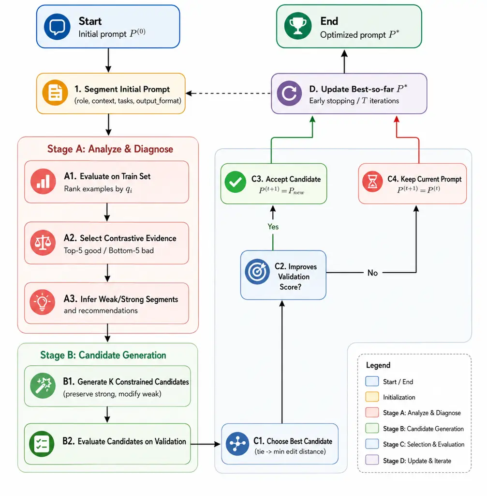

Figure 1: SAPO loop. Starting from the initial prompt $`P^{(0)}`$, the
method first segments instructions into role/context/tasks/output
format, then performs contrastive evidence extraction on train data to
diagnose weak and strong segments. Next, it generates constrained
candidates that preserve strong segments while revising weak ones,
evaluates them on validation data, applies edit-distance tie-break under
equal scores, and accepts an update only when validation performance
improves; otherwise the current prompt is retained.

Compared with prior autoprompting methods, SAPO contributes:

1.  1.  Segment-explicit optimization objective: prompts are decomposed into
        role, context, tasks, and output format, enabling targeted rather
        than monolithic edits.
2.  2.  Constrained candidate synthesis and selection: candidates preserve
        strong segments, revise weak segments, and use an edit-distance
        tie-break for conservative updates.
3.  3.  Contrastive diagnostic stage: update decisions are grounded in
        top/bottom evidence, including class-aware handling for discrete
        per-example metrics.

We evaluate SAPO on five datasets with different task types: SQuADv2,
TweetEval, XSUM, CommonGen, and GSM8K, and report results on two model
backbones: GPT-3.5-Turbo and GPT-4o-mini. SAPO achieves the best average
score against APE, OPRO, EvoPrompt, GEPA, and StraGO. Relative to the
strongest competing baseline by average score, gains are +5.13% on
GPT-3.5-Turbo and +7.25% on GPT-4o-mini.

## 2 Related Work

#### Search-based APO methods.

Early and widely used APO methods formulate prompt improvement as
iterative search over textual candidates. APE optimizes instruction
candidates via generation and selection (Zhou et al., 2023), while
ProTeGi applies textual gradients with beam search and bandit-style
selection (Pryzant et al., 2023). OPRO and EvoPrompt further extend
search with trajectory-conditioned optimization and evolutionary
operators, respectively (Yang et al., 2024; Guo et al., 2024). GEPA
introduces reflective prompt evolution, providing modular modifications
through optimization (Agrawal et al., 2026). Despite their
effectiveness, these methods primarily operate as global prompt-level
rewrites rather than as explicit segment-constrained updates (Zhou et
al., 2023; Yang et al., 2024; Guo et al., 2024; Fernando et al., 2023).

#### Structured and modular optimization trends.

In parallel, the field is moving toward structured optimization
workflows. DSPy and TextGrad cast optimization in programmatic or
graph-based forms rather than single prompt rewrites (Khattab et al.,
2023; Yuksekgonul et al., 2024). Promptomatix emphasizes modular
orchestration and cost-aware refinement (Murthy et al., 2025). More
recently, section-local optimization explicitly operates over fixed
prompt components and reports improved robustness in small-model
settings (Sharma and Henley, 2026). Collectively, this line of work
indicates that structural decomposition can improve interpretability and
reduce destructive interference between edits.

#### Gap summary.

Existing literature provides either strong search performance or
improved robustness diagnostics (Yang et al., 2024; Guo et al., 2024; Wu
et al., 2024; Sharma and Henley, 2026; Agrawal et al., 2026), but there
is still limited evidence on simple black-box pipelines that jointly
enforce segment-level controllability, preserve known-strong prompt
components, and remain implementation-light under a unified multi-task
protocol.

#### Positioning of SAPO.

SAPO sits at the intersection of static meta-prompting and
structure-aware optimization. It preserves the deployment simplicity of
black-box APO, while introducing explicit segment-level diagnosis and
constrained updates that preserve strong components and localize
revisions.

## 3 Method

### 3.1 Problem Formulation

Figure 1 provides the high-level pipeline view, while Algorithm 1
specifies the executable optimization procedure.

Let an initial prompt template be $`P^{(0)}`$ with placeholder {input}.
Let datasets be split into training and validation parts:

```math
\mathcal{D}_{train}=\{(x_{i},y_{i})\}_{i=1}^{N_{tr}},\quad\mathcal{D}_{val}=\{(x_{j},y_{j})\}_{j=1}^{N_{val}}. \tag{1}
```

Given one LLM $`\mathcal{M}`$ and task-dependent metric $`Q_{\tau}`$,
the objective is:

```math
P^{*}=\arg\max_{P\in\mathcal{P}}Q_{\tau}(P;\mathcal{D}_{val},\mathcal{M}). \tag{2}
```

At iteration $`t`$, the optimizer applies an update operator
$`\mathcal{U}`$ to the current prompt:

```math
P^{(t+1)}=\mathcal{U}\!\left(P^{(t)},\mathcal{D}_{train},\mathcal{D}_{val}\right). \tag{3}
```

The operator is acceptance-constrained: if the best candidate generated
at iteration $`t`$ does not improve validation quality, the prompt is
kept unchanged. This converts the procedure into a monotone,
validation-gated search over prompt space, which directly targets
robustness against destructive rewrites.

Prompt structure is represented as four explicit segments:

```math
S(P)=\{s_{role},s_{context},s_{tasks},s_{output\_format}\}. \tag{4}
```

### 3.2 Algorithm Overview

The optimization loop can be summarized as:

1.  1.  Decompose the current prompt into segments {role, context, tasks,
        output_format}.
2.  2.  Run Stage A: evaluate on train, extract top-5/bottom-5 evidence,
        infer weak/strong segments and recommendations.
3.  3.  Run Stage B: generate $`K`$ constrained prompt candidates.
4.  4.  Evaluate candidates on validation; choose the best by score, with
        edit-distance tie-break.
5.  5.  Accept the candidate only if validation score improves; otherwise
        keep the current prompt.

Figure 1 and Algorithm 1 formalize this loop.

1: Initial prompt $`P`$, train set $`\mathcal{D}_{train}`$, validation
set $`\mathcal{D}_{val}`$, candidates $`K`$, iterations $`T`$

2: $`P^{*}\leftarrow P`$; $`Q^{*}\leftarrow-\infty`$

3: for $`t=1`$ to $`T`$ do

4:   Segment current prompt into {role, context, tasks, output_format}

5:   Stage A: evaluate $`P`$ on $`\mathcal{D}_{train}`$, build
top-5/bottom-5 evidence, infer weak/strong segments and recommendations

6:   Stage B: generate $`K`$ improved candidates

7:   Evaluate candidates on $`\mathcal{D}_{val}`$ and choose best
candidate $`\tilde{P}`$ (tie: minimum edit distance)

8:   if
$`Q_{\tau}(\tilde{P};\mathcal{D}_{val})>Q_{\tau}(P;\mathcal{D}_{val})`$
then

9:    $`P\leftarrow\tilde{P}`$

10:   end if

11:   if $`Q_{\tau}(P;\mathcal{D}_{val})>Q^{*}`$ then

12:    $`P^{*}\leftarrow P`$;
$`Q^{*}\leftarrow Q_{\tau}(P;\mathcal{D}_{val})`$

13:   end if

14: end for

15: return $`P^{*}`$

Algorithm 1 Segment-level APO (SAPO).

### 3.3 Prompt Segment Design

SAPO optimizes four segments because they map to distinct and
operationally separable control dimensions in instruction-based LLM use.

#### Role ($`s_{role}`$).

This segment defines behavioral stance (e.g., classifier, summarizer,
analyst). Prior prompt engineering literature shows that instruction
framing can materially affect downstream behavior (Zhou et al., 2023;
Pryzant et al., 2023).

#### Context ($`s_{context}`$).

This segment encodes task grounding, input injection, and domain
constraints (including {input} placement). It controls what information
is available and how the model conditions on it.

#### Tasks ($`s_{tasks}`$).

This segment specifies actionable requirements and decision rules. It is
the main locus for correcting underspecified or ambiguous instructions.

#### Output format ($`s_{output\_format}`$).

This segment governs the response schema and formatting constraints. It
is critical in tasks where metric outcomes depend on strict label/output
conventions (e.g., classification labels or short-form answers).

These four segments were selected because they provide a compact
decomposition that is expressive enough for heterogeneous NLP tasks
while remaining small enough for stable, low-cost iterative
optimization. This design choice is aligned with broader
prompt-structure taxonomies and recent trends toward structured and
section-local prompt optimization (Liu et al., 2021; Schulhoff et al.,
2024; Khattab et al., 2023; Yuksekgonul et al., 2024; Sharma and Henley,
2026).

### 3.4 Two-stage Generation Pipeline

#### Stage A: Evidence extraction and segment-level diagnosis.

At iteration $`t`$, the current prompt $`P^{(t)}`$ is first evaluated on
$`\mathcal{D}_{train}`$:

```math
\hat{y}_{i}=\mathcal{M}(P^{(t)},x_{i}),\quad q_{i}=Q_{\tau}\!\left(P^{(t)};(x_{i},y_{i}),\mathcal{M}\right). \tag{5}
```

Examples are ranked by $`q_{i}`$, and two contrastive evidence sets are
extracted:

```math
\mathcal{B}_{good}^{(t)}=\text{Top-5}(q_{i}),\quad\mathcal{B}_{bad}^{(t)}=\text{Bottom-5}(q_{i}). \tag{6}
```

For discrete per-example metrics (e.g., ExactMatch with
$`q_{i}\in\{0,1\}`$), we use class-aware evidence selection:
$`\mathcal{B}_{good}^{(t)}`$ is drawn first from positive examples
($`q_{i}=1`$), and $`\mathcal{B}_{bad}^{(t)}`$ is drawn first from
negative examples ($`q_{i}=0`$). If one side has fewer than five
examples, the remainder is backfilled from the global rank order. Given
$`(\mathcal{B}_{good}^{(t)},\mathcal{B}_{bad}^{(t)})`$ and segment
decomposition $`S(P^{(t)})`$, one LLM with static meta-prompts infers
structured diagnostic outputs: weak_segments, strong_segments, and
recommendations. Intuitively, strong segments are associated with
consistently successful evidence, while weak segments are associated
with failure cases and become primary targets for revision.

#### Stage B: Candidate synthesis.

The same LLM receives current prompt, segment decomposition, weak/strong
labels, and recommendations, then generates $`K`$ improved prompt
candidates $`\{P_{k}^{(t)}\}_{k=1}^{K}`$. Candidate synthesis is
explicitly constrained to preserve segments listed in strong_segments
and primarily modify segments listed in weak_segments, reducing
cross-segment interference.

Each candidate $`P_{k}^{(t)}`$ is evaluated on $`\mathcal{D}_{val}`$:

```math
Q_{k,\tau}^{(t)}=Q_{\tau}(P_{k}^{(t)};\mathcal{D}_{val},\mathcal{M}). \tag{7}
```

The best candidate is accepted only if it improves the current
validation score. Under score ties, we select the candidate with the
smallest edit distance to the current prompt:

```math
\tilde{P}^{(t)}=\arg\max_{P_{k}^{(t)}}Q_{k,\tau}^{(t)},\quad\text{tie-break by }\min d_{\text{edit}}(P_{k}^{(t)},P^{(t)}). \tag{8}
```

This conservative tie-break favors minimal edits and helps preserve
validated prompt behavior.

For compactness, Stages A–B define an update operator:

```math
\tilde{P}^{(t)}=\mathcal{U}\!\left(P^{(t)},\mathcal{B}_{good}^{(t)},\mathcal{B}_{bad}^{(t)}\right), \tag{9}
```

where $`\mathcal{U}`$ performs diagnosis, constrained candidate
synthesis, and tie-aware selection.

An example of SAPO optimization trajectory is shown in Figure 2.
Meta-prompts for each stage and method complexity analysis are provided
in Appendix C and Appendix A.2.

## 4 Experimental Setup

#### Datasets and task coverage.

We evaluate on five datasets spanning extractive QA, social NLP
classification, abstractive summarization, constrained commonsense
generation, and mathematical reasoning: SQuADv2 (Rajpurkar et al.,
2018), TweetEval (Barbieri et al., 2020), XSUM (Narayan et al., 2018),
CommonGen (CG) (Lin et al., 2020), and GSM8K (Cobbe et al., 2021). This
mix is intended to stress different prompt components (role, task
specification, response format, and domain context) under a shared APO
loop. In our evaluation, we use BERTScore F1 (Zhang et al., 2020) for
(XSUM, CG, SQuAD2), F1 – (TweetEval), and ExactMatch – (GSM8K).

#### Models.

We report results for GPT-3.5-Turbo and GPT-4o-mini to cover two
commonly used API models with different capability/cost profiles.

#### Data split and protocol.

Each dataset is split into train/validation/test with sizes 150/100/all.
The train split is used for top/bottom evidence extraction, validation
is used for candidate selection during optimization, and the held-out
test split is used for final reporting. This separation is strictly
enforced for all iterative methods to reduce selection leakage.

#### Generation settings and baselines.

For candidate generation, we use $`K=5`$ candidates per iteration and a
sampling temperature of $`0`$. These values are fixed across all
experiments and are kept identical for SAPO and all iterative APO
baselines for fairness. We compare against Zero-shot prompting (as a
baseline and as an initial prompt for optimization) and representative
APO methods: APE (Zhou et al., 2023), OPRO (Yang et al., 2024),
EvoPrompt (Guo et al., 2024), GEPA (Agrawal et al., 2026), and StraGO
(Wu et al., 2024).

#### Runs and reporting.

Each method/model setup is run five times with different random seeds
and data samples. Main tables report mean values across runs.

## 5 Results

Across both model settings, SAPO delivers the highest average score
among compared baselines on the reported benchmark suite. Unless
explicitly stated otherwise, all numbers in this section are evaluated
on the held-out test split. The largest relative gains appear on GSM8K
and XSUM, consistent with the value of segment-level control in settings
that require strict answer extraction or tightly constrained generation.
The SAPO-optimized prompts are provided in Appendix C.

On GPT-3.5-Turbo, SAPO achieves the highest average score. It yields
gains on SQuAD2, GSM8K, CommonGen, and TweetEval, while trailing GEPA on
XSUM. The largest relative gain appears on GSM8K, suggesting that
segment-level control and task-focused refinement are particularly
beneficial for exact-answer reasoning settings.

On GPT-4o-mini, SAPO again delivers the highest average score and
outperforms all compared baselines on all five datasets. This pattern
indicates that segment-level optimization is complementary to model
capability scaling rather than specific to one backbone.

The average gain relative to the best competing baseline by average
score is +5.13% on GPT-3.5-Turbo and +7.25% on GPT-4o-mini, indicating
consistent benefits from constrained segment-local updates.

|                |        |        |        |           |        |        |
| -------------- | ------ | ------ | ------ | --------- | ------ | ------ |
| Method         | SQuAD2 | GSM8K  | CG     | TweetEval | XSum   | Avg    |
| Zero-shot      | 0.812  | 0.527  | 0.824  | 0.483     | 0.801  | 0.689  |
| APE            | 0.904  | 0.710  | 0.883  | 0.511     | 0.815  | 0.765  |
| OPRO           | 0.871  | 0.715  | 0.873  | 0.536     | 0.828  | 0.765  |
| EvoPrompt      | 0.895  | 0.697  | 0.889  | 0.521     | 0.837  | 0.768  |
| GEPA           | 0.873  | 0.744  | 0.871  | 0.539     | 0.859  | 0.777  |
| StraGO         | 0.915  | 0.717  | 0.908  | 0.523     | 0.834  | 0.779  |
| SAPO           | 0.922  | 0.835  | 0.911  | 0.575     | 0.852  | 0.819  |
| Diff.          | +0.007 | +0.091 | +0.003 | +0.036    | -0.007 | +0.040 |
| Rel. diff. (%) | +0.77  | +12.23 | +0.33  | +6.68     | -0.81  | +5.13  |

Table 1: Test-split comparison on GPT-3.5-Turbo. Best values per column
are in bold. “Difference vs best baseline” is computed per column
against the strongest non-SAPO method in that column.

|                |        |        |        |           |        |        |
| -------------- | ------ | ------ | ------ | --------- | ------ | ------ |
| Method         | SQuAD2 | GSM8K  | CG     | TweetEval | XSum   | Avg    |
| Zero-shot      | 0.795  | 0.841  | 0.784  | 0.477     | 0.638  | 0.707  |
| APE            | 0.851  | 0.884  | 0.823  | 0.551     | 0.690  | 0.760  |
| OPRO           | 0.842  | 0.891  | 0.831  | 0.510     | 0.695  | 0.754  |
| EvoPrompt      | 0.827  | 0.905  | 0.808  | 0.556     | 0.714  | 0.762  |
| GEPA           | 0.923  | 0.880  | 0.823  | 0.539     | 0.695  | 0.772  |
| StraGO         | 0.838  | 0.903  | 0.810  | 0.572     | 0.720  | 0.769  |
| SAPO           | 0.931  | 0.952  | 0.875  | 0.593     | 0.789  | 0.828  |
| Diff.          | +0.008 | +0.047 | +0.044 | +0.021    | +0.069 | +0.056 |
| Rel. diff. (%) | +0.87  | +5.19  | +5.29  | +3.67     | +9.58  | +7.25  |

Table 2: Test-split comparison on GPT-4o-mini. Best values per column
are in bold. “Difference vs best baseline” is computed per column
against the strongest non-SAPO method in that column.

## 6 Discussion

#### Why segment-level updates help.

The observed gains are consistent with the hypothesis that explicit
weak/strong segment separation reduces destructive interference between
edits. Instead of globally rewriting prompts, SAPO localizes revisions
to weak components while preserving high-performing structure, aligning
with recent observations on prompt drifting in iterative APO (Wu et al.,
2024).

#### When improvements are likely.

Improvements are most pronounced when tasks depend on strict output
conventions or multi-part instructions. In such settings, preserving
strong format/context segments appears as important as improving task
wording; this is consistent with recent evidence that optimization
success is regime-dependent and tied to task structure (Zhang et al.,
2026).

#### Limitations.

A key limitation of this work is that SAPO uses a fixed and relatively
small segment set. While this decomposition is practical and
interpretable, it may not capture finer-grained prompt structure needed
for some tasks. Future work should explore richer segment taxonomies and
adaptive segment discovery, including LLM-based automatic generation of
new segment types during optimization. This would allow the optimizer to
expand or refine its own editing space dynamically, rather than relying
on a predefined segmentation scheme. Meanwhile, our current setup uses
fixed top-5/bottom-5 evidence windows, which may miss finer-grained
error modes.

## 7 Conclusion

We presented SAPO, a modular APO framework that replaces monolithic
rewrites with segment-level optimization. Under this protocol, SAPO
achieves the strongest average performance against strong APO baselines
and offers an interpretable pathway for future extensions in APO.

## 8 Acknowledgments

This work supported by the Ministry of Economic Development of the
Russian Federation (IGK 000000C313925P4C0002), agreement
No139-15-2025-010

## References

- Agrawal et al. (2026) L. A. Agrawal, S. Tan, D. Soylu, N. Ziems, R.
  Khare, K. Opsahl-Ong, A. Singhvi, H. Shandilya, M. J. Ryan, M.
  Jiang, C. Potts, K. Sen, A. G. Dimakis, I. Stoica, D. Klein, M.
  Zaharia, and O. Khattab GEPA: reflective prompt evolution can
  outperform reinforcement learning. arXiv preprint arXiv:2507.19457.
  Note: Accepted to ICLR 2026 (Oral) External Links:
  [Document](https://dx.doi.org/10.48550/arXiv.2507.19457),
  [Link](https://arxiv.org/abs/2507.19457) Cited by: §1, §2, §2, §4.
- Barbieri et al. (2020) F. Barbieri, J. Camacho-Collados, L.
  Espinosa-Anke, and L. Neves TweetEval: unified benchmark and
  comparative evaluation for tweet classification. In Findings of the
  Association for Computational Linguistics: EMNLP 2020, pp. 1644–1650.
  External Links:
  [Document](https://dx.doi.org/10.18653/v1/2020.findings-emnlp.148),
  [Link](https://aclanthology.org/2020.findings-emnlp.148/) Cited by:
  §4.
- Brown et al. (2020) T. B. Brown, B. Mann, N. Ryder, M. Subbiah, J.
  Kaplan, P. Dhariwal, A. Neelakantan, P. Shyam, G. Sastry, A. Askell,
  et al. Language models are few-shot learners. In Advances in Neural
  Information Processing Systems 33 (NeurIPS 2020), External Links:
  [Link](https://papers.nips.cc/paper/2020/hash/1457c0d6bfcb4967418bfb8ac142f64a-Abstract.html),
  [Document](https://dx.doi.org/10.48550/arXiv.2005.14165) Cited by: §1.
- Cobbe et al. (2021) K. Cobbe, V. Kosaraju, M. Bavarian, M. Chen, H.
  Jun, L. Kaiser, M. Plappert, J. Tworek, J. Hilton, R. Nakano, C.
  Hesse, and J. Schulman Training verifiers to solve math word problems.
  arXiv preprint arXiv:2110.14168. External Links:
  [Document](https://dx.doi.org/10.48550/arXiv.2110.14168),
  [Link](https://arxiv.org/abs/2110.14168) Cited by: §4.
- Fernando et al. (2023) C. Fernando, D. Banarse, H. Michalewski, S.
  Osindero, and T. Rocktäschel Promptbreeder: self-referential
  self-improvement via prompt evolution. arXiv preprint
  arXiv:2309.16797. External Links:
  [Document](https://dx.doi.org/10.48550/arXiv.2309.16797),
  [Link](https://arxiv.org/abs/2309.16797) Cited by: §2.
- Guo et al. (2024) Q. Guo, R. Wang, J. Guo, B. Li, K. Song, X. Tan, G.
  Liu, J. Bian, and Y. Yang Connecting large language models with
  evolutionary algorithms yields powerful prompt optimizers. In
  International Conference on Learning Representations (ICLR), External
  Links:
  [Link](https://proceedings.iclr.cc/paper_files/paper/2024/hash/9156b0f6dfa9bbd18c79cc459ef5d61c-Abstract-Conference.html),
  [Document](https://dx.doi.org/10.48550/arXiv.2309.08532) Cited by: §1,
  §2, §2, §4.
- Khattab et al. (2023) O. Khattab, A. Singhvi, P. Maheshwari, Z.
  Zhang, K. Santhanam, S. Vardhamanan, S. Haq, A. Sharma, T. T.
  Joshi, H. Moazam, H. Miller, M. Zaharia, and C. Potts DSPy: compiling
  declarative language model calls into self-improving pipelines. arXiv
  preprint arXiv:2310.03714. External Links:
  [Document](https://dx.doi.org/10.48550/arXiv.2310.03714),
  [Link](https://arxiv.org/abs/2310.03714) Cited by: §2, §3.3.
- Lin et al. (2020) B. Y. Lin, W. Zhou, M. Shen, P. Zhou, C.
  Bhagavatula, Y. Choi, and X. Ren CommonGen: a constrained text
  generation challenge for generative commonsense reasoning. In Findings
  of the Association for Computational Linguistics: EMNLP 2020,
  pp. 1823–1840. External Links:
  [Document](https://dx.doi.org/10.18653/v1/2020.findings-emnlp.165),
  [Link](https://aclanthology.org/2020.findings-emnlp.165/) Cited by:
  §4.
- Liu et al. (2021) P. Liu, W. Yuan, J. Fu, Z. Jiang, H. Hayashi, and G.
  Neubig Pre-train, prompt, and predict: a systematic survey of
  prompting methods in natural language processing. arXiv preprint
  arXiv:2107.13586. External Links:
  [Document](https://dx.doi.org/10.48550/arXiv.2107.13586),
  [Link](https://arxiv.org/abs/2107.13586) Cited by: §3.3.
- Ma et al. (2024) R. Ma, X. Wang, X. Zhou, J. Li, N. Du, T. Gui, Q.
  Zhang, and X. Huang Are large language models good prompt optimizers?.
  arXiv preprint arXiv:2402.02101. External Links:
  [Document](https://dx.doi.org/10.48550/arXiv.2402.02101),
  [Link](https://arxiv.org/abs/2402.02101) Cited by: §1.
- Murthy et al. (2025) R. Murthy, M. Zhu, L. Yang, J. Qiu, J. Tan, S.
  Heinecke, C. Xiong, S. Savarese, and H. Wang Promptomatix: an
  automatic prompt optimization framework for large language models.
  arXiv preprint arXiv:2507.14241. External Links:
  [Document](https://dx.doi.org/10.48550/arXiv.2507.14241),
  [Link](https://arxiv.org/abs/2507.14241) Cited by: §2.
- Narayan et al. (2018) S. Narayan, S. B. Cohen, and M. Lapata Don’t
  give me the details, just the summary! topic-aware convolutional
  neural networks for extreme summarization. In Proceedings of the 2018
  Conference on Empirical Methods in Natural Language Processing
  (EMNLP), pp. 1797–1807. External Links:
  [Document](https://dx.doi.org/10.18653/v1/D18-1206),
  [Link](https://aclanthology.org/D18-1206/) Cited by: §4.
- Ouyang et al. (2022) L. Ouyang, J. Wu, X. Jiang, D. Almeida, C.
  Wainwright, P. Mishkin, C. Zhang, et al. Training language models to
  follow instructions with human feedback. In Advances in Neural
  Information Processing Systems 35 (NeurIPS 2022), External Links:
  [Link](https://papers.nips.cc/paper_files/paper/2022/hash/b1efde53be364a73914f58805a001731-Abstract-Conference.html),
  [Document](https://dx.doi.org/10.48550/arXiv.2203.02155) Cited by: §1.
- Pryzant et al. (2023) R. Pryzant, D. Iter, J. Li, Y. T. Lee, C. Zhu,
  and M. Zeng Automatic prompt optimization with ”gradient descent” and
  beam search. In Proceedings of the 2023 Conference on Empirical
  Methods in Natural Language Processing (EMNLP), pp. 7957–7968.
  External Links:
  [Document](https://dx.doi.org/10.18653/v1/2023.emnlp-main.494),
  [Link](https://aclanthology.org/2023.emnlp-main.494/) Cited by: §1,
  §1, §2, §3.3.
- Rajpurkar et al. (2018) P. Rajpurkar, R. Jia, and P. Liang Know what
  you don’t know: unanswerable questions for squad. In Proceedings of
  the 56th Annual Meeting of the Association for Computational
  Linguistics (ACL 2018), pp. 784–789. External Links:
  [Document](https://dx.doi.org/10.18653/v1/P18-2124),
  [Link](https://aclanthology.org/P18-2124/) Cited by: §4.
- Schulhoff et al. (2024) S. Schulhoff, M. Ilie, N. Balepur, K.
  Kahadze, A. Liu, C. Si, Y. Li, A. Gupta, H. Han, S. Schulhoff, et al.
  The prompt report: a systematic survey of prompt engineering
  techniques. arXiv preprint arXiv:2406.06608. External Links:
  [Document](https://dx.doi.org/10.48550/arXiv.2406.06608),
  [Link](https://arxiv.org/abs/2406.06608) Cited by: §3.3.
- Sharma and Henley (2026) P. Sharma and A. Z. Henley Modular prompt
  optimization: optimizing structured prompts with section-local textual
  gradients. arXiv preprint arXiv:2601.04055. External Links:
  [Document](https://dx.doi.org/10.48550/arXiv.2601.04055),
  [Link](https://arxiv.org/abs/2601.04055) Cited by: §2, §2, §3.3.
- Wei et al. (2022) J. Wei, X. Wang, D. Schuurmans, M. Bosma, B.
  Ichter, F. Xia, E. H. Chi, Q. V. Le, and D. Zhou Chain-of-thought
  prompting elicits reasoning in large language models. In Advances in
  Neural Information Processing Systems 35 (NeurIPS 2022), External
  Links:
  [Link](https://papers.nips.cc/paper_files/paper/2022/hash/9d5609613524ecf4f15af0f7b31abca4-Abstract-Conference.html),
  [Document](https://dx.doi.org/10.48550/arXiv.2201.11903) Cited by: §1.
- Wu et al. (2024) Y. Wu, Y. Gao, B. B. Zhu, Z. Zhou, X. Sun, S.
  Yang, J. Lou, Z. Ding, and L. Yang StraGo: harnessing strategic
  guidance for prompt optimization. In Findings of the Association for
  Computational Linguistics: EMNLP 2024, pp. 10043–10061. External
  Links:
  [Document](https://dx.doi.org/10.18653/v1/2024.findings-emnlp.588),
  [Link](https://aclanthology.org/2024.findings-emnlp.588/) Cited by:
  §1, §2, §4, §6.
- Yang et al. (2024) C. Yang, X. Wang, Y. Lu, H. Liu, Q. V. Le, D. Zhou,
  and X. Chen Large language models as optimizers. In International
  Conference on Learning Representations (ICLR), External Links:
  [Link](https://openreview.net/forum?id=Bb4VGOWELI),
  [Document](https://dx.doi.org/10.48550/arXiv.2309.03409) Cited by: §1,
  §2, §2, §4.
- Yuksekgonul et al. (2024) M. Yuksekgonul, F. Bianchi, J. Boen, S.
  Liu, Z. Huang, C. Guestrin, and J. Zou TextGrad: automatic
  “differentiation” via text. arXiv preprint arXiv:2406.07496. External
  Links: [Document](https://dx.doi.org/10.48550/arXiv.2406.07496),
  [Link](https://arxiv.org/abs/2406.07496) Cited by: §2, §3.3.
- Zhang et al. (2020) T. Zhang, V. Kishore, F. Wu, K. Q. Weinberger,
  and Y. Artzi BERTScore: evaluating text generation with bert. In
  International Conference on Learning Representations (ICLR), External
  Links: [Link](https://openreview.net/forum?id=SkeHuCVFDr),
  [Document](https://dx.doi.org/10.48550/arXiv.1904.09675) Cited by: §4.
- Zhang et al. (2024) T. Zhang, J. Yuan, and S. Avestimehr Revisiting
  opro: the limitations of small-scale llms as optimizers. In Findings
  of the Association for Computational Linguistics: ACL 2024,
  pp. 1727–1735. External Links:
  [Document](https://dx.doi.org/10.18653/v1/2024.findings-acl.100),
  [Link](https://aclanthology.org/2024.findings-acl.100/) Cited by: §1.
- Zhang et al. (2026) X. Zhang, G. Wang, Y. Cui, W. Qiu, Z. Li, B. Zhu,
  and P. He Prompt optimization is a coin flip: diagnosing when it helps
  in compound ai systems. arXiv preprint arXiv:2604.14585. External
  Links: [Document](https://dx.doi.org/10.48550/arXiv.2604.14585),
  [Link](https://arxiv.org/abs/2604.14585) Cited by: §1, §6.
- Zhou et al. (2023) Y. Zhou, A. I. Muresanu, Z. Han, K. Paster, S.
  Pitis, H. Chan, and J. Ba Large language models are human-level prompt
  engineers. In International Conference on Learning Representations
  (ICLR), External Links:
  [Link](https://openreview.net/forum?id=92gvk82DE-),
  [Document](https://dx.doi.org/10.48550/arXiv.2211.01910) Cited by: §1,
  §1, §2, §3.3, §4.

## Appendix A Ablation Study

### A.1 Segment Importance

To quantify the contribution of individual prompt segments, we run a
controlled ablation on all five datasets using the same task-specific
metrics as in the main experiments. For each dataset, we treat the final
SAPO prompt as the baseline and evaluate on test samples ablated
variants relative to that baseline:

- •
  $`-`$Role: final prompt without role
- •
  InitTasks: final prompt with tasks replaced by initial tasks
- •
  InitCtx: final prompt with context replaced by initial context
- •
  $`-`$RespFmt: final prompt without response format

| Dataset | Baseline | $`\Delta`$(-Role) | $`\Delta`$(InitTasks) | $`\Delta`$(InitCtx) | $`\Delta`$(-RespFmt) |
| ------- | -------- | ----------------- | --------------------- | ------------------- | -------------------- |
| SQuADv2 | -        | +0.0210           | -0.0637               | +0.0000             | -0.0281              |
| TEval   | -        | -0.0744           | -0.0391               | -0.0160             | -0.0844              |
| XSUM    | -        | -0.0103           | -0.0811               | +0.0011             | -0.0328              |
| CG      | -        | -0.0016           | -0.0550               | -0.0005             | -0.0522              |
| GSM8K   | -        | -0.0801           | -0.2800               | +0.0000             | +0.0207              |
| Average | -        | -0.0291           | -0.1038               | -0.0031             | -0.0354              |

Table 3: Segment ablation on five datasets. Each $`\Delta`$ entry
reports variant score minus baseline score, where positive values
indicate improvement over baseline and negative values indicate
degradation.

The experimental results are shown in Table 3. The updated delta table
shows a clear pattern: all ablation families are negative on average,
meaning the final SAPO prompt remains the strongest configuration
overall. The largest degradation comes from reverting tasks to initial
wording (Avg $`\Delta=-0.1038`$), with the strongest drop on GSM8K
($`-0.2800`$); this confirms that task-level refinement is the main
driver of improvements.

Removing response-format constraints also hurts on average (Avg
$`\Delta=-0.0354`$), and role removal is similarly unfavorable overall
(Avg $`\Delta=-0.0291`$). Although isolated positives exist (e.g.,
SQuADv2 for $`-`$Role, GSM8K for $`-`$RespFmt), they are not strong
enough to reverse the cross-dataset trend.

Context reversion is the least harmful perturbation (Avg
$`\Delta=-0.0031`$), with near-zero effects on SQuADv2 and GSM8K and
mixed small effects elsewhere. This suggests that, in the current setup,
context edits are comparatively stable, while tasks and output
constraints are the most sensitive levers.

### A.2 Computational Costs.

To make algorithmic cost comparable across methods, we use a call-level
proxy under a common budget ($`T`$ iterations, $`K`$ candidates per
iteration). Let $`N_{tr}`$ and $`N_{val}`$ denote train and validation
sizes, and let $`c_{diag}`$, $`c_{refl}`$, and $`c_{gen}`$ denote
per-iteration diagnostic/reflection/generation overhead constants. Under
this proxy:

- •
  APO:

  ```math
  C_{\text{APO}}=T\Big(K\,N_{tr}+K\,N_{val}+c_{diag}+c_{refl}+K\,c_{gen}\Big)
  ```

- •
  OPRO:

  ```math
  C_{\text{OPRO}}=T\Big(K\,N_{val}+K\,c_{gen}\Big)
  ```

- •
  EvoPrompt:

  ```math
  C_{\text{Evo}}=T\Big(K\,N_{val}+K\,c_{gen}\Big)
  ```

- •
  StraGO:

  ```math
  C_{\text{StraGO}}=T\Big(K\,N_{tr}+K\,N_{val}+c_{diag}+K\,c_{gen}\Big)
  ```

- •
  GEPA:

  ```math
  C_{\text{GEPA}}=T\Big(K\,N_{tr}+K\,N_{val}+c_{diag}+c_{refl}+K\,c_{gen}\Big)
  ```

- •
  SAPO:

  ```math
  C_{\text{SAPO}}=T\Big(N_{tr}+K\,N_{val}+c_{diag}+c_{gen}\Big)
  ```

This proxy captures dominant LLM-call complexity, while wall-clock time
also depends on provider latency, batching, and parallelization.

## Appendix B Prompt Optimization Example by SAPO

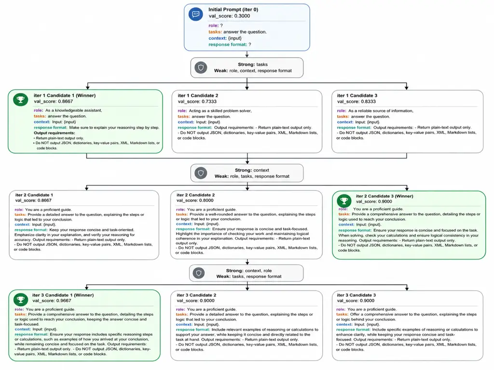

Figure 2: Example of SAPO optimization on GSM8K samples. The figure
traces how the LLM diagnoses and updates weak prompt segments across
iterations. At each step, performance is analyzed at the segment level;
missing segments are treated as weak by default. Segments identified as
strong are preserved and not modified during candidate generation. The
best result was obtained at iteration 3 (candidate 1), where
segment-level expansion and reformulation yielded near-complete coverage
of correct answers on the sample.

## Appendix C SAPO Optimized Prompts

The figures below show, for each dataset, the initial prompt (top) and
the optimized segmented prompt (bottom) used in GPT-4o-mini experiments.

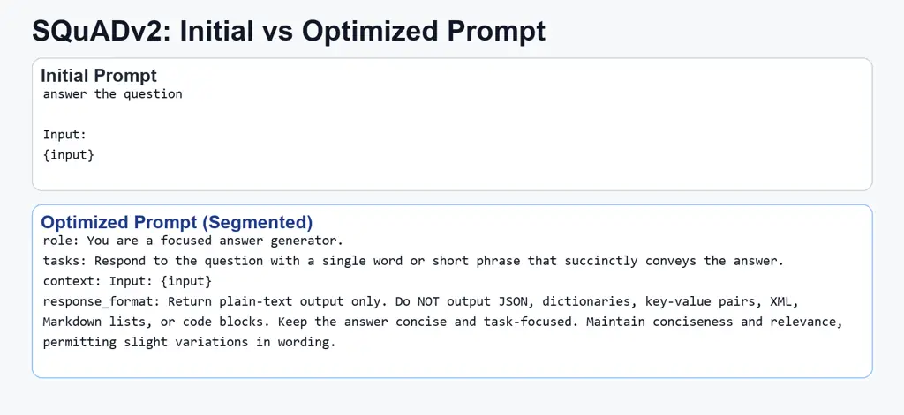

Figure 3: SQuADv2 prompt pair (GPT-4o-mini): initial prompt (top) and
optimized segmented prompt (bottom).

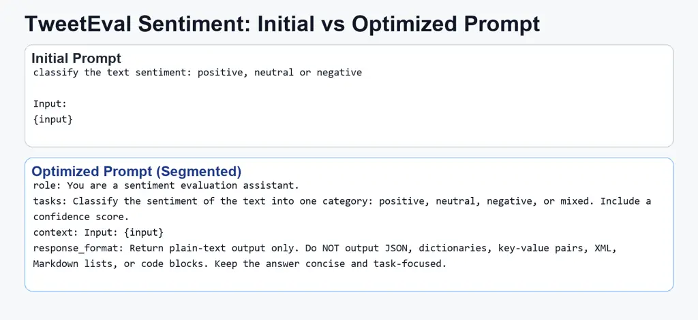

Figure 4: TweetEval Sentiment prompt pair (GPT-4o-mini): initial prompt
(top) and optimized segmented prompt (bottom).

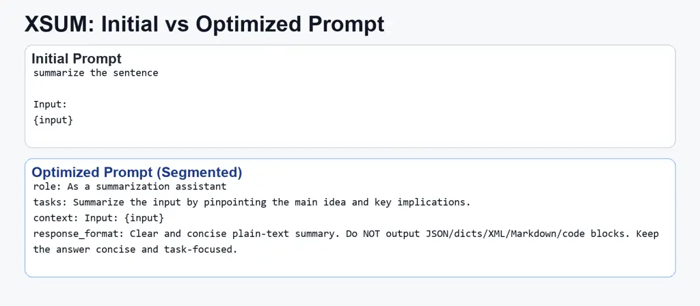

Figure 5: XSUM prompt pair (GPT-4o-mini): initial prompt (top) and
optimized segmented prompt (bottom).

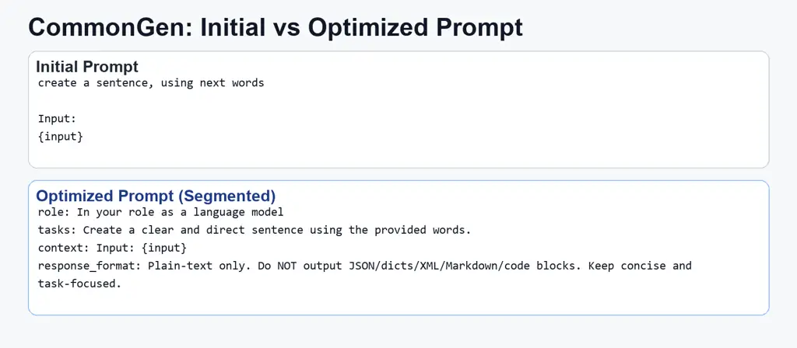

Figure 6: CommonGen prompt pair (GPT-4o-mini): initial prompt (top) and
optimized segmented prompt (bottom).

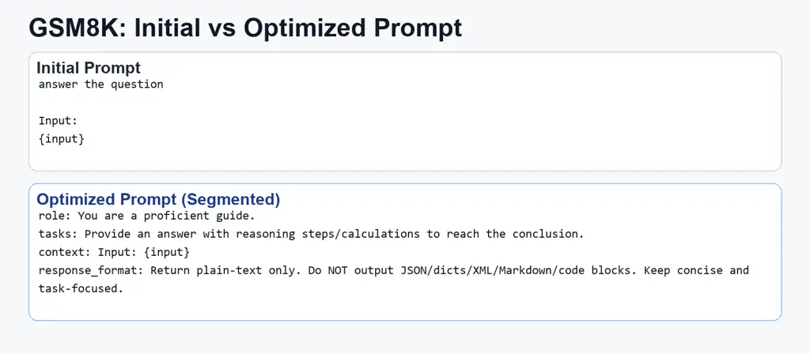

Figure 7: GSM8K prompt pair (GPT-4o-mini): initial prompt (top) and
optimized segmented prompt (bottom).

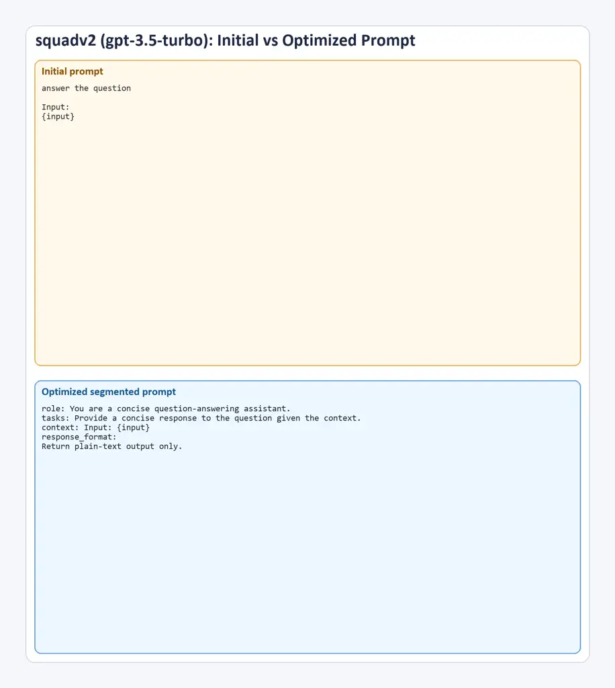

Figure 8: SQuADv2 prompt pair (GPT-3.5-Turbo): initial prompt (top) and
optimized segmented prompt (bottom).

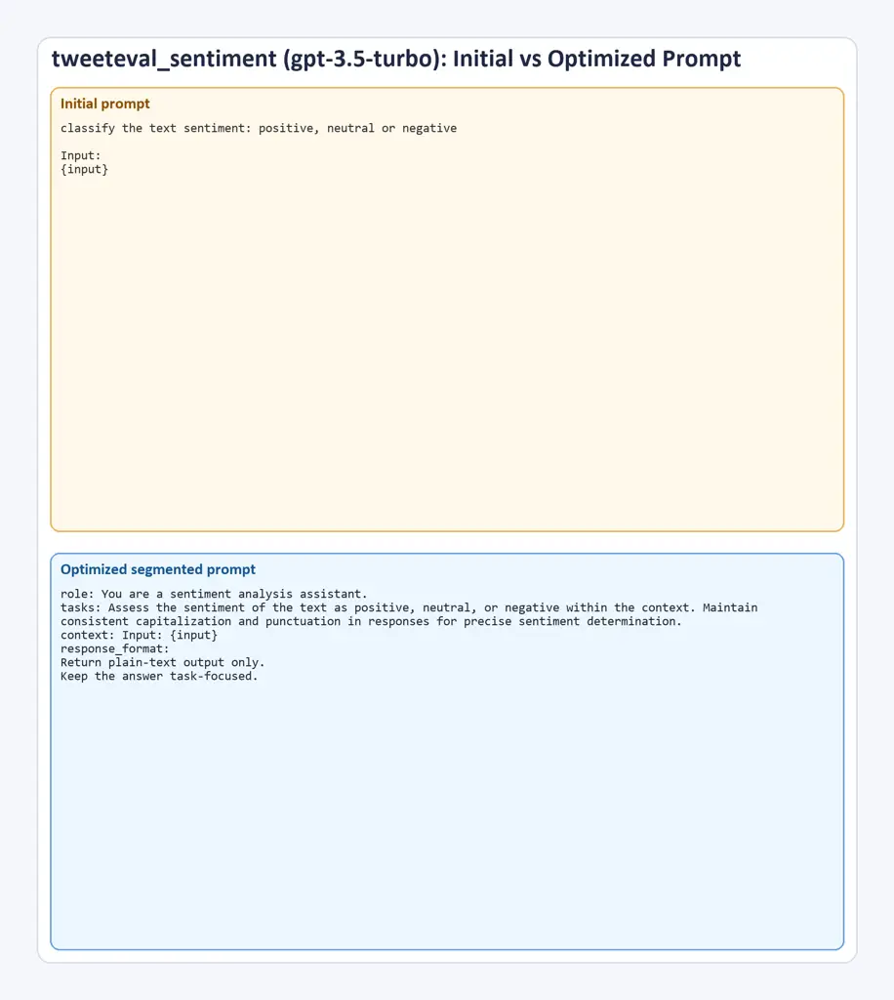

Figure 9: TweetEval Sentiment prompt pair (GPT-3.5-Turbo): initial
prompt (top) and optimized segmented prompt (bottom).

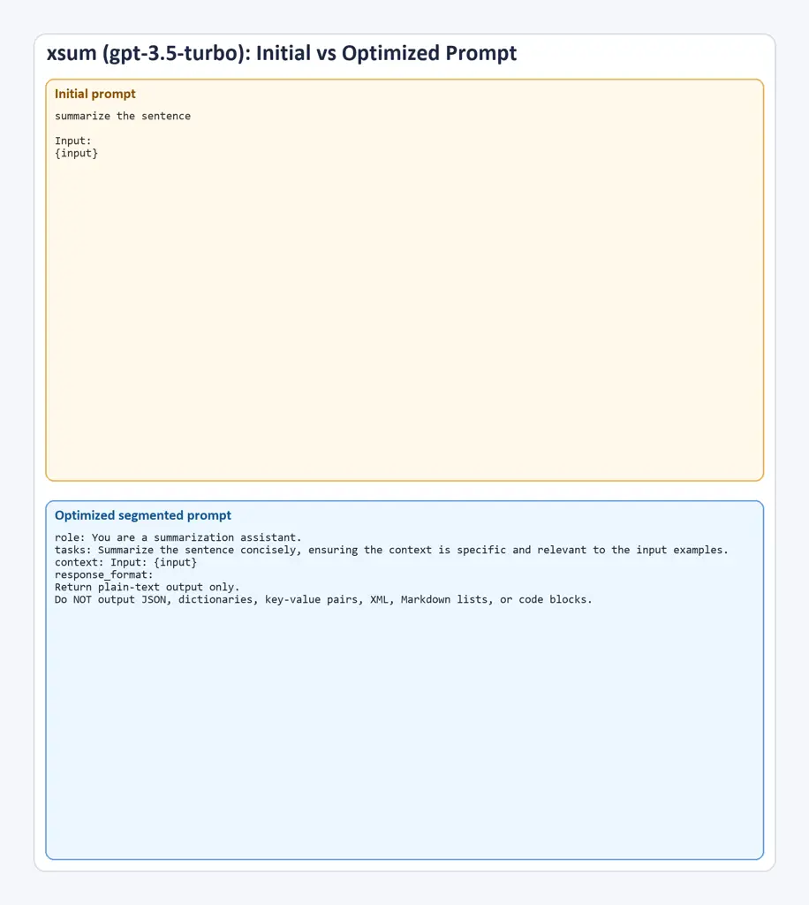

Figure 10: XSUM prompt pair (GPT-3.5-Turbo): initial prompt (top) and
optimized segmented prompt (bottom).

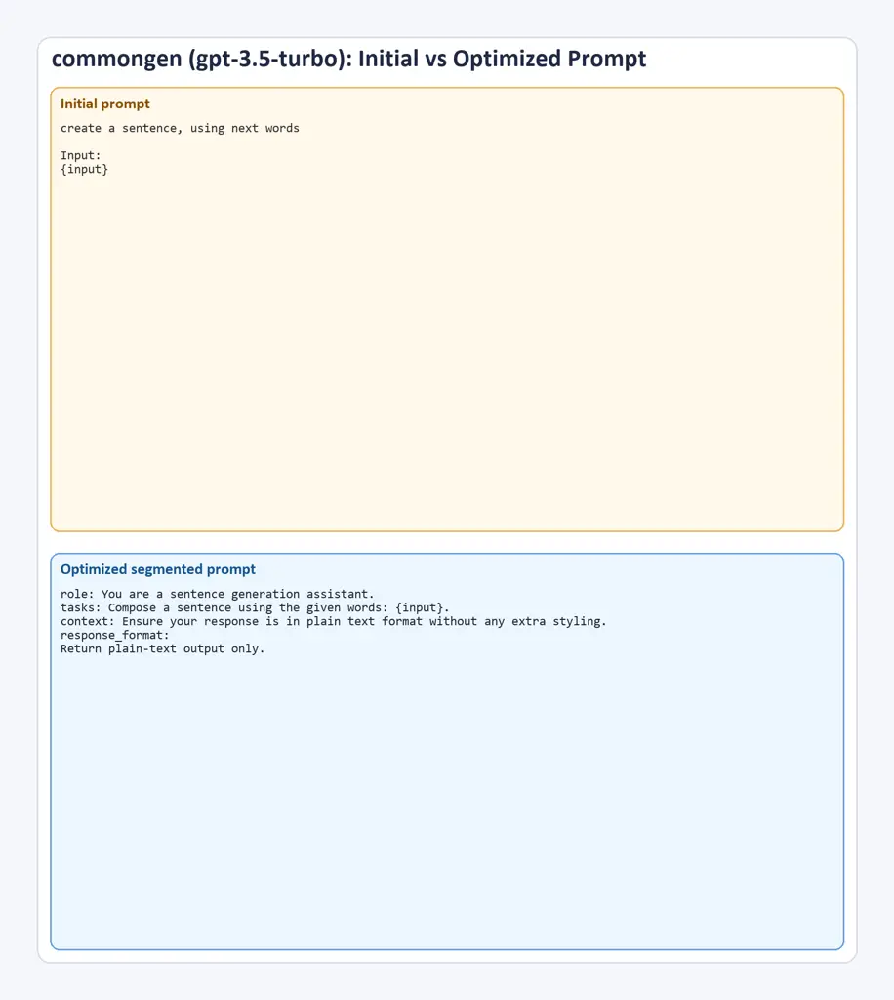

Figure 11: CommonGen prompt pair (GPT-3.5-Turbo): initial prompt (top)
and optimized segmented prompt (bottom).

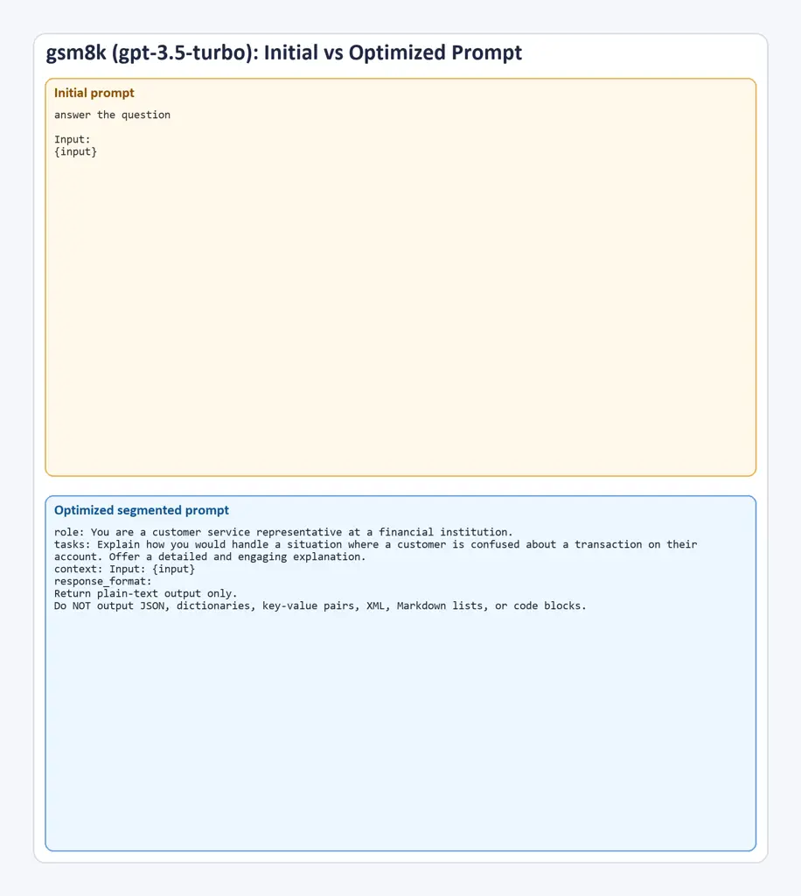

Figure 12: GSM8K prompt pair (GPT-3.5-Turbo): initial prompt (top) and
optimized segmented prompt (bottom).

## Appendix D Meta-prompts

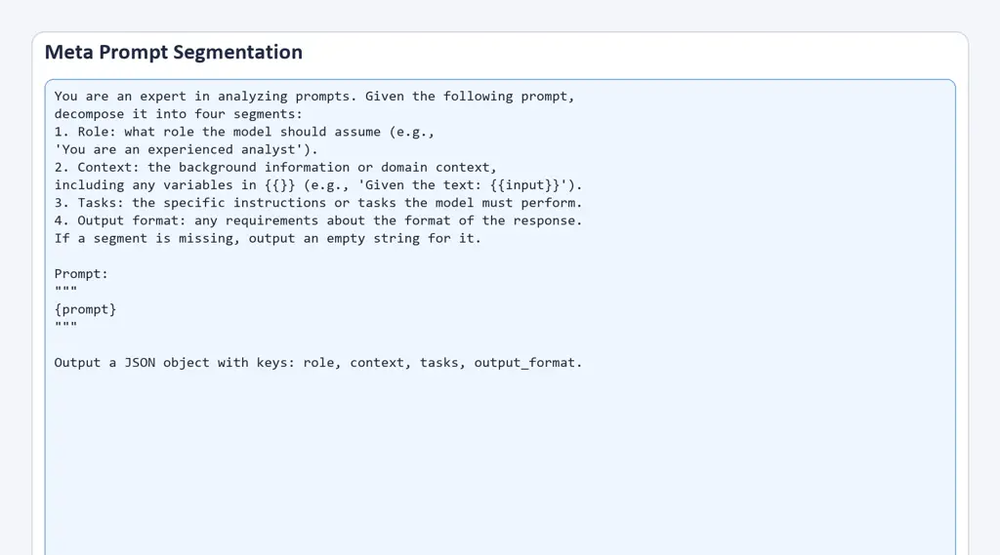

Figure 13: Segmentation meta-prompt used by SAPO to decompose a prompt
into role, context, tasks, and output format.

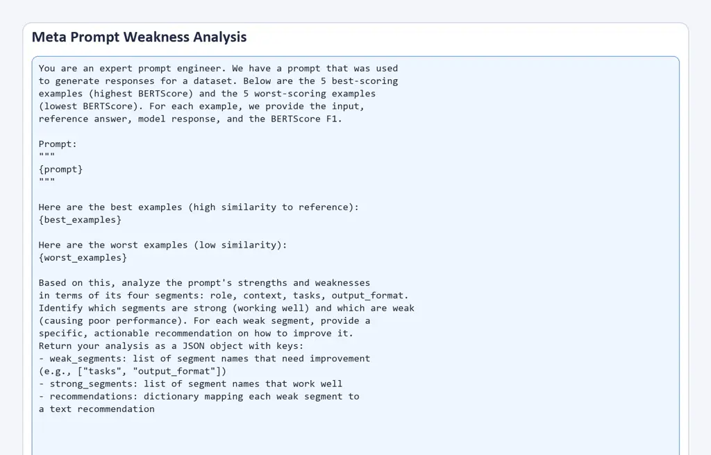

Figure 14: Weakness-analysis meta-prompt: SAPO contrasts top/bottom
evidence and outputs weak segments, strong segments, and actionable
recommendations.

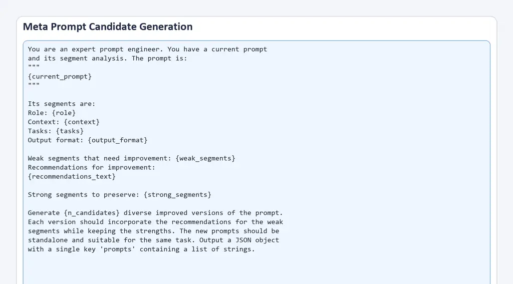

Figure 15: Candidate-generation meta-prompt used to synthesize
constrained prompt variants that preserve strong segments and revise
weak ones.
