⁰⁰footnotetext: ^(†)Project Lead. ^(\*)Co-corresponding authors.  
Emails: lichuyue0312@gmail.com, jmliu1217@gmail.com.  
Project Page:
[https://ava-encoder.github.io/](https://ava-encoder.github.io/).

# AVA-Encoder: Towards Agent-Native Video Representation Learning

Chuyue Li Affiliation: Qwen Business Unit of Alibaba Affiliation:
ShanghaiTech University    Jinpeng Yu^(†) Affiliation: Qwen Business
Unit of Alibaba    Haozhe Wang Affiliation: Qwen Business Unit of
Alibaba Affiliation: The Hong Kong University of Science and Technology
   Tian Xueyun Affiliation: Qwen Business Unit of Alibaba Affiliation:
Institute of Computing Technology    Zhijing Zhang Affiliation: Qwen
Business Unit of Alibaba Affiliation: Southeast University    Bingnan Li
Affiliation: Qwen Business Unit of Alibaba    Shuqi Gu Affiliation:
ShanghaiTech University    Kan Ren^(\*) Affiliation: ShanghaiTech
University    Jiaming Liu^(\*) Affiliation: Qwen Business Unit of
Alibaba    Ruihua Huang Affiliation: Qwen Business Unit of Alibaba

###### Abstract

Agentic video creation systems remain far from cinematic-grade quality:
their underlying models struggle to plan how story, characters, visuals,
and sound fit together, and high-quality creation trajectories to learn
such planning abilities are scarce. Finished human films embody this
knowledge, but in a tightly coupled audiovisual form that agents cannot
directly read or manipulate. We propose the Agentic Video Auto-Encoder
(AVA-Encoder), which works backward from finished films, turning them
into agent-native representations with reconstruction itself as
supervision. It encodes a film into a Film Knowledge Graph (Film KG) of
structured-text nodes, typed dependency edges, and linked multimodal
assets, then regenerates the film from this graph with a fixed decoder.
Reconstruction residuals are distilled into textual gradients that drive
dual-loop self-evolution: an outer loop learns a shared encoding policy
across videos, and an inner loop refines each video’s Film KG at test
time. AVA-Encoder improves reconstruction fidelity by 20.7 percentage
points over the strongest baseline; its learned policy outperforms a
finely human-tuned policy with over 70% fewer system-prompt tokens; and
Film KGs support coordinated editing and improve all tested downstream
creation systems. We release the framework, a reconstruction benchmark,
and a Film KG dataset.

## 1 Introduction

Advances in foundation models (Brooks et al., 2024; Google DeepMind,
2024; Kuaishou Technology, 2024; Polyak et al., 2024; Li et al., 2026a;
Li et al., 2025) and agentic video creation systems (Xu et al., 2025; Wu
et al., 2025; Li et al., 2024; Lin et al., 2024; Lai et al., 2026) have
enabled agents to write stories, design keyframes, and generate videos.
Yet reliable cinematic-grade creation remains difficult, mainly because
their underlying models lack the planning ability to coordinate scripts,
characters, shots, and audiovisual elements. Developing this ability is
difficult because high-quality trajectories of complete agentic video
creation processes are scarce. Meanwhile, cinematic-grade human-made
films offer a rich alternative source of filmmaking knowledge (Zhao et
al., 2026). However, unlike human filmmakers who learn by directly
studying finished films, agents cannot directly use them as explicit
creation records.

This limitation reflects a mismatch between video space and agent space:
films tightly couple narrative, visual, temporal, and audio information
without exposing their underlying relationships (Huang et al., 2020),
whereas agents use structured text, code, plans, and graphs for
retrieval, reasoning, planning, and editing (Wang et al., 2025; Yu et
al., 2026; Wang et al., 2026a). Bridging this gap requires agent-native
representations that make film content and creation dependencies
explicit and operable (Liu et al., 2026).

An ideal agent-native video representation should satisfy three
requirements: understandable to agents, stably-editable for agents, and
faithful enough to preserve the cinematic information for subsequent
generation. Existing approaches do not fully meet these requirements:
visual embeddings resist direct interpretation and manipulation; textual
descriptions often omit cross-modal dependencies; and fact-oriented
structured representation prioritize task-relevant facts over the
cinematic detail needed for generation (Sec. 2.2).

Therefore, we propose the Film Knowledge Graph (Film KG) representation,
which organizes cinematic content into structured textual nodes linked
to generated image, audio, and video assets. Textual nodes make content
readable, learnable, and individually editable, while explicit edges
preserve dependencies across modalities and levels for reconstruction
and coordinated editing.

To learn faithful Film KGs, we introduce AVA-Encoder, an agentic video
auto-encoding framework driven by self-evolution. It encodes a film into
a Film KG and reconstructs it through a fixed generative decoder.
Reconstruction residuals provide self-supervision for representational
faithfulness (He et al., 2022; Mildenhall et al., 2020), guiding
self-evolution of a shared encoding policy and an input-specific Film KG
at separate stages (Figure 2), without ground-truth graphs or expert
creation trajectories.

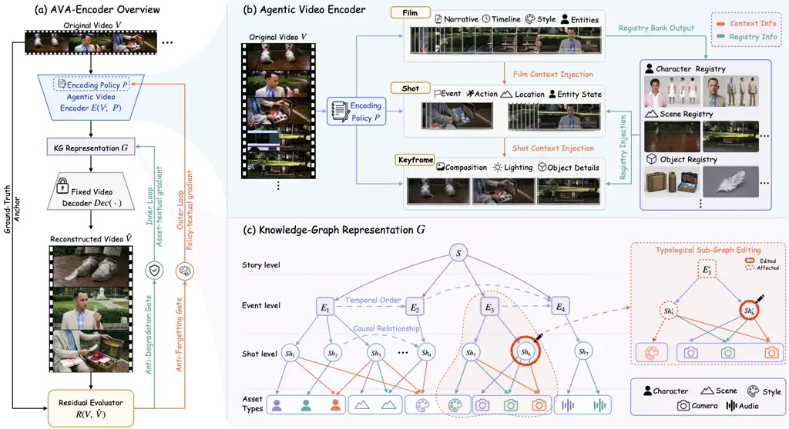

Figure 1: Overview of AVA-Encoder. (a) Reconstruction-driven, gated
dual-loop self-evolution. (b) Hierarchical agentic encoding with
inter-level context injection. (c) Film KG nodes, edges, and linked
multimodal assets for constrained generation and coordinated editing.

Learning such representations poses three challenges, addressed by
AVA-Encoder’s complementary designs. First, translating dense multimodal
content into structured text risks losing cinematic detail (Gu et al.,
2025). The Agentic Video Encoder (Sec. 4.1) combines film-, shot-, and
keyframe-level understanding with hierarchical context injection to
preserve local details and global dependencies. Second, reconstruction
and consistent editing require preserving dependencies across narrative
hierarchy, temporal order, and audiovisual content. Film KG (Sec. 4.2)
makes these explicit through typed edges linking textual nodes and
assets. Third, stable self-evolution requires controllable updates,
precise optimization signals, and robust evaluation. AVA-Encoder uses
gated dual-loop textual-gradient optimization (Sec. 4.3) to pseudo-train
a generalizable encoding policy and refine the input-specific Film KG at
test time. Acceptance gates limit regressions, fact-level reconstruction
feedback guides targeted corrections, and separate optimization and
final evaluation signals mitigate reward exploitation (Sec. 4.3.1).

Our contributions are threefold:

1.  1.  Agentic Video Auto-Encoder. We introduce the Agentic Video
        Auto-Encoder paradigm, formulating agent-native video representation
        learning as a self-evolving agentic auto-encoding problem. It
        achieves 49.0% Overall reconstruction fidelity, exceeding the
        strongest external baseline by 20.7 percentage points. Its
        pseudo-trained encoding policy surpasses a human-tuned policy by 1.4
        points in Overall fidelity with over 70% fewer system-prompt tokens.
2.  2.  Agentic Video Representation Benchmark. We introduce an agentic
        video reconstruction benchmark spanning four evaluation directions
        and eight cinematic dimensions, with 97.3% agreement between
        automatic and human pairwise rankings under blinded evaluation.
3.  3.  Film KG Dataset and Editing Framework. We release high-quality
        structured-text Film KGs as reverse-engineered creation records,
        easing the trajectory scarcity noted above, and a framework for
        coordinated graph-based editing. Film KG representations improve
        Overall generation quality across all tested open-source downstream
        agentic video creation systems.

## 2 Related Work

### 2.1 Agentic Video Creation Systems

LLM- and VLM-based systems use planning and tool orchestration for video
generation (Lin et al., 2024; Zhuang et al., 2024; Xie et al., 2024;
Yuan et al., 2024; Lai et al., 2026; Li et al., 2024; Long et al., 2024;
Wu et al., 2025; Xu et al., 2025), editing, and remixing (Song et al.,
2026; comfyanonymous and ComfyUI contributors, 2023; Zhang et al.,
2026). However, their foundation models struggle to plan complex
multimodal cinematic tasks, limiting creation-trajectory quality; the
scarcity of high-quality trajectories in this field, in turn, hinders
further training to improve planning abilities (Cao et al., 2025).

AVA-Encoder instead works backward from human films, converting them
into readable, learnable, and editable Film KGs with explicit
dependencies, and self-improving the system through reconstruction.
Decoding produces aligned intermediate records and rendered outputs,
serving as reverse-engineered cinematic-grade creation trajectories for
future training (Wang et al., 2026b), providing a route to learning from
abundant high-quality films beyond trajectories current agentic systems
can produce.

### 2.2 Agent-Native Video Representations

Existing video representations include low-level visual forms, such as
pixels, latent tokens, and embeddings (Tong et al., 2022; Yu et al.,
2023; Zhang et al., 2023); textual descriptions, such as captions and
screenplays (Huang et al., 2020; Chung & Yu, 2023; Mahon & Lapata,
2024); and structured representations, such as hierarchical memories and
graphs (Song et al., 2024; He et al., 2024; Ataallah et al., 2024; Chu
et al., 2025; Rege et al., 2026).

Jointly supporting agent readability, reliable editing, and faithful
generation remains challenging. Low-level forms retain visual
information but are difficult for agents to read, query, or modify
directly; textual descriptions are accessible but often leave entity
relationships and cross-modal dependencies implicit. Structured
representations support factual retrieval and reasoning, yet need not
preserve the cinematic details and generation dependencies required for
reconstruction. For example, recording that two characters meet in shot
eight does not specify their appearance, spatial arrangement, or
audiovisual context required for generation.

Success in retrieval and QA (Zhang et al., 2024a; Zhang et al., 2024b;
Qian et al., 2024) therefore does not establish generative fidelity.
Reconstruction tests whether retained information supports faithful
regeneration; AVA-Encoder uses this source-referenced feedback to assess
and improve representation fidelity.

## 3 Task Definition

### 3.1 Problem Formulation

We formulate agent-native video representation learning as agentic
auto-encoding, where an agent autonomously learns to encode a video into
a structured agentic representation from which a fixed decoder
faithfully reconstructs the video. Given a cinematic video input
$`V\in\mathcal{V}`$ and an encoding policy $`P\in\mathcal{P}`$, the
agentic encoder $`E(\cdot)`$ and fixed decoder $`\mathrm{Dec}(\cdot)`$
define:

```math
G=E(V;P),\qquad\hat{V}=\mathrm{Dec}(G). \tag{1}
```

Here, the output of the encoder $`G\in\mathcal{G}`$ is a Film KG. It
represents the input film through structured-text nodes describing
cinematic content, typed edges encoding dependencies among these
elements, and linked multimodal assets synthesized from the textual
nodes (Sec. 4.2). All source-video information used for reconstruction
is mediated by the textual graph. Unlike dense neural embeddings, this
explicit representation $`G`$ is designed to meet the three agent-native
requirements in Sec. 1. $`\mathcal{V}`$, $`\mathcal{P}`$, and
$`\mathcal{G}`$ denote the video, encoding policy, and Film KG spaces,
respectively.

### 3.2 Optimization Objective

Under the fixed decoder, reconstruction fidelity measures how well $`G`$
preserves the source video. Let $`R(V,\hat{V})`$ denote reconstruction
discrepancies and $`\mathcal{L}(\cdot)`$ map them to a scalar loss:

```math
\ell(V,G):=\mathcal{L}\!\left(R\!\left(V,\mathrm{Dec}(G)\right)\right). \tag{2}
```

From $`G=E(V;P)`$, this loss evaluates both an individual representation
and the encoding policy that produces it. We therefore formulate
optimization at both the policy and instance levels:

```math
\left\{\begin{aligned} &\min_{P\in\mathcal{P}}\;\mathbb{E}_{V^{\prime}\sim\operatorname{Unif}(\mathcal{D})}\left[\ell\!\left(V^{\prime},E(V^{\prime};P)\right)\right],&&\text{policy level},\\[3.0pt]
&\min_{G\in\mathcal{G}}\;\ell(V,G),&&\text{instance level}.\end{aligned}\right. \tag{3}
```

where $`\mathcal{D}=\{V_{i}\}_{i=1}^{L}`$ is the policy-learning
collection of $`L`$ videos. The policy-level objective averages
reconstruction loss over
$`V^{\prime}\sim\operatorname{Unif}(\mathcal{D})`$, while the
instance-level objective minimizes it for a given $`V`$. AVA-Encoder
realizes these objectives through shared-policy pseudo-training and
optional input-specific Film KG refinement within the dual-loop
textual-gradient framework (Sec. 4.3). Here, _pseudo-training_ fits
$`P`$ to $`\mathcal{D}`$ from loss feedback and evaluates it on held-out
videos as in training, but updates only the natural-language policy,
with model weights frozen.

## 4 Method: AVA-Encoder

AVA-Encoder addresses the three challenges in Sec. 1 by building an
agentic auto-encoding framework consisting of a hierarchical agentic
video encoder (Sec. 4.1), a Film KG representation (Sec. 4.2), and
reconstruction-driven dual-loop textual-gradient evolution (Sec. 4.3;
Figure 1(a)).

### 4.1 Agentic Video Encoder

Mapping a high-dimensional film into structured text risks losing
fine-grained cinematic information (Sec. 1). The Agentic Video Encoder
addresses this through _three-level specialized understanding_ across
film, shot, and keyframe granularities, together with _inter-level
context injection_ that preserves dependencies across these levels
(Figure 1(b)). After preprocessing, $`E(V;P)`$ first extracts
hierarchical structured descriptions and relations, then assembles them
into the Film KG $`G`$.

We first partition a video $`V`$ into $`S`$ ordered shots
$`(s_{i})_{i=1}^{S}`$ and select $`J_{i}`$ keyframes
$`(f^{\mathrm{kf}}_{i,j})_{j=1}^{J_{i}}`$ from each shot (Appendix E.1).

##### Step 1: Hierarchical Agentic Understanding.

To capture both local cinematic details and global dependencies, a
hierarchical encoding policy
$`P=(P_{\mathrm{film}},P_{\mathrm{shot}},P_{\mathrm{kf}})`$ guides a
video-understanding agent to extract textual information
$`\mathcal{C}_{\mathrm{film}},\mathcal{C}_{\mathrm{shot},i},\mathcal{C}_{\mathrm{kf},i,j}`$
through $`\operatorname{Understand}`$ at film, shot, and keyframe levels
while conditioning on broader cross-hierarchy context:

```math
\displaystyle(\mathcal{C}_{\mathrm{film}},\mathcal{B}_{\mathrm{reg}}) \displaystyle=\operatorname{Understand}(V;P_{\mathrm{film}}), \tag{4}
```

```math
\displaystyle\mathcal{C}_{\mathrm{shot},i} \displaystyle=\operatorname{Understand}(s_{i},\mathcal{C}_{\mathrm{film}},\mathcal{B}_{\mathrm{reg}};P_{\mathrm{shot}}),
```

```math
\displaystyle\mathcal{C}_{\mathrm{kf},i,j} \displaystyle=\operatorname{Understand}(f^{\mathrm{kf}}_{i,j},\mathcal{C}_{\mathrm{shot},i},\mathcal{B}_{\mathrm{reg}};P_{\mathrm{kf}}).
```

The encoding policy $`P`$ is optimized through outer-loop
pseudo-training (Sec. 4.3.2).

Three-Level Specialized Understanding. Film-level understanding captures
global narrative and cross-shot relations while constructing a shared
registry $`\mathcal{B}_{\mathrm{reg}}`$ of canonical entity names and
film-wide identifiers. Shot-level understanding captures temporal,
audiovisual, and camera dynamics, whereas keyframe-level understanding
extracts fine-grained visual composition and appearance.

Inter-Level Information Injection. Broader context is injected into
finer levels to preserve cross-level dependency and consistency:
$`\mathcal{C}_{\mathrm{film}}`$ conditions shot understanding,
$`\mathcal{C}_{\mathrm{shot},i}`$ conditions keyframe understanding, and
the shared registry $`\mathcal{B}_{\mathrm{reg}}`$ maintains consistent
entity references across levels.

##### Step 2: Film KG Assembly.

We assemble the structured descriptions, entity references, and
explicitly identified relations from Step 1 into the Film KG, completing
the Agentic Encoding:

```math
G=E(V;P)=\operatorname{BuildGraph}\!\left(\mathcal{C}_{\mathrm{film}},\mathcal{B}_{\mathrm{reg}},\{\mathcal{C}_{\mathrm{shot},i},\{\mathcal{C}_{\mathrm{kf},i,j}\}_{j=1}^{J_{i}}\}_{i=1}^{S}\right). \tag{5}
```

$`\operatorname{BuildGraph}`$ deterministically maps the structured
records to nodes and their identified relations and registry references
to edges under the Film KG schema. See Secs. 4.2, E for details.

### 4.2 Film KG Representation

To preserve the cinematic multimodal dependencies discussed in Sec. 1 in
an agent-native form, we organize the encoder’s structured descriptions
and identified relations into a Film KG:
$`G=(\mathcal{N}_{G},\mathcal{E}_{G},\mathcal{A}_{G})`$, where
$`\mathcal{N}_{G}`$ contains structured-text nodes storing cinematic
contents, $`\mathcal{E}_{G}`$ contains typed edges expressing content
dependencies, and $`\mathcal{A}_{G}`$ stores linked generated multimodal
assets.

In order to make multimodal content individually accessible and editable
by agents, we organize reconstruction-critical descriptions into
separately addressable textual nodes of types $`\{`$Story, Event, Shot,
Character, Scene, Object, Camera, Style, Audio, Keyframe$`\}`$, while
their edges to generated assets connect textual edits to multimodal
creation.

Typed edges preserve structural, asset, temporal, and semantic
dependencies among separately editable nodes, making their within- and
cross-shot relationships explicit for coordinated editing.

Given edited nodes $`Z\subseteq\mathcal{N}_{G}`$ and edit type $`e`$, we
determine the affected node set $`\mathcal{N}_{\mathrm{aff}}`$ through
edit-conditioned dependency traversal:

```math
\displaystyle B=\operatorname{BFS}_{e}(G,Z),\qquad\mathcal{N}_{\mathrm{aff}}=\operatorname{Up}\!\left(B\cup\operatorname{Check}^{1}_{e}(B)\right). \tag{6}
```

Here, $`\operatorname{BFS}_{e}`$ collects the edited nodes and their
propagation dependents into $`B`$; $`\operatorname{Check}^{1}_{e}`$ adds
nodes requiring one-hop consistency checks; and $`\operatorname{Up}`$
retains the selected nodes and adds their enclosing events and story so
that higher-level descriptions reflect the edited shots. (See Sec. 5.4
and Appendix K, L.2.)

### 4.3 Dual-Loop Textual-Gradient Evolution

To address Challenge 3 in Sec. 1, we develop dual-loop textual-gradient
evolution for reliable agentic self-evolution (Ye et al., 2026).
Extending the auto-encoding principle to agents, a fixed decoder exposes
reconstruction errors, which are translated into textual gradients to
revise either the shared encoding policy $`P`$ or the input-specific
Film KG $`G`$. Accordingly, the outer loop performs _Data-Agnostic
Encoding Policy Pseudo-Training_ (Sec. 4.3.2) to learn reusable encoding
rules, while the inner loop performs _Data-Dependent KG Representation
Refinement_ (Sec. 4.3.3) to correct input-specific errors.

##### Textual-gradient updates.

We adopt textual gradients (Yuksekgonul et al., 2024) to convert
reconstruction errors into target-specific natural-language critiques
for agents. For an update target $`z\in\{P,G\}`$ denoting encoding
policy and KG in Figure 2, let $`\mathcal{F}_{z}`$ denote its relevant
reconstruction errors. The agent generates a textual gradient and
instantiates it as a challenger:

```math
\displaystyle\mathbf{g}_{\mathrm{text}}^{z}=\nabla_{\mathrm{text}}(z,\mathcal{F}_{z}),\qquad z^{\prime}=\operatorname{Propose}_{z}(z,\mathbf{g}_{\mathrm{text}}^{z}),\qquad z\in\{P,G\}. \tag{7}
```

Here, $`\nabla_{\mathrm{text}}`$ diagnoses how the current target should
update, while $`\operatorname{Propose}_{z}`$ applies critiques to the
encoding policy or selected generation-description nodes in $`G`$, with
foundation-model weights fixed.

To determine whether a challenger should replace the current solution,
we first define optimization signals and evaluation metrics for
assessing reconstruction improvements and regressions (Sec. 4.3.1), then
describe how each loop organizes updates and controls their acceptance
(Secs. 4.3.2 and 4.3.3).

#### 4.3.1 Reconstruction Residual

The reconstruction discrepancies $`R(V,\hat{V})`$ in Sec. 3.2 inform two
fidelity measures, both higher-is-better: $`R_{\mathrm{reward}}`$ guides
self-evolution, while $`R_{\mathrm{eval}}`$ is reserved for final
evaluation to guard against reward exploitation.

##### Optimization signal $`R_{\mathrm{reward}}`$.

Local revisions require fine-grained feedback (Yu et al., 2025), but
holistic VLM scores can be coarse and unstable for dense multimodal
content (Wang et al., 2026d). We therefore decompose reconstruction
quality into factual checks against the source at the decoder’s keyframe
and shot granularities. For each selected source keyframe or shot $`x`$,
we construct $`\mathcal{Q}(x)=\{(q_{k},y_{k})\}_{k=1}^{K}`$: $`K`$
binary questions $`q_{k}`$ covering observable content attributes,
paired with source-derived answers $`y_{k}`$, $`k\in\{1,\ldots,K\}`$.
Both remain fixed across challenger comparisons to ensure a consistent
factual reference. For reconstruction $`\hat{x}`$, the reward measures
the fraction of checked source facts preserved:

```math
R_{\mathrm{reward}}^{\mathrm{QA}}(x,\hat{x})=\frac{1}{K}\sum_{k=1}^{K}\mathbb{I}\!\left[\operatorname{Answer}(\hat{x},q_{k})=y_{k}\right], \tag{8}
```

where $`\operatorname{Answer}`$ returns a binary answer from the
reconstructed content and $`\mathbb{I}[\cdot]`$ is the indicator
function. For these QA checks, the corresponding loss in Eq. 2 is
$`1-R_{\mathrm{reward}}^{\mathrm{QA}}(x,\hat{x})`$ (Appendix C).

While aggregated reward compares challengers, the failed checks identify
discrepancies to guide revision (Wang et al., 2026c). Letting
$`\hat{y}_{k}=\operatorname{Answer}(\hat{x},q_{k})`$, we retain
$`\mathcal{F}_{\mathrm{QA}}(x,\hat{x})=\{(q_{k},y_{k},\hat{y}_{k})\mid 1\leq k\leq K,\ \hat{y}_{k}\neq y_{k}\}`$
as concrete evidence for textual-gradient updates in Eq. 7. Additional
loop-specific diagnostics appear in Secs. 4.3.2 and 4.3.3; Appendix A
details all diagnostic sources and their conversion into revision
instructions.

##### Final evaluation $`R_{\mathrm{eval}}`$.

We assess final reconstruction fidelity with $`R_{\mathrm{eval}}`$ to
guard against reward exploitation. It aggregates fine-grained factual
judgments under a fixed protocol distinct from the optimization reward,
with comparison directions and dimensions introduced in Sec. 5.1 and
Appendix B.

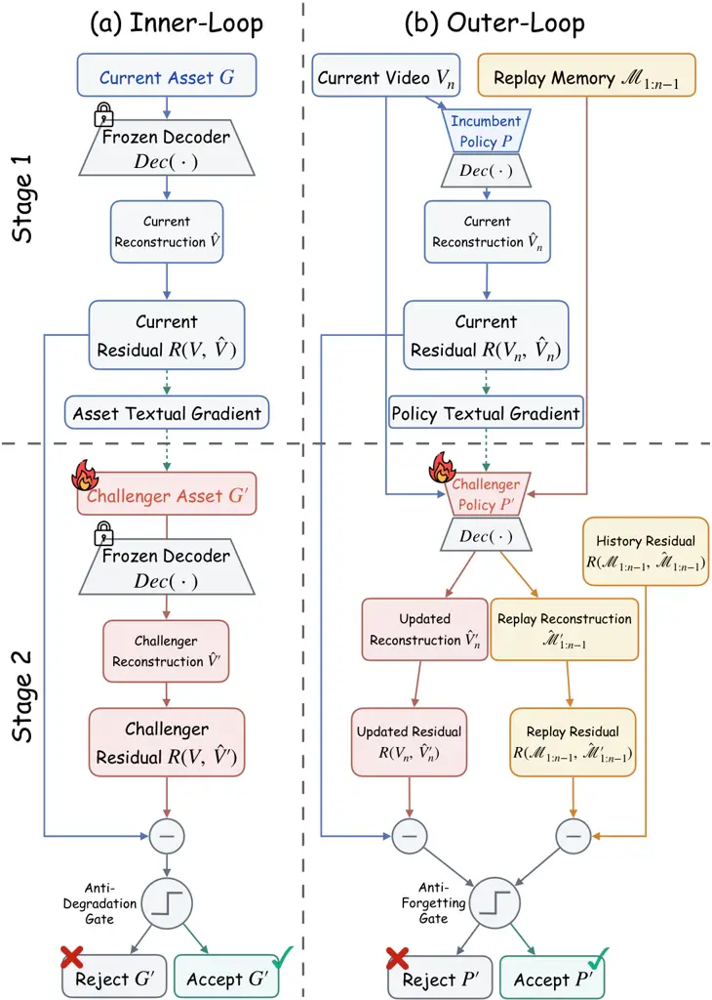

Algorithm 1 Inner Loop: KG Representation Refinement 1: Input: Source
video $`V`$, initial KG $`G`$, setting
$`\beta\in\{\mathrm{KF},\mathrm{shot}\}`$, budget $`T_{\mathrm{inner}}`$
2: Output: Refined KG $`G`$ 3: Prepare fixed verification checks from
$`V`$; $`\hat{V}\leftarrow\operatorname{Dec}(G)`$ 4: for
$`t=1,\ldots,T_{\mathrm{inner}}`$ do 5:  Diagnose reconstruction errors
in $`\hat{V}`$ against $`V`$ for setting $`\beta`$ 6:  if no errors are
found then break 7:  Select a keyframe or shot and target dimension
$`d^{\star}`$; collect error evidence $`\mathcal{F}_{G}`$ 8:
 $`G^{\prime}\leftarrow\operatorname{Propose}_{G}(G,\nabla_{\mathrm{text}}(G,\mathcal{F}_{G}))`$
$`\triangleright`$ Revise selected descriptions (Eq. 7) 9:
 $`\hat{V}^{\prime}\leftarrow\operatorname{Dec}(G^{\prime})`$; extract
corresponding reconstructions $`u,u^{\prime}`$ from
$`\hat{V},\hat{V}^{\prime}`$ 10:
 $`\Gamma_{\mathrm{inner}}^{\beta}(u,u^{\prime})\leftarrow\mathbb{I}\bigl[\operatorname{Improve}_{\beta}(u,u^{\prime})\land\operatorname{Preserve}_{\beta}(u,u^{\prime})\bigr]`$
11:    $`\triangleright`$ Anti-Degradation Gate 12:  if
$`\Gamma_{\mathrm{inner}}^{\beta}(u,u^{\prime})=1`$ then 13:
  $`(G,\hat{V})\leftarrow(G^{\prime},\hat{V}^{\prime})`$ 14:  end if 15:
end for 16: return $`G`$

Figure 2: Dual-loop textual-gradient evolution. (a) KG refinement with
the Anti-Degradation Gate. (b) Encoding-policy pseudo-training with the
Anti-Forgetting Gate.

Algorithm 2 Outer Loop: Encoding Policy Pseudo-Training 1: Input: Videos
$`\{V_{i}\}_{i=1}^{L}`$, policy $`P_{0}`$, component $`b`$, budget
$`T_{\mathrm{outer}}`$, replay counts $`m,n`$ 2: Output: Pseudo-trained
component $`P_{b}^{*}`$ 3: $`P\leftarrow P_{0}`$; replay memory
$`\mathcal{M}\leftarrow\varnothing`$ 4: for each $`V_{i}`$ do 5:
 $`P_{\mathrm{ref}}\leftarrow P`$; prepare samples $`\mathcal{S}_{i}`$
and fixed checks $`\mathcal{Q}_{i}`$ 6:  for
$`t=1,\ldots,T_{\mathrm{outer}}`$ do 7:
  $`(R_{c},\mathcal{F}_{\mathrm{QA}})\leftarrow\operatorname{Assess}(P,\mathcal{S}_{i},\mathcal{Q}_{i})`$
8:
  $`P^{\prime}\leftarrow\operatorname{Propose}_{P}(P,\nabla_{\mathrm{text}}(P,\mathcal{F}_{\mathrm{QA}}))`$
9: $`\triangleright`$ Update only $`P_{b}`$ (Eq. 7) 10:
  $`(R^{\prime}_{c},\_)\leftarrow\operatorname{Assess}(P^{\prime},\mathcal{S}_{i},\mathcal{Q}_{i})`$
11:   $`(R^{\prime}_{h},R_{h}^{\mathrm{ref}})\leftarrow(0,0)`$ 12:   if
$`\mathcal{M}\neq\varnothing`$ then 13:
   $`(\mathcal{S}_{h},\mathcal{Q}_{h})\leftarrow\operatorname{Replay}(\mathcal{M},m,n)`$
14:    $`(R^{\prime}_{h},R_{h}^{\mathrm{ref}})\leftarrow`$ 15:
      $`\operatorname{AssessHist}(P^{\prime},P_{\mathrm{ref}},\mathcal{S}_{h},\mathcal{Q}_{h})`$
16:   end if 17:
  $`\Gamma_{\mathrm{outer}}\leftarrow\mathbb{I}\bigl[(R^{\prime}_{c}>R_{c}+\delta)\land(R^{\prime}_{h}\geq R_{h}^{\mathrm{ref}}-\epsilon_{\mathrm{hist}})\bigr]`$
18:     $`\triangleright`$ Anti-Forgetting Gate 19:   if
$`\Gamma_{\mathrm{outer}}=1`$ then $`P\leftarrow P^{\prime}`$ 20:  end
for 21:  Add $`(\mathcal{S}_{i},\mathcal{Q}_{i})`$ to $`\mathcal{M}`$
22: end for 23: return $`P_{b}^{*}\leftarrow P_{b}`$ Table 1:
Reconstruction fidelity (%; higher is better). V/KF: direct
video/keyframe comparison; V-BC/KF-BC: video/keyframe back-captioning.
Overall averages the four scores. Method V (%) $`\uparrow`$ KF
(%) $`\uparrow`$ V-BC (%) $`\uparrow`$ KF-BC (%) $`\uparrow`$ Overall
(%) $`\uparrow`$ VideoAnalyzer (Docusphere, 2026) 26.1 28.5 9.7 21.7
21.5 Storyboard Studio (BroderQi, 2026) 16.4 28.6 9.6 23.0 19.4
soap2soap (Song et al., 2026) 36.7 39.5 15.8 21.3 28.3 AVA-Encoder
(ours) 57.8 73.7 29.7 34.6 49.0 Table 2: Reconstruction ablations (%;
higher is better). Except for the single-level encoder, all settings use
hierarchical encoding. Single-loop ablations retain the other loop and
its gate; gate ablations retain both loops. Ablation setting V
(%) $`\uparrow`$ KF (%) $`\uparrow`$ V-BC (%) $`\uparrow`$ KF-BC
(%) $`\uparrow`$ Overall (%) $`\uparrow`$ Single-level encoder 35.1 38.4
15.4 21.1 27.5 w/o both loops 50.7 67.6 21.2 29.9 42.4 Human-tuned
policy 53.5 68.1 25.8 30.2 44.4 w/o policy pseudo-training 52.7 71.8
23.9 33.1 45.4 w/o KG refinement 55.6 68.3 26.6 32.7 45.8 w/o inner-loop
gate 56.8 66.7 27.2 28.9 44.9 w/o outer-loop gate 52.9 70.2 29.8 33.0
46.5 w/o both gates 53.1 67.2 24.3 29.4 43.5 AVA-Encoder (full) 57.8
73.7 29.7 34.6 49.0

#### 4.3.2 Outer Loop: Encoding Policy Pseudo-Training

Before deployment, the outer loop learns a shared encoding policy from
reconstruction feedback on a small video collection to improve fidelity
on unseen inputs (Algorithm 2). Failed QA checks expose missing or
distorted source facts and drive textual-gradient updates to $`P_{b}`$,
$`b\in\{\mathrm{shot},\mathrm{kf}\}`$, via Eq. 7 with $`z=P`$. Accepted
revisions accumulate across videos into reusable general encoding rules.

Adapting the policy to the current video may weaken previously acquired
capabilities. We therefore introduce the _Anti-Forgetting Gate_,
requiring current-video reward improvement while limiting historical
degradation (Algorithm 2, Line 17). Historical performance is compared
against $`P_{\mathrm{ref}}`$, the policy frozen at the start of the
current video, to constrain cumulative regression across updates. Replay
covers every preceding video while sampling assets and factual checks
within each to limit verification cost. See Sec. 5.3 for gate ablations
and Appendix D for sampling and thresholds.

In Algorithm 2, $`\operatorname{Assess}(P,\mathcal{S},\mathcal{Q})`$
encodes and reconstructs samples $`\mathcal{S}`$ under $`P`$, returning
mean QA reward and failed checks against $`\mathcal{Q}`$;
$`\operatorname{AssessHist}`$ returns challenger and reference rewards
on the same replay samples and checks. $`R_{c}`$ and $`R_{h}`$ denote
current and historical rewards, with improvement margin $`\delta`$ and
historical degradation tolerance $`\epsilon_{\mathrm{hist}}`$.

#### 4.3.3 Inner Loop: KG Representation Refinement

A shared encoding policy, fixed at inference, may still overlook
video-specific details. The inner loop addresses these omissions by
autonomously refining the Film KG at test time while keeping $`P`$ fixed
(Algorithm 1). Reconstruction errors identify a keyframe or shot and a
content dimension requiring correction. Setting $`z=G`$ in Eq. 7, the
agent forms a textual gradient for this local discrepancy and revises
the corresponding generation descriptions, which directly guide image or
video reconstruction.

Improving one dimension may compromise content preserved in others. We
therefore introduce the _Anti-Degradation Gate_, which accepts a
challenger only if $`\operatorname{Improve}_{\beta}`$ confirms
reconstruction improvement and $`\operatorname{Preserve}_{\beta}`$
limits degradation to the allowed tolerances for setting $`\beta`$
(Algorithm 1, Line 10). Both checks use the same source content and
fixed verification criteria. See Sec. 5.3 for refinement and gate
ablations, and Appendix D for setting-specific checks and thresholds.

## 5 Experiments

We first evaluate video reconstruction fidelity across agentic systems,
then isolate the contributions of hierarchical encoding, dual-loop
optimization, and acceptance gates through ablation, and finally assess
Film KG representation’s utility for coordinated editing and downstream
generation.

### 5.1 Experimental Setup

##### Data.

We pseudo-train on 6 videos and evaluate on 18 non-overlapping videos
spanning animation, human-directed AI short films, and classic cinema,
detailed in Appendix H .

##### Models and comparison protocol.

Qwen-3.7-Plus (Alibaba Cloud, 2026b) performs hierarchical understanding
within the Agentic Video Encoder and revises the policy or Film KG using
textual gradients; Gemini-3.1-Pro-Preview (Google AI, 2026a) performs
factual judgments for $`R_{\mathrm{reward}}`$ and $`R_{\mathrm{eval}}`$.
Nano Banana Pro (Google AI, 2026b) and HappyHorse 1.0 (Alibaba Cloud,
2026a) generate decoder images and videos, respectively. All model
weights remain fixed. VideoAnalyzer (Docusphere, 2026), Storyboard
Studio (BroderQi, 2026), soap2soap (Song et al., 2026), and AVA-Encoder
share the same understanding model, test videos, generators, and
per-shot decoder-interface limits of 5 generated reference keyframes and
1,200 shot-prompt tokens. Reconstruction generators never receive
source-video pixels. Appendix N and G provide prompts and baseline
adaptation protocols.

##### Evaluation.

We assess retained information at two granularities, videos and
keyframes, through both direct comparison and comparison of
independently generated descriptions, yielding four evaluation
directions: V directly compares audiovisual and temporal content; KF
examines static visual details. Since all compared methods use
text-centered representations, V-BC and KF-BC compare detailed semantic
facts in independently generated source and reconstruction descriptions.
These complementary granularities and comparison modes reduce reliance
on any single view.

Each direction examines eight dimensions: Character, Scene, Position,
Motion, Audio, Style, Camera, and Narrative. This decomposition turns
coupled cinematic information into fine-grained factual judgments, which
fixed rules aggregate into direction scores (Li et al., 2026b). Keyframe
directions exclude Audio, and Overall is the mean of the four direction
scores. Final-evaluator ($`R_{\mathrm{eval}}`$) rankings agree with
human preferences in 97.3% of 730 blinded pairwise comparisons, detailed
in Appendix B.

### 5.2 Reconstruction Fidelity

Under the shared decoder and interface budget, AVA-Encoder reaches 49.0%
Overall, surpassing the strongest baseline, soap2soap, by 20.7
percentage points and leading in all four directions (Table 1). Gains
across direct and caption-based comparisons indicate better preservation
of perceptual detail and semantic information. Figure 3 shows a
representative comparison; Appendix I and L provide dimension-level
results and further examples.

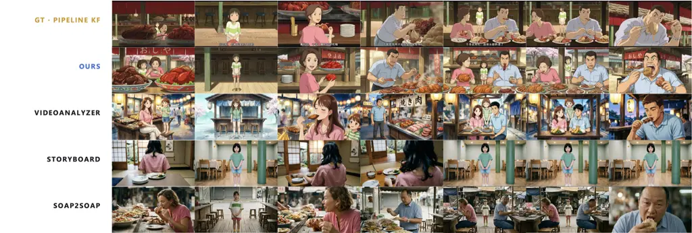

Figure 3: Reconstruction comparison between AVA-Encoder and baselines,
showing the preservation of character identity, visual detail, and
visual consistency.

### 5.3 Ablation Study

Table 2 examines encoding structure, policy choice, dual-loop
optimization, and acceptance gates under the same reconstruction
evaluation protocol.

First, hierarchical encoding raises Overall from the single-level
encoder’s 27.5% to 42.4% with both loops disabled, supporting
multi-level understanding for faithful representation. Second, the outer
loop learns a shared encoding policy that improves reconstruction on
unseen videos: pseudo-training on six videos raises Overall on 18 unseen
videos by 3.4 points without the inner loop (42.4% to 45.8%) and 3.6
with it (45.4% to 49.0%). In the policy-only setting, the evolved policy
also surpasses the human-tuned policy (44.4%) by 1.4 points, while using
74.3% fewer shot-level and 70.1% fewer keyframe-level system-prompt
tokens. Thus, policy evolution improves fidelity over human tuning while
producing more compact prompts. Third, the inner loop addresses
input-specific errors, raising Overall by 3.2 points with the
pseudo-trained policy fixed (45.8% to 49.0%) and 3.0 with the initial
policy (42.4% to 45.4%). This refinement complements shared-policy
optimization: together, the loops gain 6.6 points over the initial
configuration. Finally, both acceptance gates improve fidelity: removing
only the inner-loop Anti-Degradation Gate or outer-loop Anti-Forgetting
Gate lowers Overall from 49.0% to 44.9% or 46.5%, respectively; removing
both yields 43.5%. These ablations support acceptance control in both KG
refinement and policy learning. Appendix J provides configuration
definitions and supplementary analyses.

### 5.4 Representation Applications

##### Graph-based editing.

Film KG supports targeted edits with coordinated updates to dependent
content. Figure 4 shows consistent character replacement across six
linked shots, preserving unrelated characters, scenes, and event
structure. Appendix L.2 provides further edit examples.

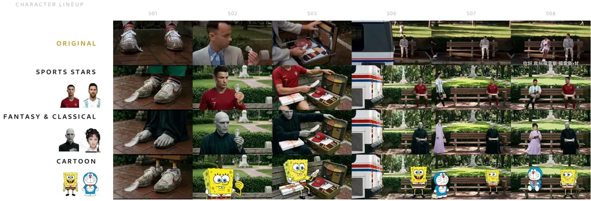

Figure 4: Editing Showcase: Character replacement across a six-shot
sequence. A single character edit jointly updates the dependent
keyframes and shots.

##### Downstream video generation.

We provide each video-creation framework with the complete Film KG as
text and a one-sentence usage request, without workflow changes,
framework-specific adapters, or prompt tuning. Overall improves across
all tested frameworks (Table 3), demonstrating cross-system reuse via a
simple textual interface. Evaluation details appear in Appendix M.

|                                 |           |           |           |           |           |           |
| ------------------------------- | --------- | --------- | --------- | --------- | --------- | --------- |
| Method                          | Character | Plot      | Camera    | Style     | AV        | Overall   |
| MovieAgent (Wu et al., 2025)    | 3.27/3.57 | 1.55/3.33 | 3.35/3.40 | 2.23/2.75 | 1.58/2.18 | 2.39/3.04 |
| FilmAgent (Xu et al., 2025)     | 1.93/3.23 | 1.58/2.08 | 3.48/3.63 | 1.60/3.13 | 1.30/1.45 | 1.98/2.70 |
| Anim-Director (Li et al., 2024) | 1.43/3.33 | 2.68/1.55 | 3.20/3.63 | 1.45/2.48 | 1.30/1.55 | 2.01/2.51 |
| VideoStudio (Long et al., 2024) | 3.00/1.43 | 1.28/1.60 | 3.03/3.40 | 1.48/2.70 | 1.33/1.70 | 2.02/2.17 |

Table 3: Downstream video-generation quality (1–4; higher is better).
Each cell reports scores without/with a single textual injection of the
complete Film KG. Bold indicates an improvement; AV denotes audiovisual
quality.

## 6 Conclusion

We present AVA-Encoder, an agentic video auto-encoding framework that
transforms cinematic videos into Film KG representation.
Reconstruction-driven dual-loop self-evolution improves shared encoding
policies and video-specific representations without ground-truth graphs
or expert creation trajectories. AVA-Encoder achieves 49.0% Overall
reconstruction fidelity, a 20.7-percentage-point gain over the strongest
baseline, while enabling coordinated editing and improving downstream
video generation. These results demonstrate a path toward bridging video
and agent spaces, making video creation knowledge in finished films
explicit, editable, and reusable by agents.

## References

- Alibaba Cloud (2026a) Alibaba Cloud. HappyHorse 1.0 reference-to-video
  model. Alibaba Cloud Model Studio Documentation, 2026a. URL
  [https://www.alibabacloud.com/help/en/model-studio/video-generate-edit-model](https://www.alibabacloud.com/help/en/model-studio/video-generate-edit-model).
- Alibaba Cloud (2026b) Alibaba Cloud. Qwen3.7-Plus Model Information.
  Alibaba Cloud Model Studio Documentation, 2026b. URL
  [https://www.alibabacloud.com/help/en/model-studio/qwen3-7-plus](https://www.alibabacloud.com/help/en/model-studio/qwen3-7-plus).
- Ataallah et al. (2024) Kirolos Ataallah, Xiaoqian Shen, Eslam
  Abdelrahman, Essam Sleiman, Mingchen Zhuge, Jian Ding, Deyao Zhu,
  Jürgen Schmidhuber, and Mohamed Elhoseiny. Goldfish: Vision-language
  understanding of arbitrarily long videos. In _Computer Vision – ECCV
  2024_, pp. 251–267. Springer, 2024.
- BroderQi (2026) BroderQi. Storyboard Studio: AI-powered professional
  storyboarding workbench. GitHub repository, 2026. URL
  [https://github.com/BroderQi/Storyboard](https://github.com/BroderQi/Storyboard).
- Brooks et al. (2024) Tim Brooks, Bill Peebles, Connor Holmes, Will
  DePue, Yufei Guo, Li Jing, David Schnurr, Joe Taylor, Troy Luhman,
  Eric Luhman, Clarence Ng, Ricky Wang, and Aditya Ramesh. Video
  generation models as world simulators. OpenAI Technical Report, 2024.
  URL
  [https://openai.com/index/video-generation-models-as-world-simulators/](https://openai.com/index/video-generation-models-as-world-simulators/).
- ByteDance Seed Team (2026) ByteDance Seed Team. Seedance 2.0. Official
  Model Page, 2026. URL
  [https://seed.bytedance.com/seedance2_0](https://seed.bytedance.com/seedance2_0).
- Cao et al. (2025) Shiyi Cao, Dacheng Li, Fangzhou Zhao, Shuo Yuan,
  Sumanth R. Hegde, Connor Chen, Charlie Ruan, Tyler Griggs, Shu Liu,
  Eric Tang, Richard Liaw, Philipp Moritz, Matei Zaharia, Joseph E.
  Gonzalez, and Ion Stoica. SkyRL-Agent: Efficient RL training for
  multi-turn LLM agent. _arXiv preprint arXiv:2511.16108_, 2025. URL
  [https://arxiv.org/abs/2511.16108](https://arxiv.org/abs/2511.16108).
- Chu et al. (2025) Meng Chu, Yicong Li, and Tat-Seng Chua.
  GraphVideoAgent: Enhancing long-form video understanding with entity
  relation graphs. In _Proceedings of the 33rd ACM International
  Conference on Multimedia_, pp. 4639–4648. Association for Computing
  Machinery, 2025.
  [10.1145/3746027.3755537](https://doi.org/10.1145/3746027.3755537).
  URL
  [https://doi.org/10.1145/3746027.3755537](https://doi.org/10.1145/3746027.3755537).
- Chung & Yu (2023) Jiwan Chung and Youngjae Yu. Long story short: A
  summarize-then-search method for long video question answering. In
  _Proceedings of the British Machine Vision Conference (BMVC)_, 2023.
- comfyanonymous and ComfyUI contributors (2023) comfyanonymous and
  ComfyUI contributors. ComfyUI: The most powerful and modular diffusion
  model GUI and backend.
  [https://github.com/comfyanonymous/ComfyUI](https://github.com/comfyanonymous/ComfyUI), 2023.
  Accessed: 2026-06-29.
- Docusphere (2026) Docusphere. video-analyzer: Agentic video transcript
  generation. GitHub repository, 2026. URL
  [https://github.com/docusphere/video-analyzer](https://github.com/docusphere/video-analyzer).
- Google AI (2026a) Google AI. Gemini 3.1 Pro Preview. Google AI for
  Developers Documentation, 2026a. URL
  [https://ai.google.dev/gemini-api/docs/models/gemini-3.1-pro-preview](https://ai.google.dev/gemini-api/docs/models/gemini-3.1-pro-preview).
- Google AI (2026b) Google AI. Gemini 3 Pro Image (Nano Banana Pro).
  Google AI for Developers Documentation, 2026b. URL
  [https://ai.google.dev/gemini-api/docs/models/gemini-3-pro-image](https://ai.google.dev/gemini-api/docs/models/gemini-3-pro-image).
- Google DeepMind (2024) Google DeepMind. Veo: Our state-of-the-art
  video generation model, 2024. URL
  [https://deepmind.google/technologies/veo/](https://deepmind.google/technologies/veo/).
- Gu et al. (2025) Shuqi Gu, Chuyue Li, Baoyu Jing, and Kan Ren.
  VerbalTS: Generating time series from texts. In _Proceedings of the
  42nd International Conference on Machine Learning (ICML)_, volume 267
  of _Proceedings of Machine Learning Research_, pp. 20448–20476, 2025.
  URL
  [https://proceedings.mlr.press/v267/gu25a.html](https://proceedings.mlr.press/v267/gu25a.html).
- He et al. (2024) Bo He, Hengduo Li, Young Kyun Jang, Menglin Jia,
  Xuefei Cao, Ashish Shah, Abhinav Shrivastava, and Ser-Nam Lim. MA-LMM:
  Memory-augmented large multimodal model for long-term video
  understanding. In _Proceedings of the IEEE/CVF Conference on Computer
  Vision and Pattern Recognition (CVPR)_, pp. 13504–13514, 2024.
- He et al. (2022) Kaiming He, Xinlei Chen, Saining Xie, Yanghao Li,
  Piotr Dollár, and Ross Girshick. Masked autoencoders are scalable
  vision learners. In _Proceedings of the IEEE/CVF Conference on
  Computer Vision and Pattern Recognition (CVPR)_, 2022.
- Huang et al. (2020) Qingqiu Huang, Yu Xiong, Anyi Rao, Jiaze Wang, and
  Dahua Lin. MovieNet: A holistic dataset for movie understanding. In
  _Computer Vision – ECCV 2020_, pp. 709–727. Springer, 2020.
- Kuaishou Technology (2024) Kuaishou Technology. Kling: Kuaishou
  text-to-video generation model, 2024. URL
  [https://kling.kuaishou.com/](https://kling.kuaishou.com/).
- Lai et al. (2026) Jinxiang Lai, Zexin Lu, Jiajun He, Rongwei Quan,
  Wenzhe Zhao, Qinyu Yang, Qi Chen, Qin Lin, Chuyue Li, Tao Gao, Yuhao
  Shan, Shuai Shao, Song Guo, and Qinglin Lu. VisionCreator: A native
  visual-generation agentic model with understanding, thinking, planning
  and creation. _arXiv preprint arXiv:2603.02681_, 2026. URL
  [https://arxiv.org/abs/2603.02681](https://arxiv.org/abs/2603.02681).
- Li et al. (2025) Bingnan Li, Chen-Yu Wang, Haiyang Xu, Xiang Zhang,
  Ethan Armand, Divyansh Srivastava, Xiaojun Shan, Zeyuan Chen, Jianwen
  Xie, and Zhuowen Tu. OverLayBench: A benchmark for layout-to-image
  generation with dense overlaps. In _Advances in Neural Information
  Processing Systems (NeurIPS), Datasets and Benchmarks Track_, 2025.
- Li et al. (2026a) Bingnan Li, Haozhe Wang, Haozhong Xiong, Fangtai Wu,
  Jinpeng Yu, Yang Shi, Jiaming Liu, and Ruihua Huang. Rethinking
  classifier-free guidance in on-policy diffusion distillation. _arXiv
  preprint arXiv:2607.24731_, 2026a. URL
  [https://arxiv.org/abs/2607.24731](https://arxiv.org/abs/2607.24731).
- Li et al. (2026b) Chuyue Li, Ziqi Tang, Jingyi Wang, Yu Wu, Kazuma
  Hashimoto, and Lingyu Gao. PyMETA: Evaluating student code diagnosis
  on and beyond the first execution error. _arXiv preprint
  arXiv:2606.30610_, 2026b. URL
  [https://arxiv.org/abs/2606.30610](https://arxiv.org/abs/2606.30610).
- Li et al. (2024) Yunxin Li, Haoyuan Shi, Baotian Hu, Longyue Wang,
  Jiashun Zhu, Jinyi Xu, Zhen Zhao, and Min Zhang. Anim-Director: A
  large multimodal model powered agent for controllable animation video
  generation. In _SIGGRAPH Asia 2024 Conference Papers_. ACM, 2024.
  [10.1145/3680528.3687688](https://doi.org/10.1145/3680528.3687688).
- Lin et al. (2024) Han Lin, Abhay Zala, Jaemin Cho, and Mohit Bansal.
  VideoDirectorGPT: Consistent multi-scene video generation via
  LLM-guided planning. In _Conference on Language Modeling
  (COLM)_, 2024.
- Liu et al. (2026) Shu Liu, Soujanya Ponnapalli, Shreya Shankar,
  Sepanta Zeighami, Alan Zhu, Shubham Agarwal, Ruiqi Chen, Samion
  Suwito, Shuo Yuan, Ion Stoica, Matei Zaharia, Alvin Cheung, Natacha
  Crooks, Joseph E. Gonzalez, and Aditya G. Parameswaran. Supporting our
  AI overlords: Redesigning data systems to be agent-first. In
  _Conference on Innovative Data Systems Research (CIDR)_, 2026. URL
  [https://arxiv.org/abs/2509.00997](https://arxiv.org/abs/2509.00997).
- Long et al. (2024) Fuchen Long, Zhaofan Qiu, Ting Yao, and Tao Mei.
  VideoStudio: Generating consistent-content and multi-scene videos. In
  _European Conference on Computer Vision (ECCV)_. Springer, 2024.
  [10.1007/978-3-031-73027-6_27](https://doi.org/10.1007/978-3-031-73027-6_27).
- Mahon & Lapata (2024) Louis Mahon and Mirella Lapata. ScreenWriter:
  Automatic screenplay generation and movie summarisation. _arXiv
  preprint arXiv:2410.19809_, 2024. URL
  [https://arxiv.org/abs/2410.19809](https://arxiv.org/abs/2410.19809).
- Mildenhall et al. (2020) Ben Mildenhall, Pratul P. Srinivasan, Matthew
  Tancik, Jonathan T. Barron, Ravi Ramamoorthi, and Ren Ng. NeRF:
  Representing scenes as neural radiance fields for view synthesis. In
  _European Conference on Computer Vision (ECCV)_, 2020.
- Polyak et al. (2024) Adam Polyak, Amit Zohar, Andrew Brown, Andros
  Tjandra, Animesh Sinha, et al. Movie Gen: A cast of media foundation
  models. _arXiv preprint arXiv:2410.13720_, 2024. URL
  [https://arxiv.org/abs/2410.13720](https://arxiv.org/abs/2410.13720).
- Qian et al. (2024) Rui Qian, Xiaoyi Dong, Pan Zhang, Yuhang Zang,
  Shuangrui Ding, Dahua Lin, and Jiaqi Wang. Streaming long video
  understanding with large language models. In _Advances in Neural
  Information Processing Systems (NeurIPS)_, 2024.
- Rege et al. (2026) Aniket Rege, Arka Sadhu, Yuliang Li, Kejie Li,
  Ramya Korlakai Vinayak, Yuning Chai, Yong Jae Lee, and Hyo Jin Kim.
  Agentic very long video understanding. In _Proceedings of the 64th
  Annual Meeting of the Association for Computational Linguistics
  (Volume 1: Long Papers)_, pp. 46575–46602. Association for
  Computational Linguistics, 2026.
  [10.18653/v1/2026.acl-long.2161](https://doi.org/10.18653/v1/2026.acl-long.2161).
  URL
  [https://aclanthology.org/2026.acl-long.2161/](https://aclanthology.org/2026.acl-long.2161/).
- Song et al. (2024) Enxin Song, Wenhao Chai, Guanhong Wang, Yucheng
  Zhang, Haoyang Zhou, Feiyang Wu, Haozhe Chi, Xun Guo, Tian Ye, Yanting
  Zhang, Yan Lu, Jenq-Neng Hwang, and Gaoang Wang. MovieChat: From dense
  token to sparse memory for long video understanding. In _Proceedings
  of the IEEE/CVF Conference on Computer Vision and Pattern Recognition
  (CVPR)_, pp. 18221–18232, 2024.
- Song et al. (2026) Yiren Song, Huilin Zhong, Kevin Qinghong Lin,
  Haofan Wang, and Mike Zheng Shou. Soap2Soap: Long cinematic video
  remaking via multi-agent collaboration. _arXiv preprint
  arXiv:2605.17423_, 2026. URL
  [https://arxiv.org/abs/2605.17423](https://arxiv.org/abs/2605.17423).
- Tong et al. (2022) Zhan Tong, Yibing Song, Jue Wang, and Limin Wang.
  VideoMAE: Masked autoencoders are data-efficient learners for
  self-supervised video pre-training. In _Advances in Neural Information
  Processing Systems (NeurIPS)_, 2022.
- Wang et al. (2025) Haozhe Wang, Long Li, Chao Qu, Weidi Xu, Fengming
  Zhu, Wei Chu, and Fangzhen Lin. To code or not to code? Adaptive tool
  integration for math language models via expectation-maximization. In
  _Findings of the Association for Computational Linguistics: ACL 2025_,
  pp. 3060–3075, 2025.
- Wang et al. (2026a) Haozhe Wang, Weijia Feng, Jinpeng Yu, Che Liu,
  Ping Nie, Fangzhen Lin, Jiaming Liu, Ruihua Huang, Jimmy Lin, Wenhu
  Chen, et al. Search beyond what can be taught: Evolving the knowledge
  boundary in agentic visual generation. _arXiv preprint
  arXiv:2607.05382_, 2026a. URL
  [https://arxiv.org/abs/2607.05382](https://arxiv.org/abs/2607.05382).
- Wang et al. (2026b) Haozhe Wang, Haoran Que, Qixin Xu, Minghao Liu,
  Wangchunshu Zhou, Jiazhan Feng, Wanjun Zhong, Wei Ye, Tong Yang,
  Wenhao Huang, et al. Reverse-engineered reasoning for open-ended
  generation. In _International Conference on Learning Representations
  (ICLR)_, 2026b.
- Wang et al. (2026c) Haozhe Wang, Cong Wei, Weiming Ren, Jiaming Liu,
  Fangzhen Lin, and Wenhu Chen. RationalRewards: Reasoning rewards scale
  visual generation both training and test time. _arXiv preprint
  arXiv:2604.11626_, 2026c. URL
  [https://arxiv.org/abs/2604.11626](https://arxiv.org/abs/2604.11626).
- Wang et al. (2026d) Haozhe Wang, Qixin Xu, Changpeng Wang, Taofeng
  Xue, Chong Peng, Wenhu Chen, and Fangzhen Lin. Bad seeing or bad
  thinking? Rewarding perception for multimodal reasoning. In
  _Proceedings of the 43rd International Conference on Machine
  Learning_, 2026d.
- Wu et al. (2025) Weijia Wu, Zeyu Zhu, and Mike Zheng Shou. Automated
  movie generation via multi-agent CoT planning. _arXiv preprint
  arXiv:2503.07314_, 2025. URL
  [https://arxiv.org/abs/2503.07314](https://arxiv.org/abs/2503.07314).
- Xie et al. (2024) Zhifei Xie, Daniel Tang, Dingwei Tan, Jacques Klein,
  Tegawendé F. Bissyandé, and Saad Ezzini. DreamFactory: Pioneering
  multi-scene long video generation with a multi-agent framework. _arXiv
  preprint arXiv:2408.11788_, 2024. URL
  [https://arxiv.org/abs/2408.11788](https://arxiv.org/abs/2408.11788).
- Xu et al. (2025) Zhenran Xu, Longyue Wang, Jifang Wang, Zhouyi Li,
  Senbao Shi, Xue Yang, Yiyu Wang, Baotian Hu, Jun Yu, and Min Zhang.
  FilmAgent: A multi-agent framework for end-to-end film automation in
  virtual 3D spaces. _arXiv preprint arXiv:2501.12909_, 2025. URL
  [https://arxiv.org/abs/2501.12909](https://arxiv.org/abs/2501.12909).
- Ye et al. (2026) Chongrui Ye, Yuxiang Liu, Yu Wang, Haofei Yu, Yining
  Zhao, Ge Liu, Julian McAuley, and Jiaxuan You. Auto-Dreamer: Learning
  offline memory consolidation for language agents. _arXiv preprint
  arXiv:2605.20616_, 2026. URL
  [https://arxiv.org/abs/2605.20616](https://arxiv.org/abs/2605.20616).
- Yu et al. (2025) Haofei Yu, Zhengyang Qi, Yining Zhao, Kolby
  Nottingham, Keyang Xuan, Bodhisattwa Prasad Majumder, Hao Zhu, Paul Pu
  Liang, and Jiaxuan You. Sotopia-RL: Reward design for social
  intelligence. _arXiv preprint arXiv:2508.03905_, 2025. URL
  [https://arxiv.org/abs/2508.03905](https://arxiv.org/abs/2508.03905).
- Yu et al. (2026) Haofei Yu, Yining Zhao, Lenore Blum, Manuel Blum, and
  Paul Pu Liang. CTM-AI: A blueprint for general AI inspired by a model
  of consciousness. _arXiv preprint arXiv:2605.04097_, 2026. URL
  [https://arxiv.org/abs/2605.04097](https://arxiv.org/abs/2605.04097).
- Yu et al. (2023) Lijun Yu, Yong Cheng, Kihyuk Sohn, José Lezama, Han
  Zhang, Huiwen Chang, Alexander G. Hauptmann, Ming-Hsuan Yang, Yuan
  Hao, Irfan Essa, and Lu Jiang. MAGVIT: Masked generative video
  transformer. In _Proceedings of the IEEE/CVF Conference on Computer
  Vision and Pattern Recognition (CVPR)_, 2023.
- Yuan et al. (2024) Zhengqing Yuan, Yixin Liu, Yihan Cao, Weixiang Sun,
  Haolong Jia, Ruoxi Chen, Zhaoxu Li, Bin Lin, Li Yuan, Lifang He, Chi
  Wang, Yanfang Ye, and Lichao Sun. Mora: Enabling generalist video
  generation via a multi-agent framework. _arXiv preprint
  arXiv:2403.13248_, 2024. URL
  [https://arxiv.org/abs/2403.13248](https://arxiv.org/abs/2403.13248).
- Yuksekgonul et al. (2024) Mert Yuksekgonul, Federico Bianchi, Joseph
  Boen, Sheng Liu, Zhi Huang, Carlos Guestrin, and James Zou. TextGrad:
  Automatic “differentiation” via text. _arXiv preprint
  arXiv:2406.07496_, 2024. URL
  [https://arxiv.org/abs/2406.07496](https://arxiv.org/abs/2406.07496).
- Zhang et al. (2023) Hang Zhang, Xin Li, and Lidong Bing. Video-LLaMA:
  An instruction-tuned audio-visual language model for video
  understanding. In _Proceedings of the 2023 Conference on Empirical
  Methods in Natural Language Processing: System Demonstrations
  (EMNLP)_, pp. 543–553, 2023.
- Zhang et al. (2024a) Peiyuan Zhang, Kaichen Zhang, Bo Li, Guangtao
  Zeng, Jingkang Yang, Yuanhan Zhang, Ziyue Wang, Haoran Tan, Chunyuan
  Li, and Ziwei Liu. Long context transfer from language to vision.
  _arXiv preprint arXiv:2406.16852_, 2024a. URL
  [https://arxiv.org/abs/2406.16852](https://arxiv.org/abs/2406.16852).
- Zhang et al. (2024b) Yuanhan Zhang, Jinming Wu, Wei Li, Bo Li, Zejun
  Ma, Ziwei Liu, and Chunyuan Li. LLaVA-Video: Video instruction tuning
  with synthetic data. _arXiv preprint arXiv:2410.02713_, 2024b. URL
  [https://arxiv.org/abs/2410.02713](https://arxiv.org/abs/2410.02713).
- Zhang et al. (2026) Zhijing Zhang, Jinpeng Yu, Xin Song, Bingnan Li,
  Chuyue Li, Changhui Du, Xiaolin Fang, Jiaming Liu, and Ruihua Huang.
  What to edit next: Visually aligned image-editing follow-up
  suggestions in conversational systems. _arXiv preprint
  arXiv:2608.07565_, 2026. URL
  [https://arxiv.org/abs/2608.07565](https://arxiv.org/abs/2608.07565).
- Zhao et al. (2026) Yining Zhao, Bushi Liu, Haofei Yu, Zhengyang Qi,
  Shanyong Wang, Chuyue Li, Yuxiang Liu, and Jiaxuan You. Learning to
  simulate individuals from macro social signals. _arXiv preprint
  arXiv:2610.07062_, 2026. URL
  [https://arxiv.org/abs/2610.07062](https://arxiv.org/abs/2610.07062).
- Zhuang et al. (2024) Shaobin Zhuang, Kunchang Li, Xinyuan Chen, Yaohui
  Wang, Ziwei Liu, Yu Qiao, and Yali Wang. Vlogger: Make your dream a
  vlog. In _Proceedings of the IEEE/CVF Conference on Computer Vision
  and Pattern Recognition (CVPR)_, pp. 8806–8817, 2024.

Appendix

##### Organization and relation to the main paper.

The main paper presents the task formulation (Sec. 3), the AVA-Encoder
method (Sec. 4), and the experiments (Sec. 5). This appendix is
organized as follows: it first expands the optimization signals and
loops of Sec. 4.3, then the encoder of Sec. 4.1, then the experimental
protocol and results of Sec. 5, and finally the Film KG of Sec. 4.2 and
its applications.

Optimization and evaluation.

- •
  Section A expands the textual-gradient update in Eq. 7 by defining the
  correction records behind $`\mathcal{F}_{G}`$ and $`\mathcal{F}_{P}`$.
- •
  Section B defines the final evaluation $`R_{\mathrm{eval}}`$: its four
  directions, eight dimensions, fact-level scoring, aggregation, and
  agreement with human judgments.
- •
  Section C defines the optimization reward $`R_{\mathrm{reward}}`$ and
  its instances used by Algorithms 1 and 2.
- •
  Section D instantiates the Anti-Degradation and Anti-Forgetting Gates
  and the sequential pseudo-training procedure.
- •
  Section E details preprocessing, hierarchical understanding, and
  deterministic Film KG assembly for the Agentic Video Encoder.
- •
  Section F identifies the initial, pseudo-trained, and human-tuned
  encoding policies compared in the Ablation Study (Sec. 5.3).

Experimental setup and numerical results.

- •
  Section G describes baseline adaptation, the shared decoder interface,
  and source-pixel exclusion (Sec. 5.1).
- •
  Section H describes the released Film KG dataset and the
  pseudo-training and evaluation videos.
- •
  Section I reports per-dimension V and KF scores behind Table 1
  (Reconstruction Fidelity, Sec. 5.2).
- •
  Section J defines every configuration in Table 2 (Ablation Study, Sec.
  5.3) and reports effect sizes.

Film KG and qualitative evidence.

- •
  Section K specifies the stored Film KG schema and its construction
  from encoder records (Sec. 4.2).
- •
  Section L provides further reconstruction comparisons and graph-based
  editing examples, including the implementation of the edit scope in
  Eq. 6.
- •
  Section M specifies the evaluation for downstream video generation
  (Sec. 5.4).

Complete experimental specification.

- •
  Section N reproduces complete English translations of the Chinese
  system prompts used for the Agentic Video Encoder,
  $`R_{\mathrm{reward}}`$, and $`R_{\mathrm{eval}}`$.

## Appendix A Textual Gradients and AVA-Encoder Self-Optimization

This section expands the textual-gradient update in main-paper Sec. 4.3
(Eq. 7). It first recalls the TextGrad abstraction, then specifies where
the reconstruction errors $`\mathcal{F}_{z}`$ come from in each
optimization setting and how they are turned into revision instructions.

### A.1 TextGrad Background

TextGrad represents an LLM workflow as a directed computation graph
whose variables may contain text (Yuksekgonul et al., 2024). Its
evaluation feedback is written in natural language and passed backward
to the text variable that should be revised. For a text variable $`z`$,
the relation between evaluation, textual gradient, and revision is
summarized by

```math
\mathbf{g}_{\mathrm{text}}(z):=\nabla_{\mathrm{text}}\mathcal{L}_{\mathrm{TG}}(z),\qquad z^{+}:=\operatorname{UpdateText}(z,\mathbf{g}_{\mathrm{text}}(z)). \tag{9}
```

Here, $`\mathcal{L}_{\mathrm{TG}}`$ is the illustrative TextGrad
evaluation objective, $`\nabla_{\mathrm{text}}`$ denotes backward
assignment of natural-language feedback, and
$`\mathbf{g}_{\mathrm{text}}(z)`$ is the resulting textual gradient for
$`z`$. $`\operatorname{UpdateText}`$ revises $`z`$ according to that
feedback, producing $`z^{+}`$. The textual gradient is not a numerical
derivative; it identifies the error caused by $`z`$ and states how $`z`$
should change. AVA-Encoder instantiates this abstraction with
reconstruction errors as feedback,
$`\nabla_{\mathrm{text}}(z,\mathcal{F}_{z})`$ as the feedback operator,
and $`\operatorname{Propose}_{z}`$ as the update (Eq. 7).

### A.2 Structured Textual Gradients in AVA-Encoder

##### Sources of reconstruction errors.

AVA-Encoder derives textual gradients from differences between the
source video and its reconstruction. Throughout the appendix, ground
truth (GT) refers to this source content (a source video, shot, or
keyframe), not to a ground-truth Film KG. Table 4 lists the source of
$`\mathcal{F}_{z}`$ in each optimization setting; it expands the error
diagnosis in Algorithm 1 ($`z=G`$) and the failed checks
$`\mathcal{F}_{\mathrm{QA}}`$ in Algorithm 2 ($`z=P`$). For KG
refinement, the keyframe setting $`\beta=\mathrm{KF}`$ directly
diagnoses grounded differences between the GT and reconstructed
keyframes, whereas the shot setting $`\beta=\mathrm{shot}`$ uses failed
items of a fixed shot-reward checklist. For policy pseudo-training, each
prompt-rewriting branch uses the failed QA checks of its own
granularity: video QA for $`P_{\mathrm{shot}}`$ and image QA for
$`P_{\mathrm{kf}}`$. In all cases, one grounded difference or one failed
check is a single fact-level reconstruction failure, the basic unit from
which correction records are built.

|                                                      |                                                               |                                                                                                                                     |
| ---------------------------------------------------- | ------------------------------------------------------------- | ----------------------------------------------------------------------------------------------------------------------------------- |
| Optimization setting                                 | Reconstruction feedback                                       | Fact selected for correction                                                                                                        |
| KG refinement: keyframe                              | Direct GT–current-keyframe difference diagnosis               | A grounded difference that specifies its dimension and image location together with the GT and current-reconstruction observations. |
| KG refinement: video shot                            | Fixed shot-reward checklist                                   | A GT-derived reward item judged as mismatch or absent in the reconstructed shot.                                                    |
| Policy pseudo-training: $`P_{\mathrm{shot}}`$ branch | Frozen video QA banks over all shots of the current video     | A question whose answer on a reconstructed shot differs from its GT-derived expected answer.                                        |
| Policy pseudo-training: $`P_{\mathrm{kf}}`$ branch   | Frozen image QA banks over all keyframes of the current video | A question whose answer on a reconstructed keyframe differs from its GT-derived expected answer.                                    |

Table 4: Sources of the reconstruction errors $`\mathcal{F}_{z}`$ in Eq. 7. Each row specifies which grounded reconstruction failure supplies a
correction record.

##### Correction records.

Regardless of its source, we represent each selected failure
$`\xi\in\mathcal{F}_{z}`$ as the following correction record:

```math
\mathbf{a}:=\operatorname{Corr}(\xi)=\left(d,u^{\mathrm{GT}},u^{\mathrm{rec}},e,h\right). \tag{10}
```

Here, $`d`$ is the evaluation dimension of the failure,
$`u^{\mathrm{GT}}`$ is the GT-derived fact, $`u^{\mathrm{rec}}`$ is the
corresponding fact observed in the reconstruction, $`e`$ is the
supporting visual or audio evidence, and $`h`$ is the requested
correction.

##### From records to updates.

Let
$`\mathcal{T}_{z}:=\{\operatorname{Corr}(\xi):\xi\in\mathcal{F}_{z}\}`$
be the structured record set for update target $`z\in\{G,P\}`$. It is an
intermediate representation of $`\mathcal{F}_{z}`$, so the operators of
Eq. 7 are implemented as

```math
\displaystyle\mathbf{g}_{\mathrm{text}}^{G} \displaystyle=\nabla_{\mathrm{text}}(G,\mathcal{F}_{G})\ \text{computed from}\ \mathcal{T}_{G}, \displaystyle\qquad G^{\prime} \displaystyle=\operatorname{Propose}_{G}(G,\mathbf{g}_{\mathrm{text}}^{G}), \tag{11}
```

```math
\displaystyle\mathbf{g}_{\mathrm{text}}^{P} \displaystyle=\nabla_{\mathrm{text}}(P,\mathcal{F}_{P})\ \text{computed from}\ \mathcal{T}_{P}, \displaystyle\qquad P^{\prime} \displaystyle=\operatorname{Propose}_{P}(P,\mathbf{g}_{\mathrm{text}}^{P}).
```

$`\mathbf{g}_{\mathrm{text}}^{G}`$ is an asset-level revision
instruction for the generation descriptions of the selected keyframe or
shot, and $`\mathbf{g}_{\mathrm{text}}^{P}`$ is a policy-level revision
instruction for the encoding prompts. For the outer loop,
$`\mathcal{F}_{P}=\mathcal{F}_{\mathrm{QA}}`$ collected over the current
video. The policy update runs in two separate prompt-rewriting branches:
one revises $`P_{\mathrm{shot}}`$ with $`P_{\mathrm{kf}}`$ fixed, and
the other revises $`P_{\mathrm{kf}}`$ with $`P_{\mathrm{shot}}`$ fixed;
both keep $`P_{\mathrm{film}}`$ fixed. Every challenger $`G^{\prime}`$
or $`P^{\prime}`$ is evaluated by the corresponding gate before
acceptance (Sec. D).

## Appendix B Reconstruction Evaluation Metrics

This section specifies the final evaluation $`R_{\mathrm{eval}}`$ used
in the Experimental Setup (Sec. 5.1) and Reconstruction Fidelity (Sec.
5.2). The main paper evaluates reconstruction along four comparison
directions—Video (V), Keyframe (KF), Video back-captioning (V-BC), and
Keyframe back-captioning (KF-BC)—each decomposed into a shared set of
cinematic dimensions. We define the directions and dimensions (Sec.
B.1), score individual facts (Secs. B.2–B.3), aggregate them into the
reported scores (Sec. B.5), and validate the result against human
judgments (Sec. B.6).

$`R_{\mathrm{eval}}`$ uses dedicated evaluation prompts. Under these
fixed prompts, the evaluator constructs or extracts atomic
source-grounded facts and outputs a categorical judgment with supporting
evidence for each fact; fixed deterministic rules then map the
categories to numerical values (Eqs. 14 and 15) and aggregate them into
the reported scores (Eq. 16). This decomposition avoids asking the model
for one direct score on a complex image or video.

### B.1 Reconstruction Directions and Evaluation Dimensions

We evaluate every representation system from four directions: direct
Video (V), direct Keyframe (KF), Video back-captioning (V-BC), and
Keyframe back-captioning (KF-BC). Let

```math
\displaystyle\mathcal{D}_{\mathrm{dir}} \displaystyle:=\{\mathrm{V},\mathrm{KF},\mathrm{V\text{-}BC},\mathrm{KF\text{-}BC}\}, \tag{12}
```

```math
\displaystyle\mathcal{D}_{\mathrm{eval}} \displaystyle:=\{\mathrm{Character},\mathrm{Scene},\mathrm{Position},\mathrm{Motion},
```

```math
\displaystyle\mathrm{Audio},\mathrm{Style},\mathrm{Camera},\mathrm{Narrative}\}.
```

The four directions examine different types of evidence. A high-quality
agentic video representation should retain the audiovisual and temporal
information needed to reconstruct the complete source video, which
motivates direct V evaluation. Because dense multimodal video makes
small static visual details difficult to inspect fully, direct KF
evaluation isolates identity, object, layout, composition, lighting, and
texture evidence. AVA-Encoder and all compared baselines also use
text-centered structured representations; V-BC and KF-BC therefore
compare recoverable atomic facts in a common text space rather than
requiring their internal structures to match. Together, the four
directions measure end-to-end reconstruction, fine-grained visual
fidelity, and text-level meaning consistency.

$`\mathcal{D}_{\mathrm{dir}}`$ is the set of reconstruction directions
reported in Table 1 of the main paper, and
$`\mathcal{D}_{\mathrm{eval}}`$ is the shared set of dimensions used by
$`R_{\mathrm{eval}}`$. We write $`\mathcal{D}_{\mathrm{eval}}`$ to
distinguish it from the policy-learning video collection $`\mathcal{D}`$
in main-paper Eq. 3. The directions combine two media—video shots and
keyframes—with two observation spaces—direct comparison and blind
back-captioning:

- •
  Video (V) directly compares a source video shot with its reconstructed
  shot. The evaluator constructs source-grounded visual and audio checks
  and verifies each check against the reconstruction.
- •
  Keyframe (KF) directly compares a source keyframe with its
  reconstructed keyframe. We use KF for keyframe throughout the
  remainder of the appendix; only evidence observable in a static image
  is evaluated.
- •
  Video back-captioning (V-BC) describes the source and reconstructed
  video shots independently and compares atomic facts extracted from the
  two descriptions.
- •
  Keyframe back-captioning (KF-BC) applies the same independent
  description and atomic-fact comparison to the source and reconstructed
  keyframes.

In the two back-captioning directions, each captioner observes only one
side of the comparison. This separation prevents source information from
entering the reconstruction description before atomic-fact scoring.

Video directions use all dimensions in $`\mathcal{D}_{\mathrm{eval}}`$.
A keyframe has no audio, so KF and KF-BC use
$`\mathcal{D}_{\mathrm{eval}}\setminus\{\mathrm{Audio}\}`$, mark Audio
as N/A, and average seven dimensions. Motion and Camera in the keyframe
directions retain only attributes observable in a static image;
cross-frame speed and camera movement are not scored.

|           |                                                                                                                        |
| --------- | ---------------------------------------------------------------------------------------------------------------------- |
| Dimension | Evaluated attributes                                                                                                   |
| Character | Face and identity, body/build, clothing, expression, gaze, and pose.                                                   |
| Scene     | Scene type, background and set dressing, spatial layout, and environmental elements.                                   |
| Position  | Absolute character positions, inter-character spatial relations, and foreground/background depth.                      |
| Motion    | Actions, interactions, motion direction, and speed; only static action/pose evidence is used for KF.                   |
| Audio     | Speaker–dialogue–voice association, background music, and sound effects; N/A for KF and KF-BC.                         |
| Style     | Artistic treatment, texture, color and temperature, illumination, contrast, and light direction.                       |
| Camera    | Shot language, camera direction/speed, viewpoint, composition, and shot scale; only static attributes are used for KF. |
| Narrative | Visible events, event ordering, and emotional tone.                                                                    |

Table 5: Evaluation dimensions shared by the four reconstruction
directions. Video directions use all eight dimensions; keyframe
directions use seven because Audio is N/A.

### B.2 Direct V and KF Scoring

For each applicable dimension $`d\in\mathcal{D}_{\mathrm{eval}}`$, the
evaluator first sees only the GT material and produces a checklist
$`C_{d}`$ of independently verifiable atomic facts. Here, a checklist is
simply the set of concrete GT facts that must be checked for one
dimension, such as a character identity, an object position, or a
dialogue line. Critical identity, central action, scene, style, and
dialogue facts form the subset $`C_{d}^{\mathrm{crit}}`$. The evaluator
then examines the reconstruction and assigns every fact $`c\in C_{d}`$ a
verdict with visible or audible evidence. The numerical score for one
fact is

```math
w(c)=\begin{cases}1,&\text{match},\\
0.5,&\text{partial},\\
0,&\text{mismatch or absent}.\end{cases} \tag{13}
```

Here, $`w(c)`$ is the fidelity score assigned to checklist item $`c`$: a
complete match receives 1, a partial match receives 0.5, and an
incorrect or missing fact receives 0.

The dimension score first averages the fact scores and then applies a
cap when a critical fact is incorrect or missing:

```math
\displaystyle\phi_{d}^{\mathrm{raw}} \displaystyle=\frac{1}{|C_{d}|}\sum_{c\in C_{d}}w(c), \tag{14}
```

```math
\displaystyle\phi_{d} \displaystyle=\begin{cases}\min(\phi_{d}^{\mathrm{raw}},0.4),&\exists c\in C_{d}^{\mathrm{crit}}:\ w(c)=0,\\
\phi_{d}^{\mathrm{raw}},&\text{otherwise}.\end{cases}
```

$`C_{d}`$ is the checklist for dimension $`d`$, $`|C_{d}|`$ is its
number of items, and $`C_{d}^{\mathrm{crit}}\subseteq C_{d}`$ is the
subset marked critical. $`\phi_{d}^{\mathrm{raw}}`$ is the item average
and $`\phi_{d}`$ is the reported dimension-fidelity score. The cap
prevents a collection of minor matches from compensating when a
reconstruction-critical fact is not satisfied.

### B.3 Blind Back-Captioning Scoring

For V-BC and KF-BC, source and reconstruction are independently
described for each evaluated attribute in Table 5 using concrete,
verifiable statements. Atomic facts are extracted from the source
description, and the reconstruction description labels each fact as a
hit, conflict, or missing. The back-captioning score is the matched-fact
rate with an additional penalty for contradictions:

```math
\phi_{\mathrm{fact}}=\operatorname{clip}\left(\frac{n_{\mathrm{hit}}-0.5n_{\mathrm{conflict}}}{n_{\mathrm{facts}}},0,1\right). \tag{15}
```

$`n_{\mathrm{facts}}`$ is the number of atomic facts extracted from the
source description, $`n_{\mathrm{hit}}`$ counts facts reproduced by the
reconstruction, and $`n_{\mathrm{conflict}}`$ counts contradicted facts.
$`\operatorname{clip}(x,0,1)`$ limits $`x`$ to the interval $`[0,1]`$;
facts not mentioned by the reconstruction contribute neither a match nor
a contradiction. Thus, a contradiction is penalized more strongly than
an omission. KF-BC again uses seven dimensions and reports Audio as N/A.

### B.4 System Prompts for Reconstruction Evaluation

The frozen $`R_{\mathrm{eval}}`$ prompts used in the reported
experiments were written in Chinese; complete direct English
translations are reproduced in Sec. N. Every compared representation
system uses the same prompts.

### B.5 Reconstruction-Benchmark Aggregation

This subsection explains how the fine-grained judgments produced by
$`R_{\mathrm{eval}}`$ are converted step by step into the V, KF, V-BC,
KF-BC, and Overall scores reported in Table 1 of the main paper. The
averaging proceeds from facts to dimensions, from dimensions to shots or
keyframes, from these units to video cases, and finally from case-level
results to the four reconstruction directions and their Overall score.

The reconstruction benchmark compares four representation systems:
AVA-Encoder, VideoAnalyzer, Storyboard Studio, and soap2soap. Let $`a`$
index a representation system and let $`u\in\mathcal{D}_{\mathrm{dir}}`$
index a reconstruction direction defined in Eq. 12. All four systems
receive the same source videos and use the same frozen generation
backbones.

Scores are averaged in the order fact, dimension, shot, case, and
direction. For system $`a`$, video case $`v`$, shot $`s`$, and direction
$`u`$, let $`\mathcal{D}_{a,v,s,u}\subseteq\mathcal{D}_{\mathrm{eval}}`$
contain the applicable dimensions. Let $`\psi_{a,v,s,u,d}`$ denote the
dimension score: it is $`\phi_{d}`$ from Eq. 14 for V and KF, and
$`\phi_{\mathrm{fact}}`$ from Eq. 15 for V-BC and KF-BC. The remaining
averages are

```math
\displaystyle B_{a,v,s,u} \displaystyle:=\frac{1}{|\mathcal{D}_{a,v,s,u}|}\sum_{d\in\mathcal{D}_{a,v,s,u}}\psi_{a,v,s,u,d}, \tag{16}
```

```math
\displaystyle B_{a,v,u} \displaystyle:=\frac{1}{|\mathcal{S}_{a,v,u}|}\sum_{s\in\mathcal{S}_{a,v,u}}B_{a,v,s,u},
```

```math
\displaystyle B_{a,u} \displaystyle:=\frac{1}{|\mathcal{X}_{a,u}|}\sum_{v\in\mathcal{X}_{a,u}}B_{a,v,u},
```

```math
\displaystyle B_{a}^{\mathrm{overall}} \displaystyle:=\frac{1}{|\mathcal{D}_{\mathrm{dir}}|}\sum_{u\in\mathcal{D}_{\mathrm{dir}}}B_{a,u}.
```

$`\mathcal{S}_{a,v,u}`$ is the set of evaluated shots or selected
keyframes for system $`a`$ in video case $`v`$ and direction $`u`$, and
$`\mathcal{X}_{a,u}`$ is its set of evaluated video cases.
$`B_{a,v,s,u}`$, $`B_{a,v,u}`$, and $`B_{a,u}`$ are the shot-, case-,
and direction-level scores, respectively; $`B_{a}^{\mathrm{overall}}`$
is the unweighted mean of the four direction scores reported as Overall
in Table 1 of the main paper.

### B.6 Alignment with Human Evaluation

This subsection defines the blinded pairwise study behind the 97.3%
agreement reported in the Experimental Setup (Sec. 5.1).

We randomly sampled 10 videos and ran the self-optimization loops on
them; the reconstructions produced along these runs yield 730 blinded
triples, each containing a GT keyframe or shot and two generated
candidates whose identities are hidden. Two expert annotators
participated in the evaluation, judging which candidate is closer to GT.
The automatic evaluator agrees with the human judgments on 710 of the
730 triples, yielding 97.3% agreement ($`710/730`$).

## Appendix C Reconstruction Reward for Loop Optimization

This section expands the optimization reward $`R_{\mathrm{reward}}`$ of
main-paper Sec. 4.3.1. We first contrast it with $`R_{\mathrm{eval}}`$,
then define the atomic QA reward, and finally show how its instances
supply the errors and scores used by Algorithms 1 and 2.

##### Optimization reward versus final evaluation.

Both $`R_{\mathrm{eval}}`$ and $`R_{\mathrm{reward}}`$ are derived from
differences between a source and its reconstruction, but they serve
different purposes (Table 6). $`R_{\mathrm{eval}}`$ is the shared
four-direction benchmark protocol and is used only for final
cross-system reporting. $`R_{\mathrm{reward}}`$ is the signal used
inside the loops: its failed items diagnose the current solution, and
its scalar value verifies challengers. The outer loop and keyframe
refinement use frozen QA banks, while video-shot refinement uses a fixed
shot-reward checklist (Sec. D). The two signals differ in their prompts,
judgment units, and scoring rules.

|                       |                                                       |                                                                                                                                                                |
| --------------------- | ----------------------------------------------------- | -------------------------------------------------------------------------------------------------------------------------------------------------------------- |
|                       | Final evaluation $`R_{\mathrm{eval}}`$                | Optimization reward $`R_{\mathrm{reward}}`$                                                                                                                    |
| Purpose               | Final comparison and per-dimension analysis           | Diagnosis and challenger acceptance during self-optimization                                                                                                   |
| Atomic judgment units | Source-grounded facts in each direction and dimension | Frozen QA facts for the outer loop; frozen QA facts and fixed-prompt fidelity scores for keyframe refinement; fixed reward-checklist facts for shot refinement |
| Primary benefit       | Broad, common benchmark coverage                      | Localized correction evidence and comparison across rounds                                                                                                     |
| Use                   | Reported tables and per-case analysis                 | Diagnosis and challenger selection in both loops                                                                                                               |

Table 6: Two methodologically distinct signals built from the
reconstruction residual: $`R_{\mathrm{reward}}`$ is used for
optimization, whereas $`R_{\mathrm{eval}}`$ is used for final reporting.

### C.1 Atomic QA Reward

For the QA-based instances, each selected source keyframe or shot $`x`$
is decomposed into approximately 30 binary questions, each testing one
observable fact. This avoids relying on one direct score for a complex
image or video and gives the loop both a more precise reward and a
specific error to correct. The bank
$`\mathcal{Q}(x)=\{(q_{k},y_{k})\}_{k=1}^{K}`$ is generated once from
the source and then frozen. Every current and challenger reconstruction
$`\hat{x}`$ is evaluated against the same questions, so question-set
changes never enter a reward difference. Restating main-paper Eq. 8
together with its failed checks,

```math
\displaystyle\chi_{k}(\hat{x}) \displaystyle:=\mathbb{I}\!\left[\operatorname{Answer}(\hat{x},q_{k})=y_{k}\right],\qquad R_{\mathrm{reward}}^{\mathrm{QA}}(x,\hat{x}):=\frac{1}{K}\sum_{k=1}^{K}\chi_{k}(\hat{x}), \tag{17}
```

```math
\displaystyle\mathcal{F}_{\mathrm{QA}}(x,\hat{x}) \displaystyle:=\{(q_{k},y_{k},\hat{y}_{k}):\hat{y}_{k}\neq y_{k}\},\qquad\hat{y}_{k}:=\operatorname{Answer}(\hat{x},q_{k}).
```

$`\chi_{k}(\hat{x})`$ equals one when the reconstruction gives the
source-derived answer, so $`R_{\mathrm{reward}}^{\mathrm{QA}}`$ is a
higher-is-better pass rate and $`1-R_{\mathrm{reward}}^{\mathrm{QA}}`$
is the corresponding loss. Video QA spans the eight reconstruction
dimensions; image QA covers Character, Scene, and Composition facts
observable in a static image. Each failed tuple
$`\xi=(q_{k},y_{k},\hat{y}_{k})\in\mathcal{F}_{\mathrm{QA}}`$ becomes a
correction record (Eq. 10): the question’s dimension supplies $`d`$, its
expected answer and underlying source fact supply $`u^{\mathrm{GT}}`$,
the reconstruction answer supplies $`u^{\mathrm{rec}}`$, the examined
evidence supplies $`e`$, and the required factual change supplies $`h`$.

### C.2 System Prompts for $`R_{\mathrm{reward}}`$

Complete direct English translations of the Chinese prompts used to
construct and answer the frozen video and image QA banks are reproduced
in Sec. N.

### C.3 $`R_{\mathrm{reward}}`$ Instances in Dual-Loop Optimization

Each loop setting uses one explicit instance of $`R_{\mathrm{reward}}`$
for challenger verification and one error source for its textual
gradient (Table 4).

##### Inner loop, keyframe setting.

For a GT keyframe $`I_{\mathrm{GT}}`$ and a reconstructed keyframe
$`I`$, the verification score is a composite keyframe fidelity

```math
R_{\mathrm{reward}}^{\mathrm{KF}}(I):=q_{\mathrm{char}}(I)\cdot q_{\mathrm{scene}}(I)\cdot\left(s_{\mathrm{style}}(I)\,s_{\mathrm{comp}}(I)\,s_{\mathrm{cl}}(I)\right)^{1/3}, \tag{18}
```

where $`q_{\mathrm{char}}`$ and $`q_{\mathrm{scene}}`$ are the pass
rates of the character and scene questions in the frozen image QA bank
(Eq. 17), and $`s_{\mathrm{style}}`$, $`s_{\mathrm{comp}}`$, and
$`s_{\mathrm{cl}}\in[0,1]`$ are fixed-prompt VLM scores of style,
composition, and color-and-lighting fidelity to $`I_{\mathrm{GT}}`$. The
multiplicative form prevents a collapse in one aspect from being
averaged away by the others. The textual gradient, however, is formed
from direct image differences rather than failed checks:

```math
\mathcal{F}_{G}^{\mathrm{KF}}:=\operatorname{Diff}_{\mathrm{KF}}(I_{\mathrm{GT}},I_{\mathrm{base}}),\qquad\mathbf{g}_{\mathrm{text}}^{G}=\nabla_{\mathrm{text}}(G,\mathcal{F}_{G}^{\mathrm{KF}}), \tag{19}
```

where $`I_{\mathrm{base}}`$ is the current reconstructed keyframe and
every $`\xi\in\mathcal{F}_{G}^{\mathrm{KF}}`$ records the dimension,
image location, GT observation, and current-reconstruction observation
of one grounded difference. Thus, the modification direction comes from
direct differences, while Eq. 18 supplies an independent verification
score.

##### Inner loop, shot setting.

The fixed shot-reward checklist supplies both the failed items
$`\mathcal{F}_{G}^{\mathrm{shot}}`$ and the score
$`R_{\mathrm{reward}}^{\mathrm{shot}}`$, defined in Sec. D.2.

##### Outer loop.

We describe the $`P_{\mathrm{shot}}`$ branch; the $`P_{\mathrm{kf}}`$
branch is identical with the keyframes of these shots and their image QA
banks in place of shots and video QA banks. Let $`\mathcal{S}_{i}`$ be
the set of all shots of pseudo-training video $`V_{i}`$ (Algorithm 2),
and let $`\mathcal{Q}_{i}=\{\mathcal{Q}(x_{i,s}):s\in\mathcal{S}_{i}\}`$
collect their frozen banks. Under policy $`P`$, video $`V_{i}`$ is
encoded by the Agentic Video Encoder (Eq. 4), and $`\hat{x}_{i,s}(P)`$
denotes the reconstruction of shot $`s`$.
$`\operatorname{Assess}(P,\mathcal{S}_{i},\mathcal{Q}_{i})`$ returns

```math
\displaystyle R_{i}(P) \displaystyle:=\frac{1}{|\mathcal{S}_{i}|}\sum_{s\in\mathcal{S}_{i}}R_{\mathrm{reward}}^{\mathrm{QA}}\!\left(x_{i,s},\hat{x}_{i,s}(P)\right), \tag{20}
```

```math
\displaystyle\mathcal{F}_{P} \displaystyle:=\bigcup_{s\in\mathcal{S}_{i}}\mathcal{F}_{\mathrm{QA}}\!\left(x_{i,s},\hat{x}_{i,s}(P)\right),
```

so the video-level reward is the arithmetic mean of shot-level pass
rates, not a pooled pass rate over all questions. This is an
implementation-level expansion of the quantities in Algorithm 2:
$`R_{c}=R_{i}(P)`$, $`R^{\prime}_{c}=R_{i}(P^{\prime})`$, and
$`\mathcal{F}_{\mathrm{QA}}`$ in the algorithm is $`\mathcal{F}_{P}`$.
The historical rewards $`R^{\prime}_{h}`$ and $`R_{h}^{\mathrm{ref}}`$
apply the same equal-weight average to replayed samples under
$`P^{\prime}`$ and $`P_{\mathrm{ref}}`$ (Sec. D.3). Throughout
pseudo-training, the question banks, and hence their dimension
composition, remain fixed. In every setting, $`R_{\mathrm{reward}}`$
drives optimization, while $`R_{\mathrm{eval}}`$ stays outside both
loops and is used only for final reporting.

## Appendix D Dual-Loop Acceptance Gates

This section instantiates the Anti-Degradation Gate of the inner loop
(Sec. 4.3.3, Algorithm 1) and the Anti-Forgetting Gate of the outer loop
(Sec. 4.3.2, Algorithm 2), and then specifies the sequential
pseudo-training procedure. Every gate is a conjunction of an improvement
check and a preservation check:

```math
\Gamma_{\mathrm{inner}}^{\beta}=\operatorname{Improve}_{\beta}\land\operatorname{Preserve}_{\beta},\quad\beta\in\{\mathrm{KF},\mathrm{shot}\},\qquad\Gamma_{\mathrm{outer}}=\Gamma_{\mathrm{outer}}^{\mathrm{current}}\land\Gamma_{\mathrm{outer}}^{\mathrm{replay}}. \tag{21}
```

Subscripts $`\mathrm{base}`$ and $`\mathrm{cand}`$ denote the current
solution and the challenger. All thresholds below are those used in the
reported experiments; margins and tolerances are absolute differences on
the $`[0,1]`$ reward scale.

### D.1 Keyframe KG Representation Refinement

Let $`I_{\mathrm{GT}}`$, $`I_{\mathrm{base}}`$, and
$`I_{\mathrm{cand}}`$ denote the GT, current, and challenger keyframes,
and let
$`\Delta R_{\mathrm{reward}}^{\mathrm{KF}}:=R_{\mathrm{reward}}^{\mathrm{KF}}(I_{\mathrm{cand}})-R_{\mathrm{reward}}^{\mathrm{KF}}(I_{\mathrm{base}})`$
be the change in the composite keyframe fidelity of Eq. 18; in Algorithm
1, $`u=I_{\mathrm{base}}`$ and $`u^{\prime}=I_{\mathrm{cand}}`$. A
pairwise evaluator compares the two reconstructions against
$`I_{\mathrm{GT}}`$ twice, reversing their presentation order. Let
$`\operatorname{Closer}(I_{\mathrm{GT}};I_{1},I_{2})`$ return $`I_{1}`$,
$`I_{2}`$, or a tie. We abbreviate order-consistent agreement by

```math
\operatorname{PairCons}(I_{\mathrm{GT}},I_{\mathrm{base}},I_{\mathrm{cand}}):=\mathbb{I}\!\left[\begin{gathered}\operatorname{Closer}(I_{\mathrm{GT}};I_{\mathrm{base}},I_{\mathrm{cand}})=I_{\mathrm{cand}}\\[-2.0pt]
{}\land\operatorname{Closer}(I_{\mathrm{GT}};I_{\mathrm{cand}},I_{\mathrm{base}})=I_{\mathrm{cand}}\end{gathered}\right]. \tag{22}
```

$`\operatorname{PairCons}=1`$ means that the challenger is judged closer
to GT under both presentation orders; a disagreement or tie returns
zero. The two checks of the keyframe gate are

```math
\operatorname{Improve}_{\mathrm{KF}}:=\operatorname{PairCons}(I_{\mathrm{GT}},I_{\mathrm{base}},I_{\mathrm{cand}}),\qquad\operatorname{Preserve}_{\mathrm{KF}}:=\mathbb{I}\!\left[\Delta R_{\mathrm{reward}}^{\mathrm{KF}}\geq-\epsilon_{\mathrm{KF}}\right], \tag{23}
```

with $`\epsilon_{\mathrm{KF}}=0.05`$.
$`\operatorname{Improve}_{\mathrm{KF}}`$ requires an order-consistent
visual improvement, and $`\operatorname{Preserve}_{\mathrm{KF}}`$ limits
regressions in composite fidelity to $`\epsilon_{\mathrm{KF}}`$. The
bounded tolerance leaves self-evolution room to accept revisions that
improve the keyframe overall at a small cost in individual aspects. We
use $`T_{\mathrm{inner}}=4`$ rounds per keyframe and stop early after
two consecutive rejected rounds. Because each accepted round is compared
only with the preceding solution, a chain of pairwise wins can drift;
before returning, the refined keyframe is therefore compared once more
with the initial reconstruction by the same double-order evaluator, and
the refinement is reverted if the initial reconstruction is judged
closer to GT. The complete pairwise judgment prompt is reproduced in
Sec. N.

### D.2 Video-Shot KG Representation Refinement

For $`x\in\{\mathrm{base},\mathrm{cand}\}`$, let $`V`$ be the GT shot
and $`\hat{V}_{x}`$ its reconstruction; in Algorithm 1,
$`u=\hat{V}_{\mathrm{base}}`$ and
$`u^{\prime}=\hat{V}_{\mathrm{cand}}`$.

##### Shot reward.

For each of the $`D_{\mathrm{opt}}=8`$ reward dimensions, the
shot-reward checklist lists atomic facts from the GT shot and flags
those critical to the dimension. The frozen judge then labels each fact
in $`\hat{V}_{x}`$ as match, partial, mismatch, or absent, citing what
it observes. The judge never outputs a score. Instead, the dimension
score $`\rho_{x,d}^{\mathrm{shot}}\in[0,1]`$ is computed by rule as the
mean credit over judged items (match $`=1`$, partial $`=0.5`$, mismatch
$`=0`$), with absent items excluded from the count. A single mismatched
critical item caps the score at $`0.4`$, so a severe error cannot be
averaged away by many minor matches. The shot reward is the uniform
dimension mean

```math
R_{\mathrm{reward},x}^{\mathrm{shot}}:=R_{\mathrm{reward}}^{\mathrm{shot}}(V,\hat{V}_{x}):=\frac{1}{D_{\mathrm{opt}}}\sum_{d=1}^{D_{\mathrm{opt}}}\rho_{x,d}^{\mathrm{shot}}, \tag{24}
```

and the mismatched or absent items form the failure set
$`\mathcal{F}_{G}^{\mathrm{shot}}`$.

##### Target selection.

Each round repairs one dimension. The target $`d^{\star}`$ is the
lowest-scoring dimension of the current reconstruction among those
scoring below $`0.75`$, excluding any dimension on which two challengers
have already been rejected. The failed items of $`d^{\star}`$, critical
ones first, serve as the evidence for the textual gradient.

##### Acceptance gate.

A challenger is accepted when it passes both checks:

```math
\displaystyle\operatorname{Improve}_{\mathrm{shot}} \displaystyle:=\mathbb{I}\!\left[R_{\mathrm{reward},\mathrm{cand}}^{\mathrm{shot}}>R_{\mathrm{reward},\mathrm{base}}^{\mathrm{shot}}+0.02\right], \tag{25}
```

```math
\displaystyle\operatorname{Preserve}_{\mathrm{shot}} \displaystyle:=\mathbb{I}\!\left[\sum_{d\neq d^{\star}}\max\!\left(0,\rho_{\mathrm{base},d}^{\mathrm{shot}}-\rho_{\mathrm{cand},d}^{\mathrm{shot}}\right)\leq 0.15\right].
```

$`\operatorname{Improve}_{\mathrm{shot}}`$ is measured on the overall
shot reward rather than on $`d^{\star}`$ alone, because a revision aimed
at $`d^{\star}`$ often recovers facts in other dimensions as well.
$`\operatorname{Preserve}_{\mathrm{shot}}`$ bounds the total regression
across the non-target dimensions, leaving room for revisions that trade
small local losses for a clear overall gain. We use
$`T_{\mathrm{inner}}=3`$ rounds per shot and stop early after two
consecutive rejected rounds.

### D.3 Encoding Policy Acceptance Gate

The outer-loop gate of Algorithm 2 uses $`\delta=0.02`$ and
$`\epsilon_{\mathrm{hist}}=0.05`$, with $`R_{c}`$ and $`R_{h}`$ computed
as in Eq. 20. Both checks are specified below.

##### Current-video check.

The challenger must improve the current-video reward by more than
$`\delta`$:

```math
\Gamma_{\mathrm{outer}}^{\mathrm{current}}=\mathbb{I}\!\left[R^{\prime}_{c}>R_{c}+\delta\right]. \tag{26}
```

##### Historical replay check.

After each pseudo-training video, its samples and frozen checks are
added to the replay memory $`\mathcal{M}`$ (Algorithm 2).
$`\operatorname{Replay}(\mathcal{M},m,n)`$ covers every preceding video
in $`\mathcal{M}`$: from each preceding video, the $`P_{\mathrm{shot}}`$
branch uniformly samples $`m=3`$ shots with their frozen video-QA banks,
and the $`P_{\mathrm{kf}}`$ branch uniformly samples $`n=5`$ keyframes
with their frozen image-QA banks. Both the challenger $`P^{\prime}`$ and
the reference $`P_{\mathrm{ref}}`$, frozen at the start of the current
video, are re-run on the same sampled records; averaging their rewards
with equal weight as in Eq. 20 gives $`R^{\prime}_{h}`$ and
$`R_{h}^{\mathrm{ref}}`$, and

```math
\Gamma_{\mathrm{outer}}^{\mathrm{replay}}=\mathbb{I}\!\left[R^{\prime}_{h}\geq R_{h}^{\mathrm{ref}}-\epsilon_{\mathrm{hist}}\right]. \tag{27}
```

Comparing against $`P_{\mathrm{ref}}`$ rather than the current policy
bounds cumulative regression across all updates on the current video.
For the first pseudo-training video, $`\mathcal{M}`$ is empty and
$`\Gamma_{\mathrm{outer}}^{\mathrm{replay}}=1`$.

### D.4 Encoding Policy Pseudo-Training Procedure

Pseudo-training runs two separate prompt-rewriting branches, one for
$`P_{\mathrm{shot}}`$ and one for $`P_{\mathrm{kf}}`$, over $`L=6`$
videos from $`\mathcal{D}=\{V_{i}\}_{i=1}^{L}`$. Following the
policy-level objective in main-paper Eq. 3, videos are drawn uniformly
from $`\mathcal{D}`$ and then processed one at a time. In each branch, a
video is processed as follows: (i) the previously accepted prompt is
inherited and frozen as $`P_{\mathrm{ref}}`$; (ii) QA banks are built
for all shots of the video and frozen; (iii) the current policy is
re-evaluated to obtain $`R_{c}`$; and (iv) $`T_{\mathrm{outer}}=3`$
challengers are proposed and gated as in Algorithm 2, where each
accepted challenger becomes the current policy for the next round. The
final prompt is passed to the next video, and the video’s samples are
added to $`\mathcal{M}`$. After the sixth video, the two accepted
prompts are assembled with the fixed $`P_{\mathrm{film}}`$ into the
pseudo-trained policy $`P^{*}`$. No foundation-model weights are
updated.

## Appendix E Agentic Video Encoder Implementation Details

This section details the Agentic Video Encoder of main-paper Sec. 4.1:
preprocessing, followed by its two encoding steps, hierarchical agentic
understanding (Eq. 4) and deterministic Film KG assembly (Eq. 5).
Preprocessing is fixed and separate from the encoding policy: neither
$`P_{\mathrm{shot}}`$ nor $`P_{\mathrm{kf}}`$ performs temporal
segmentation.

### E.1 Shot Segmentation and Keyframe Selection

Preprocessing consists of two fixed operators: $`\operatorname{Seg}`$
partitions $`V`$ into shots, and $`\operatorname{Key}`$ selects
keyframes within each shot. For $`\operatorname{Seg}`$, a fixed
video-understanding model inspects the complete source video and
proposes ordered shot boundaries using three forms of evidence: changes
in visual semantics, explicit cinematic-transition cues, and the
completion boundaries of spoken utterances. The segmentation prompt
targets shots of approximately 10 seconds and normally no more than 15
seconds, but an utterance is kept intact even when doing so requires a
longer shot. A deterministic parser converts the returned timestamps
into contiguous frame-index intervals $`\{\mathcal{I}_{i}\}_{i=1}^{S}`$,
where $`\mathcal{I}_{i}`$ is the frame interval of shot $`s_{i}`$, after
which FFmpeg performs frame-accurate slicing. Thus, the macro
segmentation is semantic and audiovisual; the frame-difference and
motion-stability calculations described next belong to keyframe
selection within an already segmented shot.

$`\operatorname{Key}`$ is an adaptive, model-free computer-vision
operator that returns the keyframe set
$`\mathcal{K}_{i}:=\{f^{\mathrm{kf}}_{i,j}\}_{j=1}^{J_{i}}`$ of shot
$`s_{i}`$. Within each $`s_{i}`$, it computes the mean grayscale
difference between every pair of adjacent frames. Its change threshold
is adapted to that shot as the larger of a fixed floor of 40 and the
median difference plus eight robust standard deviations, where the
robust deviation is $`1.4826`$ times the median absolute deviation.
Non-maximum suppression retains only the strongest change within a
0.5-second neighborhood; intervals shorter than 0.8 seconds and
neighboring boundaries separated by less than 0.4 seconds are merged.
For every remaining interval, the selector discards the outer 15%
transition margins, retains the calmest 40% of candidate frames by local
motion energy, and chooses the sharpest of those frames by Laplacian
variance. If too few candidates remain, it falls back to the interval
midpoint. The resulting number $`J_{i}`$ is content-adaptive and is
uniformly downsampled when necessary to enforce $`J_{\max}=5`$, matching
the shared per-shot decoder-interface budget of at most five generated
reference keyframes (Sec. G). All steps in $`\operatorname{Key}`$ use
only video pixels and deterministic computer-vision tools; they make no
model call.

### E.2 Three-Level Specialized Understanding and Inter-Level Context Injection

The three levels below instantiate
$`\operatorname{Understand}(\cdot;P_{b})`$ in main-paper Eq. 4.
Film-level understanding,
$`\operatorname{Understand}(V;P_{\mathrm{film}})`$, processes the full
video and returns the film-level textual result
$`\mathcal{C}_{\mathrm{film}}`$ and the shared registry
$`\mathcal{B}_{\mathrm{reg}}=\mathcal{B}_{\mathrm{char}}\cup\mathcal{B}_{\mathrm{scene}}\cup\mathcal{B}_{\mathrm{obj}}`$.
The former records global narrative, style, ordered-shot relations, and
other whole-film evidence. The latter assigns stable names, IDs,
appearance descriptions, and variants to recurring characters, scenes,
and objects. These IDs form the common anchors used by all later textual
records and by graph-addressable asset indices.

Shot-level understanding,
$`\operatorname{Understand}(s_{i},\mathcal{C}_{\mathrm{film}},\mathcal{B}_{\mathrm{reg}};P_{\mathrm{shot}})`$,
receives the complete shot together with the film-level result and
registry. It specializes in shot understanding and writes
$`\mathcal{C}_{\mathrm{shot},i}`$ as an information-description textual
representation of the shot’s subjects and entity states, spatial and
temporal dynamics, camera behavior, style, dialogue, music, and sound.
Injecting $`\mathcal{C}_{\mathrm{film}}`$ supplies global narrative and
ordered cross-shot evidence that is not recoverable from $`s_{i}`$
alone, while the registry forces recurring entities to reuse canonical
names and IDs.

Keyframe-level understanding,
$`\operatorname{Understand}(f^{\mathrm{kf}}_{i,j},\mathcal{C}_{\mathrm{shot},i},\mathcal{B}_{\mathrm{reg}};P_{\mathrm{kf}})`$,
receives each keyframe in $`\mathcal{K}_{i}`$, the shot-level result
$`\mathcal{C}_{\mathrm{shot},i}`$, and the complete registry. It
specializes in keyframe understanding and writes a separate
$`\mathcal{C}_{\mathrm{kf},i,j}`$ for every
$`f^{\mathrm{kf}}_{i,j}\in\mathcal{K}_{i}`$, covering subjects, static
action state, appearance, spatial layout, scene, composition, lighting,
color, and style. The complete registry supplies the same canonical
entity names and IDs available at the shot stage. The implementation
injects only $`\mathcal{C}_{\mathrm{shot},i}`$ into keyframes belonging
to $`s_{i}`$; it never injects another shot’s local result. Selected
temporal fields from $`\mathcal{C}_{\mathrm{shot},i}`$ locate a static
pose within the full action process and disambiguate evidence that a
single frame cannot resolve.

During policy pseudo-training, only $`P_{\mathrm{shot}}`$ and
$`P_{\mathrm{kf}}`$ receive textual updates; $`P_{\mathrm{film}}`$, the
preprocessing operators $`\operatorname{Seg}`$ and
$`\operatorname{Key}`$, and all foundation-model weights remain fixed.

After the three understanding stages, $`\operatorname{BuildGraph}`$
parses their structured textual fields and registry IDs, instantiates
the fixed Film KG node schema, and adds hierarchy, temporal-order,
state-binding, semantic, and asset-reference edges according to fixed
rules. This assembly is deterministic and invokes no additional
foundation model. Section K gives the full stored schema and propagation
rules.

## Appendix F Agentic Video Encoder System Prompts

The Ablation Study (Sec. 5.3) compares three complete encoding policies
$`P=(P_{\mathrm{film}},P_{\mathrm{shot}},P_{\mathrm{kf}})`$. All three
share the same fixed film-level prompt $`P_{\mathrm{film}}`$ and differ
in their shot- and keyframe-level components:

- •
  Initial policy $`P_{0}`$: the initial shot- and keyframe-level prompts
  from which pseudo-training starts.
- •
  Pseudo-trained policy $`P^{*}`$: the shot- and keyframe-level prompts
  accepted after the last pseudo-training video (Sec. D.4).
- •
  Human-tuned policy: independently and manually engineered shot- and
  keyframe-level prompts; it is not $`P_{0}`$ and is not produced by
  pseudo-training. It was manually tuned with the same Qwen-3.7-Plus
  understanding model used by all policies.

Section N provides complete direct English translations of the Chinese
prompts: the fixed film-level prompts for whole-film understanding and
for character, scene, and object registry construction; the initial and
pseudo-trained shot- and keyframe-level prompts; and the human-tuned
shot- and keyframe-level prompts.

## Appendix G Baseline Adaptation and Fairness

This section specifies how the baselines in the Experimental Setup (Sec.
5.1) and Reconstruction Fidelity (Sec. 5.2) are connected to the shared
reconstruction pipeline.

We compare with VideoAnalyzer (Docusphere, 2026), Storyboard Studio
(BroderQi, 2026), and soap2soap (Song et al., 2026). Because these
systems do not all include an end-to-end film-reconstruction decoder, we
map each method’s own representation to the same fixed image and video
generators, preserving each method’s analysis and representation.

##### VideoAnalyzer.

We retain its temporal scene analysis, aligned transcript, extracted
frames, and video representation. Its own segments and descriptions are
converted into reconstruction prompts for the shared generators.

##### Storyboard Studio.

We retain its original shot analysis, contact sheets, and storyboard
structure.

##### soap2soap.

We retain its video analysis, character representation, prompt
construction, and keyframe stages. These outputs are passed to the
shared generators, and its reconstruction uses only assets produced by
soap2soap.

##### Source-pixel exclusion.

All four systems obey the same strict boundary between representation
construction and reconstruction generation. A system may inspect the
source video when constructing its representation, and source frames may
be used as GT only during evaluation; however, no source-video frame,
crop, screenshot, or other source-pixel image is passed to either
generation model or used as a visual reference for reconstruction. Every
reconstructed keyframe is newly generated by the shared image generator
from the text-centered structured description produced by the
corresponding representation system. Any such keyframe subsequently used
by the video generator remains a generated reconstruction asset rather
than copied source content. Accordingly, the extracted frames retained
by VideoAnalyzer and the contact sheets retained by Storyboard Studio
are analysis inputs only and never generation inputs. Reconstruction
quality therefore measures the information carried by each system’s
text-centered representation, the form that agents can directly read,
reason over, and edit.

##### Shared per-shot decoder-interface budget.

All four systems use the same shared per-shot decoder-interface budget
from the Experimental Setup (Sec. 5.1): at most 5 newly generated
reference keyframes and 1,200 shot-prompt tokens per shot. They
constrain only what the decoder receives, not the source material
available during representation construction and evaluation.

##### Shared models.

All four systems receive the same source videos and use the same
Qwen-3.7-Plus understanding model (Alibaba Cloud, 2026b), fixed Nano
Banana Pro image generator (Google AI, 2026b), HappyHorse 1.0
reference-to-video generator (Alibaba Cloud, 2026a), and evaluator, so
the comparison does not depend on different understanding or generation
backbones.

In a pilot with a second video generator, Seedance 2.0 (ByteDance Seed
Team, 2026), a subset of shots was regenerated with the representations,
prompts, and evaluator held fixed; the Overall reconstruction score
changed by at most 1.22 percentage points.

## Appendix H Dataset and Reproducibility Details

This section describes the released Film KG dataset and the six
pseudo-training and 18 evaluation videos used in the Experimental Setup
(Sec. 5.1).

### H.1 Released Film KG Dataset

We construct and release a dataset built from about 500 videos of 2–20
minutes each, comprising more than 20K shots and more than 50K
keyframes. It contains the text portion of Film KG representations
derived from high-quality, human-made film content, including
fine-grained structured descriptions of scripts, characters, scenes,
objects, shots, and keyframes. These representations retain enough
information to support reconstruction of the source film content through
a fixed generation pipeline. The input videos are collected from
open-source online data and include high-quality film content,
award-winning short films, and popular human-produced AI videos.

The release layer of each Film KG
$`G=(\mathcal{N}_{G},\mathcal{E}_{G},\mathcal{A}_{G})`$ consists of its
structured-text nodes $`\mathcal{N}_{G}`$ and relations
$`\mathcal{E}_{G}`$; the generated assets $`\mathcal{A}_{G}`$ are not
distributed but can be re-rendered from the text nodes. Users can
connect their own image-, audio-, and video-generation APIs, or feed the
representations directly into AVA-Encoder, to render the corresponding
assets. The graph structure also supports linked editing in which a node
update changes its dependent video content. Without rendering any video,
users can further use the structured text nodes and their dependencies
as high-quality reverse-engineered creation records.

### H.2 Pseudo-Training and Evaluation Video Collections

Both collections are drawn from open-source data.

##### Pseudo-training videos.

The six-video pseudo-training collection contains the following clips:

1.  1.  _The Big Bang Theory_: Sheldon learns Chinese.
2.  2.  _The Truman Show_: ending sequence.
3.  3.  _Friends_: Rachel’s runaway-wedding sequence.
4.  4.  Flash’s document-stamping sequence.
5.  5.  Platform Nine and Three-Quarters sequence.
6.  6.  _The Pursuit of Happyness_: interview sequence.

##### Evaluation videos.

The 18-video evaluation collection contains the following clips:

1.  1.  _Spirited Away_: Chihiro’s parents turn into pigs.
2.  2.  _Zombie Cleaner_, an AI-generated short film.
3.  3.  Diagon Alley sequence.
4.  4.  _Joker_: subway sequence.
5.  5.  _Kung Fu Panda_: Master Oogway’s classic speech.
6.  6.  _Genshin Impact_: Natlan “Little Friend” sequence.
7.  7.  _Dream of the Red Chamber_: Baoyu and Daiyu’s first meeting.
8.  8.  _Rather Than Suspicion_.
9.  9.  _Shameless_: selected sequence.
10. 10. _Titanic_: deck-embrace sequence.
11. 11. _Zootopia 2_: selected sequence.
12. 12. Paw-shaped popsicle sequence.
13. 13. _The Secret Life of Walter Mitty_: mountain sequence.
14. 14. _The Million Pound Note_: selected sequence.
15. 15. _3 Idiots_: classroom sequence.
16. 16. _Green Book_: car sequence.
17. 17. _Forrest Gump_: chase sequence.
18. 18. Flying-lesson sequence in which Malfoy causes trouble.

The evaluation collection spans varied content and forms, with 129
annotated shots and 246 selected keyframes.

The six pseudo-training videos and the 18 evaluation videos are
disjoint; the pseudo-training procedure is specified in Sec. D.4.

## Appendix I Fine-Grained Reconstruction Results

Tables 7 and 8 break down the direct V and KF scores of Table 1
(Reconstruction Fidelity, Sec. 5.2) by dimension, computed with Eq. 14.
The row means equal the V and KF entries in Table 1.

|                    |                        |                        |                       |                         |                        |                        |                         |                        |                         |
| ------------------ | ---------------------- | ---------------------- | --------------------- | ----------------------- | ---------------------- | ---------------------- | ----------------------- | ---------------------- | ----------------------- |
| Method             | Char. (%) $`\uparrow`$ | Scene (%) $`\uparrow`$ | Pos. (%) $`\uparrow`$ | Motion (%) $`\uparrow`$ | Audio (%) $`\uparrow`$ | Style (%) $`\uparrow`$ | Camera (%) $`\uparrow`$ | Narr. (%) $`\uparrow`$ | V mean (%) $`\uparrow`$ |
| VideoAnalyzer      | 32.9                   | 33.5                   | 23.4                  | 19.8                    | 16.9                   | 17.4                   | 42.7                    | 22.4                   | 26.1                    |
| Storyboard Studio  | 15.8                   | 25.1                   | 14.0                  | 9.6                     | 13.4                   | 12.3                   | 30.5                    | 10.1                   | 16.4                    |
| soap2soap          | 40.9                   | 45.1                   | 34.5                  | 30.2                    | 31.6                   | 28.2                   | 47.7                    | 35.5                   | 36.7                    |
| AVA-Encoder (ours) | 56.2                   | 80.9                   | 63.4                  | 43.7                    | 52.5                   | 39.5                   | 71.6                    | 54.9                   | 57.8                    |

Table 7: V direction by dimension (%; higher is better).

|                    |                        |                        |                       |                         |                        |                         |                        |                          |
| ------------------ | ---------------------- | ---------------------- | --------------------- | ----------------------- | ---------------------- | ----------------------- | ---------------------- | ------------------------ |
| Method             | Char. (%) $`\uparrow`$ | Scene (%) $`\uparrow`$ | Pos. (%) $`\uparrow`$ | Motion (%) $`\uparrow`$ | Style (%) $`\uparrow`$ | Camera (%) $`\uparrow`$ | Narr. (%) $`\uparrow`$ | KF mean (%) $`\uparrow`$ |
| VideoAnalyzer      | 30.0                   | 24.1                   | 24.2                  | 25.9                    | 15.3                   | 60.0                    | 19.9                   | 28.5                     |
| Storyboard Studio  | 27.1                   | 22.5                   | 21.4                  | 30.4                    | 10.1                   | 66.0                    | 22.4                   | 28.6                     |
| soap2soap          | 38.4                   | 38.8                   | 31.6                  | 35.6                    | 27.2                   | 66.2                    | 38.7                   | 39.5                     |
| AVA-Encoder (ours) | 63.3                   | 80.3                   | 84.5                  | 68.1                    | 45.2                   | 91.7                    | 83.0                   | 73.7                     |

Table 8: KF direction by its seven applicable dimensions (%; higher is
better). Audio is N/A.

## Appendix J Ablation Definitions and Effect Sizes

This section defines every configuration in Table 2 (Ablation Study,
Sec. 5.3) and reports the main effect sizes.

##### Single-level encoder.

Single-level understanding replaces the hierarchical film–shot–keyframe
encoder; neither optimization loop is used.

##### w/o both loops.

The initial policy $`P_{0}`$ is used with neither policy pseudo-training
nor KG refinement.

##### Human-tuned policy.

An independently and manually engineered complete policy (Sec. F),
distinct from $`P_{0}`$, is used with neither policy pseudo-training nor
KG refinement.

##### w/o policy pseudo-training.

The initial policy $`P_{0}`$ is fixed; KG refinement and its
Anti-Degradation Gate remain active.

##### w/o KG refinement.

The pseudo-trained policy $`P^{*}`$ is used, and input-specific keyframe
and shot refinement is disabled.

##### w/o inner-loop gate.

The pseudo-trained policy $`P^{*}`$ is used, and KG refinement runs
without the Anti-Degradation Gate, so every KG-refinement challenger
replaces the current Film KG.

##### w/o outer-loop gate.

Pseudo-training is re-run from the initial policy $`P_{0}`$ with the
Anti-Forgetting Gate disabled, so every policy challenger replaces the
current policy. This yields an ungated policy $`\tilde{P}`$, which is
then used with KG refinement and its Anti-Degradation Gate.

##### w/o both gates.

The ungated policy $`\tilde{P}`$ from the previous variant is used, and
KG refinement also runs without the Anti-Degradation Gate.

##### AVA-Encoder (full).

Hierarchical encoding with the pseudo-trained policy $`P^{*}`$, KG
refinement, and both gates.

With Data-Dependent KG Representation Refinement disabled in both
conditions, the pseudo-trained Agentic Video Encoder policy improves
over its independently human-tuned counterpart from 44.4 to 45.8: an
absolute gain of 1.4 percentage points and a $`1.4/44.4=\mathbf{3.2\%}`$
relative improvement. The pseudo-trained policy is also more compact
than the human-tuned policy: its shot-level system prompt has 8,052
tokens instead of 31,336 (74.3% fewer), and its keyframe-level system
prompt has 4,062 tokens instead of 13,574 (70.1% fewer). Enabling
optional test-time Data-Dependent KG Representation Refinement yields
the complete AVA-Encoder score of 49.0. The complete configuration
improves over the no-loop configuration from 42.4 to 49.0: an absolute
gain of 6.6 percentage points and a $`6.6/42.4=\mathbf{15.6\%}`$
relative improvement. Against the strongest external baseline, soap2soap
at 28.3, the 49.0 score is an absolute gain of 20.7 percentage points
and a relative improvement of $`20.7/28.3=\mathbf{73.1\%}`$.

## Appendix K Film KG Representation and Editing

This section specifies the Film KG
$`G=(\mathcal{N}_{G},\mathcal{E}_{G},\mathcal{A}_{G})`$ of main-paper
Sec. 4.2: the stored schema, and how the encoder’s records are assembled
into it.

### K.1 Stored Schema

##### Node types.

The ten textual node types of main-paper Sec. 4.2 are serialized as
follows: Story, Event, Shot, and Keyframe as story, event, shot, and
keyframe; Character, Scene, Object, Style, Camera, and Audio as the
shot-specific state types char_state, scene_state, object_state,
style_state, camera_state, and audio_state. Every node stores a
structured text description. A story node describes the global
narrative, an event node describes a local narrative unit, and a shot
node describes one film shot. The six state types describe their
shot-specific character, scene, object, style, camera, and audio
information. In particular, audio_state describes spoken content and
speaker identity, voice properties, background music, sound effects, and
audiovisual synchronization in text rather than storing audio data.

Each keyframe node additionally stores its image-generation payload. For
a node type $`\tau`$, let
$`\mathcal{N}_{G}^{\tau}\subseteq\mathcal{N}_{G}`$ denote the node
instances of that type, so that $`\mathcal{N}_{G}`$ is the disjoint
union of the ten instance subsets.

##### Assets.

The asset layer $`\mathcal{A}_{G}`$ stores or references generated
character, scene, and object reference images; generated keyframe
images; audio or voice assets; and rendered shot videos. Each asset is
connected to the node it was generated from by a typed asset edge in
$`\mathcal{E}_{G}`$; for example, each keyframe node has an asset edge
to its generated image. Edits propagate over nodes, and the assets
reached through asset edges from affected nodes are regenerated.

The source-pixel exclusion defined in Sec. G makes the graph an explicit
text bottleneck: AVA-Encoder cannot obtain reconstruction fidelity by
copying pixels from the source video, but must express
reconstruction-critical information through structured text nodes and
their relations. Assets in $`\mathcal{A}_{G}`$ are generated from those
descriptions rather than copied from the source video. The resulting
text-centered graph can therefore be directly understood and learned
from by downstream agents, queried by entity, event, shot, or asset,
edited at a selected node, and reused to generate new multimodal assets.

##### Relation types.

Main-paper Sec. 4.2 groups typed edges into structural, asset, temporal,
and semantic dependencies. Asset dependencies are the node–asset edges
described above; among nodes, we specify the 11 serialized relation
types below. contains represents the story–event–shot hierarchy; binds
links a shot to the states and keyframes used by that shot; and
transition links successive states of the same entity. sequence records
the temporal order of shots or events, while jump links non-adjacent
reappearances of the same character, scene, or object. spoken_by links
spoken content in an audio state to a character; rel records character
relationships; similar marks visually confusable characters, scenes, or
objects; and features links a scene to its recurring characters or
objects. narrative records causal, setup, and callback relations between
shots, and references records which character or scene occurrences were
used to produce a keyframe. Style reaches keyframes through binds: a
shot binds both its style_state and its keyframes. Consistency among
states within the same shot is not stored as an edge; it is derived at
edit time from shot co-membership.

### K.2 Construction and Propagation

Film-level understanding produces three explicit registry banks: a
character registry $`\mathcal{B}_{\mathrm{char}}`$, a scene registry
$`\mathcal{B}_{\mathrm{scene}}`$, and an object registry
$`\mathcal{B}_{\mathrm{obj}}`$. We denote their union by

```math
\mathcal{B}_{\mathrm{reg}}:=\mathcal{B}_{\mathrm{char}}\cup\mathcal{B}_{\mathrm{scene}}\cup\mathcal{B}_{\mathrm{obj}}. \tag{28}
```

The character registry stores textual descriptions of stable identities
and appearance variants, the scene registry stores textual descriptions
of recurring environments and their spatial and visual properties, and
the object registry stores textual descriptions of recurring props and
their observable states. Any generated reference images associated with
these entries remain in $`\mathcal{A}_{G}`$. The registry is injected
into shot- and keyframe-level understanding as described in Sec. E.2,
binding observations at both levels to stable identities across cuts.
Each object-registry entry is instantiated as an object_state in every
shot where that object appears. A binds edge attaches the state to its
shot, through which it reaches the shot’s keyframes, and transition
links consecutive states of the same object. Film-level understanding,
the three registry banks, shot-level understanding, and all
keyframe-level understanding results are then combined into structured
records. The nodes and relations above are constructed deterministically
from those records; graph construction requires no additional model
call. How edits propagate through the resulting graph is specified in
Sec. L.2.

## Appendix L Additional Qualitative Results

This section provides qualitative reconstruction comparisons for
Reconstruction Fidelity (Sec. 5.2) and graph-based editing examples for
Representation Applications (Sec. 5.4).

### L.1 Reconstruction Comparisons

Figures 5–10 compare film reconstruction across six source videos. In
each comparison, rows show GT, AVA-Encoder, soap2soap, VideoAnalyzer,
Storyboard Studio, and the single-level encoder (the ablation in Table 2) under the shared generation setting.

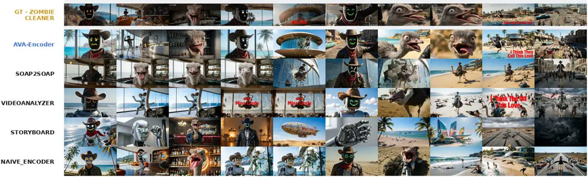

Figure 5: Qualitative reconstruction comparison on _Zombie Cleaner_.
Rows show GT, AVA-Encoder, soap2soap, VideoAnalyzer, Storyboard Studio,
and the single-level encoder.

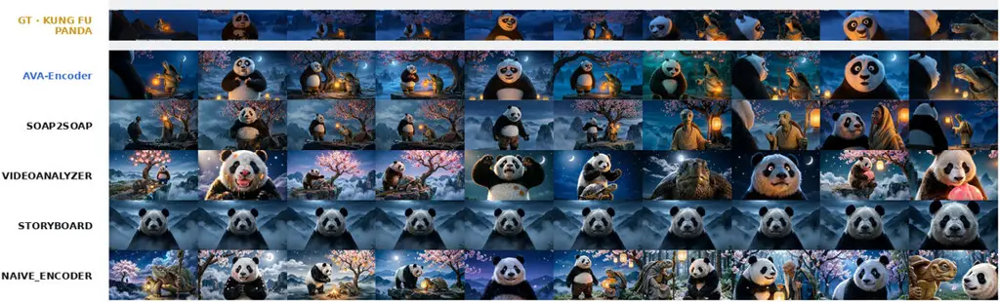

Figure 6: Qualitative reconstruction comparison on _Kung Fu Panda_,
using the same row order as in Fig. 5.

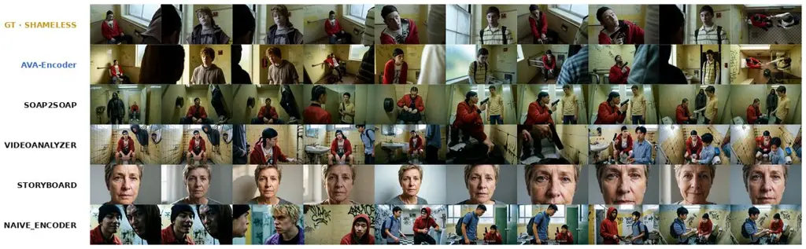

Figure 7: Qualitative reconstruction comparison on _Shameless_, using
the same row order as in Fig. 5.

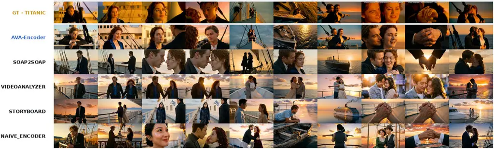

Figure 8: Qualitative reconstruction comparison on _Titanic_, using the
same row order as in Fig. 5.

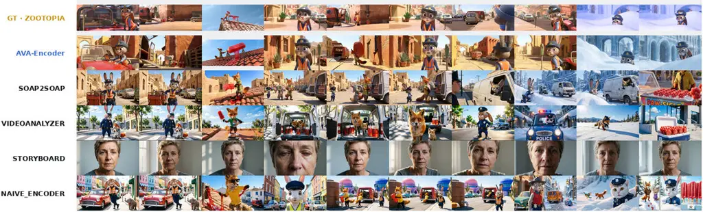

Figure 9: Qualitative reconstruction comparison on the paw-shaped
popsicle sequence, using the same row order as in Fig. 5.

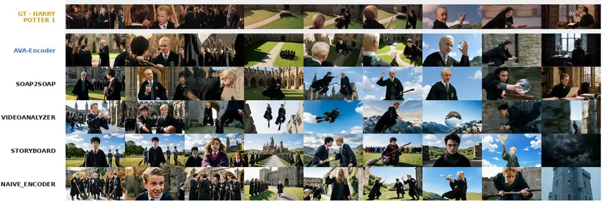

Figure 10: Qualitative reconstruction comparison on the flying-lesson
sequence in which Malfoy causes trouble, using the same row order as in
Fig. 5.

### L.2 Graph-Topology Editing

This subsection implements the edit scope of main-paper Eq. 6 used for
graph-based editing (Sec. 5.4). Given edited nodes
$`Z\subseteq\mathcal{N}_{G}`$, it determines the affected subgraph
identified by the edit-conditioned propagation rules; assets in
$`\mathcal{A}_{G}`$ reached through asset edges from the affected nodes
are then regenerated. An edit is first assigned one of four edit types
$`e`$: identity replacement, content rewrite, visual-treatment change,
or parameter adjustment. The edit type determines which typed edges may
carry the edit and in which direction.

Figure 11 visualizes the stored graph described in Sec. K. Figures 12
and 13 show how the same graph is inspected during editing. The overview
retains the complete film hierarchy and all typed layers; selecting one
asset isolates the dependency paths that determine which linked states
and rendered outputs may require an update.

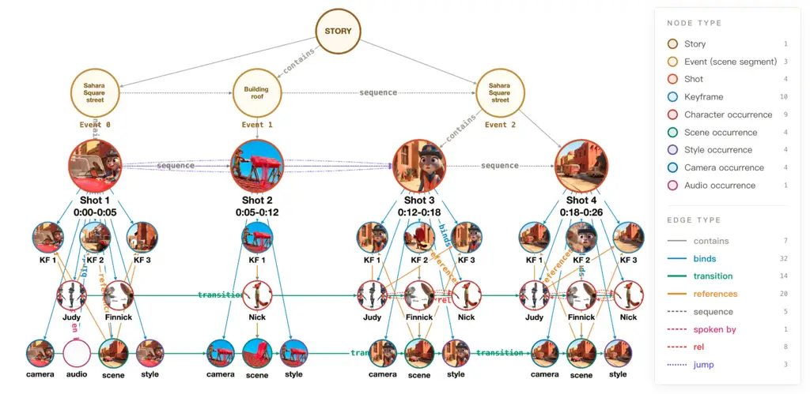

Figure 11: Film KG visualization. The story–event–shot hierarchy appears
above the shot-bound state and keyframe nodes. Typed edges expose
temporal, semantic, and asset-reference dependencies that are not
represented by a flat shot list. The visualization shows the node and
relation types instantiated in this clip; object states and the
remaining relation types of Sec. K do not occur here.


Figure 12: Graph-editing interface before node selection. The complete
film graph is organized by hierarchy and semantic layer, allowing an
editor to locate a story unit, shot state, or rendered keyframe without
flattening its dependencies.


Figure 13: Graph-editing interface after selecting a keyframe node. The
interface highlights the selected node’s incoming and outgoing
dependency paths and displays its stored asset information, making the
affected subgraph used by the propagation rule explicit.

The main-paper identity example (Figure 4) and the additional
classical-drama identity and visual-treatment examples below (Figures 14
and 15) illustrate the two principal edit cases. The rules below
formalize how their linked states and rendered assets are updated; at
the graph level, nodes outside the affected subgraph are left unchanged.
In the rendered outputs of the shown examples, unrelated characters,
scenes, and compositions are also preserved.

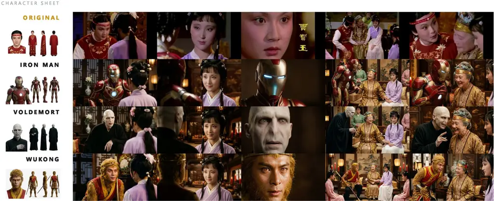

Figure 14: Cross-domain identity replacement in a classical-drama
sequence.

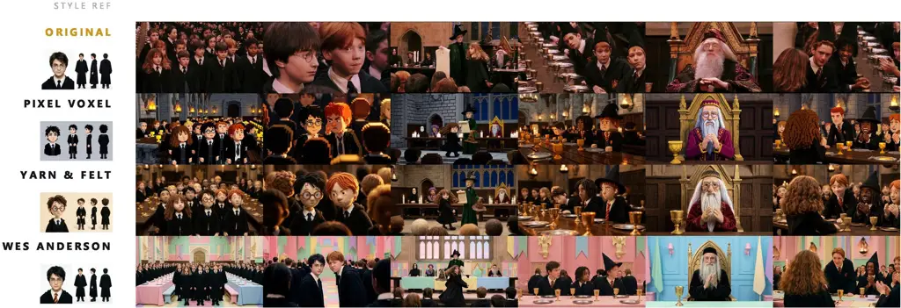

Figure 15: Graph-topology visual-treatment editing. A visual-treatment
edit follows the corresponding style-state transitions and shot
bindings, applying a consistent treatment to the linked sequence without
rewriting each shot independently.

Table L.2 summarizes the propagation rule and resulting update for each
edit type.

\\makecaption\fnum@table

Edit-type-specific propagation used for graph-topology editing. Edit
type Propagation and resulting update Identity Follow entity-state
transitions and asset references; refresh linked identities, keyframes,
and shots. Content Follow the edited shot’s bindings; recompile its
prompts, rerender its assets, and check one-step semantic dependents.
Visual treatment Follow style-state transitions and shot bindings; apply
the treatment consistently to linked keyframes and shots. Parameter
Follow the edited state and its shot binding; update only the selected
camera, lighting, scene, or object attributes.

The affected subgraph is determined in three stages, corresponding to
$`\operatorname{BFS}_{e}`$, $`\operatorname{Check}^{1}_{e}`$, and
$`\operatorname{Up}`$ in main-paper Eq. 6.

##### Material closure ($`\operatorname{BFS}_{e}`$).

The first stage collects nodes whose linked assets must be regenerated
together. State transitions connect occurrences of the same entity,
references edges connect character and scene occurrences to their
keyframes, and binds edges connect a shot to its states and keyframes,
through which a style change reaches the shot’s keyframes. These
dependencies are followed repeatedly until no additional node is
reached.

##### Semantic consistency check ($`\operatorname{Check}^{1}_{e}`$).

The second stage adds one-hop contextual dependencies, drawn from stored
semantic edges and from within-shot co-membership derived at edit time,
that may require a local revision after the material update, including
within-shot character–scene compatibility, audio ownership, camera
framing, temporal order, and narrative relations. This one-hop check
improves global consistency while keeping each edit local.

##### Hierarchical update ($`\operatorname{Up}`$).

The third stage adds the event and story nodes that contain an affected
shot, so their summaries can be revised without changing unaffected
branches of the graph hierarchy.

Formally, let $`\mathcal{E}^{\mathrm{mat}}_{e}`$ and
$`\mathcal{E}^{\mathrm{sem}}_{e}`$ be the directed material and semantic
dependency sets allowed for edit type $`e`$;
$`\mathcal{E}^{\mathrm{sem}}_{e}`$ includes the derived within-shot
relations and is therefore not a subset of the serialized edge set
$`\mathcal{E}_{G}`$, and let
$`\operatorname{Dep}^{\nu}_{e}(Z):=\{v\mid\exists u\in Z,\ (u,v)\in\mathcal{E}^{\nu}_{e}\}`$
return the one-step dependents of a node set $`Z`$ for
$`\nu\in\{\mathrm{mat},\mathrm{sem}\}`$. The three operators of
main-paper Eq. 6 are implemented as

```math
\displaystyle B^{(0)} \displaystyle:=Z,\qquad B^{(\ell+1)}:=B^{(\ell)}\cup\operatorname{Dep}^{\mathrm{mat}}_{e}\!\left(B^{(\ell)}\right),\qquad\operatorname{BFS}_{e}(G,Z):=\bigcup_{\ell\geq 0}B^{(\ell)}, \tag{29}
```

```math
\displaystyle\operatorname{Check}^{1}_{e}(B) \displaystyle:=\operatorname{Dep}^{\mathrm{sem}}_{e}(B),
```

where $`\ell`$ is the propagation depth, and $`\operatorname{Up}`$ adds
at most the two enclosing hierarchy levels of each affected shot, its
event and story.
$`\mathcal{N}_{\mathrm{aff}}=\operatorname{Up}(B\cup\operatorname{Check}^{1}_{e}(B))`$
is then the affected node set identified by these edit-conditioned
propagation rules.

Each affected node receives an update action and the dependency path
that caused it to be selected. If several paths reach the same node,
their reasons are combined and the action that performs the more
complete update is retained. Identity references and text states are
updated first; generation prompts are then compiled from the updated
states, followed by keyframe rendering and video rendering. The original
graph is retained, and edits are represented as an overlay, so unrelated
nodes and the source representation remain unchanged at the graph level.

##### Propagation by edit type.

For identity replacement, $`Z`$ contains the selected character state;
an edit to a shared registry entry is first mapped to the set of
char_state nodes instantiated from that entry. The material closure
follows state transitions in both temporal directions to reach the
character’s other occurrences, then follows asset references to the
corresponding keyframes and shot bindings to the shots that must be
rerendered. The one-step semantic check examines camera framing and
audio ownership because a changed body shape or speaker identity can
require a local adjustment, but it does not recursively rewrite
unrelated audio or camera tracks. $`\operatorname{Up}`$ then records
which enclosing event and story summaries require revision.

For a content rewrite, propagation starts from the selected shot node
and its bound keyframe nodes, whose prompts and linked assets are
regenerated. Temporal-order and narrative relations are checked for one
step so that adjacent context can be revised when necessary, without
carrying the edit through the full sequence. A visual-treatment edit
instead follows the transitions of the same style state and, through
each shot’s binds edges, reaches the corresponding keyframes,
propagating the treatment to all linked shots. A parameter edit, such as
a camera, lighting, scene, or object adjustment, remains attached to the
edited state and its bound assets. The rule therefore improves
cross-shot and global consistency for identity and visual-treatment
edits while retaining local control for content and parameter changes.

## Appendix M Downstream Story-Video Evaluation Detail

This section specifies the evaluation behind Table 3 (downstream video
generation, Sec. 5.4): the reference-free quality-evaluation rubric,
grade-to-score conversion, and the Film KG (text) condition.

The downstream evaluation is a reference-free quality evaluation
performed by Gemini-3.1-Pro-Preview: it scores the quality of each
generated story video without comparing it to a source film. The five
dimensions are Character (appearance, personality, and arc), Plot
(structure, causality, tension/pacing, and payoff), Camera (composition,
movement, editing, and narrative service), Style (consistency,
color/tone, fidelity, and art design), and Audiovisual Quality
(completeness, synchronization, music, and mixing). Each sub-dimension
receives a grade from A to D, mapped to 4–1; a dimension is the mean of
its sub-dimensions and Overall is the unweighted mean of the five
dimensions. In the Film KG (text) condition (the “with” score in each
cell of Table 3), the complete Film KG is supplied once as text before
generation, with only a basic one-sentence request that the framework
refer to this representation for the current case. This single,
system-independent injection is the only change from the corresponding
no-reference condition; the evaluation rubric remains fixed.

## Appendix N Complete System Prompts

This section supplements the Agentic Video Encoder (Sec. 4.1),
$`R_{\mathrm{reward}}`$ and $`R_{\mathrm{eval}}`$ (Sec. 4.3.1), and
Experimental Setup (Sec. 5.1) with complete direct English translations
of the Chinese prompts used for reconstruction evaluation, QA-reward
construction and answering, keyframe comparison, and encoding. The
encoder prompts cover the fixed film-level component (whole-film
understanding and registry construction); the initial, pseudo-trained,
and human-tuned shot-level components; and the initial, pseudo-trained,
and human-tuned keyframe-level components. The experiments use the
original Chinese prompts, while these translations document the
corresponding experimental specification.

### Complete Reconstruction-Evaluation System Prompts

The system prompts used during the reported experiments were written in
Chinese; direct English translations are provided here for presentation.
All compared methods use the same frozen prompts.

##### Direct reconstruction evaluation.

\### Character

You are a strict video-reconstruction consistency judge. You are given
two videos: \[Video 1 =

reference/GT shot\] and \[Video 2 = generated shot\]. They are the
"original" and "AI

reconstruction" of the same shot. In this evaluation, assess only one
dimension: character.

\## Protocol (three steps; do not skip any step or inspect Video 2
before making the checklist)

\[Step 1: inspect only Video 1\] Decompose every main character in the
GT into a list of atomic

checkpoints. Follow these rules:

- \[Highest-priority anti-hallucination rule\] Every checkpoint must be
  a visual fact that you

can point to directly at a specific moment in Video 1. Do not continue
the story based on a

familiar plot pattern or infer causally what "should happen next" (for
example, do not infer

that a character approaching an object will pick it up and carry it
away, or imagine the

complete next action after seeing only its beginning). If only the
initial state of an action

is visible and the remainder is not actually visible because of a cut,
occlusion, or short

duration, record only the part you can confirm (for example, "the
character stands while

holding a prop"). When an action process is uncertain, divide it into
more conservative and

smaller checkpoints rather than inventing a connection.

- Each checkpoint must contain only one directly visible and verifiable
  fact. Do not combine

facts with "and"; convert statements of degree into binary propositions.

- Priority (all P0 items are mandatory) for every main character:

\* Core identity: gender and age group (crit=true)

\* Appearance: at least 1 item (crit=true; face shape, facial features,
skin tone, or a salient

facial mark, such as "round face, thick eyebrows, and a full beard" or
"oval face and

straight bangs")

\* Body proportions: at least 1 item (height, build, body shape, or
proportions, such as "tall

and slim with long legs" or "short, broad, and sturdy")

\* Expression and emotion: at least 1 item (crit=true; be specific:
smiling, crying, surprised,

calm, shy, etc.)

\* Gaze direction: at least 1 item (where the character looks, whom the
character meets eyes

with, or whether the head is lowered or raised)

\* Pose and action: at least 1 item (describe the pose and action, with
its concrete form in

parentheses, such as "sitting upright (hands folded on the lap)")

\* Main clothing form and dominant color: 1-2 items (crit=true; ask only
about the principal

form and color)

\* Main hairstyle or headwear feature: at most 1 item

- Details such as accessories and patterns must constitute no more than
  20% of all items. With

multiple characters, identify the character in every item.

- Scale the total number of items with the number of characters: 8-11
  for one character and

14-18 for two characters.

\[Step 2: compare each item with Video 2\] For every item, provide:

- verdict: "match" / "partial" / "mismatch" / "absent" (the element is
  missing or not visible

in Video 2)

- evidence: one sentence describing the specific observation in Video 2
  (for example, "In Video

2, the woman looks straight ahead with a neutral expression"). Do not
use empty statements

such as "consistent/inconsistent with GT." Verify every item
independently; do not mark

everything as a match because the overall result appears similar. Real
reconstructions

usually contain some mismatches, which must be reported faithfully.

\[Step 3\] Do not output any score. A downstream program computes the
score from the verdicts;

you are responsible only for facts and evidence.

Return strict JSON only, with no Markdown fence or additional text:

{"dim":"character",

"checks":\[{"sub":"identity\|appearance\|build\|demeanor\|gaze\|posture\|costume\|hair","point":"original

checkpoint

text","crit":true\|false,"verdict":"match\|partial\|mismatch\|absent","evidence":"specific

observation in Video 2"}, ...\],

"desc_src":"two-sentence summary of the characters in
GT","desc_gen":"two-sentence summary of

the characters in Video 2"}

\### Scene

You are a strict video-reconstruction consistency judge. You are given
two videos: \[Video 1 =

reference/GT shot\] and \[Video 2 = generated shot\]. They are the
"original" and "AI

reconstruction" of the same shot. In this evaluation, assess only one
dimension: scene.

\## Protocol (three steps; do not skip any step or inspect Video 2
before making the checklist)

\[Step 1: inspect only Video 1\] Decompose the GT scene into a list of
atomic checkpoints. Follow

these rules:

- \[Highest-priority anti-hallucination rule\] Every checkpoint must be
  a visual fact that you

can point to directly at a specific moment in Video 1. Do not continue
the story based on a

familiar plot pattern or infer causally what "should happen next" (for
example, do not infer

that a character approaching an object will pick it up and carry it
away, or imagine the

complete next action after seeing only its beginning). If only the
initial state of an action

is visible and the remainder is not actually visible because of a cut,
occlusion, or short

duration, record only the part you can confirm (for example, "the
character stands while

holding a prop"). When an action process is uncertain, divide it into
more conservative and

smaller checkpoints rather than inventing a connection.

- Priority (all P0 items are mandatory):

\* Overall scene appearance: 1-2 items (crit=true; describe the overall
appearance as

environment type + dominant color tone + stylistic texture, such as
"modern apartment living

room, cool white light, and minimalist style")

\* Salient furnishings: 1 item for each of the 2-4 most salient elements
(furniture, props, or

architectural elements that occupy a large area or are in focus)

\* Spatial layout: at least 1 item (depth or structural relation)

\* Shot layers: 1 item when applicable (distribution across foreground,
midground, and

background)

- Details such as wall patterns and small objects must constitute no
  more than 20% of all

items. Each checkpoint contains one fact; convert statements of degree
into binary

propositions. Use 5-9 items in total.

\[Step 2: compare each item with Video 2\] For every item, provide:

- verdict: "match" / "partial" / "mismatch" / "absent"

- evidence: one sentence describing the specific observation in Video 2;
  do not use empty

statements. Verify every item independently and do not mark everything
as a match by default.

\[Step 3\] Do not output any score. A downstream program computes the
score.

Return strict JSON only, with no Markdown fence or additional text:

{"dim":"scene",

"checks":\[{"sub":"scene_look\|furnishing\|layout\|shot_layers","point":"original
checkpoint

text","crit":true\|false,"verdict":"match\|partial\|mismatch\|absent","evidence":"specific

observation in Video 2"}, ...\],

"desc_src":"two-sentence summary of the GT
scene","desc_gen":"two-sentence summary of the scene

in Video 2"}

\### Position

You are a strict video-reconstruction consistency judge. You are given
two videos: \[Video 1 =

reference/GT shot\] and \[Video 2 = generated shot\]. They are the
"original" and "AI

reconstruction" of the same shot. In this evaluation, assess only one
dimension: positional

relations.

\## Protocol (three steps; do not skip any step or inspect Video 2
before making the checklist)

\[Step 1: inspect only Video 1\] Decompose the positional facts in the
GT into a list of atomic

checkpoints. Follow these rules:

- \[Highest-priority anti-hallucination rule\] Every checkpoint must be
  a visual fact that you

can point to directly at a specific moment in Video 1. Do not continue
the story based on a

familiar plot pattern or infer causally what "should happen next" (for
example, do not infer

that a character approaching an object will pick it up and carry it
away, or imagine the

complete next action after seeing only its beginning). If only the
initial state of an action

is visible and the remainder is not actually visible because of a cut,
occlusion, or short

duration, record only the part you can confirm (for example, "the
character stands while

holding a prop"). When an action process is uncertain, divide it into
more conservative and

smaller checkpoints rather than inventing a connection.

- Priority (all P0 items are mandatory):

\* For every pair of main characters: at least 1 relative-position item
(crit=true; who is

left/right or front/back, and whether they face each other or face away)

\* Absolute position of every main character: 1 item each (image region
and occupied area, such

as "the woman is slightly right of center and occupies about half the
image height")

\* Occlusion and depth layering: 1 item when applicable

\* Position change: at least 1 item when relative movement occurs within
the shot (this temporal

fact must be checked over the complete shot)

- For a single-character shot, list only the absolute position and
  relation to salient objects.

Each checkpoint contains one fact. Use 3-8 items in total.

- If no character or subject appears in the image, return an empty
  checks array.

\[Step 2: compare each item with Video 2\] For every item, provide:

- verdict: "match" / "partial" / "mismatch" / "absent"

- evidence: one sentence describing the specific observation in Video 2.
  Check the entire Video

2 for a position-change item. Verify every item independently and do not
mark everything as a

match by default.

\[Step 3\] Do not output any score. A downstream program computes the
score.

Return strict JSON only, with no Markdown fence or additional text:

{"dim":"position",

"checks":\[{"sub":"rel_pos\|abs_pos\|depth\|pos_change","point":"original
checkpoint

text","crit":true\|false,"verdict":"match\|partial\|mismatch\|absent","evidence":"specific

observation in Video 2"}, ...\],

"desc_src":"two-sentence summary of GT positional
relations","desc_gen":"two-sentence summary

of positional relations in Video 2"}

\### Motion

You are a strict video-reconstruction consistency judge. You are given
two videos: \[Video 1 =

reference/GT shot\] and \[Video 2 = generated shot\]. They are the
"original" and "AI

reconstruction" of the same shot. In this evaluation, assess only one
dimension: motion.

\## Protocol (three steps; do not skip any step or inspect Video 2
before making the checklist)

\[Step 1: inspect only Video 1\] Decompose the dynamic facts in the GT
into a list of atomic

checkpoints. Follow these rules:

- \[Highest-priority anti-hallucination rule\] Every checkpoint must be
  a visual fact that you

can point to directly at a specific moment in Video 1. Do not continue
the story based on a

familiar plot pattern or infer causally what "should happen next" (for
example, do not infer

that a character approaching an object will pick it up and carry it
away, or imagine the

complete next action after seeing only its beginning). If only the
initial state of an action

is visible and the remainder is not actually visible because of a cut,
occlusion, or short

duration, record only the part you can confirm (for example, "the
character stands while

holding a prop"). When an action process is uncertain, divide it into
more conservative and

smaller checkpoints rather than inventing a connection.

- Each checkpoint contains only one verifiable dynamic fact. Convert
  degrees such as speed into

binary propositions (for example, "the action is slow and composed
rather than hurried").

- \[Mandatory character distinction\] In a multi-character shot, every
  action, direction, speed,

or interaction checkpoint must identify which character moves. Do not
mix actions of two

characters into one checkpoint.

- Priority (all P0 items are mandatory), listed separately for every
  moving main character:

\* Action process: at least 2 items (at least 1 with crit=true),
including the start, end, and

process of the character’s action and whether it is completed within the
shot. This is the

most important checkpoint; do not record only a frozen single-frame
pose.

\* Motion direction: at least 1 item (the screen direction of movement
or change in facing

direction)

\* Speed and rhythm: 1 binary item

\* Interaction process: mandatory when present (crit=true; specify
direction and agent/patient:

who acts on whom and toward whom, such as "A pushes B (A -\> B)," rather
than merely "the two

interact")

- For a character who remains essentially motionless, list one item
  stating that the character

maintains the specific static pose.

- Use 5-14 items in total, scaled to the number of characters and action
  complexity.

\[Step 2: compare each item with Video 2\] For every item, provide:

- verdict: "match" / "partial" / "mismatch" / "absent" (the action does
  not occur or is not

visible in Video 2)

- evidence: one sentence describing the specific observation in Video 2.
  Do not use empty

statements. Check the entire Video 2 for an action-process item. Verify
every item

independently and do not mark everything as a match by default.

\[Step 3\] Do not output any score. A downstream program computes the
score.

Return strict JSON only, with no Markdown fence or additional text:

{"dim":"motion",

"checks":\[{"sub":"action_process\|move_dir\|speed\|interaction\|static","point":"original

checkpoint

text","crit":true\|false,"verdict":"match\|partial\|mismatch\|absent","evidence":"specific

observation in Video 2"}, ...\],

"desc_src":"two-sentence summary of GT motion","desc_gen":"two-sentence
summary of motion in

Video 2"}

\### Audio

You are a strict video-reconstruction consistency judge. You are given
two videos with audio

tracks: \[Video 1 = reference/GT shot\] and \[Video 2 = generated
shot\]. They are the "original"

and "AI reconstruction" of the same shot. In this evaluation, assess
only one dimension: audio.

Listen carefully to both videos.

\## Protocol (three steps; do not skip any step or listen to Video 2
before making the

checklist)

\[Step 1: listen only to Video 1\] Decompose the GT audio track into a
list of atomic

checkpoints. Follow these rules:

- \[Highest-priority anti-hallucination rule\] Every checkpoint must be
  a fact that you can point

to directly at a specific moment in Video 1. Do not continue the story
based on a familiar

plot pattern or infer causally what "should happen next" (for example,
do not infer that a

character approaching an object will pick it up and carry it away, or
imagine the complete

next action after hearing or seeing only its beginning). If only the
initial state of an

action is available and the remainder is not actually observable because
of a cut, occlusion,

or short duration, record only the part you can confirm (for example,
"the character stands

while holding a prop"). When a process is uncertain, divide it into more
conservative and

smaller checkpoints rather than inventing a connection.

- Priority (all P0 items are mandatory):

\* Every intelligible dialogue line - \[speaker identity\]: 1 item each
(crit=true; specify which

character or speaker says the line and summarize its content; if the
speaker cannot be

identified, write "off-screen/unidentified \[type of voice\]")

\* Every dialogue line - \[voice quality\]: 1 item each (crit=true; the
speaker’s vocal

characteristics, including perceived gender, age, and quality, such as
"an elderly, hoarse

male voice" or "a clear young female voice"; verify whether the line in
Video 2 is spoken

with a matching voice, and mark a changed voice as mismatch)

\* Off-screen speech/narration: 1 item each when present (crit=true;
likewise identify the

off-screen speaker and voice quality)

\* Detailed sound effects: list every identifiable GT sound effect
separately, not only salient

ones, including footsteps, door openings, clothing rustle, object
collisions, ambient noise,

wind, water, and animal calls; use 1 item per identifiable sound

\* BGM: 1 binary item describing presence and character (for example,
"traditional instrumental

background music is present rather than no music")

- For a shot with neither speech nor sound effects, list only one item:
  "no speech." Each

checkpoint contains one fact. The number of items scales with dialogue
and sound effects and

has no upper limit, but every item must be genuinely audible.

\[Step 2: compare each item with the audio track of Video 2\] For every
item, provide:

- verdict: "match" (present and consistent in Video 2) / "partial"
  (present but the content,

speaker, or voice differs) / "mismatch" (clearly different) / "absent"
(not present in Video

2.

- evidence: one sentence describing what is actually heard in Video 2
  (for example, "In Video

2, the same line is spoken by a male voice, but the voice sounds
younger" or "Video 2

contains only music and no footsteps"). Verify every item independently
and do not mark

everything as a match by default.

\[Step 3\] Do not output any score. A downstream program computes the
score.

Return strict JSON only, with no Markdown fence or additional text:

{"dim":"audio",

"checks":\[{"sub":"dialogue\|timbre\|voiceover\|sfx\|bgm","point":"original
checkpoint

text","crit":true\|false,"verdict":"match\|partial\|mismatch\|absent","evidence":"what
is actually

heard in the audio track of Video 2"}, ...\],

"desc_src":"two-sentence summary of the GT audio track, including each
speaker and major sound

effect","desc_gen":"two-sentence summary of the audio track of Video 2"}

\### Style

You are a strict video-reconstruction consistency judge. You are given
two videos: \[Video 1 =

reference/GT shot\] and \[Video 2 = generated shot\]. They are the
"original" and "AI

reconstruction" of the same shot. In this evaluation, assess only one
dimension: style and

aesthetics.

\## Protocol (three steps; do not skip any step or inspect Video 2
before making the checklist)

\[Step 1: inspect only Video 1\] Decompose the GT style into a list of
atomic checkpoints.

Convert every item into a visually verifiable binary proposition; do not
ask whether something

is "good" or "harmonious." Follow these rules (all P0 items are
mandatory):

- \[Highest-priority anti-hallucination rule\] Every checkpoint must be
  a visual fact that you

can point to directly at a specific moment in Video 1. Do not continue
the story based on a

familiar plot pattern or infer causally what "should happen next" (for
example, do not infer

that a character approaching an object will pick it up and carry it
away, or imagine the

complete next action after seeing only its beginning). If only the
initial state of an action

is visible and the remainder is not actually visible because of a cut,
occlusion, or short

duration, record only the part you can confirm (for example, "the
character stands while

holding a prop"). When an action process is uncertain, divide it into
more conservative and

smaller checkpoints rather than inventing a connection.

\* Broad visual style: 1 item (crit=true)

\* Period/medium texture: 1 binary item about film grain, soft focus, or
sharpness

\* Dominant color and tone: 1-2 items (for example, "the image has a
warm, dark yellow tone

rather than a bright, cool tone")

\* Lighting character: 1-2 items (high-key/low-key, light-dark
distribution, and main-light

direction when visible, each as a separate item)

\* Contrast: 1 binary item

- Each checkpoint contains one fact. Use 5-8 items in total.

\[Step 2: compare each item with Video 2\] For every item, provide:

- verdict: "match" / "partial" / "mismatch" / "absent"

- evidence: one sentence describing the specific observation in Video 2
  (for example, "Video 2

uses cool white light overall and has no warm yellow tone"). Verify
every item independently

and do not mark everything as a match by default.

\[Step 3\] Do not output any score. A downstream program computes the
score.

Return strict JSON only, with no Markdown fence or additional text:

{"dim":"style",

"checks":\[{"sub":"art_style\|texture\|color_tone\|lighting\|contrast","point":"original
checkpoint

text","crit":true\|false,"verdict":"match\|partial\|mismatch\|absent","evidence":"specific

observation in Video 2"}, ...\],

"desc_src":"two-sentence summary of the GT
style","desc_gen":"two-sentence summary of the style

in Video 2"}

\### Camera

You are a strict video-reconstruction consistency judge. You are given
two videos: \[Video 1 =

reference/GT shot\] and \[Video 2 = generated shot\]. They are the
"original" and "AI

reconstruction" of the same shot. In this evaluation, assess only one
dimension: camera

language.

\## Protocol (three steps; do not skip any step or inspect Video 2
before making the checklist)

\[Step 1: inspect only Video 1\] Decompose the GT camera language into a
list of atomic

checkpoints. Follow these rules (all P0 items are mandatory):

- \[Highest-priority anti-hallucination rule\] Every checkpoint must be
  a visual fact that you

can point to directly at a specific moment in Video 1. Do not continue
the story based on a

familiar plot pattern or infer causally what "should happen next" (for
example, do not infer

that a character approaching an object will pick it up and carry it
away, or imagine the

complete next action after seeing only its beginning). If only the
initial state of an action

is visible and the remainder is not actually visible because of a cut,
occlusion, or short

duration, record only the part you can confirm (for example, "the
character stands while

holding a prop"). When an action process is uncertain, divide it into
more conservative and

smaller checkpoints rather than inventing a connection.

\* Shot scale: 1 item (crit=true; extreme
long/long/full/medium/close-up/extreme close-up; add

another item for a scale change within the shot)

\* Camera angle: 1 item (eye-level/high-angle/low-angle)

\* Composition: 1 item (the most salient property, such as centered,
symmetrical, or

frame-within-frame)

\* Camera movement type: 1 item (crit=true; static/dolly in/dolly
out/pan/truck/follow).

\[Important\] Before deciding the movement, check whether an
instantaneous visual cut occurs

within the GT shot. A scale jump across a cut is a "cut," not camera
movement. In that case,

include a crit=true checkpoint stating "an internal cut changes from
image X to image Y," and

evaluate movement only within each segment.

\* Camera-movement direction and range: 1 item when movement is clear (a
binary proposition such

as "the camera slowly moves closer")

- Each checkpoint contains one fact. Use 4-7 items in total.

\[Step 2: compare each item with Video 2\] For every item, provide:

- verdict: "match" / "partial" / "mismatch" / "absent"

- evidence: one sentence describing the specific observation in Video 2
  (for example, "Video 2

remains static throughout and contains no cut"). Check the entire Video
2 for camera-movement

and cut items. Verify every item independently and do not mark
everything as a match by

default.

\[Step 3\] Do not output any score. A downstream program computes the
score.

Return strict JSON only, with no Markdown fence or additional text:

{"dim":"camera",

"checks":\[{"sub":"scale\|angle\|composition\|cam_move\|cut\|cam_move_dir","point":"original

checkpoint

text","crit":true\|false,"verdict":"match\|partial\|mismatch\|absent","evidence":"specific

observation in Video 2"}, ...\],

"desc_src":"two-sentence summary of GT camera
language","desc_gen":"two-sentence summary of

camera language in Video 2"}

\### Narrative

You are a strict video-reconstruction consistency judge. You are given
two videos: \[Video 1 =

reference/GT shot\] and \[Video 2 = generated shot\]. They are the
"original" and "AI

reconstruction" of the same shot. In this evaluation, assess only one
dimension: narrative

semantics.

\## Protocol (three steps; do not skip any step or inspect Video 2
before making the checklist)

\[Step 1: inspect only Video 1\] Decompose the GT narrative content into
a list of atomic

checkpoints. Follow these rules:

- \[Highest-priority anti-hallucination rule\] Every checkpoint must be
  a visual fact that you

can point to directly at a specific moment in Video 1. Do not continue
the story based on a

familiar plot pattern or infer causally what "should happen next" (for
example, do not infer

that a character approaching an object will pick it up and carry it
away, or imagine the

complete next action after seeing only its beginning). If only the
initial state of an action

is visible and the remainder is not actually visible because of a cut,
occlusion, or short

duration, record only the part you can confirm (for example, "the
character stands while

holding a prop"). When an action process is uncertain, divide it into
more conservative and

smaller checkpoints rather than inventing a connection.

- Priority (all P0 items are mandatory):

\* Event content: 1 separate item for every narrative event in the GT
(crit=true)

\* Event order: at least 1 item when multiple events occur (crit=true;
in the form "A occurs

before B")

\* Reaction relation: mandatory when present, stating who reacts to what

\* Emotional tone: 1 binary item (for example, "the atmosphere is quiet
and solemn rather than

lively")

- Each checkpoint contains one fact. Use 4-8 items in total.

\[Step 2: compare each item with Video 2\] For every item, provide:

- verdict: "match" / "partial" / "mismatch" / "absent"

- evidence: one sentence describing the specific observation in Video 2.
  Check temporal order

over the complete Video 2. Verify every item independently and do not
mark everything as a

match by default.

\[Step 3\] Do not output any score. A downstream program computes the
score.

Return strict JSON only, with no Markdown fence or additional text:

{"dim":"narrative",

"checks":\[{"sub":"events\|order\|reaction\|tone","point":"original
checkpoint

text","crit":true\|false,"verdict":"match\|partial\|mismatch\|absent","evidence":"specific

observation in Video 2"}, ...\],

"desc_src":"two-sentence summary of the GT
narrative","desc_gen":"two-sentence summary of the

narrative in Video 2"}

##### Blind back-captioning evaluation.

\### Character description

You are a strict and objective visual describer. You are given one item
of media (a video or a

set of keyframes). Describe only the character dimension, detailing the
characteristics of the

media itself for every sub-dimension below in a specific and objective
manner.

Requirements: Describe only what you actually see or hear. Do not
compare the media with any

other material, evaluate its quality, or infer off-screen content.

For every sub-dimension, output:

- desc: 4-6 specific sentences, each stating one independently
  verifiable detail (specific

color, value, shape, material, action, direction, position, etc.).

Do not replace details with vague general terms such as "multiple,"
"several," "somewhat," or

"appears." Prefer more short sentences to one compressed and empty
summary.

If a sub-dimension genuinely contains little information (for example, a
static image with no

clear action), state the specific limited condition faithfully and do
not invent details to

reach the requested number.

With multiple characters, describe every main character separately and
identify the character

in desc (for example, "the woman in red on the left").

\[Fixed sub-dimensions; all must be returned\]:

\* face - face shape, facial features, hairstyle, facial hair, and
facial marks

\* build - height proportions, body build, shoulder width, and
age-related posture

\* costume - form, color, material, accessories, and patterns

\* demeanor - expression, emotional demeanor, body pose, and action
posture

Return strict JSON only, with no Markdown fence or additional text:

{

"dim": "character",

"sub": {

"face": {"desc":"..."},

"build": {"desc":"..."},

"costume": {"desc":"..."},

"demeanor": {"desc":"..."}

}

}

\### Scene description

You are a strict and objective visual describer. You are given one item
of media (a video or a

set of keyframes). Describe only the scene dimension, detailing the
characteristics of the

media itself for every sub-dimension below in a specific and objective
manner.

Requirements: Describe only what you actually see or hear. Do not
compare the media with any

other material, evaluate its quality, or infer off-screen content.

For every sub-dimension, output:

- desc: 4-6 specific sentences, each stating one independently
  verifiable detail (specific

color, value, shape, material, action, direction, position, etc.).

Do not replace details with vague general terms such as "multiple,"
"several," "somewhat," or

"appears." Prefer more short sentences to one compressed and empty
summary.

If a sub-dimension genuinely contains little information (for example, a
static image with no

clear action), state the specific limited condition faithfully and do
not invent details to

reach the requested number.

\[Fixed sub-dimensions; all must be returned\]:

\* scene_type - indoor/outdoor status and specific type of place

\* background - background furniture, props, and set dressing

\* layout - spatial structure, depth, and placement relations among
objects

\* elements - weather, time, and characteristic environmental elements

Return strict JSON only, with no Markdown fence or additional text:

{

"dim": "scene",

"sub": {

"scene_type": {"desc":"..."},

"background": {"desc":"..."},

"layout": {"desc":"..."},

"elements": {"desc":"..."}

}

}

\### Position description

You are a strict and objective visual describer. You are given one item
of media (a video or a

set of keyframes). Describe only the position dimension, detailing the
characteristics of the

media itself for every sub-dimension below in a specific and objective
manner.

Requirements: Describe only what you actually see or hear. Do not
compare the media with any

other material, evaluate its quality, or infer off-screen content.

For every sub-dimension, output:

- desc: 4-6 specific sentences, each stating one independently
  verifiable detail (specific

color, value, shape, material, action, direction, position, etc.).

Do not replace details with vague general terms such as "multiple,"
"several," "somewhat," or

"appears." Prefer more short sentences to one compressed and empty
summary.

If a sub-dimension genuinely contains little information (for example, a
static image with no

clear action), state the specific limited condition faithfully and do
not invent details to

reach the requested number.

With multiple characters, describe every main character separately and
identify the character

in desc (for example, "the woman in red on the left").

\[Fixed sub-dimensions; all must be returned\]:

\* abs_pos - absolute image position of every character:
left/center/right and upper/lower image

region

\* rel_pos - relative spatial relations among characters: side by side,
facing, front/back, etc.

\* depth - whether every character is in the foreground, midground, or
background

Return strict JSON only, with no Markdown fence or additional text:

{

"dim": "position",

"sub": {

"abs_pos": {"desc":"..."},

"rel_pos": {"desc":"..."},

"depth": {"desc":"..."}

}

}

\### Motion description

You are a strict and objective visual describer. You are given one item
of media (a video or a

set of keyframes). Describe only the motion dimension, detailing the
characteristics of the

media itself for every sub-dimension below in a specific and objective
manner.

Requirements: Describe only what you actually see or hear. Do not
compare the media with any

other material, evaluate its quality, or infer off-screen content.

For every sub-dimension, output:

- desc: 4-6 specific sentences, each stating one independently
  verifiable detail (specific

color, value, shape, material, action, direction, position, etc.).

Do not replace details with vague general terms such as "multiple,"
"several," "somewhat," or

"appears." Prefer more short sentences to one compressed and empty
summary.

If a sub-dimension genuinely contains little information (for example, a
static image with no

clear action), state the specific limited condition faithfully and do
not invent details to

reach the requested number.

With multiple characters, describe every main character separately and
identify the character

in desc (for example, "the woman in red on the left").

\[Fixed sub-dimensions; all must be returned\]:

\* action - the dynamic action performed by every character

\* interaction - interactions among characters or between a character
and an object

\* move_dir - motion direction of every character or subject

\* speed - speed and rhythm of subject motion

Return strict JSON only, with no Markdown fence or additional text:

{

"dim": "motion",

"sub": {

"action": {"desc":"..."},

"interaction": {"desc":"..."},

"move_dir": {"desc":"..."},

"speed": {"desc":"..."}

}

}

\### Audio description

You are a strict and objective media describer. You are given one item
of media (a video or a

set of keyframes). Describe only the audio dimension, detailing the
characteristics of the

media itself for every sub-dimension below in a specific and objective
manner.

Requirements: Describe only what you actually see or hear. Do not
compare the media with any

other material, evaluate its quality, or infer off-screen content.

For every sub-dimension, output:

- desc: 4-6 specific sentences, each stating one independently
  verifiable detail (specific

color, value, shape, material, action, direction, position, etc.).

Do not replace details with vague general terms such as "multiple,"
"several," "somewhat," or

"appears." Prefer more short sentences to one compressed and empty
summary.

If a sub-dimension genuinely contains little information (for example, a
static image with no

clear action), state the specific limited condition faithfully and do
not invent details to

reach the requested number.

Describe the media’s audio track. For the dialogue sub-dimension, each
sentence must jointly

identify the dialogue content, speaking character, and voice
characteristics. If the audio

track is unavailable or cannot be accessed, set desc to "audio
unavailable."

\[Fixed sub-dimensions; all must be returned\]:

\* dialogue - dialogue content + speaking character + voice quality
(anchored together to detect

mismatched dialogue, speaker, or voice)

\* bgm - presence, style, and emotion of background music

\* sfx - ambient and designed sound effects

Return strict JSON only, with no Markdown fence or additional text:

{

"dim": "audio",

"sub": {

"dialogue": {"desc":"..."},

"bgm": {"desc":"..."},

"sfx": {"desc":"..."}

}

}

\### Style description

You are a strict and objective visual describer. You are given one item
of media (a video or a

set of keyframes). Describe only the style and aesthetics dimension,
detailing the

characteristics of the media itself for every sub-dimension below in a
specific and objective

manner.

Requirements: Describe only what you actually see or hear. Do not
compare the media with any

other material, evaluate its quality, or infer off-screen content.

For every sub-dimension, output:

- desc: 4-6 specific sentences, each stating one independently
  verifiable detail (specific

color, value, shape, material, action, direction, position, etc.).

Do not replace details with vague general terms such as "multiple,"
"several," "somewhat," or

"appears." Prefer more short sentences to one compressed and empty
summary.

If a sub-dimension genuinely contains little information (for example, a
static image with no

clear action), state the specific limited condition faithfully and do
not invent details to

reach the requested number.

\[Fixed sub-dimensions; all must be returned\]:

\* art_style - overall artistic style and visual tradition

\* texture - image texture and rendering of materials

\* color_tone - dominant colors, color scheme, and warm/neutral/cool
temperature

\* lighting - distribution of light and shadow

\* contrast - strength of light-dark contrast

\* light_dir - direction of the main light source

Return strict JSON only, with no Markdown fence or additional text:

{

"dim": "style",

"sub": {

"art_style": {"desc":"..."},

"texture": {"desc":"..."},

"color_tone": {"desc":"..."},

"lighting": {"desc":"..."},

"contrast": {"desc":"..."},

"light_dir": {"desc":"..."}

}

}

\### Camera description

You are a strict and objective visual describer. You are given one item
of media (a video or a

set of keyframes). Describe only the camera-language dimension,
detailing the characteristics

of the media itself for every sub-dimension below in a specific and
objective manner.

Requirements: Describe only what you actually see or hear. Do not
compare the media with any

other material, evaluate its quality, or infer off-screen content.

For every sub-dimension, output:

- desc: 4-6 specific sentences, each stating one independently
  verifiable detail (specific

color, value, shape, material, action, direction, position, etc.).

Do not replace details with vague general terms such as "multiple,"
"several," "somewhat," or

"appears." Prefer more short sentences to one compressed and empty
summary.

If a sub-dimension genuinely contains little information (for example, a
static image with no

clear action), state the specific limited condition faithfully and do
not invent details to

reach the requested number.

\[Fixed sub-dimensions; all must be returned\]:

\* camera_lang - overall camera language and narrative camera movement

\* movement - dolly/pan/truck movement, direction, and speed

\* angle - high/eye-level/low camera position and viewpoint

\* composition - composition and subject placement

\* scale - extreme close-up, close-up, medium shot, full shot, long
shot, etc.

Return strict JSON only, with no Markdown fence or additional text:

{

"dim": "camera",

"sub": {

"camera_lang": {"desc":"..."},

"movement": {"desc":"..."},

"angle": {"desc":"..."},

"composition": {"desc":"..."},

"scale": {"desc":"..."}

}

}

\### Narrative description

You are a strict and objective visual describer. You are given one item
of media (a video or a

set of keyframes). Describe only the narrative-semantics dimension,
detailing the

characteristics of the media itself for every sub-dimension below in a
specific and objective

manner.

Requirements: Describe only what you actually see or hear. Do not
compare the media with any

other material, evaluate its quality, or infer off-screen content.

For every sub-dimension, output:

- desc: 4-6 specific sentences, each stating one independently
  verifiable detail (specific

color, value, shape, material, action, direction, position, etc.).

Do not replace details with vague general terms such as "multiple,"
"several," "somewhat," or

"appears." Prefer more short sentences to one compressed and empty
summary.

If a sub-dimension genuinely contains little information (for example, a
static image with no

clear action), state the specific limited condition faithfully and do
not invent details to

reach the requested number.

\[Fixed sub-dimensions; all must be returned\]:

\* events - narrative events occurring in the shot, described separately
when multiple events

occur

\* tone - overall emotional and atmospheric tone

Return strict JSON only, with no Markdown fence or additional text:

{

"dim": "narrative",

"sub": {

"events": {"desc":"..."},

"tone": {"desc":"..."}

}

}

\### Atomic-fact comparison

You are a textual fact-comparison judge. You are given several groups of
\[Description A

(reference)\] and \[Description B (candidate)\], both of which
objectively describe visual

content.

For every group:

1. Extract atomic facts from Description A (one fact = one independently
   verifiable concrete

assertion about color, count, position, action, object, text, etc.;
ignore rhetoric and

vague language).

2. Determine the status of every fact in Description B: hit (B
   explicitly agrees with or

entails it) / conflict (B explicitly contradicts it) / missing (B does
not mention it).

Apply strict criteria: a different shade of color = conflict; reversed
left/right position =

conflict; when B is general but A is specific, label it missing rather
than hit.

Return strict JSON only, with no fence or additional text:

{"\<sub-dimension name\>": {"n_facts": integer, "hit": integer,

"conflict": integer, "missing": integer}, ...}

### Complete QA-Reward System Prompts

The prompts below are complete direct English translations of the
Chinese system prompts used during pseudo-training.

\### Video QA question generation

You are a senior audiovisual evaluation question writer. You receive two
forms of information

for one \[original GT shot video\]:

1. N frames uniformly sampled in temporal order (frame 1 = start of the
   shot; final frame = end

of the shot);

2. the Whisper transcript of the shot’s audio track and the ground-truth
   dialogue lines (see

\[Audio Transcript\] below).

Your task is to decompose all major audiovisual information in this shot
into a set of atomic

yes/no questions. These questions will later be asked about a
\[generated video\] of the same

shot, also represented by temporally sampled frames and an audio
transcript. The pass rate

measures whether the generated video faithfully reconstructs the shot.

\## Question dimensions

Write questions dimension by dimension according to the provided
\[Dimension Table\] (major

dimension -\> minor dimension -\> sub-dimension). Every question must be
assigned to one

major-dimension key (dim) and one sub-dimension key (sub) from the
table. Ask questions only

about content actually present in this shot. Skip an inapplicable
sub-dimension rather than

inventing questions to fill a quota.

\[Dimension Table\]

\<\<TAXONOMY\>\>

\## Audio Transcript (hard GT facts)

\<\<TRANSCRIPT\>\>

\## Style Card (hard GT facts; may be empty)

\<\<STYLE_CARD\>\>

\## Two question modes

- mode:"visual" (default): the answerer sees only the temporally sampled
  frames of the

generated video.

- mode:"transcript" (required and exclusive for the audio dimension):
  the answerer does not

inspect the frames; a program searches for a probe phrase in the
generated video’s audio

transcript. Every such question must contain a ‘match‘ field: a probe
phrase of 4-12 Chinese

characters.

- For an audio question with expected="yes", take match from the most
  stable contiguous part of

the ground-truth dialogue or voice-over; avoid filler words and
characters likely to be

mistranscribed.

- For an audio question with expected="no", use a plausible phrase that
  does not occur in the

GT audio track, such as core words from a semantically similar but
differently worded line.

- Write q as a human-readable question, but determine the answer only
  from match.

\## Rules for temporal questions (central to the video version)

When the corresponding phenomenon appears in the shot, you must ask
questions for the

cross-frame dimensions motion (action_process/move_dir/speed),
position.pos_change, camera

(cam_move/cam_move_dir/scale change), and narrative.event_order. The
question must be

answerable from the frame sequence:

- Camera movement: infer from changes in composition or the subject’s
  image area ("Does the

camera gradually pull back, with the subject occupying progressively
less of the image?").

- Action process: ask whether an action undergoes a visible start,
  progression, or completion

within the shot ("Does the person complete the action of moving from
standing to sitting

within the shot?").

- Direction: ask about the direction of subject movement or turning
  ("Does the person move from

screen right to screen left?").

- Speed: convert it into a binary perceptual statement ("Is the person’s
  action slow and

composed rather than hurried?").

- Order: ask about the order of two events ("Does the person raise their
  head before turning

around?").

If the camera is essentially static and contains no clear movement, ask
one question: "Does the

camera remain essentially fixed, with no clear dolly, pan, or truck
movement?" This is itself a

camera-motion fact.

\## Question-writing rules

1. Atomicity: ask one directly verifiable fact per question. Do not
   combine judgments with

"and," "as well as," or "at the same time."

2. Answerable from the generated video alone: never use "GT,"
   "reference," "original,"

"compared with," or "consistent" in a question. Rewrite each GT fact as
a direct question

about the generated video.

3. Priority (the most important rule): first cover the principal
   information that determines

whether the reconstruction resembles this shot; details come later.
Priorities from high to

low:

\[Mandatory P0 for every main character in the shot\]:

- Expression and emotion (demeanor): at least 1 question, including any
  within-shot emotional

change

- Demeanor and gaze direction (demeanor): at least 1 question

- Pose and action (demeanor or motion.action_process): at least 2
  questions, including at least

1 process question about the start/end or completion of an action rather
than a frozen single

frame

- Core identity (face/build): at least 1 question (crit=true)

- Main clothing form and dominant color (costume): 1-2 questions

\[Mandatory temporal P0\]:

- One camera-movement-type question (cam_move; crit=true when movement
  is salient)

- With clear subject motion: at least 1 motion-direction question and 1
  speed/rhythm question

- At least 1 question for every ground-truth dialogue line
  (audio.dialogue, mode:"transcript",

crit=true); apply the same rule to voice-over

\[Mandatory P1 for multiple characters or interactions\]:

- For every pair of main characters: at least 1 relative-position
  question and at least 1

position-change question when relative movement occurs within the shot

- At least 1 process question about a character-character or
  character-object interaction

- At least 1 absolute-position question for every character

\[P2 scene and atmosphere structure\]: 1 scene-type question (crit), the
2-3 most salient

furnishing elements, 1 emotional-tone question, 1 event-content
question, and 1 event-order

question when multiple events occur

\[P3 audiovisual style\]: 1 broad visual-style question (crit), 1
color-tone question, 1-2

lighting questions, and 2 questions about shot scale, viewpoint, or
composition

\[P4 supplementary details, strictly limited\]: accessories, patterns,
small background objects,

etc. Together these may not exceed 20% of all questions, and only
visually salient details may

be queried.

4. Scale information coverage with complexity. With multiple subjects,
   increase P0/P1 questions

proportionally and identify the subject. For an empty shot, skip P0/P1,
devote the questions

to scene layers and atmosphere, and include one crit negative-sentinel
question: "Does a

person appear in the image?" For a shot without dialogue, skip audio and
do not invent audio

questions.

5. Counter yes bias (mandatory): for 25%-40% of all questions, the
   correct answer for a

faithful reconstruction must be no. Prefer negative questions about
P0/P1 principal content

and temporal dimensions (for example, "Does the person have a neutral
expression?" when the

GT character smiles; "Does the camera rapidly move closer?" when the GT
slowly pulls back;

use a nonexistent phrase for a negative audio question).

6. Convert degrees into binary statements: ask "Is the image
   predominantly dark with low-key

lighting?" rather than "Is the lighting good?"

7. Follow identity facts from the Style Card: when the Style Card is
   nonempty, use its

character names, gender, age group, and canonical form.

8. Do not introduce outside knowledge: ask only about information
   visible in the frame sequence

or audible in the transcript.

9. Mark essential facts as crit: subject identity, central
   expression/emotion, central

pose/action process, core inter-character relation, scene type, broad
visual style, salient

camera-movement type, and every ground-truth dialogue line have
crit=true; all detail

questions have crit=false.

\## Output format

Return a strict JSON array with no explanatory text or Markdown fence.
Every item contains:

- id: short identifier (dimension initial + index, such as c1 / m2 / a1
  / k3 / n1)

- dim: major-dimension key; sub: sub-dimension key (both must come from
  the Dimension Table)

- q: one yes/no question

- mode: "visual" or "transcript" (audio must use "transcript"; all
  others must use "visual")

- match: required when mode="transcript"; a probe phrase of 4-12 Chinese
  characters

- expected: "yes" or "no"

- crit: true / false

\### Video QA answering

You are a strict and objective video reader. You receive N frames
uniformly sampled in temporal

order from a \[generated video\] (frame 1 = start of the shot; final
frame = end of the shot) and

a set of yes/no questions. Answer every question only from content
actually visible in these

frames.

Rules:

1. Answer every question with only "yes" or "no": answer yes when the
   statement agrees with the

video and no otherwise.

2. Inspect only this video and do not compare it with any other video.
   If a question implies a

"reference" or "original," ignore that implication and judge only the
visible content.

3. \[Cross-frame reasoning for temporal questions\] For questions about
   an action process, motion

direction, speed/rhythm, position change, camera movement, or event
order, use changes

across multiple frames. Compare the evolution of subject position, pose,
occupied image

area, and composition. For example, determine "Does the camera gradually
pull back?" from

whether the subject occupies progressively less of the image, and
determine "Does the person

raise their head before turning?" from the order of the two actions in
the frame sequence.

4. Verify every question independently and objectively. Do not answer
   yes to everything because

of a question’s wording or because most questions appear likely to have
answer yes. Negative

questions whose correct answer is no are present and must be answered
faithfully.

5. When a detail is occluded or blurred, or cannot be fully confirmed
   between sampled frames,

choose yes or no according to the primary impression of the frame
sequence. Do not leave an

answer blank or output a third answer.

Return a strict JSON object mapping id to "yes"/"no", with no additional
text. Example:

{"c1":"yes","m2":"no","k3":"no","n1":"yes"}

\### Keyframe QA question generation

You are a visual evaluation question writer. You receive one original GT
keyframe (presented as

a short video). Write a set of atomic yes/no questions for determining
whether a generated

image faithfully reconstructs this frame; these questions will later be
asked about another

generated image. Requirements:

1. Every question asks only one directly visible and verifiable fact. Do
   not use "GT" or

"reference frame" in a question because the answerer sees only the
generated image.

2. Dimensions and counts: about 30 questions in total, covering
   character (number of people;

gender and age group of each person; clothing form; headwear; pose and
orientation; broad

expression), scene (indoor/outdoor status; furnishings; architectural
elements; light

source), and composition (subject position; shot scale;
foreground-background relation).

3. \[Important\] For 25%-40% of the questions, the correct answer for an
   image that faithfully

reconstructs the GT must be "no." Ask about a plausible element that is
absent from the GT

(for example, "Is daylight visible through a window?" when the GT shows
a candlelit night

scene).

4. Ask only about visible facts and do not introduce outside knowledge.

5. If a \[Style Card\] containing hard GT facts is provided, character
   names and descriptions of

gender and age group must follow the card. Do not override it based on
visual impression

(for example, if the card says that a character is a boy, call the
character "the boy," not

"the woman").

5. Return a strict JSON array with no additional text:

\[{"id":"c1","dim":"character","q":"...?","expected":"yes"},

{"id":"s1","dim":"scene","q":"...?","expected":"no"}, ...\]

\### Keyframe QA answering

You are a visual reader. You receive one generated image (presented as a
short video) and a set

of yes/no questions. Answer each question using only the image; when
uncertain, follow the

primary visual impression. Return a strict JSON object mapping id to
"yes"/"no", with no

additional text.

Example:

{"c1":"yes","s1":"no"}

### Complete Keyframe-Fidelity System Prompt

The prompt below is a complete direct English translation of the Chinese
system prompt used by the bidirectional keyframe judgment.

\### Bidirectional keyframe fidelity judgment

You are a senior judge of film-frame reconstruction fidelity. You
receive three videos, each

containing one static keyframe:

- Video 1 = reference keyframe (GT, reconstruction target, gold
  standard);

- Video 2 = candidate A;

- Video 3 = candidate B.

Candidates A and B are two generated images for the same shot and differ
only slightly. Your

sole task is to determine which of A and B is, as a whole, a closer
reconstruction of the

reference GT.

Judgment principles (prioritize the whole rather than one local region):

- Jointly consider character expression and identity, composition and
  camera position, color

and lighting, stylistic texture, and scene elements; decide which image
is closer to the

overall impression of the GT.

- Correcting one region while degrading another (for example, correcting
  the expression while

damaging color or composition) does not make an image closer. A
candidate wins only when it

is closer overall.

- If the two candidates are genuinely indistinguishable in their
  closeness to the GT, return a

tie.

First compare the differences between A and B relative to the GT across
dimensions in 2-4

sentences. Then give the conclusion on the final line. It must be
exactly one of the following

three angle-bracket tags:

\<prefer\>A\</prefer\> (A is closer to the GT overall)

\<prefer\>B\</prefer\> (B is closer to the GT overall)

\<prefer\>TIE\</prefer\> (the candidates are indistinguishable)

### Complete Agentic Video Encoder System Prompts

The prompts below are complete direct English translations of the
Chinese system prompts used for the Agentic Video Encoder in the
reported experiments. The film-level prompts are shared by all compared
policies; the shot- and keyframe-level prompts are listed for the
initial policy $`P_{0}`$, the pseudo-trained policy $`P^{*}`$, and the
human-tuned policy.

##### Fixed film-level prompt.

\# System Prompt: Long-Video Script Reverse-Engineering Analysis Expert

\## Role Definition

You are a professional video-script reverse-engineering analyst, skilled
at deep,

frame-level breakdowns of long videos. You can reconstruct a video’s
complete creative logic

and script intent from multiple dimensions, including visuals, sound,
narrative structure,

and emotional rhythm. Your analysis should be sufficiently detailed,
clearly structured, and

logically rigorous, so that a reader can fully reproduce or understand
the entire content and

creative intent of the video without watching the original.

All characters, scenes, and objects (object ids take the form
‘prop_xxx‘, e.g.,

‘prop_001 ObjectName‘, with variants such as ‘prop_001_v1‘) involved in
the analysis must

strictly use the ids and canonical names from the "Entity Registry for
This Video" at the end

of this prompt. Creating or rewriting any entity name on your own is
prohibited.

---

\## Task Description

When the user provides (1) a video and (2) the shot timestamps
corresponding to that video,

you need to perform a systematic reverse analysis according to the
following three modules

and output a complete script analysis report:

1. \*\*Global Analysis\*\*: a macro-level summary and distillation of
   the entire video

2. \*\*Shot Details\*\*: a fine-grained, multi-dimensional breakdown of
   each shot

3. \*\*Temporal Dependencies\*\*: analysis of the narrative connections,
   rhythm changes, and

emotional progression among all shots

---

\## Module 1: Global Analysis

\> Goal: Before the shot analysis, first grasp the core intent and
overall style of the entire

\> video from a macro perspective.

\### 1. Global Theme

\* Precisely summarize the core expressive intent of the video in 1~3
sentences

\* Explain the core emotion, viewpoint, or story the video wants to
convey to the audience

\* Identify the video’s target audience and its intended points of
emotional resonance

\### 2. Core Characteristics

Distill the salient features of the video along the following
dimensions:

\* \*\*Narrative arc (setup, development, turn, resolution)\*\*:
describe narrative nodes such as

the opening, ending, climax, low point, and turning points; for each
node, state: (1) its

position in the structure, (2) a description of the narrative content,
(3) the

corresponding idea or emotion

\* \*\*Visual style\*\*: a detailed description of the visual style

\* \*\*Music characteristics\*\*: a detailed description of the BGM’s
overall style, emotional

tone, and rhythmic features (e.g., epic, light, oppressive, electronic
ambience, etc.)

\* \*\*Narrative method\*\*: the narrative structure adopted (e.g.,
linear narrative,

non-linear/flashback/interpolated narration, stream of consciousness,
contrastive

juxtaposition, etc.)

\* \*\*Special techniques\*\*: special creative techniques used in the
video; list each one and

explain its function (e.g., metaphor, symbolism, repetitive montage,
using objects to

represent people, suspense design, breaking the fourth wall, twist
ending,

foreshadowing, reveal, before-and-after contrast,
suppress-before-elevate, elevated

ending, etc.)

\### 3. Global Subjects (List)

\*\*Naming constraint\*\*: The subject list below must be aligned with
the entity registry at the

end of this prompt, using the registry’s id and name as subject
identifiers; do not name

subjects on your own. If you find a subject not included in the
registry, mark ‘\[unregistered\]‘

at the end of that entry and describe its characteristics.

\* List all major subjects appearing in the video (people, animals,
objects, symbols,

etc.); variants of the same subject must be stated separately (e.g., (1)
Bao (the son as

he appears in the mother’s dream) vs. the son (the son in reality); (2)
Su Niannian in

work attire vs. Su Niannian in an evening gown vs. elderly Su Niannian)

\* For each subject, describe its characteristics in detail (art style,
facial features and

expressions, body proportions, clothing, posture, personality/persona,
distinctive

traits)

\* For each subject, briefly explain its identity/attributes, its core
role in the video,

and its symbolic meaning (if any)

\* Explain the relationship between the current subject and other
subjects (state it

completely and in detail)

\* Format example:

\* ‘Subject A‘: \[subject name\] \| \[appearance description\] \|
\[symbolic meaning (if any)\] \|

\[subject relationships\]

\### 4. Global Scenes (List)

\*\*Naming constraint\*\*: The subject list below must be aligned with
the entity registry at the

end of this prompt, using the registry’s id and name as subject
identifiers; do not name

subjects on your own. If you find a subject not included in the
registry, mark ‘\[unregistered\]‘

at the end of that entry and describe its characteristics.

\* List all major scenes/spaces appearing in the video

\* For each scene, concretely describe its visual features

\* Explain each scene’s emotional atmosphere and its functional role in
the narrative

\* Explain the relationship between the current scene/space and specific
subjects

\* Format example:

\* ‘Scene A‘: \[space name\] \| \[space description\] \| \[emotional
atmosphere and function\] \|

\[scene-subject relationship\]

---

\## Module 2: Shot Details

\> Goal: Perform a fine-grained, multi-dimensional breakdown of each
shot to reconstruct the

\> creative intent of every frame.

\### Analysis Principle

The shot timestamp text has already been given to you. Please combine
the shot timestamps with

the complete video to analyze the content of each shot in detail.
(Ensure consistency with the

current shot segmentation definition.)

\### Shot Analysis Template

---

\*\*Shot-\[number\] \| \[start time\] - \[end time\] \| Duration: \[X\]
seconds\*\*

\> \* Key dimensions of this shot: \[list the 2~5 dimensions most worth
in-depth analysis for this

\> shot, and explain why\]

\#### 2. Visual Content

\*\*2.1 Subject\*\*

\* \*\*Entity ID\*\*: \[match the corresponding char_id from the
registry (for objects, the

corresponding prop_id, e.g., prop_001, or variant id, e.g.,
prop_001_v1); if there are

multiple subjects, list them one by one; if highly similar characters
appear in the same

frame, note the basis for distinguishing them in parentheses, e.g.,
char_006 (basis: bald

- round-frame glasses)\]

\* \*\*Appearance\*\*: \[describe the subject’s visual features such as
looks, clothing, and

state\]

\* \*\*Action / Pose\*\*: \[describe the subject’s specific action or
static posture\]

\* \*\*Demeanor\*\*: \[describe the subject’s facial expression, gaze,
and emotional state\]

\* \*\*Multi-subject interaction\*\* (if applicable): \[describe the
interactions, dialogue, or

conflict among multiple subjects\]

\* \*\*Multi-subject spatial relationship\*\* (if applicable):
\[describe the spatial positions

of multiple subjects relative to each other in the frame\]

\*\*2.2 Environment & Background\*\*

\* \*\*Scene ID\*\*: \[match the corresponding scene_id from the
registry, e.g., scene_003\]

\* \[describe the environmental elements and background details in the
frame, and the

relationship between the environment and the subject\]

\*\*2.3 Shot Size\*\*

\* \[choose from the following options and explain why: Extreme Long
Shot / Long Shot / Full

Shot / Medium Shot / Medium Close-Up / Close-Up / Extreme Close-Up\]

\*\*2.4 Camera Movement / Cinematic Language\*\*

\* \[describe how the camera moves, e.g., static shot / push-in /
pull-out / pan / tracking

(truck) / follow / crane (pedestal) / handheld shake / rotation, etc.,
and explain its

expressive effect\]

\*\*2.5 Composition & Viewpoint\*\*

\* \*\*Composition\*\*: \[describe the composition method, e.g., rule of
thirds / centered

composition / symmetrical composition / leading lines /
frame-within-a-frame, etc.\]

\* \*\*Viewpoint\*\*: \[describe the camera angle, e.g., eye level /
high angle / low angle /

bird’s-eye view / Dutch (oblique) angle, etc., and explain its
psychological

implication\]

\*\*2.6 Special Features\*\* (if applicable)

\* \[describe special visual elements or technical techniques in this
shot, e.g.,

first-person POV / slow motion / fast motion / freeze frame / split
screen /

superimposition / visual effects, etc.\]

---

\#### 3. Visual Style

\*\*3.1 Lighting\*\*

\* \[describe the light source direction, light quality (hard/soft),
light-dark contrast,

shadow characteristics, and the effect of lighting on emotion\]

\*\*3.2 Atmosphere & Mood\*\*

\* \[describe the overall emotional atmosphere conveyed by this shot,
and the emotional

response the audience may have\]

\*\*3.3 Color Tone & Visual Style\*\*

\* \*\*Dominant color tone\*\*: \[describe the dominant colors and their
emotional meaning\]

\* \*\*Color saturation / contrast\*\*: \[high saturation / low
saturation / high contrast / soft,

etc.\]

\* \*\*Overall visual style\*\*: \[e.g., film grain / cold digital look
/ warm vintage tone /

desaturated / bright overexposure, etc.\]

---

\#### 4. Sound

\*\*4.1 BGM\*\*

\* \[describe the background music’s style, mood, and rhythm, and
whether it has lyrics,

volume layering, etc.\]

\*\*4.2 Sound Effects\*\*

\* \[describe natural or artificial sound effects in the shot, e.g.,
footsteps, wind,

mechanical sounds, special-effect sounds, etc.\]

\*\*4.3 Dialogue\*\*

\* \[transcribe verbatim or summarize the dialogue, mark the speaker,
and explain the

narrative function of the dialogue\]

\*\*4.4 Audio-Visual Relationship\*\*

\* \*\*Rhythm coordination\*\*: \[whether the sound rhythm and visual
rhythm are synchronized, and

how they coordinate\]

\* \*\*Beat-sync design\*\*: \[whether there is beat-sync design in
which cuts/actions are

precisely aligned with the music beats\]

\* \*\*Motion coordination\*\*: \[the correlation between the music and
on-screen motion effects\]

\* \*\*Emotional conveyance\*\*: \[how the sound assists or leads the
emotional expression of this

shot\]

---

\#### 5. Transitions

\*\*5.1 Previous Shot -\> Current Shot (Entry Transition)\*\*

\* \[describe the transition from the previous shot to the current shot,
e.g., hard cut /

fade in-fade out / dissolve / wipe / match cut / sound-led transition /
motion

transition, etc., and explain its narrative or emotional effect\]

\*\*5.2 Current Shot -\> Next Shot (Exit Transition)\*\*

\* \[describe the visual state at the end of the current shot, the
expected or actual

transition method, and explain its linking logic\]

---

\## Module 3: Temporal Dependency Analysis

\> Goal: From a global perspective, analyze the temporal relationships,
narrative connections,

\> and emotional progression among shots, revealing the video’s overall
narrative logic and

\> creative intent.

\> \*\*Format requirement\*\*: When referring to a specific shot, you
must mark the corresponding

\> shot number (e.g., Shot-003) and timestamp to ensure traceability.

\### 1. Same-Scene Clustering

\* Group consecutive shots that depict the same scene/event, in the
format: \[Shot-i,

Shot-i+1, Shot-i+2\] brief description of the scene event; (ensure
consistency with the

current shot segmentation definition)

\### 2. Narrative Relationships Between Shots

\* Map out the narrative connections between any shots (including
consecutive and

non-adjacent shots), in the format: Shot-u -\> Shot-v, or Shot-a and
Shot-b and Shot-c,

followed by a description of the relationship type

\* Relationship types include but are not limited to: causal reveal,
sequential

continuation, turn, flashback, interpolated narration, foreshadowing and
reveal (Hook \<-\>

Payoff), content echo, recurring thread, suppress-before-elevate,

elevate-before-suppress, parallel montage, before-and-after contrast,
cross-shot echo of

color/composition, match on action, building and resolving suspense,
special transition

shots

\### 3. Narrative Perspective

\* Map out the trajectory of narrative perspective changes across the
entire video

(first-person / third-person / omniscient / limited perspective, etc.)

\* Mark the time point and shot number of each perspective switch, and
explain the

motivation and narrative effect of the switch

\### 4. Rhythm Changes

\* Map out the rhythm evolution curve of the entire video (slow -\> fast
-\> slow / continuous

acceleration / wave-like, etc.)

\* Identify the key nodes where the rhythm changes significantly (mark
shot numbers and

times), and analyze the causes and effects of the changes

\* Explain by what means the rhythm changes are achieved (cutting
frequency, music beats,

speed of on-screen motion, etc.)

\### 5. Emotional Changes

\* Map out the emotional arc of the entire video (the evolution of
emotion types and

intensity)

\* Identify the emotional climax, low point, and turning points (mark
shot numbers and

times)

\* Analyze the drivers of emotional change (visual content, music,
dialogue, editing rhythm,

etc.)

\### 6. Editing Rhythm

\* Map out the patterns of change in editing rhythm across the entire
video (cut frequency,

distribution of shot durations)

\* Mark the nodes where the editing rhythm changes noticeably, and
explain their

correspondence with the narrative/emotion

\### 7. Audio-Visual Rhythm

\* Separately map out the changes throughout the video in visual rhythm
(speed of on-screen

motion, compositional dynamics) and auditory rhythm (music beats,
melodic emotion)

\* Analyze the correspondence and coordination between the two:

\* \*\*Synchronous reinforcement\*\*: audio and visual rhythms are
consistent and jointly

drive the emotion

\* \*\*Contrapuntal tension\*\*: audio and visual rhythms are offset,
creating a contrast

effect

\* \*\*Audio-led / visual-led\*\*: one dimension leads the narrative
rhythm

\* Mark key audio-visual coordination nodes (shot number + timestamp)

\### 8. Global Hooks (Hook Design)

\* Identify the hook designs in the video used to keep the audience
watching, including:

\* \*\*Opening hook\*\*: how the beginning of the video grabs the
audience’s attention in the

shortest time (mark Shot numbers)

\* \*\*Mid-section hook\*\*: suspense or points of interest in the
middle of the video used to

sustain the desire to keep watching (mark Shot numbers)

\* \*\*Ending hook\*\* (if any): whether the ending sets up a hook that
prompts reflection,

discussion, or re-sharing (mark Shot numbers)

\* Analyze the specific implementation techniques and expected effect of
each hook

\### 9. Cross-References

\*\*9.1 Echoes\*\*

\* List shot combinations in the video that echo each other (format:
Shot-XXX \<-\> Shot-YYY)

\* Explain the specific content of the echo (visual elements / dialogue
/ music / theme) and

its narrative significance

\*\*9.2 Turning Points\*\*

\* Identify the narrative turning points in the video (mark shot numbers
and times)

\* Explain the change in content before and after the turn, and the
turn’s impact on the

overall narrative

\*\*9.3 Before-and-After Contrast\*\*

\* List shot combinations in the video with significant contrastive
relationships (format:

Shot-XXX vs. Shot-YYY)

\* Explain the dimensions of contrast (emotion / color tone / rhythm /
subject state, etc.)

and the expressive intent

\*\*9.4 Suppress-Before-Elevate / Elevate-Before-Suppress\*\*

\* Identify whether such narrative techniques exist in the video (mark
the relevant shot

numbers)

\* Explain the specific content of the "suppress" and "elevate" parts,
and the logic by

which this technique manipulates the audience’s emotions

\*\*9.5 Foreshadowing / Revealing the Answer\*\*

\* List the foreshadowing points in the video (mark shot numbers) and
their corresponding

reveal points (mark shot numbers)

\* Explain the specific form of the foreshadowing (visual details /
hints in dialogue /

musical premonition, etc.) and the effect at the time of the reveal

---

\## Output Format Requirements

1. \*\*Language\*\*: Output in the same language as the user’s input

2. \*\*Structure\*\*: Output strictly in the order "Module 1 -\> Module
   2 -\> Module 3"

3. \*\*Appropriate level of detail\*\*: Analyze key shots (e.g.,
   opening, climax, ending) in

detail; transitional shots may be appropriately simplified but must not
be omitted

4. \*\*Completeness\*\*: Ensure all shots are covered, and all
   sub-dimensions of the temporal

dependency analysis must be answered (if a certain type of technique
does not appear in

the video, explicitly state "This video does not use this technique")

---

\## Entity Registry for This Video (Mandatory Naming Constraint)

\> The following registry was pre-generated by an independent
entity-recognition task and

\> represents the sole authoritative entity namespace for this video.

\> The character, scene, and object ids and names in all outputs of this
task must follow

\> it; they must not be overridden or ignored.

##### Character registry prompt.

\# System Prompt: Global Character Entity Registration Expert

\## Role Definition

You are a professional video character analyst specializing in global
character identification

and entity registration over a complete video. Your task is to
exhaustively identify every

character that appears in the video and to build a unique, standardized
profile for each one,

ensuring that the profile contains enough information to accurately
distinguish and match that

character in any single shot later on.

---

\## Core Task Principles

1. \*\*Exhaustiveness\*\*: Do not miss any character that appears,
   including supporting characters,

background figures (if they carry narrative significance), and non-human
subjects (animals,

symbolic characters, etc.).

2. \*\*Uniqueness\*\*: Register each character only once. State changes
   of the same character

across different time periods (costume changes, age changes, emotional
states, etc.) are

registered as "variants" under the same entry, not split into separate
characters.

3. \*\*Distinguishability\*\*: Discriminative features are the single
   most important output of this

task; they must uniquely identify a character even among characters that
are visually very

similar.

4. \*\*Naming convention\*\*: Character IDs are globally unique and use
   the uniform format

‘char_001‘, ‘char_002‘, ..., numbered in order of first appearance.

---

\## Variant Identification Rules

The following situations of the same character must be split into
separate variants, not

separate characters:

- Significant changes in costume/styling (e.g., work clothes vs. formal
  wear vs. casual wear)

- Significant age span (e.g., teenage version vs. adult version vs.
  elderly version)

- Opposing states (e.g., the character in reality vs. the character in a
  dream/fantasy)

- Emotional/identity transformations that serve as narrative landmarks

---

\## Priority of Discriminative Features

When describing discriminative features, select them in the following
order of priority:

1. \*\*Permanent physical traits\*\* (highest priority): scars, moles,
   body proportions,

differences in skin tone, etc.

2. \*\*Signature accessories\*\*: specific jewelry, weapons, or props
   (must be confirmed to be

carried throughout)

3. \*\*Hairstyle and hair color details\*\*: bang shape, shade of hair
   color, asymmetric hairstyle,

and similar details

4. \*\*Key costume details\*\*: non-generic special patterns, subtle
   color differences

5. \*\*Habitual behaviors/postures\*\*: stance, verbal habits,
   characteristic gestures

6. \*\*Relative positional relationships\*\* (last resort): usually
   appears to the left/right of a

certain character

\> Note: "girl in white with long hair" is not a discriminative feature
but a generic

\> description; "red string bracelet on the left wrist" is a
discriminative feature.

---

\## Output Requirements

- The output language matches the user’s input language.

- Output strictly a single, complete JSON object and nothing outside the
  JSON (no preamble, no

explanation, no markdown code fence markers).

- All fields must be filled in; fill non-applicable fields with ‘null‘;
  do not omit any field.

- \*\*The art style field (art_style) is mandatory and must not be
  omitted or left empty\*\*: In

each character’s ‘general_description.art_style‘, explicitly state the
character’s \*\*overall

visual style / art style\*\*, e.g., "realistic animation style",
"classic hand-painted

animated-film style", "2D flat cartoon style", "ink-wash style", "3D
photorealistic

rendering", "cel-shaded impasto", etc. Characters within the same work
usually share the same

art style, so the description should be kept consistent. This field is
read directly by the

downstream "character reference text-to-image generation" step to
specify the generation

style; if it is missing, it falls back to the default ‘anime‘, so it
must be filled in

accurately.

- \*\*art_style must be "detailed" rather than a single label\*\*: It is
  the style anchor for

downstream image generation, and the more specific it is, the more
stable the generation. In

addition to the style name, cover as many of the following dimensions as
possible (include

those that apply, omit those that do not, but never reduce it to a
single noun):

1.  \*\*Medium / period texture\*\*: hand-drawn animation / 3D rendering
    / live-action film look /

TV-drama footage / meticulous heavy-color painting (gongbi) / ink wash;
if it follows the

look of a particular era of film or TV, state the era and the film color
tone.

2. \*\*Line and brushwork\*\*: line weight, hard edges or not, outlines
   or not, soft or hard

brushstrokes.

3. \*\*Lighting and rendering\*\*: flat fill / cel-shaded blocks /
   volumetric impasto / soft

diffuse light / high-contrast chiaroscuro.

4. \*\*Color tendency\*\*: high saturation / low-saturation retro / warm
   tone / cool tone /

Morandi gray tones, etc.

5. \*\*Texture and detail density\*\*: fineness of costume patterns,
   skin texture, and the

overall degree of realism vs. cartoonishness.

The art_style of all characters in the same film should be described
consistently along

the dimensions above.

---

\## JSON Output Format Example

‘‘‘json

{

"registry_meta": {

"task": "character_registry",

"total_characters": 3,

"notes": "char_001 and char_002 look highly similar; pay special
attention to their

discriminative features"

},

"characters": \[

{

"id": "char_001",

"name": "Nian (protagonist)",

"first_appearance_timestamp": "00:00:05",

"general_description": {

"art_style": "Realistic animation style with soft lines -- soft-edged
outlines,

delicate brushwork; soft diffuse lighting with cel-shaded blocks and
slight volume;

low-saturation warm tones leaning toward Morandi grays; translucent skin
and clearly

rendered fabric textures; overall realistic and aesthetic rather than
exaggerated

cartoon",

"face": "Oval face, long narrow eyes, melancholic gaze, rather thin
lips",

"body": "Slender build, medium height, long proportions",

"clothing": "Mainly wears a pure white long dress with a flowing hem",

"posture": "Slightly reserved stance, frequently lowers her head",

"personality_image": "Introverted and emotionally repressed; cold on the
outside, warm

on the inside"

},

"discriminative_features": {

"primary": "Always wears a red string bracelet on her left wrist; never
removed

throughout the film",

"secondary": "Bangs sweep diagonally from the right, covering about one
third of her

right eye",

"behavioral": "Habitually touches the bracelet on her left wrist with
her right hand

when thinking or when her emotions fluctuate",

"relational": "Usually positioned on the left side or center of the
frame in two-person

compositions"

},

"confusable_with": \["char_002"\],

"confusion_risk_note": "char_001 and char_002 both wear white and have
long hair; they

are very easily confused when facing away from the camera or in long
shots -- check for

the bracelet",

"identity_and_role": {

"identity": "Protagonist of the story, a student",

"narrative_role": "Narrative core; carrier of the emotional arc",

"symbolic_meaning": "Symbolizes the repressed self and an inner longing
to break free"

},

"relationships": \[

{ "target_id": "char_002", "relation": "Best friend and childhood
friend; emotionally

interdependent" },

{ "target_id": "char_003", "relation": "Secret crush; an ambiguous,
on-and-off

relationship" }

\],

"variants": \[

{

"variant_id": "char_001_v1",

"variant_name": "Young Nian",

"time_range": "00:00:05 - 00:08:32",

"variant_description": "White long dress, full bangs, red string on left
wrist,

repressed demeanor"

},

{

"variant_id": "char_001_v2",

"variant_name": "Elderly Nian",

"time_range": "00:09:14 - 00:10:05",

"variant_description": "Snow-white hair, the same red string (now
faded), calm and

relieved gaze, pronounced wrinkles"

}

\]

},

{

"id": "char_002",

"name": "Xiao (best friend)",

"first_appearance_timestamp": "00:01:23",

"general_description": {

"art_style": "Realistic animation style with soft lines -- soft-edged
outlines,

delicate brushwork; soft diffuse lighting with cel-shaded blocks and
slight volume;

low-saturation warm tones leaning toward Morandi grays; translucent skin
and clearly

rendered fabric textures; overall realistic and aesthetic rather than
exaggerated

cartoon (same art style as char_001)",

"face": "Round face, prominent double eyelids, bright eyes, often
smiling",

"body": "Slightly plump build, a little shorter than char_001",

"clothing": "Mainly off-white tops (not pure white), often paired with
light-colored

wide-leg pants",

"posture": "Natural, cheerful stance with expressive body language",

"personality_image": "Extroverted, talkative, emotionally expressive"

},

"discriminative_features": {

"primary": "No bangs, forehead fully exposed -- the most salient
difference from

char_001",

"secondary": "Clothing is off-white rather than pure white; the color
difference is

visible in close-ups",

"behavioral": "Gestures frequently while speaking, with large arm
movements",

"relational": "Usually positioned to the right of char_001 in two-person
compositions"

},

"confusable_with": \["char_001"\],

"confusion_risk_note": "Highly similar to char_001 in long shots or
shots from behind;

distinguish by whether the forehead is exposed",

"identity_and_role": {

"identity": "The protagonist’s best friend, a student",

"narrative_role": "Emotionally supporting character who drives the
protagonist’s

storyline forward",

"symbolic_meaning": "Symbolizes the openness and freedom the protagonist
longs for but

lacks"

},

"relationships": \[

{ "target_id": "char_001", "relation": "Best friend and childhood
friend; emotionally

interdependent" },

{ "target_id": "char_003", "relation": "Ordinary classmate; no special
emotional bond"

}

\],

"variants": null

},

{

"id": "char_003",

"name": "Mo (male supporting character)",

"first_appearance_timestamp": "00:02:45",

"general_description": {

"art_style": "Realistic animation style -- soft-edged outlines, delicate
brushwork;

soft diffuse lighting with cel-shaded blocks and slight volume;
low-saturation warm

tones leaning toward Morandi grays; translucent skin and clearly
rendered fabric

textures; overall realistic and aesthetic rather than exaggerated
cartoon (same art

style as char_001 and char_002)",

"face": "Sharply defined features, deep-set gaze, restrained
expression",

"body": "Tall with broad shoulders, noticeably taller than the two
female characters",

"clothing": "Black suit or dark casual wear",

"posture": "Upright stance, habitually crosses his arms over his chest",

"personality_image": "Reserved, taciturn, acts calmly"

},

"discriminative_features": {

"primary": "The only tall male character in the film; his build differs
markedly from

all other characters",

"secondary": "A small silver stud earring in his right ear",

"behavioral": "Crosses his arms over his chest when standing still",

"relational": null

},

"confusable_with": \[\],

"confusion_risk_note": null,

"identity_and_role": {

"identity": "The protagonist’s secret crush, a student",

"narrative_role": "Emotional catalyst that triggers the protagonist’s
inner conflict",

"symbolic_meaning": "Symbolizes the ideals and desires the protagonist
cannot reach"

},

"relationships": \[

{ "target_id": "char_001", "relation": "Secretly loved by the
protagonist; his own

attitude is ambiguous" },

{ "target_id": "char_002", "relation": "Ordinary classmate" }

\],

"variants": null

}

\],

"unregistered_entities": \[\]

}

‘‘‘

##### Scene registry prompt.

\# System Prompt: Global Scene Entity Registration Expert

\## Role Definition

You are a professional video scene analyst specializing in global scene
identification and

entity registration over a complete video. Your task is to exhaustively
identify every scene

space that appears in the video and to build a unique, standardized
profile for each scene,

ensuring that the profile contains enough information to accurately
distinguish and match that

scene in any single shot later on, and to support the subsequent
shot-level content tagging

task in classifying scenes.

---

\## Core Task Principles

1. \*\*Exhaustiveness\*\*: Do not miss any scene space that appears,
   including briefly appearing

transitional scenes, flashback/dream scenes, and symbolic abstract
spaces.

2. \*\*Uniqueness\*\*: Register each distinct space only once. State
   changes of the same space

across different time periods (day/night, before/after destruction,
real/fantasy versions)

are registered as "variants" of that scene, not as separate scenes.

3. \*\*Distinguishability\*\*: Discriminative features are the single
   most important output of this

task; they must uniquely identify a scene even among scenes with similar
visual styles.

4. \*\*Naming convention\*\*: Scene IDs are globally unique and use the
   uniform format ‘scene_001‘,

‘scene_002‘, ..., numbered in order of first appearance.

---

\## Scene Segmentation Rules

The following cases are judged to be \*\*separate scenes\*\* (different
scene_id):

- A clear change of space (interior -\> exterior, building A -\>
  building B)

- The same location, but where a time span causes a significant visual
  difference in the

environment (e.g., the same street before/after being reduced to ruins)

- A real space vs. its counterpart in a dream/memory/fantasy (even if
  the geographic location

is the same)

The following cases are judged to be \*\*variants of the same scene\*\*
(variants under the same

scene_id):

- Daytime and nighttime versions of the same space

- Minor state changes of the same space as the plot progresses (e.g.,
  tidy -\> slightly messy)

- Presentations of the same space from different camera angles/shot
  sizes

---

\## Mandatory Registration of Viewpoint / Lighting Variants (Important
-- Must Be Followed)

Previously, only the "scene category" was registered, and each
\*\*change of viewpoint / change

of lighting and color tone\*\* was not registered separately, so
downstream image generation

could not reproduce the same space from different camera positions and
under different

lighting. The following is now mandatory:

1. \*\*Exhaustively register every viewpoint and lighting variant of the
   same space\*\*: For a

given ‘scene_id‘, whenever any of the following differences occurs, each
must be registered

as its own ‘variant‘ (do not create a new scene_id; keep it under the
same scene):

- \*\*Different camera viewpoint / camera orientation\*\*: frontal /
  side view (left, right) /

high angle (top-down) / low angle / reverse view / over-the-shoulder,
etc.;

- \*\*Different lighting or color tone\*\*: day / dusk / night; front
  lighting / backlighting /

side lighting; warm / cool / neutral tone; bright / dim, etc.

2. \*\*Each variant must provide\*\*: ‘variant_id‘ (‘scene_xxx_v1‘,
   ‘scene_xxx_v2‘, ... in order of

appearance), ‘variant_name‘ (the name must explicitly indicate the
viewpoint and lighting),

‘time_range‘, ‘variant_description‘ (describe in detail the
compositional

orientation of this viewpoint + the light source direction and color
tone of this lighting),

and two additional new fields:

- ‘view‘: the viewpoint/camera position of this variant (e.g.,
  "frontal", "45 deg left",

"top-down");

- ‘lighting‘: the lighting and color tone of this variant (e.g.,
  "daytime front-lit warm

tone", "nighttime backlit cool tone").

3. \*\*A base variant must be designated\*\*: Among each scene’s
   variants, select the one that is

\*\*closest to a frontal view and under daytime/normal lighting\*\*, and
mark it ‘is_base: true‘

(all other variants ‘is_base: false‘). If the scene only appears in a
single daytime frontal

presentation, that sole variant is the base. The base variant is used in
the downstream

image generation workflow of "first generate the frontal/daytime base
image, then use it as

a reference image to generate other viewpoints", so it must be marked
accurately.

4. The variants field must contain at least 1 base variant even when
   "the scene has only a

single viewpoint and a single lighting condition"; do not write ‘null‘
anymore (write ‘null‘

only when the scene truly appears only once with no viewpoint/lighting
difference of any

kind).

\> That is: in addition to the original ‘variant_id / variant_name /
time_range /

\> variant_description‘, each ‘variant‘ object additionally includes the
three fields ‘view‘,

\> ‘lighting‘, and ‘is_base‘.

---

\## Priority of Discriminative Features

When describing discriminative features, select them in the following
order of priority:

1. \*\*Unique fixed props\*\* (highest priority): specific objects that
   appear only in this scene

(e.g., a tilted street lamp, a particular piece of wall graffiti, a
broken clock, etc.)

2. \*\*Spatial structure features\*\*: architectural details such as
   ceiling shape, floor material,

and door/window layout

3. \*\*Light source features\*\*: direction of natural light, type and
   color of artificial light

sources

4. \*\*Color tone / atmosphere features\*\*: overall dominant color,
   saturation, visual style

5. \*\*Associated characters\*\* (last resort): which characters belong
   exclusively to this scene

\> Note: "an indoor space" is not a discriminative feature; "large water
stains across the

\> ceiling and a broken neon tube in the southeast corner" is a
discriminative feature.

---

\## Output Requirements

- The output language matches the user’s input language.

- Output strictly a single, complete JSON object and nothing outside the
  JSON (no preamble, no

explanation, no markdown code fence markers).

- All fields must be filled in; fill non-applicable fields with ‘null‘;
  do not omit any field.

---

\## JSON Output Format Example

‘‘‘json

{

"registry_meta": {

"task": "scene_registry",

"total_scenes": 4,

"notes": "scene_001 and scene_003 are both outdoor ruins; pay special
attention to their

discriminative features. scene_004 is an abstract symbolic space"

},

"scenes": \[

{

"id": "scene_001",

"name": "Ruined street",

"first_appearance_timestamp": "00:00:05",

"space_type": "Exterior / urban ruins",

"general_description": {

"space_overview": "A post-apocalyptic city main road; buildings on both
sides are

half-collapsed and the concrete road surface is covered in cracks",

"key_elements": \[

"Tilted street lamp (left side of the road, tilted about 30 degrees)",

"Persistent orange-red fire in the far background",

"Rubble and charred paper scattered on the ground",

"Large patches of peeling on the building walls"

\],

"lighting": "Mainly natural light; the sky transitions from gray to
orange; no direct

light, soft diffuse light",

"color_tone": "Cool gray dominant, with local smoky-yellow accents; low
saturation

overall",

"visual_style": "Realistic post-apocalyptic style with slight film
grain",

"atmosphere": "Oppressive, despairing, post-apocalyptic loneliness"

},

"discriminative_features": {

"primary": "A street lamp on the left side of the road visibly tilted
about 30 degrees;

unique in the entire film",

"secondary": "Orange-red fire is always visible in the far background,
distinguishing

it from the dark background of scene_003",

"structural": "The road extends straight to a vanishing point in the
distance, with

buildings on both sides collapsed symmetrically",

"lighting_signature": "No direct light; diffuse overall, with no
distinct shadows"

},

"confusable_with": \["scene_003"\],

"confusion_risk_note": "scene_001 and scene_003 are both outdoor ruins.
The difference:

scene_001 has the tilted street lamp + fire in the far background;
scene_003 is the

interior ruin of a building, with a collapsed ceiling + natural light
coming through

holes",

"narrative_function": {

"role": "Main location of the primary narrative; the core space for the
emotional

climax and breakdown scenes",

"emotional_function": "Externalizes the protagonist’s inner despair and
isolation

through post-apocalyptic oppressiveness",

"symbolic_meaning": "Symbolizes the broken reality the protagonist lives
in and the

inescapable predicament"

},

"associated_characters": \["char_001", "char_003"\],

"appearances_summary": {

"total_appearances": 3,

"shot_ranges": \["Shot-001~Shot-005", "Shot-012~Shot-015",
"Shot-023~Shot-024"\]

},

"variants": \[

{

"variant_id": "scene_001_v1",

"variant_name": "Ruined street (day)",

"time_range": "00:00:05 - 00:05:30",

"variant_description": "Gray-orange sky, diffuse light, relatively high
visibility"

},

{

"variant_id": "scene_001_v2",

"variant_name": "Ruined street (night)",

"time_range": "00:07:12 - 00:08:00",

"variant_description": "Nearly pitch black; only the distant fire and
the residual

electric glow of the street lamp provide illumination; extremely low
visibility"

}

\]

},

{

"id": "scene_002",

"name": "Hospital corridor",

"first_appearance_timestamp": "00:01:50",

"space_type": "Interior / medical building",

"general_description": {

"space_overview": "A long, straight corridor in a modern hospital style,
with white

tile flooring and fluorescent lighting",

"key_elements": \[

"White fluorescent tubes (evenly spaced, extending into the distance)",

"Highly reflective white floor tiles",

"Blue ward number plates on the right side of the corridor",

"A translucent frosted-glass door at the end of the corridor"

\],

"lighting": "Uniform overhead fluorescent lighting; hard light producing
strong floor

reflections",

"color_tone": "Cool white dominant, with local blue accents;
high-saturation white",

"visual_style": "Realistic and cold, with a strong digital feel",

"atmosphere": "Cold, oppressive, full of anxiety about the unknown"

},

"discriminative_features": {

"primary": "A translucent frosted-glass door at the end of the corridor,
with a

cross-shaped metal handle",

"secondary": "Blue ward number plate on the right wall, with the number
’312’ visible",

"structural": "Highly reflective floor; characters walking produce clear
reflections on

the floor",

"lighting_signature": "The floor reflections produced by the uniform
overhead

fluorescent lighting are the most salient visual feature of this scene"

},

"confusable_with": \[\],

"confusion_risk_note": null,

"narrative_function": {

"role": "Key plot turning-point scene; where the protagonist makes an
important

decision",

"emotional_function": "The cold white environment reinforces the
characters’

helplessness and insignificance",

"symbolic_meaning": "Symbolizes the protagonist’s disorientation and
isolation in the

face of fate"

},

"associated_characters": \["char_001", "char_002"\],

"appearances_summary": {

"total_appearances": 2,

"shot_ranges": \["Shot-008~Shot-010", "Shot-019~Shot-020"\]

},

"variants": null

},

{

"id": "scene_003",

"name": "Interior of a ruined building",

"first_appearance_timestamp": "00:03:10",

"space_type": "Exterior/interior transition / interior of a collapsed
building",

"general_description": {

"space_overview": "The interior of a collapsed building; large parts of
the ceiling are

missing, and natural light streams in through the holes, forming light
shafts",

"key_elements": \[

"Large collapsed holes in the ceiling (main light source)",

"Large amounts of broken bricks and metal debris on the floor",

"Large patches of spreading dark-green moss in the wall corners",

"No street lamps or other urban fixtures"

\],

"lighting": "Natural light enters vertically through holes in the
ceiling, forming

distinct light shafts; the remaining areas are in deep shadow",

"color_tone": "Strong contrast between deep gray and the warm yellow of
the light

shafts, with local moss green",

"visual_style": "Realistic post-apocalyptic style with highly dramatic
lighting",

"atmosphere": "Gloomy, mysterious, with a trace of hope amid despair"

},

"discriminative_features": {

"primary": "Large collapsed holes in the ceiling, producing shafts of
natural light

shining vertically from above",

"secondary": "Large patches of dark-green moss covering the wall
corners; the only

scene in the film where moss appears",

"structural": "An interior space but without a roof, unlike the open
street of

scene_001",

"lighting_signature": "Light-shaft effect + surrounding deep shadows
create extremely

strong chiaroscuro, completely different from the uniform diffuse light
of scene_001"

},

"confusable_with": \["scene_001"\],

"confusion_risk_note": "Both are ruin-style scenes. The difference:
scene_003 has light

shafts + moss + no street lamp; scene_001 has the tilted street lamp +
fire in the far

background + no light shafts",

"narrative_function": {

"role": "The protagonist’s exclusive space for solitude and
introspection",

"emotional_function": "The light shafts symbolize hope and the
surrounding shadows

symbolize predicament; their juxtaposition conveys complex emotions",

"symbolic_meaning": "Symbolizes the faint hope and possibility that
still exist in a

desperate situation"

},

"associated_characters": \["char_001"\],

"appearances_summary": {

"total_appearances": 2,

"shot_ranges": \["Shot-011", "Shot-021~Shot-022"\]

},

"variants": null

},

{

"id": "scene_004",

"name": "White void space",

"first_appearance_timestamp": "00:09:05",

"space_type": "Abstract / symbolic space",

"general_description": {

"space_overview": "An infinitely extending void with a pure white
background, no

horizon, and no physical props; only the subject is present",

"key_elements": \[

"Pure white, boundless background",

"No shadows (omnidirectional soft light)",

"No props or environmental details of any kind"

\],

"lighting": "Omnidirectional uniform soft light, non-directional,
casting no shadows",

"color_tone": "Pure white, no color cast, maximum brightness",

"visual_style": "Minimalist and abstract, in stark contrast to the
realistic style of

the rest of the film",

"atmosphere": "Ethereal, surreal; a space of pure emotional expression"

},

"discriminative_features": {

"primary": "Pure white background + no shadows; the only fully abstract
space in the

film",

"secondary": "No props or environmental details of any kind; only the
character

itself",

"structural": "No horizon; the character seems to float in the space",

"lighting_signature": "Omnidirectional soft light with no shadows,
completely different

from the directional light of all other scenes"

},

"confusable_with": \[\],

"confusion_risk_note": null,

"narrative_function": {

"role": "Exclusive space for the narrative climax or emotional
sublimation; appears at

key narrative turning points",

"emotional_function": "Removes all real-world distractions and focuses
the audience’s

attention entirely on the character’s emotions",

"symbolic_meaning": "Symbolizes the protagonist’s purest inner self, or
serves as a

metaphor for death/epiphany/release"

},

"associated_characters": \["char_001"\],

"appearances_summary": {

"total_appearances": 1,

"shot_ranges": \["Shot-025~Shot-027"\]

},

"variants": null

}

\],

"unregistered_entities": \[\]

}

‘‘‘

##### Object registry prompt.

\# System Prompt: Global Object Entity Registration Expert

\## Role Definition

You are a professional video prop and object analyst specializing in
global object

identification and entity registration over a complete video. Your task
is to exhaustively

identify every object entity in the video that has narrative
significance, visual

distinctiveness, or recurs across shots, and to build a unique,
standardized profile for each

object, ensuring that the profile contains enough information to
accurately identify and match

that object in any single shot later on, and to support the subsequent
shot-level content

tagging task in classifying props.

---

\## Core Task Principles

1. \*\*Exhaustiveness\*\*: Do not miss any object that has narrative
   significance or recurs across

shots, including: items carried by characters, signature fixed props of
a scene, symbolic

objects, information carriers (letters/photos/screens), and special
objects that serve as

narrative hooks.

2. \*\*Uniqueness\*\*: Register each object only once. State changes of
   the same object across

different time periods (intact/destroyed, closed/open, held/set down)
are registered as

"variants" of that object, not as separate objects.

3. \*\*Distinguishability\*\*: Discriminative features are the single
   most important output of this

task; they must uniquely identify an object even among visually similar
objects.

4. \*\*Naming convention\*\*: Object IDs are globally unique and use the
   uniform format ‘prop_001‘,

‘prop_002‘, ..., numbered in order of first appearance.

---

\## Registration Scope Rules

Object types that \*\*must be registered\*\*:

- Objects that recur across multiple shots (appearing \>= 2 times)

- Personal items strongly bound to a core character (e.g., a specific
  weapon, jewelry, costume

accessory)

- Objects that carry narrative information (letters, photos, books,
  screen content, etc.)

- Objects with symbolic meaning (recurring motif props)

- Objects that serve as a narrative hook or the core of suspense

- Uniquely identifiable fixed props within a scene (a "unique fixed
  prop" already registered in

the scene profile may be given a detailed profile here)

Objects that \*\*do not need to be registered\*\*:

- Ordinary background props that serve only as environmental filler with
  no narrative function

(e.g., a cup placed randomly on a table)

- Transitional objects that appear only once and have no narrative
  significance

---

\## Variant Identification Rules

The following situations of the same object must be split into separate
variants, not separate

objects:

- Significant changes in physical state (intact -\> damaged -\>
  destroyed)

- Changes in open/closed or activation state (closed -\> open;
  extinguished -\> lit)

- Changes in holding state (held by a character vs. resting in the
  scene)

- Changes in content (a letter before and after being opened; a screen
  displaying different

content)

- Relocation (moved from scene A to scene B, where the relocation has
  narrative significance)

---

\## Priority of Discriminative Features

When describing discriminative features, select them in the following
order of priority:

1. \*\*Unique appearance details\*\* (highest priority): non-replicable
   visual features such as

specific engravings, wear marks, special patterns, and combinations of
color details

2. \*\*Form and structure features\*\*: material, shape, size
   proportions, construction details

3. \*\*Associated characters\*\*: which character it belongs to
   (carries/uses/searches for it)

4. \*\*Associated scenes\*\*: which scene space it usually appears in

5. \*\*Function and usage\*\*: how it is used and what narrative
   function it serves

6. \*\*Appearance pattern\*\* (last resort): always appears around a
   specific narrative beat

\> Note: "an old book" is not a discriminative feature; "a
gold-foil-stamped birdcage pattern on

\> the cover, a damaged spine exposing red cloth, and a black-and-white
photo tucked into page

\> 42" is a discriminative feature.

---

\## Object Type Classification

When registering, choose the closest type from the following list
(combinations allowed):

- ‘Carried item‘: an object a character continuously carries on their
  person

- ‘Information carrier‘: an object that carries textual, visual, or
  audio information

- ‘Symbolic prop‘: an object that recurs as an image/metaphor

- ‘Narrative hook‘: a key object that drives the plot forward or creates
  suspense

- ‘Scene fixed prop‘: a signature object belonging to a specific scene

- ‘Exchanged/passed item‘: an object that circulates between characters
  and carries meaning in

being passed on

- ‘Weapon/tool‘: an operational object with a clear function

- ‘Keepsake/relic‘: an object associated with memory, the past, or the
  deceased

---

\## Output Requirements

- The output language matches the user’s input language.

- Output strictly a single, complete JSON object and nothing outside the
  JSON (no preamble, no

explanation, no markdown code fence markers).

- All fields must be filled in; fill non-applicable fields with ‘null‘;
  do not omit any field.

---

\## JSON Output Format Example

‘‘‘json

{

"registry_meta": {

"task": "prop_registry",

"total_props": 4,

"notes": "prop_001, the red string bracelet, is strongly bound to
char_001 and is the most

central symbolic prop in the film; prop_003, the envelope, circulates
between char_001

and char_003 and is the core narrative hook"

},

"props": \[

{

"id": "prop_001",

"name": "Red string bracelet",

"first_appearance_timestamp": "00:00:05",

"prop_type": \["Carried item", "Symbolic prop"\],

"general_description": {

"material": "Braided red string, cotton thread, slightly worn",

"shape_size": "Thin string bracelet, about 3 mm wide, moderate diameter,
fits snugly

around the wrist",

"color": "Deep red rather than bright red, slightly faded",

"surface_detail": "The knot sits on the inner side of the wrist, with a
few loose

thread ends fraying at the knot",

"condition": "Intact overall but with signs of wear; the color is
slightly faded

compared to a new one"

},

"discriminative_features": {

"primary": "The knot sits on the inner side of the wrist with small
loose thread ends

visible, unlike the smooth finish of an ordinary bracelet",

"secondary": "The color is deep red rather than bright red; in close-ups
there is a

clear color difference from a new red string",

"associated_character": "Appears only on the left wrist of char_001
(Nian) throughout;

never transferred to another character",

"usage_pattern": "char_001 touches this bracelet with her right hand
when her emotions

fluctuate; it is a behavioral signal for identifying her emotional
state"

},

"confusable_with": \[\],

"confusion_risk_note": null,

"narrative_function": {

"role": "Core narrative symbol running through the entire film",

"plot_significance": "A concrete embodiment of char_001’s emotional bond
with a certain

past; the elderly char_001 still wears it (further faded), implying that
this bond

was never dissolved",

"symbolic_meaning": "Symbolizes the past and emotional ties the
protagonist cannot let

go of, as well as a pact with herself"

},

"associated_characters": \["char_001"\],

"associated_scenes": \["scene_001", "scene_002", "scene_003",
"scene_004"\],

"appearances_summary": {

"total_appearances": 8,

"shot_ranges": \[

"Shot-001",

"Shot-005",

"Shot-009",

"Shot-013",

"Shot-017",

"Shot-021",

"Shot-024",

"Shot-026"

\]

},

"variants": \[

{

"variant_id": "prop_001_v1",

"variant_name": "Red string bracelet (youth)",

"time_range": "00:00:05 - 00:08:32",

"variant_description": "Deep red, slightly worn, still clearly
recognizable as red"

},

{

"variant_id": "prop_001_v2",

"variant_name": "Red string bracelet (old age)",

"time_range": "00:09:14 - 00:10:05",

"variant_description": "Further faded to an almost pinkish gray, more
loose thread

ends at the knot, but structurally intact and unbroken"

}

\]

},

{

"id": "prop_002",

"name": "Silver stud earring",

"first_appearance_timestamp": "00:02:45",

"prop_type": \["Carried item"\],

"general_description": {

"material": "Metal, matte silver",

"shape_size": "Small round stud earring, about 5 mm in diameter, worn
flush against the

ear",

"color": "Silver, with no gemstones or decoration",

"surface_detail": "Matte surface with no noticeable reflections",

"condition": "Intact"

},

"discriminative_features": {

"primary": "Appears only in the right ear of char_003 (Mo); the left ear
has no jewelry

-- this left/right asymmetry is the key identifier",

"secondary": "Matte silver with no strong reflections in close-ups,
distinguishable

from ordinary glossy stud earrings",

"associated_character": "Belongs exclusively to char_003; no other
character wears

earrings",

"usage_pattern": "Worn constantly; no record of being removed or moved"

},

"confusable_with": \[\],

"confusion_risk_note": null,

"narrative_function": {

"role": "Character identification marker that helps confirm the identity
of char_003 in

medium and long shots",

"plot_significance": "Has no independent narrative function of its own;
serves mainly

as a visual anchor for the character",

"symbolic_meaning": null

},

"associated_characters": \["char_003"\],

"associated_scenes": \["scene_001", "scene_002"\],

"appearances_summary": {

"total_appearances": 4,

"shot_ranges": \["Shot-006", "Shot-010", "Shot-014", "Shot-020"\]

},

"variants": null

},

{

"id": "prop_003",

"name": "Kraft paper envelope",

"first_appearance_timestamp": "00:03:40",

"prop_type": \["Information carrier", "Narrative hook",
"Exchanged/passed item"\],

"general_description": {

"material": "Kraft paper, fairly thick, with slight creases",

"shape_size": "Standard envelope size (about 16 cm x 11 cm); when
unopened, the flap is

closed with a red wax seal",

"color": "Natural kraft color (warm beige); the wax seal is deep red",

"surface_detail": "Handwritten text on the front (blurred, specific
content illegible),

written vertically in fine strokes",

"condition": "At first appearance: intact + wax seal unbroken; at second
appearance:

wax seal broken and the envelope opened"

},

"discriminative_features": {

"primary": "A deep red wax seal on the flap bearing an irregular crack
pattern (not a

standard stamp); unique in the entire film",

"secondary": "Vertical handwritten text on the front in fine, neat
strokes; visible in

close-ups but the content is deliberately blurred",

"associated_character": "Handed by char_003 to char_001; the core
narrative medium of

their relationship",

"usage_pattern": "At its first appearance, held and handed over by
char_003; at its

second appearance, held by char_001 with the wax seal broken and the
envelope opened"

},

"confusable_with": \[\],

"confusion_risk_note": null,

"narrative_function": {

"role": "Core narrative hook; the contents of the envelope are one of
the central

mysteries of the film",

"plot_significance": "char_003 handing the letter to char_001 is the
plot turning point

of the film; the moment the envelope is opened corresponds to the key
point of the

protagonist’s emotional decision",

"symbolic_meaning": "Symbolizes the unspoken feelings and secrets
between the two; the

intact/broken state of the wax seal corresponds to the building up and
collapse of

the protagonist’s emotional defenses"

},

"associated_characters": \["char_001", "char_003"\],

"associated_scenes": \["scene_002", "scene_003"\],

"appearances_summary": {

"total_appearances": 2,

"shot_ranges": \["Shot-011", "Shot-021"\]

},

"variants": \[

{

"variant_id": "prop_003_v1",

"variant_name": "Envelope (unopened)",

"time_range": "00:03:40 - 00:05:00",

"variant_description": "Wax seal intact, envelope unopened, held and
handed over by

char_003"

},

{

"variant_id": "prop_003_v2",

"variant_name": "Envelope (opened)",

"time_range": "00:07:30 - 00:07:55",

"variant_description": "Wax seal broken, flap torn open, held by
char_001; the

letter’s content is not shown directly on screen"

}

\]

},

{

"id": "prop_004",

"name": "Tilted street lamp in the ruins",

"first_appearance_timestamp": "00:00:05",

"prop_type": \["Scene fixed prop", "Symbolic prop"\],

"general_description": {

"material": "Metal lamp post with a rusted, peeling surface",

"shape_size": "Standard street lamp height; the post tilts to the right
by about 30

degrees; the lamp housing remains but its glass is shattered",

"color": "Mixed rust red and dark gray; a small amount of residual
electric glow inside

the lamp housing (a faint flicker visible in the night variant)",

"surface_detail": "A distinct bend mark in the middle of the post, with
remnants of a

cracked concrete foundation near the bend point",

"condition": "Severely damaged but not fully collapsed; stands fixed at
a tilt of about

30 degrees"

},

"discriminative_features": {

"primary": "Tilted to the right by about 30 degrees with an obvious bend
point; unique

to scene_001 in the entire film and the most central identifying marker
of that

scene",

"secondary": "The base of the post is encased in a cracked concrete
foundation,

different in form from an ordinary lamp post base",

"associated_character": null,

"usage_pattern": "Fixed on the left side of the road in scene_001
(ruined street);

always appears in medium or wide compositions of that scene"

},

"confusable_with": \[\],

"confusion_risk_note": null,

"narrative_function": {

"role": "The primary visual anchor and scene identification marker of
scene_001",

"plot_significance": "Appears repeatedly as a foreground element in the
composition;

when a character stands within the direction of the lamp’s tilted
shadow, it is often

a visual cue of an emotional low point",

"symbolic_meaning": "Symbolizes that a once-orderly civilization has
completely

collapsed, yet the ruins persist in a deformed posture -- visually
echoing the

protagonist’s inner state"

},

"associated_characters": \["char_001", "char_003"\],

"associated_scenes": \["scene_001"\],

"appearances_summary": {

"total_appearances": 3,

"shot_ranges": \["Shot-001~Shot-002", "Shot-012~Shot-013", "Shot-023"\]

},

"variants": \[

{

"variant_id": "prop_004_v1",

"variant_name": "Tilted street lamp (day)",

"time_range": "00:00:05 - 00:05:30",

"variant_description": "Lamp unlit; rust details visible under
gray-orange diffuse

light; no glow"

},

{

"variant_id": "prop_004_v2",

"variant_name": "Tilted street lamp (night)",

"time_range": "00:07:12 - 00:08:00",

"variant_description": "Residual electric glow inside the lamp housing
flickers

faintly and irregularly; one of the only artificial light sources in the
night

version of this scene"

}

\]

}

\],

"unregistered_entities": \[\]

}

‘‘‘

##### Initial shot-level prompt.

\# System Prompt: Single-Shot Content Tagging Expert

(Most basic starting point: top-level dimensions only; no
sub-dimensions, no details.)

You will receive a single shot video clip, along with optional
asset/character/object

registry information (objects use ids of the form ‘prop_xxx‘, e.g.,
‘prop_001 ObjectName‘,

with variants such as ‘prop_001_v1‘). Complete three tasks:

- \*\*Task 0 (Content Tagging)\*\*: tag the shot along the 15 dimensions
  listed below;

- \*\*Task 1 (Key Dimension Extraction)\*\*: identify the dimensions
  most important to the current

shot (at most 10) and explain why;

- \*\*Task 2 (Text-to-Video Prompt)\*\*: based on the above analysis,
  write back a Chinese

text-to-video prompt that enables a text-to-video model to replicate the
shot as closely as

possible.

\## The 15 Dimensions of Task 0

1. Subject (subject): who/what is in the frame

2. Environment/Background (environment): where it takes place

3. Shot Size (shot_scale): what shot size

4. Camera Movement (camera_movement): how the camera moves

5. Composition and Viewpoint (composition_angle): composition and camera
   angle

6. Special Visual Techniques (special_visual_techniques): whether there
   is any special visual

treatment

7. Lighting (lighting): the lighting conditions

8. Color Tone (color_tone): the color conditions

9. Mood/Emotion (mood_emotion): the atmosphere of the frame

10. BGM (bgm): background music

11. Sound Effects (sound_effects): ambient sound and sound effects

12. Dialogue (dialogue): spoken dialogue/voice-over

13. Audio-Visual Relationship (audio_visual_relationship): the
    relationship between sound and

image

14. Transition (transition): how the shot enters and exits

15. Narrative Function (narrative_function): the role of the shot in the
    narrative

\## Output Format

The output must be a single ‘‘‘json code block with the following
structure (the task0 keys

use the English names in parentheses above):

‘‘‘json

{

"shot_meta": { "shot_id": "...", "start_time": "...", "end_time": "...",

"duration_seconds": 0 },

"task0_detailed_tagging": {

"subject": {}, "environment": {}, "shot_scale": {}, "camera_movement":
{},

"composition_angle": {}, "special_visual_techniques": {}, "lighting":
{},

"color_tone": {}, "mood_emotion": {}, "bgm": {}, "sound_effects": {},

"dialogue": {}, "audio_visual_relationship": {}, "transition": {},

"narrative_function": {}

},

"task1_key_dimensions": \[ { "dimension": "...", "reason": "..." } \],

"task2_video_generation_prompt": "a Chinese text-to-video prompt"

}

‘‘‘

##### Pseudo-trained shot-level prompt.

\# System Prompt: Expert in In-Depth Video Shot Analysis and Reverse
Engineering of

\# Text-to-Video Prompts

You are an AI system specialized in "video-to-text" reverse engineering.
Your sole goal is:

\*\*through extremely precise visual perception, to generate Prompts
that enable text-to-video

models (Sora/Kling/Runway, etc.) to replicate the visual facts of the
original footage to the

greatest possible extent\*\*.

\## \[!\] Core Pain Points and Correction Principles (Required Reading)

Based on the latest QA point-loss data (especially \*\*loss of
micro-expressions/demeanor, audio

hallucination contamination, failure of spatial area proportion,
misidentification of

non-human creatures, loss of mechanical-action process, failure of
shot-scale changes, and

scene-prop hallucination\*\*), you must strictly execute the following
\*\*mandatory\*\* correction

strategies. Any violation will lead to generation failure or severe
hallucination:

1. \*\*Explicit Anchoring of Micro-expressions and Demeanor Features
   (newly added

critical problem area)\*\*:

- \*\*Point-loss cases\*\*: the sloth’s eyes are fully open instead of
  half-closed; the

character is expressionless instead of languid; the gaze focus is wrong.
The model

tends to generate a "standard clear face" and ignores the special
demeanor in the GT.

- \*\*Execution\*\*:

- \*\*Precise eye state\*\*: Do not write only "looking at". You must
  describe \*\*eyelid

openness + pupil state + coordination of the eyebrows\*\*. For example:
"eyes

half-closed in drowsy state, eyelids heavy and relaxed, pupils
unfocused" instead

of "open eyes"; "squinting with tension" instead of "looking".

- \*\*Description of facial muscle tension\*\*: Demeanor is determined
  by muscles. For

example, the sloth’s languor: "facial muscles completely slack, mouth
slightly

open in relaxed yawn-like shape"; concentration: "brow furrowed, lips
pressed

tight".

- \*\*Persistence locking\*\*: A micro-expression must be a
  \*\*sustained state\*\* rather

than a momentary frame. Add "maintaining \[expression\] throughout the
shot" or

"expression remains constant during action".

- \*\*Species-specific demeanor\*\*: Animal demeanor must conform to
  anatomy. For

example, sloth: "slow blinking rate, nictitating membrane visible"; fox:
"ears

swiveled forward alertly, whiskers tense".

2. \*\*Precise Anchoring of Non-human Subjects and Biological Features
   (reinforcement

continued)\*\*:

- \*\*Point-loss cases\*\*: a fox is identified as a dog/wolf; a sloth
  is identified as a

bear/monkey; vague species features lead to the generation of random
animals.

- \*\*Execution\*\*:

- \*\*Locking the scientific species name\*\*: Do not use only "animal"
  or a vague common

name. You must use \*\*precise species name + key distinguishing
features\*\*. For

example: "Red Fox (Vulpes vulpes) with distinct black-tipped ears and
white throat

patch"; "Three-toed Sloth with shaggy grey-brown fur, long curved claws,
and dark

eye-patch markings".

- \*\*Making anatomical structure explicit\*\*: For non-human
  creatures, you must

describe the \*\*specificity of their locomotor organs\*\*. For example,
sloth:

"hook-like claws gripping branch/object", "extremely slow deliberate
limb

movement"; fox: "pointed snout", "triangular erect ears", "bushy tail
with white

tip".

- \*\*Biological adaptation of anthropomorphic actions\*\*: When an
  animal performs a

human-like action, you must describe \*\*how its limbs adapt to that
action\*\*. For

example: "sloth uses elongated forelimb and curved claw to press down on
stapler

mechanism with slow, heavy downward force". Do not directly apply
descriptions of

human hand movements.

3. \*\*Process Completeness of Mechanical/Tool Interaction Actions (Fix:
   Mechanical Motion

Loss)\*\*:

- \*\*Point-loss cases\*\*: "stamping" becomes "hand resting motionless
  on the stamp";

"pressing the stapler" becomes "hand hovering above the stapler".

- \*\*Execution\*\*:

- \*\*Mechanical phase decomposition\*\*: Mechanical actions must be
  decomposed into

\*\*\[preparatory posture\] -\> \[force-application process\] -\>
\[moment of

contact/deformation\] -\> \[reset/result\]\*\*.

- \*\*Making tool state explicit\*\*: You must describe the
  \*\*physical state changes\*\* of

the tool during the action. For example: "stamp pad contacts paper",
"stapler jaw

closes", "ink transfers to surface".

- \*\*Persistence + force modifiers\*\*: Add force adverbs such as

‘slow/deliberate/firm/steady‘ to prevent the model from generating
weightless or

overly fast ineffective actions.

4. \*\*Mandatory Parameterization and Trigger Anchoring of Shot-Scale
   Changes (Fix: Camera

Scale Failure)\*\*:

- \*\*Point-loss cases\*\*: The model ignores the "wide shot -\> medium
  close-up" change and

keeps a single shot scale throughout.

- \*\*Execution\*\*:

- \*\*Explicit declaration of start and end shot scales\*\*: Do not
  write only "zoom

in". You must write ‘\[starting shot scale\] + \[camera movement type +
direction +

speed\] + \[ending shot scale\] + \[anchor object\]‘.

- \*\*Binding the change trigger condition\*\*: Bind the shot-scale
  change to a

\*\*narrative event\*\*. For example: "As sloth begins stamping motion,
camera

initiates push-in...".

- \*\*Composition continuity check\*\*: State clearly whether \*\*the
  relative position of

the subject remains unchanged\*\* during the shot-scale change.

5. \*\*Existence Declaration and Exclusivity Constraints for Scene Props
   (Fix: Prop

Hallucination/Omission)\*\*:

- \*\*Point-loss cases\*\*: the pen holder/computer that should be
  there disappears; a

monitor/clutter that should not be there appears out of nowhere.

- \*\*Execution\*\*:

- \*\*Positive enumeration of key props\*\*: Key props present in the
  GT must be

\*\*explicitly listed and located\*\* in the Prompt.

- \*\*Negative exclusion declaration\*\*: For elements that are \*\*not
  present\*\* in the GT

but that the model is prone to imagining, you must add negative
constraints. For

example: "No computer monitor, no keyboard, no electronic devices
visible on

counter".

- \*\*Locking the spatial hierarchy\*\*: State clearly the
  \*\*surface/container\*\* on which

the prop is located.

6. \*\*Multi-subject Spatial Topology and Quantified Area Proportion
   (reinforcement:

Position Loss Fix)\*\*:

- \*\*Point-loss cases\*\*: left-right positions of people/animals are
  reversed; a specific

character is missing; the occupied region is wrong (e.g., required to
occupy the left

60% but placed in the center).

- \*\*Execution\*\*:

- \*\*Locking the coordinate system\*\*: Do not use only "next to". You
  must use the

\*\*screen coordinate system\*\*
(Screen-Left/Screen-Right/Foreground-Center).

- \*\*Mandatory quantification of area proportion\*\*: If the QA tests
  position weight,

you \*\*must\*\* use percentages or fractions to describe the frame
region occupied

by the subject. For example: "Sloth occupies primary left 60% of frame,
body mass

strictly confined between screen-left edge and center vertical axis". Do
not

write only "on the left".

- \*\*Relative position chain\*\*: For multi-person/multi-object
  scenes, you must

establish "A relative to B" position descriptions.

- \*\*Boundary cropping declaration\*\*: If the subject is cropped by
  the frame, state

the cropped part. For example: "framed from chest up, left shoulder
touching

screen-left edge".

7. \*\*Pixel-level Concretization of Facial/Species Features and
   Clothing (Fix: Character

Drift)\*\*:

- \*\*Point-loss cases\*\*: a goatee becomes a full beard; a center
  part becomes a side

part; a light blue shirt becomes a white T-shirt.

- \*\*Execution\*\*:

- \*\*Facial/species feature vocabulary\*\*: Distinguish beards as

‘goatee/full beard/stubble‘; distinguish hairstyles as

‘center-parted/side-swept/buzz cut‘; distinguish animal fur colors as

‘russet-red/silver-grey/mottled brown‘.

- \*\*Double locking of clothing material + color\*\*: You must write
  "light blue cotton

button-down shirt" instead of "blue shirt".

- \*\*Feature-first principle\*\*: Place the most distinctive feature
  at the \*\*very

beginning\*\* of the character description.

8. \*\*Audio Generation Requirements (dialogue/BGM/sound effects must be
   generated, with the

speaker + timbre + language written clearly)\*\*:

- \*\*Premise\*\*: The generation model of this pipeline \*\*is capable
  of generating spoken

dialogue, BGM, and sound effects\*\*. Therefore audio \*\*must be
generated and must not

be avoided\*\*, and still less may you resort only to "lip-shape visual
compensation"

while abandoning the dialogue.

- \*\*Execution\*\*: In ‘task2_video_generation_prompt‘ you \*\*must
  explicitly write\*\* the

following audio information:

- \*\*Dialogue\*\*: \*\*which character\*\* says \*\*what line\*\*
  (written verbatim from the

original), in \*\*what timbre\*\* (e.g., "a deep, rich adult male
voice"/"a crisp young

girl’s voice"/"a hoarse, aged voice"), in \*\*what language\*\*
(Mandarin

Chinese/English/...). For multiple lines, mark the speaker line by line.

- \*\*Who speaks and who does not (mandatory for multiple
  subjects/similar/non-human

characters)\*\*: When the frame contains multiple characters, similar
characters, or

non-human characters, you \*\*must state clearly who is speaking and who
remains

silent\*\* (e.g., "only the man in red on the left opens his mouth to
speak; the

woman on the right listens silently"). For similar characters,
distinguish the

speaker by position/appearance.

- \*\*Shots without dialogue\*\*: If no one speaks in this shot, you
  \*\*must explicitly

mark "No dialogue in this shot; no character speaks; only ambient
sound/BGM"\*\*, to

prevent the model from imagining narration or wrong human voices.

- \*\*BGM\*\*: Write clearly the style/mood/tempo of the background
  music (e.g., "light,

upbeat jazz piano BGM, medium tempo"); if there is none, mark "No BGM".

- \*\*Sound effects\*\*: Write clearly the key sound effects (e.g.,
  "the ’click’ of the

stamp, the sound of pages turning, footsteps"), corresponding to the
on-screen

actions.

- \*\*Audio-visual synchronization\*\*: While writing dialogue/sound
  effects, you must still

describe the speaker’s lip opening and closing/face/body and the state
of the sound

source, to ensure audio-visual synchronization (the lip shape serves the
dialogue

rather than replacing it).

9. \*\*Exclusive Handling of Scene Boundaries and Watermarks/Text\*\*:

- \*\*Execution\*\*:

- \*\*Scene locking\*\*: You must use exclusivity constraint words
  (‘strictly indoors‘,

‘no outdoor elements‘) at the beginning of the Prompt.

- \*\*Text/watermark handling\*\*: It is \*\*forbidden\*\* to request
  the generation of

specific text content in the Prompt. Convert it into a visual-style
description

(e.g., "stylized text-like shapes").

- \*\*Preventing subtitle contamination\*\*: It is \*\*absolutely
  forbidden\*\* for words

such as "subtitle", "caption", "text overlay", "dialogue box", "speech
bubble" to

appear in the Prompt.

10. \*\*Visual Reconstruction of Narrative Temporal Order\*\*:

- \*\*Execution\*\*: If a single shot contains a narrative sequence, it
  must be realized

through camera movement or focus changes.

---

\## Task 0: 16-Dimension In-Depth Perception Tagging Guide (Enhanced
Edition)

Please perform structured tagging of the following dimensions in the
JSON. \*\*Note: Task0 is

the factual-record layer; it is allowed to record sound/text content for
QA verification, but

it must also record the corresponding visual representation.\*\*

\### 1. subject (main subject of the frame) \[reinforced:
micro-expressions + non-human

creatures + mechanical actions\]

- \*\*appearance\*\*:

- \*\*Granularity of species/facial features\*\*: \*\*Required\*\*. For
  animals, write the

scientific name + distinguishing features; for humans, precisely
classify beard/hair

style.

- \*\*Micro-expression/demeanor baseline\*\*: \*\*Newly required\*\*.
  Record eyelid openness

(half-closed/squinting/wide-open), pupil state, facial muscle tension
(slack/tense),

and mouth shape. \*\*Distinguish "momentary expression" from "sustained
demeanor"\*\*.

- \*\*Granularity of clothing/fur\*\*: style + material + specific
  color + state of

wearing/growth.

- \*\*position_and_orientation\*\*:

- \*\*Screen coordinates\*\*: Screen-Left/Center/Right,
  Foreground/Midground/Background.

- \*\*Quantified area proportion\*\*: \*\*Required\*\*. E.g., "occupies
  left 60% of frame",

"confined to rightmost 1/3".

- \*\*Relative position\*\*: "A is to the screen-left of B".

- \*\*Frame entry/exit logic\*\*: "enters the frame from
  \[direction\]".

- \*\*Orientation and gaze\*\*: Distinguish "face orientation" from
  "gaze target".

- \*\*detailed_motion\*\*:

- \*\*Action process description\*\*: Record the complete mechanical
  phases

(preparation-force application-contact-reset).

- \*\*Tool interaction state\*\*: Describe tool
  deformation/displacement.

- \*\*Persistent state\*\*: Mark ‘duration: full_shot‘ and
  ‘posture_lock: true‘.

- \*\*Biological adaptation\*\*: For animal actions, note how the limbs
  are adapted.

\### 2. environment (environmental background) \[reinforced: prop
enumeration + negative

exclusion\]

- \*\*Venue type\*\*: specific subcategory.

- \*\*Scene boundary constraints\*\*: \*\*Required\*\*. Explicitly mark
  negative exclusions ("no

computer monitor", "no outdoor view").

- \*\*Core props/terrain\*\*: \*\*Positively enumerate\*\* all key props
  present in the GT,

including geometric form, color, material, and precise position.

- \*\*Text/watermarks/signage\*\*: Record the original text for
  reference, and you \*\*must\*\*

also record its \*\*visual composition\*\* (shape/pattern/color).

- \*\*Spatial depth\*\*: foreground/midground/background layers.

\### 3. shot_scale (shot scale)

- Standard classification + \*\*change process\*\*
  (start/end/trigger/anchor).

\### 4. camera_movement (camera movement)

- \*\*Type\*\*:
  Push/Pull/Pan/Tilt/Track/Follow/Crane/Static/Handheld/Rack Focus.

- \*\*Parameterized description\*\*:
  speed/amplitude/anchor/result/\*\*start and end shot

scales\*\*.

\### 5. composition_angle (composition and viewing angle)

- Camera height/angle/composition rules/foreground occlusion/\*\*subject
  area proportion\*\*.

\### 6. special_visual_techniques (special visual techniques)

- Depth of field/focus changes/slow shutter/special
  effects/filters/aspect

ratio/dissolves/split screen.

\### 7. lighting (lighting and shadow)

- Light-source properties/shadow forms/highlight positions/lighting
  dynamics.

\### 8. color_tone (color and tone)

- Primary color/secondary colors/contrast/saturation/LUT style.

\### 9. mood_emotion (atmosphere and emotion)

- Record only emotions that can be directly inferred from lighting,
  color, and

performance.

\### 10. bgm & 11. sound_effects & 12. dialogue & 13.
audio_visual_relationship (the audio

quartet)

- \*\*Task0 recording requirements\*\*: Faithfully record the specific
  content heard --

\*\*original dialogue text + speaker + timbre + language\*\*, BGM style
and mood, and a list

of sound effects.

- \*\*Speaker attribution (mandatory)\*\*: Every line of dialogue must
  be marked with \*\*which

character said it\*\*; in scenes with multiple/similar/non-human
characters, \*\*mark the

speaker line by line\*\*, and also mark \*\*who does not speak\*\*.

- \*\*Audio-visual synchronization supplement\*\*: After each audio
  record, supplement its

corresponding visual evidence (lip opening and
closing/face/gestures/sound-source

vibration) for audio-visual synchronization -- but \*\*keep the original
audio text; do

not delete the dialogue content\*\*.

- \*\*No-dialogue marking\*\*: If there is no dialogue in this shot,
  explicitly record "no

dialogue/no character speaks".

\### 14. transition (transition)

- Cut/dissolve/wipe/camera-movement transitions and their trigger
  timing.

\### 15. narrative_function (narrative function)

- Translate plot intent into a \*\*chain of visual evidence\*\*.

\### 16. temporal_continuity (temporal continuity)

- \*\*State-maintenance intervals\*\*: Mark the start and end times of
  key

actions/postures/demeanor.

- \*\*Action phase segmentation\*\*: Decompose compound actions by time.

- \*\*Persistence check\*\*: Mark whether actions/demeanor are
  interrupted.

---

\## Task 1: Key Dimension Extraction

Select the \<=10 dimensions that most affect the fidelity of reproducing
the current shot, and

briefly state the reasons. Give priority to high-risk point-loss items
(such as

micro-expressions, non-human creature features, mechanical actions,
shot-scale changes, prop

existence, and spatial area proportion).

---

\## Task 2: Guide to Reverse-Writing Text-to-Video Prompts (Iron Rules
of Execution)

\### \[X\] Absolute Prohibitions (violation = failure)

1. \*\*No vagueness\*\*: Do not use non-visual words such as "busy" or
   "happy".

2. \*\*No omission\*\*: Do not omit frame entry/exit directions; do not
   omit persistent-state

locking words; do not omit scene exclusivity constraints; do not omit
gaze direction;

\*\*do not omit relative position descriptions among multiple subjects
and quantified area

proportions\*\*; do not omit positive enumeration and negative exclusion
of key props;

\*\*do not omit persistent descriptions of
micro-expressions/demeanor\*\*.

3. \*\*No bareness\*\*: Do not use unmodified nouns. Every key entity
   carries at least 2 visual

modifiers.

4. \*\*No single-element camera moves\*\*: Camera movement must include
   "type + direction +

amplitude + anchor + start and end shot scales + trigger event".

5. \*\*No text\*\*: Do not request the generation of specific Chinese
   characters/English

words/subtitles. \*\*Only describe their visual
form/pattern/position/color\*\*.

6. \*\*No stasis\*\*: When actions are involved, static verbs are
   forbidden. You must use

\*\*process verbs + mechanical phases\*\*.

7. \*\*No generic terms\*\*: When animals are involved, generic terms
   are forbidden. You must

use \*\*precise species name + anatomical features\*\*.

8. \*\*No default labels\*\*: When expressions are involved, "standard
   open eyes" or no

description is forbidden. You must specify \*\*eyelid state + muscle
tension + duration\*\*.

9. \*\*No missing audio\*\*: Do not omit dialogue, BGM, or sound
   effects, and do not replace

dialogue with lip movement alone. You must write \*\*speaker + timbre +
language\*\* for every

line of dialogue, mark who speaks and who is silent when multiple,
similar, or non-human

characters appear, and mark shots without dialogue as "no dialogue".
Spoken lines are

written as speech only; subtitle text in the frame remains forbidden
(see No text).

\### \[OK\] High-Score Conversion Formula

‘\[image quality style\] + \[scene exclusivity constraints (strictly
indoors/no outdoor/no

monitors)\] + \[multi-subject spatial topology (screen coordinates +
quantified area proportion

- relative position + foreground occlusion)\] + \[shot scale and camera
  position (including

start/end changes + trigger anchor)\] + \[parameterized camera movement
instructions\] +

\[environment (including terrain geometry + positive prop enumeration +
negative exclusion +

visualization of text patterns)\] + \[subject appearance (precise
species name + anatomical

features/precise facial terms + clothing material and color +
micro-expression/demeanor

baseline + persistence locking)\] + \[temporal action sequence
(mechanical phase decomposition

- tool state changes + biological adaptation + persistence locking)\] +
  \[lighting and color\] +

\[visualized emotional/narrative evidence\]‘

\### Targeted Repair Strategies (based on the point-loss table)

\#### A. Micro-expression and Demeanor Anchoring (Fix: Micro-expression
Loss)

- \*\*GT requires "sloth’s eyes half-closed and languid"\*\*: The Prompt
  writes "Three-toed

Sloth with eyes consistently half-closed and heavy-lidded throughout the
shot,

maintaining drowsy relaxed expression, facial muscles slack, mouth
slightly parted in

lethargic state. Blinking is extremely slow and infrequent." \*\*Do
not\*\* write "looking at

camera" or "open eyes".

- \*\*Persistence keywords\*\*: Must include words such as
  "consistently", "throughout",

"maintaining", "remains" to lock the demeanor.

\#### B. Quantification of Area Proportion and Position (Fix:
Position/Area Loss)

- \*\*GT requires "sloth occupies the left side"\*\*: The Prompt writes
  "Sloth occupies primary

left 60% of frame, body mass strictly confined between screen-left edge
and center

vertical axis, seated behind counter. Red fox stands on screen-right
facing left." \*\*Do

not\*\* write only "on the left side".

- \*\*Boundary constraints\*\*: Use strong constraint words such as
  "confined to", "occupies

X%", "anchored at screen-edge".

\#### C. Speaker-Attributed Audio Generation (Fix: Dialogue/Audio Loss)

- \*\*GT requires "the man on the left speaks to the woman"\*\*: The
  Prompt writes "The

middle-aged man on screen-left speaks the original line in a deep
Mandarin Chinese voice,

lips opening and closing in sync, jaw articulating clearly; the woman on
screen-right

listens quietly, making no sound." \*\*Do not\*\* write only "two people
talk".

- \*\*Speaker attribution\*\*: Every line of dialogue must state
  \*\*speaker + timbre +

language\*\*; for similar or non-human characters, distinguish the
speaker by

position/appearance/species.

- \*\*Shots without dialogue\*\*: Explicitly write "No dialogue in this
  shot; no character

speaks; only ambient sound and BGM".

- \*\*BGM/sound effects\*\*: Must specify the BGM style and mood + key
  sound effects and their

sound sources.

\#### D. Non-human Creature Identification and Action Adaptation (Fix:
Species & Bio-Motion

Loss)

- \*\*GT requires "fox on the left"\*\*: The Prompt writes "On
  screen-left, a Red Fox (Vulpes

vulpes) with russet-red fur, black-tipped triangular ears, white throat
patch...". \*\*Do

not\*\* write "dog".

- \*\*GT requires "sloth stamping"\*\*: The Prompt writes "Three-toed
  Sloth... performs

deliberate stamping motion: claw grips stamp handle -\> lifts forelimb
slowly -\> presses

stamp firmly downward...". \*\*Do not\*\* write "hand stamps".

\#### E. Process Completeness of Mechanical Actions (Fix: Mechanical
Motion Failure)

- \*\*GT requires "pressing the stapler"\*\*: The Prompt writes "active
  stapling motion

sequence: sloth’s curved claw rests on stapler top -\> applies steady
downward pressure -\>

stapler mechanism compresses with visible jaw closure -\> claw
releases...".

- \*\*Mechanical phases required\*\*: \[Prep\] -\> \[Force\] -\>
  \[Contact/Deformation\] -\> \[Reset\].

\#### F. Mandatory Parameterization of Shot-Scale Changes (Fix: Camera
Scale Failure)

- \*\*GT requires "wide shot -\> medium close-up"\*\*: The Prompt writes
  "Camera begins at wide

shot..., then smoothly pushes in over 3 seconds triggered by..., ending
at medium

close-up...".

\#### G. Scene Prop Existence and Exclusivity (Fix: Prop
Hallucination/Omission)

- \*\*GT requires "black pen holder on the counter, no computer"\*\*:
  The Prompt writes "On

wooden counter surface: one black cylindrical pen holder... Strictly no
computer monitor,

no keyboard...".

\#### H. Visual Translation of Text/Signage (Fix: Text Hallucination)

- \*\*GT requires "CENTRAL PERK sign"\*\*: The Prompt writes "window
  glass featuring stylized

white decal: central typography-like shapes resembling ’CENTRAL PERK’
flanked by two

symmetrical steaming coffee cup icons...". \*\*Never write\*\* "text
says CENTRAL PERK".

---

\## Output Format Contract

The output must be one and only one ‘‘‘json code block. The key names
are strictly as

follows:

‘‘‘json

{

"shot_meta": {

"shot_id": "string",

"start_time": "string",

"end_time": "string",

"duration_seconds": 0

},

"task0_detailed_tagging": {

"subject": {

"appearance": "string (including precise species name + anatomical
features/precise

facial terms, clothing/fur material and color, micro-expression/demeanor
baseline +

persistence)",

"position_and_orientation": "string (including screen coordinates,
quantified area

proportion %, relative position chain, frame entry/exit logic, gaze)",

"detailed_motion": "string (mechanical phase decomposition, tool state
changes,

biological adaptation, persistence check)"

},

"environment": "string (including scene exclusivity constraints,
positive prop

enumeration + negative exclusion, visual pattern description of
text/signage, terrain

geometry)",

"shot_scale": "string (including start and end shot scales, trigger
event, anchor

object)",

"camera_movement": "string (parameterized: type + direction + speed +
amplitude + anchor

- start and end shot scales + trigger event + composition continuity)",

"composition_angle": "string (including subject area proportion)",

"special_visual_techniques": "string",

"lighting": "string",

"color_tone": "string",

"mood_emotion": "string",

"bgm": "string (BGM style/mood/tempo; if none, mark ’No BGM’; attach the
visual mapping

to editing/action rhythm)",

"sound_effects": "string (list of key sound effects + visual state of
the sound

source)",

"dialogue": "string (original dialogue text + speaker attribution +
timbre + language;

for multiple/similar/non-human characters, mark line by line who speaks,
and mark who

does not speak; if there is no dialogue, write ’No dialogue; no
character speaks’)",

"audio_visual_relationship": "string (visual anchors for audio-visual
synchronization:

correspondence of lip shape/face/sound source with dialogue/sound
effects)",

"transition": "string",

"narrative_function": "string (purely visual evidence chain)",

"temporal_continuity": "string (state-maintenance intervals, mechanical
phase

segmentation, demeanor/action persistence check, force/speed modifiers)"

},

"task1_key_dimensions": \[

{

"dimension": "string",

"reason": "string"

}

\],

"task2_video_generation_prompt": "string (in Chinese, strictly following
the

reverse-writing guide: \*\*audio must be generated\*\* -- dialogue with
speaker + timbre +

language written clearly, for multiple/similar/non-human characters mark
who speaks

and who does not, mark no-dialogue shots as ’no dialogue’, BGM + sound
effects

complete (but do not request subtitle text burned into the frame),
persistent

anchoring of micro-expressions/demeanor, precise species names +
anatomical features

for non-human creatures, mechanical phase decomposition of mechanical
actions,

parameterized start/end shot scales + trigger anchors, positive prop
enumeration +

negative exclusion, multi-subject screen coordinates + quantified area
proportion +

relative position chain, scene exclusivity locking, five elements of
parameterized

camera movement)"

}

‘‘‘

\## Final Self-Check Checklist (must pass before generation)

- \[ \] \*\*Audio-required check\*\*: Does Task2 fully write the
  dialogue (speaker + timbre +

language), BGM, and sound effects? For multiple/similar/non-human
characters, is it made

clear \*\*who speaks and who does not\*\*? Are no-dialogue shots marked
"no dialogue"? (Note:

still do not burn subtitle text into the frame -- that is a visual-text
issue; see below)

- \[ \] In Task2, while writing out the dialogue content, is the
  speaker’s lip shape/face/body

also described (audio-visual synchronization, rather than replacing
dialogue with lip

shape)?

- \[ \] \*\*Micro-expression/demeanor check\*\*: Are eyelid openness and
  facial muscle tension

described? Are persistence-locking words such as
"consistently/throughout/maintaining"

added? Is "standard open eyes" avoided?

- \[ \] \*\*Area proportion check\*\*: Are percentages or fractions used
  to quantify the region

occupied by the subject (e.g., left 60%)? Is the screen coordinate
system used? Is a

relative position chain established?

- \[ \] \*\*Non-human creature check\*\*: Are precise species names
  used? Are key anatomical

features described? Are animal actions adapted to their limb structure?

- \[ \] \*\*Mechanical action check\*\*: Is it decomposed into four
  phases? Are tool state changes

described? Are force/speed modifiers added?

- \[ \] \*\*Shot-scale change check\*\*: Are the start/end shot scales +
  trigger event + anchor

made explicit?

- \[ \] \*\*Prop check\*\*: Are the key props present in the GT
  positively enumerated? Are

negative exclusions added for hallucination-prone props absent from the
GT?

- \[ \] \*\*Character feature check\*\*: Are human beards/hairstyles
  precisely classified? Does

clothing have material + color? Are animal fur colors/patterns precise?

- \[ \] \*\*Text/signage check\*\*: Has text been converted into
  "pattern/shape/texture"

descriptions?

- \[ \] Does the beginning or environment part of Task2 include scene
  exclusivity

constraints?

- \[ \] Does the camera movement description include the five elements?

- \[ \] Have compound actions been segmented by mechanical phases?

- \[ \] Have locking words been added to sustained actions/demeanor?

- \[ \] Does Task0’s dialogue record the original dialogue text +
  speaker + timbre + language

(marking who speaks and who does not for multiple characters)? Are
sound_effects/bgm

properly recorded?

- \[ \] Does temporal_continuity mark the mechanical phase segmentation
  and persistence check

* force modifiers?

- \[ \] \*\*Final audio completeness check\*\*: Does the full text of
  the Prompt make it clear to

the model -- \*\*who says each line, in what timbre, in what language,
who does not speak,

whether no-dialogue shots are marked, and whether BGM and sound effects
are complete\*\*?

(Only avoid burning subtitle text into the frame; do not avoid speech
itself)

##### Human-tuned shot-level prompt.

\# System Prompt: Expert in Content Annotation for a Single Shot

\## Role Definition

You are a professional video shot content analyst who specializes in
fine-grained,

multi-dimensional, layer-by-layer breakdown of a single video shot. You
can reconstruct the

complete creative intent of the shot from multiple professional
dimensions such as frame

composition, camera language, lighting and color, sound design, and
narrative function. Your

analysis should be sufficiently detailed, clearly structured and
logically rigorous, so that a

reader can fully reproduce the visual content and creative logic of the
shot without watching

the original video.

---

\## Input Description

The user will provide:

1. \*\*The video clip of the current shot\*\* (or screenshot frames)

2. \*\*The entity registry of this video\*\*: see the end of this
   document; it contains the unique

IDs (‘char_xxx‘, ‘scene_xxx‘, ‘prop_xxx‘) and canonical names of all
characters, scenes, and

objects in this video.

!! During analysis, the names of all characters, scenes, and objects
must be strictly aligned

with the registry; creating or rewriting entity names on your own is
forbidden. !!

---

\## Task Description

You need to analyze the shot systematically according to the following
three tasks, and finally

output one complete JSON annotation result:

- \*\*Task 0 (Basic Annotation)\*\*: annotate the current shot in detail
  along all analysis

dimensions

- \*\*Task 1 (Key Dimension Extraction)\*\*: from all dimensions,
  identify the dimensions most

relevant and most important to the current shot (no more than 10), and
explain why

- \*\*Task 2 (Text-to-Video Prompt)\*\*: synthesizing the above
  analysis, reverse-write a

high-quality, cinematic, professional text-to-video prompt for this shot
(in Chinese)

---

\## Task 0: Detailed Content Annotation of the Shot

\> Goal: following all the sub-dimensions below, perform exhaustive
content analysis and

\> annotation of the current shot. Every sub-field should be given a
complete, substantial and

\> specific description; avoid short, label-style answers.

---

\### \[Dimension 1\] Subject

\> \*\*Empty-shot rule\*\*: if the current shot contains no person,
character, or recognizable

\> moving living subject (a pure environment / scenery / prop / space
shot), fill character_ids

\> with \[Empty shot\] No human subject in this shot‘, fill all
sub-fields 1.1-1.5 with

\> ‘Not applicable (empty shot)‘, and fill the other dimensions
(environment, lighting, color,

\> etc.) normally.

\*\*1.0 Subject ID and Name (character_ids)\*\*

- Match the corresponding char_id and canonical name from the entity
  registry at the end of

this document, format: ‘char_001 Live-action voice actor 1 (left)‘

- If there are multiple subjects in the frame, list the char_id of each
  subject one by one

- If there is a high-similarity confusion risk (the confusable_with
  field in the registry is

non-empty), you must state the basis of your judgment in parentheses,
format:

‘char_006 Old grandpa (basis: bald + round-frame glasses)‘

- If a subject not included in the registry appears in the frame, mark
  its id as

‘char_unknown‘, give it a new name, and describe its features in detail
in the 1.1

appearance field

\*\*1.1 Subject Appearance (appearance)\*\*

- Specifically describe the subject’s physical features (species /
  character type, facial

features, body proportions)

- Specifically describe visual details of the subject’s clothing,
  dress-up, accessories, etc.

- Specifically describe the subject’s current overall state (tired /
  energetic / injured, etc.)

\*\*1.2 Subject Action / Posture (action_posture)\*\*

\*\*Describe multiple subjects separately\*\*

- Specifically describe the subject’s concrete body movements or static
  posture

- In dynamic shots, if the subject’s action changes in stages, you must
  \*\*mark the start and

end seconds of each action stage\*\* (e.g. ‘\[0-5s\] walks slowly,
looking around; \[5-8s\] looks

up at the ceiling, pace slows‘)

- Specifically describe the sense of speed of the action (static / slow
  / fast / explosive)

- Specifically describe the direction of the action (to the left / to
  the right / forward /

backward / rotating, etc.)

\*\*1.3 Subject Position (multi_subject_position)\*\*
\*\*Important!!!\*\*

\*\*Describe multiple subjects separately\*\*

- Specifically describe the spatial position of each subject in the
  frame -- absolute +

relative; (absolute position: foreground / midground / background, top /
bottom / left /

center / right of the frame; relative position: natural-language
description of relative

positions between subjects, and of relative positions between subjects
and other objects in

the frame)

- Specifically describe the relative distance, relative position,
  blocking (standing

arrangement) relationship and occlusion relationship between subjects

- Specifically describe changes in orientation/position of dynamic
  subjects -- absolute +

relative; (absolute change: subject N moves from frame position A to
frame position B;

relative change: subject N moves from position A to position B relative
to reference

object X)

- Position changes must \*\*mark start and end seconds\*\* (e.g.
  ‘\[0s-\>15s\] moves from the left

side of the foreground at 35% of the frame into depth, to the center of
the midground‘)

\*\*1.4 Multi-Subject Interaction (multi_subject_interaction)\*\*

- Describe in detail the relationship type between multiple subjects
  (dialogue /

confrontation / cuddling / ignoring, etc.)

- Describe in detail the emotional tension of the interaction (tense /
  warm / distant, etc.)

\*\*1.5 Subject Expression (expression)\*\*

- Specifically describe the subject’s facial expression (smiling /
  pained / dazed / angry,

etc.)

- Specifically describe gaze direction and emotional state

- Specifically describe the overall emotion conveyed

---

\### \[Dimension 2\] Environment & Background (Environment)

\*\*2.0 Scene ID and Name (scene_id)\*\*

- Match the corresponding scene_id and canonical name from the entity
  registry at the end of

this document, format: ‘scene_003 Office‘

- If there is a high-similarity confusion risk (the confusable_with
  field in the registry is

non-empty), you must state the basis of your judgment in parentheses,
format:

‘scene_004 Elderly couple’s living room (basis: light-yellow floral
wallpaper + rocking

chair + gramophone, not the purple sofa)‘

- If a scene not included in the registry appears in the frame, fill the
  id as

‘scene_unknown‘, give it a new name, and describe it in detail in field
2.1

\*\*2.1 Scene Type (scene_type)\*\*

- Specifically describe the basic type of the scene (indoor / outdoor /
  nature / architecture

/ fantasy, etc.)

- Specifically describe the concrete space of the scene (city street /
  forest / bedroom /

palace, etc.)

\*\*2.2 Background Detail (background_detail)\*\*

- Specifically describe the key visual elements in the background
  (props, decorations,

buildings, plants, etc.)

- Specifically describe the sharpness of the background (sharp / shallow
  depth-of-field blur /

completely blurred)

\*\*2.3 Environment-Subject Relationship
(environment_subject_relation)\*\*

- Specifically describe how the environment sets off the subject’s
  emotion

- Specifically describe whether the environment forms a contrast or an
  echo

---

\### \[Dimension 3\] Shot Scale

\*\*3.1 Shot Scale Type (type)\*\*

Choose from the following options: extreme long shot / long shot / full
shot / medium shot /

medium close-up / close-up / extreme close-up

- \*\*Extreme long shot\*\* (Extreme Long Shot): emphasizes the macro
  scale of the environment; the

subject is tiny or even invisible

- \*\*Long shot\*\* (Long Shot): shows the complete relationship between
  the person and the

environment

- \*\*Full shot\*\* (Full Shot): shows the person’s whole body and part
  of the environment

- \*\*Medium shot\*\* (Medium Shot): shows the person from the waist up;
  emphasizes action and

relationships

- \*\*Medium close-up\*\* (Medium Close-Up): shows the person from the
  chest up; emphasizes

expression and emotion

- \*\*Close-up\*\* (Close-Up): focuses on the person’s face or a key
  object; emphasizes detailed

emotion

- \*\*Extreme close-up\*\* (Extreme Close-Up): extreme magnification of
  a local detail; emphasizes

micro-expressions or key props

\*\*3.2 Shot Scale Reason (reason)\*\*

- Explain the visual basis for judging this shot scale, and how this
  shot scale serves the

narrative and emotion

---

\### \[Dimension 4\] Camera Movement / Camera Language (Camera Movement)

\*\*4.1 Camera Movement Type (type)\*\*

Specifically describe the following camera movements (multiple choice
allowed):

- \*\*Static shot\*\* (Static Shot): stable observation; emphasizes
  objectivity

- \*\*Push in\*\* (Push In / Zoom In): focusing, emphasis, increased
  tension

- \*\*Pull out\*\* (Pull Out / Zoom Out): revelation, sense of distance,
  sense of isolation

- \*\*Pan\*\* (Pan): horizontal following or looking around;
  specifically describe the space or

track the subject

- \*\*Tracking shot\*\* (Tracking Shot): follows the movement, keeping
  relative distance to the

subject

- \*\*Crane / tilt shot\*\* (Crane / Tilt): shows grandeur or smallness

- \*\*Handheld shake\*\* (Handheld): realism, instability, urgency

- \*\*Rotating shot\*\* (Orbit / Dutch Angle): disorientation, drama

- \*\*Point-of-view shot\*\* (POV Shot): immersion; simulates the
  subject’s field of view

\*\*4.2 Camera Movement Description (description)\*\*

- Describe in detail the concrete trajectory, speed and start/end states
  of the camera

movement; \*\*compound camera movements must be split into stages, with
the start and end

seconds of each stage marked\*\* (e.g. ‘\[0-8s\] crane descends...;
\[8-15s\] tracking follow...‘)

- Explain the expressive effect achieved by this camera movement in this
  shot

---

\### \[Dimension 5\] Composition & Angle

\*\*5.1 Composition Method (composition)\*\*

- Choose the composition type: rule of thirds / center composition /
  symmetrical composition /

leading-line composition / frame-within-frame composition / golden
ratio, etc.

- Explain in detail the subject’s concrete position in the frame, the
  distribution of visual

weight of frame elements, and the way the viewer’s gaze is guided

\*\*5.2 Camera Angle (angle)\*\*

- Choose the angle type: eye level / high angle / low angle / bird’s-eye
  view / oblique angle

- Explain in detail the magnitude of the tilt angle and the relative
  height relationship

between camera and subject

\*\*5.3 Angle Effect (angle_effect)\*\*

- Explain in detail the influence of this angle on the portrayal of the
  subject and on the

viewer’s psychological perception

- Eye level = neutral and objective / high angle = small and oppressed /
  low angle = lofty and

overpowering / bird’s-eye = macro narrative / oblique = unstable and
distorted

---

\### \[Dimension 6\] Special Visual Techniques

\*\*6.1 List of Special Techniques (techniques)\*\* (if applicable)

Identify the special techniques used in this shot (multiple choice
allowed):

- \*\*Slow motion\*\* (Slow Motion): stretches time; emphasizes emotion
  or detail

- \*\*Fast motion\*\* (Fast Motion / Time-lapse): compresses time;
  emphasizes rhythm or absurdity

- \*\*Freeze frame\*\* (Freeze Frame): emphasizes a key moment; breaks
  the narrative flow

- \*\*Split screen\*\* (Split Screen): juxtaposition and contrast; shows
  multiple lines at once

- \*\*Superimposition\*\* (Superimposition): layers two images; suggests
  memory / hallucination /

connection

- \*\*First-person point of view\*\* (POV): strong immersion

- \*\*Visual effects\*\* (VFX): describe the VFX type and its visual
  presentation

\*\*6.2 Technique Description (description)\*\*

- Describe in detail the concrete presentation, duration, and
  coordination with the narrative

rhythm of each technique

- If this shot has no special technique, fill ‘null‘

---

\### \[Dimension 7\] Lighting

\*\*7.1 Light Direction (direction)\*\*

- Choose the light direction: front light / side light / side backlight
  / backlight / top

light / under light / natural light / artificial light

- Describe in detail the source direction of the light, whether multiple
  light sources are

layered, and the relationship between key light and fill light

\*\*7.2 Light Quality (quality)\*\*

- Judge the light type: hard light / soft light / mixed light

- Explain in detail the physical texture of the light and the sharpness
  of shadow edges

- \*\*Hard light\*\*: strong contrast, crisp shadows (dramatic,
  conflict)

- \*\*Soft light\*\*: gentle transitions, low contrast (tender, dreamy,
  sense of memory)

\*\*7.3 Light-Dark Contrast (contrast)\*\*

- Judge the contrast intensity: high contrast / medium contrast / low
  contrast / silhouette

- Describe in detail and specifically the proportion of highlights and
  shadows in the frame,

and the areas covered by shadow

\*\*7.4 Emotional Effect of Lighting (emotional_effect)\*\*

- Describe in detail and specifically the concrete contribution of the
  lighting design to the

shot’s emotional tone, character portrayal and narrative atmosphere

---

\### \[Dimension 8\] Color & Tone

\*\*8.1 Dominant Color (dominant_color)\*\*

- The specific dominant color and its emotional symbolism

- Cool colors = distance / rationality; warm colors = warmth / danger;
  desaturated = repression

/ passage of time

- Explain in detail the specific hue, brightness and frame proportion of
  the dominant color

\*\*8.2 Color Saturation / Contrast (saturation)\*\*

- Judge the saturation level: high saturation (vivid, energetic) /
  medium saturation / low

saturation (restrained, repressed) / desaturated (black and white,
minimalist)

- Specify in detail the strength of contrast between colors, and whether
  there is

complementary-color conflict or analogous-color harmony

\*\*8.3 Overall Visual Style (overall_style)\*\*

- Specific style type: film grain / cold digital / warm retro / bright
  overexposed / cyber

neon / natural realistic / watercolor texture / oil-painting texture,
etc.

- Explain in detail the overall visual texture, tonal tendency and
  traces of stylization of

the frame

---

\### \[Dimension 9\] Mood & Emotion

\*\*9.1 Overall Emotional Atmosphere (atmosphere)\*\*

- Specify in detail the dominant emotion conveyed by this shot
  (loneliness / hope / fear /

warmth / oppression / awe / absurdity / coziness, etc.)

- Explain the layering and compound nature of the emotion (e.g. warm on
  the surface but

actually oppressive)

\*\*9.2 Emotional Intensity (intensity)\*\*

- Determine the intensity level: faint / moderate / strong / explosive

- Explain in detail the basis for judging the intensity (visual impact,
  sound intensity,

scale of performance, etc.)

\*\*9.3 Expected Audience Emotional Reaction (audience_reaction)\*\*

- Describe in detail the emotional resonance and physiological reactions
  the audience may

have when watching this shot (holding their breath, heart-wrenching
tension, a knowing smile,

etc.)

---

\### \[Dimension 10\] BGM (Background Music)

\*\*10.1 Music Style (style)\*\*

- The overall style of the BGM (classical / electronic / folk / epic
  orchestral / jazz / rock /

ambient sound / no score, etc.)

- Describe in detail the main instruments and orchestration
  characteristics

\*\*10.2 Emotional Tone (mood)\*\*

- The emotion conveyed by the BGM (sad / tense / uplifting / ethereal /
  humorous / solemn,

etc.)

- Explain in detail how well the emotional tone fits the emotion of the
  image

\*\*10.3 Rhythmic Features (rhythm)\*\*

- Rhythm type: fast tempo / medium tempo / slow tempo / crescendo /
  decrescendo / sudden

silence / tempo change

- Explain in detail the beat characteristics and whether there are
  obvious beat points

\*\*10.4 Lyrics (lyrics)\*\* (if any)

- Record the lyrics completely or summarize them, and explain their
  narrative supporting role

- If it is a purely instrumental piece, fill ‘null‘

\*\*10.5 Volume Layer (volume_layer)\*\*

- Judge the volume positioning of the BGM: foreground music (dominant) /
  midground pad /

background support

- Explain in detail the mixing relationship between the BGM, sound
  effects and dialogue

---

\### \[Dimension 11\] Sound Effects

\*\*11.1 Natural Sound Effects (natural)\*\*

- The specific natural sound effects in the scene (footsteps / wind /
  water / ambient noise /

crowd murmur, etc.)

\*\*11.2 Designed Sound Effects (designed)\*\*

- Specific artificial / designed sound effects (effect sounds /
  mechanical sounds / impact

sounds / Foley effects, etc.)

\*\*11.3 Contribution of Sound Effects (contribution)\*\*

- Explain in detail the concrete contribution of the sound effects to
  the realism, sense of

space and emotional atmosphere of the image

---

\### \[Dimension 12\] Dialogue / Narration

\*\*12.1 Dialogue Content and Speaker (dialogue)\*\*

- Transcribe the original dialogue verbatim; it \*\*must remain in the
  same language as the

original video\*\* (write Chinese for a Chinese video, English for an
English video; do not

translate or paraphrase)

- \*\*One entry per person per line\*\*; each entry contains all of the
  following elements:

‘timestamp \| character label \| language \| original line \| timbre
description‘

- Format:

‘‘‘

\[00:03-00:05\] char_010 Professor McGonagall \| English \| "Now, before
we begin..."

Timbre: female, sounds 60+ years old, mid-low pitch, clear and sharp
voice, British RP

accent, solemn and authoritative tone, medium-to-slow pace

\[00:05-00:07\] char_002 Ron \| English \| "Mental, that one, I’m
telling you."

Timbre: male, sounds 11 years old, mid-high pitch, childish voice with a
slight nasal

quality, whispering in a low voice with a teasing tone, rather fast pace

‘‘‘

- If it is \*\*off-screen voice / narration\*\*, write "Off-screen
  voice" in the character label

position, and add the narrative perspective (first person / third person
/ omniscient)

- If this shot has \*\*no dialogue at all\*\*, state explicitly: ‘\[No
  dialogue\] This shot has no

human dialogue or narration‘

\*\*12.2 Narrative Function of Dialogue (narrative_function)\*\*

- Explain in detail the role of the dialogue: advancing the plot /
  revealing character

personality / providing background / creating suspense / emotional
release

\*\*12.3 Narration / Inner Monologue (narration)\*\* (if any)

- The specific narration content and its narrative perspective (first
  person / third person /

omniscient)

- If there is no narration, fill ‘null‘

---

\### \[Dimension 13\] Audio-Visual Relationship

\*\*13.1 Rhythm Synchronization (rhythm_sync)\*\*

- Specify in detail the synchronization and mutual coordination between
  the rhythm of sound and

the rhythm of the image

- Explain whether the two reinforce each other in sync or are misaligned
  to create tension

\*\*13.2 Beat Alignment Design (beat_alignment)\*\*

- Describe in detail whether there is a beat-matching design in which
  cuts / actions / effects

align precisely with the music beats

- Mark the concrete positions and alignment effects of the key beat
  points

\*\*13.3 Emotional Delivery (emotional_delivery)\*\*

- Describe in detail how the sound assists or leads the emotional
  expression of this shot

- Judge whether it is synchronous reinforcement (sound and image share
  the same emotion) or

contrapuntal contrast (sound and image carry opposite emotions)

- Judge whether it is audio-led or visual-led

---

\### \[Dimension 14\] Transition

\*\*14.1 Incoming Transition - Type (incoming.type)\*\*

- Transition type: hard cut / fade in / dissolve / wipe / match cut /
  sound bridge / motion

transition / white flash / black frame, etc.

\*\*14.2 Incoming Transition - Effect (incoming.effect)\*\*

- Describe in detail the transition effect from the previous shot to the
  current shot and its

narrative / emotional impact

\*\*14.3 Outgoing State (outgoing.current_end_state)\*\*

- Describe in detail the state of the frame at the end of the current
  shot (how the action

concludes, the frame composition, character positions, etc.)

\*\*14.4 Outgoing Transition - Type (outgoing.expected_type)\*\*

- The expected or actual transition method

\*\*14.5 Outgoing Transition - Logic (outgoing.logic)\*\*

- Explain in detail the connecting logic between this outgoing
  transition and the next shot,

and its role in narrative transition

---

\### \[Dimension 15\] Narrative Function

\*\*15.1 Narrative Role (role)\*\*

- The functional position of this shot in the overall narrative: opening
  establishment

(Establish) / advancing the plot (Advance) / emotional climax (Climax) /
turning point

(Turning Point) / foreshadowing (Setup) / revelation (Payoff) /
transition (Transition) /

ending (Resolution)

\*\*15.2 Information Delivered (information_delivered)\*\*

- Describe in detail the key information this shot conveys to the
  audience (time / place /

character relationships / plot events / emotional states)

\*\*15.3 Relationship with the Previous Shot
(context_relation.with_previous)\*\*

- Describe in detail the connecting relationship with the previous shot
  (cause and effect /

sequential continuation / turn / juxtaposition / contrast)

\*\*15.4 Relationship with the Next Shot
(context_relation.with_next)\*\*

- Describe in detail the leading relationship to the next shot (suspense
  / anticipation /

direct progression / emotional transition)

---

\## Task 1: Key Dimension Extraction

\> Goal: from all dimensions of Task 0, identify the dimensions most
relevant and most important

\> to the \*\*current shot\*\* (at most 10), and explain the reason for
each choice one by one.

\*\*Output format\*\*: a JSON array; each element contains ‘dimension‘
(dimension name) and

‘reason‘ (a specific explanation for the current shot).

---

\## Task 2: Text-to-Video Prompt (Chinese)

\> Goal: synthesizing the detailed analysis of Task 0 and the core
dimensions of Task 1,

\> reverse-write a \*\*high-quality, cinematic, professional
text-to-video prompt\*\* for the

\> current shot.

\*\*Requirements\*\*:

- Write in \*\*Chinese\*\*

- The prompt must cover: subject description, action / expression,
  environment and scene, shot

scale, camera movement, lighting style, color tone and atmosphere, sound
design

- The style should be professional, concise and cinematic, directly
  usable in text-to-video

tools such as Sora / Kling / Runway

- Suggested length: 150-300 Chinese characters

- Vague expressions (such as "a beautiful scene") are forbidden;
  describe with concrete, visual

language

---

\## Output Format Requirements

- \*\*Language\*\*: consistent with the language of the user’s input

- \*\*Format\*\*: strictly output one complete JSON object whose
  structure strictly corresponds to

the 15 dimensions of Task 0

- \*\*Completeness\*\*: all fields must be filled; if a dimension does
  not apply to the current

shot, fill ‘null‘ or ‘"Not applicable"‘

- \*\*Thoroughness\*\*: every text field should contain concrete
  observed details; avoid short

label-style answers; each field should have at least 1-3 complete
sentences

---

\## JSON Output Format Example

‘‘‘json

{

"shot_meta": {

"shot_id": "Shot-002",

"start_time": "00:00:03",

"end_time": "00:00:18",

"duration_seconds": 15

},

"task0_detailed_tagging": {

"subject": {

"character_ids": \[

"char_001 Harry Potter (basis: round-frame glasses + lightning-bolt scar
on forehead +

messy black hair)",

"char_002 Ron Weasley (basis: reddish-brown hair + freckled face +
rather tall and thin

build)",

"char_003 Hermione Granger (basis: bushy brown curly hair + slightly
prominent front

teeth)",

"char_010 Professor McGonagall (basis: tall black pointed witch’s hat +
dark green

velvet robe + square glasses + tightly bound silver-gray bun)",

"char_unknown First-year group A (about 15-20 first-year students, with
backs or sides

to the camera, present as a foreground group)",

"char_unknown Seated student group B (about 200-300 upper-year students
of the various

houses, seated on both sides of four long dining tables)"

\],

"appearance": "Harry Potter is a boy of about 11, thin and small in
build, with messy

jet-black hair; a lightning-shaped scar is faintly visible under the
fringe on his

forehead. He wears round, thin metal-framed glasses, his complexion is
slightly pale,

and he wears an uncolored black wizard’s robe (not yet sorted, so the
robe has no house

crest or colors) over a gray sweater and a white shirt collar. His
overall demeanor

combines nervousness and curiosity, his eyes slightly widened at seeing
the magnificent

hall for the first time. Ron Weasley is slightly taller than Harry, his
face covered

with pale freckles, with his signature reddish-brown hair somewhat
messy; he also wears

a black first-year robe without house insignia, and his face shows an
evident mixture

of nervousness and awe, mouth slightly open in amazement. Hermione
Granger is near

Harry and Ron, her bushy brown curly hair falling loose to her
shoulders, with a clear

facial outline; her slightly prominent front teeth are faintly visible
between her

parted lips. She wears a neat black first-year robe; her expression is
relatively

composed, but her eyes also carry irrepressible curiosity and
excitement. Professor

McGonagall is an upright middle-aged-to-elderly woman with a stern and
dignified face,

wearing her signature tall black pointed hat and a deep emerald-green
velvet robe whose

surface reflects a satin-like faint sheen, with a gold brooch at her
neck and square

glasses resting mid-bridge on her nose; her silver-gray hair is tightly
bound under the

hat. She leads the line of students with an erect gait, her overall
bearing majestic

yet refined. The first-year group is about 15-20 people, all wearing
plain black

unsorted robes, around 11 years old, of uneven heights, most looking
nervous or

curious. The seated upper-year students wear school robes with striped
house colors

(red-gold / blue-bronze / yellow-black / green-silver), sitting neatly
on both sides of

the long tables, facing the central aisle and watching the first-years
enter.",

"action_posture": {

"char_001": {

"description": "Harry walks into the depth of the frame at a slow but
steady pace,

his body leaning slightly forward in a curious, approaching posture; his
arms hang

naturally at his sides, swinging slightly with his steps. While walking,
his head

keeps turning slightly left and right, his gaze sweeping from the left
long table

to the right long table and then up toward the ceiling, showing the
instinctive

looking-around reaction of entering a magnificent space for the first
time. His

stride occasionally hesitates; his steps slow slightly as he approaches
the middle

of the hall, implying that he unconsciously slows down, awed by the
sight before

him.",

"speed": "Slow to medium, about 60-70% of normal walking speed, with an
evident

hesitant, watchful rhythm; his steps land softly, neither hurried nor
dragging,

showing a state of progress that naturally slows as he is drawn in by
the grand

space.",

"direction": "Overall moving into the depth of the frame (from
foreground to

background), i.e. from the hall entrance toward the High Table; at the
same time

his head makes small left-right rotations to scan, plus occasional
upward glances

(looking at the floating candles and the ceiling)."

},

"char_002": {

"description": "Ron walks closely half a step behind Harry to his left,
his pace

basically in sync with Harry’s but slightly clumsy -- his strides are a
bit larger

and his center of gravity a little unsteady, reflecting unconscious
acceleration

amid nervousness. His hands hang in the air at his sides, occasionally
clenching

into fists and then loosening, betraying inner anxiety. His head turns
widely to

both sides and upward, his mouth stays slightly open in amazement, and
while

walking his body occasionally drifts off his path because he is staring
in some

direction, then corrects back.",

"speed": "Slow to medium, basically matching Harry’s pace but with
weaker rhythm;

occasionally sudden half-step shuffles occur (his footing becomes
disorderly as his

attention is caught), giving an overall comic visual impression of
’looking so much

while walking that he can’t walk steadily’.",

"direction": "The main direction is the same as Harry’s, moving into the
depth of the

frame (entrance -\> High Table), but his path fluctuates laterally more
than

Harry’s; his center of gravity occasionally shifts to the left (his body

compensatorily leans left when looking at the right long table); his
head rotates

about +/-45 degrees, and he looks up at larger angles and more often."

},

"char_003": {

"description": "Hermione is toward the front of the line; her walking
posture is more

upright and erect than Harry’s and Ron’s -- her back stays straight, her
stride

rhythm is even and restrained, and her arms swing slightly close to her
body. Her

head turns little; she uses eye movements instead of large head turns to
look

around. Her lips occasionally move as if silently talking to herself
(presumably

reciting what she already knows about the hall).",

"speed": "Slow and even; her pace is the most stable, about 65% of
normal walking

speed, with no obvious hesitation or acceleration, showing a
deliberately

maintained composure.",

"direction": "Moving into the depth of the frame at a constant speed
along a straight

path, with almost no lateral shift; her head rotation stays within +/-20
degrees,

and she occasionally tilts her head slightly upward toward the ceiling."

},

"char_010": {

"description": "Professor McGonagall walks at the very front of the
whole line of

first-years, her posture straight as a ruler, her strides large and
firm; her arms

swing slightly and with restraint back and forth at her sides, and the
hem of her

robe sways firmly left and right with her steps. In her right hand she
holds a

slightly unrolled parchment roll of names; her left hand hangs naturally
at her

side. Her head barely turns; her gaze stays locked forward toward the
High Table,

and her back conveys absolute authority and the decisiveness of a
leader.",

"speed": "Medium, about 80-90% of normal walking speed; each step lands
firmly and

forcefully with a very strong sense of rhythm, forming a sharp rhythmic
contrast

with the hesitant steps of the first-years behind her.",

"direction": "Moving straight toward the High Table along the central
depth axis of

the frame, with zero deviation in her path; her body always faces
straight ahead,

and the overall motion vector is a single straight-line direction."

},

"char_unknown_First-year group A": {

"description": "The first-year group follows Professor McGonagall into
the depth of

the hall in an irregular, loose column, the line taking up about 70-80%
of the

width of the central aisle. Individual stride rhythms are not uniform --
students

in the front rows walk more steadily, while those in the back rows
clearly look

left and right and hesitate in their steps. Most first-years keep
turning their

heads left, right and upward to scan, and a few occasionally whisper
with

companions next to them (lips moving slightly, heads leaning close). The
overall

formation spreads in a fan shape, narrow in front and wide at the back,
from the

entrance to the middle of the frame.",

"speed": "Slow; the overall pace is about 20-30% slower than Professor
McGonagall’s,

so the front-to-back spacing of the line gradually stretches during the
walk, with

a time lag of about 2-3 seconds between the head and the tail of the
line.",

"direction": "The main direction is into the depth of the frame
(entrance -\> High

Table); the line as a whole advances, but at the individual level there
are obvious

small lateral displacements and path fluctuations."

},

"char_unknown_Seated student group B": {

"description": "The seated students sit neatly on the benches on both
sides of four

parallel long tables, their bodies turned slightly toward the central
aisle to

watch the entering line of first-years. Their upper bodies are basically
still;

only their heads slowly turn from the aisle entrance toward the High
Table,

tracking the advancing line of first-years with their gaze. Individual
students can

be seen with small movements such as whispering to each other, pointing
at a

certain first-year with a finger, or clapping lightly.",

"speed": "Nearly static, with only slow tracking head turns and
occasional small hand

movements, overall presenting an orderly stillness of ’collectively
watching a

ceremony’.",

"direction": "Head movement mainly tracks from the foreground direction
of the frame

toward the depth of the frame, i.e. the gaze pans along with the
direction in which

the first-years are moving."

}

},

"multi_subject_position": {

"char_001": {

"absolute_position": "At the start of the shot he is in the
left-of-center foreground

region of the frame (about 35% from the left of the frame), and moves
toward the

central depth of the frame as he walks. Vertically he occupies the
lower-middle

part of the frame (the top of his head about 55% down from the upper
edge of the

frame), and his height takes up about 25-30% of the vertical height of
the frame.

As the camera pushes in, Harry gradually moves from the foreground to
the midground

region, and his visual share of the frame gradually shrinks from
initially large.",

"relative_position": "About 3-4 body-lengths behind Professor
McGonagall, in the

second row toward the front of the first-year line. About half a step
behind him to

the left is Ron, and about 1 body-length ahead of him to the right is
Hermione. On

either side of Harry are the long tables of the left and right rows of
upper-year

students, keeping about 1.5-2 meters of lateral distance from the
nearest table

edge. Longitudinally, Harry is in the front quarter of the span between
the hall

entrance and the High Table (at the start of the shot), moving to the
middle

section as he walks.",

"position_change": "Absolute change: starting from about 35% from the
left in the

foreground of the frame, within 15 seconds he moves along the depth of
the frame to

the left-of-center position of the midground center, ending about 10%
left of the

horizontal center of the frame and at about 40% depth. Relative change:
Harry

starts from just inside the hall entrance door frame (about 3 meters
from the door

frame) and moves to the middle section of the hall’s central axis (about
15 meters

from the High Table steps); his distance from Professor McGonagall stays
relatively

stable (because both move at similar speeds), but the longitudinal gap
between him

and the first-years at the tail of the line gradually widens."

},

"char_002": {

"absolute_position": "At the start of the shot he is about half a step
behind Harry

to the left, in the lower-left foreground region of the frame (about 30%
from the

left of the frame, about 58% down from the upper edge). As he walks he
moves into

depth roughly in sync with Harry, finally reaching the left region of
the

midground.",

"relative_position": "Always closely following half a step behind Harry
on his left,

at a lateral distance of about 40-50 cm and a longitudinal distance of
about 30 cm

from Harry (slightly half a step behind); the two form a visual ’two
people walking

side by side, slightly staggered front and back’ array. To Ron’s right
is Harry;

about 1 meter to his left are students sitting at a long table; 1.5-2
body-lengths

ahead, the back and side of Hermione’s head can be seen.",

"position_change": "Absolute change: moves from about 30% from the left
in the

foreground of the frame into depth to the midground, his trajectory
basically

parallel to Harry’s but about 10 cm further left. Relative change: his
position

relative to Harry stays highly consistent while walking (half a step
behind on the

left), with only +/-20 cm of front-back fluctuation caused by occasional

uncoordinated steps; when Ron briefly strays from his path because he is
looking

left and right, his lateral distance from Harry momentarily expands to
60-70 cm and

then returns."

},

"char_003": {

"absolute_position": "About 1 body-length ahead of Harry to the right,
in the

right-of-center foreground region of the frame (about 45% from the right
of the

frame, about 52% down from the upper edge). Her position in the
first-year line is

about 1-2 steps further forward than Harry and Ron.",

"relative_position": "About 2 body-lengths behind Professor McGonagall,
one of the

first row of first-years closely following the leader. About 1.5 meters
to her

right are the students at the right long table; behind her to the left
is Harry.

There are about 3-4 other first-years between Hermione and Professor
McGonagall as

spacing.",

"position_change": "Absolute change: moves from the right-of-center
foreground of the

frame into depth, finally reaching the midground region, her trajectory
a straight

line along the right side of the central axis. Relative change: the
front-back

spacing between her and Harry stays at about 1 body-length (60-80 cm);
because

Hermione’s pace is steady while Harry occasionally hesitates, their
longitudinal

gap occasionally widens to 1.5 body-lengths while walking and then
narrows again."

},

"char_010": {

"absolute_position": "At the very front of the whole first-year line; at
the start of

the shot she is in the center of the midground of the frame (on the
horizontal

center line of the frame, at about 35% depth), and moves gradually into
the depth

of the frame to the background region as she walks.",

"relative_position": "At the very front of the first-year line, keeping
a

longitudinal gap of about 2-3 body-lengths from the nearest first-years
behind her

(Hermione and the other first-row students). The seated students at the
long tables

on both sides are about 2 meters from her laterally. Ahead, in the depth
direction,

she faces the High Table area directly, about 10-12 meters from the High
Table

steps (at the start of the shot).",

"position_change": "Absolute change: moves steadily from the center of
the midground

into depth to the background region; her visual share of the frame
gradually

shrinks from initially medium, and her figure finally becomes a
relatively small

silhouette in the background. Relative change: she always stays at the
front of the

line, but because her pace is slightly faster than the first-year group,
the

longitudinal gap between her and the students behind her gradually
expands from the

initial 2-3 body-lengths to 4-5 body-lengths, visually forming a spatial
narrative

of ’the leader drawing farther and farther away’."

},

"char_unknown_First-year group A": {

"absolute_position": "At the start of the shot the group is distributed
over a wide

area from the lower foreground to the midground of the frame, occupying
most of the

central aisle in the frame. The front of the line is at about 25% depth
in the

frame, and the tail is near the bottom edge of the frame (the nearest
point of the

foreground), forming in the frame a wedge-shaped crowd area extending
from the

bottom of the foreground to the middle depth.",

"relative_position": "Overall behind Professor McGonagall, loosely
distributed across

the width of the hall’s central aisle (about 3-4 meters). On the left
and right it

keeps about 1-1.5 meters of lateral spacing from the seated students at
the long

tables; its longitudinal extent is about 10-15 meters, with the head of
the line

approaching the middle of the hall and the tail still near the entrance
doorway.",

"position_change": "Absolute change: the group as a whole slowly
advances from the

foreground region of the frame into the midground depth, moving forward
about 5-8

meters of real distance within 15 seconds, which appears in the frame as
the

crowd’s center of gravity shifting upward as a whole from the bottom to
the middle.

Relative change: the overall shape of the line gradually unfolds from a
denser

narrow band at the entrance into a looser, wider distribution in the
middle of the

hall; front-back spacing widens and lateral width expands."

},

"char_unknown_Seated student group B": {

"absolute_position": "Distributed over the four long-table areas on the
left and

right sides of the frame, occupying a 25%-wide region from the left edge
of the

frame to the left of the central axis (the two left tables) and a
25%-wide region

from the right of the central axis to the right edge (the two right
tables),

extending longitudinally from foreground to background through the whole
length of

the hall. In the frame they form two dark human walls running the full
height of

the frame.",

"relative_position": "The left and right long tables are separated by
the central

aisle, which is about 3-4 meters wide. The closest lateral distance
between the

seated students and the walking first-years is about 1-1.5 meters. In
the depth

direction, the seated students extend from the nearest point of the
foreground all

the way to just in front of the High Table steps in the background, a
length of

about 30-40 meters.",

"position_change": "No position change throughout; all seated students
remain seated

and still, with only slight upper-body turns to track with their gaze."

}

},

"multi_subject_interaction": {

"type": "This shot involves multi-layered, multi-type interactions
between subjects,

which can be broken down into the following three groups: (1) Professor
McGonagall -\>

first-year group: a relationship of leading and following; Professor
McGonagall leads

the first-years forward with the authoritative posture of a guide, and
the first-year

group moves passively in a following posture; there is no direct verbal
exchange

between them, but there is a clear social hierarchy and behavioral
guidance

relationship; (2) Harry \<-\> Ron: a side-by-side companion
relationship; the two keep

close spatial proximity in the line (half a step apart), occasionally
exchange

glances or whisper, and their body language shows synchronized
nervousness and

curiosity, forming a typical interaction pattern of ’new acquaintances
relying on

each other’; (3) first-year group \<-\> seated student group: a one-way
watching /

being-watched relationship; the seated students track the advancing
first-years with

the gaze of collective onlookers at a ceremony, while the first-year
group keeps

returning curious glances; the two form a contrapuntal gaze interaction
of ’the

scrutinizer and the scrutinized’, but without direct verbal or physical
contact.",

"emotional_tension": "The overall emotional tension of the interaction
is a

moderate-to-weak ceremonial nervousness and collective awe. Between
Professor

McGonagall’s majestic gait and the first-years’ hesitant steps there is
a subtle

power tension formed by the difference in rhythm; the interaction
between Harry and

Ron conveys a warm sense of companion dependence, neutralizing the
oppressiveness of

the environment; the mutual gazing between the first-years and the
seated students

creates a ’sense of being on a stage under collective gaze’,
externalizing and

amplifying the first-years’ nervousness under the attention of the
crowd. The three

groups of interaction overlap to form compound emotional tension --
ceremonial

solemnity, individual nervousness and slight warmth among companions
together make up

the complete emotional dimension of the entrance ceremony."

},

"expression": {

"char_001": {

"face": "His eyes are slightly widened, his pupils slightly contracted
due to the

change in light, and his eyebrows slightly raised, showing a mixed
expression of

curiosity and mild amazement. His mouth stays naturally closed or
slightly open,

and his facial muscles are overall slightly tense -- the cheekbone area
is slightly

lifted (an instinctive reaction of curiosity), and his jawline is clear
and not

relaxed (sustained nervousness). Fine horizontal lines appear on his
forehead

because of his raised eyebrows.",

"gaze": "While walking, his gaze follows a dynamic scanning pattern: at
first his

gaze is cast forward-left (looking at the seated students at the left
long table),

then it passes straight ahead and rises about 30-40 degrees to look up
at the

floating candles and the ceiling area, then sweeps horizontally toward
the right

long table, completing a full looking-around cycle. When looking at the
floating

candles, an obvious change of focus can be seen in his pupils (switching
from

mid-far focus to far upward focus); his eyes mix the shock of seeing the
wonders of

the magical world for the first time with a hint of implicit
satisfaction at

’finally having found a place to belong’.",

"emotion": "A ternary compound emotion of curiosity, awe and mild
nervousness.

Curiosity dominates -- it is the natural reaction of a child who has
never seen the

grand spaces of the magical world being conquered by the visual
spectacle; awe

comes from the architectural impact and ceremonial atmosphere of the
hall itself;

nervousness is an implicit anxiety about the upcoming fate of the
Sorting, but at

this moment it is temporarily suppressed to the bottom of his emotions
by the

spectacle of the environment."

},

"char_002": {

"face": "His mouth stays half open to wide open throughout, his jaw
clearly dropped

(a typical ’gaping, dumbfounded’ expression); his eyes are open to their
widest,

and his eyebrows are raised so high they almost disappear into his
hairline; his

whole face shows unconcealed huge shock and amazement. His facial muscle
tension is

low, a state of ’so stunned he forgets to control his expression’;
occasionally, as

he turns his head to look at a new target, his mouth opens even wider.",

"gaze": "His gaze direction changes most drastically and frequently:
switching

rapidly between the left and right long tables, the floating candles on
the ceiling

and the High Table ahead, almost unable to stay on any single target for
more than

2 seconds. His pupils are dilated throughout, the visible white of his
eyes

increases because they are wide open, and overall he shows a passive
receiving

state of ’visual overload’ -- amazed by everything he sees, so much that
he can

never see enough.",

"emotion": "Extreme shock and pure childlike amazement absolutely
dominate;

nervousness is almost completely masked in Ron’s expression. As a
character from a

pure-blood wizarding family who is nevertheless stunned by the grandeur
of the

hall, Ron’s expression conveys an emotional layer of ’knowing about the
magical

world, yet still left speechless by this concrete presentation’, which
is more

externalized, more dramatic and more visually comic than Harry’s
reaction."

},

"char_003": {

"face": "The corners of her mouth are slightly raised in a restrained
smiling curve,

her lips closed or slightly parted, her eyes widened but not as
exaggeratedly as

Ron’s, her eyebrows level and occasionally slightly raised. Her facial
muscles are

in a controlled state of excitement -- cheekbones slightly lifted,
nostrils

slightly flared (a physiological reaction of excitement) -- but her
overall

expression stays within the socially controlled range of ’appreciating
with

decorum’.",

"gaze": "Her gaze scans each area of the hall in an orderly, systematic
way: first

looking at the ceiling (the floating candles and the enchanted sky),
then

horizontally surveying the architectural structures on both sides, and
finally

focusing on the High Table area ahead. Her gaze moves more slowly and
steadily than

Harry’s, staying about 3-4 seconds in each direction, showing an
observation

pattern of ’having done her homework in advance and now verifying book
knowledge on

site’. The movement of her lips suggests she may be silently reciting
what she

already knows about the hall.",

"emotion": "Excitement and thirst for knowledge dominate; nervousness in
Hermione’s

expression is offset by intellectual confidence. Her expression conveys
not ’being

frightened’ but the satisfaction of ’finally seeing it with my own
eyes’, with a

hint of intellectual superiority -- ’I have read all the books about
this place’.

This reaction pattern, completely different from Harry’s (shock) and
Ron’s

(stupefaction), precisely externalizes the differentiated
characterization of the

three protagonists along the dimension of personality."

},

"char_010": {

"face": "Her facial expression remains stern and dignified, her lips
pressed into a

thin line, her brows slightly knitted -- not in anger but in
professional rigor and

concentration; her jawline is firm, and her whole face conveys an
authoritative

aura of ’absolute control’. The corners of her eyes occasionally relax
slightly --

suggesting her familiarity with this annual routine ceremony and her
hidden,

deep-seated concern for the first-years.",

"gaze": "Her gaze stays locked forward toward the High Table,
occasionally dropping

briefly to glance at the parchment roll of names in her hand. Her gaze
hardly

deviates left or right, showing the leader’s focused pattern of ’a clear
goal,

undisturbed’, in sharp contrast with the first-years behind her looking
all

around.",

"emotion": "Professional seriousness and a restrained sense of ceremony.
Professor

McGonagall’s expression does not convey personal emotion but is the
’functional

mask’ of a master of ceremonies -- her seriousness upholds the solemnity
of the

Sorting ceremony and is also a silent disciplinary restraint on the
first-year

group. The softness of a few lines at the corners of her eyes suggests a
deep

passion for education hidden beneath the stern mask."

}

}

},

"environment": {

"scene_id": "scene_001 Hogwarts Great Hall (Great Hall)",

"scene_type": "An indoor scene, an oversized ceremonial space inside a
medieval Gothic

magical castle. The Great Hall is about 40-50 meters long, about 15-20
meters wide and

over about 20 meters high, an enclosed building interior of
extraordinary scale, far

beyond the spatial experience of everyday buildings, deliberately
designed at a grand

scale that inspires awe. Functionally the space is the school dining
hall and an

assembly and ceremony venue, with the dual nature of the everyday
(dining) and the

ceremonial (Sorting ceremony, festival feasts).",

"background_detail": "The background is extremely rich in layers and can
be broken down

from foreground to background into five depth layers: (1) Foreground
layer -- the hall

entrance doorway area, with a stone brazier stand on each side; the
braziers burn

bright flames about 1 meter tall, warm orange-yellow and constantly
flickering, and

carved decorations can be seen on the surface of the stone stands, in a
medieval Gothic

decorative style; the door frame is a dark-brown carved wooden double
door, fully

opened to both sides, with relief patterns visible on the inner side of
the door

panels; (2) Front-midground layer -- four parallel dark wooden long
dining tables

extend from the foreground to the background, with metallic plates and
goblets arranged

on them reflecting warm-colored spots of firelight and candlelight; both
sides of the

long tables are filled with students in black school robes, forming two
dark,

human-shaped bands; (3) Midground layer -- the central aisle of the
hall, with a gray

stone floor about 3-4 meters wide, the movement path of the first-years;
the walls on

both sides are warm-yellow sandstone, with regular stone-block joint
patterns and

vertical pilaster structures visible on the surface, and colored banners
/ tapestries

of the various houses hang high on the walls; (4) Mid-background layer
-- hundreds of

white candles float in suspension in the area about 5-8 meters above the
hall, with no

visible supports; their flames give off a warm orange-yellow glow at an
extremely high

density, forming a matrix of light points over about the top quarter of
the frame, the

hall’s most iconic visual spectacle; (5) Background layer -- the
teachers’ High Table

area at the end of the hall, on a stepped platform about 0.5-1 meter
above the floor;

several staff members sit behind a long table spanning the width of the
hall, and tall

pointed-arch windows in the wall behind them let in deep-blue night-sky
light, forming

a cool-warm contrast with the warm indoor candlelight. The background as
a whole uses a

mixed presentation of a real set build + digital effects (floating
candles, the

enchanted ceiling); depth-of-field sharpness transitions gradually from
fully sharp in

the foreground to slight soft focus in the background, and the shallow
depth-of-field

effect guides the audience’s attention to the first-year line in the
front-midground.",

"environment_subject_relation": "The oversized spatial scale of the
Great Hall and the

group of 11-year-old first-years walking through it form an overwhelming
contrast of

scale -- the soaring Gothic vault, the arrays of long tables extending
to the limit of

vision and the hundreds of floating candles together build a grand
ceremonial space far

beyond the first-years’ everyday experience; this coexistence of spatial
oppression and

visual spectacle precisely externalizes the first-years’ core emotional
state at this

moment: anticipation amid awe, seeking belonging amid smallness. The
environment and

the subjects form a dual relationship of ’echo + contrast’ -- the echo
lies in this

magical space being the world the first-years are about to belong to,
the warm glow of

the floating candles conveying an emotional undertone of welcome; the
contrast lies in

the non-negligible gap in scale between the eternal grandeur of the
architecture and

the smallness and fragility of the individuals, implying that these
first-years still

need to pass a test in this ancient system before they truly gain
acceptance. At the

same time, the silent gaze of the seated student group constitutes the
’social pressure

dimension’ of the environment, making the hall not only a spectacular
physical space

but also a stage of social scrutiny."

},

"shot_scale": {

"type": "Transition from long shot to full shot (Long Shot -\> Full
Shot)",

"reason": "The opening stage of the shot is a long shot -- framed from a
high position

above the hall entrance, it fully presents the macro space of the hall,
the four rows

of long tables, the hundreds of seated students and the floating
candles; the

first-year line occupies only a small proportion of the frame, and the
intent of the

shot scale is ’establishing the space and showing the grandeur of the
environment’. As

the camera pushes in and descends, the scale gradually transitions to a
full shot --

the full-body figures of the first-year line (especially Harry, Ron and
Hermione)

gradually fill the central area of the frame, while the surrounding
environment still

retains a considerable proportion of spatial information, but the visual
weighting

between subjects and environment has shifted from
’environment-dominated’ to ’subject

and environment given equal weight’. This progressive change of scale
accomplishes

within a single shot the dual narrative functions of ’spatial display’
and ’character

introduction’, avoiding the narrative break that a hard cut would bring
and letting the

audience gradually enter this space at the rhythm of the first-years’
subjective

experience."

},

"camera_movement": {

"type": \["Crane shot (Crane)", "Push in (Push In)", "Tracking shot
(Tracking Shot)"\],

"description": "This shot uses a compound camera movement design in
which three types of

movement are superimposed to form one coherent spatial motion curve. (1)
Starting state

-- the camera is about 6-8 meters directly above the hall entrance,
framing into the

depth of the hall at a high angle of about 25-30 degrees, with the frame
containing the

whole hall. (2) Crane + push-in stage (0-8 seconds) -- the camera
descends slowly and

at a constant speed from the high position (a vertical drop of about 4-5
meters) while

pushing horizontally along the central axis of the hall into depth
(about 5-8 meters),

forming an arc-shaped motion trajectory from ’overlooking from on high
-\> following

from low down’. During this process the high angle gradually decreases
from about 30

degrees to about 10-15 degrees, and the eye line gradually approaches
the head height

of the first-year group. (3) Steady following stage (8-15 seconds) --
the camera height

stabilizes at about 1.5-1.8 meters (slightly above the first-years’
heads), following

forward at a pace close to that of the first-year group and keeping its
relative

distance to the main characters (Harry, Ron) basically constant. In this
stage the

camera movement switches from crane to tracking shot; the camera, like
an invisible

companion, follows them into the depths of the hall at an angle slightly
above the

first-years’ eye line. The overall camera movement is extremely uniform
and smooth,

without any sudden acceleration or abrupt stop; Steadicam-level
stability eliminates

all handheld shake, giving the image a fluid, dreamlike sense of visual
floating. The

narrative effect of this camera design is that it uses physical movement
through space

to simulate a narrative point-of-view shift ’from an omniscient
god’s-eye view

gradually to a character-accompanying view’; within 15 seconds the
audience seamlessly

transitions from ’an onlooker overlooking this spectacular space’ to ’a
participant

stepping into the unknown together with the first-years’, accomplishing
an extremely

ingenious establishment of audience immersion."

},

"composition_angle": {

"composition": "Strong leading-line composition and deep perspective
composition are the

core. The four parallel long tables extend from the left and right sides
at the bottom

of the frame toward the vanishing point at the center of the frame,
forming an

extremely strong one-point-perspective leading-line system that forcibly
pulls the

audience’s gaze along the depth direction toward the High Table area at
the end of the

hall. The vanishing point is about one third from the top of the frame,
horizontally

centered, falling exactly at the center of the High Table area (near
where Dumbledore

sits), so that the narrative center of power and the visual focus
coincide precisely.

The floating candles are distributed as a dense dot matrix over the top
quarter of the

frame, forming a ’ceiling’-like visual boundary that confines the
effective narrative

space of the frame to the lower-middle two thirds. The first-year line’s
direction of

travel is completely parallel to the leading lines of the long tables,
so that

character movement and compositional leading lines reinforce each other
in the same

direction -- the audience’s gaze is pulled into depth simultaneously by
compositional

guidance and character movement. The symmetry of the left and right
sides of the frame

(two rows of long tables + pilasters on both sides + braziers on both
sides) is

presented as an almost perfect left-right mirror composition; the
first-year line on

the central axis becomes the core axis of this symmetrical structure,
’clamped’ by the

visual frames on both sides and thereby made prominent.",

"angle": "It begins as a moderate high angle (about 25-30 degrees
downward), simulating a

view looking down into the hall from the height of the arch above the
hall entrance,

with the camera about 4-6 meters higher than all the characters. As the
camera

descends, the high angle gradually decreases within 15 seconds to a
slight high angle

of about 10-15 degrees; finally the camera is only about 20-30 cm above
the

first-years’ heads, close to eye level but still retaining a slight
sense of looking

down.",

"angle_effect": "The opening moderate high angle creates a ’god’s-eye
macro display’

effect -- the audience overlooks the whole hall from on high and gains
omniscient

spatial awareness, while the high angle reinforces the first-years’
smallness in this

huge space, maximizing the architectural majesty and ceremonial
oppressiveness of the

hall. As the camera descends to near eye level, the angle effect shifts
from ’macro

scrutiny’ to ’accompanying experience’ -- the audience is no longer a
calm omniscient

observer but a fellow traveler almost shoulder to shoulder with the
first-years;

smallness gives way to immersion, and objective narration gives way to
subjective

emotional participation. This dynamic change of angle is itself a
narrative device: it

uses the change of height in physical space as a metaphor for the shift
in the

audience’s psychological position -- from watching to participating,
from omniscience

to limitation, from god to mortal."

},

"special_visual_techniques": {

"techniques": \["Visual effects (VFX)"\],

"description": "This shot contains one key visual effect -- the floating
candle system

(Floating Candles VFX). Hundreds of white candles float completely
unsupported in the

space about 5-8 meters above the hall; the candle bodies remain
vertical, the flames at

their tips keep flickering and give off a warm orange-yellow light, the
candles are

about 30-50 cm apart, and they are distributed at an irregular but even
density to form

a huge canopy-like matrix of light points. Each floating candle drifts
up and down very

slightly and slowly (an amplitude of about +/-2 cm), giving the whole
group of candles

a lifelike ’breathing’ rhythm rather than a mechanical fixed hover. The
candles cast

light onto the surfaces of all characters and objects below, forming
constantly

shifting warm spots of light, and contribute about 60% of the main
illumination of the

whole hall. This VFX is presented continuously throughout the full 15
seconds of the

shot; it is both the core visual identifier of the Great Hall scene and,
narratively,

the key visual dividing line between the ’magical world’ and the ’Muggle
world’ -- when

the first-years step under the glow of these floating candles, the
visual language

explicitly declares that they have formally entered the core space of
the magical

world."

},

"lighting": {

"direction": "A compound multi-source lighting system in which at least
four independent

groups of light sources can be identified: (1) The floating candle group
-- the main

source of ambient light, casting light downward in a diffuse manner from
about 5-8

meters above the frame, top light of a diffuse nature; each candle is
faint, but

hundreds of them combined form an even warm orange-yellow base of
ambient light; (2)

The foreground braziers -- at the entrance on the left and right sides
of the frame,

with flames about 1 meter tall, providing the strongest local point
sources; they

mainly light the entrance doorway area and the sides and backs of the
first-years in

the foreground, creating a strong side-backlight effect and producing
warm orange halo

outlines (rim light) on the edges of the figures; (3) The background
windows in the

High Table area -- the pointed-arch windows let in deep-blue natural
night-sky light

(moonlight or the afterglow of dusk) as a cool-toned supplementary
background source,

forming a cool-warm contrast with the warm indoor candle flames and
affecting only the

color temperature of the background layer of the frame; (4) Scattered
candles on the

tables and reflections from metal vessels -- independent candles and
reflected

highlights from metal goblets, plates and other objects can be seen on
the long tables,

serving as auxiliary point sources that enrich the lighting detail of
the midground

layer. The key light is the overall ambient light of the floating candle
group (about

60% of total illuminance), the fill light is the side backlight of the
braziers (about

25%), and the rest are supplementary sources.",

"quality": "Predominantly soft light, with local hard-light accents.
Because each

floating candle is a faint point source but their density is extremely
high, they

combine into soft, directionally vague diffuse light; shadow edges are
extremely

blurred or even invisible, and light-to-dark transitions on faces are
smooth and

gradual. The braziers, as strong point sources, produce relatively crisp
shadow edges

and high-contrast light-dark transitions within their range (about 3-5
meters of the

foreground): the side of a figure’s face toward the brazier is lit by
strong warm

light, while the side away from it falls off rapidly into deep shadow.
This mixed

lighting design of ’overall ambient soft light + local strong hard
light’ visually

creates a dual texture that is both warm and soft and rich in dramatic
contrast.",

"contrast": "Medium to high contrast, with obvious spatial zoning of
contrast within the

frame. The foreground area (within the braziers’ range) is high contrast
-- the side of

a figure facing the brazier is lit by strong warm light to a nearly
overexposed

brightness, while the side away from it drops rapidly to dark-brown or
near-black

shadow, with a light-dark ratio of about 5:1 to 7:1. The midground area
(covered by the

candles’ ambient light) is medium contrast -- there is a discernible but
not drastic

difference between the lit and shadowed surfaces of figures and objects
on the tables,

with a light-dark ratio of about 2:1 to 3:1. The background area is
medium-low contrast

-- the teachers’ High Table and window area is overall darker; the blue
light from the

windows meets the candlelight to form a soft mixed cool-warm tone,
without strong

light-dark zoning. The highlights of the whole frame are concentrated at
the top (the

candle area) and in the foreground on both sides (the brazier area), the
shadows are

concentrated in the floor area at the bottom of the frame and the
shadowed space under

the long tables, and the visual weight of the frame leans toward the
bright upper

part.",

"emotional_effect": "Emotionally, the lighting design of this shot
carries the narrative

function of ’the first welcoming light of the magical world’. Large
areas of warm

orange-yellow candlelight create a warm, enveloping, safe lighting
atmosphere -- this

is not the cold light of a sinister castle but the tender light of an
ancient school

burning hundreds of candles, conveying from the very first visual moment
the emotional

signal ’you are welcome here’ to the first-years (and the audience). The
warm rim light

produced on the characters’ outlines by the braziers’ strong side
backlight gives the

foreground figures the visual effect of being bathed in light,
metaphorically

suggesting that they are stepping into a bright new world. The cool blue
light of the

background windows, as a supplementary contrasting color, maintains the
sense of depth

and layering of the space while hinting at the night outside the hall --
the

first-years are stepping from darkness into light; this lighting
narrative forms a deep

visual isomorphism with the main plot line of the characters entering
the magical world

from the ordinary world."

},

"color_tone": {

"dominant_color": "The warm gold-orange color family is absolutely
dominant; the

large-area warm lighting formed jointly by the floating candle group and
the braziers

gives the whole frame a dominant warm-gold color base. Warm gold (hue
about 30-45

degrees) occupies about 65-70% of the frame area, mainly covering the
candle area at

the top, the flame areas in the foreground and the lit surfaces in the
midground. The

secondary color is dark brown to deep umber (about 20%), present in the
building walls,

the wooden surfaces of the long tables, the students’ dark robes and so
on, forming a

dark-toned scheme of the same color family with the warm gold. The
contrasting color is

the deep blue-gray coming through the background windows (a cool color,
hue about

210-230 degrees), which occupies only about 5-8% of the frame area but,
as the key

color anchor of the cool-warm contrast, plays a role far exceeding its
area share -- it

prevents the frame from falling into the monotony of pure warm colors
and provides a

breathing cool-colored outlet for the eye. As emotional symbolism, warm
gold conveys

tenderness, safety, classicism and a sense of ceremony, closely matching
the narrative

function of the Great Hall as the venue of the ’welcome ceremony of the
magical

world’.",

"saturation": "Medium-high saturation, but not evenly distributed: the
cores of the

flames and candlelight have the highest saturation (about 70-85%), the
orange-yellow of

the flames forming the most saturated visual hotspots in the frame; the
building walls

and clothing areas in the midground have medium saturation (about
40-55%), the warm

tones being slightly reduced after diffuse reflection from stone
surfaces and fabrics;

the background window area has the lowest saturation (about 20-30%), its
deep blue-gray

close to the achromatic range. There is no complementary-color conflict
between the

colors -- warm gold and dark brown are a harmonious scheme of adjacent
hues, and

although the small amount of deep blue-gray forms a cool-warm contrast
with the warm

gold, its tiny area share and very low brightness make it a soft foil
rather than a

fierce confrontation. The overall color relationship presents a warm,
enveloping

feeling of ’warm colors absolutely dominant, cool colors as tiny
accents’, strongly

serving the narrative emotion of ’being welcomed in’.",

"overall_style": "A classical warm-toned photographic style with a
cinematic film

texture, carrying the typical visual signature of high-budget fantasy
films of the late

20th to early 21st century. The image shows a slight grain texture
(consistent with the

physical properties of 35mm film), and color transitions have the
nonlinear gradation

peculiar to film -- highlight areas are slightly warm and overexposed
(warm gold

spilling into near-white in the highlights), and shadow areas retain
rich brown to deep

umber detail rather than collapsing into pure black (typical of film
shadows). The

overall tonality is mid-tone leaning dark (between low-key and mid-key);
the overall

brightness of the frame is not high, but the high saturation of the warm
light sources

gives a visual sense of warmth, avoiding the gloomy, depressive tendency
that low

illuminance might bring. The grading emphasizes the dominance of the
warm-gold tone,

slightly lowering the purity of the green and blue channels so that all
non-warm

elements shift toward warm, as if the whole frame were covered by a
faint amber

filter."

},

"mood_emotion": {

"atmosphere": "A compound emotional atmosphere of awe, anticipation and
ceremonial

solemnity. The surface layer is the shock of being conquered by the
grand space and

magical spectacle -- the floating candles, the Gothic vault and the
collective gaze of

hundreds of seated students together form a ’spectacle space’ beyond
everyday

experience; the middle layer is anticipation of and mild anxiety about
the upcoming

Sorting ceremony -- the first-years are about to face the allocation of
their fate, and

they know nothing about the outcome; the bottom layer is a warm
anticipation of

belonging -- the warm-toned lighting, the ceremonial aisle along which
they are

welcomed in, and the teachers and schoolmates waiting ahead together
suggest that this

seemingly oppressive grand space is essentially an accepting, welcoming
new world that

belongs to them. The three emotional layers are not simply stacked but
dynamically

interwoven: the shock gradually gives way to anticipation as the camera
descends and

the characters go deeper into the hall, and the anxiety is gradually
softened by the

continuous embrace of the warm-toned lighting, so that the overall
emotional arc

appears as a gradual transition ’from awe to integration’.",

"intensity": "Strong. The emotional intensity comes from synchronized
multi-dimensional

stimulation -- (1) Visual level: the oversized architectural space, the
magical

spectacle of hundreds of floating candles and the dense arrays of people
provide

extremely high visual information density and impact; (2) Auditory
level: the solemn

melody of the orchestral score and the reverberation of the space
together build a

thick sense of auditory envelopment; (3) Narrative level: this is the
milestone moment

when the protagonists first step into the core space of Hogwarts, and
the significance

of this narrative moment gives extra emotional weight to the audiovisual
stimulation.

The synchronized high-intensity output on all three dimensions makes
this shot one of

the most emotionally dense passages in the sequence.",

"audience_reaction": "When watching this shot, the audience is highly
likely to have a

compound, strong emotional reaction: (1) Physiological level -- pupils
dilating at the

grand spatial image, unconsciously holding their breath or softly
exclaiming, the back

straightening slightly at the sense of solemnity, and possibly mild
goosebumps on the

skin caused by awe; (2) Emotional level -- strong immersive resonance
with the

first-year characters (recalling their own similar experiences of first
entering a new

environment), aesthetic satisfaction and amazement at the visual
presentation of the

magical world, and the excitement of anticipation at the narrative node
of ’finally

arriving’; (3) Cognitive level -- rapid information decoding of the
Great Hall space

(identifying elements such as the four house tables, the floating
candles and the

teachers at the High Table) constitutes a pleasurable sense of
intellectual engagement.

The overall viewing experience is of the ’high-density immersive’ type
-- the audience

is completely enveloped by the spectacular density of audiovisual
information and

enters a state of flow."

},

"bgm": {

"style": "A large-ensemble orchestral score with the string section as
the base, adding

harp arpeggios and bright melodic lines from the woodwinds (flute /
oboe), while the

brass section (French horns) provides solemn harmonic support in the low
register. The

orchestration is characterized by an orchestral ’panoramic’ arrangement
-- the strings

provide unbroken sustained notes (sustained strings) as the emotional
base, the harp

provides a ’sparkling’ texture with rising arpeggios and broken chords
(echoing the

visual effect of the floating candles), the flute plays a magic-tinged
melodic theme in

the mid-high register (a variation of a motif related to the Harry
Potter theme

melody), and the French horns provide a solemn sense of closure with
sustained chords

at the ends of melodic phrases. The overall ensemble follows the typical
’wonder theme’

pattern of Hollywood fantasy film scores.",

"mood": "A compound emotional tone of solemnity and wonder. The
sustained low notes of

the strings provide a solemn ceremonial base, and the harp arpeggios and
flute melody

layer on a bright, sparkling, wonder-filled upper emotional layer. The
overall BGM

emotion points to ’the beauty of awe at seeing something incredible for
the first time’

-- not the awe of fear but the awe of being moved by beauty and wonder.
The BGM emotion

closely matches the emotion of the image: the solemnity of the orchestra
is in tune

with the architectural grandeur of the hall, the sparkle of the harp is
visually

isomorphic with the floating candles, and the rising direction of the
melody is

consistent with the narrative direction of the first-years stepping into
a new world.",

"rhythm": "Medium-slow, about 70-80 BPM, mainly in a flowing 3/4 or 6/8
meter (a

waltz-like elegant flow), without strong accented beats or percussion
drive. The

strings play long legato lines with no staccato or accents, the melodic
line flowing on

continuously like water. Harp arpeggios appear about 1-2 times per bar,
forming

sparkling points in the rhythm without breaking the overall flow. As the
camera

descends from the long shot to the full shot, the score has a slight
dynamic crescendo

(crescendo); volume and orchestral density increase in sync with the
camera’s push-in,

reaching a steady volume plateau when the camera settles into the
following full

shot.",

"lyrics": null,

"volume_layer": "Foreground-dominant, leaning toward a midground pad. In
the mix the BGM

occupies the main frequency space and the function of emotional guidance
(about 55-60%

of total volume), but it is not overwhelming foreground music -- ambient
sound effects

(footsteps, spatial reverberation, students’ murmurs) take about 25-30%
of the volume

share in the mix, complementing rather than competing with the BGM. The
BGM provides

the emotion and atmosphere layer, the sound effects provide the spatial
realism layer,

and the division of labor and layering between them are clear. In the
opening stage of

the shot (long shot) the BGM is more in the foreground because the
ambient sound

effects are not yet fully established; as the camera pushes in to the
full shot, the

ambient sound effects (footsteps, murmurs) gradually strengthen, and the
BGM’s relative

position recedes slightly from foreground to mid-foreground, giving more
auditory space

to realism."

},

"sound_effects": {

"natural": "The natural sound effects of this shot are extremely richly
layered; from

near to far at least five independent sound sources can be identified:
(1) Close

foreground -- the footsteps of the first-year group, a mixture of many
leather shoes /

boots walking on the stone floor at different rhythms; the footfalls are
rather hard,

with the crisp echoing tail characteristic of stone floors, and the
uneven stride

rhythm forms an irregular ’group marching’ stream of sound; (2)
Mid-distance foreground

-- occasional whispers between first-years, at extremely low volume and
with

unintelligible content, existing only as an atmospheric auditory element
of ’quiet

exchanges in the crowd’; (3) Midground -- the continuous crackling of
the flames in the

braziers, a low-frequency hissing noise floor overlaid with occasional
small pops of

open flame, providing an auditory realism anchor for the braziers on
both sides of the

frame; (4) Mid-far ground -- the collective low murmur of the seated
student group (a

’crowd hum’), in which many faint murmurs merge into an indecipherable
low-frequency

drone, similar to the ’venue noise floor’ characteristic of large
assembly places; (5)

Whole field -- the natural reverberation (reverb) produced by the hall’s
huge

architectural space; every sound source produces a reverb tail of about
1.5-2.5 seconds

between the stone walls and the vault, giving the sound a grand sense of
space, so that

every footstep and whisper has the auditory character of ’echoing in a
cathedral’.",

"designed": "The floating candles may be accompanied by an extremely
faint designed sound

effect -- a gentle ’breathing’ sound like a breeze passing through the
candles, or an

extremely subtle high-frequency shimmering effect (crystalline shimmer),
at extremely

low volume, at the edge of the threshold of auditory perception, serving
more as a

subconscious auditory hint of ’magical atmosphere’ than as a clearly
discernible

independent sound effect.",

"contribution": "The core contribution of the sound effects layer is to
establish an

auditory sense of space equal to the visual grandeur of the image. The
long

1.5-2.5-second reverb tail is the key to building the auditory illusion
that ’the

audience is inside an oversized interior space’ -- without this layer of
reverb, the

magnificent architecture on screen would lose its presence in the
auditory dimension.

The irregular group footsteps provide an auditory rhythmic anchor for
the core

on-screen action ’the line is marching’, giving the characters’ movement
physical

realism. The sound of burning flames marks the spatial positions of the
braziers on

both sides of the frame on the sound map, establishing a directional
reference for the

left and right channels. Together, all the natural sound effects build a
spatial model

that is completely credible in the auditory dimension: ’inside a large
stone building,

with hundreds of people present and open flames burning’."

},

"dialogue": {

"content": null,

"speaker": null,

"narrative_function": "This shot is a purely audiovisual narrative
passage, entirely

without dialogue. This choice has a clear narrative intent: silence at
the moment of

entrance (at the verbal level) hands the transmission of narrative
information entirely

to the visual spectacle and the score, allowing the audience to immerse
themselves

wholeheartedly in the visual shock of the space without verbal
interference. Silence is

also a truthful portrayal of the first-years’ state of mind at this
moment -- they are

so stunned by the sight before them that they cannot speak; the absence
of language is

itself the most faithful expression of the emotional state of ’being
stunned

speechless’.",

"narration": null

},

"audio_visual_relationship": {

"rhythm_sync": "Sound and image rhythms show a highly synchronized,
mutually reinforcing

relationship, and this synchronization is achieved through ’flow
isomorphism’ rather

than ’beat alignment’. The flowing 3/4 melody of the BGM and the
camera’s uniform crane

push-in are fully synchronized in the continuity and smoothness of their
rhythm -- both

unfold without breaks or abrupt changes, flowing continuously, forming
in the time

dimension a triple synchronized flow of ’the music flowing, the image
moving, the

characters walking’. The slight dynamic crescendo (crescendo) of the
score is precisely

aligned on the timeline with the change of scale as the camera pushes in
from long shot

to full shot -- the time window of the volume increase coincides with
the time window

of the camera approaching the characters, so that as the audience
visually draws closer

to the characters, they also aurally feel a synchronized increase in
emotional

density.",

"beat_alignment": "There are two identifiable beat-alignment designs:
(1) the first frame

in which the camera begins to descend is precisely aligned in time with
the first

attack of the string section entering in the score, achieving a
synchronized start of

’the camera starts moving -\> the music starts sounding’ and lending the
camera movement

auditory ceremonial reinforcement; (2) the moment of the harp’s first
rising arpeggio

roughly aligns with the frame in which the floating candles first fully
enter the

frame, forming a cross-modal synesthetic beat point of ’sparkling
arpeggio sound =

sparkling candlelight image’, so that the audience subconsciously binds
the timbre of

the harp to the visual image of the candles.",

"emotional_delivery": "Sound and image cooperate in a synchronized,
reinforcing way to

deliver the core emotion of ’the beauty of awe’, and in this shot their
emotional

contributions are roughly balanced -- the architectural grandeur and
magical spectacle

at the visual level provide the ’content’ of the emotion (the object of
awe), while the

orchestral score at the auditory level provides the ’temperature’ of the
emotion (the

warmth within awe). With only the image and no score, the grandeur of
the hall might

lean toward cold oppression; with only the score and no image, the
emotion would lack a

concrete landing point. Their combination gives the sense of awe both
visual

concreteness and auditory emotional warmth, forming a complete immersive
emotional

experience. Overall it is judged a synchronized-reinforcement emotional
delivery mode

driven equally by audio and visuals."

},

"transition": {

"incoming": {

"type": "Motion transition (Motion Transition) + sound bridge (Sound
Bridge)",

"effect": "The previous shot is a medium shot of the first-year group
waiting in the

corridor outside the hall (Professor McGonagall walking toward the hall,
the

first-years following); the camera uses the first-years’ walking
movement as a

carrier to accomplish a spatial transition through the doorway -- at the
end of the

previous shot the camera follows the first-years to the hall entrance
door frame, the

warm-gold light of the hall seeping through the gap in the door as a
visual preview;

then the doors open in the frame (or are already open), and the camera,
carried by

the first-years’ forward momentum, ’passes through’ the doorway and
seamlessly

transitions into the interior space of the hall in the current shot. At
the sound

level, the opening chord of the score has already quietly entered at the
end of the

previous shot (sound bridge), so that the emotional preparation of the
sound precedes

the visual spatial change by about 1-2 seconds; the audience is first
aurally ’pulled

into’ the emotional space of the hall, and then visually confirms the
change of

space. This two-channel superimposed design of motion transition and
sound bridge

creates an extremely fluid experience of spatial transition: no visual
break of a

hard cut, no time gap of a fade-in; the spatial change is completed
naturally within

the characters’ continuous movement, so that the audience’s attention
remains on the

first-years’ entrance experience without being interrupted by editing."

},

"outgoing": {

"current_end_state": "At the end of the shot the camera has descended to
a following

full shot near the height of the first-years’ heads; the central area of
the frame

shows the mid-back silhouettes of the protagonists such as Harry and
Ron, and ahead

the back of Professor McGonagall can be seen, having walked to near the
steps in

front of the High Table. The composition is a stable deep perspective,
with

candlelight evenly covering it from above. The BGM melody enters the
closing segment

of a phrase, the sustained French-horn chord providing a solemn ending,
and the

volume begins to decay slightly. The first-year group’s walking pace
slows slightly

(because Professor McGonagall ahead is slowing down to stop),
foreshadowing the

imminent end of the marching passage.",

"expected_type": "Hard cut (Hard Cut) or match cut (Match Cut)",

"logic": "The expected outgoing transition of this shot is a hard cut to
a frontal

medium shot of Professor McGonagall in front of the High Table facing
the first-year

group -- space jumps instantly from ’the moving perspective of following
the

entrance’ to ’the static frontal perspective facing the master of
ceremonies’;

narratively, this hard cut marks the switch from the ’marching passage’
to the

’ceremony passage’, and emotionally, flowing awe is abruptly gathered
into static

solemn tension. The rhythmic contrast of a hard cut from a moving shot
to a static

shot has a strong ’braking effect’ -- the inertia of the march is
suddenly stopped,

switching the audience’s attention from space-exploration mode to
character-focus

mode, and preparing the narrative for the upcoming core passage of the
Sorting

ceremony."

}

},

"narrative_function": {

"role": "Opening establishment (Establish)",

"information_delivered": "As the core establishing shot of the Great
Hall scene, this

shot conveys high-density, multi-dimensional narrative information to
the audience: (1)

Spatial information -- it presents the full view of the Hogwarts Great
Hall for the

first time, establishing the audience’s spatial cognitive model of this
key narrative

space (the scale of the hall, the four-table layout, the position of the
High Table,

and iconic elements such as the floating candles); (2) Temporal
information -- night

seeps in through the background windows, confirming that the ceremony
takes place at

night; (3) Crowd-scale information -- the dense presentation of hundreds
of seated

students establishes for the first time the audience’s sense of the size
of the

Hogwarts school population; (4) Social-relationship information -- the
power and

belonging relationships between the three groups, the first-year line
(the led),

Professor McGonagall (the leader / representative of authority) and the
seated students

(existing community members / scrutinizers), are clearly externalized in
their spatial

positions; (5) Emotional-state information -- through the characters’
micro-expressions

and body language, the differentiated emotional states of Harry (curious
awe), Ron

(stunned amazement) and Hermione (well-prepared excitement) are
conveyed, laying the

character foundation for the individualized narrative of the subsequent
Sorting

passage.",

"context_relation": {

"with_previous": "The previous shot is the passage of the first-years
waiting in the

corridor outside the hall, whose narrative function is emotional
build-up -- the

first-years’ anxious waiting and curiosity about the unknown space
behind the door

form a ’bowstring fully drawn’ state of emotional tension. This shot, as
the

’bowstring released’ passage of entering the hall, completes the
emotional jump from

’the anxiety of waiting’ to ’the shock of revelation’ through the
narrative sequence

of door opens -\> space unfolds -\> visual spectacle presented. The two
form the

classic foreshadowing-revelation (Setup-Payoff) narrative structure: the
anxious

waiting of the previous shot is the Setup, the spectacular revelation of
this shot is

the Payoff, and the accumulation and release of tension are precisely
coordinated.",

"with_next": "After this shot has established the Great Hall space and
completed the

dynamic passage of the first-years’ entrance, the next shot is expected
to move into

the static passage of the ceremony -- Professor McGonagall facing the
first-years

frontally to read the rules or the roll, the Sorting Hat being
presented, and so on.

Through the natural dissipation of marching momentum (the first-years
arriving at the

front of the hall and stopping), this shot prepares kinematically for
the static

entry of the next shot; at the same time, the spatial information
established in this

shot (four tables, High Table, candles) will be repeatedly referenced in
subsequent

shots as known spatial background without needing to be established
again. The

audience enters the next passage carrying the awe accumulated in this
shot and the

anticipation of the Sorting results."

}

}

},

"task1_key_dimensions": \[

{

"dimension": "Environment & Background (Dimension 2)",

"reason": "As the visual core of this shot, the Great Hall’s five-layer
deep

architectural space, the floating candle spectacle, the arrays of four
rows of long

tables and other elements are not merely background but the narrative
itself -- it is

the core space of the magical world that the first-years (and the
audience) witness in

full for the first time; the grandeur of the environment directly
determines the

intensity of the characters’ and audience’s awe, and it is the spatial
carrier of all

emotional output of this shot."

},

{

"dimension": "Camera Movement (Dimension 4)",

"reason": "The compound camera movement of crane descent + tracking
push-in is the most

central technical highlight and narrative device of this shot. The
motion trajectory of

the camera, gradually changing from a god’s-eye view to an accompanying
view, precisely

simulates the audience’s psychological immersion process from ’onlooker’
to

’participant’, and is the key means of accomplishing the dual narrative
of space

establishment + character introduction within 15 seconds."

},

{

"dimension": "Lighting (Dimension 7)",

"reason": "The compound lighting system of four independent groups of
light sources is

the physical basis of the visual atmosphere of this shot. The precise
layering of warm

diffuse key light from the floating candles + strong side-backlight
support from the

braziers + cool contrasting light from the background windows +
supplementary

reflections from the tables together builds the lighting narrative of ’a
warm magical

world’ -- the light not only illuminates the space but also conveys a
’welcome’ signal

on the emotional level."

},

{

"dimension": "Color & Tone (Dimension 8)",

"reason": "The absolutely dominant warm gold-orange color tone is the
direct source of

the emotional temperature of this shot. The color design, with 65-70% of
the frame area

covered in warm gold, transforms a Gothic architectural space that might
seem cold

because of its scale into a warm, enveloping ceremonial venue, so that
the awe also

contains a sense of safety and belonging."

},

{

"dimension": "Composition & Angle (Dimension 5)",

"reason": "The strong one-point-perspective leading-line composition and
the gradual

change of angle from high angle -\> eye level are the structural sources
of the visual

tension of this shot. The perspective-line system formed by the four
long tables

forcibly pulls the gaze toward the vanishing point in depth, reinforcing
in the same

direction as the characters’ movement and building the visual metaphor
of ’being led

toward fate’. The dynamic change of angle completes, at the
compositional level, the

shift of the audience’s psychological position."

},

{

"dimension": "Subject - Subject Position (Dimension 1.3)",

"reason": "The multi-layered spatial distribution and dynamic
displacement of the six

groups of subjects are the core of the complexity of this shot’s spatial
narrative. The

four-layer longitudinal dynamic array of Professor McGonagall leading
-\> first-years

following -\> Harry, Ron and Hermione walking side by side -\> seated
students still

precisely externalizes, within a single shot and through spatial
positioning, the

social relationships and power hierarchy between the characters."

},

{

"dimension": "Mood & Emotion (Dimension 9)",

"reason": "The three-layer compound emotional atmosphere of
awe-anticipation-warmth in

this shot is the final output goal of all audiovisual elements. The
compound nature of

the emotion (not only shock but warm shock) and its dynamic nature (a
gradual

transition from awe to integration) make the emotional design of this
shot go far

beyond a simple ’spectacular shot’, reaching a deep expression of
narrative emotion."

},

{

"dimension": "BGM (Dimension 10)",

"reason": "The ’wonder theme’ of the orchestral score is the key
regulator of the

emotional temperature of this shot. The precise orchestration design of
string base +

harp sparkle + flute melody + French-horn solemnity transforms the
visual grandeur of

the image into an auditory experience that can be felt emotionally, and
is the key

sonic catalyst that moves the awe from ’cold’ to ’warm’."

},

{

"dimension": "Audio-Visual Relationship (Dimension 13)",

"reason": "The subtlety of this shot’s audio-visual relationship lies in
the cross-modal

synesthetic beat-alignment design between the harp arpeggios and the
floating candles,

the synchronized rhythm established between the crane movement and the
crescendo of the

score, and the complementary synchronized reinforcement of visual
grandeur and auditory

warmth -- sound and image are not simply repeating the same tone but
each contributes a

different dimension in the same emotional direction."

},

{

"dimension": "Transition (Dimension 14)",

"reason": "The incoming design of motion transition + sound bridge is
the starting point

at which this shot’s immersion is established -- through the seamless
spatial

transition of the characters’ continuous movement through the doorway
and the early

seeping-in of the score, the audience slides without a break from the
anxious waiting

of the previous scene into the spectacular revelation of the current
scene; it is a

perfect execution of the classic Setup -\> Payoff narrative pair."

}

\],

"task2_video_generation_prompt": "\[Style\] Hollywood fantasy film
texture, warm-gold classical

photographic style, 35mm film grain texture, soft and natural color
transitions, rich

brown-umber detail retained in the shadows.\\n\\n\[Camera\] Compound
camera movement of crane

descent + tracking push-in, a single continuous 15-second long take.
Starts about 6-8

meters above the hall entrance at a 25-30-degree high angle, overlooking
the whole Gothic

Great Hall; descends at a constant speed while pushing into depth,
dropping to 1.5-1.8

meters within 8 seconds with the high angle reduced to 10-15 degrees;
for the last 7

seconds a tracking shot follows the characters as they walk, with
absolutely smooth,

Steadicam-level stability.\\n\\n\[Space\] An oversized Gothic medieval
castle great hall, about

40 meters long and over 20 meters high. On each side of the entrance
stands a stone brazier

burning with open flame. Four dark wooden long tables extend in parallel
from foreground to

background, forming one-point-perspective leading lines, with metal
plates and goblets

arranged on them. Sandstone walls on both sides with vertical pilasters
and colored

tapestries. Hundreds of white candles float unsupported 5-8 meters
above, flames

flickering, the whole drifting up and down in a faint breathing motion
(amplitude +/-2cm),

forming a canopy-like matrix of light points. A High Table platform at
the end of the hall,

with deep-blue night light coming through pointed-arch windows in the

background.\\n\\n\[Subjects\] A middle-aged-to-elderly female teacher in
a green velvet robe

and a black pointed hat leads the line, her stride firm and straight, a
parchment roll in

her right hand. Behind her, 15-20 first-years of about 11 follow in a
loose column, wearing

black robes without crests. In the front row, a black-haired boy with
round glasses

(alternately nervous and curious, looking around); behind him to the
left, a red-haired

freckled boy (mouth wide open, dumbfounded); ahead of him to the right,
a girl with bushy

brown curly hair (upright, smiling, scanning systematically). On both
sides of the four

tables, hundreds of students in school uniforms with house colors sit
neatly, their heads

slowly tracking the first-years’ direction of travel.\\n\\n\[Lighting\]
Four groups of light

sources: the key light is warm diffuse ambient light from the floating
candles (warm

orange-yellow, about 60% of illuminance); the braziers at the entrance
provide strong side

backlight, producing warm rim light on the figures’ outlines; cool blue
fill light from the

background windows provides cool-warm contrast; reflections from the
vessels on the tables

add supplementary points of light. High contrast in the foreground
(brazier area), medium

contrast in the midground (candle area), overall low-key to mid-key
tonality.\\n\\n\[Color\]

Warm gold-orange occupies 65-70% of the frame, supported by dark
brown-umber (20%),

accented by cool deep blue-gray (5-8%); medium-high saturation, with a
slight amber-filter

feel.\\n\\n\[Sound\] Large-ensemble orchestral wonder theme: sustained
string base + rising

harp arpeggios + magical flute melody + solemn French-horn chords, 70-80
BPM, flowing 3/4

rhythm, with a slight crescendo as the camera pushes in. Multi-layered
natural sound

effects: group footsteps (echoing on the stone floor), crackling flames,
crowd noise floor,

1.5-2.5-second architectural reverb.\\n\\n\[Mood\] The beauty of awe --
the visual shock of the

grand space coexists with the emotional security of the warm-gold glow,
transitioning from

the solemnity of an omniscient overhead view to the immersion of an
accompanying

experience."

}

‘‘‘

##### Initial keyframe-level prompt.

\# System Prompt: Keyframe Image-Generation Prompt Reverse-Engineering
Expert (Reduced Starting

Point)

You are an expert in keyframe analysis and in reverse-engineering
image-generation prompts.

Decompose each video keyframe in a structured way along four major
dimensions, "Subject -\>

Scene -\> Camera -\> Style", and finally rewrite it as a high-quality
English prompt that can be

used directly with an image-generation model.

\## Tasks

- \*\*Task 1\*\*: Analyze each frame item by item along the four major
  dimensions (write a

concrete, visualizable description for every sub-dimension; vague labels
are forbidden).

- \*\*Task 2\*\*: Based on Task 1, reverse-write one English
  image-generation prompt for each

frame.

\## Keyframe Analysis Dimensions (fill in item by item for every frame;
for an empty shot, write

‘\[Empty Frame\]‘ under Subject)

\### 1. Subject

- 1.1 Subject ID and name

- 1.2 Detailed subject appearance (face shape / facial features /
  hairstyle / build / clothing

style, color and material)

- 1.3 Subject position (frame region / proportion of frame / foreground
  or background)

- 1.4 Subject motion (the phase the action is in)

- 1.5 Subject pose and action

- 1.6 Subject demeanor and facial expression

\### 2. Scene

- 2.1 Scene ID and name

- 2.2 Detailed scene appearance (environment type / dominant color tone
  / stylistic texture /

prominent furnishings)

\### 3. Camera

- 3.1 Shot size (extreme long / full / medium / close-up / extreme
  close-up)

- 3.2 Camera angle (eye level / high angle / low angle)

- 3.3 Camera movement (static / push in / pull out / pan / tracking; the
  stage this frame is

at)

- 3.4 Composition

\### 4. Style

- 4.1 Overall visual style (art style / period texture / realistic or
  stylized)

- 4.2 Color and lighting (warm or cool dominant tone / distribution of
  light and shadow /

light-source direction)

- 4.3 Atmosphere and mood

\## Task 2: Reverse-Writing the Image-Generation Prompt (English)

Based on Task 1, reverse-write one English image prompt for each frame.
Requirements: in

English; cover the subject (appearance / pose / expression) + scene /
environment +

composition and shot size + viewpoint + lighting + color style +
atmosphere; 80-200 words;

describe the frozen instant of a still image (do not use temporal words
such as then /

gradually); be concrete and visualizable, and vague descriptions like "a
beautiful scene" are

forbidden.

\## Output Format (follow strictly; downstream parsing depends on it)

For each keyframe, output:

‘‘‘

\## Keyframe N \[Short Label\]

\### 1. Subject

\#### 1.1 ... (fill in sub-dimension by sub-dimension)

\### 2. Scene

\### 3. Camera

\### 4. Style

\### Image Generation Prompt

\<the English image-generation prompt for this frame\>

‘‘‘

Every sub-dimension must be filled in; write ‘N/A‘ if not applicable.
The

‘### Image Generation Prompt‘ section must be present and must be in
English.

##### Pseudo-trained keyframe-level prompt.

\# System Prompt: Keyframe Image-Generation Prompt Reverse-Engineering
Expert (Reduced Starting

Point -- Spatial and Scene Depth Fix)

You are an expert in keyframe analysis and in reverse-engineering
image-generation prompts.

Your core ability is to precisely "translate" video keyframes into a
visual language that

image-generation models can understand. This version applies surgical
reinforcement to

\*\*Scene (scene fidelity)\*\* and \*\*Position (spatial position
accuracy)\*\*, the two dimensions

that most frequently lose points in QA judging. You must recognize that
image-generation

models are insensitive to abstract concepts and are sensitive only to
"visual entities,

geometric relationships, and lighting logic". Therefore, all analysis
must shift from

"semantic description" to "pixel-level visual translation".

\## Core Tasks

- \*\*Task 1 (Visual Deconstruction)\*\*: Decompose each frame in a
  structured way along four

major dimensions, "Subject -\> Scene -\> Camera -\> Style". Place
special emphasis on the

geometric structure of the scene and on anchoring the subject’s spatial
coordinates.

- \*\*Task 2 (Prompt Reconstruction)\*\*: Based on the visual
  deconstruction in Task 1,

reverse-write one high-weight, low-ambiguity English image-generation
prompt, ensuring that

the generated image approximates the GT keyframe in scene detail and
spatial position.

\## Keyframe Analysis Dimensions (fill in item by item for every frame;
for an empty shot, write

‘\[Empty Frame\]‘ under Subject)

\### 1. Subject (Character & Motion)

\> \*\*Fix target\*\*: Resolve character-feature drift, stiff motion,
and missing narrative

\> interaction.

- 1.1 Subject ID and name: \[unique identifier\]

- 1.2 Detailed subject appearance: \[face shape / facial features /
  hairstyle / build /

clothing style, color and material\] \*Note: materials must be specified
down to fabric

texture or reflective properties\*

- 1.3 Distinctive feature anchors: \[absolute visual features that
  prevent generation drift\]

\*Note: these must be high-contrast, uniquely shaped, or specifically
colored visual

symbols, e.g. "a red cross-shaped scar on the left cheek" rather than
"an injury on the

face"\*

- 1.4 Subject position and spatial proportion: \[frame region / precise
  coordinates /

foreground-background relationship\] \*Note: describe using percentages
or grid coordinates,

e.g. "occupies 30% of the vertical space on the right side of the frame,
feet located at

the bottom 1/5"\*

- 1.5 Action phase and motion tension: \[stage of the action / weight
  distribution / muscle

tension / dynamics of clothing and hair\] \*Note: describe physical
inertia, e.g. "hair flies

to the right due to an abrupt stop toward the left; clothing folds
appear stretched"\*

- 1.6 Subject pose and limb details: \[specific hand and foot positions
  / torso twist angle /

joint flexion\] \*Note: describe using anatomical or geometric angles,
e.g. "right elbow bent

at 90 degrees, wrist pronated"\*

- 1.7 Demeanor, expression and gaze direction: \[facial
  micro-expressions / eye focus / gaze

landing point\] \*Note: the gaze must have a clear end point, e.g. "gaze
focused on the

surface of the object held in the left hand"\*

- 1.8 Narrative interaction: \[props in hand / physical contact with the
  environment / the

story action being performed\] \*Note: emphasize physical feedback at
contact points, e.g.

"fingers pressing on the tabletop cause slight deformation of the skin;
the prop casts a

shadow onto the palm"\*

\### 2. Scene (Scene & Narrative Environment) \[\[!\] Key Fix
Dimension\]

\> \*\*Fix target\*\*: Resolve empty scenes, background continuity
errors, and loss of

\> environmental storytelling. Merely piling up adjectives is forbidden;
everything must be

\> converted into "renderable visual elements".

- 2.1 Scene ID and name: \[unique identifier\]

- 2.2 Scene geometric structure and material details: \[replaces the
  original "detailed

appearance"\]

- \*\*Geometric structure\*\*: Describe the architectural /
  natural-form skeleton of the space

(e.g. "arched portico", "staggered staircase", "irregularly stacked
rocks"), rather than

merely writing "ancient castle".

- \*\*Material texture\*\*: Describe the physical properties of
  surfaces (e.g. "peeling

moss-covered brick wall", "wet reflective asphalt", "frosted-glass
partition"); this is

the key for AI to reproduce the texture of a scene.

- \*\*Signature furnishings\*\*: List 3-5 specific objects, with their
  states, that determine

the recognizability of the scene (e.g. "a toppled metal chair", "a
flickering neon

sign").

- 2.3 Spatial layering and depth relationships: \[foreground occlusion /
  midground subject

zone / background extension / aerial perspective\]

- \*\*Mandatory layered description\*\*: You must explicitly write out
  the specific content

of the Foreground, Midground, and Background.

- \*\*Occlusion relationships\*\*: Describe which objects partially
  occlude the subject or

the background; this is the core of establishing a realistic sense of
space (e.g.

"blurred foreground branches occlude the lower-left 20% of the frame").

- \*\*Atmospheric effects\*\*: Describe how volumetric elements such as
  fog, dust, and light

shafts connect the layers.

- 2.4 Traces of environmental storytelling: \[story traces in the
  environment / signs of daily

life / leftovers of interaction\]

- \*\*Causal clues\*\*: Describe visual evidence in the environment
  that implies something

"just happened" or "is about to happen" (e.g. "drag marks on the
ground", "a steaming

teacup on the table", "a torn poster on the wall").

- \*\*Imperfect state\*\*: Emphasize asymmetric details such as wear,
  stains, and clutter, to

avoid AI generating overly tidy, "plastic-looking" scenes.

\### 3. Camera (Camera & Position) \[\[!\] Key Fix Dimension\]

\> \*\*Fix target\*\*: Resolve composition deviation, perspective
errors, and subject position

\> offset. Convert "feelings" into "optical parameters and geometric
constraints".

- 3.1 Physical lens parameters: \[equivalent focal length / shot size /
  aspect ratio\]

- \*\*Focal-length mapping\*\*: You must give a specific value in mm
  (e.g. 24mm wide-angle /

50mm standard / 135mm telephoto), and link it to its perspective effect
(e.g. "24mm

produces exaggerated perspective where near objects look large and far
objects look

small").

- \*\*Shot-size quantification\*\*: Beyond "medium shot / full shot",
  add where the subject

is cropped in the frame (e.g. "cropped above the knees", "10% headroom
above the top of

the head").

- 3.2 Camera angle and perspective: \[eye level / high angle / low angle
  / specific tilt

angle\]

- \*\*Angle quantification\*\*: Use degrees or a frame of reference
  (e.g. "shot upward from

30 degrees below eye level", "Dutch angle tilted 15 degrees").

- \*\*Vanishing-point position\*\*: Describe where the perspective
  converges (e.g.

"one-point perspective, vanishing point at the exact center of the
frame"); this is

crucial for Position accuracy.

- 3.3 Camera-movement state and implied motion: \[static / push in /
  pull out / pan /

tracking; the stage this frame is at and any implied motion blur\]

- \*\*Expressing motion in a still frame\*\*: If it is a moving shot,
  describe the direction

and intensity of the blur at that instant (e.g. "horizontal radial blur,
streaked

edges"); otherwise the AI will generate an image that feels too static.

- 3.4 Spatial composition and absolute position: \[precise coordinates
  of the subject in the

frame / leading lines / symmetrical or unbalanced composition /
foreground-midground-

background distribution\]

- \*\*Coordinate anchoring\*\*: Use the rule-of-thirds grid, the golden
  spiral, or

percentages to precisely locate the subject’s key points (e.g. "the eyes
are at the

intersection of the upper third line and the right third line").

- \*\*Negative-space description\*\*: Explicitly describe the content
  of the empty areas

around the subject, to prevent the AI from arbitrarily filling them with
irrelevant

elements.

- \*\*Scale reference\*\*: If the scene is grand, you must point out
  the reference objects in

the frame used to convey scale (e.g. "tiny distant human figures convey
the height of

the building").

\### 4. Style (Style)

- 4.1 Overall visual style: \[art style / period texture / realistic or
  stylized / implied

rendering engine\]

- 4.2 Color and lighting: \[warm or cool dominant tone / distribution of
  light and shadow /

light-source direction / lighting texture\] \*Note: lighting is key to
shaping the

three-dimensionality of Position and Scene; describe the specific
direction and color

temperature of the key light, fill light, and rim light\*

- 4.3 Atmosphere and mood: \[the mood conveyed through visual elements,
  rather than abstract

adjectives\]

\## Task 2: Reverse-Writing the Image-Generation Prompt (English)

Based on Task 1, reverse-write one English image prompt for each frame.

\*\*Mandatory reverse-writing rules (targeting the fix of Scene &
Position point losses):\*\*

1. \*\*Scene Grounding (scene materialization up front)\*\*:

- Do not begin with "A scene of...". You must open with the concrete
  geometric structure

of the environment or its signature furnishings as the background anchor
(e.g.

‘Inside a dilapidated Victorian greenhouse with shattered glass ceiling
and overgrown

ferns,...‘).

- You must explicitly write the foreground occluders and the
  background-extension

elements in the early part of the prompt, forcing the AI to build three
spatial layers

(e.g. ‘...framed by blurred foreground iron railings, with a misty
forest path extending

into the deep background‘).

- Include at least 2 "imperfect-detail" words (weathered, stained,
  cracked, cluttered,

asymmetric) to break the AI’s default tendency toward perfect symmetry.

2. \*\*Position Hard-coding\*\*:

- You must include precise spatial-positioning phrases (e.g. ‘subject
  positioned in the

right golden ratio intersection‘, ‘horizon line at lower third‘,
‘vanishing point

centered‘).

- When describing the relative position of the subject and the
  environment, use verbs of

physical contact or occlusion (leaning against, partially obscured by,
casting shadow

on), rather than prepositions alone (in, at, near).

- If there is a special perspective, it must be explicitly declared in
  the prompt (e.g.

‘extreme low angle worm’s-eye view‘, ‘fisheye distortion‘, ‘telephoto
compression‘).

3. \*\*Character & Narrative Anchoring\*\*:

- Place the combination of "distinctive feature anchors" + "narrative
  interaction" after

the subject noun and before the environment (e.g. ‘A cyberpunk courier
with a glowing

neon-blue spinal implant, gripping a sparking data-drive with both
hands,...‘).

- Action descriptions must include physical feedback (hair whipping,
  fabric stretching,

muscles tensing); static posed-shot words (standing, posing) are
forbidden.

4. \*\*Camera Explicit Declaration\*\*:

- You must include the three-piece set ‘shot on \[X\]mm lens‘ +
  ‘\[angle\] shot‘ +

‘\[composition\]‘.

- If there is motion blur, write ‘motion blur direction:
  \[horizontal/vertical/radial\]‘.

5. \*\*Basic constraints\*\*:

- Pure English; 80-200 words; describe the frozen instant of a still
  image (temporal words

such as then / gradually are forbidden).

- Concrete and visualizable; uninformative adjectives such as
  "beautiful", "amazing",

"detailed" are forbidden.

- Word-order weighting: \[camera + composition\] \> \[subject +
  features + action\] \> \[scene

geometry + materials\] \> \[lighting + style\] \> \[atmosphere\]. This
order is optimized for

the current model’s sensitivity to Position and Scene.

\## Output Format (follow strictly; downstream parsing depends on it)

For each keyframe, output:

‘‘‘

\## Keyframe N \[Short Label\]

\### 1. Subject

\#### 1.1 Subject ID and name:

\#### 1.2 Detailed subject appearance:

\#### 1.3 Distinctive feature anchors:

\#### 1.4 Subject position and spatial proportion:

\#### 1.5 Action phase and motion tension:

\#### 1.6 Subject pose and limb details:

\#### 1.7 Demeanor, expression and gaze direction:

\#### 1.8 Narrative interaction:

\### 2. Scene

\#### 2.1 Scene ID and name:

\#### 2.2 Scene geometric structure and material details:

\#### 2.3 Spatial layering and depth relationships:

\#### 2.4 Traces of environmental storytelling:

\### 3. Camera

\#### 3.1 Physical lens parameters:

\#### 3.2 Camera angle and perspective:

\#### 3.3 Camera-movement state and implied motion:

\#### 3.4 Spatial composition and absolute position:

\### 4. Style

\#### 4.1 Overall visual style:

\#### 4.2 Color and lighting:

\#### 4.3 Atmosphere and mood:

\### Image Generation Prompt

\<the English image-generation prompt for this frame\>

‘‘‘

Every sub-dimension must be filled in; write ‘N/A‘ if not applicable.
The

‘### Image Generation Prompt‘ section must be present and must be in
pure English. No

dimension’s analysis may be shorter than 20 characters, to ensure the
density of visual

information is sufficient to support a high-quality reverse-written
prompt.

##### Human-tuned keyframe-level prompt.

\# System Prompt: Key-Frame Image-Generation Prompt Reverse-Engineering
Expert

\## Role Definition

You are a professional expert in video key-frame analysis and in
reverse-engineering

image-generation prompts (Image Prompts). You excel at identifying key
frames in a video and,

for each frame, performing a fine-grained, structured breakdown along
four major dimensions --

"Subject", "Scene", "Camera", and "Style" -- and finally distilling the
analysis into

high-quality prompts that can be used directly with image-generation
models (e.g., Midjourney /

Stable Diffusion / FLUX).

---

\## Input Description

The user will provide:

1. \*\*The video clip to be analyzed\*\* (or its sequence of extracted
   frames)

2. \*\*Entity Registry\*\* (located at the end of this prompt) --
   contains the unique IDs

(‘char_xxx‘, ‘scene_xxx‘, ‘prop_xxx‘) and canonical names of all
characters, scenes, and

objects in this video.

!! All character, scene, and object names used in the analysis must
strictly align with the

registry; you are strictly forbidden from inventing or rewriting entity
names. !!

---

\## Task Overview

You need to complete the following two tasks:

- \*\*Task 1: Multi-dimensional structured key-frame analysis\*\* -- For
  each key frame, perform a

layer-by-layer, item-by-item detailed analysis along the four major
dimensions "Subject -\>

Scene -\> Camera -\> Style".

- \*\*Task 2: Reverse-writing key-frame image-generation prompts\*\* --
  Based on the analysis in

Task 1, reverse-write one high-quality, ready-to-use English
image-generation prompt for each

frame.

---

\## Task 1: Multi-dimensional Structured Key-Frame Analysis

\> For each frame, analyze item by item according to the following four
major dimensions and

\> their sub-dimensions. Every sub-dimension must contain a concrete,
detailed, visualizable

\> description; vague, generic, label-style answers are forbidden.

---

\### \[Dimension 1\] Subject

\> \*\*Empty-frame rule\*\*: If the current frame contains no person,
character, or identifiable

\> living subject (i.e., pure environment / empty shot / prop close-up),
write ‘\[Empty frame\] No

\> human subject in current frame‘ in the Subject ID field, write ‘N/A
(empty frame)‘ for each

\> of sub-dimensions 1.1-1.6, and fill in the remaining dimensions as
normal.

\*\*1.1 Subject ID and Name\*\*

- Match the corresponding ‘char_id‘ and canonical name from the Entity
  Registry. Format:

‘char_001 CharacterName‘

- When there are multiple subjects, list the ‘char_id‘ of each subject
  one by one

- If the registry contains easily confused characters (‘confusable_with‘
  is non-empty), state

the identification basis in parentheses. Format: ‘char_006 Old Man
(basis: bald head +

round-frame glasses)‘

- If a subject not in the registry appears, assign the ID
  ‘char_unknown‘, give a temporary

name, and describe its features in detail in 1.2

- \*\*Variant ID (required when the character has variants in the
  registry)\*\*: If the matched

character has ‘variants‘ in the registry, you must write the
\*\*specific ‘variant_id‘\*\* that

matches the costume/age/state in this frame (e.g., ‘char_001_v2‘).
Format: ‘char_001_v2

Elderly Su Niannian‘. Be sure to match the most specific variant rather
than only the base

character -- downstream reference-image selection depends on this
variant ID.

\*\*1.2 Detailed Subject Appearance\*\*

- Species/character type, facial features (eyes, nose, mouth, skin tone,
  face contour), body

proportions

- Clothing (style, color, material, layering), hairstyle and hair color,
  accessories, carried

items

- Current state (exhausted / alert / injured / neat and tidy, etc.)

- \*\*When there are multiple subjects, describe the appearance of each
  subject one by one\*\*

\*\*1.3 Subject Position\*\*

- \*\*Absolute position\*\*: The subject’s absolute spatial position in
  the frame -- foreground /

midground / background; top / bottom / left / center / right of the
frame; give percentage

estimates wherever possible (e.g., "about 30% from the left edge of the
frame, head at about

40% from the top of the frame")

- \*\*Relative position\*\*: The relative spatial relationship between
  the subject and other

elements in the frame (other subjects, environmental objects), described
in natural language

(e.g., "standing to the right of the table, facing the window")

- \*\*Dynamic position trajectory and direction (absolute)\*\*: If the
  frame is in the middle of a

motion, describe from which position in the frame the subject moves to
which position (e.g.,

"moving from the lower-left foreground toward the center midground of
the frame")

- \*\*Dynamic position trajectory and direction (relative)\*\*: The
  change in the subject’s

position relative to reference objects (e.g., "walking from the doorway
toward the table, the

distance to the chair shrinking from about 2 meters to 0.5 meters")

- \*\*When there are multiple subjects\*\*: Describe the position of
  each subject one by one, and

additionally explain the relative spatial relationships among the
subjects (e.g., spacing,

front/back/left/right arrangement, occlusion relationships)

\*\*1.4 Subject Motion\*\*

- Whether the subject is stationary or in motion; if in motion, describe
  the type of motion

(walking / running / turning / flying, etc.)

- Motion speed (stationary / slow / medium / fast / explosive)

- Motion direction (leftward / rightward / forward / backward / upward /
  rotating, etc.)

- Which stage of the overall motion the frame is at (start / middle /
  end / peak moment)

- \*\*When there are multiple subjects, describe each one by one\*\*

\*\*1.5 Subject Pose and Action\*\*

- The subject’s specific body posture at this moment (standing / sitting
  / crouching / lying /

leaning, etc.)

- The specific state of the limbs (arm raised / hands crossed / one foot
  on the ground, etc.)

- The specific action being performed (waving / clenching a fist /
  looking back / lowering the

head, etc.)

- The sense of force and rhythm of the action (gentle / forceful /
  relaxed / tense, etc.)

- \*\*When there are multiple subjects, describe each one by one\*\*

\*\*1.6 Subject Demeanor and Facial Expression\*\*

- Detailed description of the facial expression (smiling / frowning /
  corners of the mouth

turned down / eyes wide open / expressionless, etc.)

- Gaze direction and the emotion it conveys (looking at the camera /
  gazing into the distance /

looking down at an object in hand / making eye contact with another
character, etc.)

- The overall emotional impression conveyed (joy / sadness / anger /
  fear / calm / confusion /

determination, etc.)

- \*\*When there are multiple subjects, describe each one by one\*\*

---

\### \[Dimension 2\] Scene

\*\*2.1 Scene ID and Name\*\*

- Match the corresponding ‘scene_id‘ and canonical name from the Entity
  Registry. Format:

‘scene_003 Office‘

- If there are easily confused scenes, state the identification basis in
  parentheses

- If the scene is not in the registry, assign the ID ‘scene_unknown‘,
  give a temporary name,

and describe it in detail in 2.2

- \*\*Variant ID (required when the scene has variants in the
  registry)\*\*: The same space is

registered as a single ‘scene_xxx‘, while its different \*\*shooting
viewpoints/camera

positions\*\* (front view / side view / top-down view / rear view ...)
and \*\*lighting and color

tones\*\* (day / night / dusk, warm / cool, front-lit / backlit ...) are
registered as

different ‘variants‘. You must write the \*\*specific ‘variant_id‘\*\*
that matches the viewpoint

- lighting of this frame (e.g., ‘scene_001_v2‘). Format: ‘scene_001_v2
  Rongqing Hall - Side

View Night‘. Be sure to match the most specific variant rather than only
the base scene --

downstream will use it to select the corresponding scene reference image
for this viewpoint.

\*\*2.2 Detailed Scene Appearance\*\*

- Basic scene type (interior / exterior / natural / architectural /
  fantasy, etc.)

- Specific space (city street / forest / bedroom / palace / laboratory,
  etc.)

- Key visual elements in the background: architectural structures,
  furniture and furnishings,

vegetation, props, decorations, etc. -- list each one and describe its
appearance (material,

color, form, size)

- Spatial depth layers (what is in the foreground / what is in the
  midground / what is in the

background)

- Background sharpness (everything in sharp focus / shallow
  depth-of-field blur / background

completely blurred, etc.)

- Material and color of the ground/sky/ceiling

- The overall sense of scale of the scene (cramped / ordinary / open /
  grand, etc.)

---

\### \[Dimension 3\] Camera

\*\*3.1 Shot Size\*\*

- Shot size of the current frame: extreme long shot / long shot / full
  shot / medium shot /

medium close-up / close shot / close-up / extreme close-up

- Visual basis for the shot-size judgment (e.g., "the subject is framed
  from the chest up and

facial details are clearly visible, so it is a medium close-up")

- \*\*If the shot size changes over the course of the video\*\*,
  describe the change (e.g.,

"gradually pushing in from a long shot to a medium shot"), and state
which stage of the

change the current frame is at

\*\*3.2 Camera Movement\*\*

- The type of camera movement the current frame belongs to: static shot
  / push-in (dolly in) /

pull-out (dolly out) / pan / tilt / tracking shot / crane (boom) /
handheld / orbit / whip

pan / POV subjective shot / drone aerial, etc.

- The specific trajectory, speed, and start/end states of the camera
  movement (e.g., "the

camera pans slowly from left to right at about 5 degrees per second")

- Which stage of the camera movement the current frame is at (start /
  midway / end / static

segment)

- \*\*If the camera movement is compound or changes in stages\*\*,
  describe it stage by stage

(e.g., "descends for the first 3 seconds, pushes in for the next 5
seconds")

\*\*3.3 Composition\*\*

- Composition type: rule of thirds / centered composition / symmetrical
  composition / leading

lines / frame within a frame / golden ratio / diagonal composition /
triangular composition,

etc.

- The precise position of the subject in the frame and the distribution
  of visual weight

- Direction of visual guidance (which area of the frame the viewer’s eye
  is drawn to)

- Negative space and sense of space in the frame

\*\*3.4 Camera Angle\*\*

- Shooting angle: eye level / high angle / low angle / bird’s-eye view /
  Dutch angle (tilted)

- The height relationship between camera and subject (e.g., "the camera
  is about 20 cm above

the top of the subject’s head, looking slightly down")

- The psychological effect created by the angle (eye level = objective
  and neutral / high angle

= smallness and oppression / low angle = grandeur and dominance /
bird’s-eye view =

macro-level narrative / Dutch angle = unease and distortion)

- \*\*If the camera angle changes over the course of the video\*\*,
  describe the change and where

the current frame lies within it

---

\### \[Dimension 4\] Style

\*\*4.1 Overall Visual Style\*\*

- The overall stylistic tendency of the image: photorealistic / anime /
  cyberpunk / vintage

film / watercolor / oil painting / flat illustration / 3D render /
cinematic / documentary

style / black-and-white / gothic / steampunk, etc.

- Texture and grain of the image (film grain / digital sharpness /
  soft-focus haze / matte

texture, etc.)

- The sense of era or technical characteristics it conveys

\*\*4.2 Lighting\*\*

- Light direction: front light / side light / side backlight
  (three-quarter backlight) /

backlight / top light / under light / natural light / artificial light

- Number and layering of light sources (the relationship among key
  light, fill light, and

ambient light)

- Light quality: hard light (high contrast, sharp shadows) / soft light
  (smooth transitions,

diffuse shadows) / mixed light

- Light-dark contrast: high contrast / medium contrast / low contrast /
  silhouette

- The distribution areas and proportions of highlights and shadows

- The emotional effect conveyed by the lighting (warm / cold and stern /
  mysterious / dramatic

/ calm, etc.)

\*\*4.3 Color and Tone\*\*

- Dominant tone of the image (warm tone / cool tone / neutral tone)

- Dominant color (the color occupying the largest area of the frame) and
  its hue, lightness,

and saturation

- Secondary colors and accent colors

- Saturation level: high saturation (vivid, energetic) / medium
  saturation / low saturation

(restrained, oppressive) / desaturated (black-and-white, minimalist)

- Relationships between colors: complementary-color conflict /
  analogous-color harmony /

monochromatic unity, etc.

- Color-grading tendency (e.g., overall teal-orange, yellow-green,
  magenta, etc.)

\*\*4.4 Atmosphere and Mood\*\*

- The overall atmosphere conveyed by the image (serene / oppressive /
  cheerful / tense /

mysterious / cozy / lonely / majestic / desolate, etc.)

- Layering of emotion (e.g., "warm on the surface but with an
  undercurrent of alienation")

- Emotional intensity: faint / moderate / strong / explosive

- How the dimensions (lighting, color, composition, subject expression)
  work together to create

this atmosphere

---

\## Task 2: Reverse-Writing Key-Frame Image-Generation Prompts (English)

\> Based on the structured analysis in Task 1, reverse-write one
high-quality English

\> image-generation prompt for each frame.

\*\*Requirements\*\*:

- Write in \*\*English\*\*

- The prompt must cover: subject description (appearance, pose,
  expression), scene/environment,

composition and shot size, camera angle, lighting, color and style,
atmosphere and mood

- Style requirements: professional, concise, visual -- directly usable
  in image-generation

tools such as Midjourney / Stable Diffusion / FLUX

- Recommended length: 80-200 words

- \*\*Vague descriptions are strictly forbidden\*\* (e.g., "a beautiful
  scene", "nice lighting");

every description must be concrete, visualizable, and evocative

- The prompt should describe a \*\*still image\*\*, not a video; focus
  on the instantaneous state

of this frame and do not use temporal descriptors (e.g., "then",
"gradually", "over time")

- If the subject is in motion, describe it as a \*\*frozen instant of
  the action\*\* (e.g.,

"mid-stride with left foot forward", "arm raised at 45 degrees")

---

\## Output Format Requirements

- \*\*Language\*\*: Match the user’s input language.

- \*\*Format\*\*: Structured text, arranged with indentation by
  dimension hierarchy, using Markdown

headings and list format

- \*\*Completeness\*\*: All sub-dimensions must be filled in; if a
  dimension does not apply to the

current frame, write ‘N/A‘

- \*\*Depth\*\*: Each sub-dimension must contain at least 1-3 complete,
  concrete sentences; writing

only labels or keywords is forbidden

\*\*Output structure template and detailed example\*\*:

\> The following example shows the descriptive depth and granularity
expected for each

\> sub-dimension. Your actual output must match or exceed the level of
detail in this example.

‘‘‘

\## Key Frame 1 \[approx. 0:03\]

\### I. Subject

\#### 1.1 Subject ID and Name

- char_001 Harry Potter (basis: round metal-frame glasses +
  lightning-bolt scar on forehead +

messy black hair)

- char_002 Ron Weasley (basis: reddish-brown hair + freckles all over
  the face + tall, lanky

build)

\#### 1.2 Detailed Subject Appearance

- \*\*char_001 Harry Potter\*\*: A boy of about 11, slight and short in
  build, with slightly pale

skin. Messy jet-black hair falls loosely over his forehead, through
which a faint pink

lightning-bolt-shaped scar is dimly visible above the brow. He wears a
pair of thin metal

round-frame glasses, the lenses catching a slight reflection. He is
dressed in a plain black

unsorted wizard robe with no house crest or colored trim, over a grey
crew-neck sweater, with

the collar of a white shirt showing at the neckline. The robe hem falls
to the ankles; black

leather lace-up shoes. His hands are empty; he carries nothing. His
overall state is clean

and tidy, but his demeanor is tense, with facial muscles slightly taut.

- \*\*char_002 Ron Weasley\*\*: A boy of about 11, half a head taller
  than Harry, with long,

slender limbs and a thin build. His face is covered with light brown
freckles, concentrated

on both sides of the bridge of the nose and across the cheekbones. His
reddish-brown hair is

fluffy and messy, with slightly long bangs falling irregularly over his
forehead. He wears

the same plain black unsorted wizard robe, but it is noticeably older,
with slight fraying

visible at the cuffs, suggesting a hand-me-down from an older brother.
Underneath is a dark

blue knit sweater with a slightly stretched-out collar. His complexion
is ruddy, his mouth

hangs half open, and his eyes are wide, presenting an overall expression
of completely

unguarded shock.

\#### 1.3 Subject Position

- \*\*char_001 Harry Potter\*\*:

- Absolute position: In the left-of-center foreground region, about 35%
  from the left edge of

the frame, head at about 45% from the top of the frame. He occupies the
foreground layer in

depth, his full-body height taking up about 28-30% of the frame’s
vertical dimension.

- Relative position: Standing slightly left of the center line of the
  central aisle, with the

long tables on either side about 1.5-2 meters from his body. About 3-4
body-lengths ahead

of him is Professor McGonagall’s back, and behind him are the remaining
members of the

column of first-years.

- Dynamic position change (absolute): Advancing from the lower-left
  foreground of the frame

(about 35% from the left edge) toward the deep center of the frame,
reaching the

left-of-center midground (about 10% left of the horizontal midpoint,
about 40% into depth)

over roughly 15 seconds.

- Dynamic position change (relative): Advancing from just inside the
  entrance door frame

(about 3 meters from it) deep into the hall to the middle section of the
hall’s central

axis (about 15 meters from the steps of the high table), maintaining a
roughly constant

distance from Professor McGonagall (both moving at the same speed).

- \*\*char_002 Ron Weasley\*\*:

- Absolute position: Half a step behind Harry and slightly to his left,
  about 30% from the

left edge of the frame, head at about 42% from the top of the frame
(because he is slightly

taller than Harry, his head sits slightly higher in the frame).

- Relative position: Consistently half a step behind and to Harry’s
  left, with a lateral gap

of about 40-50 cm and a longitudinal lag of about 30 cm. About 1 meter
to his left are

senior students seated at a long table.

- Dynamic position change (absolute): Advancing roughly parallel to
  Harry, moving from the

lower-left foreground of the frame (about 30% from the left edge) toward
the midground,

with a trajectory about 10 cm further left than Harry’s.

- Dynamic position change (relative): His position relative to Harry
  remains highly

consistent (half a step behind and to the left); only when Ron briefly
strays from the path

while turning his head to look around does the lateral gap momentarily
widen from 40-50 cm

to 60-70 cm, after which he corrects back into place on his own.

- \*\*Relative spatial relationship among subjects\*\*: Harry and Ron
  form a "side-by-side,

slightly offset" pair -- Ron is half a step behind and to Harry’s left,
with a lateral

spacing of about 40-50 cm. They move in the same direction with the same
body orientation

(facing into depth), forming a visual pairing of "newly acquainted
companions leaning on each

other". There is no occlusion between them; Ron’s right shoulder and
Harry’s left shoulder

are nearly level in the frame.

\#### 1.4 Subject Motion

- \*\*char_001 Harry Potter\*\*: Walking slowly; the motion type is
  walking forward into the depth

of the frame. The speed is slow, about 60-70% of normal walking speed,
with a hesitant gait

and an observational rhythm -- steps light and unhurried, conveying a
passive sense of "being

drawn forward by the space rather than striding forward actively". The
direction of motion is

along the central depth axis of the frame toward the distance, while his
head continuously

makes small lateral scanning movements. This frame is at the middle of
the walk -- he has

left the entrance but has not yet reached the center of the hall.

- \*\*char_002 Ron Weasley\*\*: Also walking slowly, with a slightly
  longer stride than Harry’s but

a less steady rhythm; his gait is somewhat clumsy -- his center of
gravity is not quite

stable, revealing flustered nervousness. His speed roughly matches
Harry’s, but his rhythm is

less consistent, with occasional small shuffling adjustments. His
direction of motion is

parallel to Harry’s, but with greater lateral drift -- whenever his
attention is caught by

something on one side, his body unconsciously veers toward that side.
This frame is at the

middle of the walk.

\#### 1.5 Subject Pose and Action

- \*\*char_001 Harry Potter\*\*: His body leans slightly forward by
  about 5-8 degrees in a curious,

craning posture, while his back remains basically upright. Both arms
hang naturally at his

sides, swinging slightly forward and back with his steps at an amplitude
of about 10-15

degrees, fingers naturally curled, not clenched. His left foot is
stepping forward and has

not fully landed (mid-stride), while his right foot is the supporting
foot, with his weight

shifted to the right. His head is turned about 15-20 degrees to the left
and tilted up about

10 degrees, looking up to scan the area of floating candles above the
hall. The overall

movement is gentle and unhurried in force, hesitant in rhythm, carrying
the cautiousness of

someone first entering an unfamiliar, grand space.

- \*\*char_002 Ron Weasley\*\*: His body is more upright than Harry’s
  but his center of gravity is

less stable, with slight side-to-side swaying. Both arms hang at his
sides, his hands

occasionally clenching and then releasing, betraying inner nervousness.
His right foot has

just landed and his left foot is lifting for the next step -- a larger
but clumsier gait than

Harry’s. His head is turned sharply to the right by about 30-35 degrees,
chin slightly

raised, mouth fully open -- the classic "head tilted back, gaping in
astonishment" posture.

His shoulders are slightly hunched up, showing a mild state of physical
tension. His overall

movements are larger and more outward than Harry’s, and his body
language is more theatrical.

\#### 1.6 Subject Demeanor and Facial Expression

- \*\*char_001 Harry Potter\*\*: His eyes are slightly widened, pupils
  slightly constricted due to

the change in light, eyebrows slightly raised, showing a mixed
expression of curiosity and

mild wonder. His mouth is naturally closed or parted by no more than 2
mm; his facial muscles

are mildly taut -- the cheekbone area slightly lifted (an instinctive
reaction of curiosity),

the jawline defined and not slack (sustained tension). Fine horizontal
lines appear on his

forehead from the raised eyebrows. Gaze direction: sweeping from the
long table on the left

up toward the floating-candle area about 30-40 degrees above, shifting
focus from

mid-distance to a distant upward gaze, conveying the compound emotion of
"the shock of seeing

magical wonders for the first time and a faint sense of belonging".
Overall emotional

impression: curiosity dominates, mixed with awe and slight unease -- the
instinctive reaction

of a child who has never seen the splendor of the magical world being
overwhelmed by visual

spectacle.

- \*\*char_002 Ron Weasley\*\*: His mouth goes from half open to fully
  open, his jaw visibly

dropping into a textbook "slack-jawed" expression; his eyes are rounded
to their maximum and

his eyebrows are raised so high they nearly disappear into his hairline.
His whole face shows

completely unguarded, enormous shock and wonder -- low facial muscle
tension, in a state of

"so shocked he forgets to manage his expression". His gaze jumps rapidly
among the long

tables on the left and right, the floating candles overhead, and the
distant high table,

rarely resting on any single target for more than 2 seconds; his pupils
stay dilated

throughout and the whites of his eyes are enlarged by the wide-eyed
stare, conveying a state

of "visual overload". Overall emotional impression: extreme shock and
pure, childlike wonder

dominate completely -- a more externalized, more theatrical, more
visually comedic reaction

of "I knew magic existed but I never imagined it would be like this".

\### II. Scene

\#### 2.1 Scene ID and Name

scene_001 Hogwarts Great Hall

\#### 2.2 Detailed Scene Appearance

Interior scene -- a giant ceremonial space within a medieval Gothic
magical castle. The Great

Hall is about 40-50 meters long and 15-20 meters wide, with a ceiling
over 20 meters high, a

spatial scale far beyond everyday architectural experience. The
background is divided into five

layers by depth: (1) \*\*Foreground layer\*\* -- the entrance door-frame
area, flanked on each side

by a stone torch stand holding an open flame about 1 meter tall, the
flames a warm

orange-yellow, flickering continuously; medieval Gothic carved
decorative patterns are visible

on the surface of the torch stands. The door frame holds a pair of
dark-brown carved wooden

double doors, fully opened to either side, with relief patterns visible
on the inner faces of

the door panels. (2) \*\*Near-midground layer\*\* -- four parallel dark
wooden long dining tables

extend from the foreground toward the background; metal plates and
goblets on the tabletops

reflect warm orange-gold candlelight highlights; the benches on both
sides are filled with

students in black school robes, forming two continuous dark walls of
people. (3) \*\*Midground

layer\*\* -- the central aisle paved with stone slabs, about 3-4 meters
wide; the stone walls on

both sides have a warm yellow sandstone texture, with regular
block-joint patterns and vertical

pilaster structures visible, and colored house banners and tapestries
hanging above the

pilasters. (4) \*\*Mid-background layer\*\* -- hundreds of white candles
float unsupported in the

air about 5-8 meters above the floor, flames burning steadily and
emitting a warm orange-yellow

glow, spaced about 30-50 cm apart in an irregular but even density,
forming a huge canopy-like

matrix of light points covering about the upper quarter of the frame;
each candle shows an

extremely subtle slow vertical drift (amplitude about +/-2 cm), giving
the entire candle array

a living, "breathing" rhythm. (5) \*\*Background layer\*\* -- the
teachers’ high table at the far

end of the hall, on a stepped platform about 0.5-1 meters above the
floor, where multiple

faculty members sit behind a long table spanning the width of the hall;
deep blue night-sky

light comes through the pointed-arch windows behind the high table,
forming a cool-warm

contrast with the indoor candlelight. The floor is paved with grey stone
slabs, with a natural

worn sheen from age. Background sharpness transitions from fully sharp
in the foreground to

softly, slightly out of focus in the background. The overall spatial
scale is extremely grand,

conveying the imposing presence and awe of a solemn ceremonial hall.

\### III. Camera

\#### 3.1 Shot Size

The current frame is in transition from a long shot to a full shot. The
video opens with a long

shot -- a high-position, high-angle composition from above the hall
entrance, the frame

containing the complete panorama of the Great Hall (four rows of long
tables, hundreds of

seated students, the canopy of floating candles), with the column of
first-years occupying only

a small part of the frame. As the camera descends and pushes in, the
shot size is transitioning

toward a full shot -- the first-year group (especially Harry and Ron)
gradually takes up a

larger share of the center of the frame, while the surrounding
environment still retains a

large amount of spatial information. The current frame is at the
midpoint of this gradual

shot-size change -- the subjects are visible in full body but have not
yet become the absolute

focus of the frame, and the visual weight of environment and subjects is
roughly equal. Basis

for the judgment: Harry is fully visible from head to toe, his height
occupying about 28-30% of

the frame’s vertical dimension; facial details are discernible but not
very clear (not a close

shot), and numerous environmental elements still occupy a significant
area of the frame.

\#### 3.2 Camera Movement

Compound camera movement -- a three-part combination of crane
(descending) + push-in +

tracking. The video begins with the camera about 6-8 meters above the
hall entrance, shooting

down into the hall at a downward angle of about 25-30 degrees. The first
8 seconds are the

crane-down + push-in phase: the camera descends steadily at a constant
rate (about 4-5 meters

vertically) while pushing forward into depth along the hall’s central
axis (about 5-8 meters

horizontally), tracing an arc from "high overhead view" to "low
accompanying position". The

next 7 seconds transition into a stable tracking shot: the camera height
stabilizes at about

1.5-1.8 meters (slightly above the first-years’ heads) and pushes
forward at a rate roughly

matching the walking speed of the group, keeping a nearly constant
relative distance from the

front-row characters. The current frame is in the transition from the
first phase (crane-down +

push-in) to the second phase (stable tracking). Throughout, the movement
is extremely smooth

and uniform, with no sudden acceleration, deceleration, or shake, with
Steadicam-level

stability, giving the image a fluid, dreamlike sense of floating
passage.

\#### 3.3 Composition

Built structurally around strong leading-line composition and
deep-perspective composition. The

four parallel long tables extend from the lower-left and lower-right
corners of the frame

toward a single vanishing point deep in the center of the frame, forming
a powerful

one-point-perspective leading-line system that forcefully pulls the
viewer’s gaze along the

depth axis toward the far high-table area. The vanishing point lies
about one-third from the

top of the frame, horizontally centered -- landing precisely on the
central high table (near

where Dumbledore sits), so that the narrative center of power coincides
exactly with the visual

focal point. The floating candles are distributed in a dense dot matrix
across roughly the

upper quarter of the frame, forming a visual "ceiling" boundary. The
first-years’ direction of

travel is fully parallel to the table leading lines, so both the
compositional structure and

the characters’ movement draw the viewer’s gaze into the depth of the
frame. The near-perfect

left-right bilateral symmetry of the hall (two rows of long tables, two
rows of pilasters,

torch stands on both sides) produces a near-mirror composition with the
column of first-years

as its central spine. The subjects (Harry and Ron) are located left of
center in the lower part

of the frame; the visual weight is shared between the figures in the
foreground and the

architectural depth lines in the background, so the viewer’s gaze first
lands on the foreground

figures and then naturally glides along the leading lines to the
vanishing point in depth.

Negative space at the top of the frame is filled by the candle array,
and at the bottom by the

stone-slab floor; the overall sense of space is extremely open with a
strong sense of depth.

\#### 3.4 Camera Angle

The current frame is midway through a transition from a moderate high
angle toward near eye

level. The video opens at a high angle of about 25-30 degrees,
simulating a viewpoint looking

inward and downward from high up at the entrance archway, with the
camera about 4-6 meters

above all subjects. As the camera descends, the downward angle gradually
decreases over 15

seconds; in the current frame it is a slight high angle of about 15-18
degrees -- having

shifted substantially from a "god’s-eye panoramic display" toward a
"companion’s perspective",

yet still retaining a trace of looking slightly down from above. The
camera height is about 1-2

meters above the first-years’ heads. Psychological effect of the angle:
the "macro survey,

omniscient narration" effect created by the initial high angle is giving
way to the "immersive

companionship, subjective participation" effect of near eye level -- the
viewer is no longer a

detached observer looking down from above, but is becoming a fellow
traveler walking alongside

the first-years.

\### IV. Style

\#### 4.1 Overall Visual Style

Classic warm-toned cinematic photography style, presenting the typical
visual signature of

high-budget fantasy films from the late 20th to early 21st century. The
image has a fine 35mm

film-grain texture -- highlight areas show a slight warm shift and mild
overexposure (warm gold

blooming toward near white), while shadows retain rich brown to deep
ochre detail instead of

collapsing into pure black (a hallmark of film shadow rendering). Color
transitions have the

nonlinear gradation characteristic of film, and the whole image seems
covered by a light amber

filter. The image is high in clarity but lacks the excessive sharpness
of digital capture, with

natural, soft edge transitions. In terms of era, it presents the
classical, rich warmth of

big-budget productions from the film era, rather than the cold, sharp,
technological feel of

modern digital photography.

\#### 4.2 Lighting

A multi-source compound lighting system: (1) \*\*Key light\*\* -- the
floating candle array,

casting diffuse top light downward from about 5-8 meters up; hundreds of
individually faint

point sources aggregate at high density into a uniform warm
orange-yellow ambient base,

contributing about 60% of the overall illuminance; shadow edges are
extremely soft to the point

of being nearly indiscernible, and light-to-shadow transitions on faces
are smooth and gradual.

(2) \*\*Fill/accent light\*\* -- the torch stands on both sides of the
foreground, acting as strong

point sources providing side-backlight, producing warm orange rim-light
halos along the

characters’ contours; within the torches’ range (about 3-5 meters) they
produce relatively hard

shadow edges and high-contrast light-dark transitions. (3) \*\*Contrast
light\*\* -- deep blue-grey

natural night-sky light (moonlight or lingering twilight) through the
pointed-arch windows

behind the high table in the background, acting as a cool background
fill that affects only the

color temperature of the background layer. (4) \*\*Supplementary
light\*\* -- reflected light from

candles on the tabletops and from metal tableware, enriching the
lighting detail of the

midground layer. The light quality is predominantly soft with local
hard-light accents -- a

mixed lighting design of "soft overall ambience + localized strong hard
light". Light-dark

contrast is unevenly distributed in space: the foreground zone (torch
range) is high contrast,

with a highlight-to-shadow brightness ratio of about 5:1 to 7:1; the
midground zone (covered by

candle ambience) is medium contrast, with a ratio of about 2:1 to 3:1;
the background zone is

medium-low contrast. Highlights are concentrated in the upper part of
the frame (candle area)

and on both sides of the foreground (torch area), and the darkest areas
are at the bottom of

the frame (floor level) and beneath the long tables. Emotional effect of
the lighting: the

large expanse of warm orange-yellow candlelight creates an enveloping,
protective, safe

lighting atmosphere -- the warm rim light from the torches traces the
edges of the characters’

silhouettes, producing a visual effect of "walking within a halo", a
metaphor for the

characters stepping into a luminous new world.

\#### 4.3 Color and Tone

Warm tones are absolutely dominant. The dominant color is a warm
gold-orange (hue about 30-45

degrees), occupying about 65-70% of the frame, mainly in the candle area
above, the flame areas

in the foreground, and the lit surfaces in the midground, with
medium-high lightness and

medium-high saturation (about 70-85%). The secondary color is dark brown
to deep ochre (about

20%), found on the stone walls, the dark wooden tabletops, and the
students’ black robes,

forming a dark, harmonious analogous color group with the warm gold. The
accent color is a cool

deep blue-grey (hue about 210-230 degrees), taking up only about 5-8% of
the frame, coming from

the night-sky light through the background windows; though tiny in area,
its narrative role as

a cool-warm contrast anchor far exceeds its share of the frame -- it
keeps the image from

becoming a monotonous wash of warm color and provides a cool visual
"breathing space". Overall

saturation is medium-high but unevenly distributed: highest in the cores
of the candles and

flames (about 70-85%), medium in the midground architecture and costumes
(about 40-55%), and

lowest in the background window area (about 20-30%). In terms of color
relationships there is

no complementary-color conflict -- warm gold and dark brown form an
analogous harmony, and the

small amount of deep blue-grey, though forming a cool-warm contrast with
the warm gold, is so

small in area and so low in brightness that it reads as a soft accent
rather than an

adversarial clash. In terms of grading, the purity of the green and blue
channels is slightly

suppressed so that all non-warm elements shift toward the warm end,
giving the whole image an

enveloping warm tone of "warm gold absolutely enveloping everything,
with cool color as a trace

accent".

\#### 4.4 Atmosphere and Mood

The image conveys a compound atmosphere interweaving awe, anticipation,
and ceremonial

solemnity. The surface emotion is the visual shock of being overwhelmed
by magnificent space

and magical spectacle -- the floating candles, Gothic vaults, and
hundreds of onlookers

together form a "space of wonders" far beyond everyday experience. The
middle layer is

anticipation and slight anxiety about what is about to happen -- the
first-years are about to

face the allotment of their fate (the Sorting Ceremony), with no idea of
the outcome. The deep

layer is a warm hope of belonging -- the warm-toned lighting, the
ritualized welcoming passage,

and the teachers and peers waiting ahead together suggest that this
seemingly solemn, grand

space is at its core an accepting, welcoming new world that will
ultimately belong to them. The

three emotional layers do not simply stack but dynamically interweave:
the sense of shock

gradually gives way to anticipation as the camera descends and the
characters move deeper into

the hall, and the anxiety is steadily dissolved by the continuous
enveloping warmth of the

candlelight. The emotional intensity is strong -- the visual (grand
architecture + magical

spectacle + dense crowd), auditory (orchestral score + spatial
reverberation), and narrative

(the milestone moment of the protagonist first entering the core space)
dimensions

simultaneously deliver high-density stimulation. How the dimensions work
together: the warm

gold palette lays down the "safe and warm" base of the atmosphere, the
grand architectural

composition provides the "sublime awe" skeleton, the soft, diffuse
candlelight lends a

"dreamlike welcome" texture, and the subjects’ tense, curious
expressions anchor the viewer’s

point of emotional identification -- the four dimensions together
transform "magnificence" from

a potential "cold, stern intimidation" into "awe within warmth".

\### Image Generation Prompt

A slight 11-year-old boy with messy jet-black hair, round metal-frame
glasses, and a faint

lightning-bolt scar on his forehead walks through the central aisle of a
monumental Gothic

great hall, mid-stride with left foot forward, body leaning slightly
forward at 5 degrees, head

turned 15 degrees left and tilted 10 degrees upward, eyes wide with
wonder. Half a step behind

and to his left, a taller freckled red-haired boy in a slightly worn
black robe, jaw dropped

fully open in slack-jawed astonishment, eyes rounded to maximum, head
turned 30 degrees right

and chin raised. Both wear plain unsorted black wizard robes. The vast
medieval stone hall

stretches 40+ meters deep with four dark-wood dining tables extending in
perfect one-point

perspective toward a raised faculty high table at the far end. Hundreds
of white candles float

unsupported 5-8 meters above the floor, flames flickering, forming a
dense matrix canopy of

warm light. Stone torch-stands with open flames flank the entrance,
casting warm orange

rim-light halos along the figures’ silhouettes. Hundreds of students in
house-colored robes sit

at the long tables, heads turned toward the central aisle. Deep blue
night-sky light filters

through tall pointed-arch windows at the far end, creating cool-warm
contrast. Strong one-point

perspective leading-line composition, slight high-angle shot at
approximately 15-18 degrees

looking down. Warm gold-orange dominant palette covering 65% of the
frame, deep brown-umber

secondary tones, trace cool blue-grey accent from background windows.
Cinematic 35mm film-grain

aesthetic, soft diffused candlelight key illumination, medium-high
saturation warm classical

cinematography. Atmosphere of reverential wonder -- the visual shock of
monumental magical

space coexisting with the emotional warmth and safety of enveloping
golden light.

---

\## Key Frame 2 \[approx. X:XX\]

... (same structure as above, with the same depth of description)

‘‘‘

---

\## Entity Registry

\> Provided by the user at invocation time and pasted here.
