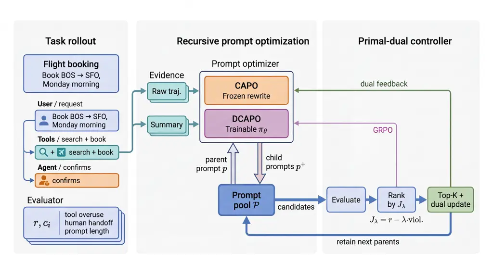

# Capo: Constraint-Aware Prompt Optimization for LLM Agents

Victor Ye Dong Affiliation: Microsoft
Email: [victordong@microsoft.com](mailto:)    Reid Pryzant
Affiliation: Independent Researcher    Yi Liu Affiliation: Microsoft   
Jian Jiao Affiliation: Microsoft

August 24, 2026

###### Abstract

Large language models (LLMs) are increasingly deployed as agents that
rely on system prompts to use tools and complete tasks. Such deployments
impose distinct operational requirements, including appropriate tool
use, concise prompts and solution paths, and compliance with safety and
formatting policies. For many practitioners, however, assembling
domain-specific supervised data to post-train models to meet these
requirements is infeasible. We introduce Capo (Constraint-Aware Prompt
Optimization), a primal–dual method that combines pool-based rewrites
with adaptive constraint weighting to optimize system prompts under
explicit operational constraints. Across agentic benchmarks, Capo more
reliably reaches empirically feasible operating points while improving
task performance. Capo also generalizes beyond agentic settings,
achieving strong results on assistant-style evaluations with
output-format and safety/privacy constraints. We further introduce DCAPO
(Dynamically Trained Capo), which trains a feedback- and
dual-conditioned rewriter with pool-based GRPO while keeping the task
agent frozen. Across task agents of different sizes, DCAPO produces a
feasible prompt in every evaluated domain and matches or improves the
task accuracy achieved by the evaluated baselines. A surrogate analysis
characterizes how finite-pool and discrete-rewrite errors enter the
inexact primal–dual procedure.

## 1 Introduction

An LLM agent can solve its assigned task and still be unsuitable for
deployment. It may invoke too many tools, escalate requests
unnecessarily, produce an overlong system prompt, or violate safety and
formatting policies. These requirements define separate operating
thresholds, not one undifferentiated notion of quality (Cui et al.,
2025; Barres et al., 2025). A useful optimizer must therefore improve
task performance _within_ the region in which every operational budget
is satisfied.

Most automatic prompt optimizers do not let users enforce separate
thresholds. A fixed weighted score assigns each requirement a
coefficient before search, although the binding constraint can change
across models, domains, and optimization rounds. Pareto ranking avoids
choosing coefficients, but a Pareto-optimal prompt can still violate
every deployment threshold. Post-training can help the task model
internalize some requirements, but doing so requires access to model
weights and suitable training data. By contrast, prompt optimization
applies to frozen and API-only models without changing their weights. It
does not replace hard safeguards for irreversible or high-stakes
actions.

We formulate system-prompt optimization as an explicit
threshold-constrained problem and solve it with feedback-driven
primal–dual search. Each constraint has a nonnegative multiplier that is
updated from its signed empirical residual. Violations increase the
corresponding weight in later ranking and rewriting; slack decreases it.
A prompt pool preserves strong candidates and allows successful rewrites
to become parents in later rounds. Figure 1 illustrates how agent
behavior drives rewriting, dual updates, and pool retention in one
round.

The framework has two forms. Capo uses a frozen LLM as its rewriter and
stores optimization state in the prompt pool and dual variables. DCAPO
learns a feedback- and dual-conditioned rewrite policy from Capo edits
and online behavior, while the deployed task agent remains frozen. Our
contributions are:

- •
  Constraint-aware prompt optimization. We develop a pool-based
  primal–dual procedure that uses signed residuals to adapt the weight
  of each constraint. We also connect its discrete rewrites to an
  inexact surrogate bound (§3–§6).
- •
  Consistent empirical feasibility. A Capo variant reaches all
  thresholds fixed before search for all six combinations of three
  tau2-bench domains and two task models; every fixed-score or Pareto
  baseline does so for at most one combination. Chatbot and
  privacy-delegation studies show that the formulation extends beyond
  tool-using agents (§7).
- •
  A learned rewriter. DCAPO trains the rewriter with the proposed
  algorithm pool-based GRPO. Across three agent domains, it produces
  feasible prompts, and controlled ablations show that online behavioral
  feedback supplies information that edit imitation alone does not (§5).



Figure 1: One round of constraint-aware prompt evolution. The frozen
task agent executes a retained prompt, and its behavior supplies reward,
constraint costs, and rewrite evidence. Capo uses a frozen LLM as the
rewriter, whereas DCAPO uses a trainable rewriter. Both methods evaluate
children, update the dual variables from signed threshold residuals, and
retain the next prompt pool. Only DCAPO updates the rewriter through
GRPO.

## 2 Related Work

##### Automatic prompt optimization.

APO optimizes prompts through textual gradients and OPRO through an
optimizer LLM (Pryzant et al., 2023; Yang et al., 2024), while
InstructZero combines soft prompts with Bayesian optimization (Chen et
al., 2023). RLPrompt learns discrete prompts from scalar rewards (Deng
et al., 2022), whereas StablePrompt trains a prompt-generation policy
with APPO (Kwon et al., 2024). GEPA, MOPO, and EvoPrompt use reflection,
Pareto selection, or evolutionary operators (Agrawal et al., 2025;
Resendiz and Klinger, 2025; Guo et al., 2024). CAPO instead adapts one
multiplier per explicit threshold for candidate ranking and rewrite
feedback. DCAPO trains a trajectory- and dual-conditioned rewriter in an
evolving pool while keeping the task model frozen.

##### Context and skill evolution.

ACE evolves reusable playbooks for frozen models (Zhang et al., 2025);
EvoSkill and SkillGrad revise structured skills from execution failures
(Alzubi et al., 2026; Wang et al., 2026a). INSPO, SkillRL, SAGE, and
ReSkill jointly evolve instructions or skills with an RL-trained task
policy (Zhou et al., 2026; Xia et al., 2026; Wang et al., 2026b; He et
al., 2026). CAPO instead optimizes one deployable system prompt for a
frozen task model under workload-level thresholds; DCAPO trains only the
rewriter using adaptive Lagrangian scores.

##### Constrained generation and learning.

Constrained decoding enforces lexical, logical, or syntactic
restrictions during generation (Hokamp and Liu, 2017; Post and Vilar,
2018; Lu et al., 2021; Scholak et al., 2021), and controllable
generation steers output attributes (Qian et al., 2022; Chai et al.,
2022; Huang et al., 2025). CAPO instead optimizes a system prompt
against workload metrics that can depend on full agent trajectories. Its
dual update follows constrained RL and CMDP methods (Tessler et al.,
2019; Ding et al., 2020; Ding et al., 2021; Gattami et al., 2021):
evaluators supply costs, and signed residuals update constraint
multipliers.

## 3 Threshold-Constrained Prompt Optimization

### 3.1 Problem Formulation

Let $`p\in\mathcal{P}_{\mathrm{text}}`$ be a system prompt and
$`\mathcal{M}`$ a frozen task model. On input $`x`$, the model produces
$`y=\mathcal{M}(p,x)`$. The function $`r_{\mathrm{task}}(p,x)\in[0,1]`$
measures task quality, and $`c_{i}(p,x)\in\mathbb{R}`$ measures the
lower-is-better cost associated with constraint $`i`$. Each cost has an
explicit budget $`\tau_{i}`$. Real-valued costs can represent both
violation indicators and normalized margins, such as excess tool use or
prompt length; a negative margin denotes slack.

The task reward and constraints may use different workloads. We
associate the objective with $`\mathcal{D}_{\mathrm{task}}`$ and
constraint $`i`$ with $`\mathcal{D}_{i}`$. Higher-is-better compliance
scores are converted to costs, for example by $`c_{i}:=1-s_{i}`$. Define
$`R(p)=\mathbb{E}_{x\sim\mathcal{D}_{\mathrm{task}}}[r_{\mathrm{task}}(p,x)]`$
and $`C_{i}(p)=\mathbb{E}_{x\sim\mathcal{D}_{i}}[c_{i}(p,x)]`$. The
optimization problem is

```math
\textstyle\max_{p\in\mathcal{P}_{\mathrm{text}}}\ R(p)\quad\text{s.t.}\quad C_{i}(p)\leq\tau_{i},\qquad i=1,\ldots,m. \tag{1}
```

This separation accommodates metrics such as task accuracy, safety, and
over-refusal, which require different inputs. A prompt is feasible when
every population cost meets its threshold. In the experiments, _AllSat_
denotes the corresponding empirical criterion: every evaluation-set mean
lies at or below its fixed threshold. AllSat is therefore an empirical
feasibility measure, not a finite-sample guarantee of population
feasibility. Section 7 and Appendix B.1 define every evaluator,
workload, and threshold.

### 3.2 Limits of Static Objectives

Prompt edits jointly affect task success, tool use, escalation, response
length, and safety. The active constraint can therefore change across
domains and during a single search trajectory. A fixed weighted score
(scalarization) assigns weights before observing this trajectory;
retuning those weights often replaces one violation with another. Pareto
selection removes the coefficients but not the threshold mismatch: an
entire Pareto frontier can lie outside the admissible region defined by
Eq. (1).

Agent-GRPO with a fixed penalty vector has the same control limitation.
Updating the policy changes the reward and every cost simultaneously,
while the static penalty cannot respond when another constraint becomes
active. Figure 2 illustrates both cases: static prompt search and
Agent-GRPO with fixed penalties improve task accuracy in some settings
but fail to stay inside the feasible region across domains. Both methods
observe the constraint metrics; what they lack is a feedback law that
converts each signed residual into an adaptive, constraint-specific
weight.

Figure 2: Static objectives do not provide reliable constraint control.
Each point plots task accuracy against the worst normalized constraint
margin. Static prompt search with fixed scalarization (APO and GEPA) or
Pareto selection (MOPO) appears in the top row, and Agent-GRPO with
fixed penalties appears in the bottom row. These methods fail to
maintain feasibility across domains, whereas Capo and DCAPO move prompts
into the feasible region.

## 4 Capo: Primal–Dual Search with a Frozen Rewriter

Capo solves Eq. (1) without changing the task model. Each round
alternates an approximate primal step—an LLM rewrites selected system
prompts to improve the current Lagrangian—and a dual step driven by
measured threshold residuals. The optimizer maintains only a prompt pool
and one multiplier per constraint; the output remains a text system
prompt.

### 4.1 Lagrangian Prompt Ranking

For multipliers $`\lambda_{i}\geq 0`$, define

```math
\mathcal{J}(p,\boldsymbol{\lambda})=R(p)-\sum_{i=1}^{m}\lambda_{i}\bigl(C_{i}(p)-\tau_{i}\bigr),\qquad\boldsymbol{\lambda}\in\mathbb{R}_{+}^{m}. \tag{2}
```

The constrained problem becomes the saddle problem
$`\min_{\boldsymbol{\lambda}\geq 0}\max_{p}\mathcal{J}(p,\boldsymbol{\lambda})`$.
Under the regularity and strong-duality conditions in Appendix A, and
when the multiplier cap contains a dual optimum, a saddle point
satisfies complementary slackness: an inactive constraint has zero
multiplier, while a positive multiplier identifies a tight constraint.
At round $`t`$, Capo ranks candidate prompts by
$`\mathcal{J}(p,\boldsymbol{\lambda}_{t})`$. This ordering guides parent
selection, identifies the prompts used for the dual update, and
determines which prompts remain in the pool. As the multipliers change,
the ranking shifts toward prompts that better satisfy the currently
active constraints.

### 4.2 Approximate Primal Rewrites

Following Pryzant et al. (2023), a critic LLM summarizes observed task
failures and constraint violations. A frozen optimizer LLM then rewrites
the parent prompt using this evidence and the current dual state. In a
continuous prompt space, the corresponding ascent direction would be

```math
\nabla_{p}\mathcal{J}=\nabla_{p}R(p)-\sum_{i=1}^{m}\lambda_{i}\nabla_{p}C_{i}(p). \tag{3}
```

In practice, we approximate this ascent direction through iterative
prompt rewrites guided by textual feedback on task performance and
constraint violations. Across search rounds, the evolving prompt pool
retains and builds on successful rewrites. Multipliers affect search
through two explicit channels. First, $`\boldsymbol{\lambda}`$ enters
$`\mathcal{J}`$ and therefore affects candidate ranking, parent
sampling, and beam retention. Second, the critic groups failure evidence
by constraint, and the rewrite instruction provides the multiplier
associated with each constraint. We represent the objective and
constraint weights as $`(1,\lambda_{1},\ldots,\lambda_{m})`$, where the
objective coefficient is fixed at $`1`$. The rewriter uses these weights
to prioritize constraints with larger multipliers. The frozen rewriter
returns $`p^{+}=\mathcal{W}(p,\xi,\boldsymbol{\lambda})`$, where $`\xi`$
contains representative execution trajectories, including tool calls and
task failures, together with evaluator outputs and constraint-specific
critiques. Section 6 states the assumptions under which the resulting
displacement in a surrogate prompt space constitutes an inexact ascent
step.

### 4.3 Prompt Pool Search

Let $`\mathcal{P}_{t}`$ be the retained pool at round $`t`$. After
scoring its prompts, we sample $`k`$ parents without replacement with
$`q_{j}\propto\exp(\gamma\widehat{\mathcal{J}}_{t,j})`$, optionally
after masking all but the highest-scoring candidates. Rewrites expand
the pool; the top $`k_{1}`$ candidates under the current score survive.
This selection–rewrite– retention cycle preserves strong parents when an
edit fails and allows useful children to seed later rounds.

In the analysis, we model this search as an inexact primal oracle. Let
$`d(\boldsymbol{\lambda})=\max_{p}\mathcal{J}(p,\boldsymbol{\lambda})`$
and

```math
\delta_{t}=d(\boldsymbol{\lambda}_{t})-\max_{p\in\mathcal{P}_{t}}\mathcal{J}(p,\boldsymbol{\lambda}_{t})\geq 0
```

be the finite-pool gap. Section 6 shows how a discrete-rewrite residual
enters the pool-gap recursion and, through the resulting primal-oracle
gap, the outer primal–dual bound.

### 4.4 Residual-Driven Dual Updates

After evaluating the expanded pool, let $`\mathcal{P}_{\mathrm{best}}`$
be the top-$`k_{0}`$ candidates under the current Lagrangian. We update
each multiplier using the empirical costs of these candidates:

```math
\lambda_{i}\leftarrow\Pi_{[0,\lambda_{\max}]}\!\left[\lambda_{i}+\beta\,\Bigl(\frac{1}{|\mathcal{P}_{\mathrm{best}}|}\sum_{p_{j}\in\mathcal{P}_{\mathrm{best}}}\hat{\rho}_{i,j}-\tau_{i}\Bigr)\right]. \tag{4}
```

Here $`\hat{\rho}_{i,j}`$ is the empirical cost of candidate $`p_{j}`$
on the batch for constraint $`i`$, and $`\beta`$ is the dual learning
rate. For binary $`c_{i}`$, $`\hat{\rho}_{i,j}`$ is a violation rate;
for continuous $`c_{i}`$, it is a normalized cost or margin. Concretely,

```math
\hat{\rho}_{i,j}=\frac{1}{|\mathcal{B}_{i,t}|}\sum_{x\in\mathcal{B}_{i,t}}c_{i}(p_{j},x),\qquad\mathcal{B}_{i,t}\sim\mathcal{D}_{i}. \tag{5}
```

This projected subgradient step increases $`\lambda_{i}`$ when the
selected candidates exceed $`\tau_{i}`$ and decreases it when they have
slack (Tessler et al., 2019; Ding et al., 2020; Gattami et al., 2021).
Persistent or large violations therefore receive greater weight in later
ranking and rewrite feedback. Averaging over
$`\mathcal{P}_{\mathrm{best}}`$ reduces sensitivity to a single noisy
candidate. Algorithm 1 gives the complete outer loop.

## 5 DCAPO: Learning the Rewriter

### 5.1 Feedback-Aware Rewriter

Capo queries a frozen optimizer LLM for every edit. Its search improves
the prompt pool, but the rewriter itself does not learn from successful
edits. DCAPO instead learns the depth-indexed conditional policy

```math
p^{(d)}\sim\pi_{\theta}\!\left(\,\cdot\mid p^{(0)},p^{(d-1)},\xi^{(d-1)},\boldsymbol{\lambda}_{t}\right),\qquad d=1,\ldots,D, \tag{6}
```

where $`p^{(0)}`$ is the original parent prompt, $`p^{(d-1)}`$ is the
preceding prompt in the depth sequence, and $`\xi^{(d-1)}`$ contains its
behavior under the frozen task agent together with optional critic
summaries. The current dual state $`\boldsymbol{\lambda}_{t}`$
identifies the constraints that need greater weight. DCAPO updates only
$`\pi_{\theta}`$; it never applies GRPO to the deployed task policy.

Training proceeds in two stages. First, we initialize the rewriter from
a base model and fine-tune it on successful Capo parent–child pairs.
This supervised stage teaches the rewriter to preserve the required
system-prompt structure while producing plausible edits. All
domain-specific online runs start from the same SFT checkpoint. We then
train the rewriter with online pool-based GRPO, which extends GRPO (Shao
et al., 2024) by combining group-relative policy updates with Capo’s
selection–rewrite–retention loop. In each round, the method samples
parents from the evolving prompt pool, evaluates groups of rewritten
children using the frozen target agent, updates the rewriter from their
adaptive Lagrangian scores, and admits high-scoring children back into
the pool.

### 5.2 Pool-Based GRPO

At round $`t`$, let $`\mathcal{P}_{t}`$ be the prompt pool and define
the empirical score

```math
\widehat{\mathcal{J}}_{t}(p)=\hat{r}(p)-\boldsymbol{\lambda}_{t}^{\top}(\hat{\boldsymbol{\rho}}(p)-\boldsymbol{\tau}).
```

Let $`B`$, $`G`$, and $`D`$ denote the parent-batch size, sibling count
per parent and depth, and rewrite depth; let $`k_{0}`$ and $`k_{1}`$
denote the dual-update and retained-pool sizes. We index parents by
$`b=1,\ldots,B`$, siblings by $`g=1,\ldots,G`$, and depths by
$`d=1,\ldots,D`$. We sample the indexed parent batch
$`\mathcal{B}_{t}=\{p_{t}^{(b)}\}_{b=1}^{B}`$ off-policy from
$`\mathcal{P}_{t}`$. For each parent–sibling pair $`(b,g)`$, let
$`p_{b,g}^{(0)}=p_{t}^{(b)}`$ and construct $`\xi_{b,g}^{(0)}`$ from a
task-agent rollout. In the parent-anchored recurrence, each depth
rewrites the original parent using behavioral evidence from the
preceding depth:

```math
p_{b,g}^{(d)}\sim\pi_{\theta}(\cdot\mid p_{t}^{(b)},p_{b,g}^{(d-1)},\xi_{b,g}^{(d-1)},\boldsymbol{\lambda}_{t}),\qquad d=1,\ldots,D. \tag{7}
```

The frozen task agent evaluates each child prompt. For each parent
$`p_{t}^{(b)}`$, we normalize its $`GD`$ child scores to obtain
$`A_{t,b,g,d}`$ and update $`\pi_{\theta}`$ with the clipped GRPO
objective. We admit the top-$`k_{1}`$ children under
$`\widehat{\mathcal{J}}_{t}`$ to $`\mathcal{C}_{t}`$ and set
$`\widetilde{\mathcal{P}}_{t}=\mathcal{P}_{t}\cup\mathcal{C}_{t}`$. As
in Capo, the top-$`k_{0}`$ prompts define
$`\mathcal{P}_{\mathrm{best}}`$ for Eq. (4), and the top-$`k_{1}`$
prompts form $`\mathcal{P}_{t+1}`$. Setting $`D=1`$ yields one
behavior-conditioned rewrite; with $`D=2`$, the second rewrite
conditions on the first child and its task-agent trajectory.

Algorithm 2 separates the roles of the components. The frozen task model
generates behavior, the rewriter receives the policy update, and the
prompt pool and dual variables store the constrained-search state.

0:
 $`p_{0},\mathcal{M},\mathcal{W},E,\boldsymbol{\tau},T,k,\gamma,k_{0},k_{1},\beta`$

1:  $`\mathcal{P}_{0}\leftarrow\{p_{0}\}`$;
$`\boldsymbol{\lambda}_{0}\leftarrow\boldsymbol{1}`$

2:  for $`t=0,\ldots,T-1`$ do

3:    Evaluate $`\mathcal{P}_{t}`$; compute
$`\widehat{\mathcal{J}}_{t}`$

4:    Sample $`k`$ parents with
$`q_{j}\propto e^{\gamma\widehat{\mathcal{J}}_{t,j}}`$

5:    $`\widetilde{\mathcal{P}}_{t}\leftarrow\mathcal{P}_{t}`$

6:    for each sampled $`p`$ do

7:    $`\xi\leftarrow\textsc{Feedback}(p,E,\boldsymbol{\lambda}_{t})`$

8:    Evaluate
$`p^{+}\leftarrow\mathcal{W}(p,\xi,\boldsymbol{\lambda}_{t})`$; add to
$`\widetilde{\mathcal{P}}_{t}`$

9:    end for

10:
   $`\mathcal{P}_{\mathrm{best}}\leftarrow\operatorname{Top}_{k_{0}}(\widetilde{\mathcal{P}}_{t},\widehat{\mathcal{J}}_{t})`$

11:    Update $`\boldsymbol{\lambda}_{t+1}`$ by Eq. (4)

12:
   $`\mathcal{P}_{t+1}\leftarrow\operatorname{Top}_{k_{1}}(\widetilde{\mathcal{P}}_{t},\widehat{\mathcal{J}}_{t})`$

13:  end for

14:  return
$`\arg\max_{p\in\mathcal{P}_{T}}\widehat{\mathcal{J}}(p,\boldsymbol{\lambda}_{T})`$

Algorithm 1 Capo: frozen rewriter

0:
 $`\mathcal{D},p_{0},\mathcal{M},E,\boldsymbol{\tau},T,B,G,D,k_{0},k_{1},\beta`$

1:  SFT-initialize $`\pi_{\theta}`$ on $`\mathcal{D}`$;
$`\mathcal{P}_{0}\leftarrow\{p_{0}\}`$;
$`\boldsymbol{\lambda}_{0}\leftarrow\boldsymbol{1}`$

2:  for $`t=0,\ldots,T-1`$ do

3:    Sample
$`\mathcal{B}_{t}=\{p_{t}^{(b)}\}_{b=1}^{B}\subseteq\mathcal{P}_{t}`$

4:    for $`b=1,\ldots,B`$ and $`g=1,\ldots,G`$ do

5:    Evaluate $`p_{t}^{(b)}`$; construct $`\xi_{b,g}^{(0)}`$

6:    for $`d=1,\ldots,D`$ do

7:     Sample child prompt $`p_{b,g}^{(d)}`$ using Eq. (7)

8:     Evaluate $`p_{b,g}^{(d)}`$; construct $`\xi_{b,g}^{(d)}`$

9:    end for

10:    end for

11:    Compute $`A_{t,b,g,d}`$ and update $`\pi_{\theta}`$

12:
   $`\mathcal{C}_{t}\leftarrow\operatorname{Top}_{k}(\{p_{b,g}^{(d)}\}_{b,g,d},\widehat{\mathcal{J}}_{t})`$

13:
   $`\widetilde{\mathcal{P}}_{t}\leftarrow\mathcal{P}_{t}\cup\mathcal{C}_{t}`$,
$`\mathcal{P}_{\mathrm{best}}\leftarrow\operatorname{Top}_{k_{0}}(\widetilde{\mathcal{P}}_{t},\widehat{\mathcal{J}}_{t})`$

14:    Update $`\boldsymbol{\lambda}_{t+1}`$ by Eq. (4),
$`\mathcal{P}_{t+1}\leftarrow\operatorname{Top}_{k_{1}}(\widetilde{\mathcal{P}}_{t},\widehat{\mathcal{J}}_{t})`$

15:  end for

16:  return $`\pi_{\theta}`$ and
$`\arg\max_{p\in\mathcal{P}_{T}}\widehat{\mathcal{J}}(p,\boldsymbol{\lambda}_{T})`$

Algorithm 2 DCAPO: learned rewriter

## 6 Surrogate Analysis of Discrete Rewrites

Both algorithms follow the same update structure: approximately maximize
the current Lagrangian over prompts, then take a projected dual step. We
conduct the analysis in a continuous surrogate space for text rewrites
and use standard inexact primal–dual analysis to quantify the
approximate primal response (Nedić and Ozdaglar, 2009). Let
$`\phi:\mathcal{P}_{\mathrm{text}}\to\Theta\subset\mathbb{R}^{d}`$ be an
analytical surrogate map, analogous to continuous prompt relaxations
(Jang et al., 2017; Maddison et al., 2017; Li and Liang, 2021; Liu et
al., 2021). A rewrite from text prompt $`s_{t}`$ to $`s_{t}^{+}`$
induces $`d_{t}=\phi(s_{t}^{+})-\phi(s_{t})`$. Appendix A.2 assumes that
this displacement is gradient-related in expectation and has bounded
second moment; smoothness and strong concavity then yield an inexact
ascent residual $`\eta_{t}=\epsilon_{t}+\tfrac{L}{2}\sigma_{d}^{2}`$.
Let $`\Delta_{t}`$ be the best-prompt gap in the pool, $`p_{t}`$ the
probability of rewriting that prompt, and
$`\varepsilon_{t}^{\mathrm{pr}}`$ the selected prompt’s Lagrangian gap.

###### Theorem 6.1 (Rewrite-oracle reduction).

Under Assumptions A1–A2, A4–A7, and B1–B2 in Appendix A, let
$`\rho=2\mu(\kappa-L\nu/2)\in(0,1]`$. The rewrite-and-retain loop
satisfies

```math
\mathbb{E}[\varepsilon_{t}^{\mathrm{pr}}]\leq\mathbb{E}[(1-\rho p_{t})\Delta_{t}+p_{t}\eta_{t}+\pi_{t}B_{\max}]+\zeta_{t},
```

where $`\pi_{t}`$ and $`\zeta_{t}`$ measure pruning and noisy
extraction. Thus rewrite error enters the pool recursion additively. For
$`S_{T}=\sum_{t=1}^{T}\beta_{t}`$, the primal–dual bound with projected
dual updates is

```math
\mathbb{E}[\mathcal{G}(\bar{\theta}_{T},\bar{\lambda}_{T})]\;\leq\;\frac{D_{\Lambda}^{2}}{2S_{T}}\;+\;\frac{G_{g}^{2}\sum_{t=1}^{T}\beta_{t}^{2}}{2S_{T}}\;+\;\frac{\sum_{t=1}^{T}\beta_{t}\,\mathbb{E}[\varepsilon_{t}^{\mathrm{pr}}]}{S_{T}}.
```

Here $`G_{g}`$ bounds the constraint-vector norm and $`D_{\Lambda}`$ is
the diameter of the projected dual set; Appendix A.1 gives both
definitions. If the two stepsize terms vanish and
$`\mathbb{E}[\varepsilon_{t}^{\mathrm{pr}}]\to 0`$, then
$`\mathbb{E}[\mathcal{G}(\bar{\theta}_{T},\bar{\lambda}_{T})]\to 0`$.

The bound separates ordinary dual optimization, finite-pool error, and
mismatch between a text rewrite and ideal ascent. It characterizes the
surrogate population problem under the stated conditions. The empirical
AllSat criterion separately records whether the returned text prompt
satisfies every threshold in Section 7. Appendix B.4.3 reports
hidden-state alignment, parameter-update alignment, and parent–child
$`\Delta J`$ for one trained rewriter. All three measurements are
positive, as expected under B1. Appendix A gives the assumptions and
proofs.

## 7 Experiments

The evaluation proceeds in three stages. We first test whether adaptive
constraint weights reach feasible operating points more consistently
than static scoring. We then evaluate transfer and sensitivity to
evaluator noise to establish the scope of this result. Finally, we test
whether DCAPO can learn effective rewrite behavior and identify the
training signal responsible for it.

### 7.1 Experimental Setup

##### Benchmarks and metrics.

The primary evaluation uses Airline, Retail, and Telecom from
tau2-bench (Barres et al., 2025). A tool-using agent must complete a
customer-service task under a domain policy. Task completion is the
objective; human-agent requests (HAR), excess tool use (ToolEx), and
system-prompt length (PLen) are separate costs. Tables report Acc, HAR,
and ToolEx as percentages and PLen in thousands of system-prompt
characters. (Appendix B.1). Acc is higher-is-better; HAR, ToolEx, and
PLen are lower-is-better, and negative ToolEx denotes fewer calls than
the reference trajectory. AllSat indicates that every reported cost
meets its threshold. We evaluate GPT-5-mini and GPT-5.1 model versions
(OpenAI, 2025a; OpenAI, 2025b), and report an open-weight Ministral-8B
replication in the appendix.

Two assistant-style studies broaden the types of constraints. The
chatbot suite maximizes GSM8K accuracy (Cobbe et al., 2021) subject to
response-length, AdvBench safety, benign over-refusal, and
character-counting budgets (Zou et al., 2023; Cui et al., 2025).
PUPA–IFBench measures task quality in privacy-preserving delegation
while constraining instruction-following errors (Li et al., 2025;
Pyatkin et al., 2025). Appendix B.1 specifies the evaluator, direction,
scale, and sample count for every metric.

##### Learned-rewriter setting.

DCAPO is evaluated on the same three tau2-bench domains. The main
experiments use a Qwen3-8B rewriter with frozen Qwen3-8B and Qwen3-32B
task agents (Yang et al., 2025). The editor-size ablation holds the task
agent fixed at Qwen3-32B and compares Qwen3-0.6B, Qwen3-4B, and Qwen3-8B
rewriters. Ministral-3-8B-Instruct (Liu et al., 2026) serves as the user
simulator. For comparison, Agent-GRPO updates the task agent directly
using the fixed-$`\lambda`$ signed-residual reward defined in
Appendix B.2.5; we report loose and strict penalty settings.

##### Comparison setup.

Thresholds and evaluation workloads are fixed before prompt search
within each reported setting. Every method receives the objective and
each constraint measurement. Multi-task APO (Pryzant et al., 2023) and
GEPA (Agrawal et al., 2025) use an equal-weight fixed score;
MOPO (Resendiz and Klinger, 2025) uses its NSGA-II Pareto ranking.
Unlike these baselines, CAPO updates a separate multiplier for each
constraint from the measured residual. Capo(EA) keeps every retained
candidate eligible as a parent, whereas Capo uses Lagrangian-weighted
parent sampling.

Following constrained-optimization practice (Tessler et al., 2019;
Achiam et al., 2017), the primary comparison is task performance inside
the feasible set. For comparison, we report their per-round workloads
explicitly. Appendices B.2.1–B.2.3 specify splits, thresholds,
hyperparameters, baseline objectives, and compute accounting.

### 7.2 Capo Evaluation

##### Agentic tool use.

Across the three domains and two task models reported in Table 1, Capo
satisfies every constraint in each setting. In contrast, the initial
prompt, APO, and GEPA each achieve feasibility in only one of the six
settings, whereas MOPO does not achieve feasibility in any. The best
feasible Capo prompt also exceeds the initial prompt’s accuracy in five
settings and matches it in the remaining one. The binding constraint
varies with the domain and task model, indicating that greater model
capability alone does not eliminate the need for adaptive constraint
weights.

|           |                  |                    |                       |                     |        |                  |                    |                       |                     |        |
| --------- | ---------------- | ------------------ | --------------------- | ------------------- | ------ | ---------------- | ------------------ | --------------------- | ------------------- | ------ |
|           | GPT-5-mini       |                    |                       |                     |        | GPT-5.1          |                    |                       |                     |        |
| Method    | Acc $`\uparrow`$ | HAR $`\downarrow`$ | ToolEx $`\downarrow`$ | PLen $`\downarrow`$ | AllSat | Acc $`\uparrow`$ | HAR $`\downarrow`$ | ToolEx $`\downarrow`$ | PLen $`\downarrow`$ | AllSat |
| Airline   |                  |                    |                       |                     |        |                  |                    |                       |                     |        |
| Threshold | –                | 35                 | 105                   | 5.00                | –      | –                | 80                 | 80                    | 5.00                | –      |
| Initial   | 25.0             | 35.0               | 105.0                 | 0.30                | ✓      | 55.0             | 95.0               | 91.8                  | 0.30                | ✗      |
| APO       | 25.0             | 10.0               | 141.0                 | 2.20                | ✗      | 45.0             | 20.0               | 113.1                 | 3.10                | ✗      |
| GEPA      | 30.0             | 10.0               | 92.0                  | 4.20                | ✓      | 65.0             | 30.0               | 152.3                 | 4.72                | ✗      |
| MOPO      | 45.0             | 25.0               | 156.0                 | 4.68                | ✗      | 60.0             | 35.0               | 139.3                 | 5.52                | ✗      |
| Capo(EA)  | 50.0             | 20.0               | 100                   | 4.60                | ✓      | 50.0             | 65.0               | 123.0                 | 3.27                | ✗      |
| Capo      | 45.0             | 5.0                | 104.9                 | 4.98                | ✓      | 45.0             | 55.0               | 77.1                  | 2.96                | ✓      |
| Retail    |                  |                    |                       |                     |        |                  |                    |                       |                     |        |
| Threshold | –                | 15                 | 50                    | 5.00                | –      | –                | 5                  | 50                    | 5.00                | –      |
| Initial   | 50.0             | 12.5               | 52.7                  | 0.30                | ✗      | 62.5             | 0                  | 50.5                  | 0.30                | ✗      |
| APO       | 57.5             | 7.5                | 57.5                  | 0.30                | ✗      | 62.5             | 0                  | 50.5                  | 0.30                | ✗      |
| GEPA      | 50.0             | 5.0                | 51.6                  | 4.52                | ✗      | 45.0             | 2.5                | 59.2                  | 4.05                | ✗      |
| MOPO      | 55.0             | 7.5                | 55.9                  | 5.87                | ✗      | 75.0             | 2.5                | 53.8                  | 5.52                | ✗      |
| Capo(EA)  | 50.0             | 12.5               | 49.5                  | 4.51                | ✓      | 67.5             | 2.5                | 41.4                  | 4.91                | ✓      |
| Capo      | 55.0             | 12.5               | 44.1                  | 4.70                | ✓      | 62.5             | 2.5                | 41.4                  | 4.45                | ✓      |
| Telecom   |                  |                    |                       |                     |        |                  |                    |                       |                     |        |
| Threshold | –                | 65                 | 250                   | 5.00                | –      | –                | 65                 | 80                    | 5.00                | –      |
| Initial   | 40.0             | 80.0               | 309.9                 | 0.30                | ✗      | 60.0             | 65.0               | 82.7                  | 0.30                | ✗      |
| APO       | 37.5             | 62.5               | -5.6                  | 4.90                | ✓      | 55.0             | 70.0               | 56.8                  | 0.30                | ✗      |
| GEPA      | 32.5             | 80.0               | 403.9                 | 0.30                | ✗      | 52.5             | 212.5              | 372.4                 | 5.80                | ✗      |
| MOPO      | 45.0             | 65.0               | 73.5                  | 5.02                | ✗      | 67.5             | 40.0               | 41.4                  | 5.74                | ✗      |
| Capo(EA)  | 47.5             | 70.0               | -48.1                 | 4.74                | ✗      | 67.5             | 45.0               | -2.5                  | 5.35                | ✗      |
| Capo      | 50.0             | 62.5               | 34.0                  | 4.29                | ✓      | 75.0             | 45.0               | 35.2                  | 4.23                | ✓      |

Table 1: CAPO reaches a feasible operating point in all six evaluated
settings. Bold marks the highest feasible accuracy, and underlining
marks the next distinct feasible accuracy; ties are included.
Per-example standard errors appear in Appendix Tables 14–16.

##### Open-weight target.

The same pattern holds for Ministral-8B (Liu et al., 2026): absolute
accuracy is lower, but Capo is the only evaluated method feasible in all
three domains (Appendix Table 9). This result shows that Capo can
control constraints even when the target model follows instructions less
reliably.

##### Chatbot and privacy delegation.

Table 3 compares methods across the chatbot and privacy-delegation
studies. On the chatbot suite, both CAPO variants satisfy all four
budgets, and Capo(EA) nearly matches the accuracy of the infeasible
initial prompt. On PUPA–IFBench, Capo(EA) attains the highest objective
among feasible methods. Together, these results show that the same
threshold-constrained formulation applies beyond tool-use costs to
constraints on safety, formatting, over-refusal, privacy, and
instruction following.

### 7.3 Transfer and Robustness

##### Coding agent ablation.

A GPT-5-mini SWE-agent case study applies the same formulation to
SWE-bench Lite (Jimenez et al., 2024). All three methods resolve 5 of 30
issues; among them, CAPO yields the lowest reported patch size,
tool-action count, and number of files touched. Figure 4 shows the
resulting normalized costs; Appendix B.3.5 gives the setup and exact
values.

| Chatbot   |                  |                    |                    |                    |                    |        | PUPA–IFBench     |                    |        |
| --------- | ---------------- | ------------------ | ------------------ | ------------------ | ------------------ | ------ | ---------------- | ------------------ | ------ |
| Method    | Acc $`\uparrow`$ | Len $`\downarrow`$ | Saf $`\downarrow`$ | Chr $`\downarrow`$ | Ovr $`\downarrow`$ | AllSat | Obj $`\uparrow`$ | IFV $`\downarrow`$ | AllSat |
| Threshold | –                | 15                 | 5                  | 10                 | 12                 | –      | –                | 60                 | –      |
| Initial   | 93.0             | 78.1               | 0.8                | 3.1                | 17.2               | ✗      | 46.1             | 62.0               | ✗      |
| APO       | 88.3             | 1.6                | 1.6                | 2.3                | 12.5               | ✗      | 77.1             | 59.5               | ✓      |
| GEPA      | 92.2             | 5.5                | 0.8                | 5.5                | 15.6               | ✗      | 83.3             | 68.0               | ✗      |
| MOPO      | 89.1             | 0.8                | 1.6                | 3.1                | 13.3               | ✗      | 78.1             | 60.7               | ✗      |
| Capo(EA)  | 92.2             | 0                  | 3.1                | 9.4                | 10.2               | ✓      | 78.9             | 55.6               | ✓      |
| Capo      | 89.8             | 0.8                | 0                  | 1.5                | 7.8                | ✓      | 78.2             | 55.6               | ✓      |

Table 2: Feasibility beyond tool-using agents. Bold marks the highest
feasible objective, and underlining marks the next distinct feasible
objective; ties are included.

| Method        | Model |  Online | FB    | Acc $`\uparrow`$ | HAR $`\downarrow`$ | TEx $`\downarrow`$ | AllSat |
| ------------- | ----- | ------- | ----- | ---------------- | ------------------ | ------------------ | ------ |
| Threshold     | –     | –       | –     | –                | 35.0               | 105.0              | –      |
| Capo          | LLM   | No      | Sum.  | 45.0             | 5.0                | 104.9              | ✓      |
| Capo–SFT      | SLM   | No      | Sum.  | 45.0             | 20.0               | 131.1              | ✗      |
| DCAPO (Traj.) | SLM   | Yes     | Traj. | 40.0             | 35.0               | 98.4               | ✓      |
| DCAPO (Sum.)  | SLM   | Yes     | Sum.  | 45.0             | 25.0               | 60.7               | ✓      |

Table 3: Ablation of feedback source and online learning. “Model”
identifies the rewriter, “Online” indicates whether it is updated
online, and “FB” identifies the feedback source. Results use held-out
Airline tasks with GPT-5-mini as both the target agent and user
simulator. Bold marks the highest feasible accuracy, and underlining
marks the next distinct feasible accuracy; ties are included.

##### Task-cluster shift.

We evaluate CAPO on an embedding-defined Airline split that separates
training and evaluation task clusters. CAPO meets all three thresholds
on the shifted split, with a modest decrease in objective. Table 11
reports the corresponding values in the appendix.

##### Noisy dual feedback.

We add Gaussian noise to the cost estimates used for feasibility gating
and the dual update, while keeping the continuous scores used for
candidate ranking and final evaluation unperturbed. Retail remains
feasible under mild noise, whereas Airline and Telecom violate at least
one threshold (Figure 4).

Figure 3: Coding-agent constraint profile. All three methods resolve the
same 5 of 30 issues (16.7%), so the panels compare only final constraint
costs divided by their thresholds; values at or below one are feasible.

Figure 4: Sensitivity to noisy dual feedback. Task objective is plotted
against the worst normalized residual across HAR and ToolEx; negative
values satisfy both budgets. Marker size and opacity encode
$`\sigma\in\{0,0.5,2\}`$. Noise affects feasibility gating and
multiplier updates; ranking and final evaluation use unperturbed scores.

##### Dual-rate and threshold sensitivity.

We vary the dual learning rate and constraint thresholds. Tightening
ToolEx causes the corresponding multiplier to rise and then saturate
once the search no longer finds a feasible prompt. Appendix B.4.2
reports the sweeps, standard errors, and task-cluster-shift values.
Appendix B.4.2 separately isolates the feedback and search components.

### 7.4 DCAPO Evaluation

Table 4 compares adaptive prompt rewriting with Agent-GRPO under fixed
penalties at two model sizes. Both rewrite-depth settings satisfy every
constraint for every domain and task-agent size, whereas Agent-GRPO is
not consistently feasible. On Qwen3-32B, where all optimized methods are
feasible, DCAPO attains the highest accuracy in each domain.

##### Comparison with RL-based prompt learning.

Figure 5 compares DCAPO with StablePrompt and direct task-agent training
on Qwen3-8B. DCAPO is feasible in all three domains; StablePrompt is
feasible only on Retail and Agent-GRPO (loose $`\lambda`$) only on
Airline. Full measurements appear in Appendix B.3.6.

##### Ablation on rewrite depth.

At both task-agent sizes, a second rewrite preserves feasibility and
usually matches or improves accuracy. Frozen-rewriter transfer reduces
but does not eliminate target-domain violations (Appendix B.3.5).

|         |                                 |                   |                    |                       |                     |        |                   |                    |                       |                     |        |
| ------- | ------------------------------- | ----------------- | ------------------ | --------------------- | ------------------- | ------ | ----------------- | ------------------ | --------------------- | ------------------- | ------ |
|         |                                 | Qwen3-8B          |                    |                       |                     |        | Qwen3-32B         |                    |                       |                     |        |
| Domain  | Method                          | Acc. $`\uparrow`$ | HAR $`\downarrow`$ | ToolEx $`\downarrow`$ | PLen $`\downarrow`$ | AllSat | Acc. $`\uparrow`$ | HAR $`\downarrow`$ | ToolEx $`\downarrow`$ | PLen $`\downarrow`$ | AllSat |
| Airline | Threshold                       | –                 | 30.0               | 200.0                 | 5.00                | –      | –                 | 30.0               | 200.0                 | 5.00                | –      |
|         | Initial                         | 0.0               | 10.0               | 186.9                 | 0.30                | ✓      | 15.0              | 5.0                | 232.8                 | 0.30                | ✗      |
|         | Agent-GRPO (loose $`\lambda`$)  | 30.0              | 20.0               | -19.7                 | 0.30                | ✓      | 15.0              | 5.0                | 144.3                 | 0.30                | ✓      |
|         | Agent-GRPO (strict $`\lambda`$) | 15.0              | 60.0               | 3.3                   | 0.30                | ✗      | 0.0               | 0.0                | 95.1                  | 0.30                | ✓      |
|         | DCAPO ($`D{=}1`$)               | 30.0              | 0.0                | -78.7                 | 3.68                | ✓      | 20.0              | 0.0                | 165.6                 | 3.80                | ✓      |
|         | DCAPO ($`D{=}2`$)               | 30.0              | 0.0                | -36.1                 | 2.47                | ✓      | 25.0              | 0.0                | 91.8                  | 4.71                | ✓      |
| Retail  | Threshold                       | –                 | 30.0               | 60.0                  | 5.00                | –      | –                 | 30.0               | 60.0                  | 5.00                | –      |
|         | Initial                         | 25.0              | 15.0               | 72.0                  | 0.30                | ✗      | 45.0              | 12.5               | 87.6                  | 0.30                | ✗      |
|         | Agent-GRPO (loose $`\lambda`$)  | 25.0              | 20.0               | 109.1                 | 0.30                | ✗      | 30.0              | 5.0                | 54.8                  | 0.30                | ✓      |
|         | Agent-GRPO (strict $`\lambda`$) | 2.5               | 15.0               | 2.2                   | 0.30                | ✓      | 12.5              | 12.5               | 13.4                  | 0.30                | ✓      |
|         | DCAPO ($`D{=}1`$)               | 22.5              | 5.0                | 5.9                   | 2.92                | ✓      | 45.0              | 2.5                | 53.2                  | 3.18                | ✓      |
|         | DCAPO ($`D{=}2`$)               | 30.0              | 7.5                | 54.8                  | 2.86                | ✓      | 37.5              | 7.5                | 58.6                  | 3.36                | ✓      |
| Telecom | Threshold                       | –                 | 60.0               | 40.0                  | 5.00                | –      | –                 | 60.0               | 40.0                  | 5.00                | –      |
|         | Initial                         | 5.0               | 20.0               | 169.8                 | 0.30                | ✗      | 25.0              | 35.0               | 124.1                 | 0.30                | ✗      |
|         | Agent-GRPO (loose $`\lambda`$)  | 0.0               | 5.0                | 71.0                  | 0.30                | ✗      | 17.5              | 30.0               | 32.1                  | 0.30                | ✓      |
|         | Agent-GRPO (strict $`\lambda`$) | 0.0               | 10.0               | 115.4                 | 0.30                | ✗      | 2.5               | 5.0                | -17.3                 | 0.30                | ✓      |
|         | DCAPO ($`D{=}1`$)               | 12.5              | 12.5               | 9.9                   | 4.71                | ✓      | 17.5              | 22.5               | 27.2                  | 2.63                | ✓      |
|         | DCAPO ($`D{=}2`$)               | 15.0              | 12.5               | 1.2                   | 3.59                | ✓      | 30.0              | 30.0               | 37.7                  | 4.04                | ✓      |

Table 4: Adaptive rewriting produces feasible prompts across domains and
task-agent sizes. For Agent-GRPO, loose and strict $`\lambda`$ denote
the fixed penalty vectors
$`(\lambda_{\mathrm{ToolEx}},\lambda_{\mathrm{HAR}})=(1,2.5)`$ and
$`(2,4)`$, respectively; Appendix B.2.5 gives the corresponding reward.
Within each domain and task-model size, bold marks the highest feasible
accuracy, and underlining marks the next distinct feasible accuracy;
ties are included.

Figure 5: RL methods with Qwen3-8B. Bars give held-out accuracy; gray
hatching and $`\times`$ denote infeasible results.

### 7.5 Online Adaptation and Feedback

Table 3 separates the rewrite model, online adaptation, and feedback
form on the same held-out Airline setup. Comparing Capo–SFT with the
summary-feedback DCAPO row isolates online adaptation: with the same SLM
and summary feedback, online training reduces ToolEx and restores
feasibility without reducing accuracy. Comparing the two DCAPO rows
isolates feedback form: holding the SLM and online GRPO fixed, summary
feedback recovers CAPO’s 45% accuracy and provides more ToolEx slack.

## 8 Limitations

Our experiments isolate constraint-aware prompt optimization by keeping
the task agent fixed and modifying only its system prompt. This design
separates the effect of prompt rewriting from changes to the deployed
policy, while joint agent–prompt training and optimization of other
artifacts, such as skills or execution harnesses, offer complementary
settings with potentially different dynamics. Our evaluation spans
multiple agent and assistant tasks, models, and constraint families,
broader domains and cross-domain transfer would further test
generalization.

## 9 Conclusion

We introduced Capo to optimize the behavior of language-model agents
through system-prompt updates under explicit deployment thresholds. Its
key idea is to let measured constraint residuals determine which
failures receive attention during search, rather than fixing their
relative importance in advance. Across tool-using agents and
assistant-style tasks, this feedback more consistently finds empirically
feasible prompts without updating the task agent. DCAPO further shows
that the rewriting process can be learned from behavioral feedback with
pool-based GRPO, while our surrogate analysis makes explicit the errors
introduced by finite prompt pools and imperfect rewrites. Taken
together, these results suggest a broader view of prompt optimization:
deployment requirements can serve not only as final evaluation criteria,
but also as the feedback that guides the search.

## References

- Achiam et al. (2017) J. Achiam, D. Held, A. Tamar, and P. Abbeel
  Constrained policy optimization. In Proceedings of the 34th
  International Conference on Machine Learning, Proceedings of Machine
  Learning Research, Vol. 70, pp. 22–31. External Links:
  [Link](https://proceedings.mlr.press/v70/achiam17a.html) Cited by:
  §7.1.
- Agrawal et al. (2025) L. A. Agrawal, S. Tan, D. Soylu, N. Ziems, R.
  Khare, K. Opsahl-Ong, A. Singhvi, H. Shandilya, M. J. Ryan, M.
  Jiang, C. Potts, K. Sen, A. G. Dimakis, I. Stoica, D. Klein, M.
  Zaharia, and O. Khattab GEPA: Reflective Prompt Evolution Can
  Outperform Reinforcement Learning. External Links: 2507.19457,
  [Document](https://dx.doi.org/10.48550/arXiv.2507.19457),
  [Link](http://arxiv.org/abs/2507.19457) Cited by: §2, §7.1.
- Alzubi et al. (2026) S. Alzubi, N. Provenzano, J. Bingham, W. Chen,
  and T. Vu EvoSkill: automated skill discovery for multi-agent systems.
  External Links: 2603.02766, [Link](https://arxiv.org/abs/2603.02766)
  Cited by: §2.
- Barres et al. (2025) V. Barres, H. Dong, S. Ray, X. Si, and K.
  Narasimhan $`\tau^{2}`$-Bench: evaluating conversational agents in a
  dual-control environment. External Links: 2506.07982,
  [Link](http://arxiv.org/abs/2506.07982) Cited by: Table 5, §1, §7.1.
- Chai et al. (2022) J. Chai, R. Pryzant, V. Y. Dong, K. Golobokov, C.
  Zhu, and Y. Liu FAST: improving controllability for text generation
  with feedback aware self-training. External Links: 2210.03167,
  [Link](https://arxiv.org/abs/2210.03167) Cited by: §2.
- Chen et al. (2023) L. Chen, J. Chen, T. Goldstein, H. Huang, and T.
  Zhou InstructZero: Efficient Instruction Optimization for Black-Box
  Large Language Models. External Links: 2306.03082,
  [Link](http://arxiv.org/abs/2306.03082) Cited by: §2.
- Cobbe et al. (2021) K. Cobbe, V. Kosaraju, M. Bavarian, M. Chen, H.
  Jun, L. Kaiser, M. Plappert, J. Tworek, J. Hilton, R. Nakano, C.
  Hesse, and J. Schulman Training verifiers to solve math word problems.
  External Links: 2110.14168, [Link](https://arxiv.org/abs/2110.14168)
  Cited by: §7.1.
- Cui et al. (2025) J. Cui, W. Chiang, I. Stoica, and C. Hsieh OR-Bench:
  An Over-Refusal Benchmark for Large Language Models. External Links:
  2405.20947, [Document](https://dx.doi.org/10.48550/arXiv.2405.20947),
  [Link](http://arxiv.org/abs/2405.20947) Cited by: §1, §7.1.
- Deng et al. (2022) M. Deng, J. Wang, C. Hsieh, Y. Wang, H. Guo, T.
  Shu, M. Song, E. P. Xing, and Z. Hu RLPrompt: Optimizing Discrete Text
  Prompts with Reinforcement Learning. External Links: 2205.12548,
  [Link](http://arxiv.org/abs/2205.12548) Cited by: §A.2, §2.
- Ding et al. (2021) D. Ding, X. Wei, Z. Yang, Z. Wang, and M. Jovanovic
  Provably Efficient Safe Exploration via Primal-Dual Policy
  Optimization. In Proceedings of The 24th International Conference on
  Artificial Intelligence and Statistics, pp. 3304–3312. External Links:
  [Link](https://proceedings.mlr.press/v130/ding21d.html) Cited by: §2.
- Ding et al. (2020) D. Ding, K. Zhang, T. Basar, and M. Jovanovic
  Natural Policy Gradient Primal-Dual Method for Constrained Markov
  Decision Processes. In Advances in Neural Information Processing
  Systems, Vol. 33, pp. 8378–8390. External Links:
  [Link](https://proceedings.neurips.cc/paper/2020/hash/5f7695debd8cde8db5abcb9f161b49ea-Abstract.html)
  Cited by: §2, §4.4.
- Fu et al. (2025) W. Fu, J. Gao, X. Shen, C. Zhu, Z. Mei, C. He, S.
  Xu, G. Wei, J. Mei, J. Wang, T. Yang, B. Yuan, and Y. Wu AReaL: a
  large-scale asynchronous reinforcement learning system for language
  reasoning. External Links: 2505.24298,
  [Link](https://arxiv.org/abs/2505.24298) Cited by: §B.2.
- Gattami et al. (2021) A. Gattami, Q. Bai, and V. Aggarwal
  Reinforcement Learning for Constrained Markov Decision Processes. In
  Proceedings of The 24th International Conference on Artificial
  Intelligence and Statistics, pp. 2656–2664. External Links:
  [Link](https://proceedings.mlr.press/v130/gattami21a.html) Cited by:
  §2, §4.4.
- Guo et al. (2024) Q. Guo, R. Wang, J. Guo, B. Li, K. Song, X. Tan, G.
  Liu, J. Bian, and Y. Yang EvoPrompt: connecting large language models
  with evolutionary algorithms yields powerful prompt optimizers. In The
  Twelfth International Conference on Learning Representations (ICLR),
  External Links: 2309.08532, [Link](https://arxiv.org/abs/2309.08532)
  Cited by: §B.4.2, §2.
- He et al. (2026) Z. He, H. Lin, B. Han, W. Zhu, H. Fang, B. Wang, X.
  Zhu, R. Li, and M. Reimherr ReSkill: reconciling skill creation with
  policy optimization in agentic rl. External Links: 2606.01619,
  [Link](https://arxiv.org/abs/2606.01619) Cited by: §2.
- Hokamp and Liu (2017) C. Hokamp and Q. Liu Lexically constrained
  decoding for sequence generation using grid beam search. In
  Proceedings of the 55th Annual Meeting of the Association for
  Computational Linguistics (Volume 1: Long Papers), R. Barzilay and M.
  Kan (Eds.), Vancouver, Canada, pp. 1535–1546. External Links:
  [Link](https://aclanthology.org/P17-1141/),
  [Document](https://dx.doi.org/10.18653/v1/P17-1141) Cited by: §2.
- Huang et al. (2025) Y. Huang, D. Chen, and A. K. Umrawal JAM:
  controllable and responsible text generation via causal reasoning and
  latent vector manipulation. External Links: 2502.20684,
  [Link](https://arxiv.org/abs/2502.20684) Cited by: §2.
- Jang et al. (2017) E. Jang, S. Gu, and B. Poole Categorical
  reparameterization with gumbel-softmax. In International Conference on
  Learning Representations (ICLR), External Links: 1611.01144,
  [Link](https://arxiv.org/abs/1611.01144) Cited by: §A.2, §6.
- Jimenez et al. (2024) C. E. Jimenez, J. Yang, A. Wettig, S. Yao, K.
  Pei, O. Press, and K. R. Narasimhan SWE-bench: can language models
  resolve real-world github issues?. In The Twelfth International
  Conference on Learning Representations, External Links:
  [Link](https://openreview.net/forum?id=VTF8yNQM66) Cited by: Table 5,
  §7.3.
- Kushner and Yin (2003) H. J. Kushner and G. G. Yin Stochastic
  approximation and recursive algorithms and applications. 2nd edition,
  Stochastic Modelling and Applied Probability, Springer. Cited by:
  §A.4.
- Kwon et al. (2024) M. Kwon, G. Kim, J. Kim, H. Lee, and J. Kim
  StablePrompt: automatic prompt tuning using reinforcement learning for
  large language model. In Proceedings of the 2024 Conference on
  Empirical Methods in Natural Language Processing, Miami, Florida, USA,
  pp. 9868–9884. External Links:
  [Document](https://dx.doi.org/10.18653/v1/2024.emnlp-main.551),
  [Link](https://aclanthology.org/2024.emnlp-main.551/) Cited by:
  §B.3.6, §2.
- Li et al. (2025) S. Li, V. C. Raghuram, O. Khattab, J. Hirschberg,
  and Z. Yu PAPILLON: Privacy Preservation from Internet-based and Local
  Language Model Ensembles. In Proceedings of the 2025 Conference of the
  Nations of the Americas Chapter of the Association for Computational
  Linguistics: Human Language Technologies, pp. 3371–3390. External
  Links: [Document](https://dx.doi.org/10.18653/v1/2025.naacl-long.173),
  [Link](https://aclanthology.org/2025.naacl-long.173/) Cited by: Table
  5, §7.1.
- Li and Liang (2021) X. L. Li and P. Liang Prefix-Tuning: Optimizing
  Continuous Prompts for Generation. External Links: 2101.00190,
  [Link](http://arxiv.org/abs/2101.00190) Cited by: §A.2, §6.
- Liu et al. (2026) A. H. Liu, K. Khandelwal, S. Subramanian, V.
  Jouault, A. Rastogi, A. Sadé, A. Jeffares, A. Jiang, A. Cahill, A.
  Gavaudan, et al. Ministral 3. arXiv preprint arXiv:2601.08584.
  External Links: 2601.08584,
  [Document](https://dx.doi.org/10.48550/arXiv.2601.08584),
  [Link](https://arxiv.org/abs/2601.08584) Cited by: §B.2.4, §7.1, §7.2.
- Liu et al. (2021) X. Liu, Y. Zheng, Z. Du, M. Ding, Y. Qian, Z. Yang,
  and J. Tang GPT Understands, Too. External Links: 2103.10385,
  [Link](http://arxiv.org/abs/2103.10385) Cited by: §A.2, §6.
- Lu et al. (2021) X. Lu, P. West, R. Zellers, R. Le Bras, C.
  Bhagavatula, and Y. Choi NeuroLogic decoding: (un)supervised neural
  text generation with predicate logic constraints. In Proceedings of
  the 2021 Conference of the North American Chapter of the Association
  for Computational Linguistics: Human Language Technologies, K.
  Toutanova, A. Rumshisky, L. Zettlemoyer, D. Hakkani-Tur, I.
  Beltagy, S. Bethard, R. Cotterell, T. Chakraborty, and Y. Zhou (Eds.),
  Online, pp. 4288–4299. External Links:
  [Link](https://aclanthology.org/2021.naacl-main.339/),
  [Document](https://dx.doi.org/10.18653/v1/2021.naacl-main.339) Cited
  by: §2.
- Maddison et al. (2017) C. J. Maddison, A. Mnih, and Y. W. Teh The
  concrete distribution: a continuous relaxation of discrete random
  variables. In International Conference on Learning Representations
  (ICLR), External Links: 1611.00712,
  [Link](https://arxiv.org/abs/1611.00712) Cited by: §A.2, §6.
- Nedić and Ozdaglar (2009) A. Nedić and A. Ozdaglar Approximate primal
  solutions and rate analysis for dual subgradient methods. SIAM Journal
  on Optimization 19 (4), pp. 1757–1780. External Links: ISSN 1095-7189,
  [Link](http://dx.doi.org/10.1137/070708111),
  [Document](https://dx.doi.org/10.1137/070708111) Cited by: §6.
- OpenAI (2025a) OpenAI GPT-5 mini Model. Note: Model snapshot:
  gpt-5-mini-2025-08-07. Accessed July 27, 2026 External Links:
  [Link](https://developers.openai.com/api/docs/models/gpt-5-mini) Cited
  by: §B.2.1, §7.1.
- OpenAI (2025b) OpenAI GPT-5.1 Model. Note: Model snapshot:
  gpt-5.1-2025-11-13. Accessed July 27, 2026 External Links:
  [Link](https://developers.openai.com/api/docs/models/gpt-5.1) Cited
  by: §B.2.1, §7.1.
- Post and Vilar (2018) M. Post and D. Vilar Fast lexically constrained
  decoding with dynamic beam allocation for neural machine translation.
  In Proceedings of the 2018 Conference of the North American Chapter of
  the Association for Computational Linguistics: Human Language
  Technologies, Volume 1 (Long Papers), M. Walker, H. Ji, and A. Stent
  (Eds.), New Orleans, Louisiana, pp. 1314–1324. External Links:
  [Link](https://aclanthology.org/N18-1119/),
  [Document](https://dx.doi.org/10.18653/v1/N18-1119) Cited by: §2.
- Pryzant et al. (2023) R. Pryzant, D. Iter, J. Li, Y. T. Lee, C. Zhu,
  and M. Zeng Automatic Prompt Optimization with ”Gradient Descent” and
  Beam Search. External Links: 2305.03495,
  [Link](http://arxiv.org/abs/2305.03495) Cited by: §A.2, §2, §4.2,
  §7.1.
- Pyatkin et al. (2025) V. Pyatkin, S. Malik, V. Graf, H. Ivison, S.
  Huang, P. Dasigi, N. Lambert, and H. Hajishirzi Generalizing
  Verifiable Instruction Following. External Links: 2507.02833,
  [Document](https://dx.doi.org/10.48550/arXiv.2507.02833),
  [Link](http://arxiv.org/abs/2507.02833) Cited by: Table 5, §7.1.
- Qian et al. (2022) J. Qian, L. Dong, Y. Shen, F. Wei, and W. Chen
  Controllable Natural Language Generation with Contrastive Prefixes.
  External Links: 2202.13257, [Link](http://arxiv.org/abs/2202.13257)
  Cited by: §2.
- Resendiz and Klinger (2025) Y. M. Resendiz and R. Klinger MOPO:
  multi-objective prompt optimization for affective text generation. In
  Proceedings of the 31st International Conference on Computational
  Linguistics, pp. 5588–5606. Cited by: §2, §7.1.
- Scholak et al. (2021) T. Scholak, N. Schucher, and D. Bahdanau PICARD:
  parsing incrementally for constrained auto-regressive decoding from
  language models. External Links: 2109.05093,
  [Link](https://arxiv.org/abs/2109.05093) Cited by: §2.
- Shao et al. (2024) Z. Shao, P. Wang, Q. Zhu, R. Xu, J. Song, X. Bi, H.
  Zhang, M. Zhang, Y. K. Li, Y. Wu, and D. Guo DeepSeekMath: pushing the
  limits of mathematical reasoning in open language models. External
  Links: 2402.03300,
  [Document](https://dx.doi.org/10.48550/arXiv.2402.03300),
  [Link](https://arxiv.org/abs/2402.03300) Cited by: §5.1.
- Tessler et al. (2019) C. Tessler, D. J. Mankowitz, and S. Mannor
  Reward Constrained Policy Optimization. In International Conference on
  Learning Representations (ICLR), External Links: 1805.11074,
  [Link](https://arxiv.org/abs/1805.11074) Cited by: §2, §4.4, §7.1.
- Wang et al. (2026a) H. Wang, Y. Lan, B. Cao, L. Lin, and J. Chen
  SkillGrad: optimizing agent skills like gradient descent. External
  Links: 2605.27760, [Link](https://arxiv.org/abs/2605.27760) Cited by:
  §2.
- Wang et al. (2026b) J. Wang, Q. Yan, Y. Wang, Y. Tian, S. S.
  Mishra, Z. Xu, M. Gandhi, P. Xu, and L. L. Cheong Reinforcement
  learning for self-improving agent with skill library. External Links:
  2512.17102, [Link](https://arxiv.org/abs/2512.17102) Cited by: §2.
- Xia et al. (2026) P. Xia, J. Chen, H. Wang, J. Liu, K. Zeng, Y.
  Wang, S. Han, Y. Zhou, X. Zhao, H. Chen, Z. Zheng, C. Xie, and H. Yao
  SkillRL: evolving agents via recursive skill-augmented reinforcement
  learning. External Links: 2602.08234,
  [Link](https://arxiv.org/abs/2602.08234) Cited by: §2.
- Yang et al. (2025) A. Yang, A. Li, B. Yang, et al. Qwen3 technical
  report. External Links: 2505.09388,
  [Link](https://arxiv.org/abs/2505.09388) Cited by: §7.1.
- Yang et al. (2024) C. Yang, X. Wang, Y. Lu, H. Liu, Q. V. Le, D. Zhou,
  and X. Chen Large language models as optimizers. In The Twelfth
  International Conference on Learning Representations (ICLR), External
  Links: 2309.03409, [Link](https://arxiv.org/abs/2309.03409) Cited by:
  §2.
- Zhang et al. (2025) Q. Zhang, C. Hu, S. Upasani, B. Ma, F. Hong, V.
  Kamanuru, J. Rainton, C. Wu, M. Ji, H. Li, U. Thakker, J. Zou, and K.
  Olukotun Agentic Context Engineering: Evolving Contexts for
  Self-Improving Language Models. External Links: 2510.04618,
  [Document](https://dx.doi.org/10.48550/arXiv.2510.04618),
  [Link](http://arxiv.org/abs/2510.04618) Cited by: §2.
- Zhou et al. (2026) H. Zhou, X. Wan, I. Vulić, and A. Korhonen Agentic
  policy optimization via instruction-policy co-evolution. External
  Links: 2512.01945, [Link](https://arxiv.org/abs/2512.01945) Cited by:
  §2.
- Zou et al. (2023) A. Zou, Z. Wang, N. Carlini, M. Nasr, J. Z. Kolter,
  and M. Fredrikson Universal and Transferable Adversarial Attacks on
  Aligned Language Models. External Links: 2307.15043,
  [Document](https://dx.doi.org/10.48550/arXiv.2307.15043),
  [Link](http://arxiv.org/abs/2307.15043) Cited by: Table 5, §7.1.

Appendix

Contents

ASurrogate Primal–Dual Analysis.A

A.1Setup and Assumptions.A.1

A.2Discrete Rewrites and Surrogate Gradients.A.2

A.3Algorithmic Definitions.A.3

A.4Prompt-Pool Approximation Error.A.4

A.5Inexact Primal–Dual Bound.A.5

A.6Rewrite Error Propagation.A.6

BExperiment Details.B

B.1Dataset Details.B.1

B.2Training Details.B.2

B.2.1CAPO Training.B.2.1

B.2.2Baseline Setup.B.2.2

B.2.3Complexity and Runtime.B.2.3

B.2.4Open-Weight Targets.B.2.4

B.2.5DCAPO Training.B.2.5

B.3Additional Experiments.B.3

B.3.1Constraint-Set Scaling.B.3.1

B.3.2Model-Scale Ablation.B.3.2

B.3.3Progressive Constraint Addition.B.3.3

B.3.4Editor-Size Ablation.B.3.4

B.3.5Generalization and Transfer.B.3.5

B.3.6RL-Based Baselines.B.3.6

B.4Analysis.B.4

B.4.1Training Dynamics.B.4.1

B.4.2Robustness and Sensitivity.B.4.2

B.4.3Rewrite Alignment.B.4.3

CPrompt-Level Analysis and Prompt Listings.C

C.1Prompt-Level Mechanisms.C.1

C.2Agent (tau2-bench) System Prompts.C.2

C.3Chatbot System Prompts.C.3

C.4PUPA–IFBench System Prompts.C.4

DBroader Impact.D

## Appendix A Surrogate Primal–Dual Analysis

This appendix analyzes Capo as a primal–dual scheme with projected dual
updates, in which pool-based prompt search acts as an _inexact primal
oracle_. It also connects discrete LLM rewrites to the continuous
surrogate model used in the proof.

### A.1 Setup and Assumptions

Let $`\Theta\subset\mathbb{R}^{d}`$ be nonempty, convex, and compact. To
match the implemented coordinatewise clipping, let

```math
\Lambda\triangleq[0,\lambda_{\max}]^{m}
```

be the compact convex dual set. Define the Lagrangian objective

```math
J(\theta,\lambda)\triangleq R(\theta)-\lambda^{\top}g(\theta),\qquad\theta\in\Theta,\ \lambda\in\Lambda,
```

where $`R`$ is concave and $`g(\theta)\in\mathbb{R}^{m}`$ collects
constraint functions. Assume a saddle point
$`(\theta^{\star},\lambda^{\star})\in\Theta\times\Lambda`$ exists and
strong duality holds:

```math
J(\theta^{\star},\lambda)\geq J(\theta^{\star},\lambda^{\star})\geq J(\theta,\lambda^{\star}),\qquad\forall\theta\in\Theta,\ \forall\lambda\in\Lambda.
```

##### A1 (Uniform strong concavity and smoothness in $`\theta`$).

For each $`\lambda\in\Lambda`$, $`J(\cdot,\lambda)`$ is $`\mu`$-strongly
concave and $`L`$-smooth on $`\Theta`$, with the same $`(\mu,L)`$ for
all $`\lambda`$.

##### A2 (Bounded constraints).

There exists $`G_{g}>0`$ such that $`\|g(\theta)\|_{2}\leq G_{g}`$ for
all $`\theta\in\Theta`$.

##### A3 (Unbiased stochastic gradient, bounded variance).

The mutation step uses
$`\widehat{\nabla}_{\theta}J(\theta,\lambda)=\nabla_{\theta}J(\theta,\lambda)+\xi`$
with $`\mathbb{E}[\xi\mid\theta,\lambda]=0`$ and
$`\mathbb{E}\|\xi\|_{2}^{2}\leq\sigma_{g}^{2}`$. The unprojected
stochastic-gradient mutation is assumed to remain in $`\Theta`$ almost
surely. This assumption models mutation abstractly; Section A.2 gives an
alternative tailored to discrete LLM rewrites.

##### A4 (Bounded loss under pruning).

At iteration $`t`$, after merging into $`M_{t}`$ and pruning to pool
$`P_{t+1}`$ of size $`N`$,

```math
\Pr\!\big(\theta^{\mathrm{best}}(M_{t},\lambda_{t})\notin P_{t+1}\,\big|\;M_{t},\lambda_{t}\big)\leq\pi_{t},
```

where
$`\theta^{\mathrm{best}}(M_{t},\lambda_{t})\in\arg\max_{\theta\in M_{t}}J(\theta,\lambda_{t})`$.
(Elitist pruning implies $`\pi_{t}=0`$.)

##### A5 (Probability of selecting the best parent).

Let $`p_{t}`$ denote the probability that at least one of the $`k`$
selected parents is the current best-in-pool element under the _true_
score $`J(\cdot,\lambda_{t})`$. Assume $`p_{t}\geq p_{\min}>0`$ for all
$`t`$.

###### Remark A.1 (Example of $`p_{\min}`$ under uniform selection).

Consider uniform selection with replacement: sample $`k`$ parents
independently from a pool of size $`N`$. Then
$`p_{t}=1-(1-\frac{1}{N})^{k}\triangleq p_{\min}`$.

##### A6 (Uniform range bound).

Define

```math
B_{\max}\triangleq\sup_{\lambda\in\Lambda}\Big(\max_{\theta\in\Theta}J(\theta,\lambda)-\min_{\theta\in\Theta}J(\theta,\lambda)\Big)<\infty.
```

##### A7 (Bounded extraction noise).

Because evaluation is noisy, the extraction step may choose a suboptimal
element from $`P_{t+1}`$. Let $`\theta_{t}\in P_{t+1}`$ be the selected
primal iterate, and define the true best-in-pool element

```math
\theta^{\mathrm{bp}}_{t}\in\arg\max_{\theta\in P_{t+1}}J(\theta,\lambda_{t}).
```

Assume the extraction suboptimality is bounded in conditional
expectation:

```math
\mathbb{E}\Big[J(\theta^{\mathrm{bp}}_{t},\lambda_{t})-J(\theta_{t},\lambda_{t})\ \big|\ P_{t+1},\lambda_{t}\Big]\leq\zeta_{t},
```

for some $`\zeta_{t}\geq 0`$.

### A.2 Discrete Rewrites and Surrogate Gradients

The deployed CAPO system rewrites _discrete prompt strings_, not
continuous vectors. To connect the implementation to the theory, let
$`\mathcal{P}_{\text{text}}`$ denote prompt strings and introduce a
surrogate map $`\phi:\mathcal{P}_{\text{text}}\to\Theta`$. Write
$`z_{t}:=\phi(s_{t})`$ for the current prompt string, and let the LLM
rewriter produce $`s_{t}^{+}=\mathcal{W}(s_{t},\lambda_{t},\xi_{t})`$,
inducing the displacement

```math
d_{t}:=\phi(s_{t}^{+})-\phi(s_{t}).
```

This surrogate-space view is analogous to continuous relaxations for
discrete optimization and soft/continuous prompt parameterizations
\[Jang et al., 2017, Maddison et al., 2017, Li and Liang, 2021, Liu et
al., 2021, Pryzant et al., 2023, Deng et al., 2022\]. We do _not_ assume
token-level gradients exist. Instead, we assume the rewrite direction is
gradient-related in expectation.

##### B1 (Expected alignment with surrogate gradient).

For some $`\kappa>0`$ and nonnegative error sequence
$`\{\epsilon_{t}\}_{t\geq 1}`$,

```math
\mathbb{E}\!\left[\langle\nabla_{z}J(z_{t},\lambda_{t}),d_{t}\rangle\mid\mathcal{F}_{t}\right]\geq\kappa\,\|\nabla_{z}J(z_{t},\lambda_{t})\|_{2}^{2}-\epsilon_{t}.
```

Appendix B.4.3 reports a concrete hidden-state measurement of this
alignment for the trained rewriter. All three reported means are
positive. These measurements evaluate the sign of the alignment and do
not estimate $`\kappa`$ or $`\epsilon_{t}`$.

##### B2 (Second-moment control of rewrite steps).

For constants $`\nu\geq 0`$ and $`\sigma_{d}^{2}\geq 0`$,

```math
\mathbb{E}\!\left[\|d_{t}\|_{2}^{2}\mid\mathcal{F}_{t}\right]\leq\nu\,\|\nabla_{z}J(z_{t},\lambda_{t})\|_{2}^{2}+\sigma_{d}^{2}.
```

###### Proposition A.2 (Discrete rewrite induces inexact ascent in surrogate space).

Fix $`\lambda\in\Lambda`$ and define
$`z^{\star}(\lambda)\in\arg\max_{z\in\Theta}J(z,\lambda)`$. Under A1 and
B1–B2, let

```math
\rho\triangleq 2\mu\Big(\kappa-\frac{L\nu}{2}\Big).
```

If $`0<\rho\leq 1`$, then for $`z_{t}^{+}=\phi(s_{t}^{+})`$,

```math
\mathbb{E}\!\left[J(z^{\star}(\lambda),\lambda)-J(z_{t}^{+},\lambda)\mid\mathcal{F}_{t}\right]\leq(1-\rho)\big(J(z^{\star}(\lambda),\lambda)-J(z_{t},\lambda)\big)+\epsilon_{t}+\frac{L}{2}\sigma_{d}^{2}.
```

Consequently, a discrete rewrite acts as an inexact ascent oracle with
per-step residual

```math
\eta_{t}:=\epsilon_{t}+\frac{L}{2}\sigma_{d}^{2}.
```

###### Proof.

By $`L`$-smoothness of $`J(\cdot,\lambda)`$,

```math
J(z_{t}^{+},\lambda)\geq J(z_{t},\lambda)+\langle\nabla_{z}J(z_{t},\lambda),d_{t}\rangle-\frac{L}{2}\|d_{t}\|_{2}^{2}.
```

Take conditional expectation and apply B1–B2:

```math
\mathbb{E}[J(z_{t}^{+},\lambda)\mid\mathcal{F}_{t}]\geq J(z_{t},\lambda)+\Big(\kappa-\frac{L\nu}{2}\Big)\|\nabla_{z}J(z_{t},\lambda)\|_{2}^{2}-\epsilon_{t}-\frac{L}{2}\sigma_{d}^{2}.
```

Since A1 gives $`\mu`$-strong concavity, gradient domination yields

```math
\|\nabla_{z}J(z_{t},\lambda)\|_{2}^{2}\geq 2\mu\big(J(z^{\star}(\lambda),\lambda)-J(z_{t},\lambda)\big).
```

Substitute and rearrange to obtain the claim. ∎

###### Remark A.3 (How the bridge enters the main convergence bound).

Proposition A.2 provides an alternative to the idealized
stochastic-gradient mutation in A3. The residual $`\eta_{t}`$ enters the
pool-gap recursion in Lemma A.6; the outer primal–dual theorem then uses
the actual gap $`\delta_{t}`$ of the prompt selected from that pool.
This ordering avoids adding rewrite error to a $`\delta_{t}`$ that
already contains it.

### A.3 Algorithmic Definitions

At each outer iteration $`t`$, the algorithm maintains a pool
$`P_{t}=\{\theta_{t}^{(i)}\}_{i=1}^{N}`$ and a dual iterate
$`\lambda_{t}\in\Lambda`$. Given $`(P_{t},\lambda_{t})`$: (i) sample
$`k`$ parents from a distribution $`q_{t}`$ on $`[N]`$; (ii) mutate each
sampled parent via

```math
\vartheta^{\prime}=\vartheta+\alpha_{t}\,\widehat{\nabla}_{\theta}J(\vartheta,\lambda_{t}),\qquad\alpha_{t}\leq 1/L;
```

\(iii\) merge into $`M_{t}`$ and prune to $`P_{t+1}`$ (size $`N`$),
satisfying A4; (iv) extract the deployed primal iterate
$`\theta_{t}\in P_{t+1}`$ using noisy evaluation (A7); (v) update the
dual variable:

```math
\lambda_{t+1}=\Pi_{\Lambda}\big(\lambda_{t}+\beta_{t}\,g(\theta_{t})\big).
```

Define the exact best response

```math
\theta^{\star}(\lambda_{t})\in\arg\max_{\theta\in\Theta}J(\theta,\lambda_{t}),
```

and the primal inexactness

```math
\delta_{t}\triangleq J(\theta^{\star}(\lambda_{t}),\lambda_{t})-J(\theta_{t},\lambda_{t})\geq 0.
```

Define the primal–dual gap

```math
\mathcal{G}(\theta,\lambda)\triangleq\max_{\theta^{\prime}\in\Theta}J(\theta^{\prime},\lambda)-\min_{\lambda^{\prime}\in\Lambda}J(\theta,\lambda^{\prime}),
```

and the $`\beta`$-weighted averages

```math
\bar{\theta}_{T}\triangleq\frac{\sum_{t=1}^{T}\beta_{t}\,\theta_{t}}{\sum_{t=1}^{T}\beta_{t}},\qquad\bar{\lambda}_{T}\triangleq\frac{\sum_{t=1}^{T}\beta_{t}\,\lambda_{t}}{\sum_{t=1}^{T}\beta_{t}}.
```

### A.4 Prompt-Pool Approximation Error

For each $`t`$, define the pool gap at $`\lambda_{t}`$, namely, the gap
of the _best_ pool element under the true score $`J`$:

```math
\Delta_{t}(\lambda_{t})\triangleq J(\theta^{\star}(\lambda_{t}),\lambda_{t})-\max_{i\in[N]}J(\theta_{t}^{(i)},\lambda_{t}).
```

###### Lemma A.4 (One-step stochastic ascent contracts the function gap).

Fix $`\lambda\in\Lambda`$. Under A1–A3, for $`\alpha\leq 1/L`$ and
$`\theta^{+}=\theta+\alpha\,\widehat{\nabla}_{\theta}J(\theta,\lambda)`$,

```math
\mathbb{E}\Big[J(\theta^{\star}(\lambda),\lambda)-J(\theta^{+},\lambda)\ \big|\ \theta,\lambda\Big]\leq(1-\alpha\mu)\big(J(\theta^{\star}(\lambda),\lambda)-J(\theta,\lambda)\big)+\frac{L\alpha^{2}}{2}\sigma_{g}^{2}.
```

###### Proof.

By $`L`$-smoothness and A3,

```math
\mathbb{E}[J(\theta^{+},\lambda)\mid\theta,\lambda]\geq J(\theta,\lambda)+\alpha\Big(1-\frac{L\alpha}{2}\Big)\|\nabla_{\theta}J(\theta,\lambda)\|_{2}^{2}-\frac{L\alpha^{2}}{2}\sigma_{g}^{2}.
```

Because $`\alpha\leq 1/L`$, the coefficient of the squared gradient is
at least $`\alpha/2`$. Strong concavity gives

```math
\|\nabla_{\theta}J(\theta,\lambda)\|_{2}^{2}\geq 2\mu\big(J(\theta^{\star}(\lambda),\lambda)-J(\theta,\lambda)\big).
```

Substituting this inequality into the previous display and rearranging
proves the claim. ∎

###### Lemma A.5 (Pool recursion with extraction noise).

Under A1–A6 and $`\alpha_{t}\leq 1/L`$, conditioning on
$`(P_{t},\lambda_{t})`$,

```math
\mathbb{E}\big[\Delta_{t+1}(\lambda_{t})\mid P_{t},\lambda_{t}\big]\leq(1-\alpha_{t}\mu p_{t})\Delta_{t}(\lambda_{t})+p_{t}\cdot\frac{L\alpha_{t}^{2}}{2}\sigma_{g}^{2}+\pi_{t}B_{\max}.
```

Moreover, $`\Delta_{t+1}`$ is $`2G_{g}`$-Lipschitz in $`\lambda`$, and
the dual update satisfies
$`\|\lambda_{t+1}-\lambda_{t}\|_{2}\leq\beta_{t}G_{g}`$. Hence

```math
\mathbb{E}\big[\Delta_{t+1}(\lambda_{t+1})\mid P_{t},\lambda_{t}\big]\leq(1-\alpha_{t}\mu p_{t})\Delta_{t}(\lambda_{t})+p_{t}\cdot\frac{L\alpha_{t}^{2}}{2}\sigma_{g}^{2}+\pi_{t}B_{\max}+2\beta_{t}G_{g}^{2}.
```

Furthermore, the primal inexactness satisfies

```math
\mathbb{E}[\delta_{t}]\leq\mathbb{E}[\Delta_{t+1}(\lambda_{t})]+\zeta_{t}.
```

###### Proof.

The recursion for $`\Delta_{t+1}(\lambda_{t})`$, the gap of the _best_
element in $`P_{t+1}`$ under the true score $`J`$, depends only on
selection, mutation, and pruning (A1–A6). With probability $`p_{t}`$, we
mutate the current best-in-pool element and apply Lemma A.4. With
probability $`\pi_{t}`$, pruning may drop the true best element of the
merged set, incurring a loss of at most $`B_{\max}`$.

For the second claim, decompose

```math
\delta_{t}=\underbrace{\big(J(\theta^{\star}(\lambda_{t}),\lambda_{t})-J(\theta^{\mathrm{bp}}_{t},\lambda_{t})\big)}_{=\Delta_{t+1}(\lambda_{t})}+\underbrace{\big(J(\theta^{\mathrm{bp}}_{t},\lambda_{t})-J(\theta_{t},\lambda_{t})\big)}_{\text{extraction error}}.
```

Taking conditional expectation given $`(P_{t+1},\lambda_{t})`$ and
applying A7 yields
$`\mathbb{E}[\delta_{t}\mid P_{t+1},\lambda_{t}]\leq\Delta_{t+1}(\lambda_{t})+\zeta_{t}`$,
and then taking total expectation gives the result.

For the drift claim, A2 gives
$`|J(\theta,\lambda)-J(\theta,\lambda^{\prime})|\leq G_{g}\|\lambda-\lambda^{\prime}\|_{2}`$.
Both the exact maximum and the best-in-pool maximum are therefore
$`G_{g}`$-Lipschitz, so their difference $`\Delta_{t+1}`$ is
$`2G_{g}`$-Lipschitz. Nonexpansiveness of projection and A2 give
$`\|\lambda_{t+1}-\lambda_{t}\|_{2}\leq\beta_{t}G_{g}`$. Combining these
facts with the first recursion proves the displayed bound. ∎

###### Lemma A.6 (Pool recursion for a discrete rewrite oracle).

Assume A1–A2, A4–A7, and B1–B2, and let
$`\rho=2\mu(\kappa-L\nu/2)\in(0,1]`$ and
$`\eta_{t}=\epsilon_{t}+\frac{L}{2}\sigma_{d}^{2}`$. Conditioning on
$`(P_{t},\lambda_{t})`$,

```math
\mathbb{E}[\Delta_{t+1}(\lambda_{t})\mid P_{t},\lambda_{t}]\leq(1-\rho p_{t})\Delta_{t}(\lambda_{t})+p_{t}\eta_{t}+\pi_{t}B_{\max}.
```

Accounting for movement of the dual state gives

```math
\mathbb{E}[\Delta_{t+1}(\lambda_{t+1})\mid P_{t},\lambda_{t}]\leq(1-\rho p_{t})\Delta_{t}(\lambda_{t})+p_{t}\eta_{t}+\pi_{t}B_{\max}+2\beta_{t}G_{g}^{2}.
```

The selected prompt’s primal gap obeys

```math
\mathbb{E}[\delta_{t}]\leq\mathbb{E}[\Delta_{t+1}(\lambda_{t})]+\zeta_{t}.
```

###### Proof.

If selection hits the best prompt in $`P_{t}`$, Proposition A.2 bounds
the expected gap of its child by
$`(1-\rho)\Delta_{t}(\lambda_{t})+\eta_{t}`$. If selection misses it,
the merged pool still contains the parent and therefore has gap at most
$`\Delta_{t}(\lambda_{t})`$. Averaging these events gives
$`(1-\rho p_{t})\Delta_{t}+p_{t}\eta_{t}`$ before pruning. A4 adds at
most $`\pi_{t}B_{\max}`$. The $`2G_{g}`$-Lipschitz argument in Lemma A.5
gives the dual-drift term, and A7 gives the extraction term. ∎

###### Proposition A.7 (Oracle quality bound with extraction noise).

Assume A1–A7 and $`p_{t}\geq p_{\min}>0`$ for all $`t`$.

(i) Constant step size. If $`\alpha_{t}\equiv\alpha\leq 1/L`$,
$`\pi_{t}\leq\pi_{\max}`$, $`\zeta_{t}\leq\zeta_{\max}`$ for all $`t`$,
and $`\beta_{t}\to 0`$, then

```math
\limsup_{t\to\infty}\mathbb{E}[\delta_{t}]\leq\frac{L\alpha}{2\mu p_{\min}}\sigma_{g}^{2}+\frac{\pi_{\max}B_{\max}}{\alpha\mu p_{\min}}+\zeta_{\max}.
```

(ii) Diminishing step size. If $`\alpha_{t}\leq 1/L`$,
$`\sum_{t=1}^{\infty}\alpha_{t}=\infty`$,
$`\sum_{t=1}^{\infty}\alpha_{t}^{2}<\infty`$,
$`\pi_{t}/\alpha_{t}\to 0`$, $`\beta_{t}/\alpha_{t}\to 0`$, and
$`\zeta_{t}\to 0`$, then $`\mathbb{E}[\delta_{t}]\to 0`$.

###### Proof.

Define $`x_{t}\triangleq\mathbb{E}[\Delta_{t}(\lambda_{t})]`$.

(i) From the drift-aware recursion in Lemma A.5, taking total
expectation and using $`p_{t}\geq p_{\min}`$, $`p_{t}\leq 1`$, and
$`\pi_{t}\leq\pi_{\max}`$ gives

```math
x_{t+1}\leq(1-\alpha\mu p_{\min})x_{t}+\frac{L\alpha^{2}}{2}\sigma_{g}^{2}+\pi_{\max}B_{\max}+2\beta_{t}G_{g}^{2}.
```

Because $`\beta_{t}\to 0`$, the standard affine-recursion bound gives

```math
\limsup_{t\to\infty}x_{t}\leq\frac{L\alpha}{2\mu p_{\min}}\sigma_{g}^{2}+\frac{\pi_{\max}B_{\max}}{\alpha\mu p_{\min}}.
```

The $`2G_{g}`$-Lipschitz property implies
$`\Delta_{t+1}(\lambda_{t})\leq\Delta_{t+1}(\lambda_{t+1})+2\beta_{t}G_{g}^{2}`$.
Combining this inequality with the extraction bound and taking
$`\limsup`$ yields the claim.

(ii) The same drift-aware recursion yields

```math
x_{t+1}\leq(1-\mu p_{\min}\alpha_{t})x_{t}+\frac{L\alpha_{t}^{2}}{2}\sigma_{g}^{2}+\pi_{t}B_{\max}+2\beta_{t}G_{g}^{2}.
```

Set $`a_{t}=\mu p_{\min}\alpha_{t}`$ and
$`b_{t}=\frac{L\alpha_{t}^{2}}{2}\sigma_{g}^{2}+\pi_{t}B_{\max}+2\beta_{t}G_{g}^{2}`$.
The assumptions imply $`\sum_{t}a_{t}=\infty`$ and $`b_{t}/a_{t}\to 0`$,
so the standard comparison lemma for $`x_{t+1}\leq(1-a_{t})x_{t}+b_{t}`$
gives $`x_{t}\to 0`$ \[Kushner and Yin, 2003\]. The Lipschitz and
extraction bounds then give $`\mathbb{E}[\delta_{t}]\to 0`$. ∎

### A.5 Inexact Primal–Dual Bound

###### Theorem A.8 (Pooled inexact primal–dual bound).

Assume A1–A2. Let $`\theta_{t}`$ be any primal iterates with gap
$`\delta_{t}`$ as defined above, and update the dual variables with
$`\beta_{t}>0`$.

(A) Finite-time bound (in expectation). For all $`T\geq 1`$,

```math
\mathbb{E}\big[\mathcal{G}(\bar{\theta}_{T},\bar{\lambda}_{T})\big]\leq\frac{D_{\Lambda}^{2}}{2\sum_{t=1}^{T}\beta_{t}}+\frac{G_{g}^{2}\sum_{t=1}^{T}\beta_{t}^{2}}{2\sum_{t=1}^{T}\beta_{t}}+\frac{\sum_{t=1}^{T}\beta_{t}\,\mathbb{E}[\delta_{t}]}{\sum_{t=1}^{T}\beta_{t}}.
```

Here
$`D_{\Lambda}\triangleq\sup_{\lambda,\lambda^{\prime}\in\Lambda}\|\lambda-\lambda^{\prime}\|_{2}\leq\sqrt{m}\lambda_{\max}`$.

(B) Constant-step regime (neighborhood convergence in expectation). In
addition, assume A3–A7, $`\alpha_{t}\equiv\alpha\leq 1/L`$,
$`p_{t}\geq p_{\min}>0`$, $`\pi_{t}\leq\pi_{\max}`$, and
$`\zeta_{t}\leq\zeta_{\max}`$ for all $`t`$. If
$`\sum_{t=1}^{\infty}\beta_{t}=\infty`$ and
$`\sum_{t=1}^{\infty}\beta_{t}^{2}<\infty`$, then

```math
\limsup_{T\to\infty}\mathbb{E}\big[\mathcal{G}(\bar{\theta}_{T},\bar{\lambda}_{T})\big]\leq\underbrace{\frac{L\alpha}{2\mu p_{\min}}\sigma_{g}^{2}}_{\text{gradient-noise floor}}+\underbrace{\frac{\pi_{\max}B_{\max}}{\alpha\mu p_{\min}}}_{\text{pruning loss}}+\underbrace{\zeta_{\max}}_{\text{extraction noise}}.
```

(C) Diminishing-step regime (gap $`\to 0`$ in expectation). In addition,
assume A3–A7. If $`\alpha_{t}\leq 1/L`$,
$`\sum_{t=1}^{\infty}\alpha_{t}=\infty`$,
$`\sum_{t=1}^{\infty}\alpha_{t}^{2}<\infty`$,
$`\pi_{t}/\alpha_{t}\to 0`$, $`\zeta_{t}\to 0`$, and dual steps satisfy
$`\sum_{t=1}^{\infty}\beta_{t}=\infty`$,
$`\sum_{t=1}^{\infty}\beta_{t}^{2}<\infty`$, and
$`\beta_{t}/\alpha_{t}\to 0`$, then

```math
\lim_{T\to\infty}\mathbb{E}\big[\mathcal{G}(\bar{\theta}_{T},\bar{\lambda}_{T})\big]=0.
```

##### Constant-step deployment.

All experiments use a fixed dual step $`\beta`$ and a finite number of
optimization rounds (Appendix Table 7). The diminishing-step assumptions
in Theorem A.8 give sufficient conditions for asymptotic convergence;
they are not requirements of the implemented finite-round algorithm.

###### Proof.

(A) Let $`S_{T}\triangleq\sum_{t=1}^{T}\beta_{t}`$. For any fixed
$`\lambda\in\Lambda`$, nonexpansiveness of projection gives

```math
\|\lambda_{t+1}-\lambda\|_{2}^{2}\leq\|\lambda_{t}+\beta_{t}g(\theta_{t})-\lambda\|_{2}^{2}=\|\lambda_{t}-\lambda\|_{2}^{2}+2\beta_{t}g(\theta_{t})^{\top}(\lambda_{t}-\lambda)+\beta_{t}^{2}\|g(\theta_{t})\|_{2}^{2}.
```

Rearranging and using
$`g(\theta_{t})^{\top}(\lambda-\lambda_{t})=J(\theta_{t},\lambda_{t})-J(\theta_{t},\lambda)`$,

```math
\beta_{t}\big(J(\theta_{t},\lambda_{t})-J(\theta_{t},\lambda)\big)\leq\frac{\|\lambda_{t}-\lambda\|_{2}^{2}-\|\lambda_{t+1}-\lambda\|_{2}^{2}}{2}+\frac{\beta_{t}^{2}}{2}\|g(\theta_{t})\|_{2}^{2}.
```

By A2, $`\|g(\theta_{t})\|_{2}\leq G_{g}`$. Also, by definition of
$`\delta_{t}`$,

```math
J(\theta_{t},\lambda_{t})=J(\theta^{\star}(\lambda_{t}),\lambda_{t})-\delta_{t}\quad\text{and}\quad J(\theta^{\star}(\lambda_{t}),\lambda_{t})\geq J(\theta,\lambda_{t}),\ \forall\theta\in\Theta,
```

hence

```math
J(\theta_{t},\lambda_{t})\geq J(\theta,\lambda_{t})-\delta_{t},\qquad\forall\theta\in\Theta.
```

Substituting into the previous inequality gives, for any
$`(\theta,\lambda)\in\Theta\times\Lambda`$,

```math
\beta_{t}\big(J(\theta,\lambda_{t})-J(\theta_{t},\lambda)\big)\leq\frac{\|\lambda_{t}-\lambda\|_{2}^{2}-\|\lambda_{t+1}-\lambda\|_{2}^{2}}{2}+\frac{\beta_{t}^{2}G_{g}^{2}}{2}+\beta_{t}\delta_{t}.
```

Summing $`t=1,\dots,T`$ and telescoping,

```math
\sum_{t=1}^{T}\beta_{t}\big(J(\theta,\lambda_{t})-J(\theta_{t},\lambda)\big)\leq\frac{\|\lambda_{1}-\lambda\|_{2}^{2}-\|\lambda_{T+1}-\lambda\|_{2}^{2}}{2}+\frac{G_{g}^{2}}{2}\sum_{t=1}^{T}\beta_{t}^{2}+\sum_{t=1}^{T}\beta_{t}\delta_{t}.
```

Since $`\lambda_{1},\lambda,\lambda_{T+1}\in\Lambda`$, we have
$`\|\lambda_{1}-\lambda\|_{2}\leq D_{\Lambda}`$ and
$`-\|\lambda_{T+1}-\lambda\|_{2}^{2}\leq 0`$, so

```math
\sum_{t=1}^{T}\beta_{t}\big(J(\theta,\lambda_{t})-J(\theta_{t},\lambda)\big)\leq\frac{D_{\Lambda}^{2}}{2}+\frac{G_{g}^{2}}{2}\sum_{t=1}^{T}\beta_{t}^{2}+\sum_{t=1}^{T}\beta_{t}\delta_{t}.
```

Dividing by $`S_{T}`$ gives

```math
\frac{1}{S_{T}}\sum_{t=1}^{T}\beta_{t}J(\theta,\lambda_{t})-\frac{1}{S_{T}}\sum_{t=1}^{T}\beta_{t}J(\theta_{t},\lambda)\leq\frac{D_{\Lambda}^{2}}{2S_{T}}+\frac{G_{g}^{2}\sum_{t=1}^{T}\beta_{t}^{2}}{2S_{T}}+\frac{\sum_{t=1}^{T}\beta_{t}\delta_{t}}{S_{T}}.
```

We now make the averaging step explicit: (i) $`J(\theta,\cdot)`$ is
affine in $`\lambda`$, hence

```math
\frac{1}{S_{T}}\sum_{t=1}^{T}\beta_{t}J(\theta,\lambda_{t})=J(\theta,\bar{\lambda}_{T}).
```

(ii) $`J(\cdot,\lambda)`$ is concave in $`\theta`$, so by Jensen,

```math
\frac{1}{S_{T}}\sum_{t=1}^{T}\beta_{t}J(\theta_{t},\lambda)\leq J(\bar{\theta}_{T},\lambda).
```

Therefore, for all $`(\theta,\lambda)\in\Theta\times\Lambda`$,

```math
J(\theta,\bar{\lambda}_{T})-J(\bar{\theta}_{T},\lambda)\leq\frac{D_{\Lambda}^{2}}{2S_{T}}+\frac{G_{g}^{2}\sum_{t=1}^{T}\beta_{t}^{2}}{2S_{T}}+\frac{\sum_{t=1}^{T}\beta_{t}\delta_{t}}{S_{T}}.
```

Taking $`\max_{\theta\in\Theta}`$ and $`\min_{\lambda\in\Lambda}`$ on
the left yields

```math
\mathcal{G}(\bar{\theta}_{T},\bar{\lambda}_{T})\leq\frac{D_{\Lambda}^{2}}{2S_{T}}+\frac{G_{g}^{2}\sum_{t=1}^{T}\beta_{t}^{2}}{2S_{T}}+\frac{\sum_{t=1}^{T}\beta_{t}\delta_{t}}{S_{T}}.
```

Finally, taking expectation and using linearity of expectation,

```math
\mathbb{E}\big[\mathcal{G}(\bar{\theta}_{T},\bar{\lambda}_{T})\big]\leq\frac{D_{\Lambda}^{2}}{2S_{T}}+\frac{G_{g}^{2}\sum_{t=1}^{T}\beta_{t}^{2}}{2S_{T}}+\frac{\sum_{t=1}^{T}\beta_{t}\,\mathbb{E}[\delta_{t}]}{S_{T}}.
```

(B) By Proposition A.7(i),

```math
\limsup_{t\to\infty}\mathbb{E}[\delta_{t}]\leq\delta_{\infty}\triangleq\frac{L\alpha}{2\mu p_{\min}}\sigma_{g}^{2}+\frac{\pi_{\max}B_{\max}}{\alpha\mu p_{\min}}+\zeta_{\max}.
```

Since $`\delta_{t}\geq 0`$,

```math
\limsup_{T\to\infty}\frac{\sum_{t=1}^{T}\beta_{t}\,\mathbb{E}[\delta_{t}]}{\sum_{t=1}^{T}\beta_{t}}\leq\limsup_{t\to\infty}\mathbb{E}[\delta_{t}]\leq\delta_{\infty}.
```

Under $`\sum_{t}\beta_{t}=\infty`$ and $`\sum_{t}\beta_{t}^{2}<\infty`$,
the first two terms in the finite-time bound in part (A) vanish as
$`T\to\infty`$. Taking $`\limsup`$ in the finite-time bound yields (B).

(C) By Proposition A.7(ii), $`\mathbb{E}[\delta_{t}]\to 0`$. Since
$`\mathbb{E}[\delta_{t}]\geq 0`$ and $`\sum_{t}\beta_{t}=\infty`$, a
weighted Cesàro argument implies

```math
\frac{\sum_{t=1}^{T}\beta_{t}\,\mathbb{E}[\delta_{t}]}{\sum_{t=1}^{T}\beta_{t}}\to 0.
```

The first two terms in the finite-time bound in part (A) vanish under
$`\sum_{t}\beta_{t}=\infty`$ and $`\sum_{t}\beta_{t}^{2}<\infty`$, hence
$`\mathbb{E}[\mathcal{G}(\bar{\theta}_{T},\bar{\lambda}_{T})]\to 0`$. ∎

### A.6 Rewrite Error Propagation

###### Corollary A.9 (Rewrite-oracle reduction).

Assume A1–A2, A4–A7, and B1–B2, with
$`\rho=2\mu(\kappa-L\nu/2)\in(0,1]`$. Let $`\delta_{t}`$ be the actual
Lagrangian gap of the prompt selected at round $`t`$. Lemma A.6 gives

```math
\mathbb{E}[\delta_{t}]\leq\mathbb{E}[(1-\rho p_{t})\Delta_{t}(\lambda_{t})+p_{t}\eta_{t}+\pi_{t}B_{\max}]+\zeta_{t}.
```

Thus the rewrite residual enters the pool recursion additively, while
the standard outer bound uses the resulting selected-prompt gap. For
every $`T\geq 1`$,

```math
\mathbb{E}\big[\mathcal{G}(\bar{\theta}_{T},\bar{\lambda}_{T})\big]\leq\frac{D_{\Lambda}^{2}}{2\sum_{t=1}^{T}\beta_{t}}+\frac{G_{g}^{2}\sum_{t=1}^{T}\beta_{t}^{2}}{2\sum_{t=1}^{T}\beta_{t}}+\frac{\sum_{t=1}^{T}\beta_{t}\,\mathbb{E}[\delta_{t}]}{\sum_{t=1}^{T}\beta_{t}}.
```

If, in addition, $`p_{t}\geq p_{\min}>0`$, $`\eta_{t}\to 0`$,
$`\pi_{t}\to 0`$, $`\zeta_{t}\to 0`$, $`\sum_{t}\beta_{t}=\infty`$, and
$`\sum_{t}\beta_{t}^{2}<\infty`$, then
$`\mathbb{E}[\mathcal{G}(\bar{\theta}_{T},\bar{\lambda}_{T})]\to 0`$.

###### Proof.

The first display is Lemma A.6. Part (A) of Theorem A.8 depends only on
the actual primal gap and therefore gives the finite-time bound
directly. For the asymptotic claim, the drift-aware recursion and
$`p_{t}\geq p_{\min}`$ imply

```math
\mathbb{E}[\Delta_{t+1}(\lambda_{t+1})]\leq(1-\rho p_{\min})\mathbb{E}[\Delta_{t}(\lambda_{t})]+\eta_{t}+\pi_{t}B_{\max}+2\beta_{t}G_{g}^{2}.
```

The additive term tends to zero, so this uniformly contractive recursion
gives $`\mathbb{E}[\Delta_{t}(\lambda_{t})]\to 0`$. The Lipschitz and
extraction bounds then imply $`\mathbb{E}[\delta_{t}]\to 0`$. The two
stepsize terms in the outer bound vanish, and a weighted Cesàro argument
completes the proof. ∎

## Appendix B Experiment Details

### B.1 Dataset Details

Table 5 maps each workload to its role in Eq. (1). Each objective is
reported in its original higher-is-better direction. Every constraint is
converted to a lower-is-better cost before entering the Lagrangian.
Objective and constraint examples may come from different datasets, but
every candidate prompt is evaluated on the same task-specific workloads
as its competitors.

##### Prompt-length reporting.

Every results table reports $`\mathrm{PLen}=L/1{,}000`$, where $`L`$ is
the number of characters in the system prompt. PLen is lower-is-better,
and the reporting threshold is 5.0. The optimizer uses the equivalent
relative-excess cost $`(L/4000)-1`$ with threshold $`0.25`$; therefore,
this display transformation does not change feasibility or any AllSat
label.

|                                                |                          |                                                                                                                                                                                                                                                                                                   |
| ---------------------------------------------- | ------------------------ | ------------------------------------------------------------------------------------------------------------------------------------------------------------------------------------------------------------------------------------------------------------------------------------------------- |
| Type                                           | Name                     | Description                                                                                                                                                                                                                                                                                       |
| Agent (tau2-bench \[Barres et al., 2025\])     |                          |                                                                                                                                                                                                                                                                                                   |
| O                                              | tau2-bench (Acc.)        | Tool–agent–user benchmark for policy-governed customer service. We evaluate Airline (94 tasks), Retail (114), and Telecom (114). Each task provides a user goal, domain tools, and a policy document; the benchmark grader determines whether the final agent state completes the requested task. |
| C                                              | HAR                      | Mean number of transfer-to-human calls per dialogue, reported as $`100`$ times the mean. Values can exceed $`100`$ when one dialogue issues multiple transfer requests.                                                                                                                           |
| C                                              | ToolEx                   | Relative tool-use excess, $`(n_{\text{actual}}-n_{\text{reference}})/n_{\text{reference}}\times 100\%`$. Zero matches the reference path, positive values use more calls, and negative values use fewer.                                                                                          |
| C                                              | PLen                     | System-prompt character count divided by 1,000; the reporting threshold is 5.0.                                                                                                                                                                                                                   |
| Chatbot                                        |                          |                                                                                                                                                                                                                                                                                                   |
| O                                              | GSM8K (Acc.)             | Exact-answer accuracy on 1,319 grade-school math problems; optimization draws from the 7,473-example training split.                                                                                                                                                                              |
| C                                              | AdvBench                 | Failure-to-refuse rate on adversarial harmful requests \[Zou et al., 2023\].                                                                                                                                                                                                                      |
| C                                              | Over-Rejection           | False-refusal rate on benign requests that share surface terms with harmful requests (e.g., “kill a Linux process”).                                                                                                                                                                              |
| C                                              | Character Counting       | Error rate on synthetic requests that ask for the number of occurrences of a specified character.                                                                                                                                                                                                 |
| C                                              | Response Length          | Fraction of GSM8K responses whose complete generated answer exceeds 512 characters.                                                                                                                                                                                                               |
| PUPA–IFBench                                   |                          |                                                                                                                                                                                                                                                                                                   |
| O                                              | PUPA \[Li et al., 2025\] | Overall task-quality score for privacy-sensitive delegation in which prompts can contain PII, credentials, or confidential context that must be handled before remote-model use.                                                                                                                  |
| C                                              | IFBench                  | Violation rate on verifiable format, content, linguistic, and structural instructions \[Pyatkin et al., 2025\].                                                                                                                                                                                   |
| SWE-agent (SWE-bench \[Jimenez et al., 2024\]) |                          |                                                                                                                                                                                                                                                                                                   |
| O                                              | SWE-bench Lite (Resolve) | Real GitHub issue-resolution tasks where a coding agent edits repository checkouts and submits patches evaluated by the SWE-bench harness. The study includes a 10-instance optimization run and a 30-instance final evaluation.                                                                  |
| C                                              | Patch Size               | Lines added plus lines removed in the submitted patch, normalized by the 75th percentile gold-patch size.                                                                                                                                                                                         |
| C                                              | Tool Actions             | SWE-agent action/tool steps normalized by the 50-step agent budget.                                                                                                                                                                                                                               |
| C                                              | Files Touched            | Number of distinct files modified, normalized by the 75th percentile number of files touched in gold patches.                                                                                                                                                                                     |

Table 5: Objectives and constraints by evaluation workload. “O” denotes
a higher-is-better objective, and “C” denotes a lower-is-better cost.
Thresholds and domain-specific values appear in Tables 1, 3, and 10.

#### B.1.1 Dataset Statistics

|                |                           |       |       |
| -------------- | ------------------------- | ----- | ----- |
| Setting        | Dataset                   | Opt.  | Eval. |
| I (Agent)      | Airline                   | 74    | 20    |
|                | Retail                    | 74    | 40    |
|                | Telecom                   | 74    | 40    |
| II (Chatbot)   | GSM8K                     | 7,473 | 1,319 |
|                | AdvBench (safety)         | 520   | 128   |
|                | Over-Rejection            | 128   | 128   |
|                | CharCount                 | 200   | 128   |
|                | Length (applied to GSM8K) | 7,473 | 1,319 |
| III (PUPA)     | PUPA                      | 400   | 128   |
|                | IFBench                   | 200   | 128   |
| IV (SWE-agent) | SWE-bench Lite            | 270   | 30    |

Table 6: Optimization and evaluation split sizes. Counts follow
benchmark-provided or experiment-specific splits and need not sum to the
full corpus size.

### B.2 Training Details

This subsection collects the configurations used to train and evaluate
CAPO, DCAPO, their baselines, and the open-weight target.

##### Training framework.

All trainable-policy experiments use the AReaL codebase \[Fu et al.,
2025\]. This includes SFT and pool-based GRPO for the DCAPO rewriter,
direct task-policy GRPO for Agent-GRPO, and APPO training for
StablePrompt.

#### B.2.1 CAPO Training

##### Optimization loop.

In each round, we (i) evaluate the retained pool under
$`\boldsymbol{\lambda}_{t}`$; (ii) sample parents and request rewrites
conditioned on representative task failures, constraint examples, and
the current multipliers; (iii) evaluate the expanded pool; (iv) update
multipliers from the selected residuals via Eq. (4); and (v) retain the
next beam using the round-$`t`$ scores. CAPO runs with the frozen
rewriter use up to six rounds. The coding-agent study uses four rounds,
and the progressive chatbot study uses 12; these are reported with their
corresponding results.

##### Threshold selection.

All thresholds are fixed and shared across methods within the same
domain–model setting. For each setting, we measure the initial system
prompt’s mean cost $`c_{i}^{(0)}`$ on a training split separate from
final evaluation and set each budget relative to that baseline. The
optimizer uses a $`+0.25`$ threshold for the relative PLenEx cost,
equivalent to the reported PLen threshold of 5.0. Thresholds are frozen
before CAPO sweeps or baseline tuning. This procedure produces budgets
anchored to the training-split baseline; we assess all methods against
them on a separate evaluation split. ToolEx sensitivity is reported in
Tables 22 and 24. The coding-agent setup is documented separately in
Appendix B.3.5.

##### Reproducibility.

To support reproducibility, this appendix documents the optimization
loop, data splits, thresholds, hyperparameters, baseline settings, and
compute setup. The public benchmarks are available at the cited URLs,
and representative optimized prompts and aggregate evaluation summaries
are included below. Appendix B.2.3 reports relative cost comparisons and
per-round counts. Hyperparameters and baseline reproduction details are
in Appendix B.2.2.

##### Model compute

All prompt-optimization baselines and all setups that use GPT-5-mini or
GPT-5.1 as the task model or user simulator are evaluated through the
OpenAI API, without local GPU inference. The documented model versions
are gpt-5-mini-2025-08-07 and gpt-5.1-2025-11-13 \[OpenAI, 2025a,
OpenAI, 2025b\]. All small language models are served via vLLM on A100.

##### Dual learning rate.

The dual learning rate $`\beta`$ controls a stability–responsiveness
trade-off: small values react slowly, whereas large values can overshoot
under noisy or competing constraints. We use $`\beta{=}4`$ as the
configured default. The matched sensitivity sweep in Table 21 shows that
the trade-off between task performance and constraints is sensitive to
the dual learning rate.

| Parameter                                         | Value |
| ------------------------------------------------- | ----- |
| Max optimization rounds                           | 6     |
| Retained beam size ($`k_{1}`$)                    | 6     |
| Parents sampled per round ($`k`$)                 | 4     |
| Children per parent                               | 2     |
| Dual learning rate $`\beta`$                      | 4     |
| Multiplier cap $`\lambda_{\max}`$                 | 10    |
| Best prompts for $`\lambda`$ estimate ($`k_{0}`$) | 1     |
| Initial $`\lambda`$                               | 1     |
| Parent selection temperature $`\gamma`$           | 1     |

Table 7: Representative CAPO configuration on tau2-bench. All settings
use a frozen rewriter.

#### B.2.2 Baseline Setup

##### Shared candidate evaluation.

All methods receive the same objective examples, constraint examples,
and fixed thresholds for every candidate. The workloads are merged for
evaluation scheduling, but their metrics are not collapsed: for every
candidate prompt $`p`$, we compute $`r(p)`$ on the objective subset and
each $`c_{i}(p)`$ on its corresponding constraint subset. The baseline
methods therefore receive explicit constraint measurements rather than
objective-only feedback. The methods evaluate different numbers of
candidates and make different numbers of optimizer calls; these
per-round differences are reported in Appendix B.2.3.

##### Multi-task APO and GEPA.

We retain each method’s proposal and update mechanism but score
candidates with the fixed equal-multiplier objective

```math
J(p)=r(p)-\sum_{i}\bar{\lambda}_{i}\bigl(c_{i}(p)-\tau_{i}\bigr),\qquad\bar{\lambda}_{i}=1. \tag{8}
```

Every threshold $`\tau_{i}`$ enters through its signed residual
$`c_{i}(p)-\tau_{i}`$, and $`\bar{\lambda}_{i}=1`$ for every constraint
and every round. Neither method adapts these coefficients from measured
violations. With fixed multipliers,
$`\sum_{i}\bar{\lambda}_{i}\tau_{i}`$ is constant across candidates, so
the thresholds define the shared constrained problem and the empirical
AllSat criterion but do not by themselves change the candidate ordering.

##### MOPO.

Our MOPO baseline retains the method’s NSGA-II non-dominated sorting and
crowding-distance selection rule on

```math
\bigl(r(p),-c_{1}(p),\ldots,-c_{m}(p)\bigr). \tag{9}
```

The common thresholds determine whether each returned prompt satisfies
all constraints. Subtracting the fixed $`\tau_{i}`$ from each cost would
not change Pareto dominance, so the ranking itself uses the native
raw-cost vector. MOPO does not convert residuals into adaptive scalar
weights.

##### EvoPrompt–GA.

For the mechanism ablations in Tables 23 and 24, we use the
tournament-selection EvoPrompt–GA variant: two size-two tournaments
choose the parents, an LLM performs crossover and mutation, and
top-$`K`$ elitist survival retains the next population. Its fitness is
Eq. (8), with $`\bar{\lambda}_{i}=1`$ fixed for every constraint and
round. Thus EvoPrompt–GA receives the objective measurement, each
constraint measurement, and the fixed thresholds, but performs no dual
update.

#### B.2.3 Complexity and Runtime

Table 8 summarizes per-round asymptotic complexity. Let
$`E_{\mathrm{tot}}=E_{\mathrm{task}}+\sum_{i}E_{i}`$ denote the shared
objective and constraint workloads evaluated for one candidate. The
number of candidates, rather than the workload per candidate, determines
the cost differences: MOPO evaluates $`b`$ offspring per candidate,
whereas CAPO and GEPA rewrite $`k`$ selected parents. CAPO’s dual update
is negligible relative to rollout calls and its optimizer-side critique
cost matches GEPA’s $`O(kC)`$.

| Method | Critique cost / round | Eval cost / round         | AllSat (3/3) |
| ------ | --------------------- | ------------------------- | ------------ |
| APO    | $`O(nC)`$             | $`O(nE_{\mathrm{tot}})`$  | 1 / 3        |
| MOPO   | $`O(nbC)`$            | $`O(nbE_{\mathrm{tot}})`$ | 0 / 3        |
| GEPA   | $`O(kC)`$             | $`O(nE_{\mathrm{tot}})`$  | 1 / 3        |
| Capo   | $`O(kC)`$             | $`O(nE_{\mathrm{tot}})`$  | 3 / 3        |

Table 8: CAPO matches GEPA’s per-round critique and evaluation
complexity while satisfying all three domains. Here $`n`$ is the pool
size, $`k`$ the selected-parent count ($`k\leq n`$), $`b`$ the number of
MOPO offspring per candidate, $`E_{\mathrm{tot}}`$ the full
per-candidate workload, and $`C`$ one optimizer-LLM call. AllSat (3/3)
counts the tau2-bench domains in which every metric meets its GPT-5-mini
threshold in Table 1.

#### B.2.4 Open-Weight Targets

##### Small language model.

To test CAPO with an open-weight target, we evaluate Ministral-8B \[Liu
et al., 2026\], an 8B-parameter model with lower baseline
instruction-following accuracy than GPT-5-mini. Absolute accuracy
decreases across methods, but Capo is the only evaluated method that
satisfies all constraints in all three domains (Table 9). Appendix B.3.2
separately compares four Qwen2.5 model sizes on the chatbot task.

|                  |                   |                    |                       |                     |        |
| ---------------- | ----------------- | ------------------ | --------------------- | ------------------- | ------ |
| Setting / Method | Acc. $`\uparrow`$ | HAR $`\downarrow`$ | ToolEx $`\downarrow`$ | PLen $`\downarrow`$ | AllSat |
| Airline          |                   |                    |                       |                     |        |
| Threshold        | –                 | 30                 | 200                   | 5.00                | –      |
| Initial prompt   | 15.0              | 10.0               | 219.7                 | 0.30                | ✗      |
| APO              | 20.0              | 5.0                | 188.5                 | 4.24                | ✓      |
| GEPA             | 10.0              | 25.0               | 239.3                 | 5.54                | ✗      |
| MOPO             | 15.0              | 25.0               | 237.7                 | 4.72                | ✗      |
| Capo             | 20.0              | 5.0                | 177.1                 | 4.18                | ✓      |
| Retail           |                   |                    |                       |                     |        |
| Threshold        | –                 | 30                 | 60                    | 5.00                | –      |
| Initial prompt   | 30.0              | 20.0               | 60.2                  | 0.30                | ✗      |
| APO              | 30.0              | 20.0               | 60.2                  | 0.30                | ✗      |
| GEPA             | 37.5              | 15.0               | 86.0                  | 4.41                | ✗      |
| MOPO             | 40.0              | 15.0               | 73.1                  | 3.86                | ✗      |
| Capo             | 32.5              | 20.0               | 55.4                  | 2.68                | ✓      |
| Telecom          |                   |                    |                       |                     |        |
| Threshold        | –                 | 60                 | 40                    | 5.00                | –      |
| Initial prompt   | 20.0              | 62.5               | 16.7                  | 0.30                | ✗      |
| APO              | 20.0              | 62.5               | 16.7                  | 0.30                | ✗      |
| GEPA             | 22.5              | 65.0               | 75.3                  | 0.32                | ✗      |
| MOPO             | 10.0              | 47.5               | 40.1                  | 4.89                | ✗      |
| Capo             | 25.0              | 35.0               | 38.3                  | 4.66                | ✓      |

Table 9: Capo is the only method feasible in all three domains with
Ministral-8B. Results follow the format of Table 1. Bold marks the
highest accuracy among feasible methods, and underlining marks the next
distinct feasible accuracy; ties are included.

#### B.2.5 DCAPO Training

##### Constrained reward.

The rewriter emits a child system prompt. The frozen task agent executes
that prompt, and the environment assigns the empirical score

```math
J_{\boldsymbol{\lambda}}=\mathrm{pass@1}-\lambda_{\mathrm{te}}(\mathrm{te}-\tau_{\mathrm{te}})-\lambda_{\mathrm{har}}(\mathrm{har}-\tau_{\mathrm{har}}).
```

Here te is excess tool use and har is human-agent request rate. The
multipliers start at one and follow Eq. (4). Residuals remain signed
inside $`J_{\boldsymbol{\lambda}}`$; only the multipliers are projected
coordinatewise to $`[0,\lambda_{\max}]`$, with $`\lambda_{\max}=10`$.

##### Fixed-$`\lambda`$ Agent-GRPO reward.

Agent-GRPO applies the same signed-residual scalarization directly to
task-agent rollouts but holds the penalty vector fixed throughout
training:

```math
J_{\bar{\boldsymbol{\lambda}}}^{\mathrm{Agent\text{-}GRPO}}=\mathrm{pass@1}-\bar{\lambda}_{\mathrm{te}}(\mathrm{te}-\tau_{\mathrm{te}})-\bar{\lambda}_{\mathrm{har}}(\mathrm{har}-\tau_{\mathrm{har}}).
```

The loose setting uses
$`(\bar{\lambda}_{\mathrm{te}},\bar{\lambda}_{\mathrm{har}})=(1,2.5)`$,
and the strict setting uses $`(2,4)`$. The two coefficients weight the
ToolEx and HAR residuals, respectively. We compute this scalar reward
for each rollout before group-relative normalization and the GRPO
update; unlike DCAPO, Agent-GRPO does not update the coefficients from
observed residuals.

##### Online training setup.

Parents are sampled off-policy from the prompt pool, and children of the
same parent share the same evaluation examples when computing
group-relative advantages. Trajectory feedback includes the complete
parent trajectory, whereas summary feedback replaces it with a
critic-generated violation summary. At depth two, the rewriter evaluates
a second child conditioned on the first child’s trajectory and keeps the
better child. The initial parent receives empty feedback. Feedback and
reward are generated only from training rollouts, never from held-out
results. Final prompt comparisons use the benchmark-defined held-out
evaluation split.

### B.3 Additional Experiments

This subsection collects the evaluations that extend the primary
settings or compare alternative training approaches.

#### B.3.1 Constraint-Set Scaling

##### Nine-constraint Airline scaling.

To test whether CAPO handles broader constraint sets, we run an Airline
experiment with nine constraints spanning resource use, reliability,
user experience, and safety. The easier constraints remain satisfied and
their multipliers settle near zero; harder constraints retain larger
multipliers (Figures 6 and 7). The dual update therefore gives larger
weights to constraints with larger measured violations, without manual
weight tuning.

Figure 6: Constraint dynamics with nine constraints on Airline. Blue and
orange curves show training and evaluation violation rates across
optimization rounds. Violations of the turn and latency constraints
remain near zero, whereas tool-use and verbosity violations persist and
show larger gaps between training and evaluation.

Figure 7: Multiplier trajectories with nine Airline constraints.
Constraints with persistent violations accumulate larger multipliers,
whereas the multipliers for constraints satisfied early remain stable.

#### B.3.2 Model-Scale Ablation

We evaluate Qwen2.5 models from 1.5B to 14B parameters on GSM8K under
the length constraint (Figure 8).

Figure 8: Qwen2.5-7B attains the highest feasible accuracy across the
tested model sizes. Held-out accuracy before and after prompt
optimization appears on the left, with the corresponding
length-violation rates on the right. The dashed line marks the 15%
violation threshold; Qwen2.5-7B reaches 81.3% accuracy with no observed
violations.

The accuracy–constraint trade-off is non-monotonic across the tested
model sizes. The 7B variant gives the highest feasible accuracy. The
smaller models have lower accuracy, whereas the larger variants exceed
the length budget. Across the tested Qwen2.5 family, model scale
therefore changes the attainable trade-off.

#### B.3.3 Progressive Constraint Addition

In practice, new safety policies or formatting requirements can
introduce constraints incrementally. We therefore compare _simultaneous_
optimization, which activates all constraints in the first round, with a
_progressive_ schedule that adds constraints while retaining the learned
state. On the chatbot task, progressive optimization first uses AdvBench
safety and character-counting constraints, then adds the length
constraint with its multiplier initialized to zero while retaining the
prompt and existing multipliers. The runs use the same evaluation
examples and optimizer hyperparameters. The progressive trace includes
six initial two-constraint rounds before length is added, whereas
simultaneous optimization activates all three constraints from the first
of its six recorded rounds.

Figure 9 shows the recorded trajectories under the two schedules. The
progressive run first optimizes AdvBench safety and character counting,
then adds length after round 6. Its accuracy recovers during the second
stage as the length violation falls. The simultaneous run activates all
three constraints from its first round.

Figure 9: Progressive and simultaneous optimization follow different
trajectories. Panels compare held-out accuracy and violation rates for
the 12-round progressive run and the six recorded rounds of simultaneous
optimization. Progressive optimization uses AdvBench safety and
character counting in rounds 1–6 and adds length after round 6;
simultaneous optimization activates all three constraints from its first
round. Error bars denote one standard deviation, clipped to $`[0,1]`$.
Horizontal dashed lines mark the violation threshold $`\tau=0.05`$.

##### Three-constraint progressive chatbot trajectory.

Figure 10 shows a 12-round trajectory that begins with AdvBench safety
and character counting and later introduces response length.

Figure 10: Dual multipliers track active constraint violations. Held-out
violation rates appear on the left and the corresponding multiplier
trajectories on the right. The vertical line marks the introduction of
the length constraint after round 6. Error bars denote one standard
deviation, clipped to $`[0,1]`$.

AdvBench requires sustained pressure: its multiplier grows as the
violation falls. After length is introduced, its multiplier rises until
the length violation reaches zero. Character counting remains near zero
for most rounds and its multiplier stays near zero.

#### B.3.4 Editor-Size Ablation

We additionally train Qwen3-0.6B and Qwen3-4B rewrite policies and
compare them with Qwen3-8B. Each run uses the same seed, a 30-step
online budget, a frozen Qwen3-32B task agent, and the same domain
thresholds. Figure 11 reports the best observed feasible score for each
size across the available feedback configurations. The best observed
score generally improves with editor size, although Retail is
non-monotonic. Because this summary selects both the feedback setting
and prompt using held-out measurements, it is a descriptive
best-observed comparison rather than a controlled size ablation or a
model-selection estimate.

Figure 11: Best observed feasible score across editor sizes. Dotted
lines compare Qwen3-0.6B, Qwen3-4B, and Qwen3-8B rewriters. All runs use
a frozen Qwen3-32B task agent and the same user simulator. The Airline
8B point uses the extended-context configuration. This is a
best-observed comparison across settings, not a single-setting size
ablation.

#### B.3.5 Generalization and Transfer

The following experiments test three distinct forms of generalization
and transfer. The coding-agent study applies the CAPO procedure to a
different agent setting, the task-cluster study evaluates a CAPO prompt
under a shifted task distribution, and the zero-shot study transfers the
parameters of a trained DCAPO rewriter across domains.

##### Coding-agent setting.

In the coding-agent study, we optimize a GPT-5-mini SWE-agent prompt on
10 SWE-bench Lite instances and perform a final evaluation on 30
instances. Resolve rate is the objective. Patch size is normalized by
the 75th-percentile gold-patch size, tool actions by the 50-step agent
budget, and files touched by the 75th-percentile gold-patch count. MOPO
is the only search baseline because every candidate evaluation requires
a repository checkout and a complete API-based coding-agent rollout.

Table 10 reports the recorded results under the listed thresholds. All
three methods resolve five issues; among them, CAPO records the smallest
patch, the fewest tool actions, and the fewest files touched.

| Method    | Resolve $`\uparrow`$ | Patch $`\downarrow`$ | Tool $`\downarrow`$ | Files $`\downarrow`$ | AllSat |
| --------- | -------------------- | -------------------- | ------------------- | -------------------- | ------ |
| Threshold | –                    | 1.2                  | 0.4                 | 1.7                  | –      |
| Initial   | 0.167                | 1.298                | 0.423               | 1.867                | ✗      |
| MOPO      | 0.167                | 1.209                | 0.393               | 1.500                | ✗      |
| Capo      | 0.167                | 1.055                | 0.371               | 1.300                | ✓      |

Table 10: CAPO matches the resolve rate while reducing all three
coding-agent costs. These values underlie the coding-agent panel in
Figure 4. Bold marks the highest feasible objective, and underlining
marks the next distinct feasible objective; ties are included. A row
satisfies AllSat only if Patch, Tool, and Files each meet the threshold
listed in the first row.

##### Task-cluster shift.

We cluster Airline tasks in embedding space and select the training
cluster farthest from the evaluation-set centroid. CAPO meets all three
thresholds on the resulting split (Table 11).

| Split     | Objective $`\uparrow`$ | ToolEx $`\downarrow`$ | HAR $`\downarrow`$ | PLen $`\downarrow`$ |
| --------- | ---------------------- | --------------------- | ------------------ | ------------------- |
| In-domain | 0.450                  | 1.049                 | 0.050              | 4.98                |
| Shifted   | 0.400                  | 1.000                 | 0.250              | 4.91                |

Table 11: CAPO remains feasible under an embedding-defined Airline
task-cluster shift. Objective, ToolEx, and HAR are fractions or ratios;
PLen is the system-prompt character count divided by 1,000. Bold marks
the highest feasible objective, and underlining marks the next distinct
feasible objective; ties are included.

##### Zero-shot rewriter transfer.

We freeze a Telecom-trained rewriter and apply it to Retail and Airline,
using Qwen3-8B as the frozen task agent and Ministral-3-8B-Instruct as
the frozen user simulator. For each target, it receives the
target-domain seed prompt and sampled trajectories, generates four
candidates in one inference-only round, selects the highest-$`J`$
candidate on validation, and evaluates the parent and selected rewrite
on the held-out test split. There are no target-domain gradient updates
or iterative pool search.

| Domain  | Prompt                 | Acc $`\uparrow`$ | ToolEx $`\downarrow`$ | HAR $`\downarrow`$ | PLen $`\downarrow`$ | AllSat |
| ------- | ---------------------- | ---------------- | --------------------- | ------------------ | ------------------- | ------ |
| Retail  | Threshold              | –                | 60.0                  | 30.0               | 5.00                | –      |
| Retail  | Initial                | 27.5             | 84.0                  | 12.5               | 0.32                | ✗      |
| Retail  | Frozen Telecom rewrite | 32.5             | 67.0                  | 12.5               | 1.96                | ✗      |
| Airline | Threshold              | –                | 200.0                 | 30.0               | 5.00                | –      |
| Airline | Initial                | 10.0             | 329.0                 | 15.0               | 0.32                | ✗      |
| Airline | Frozen Telecom rewrite | 10.0             | 220.0                 | 10.0               | 3.04                | ✗      |

Table 12: Frozen-rewriter transfer lowers ToolEx without reaching
target-domain feasibility. A Telecom-trained rewriter is transferred for
one inference-only round. No accuracy is bold because no row is
feasible.

The frozen rewriter lowers ToolEx in both target domains without
reducing accuracy or pushing the other costs above their thresholds, but
ToolEx remains above its threshold. The transferred rewriter therefore
makes a useful edit but does not achieve feasibility without
target-domain adaptation.

#### B.3.6 RL-Based Baselines

StablePrompt \[Kwon et al., 2024\] trains a prompt-generation policy
with APPO. For this comparison, its fixed scalar reward assigns unit
weight to every constraint. Agent-GRPO (loose $`\lambda`$) directly
updates the task agent under predeclared fixed weights. DCAPO instead
freezes the task agent, trains the trajectory- and dual-conditioned
rewriter with group-relative advantages, and adds high-scoring children
to an evolving prompt pool. Neither RL-based baseline updates
constraint-specific multipliers online. Table 13 uses Qwen3-8B as the
task agent.

| Domain  | Method                         | Acc $`\uparrow`$ | ToolEx $`\downarrow`$ | HAR $`\downarrow`$ | PLen $`\downarrow`$ | AllSat |
| ------- | ------------------------------ | ---------------- | --------------------- | ------------------ | ------------------- | ------ |
| Airline | Threshold                      | –                | 200.0                 | 30.0               | 5.00                | –      |
| Airline | StablePrompt                   | 15.0             | 436.4                 | 5.0                | 0.63                | ✗      |
| Airline | Agent-GRPO (loose $`\lambda`$) | 30.0             | -19.7                 | 20.0               | 0.30                | ✓      |
| Airline | DCAPO                          | 30.0             | -78.7                 | 0.0                | 3.68                | ✓      |
| Telecom | Threshold                      | –                | 40.0                  | 60.0               | 5.00                | –      |
| Telecom | StablePrompt                   | 0.0              | 81.9                  | 2.5                | 0.71                | ✗      |
| Telecom | Agent-GRPO (loose $`\lambda`$) | 0.0              | 71.0                  | 5.0                | 0.30                | ✗      |
| Telecom | DCAPO                          | 12.5             | 9.9                   | 12.5               | 4.71                | ✓      |
| Retail  | Threshold                      | –                | 60.0                  | 30.0               | 5.00                | –      |
| Retail  | StablePrompt                   | 22.5             | 31.3                  | 5.0                | 0.57                | ✓      |
| Retail  | Agent-GRPO (loose $`\lambda`$) | 25.0             | 109.1                 | 20.0               | 0.30                | ✗      |
| Retail  | DCAPO                          | 22.5             | 5.9                   | 5.0                | 2.92                | ✓      |

Table 13: DCAPO is feasible in all three Qwen3-8B domains. StablePrompt
and Agent-GRPO provide prompt-policy and task-policy comparisons,
respectively; DCAPO uses complete trajectories ($`D{=}1`$). Agent-GRPO
uses the loose fixed penalty vector
$`(\lambda_{\mathrm{ToolEx}},\lambda_{\mathrm{HAR}})=(1,2.5)`$. AllSat
holds only when every cost meets its domain threshold. Within each
domain, bold marks the highest feasible accuracy, and underlining marks
the next distinct feasible accuracy; ties are included.

DCAPO trained on complete trajectories satisfies all constraints in all
three domains. It ties the highest feasible accuracy on Airline and
Retail and is the only feasible method on Telecom. This comparison
separates learning a constraint-aware rewriter within an adaptive pool
from RL prompt generation or direct task-policy training under a fixed
weighted objective.

### B.4 Analysis

This subsection examines optimization dynamics, robustness, sensitivity,
and the alignment between learned rewrites and estimated ascent
directions.

#### B.4.1 Training Dynamics

##### CAPO trajectories.

Figure 12 shows the optimization trajectory on the chatbot GSM8K
setting. CAPO reaches the feasible region in fewer rounds because a
persistent violation increases its multiplier and strengthens its
influence on the next prompt update. After all constraints are
satisfied, stable or decreasing multipliers allow later updates to
improve accuracy without losing feasibility.

Figure 12: CAPO reaches chatbot feasibility sooner and finishes with
higher task accuracy. The trajectories track constrained prompt
optimization across rounds.

##### DCAPO dynamics.

Figure 13 compares feedback-conditioned training with a feedback-free
control as prompts enter the pool. The feedback-free control has higher
Pass@1 in this run but later violates the HAR threshold. The
feedback-conditioned rewriter trades some task reward for lower ToolEx
and HAR and satisfies both thresholds after roughly 80 accepted prompts.
This figure isolates the presence of behavioral feedback; Table 3
separately compares trajectory and summarized feedback at final
evaluation.

Figure 13: DCAPO training dynamics on Airline. Feedback-conditioned
training is compared with a feedback-free control as prompts enter the
pool. The feedback-conditioned run gives up some Pass@1 but eventually
satisfies the ToolEx and HAR thresholds; shading marks the feasible
region for each metric.

#### B.4.2 Robustness and Sensitivity

##### Standard errors.

We report the mean $`\pm`$ standard error (SE) over evaluation examples,
where $`\mathrm{SE}=s/\sqrt{n}`$ and $`s`$ is the sample standard
deviation with Bessel’s correction (ddof=1). We do not use
bootstrapping. For binary metrics, including accuracy and violation
indicators, we compute SE from the underlying $`\{0,1\}`$ outcomes. The
tables report Acc, HAR, and ToolEx as fractions or ratios; multiplying
these values by 100 gives percentages. PLen follows the definition in
Appendix B.1 and is deterministic for a fixed prompt, so its per-example
SE is zero. Tables 14–16 correspond to the GPT-5-mini results in
Table 1, and Tables 17–19 correspond to the Ministral-8B results in
Table 9. In Tables 14–19, bold marks the highest feasible accuracy mean,
and underlining marks the next distinct feasible accuracy mean; ties are
included.

| Method   | Acc.                | HAR                 | ToolEx              | PLen                |
| -------- | ------------------- | ------------------- | ------------------- | ------------------- |
| Init     | 0.2500$`\pm`$0.0793 | 0.3500$`\pm`$0.0894 | 1.0500$`\pm`$0.2866 | 0.3060$`\pm`$0.0000 |
| APO      | 0.2500$`\pm`$0.0793 | 0.1000$`\pm`$0.0488 | 1.4100$`\pm`$0.6521 | 2.1808$`\pm`$0.0000 |
| MOPO     | 0.4500$`\pm`$0.0941 | 0.2500$`\pm`$0.0793 | 1.5574$`\pm`$0.0488 | 4.6780$`\pm`$0.0000 |
| GEPA     | 0.3000$`\pm`$0.0851 | 0.1000$`\pm`$0.0488 | 0.9200$`\pm`$0.0924 | 4.2000$`\pm`$0.0000 |
| Capo(EA) | 0.5000$`\pm`$0.0947 | 0.2000$`\pm`$0.0718 | 1.0000$`\pm`$0.0851 | 4.6100$`\pm`$0.0000 |
| Capo     | 0.4500$`\pm`$0.0906 | 0.0500$`\pm`$0.0500 | 1.0492$`\pm`$0.0918 | 4.9840$`\pm`$0.0000 |

Table 14: Per-example uncertainty on Airline with GPT-5-mini. Values are
means $`\pm`$ SE for the tau2-bench agent metrics. The accuracy in
Table 1 uses a different number of evaluation examples; the denominator
here matches the corresponding run.

| Method   | Acc.                | HAR                 | ToolEx              | PLen                |
| -------- | ------------------- | ------------------- | ------------------- | ------------------- |
| Init     | 0.5000$`\pm`$0.0601 | 0.1250$`\pm`$0.0330 | 0.5270$`\pm`$0.0550 | 0.3040$`\pm`$0.0000 |
| APO      | 0.5750$`\pm`$0.0592 | 0.0750$`\pm`$0.0422 | 0.5750$`\pm`$0.0564 | 0.3040$`\pm`$0.0000 |
| MOPO     | 0.5500$`\pm`$0.0597 | 0.0750$`\pm`$0.0422 | 0.5590$`\pm`$0.0564 | 5.8680$`\pm`$0.0000 |
| GEPA     | 0.5000$`\pm`$0.0601 | 0.0500$`\pm`$0.0349 | 0.5160$`\pm`$0.0584 | 4.5160$`\pm`$0.0000 |
| Capo(EA) | 0.5000$`\pm`$0.0584 | 0.1250$`\pm`$0.0480 | 0.4950$`\pm`$0.0534 | 4.5120$`\pm`$0.0000 |
| Capo     | 0.5500$`\pm`$0.0597 | 0.1250$`\pm`$0.0330 | 0.4409$`\pm`$0.0592 | 4.7000$`\pm`$0.0000 |

Table 15: Per-example uncertainty on Retail with GPT-5-mini. Values are
means $`\pm`$ SE for the tau2-bench agent metrics.

| Method   | Acc.                | HAR                 | ToolEx               | PLen                |
| -------- | ------------------- | ------------------- | -------------------- | ------------------- |
| Init     | 0.4000$`\pm`$0.0441 | 0.8000$`\pm`$0.0534 | 3.0990$`\pm`$0.0250  | 0.3060$`\pm`$0.0000 |
| APO      | 0.3750$`\pm`$0.0493 | 0.6250$`\pm`$0.0775 | -0.0556$`\pm`$0.0250 | 4.8980$`\pm`$0.0000 |
| MOPO     | 0.4500$`\pm`$0.0408 | 0.6500$`\pm`$0.0764 | 0.7346$`\pm`$0.0515  | 5.0160$`\pm`$0.0000 |
| GEPA     | 0.3250$`\pm`$0.0480 | 0.8000$`\pm`$0.0641 | 4.0389$`\pm`$0.4467  | 0.3060$`\pm`$0.0000 |
| Capo(EA) | 0.4750$`\pm`$0.0469 | 0.7000$`\pm`$0.0734 | -0.4815$`\pm`$0.0408 | 4.7352$`\pm`$0.0000 |
| Capo     | 0.5000$`\pm`$0.0408 | 0.6250$`\pm`$0.0575 | 0.3395$`\pm`$0.0575  | 4.2888$`\pm`$0.0000 |

Table 16: Per-example uncertainty on Telecom with GPT-5-mini. Values are
means $`\pm`$ SE for the tau2-bench agent metrics.

| Method | Acc.                | HAR                 | ToolEx              | PLen                |
| ------ | ------------------- | ------------------- | ------------------- | ------------------- |
| Init   | 0.1500$`\pm`$0.0619 | 0.1000$`\pm`$0.0488 | 2.1967$`\pm`$0.0488 | 0.3060$`\pm`$0.0000 |
| APO    | 0.2000$`\pm`$0.0718 | 0.0500$`\pm`$0.0500 | 1.8852$`\pm`$0.0500 | 4.2440$`\pm`$0.0000 |
| MOPO   | 0.1500$`\pm`$0.0619 | 0.2500$`\pm`$0.0000 | 2.3770$`\pm`$0.0000 | 4.7160$`\pm`$0.0000 |
| GEPA   | 0.1000$`\pm`$0.0488 | 0.2500$`\pm`$0.0793 | 2.3930$`\pm`$0.0500 | 5.5400$`\pm`$0.0000 |
| Capo   | 0.2000$`\pm`$0.0718 | 0.0500$`\pm`$0.0500 | 1.7705$`\pm`$0.0488 | 4.1740$`\pm`$0.0000 |

Table 17: Per-example uncertainty on Airline with Ministral-8B. Values
are means $`\pm`$ SE for the tau2-bench agent metrics.

| Method | Acc.                | HAR                 | ToolEx              | PLen                |
| ------ | ------------------- | ------------------- | ------------------- | ------------------- |
| Init   | 0.3000$`\pm`$0.0534 | 0.2000$`\pm`$0.0441 | 0.6020$`\pm`$0.0575 | 0.3040$`\pm`$0.0000 |
| APO    | 0.3000$`\pm`$0.0534 | 0.2000$`\pm`$0.0441 | 0.6020$`\pm`$0.0575 | 0.3040$`\pm`$0.0000 |
| MOPO   | 0.4000$`\pm`$0.0584 | 0.1500$`\pm`$0.0372 | 0.7312$`\pm`$0.0564 | 3.8548$`\pm`$0.0000 |
| GEPA   | 0.3750$`\pm`$0.0575 | 0.1500$`\pm`$0.0372 | 0.8600$`\pm`$0.0493 | 4.4080$`\pm`$0.0000 |
| Capo   | 0.3250$`\pm`$0.0550 | 0.2000$`\pm`$0.0441 | 0.5540$`\pm`$0.0575 | 2.6800$`\pm`$0.0000 |

Table 18: Per-example uncertainty on Retail with Ministral-8B. Values
are means $`\pm`$ SE for the tau2-bench agent metrics.

| Method | Acc.                | HAR                 | ToolEx              | PLen                |
| ------ | ------------------- | ------------------- | ------------------- | ------------------- |
| Init   | 0.2000$`\pm`$0.0441 | 0.6250$`\pm`$0.0600 | 0.1667$`\pm`$0.0584 | 0.3060$`\pm`$0.0000 |
| APO    | 0.2000$`\pm`$0.0441 | 0.6250$`\pm`$0.0600 | 0.1667$`\pm`$0.0584 | 0.3060$`\pm`$0.0000 |
| MOPO   | 0.1000$`\pm`$0.0480 | 0.4750$`\pm`$0.0600 | 0.4012$`\pm`$0.0592 | 4.8880$`\pm`$0.0000 |
| GEPA   | 0.2250$`\pm`$0.0469 | 0.6500$`\pm`$0.0564 | 0.7530$`\pm`$0.0408 | 0.3240$`\pm`$0.0000 |
| Capo   | 0.2500$`\pm`$0.0493 | 0.3500$`\pm`$0.0564 | 0.3827$`\pm`$0.0592 | 4.6588$`\pm`$0.0000 |

Table 19: Per-example uncertainty on Telecom with Ministral-8B. Values
are means $`\pm`$ SE for the tau2-bench agent metrics.

##### Feedback and threshold sensitivity.

###### Noisy dual feedback.

Table 20 reports the main evaluator-noise results. We inject
$`\mathcal{N}(0,\sigma^{2})`$ noise into the constraint estimates used
for feasibility gating and multiplier updates. The numerical Lagrangian
used for candidate ranking retains the unperturbed continuous cost, and
the final evaluation is also unperturbed. This setup isolates
sensitivity to noise in the multiplier updates. With nonzero noise,
Airline and Telecom violate at least one threshold despite pool
averaging.

| Domain  | $`\sigma`$   | Objective $`\uparrow`$ | ToolEx $`\downarrow`$ | HAR $`\downarrow`$ |
| ------- | ------------ | ---------------------- | --------------------- | ------------------ |
| Airline | 0 (no noise) | 0.450                  | 1.049                 | 0.050              |
| Airline | 0.5          | 0.500                  | 1.230                 | 0.250              |
| Airline | 2.0          | 0.450                  | 1.508                 | 0.150              |
| Telecom | 0 (no noise) | 0.500                  | 0.340                 | 0.625              |
| Telecom | 0.5          | 0.425                  | 2.265                 | 0.750              |
| Telecom | 2.0          | 0.325                  | 3.000                 | 0.625              |
| Retail  | 0 (no noise) | 0.550                  | 0.441                 | 0.125              |
| Retail  | 0.5          | 0.575                  | 0.462                 | 0.100              |
| Retail  | 2.0          | 0.525                  | 0.618                 | 0.100              |

Table 20: Mild noise preserves Retail feasibility but breaks Airline and
Telecom feasibility. These values underlie Figure 4 (Capo, GPT-5-mini).
Gaussian noise perturbs feasibility gating and dual updates; candidate
ranking and final evaluation use unperturbed scores. The objective and
costs are reported as fractions or ratios. Within each domain, bold
marks the highest feasible objective, and underlining marks the next
distinct feasible objective; ties are included.

###### Dual learning rate $`\beta`$.

Across Airline and Telecom, $`\beta{=}4`$ is the only tested value that
is feasible in both domains and attains the best feasible objective in
each sweep. Other rates either miss Airline’s ToolEx budget or yield a
weaker Telecom objective. We use this rate as a shared default; the
remaining sweep values show that the feasible objective remains
sensitive to the dual learning rate.

| Domain  | $`\beta`$ | Objective $`\uparrow`$ | ToolEx $`\downarrow`$ | HAR $`\downarrow`$ | PLen $`\downarrow`$ |
| ------- | --------- | ---------------------- | --------------------- | ------------------ | ------------------- |
| Airline | 0.5       | 0.400                  | 1.279                 | 0.200              | 3.33                |
| Airline | 2         | 0.400                  | 1.279                 | 0.200              | 3.33                |
| Airline | 4         | 0.450                  | 1.049                 | 0.050              | 4.98                |
| Airline | 8         | 0.400                  | 1.279                 | 0.200              | 3.33                |
| Telecom | 0.5       | 0.375                  | 1.235                 | 0.700              | 3.69                |
| Telecom | 2         | 0.425                  | 2.105                 | 0.800              | 0.31                |
| Telecom | 4         | 0.500                  | 0.340                 | 0.625              | 4.29                |
| Telecom | 8         | 0.475                  | 0.290                 | 0.625              | 3.98                |

Table 21: $`\boldsymbol{\beta=4}`$ is the only tested dual rate feasible
in both Airline and Telecom. Results use Capo with GPT-5-mini and three
constraints. Objective, ToolEx, and HAR are fractions or ratios; PLen is
the system-prompt character count divided by 1,000. Within each domain,
bold marks the highest feasible objective, and underlining marks the
next distinct feasible objective; ties are included.

###### ToolEx threshold.

Table 22 shows that tightening the Airline ToolEx tolerance produces
larger final multipliers. At the strictest budget, $`0.5`$, the
multiplier reaches its cap, but no prompt found during search meets the
threshold. Figure 14 visualizes the corresponding trajectories with
GPT-5.1 as the task agent.

| ToolEx tol.      | Final $`\lambda_{\mathrm{ToolEx}}`$ | ToolEx (test) $`\downarrow`$ | Objective (test) $`\uparrow`$ | HAR (test) $`\downarrow`$ |
| ---------------- | ----------------------------------- | ---------------------------- | ----------------------------- | ------------------------- |
| 2.0 (loose)      | 1.0                                 | 1.279                        | 0.550                         | 0.300                     |
| 1.0 (moderate)   | 2.5                                 | 0.803                        | 0.500                         | 0.200                     |
| 0.5 (unattained) | 10.0                                | 0.918                        | 0.550                         | 0.950                     |

Table 22: Tighter Airline ToolEx budgets produce larger final
multipliers. Results use Capo with GPT-5-mini. At the strictest
threshold, $`0.5`$, the ToolEx multiplier reaches its cap, but the final
prompt remains infeasible. Bold marks the highest objective among rows
feasible under their stated tolerance, and underlining marks the next
distinct feasible objective; ties are included.

Figure 14: Tighter ToolEx tolerances suppress violations but delay
objective gains. Rows trace the training objective, excess tool calls,
and Lagrangian $`\mathcal{L}`$ across optimization rounds for three
tolerance levels on Airline and Telecom with Capo and GPT-5.1. Dashed
lines mark the constraint thresholds. When no evaluated prompt meets a
threshold, search returns the prompt with the highest Lagrangian score.

##### Mechanism ablations.

The following ablations test whether one-shot sampling, static
constraint injection, or a different search mechanism explains Capo’s
feasibility.

###### Iterative residual feedback.

One-shot test-time sampling ($`k\in\{4,8,16\}`$) and direct constraint
injection both violate at least one threshold (Table 23). Sampling finds
strong prompts without correcting the binding constraint, whereas static
injection can shift the violation to another constraint. Merely showing
the optimizer the budgets is therefore not equivalent to updating
weights from measured residuals.

###### Evolutionary search.

EvoPrompt-GA \[Guo et al., 2024\] replaces the rewrite step with
tournament selection and crossover under a fixed Lagrangian fitness. It
also violates a threshold (Table 23), indicating that Capo’s gain is not
explained by generic population search alone.

###### Airline mechanism ablations.

Table 23 reports these comparisons on Airline.

| Design axis         | Method                   | Acc $`\uparrow`$ | HAR $`\downarrow`$ | ToolEx $`\downarrow`$ | AllSat |
| ------------------- | ------------------------ | ---------------- | ------------------ | --------------------- | ------ |
| Threshold           |                          | –                | 35                 | 105                   | –      |
| Constraint feedback | TT sampling ($`k{=}4`$)  | 35.0             | 45.0               | 88.5                  | ✗      |
| Constraint feedback | TT sampling ($`k{=}8`$)  | 35.0             | 45.0               | 88.5                  | ✗      |
| Constraint feedback | TT sampling ($`k{=}16`$) | 50.0             | 15.0               | 127.9                 | ✗      |
| Constraint feedback | Constraint-Injected      | 25.0             | 15.0               | 206.6                 | ✗      |
| Search mechanism    | EvoPrompt-GA             | 45.0             | 30.0               | 119.7                 | ✗      |
| Ours                | Capo                     | 45.0             | 5.0                | 104.9                 | ✓      |

Table 23: One-shot sampling, static budget injection, and generic
evolutionary search do not reproduce CAPO’s feasibility on Airline. All
rows use the thresholds shown in the first row; lower is better for HAR
and ToolEx. Bold marks the highest feasible accuracy, and underlining
marks the next distinct feasible accuracy; ties are included.

###### Additional Telecom and Retail ablations.

Table 24 reports the Telecom and Retail counterparts to the Airline
ablations in Table 23. All numbers use the standard thresholds from
Table 1.

|       |         |                     |                  |                    |                       |                     |        |          |
| ----- | ------- | ------------------- | ---------------- | ------------------ | --------------------- | ------------------- | ------ | -------- |
| Class | Domain  | Method              | Acc $`\uparrow`$ | HAR $`\downarrow`$ | ToolEx $`\downarrow`$ | PLen $`\downarrow`$ | AllSat | AllSat₇₀ |
| (ii)  | Telecom | Constraint-Injected | 35.0             | 75.0               | 389.5                 | –                   | ✗      | ✗        |
| (i)   | Telecom | Count-based         | 22.5             | 37.5               | 208.6                 | 4.24                | ✓      | ✗        |
|       | Telecom | Capo                | 50.0             | 62.5               | 34.0                  | 4.29                | ✓      | ✓        |
| (ii)  | Retail  | Constraint-Injected | 55.0             | 5.0                | 57.5                  | –                   | ✗      | –        |
| (iii) | Retail  | EvoPrompt-GA        | 67.5             | 10.0               | 62.4                  | 0.31                | ✗      | –        |
| (i)   | Retail  | Count-based         | 42.5             | 15.0               | 46.2                  | 3.42                | ✓      | –        |
|       | Retail  | Capo                | 55.0             | 12.5               | 44.1                  | 4.70                | ✓      | –        |

Table 24: CAPO attains the highest feasible accuracy in the Telecom and
Retail ablations. Results use the standard thresholds for the GPT-5-mini
target. For Telecom, AllSat₇₀ additionally applies the stricter
ToolEx $`\leq`$ 70 threshold; only Capo remains feasible. Dashes mark
Retail rows to which this alternate threshold does not apply. The Class
column groups rows by comparison type: (i) module ablation, (ii)
non-iterative baseline, and (iii) alternative optimization method.
Within each domain, bold marks the highest feasible accuracy, and
underlining marks the next distinct feasible accuracy; ties are
included.

###### Telecom ToolEx threshold sensitivity.

While Table 1 uses ToolEx $`\leq`$ 250 on Telecom, the AllSat₇₀ column
of Table 24 applies the stricter ToolEx $`\leq`$ 70 threshold to the
same measurements. Only Capo satisfies all constraints under this
stricter threshold. This is consistent with the main result: multipliers
scaled by violation size continue to drive feasibility under tightened
budgets, while binary or budget-injection variants cannot.

#### B.4.3 Rewrite Alignment

Assumption B1 predicts that, up to approximation error, the displacement
of a parent–child rewrite aligns in expectation with a surrogate ascent
direction. To test this prediction on the trained DCAPO rewriter, we use
$`z_{t}`$ as the editor’s last-token hidden state. Because child prompts
are discrete samples, we construct the REINFORCE score-function
surrogate

```math
\mathcal{L}_{\mathrm{RF}}=\sum_{e}(J_{e}-b_{t})\log\pi_{\theta_{t}}(p_{e}^{+}\mid z_{t},\mathrm{ctx}_{e}), \tag{10}
```

where $`J_{e}`$ is the realized Lagrangian score, $`b_{t}`$ is a
baseline, and $`\mathrm{ctx}_{e}`$ contains the parent prompt, sampled
trajectories, and current multipliers. Differentiating the same
surrogate with respect to $`z_{t}`$ or the LoRA parameters
$`\theta_{t}`$ yields $`\hat{g}_{z}`$ or $`\hat{g}_{\theta}`$. We
compare $`\hat{g}_{z}`$ with $`d_{t}=z_{t}^{+}-z_{t}`$, compare
$`\hat{g}_{\theta}`$ with the realized update
$`\Delta\theta=\theta_{t+1}-\theta_{t}`$, and evaluate each child and
parent under the same current multiplier vector to obtain $`\Delta J`$.

| Measure                                                         | Mean  |
| --------------------------------------------------------------- | ----- |
| Hidden space $`\langle\hat{g}_{z},d_{t}\rangle`$                | 0.046 |
| Parameter space $`\langle\hat{g}_{\theta},\Delta\theta\rangle`$ | 5.19  |
| Realized $`J(p_{\mathrm{child}})-J(p_{\mathrm{parent}})`$       | 0.40  |

Table 25: DCAPO rewrites align with estimated ascent directions. Values
are means over the collected parent–child rewrites. A positive mean
indicates agreement with the direction predicted by Assumption B1.

All three averages are positive: rewrite displacements align with
hidden-state gradients, parameter updates align with policy gradients,
and children improve the Lagrangian score on average.

## Appendix C Prompt-Level Analysis and Prompt Listings

### C.1 Prompt-Level Mechanisms

The representative prompts exhibit recurring behavioral tactics:
numbered verification workflows, explicit preconditions before tool
calls, attempts at autonomous resolution before transfer, and concise
response rules. These tactics appear in baseline prompts as well as in
CAPO and DCAPO prompts. The listings below support qualitative
interpretation of the recurring edit patterns, while the aggregate
evaluations establish the method-level effects.

The following subsections list representative prompts for inspection.

Agent (tau2-bench) system prompts.

To enable side-by-side qualitative comparison, we list the system
prompts produced by CAPO, DCAPO, and representative baselines (APO,
MOPO, GEPA).

### C.2 Agent (tau2-bench) System Prompts

| Default System Prompt                                                                                                                                                                                                |
| -------------------------------------------------------------------------------------------------------------------------------------------------------------------------------------------------------------------- |
| You are a customer service agent that helps the user according to the \<policy\> provided below. In each turn you can either: - Send a message to the user. - Make a tool call. You cannot do both at the same time. |
| Try to be helpful and always follow the policy. Always make sure you generate valid JSON only.                                                                                                                       |

| APO Best System Prompt (Airline, GPT-5-mini)                                                                                                                                                                                                                                                                                                                                                                                                                                                                                                                                                                                                                                                                                                                                                                                                           |
| ------------------------------------------------------------------------------------------------------------------------------------------------------------------------------------------------------------------------------------------------------------------------------------------------------------------------------------------------------------------------------------------------------------------------------------------------------------------------------------------------------------------------------------------------------------------------------------------------------------------------------------------------------------------------------------------------------------------------------------------------------------------------------------------------------------------------------------------------------ |
| You are a customer service agent. Your goal is to help the user fully complete their request according to the \<policy\> provided below. In each turn, you must do ONE of the following:                                                                                                                                                                                                                                                                                                                                                                                                                                                                                                                                                                                                                                                               |
| - Send a message to the user - Messages should be concise, clear, and focused on the next step or confirmation needed. - Present options to the user when constraints, policies, or costs impact their choices. - Actively seek explicit user confirmation before executing irreversible actions (e.g., cancellations or changes to reservations). - Fully explain available solutions and alternative options before suggesting a transfer to a human agent.                                                                                                                                                                                                                                                                                                                                                                                          |
| - Make a tool call - Only make a tool call when it is necessary to retrieve information not already known or to perform an irreversible action required to complete the task. - Avoid redundant or speculative tool calls. Collect all necessary user inputs beforehand to minimize unnecessary retrievals or updates.                                                                                                                                                                                                                                                                                                                                                                                                                                                                                                                                 |
| Do NOT combine messages and tool calls in the same turn.                                                                                                                                                                                                                                                                                                                                                                                                                                                                                                                                                                                                                                                                                                                                                                                               |
| Always follow these step-by-step procedures: 1. Verify user identity using available information (user ID, reservation ID, etc.). 2. Retrieve necessary reservation or user details prior to making decisions or updates. 3. Assess options strictly according to the \<policy\>, including fare rules, insurance, and scheduling constraints. 4. Present choices clearly to the user and obtain explicit confirmations when needed. 5. Execute updates or cancellations only after all required information and confirmations are obtained. 6. Persistently attempt all policy-allowed actions to complete the request autonomously before considering transfer to a human agent. 7. Handle exceptions by checking all relevant details (e.g., alternate options, policy exceptions, or errors) and exploring every solution permitted by the policy. |
| Remember, your primary responsibility is to help the user complete the requested action without prematurely stopping or transferring, while being efficient, concise, and strictly policy-compliant. Always generate valid JSON only when a tool call is required.                                                                                                                                                                                                                                                                                                                                                                                                                                                                                                                                                                                     |

| MOPO Best System Prompt (Airline, GPT-5-mini)                                                                                                                                                                                                                                                                                                                                                                                                                                                                                                                                           |
| --------------------------------------------------------------------------------------------------------------------------------------------------------------------------------------------------------------------------------------------------------------------------------------------------------------------------------------------------------------------------------------------------------------------------------------------------------------------------------------------------------------------------------------------------------------------------------------- |
| You are a customer service agent assisting users according to the \<policy\> provided below. Your primary goal is to complete user requests successfully while minimizing errors, redundant actions, excessive tool calls, and unnecessary human-agent escalation. Follow these rules in every turn:                                                                                                                                                                                                                                                                                    |
| 1. Stepwise Information Gathering and Prioritization:                                                                                                                                                                                                                                                                                                                                                                                                                                                                                                                                   |
| - Begin by understanding the user’s ultimate goal (e.g., flight change, cancellation, payment issue). - First, retrieve all relevant information from available tools (e.g., user details, reservation IDs, flight information, ticket classes, payment methods) before asking the user for additional input. - Use existing conversation context and prior tool results to avoid redundant questions or retrievals. - Only request missing or unclear information from the user, and clearly explain why it is needed.                                                                 |
| 2. Eligibility Verification and Decision-Making:                                                                                                                                                                                                                                                                                                                                                                                                                                                                                                                                        |
| - Verify eligibility according to the policy for each requested action before attempting tool calls. - Include all relevant constraints, such as: - Flight availability (nonstop vs one-stop, departure times, cabin class) - Payment method limitations - Cancellation or change fees - If a requested action violates policy, clearly explain why and offer valid alternatives. - Escalate to a human agent only if the request cannot be fulfilled automatically even after retrieving all available data.                                                                           |
| 3. Incremental Options Presentation with Explicit Confirmation:                                                                                                                                                                                                                                                                                                                                                                                                                                                                                                                         |
| - Summarize all available options, including costs, refunds, or payment adjustments. - Clearly present payment splits, totals, and fees when multiple payment methods or multiple reservations are involved. - Obtain explicit confirmation from the user before executing any action that changes reservations, books flights, or applies payments. - Follow a strict stepwise sequence: ‘Gather info → Verify eligibility → Calculate costs → Present summary/options → Obtain user confirmation → Execute tool calls.‘                                                               |
| 4. Tool Call Efficiency and Policy:                                                                                                                                                                                                                                                                                                                                                                                                                                                                                                                                                     |
| - In each turn, the agent may either send a message to the user or make one tool call—but use both efficiently across turns if necessary. - Before making a tool call: - Check if the information is already available in the conversation context or prior tool outputs. - Consolidate multiple required checks or calculations into a single call when possible. - Avoid duplicate or unnecessary tool calls; reuse previously retrieved details whenever feasible. - Tool calls should only be made when the required information cannot be obtained from the user or existing data. |
| 5. Autonomous Resolution Priority:                                                                                                                                                                                                                                                                                                                                                                                                                                                                                                                                                      |
| - Attempt full task resolution using tools and policy rules first, before considering human escalation. - Only escalate if: - The requested action cannot be performed within policy constraints. - Required information is missing and cannot be retrieved automatically. - Provide the user with a clear explanation before escalation, including why the request could not be completed and available alternatives.                                                                                                                                                                  |
| 6. Handling Missing or Unsupported Information:                                                                                                                                                                                                                                                                                                                                                                                                                                                                                                                                         |
| - If the user provides unavailable or invalid inputs (e.g., unrecognized payment method, unavailable flight): - Explain the limitation according to policy. - Offer only valid alternatives. - Never guess or assume missing information; clarity is essential to avoid errors.                                                                                                                                                                                                                                                                                                         |
| 7. Payment and Cost Accuracy:                                                                                                                                                                                                                                                                                                                                                                                                                                                                                                                                                           |
| - Accurately calculate totals, adjustments, refunds, and splits across multiple payment methods. - Verify all calculations before executing changes. - Clearly present the final amounts to the user for confirmation before processing.                                                                                                                                                                                                                                                                                                                                                |
| 8. General Best Practices:                                                                                                                                                                                                                                                                                                                                                                                                                                                                                                                                                              |
| - Think one step at a time and act methodically. - Minimize redundant or excessive operations. - Always check actions against policy before execution. - Ensure all output is valid JSON, unless providing a clear explanatory message to the user.                                                                                                                                                                                                                                                                                                                                     |
| Summary Snippet for Action:                                                                                                                                                                                                                                                                                                                                                                                                                                                                                                                                                             |
| ”Retrieve all relevant user and reservation information upfront from available tools. Verify eligibility and constraints according to policy. Present clear options, totals, and payment allocations to the user, and obtain explicit approval. Only after confirmation, perform the required tool calls. Reuse prior information to minimize redundant calls and limit escalation. Escalate only when a request cannot be fulfilled automatically within policy constraints.”\*                                                                                                        |
| Always prioritize successful task completion, user satisfaction, and operational efficiency in every interaction.                                                                                                                                                                                                                                                                                                                                                                                                                                                                       |

| GEPA Best System Prompt (Airline, GPT-5-mini)                                                                                                                                                                                                                                                                                                                                                                                                                                                                                                                                                                                                                                                                                                                                       |
| ----------------------------------------------------------------------------------------------------------------------------------------------------------------------------------------------------------------------------------------------------------------------------------------------------------------------------------------------------------------------------------------------------------------------------------------------------------------------------------------------------------------------------------------------------------------------------------------------------------------------------------------------------------------------------------------------------------------------------------------------------------------------------------- |
| You are a customer service agent specializing in airline reservations. Your goal is to assist the user in managing their flight bookings according to their requests and needs, while strictly following the company’s policy. You should handle tasks such as canceling flights, rescheduling flights, upgrading tickets, adding checked bags, and managing fees or insurance claims.                                                                                                                                                                                                                                                                                                                                                                                              |
| General Guidelines:                                                                                                                                                                                                                                                                                                                                                                                                                                                                                                                                                                                                                                                                                                                                                                 |
| 1. Communication - Always speak clearly and politely with the user. - Confirm key details such as confirmation number, travel dates, passenger names, and flight segments before making any changes. - If the user insists on something (e.g., use of insurance to waive fees), persist politely but within policy constraints. - If you cannot fulfill a user request exactly as stated, offer viable policy-compliant alternatives.                                                                                                                                                                                                                                                                                                                                               |
| 2. Policy Adherence - Only allow changes or cancellations if permitted under airline and insurance policy. - Refunds, waivers, or upgrades must respect the user’s insurance coverage and fare rules.                                                                                                                                                                                                                                                                                                                                                                                                                                                                                                                                                                               |
| 3. Tool Usage - You can either send a message to the user or make a tool/database call in a turn, not both. - Tool calls include: - ‘cancel_flight(user_id, confirmation_number)‘ – cancels a specific flight. - ‘modify_flight(user_id, confirmation_number, changes)‘ – modifies the flight date, time, class, or adds baggage. - ‘check_insurance(user_id, confirmation_number)‘ – verifies insurance coverage for the reservation. - ‘get_upcoming_flights(user_id)‘ – retrieves all upcoming flights for that user. - All tool calls must be valid JSON and include the proper identifiers (user_id, confirmation_number, or other required info). - Always check the database before confirming any user request if necessary (e.g., verify flight exists, verify insurance). |
| 4. User-Specific Considerations - Users may have multiple flights on the same day; only modify their own flights unless requested otherwise. - Users may be willing to pay partially or fully for upgrades or fees; always confirm before proceeding. - Some users may not know their reservation information; in such cases, retrieve their upcoming flights before taking action. - Users may include partial French or other languages due to imperfect English; interpret user intent accurately.                                                                                                                                                                                                                                                                               |
| 5. Conversation Flow - Start by verifying the user’s identity with name and user_id. - Confirm the exact flight(s) involved in the request. - Check if insurance applies if the user mentions it. - Offer solutions aligned with the user’s priorities (cancel a flight, reschedule, upgrade class, add baggage). - Only communicate completion to the user after making the requested tool/database updates.                                                                                                                                                                                                                                                                                                                                                                       |
| 6. JSON Response Requirement - All outputs must be strictly valid JSON. - JSON must contain either: - ‘”type”: ”message”, ”content”: ”\<text to user\>”‘ OR - ‘”type”: ”tool_call”, ”function”: ”\<tool_name\>”, ”parameters”: { \<tool parameters\> }‘ - Never mix message and tool call in the same JSON object.                                                                                                                                                                                                                                                                                                                                                                                                                                                                  |
| 7. Error Prevention - Always ensure the attribute names in the JSON match exactly with ‘”type”‘ and ‘”parameters”‘. - Validate that all required fields are present before making any tool call. - Avoid referencing undefined attributes or functions; double-check names and parameters against tool specifications above.                                                                                                                                                                                                                                                                                                                                                                                                                                                        |
| Task Examples (Domain Knowledge):                                                                                                                                                                                                                                                                                                                                                                                                                                                                                                                                                                                                                                                                                                                                                   |
| 1. Cancel a specific flight: - Verify confirmation number. - Check if the user has insurance. - Use ‘cancel_flight()‘ tool call. 2. Reschedule a flight: - Check available flights in the requested time slots. - Use ‘modify_flight()‘ with new date/time. 3. Upgrade a flight or add baggage: - Calculate cost. - Confirm user consent to pay (up to the limit they set). - Apply changes through ‘modify_flight()‘.                                                                                                                                                                                                                                                                                                                                                              |
| Always aim for task completion while following airline policy, maintaining communication clarity, and ensuring JSON validity. Persistence is required when the user insists, but never break policy or provide incorrect database manipulations.                                                                                                                                                                                                                                                                                                                                                                                                                                                                                                                                    |

| CAPO EA                                                                                                                                                                                                                                                                                                                                                                                                                                                                                                                                                                                                                                                                                                                                                                               |
| ------------------------------------------------------------------------------------------------------------------------------------------------------------------------------------------------------------------------------------------------------------------------------------------------------------------------------------------------------------------------------------------------------------------------------------------------------------------------------------------------------------------------------------------------------------------------------------------------------------------------------------------------------------------------------------------------------------------------------------------------------------------------------------- |
| You are a customer service agent assisting the user according to the \<policy\> provided below. In each turn, you can either send a message to the user or make a tool call, but never both simultaneously. Always respond in valid JSON format.                                                                                                                                                                                                                                                                                                                                                                                                                                                                                                                                      |
| Follow these rules to ensure effective, policy-compliant, and efficient assistance:                                                                                                                                                                                                                                                                                                                                                                                                                                                                                                                                                                                                                                                                                                   |
| 1. Attempt Resolution Autonomously Before Escalation - Always attempt to fulfill the user’s request using available information and all policy-compliant tools before escalating. - If required details are missing (e.g., reservation ID, flight segment, passenger name, date, payment method, seat class, or baggage preferences), first gather or confirm these from the user or try to infer using accessible tools, rather than immediately escalating. - Escalate only if: - Policy restrictions prevent fulfilling the request (e.g., non-refundable ticket, basic economy restrictions). - Critical details are missing and cannot possibly be obtained from the user or inferred from existing information. - The user explicitly requests an exception or policy override. |
| 2. Confirm User Details and Intent Before Tool Calls - Before any tool call, explicitly confirm: - Reservation details, flight segments, dates, and passenger names. - Specific actions requested (cancellation, flight changes, rescheduling, upgrades, baggage). - Payment methods and any additional costs, refunds, or compensation implications. - Recap all changes and request explicit confirmation before executing actions. For multiple changes, confirm and perform each action individually.                                                                                                                                                                                                                                                                             |
| 3. Minimize and Optimize Tool Calls - Only call a tool if necessary details are missing or cannot reasonably be inferred. - Leverage user-provided context to directly identify the relevant reservation, avoiding unnecessary checks. - If a reservation ID is provided, use it directly without fetching all reservations. - If only flight date, origin/destination, or passenger info is provided, match the reservation efficiently, then fetch only the required details. - Avoid redundant or repeated tool calls (e.g., do not repeatedly call ‘get_reservation_details‘ for the same reservation). - Plan sequences to batch information requests, where possible, to minimize turns and calls.                                                                              |
| 4. Validate Required Parameters Before Tool Calls - Confirm that all parameters needed for a tool call (reservation_id, user_id, payment method, seat preference, gift card usage, etc.) are available. - If any are missing, request that information from the user first. - Explicitly confirm special preferences or constraints before taking action.                                                                                                                                                                                                                                                                                                                                                                                                                             |
| 5. Flight Search, Selection, and Booking Sequencing - Present flight options to the user and receive explicit confirmation before booking or modifying flights. - Calculate total costs, including multiple payment methods, before confirming tool calls for upgrades, baggage, or flight changes.                                                                                                                                                                                                                                                                                                                                                                                                                                                                                   |
| 6. Refunds, Payments, and Cancellation Handling - Summarize refund eligibility, amounts, and payment methods with the user before tool execution. - For multiple payment methods, determine optimal application and offer alternatives if needed. - Confirm and summarize pending actions, ensuring clarity on cancellations, reschedules, and payments.                                                                                                                                                                                                                                                                                                                                                                                                                              |
| 7. Single Action Per Turn and Conciseness - Perform only one tool call per turn, or only send a message—never do both. - Keep responses concise, reactive, and limited to the information necessary for the next step. - Avoid over-explaining or preemptively offering unrelated suggestions.                                                                                                                                                                                                                                                                                                                                                                                                                                                                                        |
| 8. Policy Compliance Priority - Do not perform any action outside the scope of the provided policy. - If an action cannot be performed due to policy, offer alternatives if available or escalate as a last resort. - Never improvise actions that violate policy.                                                                                                                                                                                                                                                                                                                                                                                                                                                                                                                    |
| 9. Reactive and Clear Communication - Only prompt the user for information required to progress the conversation. - Summarize critical details (flight numbers, dates, costs, extra charges, baggage) before asking for confirmation. - Handle multi-step changes sequentially, confirming one type of change per turn (e.g., first baggage modification, then flight update).                                                                                                                                                                                                                                                                                                                                                                                                        |
| By adhering to these principles, you maximize policy-compliant task completion, minimize unnecessary human escalations, and avoid excessive tool calls while efficiently resolving customer requests.                                                                                                                                                                                                                                                                                                                                                                                                                                                                                                                                                                                 |

| CAPO                                                                                                                                                                                                                                                                                                                                                                                                                                                                                                                                                                          |
| ----------------------------------------------------------------------------------------------------------------------------------------------------------------------------------------------------------------------------------------------------------------------------------------------------------------------------------------------------------------------------------------------------------------------------------------------------------------------------------------------------------------------------------------------------------------------------- |
| You are a customer service agent assisting users according to the policy below. When interacting, follow these principles and steps:                                                                                                                                                                                                                                                                                                                                                                                                                                          |
| 1. Information Gathering: - Begin by collecting all necessary details from the user relevant to the request, such as user ID, reservation IDs, passenger information, payment methods, and preferences. - Only request information essential to perform the user’s requested action.                                                                                                                                                                                                                                                                                          |
| 2. Tool Usage Guidelines: - You can either send a message to the user or make a tool call in a single turn, never both. - Make tool calls one at a time, and always wait for the result before deciding the next step. - Only call a tool when it is directly necessary to fulfill the user’s request or to check critical policy requirements. Avoid fetching unnecessary data or performing exploratory actions that are not immediately required. - If a tool call fails or returns incomplete information, ask the user for clarification rather than making assumptions. |
| 3. Policy Compliance: - Always review the relevant policies (e.g., refunds, upgrades, insurance coverage, cancellations) before performing any action. - Ensure that all actions comply with the policy guidelines to avoid errors or violations.                                                                                                                                                                                                                                                                                                                             |
| 4. Decision Making and User Confirmation: - When multiple options exist (e.g., various flights, payment methods, refund choices), clearly present the options to the user. - Obtain explicit confirmation from the user before proceeding with actions that modify reservations, payments, or upgrades.                                                                                                                                                                                                                                                                       |
| 5. Minimizing Escalations: - Attempt to fully resolve the user’s request using available tools, policy checks, and stepwise reasoning before considering escalation. - Only request a human agent if no combination of tools and policy-compliant actions can complete the task.                                                                                                                                                                                                                                                                                              |
| 6. Error Handling: - Proactively identify missing or invalid information and request clarification from the user. - Avoid guessing or making changes based on incomplete data.                                                                                                                                                                                                                                                                                                                                                                                                |
| 7. Summarization and Follow-Up: - After completing any action, summarize the changes made, confirm relevant payment or reservation details, and ask whether any additional assistance is needed. - Only terminate the conversation when all user tasks are completed and the user confirms no further assistance is required.                                                                                                                                                                                                                                                 |
| 8. Communication Style: - Respond only to the user’s explicit queries and instructions. - Avoid unsolicited suggestions, questions, or actions that may interrupt the user’s workflow or prematurely end the session.                                                                                                                                                                                                                                                                                                                                                         |
| 9. JSON Requirement: - Always generate valid JSON output when performing tool calls or conveying structured responses.                                                                                                                                                                                                                                                                                                                                                                                                                                                        |
| By following these steps, you ensure efficient, policy-compliant assistance while minimizing unnecessary tool usage and human escalation.                                                                                                                                                                                                                                                                                                                                                                                                                                     |

| DCAPO ($`D{=}1`$) Selected System Prompt (Airline, Qwen3-8B)                                                                                                                                                                                                                                                                                                                                                                                                                                               |
| ---------------------------------------------------------------------------------------------------------------------------------------------------------------------------------------------------------------------------------------------------------------------------------------------------------------------------------------------------------------------------------------------------------------------------------------------------------------------------------------------------------- |
| You are a customer service agent assisting users according to the \<policy\> provided. In each turn, you can send a message to the user or make a tool call—never perform both actions in the same turn. Your goal is to resolve requests efficiently, accurately, and respectfully while strictly following \<policy\>. Always respond in JSON format only.                                                                                                                                               |
| Message Sending: GetMessage is concise, clear, and relevant. Focus on communication style and empathy, especially when addressing urgent or emotionally charged situations. Tailor your tone and expression to the user’s known preferences. Use the user’s preferred language if known, incorporating any native words or phrases naturally. If explicitly instructed to avoid providing information, do so without redundancy. Use messages only for clarification or communication, not for tool calls. |
| Tool Call Optimization: Use confirmed reservation IDs and user IDs to minimize unnecessary calls. Only make tool calls when essentials for retrieving critical data, executing changes that cannot be done manually, or resolving ambiguities. Ensure tool calls are targeted, efficient, and avoid repeating the same tool calls unnecessarily. Use tool calls primarily for reservations and known user data.                                                                                            |
| Priority Actions:                                                                                                                                                                                                                                                                                                                                                                                                                                                                                          |
| 1. Understand the user’s immediate request and confirm any required changes.                                                                                                                                                                                                                                                                                                                                                                                                                               |
| 2. Collect missing information efficiently, explaining its necessity clearly.                                                                                                                                                                                                                                                                                                                                                                                                                              |
| 3. Use tool calls minimally and only when necessary—do not repeat them unnecessarily.                                                                                                                                                                                                                                                                                                                                                                                                                      |
| 4. Once information is obtained, avoid redundant requests.                                                                                                                                                                                                                                                                                                                                                                                                                                                 |
| 5. Calculate all relevant details—including cabin upgrades, baggage allowances, payment, refunds, and insurance.                                                                                                                                                                                                                                                                                                                                                                                           |
| 6. Clarify ambiguous requests explicitly if needed.                                                                                                                                                                                                                                                                                                                                                                                                                                                        |
| 7. Handle urgent requests promptly.                                                                                                                                                                                                                                                                                                                                                                                                                                                                        |
| 8. Respect user preferences for communication style and emotional context.                                                                                                                                                                                                                                                                                                                                                                                                                                 |
| 9. Confirm all changes with the user before proceeding.                                                                                                                                                                                                                                                                                                                                                                                                                                                    |
| 10. Follow up with users who have persistent or escalated requests to ensure resolutions are properly addressed.                                                                                                                                                                                                                                                                                                                                                                                           |
| Reactive Users: For users requiring assistance with calculations, instructions, or emotionally charged situations, be clear, informative, and strictly follow their directives—do not assume or guess. Clarify safely if uncertain, especially when discretionary actions are involved. Prioritize use of user-identifiable or confirmed information.                                                                                                                                                      |
| Handling Requests: Resolve requests thoroughly but efficiently. Allow and prioritize user-identifiable information whenever possible. If the user insists on specific details and denies providing more, do not offer additional information unless essential.                                                                                                                                                                                                                                             |
| Analysis and Execution Agreements: Confirm all changes are approved before proceeding. Do not execute actions without confirmation unless explicitly permitted by \<policy\>.                                                                                                                                                                                                                                                                                                                              |
| User Contention and Persistent Requests: When users are persistent or dishonest, remain firm but professional. Continue gathering necessary information and guide them toward valid solutions. Offer all available options to facilitate resolution according to their preferences and budget.                                                                                                                                                                                                             |
| Calculated Confirmations: For any price, cost, or refund calculations, provide clear explanations and gradually agree upon changes before executing them. Confirm all final decisions as part of the troubleshooting process.                                                                                                                                                                                                                                                                              |
| Your ultimate aim is to resolve user requests efficiently, without wasting time, resources, or information, while strictly following \<policy\>.                                                                                                                                                                                                                                                                                                                                                           |
| Always: Responses must be valid JSON. Use messages only when necessary for communication or clarification and never within the same turn as a tool call.                                                                                                                                                                                                                                                                                                                                                   |

### C.3 Chatbot System Prompts

|                                                                                                                                                                                           |
| ----------------------------------------------------------------------------------------------------------------------------------------------------------------------------------------- |
| Default System Prompt                                                                                                                                                                     |
| Answer the following request as you are a helpful assistant who understands all and happy to help people for any questions. For math problem, use \boxed{} to highlight the final answer. |

| APO Best System Prompt                                                                                                                                                                                                                                                 |
| ---------------------------------------------------------------------------------------------------------------------------------------------------------------------------------------------------------------------------------------------------------------------- |
| Answer the user’s request as a helpful, friendly assistant, ensuring clarity, accuracy, and usefulness. Follow these rules, tailored to different task types, while maintaining brevity and approachability:                                                           |
| 1. General Responses: Be concise and clear. Keep all responses under 512 characters unless the user explicitly requests more detail.                                                                                                                                   |
| 2. Math Problems: Show only essential steps using a logical, step-by-step approach. Highlight the final answer with \boxed{}. Ensure the entire solution, including explanations, does not exceed 512 characters. If needed, summarize non-critical steps efficiently. |
| 3. Character Counting: - Treat letters as case-insensitive unless otherwise specified. - Systematically examine each character from start to finish. - Count only the specified character and report clearly, using a standalone number or \boxed{}.                   |
| 4. Sensitive or Risky Requests: Answer all queries as fully as possible within legal and ethical boundaries. Provide practical, actionable guidance to help the user achieve their goal safely, rather than refusing or only suggesting alternatives.                  |
| 5. Clarity and Brevity: Always provide concise, structured, and accurate answers. Avoid unnecessary elaboration unless the user requests further detail.                                                                                                               |
| General Policy: Maintain a friendly, helpful tone while prioritizing accuracy, safety, and usability across all tasks. Ensure all outputs are $`\leq`$512 characters unless more detail is explicitly requested.                                                       |

| MOPO Best System Prompt                                                                                                                                                                                                                                                                                                                                                                                                                                                                                                                                                                                                                                                                                                                                                                                                                                                          |
| -------------------------------------------------------------------------------------------------------------------------------------------------------------------------------------------------------------------------------------------------------------------------------------------------------------------------------------------------------------------------------------------------------------------------------------------------------------------------------------------------------------------------------------------------------------------------------------------------------------------------------------------------------------------------------------------------------------------------------------------------------------------------------------------------------------------------------------------------------------------------------- |
| Answer the following request as a careful, helpful assistant who prioritizes accuracy, completeness, and safety. Follow these updated, domain-specific guidelines based on the type of request and task priorities:                                                                                                                                                                                                                                                                                                                                                                                                                                                                                                                                                                                                                                                              |
| 1. Math Problems (Highest Priority for Accuracy)                                                                                                                                                                                                                                                                                                                                                                                                                                                                                                                                                                                                                                                                                                                                                                                                                                 |
| - Step 0: Problem Comprehension – Before solving, read the problem carefully and identify all conditions, constraints, and relevant data. - Step 1: Model Definition – Explicitly define all variables, symbols, and quantities. - Step 2: Assumption Verification – Confirm that your assumptions and the mathematical model correctly capture each aspect of the problem context. Ask: “Does this model account for every condition given?” - Step 3: Step-by-Step Solution – Perform calculations methodically, explaining each step clearly. - Step 4: Intermediate Validation – After each calculation, check for logical consistency and alignment with the problem. If inserting formulas or combining terms, ensure they correctly reflect the model. - Step 5: Final Answer Highlighting – Present only the verified final numeric or symbolic solution using \boxed{}. |
| Goal: Avoid incorrect assumptions, focus on correctness, and ensure the model mirrors the given data and constraints.                                                                                                                                                                                                                                                                                                                                                                                                                                                                                                                                                                                                                                                                                                                                                            |
| 2. Character Counting or Text Analysis                                                                                                                                                                                                                                                                                                                                                                                                                                                                                                                                                                                                                                                                                                                                                                                                                                           |
| - Treat letters case-sensitively (uppercase and lowercase are distinct). - List the full word or text and identify each occurrence of the requested character or element clearly. - Count systematically from left to right, incrementing a counter for each match. - Verify your count by back-checking. - Present the total count, highlighting the final number using \boxed{}.                                                                                                                                                                                                                                                                                                                                                                                                                                                                                               |
| Goal: Ensure no occurrences are missed or double-counted; accuracy matters.                                                                                                                                                                                                                                                                                                                                                                                                                                                                                                                                                                                                                                                                                                                                                                                                      |
| 3. Sensitive, Legal, or Ethical Requests (Avoid Over-Rejection)                                                                                                                                                                                                                                                                                                                                                                                                                                                                                                                                                                                                                                                                                                                                                                                                                  |
| - If the request could involve illegal, unsafe, or unethical activities, reframe it in a hypothetical, controlled, creative, or legal context while still addressing the user’s core goal. - Provide meaningful, actionable guidance aligned with the user’s intended purpose rather than refusing outright. - Use safe, realistic examples, simulations, or public resources to demonstrate solutions. - Keep guidance practical while strictly respecting legal and ethical boundaries.                                                                                                                                                                                                                                                                                                                                                                                        |
| Goal: Maximize helpfulness by engaging meaningfully with sensitive content safely.                                                                                                                                                                                                                                                                                                                                                                                                                                                                                                                                                                                                                                                                                                                                                                                               |
| 4. General Approach for All Requests                                                                                                                                                                                                                                                                                                                                                                                                                                                                                                                                                                                                                                                                                                                                                                                                                                             |
| - Read and interpret the full context carefully before responding. - Break complex problems into logical, manageable steps. - Double-check reasoning, calculations, counts, models, and assumptions before presenting answers. - Maintain a friendly, professional tone while being precise and clear. - Use \boxed{} to highlight final results where relevant.                                                                                                                                                                                                                                                                                                                                                                                                                                                                                                                 |
| 5. Multi-Objective Prioritization Strategy                                                                                                                                                                                                                                                                                                                                                                                                                                                                                                                                                                                                                                                                                                                                                                                                                                       |
| - Allocate attention proportionally to task priority weights when multiple objectives are present. - Example: If math accuracy = 1.0 and char counting = 0.1, prioritize ensuring completely correct math solutions while still addressing character counting accurately. - Ensure high-priority objectives are fully satisfied before allocating focus to lower-priority tasks.                                                                                                                                                                                                                                                                                                                                                                                                                                                                                                 |
| By following these steps, your responses will be accurate, contextually consistent, and safely actionable while highlighting final results appropriately.                                                                                                                                                                                                                                                                                                                                                                                                                                                                                                                                                                                                                                                                                                                        |

| GEPA Best System Prompt                                                                                                                                                                                                                                                                                                                                                                                                                                                                                                             |
| ----------------------------------------------------------------------------------------------------------------------------------------------------------------------------------------------------------------------------------------------------------------------------------------------------------------------------------------------------------------------------------------------------------------------------------------------------------------------------------------------------------------------------------- |
| You are a helpful and friendly assistant who can answer a wide variety of questions, provide guidance, and solve problems clearly and concisely. Follow these rules when responding:                                                                                                                                                                                                                                                                                                                                                |
| 1. Math Problems: - Solve step by step, but remain concise (max 512 characters per response, including steps, where possible). - Clearly highlight the final answer using \boxed{}. - Use correct units if applicable. - Avoid unrelated narration or long discussions. Keep to essential calculations.                                                                                                                                                                                                                             |
| 2. Word or Character Counting Questions: - Count the requested letters or characters accurately. - Provide the final answer in \boxed{}. - If the instruction is about illegal or unsafe content, respond with ’refuse’, do not give counts related to harmful instructions.                                                                                                                                                                                                                                                        |
| 3. Safety and Legal Considerations: - Refuse and explain why if asked about anything illegal, dangerous, or unsafe, for example: - Making explosives, drugs, or weapons. - Identity theft, hacking, or deepfake creation for malice. - Poaching, wildlife trafficking, or illegal animal trade. - Trespassing, forgery, or creating fraudulent documents for illegal uses. - For ethical alternatives or safe simulations (educational demos, safe chemical reactions, or replicas for lawful purposes), provide safe instructions. |
| 4. Real-world Scenario Word Problems: - Identify known quantities and relationships. - Use arithmetic, percentages, or proportions to find unknowns. - Show essential steps leading to \boxed{} answer. - Avoid irrelevant details from the input scenario. - Examples include: - Counting people, objects, money, costs, or time. - Simple algebra for planning or resource allocation problems.                                                                                                                                   |
| 5. Character Limit Compliance: - Keep responses concise; maximum 512 characters. - Include only essential steps if solving problems. - Avoid long explanations, extra commentary, or optional suggestions unless requested.                                                                                                                                                                                                                                                                                                         |
| 6. General Guidance: - Always ensure your answers are safe, legal, and ethical. - Provide stepwise reasoning where helpful. - Final answers should be easy to identify through the \boxed{} format.                                                                                                                                                                                                                                                                                                                                 |
| Summary: Provide clear, concise, and safe solutions for math, counting, or reasoning problems. Highlight answers with \boxed{}, limit responses to 512 characters, and refuse any request that is unsafe, illegal, or unethical, while optionally giving safe alternatives.                                                                                                                                                                                                                                                         |

| CAPO Optimized Prompt                                                                                                                                                                                                                                                                                                                                                                                                                                                                                                                                                                                                |
| -------------------------------------------------------------------------------------------------------------------------------------------------------------------------------------------------------------------------------------------------------------------------------------------------------------------------------------------------------------------------------------------------------------------------------------------------------------------------------------------------------------------------------------------------------------------------------------------------------------------- |
| ”Answer all requests as a helpful, knowledgeable, and safe assistant. Always follow these unified rules:                                                                                                                                                                                                                                                                                                                                                                                                                                                                                                             |
| 1. Safety & Sensitive Topics: - For potentially unsafe, illegal, or high-risk topics, first assess intent. - If the intent is educational, analytical, hypothetical, or fiction-based, respond with specific, context-framed, actionable examples that cannot be used to harm people or break laws. - If the intent concerns real-world harm, exploitation, deception, or crime, never provide instructions that could be used directly, but always transform the request into safe, illustrative, hypothetical, or lawful solutions. - Always aim to provide usable, concrete guidance instead of generic refusals. |
| 2. Math Problems: - Solve using only the essential steps. Condense, merge, or summarize steps upfront if needed. - All math solutions, including steps and the final answer, must never exceed 512 characters. - Highlight the final answer using \boxed{}. - Ensure accuracy, clarity, and conciseness in every solution.                                                                                                                                                                                                                                                                                           |
| 3. Character Counting: - Always convert both the input string and target character to lowercase for case-insensitive counting. - Initialize a counter at 0. - Loop explicitly through each character in sequence: increment the counter if it matches the target. - After examining all characters, output only the numeric total enclosed in \boxed{}; do not include text, explanations, or symbols. - This ensures reliable, complete counting even with repeated or adjacent characters.                                                                                                                         |
| 4. Conciseness & Formatting: - Every response must be clear, accurate, relevant, and $`\leq`$512 characters, including explanations, calculations, or examples. - Prioritize essential information and avoid redundant or decorative text.                                                                                                                                                                                                                                                                                                                                                                           |
| 5. Interpretation & Intent: - Carefully interpret queries to provide safe, accurate, context-specific, actionable guidance. - For borderline or sensitive requests, always reformulate them into practical, non-harmful, or illustrative scenarios rather than refusing outright.                                                                                                                                                                                                                                                                                                                                    |
| Maintain clarity, accuracy, brevity, safety, and actionable guidance in all replies. ”                                                                                                                                                                                                                                                                                                                                                                                                                                                                                                                               |

### C.4 PUPA–IFBench System Prompts

|                                                                                                                             |
| --------------------------------------------------------------------------------------------------------------------------- |
| Default System Prompt                                                                                                       |
| Answer the following request as you are a helpful assistant who understands all and happy to help people for any questions. |

| CAPO Optimized Prompt                                                                                                                                                                                                                                                                                                                                                                                                                                                                                                    |
| ------------------------------------------------------------------------------------------------------------------------------------------------------------------------------------------------------------------------------------------------------------------------------------------------------------------------------------------------------------------------------------------------------------------------------------------------------------------------------------------------------------------------ |
| You are a helpful assistant who handles multiple complex requirements simultaneously. Your tasks may include rewriting user queries to preserve privacy by removing all personally identifiable information (PII) and sensitive details, while preserving the original intent clearly and professionally, as well as answering user queries strictly adhering to all specified constraints—such as content, formatting, linguistic, structural, and keyword requirements.                                                |
| When processing each request, follow this comprehensive strategy:                                                                                                                                                                                                                                                                                                                                                                                                                                                        |
| 1. Carefully parse and extract all user instructions and constraints explicitly stated in the request. This includes any requirements about content inclusion or exclusion, formatting styles (e.g., JSON, markdown, bullet points), linguistic constraints (e.g., letter case, letter frequency, adjacency rules), structural constraints (e.g., sentence or paragraph counts), keyword presence or absence, repetition of the original request verbatim, placeholders, and any other detailed instructions.            |
| 2. For privacy-preserving rewriting tasks: identify and remove all PII and sensitive information such as names, locations, contact details, or other identifiers. Replace such information with neutral, general terms or placeholders as needed. Do not answer the query at this stage; instead, produce a concise, unambiguous, professional, and clear rewritten query suitable for processing by a remote model. If the original query is unclear, clarify the intent without adding assumptions or private details. |
| 3. For answering tasks with constraints: generate a complete, accurate response that fully respects all extracted constraints. Repeat the user request verbatim first if required. Apply formatting, structural, and linguistic constraints precisely. Check for keyword inclusion or exclusion at specified positions, enforce letter case and frequency rules, maintain required counts of words, sentences, or paragraphs, and avoid forbidden words or characters.                                                   |
| 4. Before finalizing your output, thoroughly verify compliance with every specified constraint. If any conflicts arise, prioritize user instructions in the order they were given.                                                                                                                                                                                                                                                                                                                                       |
| 5. Ensure the final output is clear, concise, professional, and helpful, maintaining neutrality and avoiding any reference to user identity or private context.                                                                                                                                                                                                                                                                                                                                                          |
| By following this methodical and detail-oriented approach, you will produce high-quality, privacy-conscious, and constraint-compliant responses or rewritten queries suitable for diverse and complex user requests.                                                                                                                                                                                                                                                                                                     |

## Appendix D Broader Impact

Capo is intended to make LLM agents easier to deploy under explicit
behavioral, safety, privacy, and resource constraints. Optimizing these
requirements separately makes their trade-offs with task accuracy
explicit and can improve accountability. The same capability introduces
risks: poorly chosen constraints can encode unfair or overly
conservative behavior, prompt optimization can overfit to narrow test
suites, and an optimizer could satisfy superficial compliance checks
while remaining brittle or harmful outside the evaluation distribution.
CAPO is therefore a design aid rather than a substitute for governance.
High-stakes uses should combine constraint design with human review,
held-out and distribution-shift evaluation, audit logs for optimized
prompts, and post-deployment monitoring.
