# Active Inference as Context Acquisition for AI Agents

\nameSanchayan Dutta \emaildutta@ucdavis.edu
Affiliation: \addrDepartment of Mathematics, University of California,
Davis Affiliation: \nameSai Niranjan Ramachandran
\emailsainiranjan.ramachandran@tum.de Affiliation: \addrTechnical
University of Munich, Garching, Germany Affiliation: \nameSuvrit Sra
\emails.sra@tum.de Affiliation: \addrTechnical University of Munich,
Garching, Germany

###### Abstract

Interactive AI agents must acquire the right context as efficiently as
possible. When a user omits a constraint, preference, file, or task
variable, an agent can proceed with a default assumption or spend tokens
on a clarifying question, retrieval call, tool call, or prompt trial. We
formulate this tradeoff as active inference for context acquisition. An
inner inference step updates beliefs over a latent task state, and an
outer decision selects the next context action, task action, or stop
action to minimize expected free energy under cost. In deterministic
settings, the epistemic term reduces to expected information gain,
optionally normalized by token cost. We instantiate the framework in
Optimal Question Asking (OQA), with exact posteriors and a dynamic
programming oracle, and benchmark frontier language models on binary and
multiway categorical tasks from 25 to 300 candidates. We also study
clarification before generation and automated prompt optimization under
token budgets. The formulation is model-agnostic and views active
inference as a design principle for the context-acquisition layer of AI
agents.

## 1 Introduction

Users of AI systems rarely specify everything up front. A constraint may
be omitted or a preference left implicit. Faced with such inputs, the
system can commit early and risk being wrong, or it can acquire more
context first. The context action might be a clarifying question,
retrieval call, tool call, prompt evaluation, or visual inspection. Each
such action has a price. It costs tokens, adds latency, and can require
effort from a user or environment.

We study this tradeoff using active inference. Let $`x`$ be the latent
task state, such as intent, target, preference, missing constraint, or
best prompt. Let $`a`$ be either a context action or a task action, and
let $`o`$ be the resulting reply, trace, or observation, modeled by
$`p(o\mid x,a)`$. For each candidate action, an inner inference step
updates beliefs over $`x`$ under possible observations. An outer step
then chooses the action that minimizes expected free energy, including
risk, epistemic value, and cost. Under exact inference and deterministic
observations, the epistemic term is expected information gain. The rule
is simple. Acquire more context only when the expected reduction in
relevant uncertainty justifies its cost.

To make uncertainty measurable, we instantiate the idea in _Optimal
Question Asking_ (OQA). OQA turns question asking into a controlled
Twenty Questions game (Jedynak et al., 2012) over a finite attribute
table. A hidden target is sampled uniformly. The agent asks about one
listed attribute per turn. Answers are obtained by table lookup, either
yes/no for binary tables or categorical values for $`k`$-ary tables.
Each transcript induces a remaining consistent set $`C_{t}`$, or an
equivalence class when several items share the same attribute vector.
With noiseless answers, the posterior is uniform over $`C_{t}`$, so
uncertainty is exact and entropy is $`\log_{2}|C_{t}|`$. We also compute
the optimal expected number of questions under the same allowed queries
using dynamic programming. This gives a direct planning gap against an
oracle.

We then test the same accounting view in two token-budgeted prompting
workflows. In _prompt autocompletion_, the model may spend a few
clarification turns before writing a final description. In _automated
prompt optimization_, the model allocates a fixed evaluation budget
across prompt variants and uses outcomes to infer which prompt is best.
In both cases, tokens buy evidence about a hidden choice that matters
for the final decision.

This framing is close to reinforcement learning and control-as-inference
(Levine, 2018; Millidge et al., 2020). We do not treat active inference
as a rival to RL. The distinction is operational. In context-acquisition
settings, the agent can choose the next measurement and thereby shape
the evidence stream before acting. Expected free energy gives a compact
language for that choice.

### 1.1 Main Contributions

- •
  Context acquisition as active inference. We cast questions,
  retrievals, tool calls, prompt trials, and inspections as actions
  whose purpose is to improve beliefs before a task action.
- •
  A bilevel one-step formulation. We separate the inner belief update
  under a hypothetical observation from the outer choice of the next
  context action, task action, or stop action that minimizes expected
  free energy under cost.
- •
  OQA, a benchmark with exact uncertainty. We introduce _Optimal
  Question Asking_ (OQA), a deterministic attribute-table benchmark in
  which a model identifies a hidden target by asking informative
  questions.
- •
  Oracle baselines and stopping rules. For a fixed table, we compute an
  optimal questioning strategy using dynamic programming, and state
  value-of-information conditions for when context acquisition is worth
  its cost.
- •
  Two prompting case studies with token budgets. We apply the same
  accounting view to clarification before generation and automated
  prompt optimization, reading token spending as active experiment
  selection.

We validate these ideas empirically in OQA on seven frontier models¹¹ 1
Models: GPT-5, GPT-4.1, Gemini 2.5 Pro, Gemini 2.0 Flash, Claude Sonnet
4.5, Claude Haiku 4.5, and Grok 4. via API, and in both prompting
studies.

In the appendix, we include a discussion of how the bilevel view of
one-step active inference can be used to mathematically model adaptive
prompt attacks and possible defenses. We also discuss the structural
similarities and differences between active inference and bilevel
reinforcement learning.

## 2 Related Work

Active inference (Friston et al., 2017; Parr and Friston, 2019) extends
classical inference by incorporating ideas from control theory. The core
idea is to select actions that maximize information gain through
explicit decomposition of preference and epistemic uncertainty over
hidden states. This information-theoretic perspective connects to a rich
literature on optimal querying and exploration.

Expected information gain is fundamental in Bayesian experimental design
(Lindley, 1956; Chaloner and Verdinelli, 1995; Rainforth et al., 2024)
and drives action selection in active learning and Bayesian optimization
through analogous mutual information objectives (Houlsby et al., 2011;
Hennig and Schuler, 2012). Similarly, information-directed sampling in
bandits balances regret against information acquisition (Russo and Van
Roy, 2014). A closely related line of work establishes stopping rules
for interactions as a function of query cost (Haertel et al., 2008;
Bloodgood and Vijay-Shanker, 2009).

#### LLM information seeking and clarification.

Recent work has begun to treat LLMs as active information seekers rather
than passive respondents. UoT uses uncertainty-aware simulation and
information-gain-motivated rewards to select follow-up questions (Hu et
al., 2024). Active preference inference uses probabilistic models
induced by LLM prompts to ask informative preference questions
(Piriyakulkij et al., 2023). CLAMBER evaluates whether models detect and
clarify ambiguous information needs (Zhang et al., 2024), while
Ask-when-Needed studies tool-use failures under unclear instructions
(Wang et al., 2024). Active Task Disambiguation and BED-LLM both frame
clarification as Bayesian experimental design for LLM agents (Kobalczyk
et al., 2025; Choudhury et al., 2025). Complementary work on
termination, such as CaRT, studies when an agent has gathered enough
information to stop and act (Liu et al., 2025). Our work connects these
directions to the active-inference expected-free-energy decomposition
and adds exact oracle diagnostics through OQA.

Our setting, optimal question asking (OQA), instantiates these ideas in
a Twenty Questions framework. Here, successive queries partition a
hypothesis set until one target remains (Jedynak et al., 2012).
Generalized binary search provides optimal splitting strategies under
deterministic answers (Nowak, 2011), with extensions handling noisy
responses and group identification (Nowak, 2009; Bellala et al., 2010).
Algorithmically, our approach mirrors the bilevel optimization structure
of meta-learning: an inner loop updates beliefs given an answer, while
an outer loop selects which question maximizes expected utility (Colson
et al., 2007; Franceschi et al., 2018). This parallels intrinsic
motivation in RL, where information gain drives exploration (Houthooft
et al., 2016; Pathak et al., 2017), and prompt optimization methods that
search over discrete or continuous prompt spaces (Shin et al., 2020;
Zhou et al., 2023). Active inference agents have been deployed in
similar settings, from OpenAI Gym environments (Cullen et al., 2018) to
cognitive models of visual search (Cullen et al., 2020).

#### Active inference and reinforcement learning.

A sharp separation between active inference and RL would be misleading.
Control-as-inference shows how RL objectives can be represented as
probabilistic inference problems (Levine, 2018), and Millidge and
coauthors show that active inference and control-as-inference differ
mainly in how rewards, goals, or preferences are encoded in the
graphical model (Millidge et al., 2020; Millidge, 2021). Millidge’s
retrospective makes the same point in plain language, while also
emphasizing that the expected-free-energy objective foregrounds
information gain and exploration (Millidge, 2024; Millidge et al.,
2021). Our contribution is therefore not the claim that active inference
is categorically different from RL. It is the claim that the
active-inference decomposition gives a compact design language for LLM
systems that can choose what evidence to buy before acting.

| Aspect             | Generic RL view                                                                   | Active-inference view used here                                                              |
| ------------------ | --------------------------------------------------------------------------------- | -------------------------------------------------------------------------------------------- |
| Control            | Optimize actions for return under the sampled or observed data stream.            | Choose actions that also determine what evidence arrives next.                               |
| Exploration        | Usually added through bonuses, entropy, optimism, or posterior sampling.          | Appears directly as epistemic value in expected free energy.                                 |
| Belief and queries | Beliefs may be implicit in a value function, recurrent state, or model posterior. | An explicit posterior over intent, target, or best prompt makes queries first-class actions. |
| Evaluation         | Return, regret, accuracy, or reward-model score.                                  | Entropy drop, oracle gap, bits per token, and final task success.                            |

Table 1: Operational distinction used in this paper. The contrast is not
categorical: RL can include information bonuses, and active inference
can use RL solvers.

## 3 One-Step Active Inference as Bilevel Optimization

In single step active inference we separate belief update from action
selection. Let $`x\in\mathcal{X}`$ be a latent state, let
$`a\in\mathcal{A}`$ be an action, and let $`o\in\mathcal{O}`$ be the
next observation. Given a likelihood $`p_{\theta}(o\mid x,a)`$ and a
current belief $`q_{t}(x)`$, define the predictive distribution

```math
\displaystyle q_{t}(o\mid a) \displaystyle=\int p_{\theta}(o\mid x,a)\,q_{t}(x)\,dx, \tag{1}
```

```math
\displaystyle q_{t}(x\mid o,a) \displaystyle=\frac{p_{\theta}(o\mid x,a)\,q_{t}(x)}{q_{t}(o\mid a)}, \tag{2}
```

assuming $`q_{t}(o\mid a)>0`$ for the relevant $`o`$. In discrete
settings, we can replace integrals with sums. Unless stated otherwise,
$`\log`$ denotes the natural logarithm, so KL and mutual information are
in nats; OQA reports entropy in bits.

Fix $`(a,o)`$ and let $`q(x)\in\mathcal{Q}`$ be a candidate posterior.
We define the variational free energy

```math
\displaystyle F_{t}(q;a,o) \displaystyle=\mathbb{E}_{q(x)}\!\Big[\log q(x)-\log p_{\theta}(o\mid x,a)-\log q_{t}(x)\Big] \tag{3}
```

```math
\displaystyle=-\log q_{t}(o\mid a)+\mathrm{KL}\!\big(q(x)\,\|\,q_{t}(x\mid o,a)\big). \tag{4}
```

The inner update is

```math
q_{t+1}^{\star}(\cdot;a,o)\in\arg\min_{q\in\mathcal{Q}}F_{t}(q;a,o). \tag{5}
```

If $`\mathcal{Q}`$ contains $`q_{t}(\cdot\mid o,a)`$, then
$`q_{t+1}^{\star}(x;a,o)=q_{t}(x\mid o,a)`$. In the proof of concept
experiments, $`\mathcal{Q}`$ contains the exact posterior, so the inner
update is closed form.

Preferences over observations are represented by a distribution
$`p^{\star}(o)`$. A standard one step expected free energy includes a
term that penalizes ambiguity in the observation model through
$`H(o\mid x,a)`$. In the deterministic answer settings used in OQA, this
ambiguity term is zero, and the action score can be written as

```math
\displaystyle G_{t}(a) \displaystyle=\underbrace{\mathbb{E}_{o\sim q_{t}(\cdot\mid a)}\!\big[-\log p^{\star}(o)\big]}_{\text{expected risk}} \tag{6}
```

```math
\displaystyle-\underbrace{\mathbb{E}_{o\sim q_{t}(\cdot\mid a)}\!\Big[\mathrm{KL}\!\big(q_{t+1}^{\star}(\cdot;a,o)\,\|\,q_{t}(\cdot)\big)\Big]}_{\text{expected KL change in belief}}.
```

With an exact inner update, the second term is an information gain term,
as made explicit below.

###### Proposition 3.1 (Mutual-information form and deterministic special case).

Assume the inner solution is exact,
$`q_{t+1}^{\star}(x;a,o)=q_{t}(x\mid o,a)`$, with predictive
$`q_{t}(o\mid a)`$ from (1). Then

```math
\mathbb{E}_{o\sim q_{t}(\cdot\mid a)}\!\Big[\mathrm{KL}\!\big(q_{t+1}^{\star}(\cdot;a,o)\,\|\,q_{t}(\cdot)\big)\Big]=I_{q_{t}}(x;o\mid a), \tag{7}
```

the mutual information under the joint
$`q_{t}(x)\,p_{\theta}(o\mid x,a)`$. If $`p^{\star}`$ is constant, the
risk term in (6) is independent of $`a`$, so

```math
a^{\star}\in\arg\min_{a}G_{t}(a)\quad\Longleftrightarrow\quad a^{\star}\in\arg\max_{a}I_{q_{t}}(x;o\mid a). \tag{8}
```

Moreover,

```math
I_{q_{t}}(x;o\mid a)=H_{q_{t}}(o\mid a)-\mathbb{E}_{x\sim q_{t}}H(o\mid x,a). \tag{9}
```

If $`H(o\mid x,a)=0`$ for $`q_{t}`$-a.e. $`x`$, for example in discrete
deterministic observation models, then
$`I_{q_{t}}(x;o\mid a)=H_{q_{t}}(o\mid a)`$.

###### Proof.

By definition under the joint $`q_{t}(x)\,p_{\theta}(o\mid x,a)`$,

```math
I_{q_{t}}(x;o\mid a)=\mathbb{E}_{o\sim q_{t}(\cdot\mid a)}\!\big[\mathrm{KL}(q_{t}(x\mid o,a)\|q_{t}(x))\big].
```

Substituting $`q_{t+1}^{\star}=q_{t}(\cdot\mid o,a)`$ gives (7). If
$`p^{\star}`$ is constant, $`\mathbb{E}_{o}[-\log p^{\star}(o)]`$ does
not depend on $`a`$, which yields (8). The identity (9) is the standard
entropy decomposition of mutual information. ∎

The dependence of (6) on the optimizer in (5) yields the bilevel
program:

```math
\boxed{\begin{aligned} \min_{a\in\mathcal{A}}\quad&G_{t}(a)\\
\text{s.t.}\quad&q_{t+1}^{\star}(\cdot;a,o)\in\arg\min_{q\in\mathcal{Q}}\,F_{t}(q;a,o),\\
&\forall o\in\mathcal{O}\ \text{with}\ q_{t}(o\mid a)>0.\end{aligned}} \tag{10}
```

The outer expectation in $`G_{t}(a)`$ is taken over
$`o\sim q_{t}(\cdot\mid a)`$.

###### Proposition 3.2 (Differentiability of the bilevel objective).

Let $`\mathcal{Q}=\{q_{\phi}:\phi\in\mathbb{R}^{m}\}`$ and write
$`F_{t}(\phi;a,o):=F_{t}(q_{\phi};a,o)`$. Define

```math
\displaystyle\phi^{\star}(a,o) \displaystyle\in\arg\min_{\phi}F_{t}(\phi;a,o), \tag{11}
```

```math
\displaystyle G_{t}(a) \displaystyle=\mathbb{E}_{o\sim q_{t}(\cdot\mid a)}\big[\mathcal{L}(a,o,\phi^{\star}(a,o))\big],
```

for a differentiable outer integrand $`\mathcal{L}`$. Suppose that for
relevant $`(a,o)`$ the minimizer $`\phi^{\star}(a,o)`$ is isolated, that
$`F_{t}(\phi;a,o)`$ is twice continuously differentiable in
$`(a,\phi)`$, and that
$`\nabla^{2}_{\phi\phi}F_{t}(\phi^{\star};a,o)\succ 0`$. Then
$`\phi^{\star}(a,o)`$ is locally differentiable in $`a`$. If, in
addition, $`q_{t}(o\mid a)`$ and $`\mathcal{L}`$ satisfy standard
conditions for differentiating under the expectation, then $`G_{t}(a)`$
is differentiable. Gradients can be computed by implicit differentiation
or by unrolling an inner solver. For discrete $`\mathcal{A}`$, (6) can
be evaluated by enumeration, or by a differentiable relaxation.

###### Proof sketch.

At an isolated minimizer, $`\nabla_{\phi}F_{t}(\phi^{\star};a,o)=0`$. If
$`\nabla^{2}_{\phi\phi}F_{t}(\phi^{\star};a,o)\succ 0`$, the Jacobian
with respect to $`\phi`$ is invertible, so the implicit function theorem
yields local differentiability of $`\phi^{\star}(a,o)`$ in $`a`$ and the
standard implicit gradient expression. ∎

###### Proposition 3.3 (Information-per-cost stopping rule).

Suppose the inner update is exact, preferences are constant over the
possible observations of each information-gathering action, and taking
no further measurement has score $`0`$. Let action $`a`$ have expected
cost $`c(a)>0`$, and let the one-step objective be expected posterior
entropy plus a cost penalty $`\lambda c(a)`$, with $`\lambda>0`$. Then
an information-gathering action is worthwhile exactly when

```math
I_{q_{t}}(x;o\mid a)>\lambda c(a). \tag{12}
```

Among worthwhile actions, the optimal one maximizes
$`I_{q_{t}}(x;o\mid a)-\lambda c(a)`$. Equivalently, if a fixed cost
budget is spent greedily in small units, the myopic selector ranks
actions by information gained per unit cost.

###### Proof.

For a fixed current belief, $`H_{q_{t}}(x)`$ is independent of the next
action. Exact Bayes gives

```math
\mathbb{E}_{o\sim q_{t}(\cdot\mid a)}H_{q_{t}}(x\mid o,a)=H_{q_{t}}(x)-I_{q_{t}}(x;o\mid a).
```

Adding the cost penalty yields the one-step score
$`H_{q_{t}}(x)-I_{q_{t}}(x;o\mid a)+\lambda c(a)`$. Subtracting the
no-measurement score $`H_{q_{t}}(x)`$ gives
$`\lambda c(a)-I_{q_{t}}(x;o\mid a)`$. Thus asking is beneficial
precisely when (12) holds, and the maximizing rule follows by dropping
the action-independent entropy term. ∎

###### Theorem 3.4 (Bayes-risk value of context).

Let $`\mathcal{D}`$ be a set of terminal decisions and let $`\ell(d,x)`$
be a finite loss. For a belief $`q`$ over $`x`$, define the Bayes risk

```math
R(q)=\min_{d\in\mathcal{D}}\mathbb{E}_{x\sim q}\,\ell(d,x). \tag{13}
```

Consider a context-acquisition action $`a`$ with cost $`c(a)>0`$,
predictive distribution $`q_{t}(o\mid a)`$, and exact posterior
$`q_{t}(\cdot\mid o,a)`$ after observing $`o`$. Suppose the agent may
either act immediately, incurring risk $`R(q_{t})`$, or take one context
action $`a`$ and then act optimally under the resulting posterior,
incurring expected score

```math
\mathbb{E}_{o\sim q_{t}(\cdot\mid a)}R(q_{t}(\cdot\mid o,a))+\lambda c(a). \tag{14}
```

Then $`a`$ is strictly preferred to acting now exactly when

```math
R(q_{t})-\mathbb{E}_{o\sim q_{t}(\cdot\mid a)}R(q_{t}(\cdot\mid o,a))>\lambda c(a). \tag{15}
```

If the terminal loss is logarithmic and the terminal decision is a
predictive distribution, then $`R(q)=H(q)`$ and the left side of (15) is
$`I_{q_{t}}(x;o\mid a)`$.

###### Proof.

Acting immediately gives the optimal terminal risk $`R(q_{t})`$ by
definition. Taking $`a`$ first gives an observation-dependent posterior
and then the optimal terminal risk for that posterior, plus the cost
penalty. Comparing the two scores yields (15). For logarithmic loss, the
Bayes-optimal predictive distribution is the belief itself and the Bayes
risk is entropy. The expected entropy reduction identity gives

```math
H(q_{t})-\mathbb{E}_{o\sim q_{t}(\cdot\mid a)}H(q_{t}(\cdot\mid o,a))=I_{q_{t}}(x;o\mid a),
```

which proves the final claim. ∎

## 4 Active Inference as Context Acquisition

The preceding objective can be read as an inference-time control layer
for AI agents. The agent maintains a belief over latent task state, then
chooses among context actions, task actions, and stopping. A context
action is any move that primarily changes the information available to
the agent: asking the user, retrieving a passage, calling a tool to fill
a missing field, evaluating a prompt variant, or inspecting part of an
input. A task action is the move that commits to the requested output.

This view separates three roles that are often mixed in prompting
practice. The _belief state_ stores what the agent currently thinks is
true about the task. The _measurement model_ says what each context
action could reveal. The _preference or loss model_ says which terminal
outcomes matter. Expected free energy then scores a candidate context
action by how much it is expected to reduce decision-relevant
uncertainty, not merely by whether it seems like a reasonable question.


OQA instantiates this loop with a finite candidate set, deterministic
measurements, and exact posteriors. Prompt autocompletion instantiates
it with a latent style variable and fixed clarification templates.
Prompt optimization instantiates it with a latent best-prompt identity
and automatically scored trials. These are deliberately restricted
cases, but the abstraction is broader: an AI agent can treat every
token, query, tool call, or inspection as an experiment that competes
against acting now.

The framework also clarifies what OQA does not claim. In deterministic
OQA with flat observation preferences, one-step expected free energy
reduces to greedy expected information gain. Greedy information gain is
a useful local rule, but it is not the same as the globally optimal
policy over a full dialogue. The dynamic programming oracle therefore
plays a conceptual role beyond benchmarking: it measures the cost of
myopic context acquisition.

## 5 Binary OQA Experiments: 25 and 100 Candidates

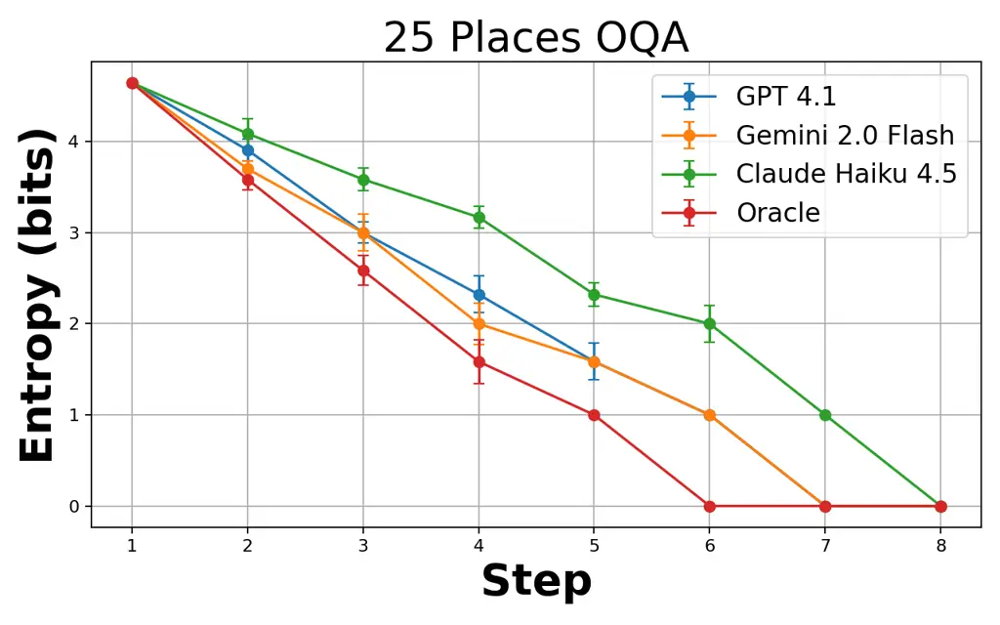

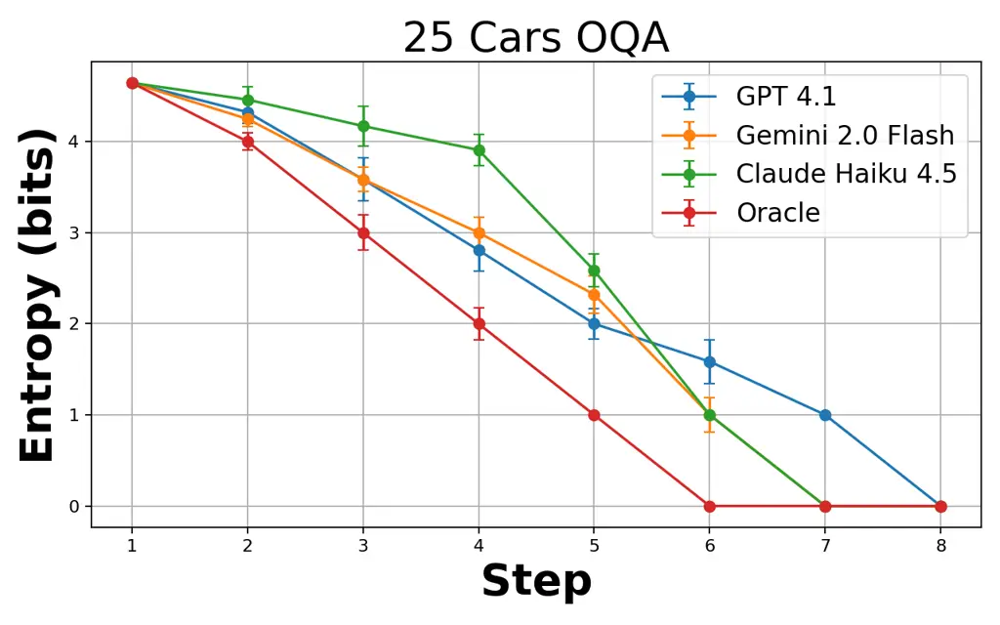

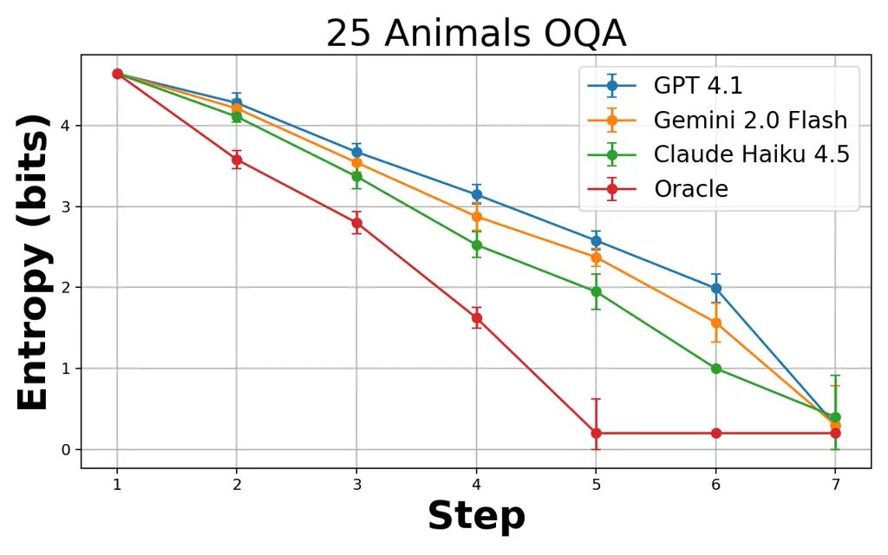

Figure 1: Binary OQA with $`N=25`$. Curves show mean entropy
$`H_{t}=\log_{2}|C_{t}|`$ across uniformly sampled targets, with
$`\pm 1`$ standard deviation, along with the DP oracle.

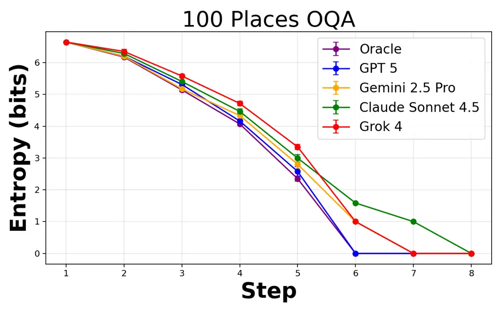

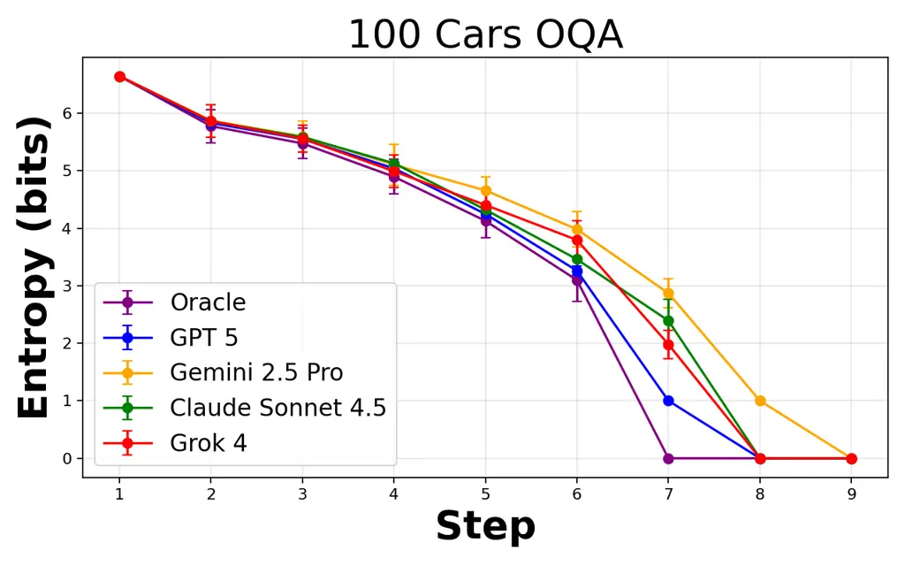

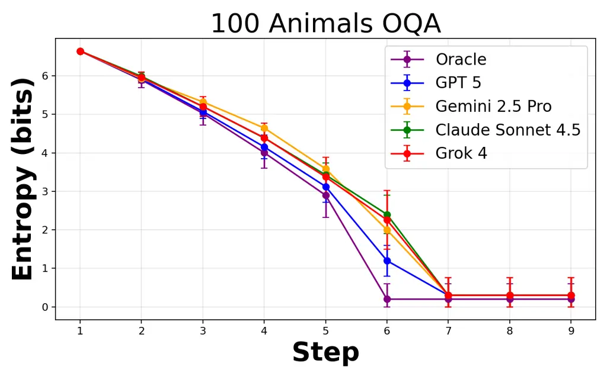

Figure 2: Binary OQA with $`N=100`$. Curves show mean entropy
$`H_{t}=\log_{2}|C_{t}|`$ across uniformly sampled targets, with
$`\pm 1`$ standard deviation, along with the DP oracle. In Animals,
duplicate attribute vectors can force stopping with a small residual
entropy.

Binary OQA starts with a set $`\mathcal{X}`$ of $`N`$ items. Each item
has a fixed yes or no value for each of the same attribute names, which
can be viewed as its attribute vector. For example, in an animals table
the item “cat” might have values like “mammal = yes,” “has*fur = yes,”
and “can_swim = no.” One item $`x^{\star}`$ is chosen uniformly at
random as the hidden target, and the candidate set starts at
$`C*{0}=\mathcal{X}`$. Each turn asks for one attribute value and
removes all items that disagree with the replies so far, leaving the
updated candidate set $`C*{t}`$. With a uniform prior and noiseless
answers, the belief is uniform on $`C*{t}`$. The uncertainty is
$`H*{t}=\log*{2}|C*{t}|`$ and per question progress is
$`\Delta H*{t}=H*{t}-H*{t+1}`$. A run ends when $`|C*{t}|=1`$, or
earlier when no attribute can split $`C*{t}`$. The latter happens when
the remaining items share the same full attribute vector, so some runs
can end with $`H\_{t}>0`$.

Let $`T_{\text{model}}(x^{\star})`$ be the model’s count and
$`T_{\text{DP}}(x^{\star})`$ the DP oracle’s count under the same
attribute menu and stopping rule. We define the metric “planning gap" as
the average number of extra questions the model uses compared to the
oracle,
$`\mathbb{E}_{x^{\star}\sim\mathrm{Unif}(\mathcal{X})}\!\left[T_{\text{model}}(x^{\star})-T_{\text{DP}}(x^{\star})\right].`$
A simple baseline is a greedy strategy that picks the attribute with the
largest expected reduction in uncertainty. For a candidate set $`C`$ and
a yes or no attribute $`j`$, asking $`j`$ splits $`C`$ into
$`C^{\text{yes}}`$ and $`C^{\text{no}}`$. Near-balanced splits tend to
be most informative. In this deterministic setting, the expected entropy
reduction equals mutual information up to the log base, but it is
optimal only for the next step and can be suboptimal over multiple
steps.

Our DP oracle is optimal in the sense that it minimizes the expected
number of questions until stopping. Let $`\mathrm{Cost}(C)`$ be the
optimal expected number of additional questions when the remaining
candidate set is $`C`$, assuming the hidden target is uniform on $`C`$.
If an attribute $`j`$ splits $`C`$ into $`C^{\text{yes}}`$ and
$`C^{\text{no}}`$, then asking $`j`$ costs one question plus the
expected remaining cost weighted by branch sizes, giving
$`\mathrm{Cost}(C)=`$

```math
\min_{j:\ C^{\text{yes}},C^{\text{no}}\neq\emptyset}\left(1+\frac{|C^{\text{yes}}|}{|C|}\mathrm{Cost}(C^{\text{yes}})+\frac{|C^{\text{no}}|}{|C|}\mathrm{Cost}(C^{\text{no}})\right), \tag{16}
```

with $`\mathrm{Cost}(C)=0`$ when $`|C|\leq 1`$ or when no attribute can
split $`C`$.

###### Theorem 5.1 (Optimality of the deterministic OQA oracle).

Consider any finite deterministic OQA game with candidate set $`C`$, a
uniform target within $`C`$, a finite menu of allowed queries, and unit
query cost. Each query $`a`$ partitions $`C`$ into nonempty cells
$`\{C_{o}(a):o\in\mathcal{O}_{a}\}`$, and terminal sets are those with
one candidate or no query that can split them. Let

```math
V(C)=\begin{cases}0,&C\text{ terminal},\\[5.69054pt]
\displaystyle\min_{a}\left(1+\sum_{o\in\mathcal{O}_{a}}\frac{|C_{o}(a)|}{|C|}V(C_{o}(a))\right),&\text{otherwise},\end{cases} \tag{17}
```

where the minimum ranges over queries that split $`C`$. Then $`V(C)`$ is
the minimum expected number of additional queries over all allowed
adaptive decision trees. Any policy that attains the minimum in (17) at
every reachable set is optimal.

###### Proof.

The proof is by induction on $`|C|`$. Terminal sets have value zero by
definition. For nonterminal $`C`$, any valid decision tree must choose
some first query $`a`$, pay one unit of cost, and then continue
independently inside the cell $`C_{o}(a)`$ selected by the truthful
answer. Since the target is uniform on $`C`$, that cell occurs with
probability $`|C_{o}(a)|/|C|`$. By the induction hypothesis, the best
possible continuation cost in each branch is $`V(C_{o}(a))`$. Thus every
decision tree has expected cost at least the right side of (17).
Choosing a minimizing query and then using optimal subtrees for all
child cells attains this bound, so the recurrence is both necessary and
sufficient. ∎

We compute $`\mathrm{Cost}(C)`$ with caching, since the same candidate
set can arise from different question sequences. To plot an oracle trace
for a fixed target $`x^{\star}`$, start from $`C_{0}=\mathcal{X}`$. At
turn $`t`$, choose an attribute that minimizes (16), filter to obtain
$`C_{t+1}`$, and record $`H_{t}=\log_{2}|C_{t}|`$. We run this on
Places, Cars, and Animals with $`N\in\{25,100\}`$, using one API call
per question with temperature=0, fresh sessions per target, and no
external tools. Figures 1 and 2 show mean entropy trajectories over
uniformly sampled targets, with $`\pm 1`$ standard deviation, alongside
the DP oracle.

Summary and takeaways. We evaluate frontier LLMs on 25- and 100-tier
binary OQA datasets, tracking posterior entropy exactly and comparing
each model to a dynamic programming (DP) oracle under the same attribute
menu and stopping rule. However, even in a clean setting where
uncertainty can be measured exactly, models leave efficiency on the
table. They do make steady progress, but they still ask avoidable
questions compared to an optimal strategy.

## 6 Multiway Categorical OQA Experiments: 100, 200, and 300 Candidates

Similar to binary OQA, multiway categorical OQA starts with a set
$`\mathcal{X}`$ of $`N`$ items. Each item has a fixed categorical value
for each of the same attribute names, which can be viewed as its
attribute vector. For example, an item might have values like color =
red, shape = hexagon, and material = steel. One item $`x^{\star}`$ is
chosen uniformly at random as the hidden target, and the candidate set
starts at $`C_{0}=\mathcal{X}`$. Each turn asks for the value of one
attribute and removes all items that disagree with the replies so far,
leaving the updated candidate set $`C_{t}`$. With a uniform prior and
deterministic answers, the belief is uniform on $`C_{t}`$. As before,
the uncertainty is $`H_{t}=\log_{2}|C_{t}|`$ and per question progress
is $`\Delta H_{t}=H_{t}-H_{t+1}`$. A run ends when $`|C_{t}|=1`$, or
earlier when no attribute can split $`C_{t}`$.

Formally, let $`\mathcal{A}`$ be the finite attribute set, and for each
$`a\in\mathcal{A}`$ let $`a:\mathcal{X}\to\mathcal{V}_{a}`$ map items to
a finite value set. At turn $`t`$ the agent chooses
$`a_{t}\in\mathcal{A}`$, observes the truthful reply
$`o_{t}=a_{t}(x^{\star})`$, and filters by consistency,
$`C_{t+1}=\{x\in C_{t}:\ a_{t}(x)=o_{t}\}`$. We call a tier $`k`$-ary,
where $`k=\max_{a\in\mathcal{A}}|\mathcal{V}_{a}|`$. In our released
tiers, $`k=5`$. We keep the early stopping rule above for completeness,
although in the released tiers the attribute vectors are unique, so runs
end with $`|C_{t}|=1`$. As in the binary setting, we summarize planning
by questions to stop. Let $`T_{\text{model}}(x^{\star})`$ be the model’s
count and $`T_{\text{DP}}(x^{\star})`$ the DP oracle’s count under the
same attribute menu and stopping rule. The planning gap is
$`\mathbb{E}_{x^{\star}\sim\mathrm{Unif}(\mathcal{X})}\!\left[T_{\text{model}}(x^{\star})-T_{\text{DP}}(x^{\star})\right]`$.

A simple baseline is a greedy strategy that picks the attribute with the
largest expected reduction in uncertainty. Fix a candidate set $`C`$ and
an attribute $`a`$. For each value $`v\in\mathcal{V}_{a}`$, define
$`C_{v}=\{x\in C:\ a(x)=v\}`$. Under the uniform belief on $`C`$,
$`\Pr[o=v]=|C_{v}|/|C|`$, and the expected entropy reduction from asking
$`a`$ is
$`\mathrm{EIG}(a;C)=\log_{2}|C|-\sum_{v\in\mathcal{V}_{a}:\,|C_{v}|>0}\frac{|C_{v}|}{|C|}\log_{2}|C_{v}|.`$

Near-balanced partitions tend to be most informative. In this
deterministic setting, $`\mathrm{EIG}`$ matches mutual information up to
the log base (Prop. 3.1), but it is optimal only for the next step and
can be suboptimal over multiple steps.

The DP oracle is optimal under our rules, in the sense that it minimizes
the expected number of questions until stopping. Let
$`\mathrm{Cost}(C)`$ be the optimal expected number of additional
questions when the remaining candidate set is $`C`$, assuming the hidden
target is uniform on $`C`$. For an attribute $`a`$, let
$`B_{a}(C)=\{v\in\mathcal{V}_{a}:\ |C_{v}|>0\}`$. If $`|B_{a}(C)|=1`$,
then $`a`$ does not split $`C`$ and is ignored. Otherwise,
$`\mathrm{Cost}(C)=`$

```math
\min_{a\in\mathcal{A}:\,|B_{a}(C)|\geq 2}\left(1+\sum_{v\in\mathcal{V}_{a}:\,|C_{v}|>0}\frac{|C_{v}|}{|C|}\,\mathrm{Cost}(C_{v})\right), \tag{18}
```

with $`\mathrm{Cost}(C)=0`$ when $`|C|\leq 1`$ or when no attribute can
split $`C`$. We compute $`\mathrm{Cost}(C)`$ with caching using a
canonical representation of $`C`$, such as a sorted tuple of item IDs.
To plot an oracle trace for a fixed target $`x^{\star}`$, start from
$`C_{0}=\mathcal{X}`$. At turn $`t`$, choose an attribute that minimizes
(18), apply $`C_{t+1}=\{x\in C_{t}:\ a_{t}(x)=o_{t}\}`$ using the
target’s true value, and record $`H_{t}=\log_{2}|C_{t}|`$ until
stopping.

We use three tiers with $`|\mathcal{X}|\in\{100,200,300\}`$. All tiers
share the same eight attributes, namely color, shape, material, size,
pattern, origin, use_case, and energy. Each query must request the value
of exactly one named attribute, and the evaluator answers by table
lookup.

We evaluate $`30`$ targets per tier with tool use disabled, using one
API call per question with temperature=0 in a fresh session per target.
Mean entropy trajectories are plotted with $`\pm 1`$ standard deviation
alongside the DP oracle in Figure 3.

#### Summary and takeaways.

We extend OQA to multiway categorical attributes using deterministic
table lookups, with 100, 200, and 300 tiers and a fixed menu of eight
attributes. We again track posterior entropy and measure efficiency by
planning gap. Frontier models consistently shrink the consistent set
over turns, and yet they remain less question-efficient than the dynamic
programming (DP) oracle.

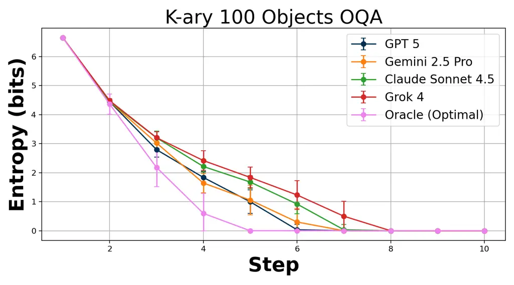

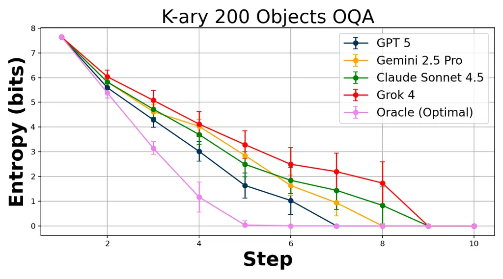

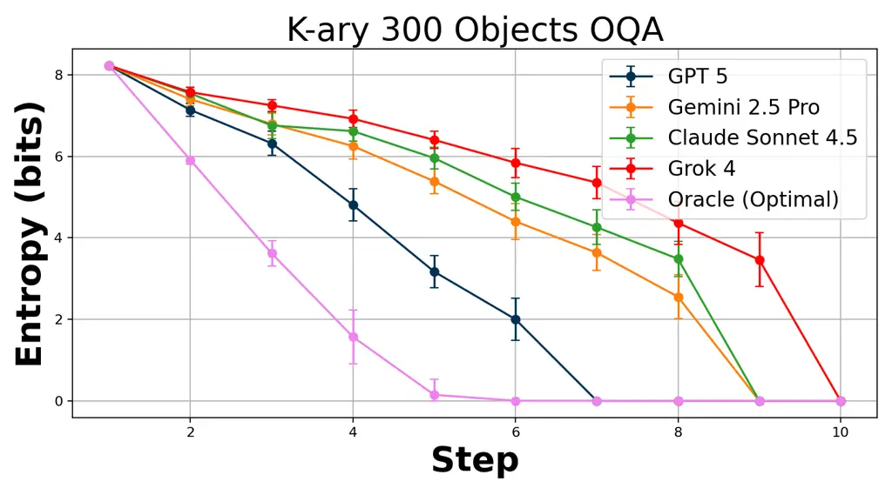

Figure 3: Multiway categorical OQA for
$`|\mathcal{X}|\in\{100,200,300\}`$ (top to bottom). Curves show mean
posterior entropy over uniformly sampled targets. The DP oracle uses the
same query menu and stopping rule. Error bars show $`\pm 1`$ standard
deviation when available.

## 7 Prompt Autocompletion as Active Inference

This is our first prompt experiment. Suppose a user asks for a product
description but does not specify a style. Each task provides a product
name and three feature phrases. We model the desired style as a hidden
variable $`U=(\text{tone},\text{length},\text{format})`$. The tone is
either formal or friendly, length is either short or medium, and format
is either bullet points or a paragraph. We sample these three style
choices independently and uniformly. The agent may ask up to three
clarifying questions before writing one final description. In this
experiment, the questions use fixed templates, and we simulate the
answers from the hidden $`U`$. This keeps the focus on the agent’s
choice of what to ask, rather than how the questions are phrased. Each
question targets exactly one component of $`U`$, and we never ask about
the same component twice.

We assume that the answers are always truthful, and we add uncertainty
only when updating the agent’s belief about $`U`$, using a symmetric
label noise model, so the posterior does not become overly confident. We
also charge a synthetic token cost for each clarification. The first
costs $`c_{1}=24`$ tokens, then $`c_{2}=48`$, then $`c_{3}=72`$. After
any clarifications, we call the base model once and request a
description using the MAP style $`\hat{U}`$. We further assume that the
agent’s belief over styles factorizes across the three attributes, so
$`q_{t}(U)=q_{t}(\text{tone})\,q_{t}(\text{length})\,q_{t}(\text{format})`$,
and we start from a uniform prior. When the agent asks about one
attribute $`v`$ (tone, length, or format), it updates only $`q_{t}(v)`$.
We model mistakes in this update with a fixed error rate
$`\varepsilon=0.12`$. The information gained from that question is
$`\Delta I_{t}(v)=\mathrm{KL}(q_{t+1}(v)\,\|\,q_{t}(v))`$, measured in
bits.

After the agent produces the final description, a deterministic verifier
checks it. The verifier requires each feature phrase to appear as an
exact substring, and it checks format and word count. A short
description has at most 70 words, while a medium description has 70 to
160 words. Tone is not checked, so the sampled style and the verifier
reward do not perfectly match. We compare five question asking policies.
baseline asks no questions and uses the default style. ask*all asks
about tone, length, and format. random samples $`K`$ uniformly from
$`\{0,1,2,3\}`$, then asks $`K`$ distinct attributes in random order.
active chooses the unasked attribute with the largest entropy per
expected token cost, $`H(q*{t}(v))/c*{|\mathcal{C}|+1}`$, and stops when
this score falls below $`\epsilon`$. active_weighted uses the same rule,
but weights the entropy term by $`w*{v}`$, with
$`w*{\text{format}}=1.0`$, $`w*{\text{length}}=0.6`$, and
$`w\_{\text{tone}}=0.25`$.

In Figure 4, we fix $`\epsilon=0.02`$ and $`K_{\max}=3`$ on 48 tasks to
show the cost accuracy trade-off across policies. We then tune
active*weighted via grid search over
$`\epsilon\in\{0,0.005,0.01,0.02,0.04\}`$ and $`K*{\max}\in\{1,2,3\}`$,
maximizing
$`J(\epsilon,K*{\max})=\mathbb{E}[\mathrm{ok}]-0.02\,\mathbb{E}[\text{tokens\_total}]/1000`$,
where tokens_total is the model-reported tokens for the final generation
plus the synthetic clarification costs. We score on 24 training tasks
and evaluate on 24 held out tasks. The best setting is
$`\epsilon^{\star}=0.01`$ and $`K*{\max}^{\star}=2`$, reaching $`0.375`$
compliance at about $`219`$ tokens per task (vs. baseline at $`0.0417`$
compliance and about $`112`$ tokens).

Summary and takeaways. We study how to spend a limited token budget
between clarifying turns and a final completion when the style is
hidden, answers to fixed clarification templates are truthful, and when
success is measured by a deterministic verifier. Policies that ask
targeted clarifications improve verifier pass rates relative to asking
none, showing that paying for a small number of well chosen questions
can be worthwhile, but only when those questions buy information the
final output will actually be judged on.

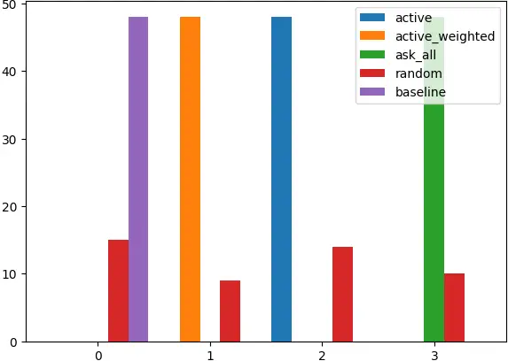

(a) Clarifications used

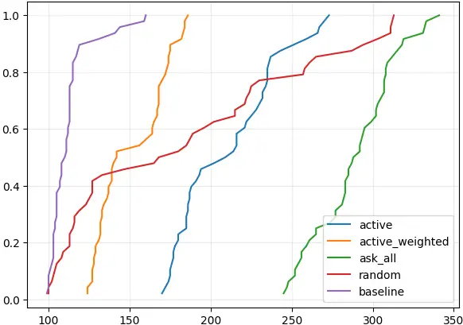

(b) Total token ECDF

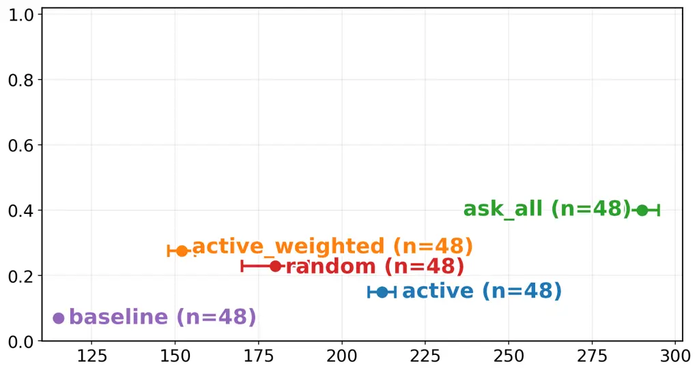

(c) Compliance versus average tokens

Figure 4: Prompt autocompletion on 48 synthetic product tasks with
$`\epsilon=0.02`$ and $`K_{\max}=3`$. Panels show clarification counts
by policy, the ECDF of total tokens per task, and verifier pass rate
versus average tokens. active_weighted improves compliance at a modest
token cost relative to baseline and random, while ask_all spends the
most tokens.

## 8 Automated Prompt Optimization

In this second prompt experiment, the model never asks the user
follow-up questions, but rather treats the choice of system prompt as an
online decision problem under a fixed token budget, aiming to quickly
identify which prompt variant yields the most reliable multiple-choice
answers. We fix a small library $`P`$ of candidate system prompts:
$`\mathrm{letter\_only}`$, $`\mathrm{short\_reasoning}`$,
$`\mathrm{eliminate\_two}`$, $`\mathrm{keyword\_match}`$,
$`\mathrm{units\_and\_scales}`$, and
$`\mathrm{contrastive\_explanations}`$. At training step $`t`$ we select
a prompt $`p_{t}\in P`$, format one ARC-Challenge question Clark et al.
(2018) using a fixed user-message template, and query the base model
once with temperature=0 so the output is deterministic given the prompt.
From the response we extract the first standalone letter in
$`\{\texttt{A},\texttt{B},\texttt{C},\texttt{D}\}`$, score it as correct
or incorrect to obtain $`y_{t}\in\{0,1\}`$, and record the token cost
$`\tau_{t}`$.

Each prompt $`p`$ is modeled as a Bernoulli arm with unknown accuracy
$`\theta_{p}`$, and we maintain independent Beta posteriors
$`\theta_{p}\sim\mathrm{Beta}(\alpha_{p},\beta_{p})`$ initialized at
$`\alpha_{p}=\beta_{p}=1`$. After observing $`y_{t}`$ for the chosen
prompt $`p_{t}`$, we update only that prompt via
$`\alpha_{p_{t}}\leftarrow\alpha_{p_{t}}+y_{t}`$ and
$`\beta_{p_{t}}\leftarrow\beta_{p_{t}}+1-y_{t}`$, and report the
posterior mean
$`\mathbb{E}[\theta_{p}]=\alpha_{p}/(\alpha_{p}+\beta_{p})`$.

To summarize uncertainty about which prompt is truly best, we define
$`P^{\star}=\arg\max_{p}\theta_{p}`$ and estimate the induced
distribution over $`P^{\star}`$ by Monte Carlo sampling, where we draw
one $`\theta_{p}`$ from each Beta factor and take the maximizing prompt
for each draw. From this empirical distribution we compute an entropy
$`H(P^{\star})`$ in bits, and after each training step we log the
realized entropy drop
$`\Delta H_{t}=\max\{H_{\text{before}}-H_{\text{after}},0\}`$ along with
an information-efficiency measure
$`\mathrm{IE}_{1\mathrm{k}}(t)=1000\,\Delta H_{t}/\tau_{t},`$ which can
be read as the entropy reduction achieved per thousand tokens spent on
that step.

Prompt selection is handled by an outer-loop policy that chooses
$`p_{t}`$ each step. Round robin cycles through prompts, Thompson
sampling draws $`\tilde{\theta}_{p}`$ from each posterior and picks the
largest, KG chooses the prompt with the highest expected one-step gain
in the current best posterior-mean accuracy, MI chooses the prompt with
the largest expected reduction in $`H(P^{\star})`$, and EFE blends MI
and KG with a linearly decaying epistemic weight to shift from
exploration to exploitation. Since prompts can differ in response
length, MI, KG, and EFE normalize their scores by a per-prompt
token-cost estimate tracked with an exponential moving average of
$`\tau_{t}`$. Training stops at 400 questions or $`B=120{,}000`$ tokens.
In Figure 5 the 400-question cap binds (about $`5\times 10^{4}`$
tokens), after which we select the prompt with the highest posterior
mean and evaluate it on a shared validation subset. KG tends to
concentrate queries early, leaving rarely tested prompts near the 0.5
prior mean, while MI and EFE are often most informative early and
Thompson sampling and round robin spread learning more evenly.

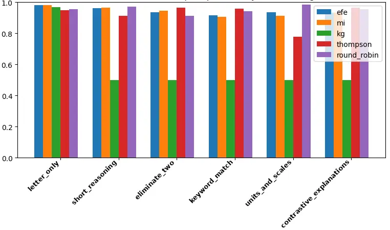

(a) Posterior mean accuracies

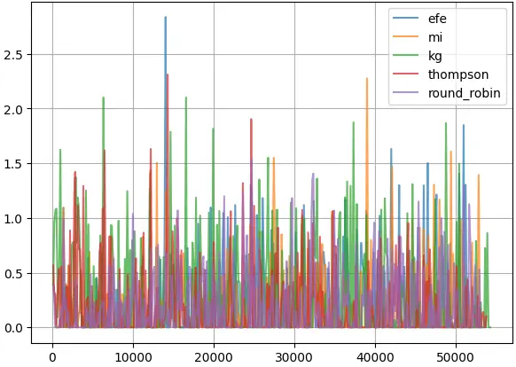

(b) Information gain per 1k tokens

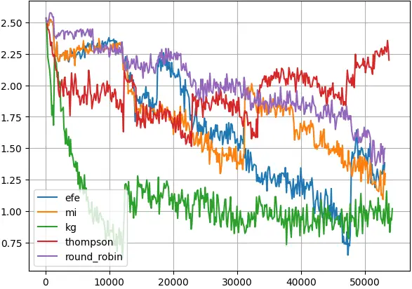

(c) Entropy of best-prompt identity

Figure 5: Automated prompt optimization under a token budget. Panels
show final posterior mean accuracies, realized information gain per
1,000 tokens, and posterior entropy over the identity of the best
prompt. Policies that reduce uncertainty early can avoid committing too
soon.

Summary and takeaways. We treat system-prompt choice as an online
decision problem under a fixed token budget, using repeated,
automatically scored trials to update which prompt variant looks best.
The main lesson is to use early trials to reduce uncertainty rather than
commit too soon, then choose the variant with the strongest track record
under the same scoring rule used throughout training.

## 9 Limitations and Discussion

This paper intentionally studies restricted forms of context
acquisition. In OQA, the AI assistant must identify a hidden item by
asking about entries in a fixed attribute table. We test both yes–no
tables and tables where answers take a small set of named values
(Sections 5 and 6). The advantage is precision: after each question, we
can say exactly how many items remain valid, and we can compare the
model to a best-possible strategy under the same rules. The cost is
realism. Real conversations may include vague replies, new constraints,
contradictory preferences, missing files, and evidence that does not fit
a prewritten attribute list. A stricter future benchmark would allow
free-form questions and ground answers in richer inputs, including
images and compositional attributes, for example, CLEVR-style scenes
(Johnson et al., 2017).

The current experiments cover three real attribute tables (Places, Cars,
Animals), larger synthetic multiway attribute tables up to 300 items,
and two token-budget studies on how to spend limited tokens (Sections 7
and 8). This is enough to test the central accounting principle, but not
enough to claim a complete agent benchmark. We leave out temporal
reasoning, multimodal perception, robotics, open-ended tool-use, and
multi-user collaboration, all of which make context acquisition harder
(Mirza et al., 2016; Lanillos et al., 2021).

We also turn off tools on purpose. We disable retrieval, function calls,
and scratchpads so we can measure what the model can do on its own
(Lewis et al., 2020; Schick et al., 2023; Nye et al., 2022). In real
products, tools do a lot of the heavy lifting. They can store the
candidate list, filter it exactly, keep memory across turns, and call
external systems. A tool-enabled version of the benchmark would test
whether the agent asks for the right missing information before invoking
a tool, instead of hallucinating missing arguments or making premature
calls.

There is also a scaling issue with the oracle we use for comparison. Our
dynamic program gives the best strategy under our rules, but as the
number of items grows, the number of different remaining sets that can
appear may explode. It is manageable for the tiers we release, but it
will not stay manageable forever. For larger tasks, approximate
baselines based on sampling, search, or learned lookahead will be needed
(Kirsch et al., 2019; Schrittwieser et al., 2020). More broadly, a
locally good question is not always part of the best overall plan. This
is why we report a DP oracle where possible rather than treating greedy
information gain as the final answer.

The two token-budget studies are controlled demonstrations, not full
replicas of real workflows. In prompt autocompletion (Section 7), the
assistant chooses among fixed clarifications, and answers are simulated
from a hidden style choice. This isolates whether the assistant asks
about the right variables, but it does not test natural phrasing,
unclear answers, user impatience, or changing preferences. In automated
prompt optimization (Section 8), we pick from a small handwritten set of
prompt variants and test them on a multiple-choice benchmark. This is
clean and automatically scored, but real prompt libraries are larger,
correlated, task-dependent, and often judged by softer preferences.
Token costs can also change across deployments. Since we evaluate
frontier models through hosted APIs, model updates can affect
reproducibility.

Finally, efficient context acquisition is dual use. The same machinery
that helps an assistant ask fewer and better questions can help a
malicious actor collect sensitive details, profile users, or probe
hidden system rules. We discuss these connections in the appendix, but
we do not test attacks or defenses. Deployment should pair
information-gain objectives with limits on sensitive follow-ups, rate
limits, audit trails, consent for personal data collection, and
privacy-aware safeguards (Huang et al., 2024; Charles et al., 2024;
Freiberger et al., 2025).

## 10 Conclusion and Future Work

We presented active inference as a context-acquisition layer for AI
agents. The central decision is whether to act with the current context
or spend tokens, interaction, or computation to acquire more evidence.
The bilevel formulation separates the posterior update caused by a
hypothetical observation from the outer decision that chooses the next
context action or task action. OQA makes this decision measurable
through exact posteriors and a dynamic programming oracle. Across tiers,
frontier models reduce uncertainty each turn but still ask more
questions than the oracle. The two token-budget studies show the same
principle in prompting: a small amount of targeted clarification or
prompt experimentation can improve final success when it buys
decision-relevant information.

Future work should move beyond fixed tables to noisy, open-ended, and
multimodal interaction. It should also scale oracle baselines with
sampling-based search, evaluate tool-enabled agents with memory, and
integrate explicit stopping decisions. A central open direction is to
make context acquisition safe by design: the agent should learn what it
needs to know, but not overcollect information that is irrelevant,
sensitive, or unsafe to request.

## Impact Statement

This paper advances machine learning methods for deciding when an
interactive system should acquire more context versus act, using active
inference, information gain, and controlled oracle diagnostics.
Potential benefits include fewer unnecessary questioning turns, lower
token and compute cost, better tool-use reliability, and improved task
success under ambiguity.

Risks are that more efficient context acquisition can be misused to
extract sensitive information, enable profiling, or speed up adversarial
probing of system defenses. OQA itself uses synthetic data and simulated
answers, so it does not require collecting personal data. In deployment,
mitigation includes limiting and auditing follow-ups, obtaining consent
for personal data collection, and adding explicit privacy and safety
constraints to the objective.

## References

- Bellala et al. (2010) G. Bellala, S. Bhavnani, and C. Scott Extensions
  of generalized binary search to group identification and exponential
  costs. In Advances in Neural Information Processing Systems 23,
  pp. 154–162. Cited by: §2.
- Bloodgood and Vijay-Shanker (2009) M. Bloodgood and K. Vijay-Shanker A
  method for stopping active learning based on stabilizing predictions
  and the need for user-adjustable stopping. In Proceedings of the
  Thirteenth Conference on Computational Natural Language Learning
  (CoNLL 2009), pp. 39–47. External Links:
  [Link](https://aclanthology.org/W09-1107/) Cited by: §2.
- Chaloner and Verdinelli (1995) K. Chaloner and I. Verdinelli Bayesian
  experimental design: a review. Statistical Science 10 (3),
  pp. 273–304. External Links:
  [Document](https://dx.doi.org/10.1214/ss/1177009939) Cited by: §2.
- Charles et al. (2024) Z. Charles, A. Ganesh, R. McKenna, H. B.
  McMahan, N. Mitchell, K. Pillutla, and K. Rush Fine-tuning large
  language models with user-level differential privacy. arXiv preprint
  arXiv:2407.07737. External Links:
  [Document](https://dx.doi.org/10.48550/arXiv.2407.07737) Cited by: §9.
- Choudhury et al. (2025) D. Choudhury, S. Williamson, A. Golinski, N.
  Miao, F. Bickford Smith, M. Kirchhof, Y. Zhang, and T. Rainforth
  BED-LLM: intelligent information gathering with LLMs and bayesian
  experimental design. External Links: 2508.21184,
  [Link](https://arxiv.org/abs/2508.21184) Cited by: §2.
- Clark et al. (2018) P. Clark, I. Cowhey, O. Etzioni, T. Khot, A.
  Sabharwal, C. Schoenick, and O. Tafjord Think you have solved question
  answering? try arc, the ai2 reasoning challenge. arXiv preprint
  arXiv:1803.05457. Cited by: §8.
- Colson et al. (2007) B. Colson, P. Marcotte, and G. Savard An overview
  of bilevel optimization. Annals of Operations Research 153 (1),
  pp. 235–256. External Links:
  [Document](https://dx.doi.org/10.1007/s10479-007-0176-2) Cited by: §2.
- Cullen et al. (2018) M. Cullen, B. Davey, K. J. Friston, and R. J.
  Moran Active inference in OpenAI gym: a paradigm for computational
  investigations into psychiatric illness. Biological Psychiatry:
  Cognitive Neuroscience and Neuroimaging 3 (9), pp. 809–818. External
  Links: [Document](https://dx.doi.org/10.1016/j.bpsc.2018.06.010) Cited
  by: §2.
- Cullen et al. (2020) M. Cullen, J. Monney, M. B. Mirza, and R. Moran A
  meta-bayesian model of intentional visual search. arXiv preprint
  arXiv:2006.03531. External Links:
  [Link](https://arxiv.org/abs/2006.03531) Cited by: §2.
- Franceschi et al. (2018) L. Franceschi, P. Frasconi, S. Salzo, R.
  Grazzi, and M. Pontil Bilevel programming for hyperparameter
  optimization and meta-learning. In Proceedings of the 35th
  International Conference on Machine Learning (ICML), Proceedings of
  Machine Learning Research, Vol. 80, pp. 1568–1577. External Links:
  [Link](https://proceedings.mlr.press/v80/franceschi18a.html) Cited by:
  §2.
- Freiberger et al. (2025) V. Freiberger, A. Fleig, and E. Buchmann "You
  don’t need a university degree to comprehend data protection this
  way": LLM-Powered Interactive Privacy Policy Assessment. In Extended
  Abstracts of the CHI Conference on Human Factors in Computing Systems
  (CHI EA ’25), New York, NY, USA. External Links:
  [Document](https://dx.doi.org/10.1145/3706599.3719816) Cited by: §9.
- Friston et al. (2017) K. J. Friston, T. H. FitzGerald, F. Rigoli, P.
  Schwartenbeck, and G. Pezzulo Active inference: a process theory.
  Neural Computation 29 (1), pp. 1–49. Cited by: Appendix G, §2.
- Haertel et al. (2008) R. Haertel, E. Ringger, K. Seppi, J. Carroll,
  and P. McClanahan Assessing the costs of sampling methods in active
  learning for annotation. In Proceedings of ACL-08: HLT Short Papers,
  pp. 65–68. External Links: [Link](https://aclanthology.org/P08-2017/)
  Cited by: §2.
- Hennig and Schuler (2012) P. Hennig and C. J. Schuler Entropy search
  for information-efficient global optimization. Journal of Machine
  Learning Research 13, pp. 1809–1837. External Links:
  [Link](https://jmlr.org/papers/v13/hennig12a.html) Cited by: §2.
- Houlsby et al. (2011) N. Houlsby, F. Huszár, Z. Ghahramani, and M.
  Lengyel Bayesian active learning for classification and preference
  learning. External Links: 1112.5745,
  [Link](https://arxiv.org/abs/1112.5745) Cited by: §2.
- Houthooft et al. (2016) R. Houthooft, X. Chen, Y. Duan, J.
  Schulman, F. De Turck, and P. Abbeel VIME: variational information
  maximizing exploration. In Advances in Neural Information Processing
  Systems 29, pp. 1109–1117. External Links:
  [Link](https://papers.nips.cc/paper_files/paper/2016/hash/abd815286ba1007abfbb8415b83ae2cf-Abstract.html)
  Cited by: §2.
- Hu et al. (2024) Z. Hu, C. Liu, X. Feng, Y. Zhao, S. Ng, A. T. Luu, J.
  He, P. W. Koh, and B. Hooi Uncertainty of thoughts: uncertainty-aware
  planning enhances information seeking in large language models.
  External Links: 2402.03271, [Link](https://arxiv.org/abs/2402.03271)
  Cited by: §2.
- Huang et al. (2024) K. Huang, B. Chen, Y. Lu, S. Wu, D. Wang, Y.
  Huang, H. Jiang, Z. Zhou, J. Cao, and X. Peng Lifting the veil on
  composition, risks, and mitigations of the large language model supply
  chain. arXiv preprint arXiv:2410.21218. External Links:
  [Document](https://dx.doi.org/10.48550/arXiv.2410.21218) Cited by: §9.
- Jedynak et al. (2012) B. Jedynak, P. I. Frazier, and R. Sznitman
  Twenty questions with noise: bayes optimal policies for entropy loss.
  Journal of Applied Probability 49 (1), pp. 114–136. External Links:
  [Document](https://dx.doi.org/10.1239/jap/1331216837) Cited by: §1,
  §2.
- Johnson et al. (2017) J. Johnson, B. Hariharan, L. van der Maaten, F.
  Li, C. L. Zitnick, and R. Girshick CLEVR: a diagnostic dataset for
  compositional language and elementary visual reasoning. In Proceedings
  of the IEEE Conference on Computer Vision and Pattern Recognition
  (CVPR), pp. 1988–1997. External Links:
  [Document](https://dx.doi.org/10.1109/CVPR.2017.215) Cited by: §9.
- Kirsch et al. (2019) A. Kirsch, J. van Amersfoort, and Y. Gal
  BatchBALD: efficient and diverse batch acquisition for deep bayesian
  active learning. In Advances in Neural Information Processing Systems,
  External Links: [Link](https://arxiv.org/abs/1906.08158) Cited by: §9.
- Kobalczyk et al. (2025) K. Kobalczyk, N. Astorga, T. Liu, and M. van
  der Schaar Active task disambiguation with llms. External Links:
  2502.04485, [Link](https://arxiv.org/abs/2502.04485) Cited by: §2.
- Lanillos et al. (2021) P. Lanillos, C. Meo, C. Pezzato, A. A.
  Meera, M. Baioumy, W. Ohata, A. Tschantz, B. Millidge, M. Wisse, C. L.
  Buckley, and J. Tani Active inference in robotics and artificial
  agents: survey and challenges. arXiv preprint arXiv:2112.01871.
  External Links:
  [Document](https://dx.doi.org/10.48550/arXiv.2112.01871) Cited by: §9.
- Levine (2018) S. Levine Reinforcement learning and control as
  probabilistic inference: tutorial and review. arXiv preprint
  arXiv:1805.00909. External Links: 1805.00909,
  [Link](https://arxiv.org/abs/1805.00909) Cited by: §1, §2.
- Lewis et al. (2020) P. Lewis, E. Perez, A. Piktus, F. Petroni, V.
  Karpukhin, N. Goyal, H. Küttler, M. Lewis, W. Yih, T. Rocktäschel, S.
  Riedel, and D. Kiela Retrieval-augmented generation for
  knowledge-intensive NLP tasks. In Advances in Neural Information
  Processing Systems, Vol. 33, pp. 9459–9474. External Links:
  [Document](https://dx.doi.org/10.5555/3495724.3496517) Cited by: §9.
- Lindley (1956) D. V. Lindley On a measure of the information provided
  by an experiment. The Annals of Mathematical Statistics 27 (4),
  pp. 986–1005. External Links:
  [Document](https://dx.doi.org/10.1214/aoms/1177728069) Cited by: §2.
- Liu et al. (2025) G. Liu, Y. Qu, J. Schneider, A. Singh, and A. Kumar
  CaRT: teaching LLM agents to know when they know enough. External
  Links: 2510.08517, [Link](https://arxiv.org/abs/2510.08517) Cited by:
  §2.
- Millidge et al. (2021) B. Millidge, A. Seth, and C. L. Buckley
  Understanding the origin of information-seeking exploration in
  probabilistic objectives for control. arXiv preprint arXiv:2103.06859.
  External Links: 2103.06859, [Link](https://arxiv.org/abs/2103.06859)
  Cited by: §2.
- Millidge et al. (2020) B. Millidge, A. Tschantz, A. K. Seth, and C. L.
  Buckley On the relationship between active inference and control as
  inference. In Active Inference, Communications in Computer and
  Information Science, Vol. 1326, pp. 3–11. External Links:
  [Document](https://dx.doi.org/10.1007/978-3-030-64919-7%5F1) Cited by:
  §1, §2.
- Millidge (2021) B. Millidge Applications of the free energy principle
  to machine learning and neuroscience. Note: PhD thesis,
  arXiv:2107.00140 External Links: 2107.00140,
  [Link](https://arxiv.org/abs/2107.00140) Cited by: §2.
- Millidge (2024) B. Millidge A retrospective on active inference. Note:
  [https://www.beren.io/2024-07-27-A-Retrospective-on-Active-Inference/](https://www.beren.io/2024-07-27-A-Retrospective-on-Active-Inference/)Blog
  post, posted July 27, 2024 Cited by: §2.
- Mirza et al. (2016) M. B. Mirza, R. A. Adams, C. D. Mathys, and K. J.
  Friston Scene construction, visual foraging, and active inference.
  Frontiers in Computational Neuroscience 10, pp. 56. External Links:
  [Document](https://dx.doi.org/10.3389/fncom.2016.00056) Cited by: §9.
- Nowak (2011) R. D. Nowak The geometry of generalized binary search.
  IEEE Transactions on Information Theory 57 (12), pp. 7893–7906.
  External Links:
  [Document](https://dx.doi.org/10.1109/TIT.2011.2169298),
  [Link](https://doi.org/10.1109/TIT.2011.2169298) Cited by: §2.
- Nowak (2009) R. Nowak Noisy generalized binary search. In Advances in
  Neural Information Processing Systems 22, pp. 1366–1374. Cited by: §2.
- Nye et al. (2022) M. Nye, A. J. Andreassen, G. Gur-Ari, H.
  Michalewski, J. Austin, D. Bieber, D. Dohan, A. Lewkowycz, M.
  Bosma, D. Luan, C. Sutton, and A. Odena Show your work: scratchpads
  for intermediate computation with language models. In International
  Conference on Learning Representations (ICLR), External Links:
  [Link](https://openreview.net/forum?id=iedYJm92o0a) Cited by: §9.
- Parr and Friston (2019) T. Parr and K. J. Friston Generalised free
  energy and active inference. Biological Cybernetics 113, pp. 495–513.
  Cited by: Appendix G, §2.
- Pathak et al. (2017) D. Pathak, P. Agrawal, A. A. Efros, and T.
  Darrell Curiosity-driven exploration by self-supervised prediction. In
  Proceedings of the 34th International Conference on Machine Learning
  (ICML), Proceedings of Machine Learning Research, Vol. 70,
  pp. 2778–2787. External Links:
  [Link](https://proceedings.mlr.press/v70/pathak17a.html) Cited by: §2.
- Piriyakulkij et al. (2023) W. T. Piriyakulkij, V. Kuleshov, and K.
  Ellis Active preference inference using language models and
  probabilistic reasoning. External Links: 2312.12009,
  [Link](https://arxiv.org/abs/2312.12009) Cited by: §2.
- Prakash et al. (2025) A. Prakash, N. He, D. Goktas, and A. Greenwald
  Bi-level policy optimization with nyström hypergradients. CoRR
  abs/2505.11714. External Links: 2505.11714,
  [Link](https://arxiv.org/abs/2505.11714) Cited by: Appendix G.
- Rainforth et al. (2024) T. Rainforth, A. Foster, D. R. Ivanova, and F.
  Bickford Smith Modern bayesian experimental design. Statistical
  Science 39 (1), pp. 100–114. Cited by: §2.
- Russo and Van Roy (2014) D. Russo and B. Van Roy Learning to optimize
  via information-directed sampling. Advances in neural information
  processing systems 27. Cited by: §2.
- Schick et al. (2023) T. Schick, J. Dwivedi-Yu, R. Dessì, R.
  Raileanu, M. Lomeli, E. Hambro, L. Zettlemoyer, N. Cancedda, and T.
  Scialom Toolformer: language models can teach themselves to use tools.
  In Advances in Neural Information Processing Systems, Vol. 36,
  pp. 68539–68551. External Links:
  [Document](https://dx.doi.org/10.5555/3666122.3669119) Cited by: §9.
- Schrittwieser et al. (2020) J. Schrittwieser, I. Antonoglou, T.
  Hubert, K. Simonyan, L. Sifre, S. Schmitt, A. Guez, E. Lockhart, D.
  Hassabis, T. Graepel, T. Lillicrap, and D. Silver Mastering atari, go,
  chess and shogi by planning with a learned model. Nature 588 (7839),
  pp. 604–609. External Links:
  [Document](https://dx.doi.org/10.1038/s41586-020-03051-4), 1911.08265
  Cited by: §9.
- Shen et al. (2024) H. Shen, Z. Yang, and T. Chen Principled
  penalty-based methods for bilevel reinforcement learning and RLHF.
  Note: Shorter version accepted to ICML 2024 External Links:
  2402.06886, [Link](https://arxiv.org/abs/2402.06886) Cited by:
  Appendix G.
- Shin et al. (2020) T. Shin, Y. Razeghi, R. L. Logan, E. Wallace,
  and S. Singh AutoPrompt: eliciting knowledge from language models with
  automatically generated prompts. In Proceedings of the 2020 Conference
  on Empirical Methods in Natural Language Processing (EMNLP), External
  Links: [Link](https://aclanthology.org/2020.emnlp-main.346/) Cited by:
  §2.
- Thoma et al. (2024) V. Thoma, B. Pasztor, A. Krause, G. Ramponi,
  and Y. Hu Contextual bilevel reinforcement learning for incentive
  alignment. In Advances in Neural Information Processing Systems, Vol.
  37, pp. 127369–127435. External Links:
  [Link](https://papers.nips.cc/paper_files/paper/2024/hash/e66309ead63bc1410d2df261a28f602d-Abstract-Conference.html)
  Cited by: Appendix G.
- Wang et al. (2024) W. Wang, J. Shi, Z. Ling, Y. Chan, C. Wang, C.
  Lee, Y. Yuan, J. Huang, W. Jiao, and M. R. Lyu Learning to ask: when
  llm agents meet unclear instruction. External Links: 2409.00557,
  [Link](https://arxiv.org/abs/2409.00557) Cited by: §2.
- Zhang et al. (2024) T. Zhang, P. Qin, Y. Deng, C. Huang, W. Lei, J.
  Liu, D. Jin, H. Liang, and T. Chua CLAMBER: a benchmark of identifying
  and clarifying ambiguous information needs in large language models.
  In Proceedings of the 62nd Annual Meeting of the Association for
  Computational Linguistics, External Links:
  [Link](https://aclanthology.org/2024.acl-long.578/) Cited by: §2.
- Zhou et al. (2023) Y. Zhou, A. I. Muresanu, Z. Han, K. Paster, S.
  Pitis, H. Chan, and J. Ba Large language models are human-level prompt
  engineers. In International Conference on Learning Representations
  (ICLR), External Links:
  [Link](https://openreview.net/forum?id=92gvk82DE-) Cited by: §2.

## Appendix A Optimal Question Asking: API Transcripts and Prompt Templates

OQA is scored from the transcript alone. At each turn, the model asks
about exactly one named attribute. The oracle returns the answer by
looking it up in a finite table of attributes. After the reply, a
scoring script filters the remaining set $`C_{t}`$ by exact consistency.
Because every step is deterministic, the score is fully reproducible.
With the same prompt and the same hidden target, replaying the same
message sequence yields the same $`C_{t}`$, the same entropy
$`H_{t}=\log_{2}|C_{t}|`$, and the same stopping time.

The protocol enforces two rules. Every question must use an attribute
name from a fixed list. Each turn may refer to only one attribute. In
binary OQA, the oracle replies "Yes" or "No", and the update is
$`C_{t+1}=\{x\in C_{t}\mid z_{j}(x)=o_{t}\}`$. In multiway OQA, the
oracle replies with a single value string, and the update is
$`C_{t+1}=\{x\in C_{t}\mid a_{t}(x)=o_{t}\}`$. A run ends when
$`|C_{t}|=1`$. It can also end earlier when the remaining items share
the same vector of attributes, so no allowed query can split them
further. For reliable parsing, a strict JSON format is available. The
next query is read from the "question" field, while any extra fields are
ignored and may be used for debugging.

This is a \<DATASET\> attributes dataset. I have a hidden \<OBJECT
TYPE\> in mind.

Ask only yes/no questions about exactly one attribute at a time, chosen
from:

\<ATTRIBUTE_1\>, \<ATTRIBUTE_2\>, …, \<ATTRIBUTE_d\>.

After each answer, do the following:

1. Show your current belief over the remaining \<OBJECT TYPE\>s.

2. Report how many candidates are left.

3. If you can estimate entropy mentally, include it.

Do not run code or use tools.

Stop when only one candidate remains, or when multiple items share an
identical

attribute vector and cannot be separated.


This is a \$k\$-ary attributes dataset with \<N\> abstract objects. I
have a hidden item in mind.

Ask questions about exactly one attribute at a time, chosen from this
list:

color, shape, material, size, pattern, origin, use_case, energy.

The answer will be a single value for that attribute, for example "red"
or "triangle".

After each answer, do the following:

1. Show your current belief over the remaining items.

2. Report how many candidates are left.

3. If you can estimate entropy mentally, include it.

Do not run code or use tools.

Stop when only one candidate remains, or when multiple items share an
identical

attribute vector and cannot be separated.


## Appendix B Exact Dynamic Programming Oracle

The oracle curves in our figures are produced by an exact planner that
minimizes the expected number of questions required to identify the
hidden target under a uniform prior and deterministic answers. In these
tiers, each reply removes every candidate that is inconsistent with it,
so the posterior after any transcript is uniform over the remaining
candidates. The belief state is therefore completely determined by the
current candidate set $`C\subseteq\mathcal{X}`$. Asking one attribute
partitions $`C`$ into subsets indexed by the possible replies, and the
next belief is obtained by restricting to the subset that matches the
observed reply. This reduces optimal question asking to a finite
decision problem over sets, with termination when $`|C|\leq 1`$ or when
the allowed attributes cannot further separate the remaining items.

Let $`C`$ be the current candidate set. A query $`q\in\mathcal{Q}`$
induces a set of possible replies $`\mathcal{R}(q,C)`$ and corresponding
next candidate sets $`\{C_{r}\}_{r\in\mathcal{R}(q,C)}`$, where
$`C_{r}=\{x\in C\mid q(x)=r\}`$. Under a uniform posterior on $`C`$ and
deterministic replies, $`\Pr[r]=|C_{r}|/|C|`$. Define
$`\mathrm{Cost}(C)`$ as the optimal expected number of additional
questions until termination, starting from $`C`$. A set is terminal when
$`|C|\leq 1`$ or when every query fails to split $`C`$ into at least two
nonempty subsets. Bellman optimality gives the recursion

```math
\mathrm{Cost}(C)=\min_{\begin{subarray}{c}q\in\mathcal{Q}\\
|\mathcal{R}(q,C)|\geq 2\end{subarray}}\left(1+\sum_{r\in\mathcal{R}(q,C)}\frac{|C_{r}|}{|C|}\,\mathrm{Cost}(C_{r})\right),\qquad\mathrm{Cost}(C)=0\ \text{if $C$ is terminal}. \tag{19}
```

The oracle policy at state $`C`$ is the minimizer in (19). Greedy
maximization of one step expected information gain optimizes only the
immediate entropy drop, while (19) is optimal for the expected remaining
number of questions.

In the binary tiers, each query is an index $`j\in[d]`$ with replies in
$`\{0,1\}`$. Writing $`C^{\text{yes}}=\{x\in C\mid z_{j}(x)=1\}`$ and
$`C^{\text{no}}=C\setminus C^{\text{yes}}`$, the recursion becomes

```math
\mathrm{Cost}(C)=\min_{\begin{subarray}{c}j\in[d]\\
C^{\text{yes}}\neq\emptyset\\
C^{\text{no}}\neq\emptyset\end{subarray}}\left(1+\frac{|C^{\text{yes}}|}{|C|}\mathrm{Cost}(C^{\text{yes}})+\frac{|C^{\text{no}}|}{|C|}\mathrm{Cost}(C^{\text{no}})\right), \tag{20}
```

with $`\mathrm{Cost}(C)=0`$ when $`|C|\leq 1`$ or when no attribute
splits $`C`$. This is the dynamic program used to construct the optimal
expected depth decision tree for the binary oracle.

In the multiway categorical tiers, a query is an attribute
$`a\in\mathcal{A}`$ whose reply is a single value
$`v\in\mathcal{V}_{a}`$. For a candidate set $`C`$ define the branches
$`C_{v}=\{x\in C\mid a(x)=v\}`$, and ignore values with $`|C_{v}|=0`$.
If there is only one nonempty branch, then $`a`$ does not split $`C`$
and is not considered. Otherwise,

```math
\mathrm{Cost}(C)=\min_{\begin{subarray}{c}a\in\mathcal{A}\\
|\{v\in\mathcal{V}_{a}\mid|C_{v}|>0\}|\geq 2\end{subarray}}\left(1+\sum_{v\in\mathcal{V}_{a}:\,|C_{v}|>0}\frac{|C_{v}|}{|C|}\,\mathrm{Cost}(C_{v})\right), \tag{21}
```

with the same terminal condition as above.

The recursion is evaluated over candidate sets. In practice, repeated
subproblems can be avoided by caching $`\mathrm{Cost}(C)`$ keyed by a
canonical representation of $`C`$, such as a sorted tuple of item
identifiers. A fixed attribute order yields a reproducible oracle policy
when several attributes tie.

To generate the oracle entropy traces used in plots, the optimal policy
is rolled out for each fixed target $`x^{\star}`$. Starting from
$`C_{0}=\mathcal{X}`$, at step $`t`$ the oracle selects an optimal query
for $`C_{t}`$, reads the target’s true reply, filters to $`C_{t+1}`$,
and records $`H_{t}=\log_{2}|C_{t}|`$, with $`t=0`$ corresponding to the
prior. The trajectory ends when the set is terminal, so tiers with
duplicates can plateau at $`H_{t}>0`$.

## Appendix C Scaling Up OQA Arbitrarily With Synthetic Attribute Tables

The real object tables used in OQA are small and fixed. For larger
studies, OQA also supports synthetic attribute tables that can be
regenerated from a random seed at arbitrary scale. A synthetic tier is
specified by an attribute schema, a candidate count $`N`$, and a seed.
The generator writes the same artifacts as the released tiers. It
outputs a JSON table of item attributes, an attributes.txt file for
binary tiers or a schema description for categorical tiers, an items.txt
list of identifiers, and an equivalence_classes.json file that groups
items with identical attribute vectors when duplicates are present.

This setup serves two purposes. It enables scale, since $`N`$ can
increase without changing the evaluation code or the transcript rules.
It also reduces semantic assistance. Item identifiers and attribute
names can be arbitrary strings, such as hexadecimal keys and short
tokens, so performance reflects query choice and consistent set updates
rather than world knowledge.

In the binary synthetic tiers, fix $`N`$ and choose a Boolean dimension
$`d`$ such that $`2^{d}\geq N`$. This guarantees that at least $`N`$
distinct Boolean vectors exist. A simple construction samples $`N`$
distinct vectors in $`\{0,1\}^{d}`$, assigns each vector to a fresh
identifier, and records the resulting table. When $`d`$ is close to
$`\lceil\log_{2}N\rceil`$, the instance lies near the information limit,
since an ideal policy needs on the order of $`\log_{2}N`$ questions.
Taking $`d`$ larger adds redundancy, which tests whether an agent can
avoid attributes that do not help separate the remaining candidates.
Controlled ambiguity can be introduced by allowing duplicates, so the
stopping rule ends on a nontrivial equivalence class.

In the multiway synthetic tiers, choose a finite attribute set
$`\mathcal{A}`$ with value sets
$`\{\mathcal{V}_{a}\}_{a\in\mathcal{A}}`$ such that
$`\prod_{a\in\mathcal{A}}|\mathcal{V}_{a}|\geq N`$. This ensures that at
least $`N`$ distinct categorical vectors exist. Sample $`N`$ distinct
vectors from the Cartesian product and map each to a fresh identifier.
Allowing duplicates creates plateaus where several items share the same
attribute vector. Difficulty is controlled by the branching factors
$`|\mathcal{V}_{a}|`$, by how balanced the value frequencies are, and by
correlations among attributes.

For semantic domains such as Places, Cars, and Animals, listing the
allowed attribute names is often enough, since background knowledge can
guide reasonable query orders. For fully synthetic domains the names
carry no meaning, so a planning test typically requires providing the
table, or an equivalent compact encoding, in the prompt. Two convenient
encodings are id:bitstring for binary tiers and id:v1,v2,... for
$`k`$-ary tiers. Both grow linearly with $`N`$ and remain easy to parse
in long context settings.

The transcript-based metrics, namely $`C_{t}`$ and
$`H_{t}=\log_{2}|C_{t}|`$, remain exact for any $`N`$ because they rely
only on deterministic filtering. Exact dynamic programming does not
scale in the same way. Its states are candidate subsets, and the number
of reachable subsets can grow very quickly as $`N`$ increases. For
larger tiers, greedy information gain, shallow lookahead, or
sampling-based planners provide strong approximate baselines, while the
benchmark definition remains unchanged.

import json

import math

import random

from collections import defaultdict

def write_list(path, xs):

with open(path, "w") as f:

for x in xs:

f.write(str(x) + "\\n")

def equivalence_classes(table, attrs):

\# Group items that share the same attribute vector (binary or
categorical).

groups = defaultdict(list)

for item_id, row in table.items():

key = tuple(row\[a\] for a in attrs)

groups\[key\].append(item_id)

\# Store only non-singletons (optional; keep all if preferred).

out = {}

for i, ids in enumerate(groups.values()):

if len(ids) \>= 2:

out\[f"class\_{i:04d}"\] = ids

return out

def make_binary_oqa(

N, d=None, seed=0, allow_duplicates=False, id_width=6

):

rng = random.Random(seed)

if d is None:

\# Slight margin reduces collisions when sampling without replacement.

d = math.ceil(math.log2(max(N, 2))) + 2

attrs = \[f"a{i}" for i in range(d)\]

seen = set()

table = {}

while len(table) \< N:

bits = tuple(rng.getrandbits(1) for \_ in range(d))

if (not allow_duplicates) and (bits in seen):

continue

seen.add(bits)

item_id = f"{len(table):0{id_width}x}"

table\[item_id\] = {a: bool(b) for a, b in zip(attrs, bits)}

return table, attrs

def make_kary_oqa(

N, schema, seed=0, allow_duplicates=False, id_width=6

):

\# schema: dict attr -\> list of allowed values (strings).

rng = random.Random(seed)

attrs = list(schema.keys())

seen = set()

table = {}

while len(table) \< N:

vec = tuple(rng.choice(schema\[a\]) for a in attrs)

if (not allow_duplicates) and (vec in seen):

continue

seen.add(vec)

item_id = f"{len(table):0{id_width}x}"

table\[item_id\] = {a: v for a, v in zip(attrs, vec)}

return table, attrs

\# Example usage:

\# Binary: N=5000, d chosen automatically.

\# table, attrs = make_binary_oqa(N=5000, seed=7,
allow_duplicates=False)

\# json.dump(table, open("data/synth_binary.json", "w"), indent=2)

\# write_list("data/attributes.txt", attrs)

\# write_list("data/items.txt", table.keys())

\# json.dump(

\# equivalence_classes(table, attrs),

\# open("data/equivalence_classes.json", "w"),

\# indent=2,

\# )

\# Multiway: choose branching factors through schema.

\# schema = {

\# "a0": \["v0", "v1", "v2", "v3", "v4"\],

\# "a1": \["v0", "v1", "v2", "v3", "v4"\],

\# "a2": \["v0", "v1", "v2", "v3"\],

\# "a3": \["v0", "v1", "v2", "v3"\],

\# }

\# table, attrs = make_kary_oqa(

\# N=20000, schema=schema, seed=11, allow_duplicates=False

\# )

## Appendix D Prompt Autocompletion Experiment: Full Specification

Each run in the prompt autocompletion experiment has an unknown style
variable, a short clarification phase with fixed question text, a single
model call that produces the final description, and a deterministic
verifier that scores the result. The policy controls only which style
attribute to query next and when to stop.

Each task provides a product name and three feature phrases. The latent
user intent is

```math
U=(\text{tone},\text{length},\text{format}),
```

where tone, length, and format each have two listed values. The prior
over $`U`$ is uniform and factorized. A policy may ask up to
$`K_{\max}\leq 3`$ clarification questions. Each clarification reveals
the true value of exactly one component of $`U`$ through a simulated
answer.

During belief updates, the implementation models the answer channel with
symmetric label noise $`\varepsilon=0.12`$. After the policy stops, a
single style estimate $`\hat{U}`$ is chosen by a MAP rule under the
current belief. Ties are broken by argmax returning the first listed
label in each attribute’s ordering: formal, short, bullets. The final
description is then generated with exactly one model call conditioned on
$`\hat{U}`$. The run is scored only by the verifier described below.

The text of each clarification question is fixed, and only the choice of
which attribute to ask is controlled by the policy:

- •
  tone Before I write, do you prefer a formal or friendly tone?
- •
  length Do you want a short or a medium length description?
- •
  format Should I present it as bullet points or as a paragraph?

Clarification turns are charged a fixed synthetic schedule that
approximates the growth of context,

```math
\texttt{clarify\_cost}(k)\in\{24,48,72\}\quad\text{for the $k$th clarification, with $k$ starting at 1.}
```

Total tokens per run are computed as

```math
\texttt{tokens\_total}=\sum_{k=1}^{K}\texttt{clarify\_cost}(k)+\texttt{tokens\_api},
```

where tokens_api is the model reported total token usage for the single
generation call.

The final call sends a single text prompt to the Responses API, using
the model gpt-4o. The prompt is formatted with two labeled sections,
\[System\] and \[User\], as shown below. The \[System\] section is
constant. The \[User\] section is formed by inserting the task fields
and the MAP style $`\hat{U}`$ into the template below.

\[System\]

You are a concise marketing writer.

Follow tone, format, and length exactly.

Reuse the product features as is.

\[User\]

Product: \<TASK.NAME\>

Features: \<TASK.FEATURE_1\>, \<TASK.FEATURE_2\>, \<TASK.FEATURE_3\>

Tone: \<formal\|friendly\>

Format: \<bullets\|paragraph\>

Length: \<short\|medium\>

Write the description now.

Given the generated text out, the task feature strings, and the latent
$`U`$, the output is accepted if and only if all three conditions hold.
First, every feature phrase appears literally as a substring of out
after both are lowercased, so the check is f.lower() in out.lower() for
each feature string f. Second, the format matches $`U.\texttt{format}`$.
If $`U.\texttt{format}=\texttt{bullets}`$, out must contain at least two
non empty lines whose first non whitespace character is -, \*, or \item.
If $`U.\texttt{format}=\texttt{paragraph}`$, the output is rejected when
it contains obvious bullet starts, which is tested by checking whether
out contains \n-, \n\*, or \n\item. Third, the length matches
$`U.\texttt{length}`$. Let wc be the number of tokens in out when
splitting on whitespace. If $`U.\texttt{length}=\texttt{short}`$,
require $`\texttt{wc}\leq 70`$. If
$`U.\texttt{length}=\texttt{medium}`$, require
$`70\leq\texttt{wc}\leq 160`$.

One run can be summarized compactly as follows. The product is Stainless
Steel Bottle, with features insulated, 24 oz, and BPA free. The latent
style is $`U=\{\texttt{friendly},\texttt{short},\texttt{paragraph}\}`$.
A policy that queries all three attributes receives those three
simulated answers, so $`\hat{U}=U`$. The model is then called once with
the template above instantiated by these fields. The verifier returns
PASS if the output contains all three feature substrings, contains no
bullet lines, and has word count at most $`70`$.

## Appendix E Prompt Optimization Experiment: Full Specification

Prompt optimization is treated as a small Bayesian bandit problem over a
fixed set of prompt variants on ARC-Challenge multiple-choice questions.
Each training step selects one prompt variant, makes exactly one model
call at temperature=0, parses a single answer letter, and logs both
correctness and the total token count returned by the API. Learning
occurs only in the bandit state. The language model itself is not
updated. The base model used in all calls is gpt-4o.

We load ARC-Challenge from the Hugging Face AI2 ARC dataset with the
ARC-Challenge configuration. We filter both the training and validation
splits to keep only examples with exactly four answer choices labeled A,
B, C, and D. We reorder the choice texts into that order and drop any
example whose answerKey is not one of those four labels.

Fix the set of prompt variants

```math
\displaystyle P=\{ \displaystyle\texttt{letter\_only},\texttt{short\_reasoning},
```

```math
\displaystyle\texttt{eliminate\_two},\texttt{keyword\_match},
```

```math
\displaystyle\texttt{units\_and\_scales},\texttt{contrastive\_explanations}\}.
```

Each $`p\in P`$ corresponds to a fixed system prompt. The user message
has a fixed template shared across all variants. At step $`t`$, the
policy chooses $`p_{t}\in P`$, formats one ARC example into the user
template, prepends the system prompt for $`p_{t}`$, and calls the base
model once. The API-reported total token usage for that call is denoted
by $`\tau_{t}`$.

Question:

\<QUESTION_TEXT\>

Options:

A) \<OPTION_A\>

B) \<OPTION_B\>

C) \<OPTION_C\>

D) \<OPTION_D\>

Answer with only the single letter A, B, C, or D.

letter_only

You answer multiple choice science exam questions.

Read the question and options carefully and choose the single best
answer.

Reply with only the option letter (A, B, C, or D). Do not include any
text besides the letter.

short_reasoning

You are an expert science tutor taking a multiple choice test.

Privately reason step by step, but reply with only the single best
option letter.

Never include the reasoning in your reply.

eliminate_two

You answer multiple choice science questions by eliminating clearly
wrong options first.

Mentally eliminate at least two options and then pick the best remaining
one.

Reply with only the option letter (A, B, C, or D).

keyword_match

You are a careful science exam solver.

Match key concepts and entities in the question to the options, ignore
distractors, and pick the best match.

Reply with only the option letter (A, B, C, or D).

units_and_scales

You are a science exam assistant.

Pay special attention to units, scales, and quantitative relationships
when choosing among the options.

Reply with only the option letter (A, B, C, or D).

contrastive_explanations

You answer science questions by comparing how each option would explain
the question.

Mentally contrast the options and pick the one that best explains the
described situation.

Reply with only the option letter (A, B, C, or D).

A deterministic checker maps the raw model output at step $`t`$ to a
binary outcome. It extracts the first standalone letter in
$`\{\texttt{A},\texttt{B},\texttt{C},\texttt{D}\}`$ using a
case-insensitive word-boundary match, for example the regex
\b(\[ABCD\])\b. If no such letter is found, the step is marked
incorrect. Otherwise the step outcome is $`y_{t}=1`$ if the parsed
letter equals the gold answerKey, and $`y_{t}=0`$ otherwise.

All policies train on the same fixed subset of at most $`400`$
ARC-Challenge training questions, sampled without replacement using a
fixed random seed. Training stops when this subset is exhausted or when
cumulative training tokens reach or exceed a budget $`B`$, with the
reference setting $`B=120{,}000`$. (Because the budget check happens
after each model call, the final total can exceed $`B`$ by at most one
call.) Evaluation uses a shared holdout subset of $`200`$ ARC-Challenge
validation questions, also sampled once with a fixed seed. Policy
comparisons therefore differ only through the sequence of prompt
variants selected during training.

Each prompt $`p\in P`$ is treated as an arm with an unknown Bernoulli
accuracy $`\theta_{p}`$. Independent Beta posteriors are maintained,

```math
q_{t}(\theta_{p})=\mathrm{Beta}(\alpha_{p},\beta_{p}),\qquad\alpha_{p}=\beta_{p}=1\ \text{at initialization}.
```

After testing $`p_{t}`$ and observing $`y_{t}\in\{0,1\}`$, the conjugate
update is

```math
\alpha_{p_{t}}\leftarrow\alpha_{p_{t}}+y_{t},\qquad\beta_{p_{t}}\leftarrow\beta_{p_{t}}+(1-y_{t}),
```

and the posterior mean accuracy is

```math
m_{p}\equiv\mathbb{E}[\theta_{p}]=\frac{\alpha_{p}}{\alpha_{p}+\beta_{p}}.
```

Token cost affects only acquisition. Each arm maintains an exponential
moving average estimate $`\hat{c}_{p}`$ of its token cost, initialized
at $`\hat{c}_{p}=120`$ for all prompts. After an evaluation of $`p_{t}`$
with observed cost $`\tau_{t}`$, the update is

```math
\hat{c}_{p_{t}}\leftarrow\gamma\,\hat{c}_{p_{t}}+(1-\gamma)\,\tau_{t},\qquad\gamma=0.9.
```

Let $`P^{\star}=\arg\max_{p\in P}\theta_{p}`$ denote the identity of the
best prompt under the latent accuracies. Its posterior is approximated
by Monte Carlo sampling. Draw
$`\tilde{\theta}_{p}^{(s)}\sim\mathrm{Beta}(\alpha_{p},\beta_{p})`$
independently for $`s=1,\dots,S`$ and all $`p\in P`$, with the reference
choice $`S=600`$ during training. Compute
$`\tilde{P}^{\star(s)}=\arg\max_{p}\tilde{\theta}_{p}^{(s)}`$ and form
the empirical distribution

```math
\hat{\pi}_{t}(p)=\frac{1}{S}\sum_{s=1}^{S}\mathbf{1}\{\tilde{P}^{\star(s)}=p\}.
```

Uncertainty is summarized by the entropy in bits

```math
H_{t}\equiv H(P^{\star})\approx-\sum_{p\in P}\hat{\pi}_{t}(p)\log_{2}\hat{\pi}_{t}(p).
```

For plotting, the information efficiency of step $`t`$ is

```math
\mathrm{IE}_{1\mathrm{k}}(t)=1000\cdot\frac{\Delta H_{t}}{\max\{\tau_{t},1\}},\qquad\Delta H_{t}=\max\{H_{t}-H_{t+1},0\},
```

where $`H_{t}`$ is computed before the Beta update and $`H_{t+1}`$ is
computed after the update.

At each step, the policy chooses one prompt $`p_{t}`$, performs one
model call, then updates $`(\alpha,\beta)`$ and $`\hat{c}`$. Under the
mutual information rule, the expected next entropy after one more
labeled sample on $`p`$ is approximated by

```math
\mathbb{E}[H_{t+1}\mid p]\approx m_{p}\,H(P^{\star}\mid\alpha_{p}{+}1,\beta_{p})+(1-m_{p})\,H(P^{\star}\mid\alpha_{p},\beta_{p}{+}1),
```

where each entropy term is recomputed by the same Monte Carlo procedure
after the hypothetical update on $`p`$ only. The acquisition score
divides expected entropy reduction by estimated token cost,

```math
u_{t}^{\mathrm{MI}}(p)=\frac{\max\{H_{t}-\mathbb{E}[H_{t+1}\mid p],0\}}{\max\{\hat{c}_{p},1\}},\qquad p_{t}=\arg\max_{p\in P}u_{t}^{\mathrm{MI}}(p).
```

Under the knowledge gradient rule, let $`m_{\max}=\max_{j\in P}m_{j}`$
be the current best posterior mean. If prompt $`p`$ were sampled and
succeeded, its mean would become
$`(\alpha_{p}{+}1)/(\alpha_{p}{+}\beta_{p}{+}1)`$. If it failed, its
mean would become $`\alpha_{p}/(\alpha_{p}{+}\beta_{p}{+}1)`$. Let
$`m_{\max}^{\mathrm{succ}}(p)`$ and $`m_{\max}^{\mathrm{fail}}(p)`$ be
the resulting best means across prompts under these two hypothetical
updates. Define

```math
\displaystyle\mathrm{KG}_{t}(p) \displaystyle=m_{p}\,\max\{m_{\max}^{\mathrm{succ}}(p)-m_{\max},0\}+(1-m_{p})\,\max\{m_{\max}^{\mathrm{fail}}(p)-m_{\max},0\},
```

```math
\displaystyle u_{t}^{\mathrm{KG}}(p) \displaystyle=\frac{\mathrm{KG}_{t}(p)}{\max\{\hat{c}_{p},1\}}, \tag{22}
```

and select $`p_{t}=\arg\max_{p\in P}u_{t}^{\mathrm{KG}}(p)`$.

A mixed rule combines the epistemic score $`u_{t}^{\mathrm{MI}}`$ and
the pragmatic score $`u_{t}^{\mathrm{KG}}`$,

```math
s_{t}(p)=\lambda_{t}\,u_{t}^{\mathrm{MI}}(p)+(1-\lambda_{t})\,u_{t}^{\mathrm{KG}}(p),\qquad p_{t}=\arg\max_{p\in P}s_{t}(p).
```

In the notebook implementation, this mixed rule is computed as an
Expected Free Energy score $`G_{t}(p)=-s_{t}(p)`$ and the selected
prompt is $`p_{t}=\arg\min_{p}G_{t}(p)`$, which is equivalent. The
weight decays linearly over the available training steps,

```math
\lambda_{t}=\max\!\left(0.1,\;1-\frac{t}{T-1}\right),
```

where $`T`$ is the number of available training steps, at most $`400`$.
Thompson sampling draws one
$`\tilde{\theta}_{p}\sim\mathrm{Beta}(\alpha_{p},\beta_{p})`$ per prompt
and chooses $`p_{t}=\arg\max_{p\in P}\tilde{\theta}_{p}`$. Round robin
cycles deterministically through the prompt set with $`p_{t}`$ equal to
the $`t\bmod|P|`$ element under a fixed ordering of $`P`$.

After training, the selected prompt is the posterior mean maximizer
$`\hat{p}=\arg\max_{p\in P}m_{p}`$. This single prompt is then evaluated
on the shared holdout set using the same user template and the same
parsing rule. Reported holdout accuracy is the fraction of correct
parses, and token statistics are computed from the API token usage for
those calls.

As a concrete example, suppose $`p_{t}=\texttt{units\_and\_scales}`$,
the parsed model reply is B, the gold key is B, and the API reports
$`\tau_{t}=134`$. Then $`y_{t}=1`$, the posterior for that prompt
updates from $`\mathrm{Beta}(1,1)`$ to $`\mathrm{Beta}(2,1)`$, and its
cost estimate updates to
$`\hat{c}\leftarrow 0.9\,\hat{c}+0.1\cdot 134`$. All acquisition scores
for the next step are computed from the updated posteriors and cost
estimates.

## Appendix F Jailbreaking and Defensive Design

Adaptive prompt attacks can be viewed as a learning process. Each
exchange provides feedback, and that feedback can be used to refine
later attempts. The same information accounting used in benign
interaction can therefore be turned around and used to describe what an
attacker learns about a defense surface. The aim here is to formalize
this structure and to suggest defensive objectives. It is not to propose
new attack methods.

Let $`\tilde{x}_{t}`$ denote the visible text presented to the model at
turn $`t`$. Let

```math
d=(s,\phi,\kappa,\pi_{\mathrm{clar}},g,f,\rho)
```

collect the system prompt $`s`$, guard parameters $`\phi`$, decoding
constraints $`\kappa`$, a clarifying policy $`\pi_{\mathrm{clar}}`$,
tool and data access rules $`g`$, filters $`f`$, and rate limits
$`\rho`$. Let $`d_{\mathrm{pub}}`$ denote the components of $`d`$
observable to the attacker. An action $`a_{t}`$ represents any
intervention that changes what the model sees next, such as editing the
prompt or influencing retrieved context. Given
$`(\tilde{x}_{t},a_{t},d)`$, the system produces a response $`Y_{t}`$
with

```math
Y_{t}\sim p_{\theta}(y\mid\tilde{x}_{t},a_{t},d).
```

Let $`\mathcal{U}`$ denote a set of undesired outcomes and let
$`V_{t}=\mathbf{1}\{Y_{t}\in\mathcal{U}\}`$ be the associated indicator
at turn $`t`$. In tool using systems, $`\mathcal{U}`$ can be understood
broadly. It can include unsafe text, unauthorized tool actions, or
leakage of sensitive data through outputs or tool calls. Let
$`V=\mathbf{1}\{\exists t\leq T:\,V_{t}=1\}`$ denote the session level
failure indicator. Let $`Z_{t}`$ denote an observable signal derived
from the $`t`$-th exchange, such as a refusal flag, the returned text,
tool call traces, error messages, or coarse timing and length cues.

A stylized adaptive attacker can be modeled with latent variables
$`\Xi`$ that represent unknown aspects of the system that are useful for
exploitation. Examples include which instruction sources dominate, which
filters fail under stress, or which tool routes expose sensitive
resources. Let $`h_{t-1}`$ denote the interaction history available to
the attacker up to turn $`t-1`$. Starting from a prior $`q_{1}(\Xi)`$,
after choosing $`a_{t}`$ and observing $`Z_{t}`$, the attacker updates a
belief by Bayes

```math
q_{t+1}(\Xi)\propto q_{t}(\Xi)\,p(Z_{t}\mid\Xi,h_{t-1},a_{t},d_{\mathrm{pub}}).
```

A single step action rule that makes the exploration and exploitation
trade explicit is

```math
a_{t}\in\arg\max_{a\in\mathcal{A}}\Big[\mathbb{E}[V_{t}\mid h_{t-1},a,q_{t},d_{\mathrm{pub}}]+\lambda\,I_{q_{t}}(\Xi;Z_{t}\mid h_{t-1},a,d_{\mathrm{pub}})\Big]\quad\text{s.t.}\quad\sum_{k=1}^{t}\mathrm{tokens}(a_{k})\leq B. \tag{23}
```

The first term rewards actions that are likely to succeed immediately.
The second rewards actions whose observable consequences reduce
uncertainty about $`\Xi`$, which can make later actions more effective.

A defender chooses $`d`$ once and then faces an adaptive policy. Let
$`\alpha`$ denote an attacker policy that maps the interaction history
to actions and obeys the same budget. Let
$`\mathsf{intent}\in\{\mathrm{benign},\mathrm{adversarial}\}`$ denote
the session type. A robust design objective can be written as

```math
\displaystyle\min_{d\in\mathcal{D}} \displaystyle\sup_{\alpha\in\Pi_{B}}\Big[\mathbb{E}[V\mid d,\alpha]+\lambda_{1}I_{q_{1}}(\Xi;Z_{1:T}\mid d_{\mathrm{pub}},\alpha)+\lambda_{2}\mathrm{cost}(d)\Big] \tag{24}
```

```math
\displaystyle\text{s.t.} \displaystyle\mathbb{E}[\mathrm{utility}\mid d,\ \mathsf{intent}=\mathrm{benign}]\geq\tau.
```

where $`Z_{1:T}`$ denotes the sequence of observed signals, $`\Pi_{B}`$
is the set of budget constrained adaptive attacker policies, and the
mutual information term is computed under the attacker prior $`q_{1}`$.
The information term penalizes designs that allow rapid learning about
$`\Xi`$ through interaction. The constraint enforces acceptable utility
on benign sessions.

It is often useful to report a token normalized leakage rate. Define

```math
\mathrm{IE}_{1\mathrm{k}}=1000\,\frac{\sum_{t=1}^{T}\Delta I_{t}}{\sum_{t=1}^{T}\mathrm{tokens}(a_{t})},\qquad\Delta I_{t}=\mathrm{KL}\!\big(q_{t+1}(\Xi)\,\|\,q_{t}(\Xi)\big).
```

Under a Bayesian update, $`\Delta I_{t}`$ is the realized information
gain about $`\Xi`$ from observing $`Z_{t}`$. A bound of the form
$`\mathrm{IE}_{1\mathrm{k}}\leq\eta`$ limits the total information
learned about $`\Xi`$ to scale linearly with the total interaction
budget.

Several practical controls map cleanly onto these terms. Refusal shaping
aims to make the refusal branch as uninformative as possible. Let
$`F_{t}`$ denote the refusal indicator at turn $`t`$. In an idealized
model with no other side channels, drawing refusals from a fixed
distribution that does not depend on $`\Xi`$ yields
$`I(\Xi;Y_{t}\mid F_{t}=1,d_{\mathrm{pub}})=0`$. In practice, it also
helps to control easy cues such as response length, formatting, and
latency. Separation of authority targets indirect prompt injection and
related failures where untrusted text is treated as control. The
configuration $`d`$ can restrict tool permissions, keep secrets out of
the model context, and ensure that untrusted content cannot directly
trigger privileged actions. Deterministic validation of outputs and tool
calls, and explicit approval for high risk actions, reduce the value of
any single successful manipulation. Finally, budgets and rate limits
directly bound the total interaction length (with output length capped
by $`\kappa`$) and therefore bound total leakage even when per step
leakage cannot be driven to zero.

Information terms are difficult to estimate in real systems, and $`\Xi`$
is a modeling choice rather than a directly observable quantity. In
practice, mutual information is approximated using surrogate models,
calibrated uncertainty estimates, and Monte Carlo evaluation. The main
point is structural, i.e., defense can be framed not only as reducing
the chance of an undesired outcome, but also as reducing the rate at
which an attacker learns from interaction.

## Appendix G The Active Inference View of Bilevel Reinforcement Learning

Bilevel reinforcement learning and active inference share a two level
structure. An outer choice fixes the conditions of a control problem,
and an inner solution responds by producing behavior that is optimal
under those conditions. In reinforcement learning the inner object is a
policy that maximizes expected return in an induced MDP. In active
inference the inner object is an inference step that updates beliefs,
and the outer object selects actions that balance preferred outcomes
against uncertainty reduction.

In bilevel reinforcement learning, a designer selects configuration
variables $`x`$, such as reward weights, prompt parameters, or safety
settings. A context $`\xi`$ is drawn from a distribution
$`\mathcal{D}`$, and together $`(\xi,x)`$ define an MDP $`M(\xi,x)`$
with horizon $`H`$. The agent computes a best response policy

```math
\pi^{*}(\cdot\mid\xi,x)\in\arg\max_{\pi}J(\pi;\xi,x),\qquad J(\pi;\xi,x)=\mathbb{E}\!\Big[\sum_{t=1}^{H}r_{t}\Big].
```

The outer problem chooses $`x`$ to optimize expected performance under
this response, often with a regularizer $`\Omega`$,

```math
\min_{x}\ -\mathbb{E}_{\xi\sim\mathcal{D}}\!\big[J(\pi^{*};\xi,x)\big]+\Omega(x).
```

This captures contextual Stackelberg style design problems, where a
leader selects $`x`$ and a follower solves the induced MDP, and it also
covers outer loop design in modern learning systems (Thoma et al., 2024;
Shen et al., 2024).

Active inference evaluates behavior through expected free energy.
Preferences are encoded by a distribution $`p^{\star}(o_{t})`$ over
observations, and latent variables $`\Theta`$ represent what remains
uncertain and worth inferring. A horizon objective that matches the
standard risk and epistemic decomposition can be written as

```math
\mathcal{G}_{H}(\pi;x)=\mathbb{E}\!\left[\sum_{t=1}^{H}-\ln p^{\star}(o_{t})+\mathcal{A}_{t}-\lambda\,I(\Theta;o_{t}\mid h_{t-1},\pi,x)\right],
```

where $`h_{t-1}`$ denotes the history up to time $`t-1`$, and
$`\mathcal{A}_{t}`$ is an ambiguity term that penalizes observations
that remain noisy even when $`\Theta`$ is known. All expectations,
entropies, and mutual informations are taken under the predictive
distribution induced by the generative model and the policy $`\pi`$,
conditional on $`h_{t-1}`$ and $`x`$. A convenient choice is

```math
\mathcal{A}_{t}=\mathbb{E}\!\left[H\!\left(o_{t}\mid\Theta,h_{t-1},\pi,x\right)\right].
```

When the observation model is deterministic given $`\Theta`$ and the
chosen action, $`\mathcal{A}_{t}`$ vanishes and the epistemic term
reduces to expected information gain. In that deterministic case,
minimizing expected free energy reduces to minimizing expected risk
while maximizing information gain (Friston et al., 2017; Parr and
Friston, 2019).

The link to reward maximization becomes explicit once preferences are
written as reward. Define

```math
r_{t}^{\mathrm{pref}}=\ln p^{\star}(o_{t}).
```

Maximizing $`\sum_{t}r_{t}^{\mathrm{pref}}`$ is equivalent to minimizing
the cumulative risk term $`\sum_{t}-\ln p^{\star}(o_{t})`$. If an
intrinsic term is added that rewards information gain, then a return
objective aligns with the expected free energy form. One simple
epistemic reward is

```math
r_{t}^{\mathrm{epi}}=\lambda\,I(\Theta;o_{t}\mid h_{t-1},\pi,x),
```

together with a penalty that matches ambiguity. The combined return

```math
\tilde{r}_{t}=r_{t}^{\mathrm{pref}}+r_{t}^{\mathrm{epi}}-\mathcal{A}_{t}
```

mirrors the expected free energy objective up to constants and sign
conventions. The alignment is at the level of objectives. The modeling
stance still differs, since active inference represents goals as
preferences over observations and treats belief dynamics as part of the
state, while reinforcement learning often treats rewards as primitive
and leaves inference implicit.

When information acquisition has an operational cost, the outer design
problem can trade off task value, cost, and information. It is often
useful to separate information that supports performance from
information that should be difficult to extract. Let $`c_{t}(x)`$ denote
operational cost, such as token usage or tool latency. Let
$`\Theta_{\mathrm{task}}`$ denote variables whose rapid identification
is beneficial, and let $`\Theta_{\mathrm{sens}}`$ denote variables whose
rapid identification is undesirable. Define

```math
\mathcal{I}_{\mathrm{task}}(x)=\mathbb{E}\!\Big[\sum_{t=1}^{H}I(\Theta_{\mathrm{task}};o_{t}\mid h_{t-1},\pi^{*},x)\Big],\quad\mathcal{I}_{\mathrm{sens}}(x)=\mathbb{E}\!\Big[\sum_{t=1}^{H}I(\Theta_{\mathrm{sens}};o_{t}\mid h_{t-1},\pi^{*},x)\Big].
```

One possible outer objective is

```math
\min_{x}\ -\mathbb{E}_{\xi}\!\big[J(\pi^{*};\xi,x)\big]+\mu\,\mathbb{E}\!\Big[\sum_{t=1}^{H}c_{t}(x)\Big]-\gamma\,\mathcal{I}_{\mathrm{task}}(x)+\eta\,\mathcal{I}_{\mathrm{sens}}(x),
```

with $`\gamma,\eta,\mu\geq 0`$. The same bilevel machinery applies,
since $`\pi^{*}`$ is still the inner best response, and the outer
variables can be updated using hypergradients that differentiate through
this inner solution, as in BLPO (Prakash et al., 2025).

For language model agents, clarifying questions and tool calls are
actions that purchase information at a measurable token cost. The
preceding objectives make the trade between utility, cost, and
uncertainty reduction explicit. Increasing the weight on task relevant
information gain encourages earlier probing, and increasing the weight
on sensitive information discourages probing that may overreach, while
keeping the inner and outer roles of inference and control distinct.
