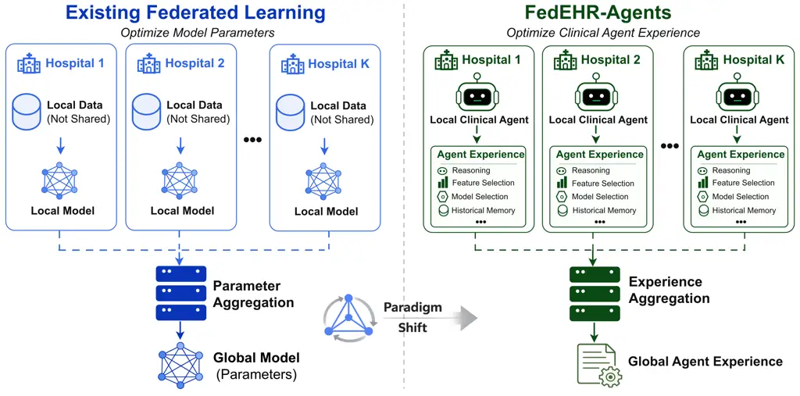
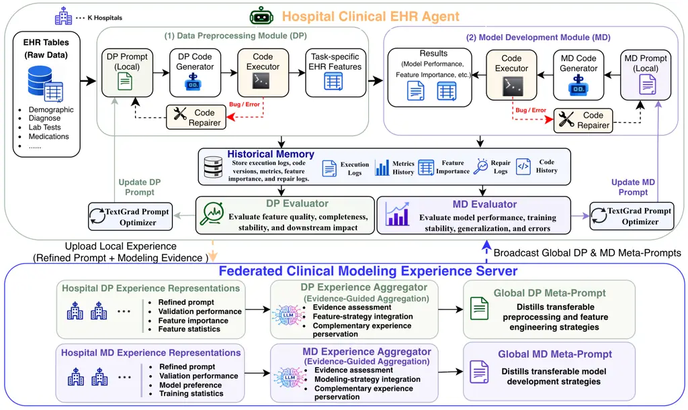
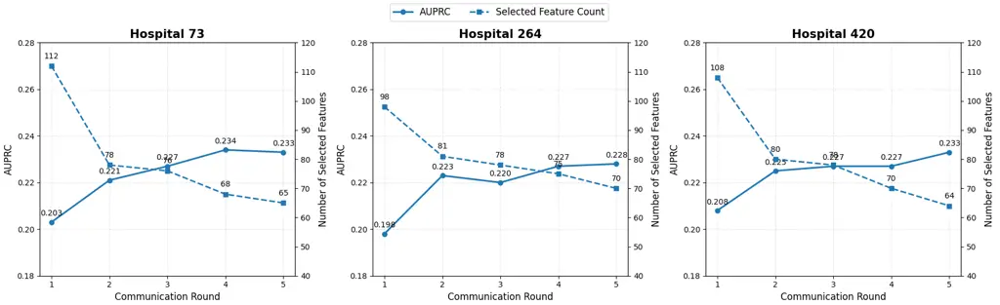
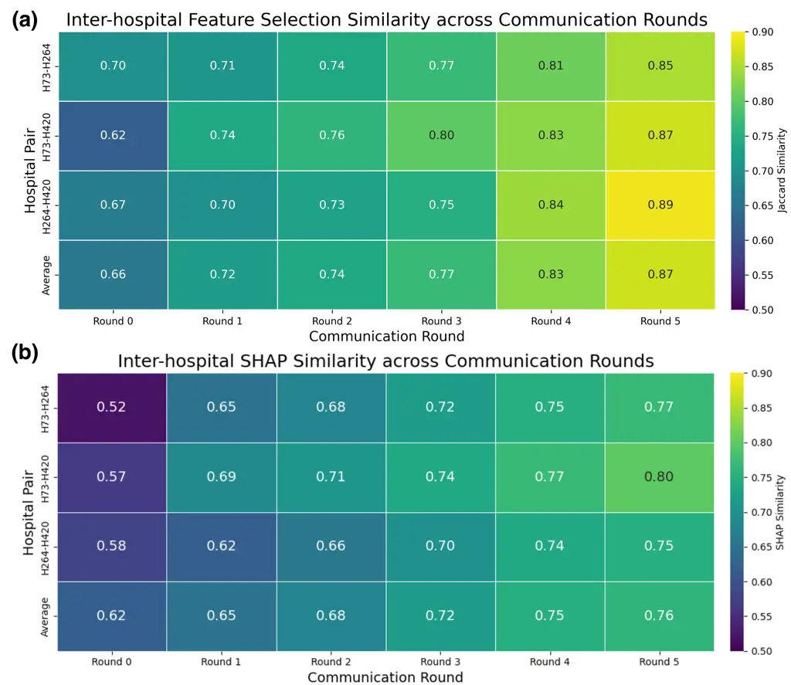
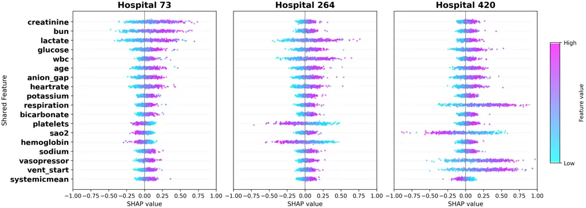
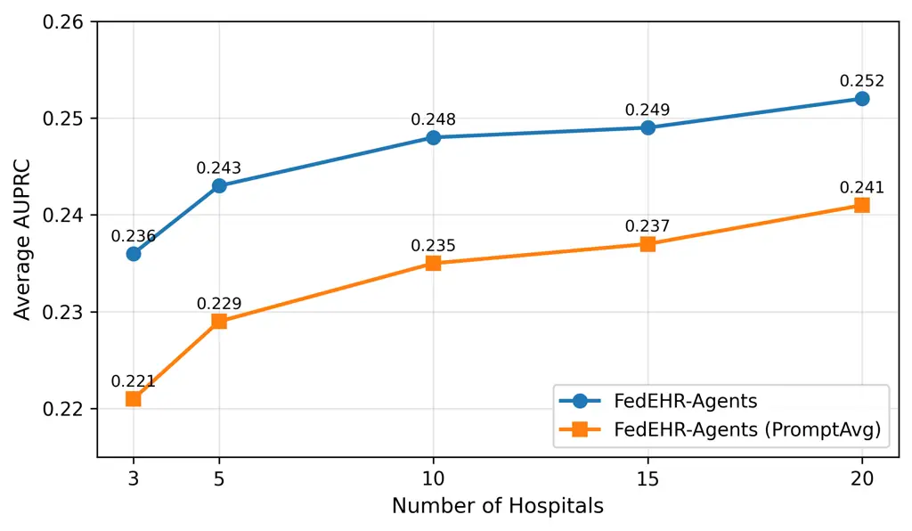
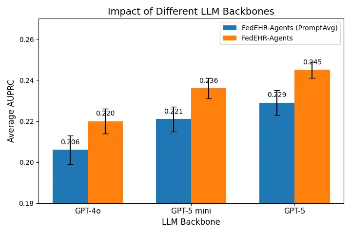

# FedEHR-Agents: Federated Agentic Optimization for Automated EHR Modeling

Jun Bai^(1,2), Ruilin Wang^(1,2), Yue Li^(1,2,\*) Affiliation: ¹School
of Computer Science, McGill University, Montreal, Canada  
²Mila – Quebec AI Institute, Montreal, Canada  
, ,

© none

###### Abstract.

Recent advances in large language models are enabling autonomous
clinical agents to perform increasingly complex electronic health record
(EHR) modeling workflows. However, agents deployed at individual
hospitals remain constrained by institution-specific data and modeling
environments, while direct cross-hospital collaboration is restricted by
the sensitivity of patient-level EHR data. Although federated learning
(FL) provides a natural foundation for privacy-preserving collaboration,
existing approaches remain predominantly model-centric, limiting
federation to prediction models or their updates while overlooking the
richer modeling experience accumulated by autonomous agents. To address
this limitation, we propose FedEHR-Agents, an experience-centric
federated agentic optimization framework for automated EHR modeling.
Each hospital deploys an autonomous clinical EHR agent that performs
data preprocessing and model development while refining local clinical
modeling experience through historical memory, task-specific evaluation,
and TextGrad-based prompt refinement. The federated server performs
evidence-guided experience aggregation to integrate reliable and
complementary modeling experience across heterogeneous hospitals and
distills the aggregated experience into global meta-prompts for
subsequent local refinement. Extensive experiments on real-world
multi-hospital EHR benchmarks demonstrate that FedEHR-Agents
consistently outperforms local and federated baselines across diverse
clinical prediction tasks and remains robust across different federation
scales and LLM backbones. These results establish clinical modeling
experience as a promising collaborative object beyond conventional
parameter-centric FL and point toward federated autonomous clinical
intelligence.

###### Keywords: 

Federated Learning; Clinical Agents; Experience Optimization; Electronic
Health Records; Automated EHR Modeling

^(\*)^(\*)footnotetext: Corresponding author: Yue Li
(yueli@cs.mcgill.ca)

## 1. Introduction



Figure 1. Motivation of FedEHR-Agents. Conventional FL performs
collaboration through prediction model parameter aggregation, whereas
FedEHR-Agents shifts the collaborative object toward clinical modeling
experience. .

Electronic health records (EHRs) have become a major data source for
developing clinical prediction systems, supporting applications such as
mortality prediction, sepsis detection, length-of-stay estimation, and
disease progression modeling (Johnson et al., 2016; Pollard et al.,
2018; Shickel et al., 2017; Rajkomar et al., 2018). Meanwhile, recent
advances in large language models (LLMs) are extending clinical AI
beyond task-specific prediction toward more autonomous and multi-stage
workflows (Teo et al., 2025; Ren et al., 2025; Ferber et al., 2026).
Equipped with reasoning, planning, memory, reflection, and tool-use
capabilities (Yao et al., 2023; Shinn et al., 2023; Guo et al., 2024;
Yuksekgonul et al., 2024), LLM-based agents provide a promising
foundation for automating complex modeling processes. Emerging
biomedical agentic systems further demonstrate the feasibility of
autonomously developing and iteratively improving complete machine
learning solutions (Martinek et al., 2026; Wang et al., 2025; Wang et
al., 2026). These advances suggest a transition from isolated prediction
models toward autonomous clinical agents capable of managing broader EHR
modeling workflows.

However, deploying such agents independently within individual hospitals
inherently limits the modeling knowledge they can acquire. EHR data are
highly heterogeneous across institutions because of differences in
patient populations, clinical workflows, measurement practices, and
documentation systems (Hunik et al., 2025). Consequently, agents
operating in different hospitals encounter distinct data characteristics
and modeling challenges, and may accumulate complementary preprocessing
strategies, feature engineering decisions, and model development
experience. Enabling these agents to collaboratively learn from such
complementary experience could substantially improve the robustness and
generalizability of automated clinical modeling across institutions.
Direct collaboration, however, is constrained by the sensitive nature of
clinical data: pooling patient-level EHRs across hospitals is restricted
by privacy regulations and institutional governance requirements
(Kaissis et al., 2020; Rieke et al., 2020). This creates a fundamental
need for privacy-preserving collaboration among autonomous clinical
agents.

Federated learning (FL) provides a natural foundation for such
collaboration by allowing hospitals to jointly develop machine learning
models while keeping raw patient data local (McMahan et al., 2017; Bai
et al., 2025). Considerable research has improved federated optimization
under heterogeneous data distributions, including FedProx (Li et al.,
2020), SCAFFOLD (Karimireddy et al., 2020), FedNova (Wang et al., 2020),
and FedDyn (Durmus et al., 2021). Nevertheless, despite substantial
advances in optimization robustness and convergence, the collaborative
object of conventional FL remains primarily the prediction model or its
parameter updates (Zhu et al., 2025). Such a model-centric paradigm
captures only the final outcome of clinical model development. The
broader decisions that produce this outcome—including data
preprocessing, feature engineering, model selection, performance
evaluation, and iterative refinement—are typically made independently
within each hospital and remain outside the federated optimization loop.
Consequently, existing FL enables collaborative model learning but
provides limited support for collaborative improvement of the agents
that construct these models.

This limitation reveals a largely unexplored opportunity for federated
clinical agents (Fig. 1). Developing a high-quality clinical prediction
system requires a sequence of reasoning-driven decisions that
substantially influence downstream performance (Shickel et al., 2017;
Holzinger et al., 2019; Topol, 2019). Throughout this process,
autonomous agents can accumulate valuable _clinical modeling
experience_, including effective preprocessing strategies, feature
engineering decisions, model preferences, execution feedback, and
historical refinement traces. Unlike prediction model parameters, such
experience captures reusable knowledge about _how_ clinical models are
developed and improved, and may therefore be transferable across
heterogeneous hospitals without exchanging patient-level EHR data.
Existing FL methods, however, neither explicitly preserve nor
collaboratively optimize this accumulated experience. This raises a
fundamental question: _how can distributed clinical agents
collaboratively accumulate, refine, and transfer clinical modeling
experience across hospitals while preserving patient data locality?_

To address this challenge, we propose FedEHR-Agents, a federated agentic
optimization framework for automated EHR modeling that shifts the
collaborative objective from prediction model parameters to clinical
modeling experience. Each hospital deploys an autonomous clinical EHR
agent to perform data preprocessing and model development over EHR data,
while continuously accumulating and refining local modeling experience
through historical memory, task-specific evaluation, and TextGrad-based
prompt refinement (Fig. 2). Rather than exchanging prediction models,
each hospital constructs module-specific experience representations
consisting of refined executable prompts and structured modeling
evidence. The federated server then performs evidence-guided experience
aggregation to integrate reliable and complementary modeling experience
across heterogeneous hospitals, distills the aggregated experience into
global meta-prompts, and broadcasts them to guide subsequent local agent
execution. Through iterative local refinement and federated experience
aggregation, FedEHR-Agents enables distributed clinical agents to
collaboratively improve automated EHR modeling while keeping
patient-level EHR data local.

Our main contributions are summarized as follows: ❶ We introduce an
_experience-centric federated optimization paradigm_ for automated EHR
modeling, reformulating cross-hospital collaboration from prediction
model parameter optimization to the collaborative accumulation,
refinement, and transfer of clinical modeling experience. This
formulation extends FL beyond model-centric collaboration toward
federated autonomous clinical intelligence. ❷ We develop FedEHR-Agents,
a federated agentic framework in which autonomous clinical agents
perform end-to-end EHR modeling and continuously refine module-specific
experience through historical memory, evaluator feedback, and
TextGrad (Yuksekgonul et al., 2024)-based prompt refinement. At the
server, evidence-guided experience aggregation selectively integrates
reliable and complementary modeling experience across heterogeneous
hospitals and distills it into global meta-prompts for subsequent local
refinement. ❸ Extensive experiments on real-world multi-hospital EHR
benchmarks validate the effectiveness of experience-centric federated
optimization across diverse clinical prediction tasks and heterogeneous
hospital settings. The results demonstrate that collaboratively
optimizing clinical modeling experience enables transferable
cross-hospital knowledge sharing beyond conventional model-centric
federation, while maintaining robustness across different federation
scales and LLM backbones.

## 2. Problem Formulation

### 2.1. Federated Clinical Agentic Setting

We consider a federated clinical learning environment consisting of
$`K`$ distributed hospitals $`\mathcal{H}=\{H_{1},\ldots,H_{K}\}`$,
where each hospital maintains a private longitudinal EHR dataset
$`\mathcal{D}_{k}=\{(\mathbf{x}_{i},y_{i})\}_{i=1}^{N_{k}}`$. Each
patient record
$`\mathbf{x}_{i}=(\mathbf{x}_{i}^{s},\mathbf{x}_{i}^{t})`$ contains
static patient characteristics $`\mathbf{x}_{i}^{s}`$ (e.g.,
demographics and admission information) and temporal clinical
observations $`\mathbf{x}_{i}^{t}`$ (e.g., laboratory measurements,
vital signs, medications, and respiratory interventions). The objective
is to collaboratively improve automated EHR modeling for a shared
clinical prediction task $`\mathcal{T}`$, such as in-hospital mortality
prediction, while keeping all patient-level EHR data within their
originating hospitals.

Unlike conventional FL (Zhu et al., 2025), where each hospital is
represented primarily by a trainable prediction model, we associate each
hospital with an autonomous clinical agent $`\mathcal{A}_{k}^{(r)}`$
that performs the complete EHR modeling workflow over local data at
communication round $`r`$. Formally, the local clinical agent is
represented as

```math
\mathcal{A}_{k}^{(r)}=\left(\mathcal{G}_{k},\mathcal{X}_{k}^{(r)}\right), \tag{1}
```

where $`\mathcal{G}_{k}`$ denotes the local execution engine responsible
for automated data preprocessing, feature engineering, model
development, evaluation, and iterative refinement, and
$`\mathcal{X}_{k}^{(r)}`$ denotes the clinical modeling experience
accumulated by the agent up to communication round $`r`$. The local
agent performs one round of autonomous EHR modeling as

```math
\left(f_{k}^{(r)},\widetilde{\mathcal{X}}_{k}^{(r)}\right)=\mathcal{G}_{k}\left(\mathcal{D}_{k},\mathcal{T},\mathcal{X}_{k}^{(r)}\right), \tag{2}
```

where $`f_{k}^{(r)}`$ denotes the prediction model produced during the
current local execution, and $`\widetilde{\mathcal{X}}_{k}^{(r)}`$
denotes the locally refined clinical modeling experience accumulated
through data preprocessing, model development, execution feedback,
historical memory, and prompt refinement.

Importantly, the prediction model $`f_{k}^{(r)}`$ is not the direct
object of federated optimization, but rather an outcome of the local
agent’s reasoning, decision-making, and execution process. Instead,
FedEHR-Agents collaboratively optimizes the underlying clinical modeling
experience. During each communication round, local experience is
progressively refined through execution feedback and historical memory,
and further enhanced by the global meta-prompt distilled from experience
aggregated across participating hospitals. Consequently, different
hospitals may maintain heterogeneous prediction models while
collaboratively benefiting from transferable clinical modeling
experience.

### 2.2. Clinical Modeling Experience

FedEHR-Agents treats _clinical modeling experience_ as the primary
object of federated optimization. It represents transferable knowledge
accumulated throughout automated EHR modeling, including preprocessing
and feature engineering strategies, model development decisions,
execution feedback, and historical optimization traces. Rather than
being encoded in prediction model parameters, such experience evolves
through local agent execution, while its shareable representation is
collaboratively aggregated across distributed hospitals.

Formally, let $`\mathcal{X}_{k}^{(r)}`$ denote the clinical modeling
experience maintained by agent $`\mathcal{A}_{k}^{(r)}`$ at
communication round $`r`$. We represent it using three complementary
components,

```math
\mathcal{X}_{k}^{(r)}=\left(\mathcal{S}_{k}^{(r)},\mathcal{P}_{k}^{(r)},\mathcal{M}_{k}^{(r)}\right), \tag{3}
```

where $`\mathcal{S}_{k}^{(r)}`$ denotes structured modeling evidence,
$`\mathcal{P}_{k}^{(r)}`$ denotes the executable prompt representation,
and $`\mathcal{M}_{k}^{(r)}`$ denotes the historical memory accumulated
through previous agent executions.

Specifically, $`\mathcal{S}_{k}^{(r)}`$ captures explicit modeling
outcomes, such as selected features, feature importance, model
preferences, and evaluation statistics; $`\mathcal{P}_{k}^{(r)}`$
organizes the accumulated experience into executable natural-language
instructions that guide subsequent data preprocessing and model
development; and $`\mathcal{M}_{k}^{(r)}`$ preserves historical
execution information, including modeling decisions, evaluator feedback,
execution records, and previous refinement trajectories. While all three
components remain local as part of the clinical modeling experience,
only the refined prompt and structured modeling evidence are
communicated during federated aggregation.

### 2.3. Federated Experience Optimization

We formulate federated automated EHR modeling as an iterative
optimization process over _clinical modeling experience_. Unlike
conventional FL, which optimizes prediction models through parameter
aggregation, FedEHR-Agents collaboratively improves the evolving
experience maintained by autonomous clinical agents. At each
communication round, local agents first refine their experience through
autonomous EHR modeling and execution feedback, after which the
resulting experience is aggregated across hospitals and redistributed as
globally transferable guidance.

After local agent execution, each hospital constructs a shareable
experience representation $`\mathcal{R}_{k}^{(r)}`$ from its locally
refined prompt and structured modeling evidence. These representations
are uploaded to the federated server and integrated through an
evidence-guided experience aggregation operator,

```math
\mathcal{R}_{G}^{(r)}=\Psi\left(\mathcal{R}_{1}^{(r)},\ldots,\mathcal{R}_{K}^{(r)}\right), \tag{4}
```

where $`\Psi(\cdot)`$ denotes the federated experience aggregation
function and $`\mathcal{R}_{G}^{(r)}`$ represents the globally
aggregated clinical modeling experience. Rather than averaging model
parameters, $`\Psi(\cdot)`$ integrates transferable modeling strategies
and supporting evidence accumulated across heterogeneous hospitals.

To translate the aggregated clinical modeling experience into actionable
guidance for local clinical agents, the federated server further
synthesizes a global meta-prompt,

```math
\mathcal{P}_{G}^{(r)}=\Gamma\left(\mathcal{R}_{G}^{(r)}\right), \tag{5}
```

where $`\Gamma(\cdot)`$ denotes the experience-guided meta-prompt
generation function. The generated meta-prompt distills globally
transferable preprocessing strategies, feature engineering practices,
model development experience, and optimization recommendations from the
global experience representation.

Each hospital subsequently integrates the global meta-prompt with its
locally refined experience to construct the experience state for the
next communication round,

```math
\mathcal{X}_{k}^{(r+1)}=\Phi\left(\widetilde{\mathcal{X}}_{k}^{(r)},\mathcal{P}_{G}^{(r)}\right), \tag{6}
```

where $`\Phi(\cdot)`$ denotes the local experience integration operator.
This update preserves hospital-specific modeling experience while
incorporating transferable knowledge distilled from other participating
hospitals, thereby enabling continual improvement of local autonomous
EHR modeling.

The overall objective is to maximize the downstream modeling utility
induced by the clinical modeling experience maintained across
participating hospitals. Let $`N=\sum_{k=1}^{K}N_{k}`$. We formulate the
federated experience optimization objective as

```math
\left\{\mathcal{X}_{k}^{*}\right\}_{k=1}^{K}=\arg\max_{\{\mathcal{X}_{k}\}_{k=1}^{K}}\sum_{k=1}^{K}\frac{N_{k}}{N}\,\mathcal{U}_{k}\left(\mathcal{X}_{k};\mathcal{D}_{k},\mathcal{T}\right), \tag{7}
```

where $`\mathcal{U}_{k}(\cdot)`$ denotes the task-specific utility
induced by the clinical modeling experience at hospital $`k`$, measured
through the quality of the resulting automated EHR modeling workflow and
its downstream predictive performance. The objective is realized
iteratively through local experience refinement, federated experience
aggregation, global meta-prompt generation, and experience integration,
rather than through direct optimization of prediction models.



Figure 2. Overview of the proposed FedEHR-Agents framework. Each
hospital deploys an autonomous clinical EHR agent to perform data
preprocessing (DP) and model development (MD) while continuously
refining local clinical modeling experience. The federated server
aggregates module-specific experience representations through
evidence-guided experience aggregation, synthesizes global DP and MD
meta-prompts, and broadcasts them to guide subsequent local experience
refinement. .

## 3. Methodology

### 3.1. Overview

The proposed FedEHR-Agents framework consists of distributed hospital
clinical EHR agents and a federated server that collaboratively optimize
clinical modeling experience rather than prediction model parameters
(Fig. 2). Each hospital deploys an autonomous clinical EHR agent to
perform automated EHR modeling over private patient data, while the
federated server integrates locally refined modeling experience across
hospitals and synthesizes global meta-prompts to guide subsequent local
experience refinement.

Specifically, each clinical EHR agent consists of a _Data Preprocessing
(DP) Module_ and a _Model Development (MD) Module_, supported by
historical memory, task-specific evaluators, and TextGrad-based prompt
refinement (Yuksekgonul et al., 2024). During each communication round,
the agent executes the DP and MD workflows, evaluates their outputs,
updates historical memory, and refines the corresponding executable
prompts according to execution feedback. The resulting module-specific
experience representations are then uploaded to the federated server,
where DP and MD experiences are separately integrated through
evidence-guided experience aggregation. The server subsequently
synthesizes global DP and MD meta-prompts and broadcasts them to
participating hospitals to guide the next round of local experience
refinement and agent execution. Through this iterative process,
FedEHR-Agents progressively improves automated EHR modeling while
keeping patient-level EHR data local.

### 3.2. Local Hospital Clinical EHR Agent

Each participating hospital deploys an autonomous clinical EHR agent to
perform automated EHR modeling over its private EHR database (Wang et
al., 2026). The clinical agent consists of two functional modules: a DP
Module and an MD Module. The DP module transforms heterogeneous raw EHR
tables into structured task-specific clinical features, while the MD
module develops prediction models based on the resulting feature
representations. Both modules are further supported by historical
memory, task-specific evaluators, and TextGrad-based prompt refinement,
allowing the agent to continuously accumulate and refine clinical
modeling experience throughout federated optimization.

#### 3.2.1. Data Preprocessing Module

The DP module transforms heterogeneous EHR tables into task-specific
feature representations suitable for downstream clinical prediction.
Given the local EHR database $`\mathcal{D}_{k}`$ and the preprocessing
prompt $`\mathcal{P}_{k,\mathrm{DP}}^{(r)}`$, the DP Code Generator
employs an LLM to generate executable preprocessing code for data
extraction, cleaning, temporal alignment, feature engineering, and
feature selection. The generated code is then executed locally by the
Code Executor. If execution errors are detected, the Code Repairer
analyzes the error messages and revises the generated code until a valid
preprocessing workflow is obtained. The resulting feature representation
is formulated as

```math
\mathbf{Z}_{k}^{(r)}=g_{\mathrm{DP}}\left(\mathcal{D}_{k},\mathcal{P}_{k,\mathrm{DP}}^{(r)}\right), \tag{8}
```

where $`g_{\mathrm{DP}}(\cdot)`$ denotes the complete LLM-guided
preprocessing workflow, including code generation, local execution, and
error-driven code repair.

The resulting representation $`\mathbf{Z}_{k}^{(r)}`$ is subsequently
passed to the model development module for downstream prediction.
Meanwhile, selected features and feature statistics are summarized as
structured modeling evidence for subsequent federated aggregation, while
generated code and execution records are retained in the historical
memory for local evaluation and prompt refinement.

#### 3.2.2. Model Development Module

Based on the processed feature representation $`\mathbf{Z}_{k}^{(r)}`$,
the MD module autonomously develops a prediction model for the target
clinical task. Given the model development prompt
$`\mathcal{P}_{k,\mathrm{MD}}^{(r)}`$, the MD Code Generator employs an
LLM to determine an appropriate modeling strategy, including model
selection, training configuration, and hyperparameter settings, and
generates executable model development code. The generated code is
executed locally by the Code Executor, while execution failures are
handled by the Code Repairer through error-guided code revision. The
resulting local prediction model is formulated as

```math
f_{k}^{(r)}=g_{\mathrm{MD}}\left(\mathbf{Z}_{k}^{(r)},\mathbf{y}_{k},\mathcal{P}_{k,\mathrm{MD}}^{(r)}\right), \tag{9}
```

where $`g_{\mathrm{MD}}(\cdot)`$ denotes the complete LLM-guided model
development workflow, including code generation, local execution, and
error-driven code repair, and $`\mathbf{y}_{k}`$ denotes the
corresponding prediction labels.

In addition to the resulting prediction model, the MD module produces
modeling outcomes such as model preferences, validation performance,
feature importance, training statistics, and execution records.
Validation performance, feature importance, model preferences, and
training statistics are summarized as structured modeling evidence for
server-side experience aggregation, while execution records and
refinement histories are retained in the local historical memory for
prompt refinement.

### 3.3. Historical Memory and Evaluation

To support iterative refinement across communication rounds, each local
clinical EHR agent maintains a historical memory and employs
task-specific evaluators to assess the current execution. The historical
memory records previous preprocessing and model development artifacts,
execution logs, evaluation results, and refinement histories, allowing
the agent to reuse effective modeling decisions rather than restarting
from scratch. The evaluators assess the outputs of the DP and MD modules
and generate structured feedback on their quality and performance.
Together, historical context and evaluation feedback are used to refine
local prompts and update the clinical modeling experience in subsequent
communication rounds.

#### 3.3.1. Historical Memory

During each communication round, the clinical EHR agent records
intermediate artifacts generated during local execution, including
preprocessing programs, model development configurations, evaluation
results, feature importance, execution logs, and prompt refinement
histories. Formally, the historical memory maintained by hospital $`k`$
at round $`r`$ is represented as

```math
\mathcal{M}_{k}^{(r)}=\left\{\mathbf{c}_{k}^{(r)},\mathbf{e}_{k}^{(r)},\mathbf{h}_{k}^{(r)}\right\}, \tag{10}
```

where $`\mathbf{c}_{k}^{(r)}`$ contains the generated executable code
and associated modeling artifacts, $`\mathbf{e}_{k}^{(r)}`$ records
execution logs and evaluation results, and $`\mathbf{h}_{k}^{(r)}`$
stores the prompt refinement trajectories accumulated across previous
communication rounds.

The historical memory is updated after each local execution and provides
long-term context for subsequent evaluation and prompt refinement. It
remains local to the hospital throughout federated optimization and is
not transmitted to the federated server.

#### 3.3.2. Module Evaluation

Following each local execution, the outputs of the DP and MD modules are
assessed by task-specific evaluators. The DP evaluator examines the
generated feature representations with respect to feature completeness,
consistency, temporal validity, potential information leakage, and
downstream usability. The MD evaluator assesses the resulting prediction
model in terms of predictive performance, generalization, optimization
stability, and model reliability. Rather than directly modifying the
generated code or prediction model, both evaluators produce structured
textual feedback for subsequent prompt refinement.

Formally, for module $`m\in\{\mathrm{DP},\mathrm{MD}\}`$, the evaluation
process is defined as

```math
\mathcal{F}_{k,m}^{(r)}=\mathcal{E}_{m}\left(\mathcal{O}_{k,m}^{(r)},\mathcal{M}_{k}^{(r)}\right), \tag{11}
```

where $`\mathcal{O}_{k,m}^{(r)}`$ denotes the current execution outputs
and associated statistics of module $`m`$, $`\mathcal{E}_{m}(\cdot)`$
denotes the corresponding task-specific evaluator, and
$`\mathcal{F}_{k,m}^{(r)}`$ is the generated textual feedback. The
historical memory $`\mathcal{M}_{k}^{(r)}`$ provides additional context
for comparing the current execution with previous optimization rounds.

The resulting feedback is recorded in the historical memory and
subsequently used by TextGrad to refine the corresponding DP and MD
prompts.

### 3.4. Local Prompt Refinement

Following module evaluation, the generated feedback is used to refine
the executable prompts that guide subsequent agent execution. In
FedEHR-Agents, prompts serve as executable representations of clinical
modeling experience rather than fixed manually designed instructions. By
revising these prompts according to current evaluation feedback and
historical execution context, the local agent progressively incorporates
newly acquired modeling experience into subsequent executions.

For each module $`m\in\{\mathrm{DP},\mathrm{MD}\}`$, let
$`\mathcal{P}_{k,m}^{(r)}`$ denote the corresponding local prompt at
communication round $`r`$. Given the evaluator feedback
$`\mathcal{F}_{k,m}^{(r)}`$ and historical memory
$`\mathcal{M}_{k}^{(r)}`$, the prompt is refined as

```math
\widetilde{\mathcal{P}}_{k,m}^{(r)}=\Omega_{m}\left(\mathcal{P}_{k,m}^{(r)},\mathcal{F}_{k,m}^{(r)},\mathcal{M}_{k}^{(r)}\right), \tag{12}
```

where $`\Omega_{m}(\cdot)`$ denotes the prompt refinement operator for
module $`m`$. We implement $`\Omega_{m}(\cdot)`$ using
TextGrad (Yuksekgonul et al., 2024), which interprets evaluator feedback
as textual gradients and revises the prompt accordingly without gradient
back-propagation over model parameters.

The refined prompt $`\widetilde{\mathcal{P}}_{k,m}^{(r)}`$ captures the
locally updated modeling experience and is subsequently included in the
experience representation uploaded for federated aggregation. After
incorporating the corresponding global meta-prompt, it is further
updated to form the executable prompt for the next communication round.

### 3.5. Evidence-Guided Experience Aggregation

FedEHR-Agents performs server-side collaboration through evidence-guided
experience aggregation (EGEA). Each hospital uploads its locally refined
experience representation, consisting of the refined executable prompt
and structured modeling evidence. Here, structured modeling evidence
refers to measurable outcomes obtained from local agent execution, such
as validation performance, feature importance, feature statistics, model
preferences, and optimization trends. EGEA uses this evidence to assess
the reliability and transferability of local modeling experience and
integrates complementary experience across heterogeneous hospitals. The
aggregated experience is then distilled into global meta-prompts to
guide the next round of agent execution.

#### 3.5.1. Experience Aggregation

For each module $`m\in\{\mathrm{DP},\mathrm{MD}\}`$, hospital $`k`$
constructs a shareable local experience representation consisting of the
locally refined prompt and structured modeling evidence,

```math
\mathcal{R}_{k,m}^{(r)}=\left(\widetilde{\mathcal{P}}_{k,m}^{(r)},\mathcal{S}_{k,m}^{(r)}\right), \tag{13}
```

where $`\widetilde{\mathcal{P}}_{k,m}^{(r)}`$ denotes the locally
refined executable prompt and $`\mathcal{S}_{k,m}^{(r)}`$ contains
structured modeling evidence obtained from local execution. The
historical memory $`\mathcal{M}_{k}^{(r)}`$ is retained locally and is
used only to provide longitudinal context for evaluation and prompt
refinement; it is not directly transmitted to the federated server.

The federated server separately aggregates the DP and MD experience
representations across participating hospitals,

```math
\mathcal{R}_{G,m}^{(r)}=\Psi_{m}\left(\mathcal{R}_{1,m}^{(r)},\ldots,\mathcal{R}_{K,m}^{(r)}\right),\quad m\in\{\mathrm{DP},\mathrm{MD}\}, \tag{14}
```

where $`\Psi_{m}(\cdot)`$ denotes the corresponding evidence-guided
experience aggregation operator. During aggregation, the structured
modeling evidence $`\mathcal{S}_{k,m}^{(r)}`$ is used to assess the
effectiveness and reliability of the associated local experience, while
complementary strategies from heterogeneous hospitals are preserved when
constructing the global experience representation
$`\mathcal{R}_{G,m}^{(r)}`$.

#### 3.5.2. Global Meta-Prompt Generation

To translate the aggregated experience into actionable guidance for
local clinical agents, the federated server generates a global
meta-prompt for each module,

```math
\mathcal{P}_{G,m}^{(r)}=\Gamma_{m}\left(\mathcal{R}_{G,m}^{(r)}\right),\quad m\in\{\mathrm{DP},\mathrm{MD}\}, \tag{15}
```

where $`\Gamma_{m}(\cdot)`$ denotes the LLM-based meta-prompt generation
function for module $`m`$. The generated meta-prompts distill
transferable modeling strategies and recommendations from the aggregated
DP and MD experience representations.

The global meta-prompts are broadcast to participating hospitals and
integrated with the corresponding locally refined prompts,

```math
\mathcal{P}_{k,m}^{(r+1)}=\Phi_{m}\left(\widetilde{\mathcal{P}}_{k,m}^{(r)},\mathcal{P}_{G,m}^{(r)}\right),\quad m\in\{\mathrm{DP},\mathrm{MD}\}, \tag{16}
```

where $`\Phi_{m}(\cdot)`$ denotes the prompt integration operator. The
resulting prompts combine locally accumulated experience with globally
shared guidance and are used to initialize the DP and MD modules in the
next communication round. The complete federated optimization procedure
is summarized in Appendix Algorithm 1. Detailed prompt templates and
representative structured outputs are provided in Appendix Sec. D.

|                                   |                    |                    |                    |                    |
| --------------------------------- | ------------------ | ------------------ | ------------------ | ------------------ |
| Method                            | Mortality-48h      | ARF-4h             | LOS$`>`$7d         | Sepsis             |
| Centralized Methods (Upper Bound) |                    |                    |                    |                    |
| Centralized AutoML                | $`0.232\pm 0.005`$ | $`0.189\pm 0.006`$ | $`0.543\pm 0.014`$ | $`0.292\pm 0.007`$ |
| Centralized Agent                 | $`0.242\pm 0.004`$ | $`0.204\pm 0.005`$ | $`0.578\pm 0.011`$ | $`0.337\pm 0.008`$ |
| Independent Methods               |                    |                    |                    |                    |
| Local AutoML                      | $`0.205\pm 0.007`$ | $`0.158\pm 0.007`$ | $`0.465\pm 0.017`$ | $`0.256\pm 0.005`$ |
| Local Agent                       | $`0.218\pm 0.005`$ | $`0.171\pm 0.005`$ | $`0.483\pm 0.015`$ | $`0.268\pm 0.007`$ |
| Federated Methods                 |                    |                    |                    |                    |
| FedEHR-Agents (PromptAvg)         | $`0.221\pm 0.006`$ | $`0.183\pm 0.006`$ | $`0.506\pm 0.012`$ | $`0.286\pm 0.011`$ |
| FedEHR-Agents                     | $`0.236\pm 0.005`$ | $`0.194\pm 0.004`$ | $`0.532\pm 0.010`$ | $`0.316\pm 0.009`$ |

Table 1. Overall AUPRC comparison across four representative clinical
prediction tasks. Higher values indicate better performance. The best
results among the independent and federated methods are highlighted in
bold. Centralized methods are reported only as upper-bound references.

## 4. Evaluation

### 4.1. Experimental Setup

##### Datasets and Clinical Prediction Tasks.

We evaluate FedEHR-Agents on the publicly available eICU Collaborative
Research Database (eICU) (Pollard et al., 2018), a large-scale
multi-center critical care dataset collected from more than 200
intensive care units across the United States. Each participating
hospital is treated as an independent federated client, with
patient-level EHR data retained locally throughout the entire
optimization process. We consider four representative clinical
prediction tasks: 48-hour mortality prediction (Mortality-48h), 4-hour
acute respiratory failure prediction (ARF-4h), prolonged length-of-stay
prediction (LOS$`>`$7d), and sepsis prediction (Sepsis). These tasks
cover diverse clinical outcomes and prediction horizons, providing a
comprehensive evaluation of federated automated EHR modeling under
heterogeneous multi-hospital settings.

##### Federated Configuration.

We adopt a cross-silo federated setting in which participating hospitals
collaboratively optimize clinical modeling experience without exchanging
patient-level EHR data or locally developed prediction models. At each
communication round, local clinical agents perform EHR modeling and
prompt refinement, after which the resulting DP and MD experience
representations are aggregated by the federated server through EGEA. The
server then generates global DP and MD meta-prompts to guide the next
round of local agent execution. Unless otherwise specified, we use three
participating hospitals and five communication rounds for all
experiments. All experiments are repeated with three random seeds, and
the mean and standard deviation are reported.

##### Baseline Methods.

We compare FedEHR-Agents with five representative automated EHR modeling
baselines covering local, federated, and centralized settings. Local
AutoML independently develops prediction models at each hospital using a
conventional AutoML framework (Trirat et al., 2025). Local Agent uses
the same clinical agent architecture as FedEHR-Agents but performs all
modeling and prompt refinement locally without cross-hospital
collaboration. FedEHR-Agents (PromptAvg) provides a simple federated
prompt-sharing baseline, where local prompt representations are
aggregated to construct global meta-prompts, without incorporating
structured modeling evidence during server-side aggregation. We further
include Centralized AutoML and Centralized Agent as upper-bound
references, where data from all participating hospitals are pooled for
automated model development. Since these centralized settings violate
the federated data-locality assumption, they are reported only as oracle
performance references.

##### Implementation Details.

All agent-based methods use GPT-5 mini as the default LLM backbone. Each
participating hospital deploys the same clinical agent architecture,
consisting of a DP module and an MD module, while allowing preprocessing
workflows, feature engineering strategies, prediction models, and
modeling decisions to adapt autonomously to local EHR data. For fair
comparison, all methods use the same communication protocol,
optimization budget, evaluation metrics, and stopping criteria.
Additional implementation details are provided in Appendix Sec. C.

##### Evaluation Metrics.

Prediction performance is evaluated using the Area Under the
Precision–Recall Curve (AUPRC), which is well suited to imbalanced
clinical prediction tasks. Beyond predictive performance, we evaluate
the behavior of federated experience optimization through convergence
across communication rounds, cross-hospital feature selection
consistency, and SHAP-based feature attribution consistency. We further
examine the robustness of FedEHR-Agents under different federation
scales and LLM backbones. Together, these evaluations assess both the
predictive effectiveness and the optimization stability of the proposed
framework.

### 4.2. Overall Performance

We first evaluate FedEHR-Agents on four representative clinical
prediction tasks: Mortality-48h, ARF-4h, LOS$`>`$7d, and Sepsis.
FedEHR-Agents consistently achieves the best performance among all
decentralized methods across all tasks (Table 1). Compared with Local
Agent, the AUPRC increases from 0.218 to 0.236 on Mortality-48h, from
0.171 to 0.194 on ARF-4h, from 0.483 to 0.532 on LOS$`>`$7d, and from
0.268 to 0.316 on Sepsis, corresponding to relative gains of 8.3%,
13.5%, 10.1%, and 17.9%, respectively. The consistent gains over Local
AutoML and Local Agent indicate that cross-hospital experience sharing
enables autonomous clinical agents to benefit from transferable modeling
knowledge beyond isolated local optimization. Moreover, FedEHR-Agents
approaches the centralized upper-bound performance without pooling
patient-level EHR data, demonstrating that collaborative experience
optimization can recover a substantial portion of the benefit of
centralized learning.

FedEHR-Agents also consistently outperforms FedEHR-Agents (PromptAvg),
which constructs global meta-prompts from aggregated local prompt
representations without structured modeling evidence. The absolute AUPRC
improvements are 0.015, 0.011, 0.026, and 0.030 on Mortality-48h,
ARF-4h, LOS$`>`$7d, and Sepsis, respectively (Table 1). The larger gains
on LOS$`>`$7d and Sepsis suggest that structured modeling evidence
provides useful context for identifying more reliable and transferable
local experience during server-side aggregation. As a result, the
generated global meta-prompts provide more effective guidance for
subsequent local refinement than prompt aggregation alone.

### 4.3. Federated Experience Optimization



Figure 3. Optimization trajectories of FedEHR-Agents on the
Mortality-48h task across three hospitals. Solid lines denote
performance measured by AUPRC, while dashed lines denote the number of
selected features over communication rounds. .



Figure 4. Evolution of cross-hospital modeling consistency on the
Mortality-48h task. (a) Pairwise feature selection consistency measured
by Jaccard similarity. (b) Pairwise feature importance consistency
measured by SHAP similarity. .

To examine how FedEHR-Agents evolves over rounds, we analyze the
federated experience optimization process on the Mortality-48h task. We
track local predictive performance, the number of selected features, and
cross-hospital consistency in feature selection and feature attribution,
providing a more detailed view of how collaborative experience sharing
influences local EHR modeling.

Local predictive performance improves rapidly during the early
communication rounds and gradually stabilizes across all participating
hospitals (Fig. 3). At the same time, the number of selected clinical
features decreases steadily, yielding increasingly compact feature
subsets. Notably, predictive performance continues to improve despite
the reduced feature space, suggesting that the agents progressively
favor more informative features while discarding less useful ones. This
trend indicates that the accumulated modeling experience improves both
feature selection and downstream model development over successive
rounds.

Cross-hospital modeling decisions also become increasingly consistent
during federated optimization (Fig. 4). The pairwise Jaccard similarity
between selected feature subsets rises steadily across communication
rounds, indicating greater agreement in feature selection among
independently operating hospital agents. A similar pattern is observed
for SHAP-based feature importance, where cross-hospital agreement also
increases despite heterogeneous local EHR distributions (Fig. 4b). These
results suggest that federated experience optimization not only improves
local predictive performance, but also promotes the emergence of more
consistent and reusable modeling knowledge across distributed hospitals.

### 4.4. Clinical Feature Interpretation



Figure 5. Hospital-level SHAP analysis of the shared clinically
important features on the Mortality-48h task. The figure presents the
SHAP distributions of the common top-ranked features identified across
three hospitals after federated optimization. For readability, the
feature names shown in Fig. 5 are normalized labels used after
preprocessing rather than the original eICU variable names; detailed
definitions are provided in Appendix Table C2. .

To complement the quantitative evaluation, we further investigate the
clinical interpretability of the optimized policies by analyzing the
SHAP values of the overlapping top-ranked features identified across
three representative hospitals on the Mortality-48h prediction task
(Fig. 5). Specifically, we examine whether federated optimization
enables autonomous agents to consistently identify clinically meaningful
predictors while preserving hospital-specific modeling characteristics.

Across all participating hospitals, FedEHR-Agents consistently
identifies clinically established mortality predictors, including renal
function indicators, metabolic measurements, inflammatory biomarkers,
and respiratory-related variables (Fig. 5). Although these clinically
important features are consistently selected, their SHAP value
distributions differ across hospitals, reflecting variations in patient
populations, disease prevalence, and local clinical practice. This
suggests that federated optimization successfully captures globally
transferable clinical knowledge while preserving hospital-specific
decision patterns, enabling collaborative yet personalized automated EHR
modeling.

### 4.5. Ablation Study

We conduct an ablation study on the Mortality-48h task to evaluate the
contribution of four key components in FedEHR-Agents: Historical Memory,
Evaluator, DP Module, and EGEA (Table 2). For each ablation setting, one
component is removed while all remaining components are kept unchanged.
Historical Memory preserves prior execution and refinement information,
the Evaluator provides feedback for local prompt refinement, the DP
Module supports autonomous preprocessing and feature engineering, and
EGEA integrates local experience using structured modeling evidence.

Removing any component consistently reduces predictive performance
(Table 2). Disabling the DP Module causes the largest degradation,
decreasing AUPRC from 0.236 to 0.219, highlighting the importance of
adaptive preprocessing and feature engineering. Replacing EGEA with
simple prompt averaging reduces AUPRC to 0.221, showing that structured
modeling evidence improves server-side experience aggregation beyond
prompt sharing alone. Removing Historical Memory and the Evaluator
decreases AUPRC to 0.223 and 0.226, respectively, indicating that
historical context and evaluator feedback both contribute to effective
local prompt refinement. Additional ablation results across clinical
prediction tasks are provided in Appendix Table B2. Overall, the results
confirm that the four components provide complementary benefits to
federated experience optimization.

| Memory         | Evaluator      | DP Module      | EGEA           | AUPRC                       |
| -------------- | -------------- | -------------- | -------------- | --------------------------- |
| $`\times`$     | $`\checkmark`$ | $`\checkmark`$ | $`\checkmark`$ | $`0.223\pm 0.004`$          |
| $`\checkmark`$ | $`\times`$     | $`\checkmark`$ | $`\checkmark`$ | $`0.226\pm 0.006`$          |
| $`\checkmark`$ | $`\checkmark`$ | $`\times`$     | $`\checkmark`$ | $`0.219\pm 0.007`$          |
| $`\checkmark`$ | $`\checkmark`$ | $`\checkmark`$ | $`\times`$     | $`0.221\pm 0.006`$          |
| $`\checkmark`$ | $`\checkmark`$ | $`\checkmark`$ | $`\checkmark`$ | $`\mathbf{0.236\pm 0.005}`$ |

Table 2. Ablation Study of FedEHR-Agents on the Mortality-48h prediction
task.

### 4.6. Scalability Analysis



Figure 6. Impact of the number of participating hospitals on
Mortality-48h prediction. Average AUPRC is reported for federations with
3, 5, 10, 15, and 20 hospitals. .

We evaluate the scalability of FedEHR-Agents by varying the number of
participating hospitals from 3 to 20 on the Mortality-48h task. For each
federation scale, the average AUPRC is computed across all participating
hospitals. We compare the complete FedEHR-Agents framework with the
PromptAvg variant to examine whether EGEA remains effective as the
federation size increases.

Both methods benefit from larger federations, suggesting that additional
hospitals provide more diverse modeling experience for collaborative
optimization (Fig. 6). FedEHR-Agents consistently outperforms PromptAvg
across all federation scales, with the average AUPRC increasing from
0.236 to 0.252 as the number of hospitals grows from 3 to 20, compared
with 0.221 to 0.241 for PromptAvg. The persistent performance gap
indicates that prompt aggregation alone is less effective at exploiting
heterogeneous cross-hospital experience as the federation expands. In
contrast, EGEA leverages structured modeling evidence to integrate more
reliable and complementary experience across hospitals, supporting
stable performance gains under larger multi-hospital federations.
Consistent scalability trends are also observed across the other
clinical prediction tasks (Appendix Table B1).

### 4.7. Impact of Different LLM Backbones

We evaluate the robustness of FedEHR-Agents to different LLM backbones
by comparing GPT-4o, GPT-5 mini, and GPT-5. For each backbone, we use
the same federated optimization pipeline, prompt initialization, and
experimental configuration, while replacing only the underlying LLM. The
complete FedEHR-Agents framework is compared with its PromptAvg variant
under each setting.

Predictive performance generally improves with more capable LLM
backbones for both methods (Appendix Fig. B1), indicating that stronger
reasoning capabilities can benefit automated EHR modeling. More
importantly, FedEHR-Agents consistently outperforms PromptAvg across all
evaluated backbones, demonstrating that the advantage of evidence-guided
experience aggregation is not specific to a particular LLM. The
consistent performance gains suggest that EGEA can effectively integrate
cross-hospital modeling experience under different reasoning backbones,
while allowing the overall framework to benefit from advances in LLM
capability.

## 5. Discussion and Future Work

FedEHR-Agents advances toward federated autonomous clinical intelligence
by preserving patient data locality. All patient-level EHR records and
locally developed prediction models remain within their originating
hospitals, while cross-hospital collaboration occurs via shareable
experience representations (refined prompts and structured modeling
evidence) and local historical memory. Although these representations
exclude raw patient records, they may indirectly encode local data
characteristics—such as feature importances, validation statistics, and
optimization patterns—under strong inference or reconstruction attacks.
Consequently, experience sharing should be viewed as a privacy-aware
collaborative mechanism rather than a formal guarantee against privacy
leakage.

To address these limitations and broaden the scope of autonomous
healthcare AI, future research will explore several key directions:

- •
  Privacy-Preserving Experience Communication: Integrating formal
  privacy guarantees into experience-level updates using differential
  privacy for structured modeling evidence (McMahan et al., 2018; Andrew
  et al., 2021), secure aggregation techniques (Bonawitz et al., 2017;
  Shao et al., 2022), trusted execution environments for server-side
  aggregation (Kalapaaking et al., 2022), and locally deployed LLMs to
  prevent external service exposure.
- •
  Multimodal and Adaptive Capabilities: Extending the framework to
  handle multimodal clinical data (combining structured EHRs, medical
  imaging, and clinical text) and developing adaptive mechanisms for
  experience selection, aggregation, and continual evolution across
  heterogeneous institutions.
- •
  Long-Term Collaboration Assessment: Conducting systematic, long-term
  evaluations of multi-agent collaboration and continual learning to
  assess sustained reliability and safety in real-world deployment.

## 6. Acknowledgments

Y.L. is supported by NOVA-FRQNT-NSERC grant (FRQ-NT 2023-NOVA-328677),
Canada Research Chair (Tier 2) in Machine Learning for Genomics and
Healthcare (CRC-2021-00547) and Natural Sciences and Engineering
Research Council (NSERC) Discovery Grant (RGPIN-2016-05174).

## References

- \[1\] A. E. Johnson, T. J. Pollard, L. Shen, L. H. Lehman, M. Feng, M.
  Ghassemi, B. Moody, P. Szolovits, L. Anthony Celi, and R. G.
  Mark (2016) MIMIC-iii, a freely accessible critical care database.
  Scientific data 3 (1), pp. 1–9. Cited by: §1.
- \[2\] T. J. Pollard, A. E. Johnson, J. D. Raffa, L. A. Celi, R. G.
  Mark, and O. Badawi (2018) The eicu collaborative research database, a
  freely available multi-center database for critical care research.
  Scientific data 5 (1), pp. 180178. Cited by: §1, §4.1.
- \[3\] B. Shickel, P. J. Tighe, A. Bihorac, and P. Rashidi (2017) Deep
  ehr: a survey of recent advances in deep learning techniques for
  electronic health record (ehr) analysis. IEEE journal of biomedical
  and health informatics 22 (5), pp. 1589–1604. Cited by: §1, §1.
- \[4\] A. Rajkomar, E. Oren, K. Chen, A. M. Dai, N. Hajaj, M.
  Hardt, P. J. Liu, X. Liu, J. Marcus, M. Sun, et al. (2018) Scalable
  and accurate deep learning with electronic health records. NPJ digital
  medicine 1 (1), pp. 18. Cited by: §1.
- \[5\] Z. L. Teo, A. J. Thirunavukarasu, K. Elangovan, H. Cheng, P.
  Moova, B. Soetikno, C. Nielsen, A. Pollreisz, D. S. J. Ting, R. J.
  Morris, et al. (2025) Generative artificial intelligence in medicine.
  Nature medicine 31 (10), pp. 3270–3282. Cited by: §1.
- \[6\] Z. Ren, Y. Zhan, B. Yu, L. Ding, P. Xu, and D. Tao (2025)
  Healthcare agent: eliciting the power of large language models for
  medical consultation. npj Artificial Intelligence 1 (1), pp. 24. Cited
  by: §1.
- \[7\] D. Ferber, L. Hilgers, C. Höper, B. Kinny-Köster, J. Eckardt, K.
  Egger-Heidrich, M. Bill, M. M. Schneider, J. Clusmann, L. Kadric, et
  al. (2026) Towards autonomous medical artificial intelligence agents.
  Nature, pp. 1–10. Cited by: §1.
- \[8\] S. Yao, J. Zhao, D. Yu, N. Du, I. Shafran, K. R. Narasimhan,
  and Y. Cao (2023) ReAct: synergizing reasoning and acting in language
  models. In The Eleventh International Conference on Learning
  Representations, . External Links:
  [Link](https://openreview.net/forum?id=WE_vluYUL-X) Cited by: §1.
- \[9\] N. Shinn, F. Cassano, A. Gopinath, K. R. Narasimhan, and S.
  Yao (2023) Reflexion: language agents with verbal reinforcement
  learning. In Thirty-seventh Conference on Neural Information
  Processing Systems, External Links:
  [Link](https://openreview.net/forum?id=vAElhFcKW6) Cited by: §1.
- \[10\] T. Guo, X. Chen, Y. Wang, R. Chang, S. Pei, N. V. Chawla, O.
  Wiest, and X. Zhang (2024) Large language model based multi-agents: a
  survey of progress and challenges. arXiv preprint arXiv:2402.01680 (),
  pp. . Cited by: §1.
- \[11\] M. Yuksekgonul, F. Bianchi, J. Boen, S. Liu, Z. Huang, C.
  Guestrin, and J. Zou (2024) Textgrad: automatic" differentiation" via
  text. arXiv preprint arXiv:2406.07496. Cited by: §1, §1, §3.1, §3.4.
- \[12\] V. Martinek, A. Gariboldi, D. Tzimotoudis, M. Galea, E.
  Zacharopoulou, A. A. Escudero, E. Blake, D. Čechák, L. Cassar, A.
  Balestrucci, et al. (2026) Agentomics: an agentic system that
  autonomously develops novel state-of-the-art solutions for biomedical
  machine learning tasks. Bioinformatics 42 (Supplement_1), pp. btag250.
  Cited by: §1.
- \[13\] J. Wang, J. J. Vallon, N. Panjwani, X. Ling, S. Vij, S.
  Srinivas, J. Leppert, M. K. Buyyounouski, and M. Bayati (2025)
  Agent-based feature generation from clinical notes for outcome
  prediction. arXiv e-prints, pp. arXiv–2508. Cited by: §1.
- \[14\] R. Wang, B. Wang, E. Kourbatski, J. Bai, H. Chen, Z. Song, G.
  Boire, M. Hudson, and Y. Li (2026) DoctorAgents: an agentic framework
  to iteratively refine automl pipeline for small clinical temporal
  data. arXiv preprint arXiv:2608.05375. Cited by: §1, §3.2.
- \[15\] L. Hunik, A. Chaabouni, T. van Laarhoven, T. C. O.
  Hartman, R. T. Leijenaar, J. W. Cals, A. A. Uijen, and H. J.
  Schers (2025) Diagnostic prediction models for primary care, based on
  ai and electronic health records: systematic review. JMIR Medical
  Informatics 13 (1), pp. e62862. Cited by: §1.
- \[16\] G. A. Kaissis, M. R. Makowski, D. Rückert, and R. F.
  Braren (2020) Secure, privacy-preserving and federated machine
  learning in medical imaging. Nature Machine Intelligence 2 (6),
  pp. 305–311. Cited by: §1.
- \[17\] N. Rieke, J. Hancox, W. Li, F. Milletari, H. R. Roth, S.
  Albarqouni, S. Bakas, M. N. Galtier, B. A. Landman, K. Maier-Hein, et
  al. (2020) The future of digital health with federated learning. NPJ
  digital medicine 3 (1), pp. 119. Cited by: §1.
- \[18\] B. McMahan, E. Moore, D. Ramage, S. Hampson, and B. A. y
  Arcas (2017) Communication-efficient learning of deep networks from
  decentralized data. In Artificial intelligence and statistics,
  pp. 1273–1282. Cited by: §1.
- \[19\] J. Bai, Y. Song, D. Wu, A. Sajjanhar, Y. Xiang, W. Zhou, X.
  Tao, Y. Li, and Y. Li (2025) A unified solution to diverse
  heterogeneities in one-shot federated learning. In Proceedings of the
  31st ACM SIGKDD Conference on Knowledge Discovery and Data Mining V.
  2, New York, NY, USA, pp. 71–82. Cited by: §1.
- \[20\] T. Li, A. K. Sahu, M. Zaheer, M. Sanjabi, A. Talwalkar, and V.
  Smith (2020) Federated optimization in heterogeneous networks.
  Proceedings of Machine learning and systems 2, pp. 429–450. Cited by:
  §1.
- \[21\] S. P. Karimireddy, S. Kale, M. Mohri, S. Reddi, S. Stich,
  and A. T. Suresh (2020) Scaffold: stochastic controlled averaging for
  federated learning. In International conference on machine learning, ,
  pp. 5132–5143. Cited by: §1.
- \[22\] J. Wang, Q. Liu, H. Liang, G. Joshi, and H. V. Poor (2020)
  Tackling the objective inconsistency problem in heterogeneous
  federated optimization. Advances in neural information processing
  systems 33, pp. 7611–7623. Cited by: §1.
- \[23\] A. E. Durmus, Z. Yue, M. Ramon, M. Matthew, W. Paul, and S.
  Venkatesh (2021) Federated learning based on dynamic regularization.
  In International conference on learning representations, Cited by: §1.
- \[24\] H. Zhu, J. Bai, N. Li, X. Li, D. Liu, D. L. Buckeridge, and Y.
  Li (2025) FedWeight: mitigating covariate shift of federated learning
  on electronic health records data through patients re-weighting. npj
  Digital Medicine 8 (1), pp. 286. Cited by: §1, §2.1.
- \[25\] A. Holzinger, G. Langs, H. Denk, K. Zatloukal, and H.
  Müller (2019) Causability and explainability of artificial
  intelligence in medicine. Wiley interdisciplinary reviews: data mining
  and knowledge discovery 9 (4), pp. e1312. Cited by: §1.
- \[26\] E. J. Topol (2019) High-performance medicine: the convergence
  of human and artificial intelligence. Nature medicine 25 (1),
  pp. 44–56. Cited by: §1.
- \[27\] P. Trirat, W. Jeong, and S. J. Hwang (2025) AutoML-agent: a
  multi-agent LLM framework for full-pipeline autoML. In Forty-second
  International Conference on Machine Learning, External Links:
  [Link](https://openreview.net/forum?id=p1UBWkOvZm) Cited by: §4.1.
- \[28\] H. B. McMahan, D. Ramage, K. Talwar, and L. Zhang (2018)
  Learning differentially private recurrent language models. In
  International Conference on Learning Representations, External Links:
  [Link](https://openreview.net/forum?id=BJ0hF1Z0b) Cited by: 1st item.
- \[29\] G. Andrew, O. Thakkar, B. McMahan, and S. Ramaswamy (2021)
  Differentially private learning with adaptive clipping. Advances in
  neural information processing systems 34, pp. 17455–17466. Cited by:
  1st item.
- \[30\] K. Bonawitz, V. Ivanov, B. Kreuter, A. Marcedone, H. B.
  McMahan, S. Patel, D. Ramage, A. Segal, and K. Seth (2017) Practical
  secure aggregation for privacy-preserving machine learning. In
  proceedings of the 2017 ACM SIGSAC Conference on Computer and
  Communications Security, New York, NY, USA, pp. 1175–1191. External
  Links: ISBN 9781450349468 Cited by: 1st item.
- \[31\] J. Shao, Y. Sun, S. Li, and J. Zhang (2022) Dres-fl:
  dropout-resilient secure federated learning for non-iid clients via
  secret data sharing. Advances in Neural Information Processing Systems
  35, pp. 10533–10545. Cited by: 1st item.
- \[32\] A. P. Kalapaaking, I. Khalil, M. S. Rahman, M. Atiquzzaman, X.
  Yi, and M. Almashor (2022) Blockchain-based federated learning with
  secure aggregation in trusted execution environment for
  internet-of-things. IEEE Transactions on Industrial Informatics 19
  (2), pp. 1703–1714. Cited by: 1st item.

Appendix

## Appendix A Overall Federated Optimization Procedure

1: Hospitals $`\{H_{k}\}_{k=1}^{K}`$ with private EHR datasets
$`\{\mathcal{D}_{k}\}_{k=1}^{K}`$, communication rounds $`R`$

2: Refined clinical modeling experience and local prediction models

3: Initialize DP prompts
$`\{\mathcal{P}_{k,\mathrm{DP}}^{(0)}\}_{k=1}^{K}`$

4: Initialize MD prompts
$`\{\mathcal{P}_{k,\mathrm{MD}}^{(0)}\}_{k=1}^{K}`$ and historical
memories $`\{\mathcal{M}_{k}^{(0)}\}_{k=1}^{K}`$

5: for $`r=0,\ldots,R-1`$ do

6:   for all hospitals $`H_{k}`$ in parallel do

7:    Run the DP module

```math
\mathbf{Z}_{k}^{(r)}\leftarrow g_{\mathrm{DP}}\left(\mathcal{D}_{k},\mathcal{P}_{k,\mathrm{DP}}^{(r)}\right)
```

8:    Run the MD module

```math
f_{k}^{(r)}\leftarrow g_{\mathrm{MD}}\left(\mathbf{Z}_{k}^{(r)},\mathbf{y}_{k},\mathcal{P}_{k,\mathrm{MD}}^{(r)}\right)
```

9:    Collect structured evidence $`\mathcal{S}_{k,\mathrm{DP}}^{(r)}`$
and $`\mathcal{S}_{k,\mathrm{MD}}^{(r)}`$

10:    Evaluate DP and MD outputs to obtain
$`\mathcal{F}_{k,\mathrm{DP}}^{(r)}`$ and
$`\mathcal{F}_{k,\mathrm{MD}}^{(r)}`$

11:    Refine the DP prompt via TextGrad

```math
\widetilde{\mathcal{P}}_{k,\mathrm{DP}}^{(r)}\leftarrow\Omega_{\mathrm{DP}}\left(\mathcal{P}_{k,\mathrm{DP}}^{(r)},\mathcal{F}_{k,\mathrm{DP}}^{(r)},\mathcal{M}_{k}^{(r)}\right)
```

12:    Refine the MD prompt via TextGrad

```math
\widetilde{\mathcal{P}}_{k,\mathrm{MD}}^{(r)}\leftarrow\Omega_{\mathrm{MD}}\left(\mathcal{P}_{k,\mathrm{MD}}^{(r)},\mathcal{F}_{k,\mathrm{MD}}^{(r)},\mathcal{M}_{k}^{(r)}\right)
```

13:    Update local historical memory $`\mathcal{M}_{k}^{(r)}`$

14:    Build the local DP experience representation

```math
\mathcal{R}_{k,\mathrm{DP}}^{(r)}\leftarrow\left(\widetilde{\mathcal{P}}_{k,\mathrm{DP}}^{(r)},\mathcal{S}_{k,\mathrm{DP}}^{(r)}\right)
```

15:    Build the local MD experience representation

```math
\mathcal{R}_{k,\mathrm{MD}}^{(r)}\leftarrow\left(\widetilde{\mathcal{P}}_{k,\mathrm{MD}}^{(r)},\mathcal{S}_{k,\mathrm{MD}}^{(r)}\right)
```

16:    Upload $`\mathcal{R}_{k,\mathrm{DP}}^{(r)}`$ and
$`\mathcal{R}_{k,\mathrm{MD}}^{(r)}`$

17:   end for

18:   Aggregate DP experience

```math
\mathcal{R}_{G,\mathrm{DP}}^{(r)}\leftarrow\Psi_{\mathrm{DP}}\left(\mathcal{R}_{1,\mathrm{DP}}^{(r)},\ldots,\mathcal{R}_{K,\mathrm{DP}}^{(r)}\right)
```

19:   Aggregate MD experience

```math
\mathcal{R}_{G,\mathrm{MD}}^{(r)}\leftarrow\Psi_{\mathrm{MD}}\left(\mathcal{R}_{1,\mathrm{MD}}^{(r)},\ldots,\mathcal{R}_{K,\mathrm{MD}}^{(r)}\right)
```

20:   Generate global DP and MD meta-prompts

```math
\mathcal{P}_{G,m}^{(r)}\leftarrow\Gamma_{m}\left(\mathcal{R}_{G,m}^{(r)}\right),\hskip 9.24994ptm\in\{\mathrm{DP},\mathrm{MD}\}
```

21:   for all hospitals $`H_{k}`$ in parallel do

22:    Integrate the global meta-prompts

```math
\mathcal{P}_{k,m}^{(r+1)}\leftarrow\Phi_{m}\left(\widetilde{\mathcal{P}}_{k,m}^{(r)},\mathcal{P}_{G,m}^{(r)}\right),\hskip 9.24994ptm\in\{\mathrm{DP},\mathrm{MD}\}
```

23:   end for

24: end for

25: return
$`\{\mathcal{P}_{k,\mathrm{DP}}^{(R)},\mathcal{P}_{k,\mathrm{MD}}^{(R)},\mathcal{M}_{k}^{(R)},f_{k}^{(R-1)}\}_{k=1}^{K}`$

Algorithm 1 FedEHR-Agents

## Appendix B Additional Experimental Results

### B.1. Scalability Across Additional Clinical Tasks

To further examine whether the scalability observed on Mortality-48h
generalizes to other clinical prediction tasks, we extend the analysis
to ARF-4h, LOS$`>`$7d, and Sepsis. Following the same experimental
setting, the number of participating hospitals is varied from 3 to 20,
and the average AUPRC across participating hospitals is reported.
FedEHR-Agents is compared with its PromptAvg variant under each
federation scale (Table B1).

Both methods generally benefit from increasing the number of
participating hospitals across all three tasks. More importantly,
FedEHR-Agents consistently outperforms PromptAvg at every federation
scale (Table B1). As the number of hospitals increases from 3 to 20, the
AUPRC of FedEHR-Agents improves from 0.194 to 0.236 on ARF-4h, from
0.532 to 0.553 on LOS$`>`$7d, and from 0.316 to 0.341 on Sepsis. At 20
hospitals, FedEHR-Agents exceeds PromptAvg by 0.022, 0.020, and 0.023
AUPRC on the three tasks, respectively. These results are consistent
with the Mortality-48h findings in the main text, indicating that
evidence-guided experience aggregation remains effective as the
federation expands across different clinical prediction tasks.

| \# Hospitals | ARF-4h        |               | LOS$`>`$7d    |               | Sepsis        |               |
| ------------ | ------------- | ------------- | ------------- | ------------- | ------------- | ------------- |
|              | PromptAvg     | FedEHR-Agents | PromptAvg     | FedEHR-Agents | PromptAvg     | FedEHR-Agents |
| 3            | 0.183 ± 0.006 | 0.194 ± 0.004 | 0.506 ± 0.012 | 0.532 ± 0.010 | 0.286 ± 0.011 | 0.316 ± 0.009 |
| 5            | 0.197 ± 0.004 | 0.225 ± 0.003 | 0.513 ± 0.011 | 0.538 ± 0.009 | 0.302 ± 0.011 | 0.322 ± 0.011 |
| 10           | 0.202 ± 0.006 | 0.229 ± 0.005 | 0.527 ± 0.010 | 0.544 ± 0.010 | 0.311 ± 0.010 | 0.328 ± 0.010 |
| 15           | 0.208 ± 0.005 | 0.231 ± 0.005 | 0.529 ± 0.013 | 0.546 ± 0.008 | 0.317 ± 0.007 | 0.335 ± 0.009 |
| 20           | 0.214 ± 0.006 | 0.236 ± 0.004 | 0.533 ± 0.011 | 0.553 ± 0.011 | 0.318 ± 0.009 | 0.341 ± 0.010 |

Table B1. Scalability of FedEHR-Agents across additional clinical
prediction tasks. Average AUPRC is reported under different numbers of
participating hospitals. FedEHR-Agents (PromptAvg) is abbreviated as
PromptAvg.

### B.2. Ablation Across Additional Clinical Tasks

Removing any individual component consistently degrades the performance
of FedEHR-Agents across ARF-4h, LOS$`>`$7d, and Sepsis (Table B2). The
DP Module contributes most strongly to ARF-4h, where its removal
decreases the performance from 0.194 to 0.176. In comparison, EGEA has
the largest impact on LOS$`>`$7d and Sepsis, with performance dropping
from 0.532 to 0.506 and from 0.316 to 0.286, respectively. Removing the
Evaluator also leads to consistent performance degradation across all
three tasks, while Memory provides smaller but stable improvements.
Overall, the complete FedEHR-Agents achieves the best performance on all
evaluated tasks, demonstrating that these components provide
complementary contributions across different clinical prediction
settings.

| Memory     | Evaluator  | DP Module  | EGEA       | ARF-4h        | LOS$`>`$7d    | Sepsis        |
| ---------- | ---------- | ---------- | ---------- | ------------- | ------------- | ------------- |
| $`\times`$ | ✓          | ✓          | ✓          | 0.187 ± 0.004 | 0.521 ± 0.012 | 0.303 ± 0.010 |
| ✓          | $`\times`$ | ✓          | ✓          | 0.185 ± 0.005 | 0.515 ± 0.010 | 0.298 ± 0.009 |
| ✓          | ✓          | $`\times`$ | ✓          | 0.176 ± 0.005 | 0.510 ± 0.011 | 0.294 ± 0.008 |
| ✓          | ✓          | ✓          | $`\times`$ | 0.183 ± 0.006 | 0.506 ± 0.010 | 0.286 ± 0.011 |
| ✓          | ✓          | ✓          | ✓          | 0.194 ± 0.004 | 0.532 ± 0.010 | 0.316 ± 0.009 |

Table B2. Ablation results of FedEHR-Agents across additional clinical
prediction tasks.

### B.3. Robustness to Different LLM Backbones



Figure B1. Comparison of different LLM backbones for federated clinical
agent optimization. Results are averaged across the three participating
hospitals. .

We further evaluate FedEHR-Agents with GPT-4o, GPT-5 mini, and GPT-5
while keeping all other experimental settings unchanged. FedEHR-Agents
consistently outperforms its variant, FedEHR-Agents (PromptAvg), across
all evaluated LLM backbones, demonstrating its robustness to the choice
of the underlying LLM (Fig. B1).

## Appendix C Dataset and Feature Configuration

All experiments are conducted on the eICU Collaborative Research
Database, where each participating hospital is treated as an independent
federated client. For each hospital, we extract information from the
major clinical sources used in our experiments, including demographics,
intake/output records, laboratory measurements, medications,
respiratory-care records, and periodic and aperiodic vital signs.
Task-specific labels are separately constructed according to the
corresponding clinical prediction objective.

The original eICU tables exhibit substantially different schemas and
data organizations. To provide a consistent interface for autonomous
data preprocessing, we first transform each clinical source into a
unified longitudinal event representation,
$`(\texttt{ID},\ \texttt{t},\ \texttt{variable\_name},\ \texttt{variable\_value}),`$
where ID identifies the patient or ICU stay, t denotes the observation
time, and variable_name and variable_value specify the corresponding
clinical observation. This schema-level standardization converts
heterogeneous EHR sources into a common event-based format while
preserving their temporal information. Importantly, this step does not
impose a predefined feature engineering strategy. Instead, it decouples
subsequent agent-based feature construction from table-specific database
schemas, allowing the DP module to apply a common processing interface
for temporal alignment, aggregation, missing-value handling, and feature
selection across heterogeneous clinical sources.

At communication round $`r`$, the DP module independently processes each
standardized clinical source $`s`$ and constructs a task-specific
temporal feature representation,
$`\mathbf{Z}_{k,s}^{(r)}\in\mathbb{R}^{N_{k}\times T\times D_{k,s}^{(r)}},`$
where $`N_{k}`$ denotes the number of patient samples at hospital $`k`$,
$`T`$ is the number of temporal steps defined by the prediction setting,
and $`D_{k,s}^{(r)}`$ denotes the number of features generated or
retained from clinical source $`s`$. The source-specific representations
are then temporally aligned and concatenated along the feature
dimension,

```math
\mathbf{Z}_{k}^{(r)}=\operatorname{Concat}\left(\mathbf{Z}_{k,1}^{(r)},\ldots,\mathbf{Z}_{k,S}^{(r)}\right)\in\mathbb{R}^{N_{k}\times T\times D_{k}^{(r)}}, \tag{17}
```

where $`D_{k}^{(r)}=\sum_{s=1}^{S}D_{k,s}^{(r)}`$ denotes the resulting
feature dimension. For the Mortality-48h task, all temporal observations
are organized into $`T=48`$ hourly steps.

At the first communication round, the DP module constructs an initial
task-specific feature space independently for each hospital. Table C1
summarizes the corresponding sample sizes and source-level feature
composition for three representative hospitals. Hospitals 73, 264, and
420 contain 2,663, 3,006, and 2,636 patient samples, respectively, while
their initial feature spaces contain 112, 98, and 108 features. The
resulting feature dimensions are therefore allowed to differ across
hospitals rather than being manually aligned to a common feature space.

|              |                    |                      |                        |                     |                     |                           |                              |                               |       |
| ------------ | ------------------ | -------------------- | ---------------------- | ------------------- | ------------------- | ------------------------- | ---------------------------- | ----------------------------- | ----- |
| Hospital     | $`\mathbf{N_{k}}`$ | Demographic Features | Intake/Output Features | Laboratory Features | Medication Features | Respiratory Care Features | Periodic Vital Sign Features | Aperiodic Vital Sign Features | Total |
| Hospital 73  | 2,663              | 10                   | 4                      | 38                  | 18                  | 16                        | 16                           | 10                            | 112   |
| Hospital 264 | 3,006              | 9                    | 4                      | 33                  | 15                  | 14                        | 14                           | 9                             | 98    |
| Hospital 420 | 2,636              | 10                   | 4                      | 37                  | 17                  | 15                        | 15                           | 10                            | 108   |

Table C1. Initial feature composition of three representative hospitals
on the Mortality-48h task. $`N_{k}`$ denotes the number of patient
samples, and the remaining columns report the numbers of features
initially retained from different clinical sources at the first
communication round.

The source-level feature composition varies across hospitals, reflecting
differences in locally available clinical variables, measurement
frequency, missingness patterns, and recording practices. Laboratory
measurements typically contribute a relatively large portion of the
initial feature space, while medications, respiratory-care variables,
vital signs, and demographic information provide complementary clinical
information. Rather than eliminating this heterogeneity through manually
harmonized feature engineering, FedEHR-Agents preserves
hospital-specific feature spaces and allows the DP module to adapt
subsequent feature construction and selection to each local EHR
environment. This setting more closely reflects real multi-hospital
deployment, where both the availability and informativeness of clinical
variables may differ substantially across institutions.

### C.1. Clinical Feature Definitions for Mortality-48h

To facilitate interpretation of the SHAP analysis in Fig. 5, Table C2
summarizes the eICU mappings and clinical meanings of the features
reported for the Mortality-48h task. The feature names displayed in
Fig. 5 are standardized names used after preprocessing and therefore do
not necessarily preserve the exact naming convention of the original
eICU variables. Most features can be directly mapped to laboratory,
demographic, or vital-sign variables in eICU, while a small number are
constructed from the corresponding source variables during
preprocessing.

| Feature Name | eICU Mapping                              | Table Source         | Description                                                                                                          |
| ------------ | ----------------------------------------- | -------------------- | -------------------------------------------------------------------------------------------------------------------- |
| creatinine   | lab: creatinine                           | Laboratory           | Serum creatinine reflecting renal function and potential kidney impairment.                                          |
| bun          | lab: BUN                                  | Laboratory           | Blood urea nitrogen reflecting renal function and accumulation of nitrogenous waste products.                        |
| lactate      | lab: lactate                              | Laboratory           | Blood lactate reflecting tissue hypoperfusion and metabolic stress.                                                  |
| glucose      | lab: glucose / bedside glucose            | Laboratory           | Blood glucose concentration reflecting glycemic and metabolic status.                                                |
| wbc          | lab: WBC x 1000                           | Laboratory           | White blood cell count reflecting inflammatory and infectious responses.                                             |
| age          | patient.age                               | Demographics         | Patient age at ICU admission, representing baseline demographic risk.                                                |
| anion_gap    | lab: anion gap                            | Laboratory           | Anion gap reflecting acid–base imbalance and potential metabolic acidosis.                                           |
| heartrate    | vitalPeriodic.heartRate                   | Periodic Vital Signs | Heart rate reflecting cardiovascular activity and hemodynamic status.                                                |
| potassium    | lab: potassium                            | Laboratory           | Serum potassium concentration reflecting electrolyte balance and cardiac-related physiological status.               |
| respiration  | vitalPeriodic.respiration                 | Periodic Vital Signs | Respiratory rate reflecting breathing frequency and overall respiratory status.                                      |
| bicarbonate  | lab: bicarbonate                          | Laboratory           | Serum bicarbonate reflecting metabolic and acid–base status.                                                         |
| platelets    | lab: platelets x 1000                     | Laboratory           | Platelet count reflecting hematological and coagulation-related status.                                              |
| sao2         | vitalPeriodic.saO2                        | Periodic Vital Signs | Oxygen saturation reflecting systemic oxygenation status.                                                            |
| hemoglobin   | lab: Hgb                                  | Laboratory           | Hemoglobin concentration reflecting blood oxygen-carrying capacity and hematological status.                         |
| sodium       | lab: sodium                               | Laboratory           | Serum sodium concentration reflecting electrolyte and fluid balance.                                                 |
| vasopressor  | medication.drugname (derived)             | Medication           | Derived indicator of vasopressor administration, reflecting the requirement for pharmacological hemodynamic support. |
| vent_start   | respiratoryCare.ventStartOffset (derived) | Respiratory Care     | Derived indicator of ventilation initiation, reflecting the requirement for mechanical respiratory support.          |
| systemicmean | vitalPeriodic.systemicMean                | Periodic Vital Signs | Mean systemic arterial pressure reflecting overall hemodynamic and tissue-perfusion status.                          |

Table C2. Definitions and eICU mappings of the clinical features
reported in the Mortality-48h SHAP analysis.

The reported features span multiple clinically relevant physiological
dimensions, including renal function, metabolic and acid–base status,
inflammation, electrolyte balance, cardiovascular and respiratory
status, hematological measurements, and organ-support interventions.
These definitions provide the clinical context for interpreting the
hospital-level SHAP distributions reported in Fig. 5.

## Appendix D Prompt Templates and Structured Outputs

his section provides the prompt templates used by the major functional
components of FedEHR-Agents. Rather than relying on a single generic
prompt, the framework adopts module-specific instructions for data
preprocessing, model development, local evaluation and refinement, and
server-side experience aggregation. Each template specifies the
corresponding role, available inputs, execution constraints, and
expected outputs, while task- and hospital-specific information is
dynamically inserted during execution.

For readability, the prompts below are presented in a consolidated form
that preserves the instructions used in our implementation while
removing repetitive engineering details. We additionally provide
representative structured outputs to illustrate how execution results,
evaluator feedback, and modeling evidence are organized for subsequent
local prompt refinement and federated experience aggregation. All
information communicated outside the local execution environment is
restricted to modeling-level information and does not contain
patient-level EHR records.

### D.1. Data Preprocessing Prompts

The DP Module employs a two-level prompting strategy. A general system
prompt specifies the common preprocessing objective, temporal
representation, patient alignment, leakage constraints, and output
interface. A source-specific instruction is then appended according to
the clinical table being processed. This separation allows the same DP
Module to handle heterogeneous EHR sources while adapting feature
construction to their distinct temporal and semantic characteristics.

In our implementation, each longitudinal EHR source is represented in a
standardized long format containing ID, t, variable_name, and
variable_value. The DP Module converts each source independently into a
temporal representation and subsequently supports their alignment and
integration for downstream model development.

##### General DP System Prompt.

The following prompt defines the common preprocessing requirements used
across EHR sources, while task-, hospital-, and round-specific
information is dynamically inserted through the input interface.


##### Source-Specific Instructions.

For each EHR source, a source-specific instruction is dynamically
inserted into the general DP prompt through
{SOURCE_SPECIFIC_INSTRUCTION}. It describes the source semantics,
sampling characteristics, and appropriate feature-construction strategy.


The source-specific instructions depend on the temporal and semantic
characteristics of each clinical table. Table D1 summarizes the primary
strategies used for the longitudinal EHR sources in our implementation.

| EHR Source            | Data Characteristics                                               | Primary Feature Strategy                                                                                                               |
| --------------------- | ------------------------------------------------------------------ | -------------------------------------------------------------------------------------------------------------------------------------- |
| Periodic Vital Signs  | Dense and relatively high-frequency physiological measurements     | Representative within-interval values together with compact temporal-change or variability features when sufficiently supported.       |
| Laboratory            | Sparse and irregular laboratory observations with high missingness | Representative measurements together with selected temporal-change or variability features while limiting redundant feature expansion. |
| Medication            | Sparse event-based medication administration records               | Binary indicators representing whether each medication category is administered within the corresponding temporal interval.            |
| Intake/Output         | Repeated fluid intake, output, and balance measurements            | Temporal aggregation of intake, output, and net fluid-balance variables within each interval.                                          |
| Respiratory Care      | Sparse but clinically important respiratory-intervention events    | Binary indicators representing the occurrence of respiratory-support events within each temporal interval.                             |
| Aperiodic Vital Signs | Sparse and intermittently measured physiological observations      | Representative measurements, such as the most recent or average value, without unreliable higher-order temporal statistics.            |

Table D1. Source-specific preprocessing strategies used by the DP
Module.

##### Representative Laboratory Instruction.

As a representative example, the following instruction instantiates the
source-specific template for laboratory measurements in the
Mortality-48h task. It is dynamically combined with the general DP
system prompt during local execution.


##### Data Preprocessing Evaluation.

Following local execution, the generated preprocessing workflow is
assessed by the DP Evaluator. The evaluator examines the executable
workflow together with its structured execution evidence and local
historical context, and produces textual feedback for subsequent local
prompt refinement. It does not directly modify the generated code.


### D.2. Model Development Prompts

The MD Module operates on the temporal feature representations generated
by the DP Module and autonomously constructs the corresponding clinical
prediction workflow. Because the prediction tasks considered in this
work are formulated over longitudinal EHR representations, the MD Module
is instructed to prioritize models that explicitly capture temporal
dependencies, while retaining conventional machine-learning models as
alternatives when more appropriate for the local data.

The MD prompt consists of a shared system instruction together with
task-, hospital-, and round-specific information dynamically inserted at
runtime. In addition to the current local MD prompt and locally
maintained historical context, the module receives the global MD
meta-prompt generated by the federated server in the preceding
communication round. The global meta-prompt provides transferable
cross-hospital modeling guidance, whereas the local prompt and
historical context preserve hospital-specific modeling experience. For
the initial communication round, the global meta-prompt is empty.

##### General MD System Prompt.

The following system prompt defines the common model-development
requirements used across hospitals and clinical prediction tasks.


##### Model Development Evaluation.

Following local model execution, the MD Evaluator assesses the generated
modeling workflow using its training behavior, validation performance,
feature-attribution results, and local historical context. The evaluator
does not directly modify the generated code; instead, it produces
structured feedback for subsequent local prompt refinement.


### D.3. Shared Local Execution and Refinement

The DP and MD modules share the same local execution, code-repair, and
prompt-refinement infrastructure. Generated programs are first executed
within the local hospital environment. The Code Executor is a
deterministic runtime component rather than an LLM-based component and
therefore does not require a separate prompt. It records the execution
status, standard output, runtime diagnostics, and exception traces. When
execution fails, these artifacts are provided to the Code Repairer for
targeted correction.

After successful execution and module-specific evaluation, the resulting
textual feedback is used by TextGrad to refine the corresponding local
DP or MD prompt. This refinement is performed locally and does not
require an additional task-specific prompt template beyond the TextGrad
optimization procedure. Historical memory used during refinement also
remains within the originating hospital.

##### Code Repair.

The Code Repairer is shared by the DP and MD modules. Its objective is
to resolve execution failures while preserving the intended
preprocessing or modeling logic of the generated program.


##### TextGrad-Based Local Prompt Refinement.

Local prompt refinement is performed using TextGrad rather than a
separate LLM prompt template. For each module
$`m\in\{\mathrm{DP},\mathrm{MD}\}`$, the evaluator produces textual
feedback that identifies weaknesses in the current execution and
provides actionable recommendations. TextGrad treats this feedback as a
textual optimization signal and propagates it to the corresponding
executable prompt.

Specifically, given the current local prompt
$`\mathcal{P}_{k,m}^{(r)}`$, evaluator feedback
$`\mathcal{F}_{k,m}^{(r)}`$, and relevant locally maintained historical
context, TextGrad updates the prompt to obtain the locally refined
prompt
$`\widetilde{\mathcal{P}}_{k,m}^{(r)}=\operatorname{TextGrad}\left(\mathcal{P}_{k,m}^{(r)},\mathcal{F}_{k,m}^{(r)},\mathcal{M}_{k}^{(r)}\right).`$

The refinement process aims to preserve strategies supported by positive
execution or validation evidence while correcting weaknesses identified
by the evaluator. Historical observations are used to discourage
repeated unsuccessful decisions and to retain previously effective
strategies. Importantly, this optimization modifies the executable DP or
MD prompt rather than directly rewriting the generated program.

All TextGrad refinement and historical memory remain local to each
hospital. Only the subsequently constructed module-specific experience
representation, consisting of the refined prompt and structured modeling
evidence, is communicated to the federated server.

### D.4. Federated Experience Aggregation Prompts

After local execution, evaluation, and TextGrad-based prompt refinement,
each hospital constructs separate experience representations for the DP
and MD modules. Each representation contains the locally refined
executable prompt together with structured modeling evidence derived
from local execution. Historical memory, generated code, and
patient-level EHR records remain local and are not included in the
uploaded representation.

At the federated server, Evidence-Guided Experience Aggregation (EGEA)
first integrates the uploaded module-specific experiences according to
their supporting evidence. The resulting aggregated experience is then
converted into a concise global meta-prompt, which is returned to
participating hospitals as transferable guidance for the next
communication round.

##### Experience Aggregation.

The following prompt guides the server-side integration of
module-specific local experiences using their associated structured
modeling evidence.


##### Global Meta-Prompt Generation.

The aggregated experience is subsequently transformed into a
module-specific global meta-prompt. Unlike local TextGrad refinement,
this step does not modify a hospital’s local prompt directly. Instead,
it distills cross-hospital experience into transferable guidance that is
dynamically provided to the corresponding DP or MD Generator in the next
communication round.


### D.5. Representative Structured Outputs

FedEHR-Agents organizes local execution outcomes into compact structured
modeling evidence for subsequent evaluation and federated experience
aggregation. The following representative schemas illustrate the
module-specific information included in the shared experience
representations and the structured outputs generated at the federated
server. The placeholders specify the information interface and do not
represent patient-level observations or local historical memory.


