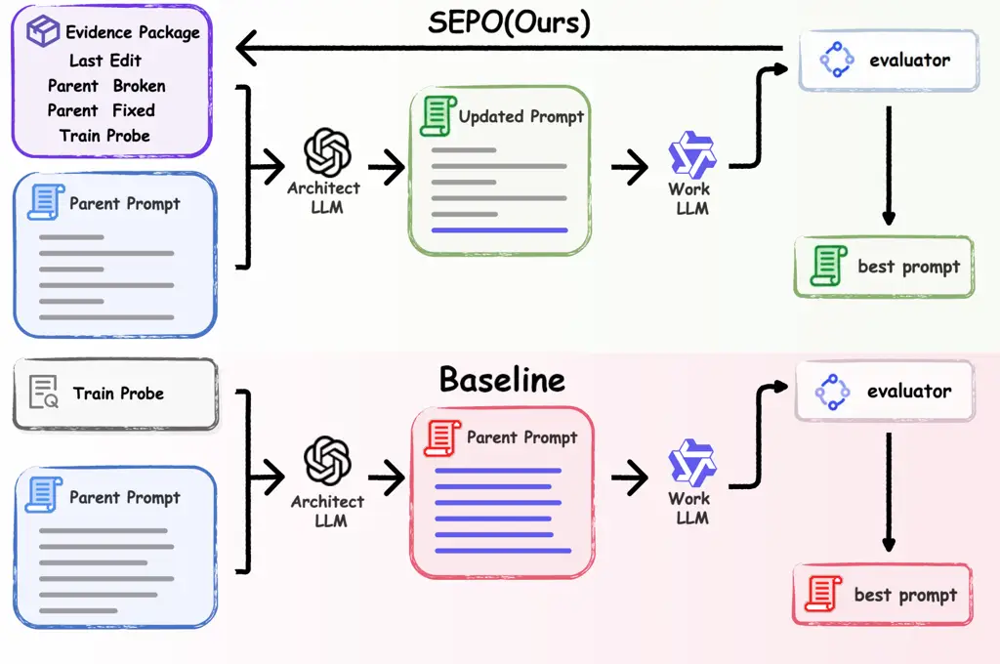
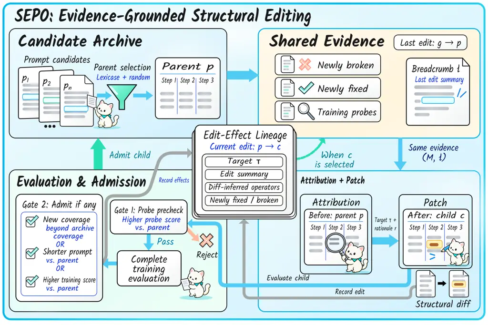
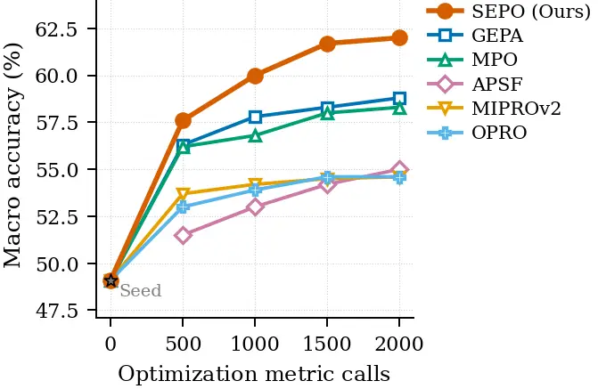

# SEPO: Evidence-Grounded Prompt Optimization via Structural Editing

Xiaoyu Ma  Haoyue Liu  Yiwen Li  Jionghao Zhu Affiliation: School of
Science and Engineering, The Chinese University of Hong Kong, Shenzhen
   Zhichao Wang  Ye Chen  Xiaoying Tang Affiliation: School of Science
and Engineering, The Chinese University of Hong Kong, Shenzhen
Affiliation: Xi’an Jiaotong UniversityEmail:xiaoyuma@link.cuhk.edu.cn,
tangxiaoying@cuhk.edu.cn Affiliation: Shenzhen Future Network of
Intelligence Institute (FNiI-Shenzhen) Affiliation: Guangdong Provincial
Key Laboratory of Future Networks of Intelligence, CUHK(SZ)
Affiliation: Equal contribution. ^(\*)Corresponding author.

###### Abstract

Existing API-only prompt optimisers are often described as
interpretable, but in practice, this usually means only post-hoc
inspectability: each iteration still rewrites the prompt as one opaque
string, leaving a trace of full-prompt diffs rather than localisable,
machine-readable edits. This paper introduces Sepo (Structural,
Evidence-grounded Prompt Optimization), a multi-trajectory prompt
optimiser centred on _edit-effect lineage feedback_. Rather than
treating each iteration as an isolated whole-prompt rewrite, Sepo
locally edits stable, typed units in a two-layer prompt schema, links
the target and realised structural operations of each edit to the
examples it newly fixes or breaks, and carries this edit–effect record
forward to guide later architect calls on the same search branch. This
makes prompt optimisation _addressable_, _attributable_, and
_actionable_. Across a 14-task held-out suite, Sepo improves over the
strongest baseline, GEPA, by 3.1 pp on Llama-3.1-8B-Instruct and 2.2 pp
on Qwen3-8B, reaching 61.9% and 73.3% macro accuracy. Sepo also lies on
both the optimisation-time and test-time Pareto frontiers, spending 2.9M
optimisation tokens versus 4.1M for GEPA and producing prompts over
5$`\times`$ shorter.



Figure 1: Sepo at a glance. Sepo makes localised, evidence-grounded
edits (blue) to a structured prompt (top), each traceable to examples it
fixed or broke, whereas monolithic rewriters rewrite the whole prompt
(blue), opaquely (bottom).

## 1 Introduction

Prompt optimisation has become a de-facto recipe for adapting frozen
LLMs to new tasks without weight updates: an architect LLM proposes a
rewrite, the candidate is scored on a training set, and the cycle
repeats (Ramnath et al., 2025; Yang et al., 2024; Pryzant et al., 2023;
Agrawal et al., 2026; Yuksekgonul et al., 2025). Despite being commonly
described as _interpretable_, most API-only prompt optimisers still
expose the same underlying interface: each iteration rewrites the prompt
as one opaque string. The resulting trace is therefore a sequence of
full-prompt diffs: it shows _that_ the prompt changed, but not _where_
the relevant change occurred, _why_ it was made, or _which_ examples it
helped or harmed. This limitation persists whether the rewriter is
driven by text-gradient feedback or by LLM-as-optimiser sampling: the
unit of edit remains the entire prompt.

A handful of recent structured optimisers begin to challenge this
single-string interface. Some expose local edit targets, such as
factor-, section-, token-, or tree-level units (Schnabel and Neville,
2024; Liu et al., 2026b; Sharma and Henley, 2026; Jain and Chowdhary,
2025; Kumar et al., 2025); others attribute failures to semantic units
or agent contributions (Chen et al., 2026; Xia et al., 2026; Zhang et
al., 2026); and reflective or self-evolving optimisers improve search
with archives, critique, and synthesis (Agrawal et al., 2026; Agarwal et
al., 2025). Existing prompt optimisers typically update a prompt based
on failures surfaced in the current round. However, rules added to
address those failures can also change the worker’s behaviour on
examples that it handled correctly under the parent, thereby introducing
new regressions. Without this parent-to-child transition, later
iterations may conflate persistent failures with regressions introduced
by the preceding edit, leading to repeated rule accretion or another
broad prompt rewrite. This can cause prompt bloat and make effective
improvements harder to preserve across iterations.

In this paper, we propose Sepo, a multi-trajectory prompt optimiser that
addresses this problem through _edit-effect lineage feedback_. Each edit
targets a stable typed unit in a two-layer prompt schema; after the
candidate is evaluated, Sepo links the target and realised operations of
the edit to the examples it newly fixes or breaks and reuses this record
in later architect calls on the same search branch. To preserve
trajectory diversity, Sepo combines example-level admission with
Lexicase-based parent selection (Spector, 2012), keeping specialists
alive for rare training examples.

We evaluate Sepo on a 14-task held-out suite using Llama-3.1-8B-Instruct
and Qwen3-8B as worker models. We cap optimisation at $`2000`$ _metric
calls_ per task and seed—one metric call evaluates $`\mu`$ on one
training example, consuming one Worker LLM forward pass. Under this
matched budget, Sepo reaches 61.9/73.3% macro accuracy on
Llama/Qwen—$`+3.1/+2.2`$ pp over the best of six API-only baselines
(GEPA)—while landing on both optimisation- and test-time Pareto
frontiers.

Our contributions are four-fold.

(i) We introduce Sepo and its core mechanism, _edit-effect lineage
feedback_. This mechanism links the target and realised operations of
each local edit to the examples it newly fixes or breaks and reuses this
record in subsequent edits on the same search branch, making prompt
optimisation _addressable_, _attributable_, and _actionable_.

(ii) We provide a controlled API-only comparison on a 14-task held-out
suite covering reasoning (BBH, GSM-Hard), coding (MBPP+), multi-hop
question answering (HotpotQA), and multidomain tasks from MMLU-Pro.
Under the matched $`2000`$-metric-call budget, Sepo consistently matches
or exceeds six API-only baselines across both worker models, winning at
least 11/14 tasks against every baseline.

(iii) We show that the gains from structured, lineage-aware editing are
strongest on procedural, multi-step tasks—most clearly Word Sorting
($`+18.9`$ pp over GEPA on Llama) and MBPP+ ($`+8.7`$ pp on Qwen).

(iv) We show that Sepo sits on both the optimisation-time and test-time
Pareto frontiers, spending 2.9M optimisation tokens and 203k deployment
tokens per cell—compared with 4.1M and 424k for GEPA—with prompts over
5$`\times`$ shorter than GEPA’s and remaining 6.9 pp above APSF, the
only other method on both frontiers.

## 2 Related Work

#### Monolithic whole-prompt rewriting.

A first family rewrites the prompt as an opaque string under a scalar
validation reward (Ye et al., 2024): APE (Zhou et al., 2023) samples and
re-scores instructions, OPRO (Yang et al., 2024) casts the LM as a
numerical-feedback optimiser, GrIPS (Prasad et al., 2023) searches with
gradient-free operators, and ProTeGi (Pryzant et al., 2023) introduces
“textual gradient” beam search, extended by TextGrad (Yuksekgonul et
al., 2025) to text-level backpropagation. Lacking component-level
addresses, a rewrite that breaks one example yields no localisable
change to attribute, and its trace collapses to untyped full-prompt
diffs.



Figure 2: Per-iteration overview of Sepo. A parent is selected from the
archive $`\mathcal{A}`$ using Lexicase or random sampling (§3.4). The
attribution and patch architects share evidence from its preceding edit:
newly broken and newly fixed examples, training probes, and a breadcrumb
summarising the edit (§3.3). The resulting child must outperform its
parent on the probes (Gate 1) before completing training evaluation. It
enters the archive if it adds coverage beyond the archive, is shorter
than its parent, or achieves a higher training score than its parent
(Gate 2; §3.4). The child’s edit target, diff-inferred operators, and
example-level effects are recorded to guide subsequent edits when it is
selected as a parent.

#### Structure-aware factorised optimisers.

A second family exposes components as first-class units:
_scaffold-based_ methods optimise per-module instructions and
demonstrations over a user-specified program (DSPy+MIPROv2 (Khattab et
al., 2024; Opsahl-Ong et al., 2024)); _fixed-template_ methods refine
each section of a cross-task schema (Modular Prompt Optimisation (Sharma
and Henley, 2026)); _type-aware_ methods allocate repair operators by
failure type (TARA (Liu et al., 2026a)); _decomposition-based_ methods
use a predefined taxonomy (Task-Facet (Juneja et al., 2025)) or
self-discovered factors (aPSF (Liu et al., 2026b)); and
_principle-aware_ variants refine via multi-aspect critique (CriSPO (He
et al., 2025)) or generalisable criteria (ZERA (Yi et al., 2025)).
Although these factorisations expose local editable units, they
typically do not explicitly link each realised edit to the examples it
newly fixes or breaks, or carry this edit–effect relation forward along
the search branch.

#### Reflective and evolutionary search with diversity.

A third family uses natural-language reflection (Shinn et al., 2023),
population diversity, or prompt-aware evaluation scheduling (Ma et al.,
2026). Self-Refine (Madaan et al., 2023) and ProMST (Chen et al., 2024)
show that iterative feedback can substitute for an explicit scalar
score, and population-based methods add diversity: EvoPrompt (Guo et
al., 2024) ports Genetic Algorithm and Differential Evolution operators
onto a prompt population, Promptbreeder (Fernando et al., 2024)
co-evolves mutation prompts alongside the task prompts they edit,
GEPA (Agrawal et al., 2026) (Genetic-Pareto) couples per-module
reflective mutation with a Pareto-frontier archive, and
PromptAgent (Wang et al., 2024a) runs Monte-Carlo tree search with
reflective error feedback. Outside prompt optimisation,
verifier-grounded planning has likewise paired typed structural patches
with deterministic constraint checking (Wang et al., 2026). Yet even
when archives or search trees preserve multiple candidates, reflection
often remains centred on the current candidate’s traces, without linking
an edit’s target and realised operations to the examples newly fixed or
broken in the parent-to-child transition, or carrying this record
forward to subsequent edits on the same search branch.

## 3 Method

Sepo is a multi-trajectory prompt optimiser: each iteration applies one
local edit to a structured prompt and records the edit together with its
example-level outcomes as an edit-effect lineage state, making the
optimisation process auditable and providing reusable feedback for later
edits on the same search branch. Sepo rests on three principles.
(P1) *Localised edits* over stable, addressable prompt units give every
edit an explicit target (§3.2). (P2) *Edit-effect lineage feedback* uses
two architect calls, _attribution_ and _patch_. Both calls share an
evidence packet comprising the parent’s preceding edit, the examples
that edit newly fixed or broke, and the associated breadcrumb (§3.3).
(P3) *Trajectory-diverse archiving* uses example-level admission and
Lexicase-based parent selection to determine which candidate branches
merit further search (§3.4). Figure 2 and Algorithm 1 detail one
iteration.

### 3.1 Problem Setup

We assume a _frozen_ worker LLM $`W`$ for downstream inference and a
_frozen_ architect LLM $`A`$ used in the two roles described in §3.3.
Given a task $`\mathcal{T}`$ with a training set
$`\mathcal{D}_{\mathrm{tr}}`$ used during optimisation and a disjoint
held-out test split, we optimise a schema $`s`$ according to

```math
s^{\star}\;=\;\argmax_{s}\;\mathbb{E}_{(x,y)\sim\mathcal{T}}\!\bigl[\,\mu(W(s,x),\,y)\bigr], \tag{1}
```

where $`\mu`$ is a binary task metric and $`W(s,x)`$ is the worker’s
output under the prompt rendered from $`s`$, with the expectation
estimated by the empirical mean over $`\mathcal{D}_{\mathrm{tr}}`$. For
each $`s`$ we record its score vector
$`\mathbf{c}(s)\!\in\!\{0,1\}^{|\mathcal{D}_{\mathrm{tr}}|}`$ and
correct set $`C(s)=\{i:\mathbf{c}(s)_{i}=1\}`$ under a budget of $`B`$
metric calls.

### 3.2 Prompt representation

Unlike whole-prompt rewriters without local failure addresses, we
represent each candidate with a task-agnostic two-layer schema:

```math
s\;=\;\bigl(\,\alpha,\;\{\rho_{j}\}_{j=1}^{m}\,\bigr), \tag{2}
```

A top-level _outline_ $`\alpha=(\alpha_{1},\dots,\alpha_{K})`$ preserves
global intent, while each rule $`\rho_{j}`$ is attached to one step and
constrains local edits without fragmenting context. The attribution
architect targets one step or the whole outline, and the patch architect
revises it (§3.3). Linking each addressable edit to its example-level
effects provides the interface for edit-effect lineage feedback; other
representations can provide the same interface. The schema below
instantiates Eq. 2 for BBH Word Sorting with $`K{=}3`$ outline steps and
step-local rules.

#### Operator label space.

After each patch call, a deterministic parser extracts the child’s
outline steps and step-local rules; a structural diff against the
parent, together with the attributed target, then labels each changed
step or rule with one operator from $`\mathcal{O}`$,

```math
o(c)\;\triangleq\;\textsc{InferOp}\bigl(\textsc{Diff}(p,c),\,\tau(c)\bigr), \tag{3}
```

where InferOp is deterministic and $`o(c)`$ collects one label per
changed location; $`\tau(c){=}\tau`$ is the attributed target assigned
to the child. These labels are recorded on the child for use in the next
iteration’s breadcrumb. The vocabulary $`\mathcal{O}`$, the structural
diff $`\textsc{Diff}(p,c)`$ (Algorithm 3), and the per-location
classification rule are in Appendix C.2.


### 3.3 Lineage-guided reflective edit generation

Each iteration of Sepo proceeds in five steps. We (i) draw a parent
$`p`$ from the archive $`\mathcal{A}`$ (§3.4); (ii) build an evidence
packet from $`p`$ and its grandparent $`g`$, comprising training
examples that $`p`$’s last edit broke or newly fixed, train probes, and
a summary $`\ell`$ of what the last edit changed; (iii) run an
_attribution_ architect call returning a typed target $`\tau`$
(Eq. 4)—identifying either an edit within one outline step or a
structural change to the outline— together with the failure reason;
(iv) run a _patch_ architect call returning a full revised schema
$`\widetilde{s}`$, which is parsed into the child $`c`$; (v) infer the
realised operators from the structural diff. After the child is
evaluated (§3.4), this completes its edit-effect lineage tuple
$`(\tau,\,\ell,\,o(c),\,\mathrm{effect})`$ for later architect calls on
the same search branch.

#### Balanced evidence packet.

Both architect calls consume the same minibatch
$`M=(M_{\mathrm{focus}},M_{\mathrm{anchor}},M_{\mathrm{train}})`$, where
for $`p`$’s last edit

```math
\displaystyle\textsc{newly\_broken}(p) \displaystyle\triangleq\{i:\mathbf{c}(g)_{i}{=}1,\,\mathbf{c}(p)_{i}{=}0\},
```

```math
\displaystyle\textsc{newly\_fixed}(p) \displaystyle\triangleq\{i:\mathbf{c}(g)_{i}{=}0,\,\mathbf{c}(p)_{i}{=}1\},
```

```math
\displaystyle a_{i} \displaystyle\triangleq|\mathcal{A}|^{-1}\!\sum_{s\in\mathcal{A}}\!\mathbf{c}(s)_{i}\in[0,1].
```

$`M_{\mathrm{focus}}`$ samples $`\textsc{newly\_broken}(p)`$ with
weights $`w_{i}\propto a_{i}`$ (the archive agreement on example $`i`$),
over-sampling failures on examples the archive shows the worker can
solve rather than failures likely caused by capability limits. The
architect uses these newly broken examples together with train probes
from $`M_{\mathrm{train}}`$ to infer why the breakages occurred and to
steer the next edit away from the same failure mode; recovering
in-capability failures directly supports generalisation.
$`M_{\mathrm{anchor}}`$ draws from $`\textsc{newly\_fixed}(p)`$,
preserving these recent gains. Slot sizes and expressiveness arguments
are in Appendix D.1.

#### Fallback without regressions.

When newly*broken is empty—at cold start ($`g{=}\emptyset`$) or when the
parent’s last edit introduced no regression on
$`\mathcal{D}*{\mathrm{tr}}`$—the iteration drops $`M*{\mathrm{focus}}`$
and uses $`M*{\mathrm{anchor}}`$ together with $`M\_{\mathrm{train}}`$.
In this case, no training regression is available to explain, so the
iteration continues improving on the train probes while preserving one
anchor.

#### Attribution and patch.

The attribution architect consumes $`(p,M,\ell)`$ and diagnoses where
each error arises in the schema and why it occurred, returning a typed
target $`\tau`$ and failure rationale $`r`$,

```math
(\tau,r)\;=\;A_{\mathrm{attr}}\!\bigl(p,\,M,\,\ell\bigr), \tag{4}
```

where $`\tau`$ takes one of five typed forms:

- •
  step \<N\>: edit confined to step $`N`$ (the patch architect may add,
  drop, refine, or merge rules inside that step, or rewrite the step’s
  top-level text);
- •
  ADD step at \<pos\>: insert a missing reasoning stage at outline
  position \<pos\>;
- •
  SPLIT step \<N\>: split two conflated responsibilities inside step
  $`N`$;
- •
  DROP step \<N\>: remove step $`N`$;
- •
  backbone: rewrite the entire outline.

The attribution call returns only the edit location $`\tau`$ and failure
rationale $`r`$, not a new schema. The patch architect takes
$`(p,\tau,r,M,\ell)`$ and emits a full revised schema text

```math
\displaystyle\widetilde{s} \displaystyle=\;A_{\mathrm{patch}}\!\bigl(p,\,\tau,\,r,\,M,\,\ell\bigr), \tag{5}
```

```math
\displaystyle c \displaystyle=\;\textsc{ParseSchema}(\widetilde{s}),
```

#### Carry-forward lineage record.

After producing and evaluating child $`c`$, we record its attributed
target $`\tau`$, diff-inferred realised operators $`o(c)`$, breadcrumb
$`\ell`$, and newly-fixed/newly-broken examples as the edit-effect
lineage tuple $`(\tau,\ell,o(c),\mathrm{effect})`$; $`\mathrm{effect}`$
stores the example sets, while reporting uses only their counts. If
$`c`$ is later selected as a parent, $`\ell`$ and these transition
examples jointly condition the next attribution and patch calls. The
$`-`$Lineage and $`-`$Breadcrumb ablations (§4.3) remove the lineage
evidence and the breadcrumb summary $`\ell`$ respectively.

### 3.4 Example admission and Lexicase sampling

To control evaluation cost, Sepo first evaluates each child on the
$`M_{\mathrm{train}}`$ probe slot and discards candidates that do not
strictly improve over the parent on those probes. A child that passes
this precheck is evaluated on the remaining training examples, reusing
the probe results to complete its full-training score vector, and is
admitted into the archive when at least one of the following holds:

```math
\begin{cases}\text{(a)}\;\;C(c)\!\setminus\!\textstyle\bigcup_{s\in\mathcal{A}}C(s)\neq\emptyset\\[2.0pt]
\text{(b)}\;\;|c|<|p|\\[2.0pt]
\text{(c)}\;\;\textstyle\sum\mathbf{c}(c)>\sum\mathbf{c}(p)\end{cases} \tag{6}
```

That is, the child adds unique coverage, is shorter than the parent, or
achieves a higher score than the parent. The unique-coverage criterion
preserves specialists that solve rare training examples.

We select the next parent from the archive using Lexicase
selection (Spector, 2012) with probability $`0.8`$ and uniform random
sampling with probability $`0.2`$. Lexicase filters candidates using a
randomly ordered sequence of training examples, preserving specialists
for difficult cases, while random sampling retains additional
exploration. Full budget accounting and implementation details are given
in Appendix C.

## 4 Experiments

|                                                |              |              |              |               |              |              |              |               |              |              |              |              |              |               |              |
| ---------------------------------------------- | ------------ | ------------ | ------------ | ------------- | ------------ | ------------ | ------------ | ------------- | ------------ | ------------ | ------------ | ------------ | ------------ | ------------- | ------------ |
| Method                                         | BBH          |              |              |               |              |              |              |               | Code         | MMLU-Pro     |              |              | Reasoning    |               | Avg.         |
|                                                | Caus.        | Date         | Disamb.      | Fall.         | Deduct.      | Obj.         | Snarks       | Word.         | MBPP+        | CS           | Econ.        | Psych.       | GSM-H        | HQA           |              |
| Worker LLM: Llama-3.1-8B-Instruct              |              |              |              |               |              |              |              |               |              |              |              |              |              |               |              |
| Seed                                           | 37.5\_(±0.0) | 66.7\_(±0.0) | 61.7\_(±0.0) | 44.5\_(±0.0)  | 45.0\_(±0.0) | 82.5\_(±0.0) | 72.4\_(±0.0) | 0.0\_(±0.0)   | 57.3\_(±0.0) | 44.7\_(±0.0) | 57.5\_(±0.0) | 56.7\_(±0.0) | 35.8\_(±0.0) | 25.0\_(±0.0)  | 49.1\_(±0.0) |
| OPRO                                           | 59.9\_(±3.2) | 65.2\_(±2.3) | 65.8\_(±4.1) | 42.8\_(±3.8)  | 45.7\_(±5.2) | 81.8\_(±9.0) | 82.3\_(±3.2) | 5.2\_(±0.6)   | 60.2\_(±1.4) | 41.0\_(±2.6) | 52.2\_(±2.6) | 59.8\_(±2.6) | 30.2\_(±4.9) | 69.6\_(±8.7)  | 54.4\_(±3.9) |
| APSF                                           | 52.6\_(±8.3) | 68.2\_(±1.2) | 62.8\_(±2.4) | 45.8\_(±7.3)  | 45.2\_(±4.3) | 83.5\_(±1.3) | 76.8\_(±4.0) | 25.2\_(±12.0) | 60.7\_(±2.3) | 48.7\_(±4.5) | 57.8\_(±2.8) | 60.3\_(±2.3) | 30.1\_(±2.5) | 51.9\_(±11.2) | 55.0\_(±4.7) |
| MIPROv2                                        | 63.3\_(±2.9) | 67.8\_(±2.3) | 65.2\_(±4.7) | 49.3\_(±8.6)  | 44.5\_(±2.2) | 79.0\_(±1.7) | 76.6\_(±1.4) | 3.3\_(±0.3)   | 56.0\_(±2.2) | 47.3\_(±3.0) | 52.7\_(±1.9) | 59.3\_(±2.6) | 37.2\_(±2.1) | 62.5\_(±1.1)  | 54.6\_(±2.6) |
| MPO                                            | 52.6\_(±3.3) | 73.2\_(±6.9) | 67.0\_(±2.2) | 44.8\_(±4.0)  | 47.7\_(±4.4) | 83.7\_(±5.1) | 75.0\_(±2.1) | 56.5\_(±2.2)  | 59.0\_(±1.7) | 47.7\_(±1.4) | 55.5\_(±4.6) | 56.0\_(±0.9) | 33.8\_(±2.0) | 67.6\_(±0.9)  | 58.6\_(±3.0) |
| GEPA                                           | 59.9\_(±3.8) | 75.3\_(±6.1) | 64.5\_(±6.6) | 47.5\_(±2.2)  | 47.0\_(±3.9) | 86.0\_(±3.1) | 77.3\_(±2.1) | 39.3\_(±18.3) | 60.0\_(±1.3) | 46.5\_(±3.0) | 54.5\_(±1.3) | 59.3\_(±4.2) | 37.2\_(±2.1) | 68.4\_(±1.9)  | 58.8\_(±4.3) |
| Sepo                                           | 61.1\_(±4.6) | 76.5\_(±4.3) | 68.8\_(±4.6) | 50.8\_(±3.6)  | 47.3\_(±2.1) | 87.5\_(±0.9) | 82.3\_(±1.6) | 58.2\_(±1.3)  | 62.6\_(±1.8) | 46.7\_(±1.8) | 58.8\_(±2.8) | 58.7\_(±1.8) | 37.6\_(±1.8) | 70.2\_(±3.8)  | 61.9\_(±2.6) |
| Worker LLM: Qwen3-8B (HQA $`=`$ HotpotQA Hard) |              |              |              |               |              |              |              |               |              |              |              |              |              |               |              |
| Seed                                           | 56.9\_(±0.0) | 83.8\_(±0.0) | 44.3\_(±0.0) | 46.0\_(±0.0)  | 84.7\_(±0.0) | 94.5\_(±0.0) | 76.0\_(±0.0) | 5.3\_(±0.0)   | 15.7\_(±0.0) | 68.7\_(±0.0) | 73.8\_(±0.0) | 66.2\_(±0.0) | 48.6\_(±0.0) | 35.5\_(±0.0)  | 57.1\_(±0.0) |
| OPRO                                           | 60.6\_(±3.2) | 78.7\_(±1.8) | 66.0\_(±7.0) | 47.3\_(±3.6)  | 86.7\_(±4.2) | 97.0\_(±2.2) | 82.3\_(±1.6) | 7.7\_(±1.3)   | 66.7\_(±1.0) | 69.3\_(±1.2) | 75.0\_(±2.2) | 67.7\_(±3.0) | 69.0\_(±0.9) | 32.8\_(±2.3)  | 64.8\_(±2.5) |
| APSF                                           | 55.7\_(±4.5) | 84.3\_(±2.3) | 65.0\_(±1.3) | 64.2\_(±2.0)  | 79.5\_(±1.3) | 94.3\_(±2.3) | 77.6\_(±5.5) | 31.5\_(±2.6)  | 68.7\_(±1.2) | 66.7\_(±2.8) | 75.2\_(±2.8) | 66.7\_(±3.1) | 53.8\_(±7.5) | 38.9\_(±1.1)  | 65.9\_(±2.9) |
| MIPROv2                                        | 57.7\_(±1.3) | 86.0\_(±2.2) | 77.0\_(±2.3) | 56.7\_(±14.4) | 83.5\_(±3.0) | 97.3\_(±0.8) | 81.2\_(±2.8) | 6.7\_(±6.7)   | 68.3\_(±1.2) | 69.5\_(±2.2) | 76.0\_(±0.9) | 68.3\_(±1.2) | 62.8\_(±0.8) | 32.7\_(±1.1)  | 66.0\_(±2.9) |
| MPO                                            | 56.7\_(±3.0) | 86.0\_(±4.3) | 70.5\_(±7.2) | 67.7\_(±9.0)  | 80.5\_(±3.1) | 97.7\_(±0.8) | 78.1\_(±3.6) | 50.5\_(±0.9)  | 67.5\_(±1.7) | 65.0\_(±1.7) | 77.5\_(±1.3) | 64.0\_(±2.3) | 62.6\_(±0.9) | 35.3\_(±2.9)  | 68.5\_(±3.1) |
| GEPA                                           | 61.1\_(±1.5) | 86.3\_(±1.2) | 74.5\_(±2.6) | 78.5\_(±7.1)  | 88.7\_(±2.5) | 98.5\_(±1.3) | 78.6\_(±3.9) | 51.7\_(±5.3)  | 64.0\_(±1.3) | 69.0\_(±2.2) | 73.3\_(±1.2) | 67.5\_(±1.3) | 67.5\_(±1.1) | 36.5\_(±0.7)  | 71.1\_(±2.4) |
| Sepo                                           | 58.9\_(±3.7) | 90.0\_(±1.7) | 77.7\_(±1.4) | 75.7\_(±4.9)  | 92.3\_(±3.0) | 99.0\_(±0.9) | 82.6\_(±3.0) | 54.7\_(±3.9)  | 72.7\_(±1.1) | 70.8\_(±1.3) | 76.2\_(±0.8) | 66.7\_(±2.0) | 70.0\_(±8.0) | 39.1\_(±0.6)  | 73.3\_(±2.6) |

Table 1: Held-out test accuracy (%) on the 14-task suite; mean over
three seeds (subscript: std). Tinted bold cells mark the best per Worker
LLM block. HotpotQA: Medium (Llama), Hard/HQA (Qwen).

#### Experimental questions.

We evaluate Sepo through four questions:

- •
  Q1: Held-out effectiveness. Under a matched API-only optimisation and
  deployment protocol, does Sepo produce stronger final prompts than
  strong prompt optimisers?
- •
  Q2: Edit-diagnostic mechanism. Are Sepo’s gains driven by its
  edit-aware diagnostic loop, rather than by generic reflection, static
  factorisation, or unlocalised prompt rewriting?
- •
  Q3: Behavioral scope and auditability. Where does Sepo help or fail,
  and do its edit traces make these outcomes inspectable at evidence,
  target, operator, and example-level effect?
- •
  Q4: Cost-effectiveness. What optimisation-time and deployment-time
  cost do Sepo’s gains require, and does Sepo remain competitive on
  accuracy–cost trade-offs?

### 4.1 Experimental Setup and Protocol

#### Benchmarks.

Our primary suite contains 14 held-out tasks spanning four families:

- •
  BBH (8 tasks) (Suzgun et al., 2023; Srivastava et al., 2023): causal
  judgement, date understanding, disambiguation QA, formal fallacies,
  logical deduction over seven objects, reasoning about colored objects,
  snarks, and word sorting, chosen to cover BBH’s distinct capability
  types (world-knowledge causal inference, temporal reasoning,
  linguistic disambiguation, formal logic, multi-step deduction,
  symbolic manipulation, sarcasm understanding, and algorithmic
  sorting).
- •
  MMLU-Pro (3 tasks) (Wang et al., 2024b): computer science, economics,
  and psychology, spanning a technical, an economic–quantitative, and a
  behavioural–social domain.
- •
  Code: MBPP+ (Liu et al., 2023), scored by pass@1 (Chen et al., 2021).
- •
  Reasoning: GSM-Hard (Gao et al., 2023) and HotpotQA (Yang et al., 2018) (Medium split under Llama, Hard split under Qwen).

#### Models.

We run our pipeline with two frozen Workers of different architecture
and capability to test cross-family generalisation:

- •
  Worker LLMs: Llama-3.1-8B-Instruct (Grattafiori et al., 2024) and
  Qwen3-8B (Yang et al., 2025), temperature $`0.0`$ for deterministic
  metric evaluation.
- •
  Architect LLM: Qwen3.5-397B-A17B (Qwen Team, 2026), temperature
  $`0.7`$ to encourage diverse candidate edits.

#### Baselines and protocol.

We compare Sepo against six API-only baselines—an unoptimised Seed
prompt, APSF, OPRO, MIPROv2, MPO, and GEPA—under a shared budget of
$`2000`$ _metric calls_ per task and seed (architect LLM calls are _not_
counted toward this budget). This matches DSPy / MIPROv2’s
$`\texttt{max\_metric\_calls}{=}2000`$ (Khattab et al., 2024; Opsahl-Ong
et al., 2024). All methods start from the same task-agnostic
understand–reason–answer seed on every benchmark. The cross-worker
HotpotQA column is not comparable: Llama uses Medium because limited
worker headroom compresses performance on Hard, whereas Qwen uses Hard
(Appendix G.2). The minibatch’s three slots
$`(M_{\mathrm{focus}},M_{\mathrm{anchor}},M_{\mathrm{train}})`$ have
sizes $`(n_{f},n_{a},n_{tr})=(2,1,3)`$. We report macro accuracy
(unweighted 14-task mean), per-baseline win rate,
optimisation/deployment tokens, and final prompt length; full configs in
Appendix A.2.

### 4.2 Q1: Sepo Beats All Baselines on Both Workers in Macro Accuracy



Figure 3: Budget-matched accuracy curves (Llama-3.1-8B-Instruct). Test
accuracy at metric-call budgets $`0/500/1000/1500/2000`$.

We evaluate whether structured, lineage-aware editing yields stronger
held-out prompts than competing optimisers under a matched API-only
protocol; per-task results are in Table 1.

1.  1.  Sepo reaches $`61.9\%`$ on Llama ($`+3.1`$ pp over GEPA;
        $`\geq 3.3`$ pp over the rest) and $`73.3\%`$ on Qwen ($`+2.2`$ pp
        over GEPA; $`\geq 4.8`$ pp over the rest), beating GEPA on 13/14
        (Llama) and 11/14 (Qwen), and $`\geq 11/14`$ against every other
        baseline under both workers.
2.  2.  The gains span procedural and reasoning families—BBH
        ($`+4.5/+1.6`$ pp), Code (MBPP+, $`+2.6/+8.7`$ pp), and Reasoning
        (HotpotQA $`+`$ GSM-Hard, $`+1.1/+2.5`$ pp)—ruling out a
        single-domain artefact, and concentrate on procedural tasks where
        one failed local sub-step can invalidate the final answer. Word
        Sorting is the clearest case: Sepo is best under both workers (Llama
        $`58.2\%`$ / Qwen $`54.7\%`$, $`+18.9`$ pp over GEPA on Llama; the
        seed collapses to $`0.0\%`$ on Llama), and MBPP+ shows the same
        pattern ($`62.6\%`$ / $`72.7\%`$). On the MMLU-Pro multidomain
        tasks, Sepo remains within the leading cluster but with thinner
        per-task margins, illustrating that the magnitude of
        prompt-optimization gains varies across task families.
3.  3.  Sepo also reaches a given accuracy with fewer metric calls: at every
        metric-call budget in Figure 3 it stays at or above every baseline,
        so its lead holds across the budget axis and is not an artefact of
        the $`2000`$-metric-call cap.

### 4.3 Q2: Each Principle (P1/P2/P3) of Sepo is Load-Bearing

We ablate three principles to test whether Sepo’s gains are driven by
its edit-aware diagnostic loop, not by generic reflection or unlocalised
rewriting. We isolate four single-removal variants—$`-`$Attribution
(drops P1), $`-`$Breadcrumb and $`-`$Lineage (drop P2 at two strengths),
and $`-`$Multitraj (drops P3)—and analyse their accuracy, length, and
acceptance signatures.

We ablate on five tasks spanning code, math, temporal, linguistic, and
multidomain tasks (MBPP+, GSM-Hard, BBH Date, BBH Snarks, and MMLU-Pro
CS). Every single-removal variant costs $`1.8`$–$`4.7`$ pp on the
five-benchmark diagnostic average, with the largest damage on procedural
multi-sub-skill tasks. Matched proposal-level controls further isolate
these roles: random targets reduce net gain from $`+2.5`$ to $`-1.7`$
examples per $`100`$ proposals, while replacing newly broken cases with
random current errors reduces it to $`+0.8`$ (Appendix H.3).

| Variant          | P   | Acc. | $`\boldsymbol{\sigma}`$ | $`\boldsymbol{\Delta}`$Acc | Len.  |
| ---------------- | --- | ---- | ----------------------- | -------------------------- | ----- |
| Full Sepo        | —   | 61.1 | 2.2                     | —                          | 228   |
| $`-`$Attribution | P1  | 58.0 | 2.5                     | $`-3.1`$                   | 450   |
| $`-`$Lineage     | P2  | 58.2 | 1.5                     | $`-2.9`$                   | 292   |
| $`-`$Breadcrumb  | P2  | 59.3 | 2.0                     | $`-1.8`$                   | 235   |
| $`-`$Multitraj   | P3  | 56.4 | 2.3                     | $`-4.7`$                   | _198_ |

Table 2: Aggregate ablation on the five-benchmark diagnostic subset
(Llama-3.1-8B-Instruct; 3 seeds; $`\sigma`$: std). Acc. %, Len. tokens;
bold/_italic_: cells discussed in P1/P3. Breakdowns:
Appendices H.1, H.2.

Figure 4: Edit-quality signature. Stem length $`=`$ each variant’s drift
from the Full Sepo anchor (dashed) in acceptance rate (top) and average
edit size (bottom), sorted by acceptance; colour $`=`$ principle
(P1/P2/P3).

Each variant leaves a distinct signature in Table 2 and Figure 4; P1–P3
below.

#### P1 — typed targeting localises edits.

Removing the attribution architect ($`-`$Attribution) inflates prompt
length $`1.97\times`$ ($`228{\to}450`$ tokens), drops accuracy
$`3.1`$ pp (Table 2), grows each edit $`\sim`$$`1.7\times`$ in diff size
($`2.23{\to}3.77`$), and lowers acceptance from $`0.354`$ to $`0.305`$
at matched compute ($`318`$ vs $`320`$ candidate edits; Figure 4). Both
signatures share one mechanism: Sepo edits one step per iteration and
accumulates, with $`\tau`$ enforcing the per-iteration target. Without
it, the patch architect lacks a single target, so it touches multiple
steps at once — larger edits inflate length and clear admission less
often. The damage concentrates on linguistic-reasoning tasks (§4.2),
whose compositional rule scaffolds are most fragile under multi-region
rewrites (BBH-Snarks $`-8.5`$ pp, Table 3).

|             |            |            |            |            |
| ----------- | ---------- | ---------- | ---------- | ---------- |
|             | P1         | P2         |            | P3         |
| Task        | $`-`$Attr  | $`-`$Lin   | $`-`$Brd   | $`-`$MT    |
| BBH Date    | $`-2.5`$   | $`-4.3`$   | $`-0.5`$   | $`-4.7`$   |
| BBH Snarks  | $`-8.5`$   | $`-3.8`$   | $`-5.7`$   | $`-7.3`$   |
| MBPP+       | $`-1.7`$   | $`-4.1`$   | $`-2.8`$   | $`-7.0`$   |
| GSM-Hard    | $`-1.2`$   | $`-2.6`$   | $`-0.6`$   | $`-2.5`$   |
| MMLU-Pro CS | _$`-1.7`$_ | _$`+0.1`$_ | _$`+0.3`$_ | _$`-2.2`$_ |

Table 3: Per-task $`\Delta`$Acc (five benchmarks,
Llama-3.1-8B-Instruct). Bold: largest drop per variant; italic row:
scope-negative case. Full heatmap: Appendix H.2.

#### P2 — edit-effect lineage feedback supports net-positive edits.

$`-`$Breadcrumb (removes the prior-edit trace $`\ell`$) costs
$`1.8`$ pp, while $`-`$Lineage (removes $`\ell`$ and the
newly-fixed/newly-broken transition information) costs $`2.9`$ pp
(Table 3). These nested ablations indicate complementary roles: $`\ell`$
summarises what changed, while the transition examples identify which
cases were newly fixed or broken; together they guide the next edit. The
effect is most pronounced on procedural, multi-step tasks that require
sequencing local rules, whereas MMLU-Pro CS is roughly indifferent,
illustrating that the benefit of lineage evidence varies with task
structure.

#### P3 — archive escapes local optima of greedy editing.

$`-`$Multitraj disables the archive and Lexicase selection (best-only,
greedy single-trajectory editing) and drops $`4.7`$ pp at a _shorter_
prompt ($`\times 0.87`$, $`228\to 198`$ tokens) with acceptance falling
from $`0.354`$ to $`0.238`$ (Table 2, Figure 4); the result is
consistent with a reduced exploration radius rather than prompt bloat.
Sepo’s archive mitigates this by keeping diverse candidates alive:
Admission (Eq. 6) retains unique-coverage, shorter, or higher-scoring
children rather than ranking on a single scalar, and Lexicase parent
selection keeps rare-example solvers as future parents (Appendix H.4).
The auxiliary controls show that retaining and revisiting multiple
candidate branches provides the dominant benefit, while Lexicase
selection and unique-coverage admission each add a modest average gain.

### 4.4 Q3: Behavioral Scope and Auditability

#### Auditability.

Sepo logs a typed tuple $`(\tau,\ell,o(c),\mathrm{effect})`$ for every
child (§3.3); Figure 5 reads one packet end to end.


Figure 5: A local audit packet (representative; full edit tree in
Figure E.2, Appendix E).

The breadcrumb summarises the parent’s preceding edit, the focus
examples show which cases broke, the patch addresses those cases, and
the anchor plus train probe test whether the benefit extends beyond the
focus cases. Together, these signals make the edit packet both
retrospectively inspectable and useful for guiding subsequent edits. The
walkthrough, the edit tree (Figure E.2), and example final prompts are
in Appendix E.

| Rule-level op | \#  | share | Structural op | \#  | share |
| ------------- | --- | ----- | ------------- | --- | ----- |
| AddRule       | 423 | 75.4% | RewriteStep   | 34  | 7.3%  |
| DropRule      | 147 | 31.7% | AddStep       | 14  | 3.0%  |
| RefineRule    | 126 | 37.2% | SplitStep     | 18  | 4.0%  |
| MergeRules    | 3   | 0.6%  | Backbone      | 1   | 0.3%  |

Table 4: Typed edit operations (14-task suite, 3 seeds;
$`N\!\approx\!338`$ edits). _\#_ $`=`$ total occurrences; _share_ $`=`$
% of edits containing the op (one edit may use several ops and repeat
one, so shares sum to $`>`$$`100\%`$).

Aggregated over the suite, the same log also characterises _how_ Sepo
edits (Table 4). Edits stay overwhelmingly step-local: structural
rewrites that add, split, or replace outline steps remain rare, so
localised editing is Sepo’s dominant editing mode, in contrast to
monolithic whole-prompt rewriting. Each edit is also composite—most add
a rule while many also drop or refine one—so Sepo actively prunes and
revises rather than merely accreting.

|         |      |              |       |       |       |       |                       |         |                            |
| ------- | ---- | ------------ | ----- | ----- | ----- | ----- | --------------------- | ------- | -------------------------- |
|         |      | Opt. (M tok) |       |       | Dep.  | Len.  | $`\boldsymbol{\rho}`$ | \$/cell | $`\boldsymbol{\rho_{\$}}`$ |
| Method  | Acc. | Arch.        | Work. | Total | \(k\) | (tok) |                       | (USD)   | (pp/\$)                    |
| OPRO    | 54.4 | 6.84         | 3.11  | 9.95  | 244.0 | 358   | 0.53                  | 1.66    | 3.2                        |
| MIPROv2 | 54.6 | 3.52         | 2.60  | 6.12  | 208.4 | 230   | 0.90                  | 0.89    | 6.2                        |
| APSF    | 55.0 | 0.69         | 2.13  | 2.82  | 157.8 | 65    | 2.09                  | 0.19    | 31.1                       |
| MPO     | 58.6 | 0.19         | 3.40  | 3.59  | 261.0 | 416   | 2.65                  | 0.15    | 63.3                       |
| GEPA    | 58.8 | 0.23         | 3.88  | 4.11  | 423.7 | 1,324 | 2.36                  | 0.18    | 53.9                       |
| Sepo    | 61.9 | 0.34         | 2.59  | 2.93  | 203.2 | 236   | 4.37                  | 0.17    | 75.3                       |

Table 5: Efficiency decomposition (Llama-3.1-8B-Instruct, 14-task
macro). $`\Delta\text{Acc}`$ is each method’s gain over the Seed prompt
($`49.1\%`$). $`\rho{=}\Delta\text{Acc}/\text{Total Opt.}`$ (pp/M tok);
$`\rho_{\$}{=}\Delta\text{Acc}/(\text{\$/cell})`$ (pp/USD); list prices,
exchange rate, and per-benchmark breakdowns in Appendix G.3.

### 4.5 Q4: Sepo Dominates Cost-Effectiveness across Architect and Worker Channels

We compare Sepo’s optimisation- and deployment-time costs in Table 5.

#### Sepo achieves the best $`\rho`$ under a shared budget by trimming both the architect and worker channels, while every baseline overspends on at least one.

Table 5 decomposes the cost drivers and reports the cost-effectiveness
ratio $`\rho`$. Sepo reaches $`\rho{=}4.37`$ — $`1.6\times`$ the
next-best MPO ($`2.65`$), $`1.9\times`$ GEPA ($`2.36`$), $`2.1\times`$
APSF ($`2.09`$; lowest total opt. but $`6.9`$ pp weaker), and
$`5`$–$`8\times`$ MIPROv2 ($`0.90`$) / OPRO ($`0.53`$). Sepo trims
_both_ channels at once: localised edits hold the architect side to
$`0.34`$M tokens per cell ($`10`$–$`20\times`$ less than OPRO and
MIPROv2), and a $`236`$-token prompt holds worker optimisation to
$`2.59`$M (vs. GEPA $`3.88`$M, MPO $`3.40`$M) and deployment to $`203`$k
per cell (half of GEPA’s $`424`$k). Each baseline overspends on one
channel — OPRO/MIPROv2 on the architect, GEPA/MPO on worker length. At
list prices, Sepo costs \$0.17/cell ($`\rho_{\$}{=}75.3`$ pp/USD) —
$`\sim`$10$`\times`$ cheaper than OPRO (\$1.66), and within \$0.02 of
MPO/GEPA (\$0.15/\$0.18) while $`+3.1`$ pp more accurate.

## 5 Conclusion

We presented Sepo and its core mechanism, _edit-effect lineage
feedback_, which links each local edit’s target and realised operations
to the examples it newly fixes or breaks and reuses this record in later
architect calls on the same search branch. A two-layer prompt schema
provides a stable, addressable implementation. Across 14 tasks and two
workers, Sepo beats six API-only baselines ($`+3.1/+2.2`$ pp over the
strongest, GEPA) and lies on both the optimisation- and test-time Pareto
frontiers, yielding a stronger accuracy–cost trade-off.

## Limitations

Instruction-space scalability. Our evaluation covers prompt lengths and
instruction spaces representative of existing prompt-optimization work.
Whether Sepo’s efficiency advantage extends to substantially longer
prompts or more compositional agentic skills involving multiple steps,
tool calls, or state tracking remains open. Task-tailored schemas. By
design, Sepo tailors a schema per task, yielding a task-specialised
artefact rather than a universal prompt; cross-task transfer is left to
future work. Evaluation setting. We evaluate Sepo only on single-turn,
single-call, text-based tasks; its structured, attributable edits may
suit broader domains—agentic pipelines and multimodal prompts—which we
leave to future work.

## Acknowledgments

This work is supported in part by the Guangdong Basic and Applied Basic
Research Foundation under Grant No. 2025A1515012968, in part by the
Shenzhen Science and Technology Program under Grant
No. JCYJ20240813113502004, in part by the National Natural Science
Foundation of China under Grant No. 62001412, in part by Shenzhen
Stability Science Program 2023, in part by the Guangdong Provincial Key
Laboratory of Future Networks of Intelligence (Grant
No. 2022B1212010001), and in part by the Shenzhen Key Lab of Crowd
Intelligence Empowered Low-Carbon Energy Network (Grant
No. ZDSYS20220606100601002).

## References

- Agarwal et al. (2025) E. Agarwal, R. Magazine, J. Singh, V. Dani, T.
  Ganu, and A. Nambi PromptWizard: optimizing prompts via task-aware,
  feedback-driven self-evolution. In Findings of the Association for
  Computational Linguistics: ACL 2025, pp. 19974–20003. External Links:
  [Link](https://aclanthology.org/2025.findings-acl.1025/),
  [Document](https://dx.doi.org/10.18653/v1/2025.findings-acl.1025)
  Cited by: §1.
- Agrawal et al. (2026) L. A. Agrawal, S. Tan, D. Soylu, N. Ziems, R.
  Khare, K. Opsahl-Ong, A. Singhvi, H. Shandilya, M. J. Ryan, M.
  Jiang, C. Potts, K. Sen, A. Dimakis, I. Stoica, D. Klein, M. Zaharia,
  and O. Khattab GEPA: reflective prompt evolution can outperform
  reinforcement learning. In International Conference on Learning
  Representations, Vol. 2026, pp. 8479–8565. External Links:
  [Link](https://proceedings.iclr.cc/paper_files/paper/2026/file/0e9e708b6f48e14fd0ac29e167413f76-Paper-Conference.pdf)
  Cited by: §1, §1, §2.
- Chen et al. (2026) D. Chen, J. Ma, X. Zhang, L. Zhang, H. Lu, C.
  Chen, C. Wang, and K. Tang Learning from prompt itself: the
  hierarchical attribution prompt optimization. External Links:
  2601.02683, [Link](https://arxiv.org/abs/2601.02683) Cited by: §1.
- Chen et al. (2021) M. Chen, J. Tworek, H. Jun, Q. Yuan, H. P. de
  Oliveira Pinto, J. Kaplan, H. Edwards, Y. Burda, N. Joseph, G.
  Brockman, A. Ray, R. Puri, G. Krueger, M. Petrov, H. Khlaaf, G.
  Sastry, P. Mishkin, B. Chan, S. Gray, N. Ryder, M. Pavlov, A.
  Power, L. Kaiser, M. Bavarian, C. Winter, P. Tillet, F. P. Such, D.
  Cummings, M. Plappert, F. Chantzis, E. Barnes, A. Herbert-Voss, W. H.
  Guss, A. Nichol, A. Paino, N. Tezak, J. Tang, I. Babuschkin, S.
  Balaji, S. Jain, W. Saunders, C. Hesse, A. N. Carr, J. Leike, J.
  Achiam, V. Misra, E. Morikawa, A. Radford, M. Knight, M. Brundage, M.
  Murati, K. Mayer, P. Welinder, B. McGrew, D. Amodei, S. McCandlish, I.
  Sutskever, and W. Zaremba Evaluating large language models trained on
  code. External Links: 2107.03374,
  [Link](https://arxiv.org/abs/2107.03374) Cited by: 3rd item.
- Chen et al. (2024) Y. Chen, J. Arkin, Y. Hao, Y. Zhang, N. Roy, and C.
  Fan PRompt optimization in multi-step tasks (PROMST): integrating
  human feedback and heuristic-based sampling. In Proceedings of the
  2024 Conference on Empirical Methods in Natural Language Processing,
  Miami, Florida, USA, pp. 3859–3920. External Links:
  [Link](https://aclanthology.org/2024.emnlp-main.226/),
  [Document](https://dx.doi.org/10.18653/v1/2024.emnlp-main.226) Cited
  by: §2.
- Efraimidis and Spirakis (2006) P. S. Efraimidis and P. G. Spirakis
  Weighted random sampling with a reservoir. Information Processing
  Letters 97 (5), pp. 181–185. External Links: ISSN 0020-0190,
  [Document](https://dx.doi.org/https%3A//doi.org/10.1016/j.ipl.2005.11.003),
  [Link](https://www.sciencedirect.com/science/article/pii/S002001900500298X)
  Cited by: §D.1.
- Fernando et al. (2024) C. Fernando, D. S. Banarse, H. Michalewski, S.
  Osindero, and T. Rocktäschel Promptbreeder: self-referential
  self-improvement via prompt evolution. In Proceedings of the 41st
  International Conference on Machine Learning, Proceedings of Machine
  Learning Research, Vol. 235, pp. 13481–13544. External Links:
  [Link](https://proceedings.mlr.press/v235/fernando24a.html) Cited by:
  §2.
- Gao et al. (2023) L. Gao, A. Madaan, S. Zhou, U. Alon, P. Liu, Y.
  Yang, J. Callan, and G. Neubig PAL: program-aided language models. In
  Proceedings of the 40th International Conference on Machine Learning,
  Proceedings of Machine Learning Research, Vol. 202, pp. 10764–10799.
  External Links: [Link](https://proceedings.mlr.press/v202/gao23f.html)
  Cited by: 4th item.
- Grattafiori et al. (2024) A. Grattafiori, A. Dubey, A. Jauhri, A.
  Pandey, A. Kadian, A. Al-Dahle, A. Letman, A. Mathur, A. Schelten, A.
  Vaughan, A. Yang, A. Fan, A. Goyal, A. Hartshorn, A. Yang, A.
  Mitra, A. Sravankumar, A. Korenev, A. Hinsvark, A. Rao, A. Zhang, A.
  Rodriguez, A. Gregerson, A. Spataru, B. Roziere, B. Biron, B. Tang, B.
  Chern, C. Caucheteux, C. Nayak, C. Bi, C. Marra, C. McConnell, C.
  Keller, C. Touret, C. Wu, C. Wong, C. C. Ferrer, C. Nikolaidis, D.
  Allonsius, D. Song, D. Pintz, D. Livshits, D. Wyatt, D. Esiobu, D.
  Choudhary, D. Mahajan, D. Garcia-Olano, D. Perino, D. Hupkes, E.
  Lakomkin, E. AlBadawy, E. Lobanova, E. Dinan, E. M. Smith, F.
  Radenovic, F. Guzmán, F. Zhang, G. Synnaeve, G. Lee, G. L.
  Anderson, G. Thattai, G. Nail, G. Mialon, G. Pang, G. Cucurell, H.
  Nguyen, H. Korevaar, H. Xu, H. Touvron, I. Zarov, I. A. Ibarra, I.
  Kloumann, I. Misra, I. Evtimov, J. Zhang, J. Copet, J. Lee, J.
  Geffert, J. Vranes, J. Park, J. Mahadeokar, J. Shah, J. van der
  Linde, J. Billock, J. Hong, J. Lee, J. Fu, J. Chi, J. Huang, J.
  Liu, J. Wang, J. Yu, J. Bitton, J. Spisak, J. Park, J. Rocca, J.
  Johnstun, J. Saxe, J. Jia, K. V. Alwala, K. Prasad, K. Upasani, K.
  Plawiak, K. Li, K. Heafield, K. Stone, K. El-Arini, K. Iyer, K.
  Malik, K. Chiu, K. Bhalla, K. Lakhotia, L. Rantala-Yeary, L. van der
  Maaten, L. Chen, L. Tan, L. Jenkins, L. Martin, L. Madaan, L. Malo, L.
  Blecher, L. Landzaat, L. de Oliveira, M. Muzzi, M. Pasupuleti, M.
  Singh, M. Paluri, M. Kardas, M. Tsimpoukelli, M. Oldham, M. Rita, M.
  Pavlova, M. Kambadur, M. Lewis, M. Si, M. K. Singh, M. Hassan, N.
  Goyal, N. Torabi, N. Bashlykov, N. Bogoychev, N. Chatterji, N.
  Zhang, O. Duchenne, O. Çelebi, P. Alrassy, P. Zhang, P. Li, P.
  Vasic, P. Weng, P. Bhargava, P. Dubal, P. Krishnan, P. S. Koura, P.
  Xu, Q. He, Q. Dong, R. Srinivasan, R. Ganapathy, R. Calderer, R. S.
  Cabral, R. Stojnic, R. Raileanu, R. Maheswari, R. Girdhar, R.
  Patel, R. Sauvestre, R. Polidoro, R. Sumbaly, R. Taylor, R. Silva, R.
  Hou, R. Wang, S. Hosseini, S. Chennabasappa, S. Singh, S. Bell, S. S.
  Kim, S. Edunov, S. Nie, S. Narang, S. Raparthy, S. Shen, S. Wan, S.
  Bhosale, S. Zhang, S. Vandenhende, S. Batra, S. Whitman, S. Sootla, S.
  Collot, S. Gururangan, S. Borodinsky, T. Herman, T. Fowler, T.
  Sheasha, T. Georgiou, T. Scialom, T. Speckbacher, T. Mihaylov, T.
  Xiao, U. Karn, V. Goswami, V. Gupta, V. Ramanathan, V. Kerkez, V.
  Gonguet, V. Do, V. Vogeti, V. Albiero, V. Petrovic, W. Chu, W.
  Xiong, W. Fu, W. Meers, X. Martinet, X. Wang, X. Wang, X. E. Tan, X.
  Xia, X. Xie, X. Jia, X. Wang, Y. Goldschlag, Y. Gaur, Y. Babaei, Y.
  Wen, Y. Song, Y. Zhang, Y. Li, Y. Mao, Z. D. Coudert, Z. Yan, Z.
  Chen, Z. Papakipos, A. Singh, A. Srivastava, A. Jain, A. Kelsey, A.
  Shajnfeld, A. Gangidi, A. Victoria, A. Goldstand, A. Menon, A.
  Sharma, A. Boesenberg, A. Baevski, A. Feinstein, A. Kallet, A.
  Sangani, A. Teo, A. Yunus, A. Lupu, A. Alvarado, A. Caples, A. Gu, A.
  Ho, A. Poulton, A. Ryan, A. Ramchandani, A. Dong, A. Franco, A.
  Goyal, A. Saraf, A. Chowdhury, A. Gabriel, A. Bharambe, A.
  Eisenman, A. Yazdan, B. James, B. Maurer, B. Leonhardi, B. Huang, B.
  Loyd, B. D. Paola, B. Paranjape, B. Liu, B. Wu, B. Ni, B. Hancock, B.
  Wasti, B. Spence, B. Stojkovic, B. Gamido, B. Montalvo, C. Parker, C.
  Burton, C. Mejia, C. Liu, C. Wang, C. Kim, C. Zhou, C. Hu, C. Chu, C.
  Cai, C. Tindal, C. Feichtenhofer, C. Gao, D. Civin, D. Beaty, D.
  Kreymer, D. Li, D. Adkins, D. Xu, D. Testuggine, D. David, D.
  Parikh, D. Liskovich, D. Foss, D. Wang, D. Le, D. Holland, E.
  Dowling, E. Jamil, E. Montgomery, E. Presani, E. Hahn, E. Wood, E.
  Le, E. Brinkman, E. Arcaute, E. Dunbar, E. Smothers, F. Sun, F.
  Kreuk, F. Tian, F. Kokkinos, F. Ozgenel, F. Caggioni, F. Kanayet, F.
  Seide, G. M. Florez, G. Schwarz, G. Badeer, G. Swee, G. Halpern, G.
  Herman, G. Sizov, Guangyi, Zhang, G. Lakshminarayanan, H. Inan, H.
  Shojanazeri, H. Zou, H. Wang, H. Zha, H. Habeeb, H. Rudolph, H.
  Suk, H. Aspegren, H. Goldman, H. Zhan, I. Damlaj, I. Molybog, I.
  Tufanov, I. Leontiadis, I. Veliche, I. Gat, J. Weissman, J.
  Geboski, J. Kohli, J. Lam, J. Asher, J. Gaya, J. Marcus, J. Tang, J.
  Chan, J. Zhen, J. Reizenstein, J. Teboul, J. Zhong, J. Jin, J.
  Yang, J. Cummings, J. Carvill, J. Shepard, J. McPhie, J. Torres, J.
  Ginsburg, J. Wang, K. Wu, K. H. U, K. Saxena, K. Khandelwal, K.
  Zand, K. Matosich, K. Veeraraghavan, K. Michelena, K. Li, K.
  Jagadeesh, K. Huang, K. Chawla, K. Huang, L. Chen, L. Garg, L. A, L.
  Silva, L. Bell, L. Zhang, L. Guo, L. Yu, L. Moshkovich, L.
  Wehrstedt, M. Khabsa, M. Avalani, M. Bhatt, M. Mankus, M. Hasson, M.
  Lennie, M. Reso, M. Groshev, M. Naumov, M. Lathi, M. Keneally, M.
  Liu, M. L. Seltzer, M. Valko, M. Restrepo, M. Patel, M. Vyatskov, M.
  Samvelyan, M. Clark, M. Macey, M. Wang, M. J. Hermoso, M. Metanat, M.
  Rastegari, M. Bansal, N. Santhanam, N. Parks, N. White, N. Bawa, N.
  Singhal, N. Egebo, N. Usunier, N. Mehta, N. P. Laptev, N. Dong, N.
  Cheng, O. Chernoguz, O. Hart, O. Salpekar, O. Kalinli, P. Kent, P.
  Parekh, P. Saab, P. Balaji, P. Rittner, P. Bontrager, P. Roux, P.
  Dollar, P. Zvyagina, P. Ratanchandani, P. Yuvraj, Q. Liang, R.
  Alao, R. Rodriguez, R. Ayub, R. Murthy, R. Nayani, R. Mitra, R.
  Parthasarathy, R. Li, R. Hogan, R. Battey, R. Wang, R. Howes, R.
  Rinott, S. Mehta, S. Siby, S. J. Bondu, S. Datta, S. Chugh, S.
  Hunt, S. Dhillon, S. Sidorov, S. Pan, S. Mahajan, S. Verma, S.
  Yamamoto, S. Ramaswamy, S. Lindsay, S. Lindsay, S. Feng, S. Lin, S. C.
  Zha, S. Patil, S. Shankar, S. Zhang, S. Zhang, S. Wang, S. Agarwal, S.
  Sajuyigbe, S. Chintala, S. Max, S. Chen, S. Kehoe, S. Satterfield, S.
  Govindaprasad, S. Gupta, S. Deng, S. Cho, S. Virk, S. Subramanian, S.
  Choudhury, S. Goldman, T. Remez, T. Glaser, T. Best, T. Koehler, T.
  Robinson, T. Li, T. Zhang, T. Matthews, T. Chou, T. Shaked, V.
  Vontimitta, V. Ajayi, V. Montanez, V. Mohan, V. S. Kumar, V.
  Mangla, V. Ionescu, V. Poenaru, V. T. Mihailescu, V. Ivanov, W. Li, W.
  Wang, W. Jiang, W. Bouaziz, W. Constable, X. Tang, X. Wu, X. Wang, X.
  Wu, X. Gao, Y. Kleinman, Y. Chen, Y. Hu, Y. Jia, Y. Qi, Y. Li, Y.
  Zhang, Y. Zhang, Y. Adi, Y. Nam, Yu, Wang, Y. Zhao, Y. Hao, Y.
  Qian, Y. Li, Y. He, Z. Rait, Z. DeVito, Z. Rosnbrick, Z. Wen, Z.
  Yang, Z. Zhao, and Z. Ma The Llama 3 herd of models. External Links:
  2407.21783, [Link](https://arxiv.org/abs/2407.21783) Cited by: 1st
  item.
- Guo et al. (2024) Q. Guo, R. Wang, J. Guo, B. Li, K. Song, X. Tan, G.
  Liu, J. Bian, and Y. Yang Connecting large language models with
  evolutionary algorithms yields powerful prompt optimizers. In
  International Conference on Learning Representations, Vol. 2024,
  pp. 34133–34156. External Links:
  [Link](https://proceedings.iclr.cc/paper_files/paper/2024/file/9156b0f6dfa9bbd18c79cc459ef5d61c-Paper-Conference.pdf)
  Cited by: §2.
- He et al. (2025) H. He, Q. Liu, L. Xu, C. Shivade, Y. Zhang, S.
  Srinivasan, and K. Kirchhoff CriSPO: multi-aspect
  critique-suggestion-guided automatic prompt optimization for text
  generation. In Proceedings of the AAAI Conference on Artificial
  Intelligence, Vol. 39, pp. 24014–24022. External Links:
  [Document](https://dx.doi.org/10.1609/aaai.v39i22.34575) Cited by: §2.
- Jain and Chowdhary (2025) Y. Jain and V. Chowdhary Local prompt
  optimization. In Proceedings of the 2025 Conference of the Nations of
  the Americas Chapter of the Association for Computational Linguistics:
  Human Language Technologies (Volume 2: Short Papers), Albuquerque, New
  Mexico, pp. 75–81. External Links:
  [Link](https://aclanthology.org/2025.naacl-short.7/),
  [Document](https://dx.doi.org/10.18653/v1/2025.naacl-short.7) Cited
  by: §1.
- Juneja et al. (2025) G. Juneja, G. Jajoo, H. Li, J. Jiao, N.
  Natarajan, and A. Sharma Task facet learning: a structured approach to
  prompt optimization. In Findings of the Association for Computational
  Linguistics: ACL 2025, Vienna, Austria, pp. 23473–23496. External
  Links: [Link](https://aclanthology.org/2025.findings-acl.1206/),
  [Document](https://dx.doi.org/10.18653/v1/2025.findings-acl.1206)
  Cited by: §2.
- Khattab et al. (2024) O. Khattab, A. Singhvi, P. Maheshwari, Z.
  Zhang, K. Santhanam, S. V. A, S. Haq, A. Sharma, T. Joshi, H.
  Moazam, H. Miller, M. Zaharia, and C. Potts DSPy: compiling
  declarative language model calls into state-of-the-art pipelines. In
  International Conference on Learning Representations, Vol. 2024,
  pp. 54928–54958. External Links:
  [Link](https://proceedings.iclr.cc/paper_files/paper/2024/file/f1cf02ce09757f57c3b93c0db83181e0-Paper-Conference.pdf)
  Cited by: §2, §4.1.
- Kumar et al. (2025) S. Kumar, A. Y. Venkata, S. Khandelwal, B.
  Santra, P. Agrawal, and M. Gupta SCULPT: systematic tuning of long
  prompts. In Proceedings of the 63rd Annual Meeting of the Association
  for Computational Linguistics (Volume 1: Long Papers), Vienna,
  Austria, pp. 14996–15029. External Links:
  [Link](https://aclanthology.org/2025.acl-long.730/),
  [Document](https://dx.doi.org/10.18653/v1/2025.acl-long.730) Cited by:
  §1.
- Liu et al. (2026a) H. Liu, X. Ma, Y. Chen, S. Cui, and X. Tang One
  rewrite to fix them all? type-aware repair allocation for
  text-to-image prompt optimization. External Links: 2607.18724,
  [Link](https://arxiv.org/abs/2607.18724) Cited by: §2.
- Liu et al. (2026b) H. Liu, Z. Wang, Y. Guo, H. Shou, and X. Tang
  Adaptive prompt structure factorization: a framework for
  self-discovering and optimizing compositional prompt programs.
  External Links: 2604.06699, [Link](https://arxiv.org/abs/2604.06699)
  Cited by: §1, §2.
- Liu et al. (2023) J. Liu, C. S. Xia, Y. Wang, and L. Zhang Is your
  code generated by ChatGPT really correct? rigorous evaluation of large
  language models for code generation. In Advances in Neural Information
  Processing Systems, Vol. 36, pp. 21558–21572. External Links:
  [Document](https://dx.doi.org/10.52202/075280-0943) Cited by: 3rd
  item.
- Ma et al. (2026) X. Ma, Y. Li, H. Liu, Z. Wang, Y. Chen, Y. Guo,
  and X. Tang Select smarter, not more: prompt-aware evaluation
  scheduling with submodular guarantees. External Links: 2604.11328,
  [Link](https://arxiv.org/abs/2604.11328) Cited by: §2.
- Madaan et al. (2023) A. Madaan, N. Tandon, P. Gupta, S. Hallinan, L.
  Gao, S. Wiegreffe, U. Alon, N. Dziri, S. Prabhumoye, Y. Yang, S.
  Gupta, B. P. Majumder, K. Hermann, S. Welleck, A. Yazdanbakhsh, and P.
  Clark Self-Refine: iterative refinement with self-feedback. In
  Advances in Neural Information Processing Systems, Vol. 36,
  pp. 46534–46594. External Links:
  [Document](https://dx.doi.org/10.52202/075280-2019),
  [Link](https://proceedings.neurips.cc/paper_files/paper/2023/file/91edff07232fb1b55a505a9e9f6c0ff3-Paper-Conference.pdf)
  Cited by: §2.
- Opsahl-Ong et al. (2024) K. Opsahl-Ong, M. J. Ryan, J. Purtell, D.
  Broman, C. Potts, M. Zaharia, and O. Khattab Optimizing instructions
  and demonstrations for multi-stage language model programs. In
  Proceedings of the 2024 Conference on Empirical Methods in Natural
  Language Processing, Miami, Florida, USA, pp. 9340–9366. External
  Links: [Link](https://aclanthology.org/2024.emnlp-main.525/),
  [Document](https://dx.doi.org/10.18653/v1/2024.emnlp-main.525) Cited
  by: §2, §4.1.
- Prasad et al. (2023) A. Prasad, P. Hase, X. Zhou, and M. Bansal GrIPS:
  gradient-free, edit-based instruction search for prompting large
  language models. In Proceedings of the 17th Conference of the European
  Chapter of the Association for Computational Linguistics, Dubrovnik,
  Croatia, pp. 3845–3864. External Links:
  [Link](https://aclanthology.org/2023.eacl-main.277/),
  [Document](https://dx.doi.org/10.18653/v1/2023.eacl-main.277) Cited
  by: §2.
- Pryzant et al. (2023) R. Pryzant, D. Iter, J. Li, Y. Lee, C. Zhu,
  and M. Zeng Automatic prompt optimization with “gradient descent” and
  beam search. In Proceedings of the 2023 Conference on Empirical
  Methods in Natural Language Processing, Singapore, pp. 7957–7968.
  External Links: [Link](https://aclanthology.org/2023.emnlp-main.494/),
  [Document](https://dx.doi.org/10.18653/v1/2023.emnlp-main.494) Cited
  by: §1, §2.
- Qwen Team (2026) Qwen Team Qwen3.5: towards native multimodal agents.
  External Links: [Link](https://qwen.ai/blog?id=qwen3.5) Cited by: 2nd
  item.
- Ramnath et al. (2025) K. Ramnath, K. Zhou, S. Guan, S. S. Mishra, X.
  Qi, Z. Shen, S. Wang, S. Woo, S. Jeoung, Y. Wang, H. Wang, H. Ding, Y.
  Lu, Z. Xu, Y. Zhou, B. Srinivasan, Q. Yan, Y. Chen, H. Ding, P. Xu,
  and L. L. Cheong A systematic survey of automatic prompt optimization
  techniques. In Proceedings of the 2025 Conference on Empirical Methods
  in Natural Language Processing, pp. 33078–33110. External Links:
  [Link](https://aclanthology.org/2025.emnlp-main.1681/),
  [Document](https://dx.doi.org/10.18653/v1/2025.emnlp-main.1681) Cited
  by: §1.
- Schnabel and Neville (2024) T. Schnabel and J. Neville Symbolic prompt
  program search: a structure-aware approach to efficient compile-time
  prompt optimization. In Findings of the Association for Computational
  Linguistics: EMNLP 2024, Miami, Florida, USA, pp. 670–686. External
  Links: [Link](https://aclanthology.org/2024.findings-emnlp.37/),
  [Document](https://dx.doi.org/10.18653/v1/2024.findings-emnlp.37)
  Cited by: §1.
- Sharma and Henley (2026) P. Sharma and A. Z. Henley Modular prompt
  optimization: optimizing structured prompts with section-local textual
  gradients. External Links: 2601.04055,
  [Document](https://dx.doi.org/10.48550/arXiv.2601.04055),
  [Link](https://arxiv.org/abs/2601.04055) Cited by: Appendix F, §1, §2.
- Shinn et al. (2023) N. Shinn, F. Cassano, A. Gopinath, K. Narasimhan,
  and S. Yao Reflexion: language agents with verbal reinforcement
  learning. In Advances in Neural Information Processing Systems, Vol.
  36, pp. 8634–8652. External Links:
  [Document](https://dx.doi.org/10.52202/075280-0377),
  [Link](https://proceedings.neurips.cc/paper_files/paper/2023/file/1b44b878bb782e6954cd888628510e90-Paper-Conference.pdf)
  Cited by: §2.
- Spector (2012) L. Spector Assessment of problem modality by
  differential performance of lexicase selection in genetic programming:
  a preliminary report. In Proceedings of the 14th annual conference
  companion on Genetic and evolutionary computation, pp. 401–408.
  External Links: [Document](https://dx.doi.org/10.1145/2330784.2330846)
  Cited by: §1, §3.4.
- Srivastava et al. (2023) A. Srivastava, A. Rastogi, A. Rao, A. A. M.
  Shoeb, A. Abid, A. Fisch, A. R. Brown, A. Santoro, A. Gupta, A.
  Garriga-Alonso, A. Kluska, A. Lewkowycz, A. Agarwal, A. Power, A.
  Ray, A. Warstadt, A. W. Kocurek, A. Safaya, A. Tazarv, A. Xiang, A.
  Parrish, A. Nie, A. Hussain, A. Askell, A. Dsouza, A. Slone, A.
  Rahane, A. S. Iyer, A. J. Andreassen, A. Madotto, A. Santilli, A.
  Stuhlmüller, A. M. Dai, A. La, A. K. Lampinen, A. Zou, A. Jiang, A.
  Chen, A. Vuong, A. Gupta, A. Gottardi, A. Norelli, A. Venkatesh, A.
  Gholamidavoodi, A. Tabassum, A. Menezes, A. Kirubarajan, A.
  Mullokandov, A. Sabharwal, A. Herrick, A. Efrat, A. Erdem, A.
  Karakaş, B. R. Roberts, B. S. Loe, B. Zoph, B. Bojanowski, B.
  Özyurt, B. Hedayatnia, B. Neyshabur, B. Inden, B. Stein, B.
  Ekmekci, B. Y. Lin, B. Howald, B. Orinion, C. Diao, C. Dour, C.
  Stinson, C. Argueta, C. Ferri, C. Singh, C. Rathkopf, C. Meng, C.
  Baral, C. Wu, C. Callison-Burch, C. Waites, C. Voigt, C. D.
  Manning, C. Potts, C. Ramirez, C. E. Rivera, C. Siro, C. Raffel, C.
  Ashcraft, C. Garbacea, D. Sileo, D. Garrette, D. Hendrycks, D.
  Kilman, D. Roth, C. D. Freeman, D. Khashabi, D. Levy, D. M.
  González, D. Perszyk, D. Hernandez, D. Chen, D. Ippolito, D.
  Gilboa, D. Dohan, D. Drakard, D. Jurgens, D. Datta, D. Ganguli, D.
  Emelin, D. Kleyko, D. Yuret, D. Chen, D. Tam, D. Hupkes, D. Misra, D.
  Buzan, D. C. Mollo, D. Yang, D. Lee, D. Schrader, E. Shutova, E. D.
  Cubuk, E. Segal, E. Hagerman, E. Barnes, E. Donoway, E. Pavlick, E.
  Rodolà, E. Lam, E. Chu, E. Tang, E. Erdem, E. Chang, E. A. Chi, E.
  Dyer, E. Jerzak, E. Kim, E. E. Manyasi, E. Zheltonozhskii, F. Xia, F.
  Siar, F. Martínez-Plumed, F. Happé, F. Chollet, F. Rong, G.
  Mishra, G. I. Winata, G. de Melo, G. Kruszewski, G. Parascandolo, G.
  Mariani, G. X. Wang, G. Jaimovitch-Lopez, G. Betz, G. Gur-Ari, H.
  Galijasevic, H. Kim, H. Rashkin, H. Hajishirzi, H. Mehta, H.
  Bogar, H. F. A. Shevlin, H. Schuetze, H. Yakura, H. Zhang, H. M.
  Wong, I. Ng, I. Noble, J. Jumelet, J. Geissinger, J. Kernion, J.
  Hilton, J. Lee, J. F. Fisac, J. B. Simon, J. Koppel, J. Zheng, J.
  Zou, J. Kocon, J. Thompson, J. Wingfield, J. Kaplan, J. Radom, J.
  Sohl-Dickstein, J. Phang, J. Wei, J. Yosinski, J. Novikova, J.
  Bosscher, J. Marsh, J. Kim, J. Taal, J. Engel, J. Alabi, J. Xu, J.
  Song, J. Tang, J. Waweru, J. Burden, J. Miller, J. U. Balis, J.
  Batchelder, J. Berant, J. Frohberg, J. Rozen, J. Hernandez-Orallo, J.
  Boudeman, J. Guerr, J. Jones, J. B. Tenenbaum, J. S. Rule, J. Chua, K.
  Kanclerz, K. Livescu, K. Krauth, K. Gopalakrishnan, K. Ignatyeva, K.
  Markert, K. Dhole, K. Gimpel, K. Omondi, K. W. Mathewson, K.
  Chiafullo, K. Shkaruta, K. Shridhar, K. McDonell, K. Richardson, L.
  Reynolds, L. Gao, L. Zhang, L. Dugan, L. Qin, L. Contreras-Ochando, L.
  Morency, L. Moschella, L. Lam, L. Noble, L. Schmidt, L. He, L.
  Oliveros-Colón, L. Metz, L. K. Senel, M. Bosma, M. Sap, M. Ter
  Hoeve, M. Farooqi, M. Faruqui, M. Mazeika, M. Baturan, M. Marelli, M.
  Maru, M. J. Ramirez-Quintana, M. Tolkiehn, M. Giulianelli, M.
  Lewis, M. Potthast, M. L. Leavitt, M. Hagen, M. Schubert, M. O.
  Baitemirova, M. Arnaud, M. McElrath, M. A. Yee, M. Cohen, M. Gu, M.
  Ivanitskiy, M. Starritt, M. Strube, M. Swędrowski, M. Bevilacqua, M.
  Yasunaga, M. Kale, M. Cain, M. Xu, M. Suzgun, M. Walker, M. Tiwari, M.
  Bansal, M. Aminnaseri, M. Geva, M. Gheini, M. V. T, N. Peng, N. A.
  Chi, N. Lee, N. G. Krakover, N. Cameron, N. Roberts, N. Doiron, N.
  Martinez, N. Nangia, N. Deckers, N. Muennighoff, N. S. Keskar, N. S.
  Iyer, N. Constant, N. Fiedel, N. Wen, O. Zhang, O. Agha, O.
  Elbaghdadi, O. Levy, O. Evans, P. A. M. Casares, P. Doshi, P.
  Fung, P. P. Liang, P. Vicol, P. Alipoormolabashi, P. Liao, P.
  Liang, P. W. Chang, P. Eckersley, P. M. Htut, P. Hwang, P.
  Miłkowski, P. Patil, P. Pezeshkpour, P. Oli, Q. Mei, Q. Lyu, Q.
  Chen, R. Banjade, R. E. Rudolph, R. Gabriel, R. Habacker, R. Risco, R.
  Millière, R. Garg, R. Barnes, R. A. Saurous, R. Arakawa, R.
  Raymaekers, R. Frank, R. Sikand, R. Novak, R. Sitelew, R. Le Bras, R.
  Liu, R. Jacobs, R. Zhang, R. Salakhutdinov, R. A. Chi, S. R. Lee, R.
  Stovall, R. Teehan, R. Yang, S. Singh, S. M. Mohammad, S. Anand, S.
  Dillavou, S. Shleifer, S. Wiseman, S. Gruetter, S. R. Bowman, S. S.
  Schoenholz, S. Han, S. Kwatra, S. A. Rous, S. Ghazarian, S. Ghosh, S.
  Casey, S. Bischoff, S. Gehrmann, S. Schuster, S. Sadeghi, S.
  Hamdan, S. Zhou, S. Srivastava, S. Shi, S. Singh, S. Asaadi, S. S.
  Gu, S. Pachchigar, S. Toshniwal, S. Upadhyay, S. S. Debnath, S.
  Shakeri, S. Thormeyer, S. Melzi, S. Reddy, S. P. Makini, S. Lee, S.
  Torene, S. Hatwar, S. Dehaene, S. Divic, S. Ermon, S. Biderman, S.
  Lin, S. Prasad, S. Piantadosi, S. Shieber, S. Misherghi, S.
  Kiritchenko, S. Mishra, T. Linzen, T. Schuster, T. Li, T. Yu, T.
  Ali, T. Hashimoto, T. Wu, T. Desbordes, T. Rothschild, T. Phan, T.
  Wang, T. Nkinyili, T. Schick, T. Kornev, T. Tunduny, T.
  Gerstenberg, T. Chang, T. Neeraj, T. Khot, T. Shultz, U. Shaham, V.
  Misra, V. Demberg, V. Nyamai, V. Raunak, V. V. Ramasesh, V. U.
  Prabhu, V. Padmakumar, V. Srikumar, W. Fedus, W. Saunders, W.
  Zhang, W. Vossen, X. Ren, X. Tong, X. Zhao, X. Wu, X. Shen, Y.
  Yaghoobzadeh, Y. Lakretz, Y. Song, Y. Bahri, Y. Choi, Y. Yang, S.
  Hao, Y. Chen, Y. Belinkov, Y. Hou, Y. Hou, Y. Bai, Z. Seid, Z.
  Zhao, Z. Wang, Z. J. Wang, Z. Wang, and Z. Wu Beyond the Imitation
  Game: Quantifying and Extrapolating the Capabilities of Language
  Models. Transactions on Machine Learning Research. External Links:
  [Link](https://mlanthology.org/tmlr/2023/srivastava2023tmlr-beyond/)
  Cited by: 1st item.
- Suzgun et al. (2023) M. Suzgun, N. Scales, N. Schärli, S. Gehrmann, Y.
  Tay, H. W. Chung, A. Chowdhery, Q. Le, E. Chi, D. Zhou, and J. Wei
  Challenging BIG-Bench tasks and whether chain-of-thought can solve
  them. In Findings of the Association for Computational Linguistics:
  ACL 2023, Toronto, Canada, pp. 13003–13051. External Links:
  [Link](https://aclanthology.org/2023.findings-acl.824/),
  [Document](https://dx.doi.org/10.18653/v1/2023.findings-acl.824) Cited
  by: 1st item.
- Wang et al. (2026) H. Wang, C. Feng, L. Bian, R. Huang, L. Wei, Y.
  Wen, X. Chen, and X. Tang Plans you can check: verifier-grounded
  learning of an open-weight planner for executable video-editing.
  External Links: 2608.25622, [Link](https://arxiv.org/abs/2608.25622)
  Cited by: §2.
- Wang et al. (2024a) X. Wang, C. Li, Z. Wang, F. Bai, H. Luo, J.
  Zhang, N. Jojic, E. Xing, and Z. Hu PromptAgent: strategic planning
  with language models enables expert-level prompt optimization. In
  International Conference on Learning Representations, Vol. 2024,
  pp. 23967–24001. External Links:
  [Link](https://proceedings.iclr.cc/paper_files/paper/2024/file/686a3f32067838c8dbb68da6e9e3cf69-Paper-Conference.pdf)
  Cited by: §2.
- Wang et al. (2024b) Y. Wang, X. Ma, G. Zhang, Y. Ni, A. Chandra, S.
  Guo, W. Ren, A. Arulraj, X. He, Z. Jiang, T. Li, M. Ku, K. Wang, A.
  Zhuang, R. Fan, X. Yue, and W. Chen MMLU-Pro: a more robust and
  challenging multi-task language understanding benchmark. In Advances
  in Neural Information Processing Systems, Vol. 37, pp. 95266–95290.
  External Links: [Document](https://dx.doi.org/10.52202/079017-3018),
  [Link](https://proceedings.neurips.cc/paper_files/paper/2024/file/ad236edc564f3e3156e1b2feafb99a24-Paper-Datasets_and_Benchmarks_Track.pdf)
  Cited by: 2nd item.
- Wei et al. (2022) J. Wei, X. Wang, D. Schuurmans, M. Bosma, B.
  Ichter, F. Xia, E. Chi, Q. V. Le, and D. Zhou Chain-of-thought
  prompting elicits reasoning in large language models. In Advances in
  Neural Information Processing Systems, Vol. 35, pp. 24824–24837.
  External Links: [Document](https://dx.doi.org/10.52202/068431-1800),
  [Link](https://proceedings.neurips.cc/paper_files/paper/2022/file/9d5609613524ecf4f15af0f7b31abca4-Paper-Conference.pdf)
  Cited by: §E.2.
- Xia et al. (2026) Y. Xia, T. Wang, S. Zhang, Z. Weng, B. Cao,
  and S. C. Liew HiveMind: contribution-guided online prompt
  optimization of LLM multi-agent systems. In Proceedings of the AAAI
  Conference on Artificial Intelligence, Vol. 40, pp. 29767–29774.
  External Links:
  [Document](https://dx.doi.org/10.1609/aaai.v40i35.40222) Cited by: §1.
- Yang et al. (2025) A. Yang, A. Li, B. Yang, B. Zhang, B. Hui, B.
  Zheng, B. Yu, C. Gao, C. Huang, C. Lv, C. Zheng, D. Liu, F. Zhou, F.
  Huang, F. Hu, H. Ge, H. Wei, H. Lin, J. Tang, J. Yang, J. Tu, J.
  Zhang, J. Yang, J. Yang, J. Zhou, J. Zhou, J. Lin, K. Dang, K. Bao, K.
  Yang, L. Yu, L. Deng, M. Li, M. Xue, M. Li, P. Zhang, P. Wang, Q.
  Zhu, R. Men, R. Gao, S. Liu, S. Luo, T. Li, T. Tang, W. Yin, X.
  Ren, X. Wang, X. Zhang, X. Ren, Y. Fan, Y. Su, Y. Zhang, Y. Zhang, Y.
  Wan, Y. Liu, Z. Wang, Z. Cui, Z. Zhang, Z. Zhou, and Z. Qiu Qwen3
  technical report. External Links: 2505.09388,
  [Link](https://arxiv.org/abs/2505.09388) Cited by: 1st item.
- Yang et al. (2024) C. Yang, X. Wang, Y. Lu, H. Liu, Q. V. Le, D. Zhou,
  and X. Chen Large language models as optimizers. In International
  Conference on Learning Representations, Vol. 2024, pp. 12028–12068.
  External Links:
  [Link](https://proceedings.iclr.cc/paper_files/paper/2024/file/3339f19c5fcee3ad74502947a32be9e6-Paper-Conference.pdf)
  Cited by: §1, §2.
- Yang et al. (2018) Z. Yang, P. Qi, S. Zhang, Y. Bengio, W. Cohen, R.
  Salakhutdinov, and C. D. Manning HotpotQA: a dataset for diverse,
  explainable multi-hop question answering. In Proceedings of the 2018
  Conference on Empirical Methods in Natural Language Processing,
  Brussels, Belgium, pp. 2369–2380. External Links:
  [Link](https://aclanthology.org/D18-1259/),
  [Document](https://dx.doi.org/10.18653/v1/D18-1259) Cited by: 4th
  item.
- Ye et al. (2024) Q. Ye, M. Ahmed, R. Pryzant, and F. Khani Prompt
  engineering a prompt engineer. In Findings of the Association for
  Computational Linguistics: ACL 2024, Bangkok, Thailand, pp. 355–385.
  External Links:
  [Link](https://aclanthology.org/2024.findings-acl.21/),
  [Document](https://dx.doi.org/10.18653/v1/2024.findings-acl.21) Cited
  by: §2.
- Yi et al. (2025) S. Yi, M. Khang, and S. Park ZERA: zero-init
  instruction evolving refinement agent – from zero instructions to
  structured prompts via principle-based optimization. In Proceedings of
  the 2025 Conference on Empirical Methods in Natural Language
  Processing, Suzhou, China, pp. 23323–23337. External Links:
  [Link](https://aclanthology.org/2025.emnlp-main.1190/),
  [Document](https://dx.doi.org/10.18653/v1/2025.emnlp-main.1190) Cited
  by: §2.
- Yuksekgonul et al. (2025) M. Yuksekgonul, F. Bianchi, J. Boen, S.
  Liu, P. Lu, Z. Huang, C. Guestrin, and J. Zou Optimizing generative AI
  by backpropagating language model feedback. Nature 639 (8055),
  pp. 609–616. External Links:
  [Document](https://dx.doi.org/10.1038/s41586-025-08661-4),
  [Link](https://doi.org/10.1038/s41586-025-08661-4) Cited by: §1, §2.
- Zhang et al. (2026) G. Zhang, J. Wang, J. Chen, W. Zhou, K. Wang,
  and S. YAN AgenTracer: who is inducing failure in the LLM agentic
  systems?. In The Fourteenth International Conference on Learning
  Representations, External Links:
  [Link](https://openreview.net/forum?id=l05DseqvuD) Cited by: §1.
- Zhou et al. (2023) Y. Zhou, A. I. Muresanu, Z. Han, K. Paster, S.
  Pitis, H. Chan, and J. Ba Large language models are human-level prompt
  engineers. In The Eleventh International Conference on Learning
  Representations, External Links:
  [Link](https://openreview.net/forum?id=92gvk82DE-) Cited by: §2.

## Appendix A Reproducibility Statement

This appendix consolidates the information needed to reproduce every
number in §4. Sections A.1–A.3 cover data, models, compute, and
reporting conventions; Sections B–C cover the Sepo loop and architect
prompts; Section F covers each baseline; the remaining appendices report
extended quantitative results, ablations, and qualitative analysis.

### A.1 Datasets, Splits, and Licences

Table 6 summarises the 14 held-out tasks used in §4, drawn from five
public benchmarks: BBH (8 reasoning sub-tasks), MMLU-Pro (3 subject
sub-tasks), MBPP+, GSM-Hard, and HotpotQA. For each task we report the
source benchmark, the number of optimisation-time training examples
($`|\mathcal{D}_{\mathrm{tr}}|`$), the size of the held-out test split,
the task metric, and the source licence. All splits are fixed across
optimisers and seeds; the same indices are used for every method. No
example in $`\mathcal{D}_{\mathrm{tr}}`$ overlaps with the held-out test
split.

#### Evidence-packet probes.

Every task uses a fixed training set $`\mathcal{D}_{\mathrm{tr}}`$ and a
disjoint held-out test split. Evidence packets, including the
$`M_{\mathrm{train}}`$ slot in Appendix D.1, are constructed from this
training set after the focus and anchor slots have been selected. This
convention is used uniformly across BBH, MMLU-Pro, MBPP+, HotpotQA, and
GSM-Hard (Table 6).

| Task                      | $`  | \mathcal{D}\_{\mathrm{tr}} | `$           | Test       | Metric | Licence |
| ------------------------- | --- | -------------------------- | ------------ | ---------- | ------ | ------- |
| BBH Causal Judgement      | 50  | 137                        | exact match  | MIT        |
| BBH Date Understanding    | 50  | 200                        | exact match  | MIT        |
| BBH Disambiguation QA     | 50  | 200                        | exact match  | MIT        |
| BBH Formal Fallacies      | 50  | 200                        | exact match  | MIT        |
| BBH Logical Deduction (7) | 50  | 200                        | exact match  | MIT        |
| BBH Colored Objects       | 50  | 200                        | exact match  | MIT        |
| BBH Snarks                | 50  | 128                        | exact match  | MIT        |
| BBH Word Sorting          | 50  | 200                        | exact match  | MIT        |
| MMLU-Pro CS               | 100 | 200                        | multi-choice | MIT        |
| MMLU-Pro Economics        | 100 | 200                        | multi-choice | MIT        |
| MMLU-Pro Psychology       | 100 | 200                        | multi-choice | MIT        |
| MBPP+                     | 100 | 228                        | pass@1       | Apache-2.0 |
| GSM-Hard                  | 200 | 400                        | exact match  | MIT        |
| HotpotQA^(†)              | 200 | 400                        | EM (string)  | CC BY-SA   |

Table 6: Dataset statistics and licences. All BBH and MMLU-Pro splits
follow each benchmark’s original release. Every task uses the same
evidence-packet convention described above. ^(†)HotpotQA split swap. We
use the _Medium_ split under the Llama worker and the _Hard_ split under
the Qwen worker. The two splits share the same distractor-setting
passages but differ in extraction difficulty: the Hard split requires
the worker to resolve a distractor entity before extracting the answer,
while the Medium split has cleaner gold-passage alignment. Under the
Llama worker, limited answer accessibility on Hard compresses
performance across optimisers; a matched Hard-split sensitivity test
preserves their ranking (Appendix G.2). We therefore use Medium under
Llama and Hard under Qwen. The implication is that the HotpotQA column
in Table 1 (column “HQA”) is not directly comparable between the Llama
and Qwen blocks; the gap across blocks reflects both the worker change
and the split swap.

All datasets are used in accordance with their licences and intended
research-evaluation purpose. None contains personally identifying
information; HotpotQA passages are drawn from Wikipedia under the CC
BY-SA licence.

### A.2 Models and Decoding Configuration

We keep the evaluation harness fixed across optimisers and random seeds.
The frozen worker LLMs are Llama-3.1-8B-Instruct (Meta, $`8.0`$B
parameters) and Qwen3-8B (Alibaba, $`7.6`$B parameters); each worker is
used for both optimisation-time scoring and held-out deployment. Worker
inference uses temperature $`0.0`$, top-$`p`$ $`1.0`$, and a maximum
generation length of $`2{,}048`$ tokens, so that metric calls are
deterministic under a fixed prompt and example.

Sepo uses Qwen3.5-397B-A17B (a Mixture-of-Experts model with $`17`$B
active parameters out of a $`397`$B total) as the architect LLM for the
attribution and patch calls, with temperature $`0.7`$ and a maximum
generation length of $`16{,}000`$ tokens to encourage diverse candidate
edits. Baselines are run through their corresponding API-only optimiser
interfaces while sharing the same worker, data split, and metric-call
budget; baseline-specific architect choices are reported in Appendix F.

### A.3 Random Seeds and Reporting Conventions

For each (method, benchmark) cell we run three independent optimisation
seeds; the deployment held-out evaluation reuses the optimiser’s
selected prompt and is itself deterministic (temperature $`0`$). Tables
report the seed mean with the standard deviation as the subscript (e.g.,
$`62.0_{\pm 2.6}`$). All accuracies are reported in percent on the
held-out test split, not the training split used for optimiser feedback.

### A.4 Use of AI Assistants

We used an AI assistant solely for English proofreading and stylistic
polishing. All technical content, experiments, and conclusions were
produced and verified by the authors.

## Appendix B Prompts: Seed Schema and Architect Templates

This appendix lists the three text artefacts that ground every Sepo
iteration: the cold-start seed schema $`s_{0}`$, the attribution
architect’s prompt template, and the patch architect’s prompt template.
The schema parser at the end of the section is the deterministic
counterpart that converts the architect’s JSON output back into a
two-layer schema.

### B.1 Seed Schema and Initialisation

The cold-start seed schema $`s_{0}`$ is _task-agnostic_: every benchmark
in our suite starts from the same generic three-step backbone with no
step-local rules. This puts every optimiser on an equal footing — no
task-specific priors are injected into the seed — and means the first
iteration’s newly_broken is empty by construction, so the loop enters
the no-regression fallback (Appendix D.2) on iteration 1. The exact seed
used in all runs is shown below.


The seed has no step-local rules: all sub-rules in the converged schema
(e.g. the BBH Word Sorting example in §3.2) are introduced by the patch
architect during optimisation; no rule is copied from
$`\mathcal{D}_{\mathrm{tr}}`$ or any benchmark-specific prompt template.

### B.2 Attribution Prompt Template

Sepo’s first architect call returns a typed target $`\tau`$ and a
failure-pattern rationale; it does not rewrite the schema. The prompt is
identical across benchmarks — only the schema text, the evidence packet,
and the breadcrumb vary per call. Below is the full block structure of
the attribution prompt; {}-braced fields are populated at render time.


### B.3 Patch Prompt Template

The second architect call consumes the same evidence packet plus the
attribution output $`(\tau,\text{rationale})`$ and emits the full
revised schema $`\widetilde{s}`$. We list the full block structure of
the patch prompt below; the style block uses the balanced variant in
every run of our launch scripts.


### B.4 Schema Parser

A deterministic parser extracts the outline step list and per-step rule
lists from the patch architect’s JSON output. Across the attribution and
patch stages, our runs made $`2{,}520`$ architect calls in total. Of
these, 58 patch calls ($`2.3\%`$ of all architect calls) returned
missing JSON or schema text that did not match the “\<N\>.” regex. The
corresponding children were discarded with the audit tuple recorded as
parse_failure, and all consumed tokens were included in the reported
optimisation cost.

## Appendix C Algorithm Details

We give two views of Sepo’s per-iteration loop. Algorithm 1 is the slim,
audit-tuple-first description of one iteration, with explicit
cross-references to attribution (Eq. 4), patch (Eq. 5), operator
inference (Eq. 3), and example-level admission (Eq. 6). Algorithm 2 is
the engineering view that spells out the helpers (parent selection,
evidence-packet assembly, breadcrumb rendering, subsample precheck,
archive capacity). The two algorithms describe the same loop.

#### Metric-call accounting.

The focus and anchor slots provide cached parent outputs as architect
evidence; Gate 1 evaluates the new child only on the $`n_{tr}`$ examples
in $`M_{\mathrm{train}}`$. A candidate rejected at Gate 1 therefore
incurs $`n_{tr}`$ new metric calls. For a candidate that passes, these
$`n_{tr}`$ child results are reused and only the remaining
$`|\mathcal{D}_{\mathrm{tr}}|-n_{tr}`$ examples are evaluated, for
$`|\mathcal{D}_{\mathrm{tr}}|`$ new metric calls in total. Below,
CompleteEval evaluates only the uncached training examples and then
assembles the full score vector with the cached Gate 1 results.

Input : seed schema $`s_{0}`$; training set
$`\mathcal{D}_{\mathrm{tr}}`$; worker $`W`$; architects
$`A_{\mathrm{attr}},A_{\mathrm{patch}}`$; probe size $`n_{tr}`$;
metric-call budget $`B`$.

Output : archive $`\mathcal{A}`$.

1
$`\mathbf{c}(s_{0})\leftarrow\textsc{Eval}(W,s_{0},\mathcal{D}_{\mathrm{tr}})`$; $`\mathcal{A}\leftarrow\{s_{0}\}`$; $`u\leftarrow|\mathcal{D}_{\mathrm{tr}}|`$

2 while _$`u+|\mathcal{D}_{\mathrm{tr}}|\leq B`$_ do

    3
$`p\leftarrow\textsc{SelectParent}(\mathcal{A})`$; $`g\leftarrow\pi(p)`$
// Lexicase w.p. $`0.8`$; uniform w.p. $`0.2`$

    4 if _$`g=\emptyset`$_ then

       5 $`\textsc{nb},\textsc{nf}\leftarrow\emptyset,\emptyset`$ //
cold start

    6 else

       7
$`\textsc{nb}\leftarrow\{i:\mathbf{c}(g)_{i}{=}1,\,\mathbf{c}(p)_{i}{=}0\}`$; $`\textsc{nf}\leftarrow\{i:\mathbf{c}(g)_{i}{=}0,\,\mathbf{c}(p)_{i}{=}1\}`$

    8
$`M\leftarrow\bigl(M_{\mathrm{focus}},M_{\mathrm{anchor}},M_{\mathrm{train}}\bigr)`$
// sampled from $`(\textsc{nb},\textsc{nf},\mathcal{D}_{\mathrm{tr}})`$;
fallback if $`\textsc{nb}{=}\emptyset`$

    9
$`\ell\leftarrow\textsc{Breadcrumb}\bigl(o(p),\tau(p),+|\textsc{nf}|,-|\textsc{nb}|\bigr)`$

    10 $`(\tau,r)\leftarrow A_{\mathrm{attr}}\!\bigl(p,M,\ell\bigr)`$ //
Eq. 4

    11
$`\widetilde{s}\leftarrow A_{\mathrm{patch}}\!\bigl(p,\tau,r,M,\ell\bigr)`$
// Eq. 5

    12 $`c\leftarrow\textsc{ParseSchema}(\widetilde{s})`$; if
_$`c=\bot`$_ then continue // parse failure

    13
$`\pi(c)\leftarrow p`$; $`\tau(c)\leftarrow\tau`$; $`o(c)\leftarrow\textsc{InferOp}\!\bigl(\textsc{Diff}(p,c),\tau(c)\bigr)`$
// Eq. 3

    14
$`\mathbf{c}_{M_{\mathrm{train}}}(c)\leftarrow\textsc{Eval}(W,c,M_{\mathrm{train}})`$

    15 if
_$`\sum_{i\in M_{\mathrm{train}}}\!\mathbf{c}_{M_{\mathrm{train}}}(c)_{i}\,\leq\,\sum_{i\in M_{\mathrm{train}}}\!\mathbf{c}(p)_{i}`$_
then $`u\mathrel{+}{=}n_{tr}`$;  continue // Gate 1: precheck

    16
$`\mathbf{c}(c)\leftarrow\textsc{CompleteEval}(W,c,\mathcal{D}_{\mathrm{tr}};\mathbf{c}_{M_{\mathrm{train}}}(c))`$
// reuse Gate 1 results

    17 $`u\mathrel{+}{=}|\mathcal{D}_{\mathrm{tr}}|`$

    18 if _Eq. 6 holds_ then
$`\mathcal{A}\leftarrow\mathcal{A}\cup\{c\}`$ // Gate 2: admit

19 return $`\mathcal{A}`$

Algorithm 1 Sepo: one iteration of lineage-aware structural editing.

### C.1 Expanded Engineering View

Input: seed $`s_{0}`$;

training set $`\mathcal{D}_{\mathrm{tr}}`$;

$`W,\,A`$;

budget $`B`$;

iter cap $`T`$;

archive cap $`C`$;

$`(n_{f},n_{a},n_{tr})`$.

Output: archive $`\mathcal{A}`$.

1
$`\mathbf{c}(s_{0})\!\leftarrow\!\textsc{Eval}(W,s_{0},\mathcal{D}_{\mathrm{tr}})`$;

2 $`\mathcal{A}\!\leftarrow\!\{s_{0}\}`$;

3 $`u\!\leftarrow\!|\mathcal{D}_{\mathrm{tr}}|`$

4 for _$`t=1,\ldots,T`$_ do

    5 if _$`u+|\mathcal{D}_{\mathrm{tr}}|>B`$_ then break

    6 $`p\leftarrow\textsc{LexicaseOrUniform}(\mathcal{A})`$ // Lexicase
w.p. $`0.8`$; uniform w.p. $`0.2`$

    7
$`M\leftarrow\textsc{BuildMinibatch}(p,\mathcal{A},\mathcal{D}_{\mathrm{tr}})`$
// fallback when $`\textsc{nb}(p){=}\emptyset`$

    8 $`\ell\leftarrow\textsc{RenderBreadcrumb}(p,\pi(p))`$

    9 $`(\tau,r)\leftarrow A_{\mathrm{attr}}\bigl(p,\,M,\,\ell\bigr)`$
// Eq. 4

    10
$`\widetilde{s}\leftarrow A_{\mathrm{patch}}\bigl(p,\,\tau,\,r,\,M,\,\ell\bigr)`$
// Eq. 5

    11 if _$`\textsc{ParseSchema}(\widetilde{s})`$ fails_ then continue

    12 $`c\leftarrow`$ schema with $`\pi(c){=}p,\,\tau(c){=}\tau`$

    13 $`o(c)\leftarrow\textsc{InferOp}(\textsc{Diff}(p,c),\tau(c))`$ //
Eq. 3

    14 if _SubsamplePrecheck$`(p,c,M_{\mathrm{train}})`$ rejects_ then
$`u\mathrel{+}{=}n_{tr}`$;  continue

    15
$`\mathbf{c}(c)\leftarrow\textsc{CompleteEval}(W,c,\mathcal{D}_{\mathrm{tr}})`$
// reuse Gate 1 results

    16 $`u\mathrel{+}{=}|\mathcal{D}_{\mathrm{tr}}|`$

    17 Admit$`(c,p,\mathcal{A})`$ // Gate 2, Eq. 6

    18 if _$`|\mathcal{A}|>C`$_ then ManageCapacity$`(\mathcal{A};\,C)`$

19 return $`\mathcal{A}`$

Algorithm 2 Sepo expanded loop with helper subroutines.

#### Where each module appears.

The five-module decomposition of §3 maps onto Algorithm 2 as follows.
Parent selection (§3.4) is the LexicaseOrUniform call; the
counterfactual minibatch (§3.3 Step 1) is BuildMinibatch, which contains
the no-regression fallback when $`\textsc{newly\_broken}(p)`$ is empty;
the lineage breadcrumb (§3.3 Step 2) is RenderBreadcrumb; the
attribution and patch architects (§3.3 Steps 3–4) are the
$`A_{\mathrm{attr}}`$ and $`A_{\mathrm{patch}}`$ calls; the two-layer
schema (§3.2) is materialised by ParseSchema and the assignment of
$`\pi(c),\tau(c)`$ on the next line; operator inference (§3.2) is the
InferOp call; the subsample precheck and example-level admission (§3.4)
are SubsamplePrecheck and Admit; archive capacity is ManageCapacity.

### C.2 Operator Label Space

The schema of Eq. 2 is two-layer (a top-level _outline_ plus step-local
_rules_), so the operator vocabulary $`\mathcal{O}`$ in Eq. 3 is
naturally indexed by which layer it edits. Table 7 lists the eight
sub-operations in
$`\mathcal{O}=\mathcal{O}_{\mathrm{rule}}\cup\mathcal{O}_{\mathrm{outline}}`$
together with the architect’s target form $`\tau`$ that elicits each one
(the architect chooses “the smallest applicable operation” from these
alternatives; see Appendix B.3). $`\mathcal{O}_{\mathrm{rule}}`$
contains four rule-layer sub-ops that act on the step-local rule list,
leaving the top-level outline unchanged;
$`\mathcal{O}_{\mathrm{outline}}`$ contains four outline-layer sub-ops
that touch the top-level outline. Each sub-op is its own $`o(c)`$ label,
so the post-hoc operator takes eight distinct values; these are the
eight labels counted in Table 4 of the main paper.

| Sub-op                                                                                 | Target $`\tau`$     | Effect on schema                      |
| -------------------------------------------------------------------------------------- | ------------------- | ------------------------------------- |
| $`\mathcal{O}_{\mathrm{rule}}`$ (rule-layer): 4 sub-ops, all under step \<N\>          |                     |                                       |
| AddRule                                                                                | step \<N\>          | insert sub-rule in step $`N`$         |
| DropRule                                                                               | step \<N\>          | remove sub-rule from step $`N`$       |
| RefineRule                                                                             | step \<N\>          | rewrite one sub-rule in step $`N`$    |
| MergeRules                                                                             | step \<N\>          | merge two sub-rules in step $`N`$     |
| $`\mathcal{O}_{\mathrm{outline}}`$ (outline-layer): 4 sub-ops, one $`o(c)`$ label each |                     |                                       |
| RewriteStep                                                                            | step \<N\>          | rewrite step $`N`$’s top-level text   |
| AddStep                                                                                | ADD step at \<pos\> | insert new top-level step at \<pos\>  |
| SplitStep                                                                              | SPLIT step \<N\>    | split step $`N`$ into two steps       |
| Backbone                                                                               | backbone            | rewrite entire $`1./2./3.`$ structure |

Table 7: Operator vocabulary $`\mathcal{O}`$ decomposed by schema layer.
Each row is a sub-operation together with the architect’s target form
$`\tau`$ that elicits it; each row also maps to its own post-hoc
$`o(c)`$ label. All four rule-layer sub-ops live inside one step’s rule
list. All four outline-layer sub-ops change the top-level outline
structure or text and are distinguished post-hoc from the diff together
with the typed target $`\tau`$ (Alg. 3); the architect never declares
the operator label itself. The architect’s DROP step \<N\> target form
is supported in the prompt template (Appendix B.2) but yielded no
admitted children in our 14-task $`\times`$ 3-seed runs, so it does not
appear as a separate $`o(c)`$ label here. The verbatim patch-prompt
phrase eliciting each sub-op is given in Appendix B.3 (SCOPE RULE
block).

The architect’s _target_ $`\tau`$ has a slightly richer surface
vocabulary (step \<N\>, ADD step at \<pos\>, SPLIT step \<N\>, DROP step
\<N\>, backbone; see Appendix B.2) than $`o(c)`$ because $`\tau`$
pre-locates the edit before the patch is written. The realised $`o(c)`$
is recovered post-hoc from the structural diff (Alg. 3); the DROP step
\<N\> target was never admitted in our runs and therefore has no
corresponding $`o(c)`$ label in Table 7.

#### Why Diff is non-trivial.

The patch architect returns a free-form schema text $`\widetilde{s}`$;
it does not annotate which child rule corresponds to which parent rule,
nor does it self-declare an edit operator. Recovering
$`o(c)\in\mathcal{O}`$ therefore reduces to first computing a
_structural_ parent–child alignment, after which the operator label
follows by counting non-empty buckets. Because rules are short
natural-language strings, we align by sequence similarity rather than by
edit distance over tokens, and we use two thresholds to separate three
cases that the patch prompt actually distinguishes (Appendix B.3, SCOPE
RULE): a refinement of one parent rule, a merge of two parent rules into
one, and the introduction of a new rule.

Algorithm 3 computes the diff at two levels. It first aligns the outline
steps in order, recording added, dropped, refined, and copied step
locations. Within each aligned step pair, each child rule is greedily
matched against the top-two unused parent rules from that same step
under the similarity $`\sigma`$. The three branches (refined, merged,
added) are gated by the two thresholds $`\theta_{R},\theta_{M}`$
together with an exact-match shortcut (copied) and a merge-evidence
predicate LooksLikeMerge defined below. Any parent rule to which no
child rule was assigned is reported as dropped. The resulting
hierarchical diff record, together with the typed target $`\tau`$, is
the input to InferOp; its per-step outline locations are also used for
breadcrumb rendering (Appendix D.3). Here AlignOutline computes a
maximum-similarity monotone one-to-one alignment of outline steps under
$`\sigma`$ (ties are resolved by the lower parent index); unmatched
child and parent steps are marked as added and dropped, while matched
steps are copied if their stripped texts are identical and refined
otherwise.

Input : parent schema $`p{=}(\alpha_{p},\{\rho_{p,i}\}_{i=1}^{m_{p}})`$
and child schema $`c{=}(\alpha_{c},\{\rho_{c,j}\}_{j=1}^{m_{c}})`$,
where $`R_{p,k}{=}\{\rho_{p,k,i}\}`$ and
$`R_{c,k^{\prime}}{=}\{\rho_{c,k^{\prime},j}\}`$ denote the rule lists
attached to parsed steps $`k`$ and $`k^{\prime}`$; similarity
$`\sigma(s_{1},s_{2})`$ (Python difflib.SequenceMatcher ratio,
$`\in[0,1]`$); thresholds $`\theta_{R}{=}0.55`$ (refine),
$`\theta_{M}{=}0.40`$ (merge).

Output : hierarchical diff
$`\mathcal{D}=(\mathcal{D}_{\mathrm{outline}},\mathcal{D}_{\mathrm{rule}})`$.

1
$`H,\mathcal{D}_{\mathrm{outline}}\leftarrow\textsc{AlignOutline}(\alpha_{p},\alpha_{c};\sigma)`$
// order-preserving step alignment

2
$`\textsc{added},\textsc{dropped},\textsc{refined},\textsc{merged},\textsc{copied}\leftarrow\emptyset`$

3 foreach _aligned step pair $`(k,k^{\prime})\in H`$_ do

    4 $`\textsc{used}[k,i]\leftarrow\textsc{False}`$ for
$`i=1,\ldots,|R_{p,k}|`$

    5 for _$`j=1,\ldots,|R_{c,k^{\prime}}|`$_ do

       6 $`S\leftarrow`$ list of
$`(i,\sigma(\rho_{p,k,i},\rho_{c,k^{\prime},j}))`$ for
$`\neg\textsc{used}[k,i]`$, sorted by $`\sigma`$ descending

       7 if _$`S=\emptyset`$ or $`S_{1}.\sigma<\theta_{M}`$_ then
$`\textsc{added}\mathrel{+}{=}\{(k^{\prime},j)\}`$;  continue

       8 $`(i^{\star},s^{\star})\leftarrow S_{1}`$

       9 if
_$`\textsc{strip}(\rho_{p,k,i^{\star}})=\textsc{strip}(\rho_{c,k^{\prime},j})`$_
then $`\textsc{copied}\mathrel{+}{=}\{(k,i^{\star},k^{\prime},j)\}`$; 
$`\textsc{used}[k,i^{\star}]\leftarrow\textsc{True}`$;  continue

       10 if
_$`|S|\geq 2\,\land\,S_{2}.\sigma\geq\theta_{M}\,\land\,s^{\star}<0.95\,\land\,\textsc{LooksLikeMerge}(\rho_{p,k,i^{\star}},\rho_{p,k,S_{2}.i},\rho_{c,k^{\prime},j})`$_
then

          11
$`\textsc{merged}\mathrel{+}{=}\{(k,i^{\star},S_{2}.i,k^{\prime},j)\}`$;

          12
$`\textsc{used}[k,i^{\star}],\textsc{used}[k,S_{2}.i]\leftarrow\textsc{True},\textsc{True}`$

       13 else if _$`s^{\star}\geq\theta_{R}`$_ then

          14
$`\textsc{refined}\mathrel{+}{=}\{(k,i^{\star},k^{\prime},j)\}`$; 
$`\textsc{used}[k,i^{\star}]\leftarrow\textsc{True}`$

       15 else $`\textsc{added}\mathrel{+}{=}\{(k^{\prime},j)\}`$

    16
$`\textsc{dropped}\mathrel{+}{=}\{(k,i):\neg\textsc{used}[k,i]\}`$

17
$`\begin{aligned} \mathcal{D}_{\mathrm{rule}}\leftarrow(&\textsc{added},\textsc{dropped},\\[-1.0pt]
&\textsc{refined},\textsc{merged},\textsc{copied})\end{aligned}`$

18
$`\mathcal{D}\leftarrow(\mathcal{D}_{\mathrm{outline}},\mathcal{D}_{\mathrm{rule}})`$

19 return $`\mathcal{D}`$

Algorithm 3 $`\textsc{Diff}(p,c)`$ — deterministic structural diff
between a parent and child schema. Used by InferOp (Eq. 3) and the
breadcrumb renderer (Appendix D.3).

#### Merge-evidence predicate.

$`\textsc{LooksLikeMerge}(a,b,c)`$ checks that the child string $`c`$
inherits distinctive vocabulary from _both_ candidate parents, not just
from one. Let $`W(s)`$ denote the set of lower-cased
whitespace-separated tokens of length at least four in string $`s`$ (the
length filter removes function words), and define the “unique-from-$`x`$
tokens that appear in $`c`$” shorthand

```math
U_{x\mid y}(c)\;\triangleq\;\bigl(W(x)\setminus W(y)\bigr)\cap W(c).
```

LooksLikeMerge is then

```math
\displaystyle\textsc{LooksLikeMerge}(a,b,c)\;\triangleq\;
```

```math
\displaystyle\quad\bigl[U_{a\mid b}(c)\neq\emptyset\bigr]\,\land\,\bigl[U_{b\mid a}(c)\neq\emptyset\bigr].
```

The companion guard $`s^{\star}<0.95`$ on the best similarity inside
Alg. 3 prevents the merge branch from firing when one parent rule
already covers nearly the entire child — in that case the edit is more
naturally a refinement of that parent with auxiliary phrasing borrowed
from a sibling.

#### InferOp classification rule.

With the hierarchical diff record $`\mathcal{D}`$ and typed target
$`\tau`$ in hand, InferOp emits one label per changed location, so
$`o(c)`$ is a multiset over $`\mathcal{O}`$ rather than a single
dominant label. This is why a single edit in Table 4 can carry several
labels (e.g. RefineRule$`+`$AddRule when the patch refines one sub-rule
and adds another) and the per-op shares sum above $`100\%`$. InferOp
classifies each location independently by the following rules:

1.  1.  Each _merged rule alignment_—two parent rules replaced by one child
        rule that shares distinctive vocabulary with both— contributes a
        MergeRules label.
2.  2.  Each remaining added rule contributes an AddRule label; each refined
        rule contributes a RefineRule label; each dropped rule contributes a
        DropRule label.
3.  3.  Outline-layer changes are classified jointly with the typed target
        $`\tau`$, each contributing one label:
        $`\tau{=}\texttt{ADD step at <pos>}`$ with
        $`|\alpha_{c}|{=}|\alpha_{p}|{+}1`$ $`\to`$ AddStep;
        $`\tau{=}\texttt{SPLIT step <N>}`$ aligning one parent step to two
        adjacent child steps $`\to`$ SplitStep; $`\tau{=}\texttt{step <N>}`$
        with exactly one step’s top-level text replaced and step count
        preserved $`\to`$ RewriteStep; otherwise (e.g.
        $`\tau{=}\texttt{backbone}`$ or the diff spans multiple steps)
        $`\to`$ Backbone.

The procedure is deterministic given the parent–child schema pair and
typed target $`\tau`$; the architect never self-declares any of these
operator labels.

## Appendix D Evidence Packet Construction

This appendix complements §3.3 (_Balanced evidence packet_) by
specifying the slot sizes, weights, and breadcrumb-rendering template.

### D.1 Slot Sizes and Weights

The minibatch
$`M=(M_{\mathrm{focus}},M_{\mathrm{anchor}},M_{\mathrm{train}})`$ uses
three slots with sizes $`n_{f}{=}2,n_{a}{=}1,n_{tr}{=}3`$, totalling up
to six examples; in fallback iterations without newly broken examples,
$`M_{\mathrm{focus}}`$ is empty. $`M_{\mathrm{focus}}`$ samples without
replacement from $`\textsc{newly\_broken}(p)`$ with weights
$`w_{i}\propto a_{i}`$ (Efraimidis and Spirakis, 2006), where

```math
a_{i}\;\triangleq\;|\mathcal{A}|^{-1}\!\sum_{s\in\mathcal{A}}\!\mathbf{c}(s)_{i}\in[0,1]
```

is the archive agreement on example $`i`$. $`M_{\mathrm{anchor}}`$
samples the parent’s newly*fixed examples, weighted by $`1-a*{i}`$
toward rare cases few archive members solve; when no newly_fixed case
exists it falls back to specialist solves (correct in the parent but in
none of its ancestors), then to any other case in $`C(p)`$, and
$`M*{\mathrm{train}}`$ samples uniformly from training-set examples not
already selected into $`M*{\mathrm{focus}}`$ or $`M*{\mathrm{anchor}}`$.
None of the three slots is recoverable from
$`\sum*{i}\mathbf{c}(p)\_{i}`$ alone, which motivates explicit
edit-effect lineage conditioning rather than scalar-reward conditioning.

### D.2 Fallback without Regressions

When $`\textsc{newly\_broken}(p)`$ is empty (cold start
$`g{=}\emptyset`$, or the parent’s last edit caused no regression on
$`\mathcal{D}_{\mathrm{tr}}`$), $`M_{\mathrm{focus}}`$ is empty and we
fall back to $`M=(\emptyset,M_{\mathrm{anchor}},M_{\mathrm{train}})`$;
the anchor and train slot sizes are unchanged ($`n_{a}{=}1`$,
$`n_{tr}{=}3`$). The architect prompt is told there is no regression
focus so that diagnoses target train probes rather than hallucinating a
non-existent training regression.

### D.3 Breadcrumb Rendering

The breadcrumb $`\ell`$ is rendered as a short multi-line block titled
=== PARENT’S LAST PATCH ===. It is _not_ a single per-operator template:
instead the renderer iterates over the grandparent $`\to`$ parent
structural diff and emits one bullet section per non-empty diff bucket.
A single breadcrumb can therefore carry multiple operator types if the
last patch made several changes at once (e.g. an AddRule together with a
RefineRule). Each change is anchored to the parent schema by a content
_snippet_ (the first $`\sim`$$`25`$ chars of the after-text, or a
\*\*Bold Title\*\* if present), so the architect can locate the change
by substring search rather than by a numeric rule id, which keeps the
CURRENT SCHEMA block free of inline markers.

#### Section structure.

The renderer composes the block from the following pieces, in order:

1.  1.  Title line === PARENT’S LAST PATCH ===.
2.  2.  Optional Last rationale $`\to`$ … line (truncated to $`160`$ chars)
        carrying the previous round’s attribution rationale.
3.  3.  Outline-layer sections (only if the outline diff is non-empty):
        Rewritten outline step(s), New outline step(s), or a fallback
        Backbone text changed (no per-step anchors).
4.  4.  Rule-layer sections, one per non-empty diff bucket: Refined
        sub-rule(s), New sub-rule(s), Merged-into sub-rule(s), and a tally
        line Dropped \<K\> sub-rule(s) (content removed).
5.  5.  A final summary line Effect on train: +\<f\> newly_fixed, -\<b\>
        newly_broken.

#### Cold-start branch.

When the parent is the seed schema (no prior patch to learn from), the
renderer emits the fixed message (parent is the seed schema; no prior
patch to learn from) under the title and skips all diff sections.


Both architect calls (attribution and patch) consume this same rendered
block as the {lineage*block} placeholder in Appendix B.2 and B.3. The
$`-`$Breadcrumb ablation (§4.3) replaces the entire block with a single
line that strips everything except the Effect on train summary; the
$`-`$Lineage ablation removes the block entirely and uniformises
$`M*{\mathrm{focus}}`$ over the parent’s current errors.

## Appendix E Qualitative Analysis

This appendix illustrates Sepo’s schemas across tasks (§E.1) and then
grounds the main paper’s auditability claims in the actual optimisation
log of one run (§E.2–§E.4; BBH Word Sorting, seed 45,
Llama-3.1-8B-Instruct worker). All numbers and text are reconstructed
from the single result.json each run writes by default; no extra
instrumentation is required.

### E.1 Cross-Task Schema Examples

The schemas Sepo converges to look different across tasks because their
failure modes differ. Together with the BBH Word Sorting schema in §3.2,
the two examples below show that the two-layer schema architecture
supports task-tailored rule distributions without imposing one: on
MBPP+, rules concentrate on extraction (function-name fidelity, type
parsing, constraint mapping) and implementation; on HotpotQA Medium,
rules concentrate on grounding and entity verification. Rule text is
taken verbatim from Sepo’s final prompts (light line-wrapping only).


### E.2 Worked Iteration Trace: Discovering an Anti-Verification Rule

The log records a two-iteration sequence in which Sepo _adds_ a
self-verification rule, observes it triggering worker repetition loops,
and _removes_ it—replacing it with the opposite instruction. The final
schema is the winner shown in Figure E.2.

#### Iteration 26 — adding self-verification.

The breadcrumb from the parent (fa5513, $`31/50`$ correct on
$`\mathcal{D}_{\mathrm{tr}}`$) reports a RewriteStep$`+`$AddRule edit on
step 3 with example-level effect $`(+17,{-}6)`$. The evidence packet’s
focus slot draws two newly broken training examples on which the worker
_has_ the right sorting logic but emits a typo: Ex \#33 sorts skat
before scandalous in its reasoning yet writes the reversed order on the
answer line; Ex \#32 shows the same on castrate/cancelled. The
attribution architect returns $`\tau{=}\texttt{step\,2}`$ with the
reason “the worker ignores its own verification rule, leading to sorting
typos despite correct logic.” The patch architect adds one CRITICAL
bullet under step 2:

> Before finalizing, perform a strict side-by-side verification: compare
> your sorted list against the original input word-for-word; if the
> order of any two adjacent words differs from their alphabetical order,
> immediately re-sort.

The post-hoc operator is AddRule; the child (aebcc2, $`32/50`$) is
admitted by the score-above-parent rule of Eq. 6.

#### Iteration 32 — removing self-verification.

The breadcrumb from aebcc2 reports the iter-26 AddRule. The focus slot
now draws two examples that the iter-26 child _newly broke_: Ex \#40
enters an infinite repetition loop, hallucinating the word anaheim
hundreds of times in place of the sort, and Ex \#7 outputs an
incorrectly sorted list (wiley before whimper) while falsely claiming
the verification passed. The attribution architect again localises to
$`\tau{=}\texttt{step\,2}`$ with the reason “the CRITICAL verification
sub-rule is ineffective and triggering loops; the model cannot execute
self-verification without hallucinating.” The patch architect _removes_
both the side-by-side verification and the confirmation bullets—both are
forms of post-sort re-processing—and adds an anti-re-processing rule:

> CRITICAL: after sorting, do not re-process the list (no re-reading or
> side-by-side checks)—both trigger hallucination loops on this worker;
> output immediately.

Crucially the edit is _not_ a narrow patch on one signal: its evidence
packet draws _both_ the focus regressions (Ex #40,#7, fixed on
$`\mathcal{D}_{\mathrm{tr}}`$) and the train probe (Tr #44,#49,#35, the
$`M_{\mathrm{train}}`$ slot), so the same “stop re-processing” principle
addresses the parent’s regression and the train errors together. The
aggregate training score stays at $`32/50`$, but the child (7b0643)
solves a training example no other archive member solves; it is admitted
by the unique-contribution branch (a) of Eq. 6—a typed, Pareto-style
admission a scalar reward cannot express. This rule (“do _not_
re-process”) contradicts standard chain-of-thought (Wei et al., 2022)
practice and is reproducibly discoverable _only_ because the per-example
$`(\textsc{newly\_broken},\textsc{newly\_fixed})`$ transitions in the
evidence packet expose it; whole-prompt rewriters with reward-only
feedback have no comparable mechanism.

![[Uncaptioned
image]](arxiv-2608-28067v2--d9099ce5dec6.figures/figure-4.webp)

Figure 6: Edit trajectory to the final prompt (BBH Word Sorting, seed
45). The teal spine is the winning lineage to the §3.2 prompt. Each edge
shows its operator(s) (A=Add, R=Refine, D=Drop, RW=RewriteStep) and the
rule changed; the accumulated rules at iter 32 are exactly the §3.2
prompt. The train probe (Tr, the $`M_{\mathrm{train}}`$ slot) is in
_every_ packet, giving two real modes: when the parent left _no_
regression the edit is a _no-regression fallback_ driven by Tr (and
still lifts $`\mathcal{D}_{\mathrm{tr}}`$); when the parent _broke_
cases the edit _repairs_ those newly-broken training cases (Ex) _and_
lets Tr steer generalisation. Lower branches are off-spine accepted
schemas. Iter 4$`\to`$8’s RW renames step 3 to §3.2’s task-specific
“Output the sorted list” heading; the modes, the train probe, every
other operator, and the Ex repairs are grounded in the log. Node colour
$`=`$ accuracy; $`+`$fixed$`/{-}`$broken on
$`\mathcal{D}_{\mathrm{tr}}`$. Per-edit detail is in the text.

### E.3 Edit Tree from Seed to Final Winner (BBH Word Sorting)

Figure E.2 shows the path to Sepo’s final Word Sorting prompt (§3.2). We
walk through each edit below: its operation, the failing cases that
motivated it, and—from the per-example scores—whether it repaired the
parent edit’s regression or a train-probe failure.

#### Per-edit walkthrough (winning lineage).

For each accepted edit we give the operator(s) (A=AddRule, R=RefineRule,
D=DropRule, RW=RewriteStep) and the rule changed; the rules accumulated
at iter 32 are exactly the §3.2 prompt. The train probe (Tr, the
$`M_{\mathrm{train}}`$ slot) is in _every_ packet (§3.3), giving two
modes: when the parent left _no_ $`\mathcal{D}_{\mathrm{tr}}`$
regression the edit is a _no-regression fallback_ driven by Tr; when the
parent _broke_ cases the edit _repairs_ those newly-broken Ex cases
_and_ is steered by Tr to generalise. Ex repairs are verified on
$`\mathcal{D}_{\mathrm{tr}}`$, and the modes and train probe are
grounded in the log; iter 4$`\to`$8’s RW renames step 3 to §3.2’s
task-specific “Output the sorted list” heading.

- •
  seed$`\,\to\,`$iter 1 ($`2\!\to\!9`$), A: add “copy/use only the input
  words” rule under step 2. _Train-only fallback_ (seed broke nothing):
  driven by the train probe Tr #45,#43; the rule generalises to clear
  the persistent hallucination failures Ex #22,#34. _Effect:_
  $`+7/{-}0`$.
- •
  iter 1$`\,\to\,`$iter 4 ($`9\!\to\!20`$), R$`+`$2A: refine the copy
  rule (“do not import from memory”), add “count the input words once,
  then sort in strict A–Z order in a single pass,” and add a
  confirmation rule (“re-state the full sorted list to check that no
  word is dropped”). *Train-only fallback* (iter 1 broke nothing):
  Tr #9,#2 drives it; the confirmation catches the hallucinated /
  dropped-word failures Ex #32,#5. *Effect:* $`+15/{-}4`$.
- •
  iter 4$`\,\to\,`$iter 8 ($`20\!\to\!31`$), RW$`+`$A on step 3: rename
  step 3 heading to “Output the sorted list” and add “output one
  space-separated line, no commas/newlines” under step 3. _Repairs_
  iter 4’s regression Ex #16,#13 (correct sort, wrong format); anchor
  Ex #17 (already correct sort + correct format) is preserved by the
  rule being additive rather than overwriting, with Tr #47,#34 steering
  generalisation. _Effect:_ $`+17/{-}6`$.
- •
  iter 8$`\,\to\,`$iter 26 ($`31\!\to\!32`$), A: add “critical:
  side-by-side verify” (an _attempt_ to fix sort typos). _Repairs_
  iter 8’s regression Ex #33,#32 (reversed output), with Tr #14,#31
  steering generalisation. _Effect:_ $`+7/{-}6`$.
- •
  iter 26$`\,\to\,`$iter 32 ($`32\!\to\!32`$, final), 2D$`+`$A: drop
  both the side-by-side verification rule and the confirmation rule
  (both are forms of post-sort re-processing) and add “critical: do not
  re-process; trust the single-pass sort.” _Repairs_ iter 26’s own
  regression Ex #40,#7 (the verify rule’s loop / false-verify damage;
  the confirmation rule also re-reads the list and is subsumed by the
  same anti-re-process rule), with Tr #44,#49,#35 steering
  generalisation. _Effect:_ $`+5/{-}5`$; removes the loop pathology
  (final test $`58\%`$).

So Sepo never stalls: with a regression it surgically repairs the
newly-broken Ex cases while the train probe steers generalisation; with
none it keeps improving in no-regression fallback—a dual mode
whole-prompt rewriters lack. The operators span RW/R/A/D, and the
accumulated rules at iter 32 reproduce the §3.2 prompt exactly; the
modes, the train probe, the Ex repairs, and the RW/R/A/D operators are
grounded in the log, with iter 4$`\to`$8’s RW renaming step 3 to the
task-specific “Output the sorted list” heading.

### E.4 Failure-Mode Analysis

Sepo’s Word Sorting schema repairs the dominant failure modes (entity
hallucination, sort-method loops, output-format collapse) but its effect
saturates with input length. Word Sorting uses the same $`50`$-train /
held-out-test convention as the other BBH tasks, with a disjoint
$`200`$-example held-out test split. Table 8 bins a $`100`$-example
diagnostic subset of that held-out test split by the number of words to
be sorted: short lists ($`\leq 5`$ words) reach $`79\%`$ while long
lists ($`\geq 16`$ words) collapse to $`31\%`$. The degradation is
monotone and held across every schema variant we examined. The cause is
that the schema’s discipline is _instructional_, not _algorithmic_:
rules such as “copy the words exactly” and “trust the initial sort”
raise the probability of a correct single pass but do not give the
worker an external scratchpad, so the per-token error of an $`n`$-word
sort still compounds with $`n`$. This delineates the scope of
prompt-only structural editing: it repairs systematic,
length-independent failure modes (format, hallucination, verification
loops) but cannot substitute for an algorithmic execution mechanism on
long inputs.

| List length (words) | $`n`$ | Diagnostic acc. |
| ------------------- | ----- | --------------- |
| $`\leq 5`$          | 24    | $`0.79`$        |
| $`6`$–$`10`$        | 30    | $`0.70`$        |
| $`11`$–$`15`$       | 20    | $`0.40`$        |
| $`\geq 16`$         | 26    | $`0.31`$        |
| Diagnostic subset   | 100   | $`0.56`$        |

Table 8: Held-out accuracy of Sepo’s BBH Word Sorting schema (§3.2)
binned by sort length on a $`100`$-example diagnostic subset drawn from
the $`200`$-example held-out test split with the Llama-3.1-8B-Instruct
worker. Accuracy degrades monotonically with list length, the signature
of instructional (not algorithmic) repair.

## Appendix F Baseline Configurations

For each (method, benchmark) cell in the main comparison experiments, we
run three independent optimisation seeds. All baselines share the worker
LLM, dataset splits, three-seed schedule, and the
$`\texttt{max\_metric\_calls}{=}2000`$ metric-call budget. Architect
choices, hyperparameters, and budget-normalisation details follow below.

#### Seed (unoptimised).

The cold-start seed schema $`s_{0}`$ of Appendix B.1, deployed without
any optimisation. Reported for reference.

#### OPRO.

Architect: Qwen3.5-397B-A17B. Architect temperature $`1.0`$, candidates
per step $`5`$, optimiser steps $`40`$, optimisation trajectory window
$`20`$. Architect prompts follow the public reference implementation.

#### APSF.

Architect: Qwen3.5-397B-A17B. Number of factors $`5`$, candidates per
factor $`3`$, factor selection greedy on the training slice. We use the
public reference implementation with no other changes.

#### MIPROv2.

DSPy v2.5; architect Qwen3.5-397B-A17B; auto="light" configuration
($`n_{\mathrm{init}}{=}8`$ bootstrap demonstrations,
$`n_{\mathrm{trials}}{=}20`$). Bayesian optimiser uses the default
prior.

#### MPO (Sharma and Henley, 2026).

Architect: Qwen3.5-397B-A17B. We use the released hyperparameters
($`T{=}40`$ optimisation iterations, $`b{=}5`$ candidates per iteration,
trajectory window $`10`$).

#### GEPA.

Architect: Qwen3.5-397B-A17B. Pareto-front archive with capacity $`32`$;
reflection prompt and reflective sample size $`3`$ follow the released
configuration. We rerun the released code with the same metric-call
budget as Sepo.

## Appendix G Extended Experimental Results

This appendix supplements §4 with additional Llama runs on high-variance
tasks, a matched HotpotQA-Hard sensitivity test, per-method and
per-benchmark token-cost decompositions, and budget-matched accuracy
curves.

### G.1 Additional Runs

We also run three additional paired Llama optimisations on five tasks
with high run-to-run variance. Across these $`15`$ added comparisons,
Sepo wins $`12`$, and its six-run mean remains higher on all five tasks
(Table ).

### G.2 Matched HotpotQA-Hard Sensitivity

To test whether the Llama HotpotQA split choice changes the method
ranking, we evaluate the compared methods below on the same $`400`$
held-out Hard examples.

| Method | HQA-Hard EM (%) |
| ------ | --------------- |
| Seed   | 8.00            |
| OPRO   | 24.00           |
| APSF   | 26.00           |
| MPO    | 28.25           |
| GEPA   | 28.75           |
| Sepo   | 29.25           |

Table 10: Matched HotpotQA-Hard sensitivity test with the
Llama-3.1-8B-Instruct worker on $`400`$ held-out examples.

Replacing HotpotQA-Medium with Hard in the Llama 14-task macro changes
Sepo from $`61.9\%`$ to $`59.0\%`$ and GEPA from $`58.8\%`$ to
$`55.9\%`$; Sepo therefore remains first, with the same $`3.1`$ pp lead.
The compressed $`24.0`$–$`29.25\%`$ range reflects limited answer
accessibility: with the fixed seed prompt, pass@1 is $`8.0\%`$, oracle
pass@64 is $`31.0\%`$, and $`69.0\%`$ of examples remain incorrect in
all $`64`$ samples. We use Medium under Llama to retain a more
discriminative optimiser comparison.

### G.3 Per-Benchmark Token Cost

#### List prices used in Table 5.

The \$/cell and $`\rho_{\$}`$ columns of Table 5 are computed from
public list prices as of 2026-05-26. The architect (Qwen3.5-397B-A17B)
is priced at the SiliconFlow public rate of ¥$`1.20`$ / M input and
¥$`7.20`$ / M output tokens (0–128k context tier); the worker
(Llama-3.1-8B-Instruct) is priced at the OpenRouter listing of
\$0.02 / M input and \$0.05 / M output tokens. CNY amounts are converted
at the 2026-05-26 spot rate of 1 USD$`=`$6.79 CNY, yielding architect
prices of \$0.177 / M input and \$1.060 / M output. For method $`m`$, we
compute

```math
C_{m}=\sum_{x\in\{A,W_{\mathrm{opt}},W_{\mathrm{dep}}\}}\left(p_{x}^{\mathrm{in}}T_{x,m}^{\mathrm{in}}+p_{x}^{\mathrm{out}}T_{x,m}^{\mathrm{out}}\right), \tag{7}
```

Here $`x`$ indexes the architect, worker-optimisation, and
worker-deployment channels; $`p`$ and $`T`$ denote the corresponding
list price and measured token count. Each cell includes one held-out
deployment of the selected prompt; we average cell costs across seeds
and tasks. Input/output separation matters because architect output is
approximately six times as expensive as input at this snapshot. For MPO,
totals are measured but the unavailable I/O split is estimated from
GEPA, so only its dollar estimate depends on this approximation. The
token-based $`\rho`$ is provider-independent, whereas
$`\rho_{\$}{=}\Delta\text{Acc}/C_{m}`$ covers all three billed channels;
dollar results are therefore a dated price snapshot.

|         | Architect (M tok) |        | Worker-Opt (M tok) |        | Worker-Dep (k tok) |        |
| ------- | ----------------- | ------ | ------------------ | ------ | ------------------ | ------ |
| Method  | Input             | Output | Input              | Output | Input              | Output |
| OPRO    | 6.44              | 0.40   | 2.04               | 1.07   | 134.7              | 109.3  |
| MIPROv2 | 3.32              | 0.20   | 1.64               | 0.96   | 105.0              | 103.4  |
| APSF    | 0.69              | 0.00   | 1.33               | 0.80   | 78.9               | 78.9   |
| MPO^(†) | 0.17              | 0.02   | 2.68               | 0.72   | 198.3              | 62.7   |
| GEPA    | 0.20              | 0.03   | 3.06               | 0.82   | 321.9              | 101.8  |
| Sepo    | 0.32              | 0.02   | 1.61               | 0.98   | 108.8              | 94.4   |

Table 11: Per-method input/output token decomposition (M / k tokens per
cell, mean over 3 seeds, Llama-3.1-8B-Instruct 14-task suite). Row sums
match the corresponding columns of Table 5. ^(†)MPO’s I/O split is
estimated from GEPA; only its row totals are measured.

| Method  | BBH   |      |         |       |         |       |        |       | Code  | MMLU-Pro |       |        | Reasoning |      | Mean  |
| ------- | ----- | ---- | ------- | ----- | ------- | ----- | ------ | ----- | ----- | -------- | ----- | ------ | --------- | ---- | ----- |
|         | Caus. | Date | Disamb. | Fall. | Deduct. | Obj.  | Snarks | Word. | MBPP+ | CS       | Econ. | Psych. | GSM-H     | HQA  | Macro |
| OPRO    | 21.22 | 4.91 | 9.68    | 19.47 | 13.91   | 19.56 | 3.14   | 0.46  | 0.13  | 0.71     | 0.63  | 1.76   | 0.04      | 0.08 | 6.84  |
| MIPROv2 | 12.05 | 5.71 | 5.23    | 1.07  | 1.44    | 5.38  | 3.02   | 0.53  | 1.34  | 5.46     | 2.92  | 4.61   | 0.18      | 0.28 | 3.52  |
| APSF    | 1.57  | 1.67 | 0.28    | 0.95  | 0.89    | 0.34  | 0.14   | 0.91  | 0.28  | 0.61     | 0.57  | 0.24   | 0.61      | 0.58 | 0.69  |
| MPO     | 0.32  | 0.30 | 0.25    | 0.27  | 0.23    | 0.30  | 0.22   | 0.21  | 0.09  | 0.10     | 0.13  | 0.10   | 0.04      | 0.07 | 0.19  |
| GEPA    | 0.24  | 0.23 | 0.15    | 0.54  | 0.52    | 0.18  | 0.13   | 0.37  | 0.68  | 0.07     | 0.07  | 0.04   | 0.03      | 0.00 | 0.23  |
| Sepo    | 0.38  | 0.50 | 0.28    | 0.58  | 0.89    | 0.32  | 0.28   | 0.59  | 0.10  | 0.18     | 0.17  | 0.13   | 0.07      | 0.30 | 0.34  |

Table 12: Per-benchmark _architect_ token cost (millions of tokens per
cell, mean over 3 seeds). The Mean row matches the _Arch._ column of
Table 5.

| Method  | BBH   |      |         |       |         |      |        |       | Code  | MMLU-Pro |       |        | Reasoning |      | Mean  |
| ------- | ----- | ---- | ------- | ----- | ------- | ---- | ------ | ----- | ----- | -------- | ----- | ------ | --------- | ---- | ----- |
|         | Caus. | Date | Disamb. | Fall. | Deduct. | Obj. | Snarks | Word. | MBPP+ | CS       | Econ. | Psych. | GSM-H     | HQA  | Macro |
| OPRO    | 3.14  | 3.78 | 2.19    | 5.40  | 4.93    | 3.09 | 1.48   | 1.70  | 1.35  | 3.68     | 2.81  | 2.92   | 2.47      | 4.65 | 3.11  |
| MIPROv2 | 3.10  | 3.11 | 1.42    | 4.37  | 4.96    | 2.23 | 1.20   | 1.17  | 1.14  | 2.96     | 2.36  | 2.08   | 2.05      | 4.28 | 2.60  |
| APSF    | 1.08  | 2.02 | 0.49    | 3.76  | 2.48    | 1.08 | 0.30   | 4.56  | 1.16  | 2.68     | 2.20  | 2.05   | 1.25      | 4.69 | 2.13  |
| MPO     | 3.98  | 3.76 | 2.56    | 5.20  | 5.71    | 2.94 | 2.13   | 4.33  | 1.52  | 2.60     | 3.16  | 2.39   | 2.28      | 4.99 | 3.40  |
| GEPA    | 5.62  | 4.11 | 4.28    | 6.95  | 5.59    | 3.94 | 3.08   | 6.06  | 1.64  | 3.80     | 3.17  | 2.54   | 2.16      | 1.32 | 3.88  |
| Sepo    | 3.03  | 2.84 | 1.50    | 3.76  | 3.44    | 1.93 | 1.48   | 2.64  | 0.95  | 2.76     | 2.24  | 2.14   | 3.26      | 4.26 | 2.59  |

Table 13: Per-benchmark _worker-optimisation_ token cost (millions of
tokens per cell, mean over 3 seeds). The Mean row matches the _Work._
column of Table 5.

| Method  | BBH   |       |         |       |         |       |        |       | Code  | MMLU-Pro |       |        | Reasoning |       | Mean  |
| ------- | ----- | ----- | ------- | ----- | ------- | ----- | ------ | ----- | ----- | -------- | ----- | ------ | --------- | ----- | ----- |
|         | Caus. | Date  | Disamb. | Fall. | Deduct. | Obj.  | Snarks | Word. | MBPP+ | CS       | Econ. | Psych. | GSM-H     | HQA   | Macro |
| OPRO    | 84.7  | 268.0 | 180.8   | 226.4 | 319.0   | 209.2 | 86.0   | 65.7  | 117.0 | 287.6    | 234.5 | 241.7  | 380.6     | 714.7 | 244.0 |
| MIPROv2 | 83.5  | 233.4 | 123.6   | 186.3 | 324.0   | 182.2 | 67.7   | 46.7  | 98.9  | 225.6    | 195.3 | 175.9  | 316.1     | 659.0 | 208.4 |
| APSF    | 36.0  | 137.9 | 36.9    | 144.4 | 164.8   | 77.6  | 14.9   | 177.7 | 87.3  | 183.5    | 157.8 | 154.2  | 175.8     | 660.6 | 157.8 |
| MPO     | 108.1 | 277.2 | 223.1   | 216.4 | 359.1   | 251.9 | 123.5  | 168.1 | 132.4 | 206.8    | 264.7 | 203.7  | 350.9     | 767.7 | 261.0 |
| GEPA    | 208.0 | 413.4 | 535.7   | 337.9 | 447.8   | 468.3 | 236.9  | 295.6 | 153.1 | 506.8    | 424.1 | 500.8  | 741.6     | 661.3 | 423.7 |
| Sepo    | 92.7  | 207.0 | 128.4   | 161.4 | 260.7   | 160.6 | 83.0   | 117.6 | 81.3  | 219.8    | 185.9 | 181.4  | 263.7     | 701.0 | 203.2 |

Table 14: Per-benchmark _worker-deployment_ token cost (thousands of
tokens per cell, mean over 3 seeds). Deployment cost is the average
tokens per worker call multiplied by the test-set size. HotpotQA’s seed
cost is dominated by retrieval context length, which inflates all
methods uniformly. The Mean row matches the _Dep._ column of Table 5.

Table 11 reports the aggregate input/output split of each cost axis per
method (one row per method, no per-benchmark breakdown). Tables 12–14
then decompose each axis benchmark by benchmark. Together the four
tables let any downstream dollar-cost computation be done at the level
of (method, axis, I/O channel), and let reviewers verify that the
per-method aggregates match the main-paper Table 5 both in total
(cross-checked in the Mean rows of the per-benchmark tables) and in I/O
composition. Worker-optimisation and deployment tokens are reported per
evaluation run; architect tokens are reported as measured.

### G.4 Per-Benchmark Budget-Matched Curves

Figure 7: Per-benchmark budget-matched accuracy curves
(Llama-3.1-8B-Instruct, held-out). For each benchmark family — BBH and
MMLU-Pro shown as the mean over their sub-tasks, and MBPP+, GSM-Hard,
and HotpotQA shown individually — we plot the held-out accuracy of every
method’s stored best-so-far prompt at metric-call checkpoints $`0`$
(seed), $`500`$, $`1000`$, $`1500`$, and $`2000`$, under a shared
evaluation protocol. Sepo (highlighted) leads consistently on BBH and
MBPP+, remains competitive on MMLU-Pro, GSM-Hard, and HotpotQA, and
yields the strongest macro-level trajectory.

Figure 7 extends the Q1 macro headline of the main paper to the budget
axis: for every benchmark family we re-evaluate each method’s stored
_best-so-far_ prompt at four metric-call checkpoints ($`500`$, $`1000`$,
$`1500`$, $`2000`$), starting from the shared seed prompt at metric
call $`0`$. All baselines, including Sepo, are evaluated under identical
conditions; in particular, APSF’s intermediate snapshots correspond to
the _step-aligned best-so-far_ candidate at the end of each optimisation
step (each step consumes $`\approx{}200`$ metric calls in the
$`\{4\text{ candidates}\}\times\{50\text{ val examples}\}`$ schedule).

## Appendix H Ablation Studies (Extended)

This appendix expands the Q2 ablation section (§4.3) with the design
map, the five-benchmark diagnostic score table, proposal-level
target/error controls, and two archive controls. We separate the four
destructive removals in the main text from the auxiliary controls
ParetoFreqParent and $`-`$UniqueAdm: the former asks whether the loop’s
main modules are load-bearing, while the latter asks which archive
sub-decisions account for the P3 gain.

### H.1 Ablation Design Map

Table  maps the main removal and archive-control variants to the Sepo
principle it removes, the falsifiable prediction it tests, and the
primary readout that operationalises that principle. The proposal-level
controls are specified separately in §H.3. The protocol of Table 1 is
held fixed across all variants (worker LLM, architect, seed schemas,
metric-call budget, held-out split). The $`-`$Breadcrumb row is included
explicitly so the design admits a null result for the operator-summary
sub-claim. The final two rows are auxiliary P3 controls: they preserve
the archive, so their expected drops are smaller than the best-only
$`-`$Multitraj removal.

### H.2 Five-Benchmark Diagnostic Scores

Table  reports the absolute held-out scores for the five-benchmark
diagnostic subset, not a separate 14-task aggregate: the average is the
arithmetic mean of BBH Date, BBH Snarks, MBPP+, GSM-Hard, and MMLU-Pro
CS. The subset is chosen to expose the three mechanisms discussed in
§4.3: structured procedural tasks for P1/P2, a code task for transfer,
and a knowledge-leaning negative case for scope.

The absolute table sharpens the P3 interpretation. Removing
multi-trajectory search entirely is the most damaging intervention on
the subset ($`-`$MT: $`56.4\%`$, $`-4.7`$ pp), whereas the two archive
controls remain close to Full (ParetoFreqParent: $`60.2\%`$,
$`-0.9`$ pp; $`-`$UniqueAdm: $`60.5\%`$, $`-0.6`$ pp). Thus the main
mechanistic contrast is not that every archive sub-decision is monotone
on every task: Pareto-frequency sampling slightly improves BBH Date, and
removing unique-admission slightly improves MMLU-Pro CS. The robust
conclusion is instead that preserving multiple specialised candidates
matters much more than either auxiliary archive choice in isolation,
while Lexicase and unique-admission add a small average margin.

### H.3 Proposal-Level Target and Error Controls

We add two budget-matched controls on the same five-benchmark subset.
RandomTarget receives the same evidence as Full Sepo but replaces the
attributed target with a random legal structural target. RandomError
replaces newly broken focus examples with the same number of examples
sampled uniformly from the parent’s current error set, regardless of
whether they were already incorrect or newly broken by the preceding
edit.

| Variant          | Test Acc. | Fixes /100 | Breaks /100 | Net gain /100 | Net-positive edits |
| ---------------- | --------- | ---------- | ----------- | ------------- | ------------------ |
| Full Sepo        | 61.1      | 7.5        | 5.0         | $`+2.5`$      | 61%                |
| $`-`$Attribution | 58.0      | 8.0        | 7.3         | $`+0.7`$      | 47%                |
| RandomTarget     | 57.4      | 4.8        | 6.5         | $`-1.7`$      | 34%                |
| RandomError      | 59.9      | 6.3        | 5.5         | $`+0.8`$      | 51%                |

Table 17: Proposal-level diagnostics on the five-benchmark subset
(Llama-3.1-8B-Instruct). Fixes and breaks are corrected and newly broken
training examples per $`100`$ evaluated proposals; net gain is their
difference. Net-positive edits are proposals with more fixes than
breaks.

Despite receiving identical evidence, RandomTarget produces fewer fixes
and a negative net gain. Replacing newly broken cases with random
current errors also reduces net gain from $`+2.5`$ to $`+0.8`$ and
net-positive edits from $`61\%`$ to $`51\%`$. These controls support
separate roles for target attribution, which routes evidence to an
appropriate structural unit, and transition-aware sampling, which
identifies regressions introduced by the preceding edit.

### H.4 Archive Sub-Decision Controls

Two auxiliary controls isolate which archive sub-decision drives the P3
gain. Both preserve the archive, admission rule, and metric-call budget
of Full Sepo, changing only one decision at a time (Table ).
ParetoFreqParent replaces Lexicase parent selection (§3.4) with the
frequency-weighted Pareto-front sampling used by GEPA. It averages
$`60.2\%`$ on the five-benchmark subset ($`0.9`$ pp below Full),
recovering most of the multi-trajectory benefit and even edging out Full
on BBH Date ($`76.6`$ vs. $`76.5`$) while trailing on the other four
tasks; we read this as evidence that Lexicase is a safer default for
keeping specialist parents, not that Pareto-front sampling is uniformly
weak. $`-`$UniqueAdm removes only the “unique-solve” admission branch of
Eq. 6—children can still enter through the higher-score and
shorter-prompt branches—and averages $`60.5\%`$ ($`0.6`$ pp below Full,
$`4.1`$ pp above $`-`$Multitraj). Both drops are small and in the
expected direction, so P3 is primarily the effect of retaining and
revisiting multiple candidates, with Lexicase parent selection and
unique-solve admission each adding a modest average margin.
