# Co-Evolutionary Prompt Optimization with Cross-Category Transfer for Zero-Shot Anomaly Detection

Sisi Zhu ^(†)^(†)thanks: Equal contribution. Affiliation: Institute of
Information Science, Beijing Jiaotong University, Beijing, China
Email: [24281153@bjtu.edu.cn](mailto:)    Changwei Yu¹¹footnotemark: 1
Affiliation: Institute of Information Science, Beijing Jiaotong
University, Beijing, China Email: [24281148@bjtu.edu.cn](mailto:)   
Renshuai Tao ^(†)^(†)thanks: Corresponding author.
Affiliation: Institute of Information Science, Beijing Jiaotong
University, Beijing, China Email: [rstao@bjtu.edu.cn](mailto:)   
Zhenliang Ni²²footnotemark: 2 Affiliation: Institute of Automation,
Chinese Academy of Sciences, Beijing, China
Email: [nizhenliang17@mails.ucas.ac.cn](mailto:)

###### Abstract

Zero-shot anomaly detection (ZSAD) has gained significant attention for
its practical value in industrial inspection. Recently, CLIP-based
approaches have been widely adopted in ZSAD due to their strong
vision-language generalization capabilities. However, existing methods
commonly employ continuous prompt embeddings for prompt optimization and
encode semantics in latent vectors, which lack interpretability and
scalability. To this end, we propose CoEvoAD, a co-evolutionary
framework for discrete prompt selection. CoEvoAD performs prompt search
in the discrete natural-language space using an evolutionary algorithm.
Candidate prompts are iteratively generated, evaluated, and selected
throughout population evolution, thus preserving the interpretability
and composability of natural language. Furthermore, we introduce a
Cross-Category Transfer Objective (CCTO), which treats held-out source
categories as proxies for unseen categories and scores prompt rules
based on their estimated cross-category transferability, effectively
improving cross-category generalization. Extensive experiments are
conducted to validate the effectiveness of CoEvoAD, and the results show
that it achieves state-of-the-art performance across multiple anomaly
detection datasets. The code is available at
[https://github.com/rstao-bjtu/CoEvoAD](https://github.com/rstao-bjtu/CoEvoAD).

## 1 Introduction

Industrial anomaly detection aims to identify defective samples and
localize anomalous regions in visual inspection images. In practice,
deploying a detector to a new product category often requires normal
images from the target category and, in supervised settings, defect
labels or pixel-level masks, followed by category-specific retraining or
calibration. This requirement is especially costly when production lines
change frequently and real defects are scarce. Built on CLIP Radford
et al. (2021), recent zero-shot anomaly detection (ZSAD) methods reduce
this dependency by comparing visual features with normal and abnormal
text prompts, enabling detection in unseen categories Jeong et al.
(2023); Zhou et al. (2024); Qu et al. (2025). In this setting, prompt
selection becomes central to specifying transferable normal–abnormal
rules. We study how interpretable prompt rules can be automatically
generated and selected for cross-category transfer, as illustrated in
Figure 1.

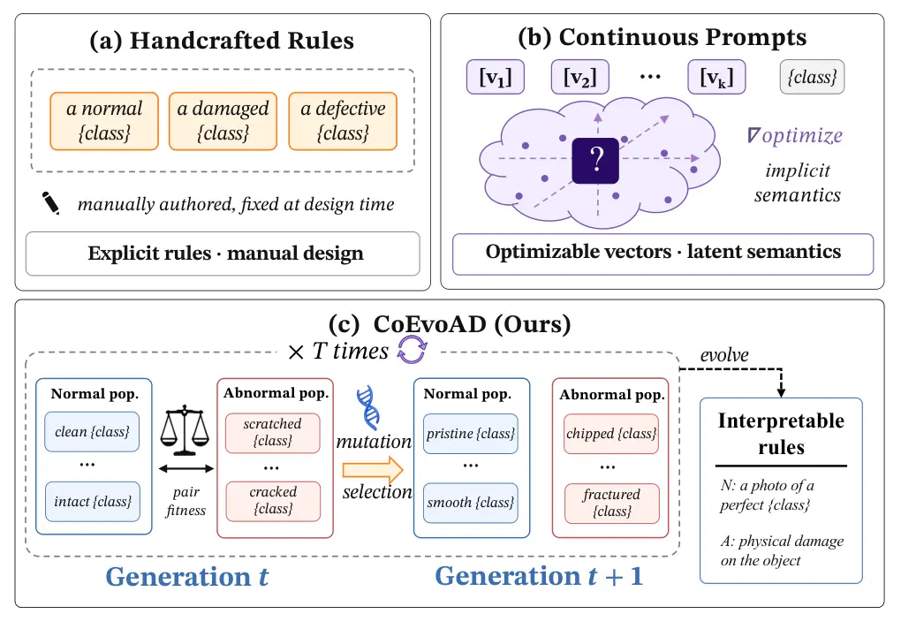

Figure 1: Prompt regimes for ZSAD: handcrafted templates, continuous
prompts, and CoEvoAD.

Despite recent progress in CLIP-based ZSAD, prompt construction and
selection still face two limitations for cross-category transfer. First,
existing prompt construction still struggles to jointly achieve prompt
interpretability and scalability. Handcrafted rules remain explicit but
fixed after design, while prompt-learning methods such as
AnomalyCLIP Zhou et al. (2024), AdaCLIP Cao et al. (2024), and
Bayes-PFL Qu et al. (2025) improve adaptation by optimizing learnable
prompt embeddings or distributions over them. Yet the learned prompt
semantics are encoded in uninterpretable continuous representations
rather than explicit natural-language rules, limiting prompt
interpretability and rule-level reuse. Second, source-category
performance alone does not provide reliable evidence of cross-category
generalization. A prompt may perform well on the source categories used
for selection yet fail on unseen categories, because its transferability
across categories has not been evaluated. In summary, current
prompt-selection methods in ZSAD still fail to achieve both
interpretability and scalability. Moreover, candidate prompt selection
relies solely on performance within the optimization categories, lacking
cross-category validation signals.

To address the lack of prompt interpretability and scalability, we
introduce CoEvoAD, a co-evolutionary discrete prompt-rule search
framework. This framework performs search in the discrete natural
language space using an evolutionary algorithm rather than relying on
opaque black-box vector representations. Candidate prompt rules are
continuously generated, evaluated, and selected throughout population
evolution, while maintaining the interpretability, composability, and
auditability of natural language, which provides strong potential for
scalability. The fitness function combines the evaluation score on
source data with the semantic contrast between normal and abnormal
descriptions, thereby enabling a transparent and controllable
optimization process without gradients. To avoid the objective conflict
caused by mixing normal and abnormal rules in traditional methods, we
maintain independent populations for the two roles and achieve
co-evolution through a joint fitness design. This allows them to expand
along their respective semantic directions in the large-scale natural
language space while preserving the necessary semantic contrast.
Overall, the framework transforms prompt-rule search from a single
black-box vector into a structured, multi-role, multi-candidate
co-evolutionary system, effectively improving interpretability and
scalability.

To address the cross-category generalization issue, we introduce the
Cross-Category Transfer Objective (CCTO), a prompt-rule selection
criterion specifically designed for cross-category transfer. The key
idea behind CCTO is to construct systematic held-out splits within the
source domain, where a subset of source categories is treated as proxy
unseen categories. This design enables the evaluation of candidate
prompt rules under a simulated zero-shot transfer scenario, allowing us
to assess their consistency and robustness when applied across
categories. By leveraging only source-domain data, CCTO provides an
evaluation signal that aligns more closely with the requirements of
zero-shot generalization, without relying on any target-domain
supervision. As a result, the proposed objective significantly improves
the cross-category generalization ability of the selected rules,
offering a more reliable selection criterion under the zero-shot
setting.

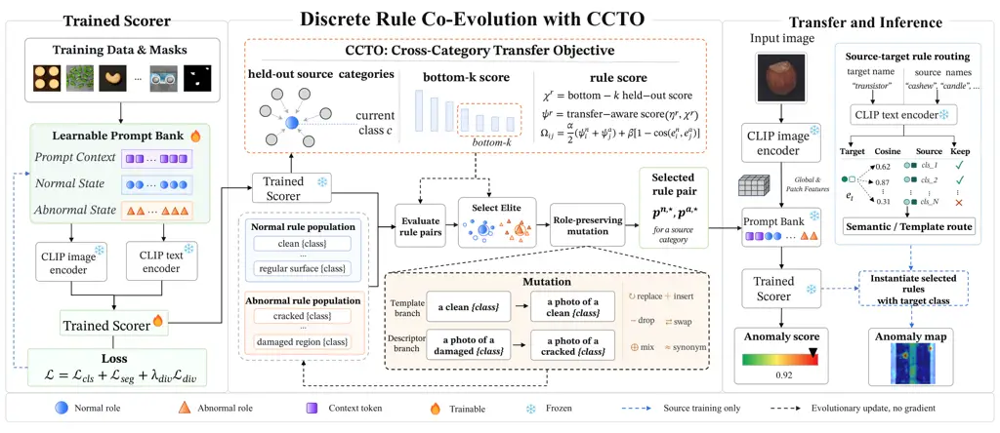

Figure 2: Overview of CoEvoAD. A frozen source-trained scorer evaluates
role-separated normal and abnormal rule populations; CCTO uses held-out
source categories to select rules for unseen-category inference.

## 2 Related Work

#### Traditional Anomaly Detection.

Traditional anomaly detection usually learns category-specific normal
patterns from target-category normal images. In feature space,
PaDiM Defard et al. (2021) models normal statistics, while
PatchCore Roth et al. (2022) stores patch-level memories. For
discriminative training, DRAEM Zavrtanik et al. (2021) synthesizes
defects, whereas SimpleNet Liu et al. (2023) perturbs features. Reverse
Distillation Deng and Li (2022) uses teacher–student discrepancies, with
UniAD You et al. (2022) relying on reconstruction. However, these
methods depend on target-category normal images, which limits deployment
when new categories appear without prior normal data.

#### Zero-Shot Anomaly Detection.

Zero-shot anomaly detection targets anomaly classification and
localization on categories unseen during training. WinCLIP Jeong et al.
(2023) introduces hand-crafted normal/abnormal prompts for training-free
anomaly detection. Subsequent methods shift from manual state words to
optimized prompt representations. AnomalyCLIP Zhou et al. (2024)
addresses category dependence with object-agnostic prompts, while
AdaCLIP Cao et al. (2024) adopts static-dynamic prompt design.
Bayes-PFL Qu et al. (2025) further models prompt uncertainty through
Bayesian prompt flow. Recent work broadens CLIP adaptation beyond
text-side prompting. VCP-CLIP Qu et al. (2024) uses visual context to
guide prompt construction, whereas AA-CLIP Ma et al. (2025) strengthens
anomaly-aware textual anchors. AF-CLIP Fang et al. (2025) and
AdaptCLIP Gao et al. (2026) further adapt visual features or CLIP
representations for anomaly detection. MRAD Xu et al. (2026) introduces
memory-driven retrieval. These methods improve CLIP-based anomaly
reasoning through prompt learning, visual context, feature adaptation,
or memory retrieval.

#### Prompt Tuning and Discrete Prompt Optimization.

Prompt tuning reduces manual prompt engineering by optimizing prompt
representations. CoOp Zhou et al. (2022b) learns continuous context
vectors for vision-language recognition. CoCoOp Zhou et al. (2022a)
makes the learned context condition-dependent. BBT Sun et al. (2022)
studies black-box prompt tuning without gradient access. Discrete prompt
optimization keeps the search in token space. AutoPrompt Shin et al.
(2020) uses gradient-guided word substitution, RLPrompt Deng et al.
(2022) formulates prompt search as reinforcement learning, and
EvoPrompt Guo et al. (2024) applies population-based search to LLM
prompts. CoEvoAD instead searches discrete normal and abnormal rule
populations for ZSAD. Rule pairs are co-evolved with joint fitness and
selected using cross-category evidence drawn from source-domain data.

## 3 Method

### 3.1 Overview

CoEvoAD treats cross-category ZSAD as discrete prompt-rule selection, as
shown in Figure 2. The prompt-conditioned scorer is kept fixed during
rule search, so the optimization only changes the natural-language rule
strings used to render prompts. CoEvoAD maintains separate normal and
abnormal populations, updates them through role-preserving mutation, and
selects rule pairs with a joint fitness that combines evaluation scores
and normal–abnormal semantic separation. CCTO further evaluates
candidate rules on held-out categories from $`\mathcal{C}_{s}`$, adding
a transfer-oriented signal without target-domain feedback. At inference,
selected rules are instantiated for unseen categories through a
pre-specified transfer policy and scored by the same prompt-conditioned
scorer to produce image-level anomaly scores and pixel-level anomaly
maps; each rule remains interpretable through its template,
role-specific descriptors, and class-name slot.

### 3.2 Discrete Prompt-Rule Co-Evolution

CoEvoAD formulates prompt optimization as a discrete search over
natural-language prompt rules. It uses the fixed prompt-conditioned
scorer as the evaluator and varies only rule strings.

#### Role-typed rule representation and populations.

CoEvoAD searches over structured natural-language rules rather than
unconstrained prompt strings. Since anomaly scoring is defined over a
normal–abnormal prompt pair, we organize the candidate space into two
role-typed rule pools. For role $`r\in\{\mathrm{n},\mathrm{a}\}`$
(normal and abnormal), a rule is represented as

```math
\displaystyle p^{r} \displaystyle=(\tau^{r},D^{r},\langle\text{class}\rangle), \tag{1}
```

```math
\displaystyle D^{r} \displaystyle=(d^{r}_{1},\ldots,d^{r}_{m}),
```

where $`\tau^{r}`$ is a role-compatible template, $`D^{r}`$ is a
sequence of descriptors drawn from the corresponding role vocabulary,
and $`\langle\text{class}\rangle`$ is a class-name slot. The rendering
function $`z^{r}=R(p^{r},c)`$ fills the slot with category name $`c`$
and concatenates the template and descriptors into a CLIP text prompt.
The normal role uses descriptors of acceptable appearance (e.g.,
_clean_, _intact_, _regular_), while the abnormal role uses descriptors
of defect evidence (e.g., _damaged_, _cracked_, _contaminated_). This
representation only defines the admissible candidate space; it does not
manually determine the final prompt rule. Candidates are generated
through role-preserving mutation and selected by the paired fitness
function and CCTO, while keeping the role type fixed prevents normal and
abnormal descriptions from being mixed during co-evolution.

We maintain two separate populations,

```math
\displaystyle\mathcal{P}^{\mathrm{n}} \displaystyle=\{p^{\mathrm{n}}_{1},\ldots,p^{\mathrm{n}}_{N}\}, \tag{2}
```

```math
\displaystyle\mathcal{P}^{\mathrm{a}} \displaystyle=\{p^{\mathrm{a}}_{1},\ldots,p^{\mathrm{a}}_{N}\},
```

where $`N`$ is the population size and each $`p_{i}^{r}`$ is a
role-typed rule. Initial populations are constructed from role-specific
templates and descriptor pools; since each candidate is an explicit
natural-language rule, the same rule can be instantiated for another
category by substituting the class-name placeholder.

Algorithm 1 summarizes the rule search. The scorer is frozen during this
stage; only the rendered natural-language rules are changed. Candidate
rules are scored by CCTO-adjusted role scores and selected through
pair-level fitness on rule pairs.

#### Candidate evaluation and pair fitness.

For a fixed optimization category $`c`$, candidates are scored on
labeled source-domain evaluation data with the fixed prompt-conditioned
scorer; the exact split is specified in Appendix B. Candidate pairs are
formed with partners sampled from the opposite population.

Given a candidate pair $`(p_{i}^{\mathrm{n}},p_{j}^{\mathrm{a}})`$, the
pair fitness is

```math
\displaystyle\Omega_{ij} \displaystyle=\alpha\frac{\eta_{i}^{\mathrm{n}}+\eta_{j}^{\mathrm{a}}}{2}+\beta\delta_{ij}, \tag{3}
```

```math
\displaystyle\delta_{ij} \displaystyle=1-\cos(e_{i}^{\mathrm{n}},e_{j}^{\mathrm{a}}),
```

where $`\eta_{i}^{r}`$ is the resulting candidate score, $`e_{i}^{r}`$
is the normalized text embedding of the instantiated rule
$`R(p_{i}^{r},c)`$, and $`r\in\{\mathrm{n},\mathrm{a}\}`$. The first
term measures evaluation scores computed by the scorer, while the second
keeps normal and abnormal descriptions separated in text space. Pairs
with identical instantiated normal and abnormal strings are marked
invalid and excluded from selection. When CCTO is enabled,
$`\eta_{i}^{r}`$ is replaced by the adjusted score
$`\psi^{r}(p_{i}^{r},c)`$ defined in Section 3.3; the pair-fitness form
is unchanged.

1: Frozen scorer $`S_{\theta}`$; source categories $`\mathcal{C}_{s}`$;
role-specific rule pools
$`\mathcal{V}^{\mathrm{n}},\mathcal{V}^{\mathrm{a}}`$; population size
$`N`$, generations $`G`$, elite size $`K_{e}`$, partner budget $`K`$

2: Rule cache
$`\Pi=\{(c,\,p_{c}^{\mathrm{n}\star},\,p_{c}^{\mathrm{a}\star})\}_{c\in\mathcal{C}_{s}}`$

3: for $`c\in\mathcal{C}_{s}`$ do

4:   $`\mathcal{H}_{c}\leftarrow\mathcal{C}_{s}\setminus\{c\}`$
$`\triangleright`$ held-out source categories

5:   Initialize $`\mathcal{P}_{c}^{\mathrm{n}}`$ and
$`\mathcal{P}_{c}^{\mathrm{a}}`$ from $`\mathcal{V}^{\mathrm{n}}`$ and
$`\mathcal{V}^{\mathrm{a}}`$

6:   for $`g=1,\ldots,G`$ do

7:    for $`r\in\{\mathrm{n},\mathrm{a}\}`$ do

8:
     $`\psi^{r}(\cdot,c)\leftarrow\mathrm{CCTOScore}(\mathcal{P}_{c}^{r},c,\mathcal{H}_{c})`$
$`\triangleright`$ Eq. 5    

9:    Sample a diverse subset of $`K`$ abnormal partners

10:    Pair every normal rule with the subset; score pairs by $`\Omega`$
$`\triangleright`$ Eq. 3

11:    Rank candidates by mean fitness of their sampled pairs
$`\triangleright`$ unpaired: keep $`\psi^{r}`$

12:    Keep the top $`K_{e}`$ candidates as role-wise elites

13:    Refill $`\mathcal{P}_{c}^{\mathrm{n}}`$ and
$`\mathcal{P}_{c}^{\mathrm{a}}`$ with role-preserving mutations   

14:   Re-score the top rules of each role on the full evaluation set

15:
  $`\Pi[c]\leftarrow(\arg\max_{p^{\mathrm{n}}}\tilde{\eta}^{\mathrm{n}},\ \arg\max_{p^{\mathrm{a}}}\tilde{\eta}^{\mathrm{a}})`$
$`\triangleright`$ role-wise

16: return $`\Pi`$

Algorithm 1 Prompt-rule co-evolution with CCTO selection.

#### Role-preserving mutation and selection.

CoEvoAD updates the two populations through mutation only; no
recombination across roles is used. Each new candidate is produced by
mutating a same-role parent, and the mutation operates only on the
mutable fields of the rule grammar in Eq. 1. For descriptors, we apply
replacement, insertion, deletion, local reordering, and synonym
substitution within the same role-specific vocabulary. For templates, we
sample from a small role-compatible template pool. All mutations
preserve the role type of the parent rule, so a normal candidate remains
a description of acceptable appearance and an abnormal candidate remains
a description of visible defect evidence.

At each generation, a small diverse subset of abnormal candidates is
sampled as shared partners, every normal candidate is paired with this
subset, and each candidate is ranked by the average fitness of the
sampled pairs it participates in; candidates that appear in no sampled
pair retain their role-adjusted scores. Selection is performed
separately within the normal and abnormal populations. We retain
$`K_{\mathrm{elite}}`$ high-fitness candidates in each role and fill the
remaining slots with mutated candidates. After $`G`$ generations, the
top-ranked rules of each role are re-scored on the full source-side
evaluation set, and the final normal and abnormal rules are selected
independently by these re-evaluated role scores $`\tilde{\eta}^{r}`$,
yielding $`\Pi_{c}=(p_{c}^{\mathrm{n}\star},p_{c}^{\mathrm{a}\star})`$.

#### Rule transfer and inference.

After search, CoEvoAD stores one selected normal–abnormal rule pair
$`\Pi_{c}=(p_{c}^{\mathrm{n}\star},p_{c}^{\mathrm{a}\star})`$ for each
source category $`c\in\mathcal{C}_{s}`$. For an unseen target category
$`c_{t}`$, a pre-specified rule-transfer policy selects one stored pair
using only category names and the saved source rules. The selected pair
$`(\tilde{p}_{t}^{\mathrm{n}},\tilde{p}_{t}^{\mathrm{a}})`$ is rendered
with $`c_{t}`$, yielding $`z_{t}^{r}=R(\tilde{p}_{t}^{r},c_{t})`$ for
$`r\in\{\mathrm{n},\mathrm{a}\}`$. The fixed prompt-conditioned scorer
then produces the image-level anomaly score and pixel-level anomaly map.
The policy is fixed before target evaluation.

### 3.3 Cross-Category Transfer Objective

Prompt rules selected only on the optimization category may capture
category-specific visual patterns that do not transfer to unseen
categories. CCTO turns prompt-rule selection into a category-held-out
transfer test. For a rule optimized on category $`c`$, we render the
same rule on each held-out source category
$`c^{\prime}\in\mathcal{C}_{s}\setminus\{c\}`$ and evaluate it with the
frozen scorer. The resulting held-out scores measure whether the rule
preserves the normal–abnormal distinction after category substitution,
rather than only fitting the category on which it is optimized. Thus,
candidate selection is guided by both within-category evaluation scores
and cross-category consistency.

For a candidate rule $`p^{r}`$ on category $`c`$, CCTO defines the
cross-category score as

```math
\chi^{r}(p,c)=\frac{1}{\kappa}\sum_{j=1}^{\kappa}\xi_{(j)}, \tag{4}
```

where $`\xi_{(1)}\leq\cdots\leq\xi_{(m)}`$ are the held-out scores
sorted in ascending order after evaluating $`p^{r}`$ on each remaining
source category, and $`\kappa=\min(k,m)`$. We aggregate the held-out
scores with a bottom-$`k`$ operator. A simple mean can be dominated by
easy held-out categories and may overlook rules that fail on harder
transfers. The bottom-$`k`$ score instead emphasizes the least
transferable held-out categories while remaining less brittle than a
strict minimum when the number of source categories is limited.

Normal and abnormal rules use the held-out scores in different ways. We
define the role-adjusted selection scores as

```math
\displaystyle\psi^{\mathrm{n}}(p,c) \displaystyle=(1-\lambda_{\mathrm{n}})\eta^{\mathrm{n}}+\lambda_{\mathrm{n}}\chi^{\mathrm{n}}, \tag{5}
```

```math
\displaystyle\psi^{\mathrm{a}}(p,c) \displaystyle=\eta^{\mathrm{a}}+\lambda_{\mathrm{a}}\left(\eta^{\mathrm{a}}-\chi^{\mathrm{a}}\right),
```

where $`\eta^{r}=\eta^{r}(p,c)`$ is the in-category score,
$`\chi^{r}=\chi^{r}(p,c)`$ is the cross-category score in Eq. 4, and
$`\lambda_{\mathrm{n}},\lambda_{\mathrm{a}}`$ control the two
role-specific adjustments. The normal branch interpolates between
in-category performance and cross-category consistency. The abnormal
branch uses the margin $`\eta^{\mathrm{a}}-\chi^{\mathrm{a}}`$ to retain
defect-discriminative abnormal rules and suppress overly generic anomaly
descriptions. The adjusted score $`\psi^{r}(p,c)`$ replaces
$`\eta_{i}^{r}`$ in Eq. 3. All held-out categories are drawn from
$`\mathcal{C}_{s}`$.

### 3.4 Overall Loss

The prompt bank and scoring head are trained on the source dataset,
while the CLIP image and text encoders remain frozen. For each source
sample, the category name is used as the textual anchor; evolved prompt
rules are introduced only during prompt-rule search. The scorer is
optimized with an image-level binary classification loss, a pixel-level
localization loss combining focal Lin et al. (2017) and Dice Milletari
et al. (2016) terms, and a same-role prompt-group diversity regularizer.
We write the objective compactly as
$`\mathcal{L}_{\mathrm{train}}=\mathcal{L}_{\mathrm{cls}}+\mathcal{L}_{\mathrm{seg}}+\lambda_{\mathrm{div}}\mathcal{L}_{\mathrm{div}}`$.
In implementation, scorer training further includes mask-guided crop
augmentation, inter-role margin regularization, and category-agnostic
regularization. This training recipe is identical for the class-name
control and all main CoEvoAD comparisons, so matched-control gains can
be attributed to prompt-rule selection rather than scorer updates.

| Method $`\rightarrow`$ Dataset $`\downarrow`$ | WinCLIP (CVPR’23) |                | AnomalyCLIP (ICLR’24) |                | AdaCLIP (ECCV’24) |                | Bayes-PFL (CVPR’25) |                | MRAD (ICLR’26)    |                | CoEvoAD (Ours)    |                |
| --------------------------------------------- | ----------------- | -------------- | --------------------- | -------------- | ----------------- | -------------- | ------------------- | -------------- | ----------------- | -------------- | ----------------- | -------------- |
|                                               | AUROC$`\uparrow`$ | AP$`\uparrow`$ | AUROC$`\uparrow`$     | AP$`\uparrow`$ | AUROC$`\uparrow`$ | AP$`\uparrow`$ | AUROC$`\uparrow`$   | AP$`\uparrow`$ | AUROC$`\uparrow`$ | AP$`\uparrow`$ | AUROC$`\uparrow`$ | AP$`\uparrow`$ |
| MVTec-AD                                      | 91.8              | 95.1           | 91.5                  | 96.2           | 92.0              | 96.4           | 92.3                | 96.7           | 94.0              | 97.4           | 93.4              | 96.8           |
| VisA                                          | 78.1              | 77.5           | 82.1                  | 85.4           | 83.0              | 84.9           | 87.0                | 89.2           | 85.7              | 88.3           | 87.4              | 89.7           |
| BTAD                                          | 83.3              | 84.1           | 89.1                  | 91.1           | 91.6              | 92.4           | 93.2                | 96.5           | 92.4              | 94.2           | 94.4              | 96.1           |
| KSDD2                                         | 93.5              | 77.9           | 92.1                  | 77.8           | 95.9              | 95.9           | 97.3                | 97.9           | 95.1              | 88.9           | 97.4              | 97.9           |
| DAGM                                          | 89.6              | 90.4           | 95.6                  | 94.6           | 96.5              | 95.7           | 97.7                | 97.0           | 98.4              | 98.6           | 98.2              | 97.6           |
| RSDD                                          | 85.3              | 65.3           | 73.5                  | 55.0           | 89.1              | 70.8           | 94.1                | 92.3           | –                 | –              | 98.9              | 98.9           |
| Mean                                          | 86.9              | 81.7           | 87.3                  | 83.4           | 91.4              | 89.4           | 93.6                | 94.9           | –                 | –              | 95.0              | 96.2           |

Table 1: Image-level benchmark comparison (%) across six anomaly
detection datasets. Bold/underline denote best/second-best; “–” marks
entries not reported by the original paper.

| Method $`\rightarrow`$ Dataset $`\downarrow`$ | WinCLIP (CVPR’23) |                 | AnomalyCLIP (ICLR’24) |                 | AdaCLIP (ECCV’24) |                 | Bayes-PFL (CVPR’25) |                 | MRAD (ICLR’26)    |                 | CoEvoAD (Ours)    |                 |
| --------------------------------------------- | ----------------- | --------------- | --------------------- | --------------- | ----------------- | --------------- | ------------------- | --------------- | ----------------- | --------------- | ----------------- | --------------- |
|                                               | AUROC$`\uparrow`$ | PRO$`\uparrow`$ | AUROC$`\uparrow`$     | PRO$`\uparrow`$ | AUROC$`\uparrow`$ | PRO$`\uparrow`$ | AUROC$`\uparrow`$   | PRO$`\uparrow`$ | AUROC$`\uparrow`$ | PRO$`\uparrow`$ | AUROC$`\uparrow`$ | PRO$`\uparrow`$ |
| MVTec-AD                                      | 85.1              | 64.6            | 91.1                  | 81.4            | 86.8              | 33.8            | 91.8                | 87.4            | 93.0              | 86.8            | 92.2              | 87.9            |
| VisA                                          | 79.6              | 56.8            | 95.5                  | 87.0            | 95.1              | 71.3            | 95.6                | 88.9            | 95.9              | 88.0            | 95.8              | 89.4            |
| BTAD                                          | 71.4              | 32.8            | 93.3                  | 69.3            | 87.7              | 17.1            | 93.9                | 76.6            | 95.4              | 72.8            | 94.7              | 81.9            |
| KSDD2                                         | 97.9              | 91.2            | 99.1                  | 85.6            | 99.4              | 92.7            | 96.1                | 70.8            | 98.9              | 95.6            | 99.6              | 98.5            |
| DAGM                                          | 83.2              | 55.4            | 99.1                  | 93.6            | 97.0              | 40.9            | 99.3                | 98.0            | 97.4              | 90.3            | 99.5              | 98.3            |
| RSDD                                          | 95.1              | 75.4            | 99.1                  | 92.0            | 99.5              | 50.5            | 99.6                | 98.0            | –                 | –               | 99.8              | 99.0            |
| Mean                                          | 85.4              | 62.7            | 96.2                  | 84.8            | 94.3              | 51.1            | 96.1                | 86.6            | –                 | –               | 96.9              | 92.5            |

Table 2: Pixel-level benchmark comparison (%; AUROC and Per-Region
Overlap (PRO)). Bold/underline denote best/second-best across the six
datasets; “–” marks entries not reported by the original paper.

## 4 Experiments

### 4.1 Experimental Setup

#### Datasets.

We evaluate CoEvoAD on six industrial anomaly detection benchmarks:
MVTec-AD Bergmann et al. (2019) (15 categories of manufactured objects),
VisA Zou et al. (2022) (12 categories of complex inspection objects),
BTAD Mishra et al. (2021) (three industrial product categories),
KSDD2 Božič et al. (2021) (industrial steel surface defects),
DAGM Wieler et al. (2007) (manually re-annotated synthetic-texture
defects), and RSDD Niu et al. (2021) (rail surface defects).

#### Protocol.

Following prior CLIP-based ZSAD settings Zhou et al. (2024); Qu et al.
(2025), CoEvoAD is evaluated under strict cross-dataset transfer: the
scorer is trained on a source dataset and evaluated on target datasets
without target-domain images, labels, or supervision. The two primary
transfer directions are VisA$`\to`$MVTec-AD and MVTec-AD$`\to`$VisA. The
remaining datasets (BTAD, KSDD2, DAGM, RSDD) serve as external
industrial targets evaluated under the same source-only protocol.

#### Baselines.

We compare against representative CLIP-based ZSAD baselines:
WinCLIP Jeong et al. (2023), AnomalyCLIP Zhou et al. (2024), AdaCLIP Cao
et al. (2024), Bayes-PFL Qu et al. (2025), and MRAD Xu et al. (2026).
Baseline numbers in Tables 1 and 2 are taken from the original papers or
their official codebases where available.

#### Evaluation metrics.

Following common ZSAD evaluation, we report image-level AUROC and AP and
pixel-level AUROC and Per-Region Overlap (PRO) for benchmark comparison.
For matched controls and ablations, we additionally report pixel-level
AP and F1, averaged over categories.

#### Implementation details.

CoEvoAD uses frozen CLIP ViT-L/14@336px Radford et al. (2021), with
images resized to $`518\times 518`$. The prompt-bank scorer is trained
for 30 epochs and frozen before prompt-rule search. Unless otherwise
stated, we use $`M=3`$ prompt groups, context length $`L_{c}=5`$, state
length $`L_{s}=5`$, population size $`N=16`$, $`G=5`$ search
generations, $`K_{e}=4`$ elites, and $`K=3`$ sampled partners.

### 4.2 Main Results

We compare CoEvoAD against representative CLIP-based ZSAD baselines
(Tables 1 and 2) and against a matched class-name prompt control under
the same scorer and protocol (Table 3). The two comparisons cover
cross-paper benchmark context and within-paper attribution,
respectively.

| Target   | Metric                   | Control | CoEvoAD | $`\Delta`$ |
| -------- | ------------------------ | ------- | ------- | ---------- |
| MVTec-AD | Image AUROC $`\uparrow`$ | 93.01   | 93.39   | +0.38      |
|          | Pixel AP $`\uparrow`$    | 47.48   | 47.72   | +0.24      |
|          | Pixel F1 $`\uparrow`$    | 47.69   | 47.96   | +0.27      |
| VisA     | Image AUROC $`\uparrow`$ | 87.05   | 87.43   | +0.38      |
|          | Pixel AP $`\uparrow`$    | 30.51   | 31.11   | +0.60      |
|          | Pixel F1 $`\uparrow`$    | 36.21   | 36.72   | +0.51      |
| BTAD     | Image AUROC $`\uparrow`$ | 92.81   | 92.68   | $`-0.13`$  |
|          | Pixel AP $`\uparrow`$    | 41.05   | 41.66   | +0.61      |
|          | Pixel F1 $`\uparrow`$    | 44.69   | 46.25   | +1.56      |
| RSDD     | Image AUROC $`\uparrow`$ | 97.69   | 97.62   | $`-0.07`$  |
|          | Pixel AP $`\uparrow`$    | 46.39   | 49.30   | +2.91      |
|          | Pixel F1 $`\uparrow`$    | 49.11   | 50.10   | +0.99      |

Table 3: Matched comparison. Both systems use the same frozen
source-trained scorer and protocol; the control uses class-name prompts
without rule search. $`\Delta=\mathrm{CoEvoAD}-\mathrm{Control}`$. Seed
111; three-seed means and standard deviations for the two primary
directions are reported in Table 17.

Figure 3: Per-image anomaly score distributions on three representative
MVTec-AD categories (Pill, Toothbrush, Hazelnut) under the
VisA$`\to`$MVTec-AD matched protocol. Rows compare AnomalyCLIP,
Bayes-PFL, and CoEvoAD; blue/red denote normal/abnormal samples;
per-cell AUROC is shown.

CoEvoAD separates normal and anomalous samples more clearly than the
baselines on representative MVTec-AD categories (Figure 3).

CoEvoAD attains the highest mean image AUROC/AP (95.0/96.2) and pixel
AUROC/PRO (96.9/92.5) among the compared CLIP-based ZSAD baselines
(Tables 1 and 2), with the largest image gain on RSDD. Table 3 reports
the matched-protocol comparison: CoEvoAD improves the class-name control
on both primary transfer directions and yields consistent pixel-level AP
and F1 gains on the external industrial targets under the matched
MVTec-AD-source setting.

#### Robustness across categories.

Table 4 tests whether the matched-control pixel gains are driven by
high-baseline categories alone. Bottom-$`k`$ $`\Delta`$ ($`k{=}3`$)
exceeds the mean $`\Delta`$ in all four rows, indicating that the
average lift is not concentrated on easy high-baseline categories.

| Dir.  | Metric               | Mean $`\Delta`$ | Bot-$`k`$ $`\Delta`$ | Worst $`\Delta`$ |
| ----- | -------------------- | --------------- | -------------------- | ---------------- |
| MVTec | Pixel AP$`\uparrow`$ | +0.24           | +0.51                | $`-`$0.48        |
|       | Pixel F1$`\uparrow`$ | +0.27           | +0.45                | $`-`$0.41        |
| VisA  | Pixel AP$`\uparrow`$ | +0.60           | +0.78                | $`-`$3.27        |
|       | Pixel F1$`\uparrow`$ | +0.51           | +0.77                | $`-`$3.37        |

Table 4: Per-category $`\Delta`$ statistics (mean, bottom-$`k`$, worst)
vs the matched control.

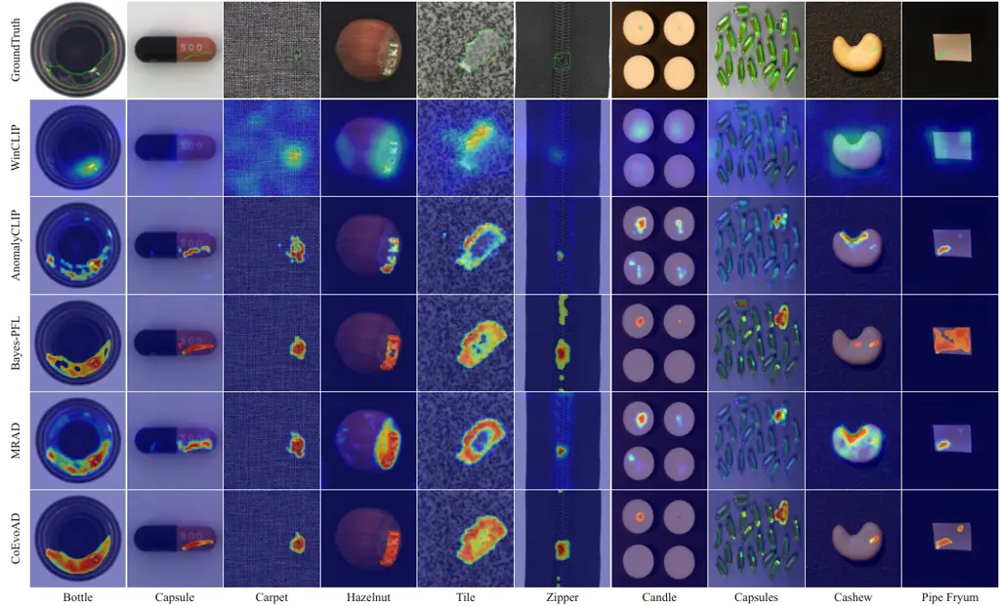

Figure 4: Qualitative localization examples on MVTec-AD and VisA.
Columns show representative target categories; rows compare ground-truth
contours and anomaly maps from CLIP-based baselines and CoEvoAD. Green
contours denote annotated anomaly regions; warmer colors indicate higher
anomaly scores.

MVTec-AD VisA Method Image AUROC $`\uparrow`$ Pixel AP $`\uparrow`$
Image AUROC $`\uparrow`$ Pixel AP $`\uparrow`$ R0 class-name 93.01 47.48
87.05 30.51 Random search +0.08 $`-`$0.01 $`-`$0.95 +0.52 Single-pop. EA
+0.14 $`-`$0.05 $`-`$0.24 +0.07 GA crossover +0.17 $`-`$0.01 $`-`$0.23
+0.74 Role-sep. CoEvo +0.05 +0.04 $`-`$0.03 +0.47 CoEvoAD +0.38 +0.24
+0.38 +0.60

Table 5: Same-budget search controls. R0 is the class-name reference;
search rows report percentage-point changes over R0.

#### Same-budget search controls.

CoEvoAD denotes role-separated co-evolution with CCTO. Random search and
single-population variants do not consistently improve both transfer
directions, suggesting that the gain is not explained by candidate
budget alone. CoEvoAD gives the strongest overall balance across Image
AUROC and Pixel AP, although the crossover control obtains the highest
Pixel AP on MVTec-AD$`\to`$VisA.

CoEvoAD produces responses more concentrated around annotated defect
regions on representative MVTec-AD and VisA categories (Figure 4).

### 4.3 Rule Inspection

| Category   | Normal rule                     | Abnormal rule                        |
| ---------- | ------------------------------- | ------------------------------------ |
| screw      | clean surface screw             | broken shape with missing parts      |
| bottle     | normal bottle                   | irregular visible surface bottle     |
| grid       | regular standard grid           | faulty flawed abnormal grid          |
| toothbrush | a photo of a healthy toothbrush | faulty toothbrush                    |
| pcb2       | flawless fine pcb2              | structural defect like a hole or cut |
| cashew     | a photo of healthy cashew       | faulty flawed cashew                 |
| candle     | clean intact candle             | visible anomaly on object            |

Table 6: Representative natural-language rules selected by CoEvoAD (the
leading learned soft-context token is omitted for compactness).

Normal rules retain explicit category anchors, while abnormal rules
combine category-specific defect cues with general defect descriptors
(Table 6), consistent with CCTO’s role-aware selection. For instance,
abnormal rules name concrete defect modes for structured objects (e.g.,
“structural defect like a hole or cut” for pcb2; “broken shape with
missing parts” for screw), while less structured categories (e.g.,
candle) retain generic descriptors like “visible anomaly on object”. The
selected rules are interpretable text and can be edited, audited, and
instantiated with another category name through the class-name slot, the
same mechanism used by the rule-transfer policy (Section 3.2).

### 4.4 Ablation Studies

| Target   | Metric                  | Baseline | CoEvo | CoEvo +CCTO |
| -------- | ----------------------- | -------- | ----- | ----------- |
| MVTec-AD | Image AUROC$`\uparrow`$ | 93.01    | 93.06 | 93.39       |
|          | Pixel AP$`\uparrow`$    | 47.48    | 47.52 | 47.72       |
|          | Pixel F1$`\uparrow`$    | 47.69    | 47.67 | 47.96       |
| VisA     | Image AUROC$`\uparrow`$ | 87.05    | 87.02 | 87.43       |
|          | Pixel AP$`\uparrow`$    | 30.51    | 30.98 | 31.11       |
|          | Pixel F1$`\uparrow`$    | 36.21    | 36.33 | 36.72       |
| BTAD     | Image AUROC$`\uparrow`$ | 92.81    | 92.87 | 92.68       |
|          | Pixel AP$`\uparrow`$    | 41.05    | 40.85 | 41.66       |
|          | Pixel F1$`\uparrow`$    | 44.69    | 45.22 | 46.25       |
| RSDD     | Image AUROC$`\uparrow`$ | 97.69    | 97.92 | 97.62       |
|          | Pixel AP$`\uparrow`$    | 46.39    | 43.37 | 49.30       |
|          | Pixel F1$`\uparrow`$    | 49.11    | 46.69 | 50.10       |

Table 7: Component ablation comparing matched class-name prompt control,
role-separated co-evolution (CoEvo), and CoEvoAD (CoEvo $`+`$ CCTO).
Bold marks the best score per row. Seed 111 (Table 17 reports multi-seed
variation).

#### Component analysis.

Role-separated co-evolution alone yields mixed effects on image-level
AUROC, suggesting role separation is necessary but not sufficient.
Adding CCTO produces consistent positive gains on pixel-level
localization (Pixel AP and Pixel F1 improve over the class-name control
across all four targets), with weaker image-level effects. This supports
our claim that held-out source categories serve as a more
transfer-oriented selection signal than performance on the optimization
categories. In the same-budget search controls (Table 5), the
non-role-separated baselines (Random / EA / GA) and role-separated
co-evolution alone each fall short of the CoEvoAD pairing, which reaches
$`+0.38`$ image AUROC under the matched protocol, indicating that the
gain comes from the substrate–selection pairing rather than either
component in isolation. This pattern reflects CCTO’s role as a selection
criterion rather than an additive scoring term.

#### Inference latency.

Table 8 compares per-image inference latency under one
implementation-level protocol: single RTX 4090, batch size 1, 30 warm-up
followed by 300 timed images per direction, with the timer wrapping the
entire per-image call. CoEvoAD runs the same frozen scorer call as the
class-name control, differing only in the prompt string: the two differ
by under $`0.7`$ ms with opposite signs across the two directions, so no
systematic overhead is attributable to the evolved rules; the routing
lookup, measured separately, adds $`0.19/0.27`$ ms per image (under
$`0.5\%`$). CoEvoAD’s inference is $`1.4`$–$`4.0\times`$ faster than
AnomalyCLIP, MRAD, AdaCLIP, and Bayes-PFL re-timed under the same
protocol. Training costs are not comparable across released pipelines,
so the one-time search cost (Table 12) is reported separately; in the
matched-control setting the scorer training is identical.

| Method                      | Backbone / res.      | ms/img |
| --------------------------- | -------------------- | ------ |
| Bayes-PFL (reproduced)      | ViT-L/14@336px / 518 | 221.0  |
| AdaCLIP (released ckpt)     | ViT-L/14@336px / 518 | 114.56 |
| MRAD (released ckpt)        | ViT-L/14@336px / 518 | 103.55 |
| AnomalyCLIP (reproduced)    | ViT-L/14@336px / 518 | 75.97  |
| WinCLIP^(†) (training-free) | ViT-B/16+240 / 240   | 56.08  |
| Class-name control          | ViT-L/14@336px / 518 | 55.00  |
| CoEvoAD                     | ViT-L/14@336px / 518 | 55.64  |

Table 8: Per-image inference latency (ms, mean over 300 timed images),
timed on the VisA$`\to`$MVTec-AD direction under one protocol.
$`\dagger`$: WinCLIP runs its native backbone and resolution, disclosed
for completeness but not directly comparable.

## 5 Conclusion

We presented CoEvoAD, a framework that searches discrete, interpretable
normal and abnormal prompt rules in natural language and uses a
Cross-Category Transfer Objective to favor rules generalizing across
unseen target categories. Across six industrial anomaly detection
benchmarks, CoEvoAD attains the highest mean image-level and pixel-level
scores among compared CLIP-based ZSAD baselines, yielding positive
matched-control gains attributable to prompt-rule search. The framework
shows that interpretable prompt search is feasible for ZSAD via
role-separated co-evolution guided by held-out cross-category signals.
The saved rules remain auditable as natural-language strings,
complementing continuous prompt embeddings.

## Limitations

The benefits of CoEvoAD concentrate on pixel-level localization rather
than image-level AUROC: matched-control gains in image AUROC are modest
and not uniformly positive, and CCTO gains vary across target datasets.
The gains are not uniform across target categories: the
MVTec-AD$`\to`$VisA direction shows a worst-category pixel-AP regression
on pcb4 (Table 25). CoEvoAD also inherits the limitations of the
underlying CLIP backbone for defects that are not well described by
natural language.

## Ethics Statement

This work targets zero-shot anomaly detection for industrial visual
inspection. We use public benchmark datasets and do not collect
human-subject data or personally identifiable information. The method is
intended to assist defect screening rather than replace human inspection
in safety-critical production. Since anomaly detectors may produce false
positives or false negatives under distribution shift, practical
deployment should require human oversight, site-specific validation, and
continuous monitoring.

Although CoEvoAD searches interpretable natural-language prompt rules,
the selected rules may still reflect biases of the source datasets and
the pretrained vision-language model. We therefore recommend auditing
selected rules before deployment and avoiding deployment in high-stakes
settings without further validation.

## Acknowledgments

This work was supported by the National Natural Science Foundation of
China (No. 62506030), and the Beijing Natural Science Foundation (No.
L242021), and the State Key Laboratory of Advanced Rail Autonomous
Operation (Project No. RAO 2026K06), Beijing Jiaotong University.

## References

- Bergmann et al. (2019) Paul Bergmann, Michael Fauser, David
  Sattlegger, and Carsten Steger. 2019. [MVTec AD—a comprehensive
  real-world dataset for unsupervised anomaly
  detection](https://doi.org/10.1109/CVPR.2019.00982). In _IEEE/CVF
  Conference on Computer Vision and Pattern Recognition (CVPR)_, pages
  9592–9600.
- Božič et al. (2021) Jakob Božič, Domen Tabernik, and Danijel
  Skočaj. 2021. [Mixed supervision for surface-defect detection: From
  weakly to fully supervised
  learning](https://doi.org/10.1016/j.compind.2021.103459). _Computers
  in Industry_, 129:103459.
- Cao et al. (2024) Yunkang Cao, Jiangning Zhang, Luca Frittoli, Yuqi
  Cheng, Weiming Shen, and Giacomo Boracchi. 2024. [AdaCLIP: Adapting
  CLIP with hybrid learnable prompts for zero-shot anomaly
  detection](https://doi.org/10.1007/978-3-031-72761-0_4). In _European
  Conference on Computer Vision_, pages 55–72.
- Defard et al. (2021) Thomas Defard, Aleksandr Setkov, Angelique
  Loesch, and Romaric Audigier. 2021. [PaDiM: A patch distribution
  modeling framework for anomaly detection and
  localization](https://doi.org/10.1007/978-3-030-68799-1_35). In
  _International Conference on Pattern Recognition Workshops (ICPR
  Workshops)_, pages 475–489.
- Deng and Li (2022) Hanqiu Deng and Xingyu Li. 2022. [Anomaly detection
  via reverse distillation from one-class
  embedding](https://doi.org/10.1109/CVPR52688.2022.00951). In _IEEE/CVF
  Conference on Computer Vision and Pattern Recognition (CVPR)_, pages
  9737–9746.
- Deng et al. (2022) Mingkai Deng, Jianyu Wang, Cheng-Ping Hsieh, Yihan
  Wang, Han Guo, Tianmin Shu, Meng Song, Eric P. Xing, and Zhiting
  Hu. 2022. [RLPrompt: Optimizing discrete text prompts with
  reinforcement
  learning](https://doi.org/10.18653/v1/2022.emnlp-main.222). In
  _Proceedings of the 2022 Conference on Empirical Methods in Natural
  Language Processing_, pages 3369–3391.
- Fang et al. (2025) Qingqing Fang, Wenxi Lv, and Qinliang Su. 2025.
  [AF-CLIP: Zero-shot anomaly detection via anomaly-focused CLIP
  adaptation](https://doi.org/10.1145/3746027.3755635). In _Proceedings
  of the 33rd ACM International Conference on Multimedia_, pages
  4846–4855.
- Gao et al. (2026) Bin-Bin Gao, Yue Zhou, Jiangtao Yan, Yuezhi Cai,
  Weixi Zhang, Meng Wang, Jun Liu, Yong Liu, Lei Wang, and Chengjie
  Wang. 2026. [AdaptCLIP: Adapting CLIP for universal visual anomaly
  detection](https://doi.org/10.1609/aaai.v40i6.42404). _Proceedings of
  the AAAI Conference on Artificial Intelligence_, 40(6):4095–4103.
- Guo et al. (2024) Qingyan Guo, Rui Wang, Junliang Guo, Bei Li, Kaitao
  Song, Xu Tan, Guoqing Liu, Jiang Bian, and Yujiu Yang. 2024.
  [Connecting large language models with evolutionary algorithms yields
  powerful prompt
  optimizers](https://openreview.net/forum?id=ZG3RaNIsO8). In
  _International Conference on Learning Representations_.
- Jeong et al. (2023) Jongheon Jeong, Yang Zou, Taewan Kim, Dongqing
  Zhang, Avinash Ravichandran, and Onkar Dabeer. 2023. [WinCLIP:
  Zero-/few-shot anomaly classification and
  segmentation](https://doi.org/10.1109/CVPR52729.2023.01878). In
  _Proceedings of the IEEE/CVF Conference on Computer Vision and Pattern
  Recognition_, pages 19606–19616.
- Lin et al. (2017) Tsung-Yi Lin, Priya Goyal, Ross Girshick, Kaiming
  He, and Piotr Dollár. 2017. [Focal loss for dense object
  detection](https://doi.org/10.1109/ICCV.2017.324). In _IEEE
  International Conference on Computer Vision (ICCV)_, pages 2980–2988.
- Liu et al. (2023) Zhikang Liu, Yiming Zhou, Yuansheng Xu, and Zilei
  Wang. 2023. [SimpleNet: A simple network for image anomaly detection
  and localization](https://doi.org/10.1109/CVPR52729.2023.01954). In
  _IEEE/CVF Conference on Computer Vision and Pattern Recognition
  (CVPR)_, pages 20402–20411.
- Ma et al. (2025) Wenxin Ma, Xu Zhang, Qingsong Yao, Fenghe Tang,
  Chenxu Wu, Yingtai Li, Rui Yan, Zihang Jiang, and S. Kevin Zhou. 2025.
  [AA-CLIP: Enhancing zero-shot anomaly detection via anomaly-aware
  CLIP](https://doi.org/10.1109/CVPR52734.2025.00447). In _Proceedings
  of the IEEE/CVF Conference on Computer Vision and Pattern
  Recognition_, pages 4744–4754.
- Milletari et al. (2016) Fausto Milletari, Nassir Navab, and
  Seyed-Ahmad Ahmadi. 2016. [V-Net: Fully convolutional neural networks
  for volumetric medical image
  segmentation](https://doi.org/10.1109/3DV.2016.79). In _International
  Conference on 3D Vision (3DV)_, pages 565–571.
- Mishra et al. (2021) Pankaj Mishra, Riccardo Verk, Daniele Fornasier,
  Claudio Piciarelli, and Gian Luca Foresti. 2021. [VT-ADL: A vision
  transformer network for image anomaly detection and
  localization](https://doi.org/10.1109/ISIE45552.2021.9576231). In
  _IEEE 30th International Symposium on Industrial Electronics (ISIE)_,
  pages 1–6.
- Niu et al. (2021) Menghui Niu, Kechen Song, Liming Huang, Qi Wang,
  Yunhui Yan, and Qinggang Meng. 2021. [Unsupervised saliency detection
  of rail surface defects using stereoscopic
  images](https://doi.org/10.1109/TII.2020.3004397). _IEEE Transactions
  on Industrial Informatics_, 17(3):2271–2281.
- Qu et al. (2025) Zhen Qu, Xian Tao, Xinyi Gong, Shichen Qu, Qiyu Chen,
  Zhengtao Zhang, Xingang Wang, and Guiguang Ding. 2025. [Bayesian
  prompt flow learning for zero-shot anomaly
  detection](https://doi.org/10.1109/CVPR52734.2025.02830). In
  _Proceedings of the IEEE/CVF Conference on Computer Vision and Pattern
  Recognition_, pages 30398–30408.
- Qu et al. (2024) Zhen Qu, Xian Tao, Mukesh Prasad, Fei Shen, Zhengtao
  Zhang, Xinyi Gong, and Guiguang Ding. 2024. [VCP-CLIP: A visual
  context prompting model for zero-shot anomaly
  segmentation](https://doi.org/10.1007/978-3-031-72890-7_18). In
  _European Conference on Computer Vision_, pages 301–317.
- Radford et al. (2021) Alec Radford, Jong Wook Kim, Chris Hallacy,
  Aditya Ramesh, Gabriel Goh, Sandhini Agarwal, Girish Sastry, Amanda
  Askell, Pamela Mishkin, Jack Clark, Gretchen Krueger, and Ilya
  Sutskever. 2021. [Learning transferable visual models from natural
  language
  supervision](https://proceedings.mlr.press/v139/radford21a.html). In
  _Proceedings of the 38th International Conference on Machine
  Learning_, volume 139, pages 8748–8763.
- Roth et al. (2022) Karsten Roth, Latha Pemula, Joaquin Zepeda,
  Bernhard Schölkopf, Thomas Brox, and Peter Gehler. 2022. [Towards
  total recall in industrial anomaly
  detection](https://doi.org/10.1109/CVPR52688.2022.01392). In _IEEE/CVF
  Conference on Computer Vision and Pattern Recognition (CVPR)_, pages
  14318–14328.
- Shin et al. (2020) Taylor Shin, Yasaman Razeghi, Robert L. Logan IV,
  Eric Wallace, and Sameer Singh. 2020. [AutoPrompt: Eliciting knowledge
  from language models with automatically generated
  prompts](https://doi.org/10.18653/v1/2020.emnlp-main.346). In
  _Proceedings of the 2020 Conference on Empirical Methods in Natural
  Language Processing (EMNLP)_, pages 4222–4235.
- Sun et al. (2022) Tianxiang Sun, Yunfan Shao, Hong Qian, Xuanjing
  Huang, and Xipeng Qiu. 2022. [Black-box tuning for
  language-model-as-a-service](https://proceedings.mlr.press/v162/sun22e.html).
  In _Proceedings of the 39th International Conference on Machine
  Learning_, volume 162, pages 20841–20855.
- Wieler et al. (2007) Matthias Wieler, Tobias Hahn, and Fred A.
  Hamprecht. 2007. [Weakly supervised learning for industrial optical
  inspection](https://doi.org/10.5281/zenodo.8086136). DAGM 2007
  Competition Dataset.
- Xu et al. (2026) Chaoran Xu, Chengkan Lv, Qiyu Chen, Feng Zhang, and
  Zhengtao Zhang. 2026. [MRAD: Zero-shot anomaly detection with
  memory-driven retrieval](https://openreview.net/forum?id=TQkFiW3AEX).
  In _International Conference on Learning Representations_.
- You et al. (2022) Zhiyuan You, Lei Cui, Yujun Shen, Kai Yang, Xin Lu,
  Yu Zheng, and Xinyi Le. 2022. [A unified model for multi-class anomaly
  detection](https://doi.org/10.52202/068431-0330). In _Advances in
  Neural Information Processing Systems (NeurIPS)_, volume 35, pages
  4571–4584.
- Zavrtanik et al. (2021) Vitjan Zavrtanik, Matej Kristan, and Danijel
  Skočaj. 2021. [DRAEM – a discriminatively trained reconstruction
  embedding for surface anomaly
  detection](https://doi.org/10.1109/ICCV48922.2021.00822). In
  _Proceedings of the IEEE/CVF International Conference on Computer
  Vision (ICCV)_, pages 8330–8339.
- Zhou et al. (2022a) Kaiyang Zhou, Jingkang Yang, Chen Change Loy, and
  Ziwei Liu. 2022a. [Conditional prompt learning for vision-language
  models](https://doi.org/10.1109/CVPR52688.2022.01631). In _Proceedings
  of the IEEE/CVF Conference on Computer Vision and Pattern
  Recognition_, pages 16816–16825.
- Zhou et al. (2022b) Kaiyang Zhou, Jingkang Yang, Chen Change Loy, and
  Ziwei Liu. 2022b. [Learning to prompt for vision-language
  models](https://doi.org/10.1007/s11263-022-01653-1). _International
  Journal of Computer Vision_, 130(9):2337–2348.
- Zhou et al. (2024) Qihang Zhou, Guansong Pang, Yu Tian, Shibo He, and
  Jiming Chen. 2024. [AnomalyCLIP: Object-agnostic prompt learning for
  zero-shot anomaly
  detection](https://openreview.net/forum?id=buC4E91xZE). In
  _International Conference on Learning Representations_.
- Zou et al. (2022) Yang Zou, Jongheon Jeong, Latha Pemula, Dongqing
  Zhang, and Onkar Dabeer. 2022. [SPot-the-difference self-supervised
  pre-training for anomaly detection and
  segmentation](https://doi.org/10.1007/978-3-031-20056-4_23). In
  _European Conference on Computer Vision (ECCV)_, pages 392–408.

## Appendix A Experimental Protocol and Dataset Details

#### Datasets.

We evaluate CoEvoAD on six industrial anomaly detection benchmarks.
MVTec-AD Bergmann et al. (2019) contains 15 object/texture categories
with pixel-level defect masks; VisA Zou et al. (2022) provides 12
categories of small electronics and food items; BTAD Mishra et al.
(2021) covers three industrial product categories; KSDD2 Božič et al.
(2021) and RSDD Niu et al. (2021) focus on surface-defect inspection on
metal and rail-surface, respectively; DAGM Wieler et al. (2007) consists
of synthetic texture patches. Two additional texture-oriented external
targets, DTD-Synthetic and a 7-class DAGM subset, are reported only as
diagnostic transfers (Section E). All datasets are publicly available.
Test sets follow the ZSAD dataset construction of Bayes-PFL Qu et al.
(2025): MVTec-AD, VisA, BTAD, and DTD-Synthetic keep their standard test
splits, while KSDD2 and RSDD are rebuilt from the official splits into
balanced test sets. Table 9 reports the per-dataset image counts as
loaded by our evaluation pipeline.

| Dataset                                    | Classes | Normal | Anomalous |
| ------------------------------------------ | ------- | ------ | --------- |
| MVTec-AD Bergmann et al. (2019)            | 15      | 467    | 1,258     |
| VisA Zou et al. (2022)                     | 12      | 962    | 1,200     |
| BTAD Mishra et al. (2021)                  | 3       | 451    | 290       |
| KSDD2 Božič et al. (2021)                  | 1       | 356    | 356       |
| RSDD Niu et al. (2021)                     | 1       | 387    | 387       |
| DAGM (7-class subset) Wieler et al. (2007) | 7       | 1,350  | 1,350     |
| DTD-Synthetic                              | 12      | 357    | 947       |

Table 9: Test-set statistics of the evaluation benchmarks. KSDD2 and
RSDD are rebuilt from their official splits into balanced test sets
following Bayes-PFL Qu et al. (2025); the DAGM row refers to the 7-class
subset used in our protocol (Table 20).

#### Cross-dataset zero-shot setting.

We evaluate two primary transfer directions: VisA$`\to`$MVTec-AD and
MVTec-AD$`\to`$VisA. We refer to these directions by their target
dataset name, namely _MVTec_ (for VisA$`\to`$MVTec-AD) and _VisA_ (for
MVTec-AD$`\to`$VisA), when context is unambiguous. For external
industrial targets (BTAD, KSDD2, RSDD, DAGM, DTD-Synthetic), we use two
source conventions tied to the reporting purpose. The VisA-source
convention applies a VisA-trained checkpoint to non-VisA targets and is
used in the headline comparison, matching prior CLIP-based ZSAD
baselines Zhou et al. (2024); Qu et al. (2025). The MVTec-AD-source
convention applies an MVTec-AD-trained checkpoint to non-MVTec-AD
targets and is used in the matched-ablation tables, so that the control
and CoEvoAD share a single frozen scorer with the MVTec-AD$`\to`$VisA
primary direction. For the VisA target, an MVTec-AD-trained checkpoint
is used in both settings. Source category labels are used during
source-side prompt-bank training and prompt-rule search; target category
names are used only as a frozen source-only transfer-policy key. No
target-domain image, label, mask, statistic, or metric ever enters
training, validation, calibration, prompt search, or model selection.
Target data are observed only at final inference and final evaluation.

## Appendix B Implementation Details

Table 10 lists the full configuration used for every CoEvoAD row in the
main paper, shared across both transfer directions unless stated
otherwise.

#### Source-side evaluation split for rule search.

During prompt-rule search, candidate rules are evaluated on the labeled
test partition of the _source_ dataset, used as a source-side validation
pool (--stage2_split test in the released code). The composite candidate
score weights image AUROC, pixel AP, and pixel F1 as $`0.4/0.3/0.3`$.
Search-time scoring uses 5 own-category evaluation batches and 20 CCTO
batches; the final per-role re-scoring pass uses the full cached
evaluation set. This partition belongs entirely to the source domain: no
target-domain image, label, mask, statistic, or metric is used before
final evaluation.

| Component                                                      | Setting                                                 |
| -------------------------------------------------------------- | ------------------------------------------------------- |
| Backbone                                                       | CLIP ViT-L/14@336px                                     |
| Input resolution                                               | $`518\times 518`$                                       |
| Stage 1 epochs / optimiser                                     | 30 / AdamW, cosine annealing                            |
| Stage 1 learning rates                                         | prompt $`1{\times}10^{-3}`$, other $`1{\times}10^{-4}`$ |
| Prompt groups $`M`$ / context $`L_{c}`$ / state $`L_{s}`$      | 3 / 5 / 5                                               |
| Search population $`N`$                                        | 16                                                      |
| Search generations $`G`$                                       | 5                                                       |
| Search elite count $`K_{e}`$                                   | 4                                                       |
| Search pairing count $`K`$                                     | 3                                                       |
| Rule-search evaluation split                                   | source test partition                                   |
| Rule-search score weights (img AUROC / px AP / px F1)          | 0.4 / 0.3 / 0.3                                         |
| Own-category / CCTO evaluation batches                         | 5 / 20                                                  |
| Final per-role re-scoring                                      | top 8, full eval set                                    |
| Stage 1 / rule-search batch size                               | 32 / 2                                                  |
| CCTO bottom-$`k`$                                              | 3                                                       |
| CCTO shared-role coefficient $`\alpha_{\mathrm{ccto}}`$        | 0.6                                                     |
| CCTO role-aware coefficients $`\lambda_{n}`$ / $`\lambda_{a}`$ | 0.35 / 0.20                                             |
| Fitness weights $`\alpha`$ / $`\beta`$                         | 0.85 / 0.15                                             |
| Routing (MVTec / VisA)                                         | semantic fallback / template transfer                   |
| Semantic-fallback template, min-sim                            | a photo of {}, 0.45                                     |
| Seeds                                                          | 111, 222, 333                                           |
| Hardware                                                       | single NVIDIA RTX 4090                                  |

Table 10: Full implementation and hyperparameters.

#### Stage 1 training design.

The prompt-conditioned scorer applies three training components on top
of the base classification + segmentation losses. Mask-guided crop
augmentation samples crops biased toward annotated defect regions during
training, ensuring the pixel-level head sees fine-grained defect
patterns. Inter-role margin regularization adds a hinge-style term that
pushes apart the per-image average embeddings of the normal and abnormal
prompt groups, preventing the two roles from collapsing into a shared
direction. Category-agnostic regularization encourages the prompt-group
representations to be transferable across categories by penalizing
per-category specialization on the source set. Their isolated effects on
VisA$`\to`$MVTec-AD are quantified in Table 11.

| Variant                       | AUROC               | AP\_(px)          |
| ----------------------------- | ------------------- | ----------------- |
| Full training setup (control) | 93.01               | 47.48             |
| $`-`$ mask-guided crop        | 92.94 ($`-`$0.07)   | 46.35 ($`-`$1.13) |
| $`-`$ inter-role margin       | 92.83 ($`-`$0.18)   | 47.04 ($`-`$0.44) |
| $`-`$ agnostic reg.           | 93.01 ($`\pm`$0.00) | 47.09 ($`-`$0.39) |

Table 11: Ablation of Stage 1 training components on the class-name
control. Each row removes one component from the fixed scorer training.

## Appendix C Prompt-Rule Search Details

#### Search algorithm.

The rule search follows Algorithm 1, applied independently per source
category with the hyperparameters in Table 10.

#### Search cost.

Table 12 reports the rule-search budget and observed wall-clock. The
budget is quoted as _per-role_ scoring slots on the search split,
$`N\times G\times|\mathcal{C}_{\mathrm{src}}|`$. Both populations are
scored once per generation and once more after the last generation, so
the search split incurs $`2N(G{+}1)|\mathcal{C}_{\mathrm{src}}|`$ slots.
A separate final re-ranking pass then re-scores the top $`K_{r}{=}8`$
candidates of each role on the full evaluation set, adding
$`2K_{r}|\mathcal{C}_{\mathrm{src}}|`$ evaluations. Pair fitness reuses
cached role-branch scores and adds no image inference. The search is per
source category and scales with the source category count. Wall-clock is
the observed search span from the log of one representative seed on a
single RTX 4090.

| Dir.                | $`  | \mathcal{C}\_{\mathrm{src}} | `$  | $`N`$ | $`G`$ | $`K`$            | Evals/role | Wall-clock |
| ------------------- | --- | --------------------------- | --- | ----- | ----- | ---------------- | ---------- | ---------- |
| MVTec (src VisA)    | 12  | 16                          | 5   | 3     | 960   | $`\sim`$3 h 47 m |
| VisA (src MVTec-AD) | 15  | 16                          | 5   | 3     | 1200  | $`\sim`$5 h 34 m |

Table 12: Rule-search cost. $`|\mathcal{C}_{\mathrm{src}}|`$: number of
source categories. Evals/role
$`=N{\times}G{\times}|\mathcal{C}_{\mathrm{src}}|`$; both roles are
scored each generation.

#### Scaling with source categories.

Table 13 reports a measured sweep over the source-category count under
the VisA$`\to`$MVTec-AD search configuration. The number of per-role
candidate scoring slots grows exactly linearly
($`N{\times}G{\times}|\mathcal{C}_{\mathrm{src}}|`$), while the cost per
slot grows sublinearly with $`|\mathcal{C}_{\mathrm{src}}|`$ because the
held-out renderings are embedding-cached; total wall-clock is therefore
superlinear but below naive quadratic. Extrapolating the per-evaluation
trend to $`|\mathcal{C}_{\mathrm{src}}|{=}15`$ gives
$`{\approx}16`$–$`17`$ s/eval, matching the independent
MVTec-AD$`\to`$VisA run in Table 12 ($`16.7`$ s/eval). The search is a
one-time offline cost with no LLM calls in the loop and parallelizes
across source categories.

| $`  | \mathcal{C}\_{\mathrm{src}} | `$   | Evals/role | Wall-clock (h) | s/eval |
| --- | --------------------------- | ---- | ---------- | -------------- | ------ |
| 3   | 240                         | 0.34 | 5.1        |
| 6   | 480                         | 1.12 | 8.4        |
| 9   | 720                         | 2.38 | 11.9       |
| 12  | 960                         | 3.71 | 13.9       |

Table 13: Measured search-cost scaling with the source-category count
(VisA$`\to`$MVTec-AD configuration, single RTX 4090). Evals/role
$`=N{\times}G{\times}|\mathcal{C}_{\mathrm{src}}|`$; s/eval is
wall-clock divided by this per-role count.

#### Candidate-pool provenance.

The frozen candidate pools used for the selection diagnostic in
Appendix D were regenerated under the paper’s exact search configuration
(identical fitness definition, CCTO weights, and scorer checkpoint); the
original search runs predate the pool-tracing tooling. Pool regeneration
precedes any target evaluation and feeds nothing back into selection.

#### Same-budget controls with CCTO-augmented variants.

Table 14 extends the main paper same-budget control table (Table 5) with
three CCTO-augmented variants that pair CCTO selection with
non-role-separated search backbones (random prompt-pair search,
single-population evolutionary algorithm, and genetic algorithm with
crossover). Adding CCTO on top of these non-role-separated backbones
does not consistently improve over the corresponding backbone-only rows,
indicating that CCTO’s selection benefit is coupled to the
role-separated co-evolution substrate rather than functioning as a
generic add-on. Values are absolute scores; the budget and frozen-scorer
setting are identical to the main paper version.

|                                                     |           |      |              |          |              |          |
| --------------------------------------------------- | --------- | ---- | ------------ | -------- | ------------ | -------- |
|                                                     |           |      | MVTec-AD     |          | VisA         |          |
| Method                                              | Role-sep. | CCTO | AUROC\_(img) | AP\_(px) | AUROC\_(img) | AP\_(px) |
| Class-name control (R0)                             | ✗         | ✗    | 93.01        | 47.48    | 87.05        | 30.51    |
| Random prompt-pair search                           | ✗         | ✗    | 93.09        | 47.47    | 86.10        | 31.03    |
| Random prompt-pair search $`+`$ CCTO                | ✗         | ✓    | 93.23        | 47.45    | 86.90        | 30.80    |
| Single-population evolutionary algorithm            | ✗         | ✗    | 93.15        | 47.43    | 86.81        | 30.58    |
| Single-population evolutionary algorithm $`+`$ CCTO | ✗         | ✓    | 93.24        | 47.54    | 86.90        | 30.62    |
| Genetic algorithm with crossover                    | ✗         | ✗    | 93.18        | 47.47    | 86.82        | 31.25    |
| Genetic algorithm with crossover $`+`$ CCTO         | ✗         | ✓    | 93.19        | 47.45    | 86.95        | 30.35    |
| Role-separated co-evolution                         | ✓         | ✗    | 93.06        | 47.52    | 87.02        | 30.98    |
| CoEvoAD (CoEvo$`+`$CCTO)                            | ✓         | ✓    | 93.39        | 47.72    | 87.43        | 31.11    |

Table 14: Extended same-budget prompt-search control table with
CCTO-augmented variants. All search rows use the same frozen scorer and
candidate budget; R0 is the non-search class-name reference; seed 111.

## Appendix D Cross-Category Transfer Objective Details

#### Bottom-$`k`$ aggregation.

Let $`\mathcal{C}_{\mathrm{src}}`$ be the source category set used
during prompt-bank training, and let $`c\in\mathcal{C}_{\mathrm{src}}`$
be the category currently being optimized. The held-out source set is
$`\mathcal{C}_{\mathrm{src}}\setminus\{c\}`$. For a candidate pair
$`(p^{n},p^{a})`$, we compute its in-category fitness $`\eta^{r}(p,c)`$
on $`c`$ and its cross-category fitness $`\chi^{r}(p,c^{\prime})`$ on
each held-out $`c^{\prime}\in\mathcal{C}_{\mathrm{src}}\setminus\{c\}`$.
We aggregate per-$`c^{\prime}`$ scores with the bottom-$`k`$ operator
described in Sec. 3.3, using $`k{=}3`$ given the small source-category
counts ($`|\mathcal{C}_{\mathrm{src}}|=12`$ for VisA$`\to`$MVTec-AD,
$`15`$ for MVTec-AD$`\to`$VisA).

#### Role-aware CCTO scoring.

The aggregated CCTO score is combined with the in-category score through
role-specific weights $`\lambda^{n},\lambda^{a}`$. We use two scoring
configurations, both selected once on a source-only validation split. A
shared-role configuration uses a single coefficient
$`\alpha_{\mathrm{ccto}}{=}0.6`$ for both roles. A role-aware
configuration uses $`\lambda_{n}{=}0.35`$ for the normal role and
$`\lambda_{a}{=}0.20`$ for the abnormal role, motivated by the empirical
observation that the abnormal vocabulary tends to transfer more
uniformly across categories than the normal vocabulary.

#### Search-time selection diagnostic.

On frozen candidate pools regenerated under the paper’s exact search
configuration (provenance in Appendix C), we evaluated a stratified
sample of 200 search survivors per direction on the actual targets
(scorer-level pixel AP) and correlated the outcomes with their
source-side CCTO scores; nothing feeds back into any selection. The
whole-pool Spearman correlation is $`+0.121`$ ($`p{=}0.089`$) for
VisA$`\to`$MVTec-AD and $`+0.04`$ ($`p{=}0.62`$) for
MVTec-AD$`\to`$VisA. As a direct check, the top-scored candidate of the
MVTec-AD$`\to`$VisA pool lands at rank 53 of 200 on target pixel AP (top
30% of the pool), within $`0.74`$ pp of the best candidate in the pool.
We therefore describe CCTO as a search-time selection objective that
separates transfer-brittle from transfer-stable candidates, not as a
fine-grained post-hoc predictor of target performance within the
surviving pool. Two effects make this within-pool readout conservative.
First, a noise floor: the VisA$`\to`$MVTec-AD pool spans only
$`0.63`$ pp of target pixel AP (std $`0.12`$ pp), below the pipeline’s
three-seed std on the same metric ($`0.18`$ pp, Table 17), so no ranking
signal is resolvable there. Second, range restriction: correlations
computed within CCTO-selected survivors systematically underestimate the
objective’s utility over the full search space. The pool spread also
bounds the stakes of any within-pool pick: at most $`0.36/0.74`$ pp
target pixel AP on the two directions. Under strict zero-shot
constraints, held-out source performance remains the only admissible
selection signal; the matched-budget ablation (Tables 7 and 14) provides
the utility evidence for CCTO under this reading.

## Appendix E Complete Quantitative Results

#### Matched-control details.

Per-category $`95\%`$ confidence intervals on the matched-control gains
in Table 3 exclude zero on VisA$`\to`$MVTec-AD image AUROC
($`[+0.10,+0.66]`$) and pixel F1 ($`[+0.06,+0.47]`$), but include zero
on MVTec-AD$`\to`$VisA (dominated by pipe_fryum and pcb4, see Table 22).

#### Per-category results.

Tables 15 and 16 report every target category for the two primary
transfer directions, comparing the matched control (class-name prompts,
no evolved rules) against CoEvoAD. The breakdown shows the gain is
concentrated in a subset of categories and is not uniform: in the
VisA$`\to`$MVTec-AD direction, image AUROC improves on 8/15 categories
and decreases on 2; in the MVTec-AD$`\to`$VisA direction it improves on
7/12 and decreases on 5.

|            | AUROC\_(img) |        |            | AP\_(px) |       |            | F1\_(px) |       |            |
| ---------- | ------------ | ------ | ---------- | -------- | ----- | ---------- | -------- | ----- | ---------- |
| Category   | C            | E      | $`\Delta`$ | C        | E     | $`\Delta`$ | C        | E     | $`\Delta`$ |
| bottle     | 94.76        | 94.84  | +0.08      | 67.19    | 66.97 | $`-`$0.22  | 63.09    | 62.92 | $`-`$0.17  |
| cable      | 82.27        | 83.36  | +1.09      | 12.49    | 12.01 | $`-`$0.48  | 20.09    | 19.98 | $`-`$0.11  |
| capsule    | 94.50        | 94.30  | $`-`$0.20  | 36.72    | 36.67 | $`-`$0.05  | 39.85    | 39.44 | $`-`$0.41  |
| carpet     | 100.00       | 100.00 | +0.00      | 82.69    | 82.98 | +0.29      | 74.93    | 75.22 | +0.29      |
| grid       | 100.00       | 100.00 | +0.00      | 41.38    | 40.97 | $`-`$0.41  | 42.70    | 42.75 | +0.05      |
| hazelnut   | 97.96        | 97.96  | +0.00      | 58.13    | 58.78 | +0.65      | 55.08    | 55.49 | +0.41      |
| leather    | 100.00       | 100.00 | +0.00      | 61.53    | 61.40 | $`-`$0.13  | 57.56    | 57.62 | +0.06      |
| metal_nut  | 74.93        | 75.61  | +0.68      | 28.65    | 29.23 | +0.58      | 36.20    | 36.89 | +0.69      |
| pill       | 89.12        | 89.06  | $`-`$0.06  | 30.39    | 30.62 | +0.23      | 34.19    | 34.46 | +0.27      |
| screw      | 90.55        | 91.29  | +0.74      | 46.18    | 47.29 | +1.11      | 48.61    | 49.38 | +0.77      |
| tile       | 99.39        | 99.39  | +0.00      | 79.69    | 79.81 | +0.12      | 72.72    | 72.89 | +0.17      |
| toothbrush | 93.06        | 94.72  | +1.66      | 20.98    | 22.44 | +1.46      | 24.10    | 25.26 | +1.16      |
| transistor | 81.96        | 83.17  | +1.21      | 11.19    | 11.75 | +0.56      | 17.17    | 17.47 | +0.30      |
| wood       | 97.28        | 97.63  | +0.35      | 68.56    | 68.32 | $`-`$0.24  | 63.81    | 63.71 | $`-`$0.10  |
| zipper     | 99.37        | 99.50  | +0.13      | 66.46    | 66.63 | +0.17      | 65.30    | 65.89 | +0.59      |
| Mean       | 93.01        | 93.39  | +0.38      | 47.48    | 47.72 | +0.24      | 47.69    | 47.96 | +0.27      |

Table 15: Per-category breakdown for the MVTec direction
(VisA$`\to`$MVTec-AD). C: strict class-name control. E: CoEvoAD.
$`\Delta=`$E$`-`$C (pp). Image AUROC / pixel AP / pixel F1. Values are
single-seed (seed 111); 3-seed means per routed category are reported in
Table 24, and per-category three-seed mean$`\pm`$std in Table 18.

|            | AUROC\_(img) |       |            | AP\_(px) |       |            | F1\_(px) |       |            |
| ---------- | ------------ | ----- | ---------- | -------- | ----- | ---------- | -------- | ----- | ---------- |
| Category   | C            | E     | $`\Delta`$ | C        | E     | $`\Delta`$ | C        | E     | $`\Delta`$ |
| candle     | 90.02        | 90.67 | +0.65      | 33.69    | 33.53 | $`-`$0.16  | 44.08    | 43.55 | $`-`$0.53  |
| capsules   | 92.95        | 91.95 | $`-`$1.00  | 49.56    | 52.27 | +2.71      | 54.92    | 55.78 | +0.86      |
| cashew     | 93.84        | 93.36 | $`-`$0.48  | 36.35    | 37.40 | +1.05      | 42.16    | 42.68 | +0.52      |
| chewinggum | 97.38        | 97.00 | $`-`$0.38  | 83.18    | 83.12 | $`-`$0.06  | 75.45    | 75.53 | +0.08      |
| fryum      | 90.68        | 90.92 | +0.24      | 27.95    | 27.60 | $`-`$0.35  | 33.19    | 32.92 | $`-`$0.27  |
| macaroni1  | 91.61        | 91.27 | $`-`$0.34  | 26.18    | 26.42 | +0.24      | 34.80    | 35.99 | +1.19      |
| macaroni2  | 67.43        | 68.37 | +0.94      | 3.17     | 2.75  | $`-`$0.42  | 9.64     | 8.56  | $`-`$1.08  |
| pcb1       | 79.36        | 80.08 | +0.72      | 10.40    | 11.91 | +1.51      | 17.75    | 19.64 | +1.89      |
| pcb2       | 76.81        | 77.81 | +1.00      | 13.03    | 14.28 | +1.25      | 21.64    | 23.13 | +1.49      |
| pcb3       | 77.09        | 77.56 | +0.47      | 19.97    | 20.60 | +0.63      | 26.41    | 27.72 | +1.31      |
| pcb4       | 89.87        | 92.83 | +2.96      | 28.09    | 24.82 | $`-`$3.27  | 33.09    | 29.72 | $`-`$3.37  |
| pipe_fryum | 97.60        | 97.28 | $`-`$0.32  | 34.59    | 38.64 | +4.05      | 41.41    | 45.44 | +4.03      |
| Mean       | 87.05        | 87.43 | +0.38      | 30.51    | 31.11 | +0.60      | 36.21    | 36.72 | +0.51      |

Table 16: Per-category breakdown for the MVTec-AD$`\to`$VisA direction.
C: strict class-name control. E: CoEvoAD (MVTec-AD$`\to`$VisA main
config). $`\Delta=`$E$`-`$C (pp). The MVTec-AD$`\to`$VisA gain is
dominated by a few categories (pipe*fryum +4.05 AP*(px), pcb4 $`-`$3.27
AP_(px)). Values are single-seed (seed 111); 3-seed means per routed
category are reported in Table 25 (pipe_fryum $`+1.96`$, pcb4 $`-2.18`$
AP\_(px)), and per-category three-seed mean$`\pm`$std in Table 18.

#### Multi-seed stability.

Table 17 reports the per-seed results and the mean and standard
deviation over three random seeds for the two main transfer directions,
following the search and transfer settings in Sec. 4.1. Table 18 breaks
the same three runs down per category. The largest per-category standard
deviations (0.96 image-AUROC points on toothbrush; 1.73 on macaroni2;
2.17 pixel-AP points on pipe_fryum) are of the same magnitude as the
worst single-run per-category drops discussed in the Limitations, so
per-category readings should be interpreted against the three-seed
spread rather than a single run.

|                |                     |                   |                     |                   |
| -------------- | ------------------- | ----------------- | ------------------- | ----------------- |
|                | VisA$`\to`$MVTec-AD |                   | MVTec-AD$`\to`$VisA |                   |
|                | AUROC\_(img)        | AP\_(px)          | AUROC\_(img)        | AP\_(px)          |
| Seed 111       | 93.39               | 47.72             | 87.43               | 31.11             |
| Seed 222       | 93.13               | 47.37             | 87.05               | 30.79             |
| Seed 333       | 93.26               | 47.45             | 87.46               | 31.19             |
| Mean$`\pm`$std | 93.26 $`\pm`$0.13   | 47.51 $`\pm`$0.18 | 87.31 $`\pm`$0.23   | 31.03 $`\pm`$0.21 |

Table 17: Multi-seed stability over seeds 111, 222, and 333. We report
per-seed results together with mean and standard deviation under the
matched protocol.

|                     |                    |                   |
| ------------------- | ------------------ | ----------------- |
| Category            | AUROC\_(img)       | AP\_(px)          |
| VisA$`\to`$MVTec-AD |                    |                   |
| bottle              | 94.84 $`\pm`$0.00  | 67.03 $`\pm`$0.20 |
| cable               | 83.55 $`\pm`$0.32  | 12.09 $`\pm`$0.20 |
| capsule             | 94.31 $`\pm`$0.02  | 36.60 $`\pm`$0.06 |
| carpet              | 100.00 $`\pm`$0.00 | 82.77 $`\pm`$0.19 |
| grid                | 100.00 $`\pm`$0.00 | 41.16 $`\pm`$0.17 |
| hazelnut            | 97.98 $`\pm`$0.06  | 59.03 $`\pm`$0.22 |
| leather             | 100.00 $`\pm`$0.00 | 61.05 $`\pm`$0.39 |
| metal_nut           | 75.32 $`\pm`$0.26  | 29.07 $`\pm`$0.17 |
| pill                | 89.15 $`\pm`$0.16  | 30.52 $`\pm`$0.12 |
| screw               | 90.67 $`\pm`$0.62  | 46.75 $`\pm`$0.65 |
| tile                | 99.42 $`\pm`$0.04  | 79.43 $`\pm`$0.39 |
| toothbrush          | 94.17 $`\pm`$0.96  | 21.63 $`\pm`$0.77 |
| transistor          | 82.74 $`\pm`$0.40  | 11.48 $`\pm`$0.23 |
| wood                | 97.43 $`\pm`$0.22  | 68.19 $`\pm`$0.13 |
| zipper              | 99.34 $`\pm`$0.21  | 65.93 $`\pm`$0.62 |
| MVTec-AD$`\to`$VisA |                    |                   |
| candle              | 90.85 $`\pm`$0.16  | 34.44 $`\pm`$0.93 |
| capsules            | 92.30 $`\pm`$0.76  | 52.51 $`\pm`$1.82 |
| cashew              | 93.50 $`\pm`$0.80  | 36.39 $`\pm`$1.31 |
| chewinggum          | 97.15 $`\pm`$0.14  | 83.21 $`\pm`$0.27 |
| fryum               | 90.89 $`\pm`$0.15  | 28.66 $`\pm`$0.93 |
| macaroni1           | 91.22 $`\pm`$0.06  | 26.25 $`\pm`$0.34 |
| macaroni2           | 69.41 $`\pm`$1.73  | 2.66 $`\pm`$0.11  |
| pcb1                | 80.21 $`\pm`$0.11  | 12.20 $`\pm`$1.23 |
| pcb2                | 77.54 $`\pm`$0.27  | 13.80 $`\pm`$0.64 |
| pcb3                | 76.11 $`\pm`$1.31  | 19.79 $`\pm`$1.13 |
| pcb4                | 91.23 $`\pm`$1.39  | 25.91 $`\pm`$1.00 |
| pipe_fryum          | 97.33 $`\pm`$0.22  | 36.55 $`\pm`$2.17 |

Table 18: Per-category three-seed mean$`\pm`$std of CoEvoAD over the
same three independent search runs as Table 17 (deployed configuration
per direction). Std is the sample standard deviation over seeds
111/222/333.

#### External industrial transfer.

Table 19 reports the percentage-point deltas of CoEvoAD over the matched
baseline on five external targets under both MVTec-AD and VisA source
conventions. The MVTec-source route gives consistent pixel AP and F1
gains while staying image-neutral on average; the VisA-source route is
image-neutral and slightly negative on pixel AP and F1, so it must not
be cited as a pixel-improvement result.

| Source | Target | AUROC\_(img) C$`\to`$E | $`\Delta`$AUROC\_(px) | $`\Delta`$AUPRO | $`\Delta`$AP\_(px) | $`\Delta`$F1\_(px) |
| ------ | ------ | ---------------------- | --------------------- | --------------- | ------------------ | ------------------ |
| MVTec  | BTAD   | 92.81$`\to`$92.68      | +0.45                 | +0.47           | +0.61              | +1.56              |
| MVTec  | DAGM   | 93.82$`\to`$93.56      | $`-`$0.12             | $`-`$0.46       | +0.81              | +0.35              |
| MVTec  | DTD    | 93.77$`\to`$93.99      | +0.12                 | +0.25           | +0.04              | +0.32              |
| MVTec  | KSDD2  | 96.04$`\to`$95.94      | +0.01                 | +0.09           | +0.14              | +0.21              |
| MVTec  | RSDD   | 97.69$`\to`$97.62      | +0.02                 | +0.10           | +2.91              | +0.99              |
| MVTec  | Mean   | 94.83$`\to`$94.76      | +0.10                 | +0.09           | +0.90              | +0.69              |
| VisA   | BTAD   | 94.25$`\to`$94.40      | $`-`$0.02             | —               | +0.04              | +0.08              |
| VisA   | DAGM   | 98.17$`\to`$98.19      | +0.00                 | —               | $`-`$0.39          | $`-`$0.32          |
| VisA   | DTD    | 94.25$`\to`$94.25      | +0.02                 | —               | $`-`$0.66          | $`-`$0.55          |
| VisA   | KSDD2  | 97.42$`\to`$97.44      | $`-`$0.01             | —               | $`-`$0.55          | $`-`$0.35          |
| VisA   | RSDD   | 98.89$`\to`$98.86      | $`-`$0.01             | —               | +0.27              | $`-`$0.19          |
| VisA   | Mean   | 96.60$`\to`$96.63      | +0.00                 | —               | $`-`$0.26          | $`-`$0.27          |

Table 19: External industrial benchmarks, all five targets, both source
conventions. AUROC\_(img): control$`\to`$CoEvoAD (%). $`\Delta`$ columns:
CoEvoAD $`-`$ matched strict control (pp).

#### Texture-oriented external targets.

We also examine two texture-oriented external targets, DAGM and
DTD-Synthetic. Table 20 reports image-level AUROC. On DTD-Synthetic
(standard 12-class split), CoEvoAD remains close to AnomalyCLIP but
trails Bayes-PFL by about two percentage points. On DAGM (evaluated on
the 7-class subset used in our protocol), CoEvoAD is the strongest among
methods reproduced on the same subset; AdaCLIP and MRAD numbers are
taken from their original publications under the 10-class standard
split. These results are consistent with a boundary of category-keyed
prompt transfer: abstract texture categories have weaker semantic
overlap with the object-defect vocabulary used by the source-side prompt
rules. Table 21 drills down to per-class DTD-Synthetic results, showing
the aggregate gap is concentrated on two categories whose names have low
semantic similarity with any source object-defect class.

|                                |                    |                    |
| ------------------------------ | ------------------ | ------------------ |
| Method                         | DAGM               | DTD-Synthetic      |
| _Same 7-class DAGM subset_     |                    |                    |
| AnomalyCLIP^(†)                | 96.3               | 94.3               |
| Bayes-PFL^(†)                  | 97.35              | $`\mathbf{96.28}`$ |
| CoEvoAD                        | $`\mathbf{98.19}`$ | 94.25              |
| _Original publication reports_ |                    |                    |
| WinCLIP                        | 87.6               | 83.9               |
| AdaCLIP                        | 99.1               | 95.5               |
| MRAD                           | 98.4               | 96.0               |

Table 20: Image-level AUROC (%) on texture-oriented external targets.
$`\dagger`$ denotes evaluation on our 7-class DAGM subset; unmarked DAGM
numbers follow the standard 10-class reporting convention.

| Category   | C (Bayes-PFL) | E (CoEvoAD) | $`\Delta`$   |
| ---------- | ------------- | ----------- | ------------ |
| blotchy    | 94.06         | 75.75       | $`-18.31`$   |
| matted1    | 88.10         | 80.95       | $`-7.15`$    |
| marbled2   | 99.00         | 96.50       | $`-2.50`$    |
| fibrous    | 99.94         | 98.69       | $`-1.25`$    |
| mesh       | 91.15         | 92.64       | $`+1.49`$    |
| perforated | 93.00         | 96.44       | $`+3.44`$    |
| stratified | 99.81         | 99.69       | $`-0.12`$    |
| woven1     | 92.48         | 93.23       | $`+0.75`$    |
| woven2     | 100.00        | 100.00      | $`\pm 0.00`$ |
| woven3     | 99.25         | 98.31       | $`-0.94`$    |
| woven4     | 98.51         | 98.88       | $`+0.37`$    |
| woven5     | 100.00        | 99.90       | $`-0.10`$    |
| Mean       | 96.28         | 94.25       | $`-2.03`$    |

Table 21: Per-class image-level AUROC (%) on DTD-Synthetic. C: Bayes-PFL
(matched VisA-source reproduction). E: CoEvoAD. $`\Delta=`$E$`-`$C.

## Appendix F Additional Ablations

#### Paired category-level significance.

Table 22 reports, per direction and metric, the mean per-category
$`\Delta`$, a normal-approximation 95% confidence interval over
categories, and the improved/degraded/tied counts. The
VisA$`\to`$MVTec-AD image-AUROC interval excludes zero; the
MVTec-AD$`\to`$VisA image-AUROC interval includes zero, so the
MVTec-AD$`\to`$VisA image-level gain is not distinguishable from
category-level noise. This is consistent with the Limitations statement
that the strongest evidence is the direction-sensitive ablation and
pixel-side robustness, not a uniform lift.

| Dir.  | Metric       | Mean $`\Delta`$ | 95% CI               | \#Up | \#Down | \#Tie |
| ----- | ------------ | --------------- | -------------------- | ---- | ------ | ----- |
| MVTec | AUROC\_(img) | +0.38           | \[+0.10, +0.66\]     | 8    | 2      | 5     |
|       | AP\_(px)     | +0.24           | \[$`-`$0.03, +0.51\] | 9    | 6      | 0     |
|       | F1\_(px)     | +0.27           | \[+0.06, +0.47\]     | 11   | 4      | 0     |
| VisA  | AUROC\_(img) | +0.37           | \[$`-`$0.19, +0.93\] | 7    | 5      | 0     |
|       | AP\_(px)     | +0.60           | \[$`-`$0.38, +1.58\] | 7    | 5      | 0     |
|       | F1\_(px)     | +0.51           | \[$`-`$0.47, +1.49\] | 8    | 4      | 0     |

Table 22: Paired category-level mean differences with 95% confidence
intervals. $`\Delta=`$ CoEvoAD $`-`$ matched control, averaged over
categories ($`n{=}15`$ for the VisA$`\to`$MVTec-AD direction, $`n{=}12`$
for the MVTec-AD$`\to`$VisA direction). CI is the normal-approximation
95% interval of the per-category $`\Delta`$. Differences of $`\pm`$0.01
from Table 3 reflect different rounding paths (aggregate vs
per-category).

#### Test-time transfer policy.

Table 23 reports the test-time transfer ablation, separating
nearest-source rule transfer (Sem) from template transfer (Tmpl). R1 and
R3 coincide because semantic transfer covers every target category
(Tables 24 and 25), so the template fallback never fires once rule
transfer is enabled. The MVTec-AD$`\to`$VisA rows share one frozen rule
set from an earlier search run, which keeps the four routes matched
within the table; under the same transfer policy the deployed rule set
of Table 3 reaches 87.43 image AUROC and 31.11 pixel AP, slightly above
the R3 row here, while the rule-free control row R0 matches Table 3
exactly.

|                |     |      |              |          |              |          |
| -------------- | --- | ---- | ------------ | -------- | ------------ | -------- |
|                |     |      | MVTec-AD     |          | VisA         |          |
| Route          | Sem | Tmpl | AUROC\_(img) | AP\_(px) | AUROC\_(img) | AP\_(px) |
| R0 (control)   | ✗   | ✗    | 93.01        | 47.48    | 87.05        | 30.51    |
| R1 (sem-only)  | ✓   | ✗    | 93.39        | 47.72    | 87.21        | 30.85    |
| R2 (tmpl-only) | ✗   | ✓    | 93.13        | 47.49    | 87.11        | 31.51    |
| R3 (both)      | ✓   | ✓    | 93.39        | 47.72    | 87.21        | 30.85    |

Table 23: Test-time transfer ablation. R0 is the class-name control;
Sem/Tmpl denote nearest-source/template transfer.

#### Per-class routing audit.

Tables 24 and 25 report, for every target category, the routed source
donor, its semantic similarity, and the per-class deltas of CoEvoAD over
the class-name control (3-seed means; the per-category breakdowns in
Tables 15 and 16 are single-seed). Routing is deterministic and
seed-stable: all 27 target classes keep the same donor across the three
seeds. No mapping fails catastrophically; the worst per-class image
delta is $`-0.98`$ pp (pcb3). On MVTec-AD$`\to`$VisA, 8 of 12 classes
route to the same donor (pill) with nearly identical similarities
($`0.756`$–$`0.826`$), yet their pixel-AP deltas span $`-2.18`$ to
$`+1.96`$ pp: identical routing with opposite outcomes, pointing to
rule-content $`\times`$ class interaction rather than donor selection.

| Category   | Donor     | Sim   | $`\Delta`$AUROC\_(img) | $`\Delta`$AP\_(px) | $`\Delta`$F1\_(px) |
| ---------- | --------- | ----- | ---------------------- | ------------------ | ------------------ |
| bottle     | candle    | 0.810 | +0.08                  | $`-`$0.16          | $`-`$0.09          |
| cable      | macaroni1 | 0.758 | +1.28                  | $`-`$0.40          | +0.01              |
| capsule    | capsules  | 0.903 | $`-`$0.19              | $`-`$0.12          | $`-`$0.34          |
| carpet     | fryum     | 0.799 | +0.00                  | +0.08              | +0.07              |
| grid       | fryum     | 0.803 | +0.00                  | $`-`$0.22          | +0.11              |
| hazelnut   | cashew    | 0.848 | +0.02                  | +0.90              | +0.56              |
| leather    | fryum     | 0.749 | +0.00                  | $`-`$0.48          | $`-`$0.20          |
| metal_nut  | cashew    | 0.794 | +0.39                  | +0.42              | +0.46              |
| pill       | macaroni1 | 0.826 | +0.03                  | +0.13              | +0.13              |
| screw      | macaroni1 | 0.759 | +0.12                  | +0.57              | +0.30              |
| tile       | fryum     | 0.791 | +0.03                  | $`-`$0.26          | $`-`$0.17          |
| toothbrush | candle    | 0.786 | +1.11                  | +0.65              | +0.48              |
| transistor | fryum     | 0.736 | +0.78                  | +0.29              | +0.11              |
| wood       | fryum     | 0.786 | +0.15                  | $`-`$0.37          | $`-`$0.19          |
| zipper     | macaroni1 | 0.816 | $`-`$0.03              | $`-`$0.53          | $`-`$0.14          |
| Mean       |           |       | +0.25                  | +0.03              | +0.07              |

Table 24: Per-class routing audit, VisA$`\to`$MVTec-AD: routed donor,
semantic similarity, and deltas vs. the class-name control (pp, 3-seed
means; single-seed values in Table 15, policy tags in Table 31). The
control is a single run; seed variance is method-side (cf. Table 17).

| Category   | Donor      | Sim   | $`\Delta`$AUROC\_(img) | $`\Delta`$AP\_(px) | $`\Delta`$F1\_(px) |
| ---------- | ---------- | ----- | ---------------------- | ------------------ | ------------------ |
| candle     | bottle     | 0.810 | +0.83                  | +0.75              | $`-`$0.06          |
| capsules   | capsule    | 0.903 | $`-`$0.65              | +2.95              | +1.66              |
| cashew     | hazelnut   | 0.848 | $`-`$0.34              | +0.04              | $`-`$0.15          |
| chewinggum | toothbrush | 0.716 | $`-`$0.23              | +0.03              | +0.12              |
| fryum      | pill       | 0.819 | +0.21                  | +0.71              | +0.39              |
| macaroni1  | pill       | 0.826 | $`-`$0.39              | +0.07              | +0.88              |
| macaroni2  | pill       | 0.806 | +1.98                  | $`-`$0.51          | $`-`$1.41          |
| pcb1       | pill       | 0.770 | +0.85                  | +1.80              | +2.04              |
| pcb2       | pill       | 0.775 | +0.73                  | +0.77              | +0.94              |
| pcb3       | pill       | 0.756 | $`-`$0.98              | $`-`$0.18          | +0.23              |
| pcb4       | pill       | 0.764 | +1.36                  | $`-`$2.18          | $`-`$2.40          |
| pipe_fryum | pill       | 0.770 | $`-`$0.27              | +1.96              | +2.23              |
| Mean       |            |       | +0.26                  | +0.52              | +0.37              |

Table 25: Per-class routing audit, MVTec-AD$`\to`$VisA (pp, 3-seed
means; single-seed values in Table 16, policy tags in Table 32).

#### Donor-forced counterfactual matrix.

To bound the cost of routing errors, we force every target class onto
every source donor (exact-rule reinstantiation with only the class-name
slot replaced) and evaluate each forced assignment with the frozen
scorer (test-only inference, PRO skipped). Table 26 reports
dataset-level deltas vs. the frozen seed-111 route re-materialized on
the same surface; Tables 27 and 28 report the per-class envelope. All
rows are comparable only within this family; absolute values are not
comparable with Table 3 or Tables 15 and 16. The oracle assignment
selects the best donor per class using target labels: it is not
zero-shot and serves only as an upper reference. Within the evaluated
bank the cost of routing errors is bounded: the actual route beats the
uniform-random expectation on all metrics (by $`+0.1`$–$`0.25`$ pp), and
even the adversarial worst assignment, which itself requires target
labels to construct, costs at most $`0.54/2.26`$ pp image AUROC and
$`0.95/2.47`$ pp pixel AP on the two directions.

|                                 |                                   |                                   |
| ------------------------------- | --------------------------------- | --------------------------------- |
|                                 | MVTec                             | VisA                              |
| Forced route                    | AUROC*(img) / AP*(px) / F1\_(px)  |                                   |
| Actual route (anchor, absolute) | 93.39 / 47.72 / 47.96             | 87.43 / 31.11 / 36.72             |
| Random donor (expectation)      | $`-`$0.21 / $`-`$0.25 / $`-`$0.28 | $`-`$0.25 / $`-`$0.11 / $`-`$0.02 |
| Worst donor (adversarial)       | $`-`$0.54 / $`-`$0.95 / $`-`$0.88 | $`-`$2.26 / $`-`$2.47 / $`-`$2.35 |
| Oracle donor (not zero-shot)    | +0.14 / +0.48 / +0.35             | +1.47 / +2.29 / +2.29             |

Table 26: Donor-forced counterfactual aggregates ($`\Delta`$ vs. the
actual route, pp; negative = worse). Anchor row: absolute scores of the
actual route under this surface. Oracle uses target labels (not
zero-shot; reference only).

|            | AUROC\_(img) |        |        |        | AP\_(px) |       |       |       | F1\_(px) |       |       |       |
| ---------- | ------------ | ------ | ------ | ------ | -------- | ----- | ----- | ----- | -------- | ----- | ----- | ----- |
| Category   | Act.         | Rand.  | Worst  | Orac.  | Act.     | Rand. | Worst | Orac. | Act.     | Rand. | Worst | Orac. |
| bottle     | 94.84        | 94.92  | 94.76  | 95.16  | 66.97    | 67.88 | 66.79 | 68.46 | 62.92    | 63.62 | 62.78 | 64.09 |
| cable      | 83.36        | 83.09  | 82.38  | 83.85  | 12.01    | 12.61 | 12.01 | 13.19 | 19.98    | 20.36 | 19.98 | 20.99 |
| capsule    | 94.30        | 94.46  | 94.14  | 94.81  | 36.67    | 36.89 | 36.36 | 37.36 | 39.44    | 39.84 | 39.34 | 40.40 |
| carpet     | 100.00       | 100.00 | 100.00 | 100.00 | 82.98    | 82.76 | 82.50 | 83.03 | 75.22    | 74.98 | 74.76 | 75.22 |
| grid       | 100.00       | 99.99  | 99.92  | 100.00 | 40.97    | 41.22 | 40.80 | 41.63 | 42.75    | 42.70 | 42.11 | 43.04 |
| hazelnut   | 97.96        | 98.00  | 97.79  | 98.14  | 58.78    | 58.09 | 56.95 | 59.72 | 55.49    | 54.84 | 53.79 | 56.25 |
| leather    | 100.00       | 100.00 | 100.00 | 100.00 | 61.40    | 61.27 | 60.44 | 62.11 | 57.62    | 57.40 | 56.68 | 58.12 |
| metal_nut  | 75.61        | 75.19  | 74.78  | 75.61  | 29.23    | 28.97 | 28.23 | 29.89 | 36.89    | 36.50 | 36.11 | 36.89 |
| pill       | 89.06        | 89.19  | 88.76  | 89.50  | 30.62    | 30.45 | 30.21 | 30.63 | 34.46    | 34.14 | 33.86 | 34.46 |
| screw      | 91.29        | 90.41  | 89.65  | 91.29  | 47.29    | 45.55 | 43.51 | 47.29 | 49.38    | 47.93 | 46.02 | 49.38 |
| tile       | 99.39        | 99.41  | 99.39  | 99.46  | 79.81    | 79.47 | 78.99 | 79.81 | 72.89    | 72.61 | 72.28 | 72.89 |
| toothbrush | 94.72        | 93.84  | 93.06  | 94.72  | 22.44    | 21.31 | 20.27 | 22.44 | 25.26    | 24.24 | 23.35 | 25.26 |
| transistor | 83.17        | 82.40  | 82.08  | 83.17  | 11.75    | 11.36 | 11.22 | 11.75 | 17.47    | 17.23 | 17.02 | 17.47 |
| wood       | 97.63        | 97.46  | 97.02  | 97.72  | 68.32    | 68.35 | 67.91 | 69.14 | 63.71    | 63.71 | 63.49 | 64.28 |
| zipper     | 99.50        | 99.28  | 99.05  | 99.50  | 66.63    | 65.96 | 65.48 | 66.63 | 65.89    | 65.14 | 64.67 | 65.89 |
| Mean       | 93.39        | 93.18  | 92.85  | 93.53  | 47.72    | 47.48 | 46.78 | 48.21 | 47.96    | 47.68 | 47.08 | 48.31 |

Table 27: Per-class donor-forced counterfactual envelope,
VisA$`\to`$MVTec-AD (absolute scores under the forced-route surface;
in-family comparison only). Act.: actual route; Rand.: uniform-random
expectation over donors; Worst/Orac.: per-class minimum/maximum over the
donor bank (oracle uses target labels; not zero-shot).

|            | AUROC\_(img) |       |       |       | AP\_(px) |       |       |       | F1\_(px) |       |       |       |
| ---------- | ------------ | ----- | ----- | ----- | -------- | ----- | ----- | ----- | -------- | ----- | ----- | ----- |
| Category   | Act.         | Rand. | Worst | Orac. | Act.     | Rand. | Worst | Orac. | Act.     | Rand. | Worst | Orac. |
| candle     | 90.67        | 90.63 | 89.79 | 91.75 | 33.53    | 33.96 | 31.99 | 36.12 | 43.55    | 43.94 | 42.61 | 45.79 |
| capsules   | 91.95        | 92.81 | 91.60 | 94.03 | 52.27    | 51.45 | 44.31 | 55.32 | 55.78    | 56.38 | 49.35 | 59.93 |
| cashew     | 93.36        | 93.33 | 92.46 | 94.20 | 37.40    | 37.41 | 35.47 | 40.90 | 42.68    | 43.01 | 41.50 | 45.55 |
| chewinggum | 97.00        | 97.15 | 96.88 | 97.48 | 83.12    | 82.99 | 81.19 | 83.82 | 75.53    | 75.43 | 74.35 | 76.00 |
| fryum      | 90.92        | 91.01 | 90.48 | 92.36 | 27.60    | 28.45 | 27.06 | 30.50 | 32.92    | 33.64 | 32.47 | 35.17 |
| macaroni1  | 91.27        | 91.50 | 90.66 | 92.94 | 26.42    | 25.93 | 24.67 | 26.82 | 35.99    | 35.10 | 34.14 | 36.09 |
| macaroni2  | 68.37        | 68.53 | 62.47 | 73.43 | 2.75     | 3.30  | 2.00  | 4.34  | 8.56     | 9.61  | 6.68  | 12.04 |
| pcb1       | 80.08        | 79.48 | 74.81 | 81.43 | 11.91    | 12.18 | 9.15  | 15.89 | 19.64    | 19.62 | 16.70 | 22.91 |
| pcb2       | 77.81        | 77.28 | 74.82 | 80.26 | 14.28    | 13.52 | 11.80 | 15.65 | 23.13    | 22.35 | 20.80 | 25.01 |
| pcb3       | 77.56        | 76.33 | 73.62 | 77.76 | 20.60    | 20.17 | 18.10 | 22.53 | 27.72    | 26.88 | 25.22 | 28.59 |
| pcb4       | 92.83        | 90.87 | 87.75 | 92.96 | 24.82    | 27.03 | 24.82 | 30.26 | 29.72    | 31.93 | 29.12 | 35.57 |
| pipe_fryum | 97.28        | 97.23 | 96.64 | 98.12 | 38.64    | 35.68 | 33.09 | 38.64 | 45.44    | 42.47 | 39.49 | 45.44 |
| Mean       | 87.43        | 87.18 | 85.17 | 88.89 | 31.11    | 31.01 | 28.64 | 33.40 | 36.72    | 36.70 | 34.37 | 39.01 |

Table 28: Per-class donor-forced counterfactual envelope,
MVTec-AD$`\to`$VisA (same protocol and reading as Table 27).

## Appendix G Prompt-Rule Interpretability Analysis

#### Selected prompt rules per source category.

Tables 29 and 30 list the evolved prompt-rule pair selected per source
category by the locked rule search. “X” denotes the learned soft-context
slot of the prompt bank (the prompt to CLIP is hybrid: a learned latent
context plus the interpretable rule string), so these are interpretable
_rule strings_, not a fully interpretable system. The default column is
the class-name baseline the search starts from; the evolved column is
the saved, reloadable selection. The search is mutation-only (no
recombination).

| Src cat.   | Evolved normal rule                   | Evolved abnormal rule                    |
| ---------- | ------------------------------------- | ---------------------------------------- |
| candle     | X clean intact candle                 | X visible anomaly on object              |
| capsules   | X a photo of a capsules               | X plain damaged capsules                 |
| cashew     | X a photo of healthy cashew           | X faulty flawed cashew                   |
| chewinggum | X typical intact with chewinggum      | X anomalous abnormal textural chewinggum |
| fryum      | X a view of pristine good fryum       | X item: defect in fryum                  |
| macaroni1  | X a picture of macaroni1              | X defective visible textural macaroni1   |
| macaroni2  | X perfect macaroni2                   | X object: in macaroni2                   |
| pcb1       | X typical flawless perfect pcb1       | X item: irregular pcb1                   |
| pcb2       | X flawless fine pcb2                  | X structural defect like a hole or cut   |
| pcb3       | X clean regular pcb3                  | X a view of compromised imperfect pcb3   |
| pcb4       | X a photo of a pcb4                   | X faulty flawed deteriorated pcb4        |
| pipe_fryum | X object: flawless healthy pipe_fryum | X object: faulty pipe_fryum              |

Table 29: Evolved prompt rules per VisA source category, for the
VisA$`\to`$MVTec-AD direction. Default $`=`$ X normal/abnormal {cat}.

| Src cat.   | Evolved normal rule               | Evolved abnormal rule                           |
| ---------- | --------------------------------- | ----------------------------------------------- |
| bottle     | X normal bottle                   | X irregular visible surface bottle              |
| cable      | X typical cable                   | X an anomalous cable sample                     |
| capsule    | X a standard capsule product      | X a deformed structure capsule sample           |
| carpet     | X pristine surface carpet         | X faulty blemished carpet                       |
| grid       | X regular standard grid           | X faulty flawed abnormal grid                   |
| hazelnut   | X hazelnut                        | X abnormal faulty flawed hazelnut               |
| leather    | X perfect leather                 | X faulty damaged region with structural leather |
| metal_nut  | X perfect metal_nut               | X broken faulty compromised metal_nut           |
| pill       | X pill                            | X item: irregular deteriorated pill             |
| screw      | X clean surface screw             | X broken shape with missing parts               |
| tile       | X the normal tile                 | X plain flawed tile                             |
| toothbrush | X a photo of a healthy toothbrush | X faulty toothbrush                             |
| transistor | X clean transistor                | X defect in defective irregular transistor      |
| wood       | X standard good wood              | X defective irregular wood                      |
| zipper     | X regular zipper                  | X defective bad deformed zipper                 |

Table 30: Evolved prompt rules per MVTec-AD source category, for the
MVTec-AD$`\to`$VisA direction. Default $`=`$ X normal/abnormal {cat}.

#### Target transfer-policy map.

Tables 31 and 32 give the transfer-policy decision for every target
category. Each target category is mapped to its nearest source category
by text-embedding cosine similarity, and the target category name is the
only target-side input.

| Target     | Nearest source | Sim   | Route tag                |
| ---------- | -------------- | ----- | ------------------------ |
| bottle     | candle         | 0.810 | semantic (abn. fallback) |
| cable      | macaroni1      | 0.758 | semantic transfer        |
| capsule    | capsules       | 0.903 | semantic transfer        |
| carpet     | fryum          | 0.799 | semantic transfer        |
| grid       | fryum          | 0.804 | semantic transfer        |
| hazelnut   | cashew         | 0.848 | semantic transfer        |
| leather    | fryum          | 0.749 | semantic transfer        |
| metal_nut  | cashew         | 0.794 | semantic transfer        |
| pill       | macaroni1      | 0.826 | semantic transfer        |
| screw      | macaroni1      | 0.759 | semantic transfer        |
| tile       | fryum          | 0.791 | semantic transfer        |
| toothbrush | candle         | 0.786 | semantic (abn. fallback) |
| transistor | fryum          | 0.736 | semantic transfer        |
| wood       | fryum          | 0.786 | semantic transfer        |
| zipper     | macaroni1      | 0.816 | semantic transfer        |

Table 31: VisA$`\to`$MVTec-AD transfer policy: MVTec-AD target $`\to`$
VisA source. Sim $`=`$ cosine similarity; Tag $`=`$ policy tag.

| Target     | Nearest source | Sim   | Route tag         |
| ---------- | -------------- | ----- | ----------------- |
| candle     | bottle         | 0.810 | semantic transfer |
| capsules   | capsule        | 0.903 | semantic transfer |
| cashew     | hazelnut       | 0.848 | semantic transfer |
| chewinggum | toothbrush     | 0.716 | semantic transfer |
| fryum      | pill           | 0.819 | semantic transfer |
| macaroni1  | pill           | 0.826 | semantic transfer |
| macaroni2  | pill           | 0.806 | semantic transfer |
| pcb1       | pill           | 0.770 | semantic transfer |
| pcb2       | pill           | 0.775 | semantic transfer |
| pcb3       | pill           | 0.756 | semantic transfer |
| pcb4       | pill           | 0.764 | semantic transfer |
| pipe_fryum | pill           | 0.770 | semantic transfer |

Table 32: MVTec-AD$`\to`$VisA transfer policy: VisA target $`\to`$
MVTec-AD source.

#### Prompt embedding analysis.

Figure A1 reports the embedding-level view of the selected rules:
pairwise within-role cosine similarity for the normal and abnormal
populations, and the distances between rule pairs within and across
roles.

Figure A1: Analysis of selected rule embeddings. We report within-role
cosine similarity and cross-role distance for the text embeddings of
selected normal and abnormal rules.

## Appendix H Additional Qualitative Results and Failure Cases

#### Qualitative localization.

The main paper (Figure 4) compares anomaly maps for a subset of MVTec-AD
categories. For completeness, figs. A2 to A21 report the full
per-category anomaly localization produced by CoEvoAD on the two primary
cross-dataset directions (MVTec, VisA) and the four external industrial
targets (BTAD, DAGM, KSDD2, RSDD). In every figure, the top row shows
input images with ground-truth defect contours overlaid in green, and
the bottom row shows the CoEvoAD anomaly map (warmer colors indicate
higher anomaly scores). All maps are produced by the locked rule set.

#### MRAD reproduction for Figure 4.

The MRAD row in Figure 4 is generated with the official implementation
and the released source-only checkpoints (training and test datasets
disjoint), using the same variant and protocol as the quantitative
comparison in Tables 1 and 2 (ViT-L/14@336px at resolution 518,
cross-direction memory bank). In our environment the released
checkpoints reproduce the published cross-domain metrics within
$`0.5`$ pp on all eight image- and pixel-level metrics across the two
directions. The anomaly maps use the same test images and the same
per-image min–max normalization as the other learned-prompt rows of the
figure.

#### Failure modes.

Three failure modes are visible across the per-category breakdowns;
together they mark the boundaries of the method and the scope of the
claim.

_(i) Texture-only targets with weak object-defect overlap._ On
DTD-Synthetic, two categories (blotchy, matted1) drive the entire
aggregate gap (Table 21). Their category names are abstract texture
descriptors with no clear semantic counterpart in the source
object-defect vocabulary used during rule search, so neither
nearest-source rule transfer nor the template fallback finds a strong
source anchor.

_(ii) PCB-style targets with high intra-category variability._ On
MVTec-AD$`\to`$VisA the pixel-AP delta is dominated by pipe_fryum
($`+4.05`$ pp) and pcb4 ($`-3.27`$ pp), and the per-category
mean-difference interval includes zero (Table 22). The two-direction
asymmetry (VisA$`\to`$MVTec-AD image-AUROC interval excludes zero;
MVTec-AD$`\to`$VisA image-AUROC interval does not) is consistent with
this category-level instability and is discussed in the Limitations.

_(iii) Image-saturated categories._ On targets where the matched control
already exceeds 99 image AUROC (e.g., several MVTec textures), CoEvoAD
has no remaining headroom and reports $`\pm 0.00`$ pp. These rows are
not failures of the search but reflect the ceiling under the current
backbone.

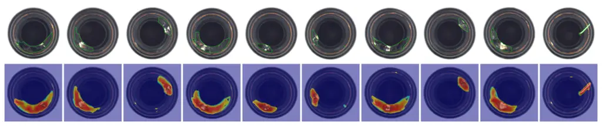

Figure A2: Qualitative localization on MVTec-AD bottle. Top: input with
ground-truth contours; bottom: CoEvoAD anomaly map.

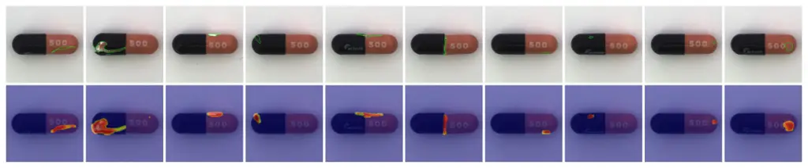

Figure A3: Qualitative localization on MVTec-AD capsule.

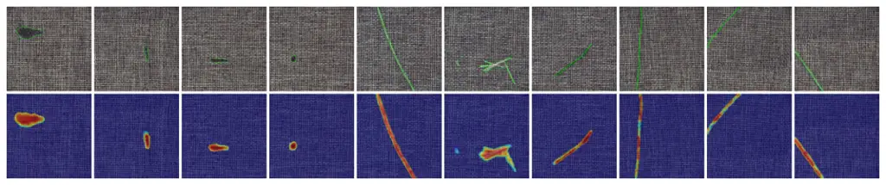

Figure A4: Qualitative localization on MVTec-AD carpet.

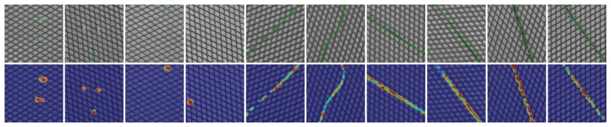

Figure A5: Qualitative localization on MVTec-AD grid.

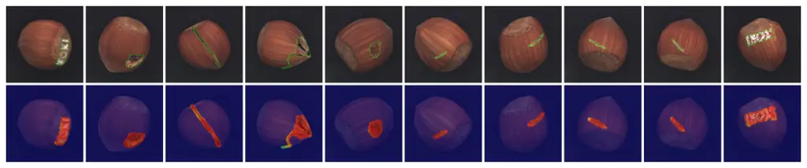

Figure A6: Qualitative localization on MVTec-AD hazelnut.

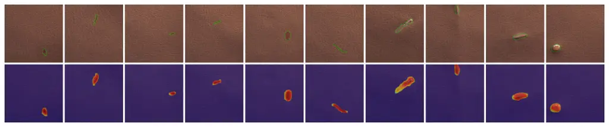

Figure A7: Qualitative localization on MVTec-AD leather.

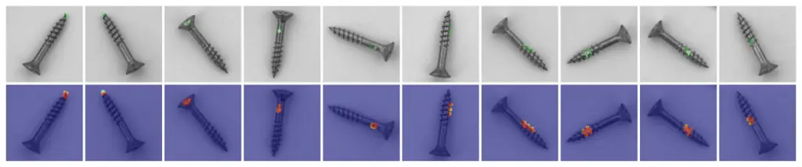

Figure A8: Qualitative localization on MVTec-AD screw.

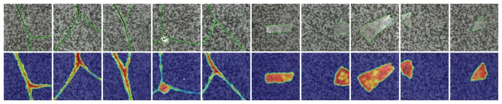

Figure A9: Qualitative localization on MVTec-AD tile.

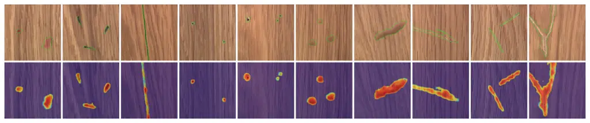

Figure A10: Qualitative localization on MVTec-AD wood.

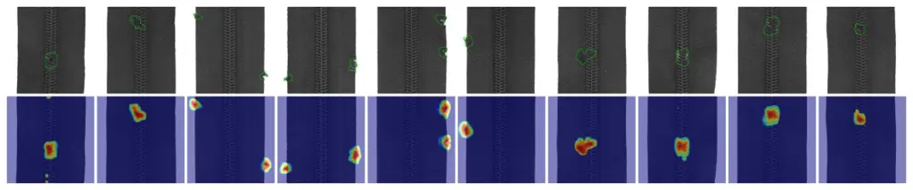

Figure A11: Qualitative localization on MVTec-AD zipper.

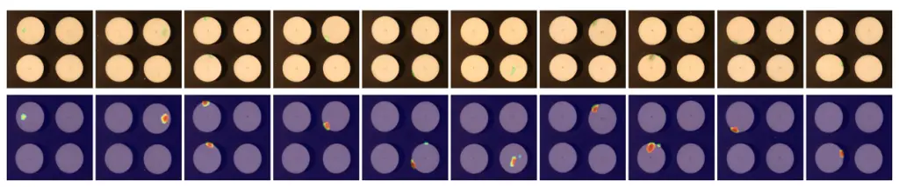

Figure A12: Qualitative localization on VisA candle.

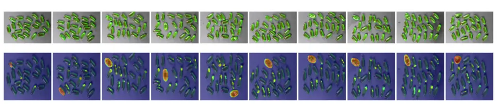

Figure A13: Qualitative localization on VisA capsules.

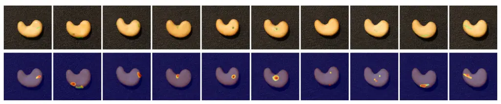

Figure A14: Qualitative localization on VisA cashew.

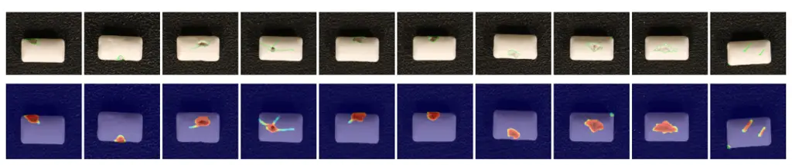

Figure A15: Qualitative localization on VisA chewinggum.

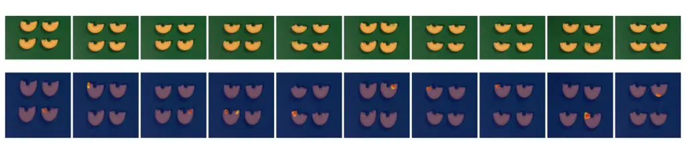

Figure A16: Qualitative localization on VisA macaroni1.

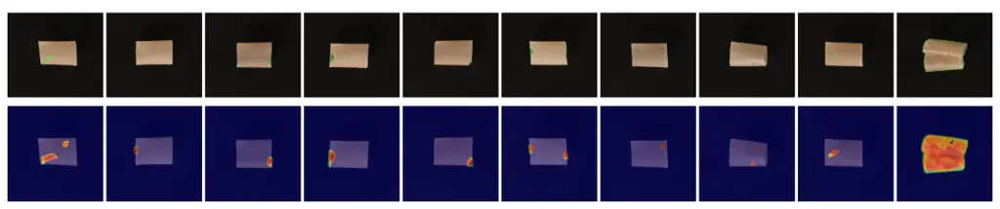

Figure A17: Qualitative localization on VisA pipe_fryum.

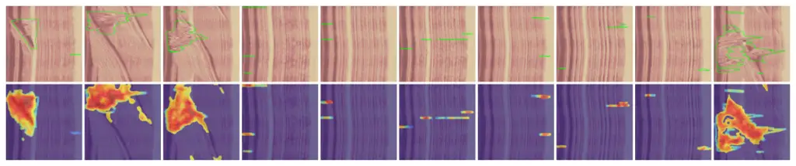

Figure A18: Qualitative localization on BTAD wood.

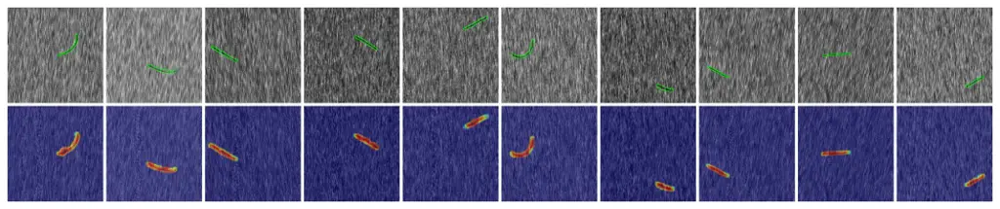

Figure A19: Qualitative localization on DAGM fabric2.

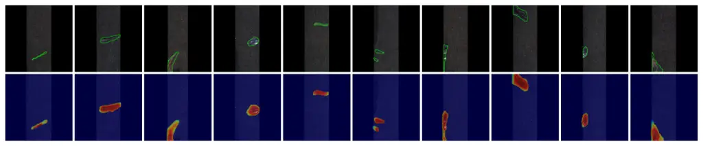

Figure A20: Qualitative localization on KSDD2 metal.

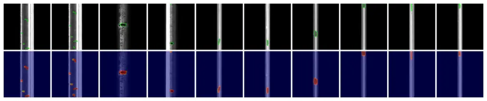

Figure A21: Qualitative localization on RSDD metal15.
