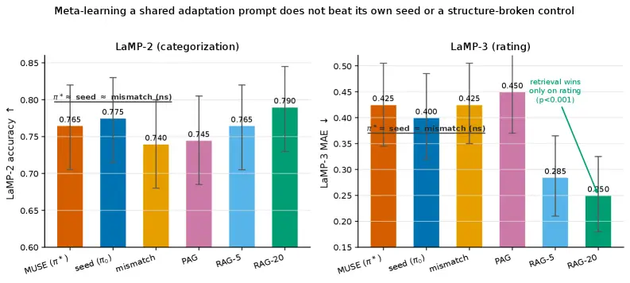
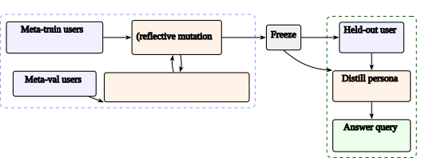
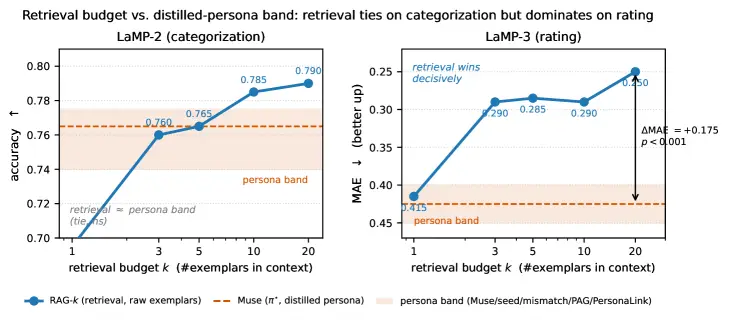
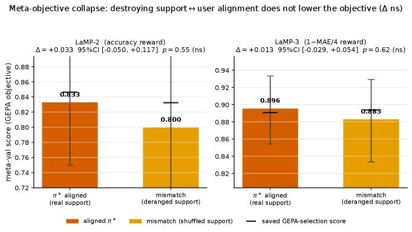
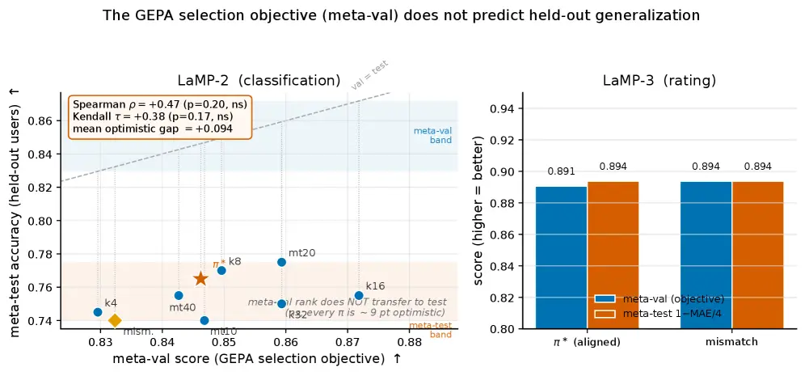
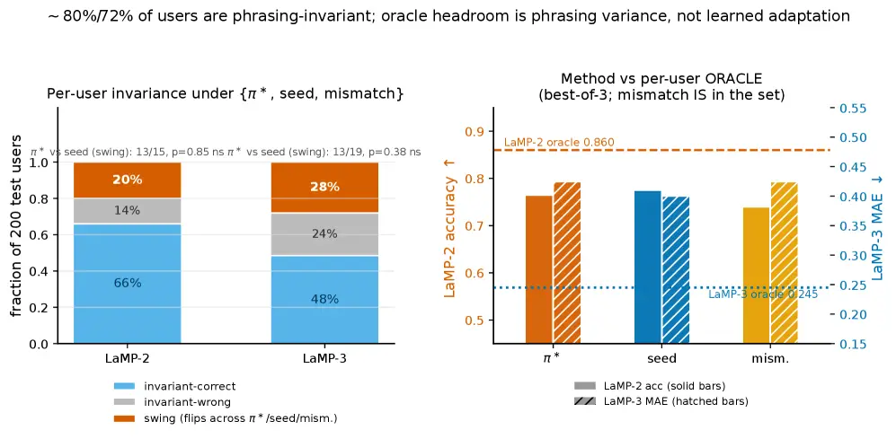

# Prompt-Space Meta-Learning Does Not Transfer Across Users: A Frozen-LLM Negative Result

Liam Byrne, David Dylan, Orla Fitzgerald, Eoin Doyle, Ciara Nolan, Padraig Lynch, and Sinead Gallagher
D. Dylan, L. Byrne, C. Nolan and S. Gallagher are with Trinity College
Dublin; O. Fitzgerald and P. Lynch are with University College Dublin;
E. Doyle is with Dublin City University, Dublin, Ireland.

###### Abstract

Personalizing a frozen large language model (LLM) to individual users is
often framed as a meta-learning problem in prompt space: each user is a
task, and one seeks a shared natural-language adaptation policy that,
given a handful of the user’s labeled interactions, configures the
frozen model for that user. The framing is attractive because it is
backbone-agnostic and reuses the machinery of prompt optimization, yet
the field rarely tests whether the optimized meta-objective encodes
transferable cross-user adaptation rather than generic instruction
quality. We study this question with Muse (Meta-learned User-adaptation
via Shared Evolution), which evolves a single shared adaptation prompt
over a meta-train user population by reflective prompt evolution,
freezes it, and applies it zero-shot to held-out users; matched controls
isolate learning from confounds of phrasing and selection. On two
standard personalization benchmarks (LaMP-2 categorization and LaMP-3
rating) over 200 held-out users each, Muse does not significantly
improve on its own un-evolved seed prompt or on a structure-broken
control that meta-trains on mismatched user–support pairs, and is
dominated by plain few-shot retrieval on the rating task ($`\Delta`$MAE
$`+0.175`$, $`p<0.001`$). We attribute these outcomes to a single
mechanism, _meta-objective collapse_: the meta-validation objective is
statistically invariant to whether the user–support correspondence is
genuine ($`p{=}0.555`$ on LaMP-2, $`p{=}0.622`$ on LaMP-3), so it cannot
be optimized into transferable adaptation and instead rewards
instruction polish and validation overfitting. The seed-prompt,
wrong-support, and invariance–oracle controls form a reusable protocol
that separates learned adaptation from these confounds.

###### Index Terms:

Few-shot learning, frozen language models, large language models,
meta-learning, negative transfer, personalization, prompt optimization,
transfer learning, user modeling.



Figure 1: The headline negative result. On both benchmarks,
meta-learning a shared adaptation prompt with Muse ($`\pi^{\star}`$) is
statistically indistinguishable from applying its own un-evolved seed
prompt ($`\pi_{0}`$) and from a structure-broken control whose persona
policy was meta-trained on deliberately mismatched user–support pairs
(_mismatch_). All three also tie the strongest persona baseline (Pag).
On the LaMP-3 rating task, plain few-shot retrieval (Rag) wins
decisively ($`p<0.001`$); on LaMP-2 categorization all methods cluster
near parity. Bars are accuracy ($`\uparrow`$, left) and mean absolute
error ($`\downarrow`$, right) over $`200`$ held-out users; whiskers are
$`95\%`$ bootstrap confidence intervals. The phrase “meta-learning does
not beat its own seed or a structure-broken control” is the thesis of
this paper.

## I Introduction

Personalization has become a central requirement for large language
model (LLM) services: the same model is expected to serve millions of
users, yet each user brings idiosyncratic preferences, labeling
tendencies, and style. Because retraining or even parameter-efficient
finetuning a hosted model _per user_ is operationally infeasible at
scale, a large and growing body of work personalizes a _frozen_ backbone
by manipulating its input—retrieving the user’s past interactions,
distilling them into a compact persona, or prepending a learned soft or
natural-language prompt \[49, 45, 84, 58, 85\]. A natural and attractive
way to systematize this is to view it as a _meta-learning_ problem. If
we treat each user as a task, with the user’s labeled history as a
support set and their future interactions as queries, then
personalization is exactly the few-shot, fast-adaptation regime that
meta-learning was designed for \[9, 15\]. One would like to meta-learn,
across a population of users, a single _adaptation policy_ that maps any
new user’s support set to a configuration of the frozen model that
performs well on that user’s queries. Because the backbone is frozen and
only its textual input is mutable, the most direct instantiation of this
idea lives in _prompt space_: meta-learn a shared natural-language
“adaptation prompt” that, when combined with a user’s history, induces a
per-user persona. This framing is appealing on several counts—it is
backbone-agnostic, it reuses the mature machinery of prompt optimization
and evolution \[88, 75, 1\], and it promises amortized, transferable
adaptation rather than a bespoke pipeline per user.

This paper asks whether prompt-space meta-learning actually learns
transferable cross-user structure, or whether it merely appears to. We
address the question with a clean instantiation of the idea, Muse
(Meta-learned User-adaptation via Shared Evolution), in which a single
shared adaptation prompt $`\pi`$ is evolved over a meta-train population
of users using reflective prompt evolution in the style of Gepa \[1\],
scored by each candidate’s accuracy (or negative error) on meta-train
users’ own held-out queries, selected on a _disjoint_ meta-validation
population, frozen as $`\pi^{\star}`$, and applied zero-shot to build a
persona for each of $`200`$ held-out test users. Muse sits in an
apples-to-apples harness with a frozen Qwen3-30B-A3B backbone \[74\],
deterministic benchmark scoring, and a battery of strong baselines
(no-personalization, random-user, profile-augmented generation,
distilled personas, and retrieval-augmented few-shot at several
budgets). To our knowledge, this is the first controlled head-to-head
test of Gepa-style prompt evolution _as cross-user meta-learning_ for
frozen-LLM personalization.

The findings are consistent and, at first sight, counterintuitive. Muse
with the evolved $`\pi^{\star}`$ does _not_ significantly outperform the
same pipeline run with its hand-written seed prompt $`\pi_{0}`$; the
seed is in fact numerically better on both benchmarks. Muse also does
_not_ beat a deliberately structure-broken control in which the shared
prompt is meta-trained on _mismatched_ user–support pairs, where each
user’s persona is built from a different user’s history, and it is
statistically tied with the strongest persona baselines. On the rating
benchmark, simple few-shot retrieval dominates all persona methods by a
wide and highly significant margin. These are not isolated null results
but symptoms of a single mechanism, which we name and quantify as
meta-objective collapse. The aggregate meta-validation objective that
the optimizer climbs is structure-blind: it is statistically invariant
to whether the user–support correspondence is genuine. Deranging the
user-to-support assignment during meta-training, which destroys the
adaptive signal by construction, changes the selection objective by an
amount indistinguishable from zero. An objective that cannot distinguish
aligned from scrambled supports cannot, even in principle, be optimized
into transferable adaptation; the optimizer can acquire only generic
instruction polish, which the seed prompt already supplies, together
with overfitting of a small ($`30`$-user) validation population. This is
a concrete instance of _proxy-objective misalignment_: the
meta-validation proxy that is optimized is decoupled from the true goal
of transferable per-user adaptation.

This is a negative result, and we report it as one: the headline
numbers, the retrieval advantage on regression, and every confidence
interval are stated directly. The contribution lies in the rigor of the
diagnosis and in the controls that produce it. The same three controls,
namely a seed-prompt baseline, a wrong-support derangement, and an
invariance/oracle decomposition, constitute a reusable evaluation
protocol that can be applied before attributing learned adaptation to a
prompt-space method. Without them, the instruction polish and validation
overfit that Muse exhibits are easily mistaken for genuine cross-user
transfer. Figure˜1 previews the finding.

Contributions. The main contributions of this paper are summarized as
follows.

- •
  Muse: a clean instantiation and test of prompt-space meta-learning for
  personalization. We formalize users-as-tasks personalization of a
  frozen LLM and instantiate it with Muse, the first apples-to-apples
  test of Gepa-style reflective prompt evolution as a cross-user
  meta-learner. Muse evolves one shared natural-language adaptation
  prompt over a meta-train user population, freezes it, and applies it
  zero-shot to held-out users (Sections˜III and IV).
- •
  The meta-objective collapse diagnosis via a derangement control. Using
  a mismatch (wrong-support) control, we show that the meta-validation
  objective is _statistically invariant_ to scrambling the user–support
  correspondence ($`\Delta`$ accuracy $`+0.033`$, $`95\%`$ CI
  $`[-0.050,+0.117]`$, $`p{=}0.555`$ on LaMP-2; $`\Delta`$ reward
  $`+0.013`$, $`[-0.029,+0.054]`$, $`p{=}0.622`$ on LaMP-3). An
  objective blind to this structure carries no exploitable cross-user
  adaptive signal (Section˜VII).
- •
  Quantified meta-overfitting at small population scale. We measure a
  uniform optimistic gap of $`\approx\!9`$ points between
  meta-validation and meta-test on LaMP-2, show that meta-validation
  does not significantly rank held-out test performance (Spearman
  $`\rho{=}+0.47`$, $`p{=}0.20`$, ns), and observe flat, non-monotone
  support-size and meta-train-size sweeps—the signature of selection-set
  overfitting rather than learned adaptation (Section˜VII).
- •
  An invariance/oracle decomposition and a reusable evaluation protocol.
  We decompose test behavior into phrasing-invariant and
  phrasing-sensitive cases ($`80\%`$/$`72\%`$ invariant on
  LaMP-2/LaMP-3), attribute the oracle headroom to phrasing variance
  rather than learned adaptation, and package the seed-prompt,
  wrong-support, and invariance/oracle controls into a protocol for
  distinguishing learned adaptation from instruction polish and
  validation overfit (Sections˜VII and VIII).

Roadmap. Section˜II surveys LLM personalization, meta-learning and fast
adaptation, in-context learning as meta-learning, prompt optimization,
test-time adaptation, and retrieval, and positions our study on the
_learning_ axis (does the meta-objective improve adaptation over a
seed?), which is orthogonal to the representation axis of distillation
versus retrieval. Section˜III formalizes users-as-tasks personalization.
Section˜IV details Muse. Section˜V describes the benchmarks, baselines,
backbone, metrics, and controls. Section˜VI reports the main results.
Section˜VII establishes meta-objective collapse through its three
mechanistic legs plus the invariance/oracle decomposition. Section˜VIII
draws the protocol-level lessons, states when prompt-space meta-learning
can and cannot be expected to work, and lists limitations. Section˜IX
concludes.

## II Related Work

We organize prior work along six threads that jointly define the setting
and the methods we test: (i) LLM personalization and user modeling;
(ii) meta-learning and fast adaptation; (iii) in-context learning
understood as meta-learning; (iv) prompt optimization and evolution;
(v) test-time adaptation; and (vi) retrieval and retrieval-augmented
generation. Throughout, we distinguish two orthogonal axes. The
_representation_ axis asks how a user’s history is encoded into the
frozen model’s input (e.g., a distilled persona versus retrieved
exemplars); the sibling study “Distill or Retrieve?” isolates that axis
and we therefore reference it exactly once, below, to make clear that
our contribution is on a different axis. The _learning_ axis—our
focus—asks whether a meta-objective that climbs over a user population
improves adaptation beyond a fixed seed policy. Our negative finding
lives entirely on the learning axis.

### II-A LLM Personalization and User Modeling

The Language Model Personalization (LaMP) benchmark suite established a
standard protocol in which each user supplies a profile of past, labeled
interactions and the model must predict the user’s behavior on new
items \[49, 24\]. A dominant family of methods augments the prompt with
the user’s profile, either directly or after summarization.
Profile-Augmented Generation (PAG) distills a user’s history into a
natural-language profile with a fixed, hand-written instruction \[45\];
retrieval-of-profile-then-generate pipelines select the most relevant
past items before answering \[48\]. PersonaAgent and related agentic
personalizers iterate a persona through self-feedback \[84\], while
plug-in user encoders such as P-PLUG and UserLLM compress a user into
soft tokens or embeddings that condition the backbone \[30, 38\].
Parameter-side personalization, exemplified by OPPU and per-user
parameter-efficient modules \[58, 59, 14\], finetunes a small adapter
per user; these are powerful but assume write access to model weights,
which the hosted-frozen-backbone setting precludes. A complementary
literature models users for recommendation and preference
prediction \[71, 81, 36\], builds explicit long-term memory of user
state \[40, 87\], and studies persona consistency and role
fidelity \[83, 70, 60, 52, 68, 61, 50, 7\]. Surveys of LLM
personalization and of personalized LLMs \[85, 29, 65\] catalog these
approaches but, as we argue here, rarely separate genuine learned
adaptation from prompt-engineering artifacts. Our Muse uses the same
distilled-persona representation as PAG and PersonaLink, but replaces
their fixed adaptation instruction with a meta-learned one, isolating
exactly the “does meta-learning help?” question.

### II-B Meta-Learning and Fast Adaptation

Meta-learning seeks an inductive bias—an initialization, an optimizer,
or a metric space—that enables rapid adaptation to new tasks from few
examples \[15\]. Gradient-based methods learn an initialization from
which a few SGD steps suffice: MAML and its relatives \[9, 37, 27, 41,
4\], and learned-optimizer approaches \[3, 43\]. Metric-based methods
learn an embedding in which simple nearest-neighbor or prototype rules
generalize \[56, 62, 39\], and memory- or attention-augmented learners
amortize adaptation in a forward pass \[51, 33\]. Continual and online
variants study adaptation without catastrophic forgetting \[19\], and
the paradigm has been applied to recommendation, machine translation,
and control as a few-shot user/task problem \[25, 12, 79\]. The
users-as-tasks view we adopt is the natural transcription of this
literature to personalization: a user is a task, the profile is a
support set, and we seek a shared policy that adapts fast. A central and
well-known risk in meta-learning is that the meta-objective can be
optimized in ways that do not produce genuine task-adaptive
behavior—“memorization” or shortcut solutions that exploit the
meta-training distribution rather than learning to adapt \[41, 79\]. Our
negative result is a sharp, prompt-space manifestation of exactly this
risk.

### II-C In-Context Learning as Meta-Learning

A parallel line interprets in-context learning (ICL) itself as implicit
meta-learning: a model trained on many sequences learns to infer a
latent task from a few in-context examples and apply it to a query.
MetaICL explicitly meta-trains a model to do ICL across tasks \[32\];
theoretical and mechanistic analyses show that transformers can
implement learning algorithms (e.g., gradient descent or ridge
regression) in their forward pass over the context \[2, 63\]. This
perspective is important for our study because it clarifies what a
frozen backbone already does: given a user’s exemplars in context, the
model performs a form of implicit adaptation _for free_. The retrieval
baselines we compare against exploit precisely this—they place raw user
exemplars in the context and let the frozen model adapt
implicitly—whereas Muse attempts to meta-learn an _explicit_ adaptation
instruction on top. One reading of our results is that the explicit
prompt-space meta-objective adds little over the implicit adaptation the
backbone already supplies.

### II-D Prompt Optimization and Evolution

Because the backbone is frozen, prompt-space personalization inherits
the toolkit of automatic prompt optimization. Discrete search and
reinforcement methods such as APE and OPRO search instruction text
against a validation metric \[88, 75\]; DSPy compiles and optimizes
multi-stage prompt programs \[22\]; and evolutionary or reflective
methods—Promptbreeder, ExpeL, agentic memory induction, and notably
Gepa’s genetic–Pareto reflective evolution—mutate prompts from
natural-language feedback on prior rollouts \[8, 86, 69, 1, 82\].
Reflective self-improvement of model outputs more broadly \[31, 54, 11,
16, 80, 72\] shares the same engine: an LLM critiques and rewrites text
against a target. Our Muse uses Gepa’s loop verbatim, but elevates the
optimized prompt from a per-task strategy to a _shared, frozen,
cross-user adaptation policy_. This is what makes it a meta-learner
rather than a per-instance optimizer, and it is also what exposes the
failure mode: when the optimization target is an aggregate over a user
population, the target can be structure-blind even when each per-user
evaluation looks reasonable. We frame this failure as _proxy-objective
misalignment_, in the sense surveyed for LLM and agent objectives
by \[77\]: the meta-validation proxy that Gepa maximizes is decoupled
from the true goal of transferable adaptation, and our derangement
control _is_ the operational demonstration of that proxy-versus-goal
gap.

### II-E Test-Time and Grounded Adaptation

Test-time adaptation updates a model on the fly using the test input
itself. Test-time training and entropy-minimization methods such as TTT,
Tent, and gradient-edited variants adapt parameters per instance \[57,
64, 34\], while recent “thinking at test time” approaches scale
inference-time computation against a verifiable signal \[55, 35, 78,
67\]. What unites the _successful_ members of this family is a
per-instance, grounded feedback signal: a self-consistency check, a
verifier, a unit test, or a tool-execution result that tells the
adapter, for _this_ input, whether it is on track. The contrast with our
setting is the crux of the paper. Grounded, instance-level test-time
adaptation—for example, agentic tool reasoning that is verified per call
against execution feedback \[76\]—can genuinely improve because its
objective is tied to a checkable outcome on each instance. Muse’s
meta-objective is the opposite: it is an aggregate over a population,
with no per-instance grounding, and that is precisely why it collapses.
What Muse lacks is exactly the instance-level, verifiable feedback that
makes grounded test-time adaptation work. We return to this contrast in
Section˜VIII.

### II-F Retrieval and Retrieval-Augmented Generation

The strongest baselines in our study are retrieval-augmented few-shot
prompts, which fetch a user’s most relevant past items and place them,
verbatim, in the context. This builds on classical sparse and dense
retrieval \[46, 20, 17, 73, 10, 23\], retrieval-augmented language
modeling and generation \[26, 13, 6, 18, 42, 53, 21, 5\], and
demonstration selection for ICL \[28, 47, 66\]. For personalization
specifically, retrieving the user’s own history is a very strong,
training-free baseline because it preserves fine-grained, instance-level
signal (e.g., a user’s exact rating calibration) that a distilled
persona discards. The orthogonal axis of _representation_—whether to
distill a user into a compact persona or to retrieve raw exemplars—is
studied directly by the sibling work “Distill or Retrieve?”; we cite it
here once to delimit scope and to make explicit that the present paper
does _not_ re-litigate that axis. Our study holds the representation
fixed (a distilled persona, as in PAG/PersonaLink) and varies only the
_learning_ of the adaptation policy, asking whether meta-learning the
policy beats a seed. The retrieval baselines enter our tables as a
reference point and, on the regression task, as the decisive winner—an
honest fact we report rather than minimize.

## III Problem Formulation

### III-A Users as Tasks

Let $`f`$ denote a _frozen_ autoregressive LLM that maps a textual
prompt to a textual output; its parameters are fixed and never updated.
Personalization must therefore act entirely through $`f`$’s input. We
adopt an episodic, users-as-tasks formulation. A user $`u`$ is a task
with an associated distribution $`\mathcal{D}_{u}`$ over labeled items
$`(x,y)`$, where $`x`$ is an input (e.g., a news article or a product
review) and $`y`$ is the label this user would assign (a category or a
rating). Each user exposes a finite _support set_
$`S_{u}=\{(x_{i},y_{i})\}_{i=1}^{m_{u}}`$ (their profile of past labeled
interactions) and is evaluated on held-out _query_ items drawn from the
same $`\mathcal{D}_{u}`$. The population of users is partitioned into
three mutually disjoint sets: a meta-train set
$`\mathcal{U}_{\text{tr}}`$, a meta-validation set
$`\mathcal{U}_{\text{val}}`$, and a meta-test set
$`\mathcal{U}_{\text{te}}`$. No user appears in more than one set, so
generalization is measured across users, not merely across items within
a user. Table˜I collects the notation.

| Symbol                                                                       | Meaning                                                                    |
| ---------------------------------------------------------------------------- | -------------------------------------------------------------------------- |
| $`f`$                                                                        | frozen backbone LLM (greedy decoding, parameters fixed)                    |
| $`u`$                                                                        | a user, identified with a meta-task                                        |
| $`\mathcal{D}_{u}`$                                                          | user $`u`$’s item distribution over $`(x,y)`$                              |
| $`S_{u}`$                                                                    | user $`u`$’s support set (labeled profile)                                 |
| $`Q_{u}`$                                                                    | user $`u`$’s held-out query items                                          |
| $`\mathcal{U}_{\text{tr}},\mathcal{U}_{\text{val}},\mathcal{U}_{\text{te}}`$ | disjoint meta-train / meta-val / meta-test user sets                       |
| $`\pi`$                                                                      | shared natural-language adaptation prompt (the meta-parameter)             |
| $`\pi_{0}`$                                                                  | hand-written seed adaptation prompt                                        |
| $`\pi^{\star}`$                                                              | evolved, frozen adaptation prompt selected on $`\mathcal{U}_{\text{val}}`$ |
| $`\mathcal{A}(\pi,S_{u})`$                                                   | inner adaptation: build user $`u`$’s persona under $`\pi`$                 |
| $`\theta_{u}`$                                                               | the induced per-user persona (preamble text)                               |
| $`\ell`$                                                                     | item-level loss / score (accuracy or absolute error)                       |
| $`\mathcal{M}(\pi)`$                                                         | meta-objective: population score of $`\pi`$                                |
| $`\sigma`$                                                                   | a derangement of the user$`\to`$support assignment                         |
| $`K`$                                                                        | support-set cap (items per user used to build the persona)                 |
| $`\rho,\tau`$                                                                | Spearman / Kendall rank correlations                                       |

TABLE I: Notation used throughout the paper.

### III-B Inner Adaptation and the Meta-Objective

Adaptation to a user is mediated by a shared, learnable natural-language
_adaptation prompt_ $`\pi`$, the meta-parameter. The inner adaptation
operator $`\mathcal{A}`$ takes $`\pi`$ and a user’s support set and
produces a per-user persona $`\theta_{u}`$ by a single call to the
frozen model,

```math
\theta_{u}\;=\;\mathcal{A}(\pi,S_{u})\;=\;f\big(\,\textsc{distill}(\pi,S_{u})\,\big), \tag{1}
```

where $`\textsc{distill}(\pi,S_{u})`$ is a fixed template that injects
$`\pi`$ as the controlling instruction over a digest of the user’s
history and elicits a bounded persona (a preference summary, a few
exemplars, and a few decision rules; see Section˜IV). The persona
$`\theta_{u}`$ is then prepended to a query and the frozen model
answers,

```math
\hat{y}\;=\;f\big(\,\theta_{u}\,\|\,x\,\big),\qquad(x,y)\in Q_{u}, \tag{2}
```

with “$`\|`$” denoting prompt concatenation. The per-user performance of
$`\pi`$ is the expected item score on that user’s queries,

```math
J_{u}(\pi)\;=\;\mathbb{E}_{(x,y)\sim Q_{u}}\Big[\,\ell\big(f(\mathcal{A}(\pi,S_{u})\|x),\,y\big)\Big], \tag{3}
```

where $`\ell`$ is accuracy for categorization and a bounded
negative-error reward for rating (so that larger is better in both
cases). The _meta-objective_ is the population average over a user set
$`\mathcal{U}`$,

```math
\mathcal{M}_{\mathcal{U}}(\pi)\;=\;\frac{1}{|\mathcal{U}|}\sum_{u\in\mathcal{U}}J_{u}(\pi). \tag{4}
```

Meta-learning seeks
$`\pi^{\star}=\arg\max_{\pi}\,\mathcal{M}_{\mathcal{U}_{\text{tr}}}(\pi)`$,
with the final $`\pi^{\star}`$ _selected_ by its score
$`\mathcal{M}_{\mathcal{U}_{\text{val}}}`$ on the disjoint
meta-validation users, and reported on the held-out meta-test users via
the benchmark’s native metric.

### III-C What “Transfer” Requires, and the Structure-Blindness Test

For prompt-space meta-learning to be meaningful,
$`\mathcal{M}_{\mathcal{U}}(\pi)`$ must reward $`\pi`$ for producing
personas that are genuinely _adapted_ to the right user—that is, the
objective must depend on the correspondence between a user’s support set
$`S_{u}`$ and that user’s queries $`Q_{u}`$. We make this requirement
operational with a derangement. Let $`\sigma`$ be a permutation of
$`\mathcal{U}_{\text{tr}}`$ with no fixed point, and define the
_mismatched_ meta-objective

```math
\mathcal{M}^{\sigma}_{\mathcal{U}}(\pi)\;=\;\frac{1}{|\mathcal{U}|}\sum_{u\in\mathcal{U}}\mathbb{E}_{(x,y)\sim Q_{u}}\Big[\,\ell\big(f(\mathcal{A}(\pi,S_{\sigma(u)})\|x),\,y\big)\Big], \tag{5}
```

in which each user’s persona is built from _another_ user’s support set
$`S_{\sigma(u)}`$ but still graded on the original user’s queries
$`Q_{u}`$. If the objective carries genuine cross-user adaptive signal,
then aligned supports must help relative to scrambled ones, i.e.,
$`\mathcal{M}_{\mathcal{U}}(\pi)>\mathcal{M}^{\sigma}_{\mathcal{U}}(\pi)`$
by a margin the optimizer can exploit. We define meta-objective collapse
as the empirical condition

```math
\mathcal{M}_{\mathcal{U}_{\text{val}}}(\pi)\;\approx\;\mathcal{M}^{\sigma}_{\mathcal{U}_{\text{val}}}(\pi), \tag{6}
```

i.e., the meta-objective is statistically invariant to whether the
user–support correspondence is real. Under Equation˜6, no optimizer can
convert $`\mathcal{M}`$ into transferable adaptation, because the
quantity it climbs does not distinguish adaptation from its
structure-destroyed counterpart. Section˜VII shows that Equation˜6 holds
on both benchmarks.

## IV Method: Muse

Muse (Meta-learned User-adaptation via Shared Evolution) is the most
direct instantiation of the formulation in Section˜III that is
compatible with a hosted, frozen backbone. It meta-learns a _single_
shared adaptation prompt over a user population, freezes it, and applies
it zero-shot to unseen users. The only quantity that differs between
Muse and a fixed-instruction persona baseline such as PAG is _where the
adaptation instruction comes from_: PAG uses a hand-written instruction;
Muse uses a meta-learned one. Figure˜2 sketches the pipeline.



Figure 2: The Muse pipeline. A single shared adaptation prompt $`\pi`$
is evolved over a meta-train user population with Gepa-style reflective
mutation, where each candidate $`\pi`$ is scored by the accuracy /
negative-error reward of the personas it induces on each meta-train
user’s own held-out query slice (Equations˜3 and 4). The best $`\pi`$ on
the disjoint meta-validation users is frozen as $`\pi^{\star}`$ and
applied zero-shot to each held-out test user: one frozen-LLM call
distills the user’s support into a persona $`\theta_{u}`$, and one call
answers the query under that persona. The backbone is frozen throughout;
only the textual prompt changes.

### IV-A Inner Loop: Persona Distillation under $`\pi`$

Given a user’s support set, the inner loop issues a single call to the
frozen model in which $`\pi`$ is injected as the controlling instruction
over a digest of the user’s labeled history, and the model returns a
bounded persona in a fixed JSON schema with three fields: a
$`\leq\!600`$-character preference summary, up to six induced exemplars
(each an input-gist $`\to`$ label pair), and up to six short decision
rules of the form “if _cue_ then _label_”. The persona is clipped to
these bounds, rendered into a compact natural-language preamble, and
reused for every query of that user. The schema, the parser, the
clipping, and the answer call are shared verbatim with the
PersonaLink/PAG harness so that the _only_ delta across these methods is
the adaptation instruction. The task-specific information (the $`15`$
LaMP-2 categories or the $`1`$–$`5`$ rating scale) is supplied by the
data digest and the fixed template, not by $`\pi`$, so that a single
$`\pi`$ can in principle serve both benchmarks. Answering is a single
greedy call with the persona prepended to the query; benchmark scoring
is deterministic, with no LLM judge.

### IV-B Outer Loop: Shared Prompt Evolution

The meta-parameter $`\pi`$ is optimized with Gepa’s genetic–Pareto
reflective evolution \[1\], reused without modification to its core
loop. The optimizer maintains a growing pool of candidate prompts,
seeded with the hand-written $`\pi_{0}`$. Each iteration samples a
parent from the pool by instance-frontier (Pareto) coverage over the
meta-validation users, draws a meta-train minibatch, and—if the parent
is not already perfect on the minibatch—reflectively mutates it: the
same frozen model is shown the current $`\pi`$ together with per-user
digests of where the $`\pi`$-built personas mispredicted, and is asked
to rewrite $`\pi`$ into a better _general_ recipe for persona
construction (how to infer stable preferences from limited history,
surface label-specific cues and user biases, turn patterns into crisp
rules and well-chosen exemplars, and break near-ties), under an explicit
instruction not to specialize to any single user. A child is accepted if
it does not worsen the minibatch score; accepted children are re-scored
on the full meta-validation set and added to the pool. After the rollout
budget is exhausted, the candidate with the best meta-validation
aggregate is frozen as $`\pi^{\star}`$. Algorithm˜1 states the
procedure. Two design points are essential to the honesty of the test.
First, the reflection model, the inner model, and the answer model are
the _same_ frozen backbone, so no extra capacity is smuggled in. Second,
$`\pi`$ is _shared_ across all users and then frozen; it is never tuned
to a test user, which is what makes Muse a meta-learner rather than a
per-user optimizer.

0: frozen LLM $`f`$; meta-train users $`\mathcal{U}_{\text{tr}}`$,
meta-val $`\mathcal{U}_{\text{val}}`$; seed prompt $`\pi_{0}`$; support
cap $`K`$; query size; rollout budget $`B`$

1: pool $`\leftarrow\{\pi_{0}\}`$;  record
$`\mathcal{M}_{\mathcal{U}_{\text{val}}}(\pi_{0})`$ via (4)

2: while calls $`<B`$ do

3:  $`\pi\leftarrow`$ ParetoSelect(pool, $`\mathcal{U}_{\text{val}}`$)
// instance-frontier coverage

4:  draw meta-train minibatch $`M\subseteq\mathcal{U}_{\text{tr}}`$

5:  for all $`u\in M`$ do

6:   split profile into support $`S_{u}`$ (cap $`K`$) and held-out query
$`Q_{u}`$

7:   $`\theta_{u}\leftarrow\mathcal{A}(\pi,S_{u})`$ // (1): 1 call

8:   score $`\theta_{u}`$ on $`Q_{u}`$; collect mispredictions // (3)

9:  end for

10:  if minibatch score is not perfect then

11:   $`\pi^{\prime}\leftarrow`$
ReflectMutate$`(f,\pi,\{\text{mispredictions}\})`$

12:   accept $`\pi^{\prime}`$ if it does not worsen the minibatch score

13:   if accepted: score $`\pi^{\prime}`$ on
$`\mathcal{U}_{\text{val}}`$; add to pool

14:  end if

15: end while

16: $`\pi^{\star}\leftarrow\arg\max_{\pi\in\text{pool}}\mathcal{M}_{\mathcal{U}_{\text{val}}}(\pi)`$

17: freeze $`\pi^{\star}`$

18: at test: for each $`u\in\mathcal{U}_{\text{te}}`$, build
$`\theta_{u}=\mathcal{A}(\pi^{\star},S_{u})`$ and answer
$`\hat{y}=f(\theta_{u}\|x)`$

19: return $`\pi^{\star}`$, meta-test predictions

Algorithm 1 Muse: shared-prompt meta-learning for frozen-LLM
personalization.

### IV-C Controls Built into the Method

Two controlled variants of Muse are central to the diagnosis and are run
through the identical pipeline. The seed control (Muse-seed) skips
evolution entirely and applies the frozen, un-meta-learned $`\pi_{0}`$
to the test users; it isolates how much of any apparent gain is generic
instruction quality already present before learning. The mismatch
control (Muse-mismatch) meta-trains $`\pi`$ under the deranged objective
of Equation˜5—each meta-train user’s persona is built from a
deterministically shuffled other user’s support set, while still graded
on the user’s own queries—then tests on the real users; it isolates
whether the meta-objective carries any cross-user adaptive signal at
all. If Muse$`(\pi^{\star})`$ cannot beat Muse-seed, the evolution
bought nothing the seed lacked; if it cannot beat Muse-mismatch, the
objective it climbed was structure-blind. Both turn out to hold.

## V Experimental Setup

### V-A Benchmarks and User Splits

We evaluate on two tasks from the LaMP suite \[49\]. LaMP-2 is
personalized news categorization: given an article, predict which of
$`15`$ categories _this_ user would assign; the metric is accuracy
($`\uparrow`$) with macro-F1 as a secondary measure. LaMP-3 is
personalized product-review rating: predict the $`1`$–$`5`$ score _this_
user would give; the metrics are mean absolute error (MAE,
$`\downarrow`$) and root mean squared error (RMSE, $`\downarrow`$). Each
LaMP question identifier corresponds to one user with a profile of past
labeled items. From the development split we form a candidate user pool
by keeping users with at least $`16`$ profile items and removing the
$`200`$ designated test users; the meta-train and meta-validation users
are drawn from this pool, yielding three mutually disjoint user sets:
$`|\mathcal{U}_{\text{tr}}|{=}40`$, $`|\mathcal{U}_{\text{val}}|{=}30`$,
and $`|\mathcal{U}_{\text{te}}|{=}200`$ per benchmark. Disjointness is
enforced at the user level, so all reported generalization is across
users. Within a user, the profile is split into a support pool and a
held-out query slice that never overlap; the test users’ single LaMP
test item is never part of their profile. Table˜II summarizes the
resulting per-benchmark configuration; the two tasks share an identical
user-split protocol and differ only in label space (a $`15`$-way
category set versus a $`1`$–$`5`$ ordinal scale) and metric family.

|                             |                           |                     |
| --------------------------- | ------------------------- | ------------------- | ------- | ------- |
| Property                    | LaMP-2                    | LaMP-3              |
| Task                        | news categorization       | review rating       |
| Label space                 | $`15`$ categories         | $`1`$–$`5`$ ordinal |
| Primary metric              | accuracy $`\uparrow`$     | MAE $`\downarrow`$  |
| Secondary metric            | macro-F1 $`\uparrow`$     | RMSE $`\downarrow`$ |
| Meta-train users $`         | \mathcal{U}\_{\text{tr}}  | `$                  | $`40`$  | $`40`$  |
| Meta-val users $`           | \mathcal{U}\_{\text{val}} | `$                  | $`30`$  | $`30`$  |
| Meta-test users $`          | \mathcal{U}\_{\text{te}}  | `$                  | $`200`$ | $`200`$ |
| Profile filter              | $`\geq 16`$ items         | $`\geq 16`$ items   |
| Support cap $`K`$ (default) | $`24`$                    | $`24`$              |
| Held-out query / user       | $`8`$                     | $`8`$               |
| Test items / test user      | $`1`$                     | $`1`$               |
| User-level disjointness     | yes                       | yes                 |

TABLE II: Dataset and user-split statistics. Both LaMP tasks share the
same users-as-tasks protocol (disjoint $`40`$/$`30`$/$`200`$
meta-train/val/test users, $`\geq 16`$-item profile filter); they differ
only in the label space and metric family. “Support / query” are the
per-user inner-loop slices; the single LaMP test item per test user is
held out of the profile.

### V-B Backbone and Decoding

All methods share one frozen backbone, Qwen3-30B-A3B \[74\], served
locally on four GPUs. Decoding is greedy (temperature $`0`$, single
sample) for every call—persona distillation, reflection, and
answering—so that the only per-method difference is the text prepended
to an identical question. We use no LLM judge; all scoring is the
benchmark’s deterministic metric. Because the serving stack is not
bitwise-deterministic across runs, we treat the _item_ as the unit of
analysis (rather than averaging over decoding seeds) and report paired,
per-item statistics, following our harness’s convention.

### V-C Baselines

We compare Muse against a ladder of training-free and
prompt-optimization baselines, all in the same harness. NoPers answers
with no personalization (a zero-knowledge lower bound). RandomUser
builds the persona from a _random other_ user’s profile, controlling for
the mere presence of persona text. PAG \[45\] distills the user’s
profile into a natural-language persona with a fixed hand-written
instruction. PersonaLink is a self-refining persona distiller; we report
its first refinement round (PersonaLink\_(r1)), with additional rounds in
the appendix. RAG-$`k`$ retrieves the user’s $`k`$ most relevant past
items and places them verbatim in the context as few-shot exemplars, for
$`k\in\{1,3,5,10,20\}`$; this is the strongest training-free baseline
and the one that preserves fine-grained instance-level signal. The
Oracle row in Section˜VII is a per-item best-of-three over
$`\{\pi^{\star},\text{seed},\text{mismatch}\}`$ and is reported only as
an upper bound on phrasing variance, not as a deployable method.

### V-D Metrics and Statistics

Point metrics are accuracy/macro-F1 (LaMP-2) and MAE/RMSE (LaMP-3) over
the $`200`$ test users. We attach a $`95\%`$ bootstrap confidence
interval to every metric. Paired comparisons use the item as the unit:
for classification we use McNemar’s test on per-item correctness
(reporting the discordant counts $`A_{\text{w}}/B_{\text{w}}`$), and for
regression a paired bootstrap ($`10{,}000`$ resamples) on per-item
absolute error, with the sign of $`\Delta`$MAE indicating which method
is better. We label any comparison with $`p\geq 0.05`$ as ns (not
significant). Rank correlations between meta-validation and meta-test
use Spearman $`\rho`$ and Kendall $`\tau`$. For the collapse analysis we
recompute the meta-objective (4) and the deranged objective (5) on the
$`30`$ meta-validation users with a paired bootstrap on their
difference.

### V-E Seed and Mismatch Controls

The two controls of Section˜IV are run end-to-end. The seed control
applies the frozen $`\pi_{0}`$ with no evolution. The mismatch control
evolves $`\pi`$ under a fixed, deterministic derangement of the
meta-train user-to-support assignment (no fixed points), tests on the
real users, and is otherwise identical to Muse. We additionally sweep
the support cap $`K\in\{4,8,16,32\}`$ and the meta-train size
$`|\mathcal{U}_{\text{tr}}|\in\{10,20,40\}`$, re-evolving and re-testing
for each setting, to probe whether more support or more meta-train users
induces transfer.

## VI Results

Table˜IV reports the main comparison; Figure˜1 visualizes the headline
rows. We organize the findings as finding-titled subsections. Table˜III
attaches the $`95\%`$ bootstrap confidence intervals to the two headline
metrics (LaMP-2 accuracy and LaMP-3 MAE); the intervals are wide
relative to the inter-method spread and overlap heavily across all
persona methods and Muse variants, which is the interval-level
restatement of the null findings below—only Rag on LaMP-3 sits in a
visibly lower MAE band.

|                         |                                       |                                       |
| ----------------------- | ------------------------------------- | ------------------------------------- |
|                         | LaMP-2 Acc $`\uparrow`$               | LaMP-3 MAE $`\downarrow`$             |
| Method                  | \[95% CI\]                            | \[95% CI\]                            |
| NoPers                  | $`0.645`$  $`[0.576,0.711]`$          | $`0.500`$  $`[0.420,0.585]`$          |
| RandomUser              | $`0.665`$  $`[0.597,0.730]`$          | $`0.565`$  $`[0.475,0.660]`$          |
| PAG                     | $`0.745`$  $`[0.685,0.805]`$          | $`0.450`$  $`[0.370,0.535]`$          |
| PersonaLink\_(r1)       | $`0.755`$  $`[0.695,0.810]`$          | $`0.425`$  $`[0.350,0.505]`$          |
| RAG-5                   | $`0.765`$  $`[0.705,0.820]`$          | $`0.285`$  $`[0.220,0.355]`$          |
| RAG-20                  | $`\mathbf{0.790}`$  $`[0.735,0.845]`$ | $`\mathbf{0.250}`$  $`[0.190,0.315]`$ |
| Muse ($`\pi^{\star}`$)  | $`0.765`$  $`[0.705,0.820]`$          | $`0.425`$  $`[0.350,0.505]`$          |
| Muse-seed ($`\pi_{0}`$) | $`0.775`$  $`[0.715,0.830]`$          | $`0.400`$  $`[0.325,0.480]`$          |
| Muse-mismatch           | $`0.740`$  $`[0.680,0.800]`$          | $`0.425`$  $`[0.350,0.505]`$          |

TABLE III: Headline point estimates with $`95\%`$ bootstrap confidence
intervals ($`200`$ test users; intervals from the same item-level
resampling used for the paired tests). For LaMP-2 the metric is accuracy
($`\uparrow`$); for LaMP-3 it is MAE ($`\downarrow`$). The persona/Muse
intervals mutually overlap (no learned-adaptation separation), whereas
Rag-20 on LaMP-3 clears the persona band.

|                                                       |              |      |                           |                       |                    |                     |
| ----------------------------------------------------- | ------------ | ---- | ------------------------- | --------------------- | ------------------ | ------------------- |
|                                                       |              |      | LaMP-2 (categorization)   |                       | LaMP-3 (rating)    |                     |
| Method                                                | Type         | Cost | Acc $`\uparrow`$          | macro-F1 $`\uparrow`$ | MAE $`\downarrow`$ | RMSE $`\downarrow`$ |
| NoPers                                                | none         | 1    | 0.645                     | 0.388                 | 0.500              | 0.794               |
| RandomUser                                            | control      | 1    | 0.665                     | 0.393                 | 0.565              | 0.908               |
| PAG                                                   | persona      | 2    | 0.745$`{}^{\textsc{ns}}`$ | 0.485                 | 0.450              | 0.742               |
| PersonaLink\_(r1)                                     | persona      | 2    | 0.755$`{}^{\textsc{ns}}`$ | 0.494                 | 0.425              | 0.731               |
| RAG-1                                                 | retrieval    | 1    | 0.695                     | 0.531                 | 0.415              | 0.711               |
| RAG-3                                                 | retrieval    | 1    | 0.760                     | 0.607                 | 0.290              | 0.616               |
| RAG-5                                                 | retrieval    | 1    | 0.765                     | 0.608                 | 0.285              | 0.621               |
| RAG-10                                                | retrieval    | 1    | 0.785                     | 0.601                 | 0.290              | 0.608               |
| RAG-20                                                | retrieval    | 1    | 0.790$`{}^{\textsc{ns}}`$ | 0.550                 | 0.250^(∗∗∗)        | 0.566^(∗∗∗)         |
| Muse ($`\pi^{\star}`$)                                | meta-learn   | 2    | 0.765                     | 0.501                 | 0.425              | 0.731               |
| Muse-seed ($`\pi_{0}`$)                               | seed ctrl    | 2    | 0.775$`{}^{\textsc{ns}}`$ | 0.449                 | 0.400              | 0.731               |
| Muse-mismatch                                         | derange ctrl | 2    | 0.740$`{}^{\textsc{ns}}`$ | 0.433                 | 0.425⁼             | 0.731               |
| Oracle$`{}_{\{\pi^{\star},\text{seed},\text{mis}\}}`$ | u.b.         | –    | 0.860                     | 0.526                 | 0.245              | –                   |

TABLE IV: Main results over $`200`$ held-out users per benchmark.
LaMP-2: accuracy and macro-F1 ($`\uparrow`$). LaMP-3: MAE and RMSE
($`\downarrow`$). Muse variants are grouped at the bottom. Bold marks
the best value in each column among deployable methods (the per-item
Oracle is an upper bound on phrasing variance, not a method). Key paired
tests (Sections˜VI and VII): Muse vs. Muse-seed and vs. Muse-mismatch
are _not significant_ on both benchmarks; Muse vs. Rag-20 is ns on
LaMP-2 but $`\Delta\text{MAE}{=}{+}0.175`$, $`95\%`$ CI
$`[{+}0.095,{+}0.260]`$, $`p<0.001`$ on LaMP-3 (retrieval wins
regression). Cost is \#LLM calls per query. Significance vs.
Muse($`\pi^{\star}`$), per-item paired tests (McNemar for accuracy,
paired bootstrap $`10^{4}`$ for MAE): $`{}^{***}p<0.001`$,
$`{}^{**}p<0.01`$, $`{}^{*}p<0.05`$, $`{}^{\textsc{ns}}`$ not
significant ($`p\geq 0.05`$), ⁼ exact tie.

### VI-A Finding 1: Meta-Learning Does Not Beat Its Own Seed

The central comparison is Muse$`(\pi^{\star})`$ against Muse-seed, which
differ _only_ in whether the adaptation prompt was evolved. Evolution
does not help. On LaMP-2, Muse reaches accuracy $`0.765`$ versus the
seed’s $`0.775`$; the McNemar test on per-item correctness gives
discordant counts $`13/15`$ in the seed’s favor with $`p{=}0.850`$ (ns).
On LaMP-3, Muse attains MAE $`0.425`$ versus the seed’s $`0.400`$, a
paired-bootstrap $`\Delta\text{MAE}{=}{+}0.025`$, $`95\%`$ CI
$`[-0.045,+0.095]`$, $`p{=}0.523`$ (ns). In both cases the un-evolved
seed is numerically _better_, and the difference is statistically
indistinguishable from zero. Whatever Gepa extracted over the user
population, it is not an improvement in per-user adaptation that
survives transfer to new users.

### VI-B Finding 2: Meta-Learning Does Not Beat a Structure-Broken Control

Muse-mismatch meta-trains the shared prompt on _deliberately wrong_
user–support pairs, so any genuine cross-user signal in the objective
has been destroyed by construction; if Muse learned real adaptive
structure it should beat this control. It does not. On LaMP-2, Muse
$`0.765`$ versus mismatch $`0.740`$ is ns (McNemar $`16/11`$,
$`p{=}0.441`$); on LaMP-3 the two _tie_ at MAE $`0.425`$
($`\Delta\text{MAE}{=}0.000`$, CI $`[-0.075,+0.080]`$, $`p{=}1.000`$).
Meta-training under a scrambled correspondence is as good as
meta-training under the real one—a direct symptom of the collapse we
dissect in Section˜VII.

### VI-C Finding 3: Parity With Persona Baselines on Categorization

On LaMP-2, every distilled-persona method—Muse, PAG, and
PersonaLink—clusters in a narrow band around $`0.74`$–$`0.78`$ accuracy
and is mutually indistinguishable: Muse vs. PersonaLink\_(r1) ($`0.765`$
vs. $`0.755`$) is ns (McNemar $`17/15`$, $`p{=}0.860`$), and Muse vs.
PAG ($`0.765`$ vs. $`0.745`$) is ns ($`18/14`$, $`p{=}0.596`$). The
meta-learned prompt neither helps nor hurts relative to a hand-written
one. All persona methods do clear the un-personalized and random-user
floors (NoPers $`0.645`$, RandomUser $`0.665`$), so the personas _are_
doing something; that “something” is simply not improved by
meta-learning the instruction.

### VI-D Finding 4: Retrieval Dominates on Regression

The one large, significant effect in the entire study runs _against_ the
persona paradigm. On LaMP-3, retrieval-augmented few-shot prompts
dominate: RAG-20 attains MAE $`0.250`$ (RMSE $`0.566`$) versus Muse’s
$`0.425`$, a paired $`\Delta\text{MAE}{=}{+}0.175`$, $`95\%`$ CI
$`[{+}0.095,{+}0.260]`$, $`p<0.001`$. Even modest retrieval budgets
(RAG-3/5 at MAE $`\approx\!0.29`$) beat all persona methods decisively.
The asymmetry with LaMP-2, where retrieval is only marginally and
non-significantly ahead (RAG-20 $`0.790`$ vs. Muse $`0.765`$, ns), is
informative: distilling a user into a short natural-language persona
discards the fine-grained rating calibration that raw few-shot exemplars
preserve. We report this prominently rather than minimize it; on rating,
the representation that keeps instance-level signal wins, independently
of whether the adaptation policy is learned. Figure˜3 plots the
retrieval ladder against the distilled-persona band on both tasks and
makes the asymmetry visual: on LaMP-2 the RAG curve threads straight
through the persona band (a tie), whereas on LaMP-3 it pulls clear of
the band for every $`k\geq 3`$ and reaches its widest, significant gap
at $`k{=}20`$. Table˜V consolidates the head-to-head paired tests that
back the four findings—each $`\Delta`$, its $`95\%`$ confidence
interval, and its $`p`$-value—in one place, so the reader can verify at
a glance that every persona-vs-Muse comparison is ns while only Rag-20
on LaMP-3 clears significance.



Figure 3: Retrieval budget versus the distilled-persona band (numbers
from Table˜IV). _Left:_ LaMP-2 accuracy ($`\uparrow`$); the
retrieval-augmented few-shot curve RAG-$`k`$ rises with $`k`$ but stays
inside the shaded persona band (Muse/seed/mismatch/PAG/PersonaLink span
$`0.740`$–$`0.775`$), so retrieval and personas are statistically tied
(RAG-20 $`0.790`$ vs. Muse $`0.765`$, ns). _Right:_ LaMP-3 MAE
($`\downarrow`$, plotted so better is up); even RAG-3/5
($`\text{MAE}\approx 0.29`$) leave the persona band, and RAG-20
($`0.250`$) opens a significant $`\Delta\text{MAE}{=}{+}0.175`$ gap over
Muse ($`0.425`$, $`p<0.001`$). Distilling a user into a short persona
discards the instance-level rating calibration that raw exemplars
preserve; the effect is large only on the ordinal task.

| Bench  | Comparison (vs. Muse)   | $`\Delta`$ | 95% CI              | $`A_{\text{w}}/B_{\text{w}}`$ | $`p`$      | Verdict |
| ------ | ----------------------- | ---------- | ------------------- | ----------------------------- | ---------- | ------- |
| LaMP-2 | Muse-seed ($`\pi_{0}`$) | $`+0.010`$ | $`[-0.045,+0.065]`$ | $`13/15`$                     | $`0.850`$  | ns      |
| LaMP-2 | Muse-mismatch           | $`-0.025`$ | $`[-0.085,+0.040]`$ | $`16/11`$                     | $`0.441`$  | ns      |
| LaMP-2 | PAG                     | $`-0.020`$ | $`[-0.080,+0.045]`$ | $`18/14`$                     | $`0.596`$  | ns      |
| LaMP-2 | PersonaLink\_(r1)       | $`-0.010`$ | $`[-0.070,+0.050]`$ | $`17/15`$                     | $`0.860`$  | ns      |
| LaMP-2 | Rag-20                  | $`+0.025`$ | $`[-0.035,+0.085]`$ | $`21/16`$                     | $`0.515`$  | ns      |
| LaMP-3 | Muse-seed ($`\pi_{0}`$) | $`+0.025`$ | $`[-0.045,+0.095]`$ | —                             | $`0.523`$  | ns      |
| LaMP-3 | Muse-mismatch           | $`+0.000`$ | $`[-0.075,+0.080]`$ | —                             | $`1.000`$  | ns      |
| LaMP-3 | PAG                     | $`-0.025`$ | $`[-0.100,+0.050]`$ | —                             | $`0.520`$  | ns      |
| LaMP-3 | PersonaLink\_(r1)       | $`+0.000`$ | $`[-0.078,+0.078]`$ | —                             | $`1.000`$  | ns      |
| LaMP-3 | Rag-20                  | $`+0.175`$ | $`[+0.095,+0.260]`$ | —                             | $`<0.001`$ | ^(∗∗∗)  |

TABLE V: Consolidated paired significance tests behind Section˜VI
(Findings 1–4). Each row is a comparison against the listed reference;
$`\Delta`$ is (reference $`-`$ Muse) for accuracy and (Muse $`-`$
reference) for MAE, signed so a positive value favors Muse’s competitor.
Classification rows report McNemar discordant counts
$`A_{\text{w}}/B_{\text{w}}`$ on per-item correctness; regression rows
report a paired bootstrap ($`10^{4}`$ resamples) on per-item absolute
error. The only comparison that clears $`p<0.05`$ is Rag-20 on LaMP-3;
every Muse-vs-persona and Muse-vs-control comparison is ns.

## VII Analysis: Meta-Objective Collapse

The results of Section˜VI are not four separate nulls; they are
consequences of one mechanism. We establish _meta-objective collapse_
through three mechanistic legs—(i) no transfer over the seed, (ii) a
structure-blind objective, and (iii) meta-overfitting at small
population scale—and then decompose the residual test behavior with an
invariance/oracle analysis and a semantic diff of the evolved prompts.

### VII-A Leg I: No Transfer — $`\pi^{\star}`$ Behaves Like the Seed

If evolution had learned transferable structure, $`\pi^{\star}`$ would
behave differently—and better—than $`\pi_{0}`$ on held-out users.
Instead the two are behaviorally near-identical. Figure˜6 (left)
decomposes the $`200`$ test users by how the prediction moves across
$`\{\pi^{\star},\text{seed},\text{mismatch}\}`$. On LaMP-2, $`80.0\%`$
of users are _phrasing-invariant_ ($`132`$ invariant-correct, $`28`$
invariant-wrong) and only $`40`$ ($`20\%`$) ever “swing”; on LaMP-3,
$`72.0\%`$ are invariant ($`97`$/$`47`$) with $`56`$ ($`28\%`$)
swinging. Among the swing users—the only ones the choice of prompt can
affect— $`\pi^{\star}`$ and the seed split essentially evenly: McNemar
$`13/15`$, $`p{=}0.85`$ on LaMP-2 and $`13/19`$, $`p{=}0.38`$ on LaMP-3,
both ns, with the seed numerically ahead. The evolved prompt is not a
different adaptation policy; it is a paraphrase of the seed that the
frozen backbone treats almost identically.



Figure 4: The money figure: the meta-objective is structure-blind.
Recomputed meta-validation objective on the $`30`$ meta-val users for
the evolved prompt with _aligned_ (real) supports versus a _mismatched_
(deranged) support assignment, Equation˜4 vs. (5). Destroying the
user–support correspondence does _not_ lower the objective: the aligned
score is (numerically) at least the mismatch score on _both_ benchmarks
and neither gap is significant—$`0.833`$ aligned vs. $`0.800`$ mismatch,
$`\Delta{=}{+}0.033`$, $`95\%`$ CI $`[-0.050,{+}0.117]`$, $`p{=}0.55`$
(ns) on LaMP-2, and $`0.896`$ vs. $`0.883`$, $`\Delta{=}{+}0.013`$,
$`[-0.029,{+}0.054]`$, $`p{=}0.62`$ (ns) on LaMP-3 (the saved selection
scores agree: $`0.846`$/$`0.832`$ and $`0.891`$/$`0.894`$). An objective
statistically invariant to whether the correspondence is real cannot be
optimized into transferable adaptation.

### VII-B Leg II: A Structure-Blind Objective (the Money Figure)

The decisive evidence is in the objective itself. We recompute, on the
$`30`$ meta-validation users, the aligned meta-objective (4) and its
deranged counterpart (5) for the evolved prompt, and compare them with a
paired bootstrap on the per-user difference (Figure˜4). The two are
statistically indistinguishable, and on _both_ benchmarks the aligned
objective is (numerically) at least as high as the mismatched one. On
LaMP-2 the aligned score is $`0.833`$ versus mismatch $`0.800`$, a
difference of $`\Delta{=}{+}0.033`$, $`95\%`$ CI $`[-0.050,+0.117]`$,
$`p{=}0.555`$ (ns); on LaMP-3 the aligned score is $`0.896`$ versus
mismatch $`0.883`$, $`\Delta{=}{+}0.013`$, $`[-0.029,+0.054]`$,
$`p{=}0.622`$ (ns). The Gepa selection-time scores tell the same story
(the saved selection scores agree: $`0.846`$/$`0.832`$ on LaMP-2 and
$`0.891`$/$`0.894`$ on LaMP-3): aligned $`\approx`$ mismatch, and the
objective is blind to the correspondence. This is meta-objective
collapse in the precise sense of Equation˜6: the quantity the optimizer
climbs does not distinguish a user’s persona built from their own
history from one built from a stranger’s. An optimizer maximizing such a
quantity cannot, even in principle, acquire cross-user adaptive
structure—it can only move along directions to which the objective is
sensitive, namely generic phrasing. This is the operational meaning of
_proxy-objective misalignment_: the optimized proxy and the intended
goal (transferable adaptation) have come apart, and the derangement
control measures exactly the size of the gap (here, indistinguishable
from zero).

### VII-C Leg III: Meta-Overfitting at Small Population Scale

The little that does separate candidate prompts is not predictive of
held-out performance—it is selection-set overfitting. Figure˜5 plots
meta-validation against meta-test for nine LaMP-2 variants (the seed,
the mismatch control, and the $`K`$- and meta-train-size sweeps). Three
facts stand out. First, there is a uniform _optimistic gap_: meta-test
trails meta-validation by $`\approx\!+0.094`$ on average (every variant
lies below the $`y{=}x`$ line), exactly the over-optimism expected when
a small validation population is used to select among prompts. Second,
meta-validation does _not_ significantly rank meta-test: Spearman
$`\rho{=}+0.47`$ ($`p{=}0.20`$) and Kendall $`\tau{=}+0.38`$
($`p{=}0.17`$), both ns and positive (we explicitly do _not_ claim a
negative correlation); strikingly, the best meta-validation variant
($`K{=}16`$ at $`0.872`$) yields a _below-median_ test accuracy of
$`0.755`$. Third, the sweeps are flat and non-monotone: accuracy wobbles
inside $`0.745`$/$`0.770`$/$`0.755`$/$`0.750`$ across
$`K\in\{4,8,16,32\}`$, and $`0.740`$/$`0.775`$/$`0.755`$ across
$`|\mathcal{U}_{\text{tr}}|\in\{10,20,40\}`$, with no trend that
survives the $`\pm 0.06`$ McNemar noise band. More support and more
meta-train users do not buy transfer; there is no scaling signal to
ride.



Figure 5: Meta-overfitting. _Left:_ meta-validation versus meta-test
accuracy for nine LaMP-2 variants; every point sits below $`y{=}x`$
(mean optimistic gap $`+0.094`$), the rank correlation is positive but
not significant ($`\rho{=}+0.47`$, $`p{=}0.20`$; $`\tau{=}+0.38`$,
$`p{=}0.17`$), and the highest meta-val point ($`K{=}16`$) has
below-median test accuracy. _Right:_ LaMP-3 meta-val objective versus
the held-out $`1{-}\text{MAE}/4`$ reward for $`\pi^{\star}`$ and the
mismatch control are flat and near-equal. The selection objective does
not predict held-out generalization.

### VII-D Invariance and Oracle Decomposition

Figure˜6 (right) bounds what _any_ choice among
$`\{\pi^{\star},\text{seed},\text{mismatch}\}`$ could buy. A per-item
Oracle that picks the best of the three reaches accuracy $`0.860`$ on
LaMP-2 and MAE $`0.245`$ on LaMP-3, well above each individual method.
It is tempting to read this headroom as latent adaptation waiting to be
unlocked. It is not. The _mismatch_ prompt—whose supports were
scrambled—is _in_ the Oracle set, so the Oracle is rewarded whenever a
scrambled-support persona happens to phrase the answer in a way the
backbone gets right. The headroom is therefore _phrasing variance_
across paraphrases of essentially the same policy, not learned
cross-user adaptation; no selector with access only to a user’s own
support could realize it, because the three prompts do not encode
different adaptive behavior, only different wordings. The Oracle bound
thus reinforces, rather than softens, the collapse diagnosis.



Figure 6: Invariance and oracle. _Left:_ fraction of the $`200`$ test
users that are invariant-correct, invariant-wrong, or swing across
$`\{\pi^{\star},\text{seed},\text{mismatch}\}`$; $`80\%`$/$`72\%`$ are
phrasing-invariant on LaMP-2/LaMP-3, and among swing users
$`\pi^{\star}`$ does not beat the seed (McNemar $`13/15`$, $`p{=}0.85`$;
$`13/19`$, $`p{=}0.38`$; both ns). _Right:_ a per-item Oracle over the
three prompts reaches $`0.860`$ accuracy / $`0.245`$ MAE, but since the
mismatch prompt is in the set, this headroom is phrasing variance, not
learned adaptation.

### VII-E What the Evolved Prompt Actually Changed

A semantic analysis of the prompts corroborates the mechanism. Embedding
the prompts with a sentence encoder \[44\], the evolved $`\pi^{\star}`$
is only moderately similar to the seed (cosine $`0.513`$ on LaMP-2,
$`0.539`$ on LaMP-3), confirming that Gepa did rewrite the text
substantially. But the rewrites do _not_ organize by adaptive content.
Across all evolved prompts (the two benchmarks, the mismatch variants,
and the sweeps), the prompts cluster by _benchmark_, not by
aligned-versus-mismatch: mean within-benchmark cosine ($`0.723`$ on
LaMP-2, $`0.729`$ on LaMP-3) exceeds the cross-benchmark mean
($`0.665`$). If the evolution had discovered genuine adaptive structure,
the aligned and mismatched prompts would differ in kind; instead they
are as similar as any two same-benchmark prompts. Reading the diff
confirms the impression: the seed-to-$`\pi^{\star}`$ edit reformats free
prose into a structured JSON recipe and adds generic “polish”
lines—“focus on stability over short-term fluctuations”, “select
examples that best represent each category”—i.e., better instruction
formatting, not a new adaptation mechanism. The evolution found the
directions the objective rewards (phrasing, formatting) and could not
find the direction it does not reward (cross-user adaptation), exactly
as collapse predicts. Table˜VI lays out the cosine geometry that grounds
this reading: the seed-to-$`\pi^{\star}`$ similarity is only moderate
(the rewrite is real), yet the aligned and mismatch prompts sit at
within-benchmark similarity, and the within-benchmark similarity exceeds
the cross-benchmark similarity on both tasks. The prompts organize by
_benchmark_, not by whether their training supports were aligned—the
signature of a benchmark-shaped phrasing edit rather than a discovered
adaptive mechanism.

| Cosine comparison                            | LaMP-2    | LaMP-3    |
| -------------------------------------------- | --------- | --------- |
| seed $`\pi_{0}`$ vs. evolved $`\pi^{\star}`$ | $`0.513`$ | $`0.539`$ |
| aligned $`\pi^{\star}`$ vs. mismatch prompt  | $`0.731`$ | $`0.726`$ |
| mean within-benchmark (all variants)         | $`0.723`$ | $`0.729`$ |
| mean cross-benchmark (all variants)          | $`0.665`$ |           |

TABLE VI: Semantic geometry of the evolved prompts (cosine similarity of
sentence-encoder embeddings \[44\]). The seed-to-$`\pi^{\star}`$
similarity is only moderate (substantial rewrite), but the
aligned-vs-mismatch similarity is at the within-benchmark level, and
within-benchmark exceeds cross-benchmark. Prompts cluster by benchmark,
not by whether their meta-training supports were aligned—consistent with
a phrasing/formatting edit, not a learned adaptation mechanism.

## VIII Discussion

### VIII-A A Reusable Evaluation Protocol

The most transferable product of this study is methodological. The same
three controls that diagnose collapse here can pre-empt false positives
anywhere prompt-space methods claim to “learn to adapt” to users or
tasks. (1) Seed control: run the identical pipeline with the
un-optimized seed prompt; if the optimized prompt does not beat it, the
optimization bought instruction polish, not learning. (2) Wrong-support
(derangement) control: recompute the selection objective with the
support-to-user correspondence scrambled; if the objective does not
drop, it is structure-blind and cannot encode adaptation.
(3) Invariance/oracle decomposition: measure how many test instances are
invariant to the choice of prompt, and check whether any oracle headroom
comes from genuinely different policies or merely from paraphrase
variance (which is exposed by including a structure-broken variant in
the oracle set). Each control is cheap—it reuses the existing
pipeline—and each isolates a distinct confound (prior instruction
quality, objective structure, phrasing variance). We recommend reporting
all three before attributing gains to learned adaptation. Their absence
is, we suspect, why prompt-space personalization results can look
stronger than they are: instruction polish and small-population
validation overfit are easy to mistake for transfer.

### VIII-B When Prompt-Space Meta-Learning Can and Cannot Work

Our negative result is specific, and its boundary is informative. The
failure is not that frozen-LLM personalization is hopeless—the persona
methods clearly beat the un-personalized floor, and retrieval wins
outright on rating—but that _meta-learning a shared adaptation
instruction against an aggregate population objective_ does not add
transferable structure on top. The diagnosis points directly at the
missing ingredient: _grounded, per-instance feedback_. Test-time
adaptation methods that succeed do so because their objective is tied to
a checkable signal on each instance—a verifier, a self-consistency vote,
a tool execution. Grounded agentic adaptation, where each step is
verified against per-call execution feedback (Section˜II), improves
precisely because its reward is instance-level and structure-bearing.
Muse’s meta-objective is the opposite: a population average with no
per-instance grounding, which is why scrambling the correspondence
leaves it unchanged. We therefore expect prompt-space meta-learning to
transfer when, and roughly only when, the meta-objective can be made
sensitive to the user–instance correspondence—for example by per-user
verifiable rewards, contrastive objectives that explicitly penalize
wrong-user personas, or richer support sets that make the right user
distinguishable. Absent such grounding, the objective collapses to
phrasing and a hand-written seed is as good as evolution. This also
reconciles our finding with the implicit-meta-learning view of ICL: the
frozen backbone already adapts to a user’s in-context exemplars, so an
explicit, ungrounded prompt-space objective has little additional
structure to grab.

### VIII-C Threats to Validity and Limitations

We delimit the claims carefully. _(i) Backbone._ We use a single
backbone family (Qwen3-30B-A3B); a larger or differently-tuned model
might extract signal a smaller one cannot, though the
structure-blindness of the objective (Equation˜6) is a property of the
_objective_, not the model, and would have to be broken by changing the
objective, not merely the backbone. _(ii) Benchmarks._ We study two LaMP
tasks (categorization and rating); other personalization
tasks—generation, dialogue style, long-form preference—may behave
differently, and we do not claim universality. _(iii) Prompt class._
Muse meta-learns a _natural-language_ adaptation prompt evolved by Gepa;
soft-prompt or gradient-based meta-learners, or contrastive objectives,
are outside our scope and are the natural next test of whether grounding
the objective restores transfer. _(iv) Determinism._ The serving stack
is not bitwise-deterministic, so we use the item as the unit of analysis
and rely on paired tests; we report ns where warranted and never convert
a non-significant difference into a claim. _(v) Scope of the positive
claim._ The defensible positive contribution is the diagnostic protocol
and the collapse mechanism, not a new state-of-the-art personalizer. We
present it as such.

## IX Conclusion

We asked whether prompt-space meta-learning genuinely learns to adapt a
frozen LLM across users, and answered, with controls, that on two
standard personalization benchmarks it does not. Muse—a clean
instantiation of Gepa-style shared-prompt evolution as a cross-user
meta-learner—fails to beat its own un-evolved seed prompt, fails to beat
a structure-broken control that meta-trains on scrambled user–support
pairs, ties the strongest persona baselines, and is decisively dominated
by plain retrieval on rating. The unifying cause is _meta-objective
collapse_: the aggregate meta-validation objective is statistically
invariant to whether the user–support correspondence is real, so it
carries no exploitable cross-user adaptive signal, and the optimizer can
only buy generic instruction polish (already present in a hand-written
seed) plus overfitting of a small validation population. We quantified
each leg—no transfer over the seed, a structure-blind objective, an
$`\approx\!9`$-point optimistic gap with non-predictive selection, and
$`80\%`$/$`72\%`$ phrasing invariance with oracle headroom attributable
to paraphrase variance—and distilled a reusable evaluation protocol
(seed, wrong-support, and invariance/oracle controls) so that the
community can separate learned adaptation from instruction polish and
validation overfit. The constructive reading is a hypothesis with teeth:
what prompt-space meta-learning lacks is grounded, per-instance
feedback, and supplying it is the most promising route to making the
meta-objective informative again.

## Appendix A Full Sweep Numbers

Table˜VII reports the support-size ($`K`$) and meta-train-size sweeps on
LaMP-2 that underlie Figure˜5, including each variant’s Gepa-selection
meta-validation score, held-out test accuracy and macro-F1, and the
optimistic gap. Higher meta-validation does not imply higher test
accuracy; the highest meta-val variant ($`K{=}16`$, $`0.872`$) has
below-median test accuracy ($`0.755`$).

|                        |       |     |                          |       |          |                  |
| ---------------------- | ----- | --- | ------------------------ | ----- | -------- | ---------------- | -------- | --- |
| Variant                | $`K`$ | $`  | \mathcal{U}\_{\text{tr}} | `$    | meta-val | Acc $`\uparrow`$ | macro-F1 | gap |
| Muse ($`\pi^{\star}`$) | 24    | 40  | 0.846                    | 0.765 | 0.501    | 0.081            |
| Muse-mismatch          | 24    | 40  | 0.832                    | 0.740 | 0.433    | 0.092            |
| Muse-$`K`$4            | 4     | 40  | 0.830                    | 0.745 | 0.444    | 0.085            |
| Muse-$`K`$8            | 8     | 40  | 0.850                    | 0.770 | 0.513    | 0.080            |
| Muse-$`K`$16           | 16    | 40  | 0.872                    | 0.755 | 0.487    | 0.117            |
| Muse-$`K`$32           | 32    | 40  | 0.859                    | 0.750 | 0.495    | 0.109            |
| Muse-mt10              | 24    | 10  | 0.847                    | 0.740 | 0.448    | 0.107            |
| Muse-mt20              | 24    | 20  | 0.859                    | 0.775 | 0.508    | 0.084            |
| Muse-mt40              | 24    | 40  | 0.843                    | 0.755 | 0.506    | 0.088            |

TABLE VII: LaMP-2 support-size and meta-train-size sweeps ($`200`$ test
users). “meta-val” is the Gepa-selection aggregate on the $`30`$
meta-val users (the optimized quantity), not the test metric. “gap”
$`=`$ meta-val $`-`$ test accuracy.

## Appendix B Hyperparameters and Implementation

Table˜VIII lists the configuration. The reflection, inner-distillation,
and answer calls all use the same frozen backbone at temperature $`0`$.
The mismatch control uses a fixed, seeded derangement (no fixed points)
of the meta-train user-to-support assignment. The benchmark scoring is
deterministic; no LLM judge is used. Ablation prompts are saved to
label-specific sidecar files so that the canonical $`\pi^{\star}`$ and
its meta-test cells are never overwritten.

|                               |                                                                    |
| ----------------------------- | ------------------------------------------------------------------ |
| Setting                       | Value                                                              |
| Backbone                      | Qwen3-30B-A3B (frozen), 4 GPUs                                     |
| Decoding                      | greedy, temperature $`0`$, single sample                           |
| Meta-train / val / test users | $`40`$ / $`30`$ / $`200`$ (disjoint)                               |
| Profile filter                | $`\geq 16`$ profile items per user                                 |
| Support cap $`K`$ (default)   | $`24`$ (swept $`\{4,8,16,32\}`$)                                   |
| Held-out query per user       | $`8`$ (collapse recompute: $`2`$)                                  |
| Gepa rollout budget           | $`120`$ (default)                                                  |
| Gepa minibatch                | $`4`$                                                              |
| Reflection temperature        | $`0.9`$ (mutation only)                                            |
| Persona schema                | summary ($`\leq 600`$ ch.) $`+\leq 6`$ exemplars $`+\leq 6`$ rules |
| Scoring                       | deterministic LaMP metrics (no LLM judge)                          |
| Statistics                    | McNemar (cls.), paired bootstrap $`10^{4}`$ (reg.)                 |
| Seed                          | $`0`$ (item as unit of analysis)                                   |

TABLE VIII: Key hyperparameters and protocol settings.

## Appendix C Evolved Prompt Texts

For reproducibility we summarize the seed and evolved prompts. The seed
$`\pi_{0}`$ is a single free-prose instruction directing the model to
read a user’s labeled history and build a persona that captures stable
preferences, label-driving cues, systematic tendencies, a few general
decision rules, and representative exemplars, emphasizing the user’s
_decision policy_ over memorization. The evolved LaMP-2 prompt
$`\pi^{\star}`$ reformats this into a structured JSON recipe with fields
for preferences (“extract core topics and trends…focusing on stability
over short-term fluctuations”), categorization cues (“identify key
labels and surface specific cues…be strict but fair”), exemplar
selection, decision rules, and tie disambiguation. The evolved LaMP-3
prompt similarly enumerates fields for stable preferences, noise
filtering, label-specific cues, systematic strictness/leniency, decision
rules, exemplars, and near-tie disambiguation. The mismatch-trained
prompts are of the same character (generic, benchmark-shaped recipes).
Consistent with Section˜VII, the edits are formatting and generic
guidance, not benchmark-transcending adaptive structure: the evolved
prompts cluster by benchmark (within-benchmark cosine
$`0.723`$/$`0.729`$ $`>`$ cross-benchmark $`0.665`$) rather than by
whether their training supports were aligned, and
cosine$`(\pi_{0},\pi^{\star})`$ is only $`0.513`$/$`0.539`$.

## References

- \[1\] L. A. Agrawal, S. Tan, D. Soylu, N. Ziems, R. Khare, K.
  Opsahl-Ong, A. Singhvi, H. Shandilya, M. J. Ryan, M. Jiang, et
  al. (2025) GEPA: reflective prompt evolution can outperform
  reinforcement learning. arXiv preprint arXiv:2507.19457. Cited by: §I,
  §I, §II-D, §IV-B.
- \[2\] E. Akyürek, D. Schuurmans, J. Andreas, T. Ma, and D. Zhou (2023)
  What learning algorithm is in-context learning? investigations with
  linear models. In International Conference on Learning Representations
  (ICLR), Note: arXiv:2211.15661 Cited by: §II-C.
- \[3\] M. Andrychowicz, M. Denil, S. Gómez, M. W. Hoffman, D. Pfau, T.
  Schaul, B. Shillingford, and N. de Freitas (2016) Learning to learn by
  gradient descent by gradient descent. In Advances in Neural
  Information Processing Systems (NeurIPS), Note: arXiv:1606.04474 Cited
  by: §II-B.
- \[4\] A. Antoniou, H. Edwards, and A. Storkey (2019) How to train your
  MAML. In International Conference on Learning Representations (ICLR),
  Note: arXiv:1810.09502 Cited by: §II-B.
- \[5\] A. Asai, Z. Wu, Y. Wang, A. Sil, and H. Hajishirzi (2024)
  Self-RAG: learning to retrieve, generate, and critique through
  self-reflection. In International Conference on Learning
  Representations (ICLR), Note: arXiv:2310.11511 Cited by: §II-F.
- \[6\] S. Borgeaud, A. Mensch, J. Hoffmann, T. Cai, E. Rutherford, K.
  Millican, G. van den Driessche, J. Lespiau, B. Damoc, A. Clark, et
  al. (2022) Improving language models by retrieving from trillions of
  tokens. In International Conference on Machine Learning (ICML), Note:
  arXiv:2112.04426 Cited by: §II-F.
- \[7\] J. Chen, X. Wang, R. Xu, S. Yuan, Y. Zhang, W. Shi, J. Xie, S.
  Li, R. Yang, T. Zhu, A. Chen, N. Li, L. Chen, C. Hu, S. Wu, S. Ren, Z.
  Fu, and Y. Xiao (2024) From persona to personalization: a survey on
  role-playing language agents. Transactions on Machine Learning
  Research (TMLR). Note: arXiv:2404.18231 Cited by: §II-A.
- \[8\] C. Fernando, D. Banarse, H. Michalewski, S. Osindero, and T.
  Rocktäschel (2023) Promptbreeder: self-referential self-improvement
  via prompt evolution. arXiv preprint. Note: arXiv:2309.16797 Cited by:
  §II-D.
- \[9\] C. Finn, P. Abbeel, and S. Levine (2017) Model-agnostic
  meta-learning for fast adaptation of deep networks. In International
  Conference on Machine Learning (ICML), Note: arXiv:1703.03400 Cited
  by: §I, §II-B.
- \[10\] T. Formal, B. Piwowarski, and S. Clinchant (2021) SPLADE:
  sparse lexical and expansion model for first stage ranking. In
  Proceedings of the 44th International ACM SIGIR Conference (SIGIR),
  pp. 2288–2292. Note: arXiv:2107.05720 Cited by: §II-F.
- \[11\] Z. Gou, Z. Shao, Y. Gong, Y. Shen, Y. Yang, N. Duan, and W.
  Chen (2023) CRITIC: large language models can self-correct with
  tool-interactive critiquing. arXiv preprint. Note: arXiv:2305.11738
  Cited by: §II-D.
- \[12\] J. Gu, Y. Wang, Y. Chen, V. O. K. Li, and K. Cho (2018)
  Meta-learning for low-resource neural machine translation. In
  Proceedings of the 2018 Conference on Empirical Methods in Natural
  Language Processing (EMNLP), Note: arXiv:1808.08437 Cited by: §II-B.
- \[13\] K. Guu, K. Lee, Z. Tung, P. Pasupat, and M. Chang (2020) REALM:
  retrieval-augmented language model pre-training. In International
  Conference on Machine Learning (ICML), Note: arXiv:2002.08909 Cited
  by: §II-F.
- \[14\] X. Han, B. Guo, Y. Jung, B. Yao, Y. Zhang, X. Liu, and C.
  Guo (2023) PersonaPKT: building personalized dialogue agents via
  parameter-efficient knowledge transfer. In Proceedings of the Fourth
  Workshop on Simple and Efficient Natural Language Processing
  (SustaiNLP), Note: arXiv:2306.08126 Cited by: §II-A.
- \[15\] T. M. Hospedales, A. Antoniou, P. Micaelli, and A. J.
  Storkey (2022) Meta-learning in neural networks: a survey. IEEE
  Transactions on Pattern Analysis and Machine Intelligence (TPAMI) 44
  (9), pp. 5149–5169. Note: arXiv:2004.05439 Cited by: §I, §II-B.
- \[16\] J. Huang, S. S. Gu, L. Hou, Y. Wu, X. Wang, H. Yu, and J.
  Han (2022) Large language models can self-improve. arXiv preprint.
  Note: arXiv:2210.11610 Cited by: §II-D.
- \[17\] G. Izacard, M. Caron, L. Hosseini, S. Riedel, P. Bojanowski, A.
  Joulin, and E. Grave (2022) Unsupervised dense information retrieval
  with contrastive learning. Transactions on Machine Learning Research
  (TMLR). Note: arXiv:2112.09118 Cited by: §II-F.
- \[18\] G. Izacard and E. Grave (2021) Leveraging passage retrieval
  with generative models for open domain question answering. In
  Proceedings of the 16th Conference of the European Chapter of the
  Association for Computational Linguistics (EACL), pp. 874–880. Note:
  arXiv:2007.01282 Cited by: §II-F.
- \[19\] K. Javed and M. White (2019) Meta-learning representations for
  continual learning. In Advances in Neural Information Processing
  Systems (NeurIPS), Note: arXiv:1905.12588 Cited by: §II-B.
- \[20\] V. Karpukhin, B. Oğuz, S. Min, P. Lewis, L. Wu, S. Edunov, D.
  Chen, and W. Yih (2020) Dense passage retrieval for open-domain
  question answering. In Proceedings of the 2020 Conference on Empirical
  Methods in Natural Language Processing (EMNLP), pp. 6769–6781. Note:
  arXiv:2004.04906 Cited by: §II-F.
- \[21\] O. Khattab, K. Santhanam, X. L. Li, D. Hall, P. Liang, C.
  Potts, and M. Zaharia (2022) Demonstrate-search-predict: composing
  retrieval and language models for knowledge-intensive NLP. arXiv
  preprint. Note: arXiv:2212.14024 Cited by: §II-F.
- \[22\] O. Khattab, A. Singhvi, P. Maheshwari, Z. Zhang, et al. (2024)
  DSPy: compiling declarative language model calls into self-improving
  pipelines. In International Conference on Learning Representations
  (ICLR), Cited by: §II-D.
- \[23\] O. Khattab and M. Zaharia (2020) ColBERT: efficient and
  effective passage search via contextualized late interaction over
  BERT. In Proceedings of the 43rd International ACM SIGIR Conference
  (SIGIR), pp. 39–48. Note: arXiv:2004.12832 Cited by: §II-F.
- \[24\] I. Kumar, S. Viswanathan, S. Yerra, A. Salemi, R. A. Rossi, F.
  Dernoncourt, H. Deilamsalehy, X. Zhang, S. Agarwal, N. L. Burhanuddin,
  et al. (2024) LongLaMP: a benchmark for personalized long-form text
  generation. arXiv preprint arXiv:2407.11016. Cited by: §II-A.
- \[25\] H. Lee, J. Im, S. Jang, H. Cho, and S. Chung (2019) MeLU:
  meta-learned user preference estimator for cold-start recommendation.
  In Proceedings of the 25th ACM SIGKDD International Conference on
  Knowledge Discovery & Data Mining (KDD), Note: arXiv:1908.00413 Cited
  by: §II-B.
- \[26\] P. Lewis, E. Perez, A. Piktus, F. Petroni, V. Karpukhin, N.
  Goyal, H. Küttler, M. Lewis, W. Yih, T. Rocktäschel, S. Riedel, and D.
  Kiela (2020) Retrieval-augmented generation for knowledge-intensive
  NLP tasks. In Advances in Neural Information Processing Systems
  (NeurIPS), Note: arXiv:2005.11401 Cited by: §II-F.
- \[27\] Z. Li, F. Zhou, F. Chen, and H. Li (2017) Meta-SGD: learning to
  learn quickly for few-shot learning. arXiv preprint. Note:
  arXiv:1707.09835 Cited by: §II-B.
- \[28\] J. Liu, D. Shen, Y. Zhang, B. Dolan, L. Carin, and W.
  Chen (2022) What makes good in-context examples for GPT-3?. In
  Proceedings of Deep Learning Inside Out (DeeLIO), pp. 100–114. Note:
  arXiv:2101.06804 Cited by: §II-F.
- \[29\] J. Liu, Z. Qiu, Z. Li, Q. Dai, J. Zhu, M. Hu, M. Yang, T. Chua,
  and I. King (2025) A survey of personalized large language models:
  progress and future directions. arXiv preprint. Note: arXiv:2502.11528
  Cited by: §II-A.
- \[30\] J. Liu, Y. Zhu, S. Wang, X. Wei, E. Min, Y. Lu, S. Wang, D.
  Yin, and Z. Dou (2025) LLMs $`+`$ persona-plug $`=`$ personalized
  LLMs. arXiv preprint arXiv:2409.11901. Cited by: §II-A.
- \[31\] A. Madaan, N. Tandon, P. Gupta, S. Hallinan, L. Gao, et
  al. (2023) Self-refine: iterative refinement with self-feedback. In
  Advances in Neural Information Processing Systems (NeurIPS), Cited by:
  §II-D.
- \[32\] S. Min, M. Lewis, L. Zettlemoyer, and H. Hajishirzi (2022)
  MetaICL: learning to learn in context. In Proceedings of the 2022
  Conference of the North American Chapter of the Association for
  Computational Linguistics (NAACL), Note: arXiv:2110.15943 Cited by:
  §II-C.
- \[33\] N. Mishra, M. Rohaninejad, X. Chen, and P. Abbeel (2018) A
  simple neural attentive meta-learner. In International Conference on
  Learning Representations (ICLR), Note: arXiv:1707.03141 Cited by:
  §II-B.
- \[34\] E. Mitchell, C. Lin, A. Bosselut, C. Finn, and C. D.
  Manning (2022) Fast model editing at scale. In International
  Conference on Learning Representations (ICLR), Note: arXiv:2110.11309
  Cited by: §II-E.
- \[35\] N. Muennighoff, Z. Yang, W. Shi, X. L. Li, L. Fei-Fei, H.
  Hajishirzi, L. Zettlemoyer, P. Liang, E. Candès, and T.
  Hashimoto (2025) S1: simple test-time scaling. arXiv preprint. Note:
  arXiv:2501.19393 Cited by: §II-E.
- \[36\] S. Mysore, Z. Lu, M. Wan, L. Yang, S. Menezes, T.
  Baghaee, E. B. Gonzalez, J. Neville, and T. Safavi (2024) PEARL:
  personalizing large language model writing assistants with
  generation-calibrated retrievers. In Proceedings of the 1st Workshop
  on Customizable NLP (CustomNLP4U), Note: arXiv:2311.09180 Cited by:
  §II-A.
- \[37\] A. Nichol, J. Achiam, and J. Schulman (2018) On first-order
  meta-learning algorithms. arXiv preprint. Note: arXiv:1803.02999 Cited
  by: §II-B.
- \[38\] L. Ning, L. Liu, J. Wu, N. Wu, D. Berlowitz, S. Prakash, B.
  Green, S. O’Banion, and J. Xie (2024) User-LLM: efficient LLM
  contextualization with user embeddings. arXiv preprint. Note:
  arXiv:2402.13598 Cited by: §II-A.
- \[39\] B. N. Oreshkin, P. Rodríguez López, and A. Lacoste (2018)
  TADAM: task dependent adaptive metric for improved few-shot learning.
  In Advances in Neural Information Processing Systems (NeurIPS), Note:
  arXiv:1805.10123 Cited by: §II-B.
- \[40\] C. Packer, S. Wooders, K. Lin, V. Fang, S. G. Patil, I. Stoica,
  and J. E. Gonzalez (2023) MemGPT: towards LLMs as operating systems.
  arXiv preprint arXiv:2310.08560. Cited by: §II-A.
- \[41\] A. Raghu, M. Raghu, S. Bengio, and O. Vinyals (2020) Rapid
  learning or feature reuse? towards understanding the effectiveness of
  MAML. In International Conference on Learning Representations (ICLR),
  Note: arXiv:1909.09157 Cited by: §II-B.
- \[42\] O. Ram, Y. Levine, I. Dalmedigos, D. Muhlgay, A. Shashua, K.
  Leyton-Brown, and Y. Shoham (2023) In-context retrieval-augmented
  language models. Transactions of the Association for Computational
  Linguistics (TACL) 11, pp. 1316–1331. Note: arXiv:2302.00083 Cited by:
  §II-F.
- \[43\] S. Ravi and H. Larochelle (2017) Optimization as a model for
  few-shot learning. In International Conference on Learning
  Representations (ICLR), Cited by: §II-B.
- \[44\] N. Reimers and I. Gurevych (2019) Sentence-BERT: sentence
  embeddings using siamese BERT-networks. Proceedings of the 2019
  Conference on Empirical Methods in Natural Language Processing
  (EMNLP). Cited by: §VII-E, TABLE VI.
- \[45\] C. Richardson, Y. Zhang, K. Gillespie, S. Kar, A. Singh, Z.
  Raeesy, O. Z. Khan, and A. Sethy (2023) Integrating summarization and
  retrieval for enhanced personalization via large language models. In
  Proceedings of the 2023 EMNLP Workshop on Customizable NLP, Cited by:
  §I, §II-A, §V-C.
- \[46\] S. Robertson and H. Zaragoza (2009) The probabilistic relevance
  framework: BM25 and beyond. Foundations and Trends in Information
  Retrieval 3 (4), pp. 333–389. Cited by: §II-F.
- \[47\] O. Rubin, J. Herzig, and J. Berant (2022) Learning to retrieve
  prompts for in-context learning. In Proceedings of the 2022 Conference
  of the North American Chapter of the Association for Computational
  Linguistics (NAACL-HLT), pp. 2655–2671. Note: arXiv:2112.08633 Cited
  by: §II-F.
- \[48\] A. Salemi, S. Kallumadi, and H. Zamani (2024) Optimization
  methods for personalizing large language models through retrieval
  augmentation. Proceedings of the 47th International ACM SIGIR
  Conference on Research and Development in Information Retrieval
  (SIGIR). Cited by: §II-A.
- \[49\] A. Salemi, S. Mysore, M. Bendersky, and H. Zamani (2024) LaMP:
  when large language models meet personalization. In Proceedings of the
  62nd Annual Meeting of the Association for Computational Linguistics
  (ACL), pp. 7370–7392. Cited by: §I, §II-A, §V-A.
- \[50\] V. Samuel, H. P. Zou, Y. Zhou, S. Chaudhari, A. Kalyan, T.
  Rajpurohit, A. Deshpande, K. Narasimhan, and V. Murahari (2024)
  PersonaGym: evaluating persona agents and LLMs. arXiv preprint. Note:
  arXiv:2407.18416 Cited by: §II-A.
- \[51\] A. Santoro, S. Bartunov, M. Botvinick, D. Wierstra, and T.
  Lillicrap (2016) Meta-learning with memory-augmented neural networks.
  In International Conference on Machine Learning (ICML), Cited by:
  §II-B.
- \[52\] Y. Shao, L. Li, J. Dai, and X. Qiu (2023) Character-LLM: a
  trainable agent for role-playing. In Proceedings of the 2023
  Conference on Empirical Methods in Natural Language Processing
  (EMNLP), Note: arXiv:2310.10158 Cited by: §II-A.
- \[53\] W. Shi, S. Min, M. Yasunaga, M. Seo, R. James, M. Lewis, L.
  Zettlemoyer, and W. Yih (2024) REPLUG: retrieval-augmented black-box
  language models. In Proceedings of the 2024 Conference of the North
  American Chapter of the Association for Computational Linguistics
  (NAACL), Note: arXiv:2301.12652 Cited by: §II-F.
- \[54\] N. Shinn, F. Cassano, E. Berman, A. Gopinath, K. Narasimhan,
  and S. Yao (2023) Reflexion: language agents with verbal reinforcement
  learning. In Advances in Neural Information Processing Systems
  (NeurIPS), Cited by: §II-D.
- \[55\] C. Snell, J. Lee, K. Xu, and A. Kumar (2024) Scaling LLM
  test-time compute optimally can be more effective than scaling model
  parameters. arXiv preprint. Note: arXiv:2408.03314 Cited by: §II-E.
- \[56\] J. Snell, K. Swersky, and R. S. Zemel (2017) Prototypical
  networks for few-shot learning. In Advances in Neural Information
  Processing Systems (NeurIPS), Note: arXiv:1703.05175 Cited by: §II-B.
- \[57\] Y. Sun, X. Wang, Z. Liu, J. Miller, A. A. Efros, and M.
  Hardt (2020) Test-time training with self-supervision for
  generalization under distribution shifts. In International Conference
  on Machine Learning (ICML), Note: arXiv:1909.13231 Cited by: §II-E.
- \[58\] Z. Tan, Q. Liu, Y. Huang, C. Yang, and M. Jiang (2024)
  Democratizing large language models via personalized
  parameter-efficient fine-tuning. Proceedings of the 2024 Conference on
  Empirical Methods in Natural Language Processing (EMNLP). Cited by:
  §I, §II-A.
- \[59\] Z. Tan, Z. Liu, and M. Jiang (2024) Personalized pieces:
  efficient personalized large language models through collaborative
  efforts. In Proceedings of the 2024 Conference on Empirical Methods in
  Natural Language Processing (EMNLP), Note: arXiv:2406.10471 Cited by:
  §II-A.
- \[60\] Y. Tseng, Y. Huang, T. Hsiao, W. Chen, C. Huang, Y. Meng,
  and Y. Chen (2024) Two tales of persona in LLMs: a survey of
  role-playing and personalization. In Findings of the Association for
  Computational Linguistics: EMNLP 2024, Note: arXiv:2406.01171 Cited
  by: §II-A.
- \[61\] Q. Tu, S. Fan, Z. Tian, and R. Yan (2024) CharacterEval: a
  chinese benchmark for role-playing conversational agent evaluation. In
  Proceedings of the 62nd Annual Meeting of the Association for
  Computational Linguistics (ACL), Note: arXiv:2401.01275 Cited by:
  §II-A.
- \[62\] O. Vinyals, C. Blundell, T. Lillicrap, K. Kavukcuoglu, and D.
  Wierstra (2016) Matching networks for one shot learning. In Advances
  in Neural Information Processing Systems (NeurIPS), Note:
  arXiv:1606.04080 Cited by: §II-B.
- \[63\] J. von Oswald, E. Niklasson, E. Randazzo, J. Sacramento, A.
  Mordvintsev, A. Zhmoginov, and M. Vladymyrov (2023) Transformers learn
  in-context by gradient descent. In International Conference on Machine
  Learning (ICML), Note: arXiv:2212.07677 Cited by: §II-C.
- \[64\] D. Wang, E. Shelhamer, S. Liu, B. Olshausen, and T.
  Darrell (2021) Tent: fully test-time adaptation by entropy
  minimization. In International Conference on Learning Representations
  (ICLR), Note: arXiv:2006.10726 Cited by: §II-E.
- \[65\] H. Wang, R. Wang, F. Mi, Y. Deng, Z. Wang, B. Liang, R. Xu,
  and K. Wong (2023) Cue-CoT: chain-of-thought prompting for responding
  to in-depth dialogue questions with LLMs. In Findings of the
  Association for Computational Linguistics: EMNLP 2023, Note:
  arXiv:2305.11792 Cited by: §II-A.
- \[66\] L. Wang, N. Yang, and F. Wei (2024) Learning to retrieve
  in-context examples for large language models. In Proceedings of the
  18th Conference of the European Chapter of the Association for
  Computational Linguistics (EACL), Note: arXiv:2307.07164 Cited by:
  §II-F.
- \[67\] X. Wang, J. Wei, D. Schuurmans, Q. Le, E. Chi, S. Narang, A.
  Chowdhery, and D. Zhou (2023) Self-consistency improves chain of
  thought reasoning in language models. In International Conference on
  Learning Representations (ICLR), Note: arXiv:2203.11171 Cited by:
  §II-E.
- \[68\] Z. M. Wang, Z. Peng, H. Que, J. Liu, W. Zhou, Y. Wu, H. Guo, R.
  Gan, Z. Ni, J. Yang, M. Zhang, Z. Zhang, W. Ouyang, K. Xu, S. W.
  Huang, J. Fu, and J. Peng (2024) RoleLLM: benchmarking, eliciting, and
  enhancing role-playing abilities of large language models. In Findings
  of the Association for Computational Linguistics: ACL 2024, Note:
  arXiv:2310.00746 Cited by: §II-A.
- \[69\] Z. Z. Wang, J. Mao, D. Fried, and G. Neubig (2024) Agent
  workflow memory. arXiv preprint arXiv:2409.07429. Cited by: §II-D.
- \[70\] T. Wolf, V. Sanh, J. Chaumond, and C. Delangue (2019)
  TransferTransfo: a transfer learning approach for neural network based
  conversational agents. arXiv preprint. Note: arXiv:1901.08149 Cited
  by: §II-A.
- \[71\] L. Wu, Z. Zheng, Z. Qiu, H. Wang, H. Gu, T. Shen, C. Qin, C.
  Zhu, H. Zhu, Q. Liu, H. Xiong, and E. Chen (2023) A survey on large
  language models for recommendation. arXiv preprint. Note:
  arXiv:2305.19860 Cited by: §II-A.
- \[72\] T. Wu, W. Yuan, O. Golovneva, J. Xu, Y. Tian, J. Jiao, J.
  Weston, and S. Sukhbaatar (2024) Meta-rewarding language models:
  self-improving alignment with LLM-as-a-meta-judge. arXiv preprint.
  Note: arXiv:2407.19594 Cited by: §II-D.
- \[73\] L. Xiong, C. Xiong, Y. Li, K. Tang, J. Liu, P. N. Bennett, J.
  Ahmed, and A. Overwijk (2021) Approximate nearest neighbor negative
  contrastive learning for dense text retrieval. In International
  Conference on Learning Representations (ICLR), Note: arXiv:2007.00808
  Cited by: §II-F.
- \[74\] A. Yang, A. Li, B. Yang, B. Zhang, et al. (2025) Qwen3
  technical report. arXiv preprint arXiv:2505.09388. Cited by: §I, §V-B.
- \[75\] C. Yang, X. Wang, Y. Lu, H. Liu, Q. V. Le, D. Zhou, and X.
  Chen (2024) Large language models as optimizers. In International
  Conference on Learning Representations (ICLR), Cited by: §I, §II-D.
- \[76\] S. Yang, S. C. Han, Y. Ding, S. Wang, and E. Hovy (2026)
  ToolTree: efficient LLM agent tool planning via dual-feedback monte
  carlo tree search and bidirectional pruning. Note: ICLR 2026 External
  Links: 2603.12740 Cited by: §II-E.
- \[77\] S. Yang, S. C. Han, S. Wang, Y. Li, Y. Ding, and E. Hovy (2026)
  Toward understanding misalignment in LLM agents: a survey of taxonomy,
  causes, mitigation, and evaluation. Note: ACL ARR 2026 External Links:
  [Link](https://openreview.net/forum?id=zzTEGP2BYa) Cited by: §II-D.
- \[78\] S. Yao, D. Yu, J. Zhao, I. Shafran, T. L. Griffiths, Y. Cao,
  and K. Narasimhan (2023) Tree of thoughts: deliberate problem solving
  with large language models. In Advances in Neural Information
  Processing Systems (NeurIPS), Note: arXiv:2305.10601 Cited by: §II-E.
- \[79\] T. Yu, D. Quillen, Z. He, R. Julian, K. Hausman, C. Finn,
  and S. Levine (2019) Meta-World: a benchmark and evaluation for
  multi-task and meta reinforcement learning. In Conference on Robot
  Learning (CoRL), Note: arXiv:1910.10897 Cited by: §II-B.
- \[80\] W. Yuan, R. Y. Pang, K. Cho, S. Sukhbaatar, J. Xu, and J.
  Weston (2024) Self-rewarding language models. arXiv preprint. Note:
  arXiv:2401.10020 Cited by: §II-D.
- \[81\] K. Zhang, Y. Kang, F. Zhao, and X. Liu (2023) LLM-based medical
  assistant personalization with short- and long-term memory
  coordination. arXiv preprint. Note: arXiv:2309.11696 Cited by: §II-A.
- \[82\] Q. Zhang, C. Hu, et al. (2025) Agentic context engineering:
  evolving contexts for self-improving language models. arXiv preprint
  arXiv:2510.04618. Cited by: §II-D.
- \[83\] S. Zhang, E. Dinan, J. Urbanek, A. Szlam, D. Kiela, and J.
  Weston (2018) Personalizing dialogue agents: i have a dog, do you have
  pets too?. In Proceedings of the 56th Annual Meeting of the
  Association for Computational Linguistics (ACL), Note:
  arXiv:1801.07243 Cited by: §II-A.
- \[84\] W. Zhang, X. Tang, Y. Wang, Z. Liu, X. Wang, and P. S.
  Yu (2025) PersonaAgent: when large language model agents meet
  personalization at test time. arXiv preprint arXiv:2506.06254. Cited
  by: §I, §II-A.
- \[85\] Z. Zhang, R. A. Rossi, B. Kveton, Y. Shao, D. Yang, H. Zamani,
  et al. (2024) Personalization of large language models: a survey.
  arXiv preprint arXiv:2411.00027. Cited by: §I, §II-A.
- \[86\] A. Zhao, D. Huang, Q. Xu, M. Lin, Y. Liu, and G. Huang (2024)
  ExpeL: LLM agents are experiential learners. In AAAI Conference on
  Artificial Intelligence, Cited by: §II-D.
- \[87\] W. Zhong, L. Guo, Q. Gao, H. Ye, and Y. Wang (2024) MemoryBank:
  enhancing large language models with long-term memory. In Proceedings
  of the AAAI Conference on Artificial Intelligence (AAAI), Note:
  arXiv:2305.10250 Cited by: §II-A.
- \[88\] Y. Zhou, A. I. Muresanu, Z. Han, K. Paster, S. Pitis, H. Chan,
  and J. Ba (2023) Large language models are human-level prompt
  engineers. In International Conference on Learning Representations
  (ICLR), Note: arXiv:2211.01910 Cited by: §I, §II-D.
