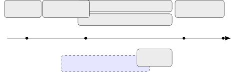

\EventEditors\EventLongTitle

20th Int. Symposium on Empirical Software Engineering and Measurement
(ESEM 2026) – Registered Reports \EventShortTitleESEM 2026
\EventAcronymESEM \EventYear2026 \EventDateOctober 4–9, 2026
\EventLocationMunich, Germany \SeriesVolume \ArticleNo University of
Bayreuth, Germanyshalini.chakraborty@uni-bayreuth.de0000-0002-9466-3766
XITASO GmbH IT and Software Solutions, Augsburg,
Germanyjan-philipp.steghoefer@xitaso.com0000-0003-1694-0972
\CopyrightShalini Chakraborty and Jan-Philipp
Steghöfer{CCSXML}\<ccs2012\> \<concept\>
\<concept_id\>10011007.10011074.10011092\</concept_id\>
\<concept_desc\>Software and its engineering Software development
techniques\</concept_desc\>
\<concept_significance\>500\</concept_significance\> \</concept\>
\<concept\>
\<concept_id\>10011007.10011074.10011075.10011076\</concept_id\>
\<concept_desc\>Software and its engineering Requirements
analysis\</concept_desc\>
\<concept_significance\>500\</concept_significance\> \</concept\>
\<concept\> \<concept_id\>10011007.10011006.10011066\</concept_id\>
\<concept_desc\>Software and its engineering Development frameworks and
environments\</concept_desc\>
\<concept_significance\>300\</concept_significance\> \</concept\>
\<concept\>
\<concept_id\>10003456.10003457.10003567.10010990\</concept_id\>
\<concept_desc\>Social and professional topics Socio-technical
systems\</concept_desc\>
\<concept_significance\>300\</concept_significance\> \</concept\>
\</ccs2012\> \ccsdesc\[500\]Software and its engineering Software
development techniques \ccsdesc\[500\]Software and its engineering
Requirements analysis \ccsdesc\[300\]Software and its engineering
Development frameworks and environments \ccsdesc\[300\]Social and
professional topics Socio-technical systems

# The Prompt Triangle: A Registered Report on Prompts as Hybrid Artifacts

Shalini Chakraborty    Jan-Philipp Steghöfer

###### Abstract

AI-based coding assistants are transforming software development by
shifting effort from writing code to crafting prompts that guide code
generation. Despite their growing importance, little empirical evidence
exists on how prompts function as software engineering artifacts.
Building on prior work framing prompts as mixed artifacts combining
requirement intent and solution guidance, we build on the Prompt
Triangle, a conceptual model describing prompts along three components:
Functionality and Quality (requirements), General Solutions
(architectural guidance), and Specific Solutions (implementation
constraints). This registered report presents the Stage 1 protocol for a
confirmatory study investigating how prompts evolve and how their
alignment with requirements engineering (RE) activities predicts
development outcomes. We preregister four hypotheses examining prompt
evolution, developer characteristics, RE activity alignment, and
temporal patterns. We employ a controlled experiment (n=30), community
uploads, and mined data using dual-coding to test whether prompting
patterns predict development success.

###### keywords:

Requirement Engineering, Vibe Coding, Prompts, AI

## 1 Introduction

Recent advances in AI-assisted software development are reshaping
software development practices. Developers interact with AI-based coding
assistants through natural language prompts that describe intended
functionality, constraints, and design preferences. This interaction
shifts development effort from code authoring to _prompt construction_,
positioning prompts as central rather than ephemeral artifacts.

Prompts are structured artifacts that encode multiple layers of intent
\[meske2025vibecodingreconfigurationintent\], including requirements,
architectural decisions, and implementation constraints. Recent work has
begun to conceptualise prompts as hybrid artifacts that combine elements
of requirements engineering and solution design
\[chakraborty2026prompts\]. However, empirical understanding of how
prompts evolve during development, and how their structure influences
outcomes, remains limited.

This gap is particularly relevant for empirical software engineering.
While prior studies have evaluated the productivity and correctness of
AI-generated code \[barke2023grounded\], fewer have examined the
_process_ through which developers iteratively refine prompts. In
traditional software engineering, artifacts such as requirements
specifications and design documents evolve systematically and are known
to influence final system quality. Whether similar principles apply to
prompts remains an open question.

To address this gap, we build on the Prompt Triangle
\[chakraborty2026prompts, shalini2026exploring\], a conceptual model
introduced in our prior work that characterises prompts along three
dimensions: (1) _Functionality and Quality_ (capturing requirements),
(2) _General Solutions_ (capturing architectural or technological
guidance), and (3) _Specific Solutions_ (capturing implementation-level
constraints). This model provides a structured lens for analysing prompt
content and evolution.

In this registered report (Stage 1), we present a primarily confirmatory
study that tests preregistered hypotheses about prompt evolution and its
relationship to development outcomes. Our four hypotheses address: (i)
whether prompt content shifts toward specific solutions across
iterations, (ii) whether developer characteristics predict prompting
strategies, (iii) whether alignment between prompt content and RE
activities predicts code quality, and (iv) whether temporal alignment
patterns predict outcomes beyond overall alignment. The controlled
experiment simultaneously serves as further construct validation of the
Prompt Triangle: if the dimensions cannot be reliably coded
($`\kappa<0.75`$) or yield degenerate distributions, this constitutes
disconfirming evidence. By treating prompts as first-class artifacts,
this work establishes a foundation for systematic empirical
investigation of AI-assisted software development.

## 2 Background and Related Work

Prompt engineering, i.e., crafting prompts to guide LLMs toward desired
outputs \[reynolds2021prompt, chen2023unleashing\], has become central
to AI-assisted development. However, prompts often lack the structure of
formal requirements \[barke2023grounded\]. Developers engage in
iterative, conversational refinement \[barke2023grounded\], facing
challenges in correctness, trust \[vaithilingam2022expectation\], and
translating requirements into appropriate prompts \[VillamizarFKVM25\].
This raises a key question: How can RE rigor be infused into prompting
practices? Viewing prompts as evolving requirement artifacts bridges
informal intentions and structured specification
\[vogelsang2024prompting\].

Recent work explores how LLMs reshape RE activities such as elicitation,
validation, and traceability \[huang2025prompt\]. Emerging research
conceptualizes prompts as hybrid artifacts combining requirements and
solutions. Our prior work \[chakraborty2026prompts\] proposes the Prompt
Triangle capturing functionality, general solutions, and specific
constraints, yet empirical evidence on component evolution and impact
remains limited.

Research Gap. Existing studies examine prompting patterns
\[dicuffa2025exploringpromptpatternsaiassisted\], quality defects
\[siddiq2024fault\], output effectiveness \[della2025prompt\], and RE
task applications \[huang2025prompt\], but none systematically model
prompts as artifacts encoding requirements and solution decisions. This
challenges the SE principle of separating requirements from solutions.
We address this through the Prompt Triangle \[chakraborty2026prompts,
shalini2026exploring\], a structured framework for decomposing prompts
into requirement-oriented (_Functionality and Quality_) and
solution-oriented (_General_ and _Specific Solutions_) components,
enabling empirical analysis of their evolution and impact on development
outcomes.

## 3 Hypotheses

The decomposition of prompts into three distinct but interrelated
components in the prompt triangle allows us to understand _what_
developers communicate through prompts when working with chat-based AI
coding assistants. These components capture requirement-oriented and
solution-oriented information at different levels of abstraction. To
also understand _how_ they use this content in the development process,
we draw on requirements engineering theory. Following established SE
practice \[nuseibeh2000requirements\], we distinguish between three core
activities: _validation_ (ensuring we are building the right thing by
clarifying and confirming requirements), _verification_ (ensuring we are
building the thing right by checking implementation correctness), and
_solution generation_ (producing and exploring implementation
approaches). These activities represent different purposes for which
prompt content may be used during AI-assisted development. While the
Prompt Triangle captures the semantic content of prompts, RE activities
capture the pragmatic function of that content in the development
workflow. This distinction is critical to understand how prompt
composition influences code quality.

Based on this framework and prior empirical observations of iterative
refinement in AI-assisted coding \[barke2023grounded,
chakraborty2026prompts\], we formulate the following hypotheses:

H1 (Prompt Evolution)  
During multi-turn AI-assisted coding sessions, the proportion of
Specific Solutions content in prompts increases significantly across
iterations relative to General Solutions and Functionality and Quality.

H2 (User-driven Prompt Strategy)  
The distribution of Prompt Triangle components is significantly
associated with developer characteristics, particularly programming
experience and domain familiarity, with programming experience and
domain familiarity positively associated with Specific Solution
proportion.

H3 (RE Activity Alignment)  
Code quality is predicted by the alignment between prompt content and
its RE purpose, with higher quality resulting from prompts where
Functionality and Quality content is used for validation activities and
Specific Solution content is used for verification activities.

H4 (Temporal Alignment)  
Conversations that exhibit both the temporal prompt evolution pattern
(H1) and RE activity sequence (H3) will achieve higher code quality than
conversations with equivalent overall alignment but inconsistent
temporal ordering.

H1 serves as descriptive validation that sets up H4, which is our key
hypothesis about whether temporal alignment predicts success. While H3
tests whether alignment between prompt components and RE activities has
an impact at all, H4 tests whether the point in time when alignment
occurs matters.

## 4 Study Overview

We employ a _multi-method data collection strategy_ to construct a
comprehensive corpus of developer–AI interactions. Our approach combines
three complementary sources of data: (i) controlled experiments, (ii)
community-sourced prompt exports, and (iii) mining of publicly available
datasets.

Our triangulated design balances internal and ecological validity
through three complementary data sources. Following Colnet et al.
\[colnet2024causal\], who review methods for combining randomised trials
and observational studies, our controlled experiment ($`n=30`$) provides
unconfounded causal estimates with full quality measures, while
community uploads (target $`n\geq 150`$) and mined public datasets
assess generalisability through observational data. Confirmatory
hypothesis testing (H1–H4) is based on controlled experiment data;
community uploads serve as co-primary replication data for H2 and
supplementary validation for H1 and H3; mined datasets serve an
explicitly exploratory role for pattern characterisation only.

Figure 1 summarizes the planned timeline of the study. The project
begins with task design and pilot testing, followed by controlled
experiments, community-sourced data collection, and public mining.
Annotation and quality control partially overlap with data collection. A
Master’s student will contribute primarily to annotation support and
corpus preparation.



Figure 1: Planned project timeline, starting M1=May’26 and submission by
M12=April’27.

## 5 Data Collection

Our methodology extends the approach pioneered by the DevGPT dataset
\[xiao2024devgpt\], which collected developer-ChatGPT conversations from
publicly shared links. However, DevGPT primarily captures web-based
ChatGPT interactions rather than conversations occurring within
integrated development environments (IDEs). Since IDE-based AI
assistants (e.g., GitHub Copilot, Cursor, JetBrains AI Assistant)
represent increasingly common development workflows, our corpus focuses
on these contextualised interactions. Table 1 summarizes the three
collection approaches and their respective contributions to the corpus.

| Method                 | Data Type           | Strengths                                                      | Limitations                               |
| ---------------------- | ------------------- | -------------------------------------------------------------- | ----------------------------------------- |
| Controlled Experiments | Structured, curated | Complete metadata, ground truth requirements, comparable tasks | Limited scale, potential observer effects |
| Community Uploads      | Real-world, diverse | Authentic usage, varied contexts, scalable                     | Incomplete metadata, self-selection bias  |
| Public Mining          | Opportunistic       | No recruitment overhead, naturally shared                      | Sparse, variable quality                  |

Table 1: Comparison of data collection methods

### 5.1 Controlled Experiments

Participant Recruitment We will recruit $`N=30`$ software developers
through university mailing lists, professional networks, and online
communities. Participants must have $`\geq`$6 months programming
experience and regular IDE-based AI assistant use. We aim for balanced
representation across experience levels, collecting years of experience
as a continuous variable alongside AI affinity, tool familiarity, and
programming language proficiency. These variables are used continuously
in regression analyses; categorical labels (junior/mid/senior) serve
only as recruitment strata. For the repeated-measures ANOVA testing H3
(3 conditions) and H4 (4 conditions), power analysis using G\*Power
($`f=0.35`$, $`\alpha=0.05`$, $`power=0.80`$, correlation among repeated
measures $`=0.5`$) indicates minimum $`N=21`$ for H3 and $`N=24`$ for
H4. Our target $`N=30`$ provides adequate power for all planned
within-subjects comparisons and accommodates potential dropout.

Experimental Design Participants complete four 30-minute coding tasks:
(1) Feature Implementation (with AI): Add a feature to existing code
using AI assistant and provided user stories; (2) Code Refactoring (with
AI): Improve code structure to meet quality requirements using AI; (3)
Algorithm Implementation (with AI): Implement specified algorithm from
natural language description; (4) Bug Fix (without AI): Diagnose and fix
bug without AI assistance, establishing baseline RE activity rates.
Tasks are selected to cover distinct SE activities that elicit different
prompt compositions (requirements-heavy vs. solution-heavy) and varying
AI interaction patterns. They are drawn from an open-source project with
included requirement specifications, piloted for appropriate difficulty
and 30-minute feasibility. Tasks are counterbalanced using Latin square
design. Participants receive 15 minutes initial preparation to
understand the codebase, with 5-minute breaks between tasks to mitigate
fatigue effects over the 2:30h session.

Data Collection Protocol Participants access a GitHub repository with
codebase, task descriptions, and submission templates. We provide README
setup instructions, dependency management files, optional containerised
services (docker-compose), and environment verification scripts.
Participants use their preferred IDE locally, acknowledging
environmental heterogeneity (Section 7). Chat histories are exported via
native tool functionality (JSON/conversation export). For tools lacking
export, we provide copy-paste templates. Sessions are conducted remotely
via Zoom/Teams with screen sharing and recording for: (1) process
observation, (2) think-aloud protocol capture, and (3) backup data if
export fails (anticipated $`<10\%`$ cases). For the control task,
participants verbalise their thought process, which we transcribe and
code for RE activities comparable to AI conversations. Post-task
questionnaires capture strategy and satisfaction data. We collect per
task: (a) exported chat history; (b) final code; (c) completion time;
(d) screen recording; (e) think-aloud transcription; (f) questionnaire
responses; (g) AI tool and version used.

Annotation Two researchers independently code each conversation turn
for: (1) Prompt Triangle: percentage of text per component (F&Q, General
Solutions, Specific Solutions; sum = 100%); (2) requirement clarity
(explicit/implicit/ambiguous); (3) turn type
(query/refinement/clarification/confirmation/exploration); (4) code
presence; (5) solution evolution stage
(initial/debugging/refinement/finalization). Think-aloud verbalisations
are coded for RE activities: validation (questions, assumptions,
confirmations), verification (testing, requirement checking), and
refinement (interpretation adjustments).

Inter-annotator agreement target: Cohen’s $`\kappa>0.75`$, indicating
excellent agreement \[landis1977measurement\]. Disagreements resolved
through discussion after initial alignment on a coded subset. A detailed
coding manual following established content analysis methodology
\[saldana2021coding\] with initial category definitions, decision rules
for ambiguous cases, and worked examples will be developed during the
pilot phase and preregistered before main data collection. The
requirement clarity classification (explicit/implicit/ambiguous) is
grounded in requirements quality attributes \[boehm1984verifying\] and
requirements smell research \[femmer2017rapid\]; solution evolution
stages (initial/debugging/refinement/finalization) follow iterative
development models \[basili1975iterative\] and observed AI interaction
patterns \[barke2023grounded\].

### 5.2 Community-Sourced Export and Upload

We intend to develop a web-based platform enabling developers to
voluntarily export and upload their IDE-based AI conversation histories.
The platform includes:

- •
  Informed consent documentation compliant with IRB requirements
- •
  Tool-specific export instructions for popular IDE assistants
- •
  Drag-and-drop upload interface accepting multiple file formats
- •
  Automated anonymisation preview allowing participants to review and
  redact sensitive information
- •
  Demographic and usage context survey to collect programming, AI
  coding, and task experience

Recruitment and Incentivisation Recruitment will proceed in waves over
six months via academic networks, professional developer communities
(Reddit, LinkedIn, Discord), and conference presentations. We will
provide early access to research findings and optional acknowledgment in
dataset documentation. We acknowledge heterogeneity in tools, tasks, and
contexts in community uploads; inclusion criteria (complete
demographics, $`\geq 3`$ turns, $`\geq 100`$ words) and the unified
processing pipeline ensure comparability for analysis.

Sample Size and Power Analysis Our target sample of $`n\geq 150`$
community uploads supports co-primary testing of H2 alongside controlled
experiment data. Power analysis for the planned mixed-effects
hierarchical regression using G\*Power (approximating the mixed-effects
structure as hierarchical regression) indicates that a combined sample
of $`n\geq 120`$ (30 controlled + 90 community minimum) provides 80%
power ($`\alpha=0.05`$) to detect a medium effect size ($`f^{2}=0.10`$)
for the incremental $`\Delta R^{2}`$ contribution of developer
characteristics when testing 4–5 predictors. The target of $`n\geq 150`$
accounts for approximately 20% anticipated exclusion due to incomplete
demographics, insufficient conversation length, or failed quality
control. Should community uploads fall below $`n=90`$ after filtering,
we will proceed with reduced power but supplement interpretation with
effect size confidence intervals and Bayesian sensitivity analyses.

Data Processing Pipeline Each uploaded conversation passes through a
five-stage pipeline:

1.  1.  Format normalisation: Conversations in various formats (JSON, CSV,
        plain text, screenshots with OCR) are converted to a unified
        structure preserving temporal order and speaker identification.
2.  2.  Automated quality checks: Minimum length verification (3+ turns),
        code presence detection, and programming language identification.
        Conversations failing any criterion are flagged for manual review.
3.  3.  PII detection: Named entity recognition (spaCy) combined with
        pattern matching for emails, API keys, and proprietary identifiers.
        Flagged content is manually reviewed; participant privacy takes
        precedence over data retention.
4.  4.  Manual review: A stratified random sample of 15% of uploads
        (stratified by data source, programming language, and conversation
        length) undergoes manual quality verification by two independent
        researchers, with inter-rater agreement calculated using Cohen’s
        kappa.
5.  5.  Semi-automated annotation: Fine-tuned transformer models predict
        Prompt Triangle component proportions per turn. Predictions with
        confidence below 0.7 are queued for manual annotation.

### 5.3 Public Mining

Public mining provides opportunistic access to naturally shared
developer–AI interactions without recruitment overhead, capturing
developers who might not volunteer for formal studies.

Source Identification To complement recruited data, we intend to
systematically mine publicly shared IDE-based AI conversations from:

- •
  GitHub issues and discussions mentioning specific AI tools
- •
  Developer blogs and tutorial platforms (Medium, Dev.to)
- •
  Video content (YouTube coding tutorials with AI assistants)
- •
  Social media platforms (Twitter/X, Reddit, LinkedIn)
- •
  Technical forum discussions (Stack Overflow, specialised Discord
  servers)

Given the exploratory role of public mining, sample size will be
determined by data availability (target $`\geq 200`$ conversations).

Collection Methodology We will employ keyword-based searches (e.g.,
“GitHub Copilot conversation,” “Cursor AI help,” “AI assistant code”)
combined with manual verification. Searches will be conducted bi-weekly
over the data collection period. Only content explicitly shared publicly
by developers will be included.

A preliminary search confirms available sources (e.g., the DevGPT
dataset \[xiao2024devgpt\] and GitHub Copilot conversations shared in
issue trackers), though public conversations are not always complete and
may reference outdated tool versions. We will record publication dates
to allow temporal filtering and treat incomplete conversations as valid
for turn-level analysis. We acknowledge that publicly shared
conversations may be biased toward noteworthy or extreme examples; this
is mitigated by the explicitly exploratory role of mined data and by
triangulating any observed patterns against controlled experiment
results.

Ethical Considerations For mined content, we verify that data was
intentionally shared publicly, check platform licensing and terms of
use, and apply additional anonymisation to protect original authors.
Where feasible, we attempt to contact original posters for explicit
consent and honour all removal requests.

### 5.4 Quality Control

Quality control combines automated filtering and manual verification:

- •
  Length filter: Minimum 5 conversation turns, concrete number will be
  adjusted based on a sensitivity analysis
- •
  Language detection: Conversations in supported programming languages
  (Python, JavaScript, Java, C++, C#, Go, Rust, TypeScript)
- •
  Code presence: At least one turn containing code snippets
- •
  Duplicate detection: Identify and remove duplicate conversations using
  fuzzy matching
- •
  Completeness scoring: Flag conversations with missing turns or
  corrupted content

Manual Verification A stratified random sample of 15% of all uploaded
and mined conversations will undergo manual review by two researchers to
verify quality and appropriateness. Conversations failing manual review
criteria will be excluded from the final corpus. The automated filters
will be extended if patterns appear during this manual review to exclude
other data points with similar issues.

## 6 Data Analysis

Analysis Plan for H1 (Prompt Evolution) Since prompt component
proportions are compositional (summing to 1), we employ Dirichlet
mixed-effects regression \[maier2014dirichletreg\], the appropriate
model family for such data \[aitchison1986compositional\]. The model is:

```math
(\text{F\&Q}_{it},\,\text{GS}_{it},\,\text{SS}_{it})\sim\text{Dirichlet}(\boldsymbol{\alpha}_{it}),\quad\log(\alpha_{k,it})=\beta_{0k}+\beta_{1k}\cdot\text{Turn}_{t}+u_{ik}
```

where $`i`$ indexes participants, $`t`$ indexes turns,
$`k\in\{\text{F\&Q},\text{GS},\text{SS}\}`$, and $`u_{ik}`$ is a
participant-level random intercept. H1 predicts
$`\beta_{1,\text{SS}}>0`$ (Specific Solutions increases) and
$`\beta_{1,\text{F\&Q}}<0`$ (F&Q decreases), with non-overlapping 95%
CIs. We test coefficients using likelihood ratio tests. Sensitivity
analyses include: (1) linear mixed-effects models on each proportion
separately for comparison with prior work, and (2) repeated-measures
ANOVA for participants completing all turns. We report coefficients, 95%
CIs, and pseudo-$`R^{2}`$.

Analysis Plan for H2: User-Driven Prompt Strategy We conduct
hierarchical regression to test how developer characteristics predict
prompt composition, controlling for task type. Using controlled
experiment data ($`n=30`$), the multivariate regression model is:

```math
\text{SS\_proportion}_{ij}=\beta_{0}+\boldsymbol{\gamma}\cdot\mathbf{Controls}_{j}+\boldsymbol{\beta}\cdot\mathbf{DevChar}_{i}+u_{i}+\varepsilon_{ij}
```

where $`\mathbf{Controls}_{j}`$ (Step 1) includes task type, complexity,
and domain; $`\mathbf{DevChar}_{i}`$ (Step 2) includes programming
experience, domain familiarity, and AI tool experience; and $`u_{i}`$ is
a participant random intercept. The dependent variable is the Specific
Solutions proportion. H2 predicts Step 2 $`\Delta R^{2}\geq.10`$
($`p<.05`$), with positive associations between experience/familiarity
and Specific Solutions proportion. Since the dependent variable is a
bounded proportion, we conduct sensitivity analysis using beta
mixed-effects regression to verify robustness to distributional
assumptions.

For between-subjects comparison, mixed-effects regression combines
controlled experiment and community uploads (target $`n\geq 120`$;
inclusion criteria: complete demographics, $`\geq 3`$ turns,
$`\geq 100`$ words). Fixed effects include experience, familiarity, task
type, and data source; random effect is participant nested in source. If
community $`n<120`$, we proceed with reduced power. Supplementary
Spearman correlations describe characteristic-component relationships.
We test multivariate normality (Mardia’s test) and multicollinearity
(VIF $`<5`$), applying transformations if violated. Sensitivity analyses
examine experience as continuous vs. categorical and explore non-linear
relationships.

Analysis Plan for H3 (RE Activity Alignment) We employ dual-coding where
each prompt segment receives both a Prompt Triangle component code and
an RE activity code (validation, verification, solution generation). Two
coders independently annotate all controlled experiment conversations
(participant–AI and think-aloud verbalizations), targeting Cohen’s
$`\kappa>0.75`$ per dimension. We develop automated pre-labelling to
scale coding to community and mined data; manual control tasks are coded
for RE activities only.

We operationalise _code quality_ as a composite of (1) functional
correctness, measured by pass rate of predefined test cases for each
task, and (2) structural quality, assessed via static analysis metrics
(maintainability index, cyclomatic complexity, code smells) from an
open-source tool (e.g., SonarQube Community Edition). The composite
score is the standardised mean of these two dimensions.

For each conversation, we calculate alignment scores: (1) F&Q-Validation
alignment and (2) SS-Verification alignment. The primary regression
model is:

```math
\text{Quality}_{ij}=\beta_{0}+\beta_{1}\cdot\text{FQ\_Val}_{ij}+\beta_{2}\cdot\text{SS\_Ver}_{ij}+\boldsymbol{\gamma}\cdot\mathbf{X}_{ij}+u_{i}+\varepsilon_{ij}
```

where $`\mathbf{X}_{ij}`$ includes overall component proportions,
conversation length, task type, and developer experience, and $`u_{i}`$
is a participant random effect. Hypothesis confirmation requires at
least one significant positive alignment coefficient ($`p<.05`$).

Repeated-measures ANOVA compares three within-subjects conditions from
the controlled experiment ($`n=30`$), classified post-hoc by
median-splitting participants’ alignment scores within the AI-assisted
tasks: (1) Manual baseline (the non-AI control task), (2) Low-alignment
AI (below-median alignment), (3) High-alignment AI (above-median
alignment). We predict Manual $`\approx`$ Low-alignment $`<`$
High-alignment, with high-alignment significantly exceeding both
(Cohen’s $`d\geq 0.5`$). Community uploads use dual-coding with
self-reported quality; mined data use proxy measures with automated
coding validated on 10% manual samples. Sensitivity analyses test
robustness across sources and explore synergistic effects.

Analysis Plan for H4 (Temporal Pattern) To test whether temporal
alignment predicts quality beyond overall alignment, we employ
hierarchical regression dividing conversations into early/late turns
(50% split), corresponding to the two-stage model where early turns
focus on specification (F&Q-dominant) and late turns shift to refinement
(SS-dominant). Step 1 controls for overall alignment, task type, and
experience ($`\boldsymbol{\gamma}\cdot\mathbf{Step1}_{ij}`$). Step 2
adds: Stage 1 alignment (F&Q with solution generation early), Stage 2
alignment (SS with validation/verification late), and temporal pattern
score
$`\text{TP}_{ij}=\sqrt{\text{Stage1}_{ij}\times\text{Stage2}_{ij}}`$:

```math
\text{Quality}_{ij}=\beta_{0}+\boldsymbol{\gamma}\cdot\mathbf{Step1}_{ij}+\beta_{\text{S1}}\cdot\text{Stage1}_{ij}+\beta_{\text{S2}}\cdot\text{Stage2}_{ij}+\beta_{\text{TP}}\cdot\text{TP}_{ij}+u_{i}+\varepsilon_{ij}
```

Support requires $`\Delta R^{2}\geq.05`$ ($`p<.05`$) and positive
$`\beta_{\text{TP}}`$. Sensitivity analysis replaces the binary split
with continuous turn-weighted alignment. Repeated-measures ANOVA
($`n=30`$) compares four post-hoc conditions (Manual, Low/Low, High/Low,
High/High AI), predicting Manual $`\approx`$ Low/Low $`<`$ High/Low
($`d\geq 0.4`$) $`<`$ High/High ($`d\geq 0.3`$). Community and mined
data provide exploratory pattern prevalence.

## 7 Threats to Validity

We organise threats to validity following the framework by Wohlin et al.
\[wohlin2012experimentation\], addressing construct validity, internal
validity, external validity, and reliability as shown in Table 2.

|             |                                 |                                                                                                 |
| ----------- | ------------------------------- | ----------------------------------------------------------------------------------------------- |
| Category    | Threat                          | Mitigation                                                                                      |
| Construct   | Prompt Triangle subjectivity    | Detailed codebook, $`\kappa>0.75`$, third annotator for disagreements                           |
|             | Code quality measurement limits | Multiple metrics (alignment, static analysis, corrections); acknowledge dimensions not captured |
| Internal    | Observer/Hawthorne effects      | Emphasise studying AI not participants; 15-min familiarisation; observational data sources      |
|             | Task selection bias             | Tasks based on literature prevalence; multi-source data captures diverse real-world tasks       |
|             | Learning effects                | Counterbalanced task order; task order as covariate in analyses                                 |
| External    | Sample representativeness       | Report demographics; compare to industry stats; diverse data sources                            |
|             | Task authenticity               | Real open-source codebase; varied requirement formats; time constraints acknowledged            |
|             | Temporal/tool evolution         | Document tool versions; framework designed to be tool-agnostic                                  |
| Reliability | Annotation consistency          | Calibration every 50 conversations; detect drift by comparing annotation halves                 |
|             | Tool heterogeneity              | Comprehensive format normalisation; explicit quality control (Section 5.4)                      |

Table 2: Summary of Threats to Validity and Mitigation Strategies

## 8 Ethical Considerations

We intend to submit the revised research methodology based on this
document and the feedback provided by the ESEM Registered Reports Track
reviewers to the University of Bayreuth Institutional Review Board. All
participants in controlled experiments and community uploads will have
to provide informed consent. Key ethical measures include voluntary
participation with right to withdraw, comprehensive data anonymisation
removing names, email addresses, company identifiers, and proprietary
code patterns, secure data storage with encryption on institutional
servers, participant option to review contributed data before
finalisation, compliance with GDPR and relevant data protection
regulations, and transparent data usage and retention policies.

## References
