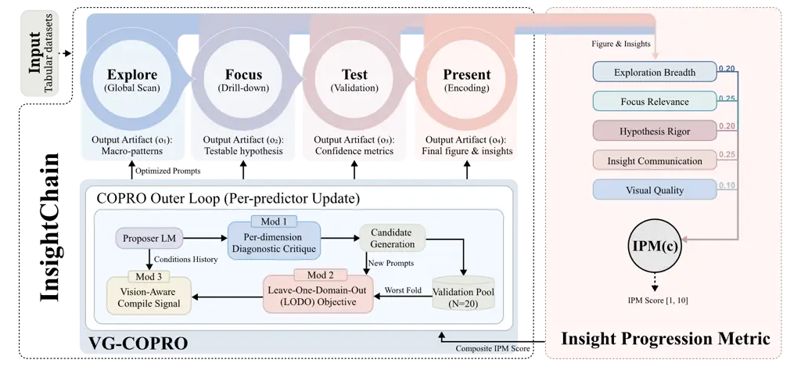
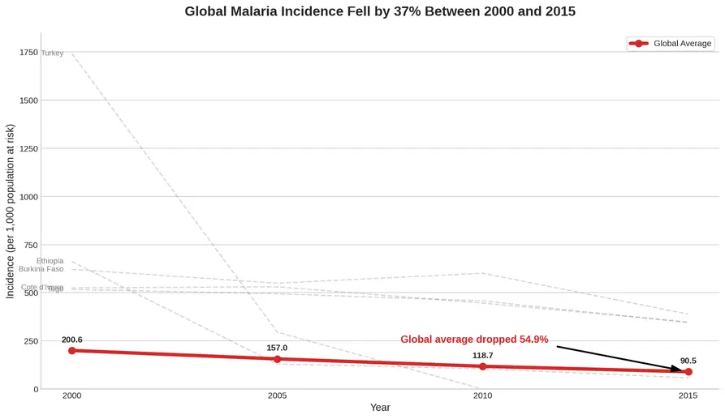
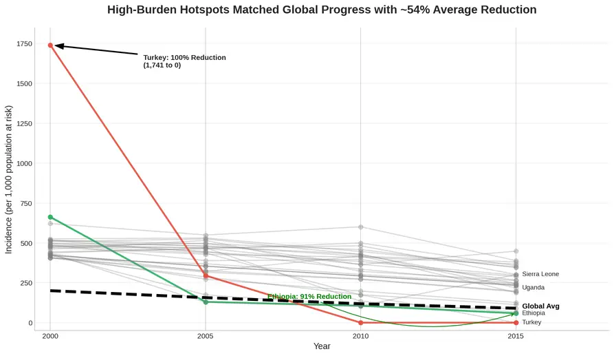
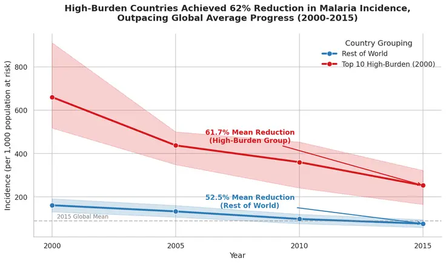
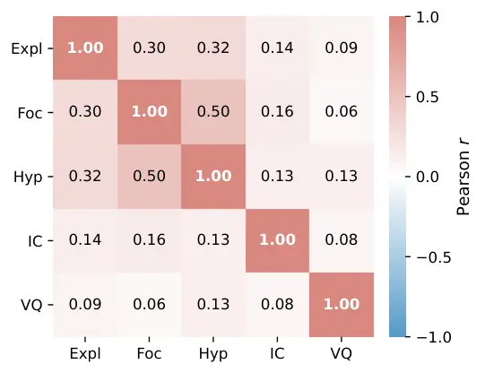
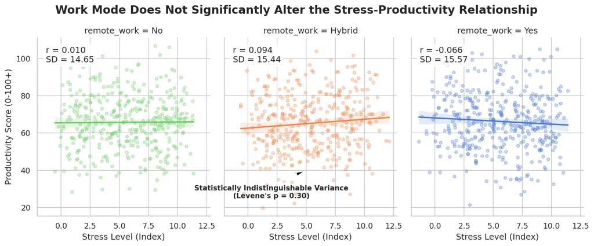
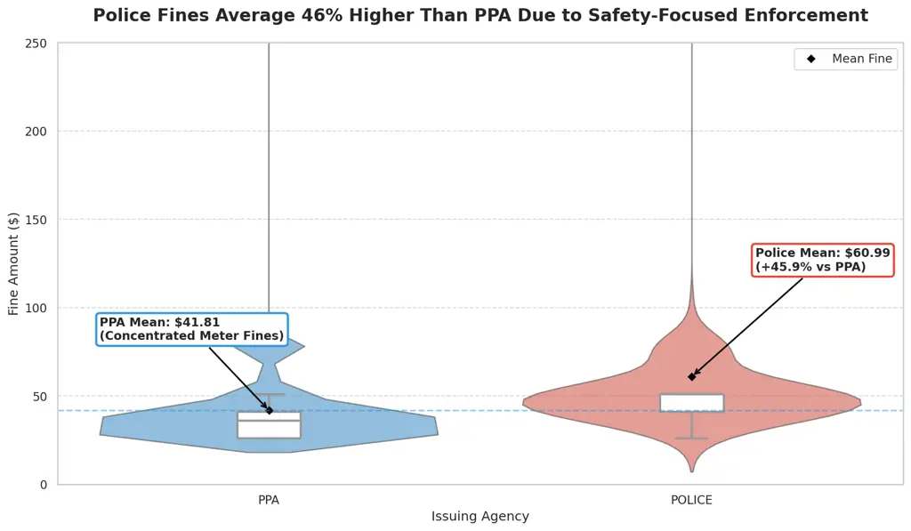
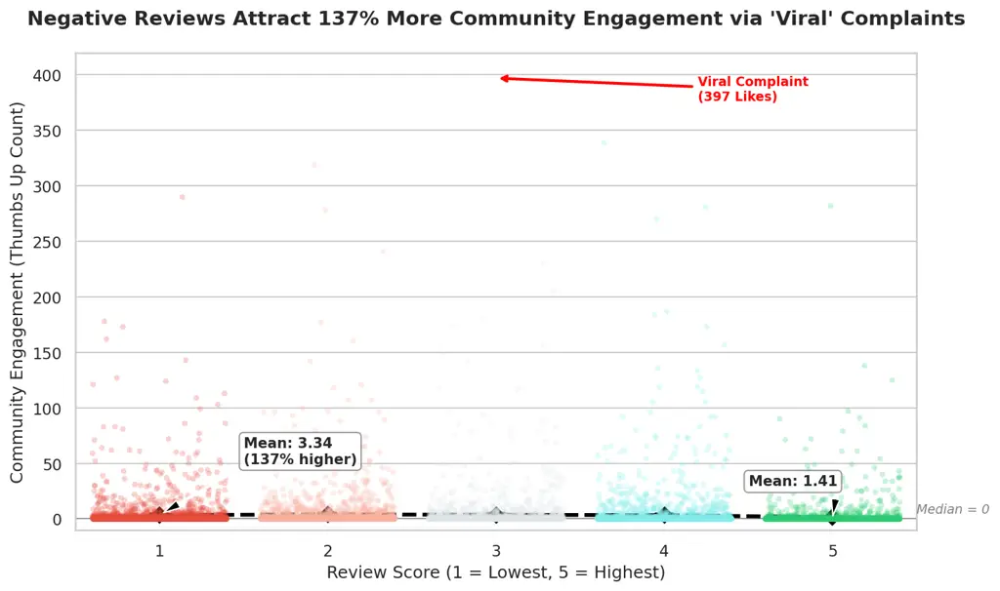

# InsightChain: Optimized Chain-of-Insight Analytics for LLM-driven Data Visualization

Hanya Sun^(∗)    Chen Zhang^(∗†)    Sheng Liang    Yongyue Zhang    Yong
Liu Affiliation: Huawei Technologies Co., Ltd.
Email: [zhang.chen4@huawei.com](mailto:)

###### Abstract

Large language models (LLMs) are increasingly used for automated data
visualization, yet existing approaches often frame visualization
generation as a single-step mapping from user query to figure or code,
overlooking the iterative analytical reasoning process of expert
analysts. We present InsightChain, a four-stage visualization prompting
pipeline (Explore–Focus–Test–Present) that emulates expert analytical
workflows, together with VG-COPRO, a vision-guided automatic prompt
optimization (APO) method adapted to jointly optimize such multi-stage,
executable pipelines. To address the evaluation gap for complex data
visualization, we introduce the Insight Progression Metric (IPM), a
rubric combining four text-based dimensions with a vision-based
dimension. We assess IPM through a 100-chain human pilot and an expanded
300-chain agent-based evaluation spanning all ten domains. Experiments
on public datasets show that InsightChain consistently outperforms
competing prompting baselines. Existing APO methods fail to yield
consistent gains on this multi-stage task, whereas VG-COPRO improves
performance in both in-domain and cross-domain settings.

¹¹footnotetext: Co-first Authors²²footnotetext: Corresponding Author

## 1 Introduction

Large language models (LLMs) have significantly advanced automated data
visualization (Dibia, 2023; Tian et al., 2025). However, most existing
approaches treat visualization as a single-step mapping from query to
executable code or rendered figure, bypassing intermediate validation
(Cheng et al., 2023). This one-shot approach contradicts expert
sensemaking workflows (Pirolli and Card, 2005), which are inherently
iterative: analysts explore broad data distributions (Tukey, 1977),
formulate specific hypotheses (Heer and Shneiderman, 2012), and refine
visual encodings (Munzner, 2014) to synthesize reliable insights (Sacha
et al., 2014). By compressing this multi-stage reasoning into a single
run, current LLM strategies often yield superficial visualizations that
lack statistical rigor and fail to uncover deep insights in complex
real-world data.

To bridge this gap, we introduce InsightChain, a multi-stage prompting
pipeline that emulates expert workflows through four stages: Explore,
Focus, Test, and Present. Because these stages are interdependent,
optimizing their prompts requires feedback that accounts for downstream
execution and the rendered output. We therefore study how existing
automatic prompt optimization (APO) methods transfer to this setting and
introduce VG-COPRO, a task-adapted method that combines COPRO’s
per-predictor search with OPRO-style proposal and vision-aware,
pipeline-level evaluation.

Evaluating this form of multi-stage analysis is difficult because a
table may support multiple valid analytical directions, leaving no
unique reference insight or visualization, while final-output metrics
cannot determine whether intermediate hypotheses are grounded in
executed evidence. We therefore introduce the Insight Progression Metric
(IPM), a rubric tailored to multi-step visualization tasks, for
evaluating both the analytical trajectory and the final visualization.
Our experiments address four questions: (1) how well IPM agrees with
human evaluation, and how robustly it behaves across repeated and
cross-family judgments; (2) whether the chain pipeline improves over
non-chain prompting baselines across task models; (3) whether VG-COPRO
yields consistent gains over the unoptimized chain and existing APO
methods; and (4) whether the optimized prompts transfer when the Present
stage is rendered by a text-to-image model. Our contributions are
three-fold:

- •
  We propose InsightChain, an execution-grounded prompting pipeline for
  automated data visualization that follows four stages of expert
  sensemaking: Explore, Focus, Test, and Present.
- •
  We systematically study how existing APO methods transfer to
  multi-stage, executable data analysis and introduce VG-COPRO, a
  task-adapted optimizer that combines dimension-level diagnostic
  feedback, a leave-one-domain-out robustness objective, and
  vision-aware evaluation.
- •
  We introduce the Insight Progression Metric (IPM), a rubric for
  evaluating multi-step visualization tasks, assess its agreement with
  human ratings, and examine its repeatability and cross-family
  robustness through agent-based judgments. Experiments across ten
  domains demonstrate the effectiveness of InsightChain and VG-COPRO,
  including transfer to a text-to-image renderer.

## 2 Related Work

### 2.1 LLM-driven visualization

Early systems for natural-language-driven chart generation typically
treat the task as a single-pass mapping from query to code or chart
specification. For instance, while LIDA (Dibia, 2023) introduces an
LLM-backed goal-then-code pipeline, its goal generation and code
generation remain decoupled, exchanging no execution-grounded context.
Similarly, ChartGPT (Tian et al., 2025) relies on a single prompt
conditioned on user queries and schemas, and Prompt4Vis (Li et al.,
2025a) improves few-shot selection but rigidly retains the one-shot
input–output structure. Other systems, such as Chat2VIS (Maddigan and
Susnjak, 2023) and multi-agent extensions like Data-to-Dashboard (Zhang
and Elhamod, 2025), add role decomposition, yet still lack an
execution-grounded insight-progression objective. These systems
primarily address data-plus-intent-to-visualization and remain the
closest executable visualization baselines available. InsightChain
instead begins without a predefined analytical intent and links
iterative reasoning with execution feedback; our comparison therefore
measures their practical performance under this open-ended setting
rather than assuming identical task formulations.

### 2.2 Insight discovery and analytical report generation

InsightBench (Sahu et al., 2025) and DiscoveryBench (Majumder et al., 2025) evaluate generated textual insights or hypotheses against
reference discoveries. DAComp (Lei et al., 2026) evaluates analytical
reports conditioned on predefined business questions, while Multimodal
DeepResearcher (Yang et al., 2026) begins with a topic and web retrieval
to produce an interleaved multimodal report. These tasks are related to
InsightChain in analytical breadth but differ in their inputs and
outputs: InsightChain begins with a single table and no predefined
intent, and requires executable exploration culminating in a
visualization. We therefore discuss these systems as related tasks but
do not directly compare scores obtained under their incompatible
evaluation protocols.

### 2.3 Visualization quality metrics

Existing evaluation metrics for LLM-driven data visualizations generally
fall into three categories, each exhibiting structural limitations that
motivate the design of our IPM rubric.

Specification-based metrics, such as nvBench (Luo et al., 2021) and
Prompt4Vis (Li et al., 2025a), judge a chart as correct only if its
Vega-Lite specification matches a reference exactly, penalizing equally
valid visualizations with different encodings. Text-based metrics, like
Chart-to-Text (Kantharaj et al., 2022), compare generated captions with
references using BLEU; they tolerate surface differences but ignore
whether the chart itself is accurate or renderable. Vision-language
metrics, including CLIP similarity (Radford et al., 2021), LIDA (Dibia,
2023), and chart-VQA adaptations, evaluate rendered images directly, yet
mainly capture image–text alignment rather than data fidelity, so charts
with misleading axes or hidden aggregations may score higher than honest
representations.

Our IPM addresses these limitations by evaluating both the intermediate
analytical reasoning and the visual fidelity of the outputs. A detailed
property comparison is provided in Table 8 (Appendix A.3).

### 2.4 Automatic prompt optimization

Recent work on APO spans several algorithmic paradigms: Bayesian search
(Opsahl-Ong et al., 2024, MIPROv2,); coordinate ascent (Khattab et al.,
2024, COPRO,); LLM-as-optimizer (Yang et al., 2024, OPRO,); evolutionary
search (Guo et al., 2024, EvoPrompt,); and fixed structured-template
scaffolds (Wang et al., 2023, Plan-and-Solve,). These paradigms are
typically evaluated on text-only classification or QA benchmarks
(HotpotQA, GSM8K, IRIS) with large validation sets and discrete
correctness labels. However, applying them to multi-step visualization
agents reveals two critical structural limitations: they optimize
prompts in isolation rather than as a pipeline, and they rely solely on
text-based signals, remaining blind to the visual fidelity of the
rendered figure. These limitations motivate our design of VG-COPRO, a
vision-guided, pipeline-aware approach.



Figure 1: System overview. InsightChain (left) consists of (i) a
four-stage Explore$`\to`$Focus$`\to`$Test$`\to`$Present pipeline,
ingesting tabular datasets and emitting an output artefact ($`o_{t}`$)
at each stage that conditions the next; and (ii) VG-COPRO, the prompt
optimizer that wraps an OPRO-style proposer LM in COPRO’s per-predictor
outer loop, with three modifications selecting candidate prompts on a
20-example validation pool by composite IPM score. IPM (right): a
five-dimensional rubric with weights $`(0.20,0.25,0.20,0.25,0.10)`$
scored by an LLM-as-judge, producing a composite score that serves both
as the evaluation metric and as the VG-COPRO compile signal.

## 3 Methodology

### 3.1 The InsightChain Pipeline

##### Task formulation.

Given a single tabular dataset $`D`$ without a predefined analytical
question or visualization intent, the system must identify a worthwhile
analytical direction, test the resulting hypothesis through executable
analysis, and communicate the supported finding in a visualization. The
output is therefore a multi-stage reasoning-and-execution trace together
with a final figure, rather than a chart generated from a user-specified
intent. InsightChain implements this task through a four-stage pipeline
and uses VG-COPRO to optimize its stage-specific prompts.

Visualization analysis is formalized as a structured four-stage pipeline
for iterative reasoning, $`\mathcal{S}=(t_{1},t_{2},t_{3},t_{4})`$¹¹ 1
The four stages $`t_{1},t_{2},t_{3}`$, and $`t_{4}`$ correspond to the
Explore, Focus, Test, and Present phases, respectively. Explore
corresponds to Tukey’s exploratory data analysis (Tukey, 1977); Focus to
the hypothesis-formulation step of interactive analysis (Heer and
Shneiderman, 2012); Test to standard statistical validation; and Present
to the encoding-and-communication phase of visualization design
(Munzner, 2014).. At each stage $`t`$, a predictor $`\pi_{t}`$,
implemented as a DSPy chain-of-thought module with a typed signature,
produces a structured output $`o_{t}=\pi_{t}(x_{t};\theta_{t})`$, where
$`x_{t}`$ denotes the input context and $`\theta_{t}`$ denotes the
stage-specific prompt.

Each output $`o_{t}`$ contains an executable Python program
$`\mathrm{py}_{t}`$, which is executed by a sandboxed executor
$`\mathcal{E}`$ with retry budget $`B=2`$:

```math
e_{t}=\mathcal{E}^{(B)}(\mathrm{py}_{t},D) \tag{1}
```

where $`D`$ denotes the input table. Upon execution, the environment
returns an execution state
$`e_{t}=(\mathrm{stdout}_{t},\mathrm{figs}_{t},\mathrm{err}_{t})`$.
Here, $`\mathrm{stdout}_{t}`$ captures the standard textual output,
$`\mathrm{figs}_{t}`$ denotes the rendered visualizations, and
$`\mathrm{err}_{t}`$ logs runtime errors. If
$`\mathrm{err}_{t}\neq\emptyset`$, the error trace is fed back to the
predictor $`\pi_{t}`$, guiding the regeneration of $`o_{t}`$ and thus
forming a self-correcting execution loop.

Downstream stages condition on prior outputs and execution traces. We
collect the record of each completed stage into a running context
$`C_{<t}=(o_{1},e_{1},\ldots,o_{t-1},e_{t-1})`$, with
$`C_{<1}=\emptyset`$. The input to every predictor is uniformly

```math
x_{t}=(\sigma(D),\;C_{<t}), \tag{2}
```

where $`\sigma(D)`$ is a fixed dataset profile (column names, dtypes,
summary statistics, and a five-row sample). The pipeline’s final
deliverable is $`(o_{4}.\textsc{final\_insight},\,\mathrm{figs}_{4})`$;
the stage records $`\{(o_{t},e_{t})\}`$ serve as the evaluation basis
for IPM and the optimization signal for VG-COPRO. The prompt
$`\theta_{t}`$ operates on top of the typed signature. We present the
Explore instruction verbatim below to illustrate the prompt format
(full-stage prompts are provided in Appendix A.5):

> “Given a dataset summary and sample, generate Python visualization
> code that broadly explores the data landscape with 2–3 overview
> charts. Identify distributions, relationships, temporal patterns, and
> outliers. Print key observations and identify non-obvious patterns
> worth investigating.”

### 3.2 Insight Progression Metric (IPM)

Before diving into the details of prompt optimization, we first define
the optimization objective used to quantify improvements in insight
visualization. We propose the Insight Progression Metric (IPM), a
weighted linear combination of five quality dimensions computed from the
chain’s source code, intermediate insights, and rendered figures:

```math
\mathrm{IPM}(c)=\sum_{d\in\mathcal{D}}w_{d}\cdot\phi_{d}(c), \tag{3}
```

where $`\mathcal{D}=\{`$Exploration Breadth, Focus Relevance, Hypothesis
Rigor, Insight Communication, Visual Quality$`\}`$,
$`\phi_{d}\in[1,10]`$ is the LLM-as-judge score, and
$`w=(0.20,0.25,0.20,0.25,0.10)`$²² 2 The weights were specified manually
from the task requirements. Section 5.1 evaluates uniform, perturbed,
fully random, and data-fitted alternatives and shows that the principal
conclusions are stable across these choices..

The first four dimensions correspond to the four stages of InsightChain
and are evaluated by a text-based judge using the generated code and
insight descriptions from each stage. Visual Quality is assessed by a
vision-language model using the figure rendered in the Present stage.

Visual Quality contributes $`10\%`$ to the composite IPM score; it
complements the four text-based dimensions rather than determining the
overall evaluation on its own. Within this dimension, the central
criterion is insight embodiment: whether the visualization effectively
communicates the final finding through an appropriate chart type and
elements such as annotations, reference lines, and statistical overlays,
rather than merely displaying the data correctly. A faithful but
uninformative chart therefore receives only a moderate or low score. The
score is capped at $`3`$ if either (1) the figure misrepresents the data
or (2) fundamental legibility failures trigger the display gate.
Detailed gate conditions appear in the annotator handbook
(Appendix A.8). If the final figure fails to render, the score is set to
$`\phi_{5}=1`$. All results in § 5 use this IPM formulation, which also
provides the optimization signal for the APO methods.

### 3.3 Prompt Optimization Paradigms

We study automatic prompt optimization (APO) for InsightChain, treating
proprietary LLMs as fixed-weight black-box APIs. First, we examine how
existing APO methods interact with our four-stage InsightChain
framework. We recompile the same InsightChain using five representative
methods spanning the current APO taxonomy: MIPROv2 (Opsahl-Ong et al.,
2024), COPRO (Khattab et al., 2024), OPRO (Yang et al., 2024), EvoPrompt
(Guo et al., 2024), and Plan-and-Solve (Wang et al., 2023). These
algorithms differ on two axes, search target and proposer mechanism, as
summarised in Table 9 of Appendix A.4.

Because OPRO, EvoPrompt, MIPROv2, and Plan-and-Solve were originally
designed for single-prompt optimization, while InsightChain consists of
four predictors, we adapt all five methods using COPRO’s per-predictor
outer-loop strategy. Specifically, the instruction of one stage is
optimized at a time while the remaining stages are kept fixed. Only the
inner proposal-generation mechanism varies for different APOs. Moreover,
Plan-and-Solve serves as a no-search baseline. Its proposer slot is
replaced with a fixed plan-then-solve template applied once per
predictor, allowing us to isolate the contribution of iterative search
beyond a carefully designed template.

### 3.4 VG-COPRO: a vision-guided APO

When adapted to InsightChain using the common per-predictor outer loop,
existing APO methods yield no consistent improvement across both
evaluation splits. This setting presents three task-specific
difficulties: a prompt change at one stage propagates through downstream
execution, average validation performance may not transfer across
domains, and text-only feedback does not assess the rendered figure. We
therefore develop VG-COPRO as a task-adapted optimizer built on COPRO
and OPRO, rather than as a new general-purpose APO framework. Each
candidate stage prompt is assessed by executing the complete pipeline,
allowing optimization to account for downstream effects, cross-domain
robustness, and visual feedback.

VG-COPRO is built upon the COPRO outer loop for iterative per-predictor
optimization. For the inner loop, we adopt OPRO’s proposer, since it is
the only method achieving a positive in-domain gain and supporting
non-scalar feedback in Table 1. Based on this structure, we introduce
three independent modifications to VG-COPRO.

Mod 1: per-dimension diagnostic critique. Instead of a single scalar
reward, the proposer LM receives the full five-dimensional IPM breakdown
together with the weakest-performing dimension. This converts the
optimization feedback into a structured diagnostic signal, extending the
textual-feedback paradigm of Yuksekgonul et al. (2025). Mod 2:
leave-one-domain-out (LODO) objective. Fitness is defined as the minimum
IPM across the five disjoint in-domain folds, rather than their mean.
This formulation acts as a worst-case robustness objective, inspired by
Group DRO (Sagawa\* et al., 2020), and better aligns the optimization
signal with cross-domain generalization. Mod 3: vision-aware compile
signal. Every candidate prompt is evaluated using the full 5-dimensional
IPM, including the vision-judge assessment. The full pseudocode is shown
in Algorithm 1 (Appendix A.5).

## 4 Experimental Setup

##### Datasets.

We aggregate $`285`$ tabular datasets spanning $`10`$ domains from seven
public sources. Under a leave-five-domains-out protocol, five domains
supply $`150`$ datasets for compilation (train $`n{=}95`$, validation
$`n{=}20`$, and in-domain test $`n{=}35`$), while the other five domains
provide the cross-domain test set ($`n{=}135`$). Each $`n`$ denotes an
independent analysis task associated with a distinct dataset, rather
than a table row. The median dataset contains approximately $`6{,}000`$
rows; the in-domain and cross-domain test sets contain approximately
$`550`$K and $`2.09`$M records, respectively. Overall, $`91.9\%`$ of the
datasets come from real public sources, with a small synthetic-template
fallback for underrepresented demographics and energy domains. Source
composition, domain counts, and split sizes are detailed in
Appendix A.10.

##### IPM judges.

The primary text and visual judge used for IPM scoring is
Gemini 3 Flash, with inference temperature set to $`0`$. To assess
potential same-family judge bias, GPT-4.1 and Qwen-VL-Max re-score a
stratified subsample of $`n=25`$ chains per condition across three
baselines and five APO methods using the same rubric.

##### Task models and other metrics.

Chain generation and baselines run on Gemini 3 Flash (primary;
temperature $`0.3`$, $`10{,}000`$-token output limit) and on GPT-4.1 for
cross-model replication. Generated code executes in a sandboxed
subprocess (60 s timeout, up to two retries). For the auxiliary
visualization metrics, we use OpenCLIP ViT-L/14 for CLIP similarity,
SacreBLEU for Chart-to-Text BLEU, and the installed lida v0.0.14 package
for the LIDA VLM evaluator.

##### APO compilation.

All APOs share a single train/val pool ($`n_{\text{val}}=20`$) drawn
from the five training domains, with a per-predictor budget of three
compile iterations. VG-COPRO evaluates each candidate using five
leave-one-domain-out folds constructed exclusively from the training
domains: finance, healthcare, social science, climate, and sports. The
optimizer never accesses the five cross-domain test domains: education,
transportation, e-commerce, energy, and demographics.

##### Text-to-Image transferability.

We also evaluate the transferability of InsightChain prompts optimized
with VG-COPRO to Text-to-Image (T2I) models. In this setting, the
Present stage is rendered using gemini-3.1-flash-image-preview, while
the three preceding stages, datasets, IPM weights, and evaluation judges
remain unchanged.

## 5 Results

### 5.1 IPM Validation

We assess IPM using complementary tests of controlled-band
discriminability, human agreement, weight sensitivity, judge
self-consistency, dimension overlap, and cross-family robustness.
Extended analysis on agent-based repeatability, expert-audited criteria,
and close-pair discrimination are stated in Appendix A.2.

For the controlled-band analysis, we construct a corpus of 100 chains
from 20 held-out datasets, where each dataset is evaluated under five
prompt regimes corresponding to different quality levels: high,
medium-a, medium-b, low, and random-permutation. The high regime
encourages expert-level statistical analysis and publication-ready
visualizations, while medium-a and medium-b use the same analyst-level
prompt under different random seeds to measure robustness against
stochastic variation. The low regime contains minimal plotting
instructions without insight requirements, and random-permutation serves
as a content-broken control with unlabeled and semantically meaningless
figures. This paired $`20\times 5`$ design ensures that all regime
comparisons are controlled at the dataset level. The full system prompts
and the chain-generation script are documented in Appendix A.9.

##### Discriminability.

The five-dimensional IPM clearly distinguishes the controlled quality
bands (Figure 2). A one-way ANOVA conducted on the aggregate IPM scores
across the four real-quality groups (high, medium-a, medium-b, and low)
yields $`F(3,96)=153.1`$ with $`p<10^{-36}`$, indicating strong
statistical separation between quality levels. As intended, IPM does not
significantly distinguish medium-a from medium-b, which use the same
prompt and differ only in random seed; it separates the remaining
adjacent quality levels with Cohen’s $`d>1.8`$. Each individual IPM
dimension also independently separates the quality bands with
statistical significance ($`p<10^{-4}`$).

Figure 2: IPM discriminability on the 100-chain pilot. Left: aggregate
5-dim IPM by quality band. Right: per-dimension ANOVA $`F`$ statistic
(all $`p<10^{-4}`$).

##### Human agreement.

Two members of the author team, trained using the annotator handbook and
blind to both the chain source condition and the IPM scores, evaluated
the 100-chain pilot (Appendix A.8). Among the $`n=97`$ pilot chains with
complete overall-quality ratings, the IPM composite score shows strong
agreement with the human ratings, achieving Spearman $`\rho=0.88`$
(Table 5 in Appendix A.1). IPM assigns systematically lower scores than
the human annotators on the four text-based dimensions while closely
matching them on Visual Quality. This difference primarily reflects a
shift in scoring scale rather than disagreement in ordering, as IPM and
the human annotators rank the quality regimes consistently.

##### Weight sensitivity.

Because the IPM weights are manually specified, we test whether the
conclusions depend on this choice. Uniform weights leave the ranking of
all nine methods unchanged (Kendall’s $`\tau=1.0`$), with all
significance conclusions preserved. Across 500 small perturbations
around the original weights, the rankings remain stable, with mean
$`\tau=0.98`$ in-domain and $`0.95`$ cross-domain; VG-COPRO remains the
top-performing method in almost every case. Under 500 completely random
weight configurations, the advantage of chain-based methods over
single-shot methods remains consistently significant. Data-fitted
weights achieve nearly identical agreement to the manual weights
($`\rho=0.894`$ versus $`0.882`$). These results indicate that the
central conclusions are not determined by the exact manual weighting.

##### Self-consistency.

Because the main experiments use temperature-0 decoding with prompt
caching, repeated evaluations are effectively deterministic. To estimate
residual variability in the judges, we therefore conduct a
self-consistency analysis by rescoring each pilot chain three
independent times at temperature 0.5. For each evaluation dimension,
self-consistency is computed as the mean pairwise agreement among the
three resulting scores.

All five dimensions achieve Krippendorff’s $`\alpha\geq 0.85`$,
exceeding the standard threshold for high reliability (Table 6a,
Appendix A.1).

##### Dimension decoupling.

On the 508 complete chains from the original three-condition evaluation
(170 datasets evaluated with single-shot, uncompiled-chain, and LIDA
baselines; two failed LIDA evaluations excluded), all text–vision
correlations are below $`0.15`$, while the Focus–Hypothesis correlation
is $`0.50`$ (Figure 4). In the expanded analysis, Focus–Hypothesis
correlations range from $`0.57`$ to $`0.87`$ across human and agent
annotations, compared with $`0.76`$ for the primary judge. This pattern
across datasets and annotators suggests that the correlation partly
reflects the pipeline dependency whereby the Test stage builds on the
direction established during Focus, while also indicating residual
rubric overlap. When we merge Focus and Hypothesis into one dimension
with a combined weight of $`0.45`$, the rankings of all nine methods
remain unchanged in both settings (Kendall’s $`\tau=1.0`$), with
VG-COPRO ranked first. We retain the dimensions separately because their
responses across controlled quality regimes provide distinct diagnostic
information.

Moreover, Cronbach’s $`\alpha`$ for the five IPM dimensions remains well
below the standard 0.7 threshold, indicating that the dimensions do not
collapse into a single underlying factor. In particular, removing Visual
Quality is the only modification that increases $`\alpha`$, suggesting
that the visual dimension captures information not covered by the
text-based dimensions. This supports our hypothesis that visualization
quality is only weakly correlated with textual reasoning quality,
motivating vision-guided evaluation and optimization.

##### Cross-family robustness.

Because the Gemini judge belongs to the same model family as the task
model, there is a potential risk of self-enhancement bias, where the
judge may overrate generated outputs. To evaluate this possibility, we
re-scored 25 chains per condition from three step-matched baselines and
five published APO methods using two cross-family evaluators, GPT-4.1
and Qwen-VL-Max. The results show that Gemini assigns lower mean scores
than both cross-family models (Table 6b, Appendix A.1), while
per-condition Kendall’s $`\tau`$ values remain non-negative across
evaluators, suggesting the method comparisons reported in § 5.3 are
unlikely to be artifacts of judge-model bias.

|                |                        |                  |            |                         |          |                      |            |                         |          |
| -------------- | ---------------------- | ---------------- | ---------- | ----------------------- | -------- | -------------------- | ---------- | ----------------------- | -------- |
|                |                        | In-domain (n=35) |            |                         |          | Cross-domain (n=135) |            |                         |          |
| Task model     | Method                 | IPM              | $`\Delta`$ | $`p_{1}`$               | $`d`$    | IPM                  | $`\Delta`$ | $`p_{1}`$               | $`d`$    |
| Gemini 3 Flash | InsightChain (pre-APO) | 7.24             | –          | –                       | –        | 7.38                 | –          | –                       | –        |
|                | Single-shot 4-prompt   | 6.05             | $`-1.19`$  | $`1.7{\times}10^{-7}`$  | $`1.07`$ | 6.38                 | $`-1.00`$  | $`1.6{\times}10^{-22}`$ | $`1.01`$ |
|                | LIDA                   | 5.79             | $`-1.46`$  | $`5.6{\times}10^{-10}`$ | $`1.40`$ | 5.93                 | $`-1.45`$  | $`1.0{\times}10^{-23}`$ | $`1.05`$ |
|                | MIPROv2                | 7.20             | $`-0.05`$  | $`0.63`$                | –        | 7.15                 | $`-0.24`$  | $`1.00`$                | –        |
|                | COPRO                  | 7.08             | $`-0.16`$  | $`0.82`$                | –        | 7.05                 | $`-0.33`$  | $`1.00`$                | –        |
|                | OPRO                   | 7.55             | $`+0.30`$  | $`0.085`$               | $`0.24`$ | 7.27                 | $`-0.11`$  | $`0.86`$                | –        |
|                | EvoPrompt              | 6.88             | $`-0.37`$  | $`0.96`$                | –        | 7.00                 | $`-0.39`$  | $`1.00`$                | –        |
|                | Plan-and-Solve         | 7.07             | $`-0.17`$  | $`0.90`$                | –        | 7.08                 | $`-0.31`$  | $`1.00`$                | –        |
|                | VG-COPRO               | 8.56             | $`+1.31`$  | $`<\!10^{-5}`$          | $`1.41`$ | 8.54                 | $`+1.16`$  | $`<\!10^{-5}`$          | $`1.06`$ |
| GPT-4.1        | InsightChain (pre-APO) | 7.90             | –          | –                       | –        | 8.01                 | –          | –                       | –        |
|                | Single-shot 4-prompt   | 6.72             | $`-1.18`$  | $`7.0{\times}10^{-6}`$  | $`0.86`$ | 6.92                 | $`-1.09`$  | $`3.7{\times}10^{-18}`$ | $`0.86`$ |
|                | LIDA                   | 4.29             | $`-3.62`$  | $`9.4{\times}10^{-16}`$ | $`2.40`$ | 4.33                 | $`-3.69`$  | $`2.5{\times}10^{-63}`$ | $`2.80`$ |

Table 1: Main-result table. $`\Delta=\text{method}-\text{pre-APO}`$ at
the same task model; $`p_{1}`$ is a one-sided paired $`t`$-test; $`d`$
is the paired Cohen’s effect size. Negative $`\Delta`$ means the pre-APO
wins. Within each task model, rows are grouped as: (a) InsightChain
before APO optimization, (b) non-chain baselines, and (c) InsightChain
with APO.

### 5.2 Chain vs. Baselines

We compare InsightChain to step-matched non-chain baselines (Single-shot
4-prompt and LIDA) under two task models on an in-domain test ($`n=35`$)
and a cross-domain test ($`n=135`$).

##### InsightChain vs. step-matched baselines.

InsightChain consistently outperforms the single-shot baseline across
different task models (Table 1). The improvement margins on
Gemini 3 Flash and GPT-4.1 are highly similar, suggesting that the gains
mainly come from the multi-stage pipeline design rather than
model-specific behavior. Both models also show a small positive
cross-domain transfer gain, indicating that the pipeline generalizes
well across domains.



\(a\) Single-shot

IPM $`=6.60`$, VQ $`=3`$



\(b\) pre-APO InsightChain  
IPM $`=7.30`$, VQ $`=9`$



\(c\) InsightChain $`+`$ VG-COPRO  
IPM $`=9.10`$, VQ $`=10`$

Figure 3: Qualitative comparison of visualizations on the malaria_inc
dataset. (a) Non-chain baseline: Produces a misleading chart where the
title ($`37\%`$) contradicts the annotated value ($`54.9\%`$),
triggering faithfulness-gate violation (VQ capped at 3). (b)
InsightChain pipeline (pre-APO): Correct analytical pattern but poor
layout and visual clutter. (c) InsightChain with VG-COPRO: A dual-trend
plot with clear annotations and insights.

##### IPM vs Other Visualization Metrics

We also re-scored every chain on the cross-domain test set using three
published evaluators: CLIP image–caption similarity (Radford et al.,
2021), Chart-to-Text BLEU (Kantharaj et al., 2022), and the official
LIDA VLM evaluator (Dibia, 2023). Surprisingly, none of them captures
the chain’s insight advantage, yet this is understandable since they
focus on surface-level alignment (CLIP), caption overlap (BLEU), or code
correctness (LIDA), leading to saturation or floor effects and failing
to distinguish deeper insights (Table 2a). This directly confirms the
motivation for proposing IPM.

|                                            |                   |             |             |                    |                   |
| ------------------------------------------ | ----------------- | ----------- | ----------- | ------------------ | ----------------- |
|                                            | Chain             | Single      | LIDA        | $`\Delta`$         | $`d`$             |
| (a) Other Evaluation Metrics ($`n=135`$)   |                   |             |             |                    |                   |
| CLIP img–cap.                              | $`0.305`$         | $`0.300`$   | $`0.300`$   | $`+0.00`$          | $`0.05`$          |
| C2T BLEU                                   | $`\sim\!0`$       | $`\sim\!0`$ | $`\sim\!0`$ | –                  | –                 |
| LIDA VLM                                   | $`9.38`$          | $`9.47`$    | $`9.38`$    | $`-0.10`$          | $`-0.19`$         |
| IPM (ours)                                 | 7.36              | $`6.32`$    | $`5.97`$    | $`\mathbf{+1.04}`$ | $`\mathbf{1.07}`$ |
| (b) Judge-free Code Validation ($`n=133`$) |                   |             |             |                    |                   |
| $`p`$-value reports                        | $`\mathbf{1.13}`$ | $`0.26`$    | $`0.20`$    | $`+0.87`$          | $`0.43`$          |
| df vars                                    | $`\mathbf{6.19}`$ | $`5.19`$    | $`3.47`$    | $`+1.00`$          | $`0.42`$          |

Table 2: Results on cross-domain test set (means reported for
InsightChain, Single-shot, and LIDA). $`\Delta`$ and $`d`$ measure the
difference and effect size between InsightChain and Single-shot. (a)
Three common visualization metrics fail to separate the methods, while
IPM distinctly separates them ($`d>1`$). (b) Two code metrics favor
InsightChain ($`p<10^{-5}`$).

##### Judge-free code validation.

We further validate the IPM improvements using two judge-independent
code metrics (Table 2b): the frequency of $`p`$-value reporting and the
number of distinct dataframe variables analyzed. The former is extracted
using regex matching over generated code, execution outputs, and
narrative text, while the latter measures how broadly the pipeline
explores the dataset schema through unique dataframe accesses. Both
metrics consistently favor InsightChain over the single-shot baseline
($`d\approx 0.4`$, $`p<10^{-5}`$), with even larger improvements over
LIDA. These results suggest that InsightChain performs deeper
statistical analysis and broader data exploration. In particular, the
dedicated Test stage encourages explicit statistical testing and
$`p`$-value reporting, while the Explore–Focus workflow promotes wider
schema inspection before narrowing to specific hypotheses.

### 5.3 APO on InsightChain

All five published APO methods fail to improve performance on the
cross-domain set, with results falling below the pre-APO baseline and
showing no significant gains (Table 1). Among them, only OPRO achieves a
positive in-domain improvement. We observe two key patterns. First,
under limited optimization budgets, search-based APO methods provide
little benefit: the no-search Plan-and-Solve baseline performs
comparably to MIPROv2 and COPRO, suggesting that iterative search cannot
outperform a strong fixed plan-and-execute scaffold under limited
budgets. Second, score-blind proposers such as COPRO and EvoPrompt
perform the worst. Although they generate prompts that appear more
sophisticated, they often disrupt the underlying reasoning chain instead
of improving it.

Appendix A.6 presents checkpoint-reconstructed optimization
trajectories. Within the three-iteration budget, these trajectories show
that optimization can improve validation performance, but that the gains
are stage- and method-dependent within our three-iteration budget.

These results reveal a key limitation of existing APO methods: they
optimize solely based on textual artifacts from the reasoning chain. As
a result, the optimized prompts often improve text-based metrics while
failing to generate visually faithful or well-annotated figures.
Overall, this suggests that the optimization signal should match the
multimodal nature of the final evaluation, motivating the design of
VG-COPRO.

### 5.4 VG-COPRO on InsightChain

VG-COPRO improves IPM over the pre-APO baseline on both splits, with
$`p_{1}<10^{-5}`$ and $`d>1`$, and achieves the highest effect size
among all APO methods examined, including the five APO methods (Table 1)
and the three single-module ablations (Table 3). It also surpasses the
OPRO baseline by more than one IPM point on both splits. Figure 3
illustrates this progression qualitatively on the cross-domain dataset
malaria_inc; Appendix A.7 provides three additional stage-by-stage
traces with dataset identifiers, statistical decisions, final figures,
and per-dimension IPM scores.

To assess run-to-run stability, we evaluate three independent VG-COPRO
compilations initialized with different seeds. Cross-domain improvements
over the pre-APO chain are $`+1.16`$, $`+0.44`$, and $`+0.91`$ IPM
points (mean $`\pm`$ standard deviation: $`+0.84\pm 0.37`$), and all are
statistically significant ($`p\leq 0.02`$). In-domain improvements are
likewise positive at $`+1.31`$, $`+0.77`$, and $`+0.49`$ (mean $`\pm`$
standard deviation: $`+0.86\pm 0.42`$). Thus, although the magnitude
varies across runs, the direction of improvement remains stable.

VG-COPRO’s execution log provides stage-level diagnostic evidence. Under
Mod 1, Visual Quality is the weakest dimension for the Focus, Test, and
Present modules, while Hypothesis Rigor is weakest for Explore. Under
Mod 2, the sports fold is most often the lowest-scoring LODO fold for
Explore and Test and ties with climate for Focus; climate is most often
weakest for Present.

These diagnostics steer the proposer toward prompts that prioritize
insight-bearing annotations and appropriate visual encodings, rather
than implementation-level Matplotlib detail that can improve text-judged
artifacts without improving the rendered figure.

##### Ablation.

We conduct an ablation experiment to attribute the contribution of each
modification. As shown in Table 3, each modification provides a
significant improvement on both in-domain and cross-domain splits, so
the three modifications are not redundant. Mod 2 (LODO) is the strongest
single modification on mean $`\Delta`$, while the full combination
yields the highest paired Cohen’s $`d`$ on both splits, suggesting the
effectiveness of our proposed three modifications in VG-COPRO.

|          |                     |                     |                   |                         |                     |                   |
| -------- | ------------------- | ------------------- | ----------------- | ----------------------- | ------------------- | ----------------- |
|          | In-dom ($`n{=}35`$) |                     |                   | Cross-dom ($`n{=}135`$) |                     |                   |
| Variant  | IPM                 | $`\Delta`$          | $`d`$             | IPM                     | $`\Delta`$          | $`d`$             |
| Hybrid   | $`7.55`$            | $`+0.49^{\dagger}`$ | $`0.28`$          | $`7.27`$                | $`+0.24^{\dagger}`$ | $`0.19`$          |
| + Mod 1  | $`8.54`$            | $`+1.30`$           | $`1.06`$          | $`8.65`$                | $`+1.26`$           | $`0.84`$          |
| + Mod 2  | $`8.82`$            | $`\mathbf{+1.57}`$  | $`1.47`$          | $`8.74`$                | $`\mathbf{+1.36}`$  | $`1.06`$          |
| + Mod 3  | $`8.50`$            | $`+1.26`$           | $`0.93`$          | $`8.61`$                | $`+1.23`$           | $`0.95`$          |
| VG-COPRO | $`\mathbf{8.74}`$   | $`+1.49`$           | $`\mathbf{1.62}`$ | $`\mathbf{8.63}`$       | $`+1.24`$           | $`\mathbf{1.15}`$ |

Table 3: Ablation of the three modifications for VG-COPRO (§ 3.4).
Hybrid baseline is based on the results of OPRO on chain pipeline. Each
modification produces a significant improvement on both splits (all
$`p_{1}<10^{-5}`$ for rows other than the Hybrid baseline). Mod 2 yields
the largest mean $`\Delta`$; the full combination yields the largest
paired Cohen’s $`d`$, indicating lowest dispersion.

### 5.5 Generalization to Text-to-Image Models

A separate generalization question is whether the chain advantage
persists when the Present stage is rendered by a text-to-image (T2I)
model rather than a code model. To test this, we replace the
Present-stage task model with a T2I variant. The chain outputs a
200–400-word visual brief which gemini-3.1-flash-image-preview renders
directly, while the three reasoning stages retain their
VG-COPRO-compiled instructions. The step-matched single-shot T2I
baseline maintains the same four-prompt single-shot architecture as in
§ 5.2, with each prompt using the T2I Present-stage task model. Results
are summarised in Table 4. The performance improvement ($`\Delta`$)
reported in Table 4 is similar to that observed in Table 1. This
suggests that the benefits of InsightChain mainly come from its
multi-stage chain-and-feedback workflow itself, rather than from a
specific rendering backend such as code-based plotting or T2I
generation.

|              |     |          |             |            |          |
| ------------ | --- | -------- | ----------- | ---------- | -------- |
| Split        | n   | Chain    | Single-shot | $`\Delta`$ | $`d`$    |
| In-domain    | 35  | $`8.04`$ | $`5.45`$    | $`+2.59`$  | $`2.17`$ |
| Cross-domain | 135 | $`7.60`$ | $`5.81`$    | $`+1.79`$  | $`1.50`$ |

Table 4: T2I transferability: mean IPM of InsightChain (T2I Present) vs.
single-shot T2I baseline on the full test set. $`n`$ refers to the
number of sampled datasets. All $`p_{1}<10^{-14}`$ by one-sided paired
$`t`$-test.

## 6 Conclusion

We introduce InsightChain, an execution-grounded four-stage pipeline for
open-ended insight discovery and visualization, together with IPM and
the vision-guided optimizer VG-COPRO. The main experiments show that IPM
separates controlled quality levels and agrees with human judgments,
while InsightChain outperforms the included step-matched baselines
across task models, with judge-free indicators supporting deeper
analysis. Existing APO methods provide no consistent gain across both
evaluation splits; VG-COPRO improves the chain in both settings, and the
optimized pipeline retains its advantage with text-to-image rendering.

## Limitations

##### IPM construct validity.

Full five-dimensional human ratings are limited to the 100-chain pilot.
The expanded 300-chain evaluation relies on repeated agent-based ratings
and one expert’s audit of three binary criteria. This evidence supports
metric repeatability and separation of broad quality regimes, but does
not fully validate every individual dimension or IPM’s ability to
capture fine-grained, context-dependent insight quality.

##### Baseline implementation fidelity.

The Gemini-row single-shot and LIDA-style baselines are in-house DSPy
reproductions of those systems’ architectural patterns rather than
direct invocations of the published packages; this holds the task model,
judge, and sandbox constant at the cost of head-to-head fidelity. The
GPT-4.1 row instead invokes the installed lida v0.0.14 package directly
and finds an even larger chain advantage, so the Gemini-row LIDA is the
more conservative of the two comparisons. The evaluation also lacks a
representative general-purpose data-analysis agent adapted with a
visualization stage. Consequently, the results establish an advantage
over the included executable visualization and prompting baselines, but
not over the broader class of agentic exploratory-data-analysis systems.

##### Prompt-level overfitting.

The five training domains, $`20`$-task validation pool, and three
independent compilation runs limit the diversity of optimization
conditions. Positive gains across $`135`$ tasks from five unseen domains
and across all three runs reduce concerns about test leakage and
run-to-run instability, but do not fully rule out prompt-level
overfitting.

## References

- Chen et al. (2025) Nan Chen, Yuge Zhang, Jiahang Xu, Kan Ren, and
  Yuqing Yang. 2025. [VisEval: A benchmark for data visualization in the
  era of large language
  models](https://doi.org/10.1109/TVCG.2024.3456320). _IEEE Transactions
  on Visualization and Computer Graphics_, 31(1):1301–1311.
- Chen et al. (2024) Yiming Chen, Chen Zhang, Danqing Luo, Luis Fernando
  D’Haro, Robby T. Tan, and Haizhou Li. 2024. [Unveiling the achilles’
  heel of NLG evaluators: A unified adversarial framework driven by
  large language
  models](https://doi.org/10.18653/V1/2024.FINDINGS-ACL.80). In
  _Findings of the Association for Computational Linguistics, ACL 2024,
  Bangkok, Thailand and virtual meeting, August 11-16, 2024_, volume ACL
  2024 of _Findings of ACL_, pages 1359–1375. Association for
  Computational Linguistics.
- Cheng et al. (2023) Liying Cheng, Xingxuan Li, and Lidong Bing. 2023.
  [Is gpt-4 a good data analyst?](https://arxiv.org/abs/2305.15038)
  _Preprint_, arXiv:2305.15038.
- Dibia (2023) Victor Dibia. 2023. [LIDA: A tool for automatic
  generation of grammar-agnostic visualizations and infographics using
  large language models](https://doi.org/10.18653/v1/2023.acl-demo.11).
  In _Proceedings of the 61st Annual Meeting of the Association for
  Computational Linguistics (Volume 3: System Demonstrations)_, pages
  113–126, Toronto, Canada. Association for Computational Linguistics.
- Ding et al. (2019) Rui Ding, Shi Han, Yong Xu, Haidong Zhang, and
  Dongmei Zhang. 2019. [QuickInsights: Quick and automatic discovery of
  insights from multi-dimensional
  data](https://doi.org/10.1145/3299869.3314037). In _Proceedings of the
  2019 International Conference on Management of Data (SIGMOD)_, pages
  317–332.
- Dong et al. (2026) Kuicai Dong, Shurui Huang, Fangda Ye, Wei Han, Zhi
  Zhang, Dexun Li, Wenjun Li, Qu Yang, Gang Wang, Yichao Wang, Chen
  Zhang, and Yong Liu. 2026. [Doc-researcher: A unified system for
  multimodal document parsing and deep
  research](https://doi.org/10.1145/3774904.3792599). In _Proceedings of
  the ACM Web Conference 2026, WWW 2026_, pages 2349–2360. ACM.
- Guo et al. (2024) Qingyan Guo, Rui Wang, Junliang Guo, Bei Li, Kaitao
  Song, Xu Tan, Guoqing Liu, Jiang Bian, and Yujiu Yang. 2024.
  [Connecting large language models with evolutionary algorithms yields
  powerful prompt
  optimizers](https://openreview.net/forum?id=ZG3RaNIsO8). In _The
  Twelfth International Conference on Learning Representations_.
- Heer and Shneiderman (2012) Jeffrey Heer and Ben Shneiderman. 2012.
  [Interactive dynamics for visual
  analysis](https://doi.org/10.1145/2133806.2133821). _Communications of
  the ACM_, 55:45–54.
- Hong et al. (2025) Sirui Hong, Yizhang Lin, Bang Liu, Bangbang Liu,
  Binhao Wu, Ceyao Zhang, Danyang Li, Jiaqi Chen, Jiayi Zhang, Jinlin
  Wang, Li Zhang, Lingyao Zhang, Min Yang, Mingchen Zhuge, Taicheng Guo,
  Tuo Zhou, Wei Tao, Robert Tang, Xiangtao Lu, and 9 others. 2025. [Data
  interpreter: An LLM agent for data
  science](https://doi.org/10.18653/v1/2025.findings-acl.1016). In
  _Findings of the Association for Computational Linguistics: ACL 2025_,
  pages 19796–19821. Association for Computational Linguistics.
- Kantharaj et al. (2022) Shankar Kantharaj, Rixie Tiffany Leong, Xiang
  Lin, Ahmed Masry, Megh Thakkar, Enamul Hoque, and Shafiq Joty. 2022.
  [Chart-to-text: A large-scale benchmark for chart
  summarization](https://doi.org/10.18653/v1/2022.acl-long.277). In
  _Proceedings of the 60th Annual Meeting of the Association for
  Computational Linguistics (Volume 1: Long Papers)_, pages 4005–4023,
  Dublin, Ireland. Association for Computational Linguistics.
- Khattab et al. (2024) Omar Khattab, Arnav Singhvi, Paridhi Maheshwari,
  Zhiyuan Zhang, Keshav Santhanam, Sri Vardhamanan A, Saiful Haq,
  Ashutosh Sharma, Thomas Joshi, Hanna Moazam, Heather Miller, Matei
  Zaharia, and Christopher Potts. 2024. [Dspy: Compiling declarative
  language model calls into state-of-the-art
  pipelines](https://proceedings.iclr.cc/paper_files/paper/2024/file/f1cf02ce09757f57c3b93c0db83181e0-Paper-Conference.pdf).
  In _International Conference on Learning Representations_, volume
  2024, pages 54928–54958.
- Lei et al. (2026) Fangyu Lei, Jinxiang Meng, Yiming Huang, Junjie
  zhao, Yitong Zhang, Jianwen Luo, Xin Zou, Ruiyi Yang, Wenbo Shi, Yan
  Gao, Shizhu He, Jun Zhao, Zuo Wang, Qian Liu, Yang Wang, WANG KE, and
  Kang Liu. 2026. [DAComp: Benchmarking data agents across the full data
  intelligence lifecycle](https://openreview.net/forum?id=EtzJy9yI5J).
  In _The Fourteenth International Conference on Learning
  Representations_.
- Li et al. (2025a) Shuaimin Li, Xuanang Chen, Yuanfeng Song, Yunze
  Song, Chen Jason Zhang, Fei Hao, and Lei Chen. 2025a. [prompt4vis:
  prompting large language models with example mining for tabular data
  visualization](https://doi.org/10.1007/s00778-025-00912-0). _The VLDB
  Journal_, 34(4):38.
- Li et al. (2025b) Wenjun Li, Zhi Chen, Jingru Lin, Hannan Cao, Wei
  Han, Sheng Liang, Zhi Zhang, Kuicai Dong, Dexun Li, Chen Zhang, and
  Yong Liu. 2025b. [Reinforcement learning foundations for deep research
  systems: A survey](https://doi.org/10.48550/ARXIV.2509.06733). _CoRR_,
  abs/2509.06733.
- Liang et al. (2026) Sheng Liang, Yongyue Zhang, Nathanael Brian, Hang
  Lv, Hao Wang, Chen Zhang, and Yong Liu. 2026. [AsymSpec:
  Context-asymmetric speculative decoding for agentic
  LLMs](https://arxiv.org/abs/2608.26004). _Preprint_, arXiv:2608.26004.
- Liu et al. (2023) Yang Liu, Dan Iter, Yichong Xu, Shuohang Wang,
  Ruochen Xu, and Chenguang Zhu. 2023. [G-Eval: NLG evaluation using
  GPT-4 with better human
  alignment](https://aclanthology.org/2023.emnlp-main.153/). In
  _Proceedings of the 2023 Conference on Empirical Methods in Natural
  Language Processing_, pages 2511–2522.
- Luo et al. (2021) Yuyu Luo, Nan Tang, Guoliang Li, Chengliang Chai,
  Wenbo Li, and Xuedi Qin. 2021. [Synthesizing natural language to
  visualization (NL2VIS) benchmarks from NL2SQL
  benchmarks](https://doi.org/10.1145/3448016.3457261). In _Proceedings
  of the 2021 International Conference on Management of Data_, pages
  1235–1247. Association for Computing Machinery.
- Lv et al. (2026a) Hang Lv, Sheng Liang, Hongchao Gu, Wei Guo, Defu
  Lian, Yong Li, Hao Wang, and Enhong Chen. 2026a. [IE as cache:
  Information extraction enhanced agentic
  reasoning](https://doi.org/10.48550/ARXIV.2604.14930). _CoRR_,
  abs/2604.14930.
- Lv et al. (2025) Hang Lv, Sheng Liang, Hao Wang, Hongchao Gu, Yaxiong
  Wu, Wei Guo, Defu Lian, Yong Liu, and Enhong Chen. 2025. [Costeer:
  Collaborative decoding-time personalization via local delta
  steering](https://doi.org/10.48550/ARXIV.2507.04756). _CoRR_,
  abs/2507.04756.
- Lv et al. (2026b) Hang Lv, Sheng Liang, Hao Wang, Yongyue Zhang,
  Hongchao Gu, Wei Guo, Defu Lian, Yong Liu, and Enhong Chen. 2026b.
  [Specsteer: Synergizing local context and global reasoning for
  efficient personalized
  generation](https://doi.org/10.48550/ARXIV.2603.16219). _CoRR_,
  abs/2603.16219.
- Ma et al. (2021) Pingchuan Ma, Rui Ding, Shi Han, and Dongmei
  Zhang. 2021. [MetaInsight: Automatic discovery of structured knowledge
  for exploratory data
  analysis](https://doi.org/10.1145/3448016.3457267). In _Proceedings of
  the 2021 International Conference on Management of Data (SIGMOD)_,
  pages 1262–1274.
- Ma et al. (2023) Pingchuan Ma, Rui Ding, Shuai Wang, Shi Han, and
  Dongmei Zhang. 2023. [InsightPilot: An LLM-empowered automated data
  exploration system](https://aclanthology.org/2023.emnlp-demo.31/). In
  _Proceedings of the 2023 Conference on Empirical Methods in Natural
  Language Processing: System Demonstrations_, pages 346–352.
- Maddigan and Susnjak (2023) Paula Maddigan and Teo Susnjak. 2023.
  [Chat2VIS: Generating data visualizations via natural language using
  ChatGPT, codex and GPT-3 large language
  models](https://doi.org/10.1109/ACCESS.2023.3274199). _IEEE Access_,
  11:45181–45193.
- Majumder et al. (2025) Bodhisattwa Prasad Majumder, Harshit Surana,
  Dhruv Agarwal, Bhavana Dalvi Mishra, Abhijeetsingh Meena, Aryan
  Prakhar, Tirth Vora, Tushar Khot, Ashish Sabharwal, and Peter
  Clark. 2025. [Discoverybench: Towards data-driven discovery with large
  language models](https://openreview.net/forum?id=vyflgpwfJW). In _The
  Thirteenth International Conference on Learning Representations_.
- Munzner (2014) Tamara Munzner. 2014. [_Visualization Analysis and
  Design_](https://doi.org/10.1201/b17511). CRC Press, Boca Raton,
  Florida.
- Opsahl-Ong et al. (2024) Krista Opsahl-Ong, Michael J Ryan, Josh
  Purtell, David Broman, Christopher Potts, Matei Zaharia, and Omar
  Khattab. 2024. [Optimizing instructions and demonstrations for
  multi-stage language model
  programs](https://doi.org/10.18653/v1/2024.emnlp-main.525). In
  _Proceedings of the 2024 Conference on Empirical Methods in Natural
  Language Processing_, pages 9340–9366, Miami, Florida, USA.
  Association for Computational Linguistics.
- Pirolli and Card (2005) Peter Pirolli and Stuart Card. 2005. [The
  sensemaking process and leverage points for analyst technology as
  identified through cognitive task
  analysis](https://www.semanticscholar.org/paper/f6b54379043d0ee28bea45555f481af1a693c16c).
  In _Proceedings of international conference on intelligence analysis_,
  volume 5, pages 2–4. McLean, VA, USA.
- Pryzant et al. (2023) Reid Pryzant, Dan Iter, Jerry Li, Yin Tat Lee,
  Chenguang Zhu, and Michael Zeng. 2023. [Automatic prompt optimization
  with “gradient descent” and beam
  search](https://aclanthology.org/2023.emnlp-main.494/). In
  _Proceedings of the 2023 Conference on Empirical Methods in Natural
  Language Processing_, pages 7957–7968.
- Radford et al. (2021) Alec Radford, Jong Wook Kim, Chris Hallacy,
  Aditya Ramesh, Gabriel Goh, Sandhini Agarwal, Girish Sastry, Amanda
  Askell, Pamela Mishkin, Jack Clark, Gretchen Krueger, and Ilya
  Sutskever. 2021. [Learning transferable visual models from natural
  language
  supervision](https://proceedings.mlr.press/v139/radford21a.html). In
  _Proceedings of the 38th International Conference on Machine
  Learning_, volume 139 of _Proceedings of Machine Learning Research_,
  pages 8748–8763. PMLR.
- Sacha et al. (2014) Dominik Sacha, Andreas Stoffel, Florian Stoffel,
  Bum Chul Kwon, Geoffrey Ellis, and Daniel A. Keim. 2014. [Knowledge
  generation model for visual
  analytics](https://doi.org/10.1109/TVCG.2014.2346481). _IEEE
  Transactions on Visualization and Computer Graphics_,
  20(12):1604–1613.
- Sagawa\* et al. (2020) Shiori Sagawa\*, Pang Wei Koh\*, Tatsunori B.
  Hashimoto, and Percy Liang. 2020. [Distributionally robust neural
  networks](https://openreview.net/forum?id=ryxGuJrFvS). In
  _International Conference on Learning Representations_.
- Sahu et al. (2025) Gaurav Sahu, Abhay Puri, Juan A. Rodriguez,
  Amirhossein Abaskohi, Mohammad Chegini, Alexandre Drouin, Perouz
  Taslakian, Valentina Zantedeschi, Alexandre Lacoste, David Vazquez,
  Nicolas Chapados, Christopher Pal, Sai Rajeswar, and Issam H.
  Laradji. 2025. [Insightbench: Evaluating business analytics agents
  through multi-step insight
  generation](https://openreview.net/forum?id=ZGqd0cbBvm). In _The
  Thirteenth International Conference on Learning Representations_.
- Shi et al. (2021) Danqing Shi, Xinyue Xu, Fuling Sun, Yang Shi, and
  Nan Cao. 2021. [Calliope: Automatic visual data story generation from
  a spreadsheet](https://doi.org/10.1109/TVCG.2020.3030403). _IEEE
  Transactions on Visualization and Computer Graphics_, 27(2):453–463.
- Tian et al. (2025) Yuan Tian, Weiwei Cui, Dazhen Deng, Xinjing Yi,
  Yurun Yang, Haidong Zhang, and Yingcai Wu. 2025. [Chartgpt: Leveraging
  llms to generate charts from abstract natural
  language](https://doi.org/10.1109/tvcg.2024.3368621). _IEEE
  Transactions on Visualization and Computer Graphics_, 31(3):1731–1745.
- Tukey (1977) John W. Tukey. 1977. [_Exploratory Data
  Analysis_](https://books.google.com/books?id=UT9dAAAAIAAJ).
  Addison-Wesley, Reading, Massachusetts.
- Wang et al. (2023) Lei Wang, Wanyu Xu, Yihuai Lan, Zhiqiang Hu, Yunshi
  Lan, Roy Ka-Wei Lee, and Ee-Peng Lim. 2023. [Plan-and-solve prompting:
  Improving zero-shot chain-of-thought reasoning by large language
  models](https://doi.org/10.18653/v1/2023.acl-long.147). In
  _Proceedings of the 61st Annual Meeting of the Association for
  Computational Linguistics (Volume 1: Long Papers)_, pages 2609–2634,
  Toronto, Canada. Association for Computational Linguistics.
- Wang et al. (2020) Yun Wang, Zhida Sun, Haidong Zhang, Weiwei Cui,
  Ke Xu, Xiaojuan Ma, and Dongmei Zhang. 2020. [DataShot: Automatic
  generation of fact sheets from tabular
  data](https://doi.org/10.1109/TVCG.2019.2934398). _IEEE Transactions
  on Visualization and Computer Graphics_, 26(1):895–905.
- Wu et al. (2025) Yaxiong Wu, Sheng Liang, Chen Zhang, Yichao Wang,
  Yongyue Zhang, Huifeng Guo, Ruiming Tang, and Yong Liu. 2025. [From
  human memory to AI memory: A survey on memory mechanisms in the era of
  llms](https://doi.org/10.48550/ARXIV.2504.15965). _CoRR_,
  abs/2504.15965.
- Yang et al. (2024) Chengrun Yang, Xuezhi Wang, Yifeng Lu, Hanxiao Liu,
  Quoc V Le, Denny Zhou, and Xinyun Chen. 2024. [Large language models
  as optimizers](https://openreview.net/forum?id=Bb4VGOWELI). In _The
  Twelfth International Conference on Learning Representations_.
- Yang et al. (2026) Zhaorui Yang, Bo Pan, Han Wang, Yiyao Wang, Xingyu
  Liu, Luoxuan Weng, Yingchaojie Feng, Haozhe Feng, Minfeng Zhu,
  Bo Zhang, and Wei Chen. 2026. [Multimodal deepresearcher: Generating
  text-chart interleaved reports from scratch with agentic
  framework](https://doi.org/10.1609/AAAI.V40I40.40734). In _Fortieth
  AAAI Conference on Artificial Intelligence, Thirty-Eighth Conference
  on Innovative Applications of Artificial Intelligence, Sixteenth
  Symposium on Educational Advances in Artificial Intelligence, AAAI
  2026, Singapore, January 20-27, 2026_, pages 34368–34377. AAAI Press.
- Yao et al. (2023) Shunyu Yao, Jeffrey Zhao, Dian Yu, Nan Du, Izhak
  Shafran, Karthik Narasimhan, and Yuan Cao. 2023. [ReAct: Synergizing
  reasoning and acting in language
  models](https://openreview.net/forum?id=WE_vluYUL-X). In
  _International Conference on Learning Representations (ICLR)_.
- Yuksekgonul et al. (2025) Mert Yuksekgonul, Federico Bianchi, Joseph
  Boen, Sheng Liu, Pan Lu, Zhi Huang, Carlos Guestrin, and James
  Zou. 2025. [Optimizing generative AI by backpropagating language model
  feedback](https://doi.org/10.1038/s41586-025-08661-4). _Nature_,
  639(8055):609–616.
- Zhang et al. (2025) Chen Zhang, Dading Chong, Feng Jiang, Chengguang
  Tang, Anningzhe Gao, Guohua Tang, and Haizhou Li. 2025. [Aligning
  language models using follow-up likelihood as reward
  signal](https://doi.org/10.1609/AAAI.V39I24.34776). In _Thirty-Ninth
  AAAI Conference on Artificial Intelligence, Thirty-Seventh Conference
  on Innovative Applications of Artificial Intelligence, Fifteenth
  Symposium on Educational Advances in Artificial Intelligence, AAAI
  2025, Philadelphia, PA, USA, February 25 - March 4, 2025_, pages
  25832–25841. AAAI Press.
- Zhang et al. (2024a) Chen Zhang, Luis Fernando D’Haro, Yiming Chen,
  Malu Zhang, and Haizhou Li. 2024a. [A comprehensive analysis of the
  effectiveness of large language models as automatic dialogue
  evaluators](https://doi.org/10.1609/AAAI.V38I17.29923). In
  _Thirty-Eighth AAAI Conference on Artificial Intelligence, AAAI 2024,
  Thirty-Sixth Conference on Innovative Applications of Artificial
  Intelligence, IAAI 2024, Fourteenth Symposium on Educational Advances
  in Artificial Intelligence, EAAI 2024, February 20-27, 2024,
  Vancouver, Canada_, pages 19515–19524. AAAI Press.
- Zhang et al. (2026) Chen Zhang, Kuicai Dong, Dexun Li, Wenjun Li,
  Qu Yang, Wei Han, and Yong Liu. 2026. [Srr-judge: Step-level rating
  and refinement for enhancing search-integrated reasoning in search
  agents](https://doi.org/10.48550/ARXIV.2602.07773). _CoRR_,
  abs/2602.07773.
- Zhang et al. (2024b) Chen Zhang, Chengguang Tang, Dading Chong,
  Ke Shi, Guohua Tang, Feng Jiang, and Haizhou Li. 2024b. [Ts-align: A
  teacher-student collaborative framework for scalable iterative
  finetuning of large language
  models](https://doi.org/10.18653/V1/2024.FINDINGS-EMNLP.521). In
  _Findings of the Association for Computational Linguistics: EMNLP
  2024, Miami, Florida, USA, November 12-16, 2024_, volume EMNLP 2024 of
  _Findings of ACL_, pages 8926–8946. Association for Computational
  Linguistics.
- Zhang and Elhamod (2025) Ran Zhang and Mohannad Elhamod. 2025.
  [Data-to-dashboard: Multi-agent llm framework for insightful
  visualization in enterprise
  analytics](https://arxiv.org/abs/2505.23695). _Preprint_,
  arXiv:2505.23695.
- Zhou et al. (2023) Yongchao Zhou, Andrei Ioan Muresanu, Ziwen Han,
  Keiran Paster, Silviu Pitis, Harris Chan, and Jimmy Ba. 2023. [Large
  language models are human-level prompt
  engineers](https://openreview.net/forum?id=92gvk82DE-). In
  _International Conference on Learning Representations (ICLR)_.
- Zhu et al. (2026) Zhenghao Zhu, Yuanfeng Song, Xing Chen, Chengzhong
  Liu, Yakun Cui, Caleb Chen Cao, Sirui Han, and Yike Guo. 2026.
  [InsightEval: An expert-curated benchmark for assessing insight
  discovery in LLM-driven data
  agents](https://doi.org/10.18653/v1/2026.findings-acl.1729). In
  _Findings of the Association for Computational Linguistics: ACL 2026_,
  pages 34632–34656. Association for Computational Linguistics.

## Appendix A Supplementary Material

### A.1 IPM Validation Tables

This subsection presents the supporting results for § 5.1, including
per-dimension human–IPM agreement (Table 5), judge self-consistency and
cross-family validation (Table 6), and the inter-dimension correlation
heatmap (Figure 4).

|                       |                   |                   |          |                    |
| --------------------- | ----------------- | ----------------- | -------- | ------------------ |
| Dimension             | $`r`$             | $`\rho`$          | MAE      | h $`-`$ IPM        |
| Exploration Breadth   | $`0.78`$          | $`0.76`$          | $`2.53`$ | $`+2.18`$          |
| Focus Relevance       | $`0.75`$          | $`0.75`$          | $`1.54`$ | $`+1.17`$          |
| Hypothesis Rigor      | $`0.53`$          | $`0.51`$          | $`2.63`$ | $`+2.24`$          |
| Insight Communication | $`0.65`$          | $`0.67`$          | $`2.53`$ | $`+2.22`$          |
| Visual Quality        | $`0.68`$          | $`\mathbf{0.77}`$ | $`1.79`$ | $`\mathbf{-0.04}`$ |
| Composite             | $`\mathbf{0.87}`$ | $`\mathbf{0.88}`$ | $`1.88`$ | $`+1.86`$          |

Table 5: Human–IPM agreement on $`n=97`$ blind-annotated pilot chains.
$`r`$, $`\rho`$ = Pearson / Spearman correlations between human and IPM
scores on the 1–10 scale (all $`p<10^{-7}`$); MAE = mean absolute error;
h $`-`$ IPM = human-mean minus IPM-mean (the scale-offset bias).
Composite row is human overall-quality vs. the IPM 5-dim weighted
composite. The vision-judged Visual Quality is essentially calibrated to
the human ($`\Delta=-0.04`$); the four text dimensions show a uniform
$`+1.2`$-to-$`+2.2`$ strictness offset that does not affect rank-based
agreement.

|                                                  |     |                     |             |
| ------------------------------------------------ | --- | ------------------- | ----------- |
| (a) Per-dimension self-consistency ($`3`$ runs)  |     |                     |             |
| Dimension                                        | n   | $`\alpha`$          | $`\bar{r}`$ |
| Exploration Breadth                              | 100 | $`0.959`$           | $`0.959`$   |
| Focus Relevance                                  | 100 | $`0.894`$           | $`0.894`$   |
| Hypothesis Rigor                                 | 100 | $`0.918`$           | $`0.918`$   |
| Insight Communication                            | 100 | $`0.934`$           | $`0.935`$   |
| Visual Quality                                   | 099 | $`0.926`$           | $`0.928`$   |
| (b) Cross-family validation vs. in-family Gemini |     |                     |             |
| Judge                                            | n   | Gem / XJ            | $`\Delta`$  |
| GPT-4.1                                          | 200 | $`6.95`$ / $`6.99`$ | $`+0.04`$   |
| Qwen-VL-Max                                      | 199 | $`6.89`$ / $`7.57`$ | $`+0.68`$   |

Table 6: IPM judge reliability. (a) Per-dimension self-consistency on
the 100-chain pilot: all five dimensions are independently rescored
three times at temperature $`0.5`$; $`n`$ = number of evaluated chains
with complete three-run scores, $`\alpha`$ = Krippendorff’s interval
alpha across three judge runs, and $`\bar{r}`$ = mean pairwise Pearson
$`r`$. (b) Cross-family validation against the in-family Gemini 3 Flash
judge: “Gem” is the in-family mean on the matched subsample, “XJ” is the
cross-family judge’s mean, and $`\Delta=\text{XJ}-\text{Gem}`$ reports
the mean score difference. Both cross-family judges return means at or
above Gemini, providing no evidence of in-family score inflation on this
matched subsample.



Figure 4: Inter-dimension Pearson correlations on 508 complete chains
from the original three-condition evaluation: 170 datasets evaluated
with single-shot, uncompiled-chain, and LIDA baselines, excluding two
failed LIDA evaluations. Mean off-diagonal $`\bar{r}=0.19`$; max
$`r=0.50`$ (Foc–Hyp). Cronbach’s $`\alpha`$ on the full 5-tuple is
$`0.39`$; the leave-one-out values are $`-`$Expl $`0.37`$, $`-`$Foc
$`0.29`$, $`-`$Hyp $`0.22`$, $`-`$IC $`0.37`$, $`-`$VQ $`\mathbf{0.44}`$
— Visual Quality is the only dimension whose removal raises $`\alpha`$,
consistent with its capturing variance not covered by the four
text-judged dimensions. Expl = Exploration Breadth, Foc = Focus
Relevance, Hyp = Hypothesis Rigor, IC = Insight Communication,
VQ = Visual Quality.

### A.2 IPM Expanded Validation and Close-Pair Evaluation

##### Expanded agent-based evaluation.

Because the 100-chain human study is limited in scale, we expanded the
evaluation to 300 generated analysis chains spanning all ten domains.
The 300 chains consist of the $`100`$-chain pilot ($`20`$ datasets under
five regimes) with $`200`$ additional chains generated from $`50`$
datasets under four regimes. The resulting condition counts are $`70`$
high, $`90`$ medium, $`70`$ low, and $`70`$ random. Each annotation
record contains the four stage outputs, generated code, execution
output, final insight, and rendered Present-stage figure. Annotators
assign five integer dimension scores on the 1–10 scale, an independent
overall-quality score, and categorical judgments of factual correctness,
practical meaningfulness, and effect-size reporting.

An advanced proprietary agent system independently rated every chain
three times using the same rubric provided to the human annotators. Its
mean ratings show strong agreement with IPM (Pearson $`r=0.88`$,
Spearman $`\rho=0.89`$, and MAE $`=0.93`$), while the repeated ratings
show high test–retest reliability (overall Krippendorff’s
$`\alpha=0.88`$; per-dimension $`\alpha=0.63`$–$`0.91`$). A
data-analysis expert then audited the agent’s judgments of factual
correctness, effect-size reporting, and practical meaningfulness,
correcting incorrect or ambiguous binary decisions. Based on these
expert-corrected labels, practical meaningfulness rises from $`0\%`$ for
random/low outputs to $`95.4\%`$ for high outputs. These results support
the repeatability of IPM and its separation of broad quality regimes,
but do not by themselves establish the construct validity of every
individual dimension.

##### Close-pair evaluation.

To test whether IPM distinguishes outputs of similar quality, agent
annotators compared 80 pairs, including regenerated outputs from the
same quality regime and outputs with nearly identical IPM scores. The
$`80`$ pairs are drawn from three sources:

|              |        |                                         |
| ------------ | ------ | --------------------------------------- | ------------------ | ------ |
| Source       | Pairs  | Construction                            |
| Seed pair    | $`20`$ | Same dataset and prompt; different seed |
| Regeneration | $`40`$ | Same dataset and quality regime         |
| Metric-close | $`20`$ | Same regime, different datasets, $`     | \Delta\mathrm{IPM} | <0.5`$ |

Table 7: Composition of the close-pair evaluation set.

Pairs without a rendered Present-stage figure are excluded. Pair order
and left–right assignment are randomized, while the quality regime and
IPM scores remain hidden during annotation. The blind interface presents
the two figures and final insights and requests an A, B, or tie
judgment. Preferences are compared with the sign and magnitude of the
hidden IPM difference only after annotation. Based on this analysis,
differences below approximately $`0.8`$ IPM points are interpreted as
ties. The results indicate that IPM reliably distinguishes outputs when
$`|\Delta\mathrm{IPM}|>0.8`$, whereas smaller differences behave as
ties.

##### Blinding and repeated agent ratings.

Before annotation, condition labels, automatic IPM scores, tier-bearing
chain identifiers, and identifying figure paths are removed or replaced
with neutral identifiers. The private identifier mapping is not reopened
until a complete annotation pass has been frozen. The first two passes
divide the corpus into $`20`$ blinded packets of $`15`$ chains, with
independently scored packets and different deterministic orderings; the
third pass uses $`300`$ individually masked packets and neutralized
figure names. All three passes use the same rubric as the human pilot.
For agreement with IPM, the three-run mean for each dimension is
combined using the original IPM weights and compared with the primary
IPM composite. Test–retest reliability is computed as interval
Krippendorff’s $`\alpha`$ across the three passes.

##### Expert audit.

The binary criteria are audited against execution-grounded evidence. For
factual correctness, the auditor checks every reported number and
direction against the chain’s executed stdout and, where relevant, the
rendered figure. Effect-size reporting requires an explicit magnitude,
such as a difference, percentage, ratio, correlation, or standardized
effect, rather than a $`p`$-value alone. Practical meaningfulness is
judged independently of factual correctness and distinguishes
domain-relevant findings from trivial descriptions. The audit artifacts
contain $`37`$ deliberately enriched disagreement cases: $`7`$ for
meaningfulness, $`15`$ for effect-size reporting, and $`15`$ for factual
correctness. The auditor records an evidence basis, rationale, and
corrected verdict for each case. Because this set concentrates on
disputed cases, its annotator-agreement rates are not interpreted as
population estimates.

### A.3 Metric Comparison

Table 8 compares IPM with representative metrics from the three families
reviewed in § 2.3 across five design properties.

|                                             |              |                |                     |                |            |
| ------------------------------------------- | ------------ | -------------- | ------------------- | -------------- | ---------- |
| Metric                                      | Multi- stage | Vision- judged | Faithful- ness gate | Insight- aware | Spec- free |
| nvBench-style spec match (Luo et al., 2021) | ✗            | ✗              | ✗                   | ✗              | ✗          |
| Chart-to-Text BLEU (Kantharaj et al., 2022) | ✗            | ✗              | ✗                   | ✗              | ✓          |
| CLIP (Radford et al., 2021)                 | ✗            | ✓              | ✗                   | ✗              | ✓          |
| LIDA partial VLM eval (Dibia, 2023)         | ✗            | partial        | ✗                   | partial        | ✓          |
| InsightBench rubric (Sahu et al., 2025)     | text only    | ✗              | ✗                   | ✓              | ✓          |
| IPM (ours)                                  | ✓            | ✓              | ✓                   | ✓              | ✓          |

Table 8: Visualization quality metrics by design property. Multi-stage:
does the metric score intermediate chain stages rather than only the
final figure? Vision-judged: does it consume the rendered image?
Faithfulness gate: is there an explicit cap for misleading figures?
Insight-aware: does it reward task-specific finding extraction?
Spec-free: does it avoid requiring a gold chart specification?

### A.4 APO Design-Space Summary

Table 9 consolidates the five APO methods of § 3.3 along their two
distinguishing axes (search algorithm and search target).

|                |                   |                  |
| -------------- | ----------------- | ---------------- |
| Method         | Search algorithm  | What is searched |
| MIPROv2        | Bayesian / TPE    | instr. + demos   |
| COPRO          | Coordinate ascent | instr. only      |
| OPRO           | LLM-as-optimizer  | instr. only      |
| EvoPrompt      | Evolutionary      | instr. only      |
| Plan-and-Solve | none (template)   | —                |

Table 9: The five APO paradigms compiled and evaluated under identical
splits, metric, and budget. Plan-and-Solve has no learnable parameters
and serves as a structured-template control.

### A.5 Stage Instructions and VG-COPRO Algorithm

##### Stage instructions $`\theta_{t}`$.

The four seed instructions that VG-COPRO mutates (taken verbatim from
the DSPy signature docstrings; Explore is also shown in § 3.1):

- •
  Explore ($`\theta_{1}`$): _“Given a dataset summary and sample,
  generate Python visualization code that broadly explores the data
  landscape with 2–3 overview charts. Identify distributions,
  relationships, temporal patterns, and outliers. Print key observations
  and identify non-obvious patterns worth investigating.”_
- •
  Focus ($`\theta_{2}`$): _“Given exploration insights and key patterns,
  drill down into the most promising pattern. Use groupby, filtering, or
  segmentation to investigate in depth. Formulate a specific, testable
  hypothesis.”_
- •
  Test ($`\theta_{3}`$): _“Given a hypothesis from the Focus step,
  design and execute a statistical test to validate or refute it. Use
  scipy.stats for appropriate tests. Report $`p`$-value, effect size,
  and confidence intervals.”_
- •
  Present ($`\theta_{4}`$): _“Given all prior insights from a full
  analysis chain, create ONE polished, publication-ready annotated
  visualization that communicates the key finding. Use annotations,
  arrows, color, and a headline title that states the finding.”_

##### Algorithm.

The full pseudocode for VG-COPRO is given in Algorithm 1. Inline
comments indicate where each modification (Mod 1–3) alters the
COPRO $`+`$ OPRO-proposer baseline in § 3.3.

1: chain $`\Pi=(\pi_{1},\ldots,\pi_{4})`$; LODO folds
$`\{\mathcal{F}_{d}\}_{d=1}^{5}`$; proposer $`g`$; text/vision judges
$`J_{t},J_{v}`$; iterations $`N{=}3`$, history $`K{=}5`$

2: for $`\pi\in\Pi`$ do

3:   $`\mathcal{H}\leftarrow\big[(\pi,\mathrm{eval}(\Pi))\big]`$

4:   for $`t=1,\ldots,N`$ do

5:    $`\triangleright`$ _Propose (Mod 1: diagnostic, per-dimension
feedback)_

6:
   $`\pi^{\prime}\leftarrow g(\mathrm{top}\text{-}K(\mathcal{H}))`$; replace
$`\pi`$ with $`\pi^{\prime}`$ in $`\Pi`$

7:    $`\triangleright`$ _Evaluate (Mod 2: LODO folds; Mod 3:
vision-aware IPM)_

8:    for $`d=1,\ldots,5`$ do

9:
     $`\bar{s}_{d}\leftarrow\mathrm{mean}_{x\in\mathcal{F}_{d}}\,\mathrm{IPM}\!\big(J_{t}(\Pi(x))\oplus J_{v}(\Pi(x).I)\big)`$

10:    end for

11:    $`\triangleright`$ _Aggregate (worst-fold objective)_

12:    $`\mathrm{fit}\leftarrow\min_{d}\bar{s}_{d}`$

13:    append $`(\pi^{\prime},\mathrm{fit})`$ to $`\mathcal{H}`$

14:   end for

15:   $`\pi\leftarrow\arg\max_{\pi^{\prime}\in\mathcal{H}}\mathrm{fit}`$

16: end for

17: compiled chain $`\Pi^{*}`$

Algorithm 1 VG-COPRO

### A.6 Optimization Dynamics

Figure 5 reconstructs the incumbent validation trajectory from the
released per-method state checkpoints. Iteration 0 is the seed
instruction, and iterations 1–3 are the three candidate-proposal rounds.
At each round, the plotted point is the validation-pool mean of the
incumbent selected according to that method’s own objective. OPRO
improves in all four stages, with final stage-wise gains of $`0.25`$,
$`0.13`$, $`0.14`$, and $`0.30`$ validation-score points for Explore,
Focus, Test, and Present, respectively. EvoPrompt improves in two stages
and is unchanged in the other two. The diagnostic-only and vision-only
variants improve in three and two stages, respectively. The frequent
plateaus indicate that useful prompt updates are concentrated in
particular stages rather than arising uniformly at every iteration.
Accordingly, the figure shows that APO can improve stage-level
validation scores within individual methods, with gains confined to
particular stages and proposal rounds.

These within-objective gains do not necessarily transfer to the
multimodal held-out evaluation. The five published APO baselines
optimize only textual artifacts from the reasoning chain, whereas the
final IPM also evaluates the rendered figure. OPRO provides the clearest
example of this mismatch: although its text-only validation trajectory
improves in all four stages, its cross-domain full-IPM mean falls from
$`7.38`$ before APO to $`7.27`$ after optimization (Table 1). Among
chains with complete cross-domain dimension ratings, all five published
APO methods also score $`0.33`$–$`0.87`$ points lower than pre-APO
InsightChain on Insight Communication and $`0.56`$–$`1.19`$ points lower
on Visual Quality. Thus, improvements under a text-only compile
objective do not ensure visually faithful, well-annotated figures that
communicate the discovered insight. Consistent with this interpretation,
the vision-aware Mod 3 uses the full five-dimensional IPM during
compilation and improves held-out cross-domain IPM by $`1.23`$ points
(Table 3). Together, these results motivate aligning the optimization
signal with the multimodal final evaluation, as VG-COPRO does.

Figure 5: Checkpoint-reconstructed optimization dynamics over three
compile iterations. Each panel plots the validation-pool mean of the
incumbent selected under each method’s own objective. Curves are
comparable over iterations within a method, but absolute heights should
not be compared across metric variants: OPRO, EvoPrompt, and Mod 1 use
four text dimensions, whereas Mod 3 uses the full five-dimensional IPM.
VG-COPRO and the isolated LODO variant are omitted because their
worst-fold selection objective is not directly comparable to the plotted
mean-score selection trajectories; methods without reconstructable
validation-mean histories are also omitted.

### A.7 Complete Qualitative Analysis Chains

To make the analytical depth behind the aggregate scores directly
inspectable, Figures 6–8 reproduce three VG-COPRO outputs from different
domains. The examples cover one in-domain and two held-out cross-domain
tasks and include both supported and refuted hypotheses. For
readability, we omit the generated Python code but retain the complete
semantic progression through Explore, Focus, Test, and Present,
including the decision-relevant statistics and caveats. IPM tuples
follow the order (Exploration Breadth, Focus Relevance, Hypothesis
Rigor, Insight Communication, Visual Quality).



Figure 6: Complete healthcare analysis chain. The example shows the
pipeline revising an exploratory impression after formal testing rather
than forcing a positive finding.

#### A.7.1 Healthcare: Mental-Health Survey

Dataset and score. mental_health_survey (healthcare; in-domain test;
1,200 rows). IPM tuple $`=(8,9,9,9,10)`$; composite IPM $`=8.90`$.
Figure 6 shows the final visualization.

##### Explore.

The initial exploration compared stress, productivity, treatment
seeking, sleep, and work arrangement. It suggested a weak
stress–productivity relationship, higher stress among respondents who
sought treatment, and a possible buffering role for sleep, while showing
wide productivity variation within every work mode.

##### Focus.

The chain narrowed the question to whether hybrid work changes the
stress–productivity relationship. It hypothesized that hybrid workers
would have significantly greater productivity variance than in-office
workers and that their stress–productivity correlation would be at least
$`0.10`$ weaker.

##### Test.

The hypothesis was refuted. Hybrid and in-office productivity standard
deviations were $`15.44`$ and $`14.65`$, respectively, but Levene’s test
found no significant variance difference ($`p=0.3048`$). Their Pearson
correlations were $`r=0.094`$ and $`r=0.010`$, so the hybrid
relationship was slightly stronger rather than weaker; Fisher’s $`z`$
test also found no significant difference ($`p=0.2581`$). The chain
further noted that all correlations were below $`|0.10|`$, limiting
substantive interpretation.

##### Present.

The final three-panel figure exposes the near-flat regression slopes and
comparable dispersions for in-office, hybrid, and remote respondents.
Its conclusion is correspondingly negative: work arrangement does not
significantly alter either productivity variance or the observed
stress–productivity relationship in this sample.



Figure 7: Complete transportation analysis chain. This held-out-domain
example progresses from broad enforcement patterns to a quantified
agency-level difference with uncertainty and effect size.

#### A.7.2 Transportation: Parking Tickets

Dataset and score. tickets (transportation; cross-domain test; 50,000
rows). IPM tuple $`=(8,9,10,9,10)`$; composite IPM $`=9.10`$. Figure 7
shows the final visualization.

##### Explore.

The chain found that meter-related violations dominate citation volume,
ticketing peaks around late morning and early afternoon, and the
Philadelphia Parking Authority (PPA) issues nearly $`90\%`$ of tickets.
Police issue fewer citations but span a wider range of fines.

##### Focus.

It connected the agency-level disparity to violation composition: PPA
activity concentrates on meter expiration and overtime violations,
whereas Police activity includes more vehicle-legality and
traffic-safety violations. The resulting hypothesis was that the Police
mean fine is at least $`25\%`$ higher than the PPA mean.

##### Test.

A Welch two-sample $`t`$-test supported the hypothesis: Police and PPA
means were US\$60.99 and US\$41.81, a $`45.87\%`$ increase and a
US\$19.18 difference ($`t=25.27`$, $`p<2.2\times 10^{-16}`$, Cohen’s
$`d=0.53`$; $`95\%`$ CI for the difference \[US\$17.69, US\$20.67\]).
The chain cautioned that Police fines include high-value outliers and
that the PPA sample is almost ten times larger, while noting that the
Police median is also higher (US\$51 vs. US\$36).

##### Present.

The hybrid violin–box plot shows the two full distributions, marks both
means, and annotates the $`45.9\%`$ gap. The final insight attributes
the difference to distinct enforcement portfolios while presenting the
composition explanation as an interpretation rather than a causal
estimate.



Figure 8: Complete ecommerce analysis chain. This held-out-domain
example preserves a nuanced negative decision: the directional effect is
significant, but its magnitude does not meet the $`200\%`$ threshold
specified before the Test stage and is dominated by outliers.

#### A.7.3 Ecommerce: Google Play Reviews

Dataset and score. google_play_store_reviews_did43565 (ecommerce;
cross-domain test; 14,076 rows). IPM tuple $`=(9,9,9,10,10)`$; composite
IPM $`=9.35`$. Figure 8 shows the final visualization.

##### Explore.

The chain identified polarized ratings, selective developer replies to
low-score reviews, and substantial variation across applications. It
proposed examining whether detailed complaints receive more community
endorsement through the thumbsUpCount field.

##### Focus.

The drill-down found higher mean engagement for one-star reviews but a
median near zero at every score, suggesting that a small number of viral
complaints drives the difference. The hypothesis deliberately imposed a
strong threshold: one-star reviews would receive at least $`200\%`$ more
mean engagement than five-star reviews.

##### Test.

The thresholded hypothesis was refuted even though the direction was
significant. Mean thumbs-up counts were $`3.34`$ for one-star and
$`1.41`$ for five-star reviews, a $`136.9\%`$ increase (Welch’s
$`t=4.885`$, $`p=1.07\times 10^{-6}`$, Cohen’s $`d=0.134`$). The small
effect size and a maximum of 397 thumbs-up votes support the chain’s
caveat that rare, highly visible complaints drive the mean difference.

##### Present.

A transparent jitter plot retains the dense mass at zero rather than
hiding it behind group averages, annotates the two means, and points to
the 397-vote outlier. The final insight therefore distinguishes
statistically reliable mean separation from the typical review’s
near-zero engagement.

### A.8 Annotator Handbook

The complete handbook is reproduced in Figures 9–16. Each row is a
four-stage analysis chain; dimensions 1–4 are scored from text
artifacts, while Visual Quality is scored from the rendered
Present-stage figure. Annotators assign five independent 1–10 dimension
scores, a separate overall-quality score, and categorical judgments of
factual correctness, meaningfulness, and effect-size reporting.
Automatic scores remain hidden until the human judgments are complete.

Figure 9: Annotator handbook (1/8): annotation unit, required outputs,
and scoring anchors for Exploration Breadth.

Figure 10: Annotator handbook (2/8): scoring anchors for Focus Relevance
and Hypothesis Rigor.

Figure 11: Annotator handbook (3/8): scoring anchors for text-only
Insight Communication.

Figure 12: Annotator handbook (4/8): scoring anchors and calibration
examples for rendered Visual Quality, including the faithfulness and
display gates.

Figure 13: Annotator handbook (5/8): holistic quality and the three
independent final-insight judgments.

Figure 14: Annotator handbook (6/8): row-level annotation workflow and
time budget.

Figure 15: Annotator handbook (7/8): calibration and blinding rules.

Figure 16: Annotator handbook (8/8): derived agreement measures and
handling of malformed, missing, or ambiguous cases.

### A.9 Quality-Regime System Prompts

The five regimes in § 5.1 (High, Medium-a, Medium-b, Low,
Random-permutation) are realized by four distinct system-prompt sets —
Medium-a and Medium-b share the Medium prompt set but are run under two
different random seeds, as explained in § 5.1. The verbatim system
prompts below are taken from data_pipeline/chain_generator.py; the user
prompt template (dataset summary and previous-stage context) is shared
across regimes.

##### High (senior data scientist).

- •
  _Explore_: “You are a senior data scientist with 15 years of
  experience. Perform a thorough exploratory data analysis. Create $`3`$
  diverse, complementary visualizations (distribution, relationship,
  temporal/categorical); use subplots; examine correlations, outliers,
  distributions, missing patterns; print descriptive statistics;
  identify $`3`$ non-obvious patterns worth deeper investigation.”
- •
  _Focus_: “Drill into the MOST non-obvious and impactful pattern. Use
  advanced techniques: groupby$`+`$agg, pivot tables, conditional
  filtering. Create $`2`$ visualizations that dissect the pattern from
  different angles. Formulate a specific, quantitative, testable
  hypothesis.”
- •
  _Test_: “Perform rigorous hypothesis testing. Choose the appropriate
  statistical test (t-test, chi-square, correlation, regression); report
  $`p`$-value, effect size (Cohen’s $`d`$, Cramér’s $`V`$, etc.), and
  confidence interval; visualize the test result; mention confounders;
  state a nuanced conclusion (not just ‘significant’).”
- •
  _Present_: “Create one polished publication-ready chart. Title states
  the finding as a headline (e.g. ‘Higher X linked to 2.3$`\times`$ more
  Y’). Use plt.annotate() for arrows pointing to key data points; add
  explanatory annotations; professional palette; subtitle with the key
  statistic.”

##### Medium-a / Medium-b (data analyst, two seeds).

- •
  _Explore_: “Create $`2`$ standard charts (e.g. histogram and scatter
  plot); add titles and axis labels; print basic observations; note
  $`1`$–$`2`$ patterns.”
- •
  _Focus_: “Pick a reasonable pattern from the exploration; use groupby
  or filtering to investigate; create $`1`$ chart; state a hypothesis
  based on what you see.”
- •
  _Test_: “Use a basic statistical test (e.g. $`t`$-test or
  correlation); report the $`p`$-value; create a simple visualization;
  state whether the hypothesis is supported.”
- •
  _Present_: “Create $`1`$ chart summarizing your main finding; add a
  descriptive title; use reasonable colors.”

##### Low (beginner, one-line tasks).

- •
  _Explore_: “Just pick ONE column and make a histogram. Use plt.hist().
  Print the mean. That’s it.”
- •
  _Focus_: “Pick any two numeric columns and make a scatter plot. Use
  plt.scatter(). Print correlation. That’s it.”
- •
  _Test_: “Just compare the mean of one column across groups of another.
  Use df.groupby().mean(). Make a bar chart. That’s it.”
- •
  _Present_: “Just make a bar chart or pie chart of a categorical
  column. Add a title. That’s it.”

##### Random-permutation (content-broken control).

- •
  _Explore_: “Write a MINIMAL Python script. ONLY do
  print(df.describe()); then make ONE chart: plt.plot(df.iloc\[:,0\]).
  Do NOT add titles or labels. Do NOT analyze anything.”
- •
  _Focus_: “Just pick a random column and print value counts. Make a bar
  chart with plt.bar(). No analysis, no labels.”
- •
  _Test_: “Just print the correlation matrix: print(df.corr()). Make a
  heatmap with sns.heatmap(df.corr()). Nothing else.”
- •
  _Present_: “Just do plt.boxplot(). No title, no labels, no insight.”

### A.10 Dataset Tables

This subsection collects the descriptive summaries of the train/val/test
referenced from §4: the property-by-property comparison against prior
benchmarks (Table 10), source composition (Table 11), per-domain count
(Figure 17), and the leave-five-domains-out split sizes (Table 12).

|                                        |             |         |             |               |                |              |
| -------------------------------------- | ----------- | ------- | ----------- | ------------- | -------------- | ------------ |
| Benchmark                              | \# Datasets | Domains | Multi- step | Cross- domain | Insight Metric | Vision Judge |
| nvBench (Luo et al., 2021)             | 750         | Narrow  | ✗           | ✗             | ✗^(a)          | ✗            |
| Prompt4Vis (Li et al., 2025a)          | subset      | Narrow  | ✗           | ✗             | ✗              | ✗            |
| Chart-to-Text (Kantharaj et al., 2022) | 44k         | –       | ✗           | ✗             | ✗^(b)          | ✗            |
| LIDA exemplars (Dibia, 2023)           | ad-hoc      | Few     | ✗           | ✗             | ✗              | Partial      |
| InsightBench (Sahu et al., 2025)       | 100         | Mixed   | Text-only   | ✗             | Text           | ✗            |
| InsightEval (Zhu et al., 2026)         | –           | Mixed   | Text-only   | ✗             | Text           | ✗            |
| InsightChain (ours)                    | 285         | 10^(∗)  | 4-step      | ✓             | 5-dim          | ✓            |

Table 10: InsightChain vs. prior LLM-visualization and insight-quality
benchmarks. ^(a)Relies on chart-spec matching. ^(b)Relies on text-based
BLEU scores. ^(∗)Includes 5 held-out domains. To our knowledge,
InsightChain is the first benchmark to combine a held-out cross-domain
partition with a multi-step chain evaluation and a vision-aware judge.

|                                              |     |       |
| -------------------------------------------- | --- | ----- |
| Source                                       | \#  | %     |
| TidyTuesday (community-curated)              | 55  | 19.3  |
| OpenML (keyword search per domain)           | 53  | 18.6  |
| Other public CSV (Kaggle / project pages)    | 130 | 45.6  |
| World Bank, FRED & other macro feeds         | 11  | 3.9   |
| UCI ML Repository                            | 8   | 2.8   |
| Yfinance / equity feeds                      | 4   | 1.4   |
| sklearn classics                             | 1   | 0.4   |
| Synthetic templates (sparse-domain fallback) | 23  | 8.1   |
| Total                                        | 285 | 100.0 |

Table 11: Source composition of the InsightChain experiment datasets.
Synthetic templates ($`n=23`$) are confined to demographics and energy
where real public coverage was thinnest after quality filtering.

Figure 17: Distribution of datasets across the 10 target domains.

|                   |     |                            |
| ----------------- | --- | -------------------------- |
| Split             | n   | Source                     |
| Train             | 95  | 5 train dom. $`\times`$ 19 |
| Val               | 20  | 5 train dom. $`\times`$ 4  |
| In-domain test    | 35  | 5 train dom. $`\times`$ 7  |
| Cross-domain test | 135 | 5 hold-out dom. (all)      |

Table 12: Split sizes. $`n`$ refers to the number of sampled datasets.
The Train split is used for compilation only, and Val for APO candidate
selection. The cross-domain test set is the central testbed for the
transfer claim of § 5.3.

### A.11 Per-Domain Breakdown

Figure 18 disaggregates the Gemini 3 Flash row of Table 1 by domain. The
uncompiled InsightChain outperforms both step-matched baselines across
all in-domain training and held-out cross-domain settings. The smallest
in-domain gain over single-shot is observed on climate ($`+0.44`$),
where long time-series datasets tend to induce more conservative default
plotting behavior, while the largest is on sports ($`+1.85`$). On the
held-out cross-domain evaluation, improvements are more uniform, ranging
from $`+0.77`$ to $`+1.16`$.

Figure 18: Per-domain mean 5-dim IPM under the Gemini 3 Flash task
model. InsightChain wins every in-domain training domain and every
cross-domain hold-out.

## Appendix B Extended Related Work

This appendix complements §2 by connecting InsightChain, IPM, and
VG-COPRO to four adjacent lines of work.

### B.1 Deep Research and Data-Analysis Agents

Deep-research agents interleave reasoning, tool use, and verification
rather than answering in one shot (Yao et al., 2023; Li et al., 2025b).
Their treatment of intermediate evidence is especially relevant to
InsightChain: Doc-Researcher structures multimodal evidence before
reasoning (Dong et al., 2026), while IE-as-Cache reuses extracted facts
across later reasoning steps (Lv et al., 2026a). InsightChain applies
this principle specifically to executable analysis: its context
$`C_{<t}`$ (Eq. 2) passes computed findings, not merely dialogue
history, between stages. Retaining accumulated context can increase
inference cost; AsymSpec addresses this complementary systems problem by
allowing a lightweight drafter to access the full context while a larger
verifier operates on a compressed view (Liang et al., 2026). Prior work
on persistent agent memory (Wu et al., 2025) and step-level rating and
refinement (Zhang et al., 2026) provides complementary foundations for
state propagation and stage-specific feedback. Data Interpreter
similarly plans and repairs code-executing subtasks (Hong et al., 2025),
whereas DiscoveryBench evaluates hypothesis search (Majumder et al., 2025) and Multimodal DeepResearcher produces text–chart reports (Yang
et al., 2026). InsightChain instead treats a statistically supported
visualization as the final deliverable and evaluates both the analytical
path and the rendered figure.

### B.2 Insight Mining and Insight-to-Visualization

Classical insight-mining systems enumerate and rank predefined patterns
(Ding et al., 2019; Ma et al., 2021), while storytelling systems compose
those patterns into fact sheets or narratives (Wang et al., 2020; Shi
et al., 2021). LLM-based systems make exploration more flexible:
InsightPilot places an LLM over an insight engine (Ma et al., 2023), and
InsightBench evaluates open-ended insight generation (Sahu et al.,
2025). InsightChain combines these directions but grounds each free-form
stage in execution: Explore proposes broad candidates, Focus selects
hypotheses, Test validates them, and Present renders the result. IPM
consequently evaluates whether the final figure communicates the
validated finding, rather than merely whether an insight was stated or a
chart was produced.

### B.3 LLM-as-Judge Evaluation of Visualizations and Multi-Step Reasoning

IPM builds on reference-free, rubric-based LLM evaluation (Liu et al.,
2023). Systematic analysis of LLM dialogue evaluators shows why
agreement with human judgments must be measured rather than assumed
(Zhang et al., 2024a); adversarial analysis of NLG evaluators further
motivates our discriminability controls (Chen et al., 2024). VisEval
combines automated checks with a vision-language judge for visualization
outputs (Chen et al., 2025), but assesses query-conditioned chart
validity and readability. IPM instead asks whether the final chart
faithfully communicates a finding established by the preceding
executable stages, while four rubric dimensions separately assess those
stages. We therefore report human agreement, repeatability, cross-family
robustness, and a content-broken random-permutation control in §5.1.

### B.4 Automatic Prompt Optimization

Automatic prompt optimization searches instructions using scored
candidates or textual critiques (Zhou et al., 2023; Pryzant et al.,
2023). Adjacent adaptation methods operate below the prompt layer:
alignment approaches use model-derived rewards or teacher–student
fine-tuning (Zhang et al., 2025; Zhang et al., 2024b), while
decoding-time steering combines local and global guidance without
changing the task prompt (Lv et al., 2025; Lv et al., 2026b). These
methods require training or decoding access, whereas prompt optimization
applies to black-box APIs. DSPy compilers extend prompt optimization to
multi-module programs (Khattab et al., 2024; Opsahl-Ong et al., 2024),
but the methods considered in §3.3 rely on text-only feedback. VG-COPRO
retains COPRO’s per-predictor search and OPRO-style proposal, while
using IPM to supply dimension-specific critique of the full executed
pipeline, including the rendered figure. Its leave-one-domain-out
worst-case objective (Sagawa\* et al., 2020) further selects prompts for
transfer rather than average validation performance. Thus, the novelty
is not prompt search itself, but adapting its feedback and selection
objective to a multi-stage, visually evaluated analysis program.
