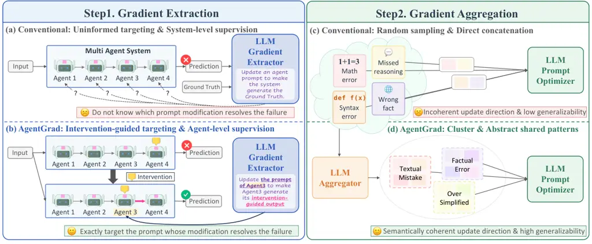
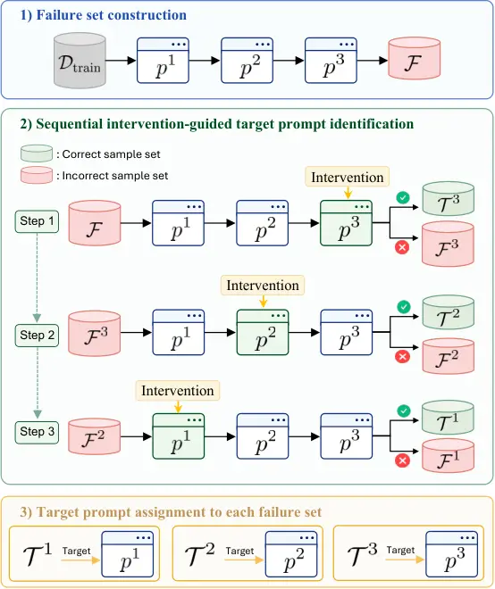
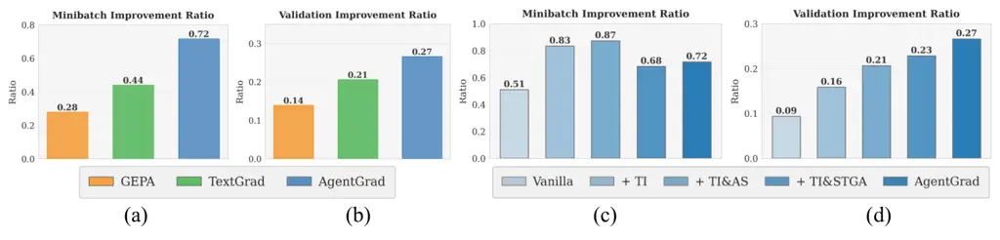
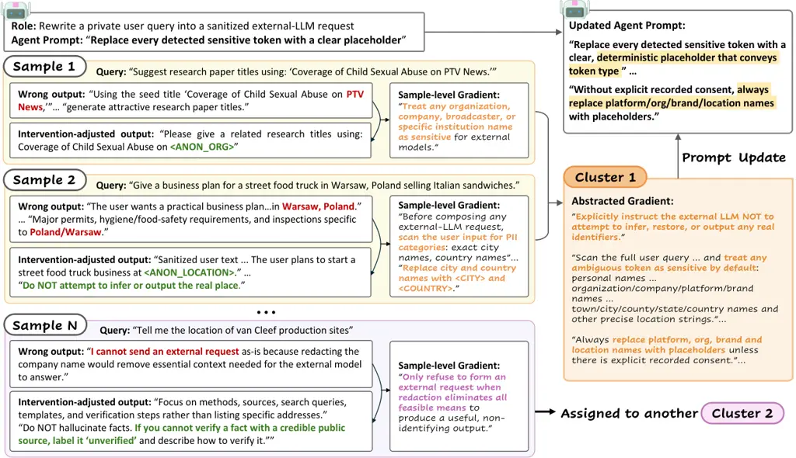
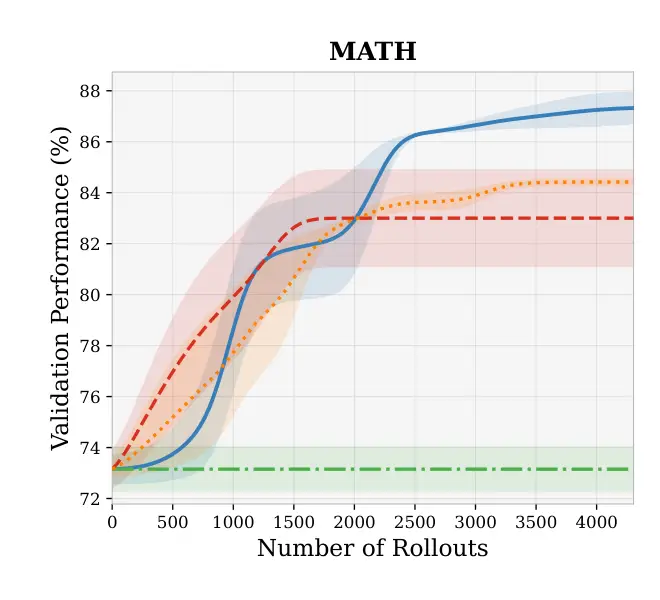

\tl_set:Ne\prompttitlebox

prompttitlebox

# AgentGrad: Intervention-guided Prompt Optimization for Multi-Agent Systems

Jaewon Chu Affiliation: Korea University
Email: [allonsy07@korea.ac.kr](mailto:)    Jinwoo Seo Affiliation: KAIST
Email: [sjwoo0612@kaist.ac.kr](mailto:)    Jaewon Cho Affiliation: KAIST
Email: [cho35750@kaist.ac.kr](mailto:)    Jeehye Na Affiliation: KAIST
Email: [jeehyena@kaist.ac.kr](mailto:)    Yunyang Xiong
Affiliation: Meta AI Email: [hyunwoojkim@kaist.ac.kr](mailto:)   
Youngdae Kim Affiliation: UNIST Email: [yunyang@meta.com](mailto:)   
Hyunwoo J. Kim ^(†)^(†)thanks: Corresponding author Affiliation: KAIST
Email: [youngdae.kim@unist.ac.kr](mailto:)

###### Abstract

Large language model (LLM)-based multi-agent systems (MAS) achieve
strong performance by employing specialized multiple agents, yet their
performance depends on the prompt design of each agent. For MAS prompt
optimization, textual gradient methods that guide prompt updates using
natural-language feedback have emerged as a leading paradigm. In this
paper, we identify limitations in two stages of existing textual
gradient approaches: gradient extraction and gradient aggregation. In
gradient extraction, previous works select a prompt to update without
verifying whether modifying it resolves the failure, and derive
gradients without agent-level supervision over the corresponding agent’s
intermediate output. In gradient aggregation, individual gradients are
randomly grouped and concatenated, often mixing unrelated failure modes
and producing prompts that fail to generalize. To address these
limitations, we propose AgentGrad, a prompt optimization framework for
multi-agent systems based on sequential intervention and semantic
textual gradient abstraction. For each failure, sequential intervention
injects a hint into one agent at a time to identify the target agent
whose modification resolves the failure. The modified output of the
target agent then serves as agent-level supervision for extracting a
fine-grained gradient. Semantic textual gradient abstraction clusters
semantically similar gradients to prevent mixing unrelated failure
modes, and abstracts each cluster into a generalized gradient that
captures the shared corrective pattern. Experimental results show that
AgentGrad achieves state-of-the-art performance across five MAS
benchmarks while reducing wall-clock optimization time by $`2.5\times`$
and optimization cost by 21.8% on average compared to the next-best
baselines. Our code is available at
[https://github.com/mlvlab/AgentGrad](https://github.com/mlvlab/AgentGrad).

## 1 Introduction

Recent advances in large language models (LLMs) have enabled the
development of multi-agent systems (MAS), where multiple LLM-powered
agents interact to solve complex tasks \[1, 2, 3, 4, 5\]. A key
advantage of MAS is that they decompose difficult problems into
subtasks, allowing different agents to contribute complementary
capabilities \[1, 2, 3\]. Such systems have shown strong performance
across a wide range of challenging settings, including multi-step
reasoning, planning, and information synthesis \[1, 3, 4, 6, 7\]. The
behavior of each agent is governed by its input prompt, making prompt
design critical to system performance \[8, 9\]. Motivated by this,
recent works have explored automatic prompt optimization for MAS showing
that refining agent prompts can substantially improve system
performance \[8, 9, 10, 11, 12, 13, 14\]. Among these, textual gradient
methods, which employ natural-language feedback to iteratively refine
prompts, have emerged as a leading paradigm \[10, 11, 12, 15, 16\].

In this paper, we identify systematic limitations in two stages of
existing textual gradient approaches for MAS: _textual gradient
extraction_ and _textual gradient aggregation_. For gradient extraction,
previous works exhibit two issues. First, the target prompt is selected
without verifying whether modifying an individual prompt can resolve the
failure. Existing methods either update all agent prompts simultaneously
at substantial cost, or apply round-robin selection without testing
which agent can repair the failure. Second, the gradient is derived
without direct agent-level supervision over individual agents’
intermediate outputs. While agent-level supervision provides a direct
update signal, it is unavailable in most MAS settings. In gradient
aggregation, individual textual gradients are randomly grouped and
directly concatenated. It often mixes unrelated failure modes and
produces prompt that fails to generalize.



Figure 1: Comparison of conventional textual gradient approaches and
AgentGrad. In gradient extraction, conventional approaches (a) select
prompts to update without identifying whose modification resolves the
failure and extract gradients without agent-level intermediate
supervision, while AgentGrad (b) identifies the target agent via
sequential intervention and extracts gradients using the
intervention-adjusted output of the target agent. In gradient
aggregation, conventional approaches (c) randomly group gradients
causing spurious signals, while AgentGrad (d) clusters gradients by
shared patterns and abstracts them into a generalized gradient.

To address these challenges, we propose AgentGrad, a prompt optimization
framework based on _sequential intervention_ and _semantic textual
gradient abstraction_. Sequential intervention addresses both
limitations in the gradient extraction stage \[17, 18, 19\].
Specifically, AgentGrad applies sequential interventions (e.g., hint
injection) to individual agents, identifying the target agent whose
correction resolves the failure \[17, 18, 19, 20, 21\]. The
intervention-adjusted output then serves as an agent-level pseudo-label
to yield a fine-grained textual gradient \[10, 12, 22, 23, 24\].
Semantic textual gradient abstraction improves the gradient aggregation
stage. It groups sample-level gradients that share a corrective pattern
into semantic minibatches, and abstracts each minibatch into a single
generalized textual gradient that captures the shared pattern \[10, 11,
12, 15, 16, 25\].

We evaluate AgentGrad on five MAS benchmarks spanning diverse task
types: multi-hop QA \[26\], claim verification \[27\], instruction
following \[28\], privacy-conscious delegation \[29\], and math
reasoning \[30\], using both open-source \[31\] and proprietary \[32\]
backbones. Across all benchmarks, AgentGrad consistently outperforms
strong recent prompt optimization baselines, while substantially
reducing wall-clock optimization time and API cost.

Our contributions are summarized as follows:

- •
  We propose AgentGrad, a prompt optimization framework for MAS that
  addresses limitations in two stages of existing textual gradient
  approaches: gradient extraction and gradient aggregation.
- •
  We introduce _sequential intervention_, a mechanism that resolves two
  limitations in gradient extraction stage: it identifies the target
  agent whose correction resolves the failure, and produces an
  agent-level pseudo-label that supplies fine-grained supervision for
  gradient extraction.
- •
  We introduce _semantic textual gradient abstraction_, which groups
  sample-level gradients into semantic minibatches sharing a corrective
  pattern and abstracts each cluster into a single textual gradient with
  improved generalizability.
- •
  Across five MAS benchmarks, AgentGrad achieves state-of-the-art
  performance while reducing wall-clock optimization time by
  $`2.5\times`$ and API cost by 21.8% on average compared to the
  next-best baselines.

## 2 Related Works

#### Automatic Prompt Optimization for LLM-Driven Agents

Automatic prompt optimization (APO) improves LLM-driven agents by
refining instructions, demonstrations, and other textual inputs \[8, 9,
33\]. Early APO mainly targeted single-prompt settings through black-box
search, edit-based instruction search, or LLM-generated feedback \[13,
14, 34, 35, 36\]. ProTeGi \[12\] introduced textual gradients by
treating natural-language critiques of failed examples as gradient-like
directions for prompt revision. Recent work extends APO from isolated
prompts to compound agent systems \[8, 9, 10, 11\]. MIPRO \[9\] jointly
searches instructions and demonstrations for multi-stage LM programs
with Bayesian optimization \[37, 38, 39\]. TextGrad \[10\] extends
textual gradients to compound LLM systems by propagating
natural-language feedback across multiple LLM components, analogous to
backpropagation. GEPA \[11\] combines trajectory-level reflection with
evolutionary prompt search. These methods provide strong APO signals,
typically through task-level feedback or trajectory-level reflection
\[9, 10, 11\]. However, intermediate agent behaviors and interactions
could provide finer-grained signals for multi-agent prompt optimization,
yet this direction remains underexplored.

#### Failure Attribution in Multi-Agent Systems

Failure attribution in multi-agent systems is challenging since
system-level errors can emerge from interactions among multiple agents
\[17, 20, 21\]. This creates a credit-assignment problem: a failed final
output gives limited evidence about which agent or step is associated
with the failure \[17, 40\]. Recent benchmarks and diagnostic methods
formalize this problem by localizing failures within multi-agent
trajectories \[17, 18, 19, 20, 21, 41\]. Intervention-driven debugging
systems further study these failures by editing, replaying, or
perturbing agent executions to test how alternative behaviors affect the
outcome \[18, 42, 43\]. Together, these works establish intervention as
a practical tool for failure localization, attribution validation, and
multi-agent debugging \[42, 43\]. AgentGrad extends this line of work
from failure analysis to prompt optimization. It treats the corrected
behavior revealed by intervention as agent-level supervision, turning
attribution evidence into a localized target for updating the
corresponding agent prompt.

#### Self-Generated Supervision

Self-generated supervision studies how LLMs can produce rationales,
feedback, or reflections as optimization signals \[44, 45, 46\]. STaR
bootstraps rationales to improve reasoning \[44\]. Reflexion and
Self-Refine use model-generated feedback to refine later attempts,
revised outputs, or future task behavior \[45, 46\]. These methods
establish LLM-generated supervision as an effective optimization source
without dense human annotations. Prior work primarily uses such
supervision to improve reasoning trajectories, iterative outputs, or
training objectives \[23, 44, 45, 46\], rather than to derive localized
prompt updates for individual agents. AgentGrad redirects this
supervision toward prompt-level optimization in multi-agent systems,
translating agent-level behavioral correction into supervision for
revising agent prompts.

## 3 Preliminaries

#### Prompt Optimization for MAS

Let $`\Pi`$ denote an MAS composed of $`N`$ LLM-based agents
$`(\pi^{1},\ldots,\pi^{N})`$. Given an input $`x`$, $`\Pi`$ generates
output $`\hat{y}=\Pi(x;\mathcal{P})`$, where
$`\mathcal{P}=(p^{1},\ldots,p^{N})`$ denotes the collection of agent
prompts. Given a reward function
$`r:\hat{\mathcal{Y}}\times\mathcal{Y}\to[0,1]`$, prompt optimization
finds $`\mathcal{P}^{*}`$ that maximizes the expected reward by
exploring candidate prompts and validating improvement using a training
set $`\mathcal{D}_{\text{train}}`$ and a validation set
$`\mathcal{D}_{\text{val}}`$, respectively. Since rollouts—running
$`\Pi`$ on an input followed by evaluation under reward function
$`r`$—are computationally expensive, prompt optimization is typically
formulated as finding the best solution within a budget of $`B`$
rollouts allowed \[9, 11\]:

```math
\mathcal{P}^{*}=\arg\max_{\mathcal{P}}\,\mathbb{E}_{(x,y)\sim\mathcal{D}_{\text{val}}}\,r\!\left(\Pi(x;\mathcal{P}),\,y\right),\quad\text{s.t. }\#\text{rollouts}\leq B. \tag{1}
```

The optimized $`\mathcal{P}^{*}`$ is then evaluated on a held-out test
set $`\mathcal{D}_{\text{test}}`$. For the $`i`$-th input $`x_{i}`$, the
system produces a sequence of intermediate inputs and outputs, where
$`\hat{y}_{i}^{n}=\pi^{n}(x_{i}^{n};p^{n})`$, $`x_{i}^{1}=x_{i}`$,
$`\hat{y}_{i}^{N}=\hat{y}_{i}`$, and $`x^{n}_{i}`$ for $`n\geq 2`$ is
constructed from preceding agents’ outputs.

#### Textual Gradient

The *textual gradient* \[12\] is a natural-language analog of the
numerical gradient used in gradient-based optimization. Following the
formulation in TextGrad \[10\], the textual gradient with respect to a
prompt $`p`$ is defined as

```math
\frac{\partial\mathcal{L}}{\partial p}=\text{LLM}_{\nabla}\!\left(p,\hat{y},\mathcal{L}\right), \tag{2}
```

where $`\mathcal{L}`$ is an objective, which may be either a
non-differentiable function or a natural-language description of the
failure, $`\hat{y}`$ is the prompt-conditioned output, and
$`\text{LLM}_{\nabla}`$ is an LLM-based gradient extractor that produces
a natural-language critique describing how $`p`$ should be modified to
improve $`\mathcal{L}`$. A separate prompt optimizer LLM then aggregates
sample-level textual gradients to produce an updated prompt. This
extraction–aggregation procedure underlies a family of textual gradient
methods \[10, 15, 16\]. Some recent works refer to this signal under
different names. GEPA, for instance, calls it natural-language
feedback \[11\], but these methods share the same abstraction: a natural
language description of how a prompt should be updated. We adopt
_textual gradient_ throughout this work to denote this signal.

## 4 Method

In this section, we present AgentGrad, a prompt optimization framework
for multi-agent systems based on _sequential intervention_ and _semantic
textual gradient abstraction_. For the gradient extraction stage, we
introduce sequential intervention, a mechanism that resolves the two
limitations of this stage. Sequential intervention identifies the agent
whose correction resolves a system-level failure (Section 4.1). The
intervention-induced output then serves as an agent-level pseudo-label
that supplies fine-grained supervision for textual gradient extraction
(Section 4.2). For the gradient aggregation stage, we introduce semantic
textual gradient abstraction (Section 4.3), which groups sample-level
gradients into semantic minibatches sharing a corrective pattern and
abstracts each cluster into a single textual gradient with improved
generalizability. We provide the pseudocode of AgentGrad in algorithm 1.



Figure 2: Intervention-Guided Target Identification. AgentGrad first
executes the current prompt set on $`\mathcal{D}_{\text{train}}`$ to
obtain the failed examples $`\mathcal{F}`$. It then applies
interventions to each agent in reverse execution order, progressively
separating the unresolved failures into corrected subsets
$`\mathcal{T}^{n}`$ and remaining failure sets $`\mathcal{F}^{n}`$.
Here, $`\mathcal{T}^{n}`$ denotes the subset of failures for which the
$`n`$-th agent is identified as the target, namely those resolved by
intervening on prompt $`p^{n}`$.

1: MAS $`\Pi`$, prompts $`\mathcal{P}`$, train/val sets
$`\mathcal{D}_{\text{train}},\mathcal{D}_{\text{val}}`$, reward $`r`$,
max reward $`r_{\max}`$, budget $`B`$, Hint $`\mathcal{H}`$

2: $`r_{\mathcal{P}}(x,y):=r(\Pi(x;\mathcal{P}),y)`$

3:
$`R_{\mathcal{D}}(\mathcal{P}):=\mathbb{E}_{(x,y)\sim\mathcal{D}}[r_{\mathcal{P}}(x,y)]`$

4:
$`\text{Fail}(\mathcal{P};\mathcal{S}):=\{(x,y)\in\mathcal{S}:r_{\mathcal{P}}(x,y)<r_{\max}\}`$

5: $`\text{Fail}^{(n,\mathcal{H})}`$ and
$`r_{\mathcal{P}}^{(n,\mathcal{H})}`$ denote Fail and
$`r_{\mathcal{P}}`$ after intervening on $`\pi^{n}`$ with hint
$`\mathcal{H}`$

6: while rollout budget is not exhausted do

7:
   $`\mathcal{F}\leftarrow\text{Fail}(\mathcal{P};\mathcal{D}_{\text{train}})`$

8:
   $`\Omega^{n}\leftarrow\emptyset,\mathcal{F}^{N+1}\leftarrow\mathcal{F}\hskip 8.50012pt\forall n\in\{1,\ldots,N\}`$

9:    for $`n=N,\ldots,1`$ do

10:
    $`\mathcal{F}^{n}\leftarrow\text{Fail}^{(n,\mathcal{H})}(\mathcal{P};\mathcal{F}^{n+1})`$

11:
    $`\mathcal{T}^{n}\leftarrow\mathcal{F}^{n+1}\setminus\mathcal{F}^{n}`$

12:     for each $`(x_{i},y_{i})\in\mathcal{T}^{n}`$ do

13:       Obtain $`(x_{i}^{n},\hat{y}_{i}^{n},\tilde{y}_{i}^{n})`$

14:
      $`\delta_{i}^{n}\leftarrow\text{LLM}_{\nabla}(p^{n},x_{i}^{n},\hat{y}_{i}^{n},\tilde{y}_{i}^{n})`$

15:       $`\Omega^{n}\leftarrow\Omega^{n}\cup\{\delta_{i}^{n}\}`$

16:     end for

17:    end for

18:    for each $`n`$ do

19:
    $`\{\bar{\delta}_{j}^{n}\}_{j=1}^{M_{n}}\leftarrow\text{LLM}_{\text{Aggregator}}(\Omega^{n})`$
$`\triangleright`$ with semantic minibatch $`\mathcal{D}_{j}^{n}`$ for
each $`\bar{\delta}_{j}^{n}`$

20:    end for

21:    for each $`n,j`$ in decreasing order of $`|\mathcal{D}_{j}^{n}|`$
do

22:
    $`p_{\text{new}}^{n}\leftarrow\text{LLM}_{\text{PromptOptimizer}}(p^{n},\bar{\delta}_{j}^{n})`$

23:     $`\mathcal{P}_{\text{new}}\leftarrow\mathcal{P}`$ with $`p^{n}`$
replaced by $`p_{\text{new}}^{n}`$

24:     if
$`R_{\mathcal{D}_{j}^{n}}(\mathcal{P}_{\text{new}})>R_{\mathcal{D}_{j}^{n}}(\mathcal{P})`$
then

25:       if
$`R_{\mathcal{D}_{\text{val}}}(\mathcal{P}_{\text{new}})>R_{\mathcal{D}_{\text{val}}}(\mathcal{P})`$
then

26:         $`\mathcal{P}\leftarrow\mathcal{P}_{\text{new}}`$

27:       end if

28:     end if

29:    end for

30: end while

31: return $`\mathcal{P}`$

Algorithm 1 AgentGrad

### 4.1 Target Prompt Identification via Sequential Intervention

Our goal is to select the target prompt to update. We recast credit
assignment for target prompt selection as identifying an agent whose
corrected behavior is sufficient to resolve a failure, rather than
attributing responsibility for that failure. To this end, we identify
the target prompt via sequential intervention, which modifies one agent
at a time to verify whether its correction resolves the failure. An
intervention modifies an agent’s behavior by injecting a hint into its
prompt, guiding it toward a corrected intermediate output that leads the
system to generate the correct output. Figure 2 illustrates the overall
procedure of the sequential intervention.

#### Sequential Intervention.

Given the current prompt set $`\mathcal{P}`$ of $`N`$ agents, let
$`\mathcal{F}=\{(x_{i},y_{i})\mid r(\Pi(x_{i};\mathcal{P}),y_{i})<r_{\max}\}`$
denote the set of failures from the training set
$`\mathcal{D}_{\text{train}}`$, where $`r`$ is a reward function and
$`r_{\max}`$ is the maximum reward value. For each failure
$`(x_{i},y_{i})\in\mathcal{F}`$, we apply interventions one agent at a
time in reverse execution order to identify the agent whose correction
resolves it. We adopt reverse execution order by analogy with the
backward pass in backpropagation, starting from the final agent and
proceeding upstream. Intervening on a downstream agent also allows us to
reuse the cached outputs of preceding agents and re-execute only the
intervened agent and its downstream agents. Starting with
$`\mathcal{F}^{N+1}=\mathcal{F}`$, we iterate over $`n=N,\ldots,1`$,
injecting hint $`\mathcal{H}`$ into agent $`\pi^{n}`$ by appending it to
the agent’s current prompt. The appended hint guides the agent toward a
corrected output; we denote the intervened MAS as
$`\Pi^{(n,\mathcal{H})}`$. We define $`\mathcal{T}^{n}`$ as the subset
of $`\mathcal{F}^{n+1}`$ resolved by intervening on $`\pi^{n}`$; for
this subset, $`\pi^{n}`$ is identified as the target agent:

```math
\mathcal{T}^{n}=\big\{(x_{i},y_{i})\in\mathcal{F}^{n+1}\;\big|\;r\!\left(\Pi^{(n,\mathcal{H})}(x_{i};\mathcal{P}),y_{i}\right)=r_{\max}\big\}, \tag{3}
```

where $`\mathcal{F}^{n+1}`$ denotes the failures still unresolved before
intervening on agent $`\pi^{n}`$. The resolved failures
$`\mathcal{T}^{n}`$ are then removed from the unresolved set
($`\mathcal{F}^{n}=\mathcal{F}^{n+1}\setminus\mathcal{T}^{n}`$), and the
procedure continues with agent $`\pi^{n-1}`$ if $`n>1`$. Failures that
remain unresolved after interventions have been applied to all agents
individually are treated as hard cases and excluded from the current
training round. They are not permanently discarded: since
$`\mathcal{F}`$ is reconstructed from $`\mathcal{D}_{\text{train}}`$ at
the start of every round, these cases are revisited under the updated
prompt set.

#### Hint Construction.

The hint $`\mathcal{H}`$ is designed to provide the necessary guidance
to direct an agent toward correct behavior. We construct $`\mathcal{H}`$
from the ground-truth $`y_{i}`$ or from constraints that the final
output must satisfy, together with auxiliary context such as
descriptions of the dataset, the MAS, and each agent role. These
components are commonly used in prior prompt optimization methods \[8\].
All compared methods have access to the same training-set ground-truth
information. We emphasize that $`\mathcal{H}`$ is used _only at training
time_; the optimized prompts are deployed without any hint injection at
inference time.

### 4.2 Textual Gradient Extraction via Agent-Level Supervision

In this section, we describe textual gradient extraction using the
target agent’s intervention-induced output as an agent-level
pseudo-label. For each target agent $`\pi^{n}`$ and each failure sample
$`(x_{i},y_{i})\in\mathcal{T}^{n}`$ attributed to it (Section 4.1), we
have two outputs under the same input $`x_{i}^{n}`$: the original output
$`\hat{y}_{i}^{n}`$ produced during the failed execution, and the
corrected output $`\tilde{y}_{i}^{n}`$ obtained by injecting hint
$`\mathcal{H}`$ during sequential intervention:

```math
\hat{y}_{i}^{n}=\pi^{n}(x_{i}^{n};p^{n}),\quad\tilde{y}_{i}^{n}=\pi^{n}(x_{i}^{n};p^{n},\mathcal{H}). \tag{4}
```

Since both $`\hat{y}_{i}^{n}`$ and $`\tilde{y}_{i}^{n}`$ are generated
under the same input context $`x_{i}^{n}`$, their difference isolates
the behavioral change induced by the intervention. We therefore
interpret $`\tilde{y}_{i}^{n}`$ as an agent-level pseudo-label
specifying how $`\pi^{n}`$ should behave under $`x_{i}^{n}`$. To extract
a textual gradient, AgentGrad uses this pseudo-label as input to a
gradient extractor LLM:

```math
\delta_{i}^{n}=\mathrm{LLM}_{\nabla}\!\left(p^{n},x_{i}^{n},\hat{y}_{i}^{n},\tilde{y}_{i}^{n}\right), \tag{5}
```

which captures how $`p^{n}`$ should be modified to produce
$`\tilde{y}_{i}^{n}`$ instead of $`\hat{y}_{i}^{n}`$. We call
$`\delta_{i}^{n}`$ a sample-level textual gradient, since it is derived
from a single failure sample $`(x_{i},y_{i})`$ and describes the
correction required for that instance alone. Unlike standard textual
gradient methods which require an explicit $`\mathcal{L}`$ derived from
comparing the system-level output against the ground-truth, our gradient
requires no explicit loss. The contrast between $`\hat{y}_{i}^{n}`$ and
$`\tilde{y}_{i}^{n}`$ implicitly provides agent-level supervision. This
agent-level supervision yields fine-grained update signals for the
target agent.

### 4.3 Semantic Textual Gradient Abstraction

In this section, we introduce semantic textual gradient abstraction,
which clusters semantically similar sample-level gradients into semantic
minibatches and abstracts each minibatch into a single generalized
textual gradient. Standard textual gradient methods aggregate
sample-level gradients from random minibatches. Such minibatches often
mix gradients from unrelated failure modes leaving the prompt optimizer
without a coherent update direction. In contrast, semantic minibatches
contain failures that share a common corrective pattern, providing a
coherent update direction.

For each agent $`\pi^{n}`$, let
$`\Omega^{n}=\{\delta_{i}^{n}\}_{(x_{i},y_{i})\in\mathcal{T}^{n}}`$
denote the set of sample-level textual gradients extracted in
Section 4.2 over all failures attributed to $`\pi^{n}`$. We employ an
aggregator LLM that clusters $`\Omega^{n}`$ into semantic minibatches
and abstracts each minibatch into a generalized textual gradient:

```math
\{\bar{\delta}^{n}_{j}\}_{j=1}^{M_{n}}=\mathrm{LLM}_{\text{Aggregator}}(\Omega^{n}), \tag{6}
```

where $`\bar{\delta}^{n}_{j}`$ denotes the $`j`$-th generalized gradient
for agent $`\pi^{n}`$ and $`M_{n}`$ is the number of resulting clusters,
which is determined by the aggregator LLM. We use a separate index $`j`$
to distinguish generalized gradients from sample-level gradients indexed
by $`i`$. The aggregator LLM performs two coupled steps within a single
call: clustering $`\Omega^{n}`$ into semantically coherent groups, and
abstracting each group into a generalized gradient that captures its
shared corrective pattern.

#### Clustering into Semantic Minibatches.

The aggregator LLM groups semantically similar sample-level gradients in
$`\Omega^{n}`$. Each group induces a semantic minibatch
$`\mathcal{D}^{n}_{j}`$: the training failures from which the
sample-level gradients in that group were extracted. The size of each
cluster determines the abstraction level: larger clusters yield more
general patterns shared across many failures, while smaller clusters
yield finer-grained corrections. To guide this abstraction level, we
provide the aggregator with a soft lower bound on cluster size, which
follows a cyclic schedule across optimization iterations (e.g.,
$`5\to 3\to 1\to 5\to\dots`$). This schedule encourages the aggregator
to alternate between coarse, broadly-shared patterns and finer, more
specific corrections over the course of training. The lower bound on
cluster size is recommended rather than strictly enforced, allowing the
aggregator to form smaller clusters when the gradients are too
dissimilar to group.

#### Abstracting into Generalized Gradients.

For each cluster, the aggregator LLM produces a generalized textual
gradient $`\bar{\delta}^{n}_{j}`$ that captures the shared corrective
pattern of its semantic minibatch. This provides a coherent update
direction while reducing reliance on instance-specific details,
encouraging prompt updates that generalize beyond individual failure
cases. The resulting generalized gradients $`\{\bar{\delta}^{n}_{j}\}`$
and their semantic minibatches $`\{\mathcal{D}^{n}_{j}\}`$ serve as the
primary signal for prompt updates.

### 4.4 Prompt Update and Validation

Given the generalized gradients $`\{\bar{\delta}_{j}^{n}\}`$ from
Section 4.3, we update agent prompts in decreasing order of semantic
minibatch size, applying broader, high-influence updates before finer
ones. A prompt optimizer LLM generates a candidate prompt
$`p_{\text{new}}^{n}`$ using the generalized gradient
$`\bar{\delta}_{j}^{n}`$ and the current prompt $`p^{n}`$:

```math
p_{\text{new}}^{n}=\mathrm{LLM}_{\text{PromptOptimizer}}\!\left(p^{n},\bar{\delta}_{j}^{n}\right). \tag{7}
```

Each candidate prompt is first evaluated on the semantic minibatch
$`\mathcal{D}_{j}^{n}`$; if performance improves, it is then evaluated
on the held-out validation set $`\mathcal{D}_{\text{val}}`$. If both
stages pass, we accept the update by replacing $`p^{n}`$ in
$`\mathcal{P}`$ with $`p_{\text{new}}^{n}`$; otherwise, we discard it
and proceed to the next gradient.

## 5 Experiment

### 5.1 Experimental Setup

We evaluate AgentGrad against three state-of-the-art prompt optimization
algorithms—MIPROv2 \[9\], TextGrad \[10\], and GEPA \[11\]—and a
no-optimization baseline across five MAS benchmarks: HotpotQA, HoVer,
IFBench, PUPA, and MATH \[26, 27, 28, 29, 30\]. For HotpotQA, HoVer,
PUPA, and IFBench, we adopt the multi-agent systems, data splits, and
reward functions from \[11\]; for MATH, we adopt from \[7\]. We evaluate
two LLM backbones, GPT-5-mini and Qwen3-8B \[31\], where the same
backbone serves as both the task LLM and all optimizer components across
all optimization algorithms.

### 5.2 Main Results

| GPT-5-mini       | HotpotQA           | HoVer              | PUPA               | IFBench            | MATH               | Improvement |
| ---------------- | ------------------ | ------------------ | ------------------ | ------------------ | ------------------ | ----------- |
| Baseline (No PO) | 46.33 $`\pm`$ 0.69 | 58.11 $`\pm`$ 1.01 | 84.74 $`\pm`$ 0.33 | 73.07 $`\pm`$ 0.60 | 76.48 $`\pm`$ 0.91 | -           |
| MIPROv2          | 59.00 $`\pm`$ 1.66 | 62.89 $`\pm`$ 1.34 | 88.33 $`\pm`$ 2.13 | 73.70 $`\pm`$ 0.86 | 83.13 $`\pm`$ 1.72 | +5.66       |
| TextGrad         | 67.89 $`\pm`$ 1.31 | 63.22 $`\pm`$ 1.47 | 89.72 $`\pm`$ 2.43 | 73.07 $`\pm`$ 0.60 | 76.48 $`\pm`$ 0.91 | +6.33       |
| GEPA             | 68.33 $`\pm`$ 1.55 | 63.11 $`\pm`$ 1.90 | 91.87 $`\pm`$ 1.55 | 75.23 $`\pm`$ 0.32 | 86.37 $`\pm`$ 0.50 | +9.24       |
| AgentGrad (Ours) | 73.89 $`\pm`$ 1.09 | 64.78 $`\pm`$ 1.44 | 95.17 $`\pm`$ 0.49 | 76.08 $`\pm`$ 0.45 | 87.62 $`\pm`$ 0.09 | +11.76      |

Table 1: Main results on five MAS benchmarks with GPT-5-mini. We report
the mean $`\pm`$ standard error over three random seeds. Bold indicates
the best result.

| Qwen3-8B         | HotpotQA           | HoVer              | PUPA               | IFBench            | MATH               | Improvement |
| ---------------- | ------------------ | ------------------ | ------------------ | ------------------ | ------------------ | ----------- |
| Baseline (No PO) | 41.33 $`\pm`$ 0.84 | 36.67 $`\pm`$ 1.02 | 80.87 $`\pm`$ 0.06 | 40.82 $`\pm`$ 1.99 | 83.24 $`\pm`$ 0.38 | -           |
| MIPROv2          | 58.33 $`\pm`$ 2.37 | 45.44 $`\pm`$ 0.68 | 85.76 $`\pm`$ 2.86 | 40.08 $`\pm`$ 2.21 | 84.68 $`\pm`$ 0.92 | +6.27       |
| TextGrad         | 50.86 $`\pm`$ 5.36 | 51.44 $`\pm`$ 0.78 | 84.50 $`\pm`$ 2.31 | 42.52 $`\pm`$ 0.45 | 83.90 $`\pm`$ 0.67 | +6.06       |
| GEPA             | 57.33 $`\pm`$ 2.54 | 50.11 $`\pm`$ 1.60 | 91.03 $`\pm`$ 1.71 | 37.53 $`\pm`$ 1.62 | 85.05 $`\pm`$ 0.48 | +7.62       |
| AgentGrad (Ours) | 60.45 $`\pm`$ 1.68 | 52.11 $`\pm`$ 1.66 | 91.51 $`\pm`$ 0.72 | 41.42 $`\pm`$ 0.99 | 85.81 $`\pm`$ 0.25 | +9.67       |

Table 2: Main results on five MAS benchmarks with Qwen3-8B. We report
the mean $`\pm`$ standard error over three random seeds. Bold indicates
the best result.

AgentGrad achieves state-of-the-art average performance across five MAS
benchmarks on both backbone settings. With GPT-5-mini in Table 1,
AgentGrad outperforms all baselines on every benchmark, achieving an
average improvement of $`+11.76`$ points over the no-optimization
baseline, with the largest margins on HotpotQA ($`73.89`$ vs. $`68.33`$
for GEPA) and PUPA ($`95.17`$ vs. $`91.87`$). In Table 2, AgentGrad with
Qwen3-8B achieves the largest average improvement of $`+9.67`$ points
over the no-optimization baseline, surpassing all baselines. The
consistent gains across both proprietary and open-source models,
spanning multi-hop QA, claim verification, instruction following,
privacy-conscious delegation, and math reasoning, demonstrate that
sequential intervention and semantic textual gradient abstraction
generalize across diverse task types and agent configurations.

### 5.3 Analysis

#### Ablation Studies.

| TI  | AS  | STGA | HotpotQA           | PUPA               |
| --- | --- | ---- | ------------------ | ------------------ |
|     |     |      | 67.89 $`\pm`$ 0.80 | 85.74 $`\pm`$ 1.65 |
| ✓   |     |      | 69.33 $`\pm`$ 0.38 | 89.58 $`\pm`$ 1.89 |
| ✓   | ✓   |      | 70.89 $`\pm`$ 0.62 | 92.23 $`\pm`$ 0.68 |
| ✓   |     | ✓    | 71.89 $`\pm`$ 0.29 | 93.13 $`\pm`$ 0.53 |
| ✓   | ✓   | ✓    | 73.89 $`\pm`$ 1.09 | 95.17 $`\pm`$ 0.49 |

Table 3: Ablation study of AgentGrad. We progressively add
intervention-guided target identification (TI), agent-level supervision
(AS), and semantic textual gradient abstraction (STGA) to a vanilla
baseline.

Figure 3: Optimization trajectory. Validation curves on HotpotQA of
AgentGrad and 3 baselines.

Table 3 presents an ablation study on HotpotQA and PUPA with GPT-5-mini,
progressively adding each component of AgentGrad to a vanilla baseline.
All three components contribute positively. Target identification (TI)
using sequential-intervention alone yields $`+1.44`$ and $`+3.84`$
points on HotpotQA and PUPA, showing that identifying the repair target
agent already produces more effective gradients. Adding agent-level
supervision (AS) on top of TI yields a further $`+1.56`$ and $`+2.65`$
points, while semantic textual gradient abstraction (STGA) on top of TI
contributes $`+2.56`$ and $`+3.55`$ points. The full model (AgentGrad)
achieves the best performance on both benchmarks, confirming that TI,
AS, and STGA address complementary aspects of the prompt optimization
process.

#### Optimization Trajectory.

Figure 3 shows validation performance as a function of the number of
rollouts on HotpotQA (GPT-5-mini). AgentGrad consistently dominates all
baselines at every rollout count. On HotpotQA, AgentGrad achieves
approximately $`70\%`$ by $`1{,}000`$ rollouts, while GEPA requires over
$`6{,}000`$ rollouts to approach a comparable level, and MIPROv2 and
TextGrad plateau below this threshold. AgentGrad’s confidence bands are
also notably narrow, reflecting more stable optimization across seeds,
and the performance gap is maintained rather than narrowing with
additional rollouts.

#### Wall-clock Time Comparison.

|                         |                            |                            |                            |                            |                            |                            |
| ----------------------- | -------------------------- | -------------------------- | -------------------------- | -------------------------- | -------------------------- | -------------------------- |
| Method                  | HotpotQA                   | HoVer                      | PUPA                       | IFBench                    | MATH                       | Avg. $`\downarrow`$        |
| MIPROv2                 | 501                        | 1226                       | 304                        | 581                        | 431                        | 608                        |
| TextGrad                | 899                        | 1553                       | 325                        | 332                        | 126                        | 647                        |
| GEPA                    | 346                        | 390                        | 319                        | 269                        | 360                        | 337                        |
| AgentGrad (Ours)        | 109                        | 244                        | 151                        | 90                         | 88                         | 136                        |
| AgentGrad vs. next-best | 3.2$`\boldsymbol{\times}`$ | 1.6$`\boldsymbol{\times}`$ | 2.0$`\boldsymbol{\times}`$ | 3.0$`\boldsymbol{\times}`$ | 1.4$`\boldsymbol{\times}`$ | 2.5$`\boldsymbol{\times}`$ |

Table 4: Wall-clock optimization time (in minutes) on five MAS
benchmarks with GPT-5-mini. AgentGrad consistently requires the least
optimization time across all benchmarks. The bottom row reports the
speedup over the next-best baseline. Bold indicates the lowest time per
benchmark.

| Method                  | HotpotQA | HoVer    | PUPA      | IFBench | MATH    | Avg. $`\downarrow`$ |
| ----------------------- | -------- | -------- | --------- | ------- | ------- | ------------------- |
| MIPROv2                 | \$38.53  | \$98.21  | \$19.81   | \$39.08 | \$77.07 | \$54.54             |
| TextGrad                | \$129.64 | \$250.16 | \$33.18   | \$50.26 | \$20.87 | \$96.82             |
| GEPA                    | \$35.31  | \$58.64  | \$29.29   | \$23.28 | \$27.12 | \$34.73             |
| AgentGrad (Ours)        | \$30.43  | \$52.18  | \$20.53   | \$19.45 | \$13.13 | \$27.14             |
| AgentGrad vs. next-best | 13.8%    | 11.0%    | $`-`$3.6% | 16.5%   | 37.1%   | 21.8%               |

Table 5: Optimization cost (in USD) on five MAS benchmarks with
GPT-5-mini. Costs are calculated using API prices of \$0.25 per 1M input
tokens and \$2.00 per 1M output tokens. Bold indicates the lowest cost
per benchmark. The bottom row reports the cost reduction over the
next-best baseline.

Table 4 reports wall-clock optimization time on five benchmarks with
GPT-5-mini. AgentGrad is the fastest method across all five benchmarks
without exception, completing optimization in $`136`$ minutes on
average, $`2.5\times`$ faster than the next-fastest baseline. The
speedup is most pronounced on HotpotQA ($`3.2\times`$ over GEPA) and
IFBench ($`3.0\times`$), where AgentGrad finishes in under two hours
while GEPA requires nearly six. Even on MATH, where TextGrad is
unusually fast at $`126`$ minutes, AgentGrad completes in just $`88`$
minutes. Notably, AgentGrad achieves these speedups while simultaneously
attaining the best task performance (Table 1), demonstrating that the
two objectives — optimization quality and efficiency — are not in
tension but are jointly improved by agent-level gradient signals.

#### Optimization Cost Analysis.

AgentGrad is not only faster but also substantially more cost-efficient
than existing prompt optimization methods. As shown in Table 5,
AgentGrad achieves the lowest average optimization cost of \$27.14,
reducing the cost by 21.8% compared with the next-best baseline.
Notably, AgentGrad is the most cost-efficient method on four of the five
benchmarks, with cost reductions of up to 37.1% on MATH. This advantage
is particularly pronounced over TextGrad and MIPROv2, whose average
costs are 3.6$`\times`$ and 2.0$`\times`$ higher than that of AgentGrad,
respectively. Together with the substantial wall-clock speedups in
Table 4, these results demonstrate that AgentGrad improves optimization
efficiency along both key dimensions—_time and monetary cost_—while
simultaneously achieving the strongest overall task performance
(Table 1).

#### Why AgentGrad Optimizes Faster and Generalizes Better.



Figure 4: Minibatch and validation improvement ratios. The minibatch
improvement ratio is the fraction of candidate updates that improve
performance on their semantic minibatch and trigger validation, while
the validation improvement ratio is the fraction of validation calls
that yield further improvement. (a, b) AgentGrad vs. baselines (GEPA,
TextGrad). (c, d) Ablation across AgentGrad components: Vanilla, +TI,
+TI&AS, +TI&STGA, and full AgentGrad. All values are averaged over
HotpotQA and PUPA with GPT-5-mini.

| Source           | HotpotQA           | HoVer              | PUPA               | IFBench            | MATH               |
| ---------------- | ------------------ | ------------------ | ------------------ | ------------------ | ------------------ |
| Target           | 2WikiMultiHopQA    | EX-FEVER           | PUPA-TNB           | IFEval             | OlympiadBench      |
| Baseline (No PO) | 24.33 $`\pm`$ 0.00 | 30.00 $`\pm`$ 0.00 | 88.40 $`\pm`$ 0.27 | 91.22 $`\pm`$ 0.11 | 59.33 $`\pm`$ 0.00 |
| MIPROv2          | 31.11 $`\pm`$ 4.81 | 32.89 $`\pm`$ 0.25 | 90.56 $`\pm`$ 2.20 | 91.70 $`\pm`$ 0.82 | 63.56 $`\pm`$ 2.92 |
| TextGrad         | 36.22 $`\pm`$ 5.43 | 32.67 $`\pm`$ 1.49 | 89.60 $`\pm`$ 1.20 | 91.22 $`\pm`$ 0.11 | 59.33 $`\pm`$ 0.00 |
| GEPA             | 44.89 $`\pm`$ 4.96 | 31.44 $`\pm`$ 0.82 | 91.51 $`\pm`$ 3.11 | 93.15 $`\pm`$ 0.47 | 66.00 $`\pm`$ 1.43 |
| AgentGrad (Ours) | 51.22 $`\pm`$ 1.63 | 33.11 $`\pm`$ 0.31 | 94.38 $`\pm`$ 0.83 | 95.00 $`\pm`$ 0.72 | 68.33 $`\pm`$ 1.21 |

Table 6: Prompt transferability across unseen benchmarks. We evaluate
the transferability of prompts optimized on the source benchmark to an
unseen target benchmark within the same domain. We report the mean ±
standard error over three random seeds. Bold indicates the best
performance.

| Setting                     | HotpotQA | HoVer | PUPA | IFBench | MATH | Total       |
| --------------------------- | -------- | ----- | ---- | ------- | ---- | ----------- |
| Initial failures            | 76       | 66    | 31   | 25      | 46   | 244         |
| Resolved (simultaneous)     | 70       | 39    | 29   | 15      | 37   | 190 (77.9%) |
| Resolved (sequential, ours) | 67       | 39    | 28   | 15      | 37   | 186 (76.2%) |

Table 7: Intervention coverage across benchmarks. Simultaneous
intervention and sequential intervention rows report the number of
resolved failures, where simultaneous intervention injects hints into
all agents at once. Simultaneous intervention resolves only four
additional cases compared to sequential approach (+1.6 percentage
points).

Figure 4(a–b) compares minibatch and validation improvement ratios
against GEPA and TextGrad, averaged over HotpotQA and PUPA. AgentGrad
achieves a minibatch improvement ratio of $`0.72`$ versus $`0.44`$ for
TextGrad and $`0.28`$ for GEPA. Since validation is triggered only when
a candidate improves the minibatch, this higher ratio leads to more
frequent evaluations on the larger validation set. Together with
effective cache reuse, this allows more rollouts to be processed per
unit time, helping explain AgentGrad’s wall-clock speedup under a fixed
rollout budget. This efficiency does not come at the cost of quality:
AgentGrad also achieves the highest validation improvement ratio
($`0.27`$ vs. $`0.21`$ and $`0.14`$), indicating that its accepted
updates generalize more reliably. Figure 4(c–d) isolates each
component’s contribution. TI and AS primarily raise the minibatch ratio
(from $`0.51`$ to $`0.87`$), improving per-sample gradient signal
quality, while STGA trades a modest minibatch ratio reduction for a gain
in validation ratio, improving generalizability — yielding a clear
division of roles among the three components.

#### Transferability of Optimized Prompts.

Table 6 evaluates whether optimized prompts remain effective on an
unseen benchmark from the same domain \[47, 48, 29, 49, 50\], without
any further optimization. AgentGrad achieves the best transfer
performance on all five target benchmarks compared to strong prompt
optimization algorithms. The margin over the next-best method is largest
on 2WikiMultiHopQA (51.22 vs. 44.89 for GEPA) and PUPA-TNB (94.38 vs.
91.51). Together with the in-domain results (Tables 1,  2) and the
optimization time comparison (Table 4), this shows that AgentGrad’s
gains are not confined to the benchmark it was optimized on: the same
prompts remain the strongest on unseen benchmarks within the domain.

#### Coverage of sequential intervention.

We assess the coverage of sequential intervention across five benchmarks
spanning diverse MAS architectures. As shown in Table 7, sequential
intervention resolves 186 of 244 initially failed examples (76.2%).
Simultaneous intervention resolves four additional cases, increasing
coverage to 77.9%. This small gap suggests that sequential intervention
captures most of the failure-resolution benefit of simultaneous
intervention across the evaluated architectures. Directly using all
simultaneously corrected outputs as supervision would entail updating
all agent prompts. Sequential intervention instead identifies an
individual repair target and provides its corrected output for each
resolved failure, enabling localized prompt updates.

#### Qualitative Results.

Figure 5 illustrates how AgentGrad extracts sample-level gradients using
intervention-adjusted outputs (Section 4.2), clusters semantically
similar gradients, and abstracts them for prompt updating (Section 4.3).
In Samples 1 and 2, failed outputs expose an organization name and a
location (red), whereas intervention-adjusted outputs replace them with
placeholders (green). Comparing each failed output with its
intervention-adjusted counterpart yields a sample-level gradient
specifying the required prompt correction. The gradients from Samples 1
and 2 share a corrective signal concerning identifier leakage and are
clustered together, then abstracted into a generalized redaction policy
used to update the target agent’s prompt. In contrast, the gradient from
Sample N addresses excessive refusal and is assigned to a separate
cluster.



Figure 5: Qualitative example of gradient extraction, semantic
clustering, and abstraction. Failed and intervention-adjusted outputs
guide sample-level gradient extraction. Gradients addressing identifier
leakage (Samples 1 and 2) are clustered and abstracted for prompt
updating, while the gradient addressing excessive refusal (Sample N)
forms a separate cluster.

## 6 Conclusion

We propose AgentGrad, a prompt optimization framework for multi-agent
systems that improves textual gradient extraction and aggregation.
Sequential intervention identifies the agent whose modification resolves
a failure and produces an agent-level pseudo-label for fine-grained
supervision. Semantic textual gradient abstraction clusters sample-level
gradients into semantic minibatches sharing a corrective pattern and
abstracts each into a generalized gradient. Across five MAS benchmarks,
AgentGrad achieves state-of-the-art average performance with both
GPT-5-mini and Qwen3-8B, while delivering a 2.5× wall-clock speedup and
reducing API cost by 21.8% on average relative to the next-best
baseline.

## Acknowledgments and Disclosure of Funding

This work was partly supported by the InnoCORE program of the Ministry
of Science and ICT (AI Meta-Scientist, N10260110, 30%); by the Virtual
Engineering Platform Project (Grant No. P0022336, 30%), funded by the
Ministry of Trade, Industry & Energy (MoTIE, South Korea); by the
Electronics and Telecommunications Research Institute (ETRI) grant
funded by the Korean government (Research on Autonomous Vision
Augmentation and Extension Technologies, 26ZR1200, 30%); and by the
Institute of Information & Communications Technology Planning &
Evaluation (IITP) grant funded by the Korea government (MSIT) (No.
RS-2026-25527734, Hyper-scale Industrial AI Research Support (R&D)
Program, Development of industry-specified multimodal hyperscale
foundation model based technologies for manufacturing, predictive
maintenance, and process optimization, 10%). The authors declare no
competing interests beyond the affiliations and funding sources
disclosed in this paper.

## References

- \[1\] Q. Wu, G. Bansal, J. Zhang, Y. Wu, B. Li, E. Zhu, L. Jiang, X.
  Zhang, S. Zhang, J. Liu, et al. (2024) Autogen: enabling next-gen llm
  applications via multi-agent conversations. In COLM, Cited by: §1.
- \[2\] G. Li, H. Hammoud, H. Itani, D. Khizbullin, and B. Ghanem (2023)
  Camel: communicative agents for" mind" exploration of large language
  model society. In NeurIPS, Cited by: §1.
- \[3\] S. Hong, M. Zhuge, J. Chen, X. Zheng, Y. Cheng, J. Wang, C.
  Zhang, Z. Wang, S. K. S. Yau, Z. Lin, et al. (2024) MetaGPT: meta
  programming for a multi-agent collaborative framework. In ICLR, Cited
  by: §1.
- \[4\] C. Qian, W. Liu, H. Liu, N. Chen, Y. Dang, J. Li, C. Yang, W.
  Chen, Y. Su, X. Cong, et al. (2024) Chatdev: communicative agents for
  software development. In ACL, Cited by: §1.
- \[5\] Y. Lin, S. Ye, Y. Yao, Z. Fang, B. Han, and T. Liu (2026)
  SquidAgent: parallelize wisely, coordinate efficiently. arXiv preprint
  arXiv:2610.08647. Cited by: §1.
- \[6\] M. A. Islam, M. E. Ali, and M. R. Parvez (2024) Mapcoder:
  multi-agent code generation for competitive problem solving. In ACL,
  Cited by: §1.
- \[7\] B. Lei, Y. Zhang, S. Zuo, A. Payani, and C. Ding (2024) Macm:
  utilizing a multi-agent system for condition mining in solving complex
  mathematical problems. In NeurIPS, Cited by: §N.5, Appendix N, §1,
  §5.1.
- \[8\] O. Khattab, A. Singhvi, P. Maheshwari, Z. Zhang, K.
  Santhanam, S. Vardhamanan, S. Haq, A. Sharma, T. T. Joshi, H. Moazam,
  et al. (2024) Dspy: compiling declarative language model calls into
  self-improving pipelines. In ICLR, Cited by: §1, §2, §4.1.
- \[9\] K. Opsahl-Ong, M. J. Ryan, J. Purtell, D. Broman, C. Potts, M.
  Zaharia, and O. Khattab (2024) Optimizing instructions and
  demonstrations for multi-stage language model programs. In EMNLP,
  Cited by: §1, §2, §3, §5.1.
- \[10\] M. Yuksekgonul, F. Bianchi, J. Boen, S. Liu, Z. Huang, C.
  Guestrin, and J. Zou (2024) Textgrad: automatic" differentiation" via
  text. arXiv preprint arXiv:2406.07496. Cited by: §1, §1, §2, §3, §3,
  §5.1.
- \[11\] L. A. Agrawal, S. Tan, D. Soylu, N. Ziems, R. Khare, K.
  Opsahl-Ong, A. Singhvi, H. Shandilya, M. J. Ryan, M. Jiang, et
  al. (2026) Gepa: reflective prompt evolution can outperform
  reinforcement learning. In ICLR, Cited by: §N.1, §N.2, §N.3, Appendix
  N, Appendix O, §1, §1, §2, §3, §3, §5.1.
- \[12\] R. Pryzant, D. Iter, J. Li, Y. Lee, C. Zhu, and M. Zeng (2023)
  Automatic prompt optimization with “gradient descent” and beam search.
  In EMNLP, Cited by: §1, §1, §2, §3.
- \[13\] C. Yang, X. Wang, Y. Lu, H. Liu, Q. V. Le, D. Zhou, and X.
  Chen (2024) Large language models as optimizers. In ICLR, Cited by:
  §1, §2.
- \[14\] Y. Zhou, A. I. Muresanu, Z. Han, K. Paster, S. Pitis, H. Chan,
  and J. Ba (2023) Large language models are human-level prompt
  engineers. In ICLR, Cited by: §1, §2.
- \[15\] P. Sharma and A. Z. Henley (2026) Modular prompt optimization:
  optimizing structured prompts with section-local textual gradients.
  arXiv preprint arXiv:2601.04055. Cited by: §1, §1, §3.
- \[16\] A. Cui, P. Nandyalam, A. Rufail, E. Cheung, A. Lei, K. Zhu,
  and S. O’Brien (2024) Introducing mapo: momentum-aided gradient
  descent prompt optimization. arXiv preprint arXiv:2410.19499. Cited
  by: §1, §1, §3.
- \[17\] S. Zhang, M. Yin, J. Zhang, J. Liu, Z. Han, J. Zhang, B. Li, C.
  Wang, H. Wang, Y. Chen, et al. (2025) Which agent causes task failures
  and when? on automated failure attribution of llm multi-agent systems.
  In ICML, Cited by: §1, §2.
- \[18\] G. Zhang, J. Wang, J. Chen, W. Zhou, K. Wang, and S. Yan (2026)
  AgenTracer: who is inducing failure in the llm agentic systems?. In
  ICLR, Cited by: §1, §2.
- \[19\] Y. Wang, W. Wu, J. Wang, and Q. Wang (2026) From flat logs to
  causal graphs: hierarchical failure attribution for llm-based
  multi-agent systems. arXiv preprint arXiv:2602.23701. Cited by: §1,
  §2.
- \[20\] Y. In, M. Tanjim, J. Subramanian, S. Kim, U. Bhattacharya, W.
  Kim, S. Park, S. Sarkhel, and C. Park (2026) Rethinking failure
  attribution in multi-agent systems: a multi-perspective benchmark and
  evaluation. arXiv preprint arXiv:2603.25001. Cited by: §1, §2.
- \[21\] M. Chen, J. Wang, F. Mu, Y. Wang, Z. Liu, H. Feng, and Q.
  Wang (2026) Seeing the whole elephant: a benchmark for failure
  attribution in llm-based multi-agent systems. In ACL, Cited by: §1,
  §2.
- \[22\] M. Li, K. Aggarwal, Y. Xie, A. Ahmad, and S. Lau (2024)
  Learning from contrastive prompts: automated optimization and
  adaptation. arXiv preprint arXiv:2409.15199. Cited by: §1.
- \[23\] F. Jiao, G. Guo, X. Zhang, N. F. Chen, S. Joty, and F.
  Wei (2025) Preference optimization for reasoning with pseudo feedback.
  In ICLR, Cited by: §1, §2.
- \[24\] X. Lin, Z. Dai, A. Verma, S. Ng, P. Jaillet, and B. K. H.
  Low (2024) Prompt optimization with human feedback. arXiv preprint
  arXiv:2405.17346. Cited by: §1.
- \[25\] Z. Ding, J. Hong, Z. Shi, J. T. Wang, Z. Lin, L. Yin, M.
  Liu, Z. Wang, and Y. Chen (2025) Scaling textual gradients via
  sampling-based momentum. In ICML Workshop, Cited by: §1.
- \[26\] Z. Yang, P. Qi, S. Zhang, Y. Bengio, W. Cohen, R.
  Salakhutdinov, and C. D. Manning (2018) HotpotQA: a dataset for
  diverse, explainable multi-hop question answering. In EMNLP, Cited by:
  §N.1, §1, §5.1.
- \[27\] Y. Jiang, S. Bordia, Z. Zhong, C. Dognin, M. Singh, and M.
  Bansal (2020) HoVer: a dataset for many-hop fact extraction and claim
  verification. In EMNLP Findings, Cited by: §N.2, §1, §5.1.
- \[28\] V. Pyatkin, S. Malik, V. Graf, H. Ivison, S. Huang, P.
  Dasigi, N. Lambert, and H. Hajishirzi (2025) Generalizing verifiable
  instruction following. In NeurIPS Datasets and Benchmarks Track, Cited
  by: §N.3, §1, §5.1.
- \[29\] L. Siyan, V. C. Raghuram, O. Khattab, J. Hirschberg, and Z.
  Yu (2025) Papillon: privacy preservation from internet-based and local
  language model ensembles. In NAACL, Cited by: §N.4, §1, §5.1, §5.3.
- \[30\] D. Hendrycks, C. Burns, S. Kadavath, A. Arora, S. Basart, E.
  Tang, D. Song, and J. Steinhardt (2021) Measuring mathematical problem
  solving with the MATH dataset. In Proceedings of the Neural
  Information Processing Systems Track on Datasets and Benchmarks 1,
  NeurIPS Datasets and Benchmarks 2021, External Links:
  [Link](https://datasets-benchmarks-proceedings.neurips.cc/paper/2021/hash/be83ab3ecd0db773eb2dc1b0a17836a1-Abstract-round2.html)
  Cited by: §N.5, Appendix N, §1, §5.1.
- \[31\] A. Yang, A. Li, B. Yang, B. Zhang, B. Hui, B. Zheng, B. Yu, C.
  Gao, C. Huang, C. Lv, et al. (2025) Qwen3 technical report. arXiv
  preprint arXiv:2505.09388. Cited by: Appendix O, §1, §5.1.
- \[32\] OpenAI (2026) GPT-5 mini Model. Note:
  [https://developers.openai.com/api/docs/models/gpt-5-mini](https://developers.openai.com/api/docs/models/gpt-5-mini)Accessed:
  2026-05-07 Cited by: Appendix O, §1.
- \[33\] K. Ramnath, K. Zhou, S. Guan, S. S. Mishra, X. Qi, Z. Shen, S.
  Wang, S. Woo, S. Jeoung, Y. Wang, et al. (2025) A systematic survey of
  automatic prompt optimization techniques. In EMNLP, Cited by: §2.
- \[34\] J. Chu, S. Lee, and H. J. Kim (2025) PRESTO: preimage-informed
  instruction optimization for prompting black-box llms. In NeurIPS,
  Cited by: §2.
- \[35\] A. Prasad, P. Hase, X. Zhou, and M. Bansal (2023) Grips:
  gradient-free, edit-based instruction search for prompting large
  language models. In EACL, Cited by: §2.
- \[36\] Q. Guo, R. Wang, J. Guo, B. Li, K. Song, X. Tan, G. Liu, J.
  Bian, and Y. Yang (2024) Evoprompt: connecting llms with evolutionary
  algorithms yields powerful prompt optimizers. In ICLR, Cited by: §2.
- \[37\] P. I. Frazier (2018) A tutorial on bayesian optimization. arXiv
  preprint arXiv:1807.02811. Cited by: §2.
- \[38\] J. Chu, J. Park, S. Lee, and H. J. Kim (2024) Inversion-based
  latent bayesian optimization. NeurIPS. Cited by: §2.
- \[39\] S. Lee, J. Chu, S. Kim, J. Ko, and H. J. Kim (2023) Advancing
  bayesian optimization via learning correlated latent space. NeurIPS.
  Cited by: §2.
- \[40\] K. Nagpal, D. Dong, J. Bouvier, and N. Mehr (2025) Leveraging
  large language models for effective and explainable multi-agent credit
  assignment. In AAMAS, Cited by: §2.
- \[41\] Y. Yu, M. Li, S. Xu, J. Fu, X. Hou, F. Lai, and B. Wang (2025)
  CORRECT: condensed error recognition via knowledge transfer in
  multi-agent systems. arXiv preprint arXiv:2509.24088. Cited by: §2.
- \[42\] W. Epperson, G. Bansal, V. C. Dibia, A. Fourney, J. Gerrits, E.
  Zhu, and S. Amershi (2025) Interactive debugging and steering of
  multi-agent ai systems. In CHI, Cited by: §2.
- \[43\] M. Ma, J. Zhang, F. Yang, Y. Kang, Q. Lin, S. Rajmohan, and D.
  Zhang (2026) DoVer: intervention-driven auto debugging for llm
  multi-agent systems. In ICLR, Cited by: §2.
- \[44\] E. Zelikman, Y. Wu, J. Mu, and N. Goodman (2022) Star:
  bootstrapping reasoning with reasoning. In NeurIPS, Cited by: §2.
- \[45\] N. Shinn, F. Cassano, A. Gopinath, K. Narasimhan, and S.
  Yao (2023) Reflexion: language agents with verbal reinforcement
  learning. In NeurIPS, Cited by: §2.
- \[46\] A. Madaan, N. Tandon, P. Gupta, S. Hallinan, L. Gao, S.
  Wiegreffe, U. Alon, N. Dziri, S. Prabhumoye, Y. Yang, et al. (2023)
  Self-refine: iterative refinement with self-feedback. In NeurIPS,
  Cited by: §2.
- \[47\] X. Ho, A. D. Nguyen, S. Sugawara, and A. Aizawa (2020)
  Constructing a multi-hop qa dataset for comprehensive evaluation of
  reasoning steps. In COLING, Cited by: §5.3.
- \[48\] H. Ma, W. Xu, Y. Wei, L. Chen, L. Wang, Q. Liu, and S.
  Wu (2024) EX-fever: a dataset for multi-hop explainable fact
  verification. In ACL Findings, Cited by: §5.3.
- \[49\] J. Zhou, T. Lu, S. Mishra, S. Brahma, S. Basu, Y. Luan, D.
  Zhou, and L. Hou (2023) Instruction-following evaluation for large
  language models. arXiv preprint arXiv:2311.07911. Cited by: §5.3.
- \[50\] C. He, R. Luo, Y. Bai, S. Hu, Z. Thai, J. Shen, J. Hu, X.
  Han, Y. Huang, Y. Zhang, et al. (2024) Olympiadbench: a challenging
  benchmark for promoting agi with olympiad-level bilingual multimodal
  scientific problems. In ACL, Cited by: §5.3.

## Appendix A Optimized Prompts

### A.1 HotpotQA, GPT-5 Mini

\prompttitlebox

HotpotQA GPT-5 Mini summarize1.predict

Base Prompt:


Prompt Optimized by AgentGrad:


\prompttitlebox

HotpotQA GPT-5 Mini create_query_hop2.predict

Base Prompt:


Prompt Optimized by AgentGrad:


\prompttitlebox

HotpotQA GPT-5 Mini summarize2.predict

Base Prompt:


Prompt Optimized by AgentGrad:


\prompttitlebox

HotpotQA GPT-5 Mini final_answer.predict

Base Prompt:


Prompt Optimized by AgentGrad:


### A.2 HotpotQA, Qwen3-8B

\prompttitlebox

HotpotQA Qwen3-8B summarize1.predict

Base Prompt:


Prompt Optimized by AgentGrad:


\prompttitlebox

HotpotQA Qwen3-8B create_query_hop2.predict

Base Prompt:


Prompt Optimized by AgentGrad:


\prompttitlebox

HotpotQA Qwen3-8B summarize2.predict

Base Prompt:


Prompt Optimized by AgentGrad:


\prompttitlebox

HotpotQA Qwen3-8B final_answer.predict

Base Prompt:


Prompt Optimized by AgentGrad:


### A.3 Hoverbench, GPT-5 Mini

\prompttitlebox

Hoverbench GPT-5 Mini summarize1.predict

Base Prompt:


Prompt Optimized by AgentGrad:


\prompttitlebox

Hoverbench GPT-5 Mini create_query_hop2.predict

Base Prompt:


Prompt Optimized by AgentGrad:


\prompttitlebox

Hoverbench GPT-5 Mini summarize2.predict

Base Prompt:


Prompt Optimized by AgentGrad:


\prompttitlebox

Hoverbench GPT-5 Mini create_query_hop3.predict

Base Prompt:


Prompt Optimized by AgentGrad:


### A.4 Hoverbench, Qwen3-8B

\prompttitlebox

Hoverbench Qwen3-8B summarize1.predict

Base Prompt:


Prompt Optimized by AgentGrad:


\prompttitlebox

Hoverbench Qwen3-8B create_query_hop2.predict

Base Prompt:


Prompt Optimized by AgentGrad:


\prompttitlebox

Hoverbench Qwen3-8B summarize2.predict

Base Prompt:


Prompt Optimized by AgentGrad:


\prompttitlebox

Hoverbench Qwen3-8B create_query_hop3.predict

Base Prompt:


Prompt Optimized by AgentGrad:


### A.5 MATH, GPT-5 Mini

\prompttitlebox

MATH GPT-5 Mini condition_extractor

Base Prompt:


Prompt Optimized by AgentGrad:


\prompttitlebox

MATH GPT-5 Mini condition_miner

Base Prompt:


Prompt Optimized by AgentGrad:


\prompttitlebox

MATH GPT-5 Mini step_generator

Base Prompt:


Prompt Optimized by AgentGrad:


\prompttitlebox

MATH GPT-5 Mini answer_executor

Base Prompt:


Prompt Optimized by AgentGrad:


### A.6 MATH, Qwen3-8B

\prompttitlebox

MATH Qwen3-8B condition_extractor

Base Prompt:


Prompt Optimized by AgentGrad:


\prompttitlebox

MATH Qwen3-8B condition_miner

Base Prompt:


Prompt Optimized by AgentGrad:


\prompttitlebox

MATH Qwen3-8B step_generator

Base Prompt:


Prompt Optimized by AgentGrad:


\prompttitlebox

MATH Qwen3-8B answer_executor

Base Prompt:


Prompt Optimized by AgentGrad:


### A.7 IFBench, GPT-5 Mini

\prompttitlebox

IFBench GPT-5 Mini generate_response_module.predict

Base Prompt:


Prompt Optimized by AgentGrad:


\prompttitlebox

IFBench GPT-5 Mini ensure_correct_response_module.predict

Base Prompt:


Prompt Optimized by AgentGrad:


### A.8 IFBench, Qwen3-8B

\prompttitlebox

IFBench Qwen3-8B generate_response_module.predict

Base Prompt:


Prompt Optimized by AgentGrad:


\prompttitlebox

IFBench Qwen3-8B ensure_correct_response_module.predict

Base Prompt:


Prompt Optimized by AgentGrad:


### A.9 PAPILLON, GPT-5 Mini

\prompttitlebox

PAPILLON GPT-5 Mini craft_redacted_request.predict

Base Prompt:


Prompt Optimized by AgentGrad:


\prompttitlebox

PAPILLON GPT-5 Mini respond_to_query.predict

Base Prompt:


Prompt Optimized by AgentGrad:


### A.10 PAPILLON, Qwen3-8B

\prompttitlebox

PAPILLON Qwen3-8B craft_redacted_request.predict

Base Prompt:


Prompt Optimized by AgentGrad:


\prompttitlebox

PAPILLON Qwen3-8B respond_to_query.predict

Base Prompt:


Prompt Optimized by AgentGrad:


## Appendix B Meta Prompt

### B.1 Hint Guidance Prompt


### B.2 Gradient Extraction Prompt


### B.3 Abstraction Prompt


### B.4 Prompt Update Prompt


## Appendix C Compute Analysis

We complement the wall-clock time and API cost analyses in the main text
with token usage and FLOP counts. All methods are optimized under the
same per-benchmark rollout budgets used in the main experiments.

#### Token usage.

| Method    | HotpotQA      | HoVer          | IFBench       | PUPA          | MATH          |
| --------- | ------------- | -------------- | ------------- | ------------- | ------------- |
| MIPROv2   | 38.03 / 14.51 | 67.17 / 40.71  | 15.14 / 17.65 | 18.43 / 7.60  | 32.36 / 34.49 |
| TextGrad  | 38.56 / 60.00 | 41.99 / 119.83 | 7.21 / 24.23  | 8.64 / 15.51  | 4.82 / 9.83   |
| GEPA      | 26.29 / 14.37 | 27.50 / 25.88  | 5.58 / 10.94  | 11.81 / 13.17 | 9.90 / 12.32  |
| AgentGrad | 14.59 / 13.39 | 20.06 / 23.58  | 4.44 / 9.17   | 7.49 / 9.33   | 7.81 / 5.59   |

Table 8: Token usage during optimization with GPT-5-mini. Each cell
reports input / output tokens in millions. Bold indicates the lowest
input and output token counts separately for each benchmark.

Table 8 reports the input and output tokens consumed during optimization
with GPT-5-mini. AgentGrad has the lowest combined input and output
token usage on all five benchmarks, averaging 23.09M tokens per
benchmark compared with 31.55M for GEPA. Although TextGrad uses fewer
input tokens on MATH, AgentGrad requires fewer output tokens and has
lower total token usage.

#### FLOPs.

| Method    | HotpotQA                        | HoVer                           | IFBench                         | PUPA                            | MATH                            |
| --------- | ------------------------------- | ------------------------------- | ------------------------------- | ------------------------------- | ------------------------------- |
| MIPROv2   | $`1.06\times 10^{18}`$          | $`1.21\times 10^{18}`$          | $`2.26\times 10^{17}`$          | $`2.57\times 10^{17}`$          | $`5.12\times 10^{17}`$          |
| TextGrad  | $`6.96\times 10^{17}`$          | $`9.99\times 10^{17}`$          | $`2.59\times 10^{17}`$          | $`2.10\times 10^{17}`$          | $`8.42\times 10^{17}`$          |
| GEPA      | $`4.40\times 10^{17}`$          | $`4.82\times 10^{17}`$          | $`1.99\times 10^{17}`$          | $`1.63\times 10^{17}`$          | $`7.69\times 10^{17}`$          |
| AgentGrad | $`\mathbf{2.72\times 10^{17}}`$ | $`\mathbf{4.61\times 10^{17}}`$ | $`\mathbf{1.97\times 10^{17}}`$ | $`\mathbf{1.42\times 10^{17}}`$ | $`\mathbf{2.28\times 10^{17}}`$ |

Table 9: FLOPs consumed during optimization with Qwen3-8B. Bold
indicates the lowest FLOP count for each benchmark.

Since FLOP counts are not directly available through the proprietary
GPT-5-mini API, we additionally report optimization FLOPs for the
open-weight Qwen3-8B backbone in Table 9. AgentGrad uses the fewest
FLOPs on all five benchmarks, showing that its optimization efficiency
extends to computational cost on the open-weight backbone.

## Appendix D Optimization under Matched Time and Token Budgets

| Method           | HotpotQA           | HoVer              | PUPA               | IFBench            | MATH               | Improvement |
| ---------------- | ------------------ | ------------------ | ------------------ | ------------------ | ------------------ | ----------- |
| Baseline (No PO) | 46.33 $`\pm`$ 0.69 | 58.11 $`\pm`$ 1.01 | 84.74 $`\pm`$ 0.33 | 73.07 $`\pm`$ 0.60 | 76.48 $`\pm`$ 0.91 | –           |
| MIPROv2          | 50.11 $`\pm`$ 3.39 | 54.33 $`\pm`$ 1.45 | 86.46 $`\pm`$ 0.58 | 75.06 $`\pm`$ 0.93 | 75.33 $`\pm`$ 0.25 | +0.51       |
| TextGrad         | 64.78 $`\pm`$ 2.95 | 52.67 $`\pm`$ 1.91 | 89.22 $`\pm`$ 1.82 | 71.66 $`\pm`$ 2.40 | 77.05 $`\pm`$ 0.75 | +3.33       |
| GEPA             | 66.33 $`\pm`$ 3.86 | 62.56 $`\pm`$ 1.79 | 88.65 $`\pm`$ 2.75 | 74.89 $`\pm`$ 0.48 | 78.67 $`\pm`$ 3.38 | +6.47       |
| AgentGrad        | 73.89 $`\pm`$ 1.10 | 64.78 $`\pm`$ 1.44 | 95.17 $`\pm`$ 0.49 | 76.08 $`\pm`$ 0.46 | 87.62 $`\pm`$ 0.09 | +11.76      |

Table 10: Performance under matched wall-clock optimization budgets with
GPT-5-mini. Each benchmark’s shared budget is set to AgentGrad’s
optimization time in the original rollout-budget experiments. Results
are reported as mean and standard error. Improvement denotes the average
gain over the no-optimization baseline across the five benchmarks. Bold
indicates the best result.

| Method           | HotpotQA           | HoVer              | PUPA               | IFBench            | MATH               | Improvement |
| ---------------- | ------------------ | ------------------ | ------------------ | ------------------ | ------------------ | ----------- |
| Baseline (No PO) | 46.33 $`\pm`$ 0.69 | 58.11 $`\pm`$ 1.01 | 84.74 $`\pm`$ 0.33 | 73.07 $`\pm`$ 0.60 | 76.48 $`\pm`$ 0.91 | –           |
| MIPROv2          | 56.33 $`\pm`$ 1.54 | 61.89 $`\pm`$ 2.12 | 88.11 $`\pm`$ 1.22 | 74.55 $`\pm`$ 1.08 | 79.91 $`\pm`$ 3.58 | +4.41       |
| TextGrad         | 65.78 $`\pm`$ 1.74 | 52.67 $`\pm`$ 1.91 | 89.60 $`\pm`$ 1.88 | 71.66 $`\pm`$ 2.40 | 77.05 $`\pm`$ 0.75 | +3.61       |
| GEPA             | 68.33 $`\pm`$ 1.89 | 63.11 $`\pm`$ 2.33 | 89.07 $`\pm`$ 2.73 | 75.23 $`\pm`$ 0.40 | 85.52 $`\pm`$ 0.34 | +8.51       |
| AgentGrad        | 73.89 $`\pm`$ 1.10 | 64.78 $`\pm`$ 1.44 | 95.17 $`\pm`$ 0.49 | 76.08 $`\pm`$ 0.46 | 87.62 $`\pm`$ 0.09 | +11.76      |

Table 11: Performance under matched token budgets with GPT-5-mini. Each
benchmark’s shared budget is set to AgentGrad’s total input-plus-output
token usage in the original rollout-budget experiments. Results are
reported as mean and standard error. Improvement denotes the average
gain over the no-optimization baseline across the five benchmarks. Bold
indicates the best result.

We evaluate whether the performance gains persist when optimization is
constrained by wall-clock time or token usage rather than rollout count.
For each benchmark, we use AgentGrad’s wall-clock time and total
input-plus-output token usage from the original rollout-budget
experiments as the shared time and token budgets, respectively. These
budgets correspond to the lowest resource usage among the compared
methods in those experiments.

Tables 10 and 11 report the results under the matched wall-clock time
and token budgets. AgentGrad achieves the highest mean performance on
all five benchmarks under both budget definitions. Compared with GEPA,
the strongest baseline on average, AgentGrad improves performance by
5.29 points under the time-matched budget and 3.26 points under the
token-matched budget.

## Appendix E Stability Analysis of Semantic Clustering

| Benchmark | ARI   | NMI   | AMI   |
| --------- | ----- | ----- | ----- |
| HotpotQA  | 0.515 | 0.636 | 0.587 |
| PUPA      | 0.412 | 0.562 | 0.421 |

Table 12: Agreement across five independent semantic clustering runs on
the same gradient set for each benchmark. Higher values indicate greater
agreement.

We assess the consistency of LLM-based semantic clustering by
independently repeating the clustering procedure five times on the same
gradient set for each benchmark. We quantify agreement between the
resulting partitions using the Adjusted Rand Index (ARI), Normalized
Mutual Information (NMI), and Adjusted Mutual Information (AMI).

Table 12 reports the agreement scores on HotpotQA and PUPA. The positive
chance-adjusted ARI and AMI scores indicate above-chance agreement
across independent runs, suggesting that the clustering procedure
captures recurring structure in the sample-level gradients. These
results complement the abstraction and cluster-size schedule ablations,
which examine the effects of gradient abstraction and the choice of
grouping granularity, respectively.

## Appendix F Embedding-based Clustering Analysis

| Clustering    | HotpotQA                   | HoVer                      | IFBench                    | PUPA                       | MATH                       |
| ------------- | -------------------------- | -------------------------- | -------------------------- | -------------------------- | -------------------------- |
| Embedding     | $`73.33\pm 0.98`$          | $`64.23\pm 1.17`$          | $`75.98\pm 0.44`$          | $`94.82\pm 0.35`$          | $`86.41\pm 0.11`$          |
| LLM (default) | $`\mathbf{73.89\pm 1.09}`$ | $`\mathbf{64.78\pm 1.44}`$ | $`\mathbf{76.08\pm 0.45}`$ | $`\mathbf{95.17\pm 0.49}`$ | $`\mathbf{87.62\pm 0.09}`$ |

Table 13: Comparison of embedding-based and LLM-based semantic
clustering with GPT-5-mini. Both variants retain LLM-based gradient
abstraction. Results are reported as mean $`\pm`$ standard error. Bold
indicates the highest mean score for each benchmark.

We examine whether semantic textual gradient abstraction depends on
LLM-based clustering by replacing the clustering step with
embedding-based clustering using text-embedding-3-small. The subsequent
LLM-based abstraction step is retained.

Table 13 compares the two variants. Embedding-based clustering yields
mean scores within 0.56 points of LLM-based clustering on HotpotQA,
HoVer, IFBench, and PUPA. On MATH, LLM-based clustering achieves a
higher score by 1.21 points. These results show that embedding-based
clustering provides an alternative grouping mechanism, although its
effect on downstream performance varies across tasks.

In the default implementation, clustering and abstraction are performed
jointly within a single LLM call. Replacing clustering with an
embedding-based procedure therefore does not reduce the number of LLM
calls, since abstraction still requires an LLM call. The additional
embedding cost is negligible relative to the total optimization cost.

## Appendix G Cycle Experiment

| Method                | HotpotQA           | PUPA               |
| --------------------- | ------------------ | ------------------ |
| LLM judge             | 72.22 $`\pm`$ 0.29 | 93.02 $`\pm`$ 0.26 |
| Fixed lower bound = 3 | 72.78 $`\pm`$ 0.95 | 94.49 $`\pm`$ 0.44 |
| Cycle (Ours)          | 73.89 $`\pm`$ 1.09 | 95.17 $`\pm`$ 0.49 |

Table 14: Effect of the cyclic lower-bound schedule. We report the mean
$`\pm`$ standard error over three random seeds. LLM judge uses no
explicit lower bound, Fixed lower bound = 3 uses a constant lower bound,
and AgentGrad uses the cyclic schedule $`5\to 3\to 1\to 5\to\cdots`$.
Bold indicates the best result, and underline indicates the second-best
result.

We evaluate the effect of the cyclic lower-bound schedule used for
semantic minibatch construction. We compare AgentGrad with two variants:
LLM judge, which does not specify any lower bound and lets the
aggregator determine cluster sizes, and Fixed lower bound = 3, which
uses the same soft lower bound at every iteration. AgentGrad uses the
cyclic schedule $`5\to 3\to 1\to 5\to\cdots`$. As shown in Table 14, the
cyclic schedule performs best on both HotpotQA and PUPA.

## Appendix H Abstraction Ablation

| Method                       | HotpotQA           | PUPA               |
| ---------------------------- | ------------------ | ------------------ |
| Baseline (No PO)             | 46.33 $`\pm`$ 0.69 | 84.74 $`\pm`$ 0.33 |
| Random + Concat              | 70.89 $`\pm`$ 0.62 | 92.23 $`\pm`$ 0.68 |
| Random + Abstraction         | 71.56 $`\pm`$ 0.89 | 94.83 $`\pm`$ 1.61 |
| Cluster + Concat             | 72.67 $`\pm`$ 0.70 | 92.39 $`\pm`$ 1.10 |
| Cluster + Abstraction (Ours) | 73.89 $`\pm`$ 1.09 | 95.17 $`\pm`$ 0.49 |

Table 15: Ablation on semantic clustering and gradient abstraction. We
report the mean $`\pm`$ standard error over three random seeds. The
results compare random grouping versus semantic clustering, and direct
concatenation versus abstraction into generalized textual gradients.
Bold indicates the best result, and underline indicates the second-best
result.

We ablate the two main components used to construct generalized textual
gradients: semantic clustering and abstraction. Here, Random denotes
forming minibatches by randomly grouping sample-level textual gradients,
without using semantic similarity. Cluster denotes forming semantic
minibatches by grouping gradients that express similar corrective
patterns. Concat denotes directly concatenating the sample-level
gradients in a minibatch and using the concatenated text as the update
signal, without further summarization. Abstraction denotes using an
aggregator LLM to summarize a minibatch into a generalized textual
gradient that captures the shared corrective pattern.

Table 15 compares four variants. Random + Concat removes both semantic
clustering and abstraction. Random + Abstraction keeps abstraction but
removes semantic clustering. Cluster + Concat keeps semantic clustering
but removes abstraction. AgentGrad uses both semantic clustering and
abstraction. AgentGrad achieves the best performance on both HotpotQA
and PUPA, indicating that the two components provide complementary
benefits.

## Appendix I Ground-Truth Leakage Analysis

|       | Pseudo-label | Sample-level gradient | Abstracted gradient |
| ----- | ------------ | --------------------- | ------------------- |
| Ratio | 22.4%        | 11.5%                 | 0%                  |
| Count | 218/973      | 112/973               | 0/312               |

Table 16: Ground-truth content detected by an LLM-based judge at three
stages of the optimization pipeline. Counts are pooled across the five
benchmarks. Each ratio uses the number of outputs at the corresponding
stage as its denominator.

We examine whether ground-truth content from intervention hints
propagates through the optimization pipeline. Using an LLM-based judge,
we audit intervention-induced pseudo-labels, sample-level gradients, and
abstracted gradients collected across the five benchmarks.

As shown in Table 16, ground-truth content is detected in 218 of 973
pseudo-labels (22.4%) and 112 of 973 sample-level gradients (11.5%). No
ground-truth content is detected in the 312 abstracted gradients. These
findings suggest that semantic textual gradient abstraction reduces the
propagation of instance-specific ground-truth content into generalized
update signals.

We additionally examine the final optimized prompts. The prompt
optimizer receives few-shot exemplars following GEPA, which provide
another potential source of instance-specific content. Such content
appears in 3 of the 48 final prompts. Thus, the absence of detected
ground-truth content in abstracted gradients does not imply that all
final prompts are free of instance-specific content. The cross-benchmark
transfer results in the main text provide complementary evidence that
the optimized prompts remain effective beyond their source benchmarks.

## Appendix J Target Agent Attribution via Sequential Intervention

Figure 6: Target Agent Attribution

Figure 6 shows the distribution of target-agent assignments across the
five MAS benchmarks. On HotpotQA, MACM, and IFBench, the majority of
failures are assigned to the final agent in the pipeline. On HoVer, more
than half of the resolved failures are concentrated in the latter
agents. This pattern motivates our reverse-order intervention strategy:
by intervening on later agents first, the procedure resolves a large
fraction of failures in the early intervention steps and terminates
early for those samples, reducing the overall intervention cost.

## Appendix K Effect of Intervention Order

We compare reverse execution order with random intervention order across
the five benchmarks using GPT-5-mini. We examine the positions of
selected repair targets and downstream optimization performance.

#### Repair-target positions.

| Benchmark | Reverse | Random |
| --------- | ------- | ------ |
| HotpotQA  | 98.05%  | 89.11% |
| HoVer     | 68.99%  | 54.83% |
| IFBench   | 65.36%  | 55.45% |
| PUPA      | 9.58%   | 9.47%  |
| MATH      | 98.14%  | 88.25% |

Table 17: Proportion of repair targets assigned to late-position agents
under reverse and random intervention orders.

Table 17 reports the proportion of repair targets assigned to
late-position agents. Reverse order assigns a larger proportion of
targets to later agents than random order. However, the benchmark-level
pattern persists under random order: HotpotQA and MATH exhibit the
strongest late-position concentration, whereas PUPA shows little
concentration under either ordering. These results suggest that the
observed late-position tendency is not solely an artifact of
reverse-order intervention, although intervention order does affect
target selection.

#### Downstream performance.

| Order   | HotpotQA                   | HoVer                      | IFBench                    | PUPA                       | MATH                       |
| ------- | -------------------------- | -------------------------- | -------------------------- | -------------------------- | -------------------------- |
| Random  | $`73.33\pm 1.90`$          | $`64.69\pm 1.50`$          | $`\mathbf{77.42\pm 0.82}`$ | $`93.43\pm 0.85`$          | $`86.14\pm 0.16`$          |
| Reverse | $`\mathbf{73.89\pm 1.09}`$ | $`\mathbf{64.78\pm 1.44}`$ | $`76.08\pm 0.45`$          | $`\mathbf{95.17\pm 0.49}`$ | $`\mathbf{87.62\pm 0.09}`$ |

Table 18: Downstream optimization performance with GPT-5-mini under
reverse and random intervention orders. Results are reported as mean
$`\pm`$ standard error. Bold indicates the higher mean score for each
benchmark.

Table 18 reports downstream optimization performance under the two
orderings. Reverse order achieves higher mean scores on HotpotQA, HoVer,
PUPA, and MATH, while random order achieves a higher mean score on
IFBench. Thus, the effect of intervention order on downstream
performance varies across benchmarks.

## Appendix L Intervention Overhead Analysis

| Benchmark | Agents ($`N`$) | Intervention rollouts | Rollout budget | Share (%) |
| --------- | -------------- | --------------------- | -------------- | --------- |
| HotpotQA  | 4              | 309                   | 6,869          | 4.50      |
| HoVer     | 4              | 619                   | 6,892          | 8.98      |
| IFBench   | 2              | 98                    | 3,602          | 2.72      |
| PUPA      | 2              | 148                   | 2,174          | 6.81      |
| MATH      | 4              | 189                   | 4,436          | 4.26      |
| Total     | –              | 1,363                 | 23,973         | 5.69      |

Table 19: Sequential intervention overhead across benchmarks. Share
denotes the intervention rollout count divided by the rollout budget.
Total aggregates the counts and budgets across benchmarks; its share is
calculated from these totals.

We quantify intervention overhead as the fraction of the rollout budget
spent on sequential intervention. For an optimization round containing
$`T`$ failed examples and $`N`$ agents, each failed example requires at
least one and at most $`N`$ intervention rollouts. The intervention
rollout count therefore lies between $`T`$ and $`NT`$, with the actual
count determined by how many failures are resolved before all agents
have been examined. For fixed $`T`$, the worst-case intervention rollout
count scales linearly with the number of agents.

Table 19 reports the intervention rollout usage across the five
benchmarks. Intervention accounts for less than 9% of the rollout budget
on every benchmark. Aggregating the reported counts across benchmarks,
intervention uses 1,363 of 23,973 budgeted rollouts, corresponding to an
overall budget share of 5.69%.

## Appendix M Validation Curves

(a) HoVer

(b) PUPA

(c) IFBench



(d) MATH

Figure 7: Main validation performance curves across four benchmarks.

We provide additional validation curves for AgentGrad and the baseline
methods across the evaluated benchmarks (Figure 7). Each curve plots
validation performance against the cumulative number of rollouts under
the experimental settings described in the main text. These curves
complement the final test-set results by showing when improvements occur
and how performance evolves as the optimization budget is consumed.

## Appendix N Benchmark and Multi-Agent System Details

This section describes the benchmark tasks and the corresponding
executable multi-agent or compound systems used in our experiments. The
original benchmarks define evaluation tasks and datasets, while the
paired systems define the prompt surfaces optimized by AgentGrad. For
HotpotQA, HoVer, IFBench, and PUPA, we use the GEPA-style
benchmark–compound-system pairings \[11\]. For MATH, we pair the MATH
benchmark with MACM, a multi-agent mathematical reasoning system with
iterative condition-mining loops \[30, 7\]. Across all settings,
AgentGrad optimizes prompts inside the existing executable system,
rather than replacing the task pipeline itself.

### N.1 HotpotQA

HotpotQA is a multi-hop question answering benchmark that requires
combining evidence from multiple documents to answer a question \[26\].
The original HotpotQA benchmark defines the evaluation task and dataset,
not a multi-agent system. In our experiments, HotpotQA is paired with a
compound multi-hop QA pipeline following the GEPA-style setup \[11\].
The system decomposes the question into intermediate retrieval or
reasoning steps, gathers evidence, summarizes relevant information, and
produces the final answer. This setting is useful for evaluating prompt
optimization because errors can arise at multiple intermediate stages,
including underspecified retrieval queries, missing bridge entities,
irrelevant evidence summaries, or unsupported final answers. AgentGrad
optimizes the prompts of the agents in this pipeline by identifying
which agent-level correction resolves the failed system output and
converting that correction into localized prompt-update supervision.

### N.2 HoVer

HoVer is a many-hop fact extraction and claim verification benchmark in
which the system must determine whether a claim is supported by evidence
distributed across multiple documents \[27\]. The original HoVer
benchmark defines the verification task and evidence requirements, while
the executable system used in our experiments follows the GEPA-style
multi-hop verification pipeline \[11\]. The system generates
evidence-seeking queries, summarizes retrieved evidence, and decides
whether the accumulated evidence supports or refutes the claim. Compared
with HotpotQA, HoVer emphasizes verification rather than answer
generation. This makes it sensitive to failures in evidence sufficiency,
evidence-chain construction, and support/refute decision making.
AgentGrad is used to improve the prompts governing these intermediate
verification behaviors.

### N.3 IFBench

IFBench evaluates verifiable instruction following, where each task
specifies output constraints that can be checked automatically \[28\].
The benchmark itself defines the instruction-following task and reward,
while the executable system follows the GEPA-style compound setup for
producing and revising responses under constraints \[11\]. In this
setting, agents reason about the user instruction, identify the
constraints that the output must satisfy, and construct a final response
that satisfies those constraints. This benchmark stresses a different
failure mode from evidence-based QA: the system may understand the task
semantically but still violate formatting, lexical, structural, or
compositional constraints. AgentGrad optimizes the prompts of the agents
responsible for constraint interpretation and final response
construction.

### N.4 PUPA

PUPA is based on the PAPILLON privacy-conscious delegation setting,
where a system must balance task utility with privacy preservation when
using local and external language model components \[29\]. The benchmark
evaluates whether the system can preserve useful task information while
avoiding unnecessary leakage of private information. The executable
compound system contains agents that decide how to transform, sanitize,
delegate, or reconstruct a response under privacy constraints via
LLM-as-a-judge. Failures can occur when an agent over-redacts useful
information, under-redacts sensitive information, or delegates a request
in a way that violates the privacy objective. This benchmark is
therefore useful for evaluating prompt optimization under competing
objectives: maintaining answer quality while preserving privacy.
AgentGrad uses intervention-induced corrections to identify which
privacy-related agent behavior should be revised.

### N.5 MATH with MACM

MATH is a mathematical problem-solving benchmark consisting of
competition-style problems that require multi-step reasoning \[30\].
MATH itself defines the evaluation task and dataset, not a multi-agent
system. In our experiments, we pair MATH with MACM as the executable MAS
solver \[7\]. Thus, benchmark instances are drawn from MATH, while the
prompts optimized by AgentGrad belong to the MACM agents.

MACM is a multi-agent framework for mathematical reasoning based on
condition mining. Rather than executing a single fixed linear chain of
agents, MACM maintains and updates a set of known conditions and
candidate insights during problem solving. The system iteratively
proposes, verifies, and incorporates new conditions until it has
sufficient information to derive the final answer. This creates a
conditional-loop execution structure: the agents invoked, the
intermediate reasoning state, and the number of reasoning steps can vary
across problems depending on which conditions are discovered and whether
the current state is sufficient for solution.

This benchmark–system pairing is useful for evaluating whether AgentGrad
can optimize prompts beyond simple feed-forward MAS traces. Since MACM
contains iterative condition discovery and verification, AgentGrad must
operate on agent behaviors that arise inside non-linear execution
traces, rather than only on agents arranged in a fixed sequence.
Failures in this setting often involve missing conditions, invalid
intermediate derivations, premature termination, or weak verification of
the final answer. AgentGrad uses intervention-induced corrections within
these traces to identify which MACM agent behavior should be revised and
converts that correction into localized prompt-update supervision.

## Appendix O Implementation Details

In this paper, we use Qwen3-8b \[31\] and GPT-5-mini \[32\], and all
experiments were conducted on a server equipped with 4 NVIDIA RTX A6000
GPUs and 256GB RAM. Our code is based on GEPA \[11\] implementation.

## Appendix P Broader Impacts and Limitations

### P.1 Broader Impacts

This work aims to improve automatic prompt optimization for LLM-based
multi-agent systems, potentially reducing the manual effort required to
design effective agent prompts and improving the accessibility of MAS
development. However, more effective optimization techniques may also
strengthen systems used for harmful purposes or unintentionally
reinforce undesirable behaviors and biases. Our experiments are limited
to benchmark settings, and we believe future work should explore
safety-aware objectives, robustness, and human oversight for responsible
deployment.

### P.2 Limitations

AgentGrad follows the general paradigm of LLM-based prompt optimization,
where an optimizer model is used to analyze failures and propose prompt
updates. While our semantic abstraction step helps organize sample-level
gradients into more coherent update directions, the process still
depends on the optimizer’s ability to interpret failure patterns and
rewrite prompts effectively. As a result, the quality of gradient
extraction, abstraction, and prompt updates may be less stable when a
relatively weak model is used as the optimizer. Improving the robustness
of AgentGrad across optimizer models with different capabilities remains
an important direction for future work.
