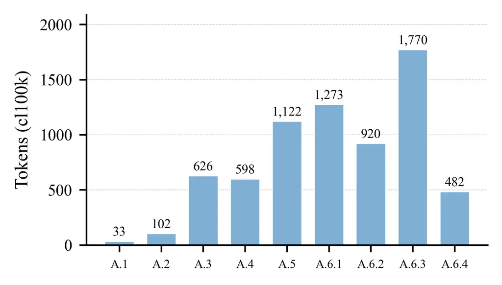
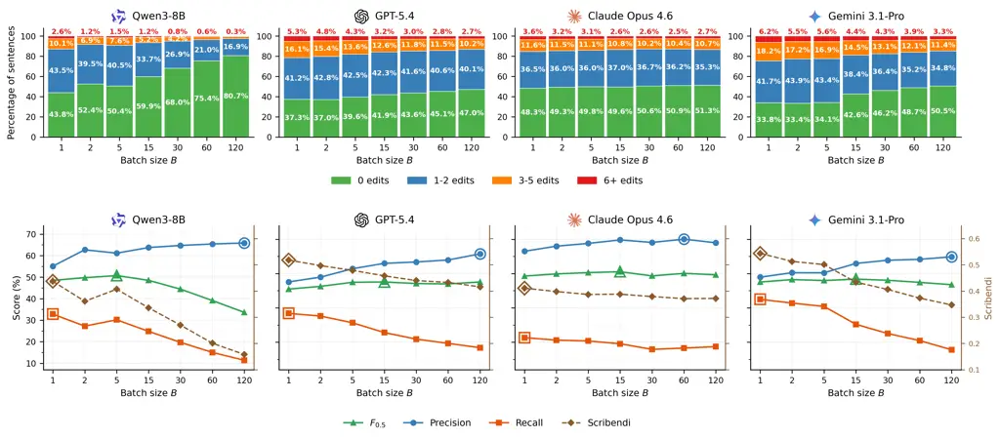
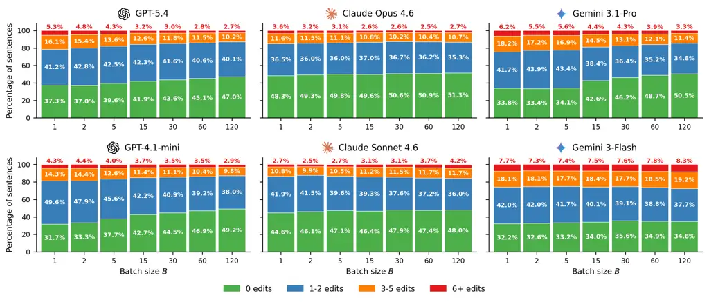

# Larger Context Window, Fewer Overcorrections: Optimizing Prompts and Batching for Minimal-Edit Grammatical Error CorrectionThanks: Accepted for publication at EMNLP 2026 (Findings).

Kateryna Karpo ^(†)^(†)thanks: First author. Affiliation: Ukrainian
Catholic University Affiliation: YouScan    Artem Chernodub
Affiliation: Zendeskkateryna.karpo@ucu.edu.ua  a.chernodub@gmail.com

###### Abstract

Minimal-edit Grammatical Error Correction (GEC) is a challenging task
for zero- and few-shot prompted Large Language Models (LLMs), which
systematically overcorrect and degrade $`F_{0.5}`$ by rewriting
well-formed spans. While fine-tuning provides an effective solution, it
imposes substantial infrastructure demands. We introduce a prompt-based
approach that closes the gap to fine-tuned models through three advances
in GEC prompting methodology. First, we introduce taxonomy-based
instructions to enforce minimal-edit constraints with a comprehensive
list of grammatical error rules, equipping the LLM with a bounded,
metric-aligned scope of correctable edits, which benefits the strongest
models while remaining model-dependent overall. Second, we show that
batching multiple uncorrected sentences into a single input context acts
as a targeted regularizer against overcorrection, systematically
reducing the edit rate across diverse LLM families; we hypothesize this
arises from attention dilution effect induced by the bounded capacity of
self-attention scores. Finally, LLM-assisted Prompt Optimization refines
these instructions. Powered by Gemini 3.1-Pro, our prompt achieves
$`F_{0.5}=78.32`$ on the BEA-2019 test set — establishing a new
prompt-based SOTA while shrinking the gap to the fine-tuned single-model
SOTA (Staruch et al., 2025) to a mere $`0.38`$ points. Code, prompts,
and outputs are publicly available.¹¹ 1 This work was conducted as part
of Kateryna Karpo’s M.Sc. thesis at the Ukrainian Catholic University,
Faculty of Applied Sciences.²² 2
[https://github.com/katerynkarpo/llm-en-gec](https://github.com/katerynkarpo/llm-en-gec)

## 1 Introduction

Grammatical Error Correction (GEC) has two evaluation paradigms (Bryant
et al., 2019). Fluency-oriented correction permits extensive lexical
substitution and stylistic restructuring to produce native-sounding text
(Napoles et al., 2017). Minimal-edit correction instead addresses
grammatical, spelling, and punctuation errors while preserving the
original phrasing (Leacock et al., 2014). Such minimal, targeted
corrections are essential in educational applications, where the goal is
to guide learners in revising their own errors while preserving intent
(Nicholls, 2003), and controlling LLMs to produce them remains difficult
(Vajjala et al., 2026).

Earlier work on minimal-edit GEC relied on supervised fine-tuning of
sequence taggers (Awasthi et al., 2019; Omelianchuk et al., 2020;
Tarnavskyi et al., 2022) and sequence-to-sequence models
(Junczys-Dowmunt et al., 2018; Grundkiewicz et al., 2019; Kiyono et al.,
2019; Rothe et al., 2021). Both approaches face recall bottlenecks:
taggers are bound by finite edit spaces, while sequence-to-sequence
cross-attention induces a copying bias. Their conservative span-local
bias still aligns naturally with the precision-weighted $`F_{0.5}`$
objective and sets a strict behavioral baseline for prompt-based
methods.

Alikaniotis and Raheja (2019) demonstrated that early GPT models could
perform GEC without task-specific training. With the rise of
instruction-tuned, decoder-only LLMs (Ouyang et al., 2022) such as
ChatGPT, zero- and few-shot prompting became a widely adopted paradigm
for text editing without task-specific fine-tuning. Out-of-the-box
prompted LLMs rapidly reached state-of-the-art results on tasks that
reward free-form rewriting, such as fluency GEC (Loem et al., 2023) and
text simplification (Vadlamannati and Şahin, 2023). Applied to
minimal-edit GEC with vanilla instructions (e.g., ‘‘Correct the
grammatical errors’’), the same models systematically overcorrect in
both zero- and few-shot settings (Fang et al., 2023; Coyne et al.,
2023), rewriting well-formed spans with synonym swaps, stylistic
polishing, or clause rephrasings that add no actual value.

Recent prompt-based efforts on minimal-edit GEC explored richer
prompting strategies, from error-pattern-aware in-context example
selection (Tang et al., 2024; Li et al., 2025) to
detection-before-correction prompting (Li and Wang, 2024) and automatic
prompt optimization (Chernodub et al., 2025). Even so, prompt-based
systems still lag behind the supervised state of the art, so the
mainstream route to enforcing the minimal-edit constraint remains
infrastructure-heavy fine-tuning: Omelianchuk et al. (2024) adapt
LLaMA-2 to reduce overcorrection, Liang et al. (2025) align the
pretraining objective with the minimal-edit principle through edit-wise
preference optimization for LLaMA2 and Mistral-v0.1, and Staruch et al.
(2025) set the current single-model state of the art on BEA-2019
($`F_{0.5}=78.70`$) by fine-tuning Gemma 2 with a schedule that
progressively raises the share of unedited examples, reversing earlier
sequence-to-sequence pipelines that filtered out error-free sentences
(Junczys-Dowmunt et al., 2018; Grundkiewicz et al., 2019).

We aim to close the gap between fine-tuned GEC systems and prompt-based,
API-accessed LLMs, which matters for individuals and organizations that
cannot afford fine-tuning of open-source LLMs due to engineering or
regulatory constraints. Our hypothesis is that the increased
instruction-following capabilities of the latest LLMs are already
sufficient to respect the minimal-edit GEC constraints without the need
of weight updates. Recent results support this, but also expose its
limit: with a declarative minimal-edit instructions, Claude Sonnet 4.5
reaches $`F_{0.5}=64.91`$ on the BEA-2019 test set (Türker and Eryiğit,
2026), yet still trails the fine-tuned single-model SOTA by $`13.79`$
points. We believe the declarative style is one of the reasons: it
states a goal without saying which edits are admissible. Our
taxonomy-based instructions supply that missing specification, bounding
the edit space to the 25 metric-aligned ERRANT categories (Bryant
et al., 2017). Once instructions reach this level of quality, we search
for model-specific instruction refinements via LLM-assisted prompt
optimization. Last but not least, we introduced batching to reduce
latency and cost (Cheng et al., 2023), but unexpectedly yielded
consistent quality improvements for minimal-edit GEC, motivating our
systematic study of how batch size affects edit rates and correction
quality. We evaluate our approach on six commercial LLMs and one
open-weight model across two minimal-edit benchmarks.

Our primary contributions are:

1\. We set a new state of the art for prompt-based minimal-edit GEC.
With Gemini 3.1-Pro and our best prompt A.6.4, we achieve
$`F_{0.5}=78.32`$ on the BEA-2019 test set, the first time an
out-of-the-box prompted LLM has closed the gap to the best fine-tuned
single model (Staruch et al., 2025) to a mere $`0.38`$ $`F_{0.5}`$
points. We also report a competitive $`F_{0.5}=67.08`$ on the CoNLL-2014
test set.

2\. We introduce taxonomy-based GEC instructions layered on a
minimal-edit baseline to provide a bounded, metric-aligned scope of
edits that constrains the strongest models productively and acts as
noise for the others. Defining errors via a concrete list addresses the
limitations of both the vague “grammatical error” framing of vanilla GEC
prompts and declarative “minimal edit” instructions that ask for
conservative rewriting without explaining how to do so.

3\. We identify batching as a targeted regularizer against
overcorrection: packing multiple sentences into a single context reduces
the word-level edit rate and consistently improves $`F_{0.5}`$ scores.
We hypothesize this stems from an attention dilution effect induced by
the bounded capacity of self-attention scores.

4\. We apply LLM-assisted Prompt Optimization, implemented as a reusable
Claude Code agentic skill2, on top of taxonomy-based instructions and
batching. The agent iteratively clusters dev-set errors and greedily
adopts prompt revisions that improve the $`F_{0.5}`$ score.

## 2 Related Work

The tendency of generative LLMs to overcorrect was recognized early,
shifting the focus of prompt-based GEC toward finding the right wording
and structure to enforce the minimal-edit constraint. Early evaluations
by Fang et al. (2023) and Coyne et al. (2023) relied on declarative
prompts that asked models to maximize source preservation. Loem et al.
(2023) then showed that prompt wording alone steers GPT between
minimal-edit and fluency-edit regimes, a finding Davis et al. (2024)
extend to open-source LLMs, and out-of-the-box LLM performance also
varies sharply with writer proficiency (Zeng et al., 2024) and across
languages (Katinskaia and Yangarber, 2024), factors that earlier
fine-tuned systems handled by adapting the GEC model to the writer’s
proficiency level and first language (Nadejde and Tetreault, 2019). More
recent efforts to reduce overcorrection move beyond basic instructions:
Li and Wang (2024) introduce a two-step detection-correction
architecture, Tang et al. (2024) propose ungrammatical-syntax-based
in-context example selection, and Goto et al. (2026) aggregate multiple
decodings via edit-level majority voting. Türker and Eryiğit (2026)
report the strongest zero-shot prompted results so far with declarative
minimal-edit instructions, structurally close to our minimal-edits
zero-shot prompt (A.2); introducing the taxonomy (A.4) is what
distinguishes our instructions. This minimal-edits + taxonomy design is
adapted from our prior work on Ukrainian (Karpo and Chernodub, 2026),
evaluated on the UNLP 2023 shared task benchmark (Syvokon and
Romanyshyn, 2023), built on the UA-GEC corpus (Syvokon et al., 2023).
Rather than relying on multi-step pipelines or inference-time voting, we
constrain the editing scope natively through GEC taxonomy-based
instructions.

Prior work treats batching purely as an inference-throughput
optimization (Cheng et al., 2023), in GEC as well (Masciolini et al.,
2025). In the broader LLM literature, expanding the input context is
typically associated with quality degradation driven by attention
dilution, including “lost in the middle” effects and reasoning failures
(Qin et al., 2022; Liu et al., 2024; Liu et al., 2023). To our
knowledge, no earlier work uses the input batch as a targeted
regularizer to actively reduce overcorrection in minimal-edit GEC.

Automatic Prompt Optimization (APO) has emerged as a popular alternative
to manual prompt engineering, where an LLM iteratively rewrites the
instruction it executes (Ramnath et al., 2025). Within GEC, Chernodub
et al. (2025) apply this paradigm to GPT-4o, treating the prompt as a
learnable list of instructions inferred and refined automatically. Our
procedure is instead a semi-automatic Claude Code skill that rewrites
the entire prompt under user feedback at each iteration.

## 3 Proposed Method

We present a prompt-based minimal-edit GEC framework combining GEC
taxonomy-grounded prompts and batched inference, further refined via
LLM-assisted Prompt Optimization.

##### Prompting strategies.

We evaluate five manually engineered prompts (A.1–A.5), varying whether
few-shot examples and the 25 ERRANT error categories are included. The
strongest one, “minimal-edits few-shot + taxonomy” (A.5), is then
optimized separately for medium-capacity models (Section 4), yielding
three LLM-optimized prompt variants tailored to specific model families
(OpenAI GPT, Anthropic Claude, Google Gemini), as well as the
open-weight Qwen3-8B model.

1.  1.  Vanilla zero-shot prompt (Appendix A.1): a generic instruction to
        fix grammatical and spelling errors, adapted from Coyne et al.
        (2023), with no further constraints and no examples: ‘‘Reply with a
        corrected version of the input sentence with all grammatical and
        spelling errors fixed. If there are no errors, reply with a copy of
        the original sentence.’’
2.  2.  Minimal-edits zero-shot prompt (Appendix A.2): declares the
        minimal-edit constraint directly (‘‘Make MINIMAL, PRECISE edits to
        fix errors. DO NOT rewrite or paraphrase.’’), plus a short rule list
        banning paraphrasing, fluency improvements, and stylistic changes,
        aligned with Loem et al. (2023) and Davis et al. (2024). No
        grammatical error categories are enumerated, so the model is left to
        decide what counts as an error.
3.  3.  Minimal-edits few-shot prompt (Appendix A.3): keeps the minimal-edit
        constraint and rule list of prompt (A.2) and adds 8 source/target
        correction pairs sampled from the BEA-2019 train split, presented as
        a flat list of demonstrations without taxonomic grouping or category
        labels.
4.  4.  Minimal-edits zero-shot + taxonomy prompt (Appendix A.4):
        supplements the minimal-edit constraint with the 25 ERRANT error
        categories (Bryant et al., 2017, Table 2) to provide explicit
        taxonomic guidance, addressing the ambiguity left by prompt (A.2).
        The 25 categories are grouped into word-level, mechanical, and other
        classes; each is listed with its ERRANT label, a short gloss, and an
        illustrative substitution, e.g. ‘‘6. DET: Wrong/missing/extra
        determiner (the$`\to`$a, $`\emptyset\to`$the,
        the$`\to\emptyset`$)’’, ‘‘20. PUNCT: Punctuation errors (!$`\to`$.,
        missing commas, extra periods)’’. Any edit outside these 25
        categories is by construction off-task, and the prompt declares this
        explicitly.
5.  5.  Minimal-edits few-shot + taxonomy prompt (Appendix A.5): augments
        prompt (A.4) with 8 source/target correction pairs sampled from the
        BEA-2019 train split.
6.  6.  Minimal-edits few-shot + taxonomy + optimized prompt (A.6.1–A.6.4):
        a refinement of prompt A.5 produced by an LLM-assisted Prompt
        Optimization for each model family.

Figure 1: Prompt length in cl100k_base tokens³³ 3
[https://github.com/openai/tiktoken](https://github.com/openai/tiktoken).
Manual prompts (A.1–A.5) grow progressively longer as constraints and
examples are added. In contrast, optimized prompts (A.6.1–A.6.4) yields
mixed lengths, either significantly compressing or further expanding the
longest manual baseline.

##### Batching.

We use the same prompts in two modes. The single-sentence mode sets
\<input*text\> to one source sentence and processes the input one
sentence at a time (we refer these cases as $`B=1`$). The batched mode,
which we advocate as the default for deploying minimal-edit GEC with
prompted LLMs, sets \<input_text\> to a numbered, newline-separated list
of $`B`$ sentences $`s*{1},\dots,s\_{B}`$ drawn from the input stream;
the model returns the numbered list of corrected sentences, and we split
it back to the source one-to-one before metric-based evaluation.
Inference pipeline details are in Appendix B.

##### LLM-assisted Prompt Optimization.

To refine the prompts, we introduce a human-in-the-loop prompt
optimization process using Claude Opus 4.6. Unlike fully autonomous APO
frameworks Ramnath et al. (2025); Agrawal et al. (2025), our agent
periodically requires researcher guidance, so we classify the approach
as LLM-assisted rather than fully automatic.

Starting from Prompt A.5, the agent iteratively refines instructions on
the BEA-2019 dev split using a rule-driven greedy search. Each step
isolates variables to ensure attributable performance deltas:

1.  1.  Diagnostic Critique: The agent uses ERRANT to isolate metrics by
        linguistic category and inspects sentence-level errors to generate a
        targeted natural language diagnosis, mirroring error-driven textual
        gradients and multi-aspect critiques in recent APO literature
        Pryzant et al. (2023); He et al. (2025); Yuksekgonul et al. (2024).
2.  2.  Targeted Proposal: The agent proposes exactly one change per
        iteration, either a specific negative constraint (a “do not change”
        rule) or a targeted exemplar. Unlike methods relying on broad search
        trees or complex mutations Wang et al. (2024); Ramnath et al.
        (2025), we enforce high-precision, human-readable heuristic
        additions targeting specific GEC categories based on ERRANT
        definitions.
3.  3.  Greedy Validation: The edit is adopted only if it strictly improves
        the overall dev $`F_{0.5}`$ score and the targeted GEC category
        moves in the predicted direction.

The loop runs until gains plateau. The optimizer Claude Skill’s full
code is in Appendix C.

Qualitative analysis of optimized prompts. Compared with the shared
starting point A.5, the optimizer reshaped the instruction in a markedly
model-dependent way. For GPT-4.1-mini (A.6.2) it discarded the taxonomy
in favour of two narrowly scoped rules on comma splices and tense
consistency in past narratives, each qualified by explicit exclusions
and a leave-it-alone default, keeping the demonstrations and compressing
the prompt from $`1{,}122`$ to $`920`$ tokens. For Claude Sonnet 4.6
(A.6.3) it kept the 25 categories and the demonstrations intact and
added two punctuation rule-blocks that enumerate their trigger lexicons
(subordinators and connectors for sentence-initial commas, pronouns and
demonstratives for comma splices) plus hard conditions under which the
rule must not fire. For Gemini 3-Flash (A.6.4) it replaced the taxonomy
with a plain-language list of what to fix and what to leave alone that
prunes the open-ended lexical-choice categories, restricted punctuation
to a short whitelist, and supplied five rule-scoped examples, one
deliberately requiring no edit. For the open-weight Qwen3-8B (A.6.1) it
was far more conservative: the taxonomy and the eight demonstrations
both survive, wording changes are limited to a no-markup output rule and
an introductory-comma rule, and the largest gain came from delivery,
re-packaging the demonstrations as a user/assistant chat exchange.

Despite this divergence, the three proprietary-model runs converged on
the same policy: precision-first constraints aimed at the categories
with the largest residual dev-set error, generic demonstrations kept
except for Gemini’s rule-scoped replacements, the taxonomy treated as
optional rather than essential, and most recall-seeking proposals
rejected at validation. The Qwen3-8B run shares only the precision-first
focus: the taxonomy and demonstrations still help this smaller
open-weight model, so both survive untouched. Figure 3 shows how prompt
length grows across all our nine prompts (five manual and four
LLM-optimized variants).

## 4 Experimental setup

##### Datasets and metrics.

For development, we use the restricted track of the BEA-2019 Shared Task
(Bryant et al., 2019), comprising the Write & Improve and LOCNESS
corpora: the official train split (34,308 sentences) for prompt
engineering and few-shot sampling, and the dev split (4,384 sentences)
for batching investigation and ablation studies. Final evaluations are
performed on the CoNLL-2014 test set (Ng et al., 2014) (1,312 sentences)
using the $`M^{2}`$ scorer (Dahlmeier and Ng, 2012) and on the BEA-2019
test set (4,477 sentences) via CodaBench⁴⁴ 4
[https://www.codabench.org/competitions/10960/](https://www.codabench.org/competitions/10960/)
using ERRANT v3.0.0⁵⁵ 5 The platform migrated to ERRANT v3.0.0 due to
deprecated dependencies; score differences from legacy v2.0.0 are
negligible.. Both benchmarks use precision-weighted $`F_{0.5}`$ as the
main metric. Local evaluations are computed with the gec-metrics library
(Goto et al., 2025).⁶⁶ 6
[https://github.com/gotutiyan/gec-metrics](https://github.com/gotutiyan/gec-metrics)

##### Models.

We focus on commercial LLMs to bring prompt-based GEC to parity with
fine-tuned models, serving users who cannot host open-weight
alternatives for engineering or regulatory reasons; open-weight models
can be fine-tuned directly, so prompt optimization matters less for
them. We also report the open-weight Qwen3-8B (Yang et al., 2025) as a
reproducible baseline.

We evaluate six API-accessed commercial LLMs from three providers
(OpenAI, Anthropic, Google), grouped into capability tiers to isolate
the effect of model tier from that of prompting and batching. The
high-capacity tier contains the strongest current offering of each
provider: GPT-5.4 (gpt-5.4-2026-03-05), Claude Opus 4.6
(claude-opus-4.6), and Gemini 3.1-Pro (gemini-3.1-pro-preview). The
medium-capacity tier contains a faster, lower-cost counterpart:
GPT-4.1-mini (gpt-4.1-mini-2025-04-14), Claude Sonnet 4.6
(claude-sonnet-4.6), and Gemini 3-Flash (gemini-3-flash-preview). ⁷⁷ 7
We report exact snapshot identifiers wherever providers expose them;
Anthropic and Google currently do not, so we record the latest preview
alias used at submission time.⁸⁸ 8 Inference-time parameters differ
across providers. We set temperature 0 where available, default
reasoning effort for Claude, medium effort for GPT-5.4, and
thinkingLevel: low for all Gemini models.

##### Inference pipeline.

All seven models are accessed through a single LiteLLM router using
Structured Outputs: every call returns a JSON object validated against a
strict Pydantic schema, which removes free-form post-processing and
makes the sentence-to-prediction mapping bijective. The schema, the
provider-agnostic response_format envelope, and the recovery path for
providers that reject strict JSON schema are presented in Appendix B.

## 5 Experiments

### 5.1 Prompting strategies

|                                                                                                   |                 |       |                      |                 |       |                      |                   |       |                      |                |       |                      |                   |       |                      |
| ------------------------------------------------------------------------------------------------- | --------------- | ----- | -------------------- | --------------- | ----- | -------------------- | ----------------- | ----- | -------------------- | -------------- | ----- | -------------------- | ----------------- | ----- | -------------------- |
|                                                                                                   | Vanilla         |       |                      | Minimal-edits   |       |                      | Minimal-edits ZS  |       |                      | Minimal-edits  |       |                      | Minimal-edits FS  |       |                      |
|                                                                                                   | zero-shot (A.1) |       |                      | zero-shot (A.2) |       |                      | \+ taxonomy (A.4) |       |                      | few-shot (A.3) |       |                      | \+ taxonomy (A.5) |       |                      |
| Model                                                                                             | Prec.           | Rec.  | $`\mathbf{F_{0.5}}`$ | Prec.           | Rec.  | $`\mathbf{F_{0.5}}`$ | Prec.             | Rec.  | $`\mathbf{F_{0.5}}`$ | Prec.          | Rec.  | $`\mathbf{F_{0.5}}`$ | Prec.             | Rec.  | $`\mathbf{F_{0.5}}`$ |
| ![[Uncaptioned image]](arxiv-2609-10810v1--5d6c84ceae7c.figures/figure-2.webp)  Qwen3-8B          | 45.30           | 46.91 | 45.61                | 56.42           | 27.58 | 46.66                | 52.56             | 27.49 | 44.45                | 58.11          | 30.09 | 48.98                | 57.84             | 29.66 | 48.61                |
| ![[Uncaptioned image]](arxiv-2609-10810v1--5d6c84ceae7c.figures/figure-3.webp)  GPT-4.1-mini      | 44.51           | 56.57 | 46.49                | 57.66           | 40.66 | 53.21                | 54.25             | 40.25 | 50.72                | 57.98          | 44.25 | 54.59                | 55.08             | 44.21 | 52.50                |
| ![[Uncaptioned image]](arxiv-2609-10810v1--5d6c84ceae7c.figures/figure-4.webp)  Claude Sonnet 4.6 | 49.62           | 53.82 | 50.41                | 65.61           | 31.92 | 54.17                | 63.10             | 34.04 | 53.90                | 63.13          | 37.43 | 55.51                | 62.66             | 36.48 | 54.79                |
| ![[Uncaptioned image]](arxiv-2609-10810v1--5d6c84ceae7c.figures/figure-5.webp)  Gemini 3-Flash    | 42.70           | 57.76 | 45.05                | 52.51           | 52.12 | 52.43                | 54.66             | 55.07 | 54.74                | 55.14          | 52.37 | 54.56                | 54.67             | 53.13 | 54.35                |
| ![[Uncaptioned image]](arxiv-2609-10810v1--5d6c84ceae7c.figures/figure-3.webp)  GPT-5.4           | 42.85           | 58.44 | 45.26                | 56.56           | 47.59 | 54.50                | 56.38             | 51.11 | 55.24                | 63.65          | 41.40 | 57.47                | 57.58             | 48.40 | 55.47                |
| ![[Uncaptioned image]](arxiv-2609-10810v1--5d6c84ceae7c.figures/figure-4.webp)  Claude Opus 4.6   | 57.63           | 51.11 | 56.20                | 70.16           | 30.74 | 55.84                | 67.90             | 33.88 | 56.55                | 66.13          | 40.62 | 58.75                | 66.50             | 41.33 | 59.28                |
| ![[Uncaptioned image]](arxiv-2609-10810v1--5d6c84ceae7c.figures/figure-5.webp)  Gemini 3.1-Pro    | 44.27           | 58.37 | 46.51                | 60.14           | 48.61 | 57.41                | 57.67             | 53.86 | 56.86                | 59.48          | 49.69 | 57.22                | 58.96             | 52.49 | 57.54                |

Table 1: Evaluation of prompting strategies on BEA-2019 dev. Precision,
recall, and $`F_{0.5}`$ scores for the five manual prompts (ZS =
zero-shot, FS = few-shot) across all seven models, evaluated at batch
size $`B{=}1`$. Per-model best metrics across prompts are bolded.

##### Setup.

We evaluate the five manually engineered prompts from Section 3 on the
BEA-2019 dev split at batch size $`B{=}1`$. Precision, recall, and
$`F_{0.5}`$ scores across our prompts are reported in Table 1.

##### Results.

The vanilla zero-shot prompt (A.1) shows a classic overcorrection
pattern across all models, with high recall but consistently poor
precision (often below $`45.0`$). Imposing a minimal-edits constraint
(A.2) yields the largest gain, boosting $`F_{0.5}`$ by $`+1.1`$ to
$`+10.9`$ points for all models except Claude Opus 4.6, where it is
nearly neutral, but at the cost of a $`6`$ to $`22`$ point drop in
recall.

To recover this lost recall, we extend the minimal-edits strategy with
in-context examples and the ERRANT taxonomy. Few-shot prompting (A.3)
restores part of the lost recall for six of the seven models and lifts
$`F_{0.5}`$ by an additional $`+1.3`$ to $`+3.0`$ points across most
models. The taxonomy’s contribution, added on top of the few-shot
examples, is model-dependent rather than uniformly helpful. It improves
two of the three high-capacity models, Claude Opus 4.6 and Gemini
3.1-Pro, and degrades the remaining four commercial models, including
the high-capacity GPT-5.4. The taxonomy thus acts as a regularizer of
the permissible edit space only for the strongest models, which appear
to read it as a strict constraint on admissible edits, and as noise for
the others. The open-weight Qwen3-8B follows the same qualitative
pattern: the minimal-edits constraint trades recall for precision, and
few-shot examples yield its best $`F_{0.5}`$ ($`48.98`$), while the
taxonomy provides no benefit. Its best score trails all six commercial
models, consistent with its much smaller scale.

While the optimal prompt structure varies across models, the absolute
highest $`F_{0.5}`$ scores come from pairing our strongest models with
the minimal-edits few-shot + taxonomy prompt (A.5), peaking at $`59.28`$
for Claude Opus 4.6 and $`57.54`$ for Gemini 3.1-Pro. Given its top-end
performance, we adopt this prompt for the batching experiments in
Section 5.2 and as the foundation for LLM-assisted Prompt Optimization
in Section 5.3.

### 5.2 Batching Effect

Figure 2: Edit-count distributions (top row) and GEC metrics (bottom
row) across batch sizes on BEA-2019 dev under our best performing manual
prompt: Minimal-edits few-shot + taxonomy (A.5) Top row: per-sentence
word-level edit counts as a function of the batch size $`B`$. As the
batch size $`B`$ grows, the general tendency is to shift mass into the
0-edit bucket (green), with the largest relative reductions in the 6+
tail (red) and the 3–5 bucket (orange). Bottom row: Precision (blue
circles), Recall (orange squares), and $`F_{0.5}`$ (green triangles) on
the left axis, and the Scribendi score on the right axis (brown dashed
diamonds), as a function of the batch size $`B`$. Open rings mark the
per-model Precision, Recall, $`F_{0.5}`$, and Scribendi maxima. See more
results in Appendix D.

##### Setup.

We vary batch sizes $`B\in\{1,2,5,15,30,60,120\}`$ on the BEA-2019 dev
using the minimal-edits few-shot + taxonomy prompt (A.5). We report
per-sentence edit counts and standard GEC metrics alongside the
Scribendi fluency score (Islam and Magnani, 2021).⁹⁹ 9 Computed with
Gemma 2 9B as the scoring LM following the MultiGEC-2025 protocol
(Masciolini et al., 2025).

##### Results.

Scaling the batch size $`B`$ induces a systematic behavioral shift in
Qwen3-8B and the three high-capacity models, suggesting that batching
acts as a targeted regularizer at the per-sentence level (Figure 2, top
row). As $`B`$ grows, probability mass moves steadily into the 0-edit
bucket while the heavy-edit tail ($`\geq 6`$ edits) shrinks, suppressing
the extreme rewrites typically associated with stylistic or hallucinated
output. The shift is most pronounced for the open-weight Qwen3-8B, whose
share of untouched sentences nearly doubles from $`43.8\%`$ at $`B{=}1`$
to $`80.7\%`$ at $`B{=}120`$, and more moderate for the high-capacity
models (e.g., $`33.8\%`$ to $`50.5\%`$ for Gemini 3.1-Pro).

This conservative shift is mirrored in the standard GEC metrics
(Figure 2, bottom row). Precision rises with the batch size for all four
models, peaking at the largest batches, while recall moves in the
opposite direction. Claude Opus 4.6, for instance, reaches the highest
precision of the sweep, $`70.02`$ at $`B{=}60`$. Because $`F_{0.5}`$
weights precision heavily, the two trends largely offset each other for
the three high-capacity models, producing a flat profile with a shallow
optimum at the moderate batch size $`B{=}15`$; for Qwen3-8B the optimum
comes earlier, at $`B{=}5`$.

Batching also carries a qualitative cost, captured by the reference-less
Scribendi fluency score. For all four models, the score peaks at
single-sentence prompting ($`B{=}1`$) and declines nearly monotonically
as the batch size grows: in a strictly minimal-edit setting, large
batches heavily discourage overcorrection, so the models leave
progressively more disfluencies intact.

The three medium-capacity models largely follow the same trends, with
their $`F_{0.5}`$ optima shifted toward larger batches ($`B{=}30`$ to
$`B{=}60`$); complete per-model curves and numerical results for all
seven models are provided in Appendix D (Figure 5, Tables 4 and 5). The
batching effect thus generalizes across capacity tiers.

Hypothesis: Batching limits the attention budget. While internal LLM
dynamics remain opaque, we conjecture that this conservative shift is
driven by an attention dilution effect. Because the self-attention
softmax enforces a normalization constraint, packing independent
sentences into a single prompt limits the attention budget per token. At
batch size $`B=1`$, models have enough focus to perform stylistic
rewrites; as batch size $`B`$ grows, a flattened attention distribution
forces the model to prioritize, pivoting away from adjustments and
committing to core grammatical errors where the error signal remains
salient.

Practical implications of batching. The quality-optimal batch size for
the three high-capacity models is $`B=15`$ (Figure 2). Such a batch is a
realistic unit of work: a single A4 page holds roughly 20 to 40
sentences, and proofreading services, learner-platform analytics, and
corpus-cleaning pipelines routinely submit many independent sentences
per request.

For genuinely single-sentence requests, a promising direction is to pad
the target sentence with auxiliary erroneous sentences whose corrections
are discarded, analogous to few-shot demonstrations but without
reference outputs, which would make the gain observed at $`B=15`$
available even when only one sentence needs corrections.

### 5.3 LLM-assisted Prompt Optimization

|                                            |                |                                                                                          |           |                      |                                                                                              |           |                      |                                                                                                   |           |                      |                                                                                                |           |                      |
| ------------------------------------------ | -------------- | ---------------------------------------------------------------------------------------- | --------- | -------------------- | -------------------------------------------------------------------------------------------- | --------- | -------------------- | ------------------------------------------------------------------------------------------------- | --------- | -------------------- | ---------------------------------------------------------------------------------------------- | --------- | -------------------- |
|                                            |                | ![[Uncaptioned image]](arxiv-2609-10810v1--5d6c84ceae7c.figures/figure-2.webp)  Qwen3-8B |           |                      | ![[Uncaptioned image]](arxiv-2609-10810v1--5d6c84ceae7c.figures/figure-3.webp)  GPT-4.1-mini |           |                      | ![[Uncaptioned image]](arxiv-2609-10810v1--5d6c84ceae7c.figures/figure-4.webp)  Claude Sonnet 4.6 |           |                      | ![[Uncaptioned image]](arxiv-2609-10810v1--5d6c84ceae7c.figures/figure-5.webp)  Gemini 3-Flash |           |                      |
| Prompt                                     | $`\mathbf{B}`$ | Prec.                                                                                    | Rec.      | $`\mathbf{F_{0.5}}`$ | Prec.                                                                                        | Rec.      | $`\mathbf{F_{0.5}}`$ | Prec.                                                                                             | Rec.      | $`\mathbf{F_{0.5}}`$ | Prec.                                                                                          | Rec.      | $`\mathbf{F_{0.5}}`$ |
| Minimal-edits few-shot + taxonomy (A.5)    | 5              | 61.15                                                                                    | 30.18     | 50.74                | –                                                                                            | –         | –                    | –                                                                                                 | –         | –                    | –                                                                                              | –         | –                    |
| Minimal-edits few-shot + taxonomy (A.5)    | 15             | –                                                                                        | –         | –                    | 61.02                                                                                        | 41.58     | 55.80                | 65.02                                                                                             | 39.46     | 57.56                | 55.79                                                                                          | 53.12     | 55.23                |
| \+ optimized for Qwen3-8B (A.6.1)          | 5              | 60.65^(†)                                                                                | 33.68^(†) | 52.28^(†)            | 59.79                                                                                        | 41.41     | 54.92                | 67.69                                                                                             | 37.96     | 58.52                | 58.04                                                                                          | 51.72     | 56.66                |
| \+ optimized for GPT-4.1-mini (A.6.2)      | 15             | 63.61                                                                                    | 18.02     | 42.24                | 62.98^(†)                                                                                    | 42.39^(†) | 57.40^(†)            | 67.14                                                                                             | 37.64     | 58.04                | 61.22                                                                                          | 48.50     | 58.17                |
| \+ optimized for Claude Sonnet 4.6 (A.6.3) | 15             | 64.16                                                                                    | 21.05     | 45.52                | 61.84                                                                                        | 43.31     | 56.97                | 66.88^(†)                                                                                         | 41.21^(†) | 59.47^(†)            | 59.53                                                                                          | 53.50     | 58.22                |
| \+ optimized for Gemini 3-Flash (A.6.4)    | 15             | 61.45                                                                                    | 6.83      | 23.64                | 65.73                                                                                        | 31.73     | 54.13                | 68.52                                                                                             | 36.64     | 58.36                | 65.45^(†)                                                                                      | 42.41^(†) | 59.04^(†)            |

Table 2: Evaluation of optimized prompts across different models on the
BEA-2019 development set. Each prompt is specifically optimized using
one model and subsequently evaluated on all four models without further
modification, at the batch size given in the $`B`$ column. The highest
Precision, Recall, and $`F_{0.5}`$ values within each column are
highlighted in bold. Instances of native evaluation, indicating that the
prompt is tested on its respective tuning model, are indicated with ^(†)
across all metrics.

##### Setup.

Initializing with our comprehensive minimal-edits few-shot + taxonomy
prompt (A.5), we obtain four model family-specific prompts optimized for
the open-weight Qwen3-8B (A.6.1), OpenAI GPT (A.6.2), Anthropic Claude
(A.6.3), and Google Gemini (A.6.4). We restricted the tuning phase to
the open-weight and medium-capacity models because of budget
limitations. The prompt selection was done based on $`F_{0.5}`$
performance on the BEA-2019 dev after assessing approximately one
hundred candidates per model. As a sanity check of robustness, we
evaluate each optimized prompt not only on its tuning model but on all
four models: Table 2 details their performance at a batch size of
$`B=15`$; the Qwen3-8B-optimized prompt (A.6.1) is optimized and
evaluated at $`B=5`$, the batch size at which Qwen3-8B performs best
(Figure 2).

##### Results.

The optimization procedure enhances performance considerably: as
anticipated, the gains are largest under native evaluation, where the
prompt was selected on the same model, yet they often transfer
effectively to other architectures. For instance, the prompt optimized
for Claude Sonnet 4.6 (A.6.3) increases the $`F_{0.5}`$ score on the
GPT-4.1-mini model from $`55.80`$ to $`56.97`$ and elevates the Gemini
performance from $`55.23`$ to $`58.22`$. Similarly, the Gemini-optimized
instruction (A.6.4) improves the Claude model score from $`57.56`$ to
$`58.36`$. The open-weight Qwen3-8B follows the same native-is-best
pattern: its own optimized prompt (A.6.1) raises its $`F_{0.5}`$ from
$`50.74`$ to $`52.28`$, whereas the prompts tuned for the proprietary
models transfer poorly to it, with the Gemini-optimized prompt (A.6.4)
collapsing its recall and dropping $`F_{0.5}`$ to $`23.64`$. Since
native evaluation remains optimal despite this positive transfer, in
Section 5.4 we pair each medium-capacity optimized prompt with its
high-capacity sibling from the same model family, leaving a deeper study
of cross-family transferability to future work.

### 5.4 Final Evaluations

|                                                       |                                                                                                                      |                |                 |       |                      |               |       |                      |
| ----------------------------------------------------- | -------------------------------------------------------------------------------------------------------------------- | -------------- | --------------- | ----- | -------------------- | ------------- | ----- | -------------------- |
|                                                       |                                                                                                                      |                | CoNLL-2014 test |       |                      | BEA-2019 test |       |                      |
| Prompt                                                | Model                                                                                                                | $`\mathbf{B}`$ | Prec.           | Rec.  | $`\mathbf{F_{0.5}}`$ | Prec.         | Rec.  | $`\mathbf{F_{0.5}}`$ |
| Single-system SOTA                                    |                                                                                                                      |                |                 |       |                      |               |       |                      |
| Fine-tuned, EPO (Liang et al., 2025)                  | ![[Uncaptioned image]](arxiv-2609-10810v1--5d6c84ceae7c.figures/figure-7.webp)  Mistral (7B)                         | –              | 76.71           | 52.56 | 70.26                | 78.16         | 68.07 | 75.91                |
| Fine-tuned, Training Schedule (Staruch et al., 2025)  | ![[Uncaptioned image]](arxiv-2609-10810v1--5d6c84ceae7c.figures/figure-8.webp)  Gemma 2 (27B)                        | –              | 77.38           | 47.88 | 68.89                | 82.28         | 67.03 | 78.70                |
| LLM-prompted baselines                                |                                                                                                                      |                |                 |       |                      |               |       |                      |
| 3-/1-shot CoT (Fang et al., 2023)                     | ![[Uncaptioned image]](arxiv-2609-10810v1--5d6c84ceae7c.figures/figure-3.webp)  GPT-3.5-Turbo-0301                   | –              | 51.3            | 62.4  | 53.2                 | 34.6          | 69.7  | 38.4                 |
| 16-shot (Loem et al., 2023)                           | ![[Uncaptioned image]](arxiv-2609-10810v1--5d6c84ceae7c.figures/figure-3.webp)  GPT-3.5 text-davinci-003             | –              | –               | –     | 57.06                | –             | –     | 57.41                |
| 2-shot (Coyne et al., 2023)                           | ![[Uncaptioned image]](arxiv-2609-10810v1--5d6c84ceae7c.figures/figure-3.webp)  GPT-4-0314                           | –              | –               | –     | –                    | –             | –     | 52.79                |
| 1-shot (Davis et al., 2024)                           | ![[Uncaptioned image]](arxiv-2609-10810v1--5d6c84ceae7c.figures/figure-3.webp)  GPT-3.5-Turbo-0613                   | –              | –               | –     | 57.2                 | –             | –     | –                    |
| 0-shot (Chernodub et al., 2025)                       | ![[Uncaptioned image]](arxiv-2609-10810v1--5d6c84ceae7c.figures/figure-3.webp)  GPT-4o                               | –              | –               | –     | –                    | –             | –     | 59.40                |
| 0-shot minimal-edit (Türker and Eryiğit, 2026)        | ![[Uncaptioned image]](arxiv-2609-10810v1--5d6c84ceae7c.figures/figure-4.webp)  Claude Sonnet 4.5                    | –              | 69.14           | 59.82 | 67.05                | 63.48         | 71.33 | 64.91                |
| 4-shot (Goto et al., 2026)                            | ![[Uncaptioned image]](arxiv-2609-10810v1--5d6c84ceae7c.figures/figure-2.webp)  Qwen3-8B (majority voting on 8 runs) | –              | –               | –     | –                    | 73.8          | 53.7  | 68.7                 |
| Our results                                           |                                                                                                                      |                |                 |       |                      |               |       |                      |
| Vanilla zero-shot (A.1)                               | ![[Uncaptioned image]](arxiv-2609-10810v1--5d6c84ceae7c.figures/figure-2.webp)  Qwen3-8B                             | 1              | 54.11           | 49.49 | 53.12                | 54.11         | 65.85 | 56.11                |
| Minimal-edits few-shot + taxonomy (A.5)               |                                                                                                                      | 5              | 71.54           | 28.52 | 54.95                | 73.85         | 50.64 | 67.65                |
| Minimal-edits few-shot + taxonomy + optimized (A.6.1) |                                                                                                                      | 5              | 71.74           | 35.83 | 59.76                | 72.14         | 58.21 | 68.84                |
| Vanilla zero-shot (A.1)                               | ![[Uncaptioned image]](arxiv-2609-10810v1--5d6c84ceae7c.figures/figure-3.webp)  GPT-4.1-mini                         | 1              | 50.74           | 57.91 | 52.03                | 54.17         | 73.21 | 57.14                |
| Minimal-edits few-shot + taxonomy (A.5)               |                                                                                                                      | 60             | 74.24           | 45.30 | 65.83                | 76.14         | 64.87 | 73.59                |
| Minimal-edits few-shot + taxonomy + optimized (A.6.2) |                                                                                                                      | 60             | 74.30           | 43.66 | 65.15                | 76.70         | 64.24 | 73.83                |
| Vanilla zero-shot (A.1)                               | ![[Uncaptioned image]](arxiv-2609-10810v1--5d6c84ceae7c.figures/figure-4.webp)  Claude Sonnet 4.6                    | 1              | 53.47           | 57.87 | 54.30                | 59.61         | 72.05 | 61.74                |
| Minimal-edits few-shot + taxonomy (A.5)               |                                                                                                                      | 60             | 73.12           | 44.43 | 64.75                | 76.13         | 64.62 | 73.51                |
| Minimal-edits few-shot + taxonomy + optimized (A.6.3) |                                                                                                                      | 60             | 72.51           | 44.37 | 64.35                | 77.32         | 65.36 | 74.59                |
| Vanilla zero-shot (A.1)                               | ![[Uncaptioned image]](arxiv-2609-10810v1--5d6c84ceae7c.figures/figure-5.webp)  Gemini 3 Flash                       | 1              | 46.52           | 59.92 | 48.70                | 51.99         | 73.22 | 55.19                |
| Minimal-edits few-shot + taxonomy (A.5)               |                                                                                                                      | 30             | 62.03           | 56.83 | 60.91                | 67.65         | 73.31 | 68.71                |
| Minimal-edits few-shot + taxonomy + optimized (A.6.4) |                                                                                                                      | 30             | 70.48           | 49.31 | 64.91                | 74.94         | 68.98 | 73.67                |
| Vanilla zero-shot (A.1)                               | ![[Uncaptioned image]](arxiv-2609-10810v1--5d6c84ceae7c.figures/figure-3.webp)  GPT-5.4                              | 1              | 45.82           | 60.56 | 48.17                | 51.37         | 73.68 | 54.68                |
| Minimal-edits few-shot + taxonomy (A.5)               |                                                                                                                      | 15             | 69.20           | 49.17 | 63.99                | 74.85         | 67.73 | 73.31                |
| Minimal-edits few-shot + taxonomy + optimized (A.6.2) |                                                                                                                      | 15             | 72.63           | 47.10 | 65.53                | 77.62         | 63.65 | 74.36                |
| Vanilla zero-shot (A.1)                               | ![[Uncaptioned image]](arxiv-2609-10810v1--5d6c84ceae7c.figures/figure-4.webp)  Claude Opus 4.6                      | 1              | 62.57           | 54.50 | 60.77                | 68.77         | 71.33 | 69.27                |
| Minimal-edits few-shot + taxonomy (A.5)               |                                                                                                                      | 15             | 74.76           | 45.05 | 66.04                | 78.58         | 63.94 | 75.14                |
| Minimal-edits few-shot + taxonomy + optimized (A.6.3) |                                                                                                                      | 15             | 74.90           | 44.27 | 65.80                | 80.72         | 64.05 | 76.73                |
| Vanilla zero-shot (A.1)                               | ![[Uncaptioned image]](arxiv-2609-10810v1--5d6c84ceae7c.figures/figure-5.webp)  Gemini 3.1-Pro                       | 1              | 45.94           | 60.81 | 48.30                | 53.32         | 73.81 | 56.45                |
| Minimal-edits few-shot + taxonomy (A.5)               |                                                                                                                      | 15             | 66.72           | 50.17 | 62.59                | 74.13         | 68.24 | 72.87                |
| Minimal-edits few-shot + taxonomy + optimized (A.6.4) |                                                                                                                      | 15             | 76.20           | 45.36 | 67.08                | 82.29         | 65.66 | 78.32                |

Table 3: Final evaluations on CoNLL-2014 test and BEA-2019 test.
Precision, recall, and $`F_{0.5}`$ on all considered models under three
prompt configurations: vanilla zero-shot at batch size $`B{=}1`$,
minimal-edits few-shot + taxonomy at the per-model dev-optimal batch
size (Figure 2), and its optimized variant at the same per-model batch
size. Within each group, the best precision, recall, and $`F_{0.5}`$ per
dataset are bolded.

##### Experimental Setup.

We evaluate three prompt configurations on the held out CoNLL 2014 and
BEA 2019 test sets across all considered models. Configurations include
a vanilla zero-shot prompt (A.1) at $`B{=}1`$, a minimal edits
few-shot + taxonomy prompt (A.5), and its model-specific optimized
variants (A.6.1–A.6.4), both evaluated at each model’s dev-optimal batch
size (selected by $`F_{0.5}`$ on the BEA-2019 dev split). Table 3
contextualizes performance of our models against leading prompted and
fine-tuned baselines.

##### Results.

Empirical results show that batched inference coupled with strict
taxonomy constraints jointly help to mitigate the overcorrection.
Vanilla configurations universally exhibit high recall but poor
precision. Introducing taxonomy rules and batched generation restricts
extraneous edits, substantially shifting performance toward the
precision weighted $`F_{0.5}`$ metric. Notably, Gemini 3.1-Pro improves
its BEA-2019 precision by $`20.81`$ points upon adding these joint
constraints (A.5), yielding a $`16.4`$ point $`F_{0.5}`$ gain. The
medium capacity tier exhibits similar absolute $`F_{0.5}`$ improvements
of over $`16`$ points for GPT-4.1-mini and roughly $`13`$ points for
Gemini 3 Flash, confirming that structural framing consistently aids
precision recovery.

LLM assisted prompt optimization provides additional model-specific
advantages. The prompt optimized for Gemini 3.1-Pro (A.6.4) establishes
a new state of the art for prompt-based GEC, outperforming the strongest
prompted baseline (Goto et al., 2026) by nearly $`10`$ $`F_{0.5}`$
points on BEA-2019. Crucially, this framework achieves parity with
state-of-the-art fine-tuned paradigms. Our optimal high-capacity
configuration matches the precision of the leading fine-tuned model
(Staruch et al., 2025) on BEA-2019 ($`82.29`$ vs. $`82.28`$) and trails
by a marginal $`0.38`$ $`F_{0.5}`$ points, effectively tying the current
fine-tuned SOTA. Furthermore, on BEA-2019 our optimized medium-capacity
models surpass all existing prompted baselines, demonstrating the
efficiency of structured constraints. The zero-shot minimal-edit prompt
of Türker and Eryiğit (2026) on Claude Sonnet 4.5 closely resembles our
baseline (A.2); on Claude Sonnet 4.6, adding few-shot examples,
taxonomy, batching, and prompt optimization raises $`F_{0.5}`$ to
$`74.59`$ on BEA-2019, $`9.68`$ points above their result.

The open-weight Qwen3-8B follows the same pattern at a smaller scale:
its optimized prompt (A.6.1) at $`B{=}5`$ reaches $`F_{0.5}=68.84`$ on
BEA-2019 test, a $`12.73`$-point gain over its vanilla zero-shot
configuration that edges out the strongest Qwen-based prompted baseline
(Goto et al., 2026) ($`68.7`$) without any self-ensembling: a single run
matches the quality that the baseline obtains by majority voting over 8
runs.

At the same time, we observe a cross domain generalization gap on the
CoNLL-2014 set for two of the three medium-capacity models: prompt
optimization lowers $`F_{0.5}`$ by $`0.68`$ points for GPT-4.1-mini and
by $`0.40`$ points for Claude Sonnet 4.6.

## 6 Conclusion

We present a prompt-based framework for minimal-edit GEC that bridges
the gap between off-the-shelf LLM prompting and state-of-the-art
fine-tuned single systems. Its core technique, batched inference layered
on minimal-edit instructions, acts as a targeted regularizer against
overcorrection, systematically reducing the edit rate across diverse LLM
families, while simultaneously lowering inference cost and latency. The
taxonomy component, by contrast, proves model-dependent: it constrains
the edit space productively only for the strongest models, a finding
that motivates our final component, per-model prompt optimization.

We evaluate our approach on six commercial and one open-weight LLM
across two minimal-edit benchmarks. The resulting prompts set a new
state of the art for prompt-based minimal-edit GEC: with Gemini 3.1-Pro
we reach $`F_{0.5}=78.32`$ on the BEA-2019 test set, within $`0.38`$
points of the best fine-tuned single model — to our knowledge, the first
purely prompt-based system to reach parity with the fine-tuned state of
the art in GEC — alongside a competitive $`F_{0.5}=67.08`$ on
CoNLL-2014.

These results show that careful prompt design and context management let
general-purpose LLMs perform minimal-edit GEC at fine-tuned quality
without the computational overhead of fine-tuning, albeit at the cost of
a conservative editing style that may limit fluency-oriented rewriting.
This makes high-quality GEC practical for settings where fine-tuned
models cannot be deployed for resource or regulatory reasons. Our
framework2 can also generate high-quality synthetic training data for
fine-tuning GEC models.

## Limitations

Our study has several limitations that frame the scope of its
conclusions and motivate concrete avenues for future work.

1.  1.  While the BEA-2019 (Bryant et al., 2019) test set is held-out on
        CodaBench platform¹⁰¹⁰ 10
        [https://www.codabench.org/competitions/10960/](https://www.codabench.org/competitions/10960/),
        its public train and dev splits, along with the fully public
        CoNLL-2014 (Ng et al., 2014) dataset, may have been encountered by
        commercial LLMs during pretraining. Exposure to these specific
        domains and annotation styles could still inflate performance.
        Consequently, our results may establish strong prompt-based
        baselines rather than strict measures of generalization to
        completely unseen text.
2.  2.  We rely mostly on commercial APIs, making weights, training data,
        and inference stacks opaque, and leaving us vulnerable to silent
        provider updates. Furthermore, due to costs, each configuration is
        evaluated only once without reporting variance, meaning exact
        reproducibility is not strictly guaranteed and broader systematic
        comparisons with open-weight models, beyond our single open-weight
        baseline, are left to future work.
3.  3.  Our LLM-assisted Prompt Optimization (Section 3) tunes prompts only
        on medium-capacity tier models (GPT-4.1-mini, Claude Sonnet 4.6,
        Gemini 3 Flash) and the open-weight Qwen3-8B due to budget
        constraints, and does not tune on the high-capacity siblings
        (GPT-5.4, Claude Opus 4.6, Gemini 3.1-Pro). This leaves open the
        question of whether optimization on high-capacity models would yield
        similar or superior prompts, and how these might transfer across
        model families.
4.  4.  Evaluations are restricted to English learner essays. It remains
        unclear how our taxonomy instructions and batching transfer to
        morphologically richer languages, lower-resource settings,
        professional editing, or fluency-oriented benchmarks like JFLEG
        (Napoles et al., 2017).
5.  5.  We optimize and evaluate primarily on precision-weighted $`F_{0.5}`$
        computed by ERRANT and the $`M^{2}`$ scorer. While this aligns with
        minimal-edit goals, it does not capture fluency or stylistic
        improvements beyond the reference-free Scribendi score used in the
        batching analysis (Section 5.2). We omit human evaluation and GLEU
        scores, so our findings represent only a precision-weighted slice of
        GEC performance.
6.  6.  The claim that batching regularizes via self-attention dilution
        (Section 5.2) is an empirical conjecture based on systematic trends
        across batch sizes. Confirming this rigorously requires controlled
        probes on open-weight models, which we do not perform.
7.  7.  Some of our LLM-optimized prompts are significantly longer
        (Figure 3), increasing inference token costs and latency.
        Additionally, real-world deployment involves topical streams rather
        than the shuffled independent sentences used in our analysis, which
        could alter attention dynamics and introduce unquantified generation
        failures in the structured response.

## Ethical Considerations

We disclose that ChatGPT, Claude, Gemini, and Grammarly were used for
drafting, editing, and proofreading. All AI-generated text was reviewed
by the authors, who take full responsibility for the final content.

## References

- Agrawal et al. (2025) Lakshya A Agrawal, Shangyin Tan, Dilara Soylu,
  Noah Ziems, Rishi Khare, Krista Opsahl-Ong, Arnav Singhvi, Herumb
  Shandilya, Michael J Ryan, Meng Jiang, Christopher Potts, Koushik Sen,
  Alexandros G. Dimakis, Ion Stoica, Dan Klein, Matei Zaharia, and Omar
  Khattab. 2025. [Gepa: Reflective prompt evolution can outperform
  reinforcement learning](https://arxiv.org/abs/2507.19457). _Preprint_,
  arXiv:2507.19457.
- Alikaniotis and Raheja (2019) Dimitris Alikaniotis and Vipul
  Raheja. 2019. [The unreasonable effectiveness of transformer language
  models in grammatical error
  correction](https://doi.org/10.18653/v1/W19-4412). In _Proceedings of
  the Fourteenth Workshop on Innovative Use of NLP for Building
  Educational Applications_, pages 127–133, Florence, Italy. Association
  for Computational Linguistics.
- Awasthi et al. (2019) Abhijeet Awasthi, Sunita Sarawagi, Rasna Goyal,
  Sabyasachi Ghosh, and Vihari Piratla. 2019. [Parallel iterative edit
  models for local sequence
  transduction](https://doi.org/10.18653/v1/D19-1435). In _Proceedings
  of the 2019 Conference on Empirical Methods in Natural Language
  Processing and the 9th International Joint Conference on Natural
  Language Processing (EMNLP-IJCNLP)_, pages 4260–4270, Hong Kong,
  China. Association for Computational Linguistics.
- Bryant et al. (2019) Christopher Bryant, Mariano Felice, Øistein E.
  Andersen, and Ted Briscoe. 2019. [The BEA-2019 shared task on
  grammatical error correction](https://doi.org/10.18653/v1/W19-4406).
  In _Proceedings of the Fourteenth Workshop on Innovative Use of NLP
  for Building Educational Applications_, pages 52–75, Florence, Italy.
  Association for Computational Linguistics.
- Bryant et al. (2017) Christopher Bryant, Mariano Felice, and Ted
  Briscoe. 2017. [Automatic annotation and evaluation of error types for
  grammatical error correction](https://doi.org/10.18653/v1/P17-1074).
  In _Proceedings of the 55th Annual Meeting of the Association for
  Computational Linguistics (Volume 1: Long Papers)_, pages 793–805,
  Vancouver, Canada. Association for Computational Linguistics.
- Cheng et al. (2023) Zhoujun Cheng, Jungo Kasai, and Tao Yu. 2023.
  [Batch prompting: Efficient inference with large language model
  APIs](https://doi.org/10.18653/v1/2023.emnlp-industry.74). In
  _Proceedings of the 2023 Conference on Empirical Methods in Natural
  Language Processing: Industry Track_, pages 792–810, Singapore.
  Association for Computational Linguistics.
- Chernodub et al. (2025) Artem Chernodub, Aman Saini, Yejin Huh, Vivek
  Kulkarni, and Vipul Raheja. 2025. [APIO: Automatic prompt induction
  and optimization for grammatical error correction and text
  simplification](https://aclanthology.org/2025.ranlp-1.28/). In
  _Proceedings of the 15th International Conference on Recent Advances
  in Natural Language Processing - Natural Language Processing in the
  Generative AI Era_, pages 234–239, Varna, Bulgaria. INCOMA Ltd.,
  Shoumen, Bulgaria.
- Coyne et al. (2023) Steven Coyne, Keisuke Sakaguchi, Diana
  Galvan-Sosa, Michael Zock, and Kentaro Inui. 2023. [Analyzing the
  performance of GPT-3.5 and GPT-4 in grammatical error
  correction](https://arxiv.org/abs/2303.14342). _arXiv preprint
  arXiv:2303.14342_.
- Dahlmeier and Ng (2012) Daniel Dahlmeier and Hwee Tou Ng. 2012.
  [Better evaluation for grammatical error
  correction](https://aclanthology.org/N12-1067/). In _Proceedings of
  the 2012 Conference of the North American Chapter of the Association
  for Computational Linguistics: Human Language Technologies_, pages
  568–572, Montréal, Canada. Association for Computational Linguistics.
- Davis et al. (2024) Christopher Davis, Andrew Caines, Øistein E.
  Andersen, Shiva Taslimipoor, Helen Yannakoudakis, Zheng Yuan,
  Christopher Bryant, Marek Rei, and Paula Buttery. 2024. [Prompting
  open-source and commercial language models for grammatical error
  correction of English learner
  text](https://doi.org/10.18653/v1/2024.findings-acl.711). In _Findings
  of the Association for Computational Linguistics: ACL 2024_, pages
  11952–11967, Bangkok, Thailand. Association for Computational
  Linguistics.
- Fang et al. (2023) Tao Fang, Shu Yang, Kaixin Lan, Derek F Wong,
  Jinpeng Hu, Lidia S Chao, and Yue Zhang. 2023. [Is ChatGPT a highly
  fluent grammatical error correction system? A comprehensive
  evaluation](https://arxiv.org/abs/2304.01746). In _arXiv preprint
  arXiv:2304.01746_.
- Goto et al. (2025) Takumi Goto, Yusuke Sakai, and Taro Watanabe. 2025.
  [gec-metrics: A unified library for grammatical error correction
  evaluation](https://doi.org/10.18653/v1/2025.acl-demo.50). In
  _Proceedings of the 63rd Annual Meeting of the Association for
  Computational Linguistics (Volume 3: System Demonstrations)_, pages
  524–534, Vienna, Austria. Association for Computational Linguistics.
- Goto et al. (2026) Takumi Goto, Yusuke Sakai, and Taro Watanabe. 2026.
  [Edit-level majority voting mitigates over-correction in LLM-based
  grammatical error
  correction](https://doi.org/10.18653/v1/2026.bea-1.60). In
  _Proceedings of the 21st Workshop on Innovative Use of NLP for
  Building Educational Applications (BEA 2026)_, pages 899–913, San
  Diego, California, USA. Association for Computational Linguistics.
- Grundkiewicz et al. (2019) Roman Grundkiewicz, Marcin Junczys-Dowmunt,
  and Kenneth Heafield. 2019. [Neural grammatical error correction
  systems with unsupervised pre-training on synthetic
  data](https://doi.org/10.18653/v1/W19-4427). In _Proceedings of the
  Fourteenth Workshop on Innovative Use of NLP for Building Educational
  Applications_, pages 252–263, Florence, Italy. Association for
  Computational Linguistics.
- He et al. (2025) Han He, Qianchu Liu, Lei Xu, Chaitanya Shivade,
  Yi Zhang, Sundararajan Srinivasan, and Katrin Kirchhoff. 2025.
  [Crispo: Multi-aspect critique-suggestion-guided automatic prompt
  optimization for text generation](https://arxiv.org/abs/2410.02748).
  _arXiv preprint arXiv:2410.02748_.
- Islam and Magnani (2021) Md Asadul Islam and Enrico Magnani. 2021. [Is
  this the end of the gold standard? a straightforward reference-less
  grammatical error correction
  metric](https://doi.org/10.18653/v1/2021.emnlp-main.239). In
  _Proceedings of the 2021 Conference on Empirical Methods in Natural
  Language Processing_, pages 3009–3015, Online and Punta Cana,
  Dominican Republic. Association for Computational Linguistics.
- Junczys-Dowmunt et al. (2018) Marcin Junczys-Dowmunt, Roman
  Grundkiewicz, Shubha Guha, and Kenneth Heafield. 2018. [Approaching
  neural grammatical error correction as a low-resource machine
  translation task](https://doi.org/10.18653/v1/N18-1055). In
  _Proceedings of the 2018 Conference of the North American Chapter of
  the Association for Computational Linguistics: Human Language
  Technologies, Volume 1 (Long Papers)_, pages 595–606, New Orleans,
  Louisiana. Association for Computational Linguistics.
- Karpo and Chernodub (2026) Kateryna Karpo and Artem Chernodub. 2026.
  [How far can prompting go for minimal-edit Ukrainian grammatical error
  correction?](https://aclanthology.org/2026.unlp-1.13/) In _Proceedings
  of the Fifth Ukrainian Natural Language Processing Conference (UNLP 2026)_, pages 136–154, Lviv, Ukraine. Association for Computational
  Linguistics.
- Katinskaia and Yangarber (2024) Anisia Katinskaia and Roman
  Yangarber. 2024. [GPT-3.5 for grammatical error
  correction](https://aclanthology.org/2024.lrec-main.692/). In
  _Proceedings of the 2024 Joint International Conference on
  Computational Linguistics, Language Resources and Evaluation
  (LREC-COLING 2024)_, pages 7831–7843, Torino, Italia. ELRA and ICCL.
- Kiyono et al. (2019) Shun Kiyono, Jun Suzuki, Masato Mita, Tomoya
  Mizumoto, and Kentaro Inui. 2019. [An empirical study of incorporating
  pseudo data into grammatical error
  correction](https://doi.org/10.18653/v1/D19-1119). In _Proceedings of
  the 2019 Conference on Empirical Methods in Natural Language
  Processing and the 9th International Joint Conference on Natural
  Language Processing (EMNLP-IJCNLP)_, pages 1236–1242, Hong Kong,
  China. Association for Computational Linguistics.
- Leacock et al. (2014) Claudia Leacock, Martin Chodorow, Michael Gamon,
  and Joel Tetreault. 2014. [_Automated Grammatical Error Detection for
  Language Learners, Second
  Edition_](https://doi.org/10.1007/978-3-031-02153-4). Synthesis
  Lectures on Human Language Technologies. Springer Cham.
- Li et al. (2025) Wei Li, Wen Luo, Guangyue Peng, and Houfeng
  Wang. 2025. [Explanation based in-context demonstrations retrieval for
  multilingual grammatical error
  correction](https://doi.org/10.18653/v1/2025.naacl-long.251). In
  _Proceedings of the 2025 Conference of the Nations of the Americas
  Chapter of the Association for Computational Linguistics: Human
  Language Technologies (Volume 1: Long Papers)_, pages 4881–4897,
  Albuquerque, New Mexico. Association for Computational Linguistics.
- Li and Wang (2024) Wei Li and Houfeng Wang. 2024.
  [Detection-correction structure via general language model for
  grammatical error
  correction](https://doi.org/10.18653/v1/2024.acl-long.96). In
  _Proceedings of the 62nd Annual Meeting of the Association for
  Computational Linguistics (Volume 1: Long Papers)_, pages 1748–1763,
  Bangkok, Thailand. Association for Computational Linguistics.
- Liang et al. (2025) Jiehao Liang, Haihui Yang, Shiping Gao, and
  Xiaojun Quan. 2025. [Edit-wise preference optimization for grammatical
  error correction](https://aclanthology.org/2025.coling-main.229/). In
  _Proceedings of the 31st International Conference on Computational
  Linguistics_, pages 3401–3414, Abu Dhabi, UAE. Association for
  Computational Linguistics.
- Liu et al. (2023) Bingbin Liu, Jordan T. Ash, Surbhi Goel, Akshay
  Krishnamurthy, and Cyril Zhang. 2023. [Exposing attention glitches
  with flip-flop language modeling](https://arxiv.org/abs/2306.00946).
  In _Advances in Neural Information Processing Systems 36 (NeurIPS 2023)_.
- Liu et al. (2024) Nelson F. Liu, Kevin Lin, John Hewitt, Ashwin
  Paranjape, Michele Bevilacqua, Fabio Petroni, and Percy Liang. 2024.
  [Lost in the middle: How language models use long
  contexts](https://doi.org/10.1162/tacl_a_00638). _Transactions of the
  Association for Computational Linguistics_, 12:157–173.
- Loem et al. (2023) Mengsay Loem, Masahiro Kaneko, Sho Takase, and
  Naoaki Okazaki. 2023. [Exploring effectiveness of GPT-3 in grammatical
  error correction: A study on performance and controllability in
  prompt-based methods](https://doi.org/10.18653/v1/2023.bea-1.18). In
  _Proceedings of the 18th Workshop on Innovative Use of NLP for
  Building Educational Applications (BEA 2023)_, pages 205–219, Toronto,
  Canada. Association for Computational Linguistics.
- Masciolini et al. (2025) Arianna Masciolini, Andrew Caines, Orphée
  De Clercq, Joni Kruijsbergen, Murathan Kurfalı, Ricardo Muñoz Sánchez,
  Elena Volodina, and Robert Östling. 2025. [The MultiGEC-2025 shared
  task on multilingual grammatical error correction at
  NLP4CALL](https://aclanthology.org/2025.nlp4call-1.1/). In
  _Proceedings of the 14th Workshop on Natural Language Processing for
  Computer Assisted Language Learning_, pages 1–33, Tallinn, Estonia.
  University of Tartu Library.
- Nadejde and Tetreault (2019) Maria Nadejde and Joel Tetreault. 2019.
  [Personalizing grammatical error correction: Adaptation to proficiency
  level and L1](https://doi.org/10.18653/v1/D19-5504). In _Proceedings
  of the 5th Workshop on Noisy User-generated Text (W-NUT 2019)_, pages
  27–33, Hong Kong, China. Association for Computational Linguistics.
- Napoles et al. (2017) Courtney Napoles, Keisuke Sakaguchi, and Joel
  Tetreault. 2017. [JFLEG: A fluency corpus and benchmark for
  grammatical error correction](https://aclanthology.org/E17-2037/). In
  _Proceedings of the 15th Conference of the European Chapter of the
  Association for Computational Linguistics: Volume 2, Short Papers_,
  pages 229–234, Valencia, Spain. Association for Computational
  Linguistics.
- Ng et al. (2014) Hwee Tou Ng, Siew Mei Wu, Ted Briscoe, Christian
  Hadiwinoto, Raymond Hendy Susanto, and Christopher Bryant. 2014. [The
  CoNLL-2014 shared task on grammatical error
  correction](https://doi.org/10.3115/v1/W14-1701). In _Proceedings of
  the Eighteenth Conference on Computational Natural Language Learning:
  Shared Task_, pages 1–14, Baltimore, Maryland. Association for
  Computational Linguistics.
- Nicholls (2003) Diane Nicholls. 2003. The Cambridge Learner Corpus:
  Error coding and analysis for lexicography and ELT. In _Proceedings of
  the Corpus Linguistics Conference_, pages 572–581.
- Omelianchuk et al. (2020) Kostiantyn Omelianchuk, Vitaliy Atrasevych,
  Artem Chernodub, and Oleksandr Skurzhanskyi. 2020. [GECToR –
  grammatical error correction: Tag, not
  rewrite](https://doi.org/10.18653/v1/2020.bea-1.16). In _Proceedings
  of the Fifteenth Workshop on Innovative Use of NLP for Building
  Educational Applications_, pages 163–170, Seattle, WA, USA → Online.
  Association for Computational Linguistics.
- Omelianchuk et al. (2024) Kostiantyn Omelianchuk, Andrii Liubonko,
  Oleksandr Skurzhanskyi, Artem Chernodub, Oleksandr Korniienko, and
  Igor Samokhin. 2024. [Pillars of grammatical error correction:
  Comprehensive inspection of contemporary approaches in the era of
  large language models](https://aclanthology.org/2024.bea-1.3/). In
  _Proceedings of the 19th Workshop on Innovative Use of NLP for
  Building Educational Applications (BEA 2024)_, pages 17–33, Mexico
  City, Mexico. Association for Computational Linguistics.
- Ouyang et al. (2022) Long Ouyang, Jeffrey Wu, Xu Jiang, Diogo Almeida,
  Carroll Wainwright, Pamela Mishkin, Chong Zhang, Sandhini Agarwal,
  Katarina Slama, Alex Ray, et al. 2022. [Training language models to
  follow instructions with human
  feedback](https://proceedings.neurips.cc/paper_files/paper/2022/file/b1efde53be364a73914f58805a001731-Paper-Conference.pdf).
  In _Advances in Neural Information Processing Systems_, volume 35,
  pages 27730–27744.
- Pryzant et al. (2023) Reid Pryzant, Dan Iter, Jerry Li, Yin Lee,
  Chenguang Zhu, and Michael Zeng. 2023. [Automatic prompt optimization
  with “gradient descent” and beam
  search](https://doi.org/10.18653/v1/2023.emnlp-main.494). In
  _Proceedings of the 2023 Conference on Empirical Methods in Natural
  Language Processing_, pages 7957–7968, Singapore. Association for
  Computational Linguistics.
- Qin et al. (2022) Zhen Qin, Xiaodong Han, Weixuan Sun, Dongxu Li,
  Lingpeng Kong, Nick Barnes, and Yiran Zhong. 2022. [The devil in
  linear transformer](https://doi.org/10.18653/v1/2022.emnlp-main.473).
  In _Proceedings of the 2022 Conference on Empirical Methods in Natural
  Language Processing_, pages 7025–7041, Abu Dhabi, United Arab
  Emirates. Association for Computational Linguistics.
- Ramnath et al. (2025) Kiran Ramnath, Kang Zhou, Sheng Guan,
  Soumya Smruti Mishra, Xuan Qi, Zhengyuan Shen, Shuai Wang, Sangmin
  Woo, Sullam Jeoung, Yawei Wang, Haozhu Wang, Han Ding, Yuzhe Lu,
  Zhichao Xu, Yun Zhou, Balasubramaniam Srinivasan, Qiaojing Yan, Yueyan
  Chen, Haibo Ding, and 2 others. 2025. [A systematic survey of
  automatic prompt optimization
  techniques](https://doi.org/10.18653/v1/2025.emnlp-main.1681). In
  _Proceedings of the 2025 Conference on Empirical Methods in Natural
  Language Processing_, pages 33078–33110, Suzhou, China. Association
  for Computational Linguistics.
- Rothe et al. (2021) Sascha Rothe, Jonathan Mallinson, Eric Malmi,
  Sebastian Krause, and Aliaksei Severyn. 2021. [A simple recipe for
  multilingual grammatical error
  correction](https://doi.org/10.18653/v1/2021.acl-short.89). In
  _Proceedings of the 59th Annual Meeting of the Association for
  Computational Linguistics and the 11th International Joint Conference
  on Natural Language Processing (Volume 2: Short Papers)_, pages
  702–707, Online. Association for Computational Linguistics.
- Staruch et al. (2025) Ryszard Staruch, Filip Gralinski, and Daniel
  Dzienisiewicz. 2025. [Adapting LLMs for minimal-edit grammatical error
  correction](https://doi.org/10.18653/v1/2025.bea-1.9). In _Proceedings
  of the 20th Workshop on Innovative Use of NLP for Building Educational
  Applications (BEA 2025)_, pages 118–128, Vienna, Austria. Association
  for Computational Linguistics.
- Syvokon et al. (2023) Oleksiy Syvokon, Olena Nahorna, Pavlo
  Kuchmiichuk, and Nastasiia Osidach. 2023. [UA-GEC: Grammatical error
  correction and fluency corpus for the Ukrainian
  language](https://doi.org/10.18653/v1/2023.unlp-1.12). In _Proceedings
  of the Second Ukrainian Natural Language Processing Workshop (UNLP)_,
  pages 96–102, Dubrovnik, Croatia. Association for Computational
  Linguistics.
- Syvokon and Romanyshyn (2023) Oleksiy Syvokon and Mariana
  Romanyshyn. 2023. [The UNLP 2023 shared task on grammatical error
  correction for Ukrainian](https://doi.org/10.18653/v1/2023.unlp-1.16).
  In _Proceedings of the Second Ukrainian Natural Language Processing
  Workshop (UNLP)_, pages 132–137, Dubrovnik, Croatia. Association for
  Computational Linguistics.
- Tang et al. (2024) Chenming Tang, Fanyi Qu, and Yunfang Wu. 2024.
  [Ungrammatical-syntax-based in-context example selection for
  grammatical error
  correction](https://doi.org/10.18653/v1/2024.naacl-long.99). In
  _Proceedings of the 2024 Conference of the North American Chapter of
  the Association for Computational Linguistics: Human Language
  Technologies (Volume 1: Long Papers)_, pages 1758–1770, Mexico City,
  Mexico. Association for Computational Linguistics.
- Tarnavskyi et al. (2022) Maksym Tarnavskyi, Artem Chernodub, and
  Kostiantyn Omelianchuk. 2022. [Ensembling and knowledge distilling of
  large sequence taggers for grammatical error
  correction](https://doi.org/10.18653/v1/2022.acl-long.266). In
  _Proceedings of the 60th Annual Meeting of the Association for
  Computational Linguistics (Volume 1: Long Papers)_, pages 3842–3852,
  Dublin, Ireland. Association for Computational Linguistics.
- Türker and Eryiğit (2026) Tolgahan Türker and Gülşen Eryiğit. 2026.
  [Instruction-following LLMs for grammatical error correction:
  Analyzing neutral-anchored instructional sensitivity across editing
  modes](https://doi.org/10.18653/v1/2026.bea-1.17). In _Proceedings of
  the 21st Workshop on Innovative Use of NLP for Building Educational
  Applications (BEA 2026)_, pages 234–247, San Diego, California, USA.
  Association for Computational Linguistics.
- Vadlamannati and Şahin (2023) Subhadra Vadlamannati and Gözde
  Şahin. 2023. [Metric-based in-context learning: A case study in text
  simplification](https://doi.org/10.18653/v1/2023.inlg-main.18). In
  _Proceedings of the 16th International Natural Language Generation
  Conference_, pages 253–268, Prague, Czechia. Association for
  Computational Linguistics.
- Vajjala et al. (2026) Sowmya Vajjala, Bashar Alhafni, Stefano Banno,
  Kaushal Kumar Maurya, and Ekaterina Kochmar. 2026. [Opportunities and
  challenges of LLMs in education: An NLP
  perspective](https://doi.org/10.18653/v1/2026.bea-1.26). In
  _Proceedings of the 21st Workshop on Innovative Use of NLP for
  Building Educational Applications (BEA 2026)_, pages 368–404, San
  Diego, California, USA. Association for Computational Linguistics.
- Wang et al. (2024) Xinyuan Wang, Chenxi Li, Zhen Wang, Fan Bai,
  Haotian Luo, Jiayou Zhang, Nebojsa Jojic, Eric P. Xing, and Zhiting
  Hu. 2024. [Promptagent: Strategic planning with language models
  enables expert-level prompt
  optimization](https://openreview.net/forum?id=22pyNMuIoa). In _The
  Twelfth International Conference on Learning Representations_.
- Yang et al. (2025) An Yang, Anfeng Li, Baosong Yang, Beichen Zhang,
  Binyuan Hui, Bo Zheng, Bowen Yu, Junyang Lin, Jingren Zhou,
  et al. 2025. [Qwen3 technical
  report](https://arxiv.org/abs/2505.09388). _Preprint_,
  arXiv:2505.09388.
- Yuksekgonul et al. (2024) Mert Yuksekgonul, Federico Bianchi, Joseph
  Boen, Sheng Liu, Zhi Huang, Carlos Guestrin, and James Zou. 2024.
  [Textgrad: Automatic “differentiation” via
  text](http://arxiv.org/abs/2406.07496). _arXiv preprint
  arXiv:2406.07496_.
- Zeng et al. (2024) Min Zeng, Jiexin Kuang, Mengyang Qiu, Jayoung Song,
  and Jungyeul Park. 2024. [Evaluating prompting strategies for
  grammatical error correction based on language
  proficiency](https://aclanthology.org/2024.lrec-main.569/). In
  _Proceedings of the 2024 Joint International Conference on
  Computational Linguistics, Language Resources and Evaluation
  (LREC-COLING 2024)_, pages 6426–6430, Torino, Italia. ELRA and ICCL.

## Appendix A Prompts

Below we list all prompts used in our experiments. The placeholder
\<input_text\> is replaced with the input sentence (or the batched block
of sentences) at inference time. All prompts target English minimal-edit
GEC.

### A.1 Vanilla zero-shot prompt

### A.2 Minimal-edits zero-shot prompt

### A.3 Minimal-edits few-shot prompt

### A.4 Minimal-edits zero-shot + taxonomy prompt

### A.5 Minimal-edits few-shot + taxonomy prompt

### A.6 Minimal-edits few-shot + taxonomy + optimized

#### A.6.1 Minimal-edits few-shot + taxonomy + optimized for Qwen3-8B

#### A.6.2 Minimal-edits few-shot + taxonomy + optimized for GPT-4.1-mini

#### A.6.3 Minimal-edits few-shot + taxonomy + optimized for Claude Sonnet 4.6

#### A.6.4 Minimal-edits few-shot + taxonomy + optimized for Gemini 3-Flash

## Appendix B Inference Pipeline and Structured Output

Each input sentence is processed independently through a single LLM
call, with no cross-sentence batching in the single-pass setting (the
batching variants of Section 4 simply pack multiple sentences into one
call before invoking the same pipeline).

The agent issues one chat completion through a LiteLLM router that
abstracts over the underlying provider (OpenAI, Anthropic, Google). The
system message is the configured prompt template; the user message is
the raw source sentence. To eliminate free-form post-processing of model
output, we constrain the response with a JSON schema derived from a
Pydantic model and attached to the request as a strict response_format.
Field descriptions declared on the Pydantic model propagate into the
schema and act as in-band instructions to the model.

##### Schema definition.

The response contract is declared once as a Pydantic class:

class GECResponse(BaseModel):

corrected_sentence: str = Field(

..., description="Corrected␣version␣of␣the␣input␣sentence")

##### Generated JSON schema.

At call time, the class is converted to JSON Schema, all object nodes
are closed with additionalProperties: false, and the result is wrapped
into the provider-agnostic response_format envelope:

{

"type": "json_schema",

"json_schema": {

"name": "GECResponse",

"strict": true,

"schema": {

"type": "object",

"additionalProperties": false,

"required": \["corrected_sentence"\],

"properties": {

"corrected_sentence": {

"type": "string",

"description": "Corrected version of the input sentence"

}

}

}

}

}

|                  |                          |
| ---------------- | ------------------------ |
| Parameter        | Value (from run YAML)    |
| model            | gpt-4.1-mini             |
| temperature      | 0.0                      |
| top_p            | 0.1                      |
| reasoning_effort | None                     |
| timeout          | 90 s                     |
| response_format  | json_schema(GECResponse) |

Figure 3: Per-sentence inference flow. Every sentence goes through one
structured-output call. Decoding parameters are read verbatim from the
run YAML, ensuring deterministic replay.

The decoding parameters in Figure 3 are read from the run YAML and the
exact configuration file is copied into the output directory alongside
results.json, so a run can be replayed bit-for-bit given the same
provider model snapshot. The returned payload is validated with
model_validate, so any schema violation is caught deterministically
rather than being masked by string heuristics. If a provider rejects
json_schema, the client transparently retries with response_format =
{"type":"json_object"}; for the single-field case, a final recovery path
extracts the corrected sentence from malformed JSON to keep evaluation
aligned. This design ensures that every sentence yields exactly one
validated correction, making the sentence-to-prediction mapping
bijective and the run reproducible given a fixed configuration.

##### Batch user payload.

The user message is a single deterministic string in which each source
carries an explicit 1-based identifier; this gives the model a stable
handle for cross-referencing in the response:

##### Batch response schema.

The response contract is again a Pydantic model, so the same strict
response_format=json_schema(…) mechanism applies. The schema enforces
that the model returns exactly one CORRECTED_SENTENCE per SENTENCE_ID:

class BatchSentenceGECItem(BaseModel):

SENTENCE_ID: int = Field(

..., description="1-based index within the batch input."

)

CORRECTED_SENTENCE: str = Field(

..., description="Corrected version of the sentence."

)

class BatchGECResponse(BaseModel):

SENTENCES: list\[BatchSentenceGECItem\] = Field(

..., description="Corrections for each input sentence."

)

## Appendix C LLM-assisted Prompt Optimization Skill

The LLM-assisted Prompt Optimization loop described in Section 3 is
implemented as a Claude Code skill (gec-prompt-optimise) that the
optimizer agent loads at run-time. The skill is a single Markdown file
with YAML front-matter; the agent treats it as an instruction sheet that
defines the diagnose-propose-register-eval-log cycle. We reproduce its
full content below as a single User-Prompt block, the form in which the
optimizer agent receives it.

## Appendix D Batching Sweep and Edit-Count Distributions: Numerical Results

Table 4 reports the batching sweep (batches
$`B\in\{1,2,5,15,30,60,120\}`$) across all seven models under the
best-performing manual prompt, minimal-edits few-shot + taxonomy
(Appendix A.5). For each (model, batch size $`B`$) configuration we
report precision, recall, ERRANT $`F_{0.5}`$, word edit distance (WED),
and Scribendi score.

|                                                                                                   |             |                    |                    |                    |                     |                     |                     |                      |
| ------------------------------------------------------------------------------------------------- | ----------- | ------------------ | ------------------ | ------------------ | ------------------- | ------------------- | ------------------- | -------------------- |
| Model                                                                                             | Metric      | $`\mathbf{B{=}1}`$ | $`\mathbf{B{=}2}`$ | $`\mathbf{B{=}5}`$ | $`\mathbf{B{=}15}`$ | $`\mathbf{B{=}30}`$ | $`\mathbf{B{=}60}`$ | $`\mathbf{B{=}120}`$ |
| Open-weight                                                                                       |             |                    |                    |                    |                     |                     |                     |                      |
| ![[Uncaptioned image]](arxiv-2609-10810v1--5d6c84ceae7c.figures/figure-2.webp)  Qwen3-8B          | Prec.       | 55.13              | 62.72              | 61.15              | 63.77               | 64.73               | 65.42               | 65.90                |
|                                                                                                   | Rec.        | 32.81              | 27.24              | 30.18              | 24.81               | 19.70               | 15.02               | 11.36                |
|                                                                                                   | $`F_{0.5}`$ | 48.53              | 49.76              | 50.74              | 48.53               | 44.42               | 39.14               | 33.63                |
|                                                                                                   | WED         | 6.02               | 4.89               | 4.84               | 3.74                | 2.93                | 2.26                | 1.57                 |
|                                                                                                   | Scribendi   | $`+0.437`$         | $`+0.361`$         | $`+0.407`$         | $`+0.336`$          | $`+0.270`$          | $`+0.201`$          | $`+0.158`$           |
| High-capacity                                                                                     |             |                    |                    |                    |                     |                     |                     |                      |
| ![[Uncaptioned image]](arxiv-2609-10810v1--5d6c84ceae7c.figures/figure-3.webp)  GPT-5.4           | Prec.       | 57.58              | 58.96              | 61.42              | 62.98               | 63.38               | 63.96               | 65.74                |
|                                                                                                   | Rec.        | 48.40              | 47.61              | 45.67              | 42.81               | 40.90               | 39.66               | 38.40                |
|                                                                                                   | $`F_{0.5}`$ | 55.47              | 56.28              | 57.46              | 57.55               | 57.10               | 56.98               | 57.55                |
|                                                                                                   | WED         | 7.82               | 7.65               | 7.15               | 6.58                | 6.34                | 6.16                | 5.82                 |
|                                                                                                   | Scribendi   | $`+0.518`$         | $`+0.497`$         | $`+0.479`$         | $`+0.458`$          | $`+0.440`$          | $`+0.433`$          | $`+0.416`$           |
| ![[Uncaptioned image]](arxiv-2609-10810v1--5d6c84ceae7c.figures/figure-4.webp)  Claude Opus 4.6   | Prec.       | 66.50              | 67.98              | 68.79              | 69.80               | 69.07               | 70.02               | 68.97                |
|                                                                                                   | Rec.        | 41.33              | 40.61              | 40.36              | 39.55               | 37.92               | 38.30               | 38.71                |
|                                                                                                   | $`F_{0.5}`$ | 59.28              | 59.90              | 60.29              | 60.54               | 59.32               | 60.07               | 59.64                |
|                                                                                                   | WED         | 6.09               | 5.83               | 5.73               | 5.64                | 5.44                | 5.44                | 5.56                 |
|                                                                                                   | Scribendi   | $`+0.411`$         | $`+0.398`$         | $`+0.387`$         | $`+0.388`$          | $`+0.379`$          | $`+0.371`$          | $`+0.372`$           |
| ![[Uncaptioned image]](arxiv-2609-10810v1--5d6c84ceae7c.figures/figure-5.webp)  Gemini 3.1-Pro    | Prec.       | 58.96              | 60.25              | 60.23              | 62.96               | 63.88               | 64.15               | 64.89                |
|                                                                                                   | Rec.        | 52.49              | 51.40              | 50.42              | 45.22               | 42.53               | 40.47               | 37.80                |
|                                                                                                   | $`F_{0.5}`$ | 57.54              | 58.25              | 57.97              | 58.38               | 58.05               | 57.43               | 56.76                |
|                                                                                                   | WED         | 8.85               | 8.59               | 8.56               | 7.34                | 6.72                | 6.50                | 6.01                 |
|                                                                                                   | Scribendi   | $`+0.544`$         | $`+0.513`$         | $`+0.501`$         | $`+0.434`$          | $`+0.406`$          | $`+0.373`$          | $`+0.347`$           |
| Medium-capacity                                                                                   |             |                    |                    |                    |                     |                     |                     |                      |
| ![[Uncaptioned image]](arxiv-2609-10810v1--5d6c84ceae7c.figures/figure-3.webp)  GPT-4.1-mini      | Prec.       | 55.08              | 55.74              | 58.16              | 61.02               | 61.81               | 62.88               | 63.80                |
|                                                                                                   | Rec.        | 44.21              | 44.72              | 42.89              | 41.58               | 40.25               | 39.71               | 37.39                |
|                                                                                                   | $`F_{0.5}`$ | 52.50              | 53.12              | 54.29              | 55.80               | 55.83               | 56.31               | 55.90                |
|                                                                                                   | WED         | 7.89               | 7.92               | 7.18               | 6.56                | 6.39                | 6.15                | 5.76                 |
|                                                                                                   | Scribendi   | $`+0.401`$         | –                  | –                  | $`+0.365`$          | $`+0.354`$          | $`+0.344`$          | $`+0.331`$           |
| ![[Uncaptioned image]](arxiv-2609-10810v1--5d6c84ceae7c.figures/figure-4.webp)  Claude Sonnet 4.6 | Prec.       | 62.66              | 65.26              | 66.06              | 65.02               | 65.74               | 65.29               | 64.43                |
|                                                                                                   | Rec.        | 36.48              | 36.41              | 37.07              | 39.46               | 39.13               | 40.53               | 40.70                |
|                                                                                                   | $`F_{0.5}`$ | 54.79              | 56.34              | 57.12              | 57.56               | 57.87               | 58.18               | 57.70                |
|                                                                                                   | WED         | 5.95               | 5.70               | 5.72               | 6.22                | 6.06                | 6.28                | 6.46                 |
|                                                                                                   | Scribendi   | $`+0.469`$         | –                  | –                  | $`+0.426`$          | $`+0.391`$          | $`+0.396`$          | $`+0.382`$           |
| ![[Uncaptioned image]](arxiv-2609-10810v1--5d6c84ceae7c.figures/figure-5.webp)  Gemini 3-Flash    | Prec.       | 54.67              | 55.28              | 55.46              | 55.79               | 56.31               | 55.29               | 53.41                |
|                                                                                                   | Rec.        | 53.13              | 53.26              | 53.12              | 53.12               | 53.32               | 53.26               | 53.30                |
|                                                                                                   | $`F_{0.5}`$ | 54.35              | 54.87              | 54.97              | 55.23               | 55.68               | 54.87               | 53.39                |
|                                                                                                   | WED         | 9.48               | 9.41               | 9.33               | 9.38                | 9.28                | 9.47                | 9.79                 |
|                                                                                                   | Scribendi   | $`+0.492`$         | –                  | –                  | $`+0.460`$          | $`+0.445`$          | $`+0.445`$          | $`+0.436`$           |

Table 4: Batching sweep on BEA-2019 dev under the best manual prompt,
minimal-edits few-shot + taxonomy (Appendix A.5). For each model we
report Precision, Recall, ERRANT $`F_{0.5}`$ (%), word edit distance
(WED, %), and Scribendi score (Islam and Magnani, 2021) (reference-free
fluency metric in $`[-1,+1]`$, computed with Gemma 2 9B as the scoring
LM following the MultiGEC-2025 protocol (Masciolini et al., 2025);
scores each predicted sentence as $`+1`$ if fluency improved and surface
similarity $`\geq 0.8`$, $`0`$ if unchanged, $`-1`$ otherwise;
corpus-level mean). A dash (–) marks a Scribendi score not computed for
that configuration. Per-model highest Precision, Recall, and $`F_{0.5}`$
and lowest WED are bolded.

Figure 4: Per-sentence edit-count distributions and per-model
batching-trend metrics on BEA-2019 dev under our top performing manual
prompt, minimal-edits few-shot + taxonomy (A.5), for Qwen3-8B and the
three high-capacity models (GPT-5.4, Claude Opus 4.6, Gemini 3.1-Pro),
across batch sizes $`B\in\{1,2,5,15,30,60,120\}`$. Top row: per-sentence
word-level edit counts, bucketed into 0, 1–2, 3–5, and 6+ edits. Bottom
row: Precision (blue circles), Recall (orange squares), and $`F_{0.5}`$
(green triangles) on the left axis, and the Scribendi score on the right
axis (brown dashed diamonds), with open rings marking the per-model
Precision, Recall, $`F_{0.5}`$, and Scribendi maxima. This is the same
figure as Figure 2 of Section 5.2, reproduced here next to the
corresponding numerical results in Table 5 (edit-count distributions)
and Table 4 (batching-trend metrics), for the shared batch sizes
$`B\in\{1,2,5,15,30,60,120\}`$.

To trace the mechanism behind the $`F_{0.5}`$ and WED trends reported
above, we also report the distribution of per-sentence word-level edits
introduced by each model at every batch size on BEA-2019 dev under the
best manual prompt, minimal-edits few-shot + taxonomy (A.5). For every
(model, batch) cell we tokenize the source and the model output with
spaCy en_core_web_sm and compute the per-sentence word-level Levenshtein
distance ($`S{+}D{+}I`$) between source and prediction. Sentences are
then bucketed into 0, 1–2, 3–5, and 6+ edits. The open-weight and
high-capacity subset of the resulting distribution is shown as the top
row of Figure 2 of Section 5.2, whose bottom row reports the
corresponding batching-trend metrics; the full six-model version appears
as Figure 5, and Table 5 lists the underlying percentages, mean edit
count, and maximum edit count for every (model, batch) cell.

Figure 5: Per-sentence word-level edit counts across batch sizes on
BEA-2019 dev (4,384 sentences) under the best manual prompt,
minimal-edits few-shot + taxonomy (A.5), all six models. All models are
shown at $`B\in\{1,2,5,15,30,60,120\}`$. Edits are word-level
substitutions, deletions, and insertions between the spaCy
en_core_web_sm-tokenized source and the model output, binned per
sentence into 0, 1–2, 3–5, and 6+ edits. As the batch size $`B`$ grows,
the general tendency on five of the six models is to shift mass into the
0-edit bucket (green), with the largest relative reductions in the 6+
tail (red) and the 3–5 bucket (orange). Claude Sonnet 4.6 is the
exception: its 6+ tail rises with $`B`$, while mass moves out of the 1–2
bucket into the 0, 3–5, and 6+ buckets, so the model becomes more
decisive at both ends. The high-capacity subset appears as Figure 2 of
Section 5.2.

|                   |               |                    |                    |                    |                     |                     |                     |                      |
| ----------------- | ------------- | ------------------ | ------------------ | ------------------ | ------------------- | ------------------- | ------------------- | -------------------- |
| Model             | Bucket / stat | $`\mathbf{B{=}1}`$ | $`\mathbf{B{=}2}`$ | $`\mathbf{B{=}5}`$ | $`\mathbf{B{=}15}`$ | $`\mathbf{B{=}30}`$ | $`\mathbf{B{=}60}`$ | $`\mathbf{B{=}120}`$ |
| Open-weight       |               |                    |                    |                    |                     |                     |                     |                      |
| Qwen3-8B          | 0 edits (%)   | 43.8               | 52.4               | 50.4               | 59.9                | 68.0                | 75.4                | 80.7                 |
|                   | 1–2 edits (%) | 43.5               | 39.5               | 40.5               | 33.7                | 26.9                | 21.0                | 16.9                 |
|                   | 3–5 edits (%) | 10.1               | 6.9                | 7.6                | 5.2                 | 4.2                 | 3.0                 | 2.1                  |
|                   | 6+ edits (%)  | 2.6                | 1.2                | 1.5                | 1.2                 | 0.8                 | 0.6                 | 0.3                  |
|                   | mean edits    | 1.19               | 0.87               | 0.94               | 0.75                | 0.58                | 0.43                | 0.31                 |
|                   | max edits     | 44                 | 30                 | 45                 | 58                  | 42                  | 30                  | 29                   |
| High-capacity     |               |                    |                    |                    |                     |                     |                     |                      |
| GPT-5.4           | 0 edits (%)   | 37.3               | 37.0               | 39.6               | 41.9                | 43.6                | 45.1                | 47.0                 |
|                   | 1–2 edits (%) | 41.2               | 42.8               | 42.5               | 42.3                | 41.6                | 40.6                | 40.1                 |
|                   | 3–5 edits (%) | 16.1               | 15.4               | 13.6               | 12.6                | 11.8                | 11.5                | 10.2                 |
|                   | 6+ edits (%)  | 5.3                | 4.8                | 4.3                | 3.2                 | 3.0                 | 2.8                 | 2.7                  |
|                   | mean edits    | 1.64               | 1.58               | 1.46               | 1.33                | 1.26                | 1.22                | 1.15                 |
|                   | max edits     | 48                 | 47                 | 49                 | 44                  | 36                  | 37                  | 35                   |
| Claude Opus 4.6   | 0 edits (%)   | 48.3               | 49.3               | 49.8               | 49.6                | 50.6                | 50.9                | 51.3                 |
|                   | 1–2 edits (%) | 36.5               | 36.0               | 36.0               | 37.0                | 36.7                | 36.2                | 35.3                 |
|                   | 3–5 edits (%) | 11.6               | 11.5               | 11.1               | 10.8                | 10.2                | 10.4                | 10.7                 |
|                   | 6+ edits (%)  | 3.6                | 3.2                | 3.1                | 2.6                 | 2.6                 | 2.5                 | 2.7                  |
|                   | mean edits    | 1.28               | 1.22               | 1.19               | 1.15                | 1.12                | 1.11                | 1.13                 |
|                   | max edits     | 76                 | 46                 | 44                 | 46                  | 44                  | 40                  | 41                   |
| Gemini 3.1-Pro    | 0 edits (%)   | 33.8               | 33.4               | 34.1               | 42.6                | 46.2                | 48.7                | 50.5                 |
|                   | 1–2 edits (%) | 41.7               | 43.9               | 43.4               | 38.4                | 36.4                | 35.2                | 34.8                 |
|                   | 3–5 edits (%) | 18.2               | 17.2               | 16.9               | 14.5                | 13.1                | 12.1                | 11.4                 |
|                   | 6+ edits (%)  | 6.2                | 5.5                | 5.6                | 4.4                 | 4.3                 | 3.9                 | 3.3                  |
|                   | mean edits    | 1.82               | 1.74               | 1.71               | 1.46                | 1.35                | 1.27                | 1.18                 |
|                   | max edits     | 41                 | 52                 | 51                 | 44                  | 43                  | 39                  | 36                   |
| Medium-capacity   |               |                    |                    |                    |                     |                     |                     |                      |
| GPT-4.1-mini      | 0 edits (%)   | 31.7               | 33.3               | 37.7               | 42.7                | 44.5                | 46.9                | 49.2                 |
|                   | 1–2 edits (%) | 49.6               | 47.9               | 45.6               | 42.2                | 40.9                | 39.2                | 38.0                 |
|                   | 3–5 edits (%) | 14.3               | 14.4               | 12.6               | 11.4                | 11.1                | 10.4                | 9.8                  |
|                   | 6+ edits (%)  | 4.3                | 4.4                | 4.0                | 3.7                 | 3.5                 | 3.5                 | 2.9                  |
|                   | mean edits    | 1.58               | 1.57               | 1.44               | 1.33                | 1.28                | 1.23                | 1.14                 |
|                   | max edits     | 51                 | 46                 | 46                 | 44                  | 41                  | 40                  | 40                   |
| Claude Sonnet 4.6 | 0 edits (%)   | 44.6               | 46.1               | 47.1               | 46.4                | 47.9                | 47.4                | 48.0                 |
|                   | 1–2 edits (%) | 41.9               | 41.5               | 39.6               | 39.3                | 37.6                | 37.2                | 36.0                 |
|                   | 3–5 edits (%) | 10.8               | 9.9                | 10.5               | 11.2                | 11.5                | 11.7                | 11.7                 |
|                   | 6+ edits (%)  | 2.7                | 2.5                | 2.7                | 3.1                 | 3.1                 | 3.7                 | 4.2                  |
|                   | mean edits    | 1.19               | 1.13               | 1.15               | 1.24                | 1.21                | 1.27                | 1.30                 |
|                   | max edits     | 46                 | 32                 | 40                 | 49                  | 44                  | 45                  | 47                   |
| Gemini 3-Flash    | 0 edits (%)   | 32.2               | 32.6               | 33.2               | 34.0                | 35.6                | 34.9                | 34.8                 |
|                   | 1–2 edits (%) | 42.0               | 42.0               | 41.7               | 40.1                | 39.1                | 38.8                | 37.7                 |
|                   | 3–5 edits (%) | 18.1               | 18.1               | 17.7               | 18.4                | 17.7                | 18.5                | 19.2                 |
|                   | 6+ edits (%)  | 7.7                | 7.3                | 7.4                | 7.5                 | 7.6                 | 7.8                 | 8.3                  |
|                   | mean edits    | 1.96               | 1.94               | 1.92               | 1.92                | 1.90                | 1.93                | 2.02                 |
|                   | max edits     | 53                 | 51                 | 48                 | 48                  | 50                  | 46                  | 47                   |

Table 5: Per-sentence word-edit distributions on BEA-2019 dev under the
best manual prompt, minimal-edits few-shot + taxonomy (Appendix A.5).
For each (model, batch size $`B`$) cell we tokenize the source and the
model output with spaCy en_core_web_sm, compute the per-sentence
word-level Levenshtein distance ($`S{+}D{+}I`$) between source and
prediction, and bin the 4,384 sentences into 0, 1–2, 3–5, and 6+ edit
buckets. Mean and max are over the same 4,384 sentences.
