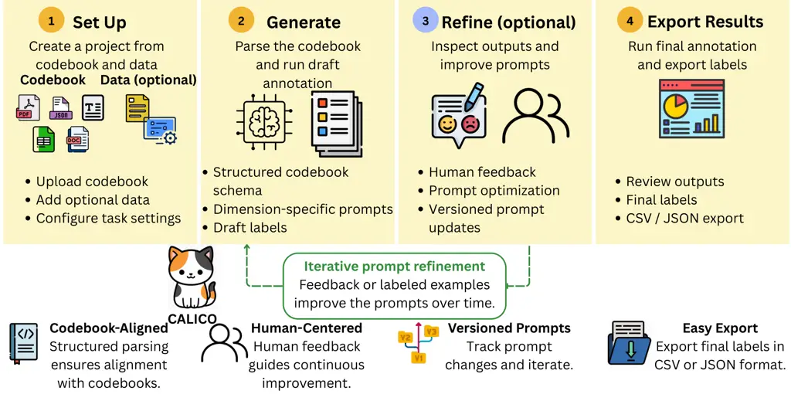

\tl_set:Ne\hlgraytab

hlgraytab \reportnumber

# CALICO: A Human-Centered, Codebook-Aligned System for Annotation

Boqin Yuan^(1,∗), Xiaoyi Gu^(∗), Fiona Li², Chang Wan², Angel Hsing-Chi
Hwang², Jieyu Zhao²  
¹UC San Diego ²University of Southern California ^(∗)Equal
contribution  
[ ](https://github.com/calico-annotation/calico-annotation)

###### Abstract

Large language models are increasingly used to scale codebook-based
annotation in scientific research, but existing workflows provide
limited support for translating domain experts’ codebooks into reliable,
revisable, and auditable prompts. Prompts are often treated as fixed
instructions and hidden from annotators, making it difficult for
non-technical domain experts to diagnose and correct model behavior when
outputs violate codebook guidelines. In this paper, we present CALICO, a
human-centered, codebook-aligned annotation workflow that treats prompts
as editable, versioned, and optimizable artifacts. CALICO integrates
codebook parsing, prompt generation, result inspection, prompt
versioning, natural language human feedback, and label-supervised prompt
optimization through existing optimizers such as GEPA, MIPROv2, and
OPRO, together with our reflection-based optimizer, ReflectAgent.
Empirically, we evaluate CALICO on domain-specific AI-companion chatbot
conversation codebooks. Across evaluated dimensions, CALICO improves
mean held-out performance by $`+13.0`$ and $`+7.4`$ absolute points for
two coders, respectively. A coder-specificity analysis further suggests
that optimized prompts capture coder-specific interpretations rather
than only generic codebook clarification. CALICO runs as a web
application that takes users from raw codebook materials to inspectable,
exportable labels; the website, codebase, and live demo are released at
[https://calico-annotation.github.io/](https://calico-annotation.github.io/)
under the Apache 2.0 License.



Figure 1: The CALICO workflow. Users create a project from a codebook
and optional data, generate dimension-specific prompts, run annotation,
inspect outputs, refine prompts when needed, and export final labels.
Prompt versions are managed within the project so users can iterate
before final annotation.

## 1 Introduction

Modern hardware and software systems have made massive amounts of data
logs increasingly accessible, providing valuable resources for
scientific research in psychology \[1\], medicine \[2\], biology \[3\],
and other domains. In many qualitative and computational social science
studies, experts first create a codebook, which is an annotation guide
with dimensions, labels, and decision rules, before coding raw data for
analysis. Such expert annotation is critical for producing accurate and
reliable variables, but it requires substantial time and effort and does
not scale well to growing data volumes.

LLMs have made annotation easier to scale through LLM-as-a-judge
workflows \[4\]. In a typical setup, domain experts define an annotation
prompt, provide unlabeled data, and ask the LLM to generate labels in
batches. However, this convenience does not make codebook-based
annotation reliable by default. Annotation quality remains highly
contingent on the dataset, task, and how the codebook definitions are
operationalized in the prompt \[5, 6\]. This is especially challenging
for non-technical domain experts, who may understand the codebook deeply
but lack the tools to inspect, debug, and iteratively improve LLM
prompts. Existing annotation tools such as Label Studio \[7\], Prodigy
\[8\], Humanloop \[9\], Doccano \[10\], and LabelLLM \[11\] can use LLMs
to pre-fill labels for experts to accept or edit, but the pre-fill
prompt typically does not adapt to the corrections it receives.

To address these challenges, we present CALICO (Codebook-Aligned
LLM-assisted Iterative Coding and Optimization), a human-centered,
codebook-aligned workflow for LLM-assisted annotation. CALICO is
designed for domain experts who have data to annotate and a codebook to
apply, without requiring them to manually engineer and manage prompts
across annotation rounds. CALICO supports prompt improvement under two
common conditions. 1) Cold-start annotation: No expert annotations are
available initially. CALICO generates the prompt based on the codebook,
produces first-pass annotations, and updates its prompts as experts
refine those outputs using human natural language feedback. 2)
Label-supervised optimization: Existing expert labels are available.
They are used to guide configurable optimizers including GEPA \[12\],
MIPROv2 \[13\], and OPRO \[14\], together with our reflection-based
optimizer, ReflectAgent to improve the prompts. In this setting, we also
provide evaluation metrics to help users assess each prompt update.
Human feedback remains available as a complementary correction signal.
With a human-centered focus, CALICO treats codebooks, prompts,
annotation runs, feedback, and prompt versions as auditable artifacts
throughout the workflow, allowing experts to inspect changes, manage
prompt history, and reuse improved prompts in later sessions.

In summary, we propose CALICO, a human-centered, codebook-aligned
workflow. Through empirical experiments, we demonstrate that CALICO
improves mean held-out performance by $`+13.0`$ and $`+7.4`$ points for
two coders respectively.

## 2 Related Work

#### Human-LLM collaborative annotation.

LLMs are increasingly used as scalable annotators \[4, 15, 16\].
Researchers have explored LLM-assisted qualitative coding using expert
defined codebooks \[17, 18, 19, 20\]. LLM-assisted annotation has also
been applied to domains such as psychology \[1\] and media analysis
\[21\]. Annotation platforms like Label Studio, Prodigy \[8\], Doccano,
and LabelLLM \[11\] support dataset management and AI-assisted
pre-annotation, where model-generated labels can be reviewed or
corrected by humans.

Recent systems explore how humans and LLMs can collaborate during
annotation. MEGAnno+ \[22\] manages LLM agents, annotation jobs,
metadata, and human verification of LLM labels. Lapras \[23\] uses LLM
labels and explanations, then trains a verifier to select likely
incorrect labels for human re-annotation. PDFChatAnnotator \[24\] lets
users guide LLM-based extraction from PDF catalogs through examples and
iterative requirement adjustment. At the same time, LLM assistance can
affect human judgments in subjective codebook tasks, shifting label
distributions toward model suggestions \[25\]. CALICO builds on this
human-centered motivation, but differs from workflows centered on
verifying or correcting LLM-generated labels by making the prompts that
operationalize domain codebooks inspectable, refinable, and versioned.

#### Agentic workflows and prompt refinement.

Researchers have explored agentic workflows, codebook refinement, and
prompt optimization to further improve LLM annotation performance and
better align it with human annotators. Agentic systems like CrowdAgent
\[26\] and EvoAgentX \[27\] coordinate or evolve multi-agent workflows
with reasoning, memory, and actions, while Co-DETECT \[28\] uses LLMs to
surface edge cases from a sketch codebook and help users refine codebook
rules. Separately, prompt optimizers such as DSPy \[29\], OPRO \[14\],
MIPROv2 \[13\], and GEPA \[12\] improve prompts from labeled examples,
but are typically used as standalone optimization methods. CALICO
connects these directions in a codebook-aligned annotation workflow.

## 3 System Design

Figure 1 illustrates the end-to-end CALICO workflow. CALICO follows a
lightweight, codebook-centered design: experts start from the codebook
that already defines their annotation task, and the system turns it into
editable prompts for LLM-assisted annotation. After inspecting model
outputs, experts can refine these prompts through natural language
feedback, describing systematic errors, boundary cases, or preferred
labeling behavior. When labeled examples are available, users can also
run label-supervised optimizers and inspect the resulting prompt
updates, artifacts, and evaluation metrics.

To support this, CALICO has four modular components: Codebook Parsing
Agent (§ 3.1), Prompt Generator (§ 3.2), Human-in-the-Loop Feedback (§
3.3), and Prompt Optimizer (§ 3.4).

### 3.1 Codebook Parsing Agent

The Codebook Parsing Agent is designed to make project setup lightweight
for domain experts. Instead of requiring users to clean or convert their
materials into a fixed template, CALICO accepts codebooks and annotation
data in common document, spreadsheet, and structured formats, including
PDF, DOCX, XLSX, CSV, JSON, and plain text. It applies format-specific
preprocessing to preserve useful structure, such as spreadsheet layouts
and existing label columns, while extracting candidate coding
dimensions, labels, definitions, instructions, examples, and labeling
modes.

After preprocessing, the agent consolidates these elements into a
canonical codebook schema used by the rest of the workflow. This schema
also enables automatic validation and alignment: CALICO flags missing or
inconsistent codebook fields, detects structural issues such as
duplicated or gated labels, and aligns uploaded label values to the
closest valid schema entries. Users can review and edit the parsed
schema and validation warnings before activating it for following
annotations.

### 3.2 Prompt Generator

Once a codebook is accepted, the Prompt Generator turns its schema into
executable prompts for LLM-assisted annotation, reducing the need for
users to manually translate codebook rules into prompt instructions. For
each coding dimension, CALICO assembles the relevant labels,
definitions, task instructions, examples, and output constraints into an
initial prompt. These prompts remain visible and editable in the
interface, so experts can inspect how the codebook has been
operationalized before running annotation.

The generator also carries codebook constraints into the annotation
prompt and runtime configuration. For example, it adds explicit guidance
for “No label” options when they appear in the codebook, and records
hierarchical or gated label restrictions so later predictions respect
dependencies among coding dimensions. This design keeps the annotation
process aligned with the original codebook while presenting users with a
simple editable prompt for each dimension.

### 3.3 Human-in-the-Loop Feedback

Cold-start annotation is common in domain-specific settings, where
experts often have a codebook and unlabeled data but few or no existing
annotations. CALICO addresses this setting through a human-in-the-loop
feedback workflow, using model-generated annotations as drafts for
expert review rather than final labels. Users inspect annotated examples
and provide free-text feedback about systematic errors, boundary cases,
or preferred labeling behavior (as shown in Figure 2 and more details in
Appendix C).

Figure 2: Feedback and prompt-update interface. Users provide natural
language feedback and review the proposed prompt revision before
applying it as a new prompt version.

Internally, CALICO does not apply free-text feedback directly to the
prompt. Instead, it summarizes feedback into reusable calibration
guidance, such as label-boundary rules or corrections to common failure
patterns. The guidance is written to memory tied to the current project,
codebook version, and coding dimension, allowing feedback to accumulate
within relevant annotation context. Before updating the prompt, CALICO
shows the proposed revision and its diff from the current prompt, and
only approved changes are saved as a new prompt version.

When reference labels are available, the interface can also show them
alongside model predictions, and the same feedback workflow can be used
as a complementary correction signal in label-supervised projects.

### 3.4 Prompt Optimizer

#### Optimizers.

CALICO supports label-supervised prompt optimization after prompt
generation. This means that when users have a small set of expert
labeled examples for a coding dimension, CALICO can use those labels to
improve the prompt. Given one prompt, the labels allowed by the
codebook, and the labeled examples, each optimizer returns a new
candidate prompt and its optimization results. The current
implementation includes GEPA \[12\], MIPROv2 \[13\], OPRO \[14\], and
our reflection-based optimizer, ReflectAgent. MIPROv2 searches over
instructions and few-shot examples, GEPA performs DSPy-based reflective
prompt optimization, and OPRO asks the LLM to propose new prompts from
prior results. Because all optimizers use the same input format and
execution pipeline, CALICO lets users compare optimization backends
within one project.

#### ReflectAgent.

ReflectAgent aims to improve prompt accuracy for one coding dimension
over several rounds. In each round, the model uses the current prompt to
label the training examples. A pattern-extraction module then reads the
errors and abstracts candidate calibration rules. Unlike human feedback,
which starts from user-written corrections, ReflectAgent uses existing
expert-labeled examples to proactively mine errors and propose prompt
rules. Each rule captures a label boundary, target labels, optional cue
families, and an annotator-readable instruction. The extractor is
constrained to generalize from failures rather than copy examples
verbatim, so the resulting rules capture reusable decision principles
instead of surface-specific demonstrations. ReflectAgent folds accepted
rules into the candidate prompt, producing an optimized prompt that
remains editable and inspectable by the user.

#### Evaluation and rollback.

For label-supervised prompt optimization, CALICO splits labeled examples
into deterministic stratified train, validation, and held-out test sets.
Training examples drive prompt search or failure mining, while
validation performance is used to select candidate updates and trigger
rollback when performance regresses beyond a tolerance. After
optimization completes, CALICO evaluates the initial and optimized
prompts on the held-out test set exactly once. For single-label
dimensions, CALICO reports accuracy, macro-$`F_{1}`$, and per-class
metrics; for multi-label dimensions, it reports micro-$`F_{1}`$ and
per-label metrics. The system also runs a leakage audit that checks
whether validation or test examples appear verbatim in the final prompt.
This separation lets users inspect optimization trajectories while
preserving a held-out estimate of generalization.

|                                              |                                                         |                                                         |            |                                                |                                                         |            |
| -------------------------------------------- | ------------------------------------------------------- | ------------------------------------------------------- | ---------- | ---------------------------------------------- | ------------------------------------------------------- | ---------- |
|                                              | Coder A                                                 |                                                         |            | Coder B                                        |                                                         |            |
| Dimension                                    | Zero-shot                                               | + ReflectAgent                                          | $`\Delta`$ | Zero-shot                                      | + ReflectAgent                                          | $`\Delta`$ |
| Self-Disclosure (single-label, accuracy %)   |                                                         |                                                         |            |                                                |                                                         |            |
| Level of disclosure                          | $`68.1_{\,{\color[rgb]{0.5,0.5,0.5}\pm 2.7}}`$          | $`\mathbf{70.0}_{\,{\color[rgb]{0.5,0.5,0.5}\pm 1.7}}`$ | $`+1.9`$   | $`61.7_{\,{\color[rgb]{0.5,0.5,0.5}\pm 0.6}}`$ | $`\mathbf{76.6}_{\,{\color[rgb]{0.5,0.5,0.5}\pm 5.1}}`$ | $`+14.9`$  |
| Disclosure as confession                     | $`52.6_{\,{\color[rgb]{0.5,0.5,0.5}\pm 1.2}}`$          | $`\mathbf{82.0}_{\,{\color[rgb]{0.5,0.5,0.5}\pm 8.7}}`$ | $`+29.4`$  | $`49.6_{\,{\color[rgb]{0.5,0.5,0.5}\pm 3.8}}`$ | $`\mathbf{50.1}_{\,{\color[rgb]{0.5,0.5,0.5}\pm 1.9}}`$ | $`+0.5`$   |
| Depth of disclosure                          | $`\mathbf{61.0}_{\,{\color[rgb]{0.5,0.5,0.5}\pm 6.6}}`$ | $`58.7_{\,{\color[rgb]{0.5,0.5,0.5}\pm 2.4}}`$          | $`-2.3`$   | $`58.2_{\,{\color[rgb]{0.5,0.5,0.5}\pm 2.5}}`$ | $`\mathbf{61.2}_{\,{\color[rgb]{0.5,0.5,0.5}\pm 7.2}}`$ | $`+3.0`$   |
| Intimacy of self-disclosure                  | $`52.2_{\,{\color[rgb]{0.5,0.5,0.5}\pm 3.2}}`$          | $`\mathbf{75.5}_{\,{\color[rgb]{0.5,0.5,0.5}\pm 3.1}}`$ | $`+23.3`$  | $`54.9_{\,{\color[rgb]{0.5,0.5,0.5}\pm 2.5}}`$ | $`\mathbf{66.0}_{\,{\color[rgb]{0.5,0.5,0.5}\pm 3.5}}`$ | $`+11.1`$  |
| mean                                         | 58.5                                                    | 71.5                                                    | $`+13.0`$  | 56.1                                           | 63.5                                                    | $`+7.4`$   |
| AI Behavior (multi-label, micro-$`F_{1}`$ %) |                                                         |                                                         |            |                                                |                                                         |            |
| Listening strategy                           | $`71.6_{\,{\color[rgb]{0.5,0.5,0.5}\pm 4.5}}`$          | $`\mathbf{73.2}_{\,{\color[rgb]{0.5,0.5,0.5}\pm 4.0}}`$ | $`+1.6`$   | $`61.3_{\,{\color[rgb]{0.5,0.5,0.5}\pm 3.4}}`$ | $`\mathbf{68.8}_{\,{\color[rgb]{0.5,0.5,0.5}\pm 4.7}}`$ | $`+7.5`$   |

Table 1: Per-coder agreement with each coder’s held-out labels,
comparing the zero-shot prompt with ReflectAgent. Scores are accuracy
(%) for Self-Disclosure and micro-$`F_{1}`$ (%) for AI Behavior. Results
are reported as mean$`\pm`$standard deviation over three seeds. Bold
indicates the better score between zero-shot and ReflectAgent; green and
red $`\Delta`$ values indicate absolute gains and drops from zero-shot.
For AI Behavior, we report results on the Listening strategy theme.

## 4 Experiments

We run CALICO on AI-companion chatbot analysis with two expert codebooks
as a case study. Our goal is to evaluate whether CALICO’s
label-supervised prompt refinement can improve over a common
LLM-assisted annotation baseline: a zero-shot LLM annotator initialized
from the codebook. We focus on two questions:

RQ1: Does CALICO improve held-out annotation performance over a
zero-shot (vanilla) LLM annotator initialized from the codebook?

RQ2: Are the gains specific to the coder whose labels were used, rather
than only reflecting generic codebook clarification?

### 4.1 Experiment Settings

#### Codebooks.

We evaluate CALICO on two codebooks from an AI-companion conversation
analysis project. The _Self-Disclosure_ codebook is used to annotate
user messages along four single-label dimensions: level \[30, 1\], depth
\[31\], intimacy, and confession \[32\]. The _AI Behavior_ codebook is
applied to annotate AI messages under two multi-label themes: listening
strategy \[33\], with seven labels, and support type \[34\], with two
labels.

#### Datasets.

The data were independently labeled by two trained expert coders, i.e.,
annotators who apply the codebooks, denoted Coder A and Coder B. For
Self-Disclosure, Coder A and Coder B labeled 333 and 330 user messages
in total, with 124–330 labeled items per single-label dimension. For AI
Behavior, they labeled 340 and 335 AI messages in total; for the
reported Listening strategy theme, Coder A and Coder B labeled 291 and
231 items, respectively. Notably, we observed that their annotations
show substantial disagreement: for the _Self-Disclosure_ codebook, raw
agreement is $`67.4\%`$ on Level and only $`34.8\%`$ on Intimacy.
Therefore, rather than adjudicating these labels into a single gold
dataset, we evaluate each coder separately. For each coder and
dimension, that coder’s labels define the reference labels, and
performance is measured as agreement with that coder’s held-out labels.
In each run, we split the coder-specific labeled set into train,
validation, and test partitions using the deterministic seed described
in Appendix A; the test split is held out from optimization and scored
only once.

#### Metrics.

For single-label dimensions, we report accuracy, defined as the
percentage of held-out items where the model prediction matches the
target coder’s label. For multi-label dimensions, we report
micro-$`F_{1}`$ over held-out items.

### 4.2 Results

Table 1 presents held-out agreement with each coder’s labels before
(zero-shot) and after applying ReflectAgent, using gpt-5.4-mini as the
annotation model (macro-$`F_{1}`$ numbers in Appendix A). We report
absolute changes in percentage points (pp). Across the four
Self-Disclosure dimensions, ReflectAgent improves mean accuracy by
$`+13.0`$ pp for Coder A and $`+7.4`$ pp for Coder B. The improvements
are not uniform across dimensions. For Coder A, the largest gains appear
on Confession ($`+29.4`$ pp) and Intimacy ($`+23.3`$ pp), while for
Coder B, the largest gains appear on Level ($`+14.9`$ pp) and Intimacy
($`+11.1`$ pp). The pattern suggests that the optimizer is not learning
a single generic clarification, but is adapting to the labels used for
supervision. For the multi-label AI Behavior codebook, ReflectAgent also
improves Listening strategy micro-$`F_{1}`$, with a small gain for Coder
A ($`+1.6`$ pp) and a larger gain for Coder B ($`+7.5`$ pp). Overall,
this answers RQ1: with ReflectAgent, CALICO improves average held-out
agreement for both coders.

|            |      |                                                |                                                         |                                                         |                                                |
| ---------- | ---- | ---------------------------------------------- | ------------------------------------------------------- | ------------------------------------------------------- | ---------------------------------------------- |
| Dim.       | ZS   | OPRO                                           | GEPA                                                    | MIPRO                                                   | RA                                             |
| Level      | 68.1 | $`72.4_{\,{\color[rgb]{0.5,0.5,0.5}\pm 4.6}}`$ | $`\mathbf{74.8}_{\,{\color[rgb]{0.5,0.5,0.5}\pm 1.6}}`$ | $`72.2_{\,{\color[rgb]{0.5,0.5,0.5}\pm 3.0}}`$          | $`70.0_{\,{\color[rgb]{0.5,0.5,0.5}\pm 1.7}}`$ |
| Confession | 52.6 | $`52.6_{\,{\color[rgb]{0.5,0.5,0.5}\pm 2.6}}`$ | $`77.8_{\,{\color[rgb]{0.5,0.5,0.5}\pm 5.5}}`$          | $`\mathbf{85.2}_{\,{\color[rgb]{0.5,0.5,0.5}\pm 7.3}}`$ | $`82.0_{\,{\color[rgb]{0.5,0.5,0.5}\pm 8.7}}`$ |
| Depth      | 61.0 | $`58.7_{\,{\color[rgb]{0.5,0.5,0.5}\pm 6.3}}`$ | $`\mathbf{64.8}_{\,{\color[rgb]{0.5,0.5,0.5}\pm 3.4}}`$ | $`62.0_{\,{\color[rgb]{0.5,0.5,0.5}\pm 5.0}}`$          | $`58.7_{\,{\color[rgb]{0.5,0.5,0.5}\pm 2.4}}`$ |
| Intimacy   | 52.2 | $`62.3_{\,{\color[rgb]{0.5,0.5,0.5}\pm 4.6}}`$ | $`\mathbf{78.0}_{\,{\color[rgb]{0.5,0.5,0.5}\pm 2.4}}`$ | $`76.1_{\,{\color[rgb]{0.5,0.5,0.5}\pm 3.6}}`$          | $`75.5_{\,{\color[rgb]{0.5,0.5,0.5}\pm 3.1}}`$ |
| mean       | 58.5 | 61.5                                           | 73.8                                                    | 73.9                                                    | 71.5                                           |

Table 2: Comparison of prompt optimization backends on Coder A’s
Self-Disclosure dimensions. Scores are accuracy (%); optimized methods
report mean$`\pm`$standard deviation over three seeds. All methods start
from the same zero-shot (ZS) prompt and use identical data splits. Bold
indicates the best score in each row. RA denotes ReflectAgent.

#### Performance of Optimizers.

Beyond ReflectAgent, CALICO integrates several existing prompt
optimizers, including OPRO, MIPROv2, and GEPA. To evaluate this
label-supervised optimization interface, we run all optimizers on Coder
A’s Self-Disclosure dimensions using the same zero-shot prompt and
identical three-seed splits. As shown in Table 2, most optimizers
improve over the zero-shot prompt. MIPROv2 and GEPA achieve the
strongest mean accuracy ($`73.9`$ and $`73.8`$), ReflectAgent is
comparable ($`71.5`$), and OPRO gives a smaller improvement ($`61.5`$).
These results show that CALICO can support multiple optimization
backends within the same codebook-centered workflow. Unlike the existing
optimizers, ReflectAgent produces an inspectable and editable rule
library, making the optimization artifact easier for domain experts to
review, revise, and reuse across annotation sessions.

#### Coder-specificity analysis.

To answer RQ2, we test whether prompt refinement captures coder-specific
interpretations rather than only generic codebook clarification. We
focus on the Intimacy dimension, where the two coders show substantial
disagreement, with only $`34.8\%`$ raw agreement. Starting from the same
zero-shot prompt, we run ReflectAgent separately using each coder’s
labels, then evaluate each tuned prompt against both coders’ held-out
labels on the same shared items. If the learned rules only clarified the
codebook in a generic way, both tuned prompts should perform similarly
against both coders. Instead, Table 3 shows a diagonal pattern: the
Coder A-tuned prompt achieves $`75.2\%`$ accuracy against Coder A but
only $`41.0\%`$ against Coder B, while the Coder B-tuned prompt achieves
$`71.4\%`$ against Coder B but only $`51.4\%`$ against Coder A. This
indicates that each prompt performs best when evaluated against the
coder whose labels were used for tuning.

|                |                  |                  |
| -------------- | ---------------- | ---------------- |
| Tuned on       | Eval. vs Coder A | Eval. vs Coder B |
| Coder A labels | 75.2             | 41.0             |
| Coder B labels | 51.4             | 71.4             |

Table 3: Coder-specificity analysis on the Intimacy dimension. Values
are mean held-out accuracy (%) over three seeds on the shared held-out
set ($`n{=}35`$). Rows indicate the coder used for tuning, and columns
indicate the coder used for evaluation. Matched-coder prompts outperform
swapped-coder prompts by $`+23.8{\pm}7.5`$ pp for Coder A and
$`+30.5{\pm}10.8`$ pp for Coder B, suggesting that ReflectAgent captures
coder-specific label boundaries.

## 5 Conclusion

We presented CALICO, a human-centered, codebook-aligned workflow for
LLM-assisted annotation. CALICO supports codebook parsing, prompt
generation, draft annotation, result inspection, prompt refinement,
version management, and label export. It provides natural language
feedback for cold-start settings and label-supervised optimization when
labels are available. Our empirical evaluation on an AI-companion
conversation codebook under label-supervised optimization improves
annotation performance over a zero-shot prompt for both coders on
average, and a coder-specificity analysis suggests that optimized
prompts can capture coder-specific label boundaries.

## Limitations

Our evaluation focuses on offline agreement for one domain-specific
codebook and does not include a live user study, so we do not claim
cross-domain generalization or measured usability gains. CALICO
currently updates prompts and rule libraries but does not fine-tune
annotation models; future work will study task-specific fine-tuning for
scalability. The preprocessing also offers limited control over
annotation units, such as splitting long messages into multiple rows.
Finally, CALICO targets discrete codebook labels; soft label
distributions require a different output workflow.

## References

- \[1\] Y. Zhang, D. Zhao, J. T. Hancock, R. Kraut, and D. Yang (2025)
  The rise of AI companions: how human-chatbot relationships influence
  well-being. arXiv preprint arXiv:2506.12605. Cited by: §1, §2, §4.1.
- \[2\] S. A. Abbas, I. Yusifzada, and S. Athar (2025) Revolutionizing
  medicine: chatbots as catalysts for improved diagnosis, treatment, and
  patient support. Cureus 17 (3). Cited by: §1.
- \[3\] A. Forootani, D. E. Aliabadi, and D. Thrän (2025) Bio-Eng-LLM AI
  assist: a modular chatbot platform for interdisciplinary research and
  education. SoftwareX 31, pp. 102260. Cited by: §1.
- \[4\] L. Zheng, W. Chiang, Y. Sheng, S. Zhuang, Z. Wu, Y. Zhuang, Z.
  Lin, Z. Li, D. Li, E. P. Xing, H. Zhang, J. E. Gonzalez, and I.
  Stoica (2023) Judging LLM-as-a-judge with MT-bench and chatbot arena.
  In Advances in Neural Information Processing Systems 36 (NeurIPS),
  External Links: [Link](https://arxiv.org/abs/2306.05685) Cited by: §1,
  §2.
- \[5\] N. Pangakis, S. Wolken, and N. Fasching (2023) Automated
  annotation with generative AI requires validation. arXiv preprint
  arXiv:2306.00176. Cited by: §1.
- \[6\] A. Halterman and K. A. Keith (2026) Codebook LLMs: evaluating
  LLMs as measurement tools for political science concepts. Political
  Analysis 34 (2), pp. 188–204. Cited by: §1.
- \[7\] Label Studio (2026) Label Studio: open source data labeling and
  AI evaluation. Note: Software.
  [https://labelstud.io/](https://labelstud.io/) Cited by: §1.
- \[8\] I. Montani and M. Honnibal (2018) Prodigy: a new annotation tool
  for radically efficient machine teaching. Artificial Intelligence to
  appear. Cited by: §1, §2.
- \[9\] Humanloop (2026) Humanloop: LLM evals platform for enterprises.
  Note: Software.
  [https://humanloop.com/home](https://humanloop.com/home) Cited by: §1.
- \[10\] doccano (2026) Doccano: open source annotation tool for machine
  learning practitioners. Note: Software.
  [https://github.com/doccano/doccano](https://github.com/doccano/doccano)
  Cited by: §1.
- \[11\] OpenDataLab (2024) LabelLLM: the open-source data annotation
  platform. Note: Software.
  [https://github.com/opendatalab/LabelLLM](https://github.com/opendatalab/LabelLLM)
  Cited by: §1, §2.
- \[12\] L. A. Agrawal, S. Tan, D. Soylu, N. Ziems, R. Khare, K.
  Opsahl-Ong, A. Singhvi, H. Shandilya, M. J. Ryan, M. Jiang, C.
  Potts, K. Sen, I. Stoica, D. Klein, M. Zaharia, and O. Khattab (2025)
  GEPA: reflective prompt evolution can outperform reinforcement
  learning. arXiv preprint arXiv:2507.19457. Cited by: §1, §2, §3.4.
- \[13\] K. Opsahl-Ong, M. J. Ryan, J. Purtell, D. Broman, C. Potts, M.
  Zaharia, and O. Khattab (2024) Optimizing instructions and
  demonstrations for multi-stage language model programs. In Proceedings
  of the 2024 Conference on Empirical Methods in Natural Language
  Processing (EMNLP), External Links:
  [Link](https://arxiv.org/abs/2406.11695) Cited by: §1, §2, §3.4.
- \[14\] C. Yang, X. Wang, Y. Lu, H. Liu, Q. V. Le, D. Zhou, and X.
  Chen (2024) Large language models as optimizers. In The Twelfth
  International Conference on Learning Representations (ICLR), External
  Links: [Link](https://arxiv.org/abs/2309.03409) Cited by: §1, §2,
  §3.4.
- \[15\] Z. Tan, D. Li, S. Wang, A. Beigi, B. Jiang, A.
  Bhattacharjee, M. Karami, J. Li, L. Cheng, and H. Liu (2024) Large
  language models for data annotation and synthesis: a survey. In
  Proceedings of the 2024 Conference on Empirical Methods in Natural
  Language Processing, pp. 930–957. Cited by: §2.
- \[16\] S. Shankar, J.D. Zamfirescu-Pereira, B. Hartmann, A. G.
  Parameswaran, and I. Arawjo (2024) Who validates the validators?
  aligning LLM-assisted evaluation of LLM outputs with human
  preferences. In Proceedings of the 37th Annual ACM Symposium on User
  Interface Software and Technology (UIST), External Links:
  [Link](https://arxiv.org/abs/2404.12272) Cited by: §2.
- \[17\] Z. Dunivin (2025) Scaling hermeneutics: a guide to qualitative
  coding with llms for reflexive content analysis. EPJ Data Science 14,
  pp. . External Links:
  [Document](https://dx.doi.org/10.1140/epjds/s13688-025-00548-8) Cited
  by: §2.
- \[18\] R. Tai, L. Bentley, X. Xia, J. Sitt, S. Fankhauser, A.
  Chicas-Mosier, and B. Monteith (2024) An examination of the use of
  large language models to aid analysis of textual data. International
  Journal of Qualitative Methods 23, pp. . External Links:
  [Document](https://dx.doi.org/10.1177/16094069241231168) Cited by: §2.
- \[19\] Z. Xiao, X. Yuan, Q. V. Liao, R. Abdelghani, and P.
  Oudeyer (2023) Supporting qualitative analysis with large language
  models: combining codebook with gpt-3 for deductive coding. In
  Companion proceedings of the 28th international conference on
  intelligent user interfaces, pp. 75–78. Cited by: §2.
- \[20\] N. Than, L. Fan, T. Law, L. K. Nelson, and L. McCall (2025)
  Updating “the future of coding”: qualitative coding with generative
  large language models. Sociological Methods & Research 54 (3),
  pp. 849–888. Cited by: §2.
- \[21\] T. Horych, C. Mandl, T. Ruas, A. Greiner-Petter, B. Gipp, A.
  Aizawa, and T. Spinde (2025) The promises and pitfalls of LLM
  annotations in dataset labeling: a case study on media bias detection.
  In Findings of the Association for Computational Linguistics: NAACL
  2025, pp. 1370–1386. Cited by: §2.
- \[22\] H. Kim, K. Mitra, R. L. Chen, S. Rahman, and D. Zhang (2024)
  MEGAnno+: a human-LLM collaborative annotation system. In Proceedings
  of the 18th Conference of the European Chapter of the Association for
  Computational Linguistics: System Demonstrations, pp. 168–176. Cited
  by: §2.
- \[23\] X. Wang, H. Kim, S. Rahman, K. Mitra, and Z. Miao (2024)
  Human-LLM collaborative annotation through effective verification of
  LLM labels. In Proceedings of the 2024 CHI conference on human factors
  in computing systems, pp. 1–21. Cited by: §2.
- \[24\] Y. Tang, C. Chang, and X. Yang (2024) PDFChatAnnotator: a
  human-LLM collaborative multi-modal data annotation tool for
  PDF-format catalogs. In Proceedings of the 29th International
  Conference on Intelligent User Interfaces, pp. 419–430. Cited by: §2.
- \[25\] H. Schroeder, D. Roy, and J. Kabbara (2025) Just put a human in
  the loop? investigating LLM-assisted annotation for subjective tasks.
  In Findings of the Association for Computational Linguistics: ACL
  2025, pp. 25771–25795. Cited by: §2.
- \[26\] M. Qin, R. Zhu, M. Xia, Chenchenkai, Z. Zhu, M. Lin, J.
  Zhao, L. Xu, C. Fan, R. Wu, and H. Wang (2025) CrowdAgent: multi-agent
  managed multi-source annotation system. In Proceedings of the 2025
  Conference on Empirical Methods in Natural Language Processing: System
  Demonstrations, Suzhou, China, pp. 925–942. External Links:
  [Link](https://aclanthology.org/2025.emnlp-demos.72/) Cited by: §2.
- \[27\] Y. Wang, S. Liu, J. Fang, and Z. Meng (2025) EvoAgentX: an
  automated framework for evolving agentic workflows. In Proceedings of
  the 2025 Conference on Empirical Methods in Natural Language
  Processing: System Demonstrations, Suzhou, China, pp. 643–655.
  External Links: [Link](https://aclanthology.org/2025.emnlp-demos.47/)
  Cited by: §2.
- \[28\] C. Xiong, J. Ni, Y. Fan, V. Zouhar, D. Rooein, L.
  Calvo-Bartolomé, A. Hoyle, Z. Jin, M. Sachan, M. Leippold, D. Hovy, M.
  El-Assady, and E. Ash (2025) Co-DETECT: collaborative discovery of
  edge cases in text classification. In Proceedings of the 2025
  Conference on Empirical Methods in Natural Language Processing: System
  Demonstrations, Suzhou, China, pp. 354–364. External Links:
  [Link](https://aclanthology.org/2025.emnlp-demos.25/) Cited by: §2.
- \[29\] O. Khattab, A. Singhvi, P. Maheshwari, Z. Zhang, K.
  Santhanam, S. Vardhamanan, S. Haq, A. Sharma, T. T. Joshi, H.
  Moazam, H. Miller, M. Zaharia, and C. Potts (2023) DSPy: compiling
  declarative language model calls into self-improving pipelines.
  External Links: 2310.03714, [Link](https://arxiv.org/abs/2310.03714)
  Cited by: §2.
- \[30\] S. Balani and M. De Choudhury (2015) Detecting and
  characterizing mental health related self-disclosure in social media.
  In Proceedings of the 33rd Annual ACM Conference Extended Abstracts on
  Human Factors in Computing Systems, pp. 1373–1378. Cited by: §4.1.
- \[31\] M. Skjuve, A. Følstad, and P. B. Brandtzæg (2023) A
  longitudinal study of self-disclosure in human–chatbot relationships.
  Interacting with Computers 35 (1), pp. 24–39. Cited by: §4.1.
- \[32\] E. A.J. Croes, M. L. Antheunis, C. Van Der Lee, and J. M.S. De
  Wit (2024) Digital confessions: the willingness to disclose intimate
  information to a chatbot and its impact on emotional well-being.
  Interacting with Computers 36 (5), pp. 279–292. Cited by: §4.1.
- \[33\] G. D. Bodie, K. St. Cyr, M. Pence, M. Rold, and J.
  Honeycutt (2012) Listening competence in initial interactions I:
  distinguishing between what listening is and what listeners do.
  International Journal of Listening 26 (1), pp. 1–28. Cited by: §4.1.
- \[34\] Y. Yin, N. Jia, and C. J. Wakslak (2024) AI can help people
  feel heard, but an AI label diminishes this impact. Proceedings of the
  National Academy of Sciences 121 (14), pp. e2319112121. Cited by:
  §4.1.

## Appendix A Implementation Details

#### Split and leakage guard.

For each coder and dimension, we create a deterministic stratified
train/validation/test split ($`15\%/42\%/43\%`$). The small train
fraction reflects the low-label regime CALICO targets, while the larger
validation and test splits make prompt selection and held-out evaluation
more stable. Each split is seeded by hashing
coder\|dimension\|seed_index with SHA-256 and using the first 8 hex
digits as the integer seed; multi-run results use seed indices $`0`$,
$`1`$, and $`2`$, while single-seed appendix results use seed index
$`0`$. The optimizer uses only the train and validation sets: training
examples drive failure mining or prompt search, while validation
examples select updates and trigger rollback when performance drops by
more than $`\epsilon{=}0.005`$. The held-out test set is disjoint by
example ID and scored once after optimization. Each ReflectAgent rule
contains an identifier, dimension, label boundary, target labels, cues,
and an annotator-readable instruction; Figure 3 shows an example.

```ltx_verbatim
{
 "id": "level-001",
 "dimension": "Level",
 "boundary": "generic agreement vs.
              minimal personal content",
 "target_labels": ["No", "Low"],
 "positive_cues": [
   "names a personal preference",
   "narrates a first-person event"],
 "negative_cues": [
   "purely generic agreement",
   "third-person commentary"],
 "rule": "If the utterance carries any
   first-person anchor, label Low;
   reserve No for empty agreement."
}
```

Figure 3: Example entry in the ReflectAgent rule library. Each rule
records a reusable decision boundary that can be inspected and edited by
annotators.

#### Macro-$`F_{1}`$ scores.

Table 4 reports macro-$`F_{1}`$ for the Self-Disclosure dimensions using
one split seed. The trends broadly match the accuracy results in Table
1: ReflectAgent improves the largest-gain dimensions for each coder,
while changes on the remaining dimensions are smaller.

|            |         |       |         |       |
| ---------- | ------- | ----- | ------- | ----- |
|            | Coder A |       | Coder B |       |
| Dimension  | ZS      | +RA   | ZS      | +RA   |
| Level      | 0.581   | 0.598 | 0.659   | 0.858 |
| Confession | 0.482   | 0.686 | 0.457   | 0.529 |
| Depth      | 0.569   | 0.549 | 0.581   | 0.609 |
| Intimacy   | 0.525   | 0.643 | 0.532   | 0.611 |

Table 4: Macro-$`F_{1}`$ on the Self-Disclosure dimensions for one split
seed. ZS denotes the zero-shot prompt, and +RA denotes the prompt after
ReflectAgent. Bold indicates the better score between ZS and +RA for
each coder and dimension.

## Appendix B Robustness across annotation models

To check that ReflectAgent’s gains are not tied to one base model, we
repeat the Coder A Intimacy experiment across four models, including API
vendors and a self-hosted open model, on identical splits. As Table 5
shows, every model improves by $`+20.8`$ to $`+34.6`$ pp, with the three
API models converging to $`73`$–$`78\%`$ from different zero-shot
starts. The consistent gains suggest codebook-specific alignment rather
than a single-model artifact.

|                |           |      |            |
| -------------- | --------- | ---- | ---------- |
| Model          | Zero-shot | +RA  | $`\Delta`$ |
| gpt-5.4-mini   | 52.2      | 75.5 | +23.3      |
| gpt-5.5        | 45.3      | 78.3 | +33.0      |
| gemini-3.1-pro | 38.4      | 73.0 | +34.6      |
| Qwen3-8B       | 37.1      | 57.9 | +20.8      |

Table 5: Intimacy agreement with Coder A (accuracy %) across annotation
models, zero-shot versus ReflectAgent (+RA), on identical stratified
splits across three seeds. Qwen3-8B is self-hosted via vLLM.

## Appendix C Interface Details

#### Human-in-the-Loop Feedback.

Figure 4 shows the feedback workflow in CALICO. Users first inspect
model-generated annotations together with the input item and, when
available, the reference label. They can then provide natural language
feedback about systematic errors or label-boundary decisions. CALICO
converts this feedback into structured calibration guidance and shows
the proposed prompt update before users apply it.

#### Prompt Optimization.

Figure 5 shows the label-supervised prompt improvement view in CALICO
for a ReflectAgent run on the _Level of disclosure_ dimension. The
header reports the held-out test improvement ($`62.6\%\to 68.3\%`$,
$`+5.8`$ pp). The trajectory panel plots the per-round validation signal
and lists each round’s accept-or-rollback decision and rule count. This
inspectable view lets domain experts verify what changed and whether it
generalizes before adopting a new prompt.

Figure 4: Feedback and prompt-update interface. Users provide natural
language feedback and review the proposed prompt revision before
applying it as a new prompt version.

Figure 5: The label-supervised prompt improvement view in CALICO, for a
ReflectAgent run on the _Level of disclosure_ dimension.
