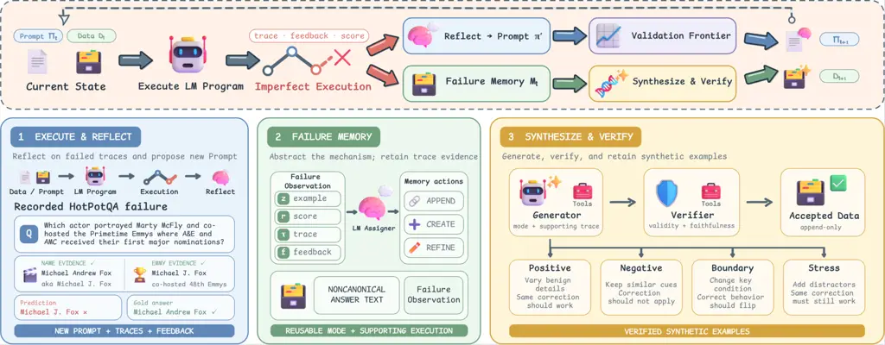
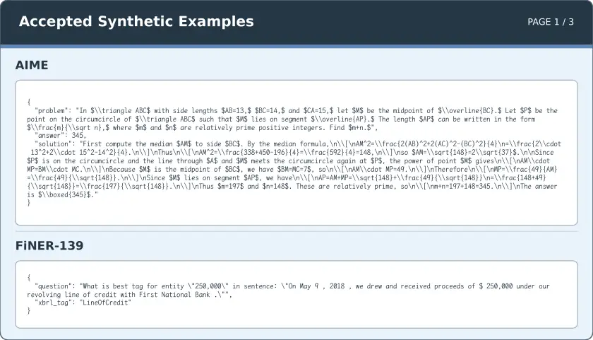
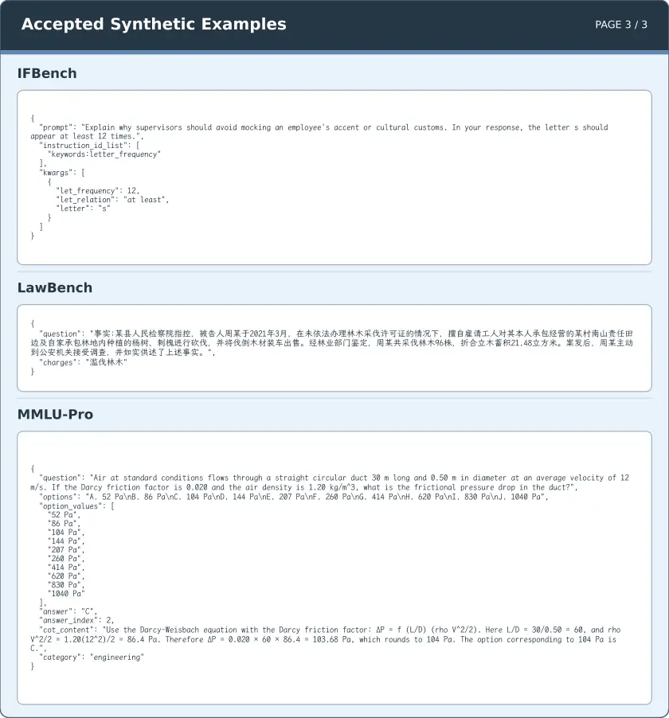

# Failure-Guided Co-Evolution of Prompts and Training Data

Tianyu Yuan    Zhuzhong Qian^(\*)

###### Abstract

Automatic prompt optimization (APO) improves language-model programs by
revising prompts from task feedback, yet it typically holds its training
data fixed. Repeatedly optimizing against the same instances confines
feedback to weaknesses already represented in those data, leaving
related failure conditions unexplored. We therefore view each failure as
a dual signal: it indicates both how the prompt should be revised and
what new training evidence should be synthesized. We introduce Forge, a
failure-guided framework that co-evolves prompts and training data.
Forge abstracts imperfect executions into reusable failure modes and
synthesizes new training data through four complementary mutation
strategies. Verified instances are fed back into prompt search, allowing
updated prompts to expose the next data needs. Across eight
heterogeneous benchmarks, Forge improves the aggregate score over the
unoptimized baseline by 16.52 percentage points and outperforms all
evaluated APO baselines. The synthesized data also transfer beyond
Forge: in a transfer study, they improve all nine APO comparisons by 2–9
points and all three GRPO comparisons by 4–8 points under matched
optimization budgets. These results establish failures as a shared
interface between prompt optimization and data synthesis, and show the
benefit of jointly adapting what a model is instructed to do and what it
learns from.

Nanjing University

yty@smail.nju.edu.cn, qzz@nju.edu.cn

^(\*)Corresponding author.

## Introduction

Figure 1: Results on representative benchmarks from four task
categories. Forge consistently outperforms all compared methods across
multi-hop retrieval, domain knowledge, reasoning, and agent tasks,
demonstrating its effectiveness across diverse benchmarks.

Language-model (LM) programs combine prompted calls with retrieval,
tools, and intermediate computation for applications ranging from
structured prediction and knowledge-intensive reasoning to instruction
following and interactive agents (Opsahl-Ong et al. 2024; Trivedi et al.
2024). Because their behavior is largely specified by natural-language
prompts, automatic prompt optimization (APO) replaces manual design with
feedback-driven search. Existing methods use textual gradients,
optimizer LMs, joint instruction–demonstration search, or evolutionary
reflection (Pryzant et al. 2023; Yuksekgonul et al. 2025; Yang et al.
2024a; Opsahl-Ong et al. 2024; Fernando et al. 2024; Agrawal et al.
2026).

Despite these advances, most general-purpose APO systems still derive
feedback from fixed training data (Opsahl-Ong et al. 2024; Agrawal et
al. 2026; Zhang et al. 2026). As prompts evolve, repeatedly optimizing
on the same instances can overemphasize observed failures while leaving
nearby conditions unexplored. When performance stops improving, it is
therefore unclear whether prompt search has exhausted useful revisions
or the training data have stopped exposing informative failures. This
motivates treating training data as an adaptive optimization state.

Feedback-directed synthesis has been studied mainly for model training:
early methods bootstrap from seed tasks or model priors (Wang et al.
2023; Xu et al. 2025), whereas learner-aware methods generate instances
from observed errors or task-model feedback (Lee et al. 2024; Menon and
Srivastava 2024; Li et al. 2025; Khan et al. 2025).

Recent work couples data with prompt or model updates: a
human-in-the-loop workflow jointly revises prompts and a living test set
(Lee and Kahng 2026), while CoEvolve synthesizes interaction tasks
during weight optimization (Yang et al. 2026). Together, they motivate a
complementary question: can automated reflective search over discrete
prompts for heterogeneous LM programs treat training data as a mutable
optimization state? We also ask whether data produced inside this loop
remain useful for subsequent LLM weight optimization.

We address this problem with Forge, a failure-guided framework that
co-evolves prompts and training data. Its key insight is that each
failure reveals both how to revise the prompt and what training evidence
is missing. Forge uses failed executions for prompt reflection and
abstracts their recurring weaknesses into a failure memory. When the
best aggregate validation score stops improving, active failure modes
guide data synthesis, completing the prompt–data loop in Figure 2.

Forge expands active failure modes through four mutation intents:
_positive_ preserves the target skill under benign variation, _negative_
creates contrasts where the failed heuristic should not apply,
_boundary_ probes nearby decision conditions, and _stress_ adds
distractors or interacting constraints. A separate tool-capable verifier
agent admits only valid instances faithful to both the targeted failure
mode and mutation intent. Accepted instances enter the training data and
shape subsequent prompt search, whose failures refresh the memory and
guide the next synthesis event.

We evaluate Forge on prompt optimization and data transfer; Figure 1
shows representative results across four task categories. Across eight
benchmarks, Forge raises average performance by 16.52 points over the
unoptimized baseline and by 4.92–8.82 points over competing APO methods.
In a separate transfer study, its synthesized instances improve all nine
prompt-optimizer and all three GRPO comparisons, including 4–8-point
GRPO gains, demonstrating utility beyond Forge.

Our contributions are fourfold:

- •
  We treat training data as an adaptive state of APO and formulate a
  failure-mediated loop that co-evolves prompt candidates and training
  data.
- •
  We introduce failure-mode-guided synthesis with positive, negative,
  boundary, and stress mutations.
- •
  We evaluate Forge against strong APO baselines across eight
  heterogeneous LM-program benchmarks.
- •
  We use a paired GRPO study to show that Forge-generated data transfer
  to weight optimization and improve final performance under matched
  optimization budgets.



Figure 2: Overview of Forge. Execution failures drive prompt reflection
and update failure memory; when aggregate validation performance stops
improving, active modes guide four verified mutations whose accepted
instances re-enter training.

## Related Work

#### Automatic prompt and context optimization.

Automatic prompt optimization (APO) uses task feedback to search
natural-language instructions and contextual controls. Representative
methods translate errors into language feedback (ProTeGi, TextGrad),
condition optimizer LMs on scored histories (OPRO), or evolve and revise
prompts through mutations and failure patterns (PromptBreeder, AMPO)
(Pryzant et al. 2023; Yuksekgonul et al. 2025; Yang et al. 2024a;
Fernando et al. 2024; Yang et al. 2024b). For multistage LM programs,
MiproV2 searches instructions and demonstrations, Gepa combines trace
reflection with Pareto selection, AutoPDL uses successive halving, and
Ace curates a structured playbook (Opsahl-Ong et al. 2024; Agrawal et
al. 2026; Spiess et al. 2025; Zhang et al. 2026). Despite their
different search strategies, these methods keep training data fixed;
Forge instead allows failures to expand the data that drive subsequent
search.

#### Data-augmented prompt optimization.

Recent systems adapt examples or evaluation artifacts alongside prompts:
PromptWizard refines instructions and synthetic demonstrations,
Promptomatix synthesizes task-specific data from descriptions, and
Data-Prompt Co-Evolution jointly revises prompts and a living test set
with developers (Agarwal et al. 2025; Murthy et al. 2025; Lee and Kahng
2026). SIPDO organizes synthesis with a controlled difficulty tier and
progressively challenges the prompt using generated examples (Yu et al.
2026). CASPER optimizes prompt representations in a continuous embedding
space using textual feedback and augments optimization with failure
cases (Jain et al. 2026). Forge instead turns recurring failures into
tool-grounded synthesis and verification targets for heterogeneous LM
programs, then evaluates the resulting instances under other prompt
optimizers and GRPO.

#### Learner-aware training-data synthesis.

Self-Instruct, Magpie, CodecLM, Evol-Instruct, and RandomWorld
bootstrap, mutate, or procedurally generate instruction and tool-use
data without adapting to learner failures (Wang et al. 2023; Xu et al.
2025; Wang et al. 2024b; Xu et al. 2024; Sullivan et al. 2025).
Learner-aware methods instead expand mispredictions (LLM2LLM), summarize
error clusters (DISCERN), select or synthesize from weakness profiles
(DataEnvGym, STAT), or search for failure-inducing queries (ReverseGen)
(Lee et al. 2024; Menon and Srivastava 2024; Khan et al. 2025; He et al.
2026; Li et al. 2025). Executable self-play further couples synthesis
with weight updates by validating generated tasks through code execution
(Absolute Zero) or environment interaction (CoEvolve) (Zhao et al. 2025;
Yang et al. 2026). Forge instead uses execution failures to couple
discrete prompt reflection with data synthesis across heterogeneous LM
programs, then evaluates whether its instances transfer to other prompt
optimizers and GRPO-based weight optimization.

## Problem Formulation

#### LM-program prompt optimization.

Let $`F_{\boldsymbol{\pi}}`$ denote an LM program whose underlying model
weights are frozen and whose $`M`$ optimizable module prompts are
collected in $`\boldsymbol{\pi}=(\pi^{(1)},\ldots,\pi^{(M)})`$. A task
instance $`z\in\mathcal{Z}`$ may represent either a conventional input
or an interaction with a task environment. Executing
$`F_{\boldsymbol{\pi}}`$ on $`z`$ produces an ordered message trace
$`\tau`$, task feedback $`f`$, and a normalized score
$`r(F_{\boldsymbol{\pi}},z)\in[0,1]`$; we call the execution imperfect
when $`r(F_{\boldsymbol{\pi}},z)<1`$.

#### Fixed-data APO.

Given initial training data $`D_{0}`$, a validation set $`V`$, and a
test set $`T`$, an APO algorithm draws update minibatches from
$`D_{0}`$. Let $`\Pi_{K}`$ contain the prompt candidates it has
evaluated by stopping time $`K`$. The final prompt is selected by the
fixed validation objective

```math
J_{V}(\boldsymbol{\pi})=\frac{1}{|V|}\sum_{z\in V}r(F_{\boldsymbol{\pi}},z),\qquad\widehat{\boldsymbol{\pi}}=\arg\max_{\boldsymbol{\pi}\in\Pi_{K}}J_{V}(\boldsymbol{\pi}). \tag{1}
```

The validation set may control search and candidate selection but never
provides training or synthesis instances; test scores never affect
either process and are used only for reporting. Conventional fixed-data
APO additionally imposes $`D_{t}=D_{0}`$ throughout search.

#### Adaptive-data APO.

We retain the same validation objective while allowing training data to
evolve. At iteration $`t`$, let $`\Pi_{t}`$ be the candidate pool,
$`D_{t}`$ the training multiset, and $`\mathcal{H}_{t}`$ the history of
imperfect-execution observations $`o=(z,\boldsymbol{\pi},\tau,f,r)`$.
Abstracting away the particular search and synthesis mechanisms, the
coupled updates are

```math
\displaystyle(\Pi_{t+1},\mathcal{H}_{t+1}) \displaystyle=\mathcal{U}(\Pi_{t},\mathcal{H}_{t};D_{t}), \tag{2}
```

```math
\displaystyle D_{t+1} \displaystyle=D_{t}\uplus\mathcal{A}(\mathcal{H}_{t+1}).
```

where $`\mathcal{U}`$ denotes a prompt-search update over the current
training data, $`\mathcal{A}`$ returns accepted synthetic instances, and
$`\uplus`$ denotes multiset addition. This update is append-only:
accepted synthetic instances may be added, while existing training
instances are neither removed nor modified. Fixed-data APO is the
special case $`\mathcal{A}\equiv\varnothing`$. Thus data synthesis
changes the evidence available to subsequent prompt updates without
changing the validation objective.

## Method

Forge couples prompt optimization and training-data synthesis through
execution failures while maintaining prompt candidates $`\Pi_{t}`$,
mutable training data $`D_{t}`$, and failure memory $`\mathcal{M}_{t}`$.
Each imperfect execution both guides an immediate prompt revision and
becomes a reusable failure mode for later synthesis. Prompt search thus
changes program behavior, while synthesis changes the evidence for
subsequent updates (Figure 2).

### Optimization Loop

At iteration $`t`$, Forge selects a parent prompt
$`\boldsymbol{\pi}\in\Pi_{t}`$, samples a minibatch $`B\subset D_{t}`$,
and executes the LM program to collect scores, ordered traces, and task
feedback. Each imperfect execution then branches in two directions. The
prompt branch reflects on the observed trace and feedback to propose a
revised prompt $`\boldsymbol{\pi}^{\prime}`$; the memory branch uses the
same evidence to update failure memory, as described in the next
subsection. Using the same failures in both branches keeps prompt
revision and data synthesis focused on weaknesses actually exposed by
the current program.

The prompt branch uses an independent reflective-search backbone
inspired by Gepa (Agrawal et al. 2026). The parent and proposal are
compared on the same minibatch, and the proposal enters the candidate
pool only when it improves the aggregate minibatch score. Each admitted
candidate is then evaluated on the fixed validation set: per-instance
scores support frontier-based parent selection, while aggregate scores
govern synthesis scheduling and final prompt selection.

The data branch becomes active after $`p`$ completed prompt-search steps
without a strict improvement in the best aggregate validation score
observed so far. Forge uses the active failure memory to synthesize a
budget of new instances, admits only verified instances, and appends
them to the training data to obtain $`D_{t+1}`$. Prompt search then
continues on the expanded data. The new instances can expose failures
absent from $`D_{t}`$; those failures in turn revise later prompts and
determine the next synthesis targets. This closes the optimization loop.
Algorithm 1 summarizes the procedure; further algorithmic and
implementation details are provided in Appendix A.

0:  training data $`D`$, validation set $`V`$, seed prompt
$`\boldsymbol{\pi}_{0}`$, patience $`p`$, synthesis budget $`K`$,
stopping rule $`\mathcal{S}`$

1:  $`\Pi\leftarrow[\boldsymbol{\pi}_{0}]`$; evaluate
$`\boldsymbol{\pi}_{0}`$ on $`V`$ and store scores $`S_{V}`$;
$`\mathcal{M}\leftarrow\varnothing`$

2:  while $`\mathcal{S}`$ is not met do

3:   $`\boldsymbol{\pi}\leftarrow\textsc{SelectCandidate}(\Pi,S_{V})`$

4:   $`B\leftarrow\textsc{SampleBatch}(D)`$

5:   $`E\leftarrow\textsc{Evaluate}(\boldsymbol{\pi},B)`$;
$`E^{-}\leftarrow\{e_{i}\in E:r_{i}<1\}`$

6:
  $`\mathcal{M}\leftarrow\textsc{UpdateFailureMemory}(\mathcal{M},E^{-})`$

7:
  $`\boldsymbol{\pi}^{\prime}\leftarrow\textsc{UpdatePrompt}(\boldsymbol{\pi},E^{-})`$

8:
  $`E^{\prime}\leftarrow\textsc{Evaluate}(\boldsymbol{\pi}^{\prime},B)`$

9:   if $`R_{B}(\boldsymbol{\pi}^{\prime})>R_{B}(\boldsymbol{\pi})`$
then

10:    append $`\boldsymbol{\pi}^{\prime}`$ to $`\Pi`$; evaluate it on
$`V`$ and update $`S_{V}`$

11:   end if

12:   if no strict aggregate-validation gain for $`p`$ steps then

13:    $`D\leftarrow D\uplus\textsc{Synthesize}(\mathcal{M},K)`$

14:   end if

15:  end while

16:  return best prompt on $`V`$ and augmented $`D`$

Algorithm 1 Forge: failure-guided prompt and data optimization

### Failure Memory

Directly asking an LM to synthesize from a single failed instance can
easily collapse into near-duplicate generation: the model preserves the
same entities, input structure, and reasoning pattern while changing
only surface wording. Such variants add little new evidence for prompt
optimization because they restate a condition already represented in the
training data instead of probing when the failed behavior should or
should not occur. The central challenge is therefore to separate the
reusable failure mechanism from the particular instance that exposed it.

Forge addresses this challenge with a failure memory whose entries are
_failure modes_: reusable mechanism descriptions paired with the
concrete failed executions that support them. For every imperfect
execution, an LM-based assigner examines the task instance, trace, and
feedback. It then assigns the execution to an existing mode, creates a
new mode, or refines an existing one. The mode description abstracts
away instance-specific entities, while its supporting executions retain
the task context and trace evidence needed to ground later generation.
This separation enables synthesis to vary the conditions around a
weakness rather than merely paraphrasing the source failure.

Two failures observed during an AppWorld optimization run (Trivedi et
al. 2024) show why modes are more useful than task-specific records.
Asked to follow every classical Spotify artist with at least 16
followers, the agent followed five artists but missed a sixth because it
inspected only the default result page. The same mode later absorbed a
Venmo failure: when asked to accept all pending requests from roommates
and coworkers, the agent accepted only two of ten qualifying requests
after again processing an incomplete result set. Forge records both
executions as _incomplete paginated search_: the agent mistakes the
default result page for the complete candidate set, so qualifying
records on later pages are never considered or acted upon. This
abstraction discards app-specific entities and actions while preserving
the missing operation, allowing the mode to guide synthesis across
unrelated tasks.

The modes accumulated since the preceding synthesis event form the
active memory used by the next event. This keeps synthesis aligned with
weaknesses exposed by the current prompt–data state: when later prompts
and added data reveal a different mechanism, the new failures induce
different modes rather than forcing generation to revisit the same
source instances.

### Failure-Guided Data Synthesis

When synthesis is triggered, Forge allocates its generation budget
across active failure modes, prioritizing modes supported by more
observations. Each generation attempt is conditioned on both a mode
description and one of its supporting failed executions, including the
trace and feedback. The mode specifies _what weakness_ to probe, while
the execution anchors the generated instance in a concrete task setting.
This differs from asking an LM to produce generically difficult data or
merely paraphrase a failed input.

A failure mode identifies what behavior is wrong, but not where its
correction should and should not generalize. If synthesis produces only
positive variants, the optimizer may overgeneralize the apparent fix or
learn a brittle rule tied to the source instance. Forge therefore
constructs a local behavioral neighborhood around each failure mode:
positive mutations test whether the correction transfers across new
realizations, negative mutations mark where it should not apply,
boundary mutations isolate the condition that changes the desired
behavior, and stress mutations test whether the correction remains
effective under distractors. Together, these four directions define the
scope and robustness of a correction rather than merely diversifying its
surface form.

A recorded execution from our HotPotQA optimization run makes these
roles concrete. The program is asked which actor portrayed Marty McFly
in the _Back to the Future_ trilogy and co-hosted the Primetime Emmy
ceremony at which A&E and AMC received their first major nominations.
The retrieved evidence states that Michael Andrew Fox is known
professionally as Michael J. Fox and that Michael J. Fox co-hosted the
48th Primetime Emmy Awards. The program therefore identifies the correct
person but returns _Michael J. Fox_, whereas the benchmark gold answer
is _Michael Andrew Fox_. Failure memory records this execution as
_noncanonical answer text_: the reasoning chain reaches the correct
entity, but the returned alias does not match the required answer form.
From this recorded failure, the same run generated the following four
mutations:

- •
  Positive—preserve the requirement. A new question asks for the full
  biographical name of the actor who played Agent J in _Men in Black_
  and hosted a ceremony featuring Bon Jovi and Toni Braxton. The answer
  is _Willard Carroll Smith II._; the entity and context change, but the
  required canonical answer form is preserved.
- •
  Negative—contrast the requirement. A question about the actress born
  Caryn Elaine Johnson instead asks for the professional name of the
  host of the Academy Awards ceremony honoring films released in 1993.
  The answer is _Whoopi Goldberg_, demonstrating a case in which
  returning the full biographical name would be incorrect.
- •
  Boundary—change the target. Keeping Michael Andrew Fox and the same
  Emmy clues, a boundary question explicitly asks for the name by which
  the actor is known professionally. This single change makes
  _Michael J. Fox_ correct and isolates the requested name type as the
  condition controlling the answer form.
- •
  Stress—add distractors. A fourth question asks for the exact full name
  of the musician who wrote “Manic Monday” under the pseudonym
  “Christopher.” The context adds articles about several other people
  named Prince, but the answer must remain _Prince Rogers Nelson_,
  testing whether the correction survives misleading name matches.

Thus the four operators probe invariance, contrast, decision boundaries,
and robustness rather than producing interchangeable paraphrases. The
stored instances retain their full contexts and supporting facts; the
questions above are shortened for presentation.

Both the generator and verifier are multi-step agents equipped with
task-specific tools. On HotPotQA, both access search_full_wiki, the same
full-Wikipedia ColBERT index used by the task program: the generator
constructs instances and gold supervision from retrieved passages, while
the verifier checks the evidence and can search further. This grounds
synthesis and verification in benchmark evidence rather than the
optimizer model’s parametric knowledge.

Because tool grounding alone does not guarantee quality, the verifier
checks each proposal for _validity_ under the task requirements and
_faithfulness_ to the targeted failure mode and mutation direction. Only
proposals passing both checks enter $`D_{t}`$ and provide new evidence
for prompt reflection and failure memory. Additional optimization
artifacts, including prompt evolution, candidate lineage, and admitted
synthetic instances, are provided in Appendix C.

## Experiments

Our evaluation addresses three questions. First, does Forge improve
prompt optimization across benchmarks and task models? Second, is
failure-guided synthesis necessary, and how does the synthesis process
reshape the failure distribution? Third, do the resulting synthesized
instances benefit optimization methods beyond Forge?

| Qwen3.5-35B-A3B | HotPotQA | IFBench | HoVer | FiNER-139 | LawBench | AIME-2025 | MMLU-Pro | AppWorld | Aggregate | Improvement |
| --------------- | -------- | ------- | ----- | --------- | -------- | --------- | -------- | -------- | --------- | ----------- |
| Baseline        | 52.00    | 31.29   | 45.00 | 56.00     | 34.00    | 73.33     | 87.00    | 66.64    | 55.66     | –           |
| MiproV2         | 68.00    | 48.64   | 52.00 | 67.00     | 38.00    | 75.56     | 90.00    | 67.67    | 63.36     | +7.70       |
| Ace             | 70.00    | 61.63   | 55.00 | 69.00     | 54.00    | 71.11     | 83.00    | 74.33    | 67.26     | +11.60      |
| Gepa            | 66.00    | 48.64   | 51.00 | 68.00     | 50.00    | 77.78     | 90.00    | 71.21    | 65.33     | +9.67       |
| Forge           | 76.00    | 54.52   | 60.00 | 74.00     | 57.00    | 82.22     | 89.00    | 84.69    | 72.18     | +16.52      |

Table 1: Final test performance (%) with Qwen3.5-35B-A3B. Aggregate
averages the eight benchmarks; Improvement is relative to the Baseline.
Bold denotes the column best.

### Experimental Setup

#### Benchmarks.

We evaluate eight heterogeneous LM benchmarks spanning
knowledge-intensive reasoning, instruction following, structured
prediction, mathematics, and agents. HotPotQA (Yang et al. 2018) and
HoVer (Jiang et al. 2020) test multi-hop retrieval and evidence
aggregation, while IFBench (Pyatkin et al. 2025) evaluates
generalization to verifiable instructions. FiNER-139 (Loukas et al. 2022) and LawBench (Fei et al. 2024) cover financial entity
classification and legal judgment, respectively. AIME-2025 (MathArena 2025) and MMLU-Pro (Wang et al. 2024a) evaluate mathematical and broad
knowledge reasoning, and AppWorld (Trivedi et al. 2024) evaluates
interactive agents in stateful tool environments. Dataset provenance,
split construction and task-specific metrics are provided in the
appendix B.

#### Models and fair comparison.

Our primary comparison uses Qwen3.5-35B-A3B (Qwen Team 2026) as the task
model and GPT-5.5 (OpenAI 2026) as the optimizer model. We additionally
repeat the full comparison with the dense Qwen3-8B task model (Yang et
al. 2025). We compare Forge against the unoptimized baseline and three
automatic prompt optimization methods: MiproV2 (Opsahl-Ong et al. 2024),
Ace (Zhang et al. 2026), and Gepa (Agrawal et al. 2026). Within each
comparison, all methods use the same task model, training, validation,
and test splits, LM-program structure, and task-specific evaluator.
Optimized states are selected using validation performance only, and the
test set is accessed only for final evaluation. To ensure comparable
search effort, we align the nominal task-model evaluation budget across
optimizers.

### Main Results

Forge achieves the strongest aggregate performance with Qwen3.5-35B-A3B.
As shown in Table 1, it reaches an aggregate score of 72.18, improving
over the unoptimized Baseline by 16.52 percentage points and exceeding
the competing APO methods by 4.92 to 8.82 points. Forge obtains the best
result on six of eight benchmarks. The gains therefore span
single-module prediction, multi-hop retrieval, mathematical reasoning,
and interactive tool use rather than concentrating in one task format.

### Component Ablation

| Variant              | Prompt | Random    | Failure | Mutation | Score | $`\Delta`$ |
| -------------------- | ------ | --------- | ------- | -------- | ----- | ---------- |
|                      | search | synthesis | memory  | guidance |       |            |
| Baseline             |        |           |         |          | 55.66 | –          |
| \+ Prompt search     | ✓      |           |         |          | 64.17 | +8.51      |
| \+ Random synthesis  | ✓      | ✓         |         |          | 62.38 | -1.79      |
| \+ Failure memory    | ✓      | ✓         | ✓       |          | 68.24 | +5.86      |
| \+ Mutation guidance | ✓      | ✓         | ✓       | ✓        | 72.18 | +3.94      |

Table 2: Cumulative ablation averaged over the eight benchmarks in
Table 1. Each row adds one component; $`\Delta`$ is relative to the
preceding row. Random synthesis generates from randomly selected
training instances.

In Table 2, _Score_ denotes the mean across the eight benchmarks in
Table 1. Prompt search improves the score from 55.66 to 64.17, whereas
adding random synthesis lowers it to 62.38. This contrast shows that
merely increasing the training data does not provide the targeted
evidence needed for optimization.

Failure guidance makes synthesis effective. Adding failure memory raises
the score to 68.24, surpassing prompt search alone by 4.07 points, and
mutation guidance further improves it to 72.18. Together, these modules
outperform random synthesis by 9.80 points and prompt search alone by
8.01 points. Failure memory identifies _what_ weaknesses require new
evidence, while mutation guidance determines _how_ to expand them into
complementary instances. Because the variants are cumulative, these
deltas represent conditional contributions rather than isolated main
effects.

### Synthesis Accounting and Failure Dynamics

Figure 3: Synthesis accounting and failure-memory dynamics on four
representative benchmarks. The statistics are computed from the same
Forge runs reported in the main comparison (Table 1). Panel (a)
partitions all generation attempts by final outcome; labels report
admitted proposals over total attempts and the corresponding admission
rate. Panels (b) and (c) compare failure modes collected before the
first and final synthesis events. Each point denotes a task-specific
failure mode, vertical position gives its share of failures in the
corresponding window on a logarithmic scale, and area gives the number
of supporting executions; horizontal jitter has no semantic meaning. The
comparison highlights substantial redistribution, more comparable
support across modes, and benchmark-dependent increases or decreases in
mode count.

Beyond downstream performance, we audit synthesis outcomes on four
representative benchmarks in Figure 3. Panel (a) accounts for every
proposal: Forge admits 22 of 30 on AIME-2025, 39 of 40 on AppWorld, 80
of 100 on HotPotQA, and 93 of 100 on FiNER-139, yielding admission rates
of 73–98%. Of the ten generation failures, nine arise in HotPotQA
because the generator returns no usable output, while the remaining
AIME-2025 failure results from an invalid JSON escape. One additional
HotPotQA verification returns non-Boolean validity and faithfulness
decisions; these eleven cases reflect malformed outputs rather than
quality-based rejection. Among the 25 successfully verified but rejected
proposals, 9 fail validity only, 7 fail faithfulness only, and 9 fail
both. Validity failures primarily involve incorrect supervision or
incomplete evidence, whereas faithfulness failures reflect the wrong
mutation direction or drift from the targeted failure mode.

Panels (b) and (c) compare failure memory before the first and final
synthesis events. Both mode identities and frequencies change
substantially, indicating that later synthesis targets newly exposed
weaknesses rather than repeatedly revisiting initial failures. Within
each benchmark, failure counts become more balanced across modes: from
the first to the final synthesis window, the ratio between the failure
counts of the most and least frequent modes decreases from $`11{:}1`$ to
$`4{:}1`$ on AIME-2025, $`20{:}1`$ to $`6{:}1`$ on AppWorld, $`22{:}1`$
to $`11{:}1`$ on HotPotQA, and $`8{:}1`$ to $`4{:}1`$ on FiNER-139.
Meanwhile, mode counts increase from 5 to 12 on AIME-2025 and from 12 to
13 on FiNER-139, but decrease from 21 to 10 on AppWorld and from 19 to
11 on HotPotQA. Thus, the prompt–data loop changes both the composition
and balance of failure memory while adapting its granularity to each
benchmark.

### Generalization Across Task Models

| Qwen3 8B | HotPotQA | IFBench | HoVer | FiNER-139 | LawBench | AIME-2025 | MMLU-Pro | AppWorld | Aggregate | Improvement |
| -------- | -------- | ------- | ----- | --------- | -------- | --------- | -------- | -------- | --------- | ----------- |
| Baseline | 40.00    | 27.34   | 35.00 | 55.00     | 24.00    | 13.33     | 61.00    | 39.34    | 36.88     | –           |
| MiproV2  | 55.00    | 31.75   | 47.00 | 62.00     | 31.00    | 20.00     | 61.00    | 40.64    | 43.55     | +6.67       |
| Ace      | 61.00    | 38.39   | 39.00 | 66.00     | 37.00    | 7.78      | 63.00    | 37.89    | 43.76     | +6.88       |
| Gepa     | 62.00    | 32.62   | 50.00 | 67.00     | 30.00    | 18.89     | 61.00    | 43.23    | 45.59     | +8.72       |
| Forge    | 70.00    | 35.81   | 57.00 | 72.00     | 35.00    | 23.33     | 66.00    | 48.64    | 50.97     | +14.10      |

Table 3: Final test performance (%) with dense Qwen3-8B. Aggregate and
Improvement follow Table 1; bold denotes the column best.

The gains of Forge persist when the task model changes from the
mixture-of-experts Qwen3.5-35B-A3B to the dense Qwen3-8B. On Qwen3-8B,
Forge leads six of eight benchmarks and achieves an aggregate score of
50.97, exceeding the Baseline by 14.10 points and the strongest
competing optimizer, Gepa, by 5.38 points (Table 3). Together with its
16.52-point gain over the Baseline and 4.92-point lead over the
strongest competing APO method on Qwen3.5-35B-A3B, these results suggest
that the advantage of Forge is consistent across dense and
mixture-of-experts architectures. We further test the robustness of
Forge to optimizer-model choice in Appendix D.

### Transferability of Synthesized Data

We next test whether Forge-generated data remain useful after changing
the optimizer that consumes them. On HotPotQA, FiNER-139, and LawBench,
we compare the original training data with the same data augmented by
Forge-synthesized instances for three prompt optimizers and for GRPO
(Shao et al. 2024). All comparisons use Qwen3.5-35B-A3B as the task
model, and the three prompt optimizers use GPT-5.5 as the optimizer
model. Each method keeps its optimization budget fixed across the two
data conditions. The two GRPO arms differ only in their training data,
using the same number of optimization steps and otherwise identical
configurations. Appendix B.5 provides the complete GRPO protocol and
configuration. Augmentation improves all twelve benchmark–optimizer
pairs, showing that the synthesized instances remain useful beyond
Forge.

|           |                   | Prompt Optimization |     |      | Weight Optimization |
| --------- | ----------------- | ------------------- | --- | ---- | ------------------- |
| Dataset   | Training data     | MiproV2             | Ace | Gepa | GRPO                |
| HotPotQA  | Original          | 68                  | 70  | 66   | 57                  |
|           | $`+\,`$Forge data | 73                  | 73  | 75   | 65                  |
| FiNER-139 | Original          | 67                  | 69  | 68   | 69                  |
|           | $`+\,`$Forge data | 70                  | 71  | 74   | 73                  |
| LawBench  | Original          | 38                  | 54  | 50   | 43                  |
|           | $`+\,`$Forge data | 47                  | 57  | 55   | 51                  |

Table 4: Test performance (%) with original versus Forge-augmented
training data under matched configurations and budgets. Bold denotes the
better condition.

Table 4 shows that Forge augmentation improves all twelve
dataset–optimizer pairs: the nine prompt-optimization gains span 2–9
points, while GRPO gains at step 100 are 8, 4, and 8 points on HotPotQA,
FiNER-139, and LawBench, respectively. These results show that the
synthesized instances transfer beyond Forge to other prompt optimizers
and model-weight optimization.

Figure 4: GRPO validation and test trajectories on FiNER-139, HotPotQA,
and LawBench. The two arms differ only in whether the training data are
augmented with Forge-synthesized instances.

Figure 4 separates validation and test trajectories for all three GRPO
comparisons. Under the same 100-step optimization budget, the augmented
arm finishes above original-data training on all three test sets. The
corresponding validation trajectories show that these gains emerge at
different stages and need not increase monotonically. Together, the six
panels show that Forge-synthesized instances provide reusable training
evidence across three distinct weight-optimization tasks.

## Conclusion

Forge uses failures as shared signals for reflective prompt updates and
targeted data synthesis through failure memory, four mutation intents,
and agentic verification. Across eight benchmarks, it outperforms the
unoptimized baseline and all evaluated APO methods; ablations show that
these gains require failure- and mutation-guided rather than random
synthesis. Its instances also improve three competing prompt optimizers
and GRPO across three transfer benchmarks, demonstrating that the
synthesized data remain useful beyond the optimization loop that
produced them. Together, these results suggest that prompt search and
data construction should be treated as a coupled process: observed
failures reveal both how a prompt should change and which training
examples should be added next. Future work should broaden this transfer
evaluation across additional tasks and model families and disentangle
the effects of dataset size, example selection, and sampling
distribution.

## References

- Agarwal et al. (2025) E. Agarwal, R. Magazine, J. Singh, V. Dani, T.
  Ganu, and A. Nambi PromptWizard: optimizing prompts via task-aware,
  feedback-driven self-evolution. In Findings of the Association for
  Computational Linguistics: ACL 2025, pp. 19974–20003. External Links:
  [Document](https://dx.doi.org/10.18653/v1/2025.findings-acl.1025),
  [Link](https://aclanthology.org/2025.findings-acl.1025/) Cited by:
  Data-augmented prompt optimization..
- Agrawal et al. (2026) L. A. Agrawal, S. Tan, D. Soylu, N. Ziems, R.
  Khare, K. Opsahl-Ong, A. Singhvi, H. Shandilya, M. J. Ryan, M.
  Jiang, C. Potts, K. Sen, A. G. Dimakis, I. Stoica, D. Klein, M.
  Zaharia, and O. Khattab GEPA: reflective prompt evolution can
  outperform reinforcement learning. In The Fourteenth International
  Conference on Learning Representations, External Links:
  [Link](https://openreview.net/forum?id=RQm2KQTM5r) Cited by:
  Introduction, Introduction, Automatic prompt and context
  optimization., Optimization Loop, Models and fair comparison..
- AI-MO (2024) AI-MO AIMO Validation AIME. Note: Hugging Face
  datasetRevision 13f9e12 External Links:
  [Link](https://huggingface.co/datasets/AI-MO/aimo-validation-aime)
  Cited by: Table 5.
- DeepSeek-AI (2026) DeepSeek-AI DeepSeek-V4: towards highly efficient
  million-token context intelligence. External Links: 2606.19348,
  [Document](https://dx.doi.org/10.48550/arXiv.2606.19348),
  [Link](https://arxiv.org/abs/2606.19348) Cited by: §D.1.
- Fei et al. (2024) Z. Fei, X. Shen, D. Zhu, F. Zhou, Z. Han, A.
  Huang, S. Zhang, K. Chen, Z. Yin, Z. Shen, J. Ge, and V. Ng LawBench:
  benchmarking legal knowledge of large language models. In Proceedings
  of the 2024 Conference on Empirical Methods in Natural Language
  Processing, pp. 7933–7962. External Links:
  [Document](https://dx.doi.org/10.18653/v1/2024.emnlp-main.452),
  [Link](https://aclanthology.org/2024.emnlp-main.452/) Cited by: Table
  5, Benchmarks..
- Fernando et al. (2024) C. Fernando, D. S. Banarse, H. Michalewski, S.
  Osindero, and T. Rocktäschel Promptbreeder: self-referential
  self-improvement via prompt evolution. In Proceedings of the 41st
  International Conference on Machine Learning, Proceedings of Machine
  Learning Research, Vol. 235, pp. 13481–13544. External Links:
  [Link](https://proceedings.mlr.press/v235/fernando24a.html) Cited by:
  Introduction, Automatic prompt and context optimization..
- He et al. (2026) Y. He, A. Panigrahi, Y. Lin, and S. Arora STAT:
  skill-targeted adaptive training. In The Fourteenth International
  Conference on Learning Representations, External Links:
  [Link](https://openreview.net/forum?id=m3jG3GaNIj) Cited by:
  Learner-aware training-data synthesis..
- Jain et al. (2026) A. Jain, P. Ghosh, and P. Yenigalla CASPER:
  bridging discrete and continuous prompt optimization through
  feedback-guided gradient descent. In Proceedings of the 19th
  Conference of the European Chapter of the Association for
  Computational Linguistics (Volume 5: Industry Track), pp. 425–437.
  External Links:
  [Document](https://dx.doi.org/10.18653/v1/2026.eacl-industry.32),
  [Link](https://aclanthology.org/2026.eacl-industry.32/) Cited by:
  Data-augmented prompt optimization..
- Jiang et al. (2020) Y. Jiang, S. Bordia, Z. Zhong, C. Dognin, M.
  Singh, and M. Bansal HoVer: a dataset for many-hop fact extraction and
  claim verification. In Findings of the Association for Computational
  Linguistics: EMNLP 2020, pp. 3441–3460. External Links:
  [Document](https://dx.doi.org/10.18653/v1/2020.findings-emnlp.309),
  [Link](https://aclanthology.org/2020.findings-emnlp.309/) Cited by:
  Table 5, Benchmarks..
- Khan et al. (2025) Z. Khan, E. Stengel-Eskin, J. Cho, and M. Bansal
  DataEnvGym: data generation agents in teacher environments with
  student feedback. In The Thirteenth International Conference on
  Learning Representations, External Links:
  [Link](https://openreview.net/forum?id=00SnKBGTsz) Cited by:
  Introduction, Learner-aware training-data synthesis..
- Lee and Kahng (2026) M. Lee and M. Kahng Data-prompt co-evolution:
  growing test sets to refine LLM behavior. In Proceedings of the 2026
  CHI Conference on Human Factors in Computing Systems,
  pp. 833:1–833:17. External Links:
  [Document](https://dx.doi.org/10.1145/3772318.3791222),
  [Link](https://doi.org/10.1145/3772318.3791222) Cited by:
  Introduction, Data-augmented prompt optimization..
- Lee et al. (2024) N. Lee, T. Wattanawong, S. Kim, K. Mangalam, S.
  Shen, G. Anumanchipalli, M. Mahoney, K. Keutzer, and A. Gholami
  LLM2LLM: boosting LLMs with novel iterative data enhancement. In
  Findings of the Association for Computational Linguistics: ACL 2024,
  pp. 6498–6526. External Links:
  [Document](https://dx.doi.org/10.18653/v1/2024.findings-acl.388),
  [Link](https://aclanthology.org/2024.findings-acl.388/) Cited by:
  Introduction, Learner-aware training-data synthesis..
- Lee et al. (2026) Y. Lee, R. S. Nair, Q. Zhang, K. Lee, O. Khattab,
  and C. Finn Meta-Harness: end-to-end optimization of model harnesses.
  In Third Conference on Language Modeling, External Links:
  [Link](https://colmweb.org/AcceptedPapers.html) Cited by: Table 5.
- Li et al. (2025) Q. Li, J. Gao, S. Wang, R. Pi, X. Zhao, C. Wu, X.
  Jiang, Z. Li, and L. Kong Forewarned is forearmed: leveraging LLMs for
  data synthesis through failure-inducing exploration. In The Thirteenth
  International Conference on Learning Representations, External Links:
  [Link](https://openreview.net/forum?id=yitH9xAHQs) Cited by:
  Introduction, Learner-aware training-data synthesis..
- Loukas et al. (2022) L. Loukas, M. Fergadiotis, I. Chalkidis, E.
  Spyropoulou, P. Malakasiotis, I. Androutsopoulos, and G. Paliouras
  FiNER: financial numeric entity recognition for XBRL tagging. In
  Proceedings of the 60th Annual Meeting of the Association for
  Computational Linguistics (Volume 1: Long Papers), pp. 4419–4431.
  External Links:
  [Document](https://dx.doi.org/10.18653/v1/2022.acl-long.303),
  [Link](https://aclanthology.org/2022.acl-long.303/) Cited by: Table 5,
  Benchmarks..
- MathArena (2025) MathArena AIME 2025. Note: Hugging Face
  datasetRevision c94da77 External Links:
  [Link](https://huggingface.co/datasets/MathArena/aime_2025) Cited by:
  Table 5, Benchmarks..
- Menon and Srivastava (2024) R. R. Menon and S. Srivastava DISCERN:
  decoding systematic errors in natural language for text classifiers.
  In Proceedings of the 2024 Conference on Empirical Methods in Natural
  Language Processing, pp. 19565–19583. External Links:
  [Document](https://dx.doi.org/10.18653/v1/2024.emnlp-main.1091),
  [Link](https://aclanthology.org/2024.emnlp-main.1091/) Cited by:
  Introduction, Learner-aware training-data synthesis..
- Murthy et al. (2025) R. Murthy, M. Zhu, L. Yang, J. Qiu, J. Tan, S.
  Heinecke, C. Xiong, S. Savarese, and H. Wang Promptomatix: an
  automatic prompt optimization framework for large language models.
  External Links: 2507.14241,
  [Document](https://dx.doi.org/10.48550/arXiv.2507.14241),
  [Link](https://arxiv.org/abs/2507.14241) Cited by: Data-augmented
  prompt optimization..
- OpenAI (2026) OpenAI GPT-5.5 system card. External Links:
  [Link](https://openai.com/index/gpt-5-5-system-card/) Cited by: §D.2,
  Models and fair comparison..
- Opsahl-Ong et al. (2024) K. Opsahl-Ong, M. J. Ryan, J. Purtell, D.
  Broman, C. Potts, M. Zaharia, and O. Khattab Optimizing instructions
  and demonstrations for multi-stage language model programs. In
  Proceedings of the 2024 Conference on Empirical Methods in Natural
  Language Processing, pp. 9340–9366. External Links:
  [Document](https://dx.doi.org/10.18653/v1/2024.emnlp-main.525),
  [Link](https://aclanthology.org/2024.emnlp-main.525/) Cited by:
  Introduction, Introduction, Automatic prompt and context
  optimization., Models and fair comparison..
- Pryzant et al. (2023) R. Pryzant, D. Iter, J. Li, Y. Lee, C. Zhu,
  and M. Zeng Automatic prompt optimization with “gradient descent” and
  beam search. In Proceedings of the 2023 Conference on Empirical
  Methods in Natural Language Processing, pp. 7957–7968. External Links:
  [Document](https://dx.doi.org/10.18653/v1/2023.emnlp-main.494),
  [Link](https://aclanthology.org/2023.emnlp-main.494/) Cited by:
  Introduction, Automatic prompt and context optimization..
- Pyatkin et al. (2025) V. Pyatkin, S. Malik, V. Graf, H. Ivison, S.
  Huang, P. Dasigi, N. Lambert, and H. Hajishirzi Generalizing
  verifiable instruction following. In Advances in Neural Information
  Processing Systems, Vol. 38. External Links:
  [Link](https://proceedings.neurips.cc/paper_files/paper/2025/hash/46499a0622ecf568b72d17b61e45dbd5-Abstract-Datasets_and_Benchmarks_Track.html)
  Cited by: Table 5, Benchmarks..
- Qwen Team (2026) Qwen Team Qwen3.5: towards native multimodal agents.
  External Links: [Link](https://qwen.ai/blog?id=qwen3.5) Cited by:
  §B.3, §B.5, Models and fair comparison..
- Shao et al. (2024) Z. Shao, P. Wang, Q. Zhu, R. Xu, J. Song, X. Bi, H.
  Zhang, M. Zhang, Y. K. Li, Y. Wu, and D. Guo DeepSeekMath: pushing the
  limits of mathematical reasoning in open language models. External
  Links: 2402.03300, [Link](https://arxiv.org/abs/2402.03300) Cited by:
  §B.5, Transferability of Synthesized Data.
- Spiess et al. (2025) C. Spiess, M. Vaziri, L. Mandel, and M. Hirzel
  AutoPDL: automatic prompt optimization for LLM agents. In Proceedings
  of the Fourth International Conference on Automated Machine Learning,
  Proceedings of Machine Learning Research, Vol. 293, pp. 13/1–20.
  External Links:
  [Link](https://proceedings.mlr.press/v293/spiess25a.html) Cited by:
  Automatic prompt and context optimization..
- Sullivan et al. (2025) M. Sullivan, M. Hartmann, and A. Koller
  Procedural environment generation for tool-use agents. In Proceedings
  of the 2025 Conference on Empirical Methods in Natural Language
  Processing, pp. 18544–18562. External Links:
  [Document](https://dx.doi.org/10.18653/v1/2025.emnlp-main.936),
  [Link](https://aclanthology.org/2025.emnlp-main.936/) Cited by:
  Learner-aware training-data synthesis..
- Trivedi et al. (2024) H. Trivedi, T. Khot, M. Hartmann, R. Manku, V.
  Dong, E. Li, S. Gupta, A. Sabharwal, and N. Balasubramanian AppWorld:
  a controllable world of apps and people for benchmarking interactive
  coding agents. In Proceedings of the 62nd Annual Meeting of the
  Association for Computational Linguistics (Volume 1: Long Papers),
  pp. 16022–16076. External Links:
  [Document](https://dx.doi.org/10.18653/v1/2024.acl-long.850),
  [Link](https://aclanthology.org/2024.acl-long.850/) Cited by: Table 5,
  Introduction, Failure Memory, Benchmarks..
- Wang et al. (2023) Y. Wang, Y. Kordi, S. Mishra, A. Liu, N. A.
  Smith, D. Khashabi, and H. Hajishirzi Self-instruct: aligning language
  models with self-generated instructions. In Proceedings of the 61st
  Annual Meeting of the Association for Computational Linguistics
  (Volume 1: Long Papers), pp. 13484–13508. External Links:
  [Document](https://dx.doi.org/10.18653/v1/2023.acl-long.754),
  [Link](https://aclanthology.org/2023.acl-long.754/) Cited by:
  Introduction, Learner-aware training-data synthesis..
- Wang et al. (2024a) Y. Wang, X. Ma, G. Zhang, Y. Ni, A. Chandra, S.
  Guo, W. Ren, A. Arulraj, X. He, Z. Jiang, T. Li, M. Ku, K. Wang, A.
  Zhuang, R. Fan, X. Yue, and W. Chen MMLU-Pro: a more robust and
  challenging multi-task language understanding benchmark. In Advances
  in Neural Information Processing Systems, Vol. 37. External Links:
  [Document](https://dx.doi.org/10.52202/079017-3018),
  [Link](https://proceedings.neurips.cc/paper_files/paper/2024/hash/ad236edc564f3e3156e1b2feafb99a24-Abstract.html)
  Cited by: Table 5, Benchmarks..
- Wang et al. (2024b) Z. Wang, C. Li, V. Perot, L. Le, J. Miao, Z.
  Zhang, C. Lee, and T. Pfister CodecLM: aligning language models with
  tailored synthetic data. In Findings of the Association for
  Computational Linguistics: NAACL 2024, pp. 3712–3729. External Links:
  [Document](https://dx.doi.org/10.18653/v1/2024.findings-naacl.235),
  [Link](https://aclanthology.org/2024.findings-naacl.235/) Cited by:
  Learner-aware training-data synthesis..
- Xu et al. (2024) C. Xu, Q. Sun, K. Zheng, X. Geng, P. Zhao, J.
  Feng, C. Tao, Q. Lin, and D. Jiang WizardLM: empowering large
  pre-trained language models to follow complex instructions. In The
  Twelfth International Conference on Learning Representations, External
  Links:
  [Link](https://proceedings.iclr.cc/paper_files/paper/2024/hash/82eec786fdfbbfa53450c5feb7d1ac92-Abstract-Conference.html)
  Cited by: Learner-aware training-data synthesis..
- Xu et al. (2025) Z. Xu, F. Jiang, L. Niu, Y. Deng, R. Poovendran, Y.
  Choi, and B. Y. Lin Magpie: alignment data synthesis from scratch by
  prompting aligned LLMs with nothing. In The Thirteenth International
  Conference on Learning Representations, External Links:
  [Link](https://openreview.net/forum?id=Pnk7vMbznK) Cited by:
  Introduction, Learner-aware training-data synthesis..
- Yang et al. (2025) A. Yang, A. Li, B. Yang, B. Zhang, B. Hui, B.
  Zheng, B. Yu, C. Gao, C. Huang, C. Lv, C. Zheng, D. Liu, F. Zhou, F.
  Huang, F. Hu, H. Ge, H. Wei, H. Lin, J. Tang, J. Yang, J. Tu, J.
  Zhang, J. Yang, J. Yang, J. Zhou, J. Zhou, J. Lin, K. Dang, K. Bao, K.
  Yang, L. Yu, L. Deng, M. Li, M. Xue, M. Li, P. Zhang, P. Wang, Q.
  Zhu, R. Men, R. Gao, S. Liu, S. Luo, T. Li, T. Tang, W. Yin, X.
  Ren, X. Wang, X. Zhang, X. Ren, Y. Fan, Y. Su, Y. Zhang, Y. Zhang, Y.
  Wan, Y. Liu, Z. Wang, Z. Cui, Z. Zhang, Z. Zhou, and Z. Qiu Qwen3
  technical report. External Links: 2505.09388,
  [Link](https://arxiv.org/abs/2505.09388) Cited by: §B.3, Models and
  fair comparison..
- Yang et al. (2024a) C. Yang, X. Wang, Y. Lu, H. Liu, Q. V. Le, D.
  Zhou, and X. Chen Large language models as optimizers. In The Twelfth
  International Conference on Learning Representations, External Links:
  [Link](https://openreview.net/forum?id=Bb4VGOWELI) Cited by:
  Introduction, Automatic prompt and context optimization..
- Yang et al. (2024b) S. Yang, Y. Wu, Y. Gao, Z. Zhou, B. B. Zhu, X.
  Sun, J. Lou, Z. Ding, A. Hu, Y. Fang, Y. Li, J. Chen, and L. Yang
  AMPO: automatic multi-branched prompt optimization. In Proceedings of
  the 2024 Conference on Empirical Methods in Natural Language
  Processing, pp. 20267–20279. External Links:
  [Document](https://dx.doi.org/10.18653/v1/2024.emnlp-main.1130),
  [Link](https://aclanthology.org/2024.emnlp-main.1130/) Cited by:
  Automatic prompt and context optimization..
- Yang et al. (2026) S. Yang, Z. Ma, T. Huang, Y. Hu, Y. Wang, and X.
  Chu CoEvolve: training LLM agents via agent-data mutual evolution. In
  Proceedings of the 64th Annual Meeting of the Association for
  Computational Linguistics (Volume 1: Long Papers), pp. 23015–23036.
  External Links:
  [Document](https://dx.doi.org/10.18653/v1/2026.acl-long.1055),
  [Link](https://aclanthology.org/2026.acl-long.1055/) Cited by:
  Introduction, Learner-aware training-data synthesis..
- Yang et al. (2018) Z. Yang, P. Qi, S. Zhang, Y. Bengio, W. Cohen, R.
  Salakhutdinov, and C. D. Manning HotpotQA: a dataset for diverse,
  explainable multi-hop question answering. In Proceedings of the 2018
  Conference on Empirical Methods in Natural Language Processing,
  pp. 2369–2380. External Links:
  [Document](https://dx.doi.org/10.18653/v1/D18-1259),
  [Link](https://aclanthology.org/D18-1259/) Cited by: Table 5,
  Benchmarks..
- Ye et al. (2026) H. Ye, X. He, V. Arak, H. Dong, and G. Song Meta
  context engineering via agentic skill evolution. In Forty-third
  International Conference on Machine Learning, External Links:
  [Link](https://openreview.net/forum?id=P1jHroBS5E) Cited by: Table 5.
- Yu et al. (2026) Y. Yu, Y. Yu, P. Zhang, K. Wei, H. Luo, and H. Wang
  SIPDO: closed-loop prompt optimization via synthetic data feedback. In
  The Fourteenth International Conference on Learning Representations,
  External Links: [Link](https://openreview.net/forum?id=kpT5rbbLdY)
  Cited by: Data-augmented prompt optimization..
- Yuksekgonul et al. (2025) M. Yuksekgonul, F. Bianchi, J. Boen, S.
  Liu, P. Lu, Z. Huang, C. Guestrin, and J. Zou Optimizing generative AI
  by backpropagating language model feedback. Nature 639, pp. 609–616.
  External Links:
  [Document](https://dx.doi.org/10.1038/s41586-025-08661-4),
  [Link](https://www.nature.com/articles/s41586-025-08661-4) Cited by:
  Introduction, Automatic prompt and context optimization..
- Zhang et al. (2026) Q. Zhang, C. Hu, S. Upasani, B. Ma, F. Hong, V.
  Kamanuru, J. Rainton, C. Wu, M. Ji, H. Li, U. Thakker, J. Zou, and K.
  Olukotun Agentic context engineering: evolving contexts for
  self-improving language models. In The Fourteenth International
  Conference on Learning Representations, External Links:
  [Link](https://openreview.net/forum?id=eC4ygDs02R) Cited by:
  Introduction, Automatic prompt and context optimization., Models and
  fair comparison..
- Zhao et al. (2025) A. Zhao, Y. Wu, T. Wu, Q. Xu, Y. Yue, M. Lin, S.
  Wang, Q. Wu, Z. Zheng, and G. Huang Absolute zero: reinforced
  self-play reasoning with zero data. In Advances in Neural Information
  Processing Systems, Vol. 38. External Links:
  [Link](https://papers.nips.cc/paper_files/paper/2025/hash/9837dc00ff67d176373268ed48042d49-Abstract-Conference.html)
  Cited by: Learner-aware training-data synthesis..

###### Appendix Contents

1.  Introduction
2.  Related Work
3.  Problem Formulation
4.  Method
    1.  Optimization Loop
    2.  Failure Memory
    3.  Failure-Guided Data Synthesis
5.  Experiments
    1.  Experimental Setup
    2.  Main Results
    3.  Component Ablation
    4.  Synthesis Accounting and Failure Dynamics
    5.  Generalization Across Task Models
    6.  Transferability of Synthesized Data
6.  Conclusion
7.  References
8.  A Algorithm and Implementation Details
    1.  A.1 Optimization State
    2.  A.2 Candidate Selection
    3.  A.3 Minibatch Sampling
    4.  A.4 Failure-Memory Construction
    5.  A.5 Reflective Prompt Update
    6.  A.6 Failure-Guided Synthesis and Verification
9.  B Experimental Setup
    1.  B.1 Benchmark Data and Splits
    2.  B.2 Benchmark Evaluation, Tools, and Synthesis
    3.  B.3 Model Configuration
    4.  B.4 Optimization-Budget Alignment
    5.  B.5 GRPO Transfer Protocol
10. C Optimization Artifacts
    1.  C.1 AppWorld Prompt Evolution
    2.  C.2 HoVer Candidate Lineage
    3.  C.3 Admitted Synthetic Examples
11. D Supplementary Experiments
    1.  D.1 Optimizer-Model Ablation
    2.  D.2 Synthetic-Data Leakage Audit

## Appendix A Algorithm and Implementation Details

Algorithm 1 in the main paper gives the complete prompt–data
optimization loop but leaves its internal calls abstract. This section
instantiates exactly the six operations used in that loop: optimization
state, parent-candidate selection, minibatch sampling, failure-memory
construction, reflective prompt update, and failure-guided synthesis
with verification. We describe decision-level behavior and the
model-facing contracts needed for reproduction, while omitting
checkpoint and callback bookkeeping.

### A.1 Optimization State

The conceptual optimization state is $`(\Pi,D,S_{V},\mathcal{M})`$. The
candidate pool
$`\Pi=[\boldsymbol{\pi}_{0},\ldots,\boldsymbol{\pi}_{q-1}]`$ stores
complete mappings from program-module names to system prompts; an
accepted candidate is appended to this pool rather than replacing its
parent. The mutable training data $`D`$ contain the original instances
and all admitted synthetic instances. For every candidate $`i`$,
$`S_{V}`$ stores its per-instance validation scores $`s_{i}(z)`$ for all
$`z\in V`$. These scores support both parent selection during search and
aggregate validation-based model selection.

Failure memory $`\mathcal{M}`$ groups imperfect executions into reusable
failure modes. A mode is $`m_{j}=(n_{j},d_{j},O_{j})`$, where $`n_{j}`$
is a short name, $`d_{j}`$ is a decontextualized mechanism description,
and $`O_{j}`$ is the ordered collection of observations supporting that
description. Each observation retains the parent-candidate index, task
instance, scalar score, ordered program trace, and module-level
feedback. The implementation stores modes by synthesis epoch: earlier
epochs remain available for audit, but only modes collected since the
preceding synthesis event are active when constructing the next
synthetic batch.

### A.2 Candidate Selection

Forge uses validation behavior to select a parent without collapsing
every candidate to one aggregate score. For each validation instance
$`z`$, it forms the local front

```math
F_{z}=\left\{i:s_{i}(z)=\max_{\ell}s_{\ell}(z)\right\}. \tag{3}
```

A candidate $`i`$ is placed in the dominated set $`G`$ when some
candidate $`\ell\neq i`$ satisfies $`s_{\ell}(z)\geq s_{i}(z)`$ for
every $`z\in V`$ and is strictly better on at least one validation
instance. The default selector then samples uniformly from the multiset
of non-dominated front members, as detailed in Algorithm 2.

0:  candidate pool $`\Pi`$; per-instance validation scores $`S_{V}`$;
validation set $`V`$

1:  $`G\leftarrow\{i:\textsc{Dominated}(i,S_{V})\}`$

2:  $`L\leftarrow[\,]`$ {multiset of eligible front members}

3:  for each validation instance $`z\in V`$ do

4:   $`b_{z}\leftarrow\max_{\ell}s_{\ell}(z)`$

5:   for each candidate index $`i=0,\ldots,|\Pi|-1`$ do

6:    if $`i\notin G`$ and $`s_{i}(z)=b_{z}`$ then

7:     append $`i`$ to $`L`$

8:    end if

9:   end for

10:  end for

11:  $`i^{\star}\leftarrow\textsc{UniformChoice}(L)`$

12:  return parent candidate $`\Pi[i^{\star}]`$

Algorithm 2 Front-frequency candidate selection

Equivalently, candidate $`i`$ has multiplicity

```math
w_{i}=\mathbf{1}[i\notin G]\sum_{z\in V}\mathbf{1}[i\in F_{z}],\qquad P(i)=\frac{w_{i}}{\sum_{\ell}w_{\ell}}. \tag{4}
```

Thus a candidate that leads on more validation instances is sampled more
often, while complete domination removes it from consideration.

### A.3 Minibatch Sampling

The default sampler is epoch-shuffled. It stores a shuffled order of
training-instance identifiers and a cursor in that order, then returns
the next contiguous minibatch at each prompt-search step. When the order
is exhausted, all identifiers are reshuffled for a new sampling epoch.
If $`|D|`$ is not divisible by the minibatch size, the final order is
padded with randomly selected identifiers so that every returned
minibatch is full; only these padding positions may duplicate an
instance.

A synthesis event refreshes the order without discarding which instances
have already been consumed. The sampler first collects unique,
not-yet-consumed identifiers from the current order and adds identifiers
of newly admitted synthetic instances. It shuffles this group and places
it before a separately shuffled group of already-consumed identifiers.
Consequently, new data receive the same priority as unseen real data and
enter subsequent prompt updates before instances already visited in the
current sampling epoch. This sampling epoch is independent of the
synthesis epoch used to partition failure memory.

### A.4 Failure-Memory Construction

Failure memory is built only from imperfect executions of the selected
parent on the current training minibatch. For each evaluation with score
below $`1`$, Forge constructs an observation $`o=(i,z,r,\tau,f)`$
containing the parent index $`i`$, instance $`z`$, score $`r`$, complete
ordered program trace $`\tau`$, and module-level feedback $`f`$. The
assigner receives two textual inputs: a catalogue containing only the
names and descriptions of modes in the current synthesis epoch, and a
Markdown rendering of the new observation with sections for the
instance, score, trace, and optional feedback. Figure 5 shows the
complete assigner prompt and its dynamic user fields. The implementation
calls a failure mode a _failure cluster_; we retain the paper
terminology in the prose.

Figure 5: The failure-assigner prompt maps a failed execution to an
existing or newly created failure mode.

The assigner returns one of three structured actions. _Assign_ appends
the observation to an existing mode; _create_ introduces a new name and
description with the observation as its first support; and _rename_
updates an existing name and description before appending the
observation. The rename action is the implementation of the abstraction
refinement described in the main paper and may also keep the name
unchanged while improving only the description. Failures are processed
sequentially, so a later failure in the same minibatch sees every mode
created or revised by earlier failures. Malformed JSON, an illegal
action-field combination, an unknown destination, or a naming conflict
produces a no-op rather than an ungrounded memory update.

The resulting catalogue provides stable synthesis targets, while each
support set retains the executions that justify its target. After
synthesis, Forge advances the synthesis epoch. The stored history is
preserved, but the next active catalogue starts empty so that future
generation reflects weaknesses exposed by the updated prompt–data state.

### A.5 Reflective Prompt Update

The prompt-update branch uses the imperfect parent executions already
collected for the current minibatch. Under the default round-robin
policy, step $`t`$ selects one program module, and the reflector
receives that module’s current system prompt together with a Markdown
bundle containing each failed task input, the trace entries belonging to
that module, and its module-level feedback. The reflector proposes one
complete replacement system prompt. If this block is absent or empty,
the module retains its original prompt. Figure 6 shows this model-facing
reflection contract.

Figure 6: The reflective prompt-update prompt produces a complete
replacement system prompt from imperfect module executions.

The proposal copies all unselected module prompts from the parent and
replaces only the selected module. Although reflection uses only
imperfect evaluations, parent and proposal are screened on the same
_complete_ minibatch. The proposal is appended to $`\Pi`$ only when its
total minibatch score is strictly higher; an admitted proposal is then
evaluated on all of $`V`$ and added to $`S_{V}`$. This local paired
comparison prevents an edit from being accepted merely because it was
tested on an easier batch.

### A.6 Failure-Guided Synthesis and Verification

The exact model-facing generator and verifier contracts are shown in
Figures 7 and 8; the admission logic connecting them is specified below.

Figure 7: The synthetic-data generator prompt produces a failure-guided
training example from a task signature and mutation seed.

Figure 8: The synthetic-data verifier prompt independently judges the
validity and failure-mode faithfulness of a generated example.

A synthesis event is triggered after $`p`$ completed prompt-search steps
without a strict improvement in the historical best aggregate validation
score. The event budget $`K`$ counts _generation attempts_, not
successfully parsed or finally admitted instances. Let
$`N=\sum_{j}|O_{j}|`$ be the number of observations supporting the
active modes. Forge first assigns

```math
k_{j}^{(0)}=\left\lfloor K\frac{|O_{j}|}{N}\right\rfloor \tag{5}
```

attempts to mode $`j`$, then distributes the remaining attempts in
descending order of the fractional remainders, breaking equal remainders
by mode order. This largest-remainder allocation preserves
$`\sum_{j}k_{j}=K`$ while prioritizing recurrent failures.

Within each allocated slot, Forge samples one supporting observation
uniformly with replacement. It assigns mutation intents from the global
cycle
$`\Omega=(\textsc{Positive},\textsc{Negative},\textsc{Boundary},\textsc{Stress})`$
across the complete seed list, restarting from Positive at each
synthesis event. Algorithm 3 gives the complete admission path.

0:  active modes $`\mathcal{M}=\{(n_{j},d_{j},O_{j})\}`$; task signature
$`\Sigma`$; attempt budget $`K`$; training data $`D`$

1:
 $`\Omega\leftarrow(\textsc{Positive},\textsc{Negative},\textsc{Boundary},\textsc{Stress})`$

2:
 $`(k_{1},\ldots,k_{|\mathcal{M}|})\leftarrow\textsc{LargestRemainder}(K,(|O_{j}|)_{j})`$

3:  $`A\leftarrow\varnothing`$; $`c\leftarrow 0`$

4:  for each mode $`m_{j}=(n_{j},d_{j},O_{j})\in\mathcal{M}`$ do

5:   for $`a=1,\ldots,k_{j}`$ do

6:    $`o\leftarrow\textsc{UniformChoice}(O_{j})`$ {sampling with
replacement}

7:    $`u\leftarrow\Omega[1+(c\bmod|\Omega|)]`$; $`c\leftarrow c+1`$

8:
   $`(\widetilde{z},\tau_{G})\leftarrow\textsc{Generate}(\Sigma,m_{j},o,u)`$

9:    if $`\textsc{Coerce}(\widetilde{z},\Sigma)=\bot`$ then

10:     continue {skip verifier on parse/schema failure}

11:    end if

12:    $`C\leftarrow(m_{j},u,o.\mathrm{instance},o.\mathrm{feedback})`$

13:    append generator assistant/tool activity from $`\tau_{G}`$ to
$`C`$

14:    $`(v,f)\leftarrow\textsc{Verify}(\Sigma,\widetilde{z},C)`$

15:    if $`v=\mathrm{true}`$ and $`f=\mathrm{true}`$ then

16:     $`A\leftarrow A\uplus\{\widetilde{z}\}`$

17:    end if

18:   end for

19:  end for

20:  $`D\leftarrow D\uplus A`$; RefreshSampleOrder($`D`$); advance
synthesis epoch

21:  return admitted synthetic data $`A`$

Algorithm 3 Failure-guided synthesis, verification, and admission

The generator is a multi-step agent conditioned on the JSON task
signature and a mutation seed containing the mode name and description,
mutation intent, failed instance, feedback, and full source program
trace. It may call benchmark-provided tools when factual lookup,
calculation, environment state, or schema details require grounding. Its
final XML field must contain a JSON object. The implementation parses
that object and coerces all declared fields and types before
verification; a failure at this stage is rejected immediately.

The verifier is a second multi-step agent equipped with the same
benchmark generation tools. It receives the task signature, parsed
synthetic instance, and a flattened context containing the mode, intent,
failed instance, source feedback, and the generator’s assistant/tool
activity. It does not directly receive the source program trace or
hidden generator reasoning. The verifier independently judges
_validity_—schema compliance, task coherence, and gold-supervision
correctness—and _faithfulness_ to both the failure mode and mutation
intent. Only two successfully parsed Boolean values that are both true
admit an instance.

## Appendix B Experimental Setup

This section specifies the data, evaluators, models, prompt-optimization
budget alignment, and the separate paired GRPO transfer protocol used in
the main paper.

### B.1 Benchmark Data and Splits

The comparison protocol assigns the same ordered training, validation,
and test examples to every optimizer for a given benchmark and task
model. Unless a benchmark defines a fixed split, randomized construction
uses the stated local seed and produces disjoint partitions. Table 5
summarizes the exact construction and number of examples in each
benchmark split.

| Benchmark | Train | Val | Test | Source and split construction                                                                                                                                                                                                                                                   |
| --------- | ----- | --- | ---- | ------------------------------------------------------------------------------------------------------------------------------------------------------------------------------------------------------------------------------------------------------------------------------- |
| AIME      | 45    | 45  | 90   | Shuffle the 90 AIME 2022–2024 problems from the AI-MO AIMO Validation AIME dataset with seed 0 and split them equally into train and validation (AI-MO 2024); use all 30 problems from the MathArena AIME-2025 dataset for test and evaluate each three times (MathArena 2025). |
| AppWorld  | 90    | 57  | 168  | Use the complete AppWorld train, dev, and test_normal task lists, respectively, in their stored order and without difficulty filtering (Trivedi et al. 2024).                                                                                                                   |
| FiNER-139 | 200   | 100 | 100  | Use the fixed train/val/test files distributed with the Meta-Harness FiNER adapter, preserving file order (Loukas et al. 2022; Lee et al. 2026).                                                                                                                                |
| HotPotQA  | 100   | 100 | 100  | Partition the official fullwiki training split by position into the first 40% (test pool), middle 40% (validation pool), and final 20% (training pool), then sample 100 examples from each pool with seed 0 (Yang et al. 2018).                                                 |
| HoVer     | 100   | 100 | 100  | Draw train from the official training data with seed 0; construct mutually exclusive validation and test sets from the official development data with seed 1. Each split contains a near-uniform 34/33/33 mixture of 2-, 3-, and 4-hop claims (Jiang et al. 2020).              |
| IFBench   | 150   | 150 | 294  | Divide the 14,971-row bundled training file into 150 contiguous segments; with seed 1, sample two distinct rows per segment and assign one to train and one to validation. Use all rows in the fixed test file (Pyatkin et al. 2025).                                           |
| LawBench  | 200   | 50  | 100  | Use the fixed train/val/test crime-prediction files distributed by the MCE artifact, preserving file order (Fei et al. 2024; Ye et al. 2026).                                                                                                                                   |
| MMLU-Pro  | 100   | 70  | 100  | From the official test split, sample mutually exclusive train and test sets with seed 0 and category-proportional largest-remainder quotas; use the complete official validation split (Wang et al. 2024a).                                                                     |

Table 5: Dataset construction used in the eight-benchmark comparisons.

### B.2 Benchmark Evaluation, Tools, and Synthesis

Under this protocol, every comparison method calls the same benchmark
adapter and receives the same scalar score for a given program
execution. Validation scores select optimized states, whereas test
outcomes are retained only for reporting and never provide feedback to
optimization. For each benchmark, the reported percentage is 100 times
the arithmetic mean of its per-example test scores; the aggregate in the
main tables is the unweighted mean of the eight benchmark percentages.
We report adapter-provided resources alongside each evaluator because
they constrain optimization-side generation and verification; unless
stated otherwise, they do not change the scalar metric. Credentials and
machine-specific configuration are not embedded in any prompt.

Synthesis schedule. Following Appendix A.6, we denote each benchmark’s
configuration by $`(K,E,P)`$, where $`K`$ is the number of generation
attempts requested at each synthesis event, $`E`$ is the maximum number
of synthesis epochs, and $`P`$ is the number of completed prompt-search
steps without a strict improvement in the historical best aggregate
validation score that triggers the next event. The configured tuples are
AIME $`(10,3,15)`$; AppWorld $`(10,4,15)`$; FiNER-139 $`(25,4,15)`$;
HotPotQA $`(25,4,15)`$; HoVer $`(25,4,15)`$; IFBench $`(25,4,15)`$;
LawBench $`(25,4,15)`$; and MMLU-Pro $`(25,4,15)`$. Thus, the configured
attempt ceilings are 30 for AIME, 40 for AppWorld, and 100 for each
remaining benchmark. The value $`K`$ counts mutation-seed generation
attempts, not admitted samples; parsing and verification failures can
reduce admissions.

AIME. The evaluator strips whitespace, parses the prediction as an
integer, and applies exact match. The adapter exposes no
benchmark-specific external lookup tool; reference solutions are used
only to construct feedback.

AppWorld. The score is the fraction of benchmark state-based tests
passed after interaction with the persistent environment, with at most
50 agent steps; an execution error receives zero. For optimization-side
synthesis, the adapter exposes an authoring service that can inspect
APIs, draft and repair native tasks, validate solutions, and finalize
published task artifacts. The generic optimizer passes this authoring
interface to both generator and verifier; although a separate read-only
inspection interface exists, the present runs do not implement
verification as an independently read-only path.

FiNER-139. The predicted tag is compared case-insensitively with the
gold tag over the adapter’s fixed 12-label XBRL vocabulary. The
optimization-side agents also receive the adapter’s label-concept
resource.

HotPotQA. The primary score is normalized short-answer exact match after
two retrieval hops. During synthesis, search_full_wiki queries the same
full-Wikipedia ColBERT index used by the task program. The generator
uses retrieved passages to construct the question, answer, aligned
context, and supporting-fact indices; the verifier receives the complete
retrieval trace and may issue additional queries when factual support
requires checking.

HoVer. The binary score is one iff all normalized gold
supporting-document titles occur among three top-seven retrievals. Extra
documents are not penalized, and the claim label is not predicted. The
adapter exposes the corresponding full-wiki search interface for claims
and evidence documents.

IFBench. The score is the fraction of executable constraints satisfied;
each checker accepts any of eight formatting-normalized variants
obtained by optionally removing asterisks and boundary lines. The
optimization-side agents receive constraint metadata together with the
official instruction rendering.

LawBench. The evaluator applies unordered exact match to the predicted
and gold sets of semicolon-separated criminal charges. The adapter also
supplies the official charge catalog.

MMLU-Pro. Accuracy is computed after extracting one standalone answer
letter from A through J. The adapter exposes no benchmark-specific
external lookup tool.

### B.3 Model Configuration

The experiments separate the frozen _task model_, which executes the
benchmark program, from the _optimizer model_, which proposes
optimization-side changes.

Primary task model. The eight-benchmark comparison uses Qwen3.5-35B-A3B
(Qwen Team 2026), with a maximum completion length of 8,192 tokens and
thinking disabled. The cross-architecture comparison replaces it with
Qwen3-8B (Yang et al. 2025), using the same completion limit and
non-thinking setting.

Optimizer model. GPT-5.5 is used with medium reasoning effort. Forge
uses it for reflection, failure assignment, synthetic-example
generation, and verification; GEPA uses it for reflection, MIPROv2 for
proposal, and ACE for reflection and curation.

All methods keep the task-model weights fixed and share the stated Qwen
inference settings, LM-program structure, and evaluator. All other
decoding parameters, including temperature, top-$`p`$, and top-$`k`$,
follow the official Qwen defaults.

### B.4 Optimization-Budget Alignment

The configured comparison uses seed 0, the complete training split and
validation-only state selection.

Because the optimizers expose different iteration units, we use
completed per-example task-program evaluations as the common
search-effort proxy. For each static benchmark and task model, we first
run Forge to completion and use its completed count as the reference
ceiling. We pass that ceiling to GEPA and ACE when their APIs permit;
for MIPROv2, we choose the largest conservative trial count whose
estimated task-program evaluations do not exceed the ceiling. The
unoptimized Baseline performs no search evaluations and is therefore a
control rather than a cost-matched optimizer.

This protocol aligns a common task-program evaluation ceiling rather
than exact realized compute: GEPA may overshoot at iteration boundaries,
MIPROv2’s estimate excludes proposal-stage calls, and ACE may stop early
under its native rule.

### B.5 GRPO Transfer Protocol

The weight-optimization study asks whether examples synthesized by Forge
remain useful when the learner updates model weights rather than
prompts. It is a paired data intervention, not a component of the Forge
optimizer, and uses group relative policy optimization (GRPO) (Shao et
al. 2024).

Paired data intervention. For every reported benchmark, both arms start
from the same Qwen3.5-35B-A3B checkpoint (Qwen Team 2026) and run
serially with seed and data seed 42. The train_only arm uses the
original training split, whereas train_plus_synthetic appends a fixed
set of verifier-admitted Forge examples. The two arms use identical
validation and test files, and no resampling or explicit real/synthetic
mixture is applied. The real/synthetic/augmented training counts are
200/93/293 for FiNER-139, 100/80/180 for HotPotQA, and 200/88/288 for
LawBench; their validation/test counts are 768/100, 100/100, and 50/100,
respectively.

Shared optimization configuration. Both arms run for exactly 100
optimizer steps, rather than a fixed number of epochs, and differ only
in training-set composition. Each arm therefore consumes 6,400
completion-level training instances, organized as 800 groups of eight
completions. The principal hyperparameters shared by both arms are
summarized in Table 6.

|                                       |                     |
| ------------------------------------- | ------------------- |
| Setting                               | Value               |
| Random / data seed                    | 42 / 42             |
| Train steps                           | 100                 |
| Global / micro batch                  | 64 / 1              |
| Generations per prompt                | 8                   |
| Steps per generation (single / agent) | 2 / 1               |
| Learning rate                         | $`5\times 10^{-5}`$ |
| Schedule / warmup                     | cosine / 0          |
| GRPO $`\beta`$                        | 0                   |
| Clip low / high                       | 0.20 / 0.28         |
| Temperature / top-$`p`$ / top-$`k`$   | 1.0 / 1.0 / $`-1`$  |
| Completion / context limit            | 8,192 / 64,000      |
| LoRA rank / alpha / dropout           | 8 / 32 / 0.05       |

Table 6: GRPO configuration shared by the original-data and
augmented-data arms.

Experimental platform. The GRPO runs use Ubuntu 20.04 with eight 48-GB
NVIDIA RTX A6000 GPUs. The software stack comprises Python 3.12.4,
forge-grpo 0.1.0, PyTorch 2.10.0 with CUDA 12.8. Training uses BF16;
colocated vLLM rollout uses tensor parallelism 4 and a
GPU-memory-utilization target of 0.6. Use Adam with
$`\beta=(0.9,0.95)`$, $`\epsilon=10^{-8}`$, weight decay 0.1, and
gradient clipping at 1.0. Optimizer and RNG state are retained for
strict resume, and LoRA adapters are not merged into the base model.

Task-specific rollout and reward. FiNER-139 and LawBench use single-turn
rollouts. Their reward is the benchmark score defined in Appendix B.2
with weight 1.0 plus a soft XML-format reward with weight 0.1; because
the benchmark parsers also accept bare outputs, XML is encouraged rather
than required for task correctness. Their 128-completion generation
batch contains 16 prompt groups and supplies two consecutive optimizer
steps.

HotPotQA instead runs a continuous search-agent trajectory and
regenerates a 64-completion batch at every optimizer step. Each of its
eight prompt groups contains eight trajectories, each trajectory permits
at most three actions, and every model turn has an independent
8,192-token completion allowance. Each search retains at most seven
passages, truncated to 700 characters each. The trajectory reward is

```math
\displaystyle r_{\mathrm{HotPotQA}}={} \displaystyle 0.8\,\mathrm{EM}_{\mathrm{terminal}} \tag{6}
```

```math
\displaystyle+0.2\sum_{t}\max\!\left(0,\mathrm{Recall}_{t}-\mathrm{Recall}_{t-1}\right),
```

where EM is normalized answer exact match and recall is supporting-title
recall. No separate static reward is added, and evaluation reports the
benchmark’s primary answer EM rather than this shaped training reward.
The retriever corpus, index, and top-seven interface are fixed across
arms and checkpoints. The reported comparison uses the step-100 test
endpoint; complete held-out splits are evaluated, test outcomes are
monitoring-only, and training always reaches 100 updates.

## Appendix C Optimization Artifacts

This section documents three optimization artifact types: an AppWorld
prompt before and after optimization, a HoVer candidate lineage, and
admitted synthetic examples. The figures are generated directly from the
corresponding checkpoint and result files; they are illustrations of
stored state rather than additional evaluations.

### C.1 AppWorld Prompt Evolution

The AppWorld GPT-5.5–Qwen3.5-35B-A3B run optimizes the system prompt of
its single appworld_agent module. Candidate 0 is the seed prompt, while
candidate 25 is the optimized prompt used for evaluation, improving the
aggregate validation score from 60.20% to 92.50%. Figures 9, 10, 11
and 12 show the seed and optimized system prompts verbatim; the longer
optimized prompt is continued across three figures without elision. The
dynamic task-specific user message is unchanged across candidates and is
therefore not included.

Figure 9: The original AppWorld system prompt used by seed candidate 0.

Figure 10: The optimized AppWorld system prompt (candidate 25), part 1
of 3.

Figure 11: The optimized AppWorld system prompt (candidate 25), part 2
of 3.

Figure 12: The optimized AppWorld system prompt (candidate 25), part 3
of 3.

### C.2 HoVer Candidate Lineage

Figure 13 shows the complete candidate tree stored by the HoVer
GPT-5.5–Qwen3-8B run. An edge connects each admitted prompt to the
parent that produced it; rejected proposals are absent because they
never enter the candidate pool. Each node reports its candidate
identifier and full-validation-set mean, while the fixed focus
highlights candidate 11, which is used for test evaluation, and its
ancestry
$`0\rightarrow 1\rightarrow 2\rightarrow 3\rightarrow 9\rightarrow 11`$.
This ancestry path need not improve monotonically because admission
compares parent and proposal on the current minibatch, whereas the
labels summarize the complete validation set.

Figure 13: The HoVer candidate lineage, where node fill encodes
validation score, the red outline marks the candidate used for test
evaluation, and the red dashed path marks its ancestry.

### C.3 Admitted Synthetic Examples

Figures 14, 15 and 16 show one compact, self-contained admitted
synthetic record from each non-AppWorld benchmark’s
GPT-5.5–Qwen3.5-35B-A3B run. Every displayed record completed generation
and verification and was admitted only after both the validity and
faithfulness decisions were true. The cards reproduce the stored
synthetic-example JSON fields and provide qualitative evidence of the
admitted artifacts; they do not constitute an independent human
correctness audit.



Figure 14: Verifier-admitted synthetic examples for AIME and FiNER-139.

Figure 15: Verifier-admitted synthetic examples for HotPotQA and HoVer.



Figure 16: Verifier-admitted synthetic examples for IFBench, LawBench,
and MMLU-Pro.

AppWorld cannot be rendered as an equivalent self-contained JSON card.
Its admitted checkpoint record contains only a native task_id; that
identifier resolves to a digest-bound task directory containing the
instruction, persistent public and private state, required apps and
APIs, executable source and compiled solutions, evaluator, and tests.
Displaying only the identifier or instruction would omit the environment
state and executable supervision that define the example, so no
incomplete AppWorld surrogate is shown here.

## Appendix D Supplementary Experiments

### D.1 Optimizer-Model Ablation

We evaluate the robustness of Forge to optimizer-model choice by using
DeepSeek-V4-Pro (DeepSeek-AI 2026) and GPT-5.5 as alternative optimizer
models while fixing Qwen3.5-35B-A3B as the task model. Table 7 reports
results on the six benchmarks evaluated with both optimizer models. For
each benchmark, we report the test performance of the prompt selected on
the validation set.

| Benchmark | DeepSeek-V4-Pro | GPT-5.5 |
| --------- | --------------- | ------- |
| HotPotQA  | 74.00           | 76.00   |
| IFBench   | 50.59           | 54.52   |
| HoVer     | 58.00           | 60.00   |
| FiNER-139 | 75.00           | 74.00   |
| LawBench  | 57.00           | 57.00   |
| MMLU-Pro  | 90.00           | 89.00   |

Table 7: Robustness of Forge to optimizer-model choice, with
Qwen3.5-35B-A3B fixed as the task model. Scores are test performance
(%).

Across the six benchmarks, changing the optimizer model yields an
average absolute score difference of only 1.66 points, with a maximum
difference of 3.93 points. The consistently small variation shows that
Forge maintains similar optimization effectiveness across the two
optimizer models and is largely insensitive to optimizer-model choice.

### D.2 Synthetic-Data Leakage Audit

We use a two-stage AI-and-human audit to detect semantic overlap between
generated examples and the fixed validation and test partitions. First,
Codex with GPT-5.5 (OpenAI 2026) screens every generated example against
both partitions. A match requires semantic equivalence of the question
despite paraphrasing or formatting; topical, failure-mechanism, or
reasoning-pattern similarity alone is insufficient.

Second, we manually inspect a random 10% sample under the same
criterion. Neither stage finds a match, providing no evidence of data
leakage.
