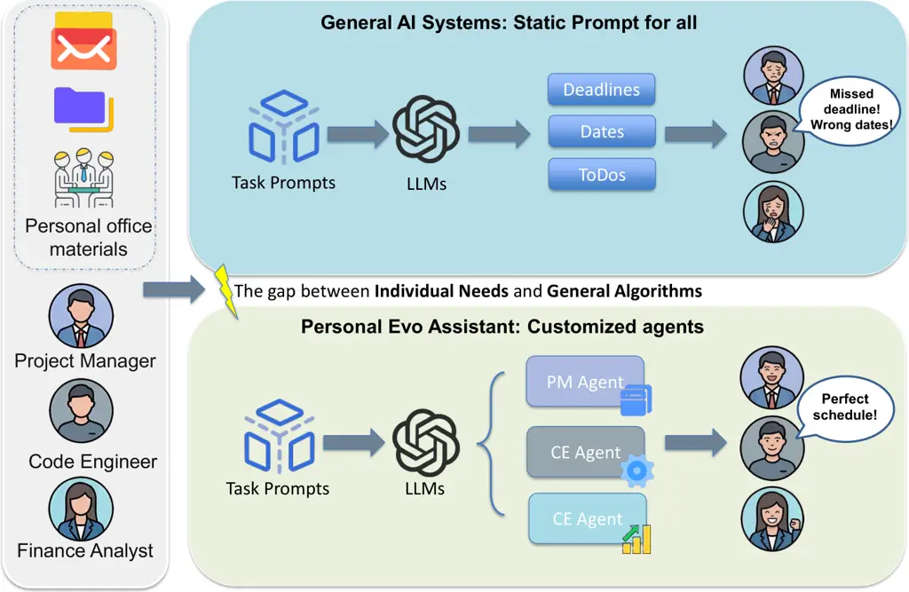
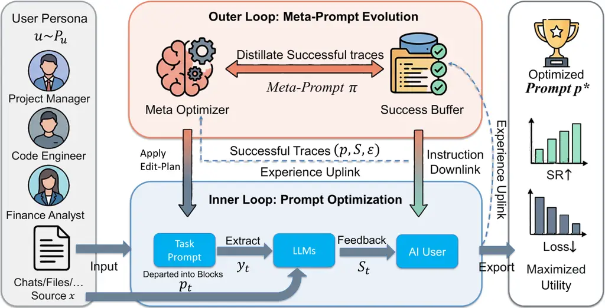

# One Prompt Does Not Fit All: Self-Meta-Evolve for Personalized Information Extraction

Hongliang Li ^(†)^(†)thanks: Work conducted during Hongliang Li’s
internship at Microsoft. Affiliation: Microsoft Affiliation: Beijing
Jiaotong University    Lu Wang Affiliation: Microsoft    Yong Xu
Affiliation: Microsoft    Hanyang Chen Affiliation: Beijing Jiaotong
University    Zhitao Hou Affiliation: Microsoft    Xiaoting Qin
Affiliation: Microsoft    Song Ge Affiliation: Microsoft    Qingwei Lin
Affiliation: Microsoft    Dongmei Zhang Affiliation: Microsoft

###### Abstract

Large language models (LLMs) are increasingly deployed for enterprise
information extraction (IE), where the same document must be reorganized
differently for each user. Existing prompt optimization methods,
however, rely on a single prompt optimized against a global objective,
which is misaligned with the inherent user heterogeneity of real
workplaces. We formulate enterprise IE as per-user prompt adaptation
under interaction feedback and propose Self-Meta-Evolve, a hierarchical
framework that maintains a dedicated prompt for each user and
continuously refines it through a dual-loop process: an inner loop that
edits structured prompts based on persona-conditioned feedback, and an
outer loop that evolves the meta-prompt itself by distilling successful
editing patterns. To enable scalable training and evaluation, we release
a persona-driven IE benchmark of 292 simulated enterprise users, paired
with a reproducible persona-generation pipeline grounded in O\*NET
occupational taxonomies. On this benchmark, Self-Meta-Evolve achieves a
74.58% success rate, outperforming the strongest prompt-optimization
baseline by 13.56 absolute points, and reaches 52.54% within only two
iterations. A double-blind human study with twenty real professionals
further confirms that prompts adapted by our framework win against
static baselines in 71% of pairwise comparisons.

## 1 Introduction

Large language models (LLMs) are now a core building block of enterprise
data pipelines, transforming unstructured artifacts such as emails,
meeting transcripts and project reports into structured representations
that support downstream analytics and decision-making (Pang et al.,
2023; Xu et al., 2024; Liang et al., 2026). In production, prompts have
become the de-facto interface for controlling these systems: many
platforms invoke a closed-source LLM via a single carefully engineered
prompt and treat the model as a configurable extractor (Xue et al.,
2024; Shuang et al., 2025; Fuente et al., 2025).



Figure 1: Static prompts fail under user-specific extraction objectives.
Conventional systems apply a shared prompt to all users, often producing
outputs that do not match heterogeneous role-specific preferences. Our
framework maintains a dedicated prompt for each user and updates it from
interaction feedback, enabling personalized extraction over time.

This prompt-based paradigm implicitly assumes that one prompt can
adequately specify the extraction objective for the entire user
population. In practice, however, enterprise users are profoundly
heterogeneous (Chen et al., 2024; Shi et al., 2025; Xu et al., 2025): as
illustrated in Figure 1, a project manager looking at a project status
email cares about actionable deadlines and ownership, whereas a
financial analyst reading the same email needs granular budget entities
and risk indicators. Our pilot survey of 50 internal users found that
72% routinely post-edit generic LLM outputs to fit their role-specific
standards. Recent enterprise-NLP studies corroborate this gap: when LLM
agents are evaluated in realistic workplace sandboxes (Vishwakarma et
al., 2025) or applied to heterogeneous enterprise data (Choubey et al.,
2025), role-specific output requirements become the dominant source of
failure. Organizational research provides a theoretical lens for this
gap: the Job Crafting framework (Wrzesniewski and Dutton, 2001) and Work
Design Theory (Hackman and Oldham, 1976; Parker et al., 2017) argue that
effective tools must align with the dynamic, role-specific demands that
employees actively shape—a property that static, global prompts cannot
satisfy.

Existing prompt optimization methods, including search-based (Zhou et
al., 2023; Yang et al., 2023), gradient-inspired (Pryzant et al., 2023),
evolutionary (Xu et al., 2022; Guo et al., 2024; Fernando et al., 2024),
and multi-agent variants (Zhang et al., 2026), share the same global
assumption: a single prompt is optimized against a fixed dataset and
shared objective. This is fundamentally misaligned with user-centric IE,
where the “correct” extraction is a function of who is reading it (Guan
et al., 2025).

We instead formulate enterprise IE as per-user prompt adaptation under
interaction feedback: each user owns a dedicated prompt that evolves
over time, driven by user-specific critique signals. Two observations
motivate our design. First, modern LLMs exhibit strong role-playing
fidelity, enabling scalable simulation of diverse user personas and
their feedback (Park et al., 2023; Tseng et al., 2024; Xiao et al.,
2024; Wang et al., 2024; Tamoyan et al., 2025). Second, prompt
optimization decomposes naturally into a hierarchy: low-level edits to a
task prompt, and a high-level meta-strategy that decides _how_ to
edit (Deng et al., 2022; Fernando et al., 2024; Zhang et al., 2026).

Building on these observations, we propose Self-Meta-Evolve, a
hierarchical framework whose _inner loop_ performs persona-conditioned
edits to a structured extraction prompt, while an _outer loop_ evolves
the meta-prompt that controls these edits by distilling successful
trajectories. To support scalable yet faithful training, we additionally
curate a benchmark of 292 enterprise personas, generated through a
reproducible pipeline seeded with O\*NET occupational descriptors (Park
et al., 2023; Wang et al., 2023), and validated against real
professionals.

Our intended setting is persistent multi-user personalization: editing
experience accumulated across users can improve subsequent adaptations.
A direct prompt edit remains a practical option for a single user with a
simple requirement. Once adapted, a prompt can be reused for subsequent
documents without repeating optimization; deployment then requires one
extraction call.

We summarize our contributions as follows:

- •
  Problem formulation. We formalize enterprise IE as per-user prompt
  adaptation under interaction feedback, departing from the static,
  global prompt optimization paradigm.
- •
  Self-Meta-Evolve framework. We propose a hierarchical framework that
  combines per-user prompt editing (inner loop) with shared
  meta-strategy evolution (outer loop), and analyze how each component
  contributes to convergence speed and cross-domain generalization.
- •
  Persona-driven benchmark and human validation. We release a benchmark
  of 292 reproducible enterprise personas plus two specialized test sets
  (STEM, Humanities), and validate the simulation through a double-blind
  study with twenty real professionals (Cohen’s $`\kappa`$=0.71).
  Self-Meta-Evolve improves success rate by 13.56 absolute points over
  the strongest baseline and wins 71% of pairwise comparisons against a
  static baseline judged by real users.

## 2 Related Work

#### Prompt optimization.

Search-based methods such as APE (Zhou et al., 2023) and OPRO (Yang et
al., 2023) treat LLMs as black-box optimizers that propose and rank
candidate prompts; gradient-inspired methods like ProTeGi (Pryzant et
al., 2023) use textual critiques as pseudo-gradients. Evolutionary
variants (Xu et al., 2022; Guo et al., 2024; Chen et al., 2023; Fernando
et al., 2024) apply genetic operators over populations of prompts, and
Promptbreeder additionally evolves the mutation prompt itself. Recent
work explores meta-learned (Choi et al., 2026), Pareto-optimal (Zhao et
al., 2025a), and multi-agent (Zhang et al., 2026) prompt search. All of
these optimize a _single_ prompt against a _global_ objective. Our
framework departs from this assumption: prompts are user-specific, and
the optimization signal is a persona-conditioned critique rather than
ground-truth labels.

#### LLM-based simulation, judging, and self-improvement.

LLMs have been used to simulate users (Park et al., 2023; Xiao et al.,
2024; Tamoyan et al., 2025) and to judge generations on per-instance
criteria (Zheng et al., 2023; Liu et al., 2023; Fu et al., 2024;
Chirkova et al., 2026). Dou et al. (2025) systematically study whether
LLM user-simulators are reliable proxies for multi-turn evaluation and
find moderate but non-trivial fidelity, motivating cross-model judge
checks. Self-improving systems use LLMs to mutate code, heuristics, or
prompts via reflective evaluation (Ye et al., 2024; Liu et al., 2024;
Wang et al., 2026). Our work differs in that simulation is _the
substrate of personalization_, not just an evaluation tool: AI-User
feedback drives per-user adaptation, and the meta-prompt is evolved
across users rather than within a single optimization run.

#### Personalized NLP and role-playing agents.

Personalization has been studied in dialogue (Zhang et al., 2018;
Madotto et al., 2019), classification (Flek, 2020), fine-grained text
generation (Alhafni et al., 2024), and recently with LaMP-style
benchmarks (Salemi et al., 2024; Salemi and Zamani, 2025; Salemi et al.,
2025). Surveys on persona/role-playing agents (Tseng et al., 2024; Chen
et al., 2024; Chen et al., 2025a; Xu et al., 2025; Guan et al., 2025)
highlight the gap between role-playing fidelity and downstream task
utility, and recent benchmarks evaluate personalization in
conversational assistants (Zhao et al., 2025b; Mok et al., 2025) and
few-shot personalization with mis-aligned responses (Kim and Yang,
2025). Role-playing capabilities have been explicitly elicited in
RoleLLM (Wang et al., 2024). At the same time, Kim et al. (2025) and Luz
de Araujo et al. (2026) point out that personas can have both benefits
and drawbacks, and their effectiveness may decline during longer
interactions. We account for these issues through an outer-loop reset
mechanism (Section 6). Our work introduces personalization into
enterprise IE, a commercially important yet relatively underexplored
setting, and uses occupational taxonomies as the basis for persona
construction to support reproducibility.

#### LLM-based information extraction and synthetic data.

LLM-driven IE has been explored for relation (Xue et al., 2024; Jiang et
al., 2024), document-level (Liang et al., 2026), event (Shuang et al.,
2025), and zero-shot multi-agent (Lu et al., 2025) settings; surveys
provide broader coverage (Xu et al., 2024). Synthetic data has emerged
as a key enabler for low-resource and zero-shot IE (Fuente et al., 2025;
Ziegler et al., 2025). Closest in spirit, personalized meeting
summarization systems (Chen et al., 2025b; Kirstein et al., 2025) adapt
to user corrections, but operate at the document-summary granularity
rather than at the prompt-program level we target. These works optimize
a single prompt against gold annotations or fixed user histories. We
complement this line by studying _user-relative_ correctness, which is
the dominant regime in enterprise deployments where “ground truth” is
role-dependent (Vishwakarma et al., 2025; Choubey et al., 2025).



Figure 2: Architecture of Self-Meta-Evolve. The inner loop iteratively
refines a user’s structured extraction prompt based on AI-User feedback,
while the outer loop evolves the meta-prompt by distilling successful
editing trajectories across users.

## 3 Problem Setup

### 3.1 Per-User Prompt Adaptation

Let $`\mathcal{U}`$ denote a distribution over enterprise user personas.
Each persona $`u\sim P_{\mathcal{U}}`$ encodes a role description, a
document distribution $`\mathcal{D}_{u}`$, and an information preference
profile. Given an extraction prompt $`p\in\mathcal{P}`$ and document
$`x\sim\mathcal{D}_{u}`$, an LLM produces a structured output
$`y=f_{\text{LLM}}(x,p)`$.

Unlike traditional IE benchmarks that assume static gold annotations,
enterprise systems evaluate quality from a _user-centric_ perspective:
the same $`y`$ may be acceptable for one user and incorrect for another.
We model this by a persona-conditioned feedback function
$`F_{\phi}(u,x,y)`$ that returns structured critiques. The optimization
objective is to find a per-user prompt that minimizes the expected
feedback-induced loss:

```math
p^{*}_{u}=\arg\min_{p\in\mathcal{P}}\mathbb{E}_{x\sim\mathcal{D}_{u}}\left[\mathcal{L}(p;u,x)\right], \tag{1}
```

```math
\mathcal{L}(p;u,x)=g\left(F_{\phi}(u,x,f_{\text{LLM}}(x,p))\right), \tag{2}
```

where $`g(\cdot)`$ converts discrete feedback into a scalar
(Section 3.2).

### 3.2 AI User Feedback Model

We instantiate $`F_{\phi}`$ with an AI User module that role-plays $`u`$
via LLM prompting and emits structured feedback
$`F_{\phi}(u,x,y)=\{(a_{i},t_{i})\}_{i=1}^{m}`$, where $`a_{i}`$ is an
extracted artifact and $`t_{i}\in\{\text{revise},\text{delete}\}`$
specifies the action that the user would take. The scalar loss is

```math
\mathcal{L}=\lambda_{r}N_{\text{revise}}+\lambda_{d}N_{\text{delete}}. \tag{3}
```

#### Choosing $`\lambda_{r}`$ and $`\lambda_{d}`$.

The weights reflect the relative cost of _editing_ a returned artifact
versus _discarding_ it entirely. We do not set them arbitrarily: in a
pilot annotation study, five enterprise users rated the perceived effort
of the two actions across 30 sampled cases on a 1–5 Likert scale,
yielding mean ratios of $`2.04\pm 0.41`$ in favor of deletion. We
accordingly set $`\lambda_{d}=0.2=2\lambda_{r}`$ and verify in
Section 6.7 that final rankings are stable under perturbations of this
ratio in $`[1.5,2.5]`$.

#### Loss threshold $`\tau`$.

A run is _successful_ if its deployed loss falls below $`\tau`$. We pick
$`\tau`$ as the median deployed loss of the strongest baseline (ProTeGi)
on a held-out development set of 50 personas, which corresponds to a
normalized $`\tau=0.75`$. This calibration ensures that “success”
represents a strict improvement over the prior state of the art, and is
reused identically across all methods.

## 4 Persona-Driven Enterprise Benchmark

A central concern for any user-centric IE benchmark is whether the
personas faithfully cover real workplace heterogeneity. We therefore
describe the construction pipeline in detail (Figure-style overview in
Appendix B) and validate it against real professionals (Section 6.9).

### 4.1 Persona Generation Pipeline

The pipeline is fully reproducible from public seeds and proceeds in
four stages.

#### Stage 1: Seed roles from O\*NET.

We start from the public U.S. O\*NET occupational database (release
28.0), which provides standardized job titles, task statements, and
tools-and-technology lists for $`\sim`$1,000 occupations. We filter to
enterprise-relevant occupations using the SOC major groups 11
(Management), 13 (Business and Financial), 15 (Computer and
Mathematical), 17 (Engineering), 19 (Life/Physical/Social Sciences), 23
(Legal), 25 (Education), and 27 (Arts/Media). This yields 412 candidate
seed roles.

#### Stage 2: Persona expansion.

For each seed role, we prompt an LLM (GPT-5.1) to expand the O\*NET
descriptor into a structured persona JSON with three fields: (i) _role
description_, including background, seniority, and primary objectives;
(ii) _document distribution_, describing the mix of artifact types such
as email, chat, report, and ticket, as well as the relevant topical
domains; and (iii) _information preference profile_, which contains a
list of 3–6 declarative preferences, for example, “prioritize tasks with
explicit owners and deadlines over status descriptions.” The expansion
prompt and an example showing the transformation from a seed role to a
persona are provided in Appendix A. We generate 400 candidate personas
in this stage.

#### Stage 3: Quality control.

We apply three filters to obtain the final pool: (a) deduplication via
embedding cosine similarity ($`>0.92`$ collapses to one), removing 47
near-duplicates; (b) consistency check, where an LLM judge scores the
persona on internal coherence (1–5) and we drop scores $`<4`$, removing
38 cases; (c) preference specificity, requiring at least three
actionable preferences, removing 23 cases. The remaining 292 personas
form our main pool. This pipeline transparently explains the
400$`\to`$292 reduction that earlier iterations of this work were
criticized for under-documenting.

#### Stage 4: Document synthesis.

For each persona, we synthesize 8–12 enterprise artifacts (emails, chat
logs, status reports) conditioned on the persona’s document
distribution, using a separate generation prompt that injects realistic
timestamps, names, and project references. Crucially, the document
generator is conditioned only on the _role_ and _topical domain_, not on
the preference profile, so that documents do not leak the gold
preference signal.

For example, a Patent Counsel persona receives fictional invention
disclosures, internal patent-review emails, IP-committee meeting notes,
and licensing memos, rather than real patents or corporate documents.
The generation prompt excludes identifiable names, filing numbers, and
jurisdictions.

### 4.2 Splits and Test Sets

We partition the 292 personas by persona ID into 60/20/20 train/dev/eval
splits with a fixed seed. To stress cross-domain generalization, we
additionally curate two specialized test sets disjoint from the main
pool: STEM-Personas ($`N=50`$, drawn from SOC 15/17/19) and
Humanities-Personas ($`N=50`$, drawn from SOC 25/27 plus
librarian/editor occupations). Detailed distributions are in Appendix B.

1: Init: prompt $`p_{0}`$, meta-prompt $`\pi`$, buffer
$`\mathcal{B}\leftarrow\emptyset`$

2: for $`t=0`$ to $`T-1`$ do

3:   sample persona $`u`$ and document $`x`$

4:   $`y_{t}\leftarrow f_{\text{LLM}}(x,p_{t})`$

5:   $`\mathcal{S}_{t}\leftarrow F_{\phi}(u,x,y_{t})`$

6:   $`E_{t}\leftarrow f_{\text{LLM}}(p_{t},\mathcal{S}_{t};\pi)`$

7:   $`p_{t+1}\leftarrow\text{ApplyEdits}(p_{t},E_{t})`$

8:   if $`\mathcal{L}(p_{t+1})<\mathcal{L}(p_{t})`$ then

9:
   $`\mathcal{B}\leftarrow\mathcal{B}\cup\{(p_{t},\mathcal{S}_{t},E_{t})\}`$

10:   end if

11:   if $`|\mathcal{B}|\bmod K=0`$ then

12:    $`\pi\leftarrow f_{\text{Meta}}(\pi,\mathcal{B})`$

13:   end if

14: end for

Algorithm 1 Self-Meta-Evolve

### 4.3 Data Statement and Release

All documents are LLM-synthesized; no real enterprise data is used,
removing privacy risk. Personas are derived from a public taxonomy. Upon
acceptance we release the persona pool, generated documents, AI-User
prompt, and pipeline scripts under CC-BY 4.0 to enable replication.
Limitations of the synthetic regime are discussed in the Limitations
section.

## 5 Self-Meta-Evolve Framework

Our framework (Figure 2) performs per-user prompt adaptation through a
bi-level process. The inner loop edits a user’s prompt from
current-interaction feedback, while the outer loop improves a shared
meta-strategy by distilling successful update patterns across users.
Pseudo-code is given in 1.

### 5.1 Structured Prompt Representation

Rather than treating prompts as unstructured text, we represent each
extraction prompt as a JSON-like object whose keys are functional
sections: task description, extraction instructions, output schema,
demonstrations, and constraint rules. Each section is identified by a
stable point_id. This decomposition allows the optimizer to target
individual points rather than rewriting the whole prompt, yielding more
stable and interpretable updates. The initial prompt is in Appendix D.

### 5.2 Inner Loop: Persona-Conditioned Editing

At step $`t`$, a persona $`u`$ and document $`x`$ are sampled. The
current prompt $`p_{t}`$ produces $`y_{t}=f_{\text{LLM}}(x,p_{t})`$, the
AI User returns feedback $`\mathcal{S}_{t}=F_{\phi}(u,x,y_{t})`$, and an
LLM editing agent guided by the meta-prompt $`\pi`$ proposes an edit
plan $`E_{t}=f_{\text{LLM}}(p_{t},\mathcal{S}_{t};\pi)`$ targeting
specific (section, point_id) pairs. The next prompt is

```math
p_{t+1}=\text{ApplyEdits}(p_{t},E_{t}). \tag{4}
```

If $`\mathcal{L}(p_{t+1};u,x)<\mathcal{L}(p_{t};u,x)`$, the trace
$`(p_{t},\mathcal{S}_{t},E_{t})`$ is appended to a success buffer
$`\mathcal{B}`$.

#### Worked example.

Consider a persona “DevOps Lead” whose preference profile demands
_actionable on-call follow-ups_. The initial prompt extracts both
follow-ups and team announcements; AI-User feedback flags announcements
with delete. The inner loop localizes the failure to point instr.scope
(“extract all team-relevant updates”), and the editing agent proposes a
patch_logic action that narrows the scope to “items with explicit owner
and deadline.” Loss drops from 1.4 to 0.6, and the trace enters
$`\mathcal{B}`$.

### 5.3 Outer Loop: Meta-Prompt Evolution

While the inner loop directly improves _prompts_, the outer loop refines
the _strategy_ for generating edits. Once $`|\mathcal{B}|`$ reaches a
threshold $`K`$, an LLM acting as a meta-optimizer reads the accumulated
successful traces and rewrites the meta-prompt:

```math
\pi^{\prime}=f_{\text{Meta}}(\pi,\mathcal{B}). \tag{5}
```

Intuitively, this process captures editing patterns that generalize
across users. For example, when feedback indicates over-extraction, the
model may prefer applying add_constraint to instr.scope instead of
rewriting demonstrations. These patterns are incorporated into the
meta-prompt so that later inner-loop iterations can adapt to _unseen_
personas with fewer steps. We therefore assess the quality of the
meta-prompt by its adaptation efficiency on held-out personas, which is
measured using SR@$`t`$ (Section 6).

## 6 Experiments

We address three research questions. RQ1. Does Self-Meta-Evolve
outperform state-of-the-art prompt optimizers on per-user IE? RQ2. Does
the meta-evolutionary mechanism improve early-stage convergence and
cross-domain robustness? RQ3. How does each component contribute, and
how does the framework scale with the number of personas?

### 6.1 Experimental Setup

#### Datasets.

We use the 292-persona main benchmark (60/20/20 split) and the disjoint
STEM/Humanities test sets ($`N=50`$ each).

#### Baselines.

We compare against: (1) gradient-inspired ProTeGi (Pryzant et al.,
2023); (2) search-based APE (Zhou et al., 2023) and OPRO (Yang et al.,
2023); (3) evolutionary EvoPrompt (Chen et al., 2023); (4)
optimization-specialized Bandit-UCB (Auer et al., 2002), MetaSPO (Choi
et al., 2026), and Pareto Prompt (Zhao et al., 2025a).

- •
  ProTeGi (Pryzant et al., 2023): textual gradient via LLM-generated
  critiques, applied with beam width 4.
- •
  OPRO (Yang et al., 2023): meta-prompt aggregating top-4 historical
  prompts; 4 candidates generated per step.
- •
  EvoPrompt (Chen et al., 2023): GA-style evolution with population size
  4 and standard NL crossover/mutation.
- •
  Bandit-UCB (Auer et al., 2002): each prompt section is an arm; UCB1
  balances exploration/exploitation.
- •
  APE (Zhou et al., 2023): 10 candidate prompts, dev-set selection.
- •
  MetaSPO (Choi et al., 2026): meta-system prompt optimization following
  the original recipe.
- •
  Pareto Prompt (Zhao et al., 2025a): dual-objective (accuracy + persona
  compliance) Pareto front maintenance.

#### Metrics.

Success Rate (SR) is the fraction of personas whose deployed loss is no
greater than $`\tau`$ (Section 3). Mean Loss (ML) averages the deployed
loss over personas. SR@$`t`$ is the cumulative success rate within the
first $`t`$ inner-loop iterations and captures convergence speed.

#### Models.

All methods use the same backbone (GPT-5.1) for both the extractor and
the AI User; we additionally validate cross-model robustness in
Appendix E.

### 6.2 Main Results (RQ1)

Table 1 reports the comparison on the held-out evaluation set.
Self-Meta-Evolve achieves 74.58% SR, outperforming the strongest
baseline ProTeGi by 13.56 absolute points, and reduces ML from 0.7542 to
0.5122 ($`-32\%`$). Notably, our method’s SR@2 (0.5254) already
surpasses the _final_ SR of OPRO, EvoPrompt, MetaSPO, APE and Pareto
Prompt, confirming that the evolved meta-prompt produces higher-quality
edits per step.

A paired bootstrap over matched per-persona success indicators gives
$`p=0.0038`$ against ProTeGi and $`p=0.0009`$ against Self-Frozen, for
SR gains of 13.56 and 16.95 percentage points, respectively.

|                    |                |                  |       |       |       |
| ------------------ | -------------- | ---------------- | ----- | ----- | ----- |
| Method             | SR$`\uparrow`$ | ML$`\downarrow`$ | SR@2  | SR@4  | SR@8  |
| ProTeGi            | 0.610          | 0.754            | 0.390 | 0.475 | 0.542 |
| OPRO               | 0.458          | 1.124            | 0.271 | 0.339 | 0.424 |
| EvoPrompt          | 0.407          | 1.286            | 0.220 | 0.305 | 0.356 |
| Bandit-UCB         | 0.542          | 0.941            | 0.322 | 0.424 | 0.492 |
| APE                | 0.339          | 1.423            | 0.203 | 0.271 | 0.305 |
| MetaSPO            | 0.373          | 1.331            | 0.237 | 0.305 | 0.339 |
| Pareto Prompt      | 0.322          | 1.458            | 0.186 | 0.254 | 0.288 |
| Self-Frozen (ours) | 0.576          | 0.865            | 0.407 | 0.492 | 0.525 |
| Self-Meta-Evolve   | 0.746          | 0.512            | 0.525 | 0.610 | 0.678 |

Table 1: Main comparison on the held-out evaluation set ($`N=59`$).
SR@$`t`$ denotes cumulative success rate at step $`t`$. Self-Frozen
disables the outer loop.

#### Robustness across backbones.

Table 2 reports the additional held-out evaluation with five backbones.
Self-Meta-Evolve improves over ProTeGi by 11.87–15.25 percentage points
in all five cases. This complements the independent-judge checks in
Appendix E. Additional public-document and shared-objective experiments
are reported in Appendix I.

| Backbone          | ProTeGi | Ours  | $`\Delta`$ |
| ----------------- | ------- | ----- | ---------- |
| GPT-5.5           | 64.41   | 77.97 | 13.56      |
| GPT-5.1           | 61.02   | 74.58 | 13.56      |
| GPT-4.1           | 52.54   | 64.41 | 11.87      |
| Claude-Opus-4.8   | 62.71   | 76.27 | 13.56      |
| Claude-3.7-Sonnet | 54.24   | 69.49 | 15.25      |

Table 2: Additional backbone evaluation: SR (%) on the held-out set
($`N=59`$); $`\Delta`$ is the gain in percentage points.

### 6.3 Convergence and Efficiency (RQ2)

Figure 3 traces optimization curves over 20 iterations. Self-Meta-Evolve
exhibits a markedly steeper trajectory: gradient-based ProTeGi plateaus
near $`t{=}10`$, while our outer loop continues to lift the ceiling by
injecting newly distilled editing patterns into $`\pi`$.

Figure 3: Optimization trajectories. Self-Meta-Evolve maintains higher
SR and lower loss across 20 steps. Markers at $`t=2,4,8`$ correspond to
Table 1.

Table 3 reports API cost. While the outer loop adds tokens per
iteration, the framework remains the most efficient _per percentage
point of SR gained_ among non-trivial optimizers.

|                  |                        |                         |                       |
| ---------------- | ---------------------- | ----------------------- | --------------------- |
| Method           | Tok/Iter$`\downarrow`$ | Total (M)$`\downarrow`$ | Tok/%SR$`\downarrow`$ |
| ProTeGi          | 6.5K                   | 0.195                   | 3.19K                 |
| OPRO             | 15.8K                  | 0.474                   | 10.35K                |
| EvoPrompt        | 18.5K                  | 0.555                   | 13.64K                |
| APE              | 4.8K                   | 0.144                   | 4.24K                 |
| Self-Frozen      | 8.2K                   | 0.246                   | 4.27K                 |
| Self-Meta-Evolve | 12.4K                  | 0.372                   | 4.98K                 |

Table 3: Efficiency: API cost per iteration and per absolute %SR over 30
iterations.

### 6.4 Cross-Persona Generalization (RQ2)

We evaluate transfer onto STEM and Humanities personas (Table 4). Most
baselines suffer 8.0–16.0 point degradation moving from STEM to
Humanities, where preferences are more contextual and less
tool-specific. Self-Meta-Evolve narrows the gap to 4.0 points,
indicating that the evolved meta-prompt has internalized cross-domain
editing principles rather than overfitting to STEM-style errors.

| Method           | STEM  |       | Hum.  |       | $`\Delta`$     |
| ---------------- | ----- | ----- | ----- | ----- | -------------- |
|                  | SR    | ML    | SR    | ML    | $`\downarrow`$ |
| ProTeGi          | 0.620 | 0.742 | 0.540 | 0.915 | 8.0            |
| OPRO             | 0.480 | 1.095 | 0.340 | 1.380 | 14.0           |
| Bandit-UCB       | 0.560 | 0.960 | 0.420 | 1.225 | 14.0           |
| APE              | 0.380 | 1.435 | 0.220 | 1.760 | 16.0           |
| Self-Meta-Evolve | 0.760 | 0.492 | 0.720 | 0.574 | 4.0            |

Table 4: Cross-persona generalization ($`N=50`$ per group). $`\Delta`$:
drop from STEM to Humanities.

### 6.5 Ablation Study (RQ3)

Table 5 isolates each component. Removing the outer loop causes the
largest SR drop (74.6 $`\to`$ 57.6), confirming that meta-evolution is
the principal driver of late-stage gains. The success buffer and the
structured edit-plan format both contribute to early-step efficiency,
validating our hypothesis that experience replay and plan-based editing
are key to sample-efficient prompt search.

| Variant            | ML$`\downarrow`$ | SR$`\uparrow`$ | SR@2  | SR@4  | SR@8  |
| ------------------ | ---------------- | -------------- | ----- | ----- | ----- |
| Full               | 0.512            | 0.746          | 0.525 | 0.610 | 0.678 |
| $`-`$ Outer Loop   | 0.865            | 0.576          | 0.407 | 0.492 | 0.525 |
| $`-`$ Success Buf. | 0.685            | 0.661          | 0.458 | 0.542 | 0.593 |
| $`-`$ Edit Plan    | 0.621            | 0.695          | 0.492 | 0.576 | 0.627 |

Table 5: Ablation on the held-out evaluation set.

### 6.6 Persona Scaling (RQ3)

How many personas does meta-evolution actually need? We rerun the
framework with persona pools of size $`\{50,100,150,200,250,292\}`$
while keeping the eval set fixed (Table 6). SR rises sharply from 50 to
150 ($`+15.7`$), then enters a regime of diminishing returns past 200.
This indicates that 200–250 personas are sufficient for stable
meta-evolution, and our 292-persona pool sits comfortably above the
saturation point.

| \#Personas | 50    | 100   | 150   | 200   | 250   | 292   |
| ---------- | ----- | ----- | ----- | ----- | ----- | ----- |
| SR         | 0.542 | 0.627 | 0.699 | 0.729 | 0.742 | 0.746 |
| ML         | 0.901 | 0.732 | 0.611 | 0.548 | 0.524 | 0.512 |

Table 6: Persona scaling. Returns saturate around 200–250 personas; 292
sits above the knee.

### 6.7 Hyperparameter Sensitivity

We sweep the loss weights $`(\lambda_{r},\lambda_{d})`$ to verify that
our pilot-derived choice (0.1, 0.2) is not cherry-picked. Table 7 shows
that final method ranking is preserved across all configurations within
$`\lambda_{d}/\lambda_{r}\in[1.5,2.5]`$, and SR varies by less than 2
absolute points. This robustness directly addresses prior concerns that
the 2:1 ratio was arbitrary.

| $`(\lambda_{r},\lambda_{d})`$ | (0.1,0.1) | (0.1,0.15) | (0.1,0.2) | (0.1,0.25) |
| ----------------------------- | --------- | ---------- | --------- | ---------- |
| SR (Ours)                     | 0.737     | 0.741      | 0.746     | 0.744      |
| SR (ProTeGi)                  | 0.604     | 0.607      | 0.610     | 0.609      |

Table 7: Sensitivity to feedback weights. Rankings and absolute SR are
stable in the studied range.

### 6.8 Qualitative Error Analysis

To complement aggregate metrics, we manually classified the 25.4% of
personas where Self-Meta-Evolve fails to reach $`\tau`$ within 20
iterations. Three clusters emerge (Appendix F): (i) Preference conflicts
(43%): mutually inconsistent preferences within a persona that no single
prompt can satisfy; (ii) Domain knowledge gaps (31%): the LLM lacks the
niche terminology to recognize relevant artifacts (e.g., legal-discovery
jargon); (iii) Sparse feedback (26%): documents containing few
persona-relevant items, leading to noisy AI-User signals. The first two
are intrinsic limits of any prompt-only adaptation method, and motivate
retrieval-augmented extensions discussed in Limitations.

### 6.9 Human Evaluation

We ran two studies to validate (a) that synthetic personas mirror real
workplaces and (b) that prompts adapted by our framework are preferred
by real users.

#### Persona realism.

Five evaluators (CS/Linguistics PhD students, unaffiliated) rated 100
mixed samples (50 synthetic + 50 real-world LinkedIn-derived profiles)
on four 5-point Likert dimensions in a double-blind setup. As shown in
Table 8, synthetic personas score within 0.06 of real ones on every
dimension, with no significant differences ($`p>0.5`$). Inter-annotator
agreement is high (Cohen’s $`\kappa=0.71`$, Fleiss’ $`\kappa=0.68`$),
addressing prior reviewer concerns about IAA.

These comparison profiles are structured representations of public
occupation descriptions and generic role summaries, rather than
individual LinkedIn users’ profiles. They are used only in the
persona-realism study and are excluded from all benchmark splits and
optimization loops.

#### Pairwise preference with real users.

We additionally recruited 20 real professionals (5 each from
engineering, product/PM, finance/legal, and editorial/research roles)
and showed each of them 10 paired extractions: one from a static
baseline prompt and one from the Self-Meta-Evolve-adapted prompt for
their role, blinded and order-randomized. Across 200 pairwise judgments,
our adapted prompts win 71.0%, lose 19.0%, and tie 10.0% (binomial test
$`p<10^{-5}`$). This directly confirms that the gains from
synthetic-on-synthetic optimization transfer to real users.

#### AI-User feedback authenticity.

On 100 sampled feedback instances, evaluators labelled 78% as
“human-like” or “uncertain” and only 22% as suspected AI. Distribution
is plotted in Figure 9. This is consistent with recent findings that LLM
user-simulators can serve as moderate-fidelity proxies for human
evaluators (Dou et al., 2025; Tamoyan et al., 2025; Chirkova et al.,
2026).

| Dimension            | Real | Synth. | $`\Delta`$ | $`p`$ |
| -------------------- | ---- | ------ | ---------- | ----- |
| Role consistency     | 4.78 | 4.74   | $`-`$0.04  | 0.68  |
| Technical depth      | 4.62 | 4.65   | $`+`$0.03  | 0.74  |
| Format realism       | 4.88 | 4.82   | $`-`$0.06  | 0.52  |
| Language naturalness | 4.70 | 4.68   | $`-`$0.02  | 0.81  |
| Overall              | 4.75 | 4.72   | $`-`$0.03  | 0.69  |

Table 8: Persona realism (5 evaluators, 100 samples; independent
$`t`$-test). Cohen’s $`\kappa=0.71`$.

## 7 Conclusion

We formulated enterprise IE as per-user prompt adaptation under
interaction feedback and proposed Self-Meta-Evolve, a hierarchical
framework that combines per-user inner-loop editing with cross-user
outer-loop meta-evolution. Together with a reproducible 292-persona
benchmark grounded in O\*NET and validated by twenty real professionals,
our framework lifts SR by 13.56 points over the strongest baseline,
narrows the STEM–Humanities gap to 4.0 points, and wins 71% of pairwise
judgments from real users. Future directions include retrieval-augmented
prompts to address domain-knowledge failures and multi-modal extraction
for richer enterprise artifacts.

## Limitations

#### Reliance on AI-user feedback.

Our training-time feedback is generated by an LLM-based AI User rather
than humans. Although the pairwise study with 20 professionals shows
that the resulting prompts transfer effectively (71% win rate), there
remains a risk that optimization favors patterns that are easier for LLM
judges to assess rather than those preferred by real users (Dou et al.,
2025; Kim et al., 2025). Cross-model robustness checks (Appendix E)
reduce but do not fully remove this concern. Future deployments should
incorporate real-user feedback to continually recalibrate the adaptation
process.

#### Coverage of personas and environments.

The 292 personas are derived from U.S. O\*NET occupations and primarily
reflect English enterprise settings. Different organizational cultures,
languages, and domain-specific environments may exhibit substantially
different information preferences. Extending the pipeline with localized
taxonomies and datasets remains future work.

#### Limits of prompt adaptation alone.

As shown in Section 6.8, many remaining failures arise from missing
domain knowledge rather than preference mismatch. Prompt adaptation can
improve alignment with user preferences, but it cannot supply knowledge
absent from the underlying model. Retrieval- or tool-augmented variants
may help address this limitation.

## References

- Alhafni et al. (2024) B. Alhafni, V. Kulkarni, D. Kumar, and V. Raheja
  Personalized text generation with fine-grained linguistic control. In
  Proceedings of the 1st Workshop on Personalization of Generative AI
  Systems (PERSONALIZE 2024), A. Deshpande, E. Hwang, V. Murahari, J. S.
  Park, D. Yang, A. Sabharwal, K. Narasimhan, and A. Kalyan (Eds.), St.
  Julians, Malta, pp. 88–101. External Links:
  [Link](https://aclanthology.org/2024.personalize-1.8/),
  [Document](https://dx.doi.org/10.18653/v1/2024.personalize-1.8) Cited
  by: §2.
- Auer et al. (2002) P. Auer, N. Cesa-Bianchi, and P. Fischer
  Finite-time analysis of the multiarmed bandit problem. Machine
  learning 47 (2), pp. 235–256. Cited by: 4th item, §6.1.
- Chen et al. (2023) A. Chen, D. Dohan, and D. So Evoprompting: language
  models for code-level neural architecture search. Advances in neural
  information processing systems 36, pp. 7787–7817. Cited by: §2, 3rd
  item, §6.1.
- Chen et al. (2025a) C. Chen, B. Yao, R. Zou, W. Hua, W. Lyu, T. J. Li,
  and D. Wang Towards a design guideline for RPA evaluation: a survey of
  large language model-based role-playing agents. In Findings of the
  Association for Computational Linguistics: ACL 2025, W. Che, J.
  Nabende, E. Shutova, and M. T. Pilehvar (Eds.), Vienna, Austria,
  pp. 18229–18268. External Links:
  [Link](https://aclanthology.org/2025.findings-acl.938/),
  [Document](https://dx.doi.org/10.18653/v1/2025.findings-acl.938), ISBN
  979-8-89176-256-5 Cited by: §2.
- Chen et al. (2024) J. Chen, X. Wang, R. Xu, S. Yuan, Y. Zhang, W.
  Shi, J. Xie, S. Li, R. Yang, T. Zhu, et al. From persona to
  personalization: a survey on role-playing language agents. arXiv
  preprint arXiv:2404.18231. Cited by: §1, §2.
- Chen et al. (2025b) Z. Chen, J. Futian, Y. Deng, C. He, and B. Li
  Meetalk: retrieval-augmented and adaptively personalized meeting
  summarization with knowledge learning from user corrections. In
  Proceedings of the 3rd Workshop on Towards Knowledgeable Foundation
  Models (KnowFM), Y. Zhang, C. Chen, S. Li, M. Geva, C. Han, X.
  Wang, S. Feng, S. Gao, I. Augenstein, M. Bansal, M. Li, and H. Ji
  (Eds.), Vienna, Austria, pp. 94–110. External Links:
  [Link](https://aclanthology.org/2025.knowllm-1.9/),
  [Document](https://dx.doi.org/10.18653/v1/2025.knowllm-1.9), ISBN
  979-8-89176-283-1 Cited by: §2.
- Chirkova et al. (2026) N. Chirkova, T. O. Ajayi, S. Aycock, Z. M.
  Mujahid, V. Perlić, E. Borisova, and M. Vartampetian
  LLM-as-a-qualitative-judge: automating error analysis in natural
  language generation. In Proceedings of the First Workshop on
  Multilingual Multicultural Evaluation, P. Chen, V. Zouhar, H. Hu, S.
  Khanuja, W. Zhu, B. Haddow, A. Birch, A. F. Aji, R. Sennrich, and S.
  Hooker (Eds.), Rabat, Morocco, pp. 99–132. External Links:
  [Link](https://aclanthology.org/2026.mme-main.7/),
  [Document](https://dx.doi.org/10.18653/v1/2026.mme-main.7), ISBN
  979-8-89176-368-5 Cited by: §2, §6.9.
- Choi et al. (2026) Y. Choi, J. Baek, and S. J. Hwang System prompt
  optimization with meta-learning. Advances in Neural Information
  Processing Systems 38, pp. 55451–55488. Cited by: §2, 6th item, §6.1.
- Choubey et al. (2025) P. K. Choubey, X. Peng, S. Bhagavath, K.
  Huang, C. Xiong, and C. Wu Benchmarking deep search over heterogeneous
  enterprise data. In Proceedings of the 2025 Conference on Empirical
  Methods in Natural Language Processing: Industry Track, S. Potdar, L.
  Rojas-Barahona, and S. Montella (Eds.), Suzhou (China), pp. 501–517.
  External Links:
  [Link](https://aclanthology.org/2025.emnlp-industry.34/),
  [Document](https://dx.doi.org/10.18653/v1/2025.emnlp-industry.34),
  ISBN 979-8-89176-333-3 Cited by: §1, §2.
- Deng et al. (2022) M. Deng, J. Wang, C. Hsieh, Y. Wang, H. Guo, T.
  Shu, M. Song, E. Xing, and Z. Hu Rlprompt: optimizing discrete text
  prompts with reinforcement learning. In Proceedings of the 2022
  Conference on Empirical Methods in Natural Language Processing,
  pp. 3369–3391. Cited by: §1.
- Dou et al. (2025) Y. Dou, M. Galley, B. Peng, C. Kedzie, W. Cai, A.
  Ritter, C. Quirk, W. Xu, and J. Gao SimulatorArena: are user
  simulators reliable proxies for multi-turn evaluation of ai
  assistants?. In Proceedings of the 2025 Conference on Empirical
  Methods in Natural Language Processing, pp. 35200–35278. Cited by:
  Appendix E, §2, §6.9, Reliance on AI-user feedback..
- Fernando et al. (2024) C. Fernando, D. S. Banarse, H. Michalewski, S.
  Osindero, and T. Rocktäschel Promptbreeder: self-referential
  self-improvement via prompt evolution. In International Conference on
  Machine Learning, pp. 13481–13544. Cited by: §1, §1, §2.
- Flek (2020) L. Flek Returning the N to NLP: Towards contextually
  personalized classification models. In Proceedings of the 58th Annual
  Meeting of the Association for Computational Linguistics, D.
  Jurafsky, J. Chai, N. Schluter, and J. Tetreault (Eds.), Online,
  pp. 7828–7838. External Links:
  [Link](https://aclanthology.org/2020.acl-main.700/),
  [Document](https://dx.doi.org/10.18653/v1/2020.acl-main.700) Cited by:
  §2.
- Fu et al. (2024) J. Fu, S. Ng, Z. Jiang, and P. Liu GPTScore: evaluate
  as you desire. In Proceedings of the 2024 Conference of the North
  American Chapter of the Association for Computational Linguistics:
  Human Language Technologies (Volume 1: Long Papers), K. Duh, H. Gomez,
  and S. Bethard (Eds.), Mexico City, Mexico, pp. 6556–6576. External
  Links: [Link](https://aclanthology.org/2024.naacl-long.365/),
  [Document](https://dx.doi.org/10.18653/v1/2024.naacl-long.365) Cited
  by: Appendix E, §2.
- Fuente et al. (2025) N. D. L. Fuente, O. Sainz, I. García-Ferrero,
  and E. Agirre GUIDEX: guided synthetic data generation for zero-shot
  information extraction. In Findings of the Association for
  Computational Linguistics: ACL 2025, W. Che, J. Nabende, E. Shutova,
  and M. T. Pilehvar (Eds.), Vienna, Austria, pp. 24248–24262. External
  Links: [Link](https://aclanthology.org/2025.findings-acl.1245/),
  [Document](https://dx.doi.org/10.18653/v1/2025.findings-acl.1245),
  ISBN 979-8-89176-256-5 Cited by: §1, §2.
- Guan et al. (2025) J. Guan, J. Wu, J. Li, C. Cheng, and W. Wu A survey
  on personalized Alignment—The missing piece for large language models
  in real-world applications. In Findings of the Association for
  Computational Linguistics: ACL 2025, W. Che, J. Nabende, E. Shutova,
  and M. T. Pilehvar (Eds.), Vienna, Austria, pp. 5313–5333. External
  Links: [Link](https://aclanthology.org/2025.findings-acl.277/),
  [Document](https://dx.doi.org/10.18653/v1/2025.findings-acl.277), ISBN
  979-8-89176-256-5 Cited by: §1, §2.
- Guo et al. (2024) Q. Guo, R. Wang, J. Guo, B. Li, K. Song, X. Tan, G.
  Liu, J. Bian, and Y. Yang Connecting large language models with
  evolutionary algorithms yields powerful prompt optimizers. In
  International Conference on Learning Representations, Vol. 2024,
  pp. 34133–34156. Cited by: §1, §2.
- Hackman and Oldham (1976) J. R. Hackman and G. R. Oldham Motivation
  through the design of work: test of a theory. Organizational behavior
  and human performance 16 (2), pp. 250–279. Cited by: §1.
- Jiang et al. (2024) P. Jiang, J. Lin, Z. Wang, J. Sun, and J. Han
  GenRES: rethinking evaluation for generative relation extraction in
  the era of large language models. In Proceedings of the 2024
  Conference of the North American Chapter of the Association for
  Computational Linguistics: Human Language Technologies (Volume 1: Long
  Papers), K. Duh, H. Gomez, and S. Bethard (Eds.), Mexico City, Mexico,
  pp. 2820–2837. External Links:
  [Link](https://aclanthology.org/2024.naacl-long.155/),
  [Document](https://dx.doi.org/10.18653/v1/2024.naacl-long.155) Cited
  by: §2.
- Kim and Yang (2025) J. Kim and Y. Yang Few-shot personalization of
  LLMs with mis-aligned responses. In Proceedings of the 2025 Conference
  of the Nations of the Americas Chapter of the Association for
  Computational Linguistics: Human Language Technologies (Volume 1: Long
  Papers), L. Chiruzzo, A. Ritter, and L. Wang (Eds.), Albuquerque, New
  Mexico, pp. 11943–11974. External Links:
  [Link](https://aclanthology.org/2025.naacl-long.598/),
  [Document](https://dx.doi.org/10.18653/v1/2025.naacl-long.598), ISBN
  979-8-89176-189-6 Cited by: §2.
- Kim et al. (2025) J. Kim, N. Yang, and K. Jung Persona is a
  double-edged sword: rethinking the impact of role-play prompts in
  zero-shot reasoning tasks. In Proceedings of the 14th International
  Joint Conference on Natural Language Processing and the 4th Conference
  of the Asia-Pacific Chapter of the Association for Computational
  Linguistics, K. Inui, S. Sakti, H. Wang, D. F. Wong, P.
  Bhattacharyya, B. Banerjee, A. Ekbal, T. Chakraborty, and D. P. Singh
  (Eds.), Mumbai, India, pp. 848–862. External Links:
  [Link](https://aclanthology.org/2025.findings-ijcnlp.51/),
  [Document](https://dx.doi.org/10.18653/v1/2025.findings-ijcnlp.51),
  ISBN 979-8-89176-303-6 Cited by: §2, Reliance on AI-user feedback..
- Kirstein et al. (2025) F. Kirstein, S. Kumar, T. Ruas, and B. Gipp
  Re-FRAME the meeting summarization SCOPE: fact-based summarization and
  personalization via questions. In Findings of the Association for
  Computational Linguistics: EMNLP 2025, C. Christodoulopoulos, T.
  Chakraborty, C. Rose, and V. Peng (Eds.), Suzhou, China,
  pp. 20087–20137. External Links:
  [Link](https://aclanthology.org/2025.findings-emnlp.1094/),
  [Document](https://dx.doi.org/10.18653/v1/2025.findings-emnlp.1094),
  ISBN 979-8-89176-335-7 Cited by: §2.
- Liang et al. (2026) J. Liang, Y. Qin, S. Huang, Y. Hu, X. Liu, H.
  Zhang, and T. Chen Knowledge-embedded graph representation learning
  for document-level relation extraction. Expert Systems with
  Applications 295, pp. 128872. Cited by: §1, §2.
- Liu et al. (2024) S. Liu, C. Chen, X. Qu, K. Tang, and Y. Ong Large
  language models as evolutionary optimizers. In 2024 IEEE Congress on
  Evolutionary Computation (CEC), pp. 1–8. Cited by: §2.
- Liu et al. (2023) Y. Liu, D. Iter, Y. Xu, S. Wang, R. Xu, and C. Zhu
  G-eval: NLG evaluation using gpt-4 with better human alignment. In
  Proceedings of the 2023 Conference on Empirical Methods in Natural
  Language Processing, H. Bouamor, J. Pino, and K. Bali (Eds.),
  Singapore, pp. 2511–2522. External Links:
  [Link](https://aclanthology.org/2023.emnlp-main.153/),
  [Document](https://dx.doi.org/10.18653/v1/2023.emnlp-main.153) Cited
  by: Appendix E, §2.
- Lu et al. (2025) M. Lu, Y. Xie, Z. Bi, S. Cao, and X. Wang
  CROSSAGENTIE: cross-type and cross-task multi-agent LLM collaboration
  for zero-shot information extraction. In Findings of the Association
  for Computational Linguistics: ACL 2025, W. Che, J. Nabende, E.
  Shutova, and M. T. Pilehvar (Eds.), Vienna, Austria, pp. 13953–13977.
  External Links:
  [Link](https://aclanthology.org/2025.findings-acl.718/),
  [Document](https://dx.doi.org/10.18653/v1/2025.findings-acl.718), ISBN
  979-8-89176-256-5 Cited by: §2.
- Luz de Araujo et al. (2026) P. H. Luz de Araujo, M. A. Hedderich, A.
  Modarressi, H. Schuetze, and B. Roth Persistent personas?
  role-playing, instruction following, and safety in extended
  interactions. In Proceedings of the 19th Conference of the European
  Chapter of the Association for Computational Linguistics (Volume 1:
  Long Papers), V. Demberg, K. Inui, and L. Marquez (Eds.), Rabat,
  Morocco, pp. 5329–5359. External Links:
  [Link](https://aclanthology.org/2026.eacl-long.246/),
  [Document](https://dx.doi.org/10.18653/v1/2026.eacl-long.246), ISBN
  979-8-89176-380-7 Cited by: §2.
- Madotto et al. (2019) A. Madotto, Z. Lin, C. Wu, and P. Fung
  Personalizing dialogue agents via meta-learning. In Proceedings of the
  57th Annual Meeting of the Association for Computational
  Linguistics, A. Korhonen, D. Traum, and L. Màrquez (Eds.), Florence,
  Italy, pp. 5454–5459. External Links:
  [Link](https://aclanthology.org/P19-1542/),
  [Document](https://dx.doi.org/10.18653/v1/P19-1542) Cited by: §2.
- Mok et al. (2025) J. Mok, I. Kim, S. Park, and S. Yoon Exploring the
  potential of LLMs as personalized assistants: dataset, evaluation, and
  analysis. In Proceedings of the 63rd Annual Meeting of the Association
  for Computational Linguistics (Volume 1: Long Papers), W. Che, J.
  Nabende, E. Shutova, and M. T. Pilehvar (Eds.), Vienna, Austria,
  pp. 10212–10239. External Links:
  [Link](https://aclanthology.org/2025.acl-long.504/),
  [Document](https://dx.doi.org/10.18653/v1/2025.acl-long.504), ISBN
  979-8-89176-251-0 Cited by: §2.
- Pang et al. (2023) C. Pang, Y. Cao, Q. Ding, and P. Luo Guideline
  learning for in-context information extraction. In Proceedings of the
  2023 Conference on Empirical Methods in Natural Language Processing,
  pp. 15372–15389. Cited by: §1.
- Park et al. (2023) J. S. Park, J. O’Brien, C. J. Cai, M. R. Morris, P.
  Liang, and M. S. Bernstein Generative agents: interactive simulacra of
  human behavior. In Proceedings of the 36th annual acm symposium on
  user interface software and technology, pp. 1–22. Cited by: §1, §1,
  §2.
- Parker et al. (2017) S. K. Parker, F. P. Morgeson, and G. Johns One
  hundred years of work design research: looking back and looking
  forward.. Journal of applied psychology 102 (3), pp. 403. Cited by:
  §1.
- Pryzant et al. (2023) R. Pryzant, D. Iter, J. Li, Y. Lee, C. Zhu,
  and M. Zeng Automatic prompt optimization with “gradient descent” and
  beam search. In Proceedings of the 2023 conference on empirical
  methods in natural language processing, pp. 7957–7968. Cited by: §1,
  §2, 1st item, §6.1.
- Salemi et al. (2025) A. Salemi, J. Killingback, and H. Zamani ExPerT:
  effective and explainable evaluation of personalized long-form text
  generation. In Findings of the Association for Computational
  Linguistics: ACL 2025, W. Che, J. Nabende, E. Shutova, and M. T.
  Pilehvar (Eds.), Vienna, Austria, pp. 17516–17532. External Links:
  [Link](https://aclanthology.org/2025.findings-acl.900/),
  [Document](https://dx.doi.org/10.18653/v1/2025.findings-acl.900), ISBN
  979-8-89176-256-5 Cited by: §2.
- Salemi et al. (2024) A. Salemi, S. Mysore, M. Bendersky, and H. Zamani
  LaMP: when large language models meet personalization. In Proceedings
  of the 62nd Annual Meeting of the Association for Computational
  Linguistics (Volume 1: Long Papers), L. Ku, A. Martins, and V.
  Srikumar (Eds.), Bangkok, Thailand, pp. 7370–7392. External Links:
  [Link](https://aclanthology.org/2024.acl-long.399/),
  [Document](https://dx.doi.org/10.18653/v1/2024.acl-long.399) Cited by:
  §2.
- Salemi and Zamani (2025) A. Salemi and H. Zamani LaMP-QA: a benchmark
  for personalized long-form question answering. In Proceedings of the
  2025 Conference on Empirical Methods in Natural Language
  Processing, C. Christodoulopoulos, T. Chakraborty, C. Rose, and V.
  Peng (Eds.), Suzhou, China, pp. 1139–1159. External Links:
  [Link](https://aclanthology.org/2025.emnlp-main.60/),
  [Document](https://dx.doi.org/10.18653/v1/2025.emnlp-main.60), ISBN
  979-8-89176-332-6 Cited by: §2.
- Shi et al. (2025) Y. Shi, W. Xu, Z. Zeqi, X. Zi, Q. Wu, and M. Xu
  PersonaX: a recommendation agent-oriented user modeling framework for
  long behavior sequence. In Findings of the Association for
  Computational Linguistics: ACL 2025, pp. 5764–5787. Cited by: §1.
- Shuang et al. (2025) K. Shuang, J. Zhou, Q. Wang, B. Qian, Y. Wei,
  and J. Guo Utilizing contextual summarizing and reasoning for
  enhancing document-level event argument extraction. Expert Systems
  with Applications 287, pp. 128075. Cited by: §1, §2.
- Tamoyan et al. (2025) H. Tamoyan, H. Schuff, and I. Gurevych LLM
  roleplay: simulating human-chatbot interaction. In Proceedings of the
  Third Workshop on Social Influence in Conversations (SICon 2025), J.
  Hale, B. D. Kwon, and R. Dutt (Eds.), Vienna, Austria, pp. 1–26.
  External Links: [Link](https://aclanthology.org/2025.sicon-1.1/),
  [Document](https://dx.doi.org/10.18653/v1/2025.sicon-1.1), ISBN
  979-8-89176-266-4 Cited by: §1, §2, §6.9.
- Tseng et al. (2024) Y. Tseng, Y. Huang, T. Hsiao, W. Chen, C.
  Huang, Y. Meng, and Y. Chen Two tales of persona in llms: a survey of
  role-playing and personalization. In Findings of the Association for
  Computational Linguistics: EMNLP 2024, pp. 16612–16631. Cited by: §1,
  §2.
- Vishwakarma et al. (2025) H. Vishwakarma, A. Agarwal, O. Patil, C.
  Devaguptapu, and M. Chandran Can LLMs help you at work? a sandbox for
  evaluating LLM agents in enterprise environments. In Proceedings of
  the 2025 Conference on Empirical Methods in Natural Language
  Processing, C. Christodoulopoulos, T. Chakraborty, C. Rose, and V.
  Peng (Eds.), Suzhou, China, pp. 9167–9201. External Links:
  [Link](https://aclanthology.org/2025.emnlp-main.466/),
  [Document](https://dx.doi.org/10.18653/v1/2025.emnlp-main.466), ISBN
  979-8-89176-332-6 Cited by: §1, §2.
- Wang et al. (2026) H. Wang, Y. Wu, D. Chang, L. Wei, and L. Heldt
  Self-evolving recommendation system: end-to-end autonomous model
  optimization with llm agents. arXiv preprint arXiv:2602.10226. Cited
  by: §2.
- Wang et al. (2024) N. Wang, Z.y. Peng, H. Que, J. Liu, W. Zhou, Y.
  Wu, H. Guo, R. Gan, Z. Ni, J. Yang, M. Zhang, Z. Zhang, W. Ouyang, K.
  Xu, W. Huang, J. Fu, and J. Peng RoleLLM: benchmarking, eliciting, and
  enhancing role-playing abilities of large language models. In Findings
  of the Association for Computational Linguistics: ACL 2024, L. Ku, A.
  Martins, and V. Srikumar (Eds.), Bangkok, Thailand, pp. 14743–14777.
  External Links:
  [Link](https://aclanthology.org/2024.findings-acl.878/),
  [Document](https://dx.doi.org/10.18653/v1/2024.findings-acl.878) Cited
  by: §1, §2.
- Wang et al. (2023) Y. Wang, Y. Kordi, S. Mishra, A. Liu, N. A.
  Smith, D. Khashabi, and H. Hajishirzi Self-instruct: aligning language
  models with self-generated instructions. In Proceedings of the 61st
  annual meeting of the association for computational linguistics
  (volume 1: long papers), pp. 13484–13508. Cited by: §1.
- Wrzesniewski and Dutton (2001) A. Wrzesniewski and J. E. Dutton
  Crafting a job: revisioning employees as active crafters of their
  work. Academy of management review 26 (2), pp. 179–201. Cited by: §1.
- Xiao et al. (2024) T. Xiao, J. Liu, Z. Huang, J. Wu, J. Sha, S. Wang,
  and E. Chen Learning to solve geometry problems via simulating human
  dual-reasoning process. arXiv preprint arXiv:2405.06232. Cited by: §1,
  §2.
- Xu et al. (2024) D. Xu, W. Chen, W. Peng, C. Zhang, T. Xu, X. Zhao, X.
  Wu, Y. Zheng, Y. Wang, and E. Chen Large language models for
  generative information extraction: a survey. Frontiers of Computer
  Science 18 (6), pp. 186357. Cited by: §1, §2.
- Xu et al. (2022) H. Xu, Y. Chen, Y. Du, N. Shao, W. Yanggang, H. Li,
  and Z. Yang GPS: genetic prompt search for efficient few-shot
  learning. In Proceedings of the 2022 Conference on Empirical Methods
  in Natural Language Processing, Y. Goldberg, Z. Kozareva, and Y. Zhang
  (Eds.), Abu Dhabi, United Arab Emirates, pp. 8162–8171. External
  Links: [Link](https://aclanthology.org/2022.emnlp-main.559/),
  [Document](https://dx.doi.org/10.18653/v1/2022.emnlp-main.559) Cited
  by: §1, §2.
- Xu et al. (2025) Y. Xu, J. Zhang, A. Salemi, X. Hu, W. Wang, F.
  Feng, H. Zamani, X. He, and T. Chua Personalized generation in large
  model era: a survey. In Proceedings of the 63rd Annual Meeting of the
  Association for Computational Linguistics (Volume 1: Long Papers), W.
  Che, J. Nabende, E. Shutova, and M. T. Pilehvar (Eds.), Vienna,
  Austria, pp. 24607–24649. External Links:
  [Link](https://aclanthology.org/2025.acl-long.1201/),
  [Document](https://dx.doi.org/10.18653/v1/2025.acl-long.1201), ISBN
  979-8-89176-251-0 Cited by: §1, §2.
- Xue et al. (2024) L. Xue, D. Zhang, Y. Dong, and J. Tang Autore:
  document-level relation extraction with large language models. In
  Proceedings of the 62nd annual meeting of the association for
  computational linguistics (volume 3: System demonstrations),
  pp. 211–220. Cited by: §1, §2.
- Yang et al. (2023) C. Yang, X. Wang, Y. Lu, H. Liu, Q. V. Le, D. Zhou,
  and X. Chen Large language models as optimizers. In The Twelfth
  International Conference on Learning Representations, Cited by: §1,
  §2, 2nd item, §6.1.
- Ye et al. (2024) H. Ye, J. Wang, Z. Cao, F. Berto, C. Hua, H. Kim, J.
  Park, and G. Song Reevo: large language models as hyper-heuristics
  with reflective evolution. Advances in neural information processing
  systems 37, pp. 43571–43608. Cited by: §2.
- Zhang et al. (2018) S. Zhang, E. Dinan, J. Urbanek, A. Szlam, D.
  Kiela, and J. Weston Personalizing dialogue agents: I have a dog, do
  you have pets too?. In Proceedings of the 56th Annual Meeting of the
  Association for Computational Linguistics (Volume 1: Long Papers), I.
  Gurevych and Y. Miyao (Eds.), Melbourne, Australia, pp. 2204–2213.
  External Links: [Link](https://aclanthology.org/P18-1205/),
  [Document](https://dx.doi.org/10.18653/v1/P18-1205) Cited by: §2.
- Zhang et al. (2026) Z. Zhang, L. Ge, H. Li, W. Zhu, C. Zhang, and Y.
  Ye MAPRO: recasting multi-agent prompt optimization as maximum a
  posteriori inference. In Findings of the Association for Computational
  Linguistics: EACL 2026, V. Demberg, K. Inui, and L. Marquez (Eds.),
  Rabat, Morocco, pp. 4458–4480. External Links:
  [Link](https://aclanthology.org/2026.findings-eacl.233/),
  [Document](https://dx.doi.org/10.18653/v1/2026.findings-eacl.233),
  ISBN 979-8-89176-386-9 Cited by: §1, §1, §2.
- Zhao et al. (2025a) G. Zhao, B. Yoon, G. Park, S. Jha, S. Yoo, and X.
  Qian Pareto prompt optimization. In International Conference on
  Learning Representations, Vol. 2025, pp. 6770–6785. Cited by: §2, 7th
  item, §6.1.
- Zhao et al. (2025b) Z. Zhao, C. Vania, S. Kayal, N. Khan, S. B. Cohen,
  and E. Yilmaz PersonaLens: a benchmark for personalization evaluation
  in conversational AI assistants. In Findings of the Association for
  Computational Linguistics: ACL 2025, W. Che, J. Nabende, E. Shutova,
  and M. T. Pilehvar (Eds.), Vienna, Austria, pp. 18023–18055. External
  Links: [Link](https://aclanthology.org/2025.findings-acl.927/),
  [Document](https://dx.doi.org/10.18653/v1/2025.findings-acl.927), ISBN
  979-8-89176-256-5 Cited by: §2.
- Zheng et al. (2023) L. Zheng, W. Chiang, Y. Sheng, S. Zhuang, Z.
  Wu, Y. Zhuang, Z. Lin, Z. Li, D. Li, E. Xing, et al. Judging
  llm-as-a-judge with mt-bench and chatbot arena. Advances in neural
  information processing systems 36, pp. 46595–46623. Cited by: §2.
- Zhou et al. (2023) Y. Zhou, A. I. Muresanu, Z. Han, K. Paster, S.
  Pitis, H. Chan, and J. Ba Large language models are human-level prompt
  engineers. In The Eleventh International Conference on Learning
  Representations, External Links:
  [Link](https://openreview.net/forum?id=92gvk82DE-) Cited by: §1, §2,
  5th item, §6.1.
- Ziegler et al. (2025) I. Ziegler, A. Köksal, D. Elliott, and H.
  Schütze Craft your dataset: task-specific synthetic dataset generation
  through corpus retrieval and augmentation. Transactions of the
  Association for Computational Linguistics 13, pp. 1693–1721. Cited by:
  §2.

## Appendix A Persona Generation Prompts and Examples


Figure 4: Prompt used in Stage 2 to expand each O\*NET role into a
persona.

## Appendix B Dataset Details

#### Persona pool composition.

The final 292 personas distribute across SOC major groups roughly as:
Management 18%, Business/Financial 21%, Computer/Math 22%, Engineering
14%, Sciences 10%, Legal 5%, Education 6%, Arts/Media 4%.

#### Splits.

Splits are seeded by persona_order_60_20_20 (deterministic). Train, dev,
eval sets are used for inner-loop optimization, outer-loop evolution /
early stopping, and final reporting respectively.

## Appendix C Hyperparameters

|                                   |                    |
| --------------------------------- | ------------------ |
| Parameter                         | Value              |
| Max optimization iterations $`T`$ | 30                 |
| Max inner-loop steps per persona  | 8                  |
| Success buffer size $`K`$         | 20                 |
| Meta-evolution frequency          | every 5 iterations |
| Temperature                       | 0.0                |
| Max generation tokens             | 2048               |

Table 9: Hyperparameter configuration.

## Appendix D Prompt Templates


Figure 5: Abridged initial extraction prompt.


Figure 6: AI-User feedback prompt.


Figure 7: Inner-loop edit-plan prompt.


Figure 8: Outer-loop meta-evolution prompt.

## Appendix E Cross-Model Robustness

To rule out the risk of self-preferential drift (Liu et al., 2023; Fu et
al., 2024; Dou et al., 2025), we re-run the held-out evaluation using a
non-GPT model as the AI User while keeping the extractor as GPT-5.1.
With Claude-3.7 as judge, our SR is 0.728 (vs. 0.746 with GPT judge);
with Qwen-2.5-72B, 0.713. Method ranking (ours $`>`$ ProTeGi $`>`$
Bandit-UCB $`>`$ OPRO $`>\dots`$) is preserved in both cases, indicating
that the gains are not an artifact of judge–extractor coupling.

## Appendix F Qualitative Error Analysis

We sampled 30 failed personas (deployed loss above $`\tau`$ after 20
iterations) and labelled their dominant failure mode. Distribution:
preference conflicts 43%, domain-knowledge gaps 31%, sparse feedback
26%. Representative cases:

- •
  _Preference conflict._ A “Senior PM” persona simultaneously prefers
  “brief actionable bullets” and “rich contextual notes,” producing
  oscillating edits.
- •
  _Domain knowledge._ A “Patent Counsel” persona expects extraction of
  priority dates and claim numbers; the base LLM lacks the schema to
  surface them reliably.
- •
  _Sparse feedback._ A “Site Reliability Engineer” persona’s documents
  contain mostly noise; the AI User issues few labels per step, slowing
  inner-loop convergence.

## Appendix G Human Evaluation Details

#### Persona realism (5 evaluators).

Evaluators were CS/Linguistics PhD students unaffiliated with this work.
They rated 100 mixed samples (50 synthetic, 50 real LinkedIn-derived
profiles) on Role Consistency, Technical Depth, Format Realism, and
Language Naturalness using a 5-point Likert scale, double-blind. Cohen’s
$`\kappa`$ = 0.71 (pairwise average), Fleiss’ $`\kappa`$ = 0.68.

#### Pairwise preference (20 evaluators).

Five professionals each from engineering, PM, finance/legal, and
editorial/research domains. Each evaluator saw 10 paired
(baseline-prompt, ours-adapted-prompt) extractions for their own role,
randomized in order, and selected “A wins / B wins / Tie.” 200 judgments
total, win rate 71.0%, $`p<10^{-5}`$ (binomial test against 50% null).

#### Feedback authenticity (5 evaluators).

100 (persona, document, AI-feedback) tuples; classified as Suspected-AI
/ Uncertain / Human-like.

Figure 9: Distribution of human perception in the AI-User authenticity
test ($`N=100`$).

## Appendix H Input/Output Examples


Figure 10: Example synthetic enterprise artifacts.


Figure 11: Output JSON schema.

## Appendix I Additional Evaluation

#### Public-document pilot.

We additionally evaluate on public documents from CUAD¹¹ 1
[https://www.atticusprojectai.org/cuad](https://www.atticusprojectai.org/cuad)
and SciREX²² 2
[https://github.com/allenai/SciREX](https://github.com/allenai/SciREX),
using 20 documents and five role-conditioned extraction objectives per
dataset. Documents are kept unchanged; the personalized objectives are
authored by us. Table 10 compares the initial prompt with the adapted
prompt under our success criterion. Across 200 document–objective pairs,
SR increases from 32.5% to 57.5%. This is a pilot-scale test on external
documents, not a full evaluation under the original datasets’ annotation
schemes; its small size and author-designed objectives limit the
conclusions about generalization.

| Dataset   | Initial | Ours | $`\Delta`$ |
| --------- | ------- | ---- | ---------- |
| CUAD      | 35.0    | 55.0 | 20.0       |
| SciREX    | 30.0    | 60.0 | 30.0       |
| Aggregate | 32.5    | 57.5 | 25.0       |

Table 10: Public-document pilot: SR (%) over 20 documents $`\times`$ 5
objectives per dataset. $`\Delta`$ is in percentage points.

#### Shared objective without personalization.

To examine a setting in which all users want the same extraction, we
replace the personas with a single generic analyst while holding the
documents, extractor, and feedback loop fixed. Table 11 shows that the
initial prompt already achieves 88.0% SR and meta-evolution adds 3.5
percentage points. The smaller gain is consistent with the framework’s
intended use for heterogeneous preferences; it does not establish a cost
advantage when a common prompt already meets users’ needs.

| Method           | SR (%) | ML    |
| ---------------- | ------ | ----- |
| Initial Prompt   | 88.0   | 0.220 |
| Self-Frozen      | 90.0   | 0.185 |
| Self-Meta-Evolve | 91.5   | 0.176 |

Table 11: Additional evaluation with a shared extraction objective.

#### One-shot editing and scope of comparison.

The additional one-shot editing condition gives the model the initial
structured prompt and AI-User feedback for the first document, and
applies exactly one edit plan without iteration. This condition measures
automated one-shot revision; it is not a comparison with an expert human
prompt engineer. Establishing the benefit over capable human editing
remains an open evaluation question. Simple requirements, such as
extracting only items with an explicit owner and deadline, may be
specified directly in one edit. Our motivation is to reuse editing
experience across users with more complex or context-dependent
preferences.
