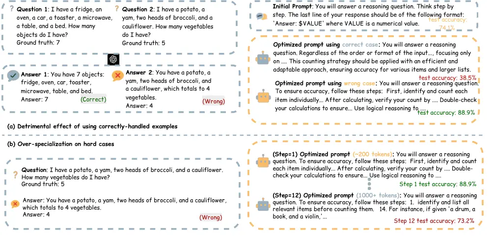
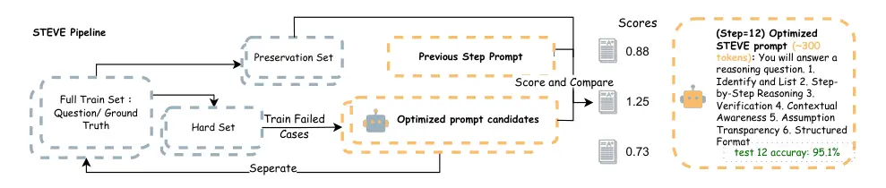

# STEVE: Stabilizing Textual Gradient-Based Prompt Optimization via Error-Driven Refinement and Regularized Verification

Yifan Xu ^(†)^(†)thanks: Corresponding author:
[yx52@illinois.edu](mailto:yx52@illinois.edu) Affiliation: University of
Illinois Urbana-Champaign    Yixuan Li Affiliation: University of
Illinois Urbana-Champaign    Xinzhuo Li Affiliation: University of
Illinois Urbana-Champaign    Yixin Gu Affiliation: University of
Illinois Urbana-Champaign    Yifan Shen Affiliation: University of
Illinois Urbana-Champaign    Lijun Yu Affiliation: Google DeepMind   
Haohan Wang Affiliation: University of Illinois Urbana-Champaign

###### Abstract

Textual-gradient methods automate prompt optimization through
natural-language feedback, but their iterative updates can be unstable.
We identify two sources of this instability: noisy gradients produced
from already-correct examples and over-specialization to hard cases that
degrades performance on simpler inputs. We introduce STEVE, a
stabilization framework with two coupled mechanisms. Error-Driven
Refinement generates gradients only from incorrectly handled examples,
concentrating updates on informative failures. Regularized Verification
treats every update as provisional and accepts it only when improvement
on hard cases does not cause unacceptable regression on a preservation
set. Across ten reasoning benchmarks, three evaluator/optimizer models,
and established prompt-optimization baselines, STEVE reduces degradation
and produces more robust prompts. Additional evaluations with
gpt-5.4-mini/gpt-5.4 on symbolic reasoning, GSM8K-Platinum, and DS-1000
show that these gains persist with newer models and larger test sets.
STEVE therefore provides a practical way to improve the stability and
effectiveness of textual-gradient prompt optimization.

## 1 Introduction



Figure 1: (a) Feedback from correct versus failed cases. Using a prompt
with 74.1% baseline accuracy, the executor answers Question 1 correctly
but fails on Question 2. Updating from the failed case improves test
accuracy to 88.9%, whereas updating from the correct case lowers it to
38.5%. (b) Over-specialization. Repeated refinement without verification
initially raises accuracy to 88.9% but eventually produces a 1000+-token
prompt whose accuracy falls to 73.2% after 12 steps.

Large Language Models (LLMs) have demonstrated remarkable capabilities
across a wide range of applications, from complex reasoning (Zhang
et al., 2025a; Yao et al., 2023; Kojima et al., 2022) to acting as the
backbone for autonomous agents (Wang et al., 2024; Schick et al., 2023;
Park et al., 2023), including agents that interact with graphical
interfaces (Liu et al., 2026). However, their performance is sensitive
to the input prompt. More broadly, the composition of contextual
information can systematically alter LLM behavior, underscoring the need
to optimize and control prompts carefully (Wang et al., 2025). Manually
engineering prompts to elicit optimal performance is a tedious process
that is often unpredictable and difficult to scale. While automated
prompt optimization (APO) methods (Zhang et al., 2024; Jain and Jindal, 2025) offer a promising alternative, they face challenges due to the
stochasticity of the model’s outputs. First, the optimization is
undermined by the inherent non-determinism of LLM inference. Even with
deterministic decoding (zero temperature), low-level computational
variations in floating-point arithmetic and parallelization introduce
stochasticity to the model’s outputs (Whitehead and Fit-Florea, 2017).
This variance creates a noisy evaluation landscape, making it difficult
to reliably determine if a prompt update is genuinely effective. Second,
this issue is amplified in methods that use a chain of LLM calls for
feedback and updates, such as textual gradients (Yuksekgonul et al.,
2025). A minor variance in the initial output can be magnified as it
passes through the evaluator and optimizer LLMs, a form of cascading
variance (Dohan et al., 2022).

Early approaches explored the vast prompt space using search algorithms,
including Monte Carlo Tree Search (e.g., PromptAgent (Wang et al.,
2023)), genetic algorithms (e.g., GPS (Xu et al., 2022), EvoPrompt (Guo
et al., 2024)), and discrete editing methods (e.g., GRIPS (Prasad
et al., 2022), COPLE (Zhan et al., 2024)). While innovative, these
methods often struggle with the semantic complexity of language and can
be sample-inefficient. More recently, iterative refinement using textual
gradients has emerged as the state-of-the-art (Zhang et al., 2025b;
Pryzant et al., 2023; Yuksekgonul et al., 2025; Yu et al., 2025). Unlike
earlier search-based methods, textual-gradient approaches optimize
prompts through interpretable natural-language critiques and revisions,
allowing updates to follow semantic error signals rather than
surface-level token edits. This improves optimization efficiency and
robustness, especially on complex tasks, and has established
textual-gradient-based refinement as the dominant paradigm in modern
prompt optimization.

However, in this work, we identify and analyze two fundamental sources
of instability inherent in this paradigm. First, we find that the
quality of the textual gradient is highly dependent on the correctness
of the initial output. As shown in Figure 1 (a), generating feedback
from examples that the model already handles correctly produces a
low-signal and high-noise gradient, often leading to destructive edits.
While this observation suggests that the solution is to optimize
exclusively on the high-signal feedback from failed cases, we find it is
not this straightforward, because repeated refinement on these hard
examples leads to over-specialization, sacrificing the prompt’s general
applicability on simpler tasks.

Second, we find that optimizing exclusively on difficult cases is
surprisingly unstable. While initial gradients are corrective,
performance degrades sharply after just a few iterations, as shown in
Figure 1 (b). This occurs because the optimizer attempts to solve hard
examples by adding more specific constraints and multi-step procedures
into the prompt. For instance, to solve a complex object-counting
problem, the prompt might be amended with explicit rules like, "First,
list every potential object. Second, categorize each object. Third,
create a final count based only on valid categories." While this rigid
algorithm is effective for the targeted hard case, it becomes overly
redundant for a simple case like "count the number of apples." For
simpler inputs, the verbose and complex instructions can confuse the
executor model or lead to inefficient reasoning paths, thereby degrading
its performance. Consequently, this leads to over-specialization and
loss of generality.

To address these two instabilities, we propose STEVE: Stabilizing
Textual Gradients via Error-Driven Refinement and Regularized
Verification. Our framework, as shown in Figure 2, introduces two core
mechanisms. First, our Error-Driven Refinement strategy ensures a
high-quality learning signal by exclusively generating textual gradients
from model failures, filtering out the noise from correct examples.
Second, to counter over-specialization, our Regularized Verification
mechanism acts as a gate. It validates each candidate prompt against a
holdout set of general examples, accepting an update only if the gain on
the complex case does not compromise overall robustness. Together, these
components create a stable optimization loop that effectively balances
specialization and generalization.

Our contributions are threefold:

- •
  We are the first to systematically identify and analyze two primary
  sources of instability in iterative prompt optimization: the
  generation of noisy, destructive gradients from correctly-handled
  examples, and the rapid overfitting that occurs when optimizing
  exclusively on model failures.
- •
  We propose STEVE, a simple yet effective framework that directly
  counteracts these instabilities in iterative prompt optimization,
  comprising two core mechanisms. Error-Driven Refinement ensures a
  high-quality learning signal by generating gradients only from model
  failures, while Regularized Verification acts as a novel gating
  mechanism that accepts a prompt update only if it preserves
  performance on a general holdout set.
- •
  We demonstrate through extensive experiments on complex reasoning
  benchmarks that our framework leads to a more stable and effective
  optimization process. STEVE consistently discovers robust and concise
  prompts that achieve state-of-the-art performance.



Figure 2: STEVE’s Error-Driven Refinement mechanism updates a prompt
from failure cases, while Regularized Verification scores multiple
candidates against both the hard batch and a preservation sample. The
gate selects the best non-regressing candidate, yielding a concise
($`\sim`$300-token) prompt with 95.1% accuracy in this example.

## 2 Method

TextGrad (Yuksekgonul et al., 2025) is a prominent iterative method that
leverages textual gradients for prompt optimization. While we use
TextGrad as our foundational optimizer (under the MIT License), the
framework we introduce is data-driven and largely agnostic to the
specific gradient generator, making it applicable to other iterative
textual-gradient methods (Pryzant et al., 2023; Yang et al., 2023; Zhang
et al., 2025b). ProTeGi and TextGrad improve how critiques are generated
and propagated, while REVOLVE enriches the update signal with response
history. STEVE instead controls _which examples produce gradients_ and
_which candidate updates are accepted_. Neither error-only gradient
generation nor the preservation-set acceptance gate is present in those
methods; our ablations in Table 3 show that both controls are necessary.
The central contribution of our work is a novel framework designed to
stabilize this optimization process by directly addressing two critical
failure modes we identified: the generation of noisy, often destructive
gradients from correctly handled examples, and over-specialization on
hard cases. In this section, we will detail the two core components of
our solution: Error-Driven Refinement and Regularized Verification.

### 2.1 Preliminaries: Iterative Optimization with Textual Gradients

The goal of prompt optimization is to find an optimal instruction, or
prompt $`p^{*}`$, that maximizes the performance of an LLM $`M`$ across
a given task distribution $`\mathcal{D}`$, as expressed in (1)

```math
p^{*}=\arg\max_{p\in p_{\text{space}}}\mathbb{E}_{(x,y)\sim\mathcal{D}}[\mathcal{S}(M(p,x),y)] \tag{1}
```

where $`x`$ is a question, $`y`$ is the ground-truth answer, and
$`\mathcal{S}`$ is a task-specific evaluation metric.

To navigate this challenge, recent works Zhang et al. (2025b); Pryzant
et al. (2023); Cui et al. (2024) have proposed using an iterative
refinement process guided by textual gradients. This approach typically
employs a multi-agent framework. At each iteration $`t`$, the process
unfolds as follows:

1.  (a)
    Forward Pass Generation: An executor LLM uses the current prompt,
    $`p_{t}`$, to process an input, $`x`$, and generate an output,
    $`y=M_{executor}(p_{t},x)`$.
2.  (b)
    Feedback (Gradient Calculation): A powerful evaluator LLM evaluates
    the output $`y^{\prime}`$ and calculate the loss from $`y`$ and
    ground truth $`y_{truth}`$. The evaluator generates a “textual
    gradient," $`g_{\text{text}}`$. This gradient is a natural language
    critique that explains the failure and provides actionable advice
    for improving the prompt,
    $`g_{next}=M_{evaluator}(p_{t},x\mid y,y_{truth})`$
3.  (c)
    Update: An optimizer LLM, conditioned on the original prompt
    $`p_{t}`$ and the textual gradient $`g_{\text{text}}`$, synthesizes
    an improved prompt, $`p_{t+1}`$. This update step can be represented
    as: $`p_{t+1}=M_{optimizer}(p_{t},g_{\text{text}})`$.

This iterative loop allows for semantic and non-differentiable
improvements to the prompt. While this powerful paradigm forms the
backbone of our method, we show that this standard approach suffers from
significant instability, which often prevents it from converging to a
robust and high-performing solution. The following sections will analyze
and address these instabilities.

### 2.2 The Instability of Textual Gradient Optimization

While the iterative process described in Section 2.1 provides a powerful
framework, its practical application is hindered by gradient
instability. Based on our experiment, we characterize two primary
sources of this instability, which motivate our proposed control
mechanisms.

#### Noisy Gradients from Correct Examples.

Our initial investigation reveals a stark contrast in the utility of
feedback based on the correctness of an output. As illustrated in Figure
3, a single round of optimization using feedback from previously failed
cases yields a significant performance improvement. Conversely, using
feedback from correctly-handled cases results in a sharp drop in
accuracy. This observation leads us to hypothesize that textual
gradients generated from correct examples are noisy and often
counter-productive. We validate this hypothesis in our ablation study
(Table 3), where a model trained exclusively on correct examples not
only fails to improve but even sees its performance degrade below the
initial baseline. This suggests that the evaluator LLM struggles to
extract a meaningful, generalizable improvement signal from successful
outputs, instead producing feedback with noisy gradients that acts as a
random perturbation.

Figure 3: A comparison of single-step prompt refinement on three
reasoning benchmarks Object Counting, Navigate and GSM8k (Suzgun et al.,
2022; Cobbe et al., 2021) . The bars show the final average accuracy of
a prompt optimized for one round using feedback from either a batch of
previously correct examples or a batch of previously incorrect examples.
Across all datasets, optimizing on incorrect cases consistently yields a
prompt with significantly higher accuracy, demonstrating that failures
provide a superior learning signal.

#### Over-Specialization on Hard Cases.

Simply optimizing on failed cases, however, is not a complete solution.
We observe that sustained, multi-round optimization exclusively on hard
examples is also unstable, with performance degrading after an initial
phase of improvement. This decay is a symptom of overfitting in the
prompt space. As we show with a qualitative example in the Appendix F,
the prompt becomes progressively more verbose and convoluted over
iterations, accumulating an excessive number of specific constraints and
detailed steps. While these highly specific instructions may resolve the
targeted hard cases, they make the prompt brittle and less effective for
simpler, more general problems. The added complexity is detrimental to
its overall generalization, motivating a mechanism to explicitly control
this trade-off.

### 2.3 Component 1: Error-Driven Refinement for High-Quality Gradients

To address the instability caused by noisy gradients, we introduce our
first mechanism: Error-Driven Refinement. Motivated by the idea of
Prioritized Experience Replay(Schaul et al., 2015; Ma et al., 2022) in
the field of Reinforcement Learning, the model can focus more on
transitions where its value prediction was wrong, effectively balancing
the training process by focusing on hard or more informative samples.
This principle that focuses on hard examples is critical for effective
learning and is well-established in the machine learning literature.
Seminal examples include boosting algorithms like AdaBoost(Freund and
Schapire, 1997), which iteratively re-weights misclassified data points,
and online hard example mining (OHEM)(Shrivastava et al., 2016) in
object detection, which explicitly trains on the most challenging
examples. The core principle of this strategy is to ensure a high
signal-to-noise ratio in the learning process by exclusively generating
textual gradients from examples that the executor model fails to handle
correctly.

We formalize this by partitioning the training set,
$`\mathcal{D}_{\text{train}}`$, based on the performance of the current
prompt, $`p_{t}`$. Specifically, we define a “hard case pool,"
$`\mathcal{D}_{\text{hard}}`$, as the subset of training examples where
the executor model’s output is deemed incorrect by the scoring function:

```math
\mathcal{D}_{\text{hard}}(p_{t})=\{(x,y)\in\mathcal{D}_{\text{train}}\mid\mathcal{S}(M_{\text{executor}}(p_{t},x),y)<\tau\} \tag{2}
```

where $`\tau`$ is a predefined success threshold (typically 1 for exact
match tasks).

At each optimization iteration $`t`$, instead of sampling from the
entire training distribution, our method samples an instance
$`(x_{i},y_{i})`$ exclusively from this dynamically defined hard case
pool, $`\mathcal{D}_{\text{hard}}(p_{t})`$. A textual gradient,
$`g_{\text{text}}`$, is then generated based on the model’s failure on
this specific instance.

By design, this error-driven strategy acts as a powerful information
filter. It guarantees that every textual gradient used for an update is
a high-signal, corrective piece of feedback derived from a clear
failure. This eliminates the random walk behavior caused by the
low-signal, high-noise gradients generated from correct examples,
thereby solving the first source of instability and providing a solid
foundation for targeted prompt improvement.


### 2.4 Component 2: Regularized Verification for Preserving Generalization

While Error-Driven Refinement ensures that each textual gradient is
informative, it does not prevent the optimization from
over-specializing. To address this second instability, we introduce our
second component: a Regularized Verification mechanism. This mechanism
functions as a gate, evaluating each proposed prompt update to ensure
that improvements in specialization do not come at an unacceptable cost
to generalization.

Regularization is widely used to trade off task fit against robustness
and generalization, including beyond continual learning in settings such
as robust dataset distillation (Xue et al., 2025). Our approach is more
directly inspired by regularization-based methods in continual learning
designed to combat catastrophic forgetting, most notably Elastic Weight
Consolidation (EWC) (Kirkpatrick et al., 2017). EWC adds a quadratic
penalty to the loss function to discourage modifications to network
weights that are critical for performance on previously learned tasks.
Analogously, our Regularized Verification mechanism treats the
performance degradation on the Generalization Preservation Set as a
direct penalty against forgetting. However, unlike the continuous,
differentiable parameter space of neural networks where penalties can be
directly integrated into a loss function, the prompt space is discrete
and symbolic. Therefore, instead of modifying a loss function, we
implement this regularization principle as a discrete verification step
where candidate prompts are explicitly evaluated for their trade-off
between specialization and generalization.

Central to this process is a fixed Generalization Preservation Pool,
$`\mathcal{D}_{\text{preserve}}`$, constructed once from training
examples that the initial prompt $`p_{0}`$ handles correctly. At
iteration $`t`$, we draw a fresh sample
$`\mathcal{D}^{(t)}_{\text{sample}}`$ of $`k=20`$ examples without
replacement from this pool and reuse it to score all candidates
generated at that iteration. Thus the eligible pool remains fixed, while
the verification sample is resampled at every step.

```math
\mathcal{D}_{\text{preserve}}\subset\{(x,y)\in\mathcal{D}_{\text{train}}\mid\mathcal{S}(M_{\text{executor}}(p_{0},x),y)\geq\tau\} \tag{3}
```

The verification process is integrated into a multi-stage refinement
loop. First, a batch of hard cases
$`\{d_{h}\}_{1}^{b}\subset\mathcal{D}_{\text{hard}}`$ is sampled. An
evaluator model synthesizes a textual gradient, $`g_{\text{batch}}`$,
that summarizes the common failure modes across this batch. Using this
gradient, an updater model generates a set of $`n`$ diverse candidate
prompts, $`\{p_{\text{cand},i}\}_{1}^{n}`$. The best candidate is then
chosen based on our regularized objective. The formal update rule is:

```math
\displaystyle p_{t+1}=\begin{cases}p_{\text{best\_cand}}&\text{if }\begin{array}[]{@{}l@{}}\text{I}(p_{\text{cand}},d_{\text{hard}})>\\
\quad\lambda_{t}\cdot\text{R}(p_{\text{cand}},\mathcal{D}^{(t)}_{\text{sample}})\end{array}\\
p_{t}&\text{otherwise}\end{cases} \tag{4}
```

where I represents Improvement, R represents Regression, and
$`\lambda_{t}\geq 0`$ controls the specialization–generalization
trade-off. We use the linear schedule $`\lambda_{t}=1.5+0.1t`$, which
makes the acceptance gate progressively more conservative; Appendix B.5
reports sensitivity to both its initial value and increment. By
including $`p_{t}`$ among the choices, an update occurs only when a
candidate improves the regularized objective. After optimization, we
select the checkpoint on a held-out validation set that is disjoint from
the training, preservation, and test examples; the test set is evaluated
only once for the reported result. The full process is detailed in
Algorithm 1.

## 3 Experiment

We evaluate whether STEVE outperforms established prompt-optimization
methods across diverse reasoning tasks, isolate the contribution of each
component, and study sensitivity to the evaluator/optimizer and
regularization schedule. Additional results and implementation details
appear in the Appendix. We will release the source code and evaluation
data with the paper.

|             |                                           |                           |           |            |                                |                         |                         |
| ----------- | ----------------------------------------- | ------------------------- | --------- | ---------- | ------------------------------ | ----------------------- | ----------------------- |
|             |                                           |                           | Baselines |            | Iterative Optimization Methods |                         |                         |
| Category    | Task                                      | Evaluator/Optimizer Model | Zero-shot | Three-shot | TextGrad                       | REVOLVE                 | STEVE (Ours)            |
| Math        | GSM8k (Cobbe et al., 2021)                | gpt-4o                    | 76.3      | 73.1       | 82.5 $`\uparrow`$+6.2          | 82.8 $`\uparrow`$+6.5   | 86.2 $`\uparrow`$+9.9   |
|             |                                           | gemini-2.5-flash          | 73.8      | 74.2       | 81.1 $`\uparrow`$+7.3          | 83.9 $`\uparrow`$+10.1  | 82.9 $`\uparrow`$+9.1   |
|             |                                           | gpt-5                     | 73.2      | 77.5       | 78.6 $`\uparrow`$+5.4          | 81.7 $`\uparrow`$+8.5   | 84.3 $`\uparrow`$+11.1  |
|             | MultiArith (Roy and Roth, 2016)           | gpt-4o                    | 84.5      | 84.1       | 88.6 $`\uparrow`$+4.1          | 98.2 $`\uparrow`$+13.7  | 98.9 $`\uparrow`$+14.4  |
|             |                                           | gemini-2.5-flash          | 82.9      | 84.3       | 98.1 $`\uparrow`$+15.2         | 98.4 $`\uparrow`$+15.5  | 98.7 $`\uparrow`$+15.8  |
|             |                                           | gpt-5                     | 84.0      | 84.6       | 100.0 $`\uparrow`$+16.0        | 100.0 $`\uparrow`$+16.0 | 100.0 $`\uparrow`$+16.0 |
| Commonsense | StrategyQA (Geva et al., 2021)            | gpt-4o                    | 88.7      | 91.3       | 90.1 $`\uparrow`$+1.4          | 90.5 $`\uparrow`$+1.8   | 93.2 $`\uparrow`$+4.5   |
|             |                                           | gemini-2.5-flash          | 85.1      | 90.6       | 88.8 $`\uparrow`$+3.7          | 89.4 $`\uparrow`$+4.3   | 91.9 $`\uparrow`$+6.8   |
|             |                                           | gpt-5                     | 88.2      | 94.5       | 91.7 $`\uparrow`$+3.5          | 93.3 $`\uparrow`$+5.1   | 95.8 $`\uparrow`$+7.6   |
|             | Navigate (Suzgun et al., 2022)            | gpt-4o                    | 60.1      | 77.8       | 88.2 $`\uparrow`$+28.1         | 94.1 $`\uparrow`$+34.0  | 95.6 $`\uparrow`$+35.5  |
|             |                                           | gemini-2.5-flash          | 68.7      | 83.6       | 66.9 $`\downarrow`$-1.8        | 90.4 $`\uparrow`$+21.7  | 96.2 $`\uparrow`$+27.5  |
|             |                                           | gpt-5                     | 62.7      | 83.1       | 78.6 $`\uparrow`$+15.9         | 86.1 $`\uparrow`$+23.4  | 83.9 $`\uparrow`$+21.2  |
| Symbolic    | Object Counting (Suzgun et al., 2022)     | gpt-4o                    | 77.9      | 82.2       | 87.1 $`\uparrow`$+9.2          | 90.3 $`\uparrow`$+12.4  | 95.7 $`\uparrow`$+17.8  |
|             |                                           | gemini-2.5-flash          | 75.4      | 81.8       | 72.5 $`\downarrow`$-2.9        | 81.1 $`\uparrow`$+5.7   | 83.6 $`\uparrow`$+8.2   |
|             |                                           | gpt-5                     | 79.0      | 87.5       | 80.6 $`\uparrow`$+1.6          | 82.4 $`\uparrow`$+3.4   | 91.2 $`\uparrow`$+12.2  |
|             | Penguins in a Table (Suzgun et al., 2022) | gpt-4o                    | 80.8      | 83.3       | 93.1 $`\uparrow`$+12.3         | 96.0 $`\uparrow`$+15.2  | 96.5 $`\uparrow`$+15.7  |
|             |                                           | gemini-2.5-flash          | 66.2      | 90.7       | 90.9 $`\uparrow`$+24.7         | 90.2 $`\uparrow`$+24.0  | 96.4 $`\uparrow`$+30.2  |
|             |                                           | gpt-5                     | 63.5      | 90.1       | 93.6 $`\uparrow`$+30.1         | 86.8 $`\uparrow`$+23.3  | 96.7 $`\uparrow`$+33.2  |
|             | Geometric Shapes (Suzgun et al., 2022)    | gpt-4o                    | 39.4      | 31.8       | 36.7 $`\downarrow`$-2.7        | 55.2 $`\uparrow`$+15.8  | 62.9 $`\uparrow`$+23.5  |
|             |                                           | gemini-2.5-flash          | 36.6      | 36.1       | 48.3 $`\uparrow`$+11.7         | 65.5 $`\uparrow`$+28.9  | 66.0 $`\uparrow`$+29.4  |
|             |                                           | gpt-5                     | 41.1      | 32.7       | 33.9 $`\downarrow`$-7.2        | 42.4 $`\uparrow`$+1.3   | 44.2 $`\uparrow`$+3.1   |
|             | Date Understanding (Suzgun et al., 2022)  | gpt-4o                    | 67.3      | 73.9       | 75.1 $`\uparrow`$+7.8          | 76.2 $`\uparrow`$+8.9   | 76.6 $`\uparrow`$+9.3   |
|             |                                           | gemini-2.5-flash          | 70.8      | 68.2       | 74.4 $`\uparrow`$+3.6          | 74.9 $`\uparrow`$+4.1   | 80.5 $`\uparrow`$+9.7   |
|             |                                           | gpt-5                     | 70.1      | 72.7       | 74.3 $`\uparrow`$+4.2          | 77.8 $`\uparrow`$+7.7   | 84.0 $`\uparrow`$+13.9  |
| Expert      | College Physics (Hendrycks et al., 2020)  | gpt-4o                    | 57.6      | 52.1       | 61.4 $`\uparrow`$+3.8          | 66.9 $`\uparrow`$+9.3   | 71.2 $`\uparrow`$+13.6  |
|             |                                           | gemini-2.5-flash          | 61.0      | 52.8       | 57.3 $`\downarrow`$-3.7        | 61.5 $`\uparrow`$+0.5   | 66.7 $`\uparrow`$+5.7   |
|             |                                           | gpt-5                     | 52.3      | 57.9       | 57.5 $`\uparrow`$+5.2          | 61.8 $`\uparrow`$+9.5   | 66.1 $`\uparrow`$+13.8  |
|             | Machine Learning (Hendrycks et al., 2020) | gpt-4o                    | 34.2      | 39.8       | 60.1 $`\uparrow`$+25.9         | 60.3 $`\uparrow`$+26.2  | 60.7 $`\uparrow`$+26.5  |
|             |                                           | gemini-2.5-flash          | 43.5      | 34.6       | 52.9 $`\uparrow`$+9.4          | 60.4 $`\uparrow`$+16.9  | 56.2 $`\uparrow`$+12.7  |
|             |                                           | gpt-5                     | 47.7      | 39.1       | 56.6 $`\uparrow`$+8.9          | 43.3 $`\downarrow`$-4.4 | 60.9 $`\uparrow`$+13.2  |

Table 1: Main results on Mathematical, Commonsense, Symbolic/Procedural,
and Expert-Level Knowledge Reasoning benchmarks, broken down by
evaluator/optimizer model. The executor is gpt-3.5-turbo-0125 in every
row. All iterative methods are optimized for 12 steps. We report
accuracy with the absolute change ($`\uparrow\downarrow`$) from
Zero-shot CoT. Bold and underlining denote the best and second-best
result in each row.

### 3.1 Datasets and Tasks

To ensure a thorough assessment of our method’s generalization
capabilities, we evaluate it on 10 challenging benchmarks spanning four
distinct reasoning domains. For mathematical reasoning, we use GSM8k
(Cobbe et al., 2021) and MultiArith (Roy and Roth, 2016), which test
multi-step numerical problem-solving. For complex commonsense reasoning,
we assess multi-hop logical deduction using StrategyQA (Geva et al., 2021) and the Navigate task from Big-Bench Hard (BBH) (Suzgun et al.,
2022). To evaluate precise procedural execution in symbolic and
procedural reasoning, we use four tasks from BBH: Object Counting,
Penguins in a Table, Geometric Shapes, and Date Understanding. Finally,
to assess expert-level knowledge reasoning on domain-specific topics, we
use the College Physics and Machine Learning subsets from the Massive
Multitask Language Understanding (MMLU) benchmark (Hendrycks et al.,
2020).

### 3.2 Experimental Setup

#### Baselines.

Our original evaluation compares STEVE with four baselines. Zero-shot
CoT (Kojima et al., 2022) supplies the initial prompt $`P_{0}`$ for
every iterative method, while Three-shot CoT (Wei et al., 2022) is a
manually constructed few-shot baseline. TextGrad (Yuksekgonul et al., 2025) uses natural-language feedback as a gradient to refine prompts,
and REVOLVE (Zhang et al., 2025b) conditions updates on the historical
evolution of responses. Our modernized evaluation additionally includes
ProTeGi (Pryzant et al., 2023), which combines textual gradients with
beam search and bandit selection. Appendix C reports a non-gradient
comparison with EvoPrompt.

#### Implementation Details.

For the original 10-benchmark evaluation in Table 1, gpt-3.5-turbo-0125
is the _sole executor_; gpt-4o, gemini-2.5-flash, and gpt-5 serve only
as the evaluator/optimizer alternatives shown in the table. All
iterative methods run for $`T=12`$ steps with hard-case batch size
$`b=4`$, preservation sample size $`k=20`$, and three candidates per
step. We use temperature 0.0 and report mean accuracy over three
independent runs. Checkpoints are selected using held-out validation
data; test examples are not used for prompt selection. Appendix E gives
further details.

### 3.3 Results

We present our primary findings in Table 1, which compares the final
accuracy of STEVE against all baselines across our 10 benchmark datasets
and three evaluator/optimizer models. The results demonstrate that STEVE
outperforms both static baselines (Zero-shot and Three-shot CoT) and
state-of-the-art iterative optimization methods. Averaged across all 30
settings, STEVE achieves an absolute improvement of over 15% compared to
the initial Zero-shot CoT prompt and outperforms the strongest iterative
baseline, REVOLVE, by an average of 3.5%.

STEVE shows particularly strong performance on tasks requiring complex
procedural or symbolic reasoning. For instance, on Navigate and Penguins
in a Table with the gemini-2.5-flash evaluator/optimizer, STEVE achieves
gains of over 27% and 30%, respectively. We hypothesize that these tasks
involve discovering non-obvious, robust strategies that are easily
missed by unstable optimizers. STEVE’s verification mechanism allows it
to safely explore and lock in complex heuristics that generalize well,
whereas other methods may discard them or overfit to a brittle solution.
This finding further demonstrates the robustness and effectiveness of
our STEVE method.

While broadly successful, the margin of improvement varies. On tasks
such as MultiArith, where the initial prompt is already quite effective,
the gains are more modest as there is less room for optimization.

#### Modernized models, benchmarks, and baselines.

To test whether the gains persist beyond the smaller executor and
benchmark subsets used above, we reran the comparison with gpt-5.4-mini
as executor and gpt-5.4 as evaluator/optimizer. Table 2 adds ProTeGi and
covers two tasks from BIG-Bench Extra Hard (BBEH) (Kazemi et al., 2025),
the full 1,009-example GSM8K-Platinum evaluation (Vendrow et al., 2025),
and 800 DS-1000 code-generation problems (Lai et al., 2023). STEVE
performs best on all four tasks. Its largest margins over TextGrad are
on the harder symbolic tasks: +8.0 points on Object Counting and +10.0
on Geometric Shapes. Gains are smaller on the nearly saturated
GSM8K-Platinum benchmark (+0.1) and DS-1000 (+0.5).

|          |                       |              |           |           |            |         |          |       |
| -------- | --------------------- | ------------ | --------- | --------- | ---------- | ------- | -------- | ----- |
| Category | Task                  | Executor     | Optimizer | Zero-shot | Three-shot | ProTeGi | TextGrad | STEVE |
| Symbolic | BBEH Object Counting  | gpt-5.4-mini | gpt-5.4   | 18.0      | 14.0       | 20.0    | 44.0     | 52.0  |
| Symbolic | BBEH Geometric Shapes | gpt-5.4-mini | gpt-5.4   | 24.0      | 14.0       | 32.0    | 34.0     | 44.0  |
| Math     | GSM8K-Platinum        | gpt-5.4-mini | gpt-5.4   | 98.0      | 98.1       | 98.2    | 98.2     | 98.3  |
| Code     | DS-1000               | gpt-5.4-mini | gpt-5.4   | 27.5      | 27.5       | 32.1    | 32.0     | 32.5  |

Table 2: Accuracy (%) in the modernized evaluation. All methods use the
same executor/evaluator configuration. GSM8K-Platinum and DS-1000
results use 1,009 and 800 test examples, respectively.

### 3.4 Ablation Studies

To isolate and validate the contributions of our framework’s core
components, we conduct a series of ablation studies on a representative
subset of datasets: GSM8k, StrategyQA, and Object Counting. The results,
summarized in Table 3, confirm our design choices.

|                          |       |            |                 |
| ------------------------ | ----- | ---------- | --------------- |
| Model Variant            | GSM8k | StrategyQA | Object Counting |
| Initial CoT Prompt       | 76.3  | 88.7       | 77.9            |
| Regularized Verification |       |            |                 |
|    w/o Verification      | 84.1  | 91.5       | 92.2            |
| Error-Driven Refinement  |       |            |                 |
|    w/ Full Dataset       | 82.5  | 90.1       | 87.1            |
|    w/ Correct-Only       | 76.5  | 86.8       | 76.1            |
| STEVE (Ours)             | 86.2  | 93.2       | 95.7            |

Table 3: Ablation studies on the core components of STEVE. We report
performance on a representative subset of datasets. The results
demonstrate the importance of both the regularized verification gate and
the error-driven learning signal. The best performance for each dataset
is highlighted in bold.

#### Contribution of Regularized Verification.

First, to demonstrate the necessity of our verification gate, we
evaluate STEVE w/o Verification. In this variant, we remove the
Verification module, meaning the candidate prompts are trained by the
hard-case batch without a regression check. This variant underperforms
the full STEVE model, confirming that without explicit regularization to
safeguard general capabilities, the prompt quickly overfits to the hard
cases it is trained on.

#### Analysis of the Error-Driven Signal.

Second, we validate our core hypothesis that the learning signal must be
error-driven. We test two variants: (1) STEVE w/ Full Dataset, which
trains on the complete, unfiltered training set containing both correct
and incorrect examples, and (2) STEVE w/ Correct-Only, a control
experiment that trains exclusively on examples the model already handles
correctly. The first variant suffers from the noisy gradients of correct
examples and performs poorly. The second variant consistently degrades
the prompt’s performance, often below the initial baseline. These
results provide strong evidence that a high-quality, corrective signal
derived exclusively from errors is essential for stable and effective
optimization.

## 4 Conclusion

In this work, we address the critical instability of textual
gradient-based prompt optimization by reframing it as a dual-selection
problem. To solve the failure modes of noisy feedback and
over-specialization, we introduced STEVE, a framework that carefully
picks its updates at two key stages. First, our Error-Driven Refinement
mechanism ensures a high-quality learning signal by selectively score
feedback generated exclusively from previously failed cases, filtering
out the noise from correct examples. Second, our Regularized
Verification step addresses overfitting by selecting the best candidate
prompt. Our experiments demonstrated that this principled approach of
carefully picking both the learning signal and the final update allows
STEVE to consistently discover more robust and effective prompts than
standard methods.

## Limitations

Our approach is inherently model-dependent, as it uses a loop where an
evaluator produces a textual gradient and an optimizer converts that
feedback into prompt updates. As a result, the optimization quality and
stability can vary with the choice of model families and their specific
API versions used in the experiments. Small changes in such proprietary
models may lead to different updated prompts, limiting portability and
making outcomes sensitive to implementation details. Moreover, the
method incurs substantial computational cost. To improve stability, it
generates multiple diverse candidates per iteration and performs a
regularized verification by evaluating each candidate on a preservation
set, introducing an overhead of additional executor calls per iteration
compared to baseline approaches.

## Ethical Considerations

This work evaluates prompt optimization on publicly available reasoning
and code-generation benchmarks and does not collect personal data or
involve human subjects. Nevertheless, STEVE relies on both proprietary
and open-source large language models, and optimized prompts and model
outputs may inherit biases, factual errors, or unsafe behaviors from the
underlying models. Performance on the benchmarks studied here should
therefore not be interpreted as a guarantee of reliability in
high-stakes or safety-critical settings. The iterative optimization
procedure also requires repeated model calls for candidate generation
and verification, resulting in additional financial and environmental
costs; we report model versions, token usage, API-call counts, and
estimated cost where available to improve transparency. Practitioners
should follow applicable model licenses and terms of use, evaluate
optimized prompts on representative preservation sets, and retain
appropriate human oversight before deployment.

## References

- Cobbe et al. (2021) Karl Cobbe, Vineet Kosaraju, Mohammad Bavarian,
  Mark Chen, Heewoo Jun, Lukasz Kaiser, Matthias Plappert, Jerry Tworek,
  Jacob Hilton, Reiichiro Nakano, et al. 2021. Training verifiers to
  solve math word problems. _arXiv preprint arXiv:2110.14168_.
- Cui et al. (2024) Anthony Cui, Pranav Nandyalam, Andrew Rufail, Ethan
  Cheung, Aiden Lei, Kevin Zhu, and Sean O’Brien. 2024. Introducing
  mapo: Momentum-aided gradient descent prompt optimization. _arXiv
  preprint arXiv:2410.19499_.
- Deng et al. (2022) Mingkai Deng, Jianyu Wang, Cheng-Ping Hsieh, Yihan
  Wang, Han Guo, Tianmin Shu, Meng Song, Eric P Xing, and Zhiting
  Hu. 2022. Rlprompt: Optimizing discrete text prompts with
  reinforcement learning. _arXiv preprint arXiv:2205.12548_.
- Do et al. (2024) Xuan Long Do, Yiran Zhao, Hannah Brown, Yuxi Xie,
  James Xu Zhao, Nancy Chen, Kenji Kawaguchi, Michael Shieh, and Junxian
  He. 2024. Prompt optimization via adversarial in-context learning. In
  _Proceedings of the 62nd Annual Meeting of the Association for
  Computational Linguistics (Volume 1: Long Papers)_, pages 7308–7327.
- Dohan et al. (2022) David Dohan, Winnie Xu, Aitor Lewkowycz, Jacob
  Austin, David Bieber, Raphael Gontijo Lopes, Yuhuai Wu, Henryk
  Michalewski, Rif A Saurous, Jascha Sohl-Dickstein, et al. 2022.
  Language model cascades. _arXiv preprint arXiv:2207.10342_.
- Freund and Schapire (1997) Yoav Freund and Robert E Schapire. 1997. A
  decision-theoretic generalization of on-line learning and an
  application to boosting. _Journal of computer and system sciences_,
  55(1):119–139.
- Geva et al. (2021) Mor Geva, Daniel Khashabi, Elad Segal, Tushar Khot,
  Dan Roth, and Jonathan Berant. 2021. Did aristotle use a laptop? a
  question answering benchmark with implicit reasoning strategies.
  _Transactions of the Association for Computational Linguistics_,
  9:346–361.
- Guo et al. (2024) Qingyan Guo, Rui Wang, Junliang Guo, Bei Li, Kaitao
  Song, Xu Tan, Guoqing Liu, Jiang Bian, and Yujiu Yang. 2024.
  [Connecting large language models with evolutionary algorithms yields
  powerful prompt
  optimizers](https://openreview.net/forum?id=ZG3RaNIsO8). In _The
  Twelfth International Conference on Learning Representations_.
- Hendrycks et al. (2020) Dan Hendrycks, Collin Burns, Steven Basart,
  Andy Zou, Mantas Mazeika, Dawn Song, and Jacob Steinhardt. 2020.
  Measuring massive multitask language understanding. _arXiv preprint
  arXiv:2009.03300_.
- Hu et al. (2022) Edward J Hu, Yelong Shen, Phillip Wallis, Zeyuan
  Allen-Zhu, Yuanzhi Li, Shean Wang, Lu Wang, Weizhu Chen, et al. 2022.
  Lora: Low-rank adaptation of large language models. _ICLR_, 1(2):3.
- Jain and Jindal (2025) Aditi M Jain and Mayank Jindal. 2025.
  Systematic survey of various prompt optimization methods and their
  classifications. In _2025 11th International Conference on Computing
  and Artificial Intelligence (ICCAI)_, pages 524–536.
- Kazemi et al. (2025) Mehran Kazemi, Bahare Fatemi, Hritik Bansal, John
  Palowitch, Chrysovalantis Anastasiou, Sanket Vaibhav Mehta, Lalit K
  Jain, Virginia Aglietti, Disha Jindal, Peter Chen, Nishanth Dikkala,
  Gladys Tyen, Xin Liu, Uri Shalit, Silvia Chiappa, Kate Olszewska,
  Yi Tay, Vinh Q. Tran, Quoc V Le, and Orhan Firat. 2025. [BIG-bench
  extra hard](https://doi.org/10.18653/v1/2025.acl-long.1285). In
  _Proceedings of the 63rd Annual Meeting of the Association for
  Computational Linguistics (Volume 1: Long Papers)_, pages 26473–26501,
  Vienna, Austria. Association for Computational Linguistics.
- Kirkpatrick et al. (2017) James Kirkpatrick, Razvan Pascanu, Neil
  Rabinowitz, Joel Veness, Guillaume Desjardins, Andrei A Rusu, Kieran
  Milan, John Quan, Tiago Ramalho, Agnieszka Grabska-Barwinska,
  et al. 2017. Overcoming catastrophic forgetting in neural networks.
  _Proceedings of the national academy of sciences_, 114(13):3521–3526.
- Kojima et al. (2022) Takeshi Kojima, Shixiang Shane Gu, Machel Reid,
  Yutaka Matsuo, and Yusuke Iwasawa. 2022. Large language models are
  zero-shot reasoners. _Advances in neural information processing
  systems_, 35:22199–22213.
- Lai et al. (2023) Yuhang Lai, Chengxi Li, Yiming Wang, Tianyi Zhang,
  Ruiqi Zhong, Luke Zettlemoyer, Wen-Tau Yih, Daniel Fried, Sida Wang,
  and Tao Yu. 2023. [DS-1000: A natural and reliable benchmark for data
  science code
  generation](https://proceedings.mlr.press/v202/lai23b.html). In
  _Proceedings of the 40th International Conference on Machine
  Learning_, volume 202 of _Proceedings of Machine Learning Research_,
  pages 18319–18345. PMLR.
- Lester et al. (2021) Brian Lester, Rami Al-Rfou, and Noah
  Constant. 2021. The power of scale for parameter-efficient prompt
  tuning. _arXiv preprint arXiv:2104.08691_.
- Li et al. (2024) Dongyuan Li, Zhen Wang, Yankai Chen, Renhe Jiang,
  Weiping Ding, and Manabu Okumura. 2024. A survey on deep active
  learning: Recent advances and new frontiers. _IEEE Transactions on
  Neural Networks and Learning Systems_, 36(4):5879–5899.
- Liu et al. (2026) Jiateng Liu, Rushi Wang, Bingxuan Li, Kunlun Zhu,
  Yifan Shen, Qingyun Wang, Ahmed Abbasi, Denghui Zhang, and Heng
  Ji. 2026. [Augmenting interface usability heuristics for reliable
  computer-use agents](https://arxiv.org/abs/2605.02729). _arXiv
  preprint arXiv:2605.02729_.
- Liu et al. (2024) Xiao Liu, Yanan Zheng, Zhengxiao Du, Ming Ding,
  Yujie Qian, Zhilin Yang, and Jie Tang. 2024. Gpt understands, too. _AI
  Open_, 5:208–215.
- Ma et al. (2022) Jue Ma, Dejun Ning, Chengyi Zhang, and Shipeng
  Liu. 2022. Fresher experience plays a more important role in
  prioritized experience replay. _Applied sciences_, 12(23):12489.
- Nguyen et al. (2021) Quoc Phong Nguyen, Bryan Kian Hsiang Low, and
  Patrick Jaillet. 2021. An information-theoretic framework for unifying
  active learning problems. In _Proceedings of the AAAI Conference on
  Artificial Intelligence_, volume 35, pages 9126–9134.
- Park et al. (2023) Joon Sung Park, Joseph O’Brien, Carrie Jun Cai,
  Meredith Ringel Morris, Percy Liang, and Michael S Bernstein. 2023.
  Generative agents: Interactive simulacra of human behavior. In
  _Proceedings of the 36th annual acm symposium on user interface
  software and technology_, pages 1–22.
- Prasad et al. (2022) Archiki Prasad, Peter Hase, Xiang Zhou, and Mohit
  Bansal. 2022. Grips: Gradient-free, edit-based instruction search for
  prompting large language models. _arXiv preprint arXiv:2203.07281_.
- Pryzant et al. (2023) Reid Pryzant, Dan Iter, Jerry Li, Yin Lee,
  Chenguang Zhu, and Michael Zeng. 2023. [Automatic prompt optimization
  with “gradient descent” and beam
  search](https://doi.org/10.18653/v1/2023.emnlp-main.494). In
  _Proceedings of the 2023 Conference on Empirical Methods in Natural
  Language Processing_, pages 7957–7968, Singapore. Association for
  Computational Linguistics.
- Roy and Roth (2016) Subhro Roy and Dan Roth. 2016. Solving general
  arithmetic word problems. _arXiv preprint arXiv:1608.01413_.
- Schaul et al. (2015) Tom Schaul, John Quan, Ioannis Antonoglou, and
  David Silver. 2015. Prioritized experience replay. _arXiv preprint
  arXiv:1511.05952_.
- Schick et al. (2023) Timo Schick, Jane Dwivedi-Yu, Roberto Dessì,
  Roberta Raileanu, Maria Lomeli, Eric Hambro, Luke Zettlemoyer, Nicola
  Cancedda, and Thomas Scialom. 2023. Toolformer: Language models can
  teach themselves to use tools. _Advances in Neural Information
  Processing Systems_, 36:68539–68551.
- Settles (2009) Burr Settles. 2009. Active learning literature survey.
  Technical report, University of Wisconsin–Madison Department of
  Computer Sciences.
- Shen et al. (2025) Yifan Shen, Yuanzhe Liu, Jingyuan Zhu, Xu Cao,
  Xiaofeng Zhang, Yixiao He, Wenming Ye, James M. Rehg, and Ismini
  Lourentzou. 2025. [Fine-grained preference optimization improves
  spatial reasoning in VLMs](https://doi.org/10.52202/085713-0606). In
  _Advances in Neural Information Processing Systems_, volume 38.
- Shrivastava et al. (2016) Abhinav Shrivastava, Abhinav Gupta, and Ross
  Girshick. 2016. Training region-based object detectors with online
  hard example mining. In _Proceedings of the IEEE conference on
  computer vision and pattern recognition_, pages 761–769.
- Sinha et al. (2024) Ankita Sinha, Wendi Cui, Kamalika Das, and Jiaxin
  Zhang. 2024. Survival of the safest: Towards secure prompt
  optimization through interleaved multi-objective evolution. _arXiv
  preprint arXiv:2410.09652_.
- Suzgun et al. (2022) Mirac Suzgun, Nathan Scales, Nathanael Schärli,
  Sebastian Gehrmann, Yi Tay, Hyung Won Chung, Aakanksha Chowdhery,
  Quoc V Le, Ed H Chi, Denny Zhou, et al. 2022. Challenging big-bench
  tasks and whether chain-of-thought can solve them. _arXiv preprint
  arXiv:2210.09261_.
- Vendrow et al. (2025) Joshua Vendrow, Edward Vendrow, Sara Beery, and
  Aleksander Madry. 2025. [Do large language model benchmarks test
  reliability?](https://arxiv.org/abs/2502.03461) _Preprint_,
  arXiv:2502.03461.
- Wang et al. (2024) Lei Wang, Chen Ma, Xueyang Feng, Zeyu Zhang, Hao
  Yang, Jingsen Zhang, Zhiyuan Chen, Jiakai Tang, Xu Chen, Yankai Lin,
  et al. 2024. A survey on large language model based autonomous agents.
  _Frontiers of Computer Science_, 18(6):186345.
- Wang et al. (2025) Rushi Wang, Jiateng Liu, Cheng Qian, Yifan Shen,
  Yanzhou Pan, Zhaozhuo Xu, Ahmed Abbasi, Heng Ji, and Denghui
  Zhang. 2025. [Rescorla-wagner steering of LLMs for undesired behaviors
  over disproportionate inappropriate
  context](https://doi.org/10.18653/v1/2025.emnlp-main.1003). In
  _Proceedings of the 2025 Conference on Empirical Methods in Natural
  Language Processing_, pages 19810–19845, Suzhou, China. Association
  for Computational Linguistics.
- Wang et al. (2023) Xinyuan Wang, Chenxi Li, Zhen Wang, Fan Bai,
  Haotian Luo, Jiayou Zhang, Nebojsa Jojic, Eric P Xing, and Zhiting
  Hu. 2023. Promptagent: Strategic planning with language models enables
  expert-level prompt optimization. _arXiv preprint arXiv:2310.16427_.
- Wei et al. (2022) Jason Wei, Xuezhi Wang, Dale Schuurmans, Maarten
  Bosma, Brian Ichter, Fei Xia, Ed H. Chi, Quoc V. Le, and Denny
  Zhou. 2022. [Chain-of-thought prompting elicits reasoning in large
  language models](https://doi.org/10.52202/068431-1800). In _Advances
  in Neural Information Processing Systems_, volume 35, pages
  24824–24837.
- Whitehead and Fit-Florea (2017) Nathan Whitehead and Alex
  Fit-Florea. 2017. Floating point and ieee-754 compliance for nvidia
  gpus. _Nvidia Whitepaper_.
- Xu et al. (2022) Hanwei Xu, Yujun Chen, Yulun Du, Nan Shao, Yanggang
  Wang, Haiyu Li, and Zhilin Yang. 2022. Gps: Genetic prompt search for
  efficient few-shot learning. _arXiv preprint arXiv:2210.17041_.
- Xue et al. (2025) Eric Xue, Yijiang Li, Haoyang Liu, Peiran Wang,
  Yifan Shen, and Haohan Wang. 2025. [Towards adversarially robust
  dataset distillation by curvature
  regularization](https://doi.org/10.1609/aaai.v39i9.32978). In
  _Proceedings of the AAAI Conference on Artificial Intelligence_,
  volume 39, pages 9041–9049.
- Yang et al. (2023) Chengrun Yang, Xuezhi Wang, Yifeng Lu, Hanxiao Liu,
  Quoc V Le, Denny Zhou, and Xinyun Chen. 2023. Large language models as
  optimizers. In _The Twelfth International Conference on Learning
  Representations_.
- Yao et al. (2023) Shunyu Yao, Jeffrey Zhao, Dian Yu, Nan Du, Izhak
  Shafran, Karthik Narasimhan, and Yuan Cao. 2023. React: Synergizing
  reasoning and acting in language models. In _International Conference
  on Learning Representations (ICLR)_.
- Yu et al. (2025) Yaoning Yu, Ye Yu, Kai Wei, Haojing Luo, and Haohan
  Wang. 2025. Sipdo: Closed-loop prompt optimization via synthetic data
  feedback. _arXiv preprint arXiv:2505.19514_.
- Yuksekgonul et al. (2025) Mert Yuksekgonul, Federico Bianchi, Joseph
  Boen, Sheng Liu, Pan Lu, Zhi Huang, Carlos Guestrin, and James
  Zou. 2025. [Optimizing generative AI by backpropagating language model
  feedback](https://doi.org/10.1038/s41586-025-08661-4). _Nature_,
  639:609–616.
- Zhan et al. (2024) Pengwei Zhan, Zhen Xu, Qian Tan, Jie Song, and
  Ru Xie. 2024. Unveiling the lexical sensitivity of llms: Combinatorial
  optimization for prompt enhancement. _arXiv preprint
  arXiv:2405.20701_.
- Zhang et al. (2025a) Jinghan Zhang, Xiting Wang, Weijieying Ren,
  Lu Jiang, Dongjie Wang, and Kunpeng Liu. 2025a. Ratt: A thought
  structure for coherent and correct llm reasoning. In _Proceedings of
  the AAAI Conference on Artificial Intelligence_, volume 39, pages
  26733–26741.
- Zhang et al. (2024) Lechen Zhang, Tolga Ergen, Lajanugen Logeswaran,
  Moontae Lee, and David Jurgens. 2024. Sprig: Improving large language
  model performance by system prompt optimization. _arXiv preprint
  arXiv:2410.14826_.
- Zhang et al. (2025b) Peiyan Zhang, Haibo Jin, Leyang Hu, Xinnuo Li,
  Liying Kang, Man Luo, Yangqiu Song, and Haohan Wang. 2025b. [Revolve:
  Optimizing AI systems by tracking response evolution in textual
  optimization](https://proceedings.mlr.press/v267/zhang25aj.html). In
  _Proceedings of the 42nd International Conference on Machine
  Learning_, volume 267 of _Proceedings of Machine Learning Research_,
  pages 75216–75233. PMLR.
- Zhou et al. (2023a) Chunting Zhou, Pengfei Liu, Puxin Xu, Srinivasan
  Iyer, Jiao Sun, Yuning Mao, Xuezhe Ma, Avia Efrat, Ping Yu, Lili Yu,
  et al. 2023a. Lima: Less is more for alignment. _Advances in Neural
  Information Processing Systems_, 36:55006–55021.
- Zhou et al. (2023b) Han Zhou, Xingchen Wan, Ivan Vulić, and Anna
  Korhonen. 2023b. Survival of the most influential prompts: Efficient
  black-box prompt search via clustering and pruning. _arXiv preprint
  arXiv:2310.12774_.
- Zhou et al. (2022) Yongchao Zhou, Andrei Ioan Muresanu, Ziwen Han,
  Keiran Paster, Silviu Pitis, Harris Chan, and Jimmy Ba. 2022. Large
  language models are human-level prompt engineers. In _The eleventh
  international conference on learning representations_.

## Appendix A Related Work

#### Automated Prompt Optimization.

Manual prompt design, including chain-of-thought prompting (Wei et al.,
2022), can improve LLM performance but is difficult to scale across
tasks. Automated approaches broadly include soft prompt tuning (Lester
et al., 2021; Hu et al., 2022; Liu et al., 2024), which requires access
to model parameters, and discrete prompt search, which can optimize
closed-source models using textual (Wang et al., 2023; Do et al., 2024;
Sinha et al., 2024) or numerical (Zhou et al., 2022; Zhou et al., 2023b;
Deng et al., 2022; Zhang et al., 2024) feedback.

#### Textual Gradient-Based Learning.

ProTeGi (Pryzant et al., 2023) and TextGrad (Yuksekgonul et al., 2025)
use natural-language critiques as gradients in the discrete space of
text. An evaluator identifies flaws in a target model’s output and
proposes a semantic direction for editing the prompt. ProTeGi combines
this signal with beam search and bandit selection, while REVOLVE (Zhang
et al., 2025b) incorporates the historical evolution of responses. STEVE
is complementary: it filters the examples from which gradients are
generated and gates candidate updates against a preservation sample.

#### Quality of Learning Signals.

A core challenge in iterative optimization is the quality of the guiding
signal. Our Error-Driven Refinement mechanism is motivated by
established principles in active learning and information theory (Nguyen
et al., 2021; Li et al., 2024). The central tenet of active learning
(Settles, 2009) is that a model learns most efficiently from examples it
finds difficult or uncertain about. Correctly handled examples provide a
low-information signal. Forcing an LLM to generate feedback on a correct
output can lead to random or stylistic critiques that act as noise,
degrading the prompt rather than improving it. This aligns with findings
from instruction tuning: LIMA (Zhou et al., 2023a) demonstrates that a
small set of high-quality, diverse data is far more effective than a
large volume of noisy or low-quality data. Related evidence from
multimodal preference optimization shows that fine-grained,
segment-level preference signals can outperform a standard, coarser
objective on spatial reasoning tasks (Shen et al., 2025).

## Appendix B Experimental Setup Details

We will release the source code and evaluation data with the paper. This
section provides additional experimental details.

|                                  |                |               |                              |                |
| -------------------------------- | -------------- | ------------- | ---------------------------- | -------------- |
| Dataset                          | Train Set Size | Test Set Size | Preservation Sample Set Size | Candidate Size |
| Mathematical Reasoning           |                |               |                              |                |
| GSM8k                            | 50             | 100           | 20                           | 3              |
| MultiArith                       | 50             | 50            | 20                           | 3              |
| Complex Commonsense Reasoning    |                |               |                              |                |
| StrategyQA                       | 50             | 100           | 20                           | 3              |
| Navigate                         | 50             | 100           | 20                           | 3              |
| Symbolic & Procedural Reasoning  |                |               |                              |                |
| Object Counting                  | 50             | 100           | 20                           | 3              |
| Penguins in a Table              | 87             | 30            | 20                           | 3              |
| Geometric Shapes                 | 50             | 100           | 20                           | 3              |
| Date Understanding               | 50             | 100           | 20                           | 3              |
| Expert-Level Knowledge Reasoning |                |               |                              |                |
| College Physics                  | 50             | 100           | 20                           | 3              |
| Machine Learning                 | 67             | 23            | 20                           | 3              |

Table 4: Summary of dataset statistics used in our experiments.

### B.1 Dataset Details

Table 4 summarizes the original evaluation. “Train Set" is the pool
available to iterative optimization, from which
$`\mathcal{D}_{\text{hard}}`$ and the eligible preservation pool are
formed. At every iteration, $`k=20`$ preservation examples are freshly
sampled from that fixed pool and shared across all candidate
evaluations. A disjoint held-out validation set selects $`p^{*}`$; the
test set is used only for final reporting. The modernized evaluation
uses the complete 1,009-example GSM8K-Platinum set and 800 DS-1000
problems, alongside the BBEH Object Counting and Geometric Shapes tasks.

### B.2 Model and API Details

|                             |                                |                                                      |                       |
| --------------------------- | ------------------------------ | ---------------------------------------------------- | --------------------- |
| Task                        | Total API Calls                | Est. Tokens                                          | Est. Total Cost (USD) |
|                             | (Executor/Evaluator/Optimizer) | (Executor/Evaluator/Optimizer)                       |                       |
| BBH Object Counting (1 Run) | 2298 / 60 / 20                 | $`\sim`$1,730,156 / $`\sim`$36,260 / $`\sim`$108,780 | $`\sim`$\$4.05        |

Table 5: Estimated token consumption and cost for a single STEVE
optimization run on BBH Object Counting. Assumes $`n=3`$ candidates and
a preservation set sample size of $`k=20`$. Costs are based on September
2025 pricing for gpt-4o (evaluator/optimizer) and gpt-3.5-turbo-0125
(executor).

All experiments were conducted using API access to the respective
language models. The specific model versions used are as follows:

- •
  Executor Model: gpt-3.5-turbo-0125
- •
  Evaluator/Optimizer Models: gpt-4o (version gpt-4o-2024-05-13), gpt-5
  (version gpt-5-2025-08-07), and gemini-2.5-flash (released June 17,
  2025; exact snapshot unavailable).
- •
  Decoding Temperature: 0.0
- •
  Top-p: 0
- •
  Seed: 42
- •
  Regularization Schedule: $`\lambda_{t}=1.5+0.1t`$.

### B.3 Computational Cost Analysis

The primary computational cost of iterative prompt optimization methods
such as TextGrad and STEVE is the number of LLM API calls. Table 5
reports both calls and token usage.

Our method, STEVE, intentionally incurs a higher computational cost per
iteration to ensure optimization stability. The additional cost arises
from two main sources within our framework. First, instead of generating
a single candidate, we generate $`n`$ diverse candidates to better
explore the solution space. Second, and more significantly, our
regularized verification step requires evaluating each of the $`n`$
candidates on a preservation set of size $`k`$. The dominant overhead of
our method is therefore approximately $`n\times(b+k)`$ additional
executor LLM calls per iteration compared to a non-verifying,
single-candidate approach.

### B.4 Sensitivity to Holdout Size ($`k`$) and Cost-Performance Trade-off

In our implementation, we set the preservation sample size to $`k=20`$,
an empirical choice that balances optimization stability against
computational cost. Larger $`k`$ provides a stricter regression check
but increases verification overhead. To quantify this trade-off, we ran
an ablation on BBH Object Counting with $`k\in\{5,20,40\}`$.

|                     |             |                      |              |                     |
| ------------------- | ----------- | -------------------- | ------------ | ------------------- |
| Dataset             | Eval engine | Holdout size ($`k`$) | Best Acc (%) | Avg cost / run (\$) |
| BBH Object Counting | GPT-4o      | 5                    | 92.0         | $`\sim`$2.0         |
| BBH Object Counting | GPT-4o      | 20                   | 95.7         | $`\sim`$2.2         |
| BBH Object Counting | GPT-4o      | 40                   | 91.0         | $`\sim`$2.7         |

Table 6: Ablation study on the holdout size ($`k`$) and its impact on
performance and computational cost for the BBH Object Counting task.

### B.5 Sensitivity to the Regularization Schedule

We separately vary the initial value $`\lambda_{0}`$ and per-step
increment $`\Delta\lambda`$ on BBH Object Counting, using
gpt-3.5-turbo-0125 as executor and gpt-4o as evaluator/optimizer. The
default linear schedule, $`\lambda_{t}=1.5+0.1t`$, performs best among
the tested settings. A very small increment provides weaker protection
against late-stage over-specialization, whereas an increment of 1.0
becomes too conservative.

|                                         |       |              |
| --------------------------------------- | ----- | ------------ |
| Parameter varied                        | Value | Accuracy (%) |
| $`\Delta\lambda`$ ($`\lambda_{0}=1.5`$) | 0.01  | 94.3         |
|                                         | 0.1   | 95.7         |
|                                         | 1.0   | 88.3         |
| $`\lambda_{0}`$ ($`\Delta\lambda=0.1`$) | 1.0   | 89.3         |
|                                         | 1.5   | 95.7         |
|                                         | 2.0   | 93.6         |

Table 7: Sensitivity of STEVE to the linear regularization schedule on
BBH Object Counting.

## Appendix C Additional Comparisons with Non-Gradient Prompt Optimization Method

To provide broader comparisons beyond textual gradient-based methods, we
additionally compare STEVE against EvoPrompt (Guo et al., 2024), a
representative non-gradient evolutionary prompt optimizer. We evaluate
both methods on several BigBench Hard (BBH) tasks under the same
backbone model (GPT-4o) to ensure a fair, apples-to-apples comparison.

As shown in Table 8, STEVE is highly competitive with EvoPrompt and
demonstrates consistent improvements over it across multiple tasks, with
particularly strong gains in reasoning-heavy tasks such as “Penguins in
a Table” and “Object Counting”.

|                     |             |           |              |                 |
| ------------------- | ----------- | --------- | ------------ | --------------- |
| BBH Task            | Base Prompt | EvoPrompt | Ours (STEVE) | $`\bm{\Delta}`$ |
| Navigate            | 60.1        | 94.2      | 95.6         | +1.4            |
| Object_counting     | 77.9        | 87.6      | 95.7         | +8.1            |
| Penguins in a Table | 80.8        | 84.3      | 96.5         | +12.2           |
| Geometric Shapes    | 39.4        | 60.2      | 62.9         | +2.7            |

Table 8: Performance comparison between the Base Prompt, EvoPrompt, and
STEVE on select BBH tasks using GPT-4o. The $`\Delta`$ column indicates
the absolute performance improvement of STEVE over EvoPrompt.

## Appendix D Open-Source Optimizer LLM

We additionally tested smaller open-source models (Qwen3-VL-8B,
DeepSeek-V3.2) as the optimizer/evaluator. Results below report best
accuracy on each benchmark.

|                     |               |              |
| ------------------- | ------------- | ------------ |
| Dataset             | Eval engine   | Ours (STEVE) |
| StrategyQA          | Qwen3-VL-8B   | 91.0         |
| StrategyQA          | DeepSeek-V3.2 | 94.0         |
| BBH Object Counting | Qwen3-VL-8B   | 88.0         |
| BBH Object Counting | DeepSeek-V3.2 | 87.0         |
| GSM8K               | Qwen3-VL-8B   | 81.0         |
| GSM8K               | DeepSeek-V3.2 | 82.0         |

Table 9: Performance of STEVE using smaller open-source models as the
optimizer and evaluator.

## Appendix E Implementation Details of STEVE

### E.1 Guidance for Selecting Evaluator/Optimizer Models

We recommend a practical selection/validation protocol for new tasks:

- •
  Evaluator faithfulness check: on a small batch, verify that critiques
  reliably identify true failure causes rather than generic advice.
- •
  One-step sanity test: run a single optimization iteration and measure
  whether candidate prompts improve the hard set without causing
  disproportionate regression on the verification set.
- •
  Stability check across seeds: estimate variance over 2–3 short runs to
  detect unstable evaluator/optimizer combinations early.

STEVE is compatible with different model families, but users should
validate the evaluator/optimizer using these lightweight diagnostics
before committing to full runs.

### E.2 Prompts for Evaluator and Optimizer Models


The reproducibility of our method relies on the meta-prompts used to
guide the evaluator and optimizer models. Above and below are the
prompts used in our experiments.


### E.3 Initial Prompts ($`P_{0}`$)

All iterative optimization methods in our experiments began from a
general Zero-shot Chain-of-Thought (CoT) prompt, $`P_{0}`$. This ensures
that performance gains are a direct result of the optimization process.
To accommodate specific output formats required by certain benchmarks,
minor instructional text was added to a base prompt. Table 10 details
the exact initial prompt used for each of the 10 datasets. No other
task-specific modifications or in-context examples were included.

## Appendix F A Qualitative Example of Over-specialization on Hard Cases

Below is the final prompt optimized by hard cases without Regularized
Verification on dataset StrategyQA. The prompt includes details about
processes to solve specific hard examples.


## Appendix G A Qualitative Analysis of Successful STEVE-Optimized Prompts

Below is an example of a STEVE-optimized prompt for BBH Object Counting
tasks. The prompt excerpt is truncated for brevity.


## Appendix H LLM Usage

We utilized an LLM solely for the purpose of refining the prose and
enhancing the clarity of this paper. The model was prompted to correct
grammatical errors, improve sentence structure, and polish writing. All
intellectual contributions, including the core ideas, experimental
design, and analysis, are exclusively the work of the authors. The LLM’s
role was strictly limited to that of a writing aid and did not
contribute to the scientific content of this research.

[TABLE]

Table 10: Initial prompts ($`P_{0}`$) used for each benchmark in our
experiments.
