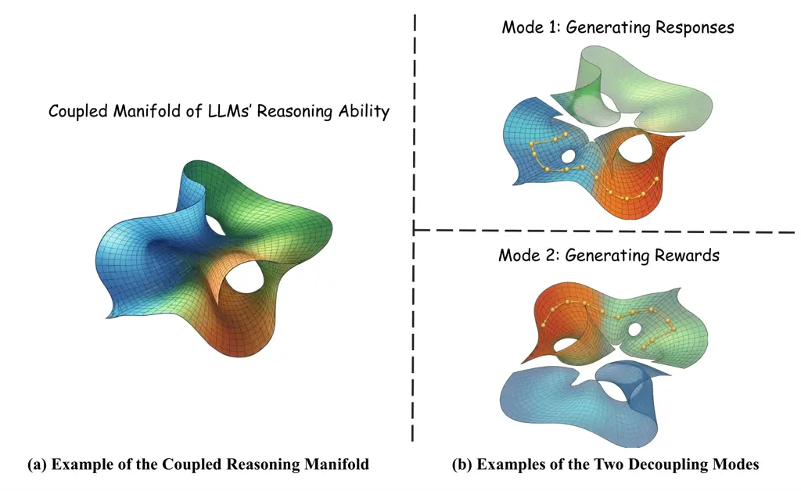
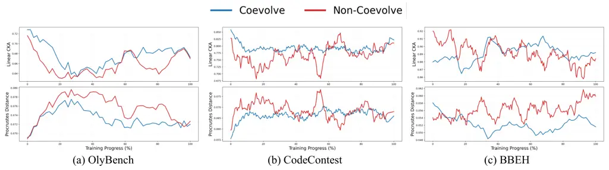
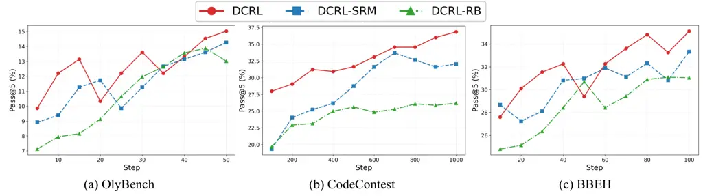

# DCRL: Decoupling and Coupling Reinforcement Learning via Policy-Reward Manifold Alignment

Henan Sun Affiliation: The Hong Kong University of Science and
Technology (Guangzhou)    Zehua Li Affiliation: The Hong Kong University
of Science and Technology (Guangzhou)    Haitao Hu Affiliation: The Hong
Kong University of Science and Technology (Guangzhou)    Qifan Zhang
Affiliation: The Hong Kong University of Science and Technology
(Guangzhou)    Jianfeng Zhang Affiliation: Huawei Noah’s Ark Lab    Nuo
Chen Affiliation: The Hong Kong University of Science and Technology
(Guangzhou) Affiliation: Tencent HY    Jia Li Affiliation: The Hong Kong
University of Science and Technology (Guangzhou) Affiliation: The Hong
Kong University of Science and Technology

###### Abstract

Reinforcement learning (RL) has emerged as a key paradigm for improving
the reasoning capabilities of large language models (LLMs). However,
existing reward systems, such as rule-based and reward-model-based,
often exhibit issues such as unstable optimization and reward hacking.
In this work, we revisit the general reasoning of LLMs from a geometric
perspective, conceptualizing it as a coupled manifold composed of three
interdependent sub-manifolds: logical deduction, evaluation, and
representation. Based on this perspective, response generation in RL can
be interpreted as a decoupling process from the evaluation manifold,
while reward estimation corresponds to a decoupling process from the
logical deduction manifold. The limitations of rule-based and
reward-model RL systems can be geometrically interpreted as the mismatch
of policy-reward manifolds during RL process. To address the
aforementioned misalignment, we propose Decoupling and Coupling
Reinforcement Learning (DCRL) framework, which incorporates two key
components: (1) a syllogistic logic-based prompt evolution mechanism
that dynamically refines reward rubrics to enhance the expressiveness of
the reward manifold; and (2) a policy–reward re-coupling mechanism that
jointly updates the reward and policy models, ensuring consistent
evaluation and mitigating manifold mismatch during training. Theoretical
analysis and extensive experiments across multiple reasoning domains
demonstrate that DCRL consistently outperforms both rule-based and
reward-model baselines. Notably, a Qwen3-4B model trained under DCRL
surpasses a Qwen3-32B baseline and approaches the performance of a
Qwen3-235B model, highlighting superior effectiveness and generalization
in RL.

|     |
| --- |
|     |

## 1 Introduction

Reinforcement learning (RL) has demonstrated substantial performance
improvements of large language models (LLMs) (Shao et al., 2024b; Guo et
al., 2025). In this paradigm, the parameters of a policy model are
iteratively optimized to maximize rewards provided by a reward
system (Stiennon et al., 2020; Ouyang et al., 2022; Dong et al., 2024;
Kaufmann et al., 2023), which may be defined through rule-based
mechanisms or learned reward models (Guo et al., 2025; Dong et al.,
2024). The efficacy of such a reward system fundamentally depends on its
ability to reliably and accurately evaluate the quality of
model-generated responses within the context of specific
queries (Lambert et al., 2025; Liu et al., 2025b; Zhang et al., 2025b).

Current reward systems in RL post-training are mainly divided into
rule-based systems and reward model systems. Rule-based systems assign
rewards through manually designed rules, heuristics, or programmatic
verifiers, providing a simple and interpretable mechanism for
supervising model behavior (Guo et al., 2025; Feng et al., 2026).
However, because such rules are handcrafted, they often fail to
accurately capture the true quality of model outputs, especially in
complex or open-ended tasks, which can cause models to optimize for
superficial rule satisfaction rather than genuine performance
improvements (Gunjal et al., 2025; Zhang et al., 2025a; Skalse et al.,
2022; Wen et al., 2024). This limitation also makes rule-based systems
vulnerable to reward hacking, where models exploit weaknesses in the
reward design without improving actual task performance (Chen et al.,
2024; Miao et al., 2024). To overcome these issues, recent studies
increasingly adopt reward model systems, which learn reward signals from
preference data and provide more flexible supervision by implicitly
modeling response quality and reasoning quality (Stiennon et al., 2020;
Ouyang et al., 2022; Bai et al., 2022; Lightman et al., 2023). Although
reward models have shown stronger empirical performance than rule-based
methods (Lambert et al., 2025; Liu et al., 2025a), they still suffer
from optimization instability, since iterative policy updates may
exploit inaccuracies in the learned reward models, leading to reward
over-optimization and degraded alignment with true task
objectives (Rafailov et al., 2023; Skalse et al., 2022; Wen et al.,
2024). Therefore, while reward model systems provide a more expressive
alternative to rule-based rewards, ensuring their stability and
alignment with true response quality remains a major challenge (Lambert
et al., 2025; Xu et al., 2025).

In contrast to prior studies, we examine reward systems through a
geometric lens on the nature of reasoning, conceptualizing it as a
collection of coupled manifolds embedded in a high-dimensional space,
each associated with distinct reasoning patterns, skills, or strategies
(see Fig. 1), inspired by recent progress from the manifold
theory (Brahma et al., 2015; Magai and Ayzenberg, 2022). Specifically,
pretraining data induces a high-dimensional data manifold
$`\mathcal{M}`$, within which heterogeneous reasoning
sub-manifolds—namely, the logical deduction sub-manifold
$`\mathcal{M}_{L}`$ (illustrated as the blue surface in Fig. 1 (a)), the
evaluation sub-manifold $`\mathcal{M}_{E}`$ (green surface), and the
representation sub-manifold $`\mathcal{M}_{R}`$ (orange surface)—are
organized into a stratified structure, formally expressed as
$`\mathcal{M}=\mathcal{M}_{L}\cup\mathcal{M}_{E}\cup\mathcal{M}_{R}`$.
From this perspective, reasoning can be formulated as the interaction
among three interdependent sub-manifolds: (i) the logical deduction
sub-manifold $`\mathcal{M}_{L}`$, which is coupled with the model’s
policy distribution over $`\mathcal{M}`$; (ii) the evaluation
sub-manifold $`\mathcal{M}_{E}`$, encoding the implicit judgment
functions underlying logical inference; and (iii) the representation
sub-manifold $`\mathcal{M}_{R}`$, in which both model responses and
evaluation criteria are explicitly instantiated in the text space. As
illustrated in Fig. 1 (b), the generation of responses conditioned on a
query can be interpreted as a geometric process in which the reasoning
manifold effectively decouples from the evaluation sub-manifold,
formalized as $`\mathcal{M}\perp\mathcal{M}_{E}`$. Conversely, when the
model assigns rewards to assess response quality, this corresponds to a
geometric process in which the reasoning manifold decouples from the
logical deduction sub-manifold, i.e.,
$`\mathcal{M}\perp\mathcal{M}_{L}`$. From the geometric standpoint
outlined above, existing approaches exhibit several inherent limitations
when analyzed through the framework of manifold interactions:

Limitation 1: Rule-based reward systems largely disregard the evaluation
sub-manifold embedded within the overall reasoning manifold
$`\mathcal{M}`$ of the model, thereby limiting their capacity to capture
nuanced judgment processes. Consequently, they are particularly
susceptible to critical challenges, including poor adaptability to
open-ended settings and vulnerability to reward hacking (Skalse et al.,
2022; Gunjal et al., 2025; Wen et al., 2024).

Limitation 2: Reward model systems typically rely on static reward
models whose evaluation sub-manifold does not adapt in tandem with the
evolving reasoning manifold of the policy model (Yuan et al., 2024; Wu
and Lu, 2025; Xu et al., 2025; Feng et al., 2026). This mismatch can
result in several critical challenges, including unstable optimization
dynamics, misalignment between reward signals and true task performance,
and increased susceptibility to reward hacking (Liu et al., 2025c; Wu et
al., 2026; Xue et al., 2026).



Figure 1: Illustration of coupled reasoning manifold and two decoupling
modes.

Observing the aforementioned limitations, we derive two key motivations
as following. (M1): The reward rubric should evolve dynamically to
enhance the expressiveness of reward evaluation. Since the reasoning
behavior of the policy model changes continuously during training, a
static reward rubric may fail to capture the evolving evaluation
criteria required for accurate assessment. By adaptively refining the
reward rubric according to the current training state, the reward model
can better externalize and calibrate its implicit evaluation standards,
thereby producing more precise and reliable reward signals. (M2): The
reward model should evolve jointly with the policy model to preserve
evaluation consistency during reinforcement learning. As the reasoning
capability of the policy model improves, a static reward model may
gradually become misaligned with the policy model’s evolving output
distribution, resulting in inaccurate reward estimation. To maintain
reliable evaluation, improvements in policy reasoning should be coupled
back to the reward model, thereby reducing the mismatch between policy
and reward models and ensuring consistent reward supervision throughout
training.

Based on the motvations above, we propose a novel framework termed
decouple-and-couple reward modeling system, along with a corresponding
reinforcement learning paradigm, Decouple and Couple RL (DCRL), inspired
by the following motivations. The proposed approach first decouples the
evaluation and representation sub-manifolds from the originally
entangled manifold induced by the model, then independently optimizes
these sub-manifolds via our proposed syllogistic logic prompt-evolving
mechanism, and finally re-integrates them through RL-based coupling.
This structured decoupling and subsequent coupling process enables more
stable optimization dynamics and yields consistent performance
improvements.

Our Contributions. (1) New Perspective. To the best of our knowledge,
this work is the first to investigate reward modeling systems through
the geometric nature on reasoning, by conceptualizing the process as the
interaction of three coupled sub-manifolds: logical deduction,
evaluation, and representation. This formulation provides a principled
and theoretically grounded foundation for the design of our
reinforcement learning framework. (2) Novel RL System. We propose a
novel paradigm termed DCRL, which first disentangles the evaluation and
representation sub-manifolds from the originally coupled manifold
induced by the model. These sub-manifolds are then independently
optimized via a syllogistic logic–based prompt-evolving mechanism, and
subsequently re-integrated through reinforcement learning–based
coupling. (3) Strong Empirical Performance. Extensive experiments across
diverse reasoning domains, including mathematics, code, and commonsense,
demonstrate that DCRL consistently outperforms both rule-based and
static reward model baselines. Notably, a Qwen3-4B model trained with
DCRL surpasses a Qwen3-32B counterpart and approaches the performance of
a Qwen3-235B model, highlighting the effectiveness and generalization of
the proposed DCRL paradigm for general reasoning.

## 2 Related Work

Recent advances in reward modeling for long-form reasoning post-training
can be broadly categorized into rule-based systems and reward model
systems.

Rule-based reward systems assign reward signals according to predefined
heuristic rules or task-specific verifiers, offering a simple and
reliable mechanism for reinforcement learning without requiring
separately trained reward models. This paradigm has been widely adopted
in RL, especially in domains where objective correctness can be
automatically verified. For instance, DeepSeekMath (Shao et al., 2024a)
employs rule-based rewards derived from symbolic answer matching to
reinforce mathematical reasonin. Similarly, Math-Shepherd (Wang et al.,
2024a) introduces automatically verifiable step-level supervision
signals, where rewards are assigned according to rule-based verification
of intermediate reasoning correctness. In code generation, CodeRL (Le et
al., 2022) leverages unit test execution results as rule-based rewards,
where generated programs are rewarded based on whether they pass
predefined tests. Extending this paradigm, RLEF (Gehring et al., 2024)
uses compiler and execution feedback as deterministic rule-based rewards
for reinforcement learning from execution feedback, significantly
improving program synthesis performance.

Reward model systems assign reward signals to model outputs through
learned reward models and have attracted increasing attention in
reinforcement learning research due to their conceptual simplicity and
computational efficiency. This line of work includes outcome reward
models, preference models, and process reward models. For example,
Skywork-Reward-V2 (Liu et al., 2025a) improves reward modeling through
large-scale human-AI collaborative preference data curation,
establishing strong open-source reward model baselines.
ReasonFlux-PRM (Zou et al., 2025) extends process reward modeling to
long chain-of-thought reasoning by introducing trajectory-aware reward
supervision. CodePRM (Li et al., 2025) incorporates execution feedback
to improve process-level evaluation for code generation tasks.
CompassVerifier (Liu et al., 2025b) further enhance scalar evaluation
quality by training specialized verifiers for reasoning tasks with
objective correctness signals. DeepSeek-GRM (Liu et al., 2025c) proposes
a generalist generative reward model trained via Self-Principled
Critique Tuning, enabling adaptive reward generation during evaluation.
Owing to their efficiency and ease of integration, reward model systems
serve as a practical foundation for reward-guided policy optimization.

## 3 Methodology

### 3.1 Motivation

As illustrated in Section 1, existing reward systems in RL suffer from
the following limitations: (1) rule-based reward systems largely ignore
the evaluation sub-manifold coupled within the overall reasoning
manifold of the model, leading to poor adaptability to open-ended
settings and vulnerability to reward hacking. (2) reward model systems
suffer from the mismatch between the evolving reasoning manifold of the
policy model and the static evaluation sub-manifold of the reward model,
leading to the unstable optimization and reward hacking problems.

Inspired by the recent progress on the manifold theory (Brahma et al.,
2015; Magai and Ayzenberg, 2022), we conceptualize the abstract
reasoning ability of LRMs as the coupled manifold illustrated as Fig. 1
in Section 1. In this view, different tasks in RL correspond to distinct
patterns of manifold coupling rather than a single unified reasoning
process. Specifically, when an LLM generates an answer, it primarily
operates through the coupling between the logical deduction sub-manifold
and the representation sub-manifold: the model performs step-by-step
reasoning in its latent space and subsequently maps this reasoning
trajectory into textual form. In contrast, when an LLM evaluates or
scores an answer, the process relies on the coupling between the
evaluation sub-manifold and the representation sub-manifold, where
internal judgment criteria are expressed through natural language
outputs.

This perspective reveals a fundamental mismatch in standard RL
frameworks for LLM alignment. When the reward model or reward rubric is
held static, its evaluation–representation sub-manifold may gradually
become misaligned with the evolving logical deduction–representation
sub-manifold of the policy model, leading to degraded reward fidelity
and suboptimal optimization. Recognizing that the reward model itself
constitutes a sub-manifold of the overall reasoning manifold, we argue
that improvements in reasoning induced by RL should naturally extend to
the evaluation sub-manifold. This suggests a simple yet effective
strategy: directly updating the reward model using the improved policy
model, thereby inheriting enhanced reasoning and evaluation
capabilities. Furthermore, since the reward signal is ultimately
produced through the coupling between evaluation and representation
sub-manifolds, improving the expressiveness of the representation
sub-manifold can further enhance reward quality. To this end, we propose
to explicitly evolve the representation component of the reward model
via syllogistic logic prompt-evolving, enabling the model to externalize
and refine its implicit evaluation criteria. Together, these insights
motivate the proposed DCRL in which both policy and reward models
co-evolve through the dynamic coupling of reasoning sub-manifolds,
leading to more accurate evaluation and more effective alignment.

### 3.2 DCRL Framework

1:  Input: Pretrained policy model $`\pi_{\theta_{0}}`$, initial reward
model $`r_{\phi_{0}}`$ with the same parameter weights of the policy
model, axiomatic prompts $`\mathcal{A}=\{a_{i}\}_{i=1}^{k_{1}}`$,
theorem prompts $`\mathcal{T}=\{t_{j}\}_{j=1}^{k_{2}}`$, corollary
prompts $`\mathcal{C}_{0}=\{c_{l}\}_{l=1}^{k_{3}}`$

2:  for epoch $`e=0,1,2,\dots,E`$ do

3:   // Step 1: Sample trajectories

4:   Sample $`x\sim\pi_{\theta_{e}}(x)`$

5:   // Step 2: Reward computation via coupled manifolds

6:   Construct rubric prompt:

```math
\mathcal{R}_{e}=\mathcal{A}\cup\mathcal{T}\cup\mathcal{C}_{e} \tag{1}
```

7:   Compute reward:

```math
r_{\phi_{e}}(x)=f_{\phi_{e}}(x;\mathcal{R}_{e}) \tag{2}
```

8:   // Step 3: Policy optimization

9:   Compute advantage:

```math
A_{e}(x)=r_{\phi_{e}}(x)-b_{e} \tag{3}
```

10:   Update policy:

```math
\pi_{\theta_{e+1}}(x)\propto\pi_{\theta_{e}}(x)\exp\big(\eta A_{e}(x)\big) \tag{4}
```

11:   // Step 4: Corollary prompt evolution

12:   Update $`\mathcal{C}_{e}\rightarrow\mathcal{C}_{e+1}`$ via:

```math
\displaystyle\mathcal{C}_{e+1} \displaystyle=g_{\phi}\bigl(\mathcal{C}_{t},\bar{A}_{t},\mathrm{Acc}_{t}\bigr) \tag{5}
```

```math
\displaystyle\approx\arg\max_{x\sim\pi_{\theta_{e}},\mathcal{C}}(1-\lambda_{acc})\mathbb{E}\big[A_{e}(x)\big]+\lambda_{acc}f_{\theta_{e}}(x;\mathcal{A},\mathcal{T},\mathcal{C}_{e})
```

13:   // Step 5: Domain-level theorem update

14:   if reasoning domain shift detected then

15:    Update $`\mathcal{T}`$:

```math
\displaystyle\mathcal{T} \displaystyle=g_{\phi}\bigl(\mathcal{T},\bar{A}_{t},\mathrm{Acc}_{t}\bigr) \tag{6}
```

```math
\displaystyle\approx\arg\max_{x\sim\pi_{\theta_{e}},\mathcal{T}}(1-\lambda_{acc})\mathbb{E}\big[A_{e}(x)\big]+\lambda_{acc}f_{\theta_{e}}(x;\mathcal{A},\mathcal{T},\mathcal{C}_{e})
```

16:   end if

17:   // Step 6: Parameter coupling

18:   Update reward model:

```math
\phi_{e+1}\leftarrow\theta_{e+1} \tag{7}
```

19:  end for

20:  Output: Final policy $`\pi_{\theta_{E}}`$

Algorithm 1 Decoupling and Coupling Reinforcement Learning (DCRL)

Building upon the aforementioned motivation, the overall pipeline of the
proposed DCRL is illustrated in pseudo code Algorithm 1, which
explicitly models and leverages the interaction between different
reasoning sub-manifolds. Concretely, DCRL adopts a standard
reinforcement learning backbone (e.g., GRPO (Shao et al., 2024a)) for
policy optimization, while introducing a syllogistic logic–based
prompt-evolving mechanism to dynamically refine the reward model. As
shown in Eq. (1), we decompose the reward model’s rubric prompts into
three hierarchical components: (i) a set of $`k_{1}`$ axiomatic prompts
$`\mathcal{A}`$, which encode fundamental evaluation principles that are
universally applicable across reasoning domains (e.g., mathematical,
coding, and commonsense reasoning) and remain fixed throughout training;
(ii) a set of $`k_{2}`$ theorem prompts $`\mathcal{T}`$, which capture
domain-specific evaluation criteria that are invariant within a given
domain but can be adapted when transferring across domains; and (iii) a
set of $`k_{3}`$ corollary prompts at 0-th step $`\mathcal{C}_{0}`$,
which are dynamically updated during training based on the current
behavior of the policy model, enabling fine-grained and adaptive
evaluation. More specifically, following the common standard of RL
backbones (e.g., GRPO), we calculate the advantage and update the policy
logits illustrated as Eq. (3) and Eq. (4). The corollary prompt at
$`e`$-th step $`\mathcal{C}_{e}`$ is updated according to Eq. (5) to
maximize the expectation of the corollary prompt conditioned on the
advantage and the current training accuracy, where
$`g_{\phi}\bigl(\mathcal{C}_{t},\bar{A}_{t},\mathrm{Acc}_{t}\bigr)`$ is
the prompt-updating operator and
$`f_{\theta_{e}}(x;\mathcal{A},\mathcal{T},\mathcal{C}_{e})`$ is the
accuracy calculation function. Similarly, if the reasoning domain is
shift, the theorem prompt $`\mathcal{T}`$ is updated according to
Eq. (6). This hierarchical prompt evolution mechanism is designed to
enhance the representation sub-manifold of the reward model, thereby
improving the fidelity of the evaluation–representation coupling and
yielding more accurate reward signals for the policy model.

In addition, to mitigate the structural mismatch between the reward
model and the evolving policy model, we introduce a parameter
synchronization strategy: at the end of each training epoch, the
parameters of the reward model are directly replaced by those of the
updated policy model, as illustrated in Eq. (7). This operation is
motivated by the observation that the reward model, as a sub-manifold of
the overall reasoning manifold, should co-evolve with the policy model
to maintain alignment between the evaluation–representation coupling and
the logical deduction–representation coupling. By combining hierarchical
prompt evolution with periodic parameter coupling, DCRL establishes a
unified training paradigm in which the policy and reward models are
alternately decoupled for specialized optimization and re-coupled for
global consistency, leading to progressively improved reasoning
performance and evaluation accuracy.

### 3.3 Theoretical Analysis

In this section, we provide the theoretical foundations of the proposed
DCRL framework. Our analysis focuses on the alignment dynamics between
the reasoning manifold of the policy model and that of the reward model.
Specifically, we show that under the proposed reward-policy co-evolution
mechanism, the discrepancy between the two reasoning manifolds remains
bounded throughout training. This bounded-gap property guarantees that
the reward model remains aligned with the continually evolving policy
model, thereby improving the stability and reliability of reward
estimation. The detailed proof is provided in Appendix A.

To formalize this result, we first introduce two assumptions.

###### Assumption 3.1 (Prompt Smoothness).

Let $`T_{\mathcal{C}}`$ denote the prompt-induced transformation on the
reward reasoning distribution under corollary prompts $`\mathcal{C}`$.
There exists a constant $`L>0`$ such that for any two prompt states
$`\mathcal{C}`$ and $`\mathcal{C}^{\prime}`$,

```math
D_{\mathrm{KL}}\bigl(pT_{\mathcal{C}^{\prime}}\,\|\,pT_{\mathcal{C}}\bigr)\leq L\|\mathcal{C}^{\prime}-\mathcal{C}\|, \tag{8}
```

where $`D_{\mathrm{KL}}(\cdot\|\cdot)`$ denotes the Kullback-Leibler
divergence. This assumption implies that small prompt changes only
induce small perturbations in the reward reasoning distribution.

###### Theorem 3.2.

Let the corollary prompt evolution operator be

```math
\mathcal{C}_{t+1}=g_{\phi}\bigl(\mathcal{C}_{t},\bar{A}_{t},\mathrm{Acc}_{t}\bigr), \tag{9}
```

where: (1) $`\bar{A}_{t}=\mathbb{E}_{x\sim\pi_{\theta_{t}}}[A_{t}(x)]`$
is the average advantage at epoch $`t`$, (2) $`\mathrm{Acc}_{t}`$ is the
training accuracy at epoch $`t`$, (3) $`g_{\phi}`$ is the prompt
rewriting operator implemented by the reward model.

Then the prompt evolution step is bounded by a constant $`\delta>0`$:

```math
\|\mathcal{C}_{t+1}-\mathcal{C}_{t}\|\leq\delta. \tag{10}
```

Based on the assumption and the theorem above, the discrepancy between
the policy reasoning manifold and the reward reasoning manifold is
bounded as follows.

###### Theorem 3.3.

Under Assumptions 3.1 and Theorem 3.2, the reasoning-manifold gap
between the policy model and reward model satisfies

```math
G_{t}\leq 2L\delta,\qquad\forall t, \tag{11}
```

where $`G_{t}`$ denotes the symmetric KL divergence between the policy
reasoning distribution and the reward reasoning distribution at epoch
$`t`$.

Theorem 3.3 indicates that the discrepancy between the reward reasoning
manifold and the policy reasoning manifold remains uniformly bounded
throughout training. Therefore, the reward model can continuously track
the evolution of the policy reasoning process, ensuring stable reward
evaluation and preventing manifold drift between the two models.

## 4 Experiments

In this section, we present comprehensive experiments evaluating the
proposed DCRL framework under diverse reasoning benchmark, including
math, code and commen sense reasoning domains. The objective of these
experiments is to address the following research questions: Q1: How does
the proposed DCRL framework perform compared to other RL baselines? Q2:
To what extent do the reasoning manifolds of policy and reward models
align during the decoupling and coupling process? Q3: How about the
training stability of the proposed DCRL compared to other RL paradigms?
Due to page limit, we put part of experiment results and detailed
analysis in Appendix B.

### 4.1 Experiment Setup

Benchmarks. We evaluate DCRL on 10 benchmarks across three reasoning
domains, as summarized in Table 1. Our evaluation follows a two-stage
protocol. Firstly, we conduct in-distribution evaluation on six source
benchmarks with training splits: GSM8K and OlyBench for math,
CodeContest and LiveCodeBench for code, and BBEH and MMLU-Pro for
commonsense. Following prior settings (Zou et al., 2025; Liu et al.,
2025c), each source benchmark is split into training and test sets with
a 9:1 ratio for RL training and in-distribution evaluation. To further
assess the generalization capability of DCRL, we introduce
out-of-distribution (OOD) evaluation on evaluation-only benchmarks. For
each domain, we select one trained policy for OOD testing: the policy
trained on OlyBench is evaluated on AIME24 and AIME25, the policy
trained in CodeContest on CRUX, and the policy trained in BBEH on GPQA.
Evaluation is based on numeric match for math, unit test execution for
code, and final answer exact match for commonsense. Additional details
are provided in Appendix B.1.

Models & Baselines. In our experiments, Qwen3-4B is adopted as the
policy model and trained under the DCRL framework, denoted as DCRL-4B
(ours) in Table 2. We further include Qwen3-4B, Qwen3-32B, and
Qwen3-235B (Yang et al., 2025) as zero-shot reference baselines to
contextualize the upper-bound performance of DCRL-4B. To systematically
evaluate the impact of different reward paradigms in RL, we further
incorporate a rule-based reward system, where rewards are defined via
handcrafted heuristics, as well as a static LLM-based reward generator
that uses Qwen3-4B without rubric-based prompting. In addition, we
include three strong and representative baselines from distinct research
directions: ReasonFlux-7B (Zou et al., 2025), DeepSeek-GRM-16B (Liu et
al., 2025c), and Skywork-Reward-V2 (Liu et al., 2025a)—given their
demonstrated effectiveness in general reasoning RL.

Evaluation Metrics. We report pass@5 for all tasks. Specifically,
mathematical reasoning is evaluated by numeric match, code generation by
unit test execution, and commonsense reasoning by final-answer exact
match. To quantify the alignment between policy-reward reasoning
manifolds during training, we employ Linear CKA (Alvarez, 2022) and
Procrustes Distance (Kendall, 1984) as the metrics, where higher Linear
CKA and lower Procrustes Distance corresponds to more aligned reasoning
manifolds of policy and reward models. Detailed explanation about the
metrics is illustrated in Appendix B.2.

Experiment Environment. For reproducibility, we report the hardware and
software configurations used in our experiments. All experiments were
conducted on a server equipped with an Intel(R) Xeon(R) Gold 6240 CPU @
2.60GHz and 8 NVIDIA A100 GPUs with 80GB memory, using CUDA 12.8.

|             |             |                   |                  |            |                          |
| ----------- | ----------- | ----------------- | ---------------- | ---------- | ------------------------ |
| Domain      | Dataset     | Training Set Size | Testing Set Size | OOD        | Evaluation Criteria      |
| Math        | AIME24      | –                 | 30               | ✓          | Numeric Match            |
|             | AIME25      | –                 | 30               | ✓          | Numeric Match            |
|             | GSM8K       | 7,473             | 1,319            | $`\times`$ | Numeric Match            |
|             | OlyBench    | 1,913             | 213              | $`\times`$ | Numeric Match            |
| Code        | CodeContest | 10,521            | 1,169            | $`\times`$ | Unit Test Execution      |
|             | L.C.Bench   | 656               | 73               | $`\times`$ | Unit Test Execution      |
|             | CRUX        | –                 | 1,598            | ✓          | Unit Test Execution      |
| Commonsense | BBEH        | 2,499             | 279              | $`\times`$ | Final Answer Exact Match |
|             | MMLU-Pro    | 10,891            | 1,211            | $`\times`$ | Final Answer Exact Match |
|             | GPQA        | –                 | 198              | ✓          | Final Answer Exact Match |

Table 1: Summary of dataset statistics.

### 4.2 Performance Comparison

To address Q1, we conduct a comprehensive empirical evaluation against a
diverse set of baselines across multiple benchmarks spanning various
reasoning domains, as reported in Table 2. Based on the experimental
results, we draw the following conclusions. (C1): The proposed DCRL-4B
surpasses both Qwen3-4B and Qwen3-32B, and approaches the performance of
Qwen3-235B, demonstrating the effectiveness of DCRL. As shown in
Table 2, DCRL-4B consistently outperforms Qwen3-4B and Qwen3-32B across
all evaluated benchmarks and remains competitive with Qwen3-235B. This
result highlights the substantial improvement in general reasoning
capability achieved by enhancing Qwen3-4B under the DCRL framework.
(C2): DCRL-4B also outperforms counterparts based on rule-based and
static reward model paradigms, validating the importance of mitigating
the misalignment between policy and reward reasoning manifolds. As
discussed in Section 1, both rule-based and static reward model
approaches fail to adequately address the discrepancy between policy and
reward reasoning manifolds during training, often resulting in issues
such as unstable optimization and reward hacking. In contrast,
Theorem 3.3 provides theoretical support that DCRL effectively aligns
these manifolds, thereby leading to improved performance across multiple
benchmarks shown in Table 2.

|                     |       |        |        |          |             |       |           |              |          |       |
| ------------------- | ----- | ------ | ------ | -------- | ----------- | ----- | --------- | ------------ | -------- | ----- |
| Baselines           | Math  |        |        |          | Code        |       |           | Common Sense |          |       |
|                     | GSM8K | AIME24 | AIME25 | OlyBench | CodeContest | CRUX  | L.C.Bench | BBEH         | MMLU-Pro | GPQA  |
| Qwen3-4B            | 92.58 | 25.0   | 16.67  | 10.73    | 17.28       | 58.52 | 11.74     | 8.95         | 49.46    | 48.22 |
| Qwen3-32B           | 93.9  | 26.7   | 20.0   | 20.2     | 19.0        | 64.90 | 16.6      | 10.75        | 58.5     | 61.92 |
| Qwen3-235B-A22B     | 96.74 | 44.18  | 40.67  | 54.08    | 35.79       | 78.94 | 42.58     | 40.75        | 71.35    | 67.01 |
| Rule-based          | 94.81 | 26.67  | 20.0   | 13.88    | 26.18       | 59.51 | 22.14     | 31.09        | 60.06    | 60.75 |
| Static Reward Model | 94.54 | 33.33  | 30.0   | 14.27    | 32.64       | 68.58 | 24.37     | 32.32        | 60.42    | 64.75 |
| ReasonFlux-7B       | 95.43 | 30.0   | 33.33  | 10.90    | 16.00       | 69.92 | 27.44     | 33.42        | 66.21    | 71.72 |
| Deepseek-GRM-16B    | 92.80 | 33.33  | 26.67  | 20.19    | 13.11       | 59.01 | 23.42     | 16.49        | 52.35    | 66.70 |
| Skywork-reward-v2   | 93.63 | 33.33  | 26.67  | 16.43    | 16.51       | 72.66 | 29.89     | 11.11        | 50.25    | 62.31 |
| DCRL-4B (ours)      | 95.59 | 40.0   | 36.67  | 21.12    | 36.84       | 79.12 | 26.95     | 35.13        | 71.20    | 77.27 |

Table 2: Performance comparison of SOTA baselines and the proposed DCRL
across Math, Code and Common sense benchmarks.

### 4.3 Manifolds Alignment Analysis

To address Q2, we compare models trained with a static reward system
(non-coevolve) against those optimized under the proposed DCRL framework
(coevolve) across three representative benchmarks spanning diverse
reasoning domains: OlyBench for mathematical reasoning, CodeContest for
code reasoning, and BBEH for commonsense reasoning, as shown in Fig. 2.
It can be observed that the coevolve setting consistently demonstrates
stronger policy-reward manifold alignment than the non-coevolve baseline
across all three benchmarks. Specifically, models trained under the
proposed DCRL framework achieve generally higher Linear CKA values and
lower Procrustes Distance, indicating improved structural similarity and
reduced geometric discrepancy between the policy and reward reasoning
manifolds. These results suggest that, under the DCRL framework, the
reward model is able to adapt more effectively to the evolving reasoning
manifold of the policy model during training. This empirical observation
is consistent with the theoretical result established in Theorem 3.3,
which shows that the divergence between the policy reasoning
distribution and the reward reasoning distribution at each training step
is bounded by a constant. Such bounded divergence enables the reward
manifold to evolve in coordination with the policy manifold, allowing
the reward model to provide dynamically appropriate supervision signals
throughout training. As a result, the policy model receives more
accurate and adaptive reward guidance, which ultimately contributes to
improved training effectiveness and enhanced reasoning performance.



Figure 2: The policy-reward reasoning manifold alignment under DCRL and
static reward system settings.

### 4.4 Ablation Study

To address Q3, we conduct a comprehensive ablation study of DCRL across
three representative reasoning domains: OlyBench for mathematical
reasoning, CodeContest for code reasoning, and BBEH for commonsense
reasoning. Specifically, as shown in Fig. 3, the red curve labeled DCRL
denotes the validation performance of the full DCRL framework throughout
the training process. The blue curve, DCRL-SRM, represents the
performance of DCRL when the syllogistic logic-based prompt evolution
mechanism is replaced by a static reward model, while the green curve,
DCRL-RB, corresponds to the variant in which rewards are generated using
a rule-based reward system. It can be observed that the full DCRL
framework consistently outperforms the two ablated variants across all
three datasets, highlighting the importance of mitigating the mismatch
between the reasoning manifolds of the policy model and the reward
system illustrated in Section 1 and Section 3. In particular, Fig. 3(a)
and Fig. 3(b) show that DCRL maintains a steady upward performance trend
throughout training, indicating continuous improvements in reasoning
capability. In contrast, the performance gains of both DCRL-SRM and
DCRL-RB gradually plateau, with their improvement rates slowing
significantly as training progresses. This divergence suggests that the
decoupling and coupling mechanism in DCRL provides stronger scalability
and sustained optimization benefits.



Figure 3: The results of the ablation experiment for DCRL.

## 5 Conclusion

In this work, we introduced a geometric perspective on LLM reasoning by
modeling it as a coupled manifold of logical deduction, evaluation, and
representation, and identified the limitations of existing RL reward
systems as a manifestation of policy–reward manifold mismatch. Building
on this insight, we proposed the DCRL framework, which integrates
dynamic reward rubric evolution with policy–reward re-coupling to
achieve more stable and aligned optimization. Notably, DCRL enables
Qwen3-4B to outperform its 32B counterpart and approach the 235B model
on the evaluated benchmarks, demonstrating the effectiveness of
policy–reward co-evolution. Both theoretical analysis and empirical
results across diverse reasoning tasks demonstrate that DCRL
consistently improves performance and generalization over conventional
rule-based and reward-model approaches. These findings suggest that
explicitly modeling and maintaining the structural alignment between
policy and reward manifolds offers a promising direction for advancing
RL-based post-training of LLMs.

## References

- Alvarez (2022) S. A. Alvarez Gaussian rbf centered kernel alignment
  (cka) in the large-bandwidth limit. IEEE transactions on pattern
  analysis and machine intelligence 45 (5), pp. 6587–6593. Cited by:
  §4.1.
- Bai et al. (2022) Y. Bai, S. Kadavath, S. Kundu, A. Askell, J.
  Kernion, A. Jones, A. Chen, A. Goldie, A. Mirhoseini, C. McKinnon, et
  al. Constitutional ai: harmlessness from ai feedback. arXiv preprint
  arXiv:2212.08073. Cited by: §1.
- Balunović et al. (2025) M. Balunović, J. Dekoninck, I. Petrov, N.
  Jovanović, and M. Vechev Matharena: evaluating llms on uncontaminated
  math competitions. arXiv preprint arXiv:2505.23281. Cited by: §B.1.
- Brahma et al. (2015) P. P. Brahma, D. Wu, and Y. She Why deep learning
  works: a manifold disentanglement perspective. IEEE transactions on
  neural networks and learning systems 27 (10), pp. 1997–2008. Cited by:
  §1, §3.1.
- Chen et al. (2024) L. Chen, C. Zhu, D. Soselia, J. Chen, T. Zhou, T.
  Goldstein, H. Huang, M. Shoeybi, and B. Catanzaro Odin: disentangled
  reward mitigates hacking in rlhf. arXiv preprint arXiv:2402.07319.
  Cited by: §1.
- Cobbe et al. (2021) K. Cobbe, V. Kosaraju, M. Bavarian, M. Chen, H.
  Jun, L. Kaiser, M. Plappert, J. Tworek, J. Hilton, R. Nakano, et al.
  Training verifiers to solve math word problems. arXiv preprint
  arXiv:2110.14168. Cited by: §B.1.
- Dong et al. (2024) H. Dong, W. Xiong, B. Pang, H. Wang, H. Zhao, Y.
  Zhou, N. Jiang, D. Sahoo, C. Xiong, and T. Zhang Rlhf workflow: from
  reward modeling to online rlhf. arXiv preprint arXiv:2405.07863. Cited
  by: §1.
- Feng et al. (2026) A. Z. Feng, C. Wang, B. Wen, Y. Wang, Y. Luo, H.
  Wang, and M. Huang RLAR: an agentic reward system for multi-task
  reinforcement learning on large language models. arXiv preprint
  arXiv:2603.00724. Cited by: §1, §1.
- Gehring et al. (2024) J. Gehring, K. Zheng, J. Copet, V. Mella, Q.
  Carbonneaux, T. Cohen, and G. Synnaeve Rlef: grounding code llms in
  execution feedback with reinforcement learning. arXiv preprint
  arXiv:2410.02089. Cited by: §2.
- Gunjal et al. (2025) A. Gunjal, A. Wang, E. Lau, V. Nath, Y. He, B.
  Liu, and S. Hendryx Rubrics as rewards: reinforcement learning beyond
  verifiable domains. arXiv preprint arXiv:2507.17746. Cited by: §1, §1.
- Guo et al. (2025) D. Guo, D. Yang, H. Zhang, J. Song, P. Wang, Q.
  Zhu, R. Xu, R. Zhang, S. Ma, X. Bi, et al. Deepseek-r1: incentivizing
  reasoning capability in llms via reinforcement learning. arXiv
  preprint arXiv:2501.12948. Cited by: §1, §1.
- He et al. (2024) C. He, R. Luo, Y. Bai, S. Hu, Z. Thai, J. Shen, J.
  Hu, X. Han, Y. Huang, Y. Zhang, et al. Olympiadbench: a challenging
  benchmark for promoting agi with olympiad-level bilingual multimodal
  scientific problems. In Proceedings of the 62nd Annual Meeting of the
  Association for Computational Linguistics (Volume 1: Long Papers),
  pp. 3828–3850. Cited by: §B.1.
- Jain et al. (2024) N. Jain, K. Han, A. Gu, W. Li, F. Yan, T. Zhang, S.
  Wang, A. Solar-Lezama, K. Sen, and I. Stoica Livecodebench: holistic
  and contamination free evaluation of large language models for code.
  arXiv preprint arXiv:2403.07974. Cited by: §B.1.
- Kaufmann et al. (2023) T. Kaufmann, P. Weng, V. Bengs, and E.
  Hüllermeier A survey of reinforcement learning from human feedback.
  arXiv preprint arXiv:2312.14925. Cited by: §1.
- Kazemi et al. (2025) M. Kazemi, B. Fatemi, H. Bansal, J. Palowitch, C.
  Anastasiou, S. V. Mehta, L. K. Jain, V. Aglietti, D. Jindal, Y. P.
  Chen, et al. Big-bench extra hard. In Proceedings of the 63rd Annual
  Meeting of the Association for Computational Linguistics (Volume 1:
  Long Papers), pp. 26473–26501. Cited by: §B.1.
- Kendall (1984) D. G. Kendall Shape manifolds, procrustean metrics, and
  complex projective spaces. Bulletin of the London mathematical society
  16 (2), pp. 81–121. Cited by: §4.1.
- Lambert et al. (2025) N. Lambert, V. Pyatkin, J. Morrison, L.
  Miranda, B. Y. Lin, K. Chandu, N. Dziri, S. Kumar, T. Zick, Y. Choi,
  et al. Rewardbench: evaluating reward models for language modeling. In
  Findings of the Association for Computational Linguistics: NAACL 2025,
  pp. 1755–1797. Cited by: §1, §1.
- Le et al. (2022) H. Le, Y. Wang, A. D. Gotmare, S. Savarese,
  and S. C. H. Hoi Coderl: mastering code generation through pretrained
  models and deep reinforcement learning. Advances in Neural Information
  Processing Systems 35, pp. 21314–21328. Cited by: §2.
- Li et al. (2025) Q. Li, X. Dai, X. Li, W. Zhang, Y. Wang, R. Tang,
  and Y. Yu Codeprm: execution feedback-enhanced process reward model
  for code generation. In Findings of the Association for Computational
  Linguistics: ACL 2025, pp. 8169–8182. Cited by: §2.
- Li et al. (2022) Y. Li, D. Choi, J. Chung, N. Kushman, J.
  Schrittwieser, R. Leblond, T. Eccles, J. Keeling, F. Gimeno, A. Dal
  Lago, et al. Competition-level code generation with alphacode. Science
  378 (6624), pp. 1092–1097. Cited by: §B.1.
- Lightman et al. (2023) H. Lightman, V. Kosaraju, Y. Burda, H.
  Edwards, B. Baker, T. Lee, J. Leike, J. Schulman, I. Sutskever, and K.
  Cobbe Let’s verify step by step. In The twelfth international
  conference on learning representations, Cited by: §1.
- Liu et al. (2025a) C. Y. Liu, L. Zeng, Y. Xiao, J. He, J. Liu, C.
  Wang, R. Yan, W. Shen, F. Zhang, J. Xu, et al. Skywork-reward-v2:
  scaling preference data curation via human-ai synergy. arXiv preprint
  arXiv:2507.01352. Cited by: §1, §2, §4.1.
- Liu et al. (2025b) S. Liu, H. Liu, J. Liu, L. Xiao, S. Gao, C. Lyu, Y.
  Gu, W. Zhang, D. F. Wong, S. Zhang, et al. Compassverifier: a unified
  and robust verifier for llms evaluation and outcome reward. In
  Proceedings of the 2025 Conference on Empirical Methods in Natural
  Language Processing, pp. 33454–33482. Cited by: §1, §2.
- Liu et al. (2025c) Z. Liu, P. Wang, R. Xu, S. Ma, C. Ruan, P. Li, Y.
  Liu, and Y. Wu Inference-time scaling for generalist reward modeling.
  arXiv preprint arXiv:2504.02495. Cited by: §1, §2, §4.1, §4.1.
- Magai and Ayzenberg (2022) G. Magai and A. Ayzenberg Topology and
  geometry of data manifold in deep learning. arXiv preprint
  arXiv:2204.08624. Cited by: §1, §3.1.
- Miao et al. (2024) Y. Miao, S. Zhang, L. Ding, R. Bao, L. Zhang,
  and D. Tao Inform: mitigating reward hacking in rlhf via
  information-theoretic reward modeling. Advances in Neural Information
  Processing Systems 37, pp. 134387–134429. Cited by: §1.
- Ouyang et al. (2022) L. Ouyang, J. Wu, X. Jiang, D. Almeida, C.
  Wainwright, P. Mishkin, C. Zhang, S. Agarwal, K. Slama, A. Ray, et al.
  Training language models to follow instructions with human feedback.
  Advances in neural information processing systems 35, pp. 27730–27744.
  Cited by: §1, §1.
- Rafailov et al. (2023) R. Rafailov, A. Sharma, E. Mitchell, C. D.
  Manning, S. Ermon, and C. Finn Direct preference optimization: your
  language model is secretly a reward model. Advances in neural
  information processing systems 36, pp. 53728–53741. Cited by: §1.
- Rein et al. (2023) D. Rein, B. L. Hou, A. C. Stickland, J.
  Petty, R. Y. Pang, J. Dirani, J. Michael, and S. R. Bowman Gpqa: a
  graduate-level google-proof q&a benchmark. arXiv preprint
  arXiv:2311.12022. Cited by: §B.1.
- Shao et al. (2024a) Z. Shao, P. Wang, Q. Zhu, R. Xu, J. Song, X.
  Bi, H. Zhang, M. Zhang, Y. Li, Y. Wu, et al. Deepseekmath: pushing the
  limits of mathematical reasoning in open language models. arXiv
  preprint arXiv:2402.03300. Cited by: §2, §3.2.
- Shao et al. (2024b) Z. Shao, P. Wang, Q. Zhu, R. Xu, J. Song, X.
  Bi, H. Zhang, M. Zhang, Y. Li, Y. Wu, et al. Deepseekmath: pushing the
  limits of mathematical reasoning in open language models. arXiv
  preprint arXiv:2402.03300. Cited by: §1.
- Skalse et al. (2022) J. Skalse, N. Howe, D. Krasheninnikov, and D.
  Krueger Defining and characterizing reward gaming. Advances in Neural
  Information Processing Systems 35, pp. 9460–9471. Cited by: §1, §1.
- Stiennon et al. (2020) N. Stiennon, L. Ouyang, J. Wu, D. Ziegler, R.
  Lowe, C. Voss, A. Radford, D. Amodei, and P. F. Christiano Learning to
  summarize with human feedback. Advances in neural information
  processing systems 33, pp. 3008–3021. Cited by: §1, §1.
- Wang et al. (2024a) P. Wang, L. Li, Z. Shao, R. Xu, D. Dai, Y. Li, D.
  Chen, Y. Wu, and Z. Sui Math-shepherd: verify and reinforce llms
  step-by-step without human annotations. In Proceedings of the 62nd
  Annual Meeting of the Association for Computational Linguistics
  (Volume 1: Long Papers), pp. 9426–9439. Cited by: §2.
- Wang et al. (2024b) Y. Wang, X. Ma, G. Zhang, Y. Ni, A. Chandra, S.
  Guo, W. Ren, A. Arulraj, X. He, Z. Jiang, et al. Mmlu-pro: a more
  robust and challenging multi-task language understanding benchmark.
  Advances in Neural Information Processing Systems 37, pp. 95266–95290.
  Cited by: §B.1.
- Wen et al. (2024) J. Wen, R. Zhong, A. Khan, E. Perez, J.
  Steinhardt, M. Huang, S. R. Bowman, H. He, and S. Feng Language models
  learn to mislead humans via rlhf. arXiv preprint arXiv:2409.12822.
  Cited by: §1, §1.
- Wu et al. (2026) J. Wu, P. Hou, S. Qu, P. Zhang, N. Gu, and T. Lu
  Fast-slow thinking rm: efficient integration of scalar and generative
  reward models. arXiv preprint arXiv:2603.20212. Cited by: §1.
- Wu and Lu (2025) X. Wu and Y. Lu Reward model routing in alignment.
  arXiv preprint arXiv:2510.02850. Cited by: §1.
- Xu et al. (2025) Z. Xu, Q. Lu, Q. Zhang, L. Qiu, I. Hong, C. Yu, W.
  Yao, Y. Liu, H. Jiang, L. Li, et al. Ask a strong llm judge when your
  reward model is uncertain. arXiv preprint arXiv:2510.20369. Cited by:
  §1, §1.
- Xue et al. (2026) C. Xue, Y. Wang, M. Liu, D. Liang, X. Han, P.
  Liu, X. Wu, C. Lu, L. Jiang, Y. Lu, et al. Reason only when needed:
  efficient generative reward modeling via model-internal uncertainty.
  arXiv preprint arXiv:2604.10072. Cited by: §1.
- Yang et al. (2025) A. Yang, A. Li, B. Yang, B. Zhang, B. Hui, B.
  Zheng, B. Yu, C. Gao, C. Huang, C. Lv, et al. Qwen3 technical report.
  arXiv preprint arXiv:2505.09388. Cited by: §4.1.
- Yuan et al. (2024) W. Yuan, R. Y. Pang, K. Cho, X. Li, S.
  Sukhbaatar, J. Xu, and J. Weston Self-rewarding language models. arXiv
  preprint arXiv:2401.10020. Cited by: §1.
- Zhang et al. (2025a) J. Zhang, Z. Wang, L. Gui, S. M. Sathyendra, J.
  Jeong, V. Veitch, W. Wang, Y. He, B. Liu, and L. Jin Chasing the tail:
  effective rubric-based reward modeling for large language model
  post-training. arXiv preprint arXiv:2509.21500. Cited by: §1.
- Zhang et al. (2025b) T. Zhang, M. Cao, A. Lam, S. Zhang, and K. Chen
  Compassjudger-2: towards generalist judge model via verifiable
  rewards. arXiv preprint arXiv:2507.09104. Cited by: §1.
- Zou et al. (2025) J. Zou, L. Yang, J. Gu, J. Qiu, K. Shen, J. He,
  and M. Wang Reasonflux-prm: trajectory-aware prms for long
  chain-of-thought reasoning in llms. arXiv preprint arXiv:2506.18896.
  Cited by: §2, §4.1, §4.1.

## Appendix A Theoretical Proofs about DCRL

### A.1 Theoretical Proof about Theorems 3.2

To prove Theorem 3.2, we show that the prompt rewriting operator
$`g_{\phi}`$ can only induce a bounded perturbation on the prompt
representation in each evolution step. More specifically, let the
corollary prompt $`\mathcal{C}_{t}`$ at epoch $`t`$ consist of a
sequence of $`n_{t}`$ prompt tokens:

```math
\mathcal{C}_{t}=\{w_{1},w_{2},\dots,w_{n_{t}}\}. \tag{12}
```

Each token $`w_{i}`$ is mapped by the reward model embedding layer to a
vector:

```math
e_{i}\in\mathbb{R}^{d}, \tag{13}
```

where $`d`$ denotes the embedding dimension. The full prompt
representation is defined as the concatenation of all token embeddings:

```math
E(\mathcal{C}_{t})=\{e_{1},e_{2},\dots,e_{n_{t}}\}. \tag{14}
```

Thus, the prompt evolution operator
$`g_{\phi}(\mathcal{C}_{t},\bar{A}_{t},\mathrm{Acc}_{t})`$ can be
equivalently viewed as an operator acting on the prompt embedding:

```math
E(\mathcal{C}_{t+1})=g_{\phi}\bigl(E(\mathcal{C}_{t}),\bar{A}_{t},\mathrm{Acc}_{t}\bigr). \tag{15}
```

Our goal is to bound the change:

```math
\|E(\mathcal{C}_{t+1})-E(\mathcal{C}_{t})\|. \tag{16}
```

At each epoch, the prompt rewriting operator updates the corollary
prompt by rewriting part of the prompt tokens. Assume that at most $`m`$
tokens are modified during one prompt evolution step, where

```math
m\leq n_{t}. \tag{17}
```

Let the modified token indices be $`i_{1},i_{2},\dots,i_{m}.`$ For each
modified token, the original embedding is $`e_{i_{j}}`$, and the updated
embedding is $`e^{\prime}_{i_{j}}`$. Then the prompt embedding
difference can be written as the $`L_{1}`$ norm:

```math
E(\mathcal{C}_{t+1})-E(\mathcal{C}_{t})=\sum_{j=1}^{m}(e^{\prime}_{i_{j}}-e_{i_{j}}). \tag{18}
```

This equation means that the total prompt change is exactly the sum of
the embedding changes of all modified tokens. Due to the nature of the
trust region in most of RL mechanisms nowadays, every token embedding
produced by the reward model can be bounded in norm:

```math
\|e_{i}\|\leq M,\qquad\|e^{\prime}_{i}\|\leq M, \tag{19}
```

for some constant $`M>0`$. For each modified token, by the triangle
inequality:

```math
\|e^{\prime}_{i_{j}}-e_{i_{j}}\|\leq\|e^{\prime}_{i_{j}}\|+\|e_{i_{j}}\|. \tag{20}
```

Substituting Eq. (19) into Eq. (20), we obtain:

```math
\|e^{\prime}_{i_{j}}-e_{i_{j}}\|\leq 2M. \tag{21}
```

Therefore, each modified token contributes at most $`2M`$ to the total
prompt embedding change. Then, taking norms on both sides of Eq. (18)
and applying the triangle inequality gives:

```math
\|E(\mathcal{C}_{t+1})-E(\mathcal{C}_{t})\|\leq\sum_{j=1}^{m}\|e^{\prime}_{i_{j}}-e_{i_{j}}\|. \tag{22}
```

Using Eq. (21), we further obtain:

```math
\|E(\mathcal{C}_{t+1})-E(\mathcal{C}_{t})\|\leq\sum_{j=1}^{m}2M=2mM. \tag{23}
```

Thus, the prompt rewriting operator induces a bounded prompt
perturbation with upper bound:

```math
\delta=2mM. \tag{24}
```

Substituting Eq. (24) into Eq. (23), we obtain:

```math
\|E(\mathcal{C}_{t+1})-E(\mathcal{C}_{t})\|\leq\delta. \tag{25}
```

Since the prompt rewriting operator $`g_{\phi}`$ modifies at most $`m`$
prompt tokens in one evolution step and each token embedding norm is
bounded by $`M`$, the induced prompt perturbation is bounded by the
constant

```math
\delta=2mM.
```

Therefore, the prompt evolution step satisfies

```math
\|\mathcal{C}_{t+1}-\mathcal{C}_{t}\|\leq\delta, \tag{26}
```

which proves Theorem 3.2.

### A.2 Theoretical Proof about Theorems 3.3

In this appendix, we provide the complete proof that the
reasoning-manifold gap between the policy model and reward model remains
bounded under DCRL. At training epoch $`t`$, let
$`Z_{t}^{\pi}\sim p_{t}^{\pi}(z)`$ denote the latent reasoning
representation induced by the policy model, and let
$`Z_{t}^{r}\sim p_{t}^{r}(z)`$ denote the latent reasoning
representation induced by the reward model.

The corresponding reasoning manifolds are defined as the supports of
these latent distributions:

```math
\mathcal{M}_{t}^{\pi}=\mathrm{supp}(p_{t}^{\pi}),\qquad\mathcal{M}_{t}^{r}=\mathrm{supp}(p_{t}^{r}). \tag{27}
```

To quantify the discrepancy between the two reasoning manifolds, define
the symmetric KL divergence:

```math
G_{t}=D_{\mathrm{KL}}(p_{t}^{\pi}\|p_{t}^{r})+D_{\mathrm{KL}}(p_{t}^{r}\|p_{t}^{\pi}). \tag{28}
```

Our goal is to prove that $`G_{t}`$ remains bounded by a constant during
the DCRL optimization process.

Recall the parameter synchronization strategy from Eq. (7) in
Algorithm 1, at the end of each epoch, the reward model parameters are
synchronized with the policy model:

```math
\phi_{t+1}\leftarrow\theta_{t+1}. \tag{29}
```

This synchronization ensures that before prompt evolution, the reward
model and the policy model share identical parameters. Therefore, the
latent reasoning distribution of the reward model before prompt
rewriting is identical to that of the policy model:

```math
\tilde{p}_{t+1}^{r}(z)=p_{t+1}^{\pi}(z). \tag{30}
```

This means that immediately after synchronization, the discrepancy
between the policy reasoning manifold and the reward reasoning manifold
is zero. After synchronization, the corollary prompts are updated
through the prompt rewriting operator:

```math
\mathcal{C}_{t+1}=g_{\phi}(\mathcal{C}_{t},\bar{A}_{t},\mathrm{Acc}_{t}). \tag{31}
```

This prompt update changes the reward reasoning distribution through the
prompt transformation operator $`T_{\mathcal{C}}`$, producing:

```math
p_{t+1}^{r}(z)=T_{\mathcal{C}_{t+1}}p_{t+1}^{\pi}(z). \tag{32}
```

Hence, after synchronization, the only factor that can create
discrepancy between the policy reasoning distribution and the reward
reasoning distribution is the prompt evolution step. By Theorem 3.2, the
prompt rewriting operator satisfies:

```math
\|\mathcal{C}_{t+1}-\mathcal{C}_{t}\|\leq\delta. \tag{33}
```

This means that the change introduced to the reward prompts at each
epoch is limited by the constant $`\delta`$. By Assumption 3.1, the KL
divergence between two reward reasoning distributions induced by two
nearby prompts is bounded by the prompt difference:

```math
D_{\mathrm{KL}}\bigl(p_{t+1}^{r}\|p_{t+1}^{\pi}\bigr)\leq L\|\mathcal{C}_{t+1}-\mathcal{C}_{t}\|. \tag{34}
```

Substituting Eq. (33) into Eq. (34), we obtain:

```math
D_{\mathrm{KL}}\bigl(p_{t+1}^{r}\|p_{t+1}^{\pi}\bigr)\leq L\delta. \tag{35}
```

Therefore, the divergence from the reward reasoning distribution to the
policy reasoning distribution is bounded by $`L\delta`$. Since the
prompt perturbation is bounded and smooth, the reverse KL divergence can
be bounded analogously:

```math
D_{\mathrm{KL}}\bigl(p_{t+1}^{\pi}\|p_{t+1}^{r}\bigr)\leq L\delta. \tag{36}
```

Thus, both directions of the manifold discrepancy are bounded by the
same constant. Substituting Eqs. (35) and (36) into Eq. (28), we obtain:

```math
\displaystyle G_{t+1} \displaystyle=D_{\mathrm{KL}}(p_{t+1}^{\pi}\|p_{t+1}^{r})+D_{\mathrm{KL}}(p_{t+1}^{r}\|p_{t+1}^{\pi})
```

```math
\displaystyle\leq L\delta+L\delta
```

```math
\displaystyle=2L\delta. \tag{37}
```

Therefore,

```math
G_{t}\leq 2L\delta,\qquad\forall t. \tag{38}
```

This proves that the discrepancy between the policy reasoning manifold
and the reward reasoning manifold remains bounded during the entire DCRL
training process.

## Appendix B Datasets and Experiments Pre-processing

### B.1 Dataset Pre-processing

This section provides an overview of the datasets employed in our
reinforcement learning pipeline and describes the corresponding
preprocessing and normalization procedures implemented in our
experiments.

The pre-processing framework is designed to preserve the native
supervision signals of heterogeneous benchmarks while minimizing noise
introduced by output formatting. First, the unified data schema enables
a single reinforcement learning framework to process diverse task types.
Second, dataset-specific normalization ensures that reward signals
reflect semantic correctness rather than superficial output variations.
Third, backend fallback mechanisms and prewarm validation improve
reproducibility across restricted execution environments. Finally,
prompt-level formatting constraints, particularly for mathematical
reasoning datasets, improve the robustness of answer extraction.
Collectively, these design choices stabilize the cross-dataset
reinforcement learning pipeline while preserving the semantic integrity
of each benchmark.

To ensure compatibility across heterogeneous benchmarks, all datasets
are standardized into a unified chat-style representation accompanied by
structured supervision metadata. Specifically, the prompt field contains
a sequence of chat messages, typically including a user query and an
auxiliary system instruction. To maintain consistency during the
experiments, identical dataloader constraints are applied to all
datasets, including max_prompt_length=6000, max_response_length=6000,
filter_overlong_prompts=True, truncation=error, and random shuffling.
The detailed illustration about the benchmarks employed in the
experiments is presented below.

GSM8K. GSM8K (Cobbe et al., 2021) is a grade-school mathematical
word-problem benchmark consisting of approximately 8.5K instances,
designed to evaluate multi-step arithmetic reasoning. In our framework,
GSM8K is treated as a mathematical reasoning dataset with numeric-answer
supervision. During preprocessing and evaluation, commas and currency
symbols are removed from both predictions and labels.

AIME24 and AIME25. AIME24 and AIME25 (Balunović et al., 2025) are
olympiad-style mathematical reasoning benchmarks derived from the
American Invitational Mathematics Examination, where answers are
integers in the range $`[0,999]`$. In our implementation, these datasets
are evaluated using an exact symbolic matching verifier with
normalization. Any serialized list-like outputs are transformed into
canonical scalar forms before evaluation to ensure consistency.

OlyBench. OlyBench (He et al., 2024) serves as an olympiad-level
mathematical reasoning benchmark in our experiments. To facilitate
reliable reward extraction, we append an explicit instruction requiring
the model to produce the final answer in the format Final Answer:
\<number\>. The processed prompts are cached for efficiency and
automatically regenerated whenever the source data or formatting
instruction changes.

CodeContest. CodeContest (Li et al., 2022) is derived from DeepMind’s
competitive programming benchmark CodeContests, containing programming
problems paired with test cases and problem metadata. Prior to training,
a prewarm verification step retrieves a sample problem to ensure that
external test-case access functions correctly. During evaluation,
public, private, and generated tests are executed under bounded time
limits to maintain stable training throughput.

L.C.Bench. L.C.Bench (i.e., LiveCodeBench) (Jain et al., 2024) is a
contamination-aware code generation benchmark composed of recent contest
problems from platforms such as LeetCode, AtCoder, and Codeforces.
During preprocessing, each problem is converted into the unified prompt
format, while the corresponding question_id is stored for test-case
retrieval. The resulting dataset is deterministically partitioned into
training and validation sets. During reward evaluation, the generated
solutions are executed against sandboxed unit tests associated with each
question_id.

BBEH. BBEH (i.e., BIG-Bench Extra Hard) (Kazemi et al., 2025) extends
the BBH benchmark with more challenging tasks while preserving broad
reasoning coverage. Each task is transformed into the unified schema
with explicit final-answer prompting, and answer candidates are
normalized into canonical forms (e.g., option letters, yes/no responses,
or numeric strings) before exact-match evaluation.

MMLU-Pro. MMLU-Pro (Wang et al., 2024b) is an enhanced version of MMLU
featuring more difficult reasoning tasks and ten-way multiple-choice
options, thereby reducing benchmark saturation. In our preprocessing
pipeline, both labels and model outputs undergo option normalization,
prioritizing explicit final-answer patterns and falling back to option
extraction heuristics. The reward signal is determined by exact
agreement between normalized option labels.

GPQA. GPQA (Rein et al., 2023) is a graduate-level multiple-choice
reasoning benchmark covering advanced scientific domains such as
biology, chemistry, and physics. During preprocessing, incomplete
entries are removed, distractor options are randomized, and answer
labels are balanced to ensure near-uniform distribution across options.
Prompts are then formatted with explicit final-answer instructions
before being exported to parquet files.

### B.2 Experiments Pre-processing in Section 4.3

To quantitatively examine the alignment dynamics between the policy
model and the reward model during training, we conduct a step-wise
manifold alignment analysis comparing the coevolve and non_coevolve
training settings. The objective of this experiment is to measure how
closely the representation manifolds induced by the policy outputs and
reward-model outputs evolve together throughout the proposed DCRL
optimization process. Specifically, we adopt two complementary
metrics—Linear Centered Kernel Alignment (CKA) and Procrustes
Distance—to characterize the structural similarity and geometric
discrepancy between the two manifolds.

#### Data Collection.

For each training configuration, rollout records are collected from the
corresponding JSONL logs generated during policy optimization. Each
valid rollout record contains the policy response text, the reward-model
response text, and the associated optimization indices, including the
training step and epoch number. Formally, each record can be represented
as:

```math
(x_{i}^{(t)},y_{i}^{(t)},t,e),
```

where $`x_{i}^{(t)}`$ denotes the policy output, $`y_{i}^{(t)}`$ denotes
the reward-model output, $`t`$ is the optimization step, and $`e`$ is
the epoch index. These records are grouped by task family and then
partitioned into two experimental sets corresponding to the
co-evolutionary and non-co-evolutionary reward training paradigms:

```math
\mathcal{D}^{\mathrm{co}},\qquad\mathcal{D}^{\mathrm{non}}.
```

#### Text Representation Construction.

To compare the latent structures of policy outputs and reward-model
outputs, both textual responses are transformed into fixed-dimensional
vector representations. We employ a two-stage embedding pipeline. First,
textual responses are encoded using TF-IDF features, followed by
truncated singular value decomposition (SVD) to obtain dense semantic
representations. If TF-IDF features are unavailable due to sparsity
constraints, a hashed bag-of-tokens embedding is used as a fallback
strategy.

For each paired sample at training step $`t`$, this procedure yields a
policy embedding vector $`\mathbf{p}_{i}^{(t)}\in\mathbb{R}^{d}`$ and a
reward embedding vector $`\mathbf{r}_{i}^{(t)}\in\mathbb{R}^{d}`$.
Aggregating all $`n_{t}`$ valid samples at step $`t`$ forms the policy
and reward embedding matrices:

```math
P_{t}=\begin{bmatrix}(\mathbf{p}_{1}^{(t)})^{\top}\\
\vdots\\
(\mathbf{p}_{n_{t}}^{(t)})^{\top}\end{bmatrix}\in\mathbb{R}^{n_{t}\times d},\qquad R_{t}=\begin{bmatrix}(\mathbf{r}_{1}^{(t)})^{\top}\\
\vdots\\
(\mathbf{r}_{n_{t}}^{(t)})^{\top}\end{bmatrix}\in\mathbb{R}^{n_{t}\times d}.
```

Although the underlying policy and reward reasoning manifolds are not
directly observable, their generated textual outputs provide observable
projections of the corresponding latent reasoning processes. At training
step $`t`$, the policy model maps each input query to a response, while
the reward model maps the same policy behavior into an evaluative
response or judgment. We therefore regard the collections of
policy-output embeddings $`P_{t}`$ and reward-output embeddings
$`R_{t}`$ as empirical, output-space approximations of the policy and
reward reasoning manifolds, respectively. In this view, each row of
$`P_{t}`$ or $`R_{t}`$ represents one sampled point on the observable
projection of the corresponding manifold, and the geometry induced by
pairwise relations among these samples reflects how the two models
organize reasoning behavior at that step. Consequently, Linear CKA and
Procrustes Distance do not measure the full latent manifolds directly,
but quantify the alignment between their empirical textual projections,
which serves as a practical proxy for analyzing policy-reward manifold
alignment during training.

#### Linear CKA for Structural Similarity.

To measure the structural similarity between the policy and reward
manifolds, we compute the Linear CKA score at each training step. We
first center the feature matrices:

```math
\tilde{P}_{t}=P_{t}-\mathbf{1}\mu_{P_{t}}^{\top},\qquad\tilde{R}_{t}=R_{t}-\mathbf{1}\mu_{R_{t}}^{\top},
```

where $`\mu_{P_{t}}`$ and $`\mu_{R_{t}}`$ denote the column-wise means.

The step-wise Linear CKA score is then defined as:

```math
\mathrm{CKA}_{t}=\frac{\left\|\tilde{P}_{t}^{\top}\tilde{R}_{t}\right\|_{F}^{2}}{\sqrt{\left\|\tilde{P}_{t}^{\top}\tilde{P}_{t}\right\|_{F}^{2}\left\|\tilde{R}_{t}^{\top}\tilde{R}_{t}\right\|_{F}^{2}}}.
```

A larger $`\mathrm{CKA}_{t}`$ indicates that the policy and reward
representations share stronger structural similarity, suggesting that
the reward manifold evolves in a manner that better tracks the policy
manifold during training.

#### Procrustes Distance for Geometric Alignment.

To further evaluate the geometric discrepancy between the two manifolds,
we compute the orthogonal Procrustes distance at each step. After
centering, the matrices are normalized by their Frobenius norms:

```math
\hat{P}_{t}=\frac{\tilde{P}_{t}}{\|\tilde{P}_{t}\|_{F}},\qquad\hat{R}_{t}=\frac{\tilde{R}_{t}}{\|\tilde{R}_{t}\|_{F}}.
```

We then solve the orthogonal alignment problem:

```math
M_{t}=\hat{P}_{t}^{\top}\hat{R}_{t}=U_{t}\Sigma_{t}V_{t}^{\top},\qquad Q_{t}=U_{t}V_{t}^{\top},
```

and define the normalized Procrustes distance as:

```math
\mathrm{Proc}_{t}=\frac{\|\hat{P}_{t}Q_{t}-\hat{R}_{t}\|_{F}}{\sqrt{n_{t}}}.
```

This metric measures the residual discrepancy between the two manifolds
after optimal orthogonal transformation. A smaller $`\mathrm{Proc}_{t}`$
implies better geometric consistency between the policy and reward
manifolds.

#### Step-wise Metric Aggregation.

For each experimental setting, the two alignment metrics are computed at
every valid optimization step:

```math
\{(\mathrm{CKA}_{t},\mathrm{Proc}_{t})\}_{t\in\mathcal{T}}.
```

To enable comparison across runs with different absolute step counts,
all metrics are plotted against normalized training progress ranging
from $`0\%`$ to $`100\%`$. For visualization purposes, a moving average
smoothing operation may be applied, while the raw step-level values are
retained for statistical analysis.

#### Summary Statistics.

To summarize the overall alignment behavior over the full training
trajectory, we compute the mean CKA and mean Procrustes distance:

```math
\overline{\mathrm{CKA}}=\frac{1}{|\mathcal{T}|}\sum_{t\in\mathcal{T}}\mathrm{CKA}_{t},\qquad\overline{\mathrm{Proc}}=\frac{1}{|\mathcal{T}|}\sum_{t\in\mathcal{T}}\mathrm{Proc}_{t}.
```

The relative advantage of co-evolutionary reward learning over the
non-co-evolutionary baseline is measured by:

```math
\Delta\overline{\mathrm{CKA}}=\overline{\mathrm{CKA}}^{\mathrm{co}}-\overline{\mathrm{CKA}}^{\mathrm{non}},\qquad\Delta\overline{\mathrm{Proc}}=\overline{\mathrm{Proc}}^{\mathrm{co}}-\overline{\mathrm{Proc}}^{\mathrm{non}}.
```

## Appendix C Example Prompts for DCRL

The prompts below are examples for formation curation.


The prompts below are examples of syllogistic logic system prompt.


## Appendix D Limitations

In this section, we critically analyze the limitations of the proposed
DCRL framework, which can be summarized along two primary dimensions:
its applicability to agentic RL and its computational overhead. First,
regarding applicability to agentic RL, the current formulation of DCRL
is primarily designed for RL in the context of LLMs. However, with the
increasing prominence of agent-based systems, agentic RL has emerged as
a crucial paradigm. Extending DCRL to such settings is non-trivial, as
it remains unclear how the proposed framework can be effectively adapted
to accommodate the dynamic, multi-step decision-making processes
inherent in agentic environments. Second, in terms of computational
overhead, the syllogistic prompt-evolving mechanism introduced in this
work incurs additional computational costs. Moreover, its performance
may be sensitive to the design of prompts and the stability of their
updates, potentially affecting the robustness and efficiency of the
overall training process.

## AI Use Statement

In this work, we used generative AI tool to assist with translation,
implement methods with codes and provide feedback on experiments. We
have not used generative AI tools for generate synthetic data sets, help
develop conceptual frameworks, formulate mathematical claims, provide
critical ingredients for proving mathematical claims, assist in the
writing of proofs, propose hypotheses, clean the dataset, support
qualitative and thematic data analysis and interpret results. We have
reviewed all AI-assisted work. For example, LLM-generated code was
verified and tested for correctness by 2 authors. We take responsibility
for the final content of this work, including text, claims or artifacts
produced with the aid of generative AI.
