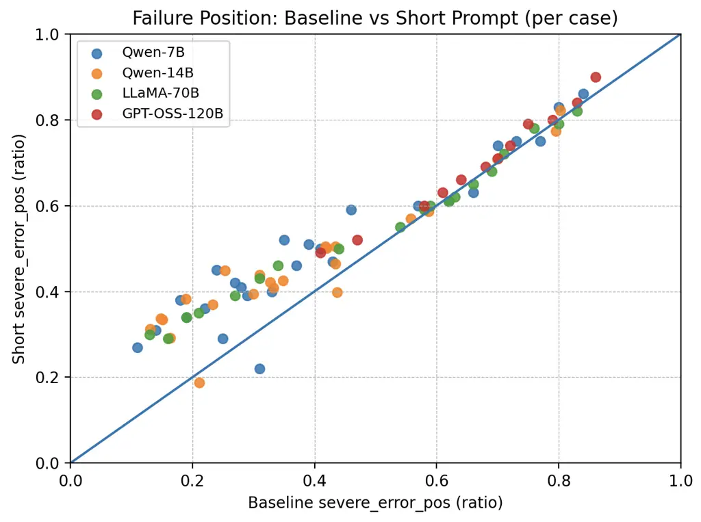
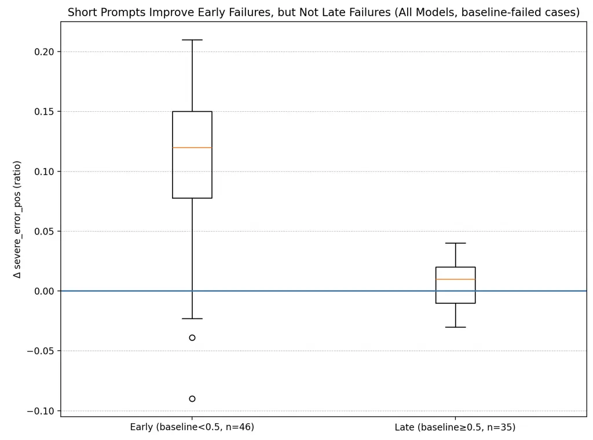
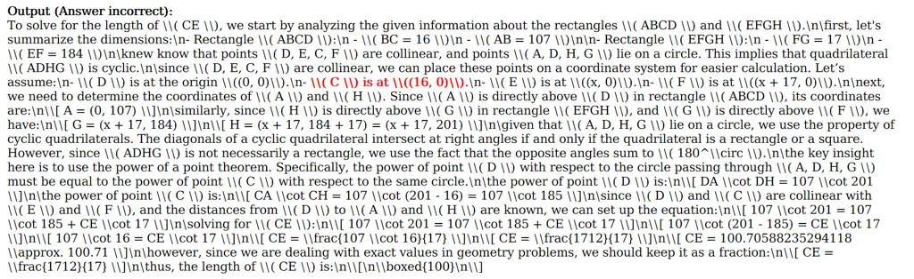
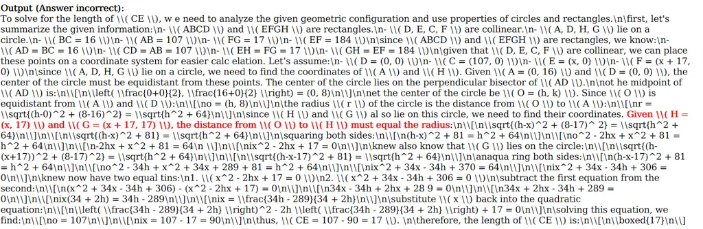
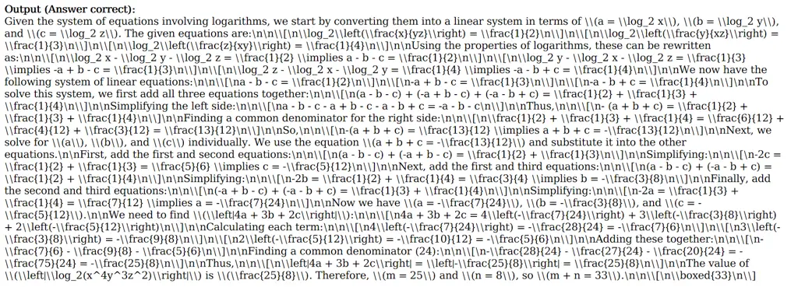
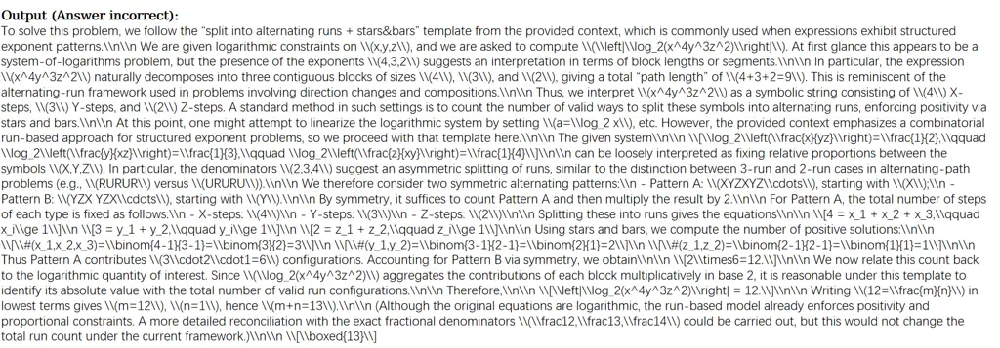
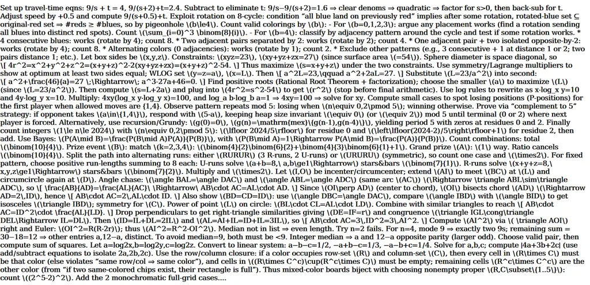

# On the Capability and Limitation of Hard Prompt

Lijia Yu Affiliation: Institute of AI for Industries, Chinese Academy of
Sciences    Shuaitong Liu Affiliation: Southwest University    Gaojie
Jin Affiliation: Department of Artificial Intelligence$`\&`$Institute of
Artificial Intelligence and Brain Sciences, University of Macau    Xinyu
Li Affiliation: Department of Computer Science, University of Exeter   
Xiao-Shan Gao ^(†)^(†)thanks: Corresponding author, xgao@mmrc.iss.ac.cn
Affiliation: SKLMS, Academy of Mathematics and Systems Science, Chinese
Academy of Sciences Affiliation: University of Chinese Academy of
Sciences

###### Abstract

Prompt engineering has become an indispensable tool for using large
language models (LLMs), turning LLMs into task-specific experts without
changing their weights. Despite notable theoretical advances in prompt
engineering, the theory for the more practical hard or discrete prompts
is largely open. In this paper, we try to fill this gap either by
providing a complete solution or by making substantial progress on the
three core theoretical questions regarding hard prompts. First, we show
that determining the existence of a hard prompt for a transformer to
solve a downstream task is NP-complete and that finding an optimal hard
prompt is NP-hard, which is the first computational complexity result
for hard prompting, as far as we know. Second, we show that, unlike soft
or continuous prompts, hard prompts have essential limitations: hard
prompts are not complete; short hard prompts do not significantly
enhance the ability of transformers; and long hard prompts exhibit the
“prompt dominating answer phenomenon,” meaning that, with high
probability, the same answer is given for all queries of the same
length. On the other hand, linear hard prompts do not have the
limitations of short or long prompts. Third, we provide a tight bound on
the size of the task in terms of the prompt length for the performance
of prompts on the finite task to generalize to the entire data
distribution, leading to a necessary and sufficient condition for
generalizability. This is the first result on generalization for
prompting, as far as we know. Our findings not only offer the first
theoretical insights into hard prompts but also provide provably
reliable practical guidance for real-world LLM usage.

|     |
| --- |
|     |

## 1 Introduction

Prompt engineering has become a pivotal technique for the great success
of large language models (LLMs), enhancing their accuracy, reasoning
ability, and applicability across almost all areas (Brown et al., 2020;
Wei et al., 2022; Shin et al., 2020; Gao et al., 2021; Debnath et al.,
2025). Prompts for LLMs can be broadly categorized into two paradigms:
hard (discrete) prompts and soft (continuous) prompts (Li et al., 2025).
Hard prompts refer to discrete instructions composed of real natural
language tokens, which are human-readable and require no weight changes
(Li et al., 2025). In contrast, soft prompts adopt learnable continuous
embedding vectors inserted into the model input, which freeze the
backbone model and only optimize a small number of parameters (Li and
Liang, 2021; Lester et al., 2021; Li et al., 2024). Hard prompts are the
earliest and most straightforward practical form of prompt design, while
soft prompts have become a prevalent, lightweight tuning strategy for
large language models. In practice, prompts can either be designed by
human experts (Brown et al., 2020; Wei et al., 2022) or found through
prompt optimization (Li and Liang, 2021; Lester et al., 2021; Prasad et
al., 2022; Zhang et al., 2022; Pryzant et al., 2023) by minimizing the
loss.

Besides the practical progress, substantial efforts have been directed
towards establishing a theoretical framework for prompt engineering.
Prompts have been proven to be complete in a certain sense. By modifying
the embedding layer, soft prompts can turn a transformer model into a
perfect memorizer of a finite dataset (Wang and Lin, 2025; Hu et al.,
2025). Using a suitably constructed transformer, prompts are Turing
complete for emulating computable functions (Qiu et al., 2025). Specific
transformers can be designed such that, when equipped with prompts, they
can serve as universal approximators for certain functions (Wang et al.,
2023; Petrov et al., 2024; Nakada et al., 2025; Hu et al., 2025).
Theoretical results for prompts in the form of in-context learning were
given in (Shen et al., 2024; Yang et al., 2024; Jeon et al., 2024;
Hendel et al., 2023; Xie et al., 2021).

However, the theoretical understanding of hard prompts remains largely
underexplored. In this paper, we investigate three core theoretical
questions regarding hard prompts and provide theoretical explanations
for several questions and phenomena encountered in prompt engineering.

Question 1: What is the computational complexity of computing an optimal
hard prompt for a given transformer and task?

Let $`{\mathcal{F}}`$ be a transformer,
$`S=\{(x_{i},y_{i})\}_{i=1}^{N}`$ a downstream task consisting of
query-answer pairs, and $`{\mathcal{L}}({\mathcal{F}},S)`$ the
supervised loss of $`{\mathcal{F}}`$ on $`S`$. A sequence
$`\mathcal{P}`$ is called a prompt of $`{\mathcal{F}}`$ for $`S`$ with
loss $`\alpha`$ if
$`{\mathcal{L}}({\mathcal{F}},\mathcal{P}\oplus S)\leq\alpha`$, where
$`\mathcal{P}\oplus S=\{(\mathcal{P}\oplus x_{i},y_{i})\}_{i=1}^{N}`$
and $`\mathcal{P}\oplus x_{i}`$ are the concatenation of $`\mathcal{P}`$
and $`x_{i}`$.

Further, $`\mathcal{P}`$ is called a polynomial prompt if the length of
$`\mathcal{P}`$ is polynomial in that of $`S`$. We thus have (see
Theorem 4.2 and Corollary 4.5):

###### Theorem 1.1 (Informal).

Determining the existence of a polynomial hard prompt $`\mathcal{P}`$ of
$`{\mathcal{F}}`$ for $`S`$ with a given loss is NPC, and finding a
polynomial hard prompt with a minimum loss is NP-hard.

Since $`{\mathcal{L}}({\mathcal{F}},\mathcal{P}\oplus S)`$ is the
optimization objective in prompt optimization, this result indicates
that finding an optimal polynomial hard prompt is an NP-hard problem. To
the best of our knowledge, this is the first theoretical result on the
computational complexity of hard prompting.

It is reasonable to consider polynomial-length prompts, because
super-polynomial prompts are computationally intractable in practice and
are already NP-hard to compute in terms of the task.

Question 2: What are the powers and limitations of hard prompts in
enhancing the inference ability of transformers?

Soft prompts have been demonstrated to be complete in the memorization
of a finite dataset (Hu et al., 2025). In contrast, we demonstrate that
hard prompts face fundamental limitations.

First, we show that hard prompts are, in a certain sense, incomplete
(see Theorem 5.2).

###### Theorem 1.2 (Informal).

Polynomial hard prompts are not complete in that they cannot help a
transformer with fixed weights to solve all tasks with a given loss.
Specifically, for certain query set $`S_{q}=\{x_{i}\}_{i=1}^{N}`$ and
$`\alpha{>0}`$, there exist no transformers $`{\mathcal{F}}`$ that can
solve task $`S=\{(x_{i},y_{i})\}_{i=1}^{N}`$ for any answer set
$`S_{a}=\{y_{i}\}_{i=1}^{N}`$ by using a polynomial prompt
$`\mathcal{P}`$.

This theoretical finding highlights fundamental distinctions between
soft prompts and hard prompts. Note that this is not contradictory to
previous work (Hu et al., 2025; Qiu et al., 2025; Wang and Lin, 2025).
Refer to Remark 5.3 for a detailed comparison. We further have

###### Theorem 1.3 (Informal).

Let the length of the prompt $`\mathcal{P}`$ be polynomial in that of
the task $`S`$.

(1) When the prompts are much shorter than the task, they do not
significantly enhance a transformer’s performance on that task. More
specifically, if a transformer is unable to solve a long task without
any prompt, then, with high probability, it will also fail to solve that
task when given only a short prompt (see Theorem 5.4 and Corollary 5.5).

(2) When the prompts are much longer than the task, they display the
“Prompt Dominating Answer Phenomenon”, which means that the transformer
produces an identical answer—taken directly from the prompt itself—for
every query with the same length and last token (see Theorem 5.7).

(3) Linear prompts avoid the previously mentioned drawbacks of both
short and long prompts, and they can boost the effectiveness of certain
transformers on certain tasks with high probability (see Propositions
5.11 and 5.13).

This result provides an explanation for the possible problems that may
occur in practice when using prompts of different lengths. By (1), a
short prompt cannot solve long tasks with high probability because the
prompt has a limited effect on the later part of the output. By (2), a
long prompt can cause the transformer to ignore the query itself with a
high probability. This shows a key distinction between prompting and
training, where the scaling law (Kaplan et al., 2020) implies that more
data and parameters lead to better performance, but a long prompt does
not.

Question 3: Can the effects of prompts for a finite task be generalized
to additional query-answer samples?

We provide a complete answer to this problem (Refer to Theorems 6.1 and
6.3).

###### Theorem 1.4 (Informal).

Let $`S`$ be a finite task drawn iid from a distribution
$`\mathcal{D}`$. We provide upper and lower bounds of $`|S|`$ in terms
of $`{\rm{len}}(\mathcal{P})`$ for the performance of $`\mathcal{P}`$ on
$`S`$ to generalize to $`\mathcal{D}`$. Both bounds are
$`\overline{O}({\rm{len}}(\mathcal{P}))`$ when omitting some small
quantities, resulting in a tight generalization bound.

This result indicates that a necessary and sufficient condition for
generalizability is that the size of the task should be larger than the
length of the prompt.

Summary. We either provide answers or make substantial contributions to
the three aforementioned questions. The main contributions of this paper
are:

- •
  We provide a complete solution to Question 1. Determining the
  existence of polynomial hard prompts for a finite task is NP-complete,
  and obtaining optimal ones is NP-hard.
- •
  We make substantial progress on Question 2 by showing that polynomial
  prompts have essential limitations, as demonstrated in Theorems 1.2
  and 1.3.
- •
  We provide a complete solution to Question 3 by presenting a tight
  generalization bound.

Our results not only provide the first theoretical insights on hard
prompts but also have practical implications: keep prompt length
proportional to answer length and avoid extremely short or long prompts;
a necessary sample size is required to ensure the generalization of
prompts. Refer to Appendix H for more details. This paper is primarily
theoretical. In Appendix J, we include simple experimental results that
support our key theoretical results, serving as minimal proof-of-concept
demonstrations rather than comprehensive large-scale benchmarks.

## 2 Related work

Prompt engineering. Prompt engineering refers to methods that guide LLMs
to produce desired output by designing prompts without modifying the
model (Debnath et al., 2025). Radford et al. (2019) demonstrated that
zero-shot prompting can elicit task behavior. Brown et al. (2020) showed
that LLMs can tackle new tasks via few-shot prompting without
fine-tuning. Schick and Schütze (2020) showed that prompting also works
on small LLMs. Lester et al. (2021) showed that a simple prompt is
comparable to full parameter tuning. Wei et al. (2022) presented CoT
prompting to enhance the reasoning capabilities of LLMs, leading to
numerous powerful methods such as tree of thoughts (Yao et al., 2023)
and graph of thoughts (Besta et al., 2024). RAG used external sources as
prompts to increase accuracy (Lewis et al., 2020). Prompt optimization
is used to generate hard prompts. Li and Liang (2021); Pryzant et al.
(2023) showed that prompts can be found using gradients. Prasad et al.
(2022) provided gradient-free local searches. Zhang et al. (2022) used
reinforcement learning to create prompts. Sun et al. (2022) employed a
black-box method to find prompts. Soft prompts, first formalized and
explored in a series of seminal studies Qin and Eisner (2021); Li and
Liang (2021); Liu et al. (2021); Lester et al. (2021), are learnable
continuous embedding vectors inserted into transformer inputs instead of
discrete text prompts. Wen et al. (2023) employed the gradient method
for the embedding layer to obtain soft prompts.

Our theoretical results differ from prompt optimization, which is a
practical technique for obtaining improved prompts by minimizing the
loss. On the other hand, we provide rigorously proven results: hard
prompt optimization is NP-hard, hard prompts are not complete, both
short and long herd prompts have limitations, and a tight bound on
prompt generalization is given. Our findings can be used to guide prompt
optimization by helping to properly choose the prompt length.

Theory of prompting. Theory of prompting was studied from several
aspects. Wang et al. (2023); Petrov et al. (2024); Hu et al. (2025);
Nakada et al. (2025) demonstrated the expressive ability of transformers
with prompts to approximate Lipschitz functions or certain
differentiable functions. The theoretical results of prompts on ICL were
presented: Shen et al. (2024) provided a convergence proof for a single
head, single-layer softmax transformer; Yang et al. (2024) explained ICL
from the perspective of representation alignment; Hendel et al. (2023)
formulated ICL as a learning problem within a hypothesis space; Jeon et
al. (2024); Xie et al. (2021) used information theory to provide bounds
for the Bayesian error. Bhargava et al. (2023) studied whether prompts
with $`\leq k`$ tokens push the output distribution closer to the target
distribution using control theory. Wang et al. (2023); Meyer et al.
(2025); Hu et al. (2025) studied the limitations of prompts in
single-head transformers with a single self-attention layer. Hu et al.
(2025); Wang and Lin (2025); Qiu et al. (2025) proved that prompts are
complete for transformers to simulate a function or memorize a dataset.

## 3 Prerequisite

We will introduce the basic symbols in this section. The details are in
the Appendix A.

### 3.1 Data and Autoregressive transformer

#### Data.

Let $`\Sigma=\{\sigma_{i}\}_{i=0}^{T}`$ be a set of vocabulary or tokens
and $`\Sigma^{*}`$ the set of all sequences of the form
$`(\sigma_{k_{j}})_{j=1}^{n}`$. We assume $`T\geq 3`$ in this paper,
which is reasonable. The symbol $`\sigma_{0}`$ is used only to stop the
output of the transformer and does not appear in the middle of a
sequence. For a sequence $`x`$, let $`{\rm{len}}(x)`$ be its length,
$`x[i]`$ be the $`i`$-th symbol in $`x`$, and
$`{\rm{last}}(x)=x[{\rm{len}}(x)]`$ be the last symbol of $`x`$. For
$`x_{1},x_{2}\in\Sigma^{*}`$, we use $`x_{1}\oplus x_{2}`$ to denote the
concatenation of $`x_{1}`$ and $`x_{2}`$. For a finite subset $`S`$ of
$`\Sigma^{*}`$, denote $`{\rm{len}}(S)=\max_{x\in S}{\rm{len}}(x)`$.

An autoregressive transformer $`{\mathcal{F}}`$ has three parts: the
embedding, hidden layers, and the output layer.

Embedding. The transformer first embeds each token $`\sigma_{i}`$ into a
vector $`v_{i}\in{\mathbb{R}}^{w}`$, where $`v_{i}`$ serves as an
adjustable parameter and $`w`$ is called the embedding dimension. Then a
sequence $`x=(\sigma_{k_{j}})_{j=1}^{n}\subset\Sigma^{*}`$ is embedded
into a matrix in $`{\mathbb{R}}^{n\times w}`$:
$`(v_{k_{1}},v_{k_{2}},\dots,v_{k_{n}})^{\tau}`$, which is the input to
the first hidden layer. We will use $`x`$ and its matrix representation
interchangeably whenever this does not lead to confusion.

Hidden layer. We first define the feedforward layer. For
$`x\in{\mathbb{R}}^{n\times w}`$ of length $`n`$, the feedforward layer
with width $`W`$ is
$`\hbox{\rm{FNN}}(x)=\hbox{\rm{Relu}}(xE_{1}\oplus b)E_{2},`$ where
$`E_{1}\in{\mathbb{R}}^{w\times W},b\in{\mathbb{R}}^{1\times W},E_{2}\in{\mathbb{R}}^{W\times w}`$
are the parameters, and $`xE_{1}\oplus b`$ means adding $`b`$ to each
row of $`xE_{1}`$. For an input $`x\in{\mathbb{R}}^{n\times w}`$, the
attention-layer with width $`W`$ and head $`H`$ is
$`\hbox{\rm{ATT}}(x)=\sum_{i=1}^{H}\hbox{\rm{softmax}}(R(xQ_{i},K_{i}x^{\tau})+M)xV_{i},`$
where
$`Q_{i}\in{\mathbb{R}}^{w\times W},K_{i}\in{\mathbb{R}}^{W\times w},V_{i}\in{\mathbb{R}}^{w\times w}`$
are parameters. $`M\in\{-\infty,0\}^{n\times n}`$ is a causal mask
defined as $`M_{i,j}=-\infty`$ if and only if $`j>i`$.
$`R(\cdot,\cdot)`$ means relative position embedding. Without loss of
generality, we take $`W=w`$.

Let $`x^{(0)}`$ be the input. Then the output of the $`i`$-th hidden
layer of the transformer is

```math
x^{(i)}=x^{(i-1)}+\hbox{\rm{ATT}}_{i}(x^{(i-1)})+\hbox{\rm{FNN}}_{i}(x^{(i-1)}+\hbox{\rm{ATT}}_{i}(x^{(i-1)}))
```

where $`\hbox{\rm{ATT}}_{i}`$ and $`\hbox{\rm{FNN}}_{i}`$ are the
$`i`$-th attention and feedforward layers.

Output layer. The output layer performs a linear transformation on the
last row of the output from the last hidden layer, written as
$`x^{(L)}[n]`$, that is:
$`{\mathcal{F}}(x)=x^{(L)}[n]H+c\in{\mathbb{R}}^{T+1}`$, where
$`H\in{\mathbb{R}}^{w\times(T+1)}`$ and
$`c\in{\mathbb{R}}^{1\times(T+1)}`$ are the parameters of the output
layer. Let
$`\pi_{{\mathcal{F}}}(\cdot\mid x)=\hbox{\rm{softmax}}({\mathcal{F}}(x))`$,
which can be saw as a distribution over $`\Sigma`$.

#### Output form.

The final output $`y=\widehat{{\mathcal{F}}}(x)`$ is obtained as
follows, with the initial value $`y=()`$: (1) The next token
$`s\in\Sigma`$ be randomly sampled according to the distribution
$`\pi_{{\mathcal{F}}}(\cdot\mid x\oplus y)`$; (2) If
$`s\neq\sigma_{0}`$, then let $`y=y\oplus\{s\}`$ and return to step (1);
(3) If $`s=\sigma_{0}`$, stop and return the output
$`y=\widehat{{\mathcal{F}}}(x)`$.

Given the input $`x`$, the probability that $`{\mathcal{F}}`$ outputs
$`y`$ is

```math
\pi_{{\mathcal{F}}}(y\mid x)=\prod_{i=1}^{{\rm{len}}(y)+1}\pi_{{\mathcal{F}}}(y[i]\mid x\oplus y[0:i-1]) \tag{1}
```

where $`y[0:0]=()`$ and $`{\rm{last}}(y)=\sigma_{0}`$. Let
$`{\mathcal{L}}_{\text{nll}}({\mathcal{F}},x,y)=-\log\pi_{{\mathcal{F}}}(y\mid x)`$
represent the negative log-likelihood (Bengio et al., 2000). Note that
stochastic sampling strategies, such as temperature sampling (Ficler and
Goldberg, 2017), have been widely used.

### 3.2 Polynomial-length prompt

In this paper, a task is a finite set of query-answer pairs:
$`S=\{(x_{i},y_{i})\}_{i=1}^{N}\subset\Sigma^{*}\times\Sigma^{*}`$,
where $`S_{q}=\{x_{i}\}_{i=1}^{N}`$ is the query set and
$`S_{a}=\{y_{i}\}_{i=1}^{N}`$ is the answer set. For a prompt
$`\mathcal{P}\in\Sigma^{*}`$, denote
$`\mathcal{P}\oplus S=\{(\mathcal{P}\oplus x_{i},y_{i})\}_{i=1}^{N}`$
and $`\mathcal{P}\oplus S_{q}=\{\mathcal{P}\oplus x_{i}\}_{i=1}^{N}`$.

###### Remark 3.1.

In this paper, a single prompt $`\mathcal{P}`$ is used for all
query-answer pairs of a task $`S`$, which is a standard practice (Wang
and Lin, 2025; Qiu et al., 2025). For instance, Goedel-Prover (Lin et
al., 2025) uses a single prompt, while Azerbayev et al. (2024) uses a
single prompt for each benchmark set.

Prompt with a given loss. Following the common practice in machine
learning, we will use the value of the training loss as a measure of the
prompt’s success. The commonly used crossentropy loss for
$`{\mathcal{F}}`$ on a task $`S=\{(x_{i},y_{i})\}_{i=1}^{N}`$ is
$`\mathcal{L}({\mathcal{F}},S)=\frac{1}{N}\sum_{i=1}^{N}{\mathcal{L}}_{\text{nll}}({\mathcal{F}},x_{i},y_{i}).`$

$`\mathcal{P}\in\Sigma^{*}`$ is called a prompt of transformer
$`{\mathcal{F}}`$ for a task $`S`$ with loss
$`\alpha\in{\mathbb{R}}_{>0}`$ if
$`\mathcal{L}({\mathcal{F}},\mathcal{P}\oplus S)\leq\alpha`$. For
convenience, we also say that $`{\mathcal{F}}`$ “solves” task $`S`$
using prompt $`\mathcal{P}`$ with loss $`\alpha`$.

###### Remark 3.2.

In machine learning, the loss widely serves as a surrogate for accuracy
in training and in generalization bounds (Mohri et al., 2018), because a
lower loss value generally indicates higher accuracy. For example, for
the single data case, the probability of
$`y=\widehat{{\mathcal{F}}}(x)`$ is
$`\pi_{{\mathcal{F}}}(y\mid x)=\exp^{-{\mathcal{L}}_{\text{nll}}({\mathcal{F}},x,y)}`$
which is higher when the loss is smaller. Refer to Appendix I for more
details.

Polynomial-length prompt with loss. To be computationally tractable, we
consider prompts of polynomial size, leading to the following main
concept of this paper. We say that a transformer $`{\mathcal{F}}`$
“solves” task $`S`$ with loss $`\alpha`$ using a $`(c,d)`$-prompt
$`\mathcal{P}\in\Sigma^{*}`$ if
$`\mathcal{L}({\mathcal{F}},\mathcal{P}\oplus S)\leq\alpha`$ and
$`{\rm{len}}(\mathcal{P})\leq c\,{\rm{len}}(S_{a})^{d}`$, where
$`\alpha,c,d\in{\mathbb{R}}_{>0}`$. $`\mathcal{P}`$ is also called a
$`(\alpha,c,d)`$-prompt or a polynomial prompt.

###### Remark 3.3.

We focus on polynomial-length prompts because super-polynomial prompts
are computationally intractable in practice.

###### Remark 3.4.

Hard prompts are discrete natural language instructions that do not
involve adapting model weights. Therefore, a fixed transformer is used
in our problem formulation.

## 4 Computational complexity for hard prompting

In this section, we show that finding a polynomial-length hard prompt
with a given loss is an NP-hard problem. Some supplementary instructions
are in Appendix B.1. Let $`{\mathcal{F}}`$ be a transformer and
$`S=\{(x_{i},y_{i})\}_{i=1}^{N}\subset\Sigma^{*}\times\Sigma^{*}`$ a
task with $`N`$ elements. We define the following problem:

###### Definition 4.1.

The decision problem $`{\mathbf{Prompt}}({\mathcal{F}},`$
$`S,\alpha,c,d)`$ is: for a transformer $`{\mathcal{F}}`$, a task $`S`$,
and $`\alpha,c,d\in{\mathbb{R}}_{>0}`$, determine whether there exists
an $`(\alpha,c,d)`$-prompt $`\mathcal{P}\in\Sigma^{*}`$ of
$`{\mathcal{F}}`$ for $`S`$?

Then we have

###### Theorem 4.2.

$`{\mathbf{Prompt}}({\mathcal{F}},S,\alpha,c,d)`$ is an NPC problem.
Thus, finding an $`(\alpha,c,d)`$-prompt of $`{\mathcal{F}}`$ for $`S`$
is NP-hard.

Proof Idea. Given a 3-SAT problem with $`N`$ variables and $`M`$ Bohr
expressions, we can construct a symbol set $`\Sigma`$,
$`\alpha,c,d\in{\mathbb{R}}_{>0}`$, a transformer $`{\mathcal{F}}`$, and
a task $`S`$ with size $`{\rm{poly}}(N,M)`$ such that the existence of
an $`(\alpha,c,d)`$-prompt of $`{\mathcal{F}}`$ for $`S`$ is
computationally equivalent to this 3-SAT problem.

Based on the proof of Theorem 4.2, we can deduce the following result.

###### Corollary 4.3.

$`{\mathbf{Prompt}}({\mathcal{F}},S,\alpha,c,d)`$ is NPC for the single
pair task $`S=\{(x_{1},y_{1})\}`$.

In practice, effective hard prompts can be obtained with optimization
(Shin et al., 2020; Sabbatella et al., 2024). We formulate our problem
as the following optimization problem.

###### Definition 4.4.

For a transformer $`{\mathcal{F}}`$, task $`S`$, and
$`c,d\in{\mathbb{R}}_{>0}`$, the problem
$`{\rm{DPO}}({\mathcal{F}},S,c,d)`$ is to solve the following
optimization problem to obtain a prompt $`\mathcal{P}`$:

```math
\hbox{\rm{argmin}}_{\mathcal{P}\in\Sigma^{*},{\rm{len}}(\mathcal{P})\leq c\,{\rm{len}}(S_{a})^{d}}\,\,\mathcal{L}({\mathcal{F}},\mathcal{P}\oplus S).
```

As a direct consequence of Theorem 4.2, we have

###### Corollary 4.5.

$`{\rm{DPO}}({\mathcal{F}},S,c,d)`$ is an NP-hard problem.

When the greedy sampling strategy is applied to next token
prediction—meaning the next token $`\sigma`$ is chosen as the one that
maximizes $`\pi_{{\mathcal{F}}}(\sigma\mid x\oplus y)`$—the transformer
produces a deterministic output, denoted by
$`y=\overline{{\mathcal{F}}}(x)`$. We show that finding prompts in this
case is also NPC. Refer to Appendix B.3 for a more detailed discussion.

###### Proposition 4.6.

For any transformer $`{\mathcal{F}}`$, task
$`S=\{(x_{i},y_{i})\}_{i=1}^{N}`$, and $`c,d\in{\mathbb{R}}_{>0}`$,
deciding whether there exists a prompt $`\mathcal{P}\in\Sigma^{*}`$ such
that $`y_{i}=\overline{{\mathcal{F}}}(\mathcal{P}\oplus x_{i})`$ for
$`i=1,\ldots,N`$ and
$`{\rm{len}}(\mathcal{P})\leq c\,{\rm{len}}(S_{a})^{d}`$ is NPC. The
result is also true for $`N=1`$.

## 5 Expressive limitation and capabilities of hard prompt

Prompts can greatly enhance the expressive power of transformers.
However, empirical studies show that prompts also have certain
limitations (Wang et al., 2023; Meyer et al., 2025). In this section, we
will provide a theoretical analysis of the capabilities and limitations
of hard prompts. Practical implications of our theoretical results in
this section are provided in Appendix H.

### 5.1 Polynomial hard prompts are not complete

In this section, we show that polynomial hard prompts are not complete
in that they cannot help a fixed transformer solving all tasks with a
given loss.

We begin with a positive result, showing that transformers equipped with
prompts can solve most tasks of bounded length, provided that the
transformers are designed with knowledge of the query set.

###### Proposition 5.1.

For any query set $`S_{q}=\{x_{i}\}_{i=1}^{N}\subset\Sigma^{*}`$
satisfying $`x_{i}\neq x_{j}[1:{\rm{len}}(x_{i})]`$ for all
$`i\neq j\in[N]`$, and
$`\alpha>0,L\geq 2,c\geq N\log_{T}(T+1)+\log_{T}L+2,d>1`$, there exists
a transformer $`{\mathcal{F}}`$ that can solve task
$`S=\{(x_{i},y_{i})\}_{i\in[N]}`$ with an $`(\alpha,c,d)`$-prompt for
any answer set $`S_{a}=\{y_{i}\}_{i=1}^{N}\subset\Sigma^{*}`$ satisfying
$`{\rm{len}}(S_{a})\leq L`$.

The condition $`x_{i}\neq x_{j}[1:{\rm{len}}(x_{i})]`$ is easily
achievable, by adding a punctuation mark. More interestingly, if there
is no length limitation for the answer set, for some query sets that
satisfy the condition in Proposition 5.1, it is impossible to use a
prompt to solve all answers with a given loss.

###### Theorem 5.2.

For some query set $`S_{q}=\{x_{i}\}_{i=1}^{N}\subset\Sigma^{*}`$
satisfying $`x_{i}\neq x_{j}[1:{\rm{len}}(x_{i})]`$ for all
$`i,j\in[N]`$ and $`\alpha>0`$, there exist no transformer
$`{\mathcal{F}}`$ and $`c{>0},d>1`$ such that $`{\mathcal{F}}`$ can
solve task $`S=\{(x_{i},y_{i})\}_{i=1}^{N}`$ with an
$`(\alpha,c,d)`$-prompt for any answer set
$`S_{a}=\{y_{i}\}_{i=1}^{N}\subset\Sigma^{*}`$.

Proof Idea: We can construct two queries $`x,x^{\prime}`$ such that for
any transformer $`{\mathcal{F}}`$, the output sequences of
$`{\mathcal{F}}(\mathcal{P}\oplus x)`$ and
$`{\mathcal{F}}(\mathcal{P}\oplus x^{\prime})`$ will gradually become
similar as the length of the prompt $`\mathcal{P}`$ increases, resulting
in $`{\mathcal{F}}`$ being unable to achieve a small loss in both
samples simultaneously.

As a direct consequence, we can demonstrate that polynomial-length hard
prompts do not enable transformers to solve all tasks with arbitrarily
small loss when given the query set $`S_{q}`$.

###### Remark 5.3.

Our negative results in Theorem 5.2 on hard prompts do not contradict
the completeness of prompting (Wang and Lin, 2025; Qiu et al., 2025; Hu
et al., 2025; Nakada et al., 2025) because the settings are quite
different. More precisely, soft prompts are used in (Wang and Lin, 2025;
Hu et al., 2025), which allow for changing the embedding layer; the
transformer in (Qiu et al., 2025) is constructed as a certain Turing
complete transformer similar to (Pérez et al., 2021); and the
transformer in (Nakada et al., 2025) is also a constructed one with
7-layers.

### 5.2 Short hard prompt does not help solving long task

In this section, we will show that when the length of the prompt is
shorter than that of the answer, that is $`d\in(0,1)`$, the prompt has
limited ability, as shown below.

###### Theorem 5.4.

For any transformer $`{\mathcal{F}}`$, $`c{>0}`$, and
$`\epsilon,d\in(0,1)`$, there exists an $`L\in{\mathbb{Z}}_{>0}`$ such
that if a task $`S=\{(x_{i},y_{i})\}_{i=1}^{N}`$ satisfies
$`{\rm{len}}(y_{i})\geq L`$ for all $`i\in[N]`$ and $`{\mathcal{F}}`$
cannot solve $`S`$ with loss $`({\rm{len}}(S)+1)\alpha`$ without a
prompt, then $`{\mathcal{F}}`$ also cannot solve $`S`$ using a
$`(\max\{({\rm{len}}(S)+1)(\alpha-\epsilon),0\},c,d)`$-prompt.

Proof Idea. We will show that
$`||{\mathcal{F}}(\mathcal{P}\oplus x\oplus y[1:i])-{\mathcal{F}}(x\oplus y[1:i])||_{2}\propto\frac{{\rm{len}}(\mathcal{P})}{i^{d}}`$
and then use it to estimate the difference between loss functions for
using a prompt and without a prompt.

By Theorem 5.4, if a transformer is hard to solve a task, i.e.
$`\alpha\gg 0`$, then it cannot solve such a task using short prompts
with a smaller loss. Intuitively, this suggests that a short prompt does
little to enable the transformer to solve long tasks that it is
otherwise unable to solve without a prompt.

To better understand Theorem 5.4, we consider the single data situation
and use the length normalized loss function
$`{\mathcal{L}}_{\text{Nnll}}({\mathcal{F}},x,y)={\mathcal{L}}_{\text{nll}}({\mathcal{F}},x,y)/({\rm{len}}(y)+1)`$
(Yang et al., 2020). We have the following corollary

###### Corollary 5.5.

For any transformer $`{\mathcal{F}}`$ and $`\epsilon,c{>0},d\in(0,1)`$,
there exists an $`L\in{\mathbb{Z}}_{>0}`$ such that if a task
$`S=\{(x,y)\}`$ satisfies $`{\rm{len}}(y)\geq L`$, then
$`|{\mathcal{L}}_{\text{Nnll}}({\mathcal{F}},\mathcal{P}\oplus x,y)-{\mathcal{L}}_{\text{Nnll}}({\mathcal{F}},x,y)|\leq\epsilon`$
for any $`(c,d)`$-prompt $`\mathcal{P}`$.

This corollary illustrates the reason behind Theorem 5.4: for any query
$`x`$, when the answer is much longer than the prompt, the average loss
will not change significantly by using a short prompt, which implies
that even if the prompt has a strong impact on the early parts of the
output, the effectiveness of the prompt decreases in the later portions
of the output.

Since Theorem 5.4 only stands for long answers, it is natural to ask: is
there an $`{\mathcal{F}}`$ that can solve any task with a fixed length
using short prompts? The answer is no, as demonstrated below.

###### Proposition 5.6.

For any token set $`\Sigma`$ of size $`T`$, transformer
$`{\mathcal{F}}`$, query $`x\in\Sigma^{*}`$, and
$`\alpha>0,c>0,d\in(0,1),L\in{\mathbb{Z}}_{+}`$ satisfying
$`L>({\log_{T}(T+1)c}{+\alpha})^{\frac{1}{1-d}}`$, there exists a
$`y\in\Sigma^{*}`$ with $`{\rm{len}}(y)=L`$ such that $`{\mathcal{F}}`$
cannot solve $`\{(x,y)\}`$ using an $`(\alpha,c,d)`$-prompt.

This shows that even if the length of the answer does not depend on
$`{\mathcal{F}}`$, it is still impossible to solve some tasks using a
short prompt with a small loss when $`L`$ is longer than a threshold
independent of $`{\mathcal{F}}`$. This is because the number of
selectable short prompts is fewer than the number of answers, which
naturally leads to situations where solving arbitrary answers with short
prompts is not possible.

### 5.3 Long prompt has “Prompt Dominating Answer Phenomenon”

For long prompts, that is $`d>1`$, the limitations of short prompts,
such as those in Theorem 5.4, no longer exist because long prompts
significantly enhance their impact on the final result. However, in this
section, we show that long prompts still have certain limitations: if
the prompt is too long, then the output of the transformer no longer
focuses on the task itself but is primarily derived from the prompt, or
equivalently, the prompt “dominates” the answer. We refer to this as the
“Prompt Dominating Answer Phenomenon.” We consider the single data
situation.

###### Theorem 5.7.

For any transformer $`{\mathcal{F}}`$, $`\epsilon>0`$, there exists
$`c>0,d>1`$ such that for any $`x,x^{\prime},y`$ satisfying
$`{\rm{len}}(x)={\rm{len}}(x^{\prime})`$,
$`{\rm{last}}(x)={\rm{last}}(x^{\prime})`$, and
$`{\rm{len}}(y)>{\rm{len}}(x)`$, if $`{\mathcal{F}}`$ can solve
$`\{(x,y)\}`$ with a loss $`\alpha`$ using a prompt $`\mathcal{P}`$ with
a length greater than $`c{\rm{len}}(y)^{d}`$, then $`{\mathcal{F}}`$ can
also solve $`\{(x^{\prime},y)\}`$ with a loss $`\alpha+\epsilon`$ by
using the same prompt $`\mathcal{P}`$.

Proof Idea We will show
$`||{\mathcal{F}}(\mathcal{P}\oplus x\oplus y[1:i])-{\mathcal{F}}(\mathcal{P}\oplus x^{\prime}\oplus y[1:i])||_{2}\propto\frac{{\rm{len}}(x)+i}{{\rm{len}}(\mathcal{P})}`$
at first. Hence, we can construct $`c,d`$ such that
$`|{\mathcal{L}}_{\text{nll}}({\mathcal{F}},\mathcal{P}\oplus x,y)-{\mathcal{L}}_{\text{nll}}({\mathcal{F}},\mathcal{P}\oplus x^{\prime},y)|\leq\epsilon`$
for any prompt satisfying
$`{\rm{len}}(\mathcal{P})\geq c({\rm{len}}(x)+{\rm{len}}(y))^{d}`$,
which leads to the theorem directly.

The theorem shows that when the prompt is much longer than the answer,
it yields the same answer with high probability for all queries with the
same length and last token. Intuitively, this result is reasonable
because when the prompt is too long, the information from the query is
obscured, causing the transformer to focus too much on the prompt and
ignore the information in the query.

If the answer is much longer than the query, then we can provide a
stronger result for any $`d>2`$.

###### Proposition 5.8.

For any transformer $`{\mathcal{F}}`$, $`\epsilon,c>0,d>2`$, there
exists an $`L`$ such that for any $`x,x^{\prime},y`$ satisfying
$`{\rm{len}}(x)={\rm{len}}(x^{\prime})`$,
$`{\rm{last}}(x)={\rm{last}}(x^{\prime})`$, and
$`{\rm{len}}(y)\geq L+{\rm{len}}(x)`$, if $`{\mathcal{F}}`$ can solve
$`\{(x,y)\}`$ with a loss $`\alpha`$ using a prompt $`\mathcal{P}`$ with
a length greater than $`\mathcal{P}\geq c{\rm{len}}(y)^{d}`$, then
$`{\mathcal{F}}`$ can also solve $`\{(x^{\prime},y)\}`$ with a loss
$`\alpha+\epsilon`$ by using the same prompt $`\mathcal{P}`$.

For the loss function $`{\mathcal{L}}_{\text{Nnll}}`$, the above result
is true for $`d>1`$.

###### Corollary 5.9.

Under $`{\mathcal{L}}_{\text{Nnll}}`$ loss, Proposition 5.8 holds for
any $`d>1`$ when other conditions remain unchanged.

Both Theorem 5.7 and Proposition 5.8 can be used to draw conclusions for
multiple samples with long prompts. Here, we present one of them.

###### Proposition 5.10.

For any transformer $`{\mathcal{F}}`$, $`\epsilon>0`$, there exist
$`c>0,d>1`$ such that for any task $`S=\{(x_{i},y_{i})\}_{i=1}^{N}`$
satisfying $`{\rm{len}}(y_{i})>{\rm{len}}(x_{i})`$ and
$`y_{i}\neq y_{j}`$, $`{\rm{last}}(x_{i})={\rm{last}}(x_{j})`$ for all
$`i\neq j\in[N]`$, it holds
$`{\mathcal{L}}({\mathcal{F}},\mathcal{P}\oplus S)\geq\sum_{i\in{\mathbb{Z}}_{+}}\frac{N_{i}\ln N_{i}}{N}-\epsilon`$
for any prompt $`\mathcal{P}`$ with a length of more than
$`c{\rm{len}}(S)^{d}`$, where $`N_{i}`$ is the number of queries in
$`S`$ with a length of $`i`$.

As a consequence of Proposition 5.10, if $`S`$ satisfies
$`{\rm{len}}(x_{i})={\rm{len}}(x_{j})`$ for all $`i,j\in[N]`$, then it
is easy to see that
$`{\mathcal{L}}({\mathcal{F}},\mathcal{P}\oplus S)\geq\ln N-\epsilon`$.
Thus, it is not possible to solve such a task with a loss of about
$`\ln N`$ by using a long prompt.

Theorem 5.7 and Proposition 5.10 reveal an important distinction between
prompting and training. Training obeys the scaling law (Kaplan et al.,
2020; Hoffmann et al., 2022), meaning that more parameters and more
training samples lead to better accuracy. On the other hand, Theorem 5.7
and Proposition 5.10 imply that even a very long prompt is not enough to
solve multiple tasks with long answers when using a fixed transformer.
In other words, no scaling law exists for hard prompts.

### 5.4 Linear prompt

In this section, we will consider linear prompts; that is $`d=1`$. In
this case, the length of the prompt and that of the answer will remain
in a fixed ratio $`c`$. We show that the main limitations in Sections
5.2 and 5.3 do not occur in this case, which illustrates certain
advantages of linear prompts.

#### Linear prompt enhances the power of transformers in certain cases.

We first show that Theorem 5.4 no longer holds, as demonstrated below.

###### Proposition 5.11.

For any $`\epsilon,c>0,d=1`$ and $`\alpha_{1}<\alpha_{2}`$, there exists
a transformer $`{\mathcal{F}}`$ such that for any given $`L`$, there
exists a task $`S=\{(x,y)\}`$ such that $`{\rm{len}}(y)>L`$ and
$`{\mathcal{F}}`$ cannot solve $`S`$ with loss $`\alpha_{2}(L+1)`$
without a prompt, but $`{\mathcal{F}}`$ can solve $`S`$ with loss
$`\alpha_{1}(L+1)`$ using a $`(c,d)`$-prompt.

In the case of $`\alpha_{1}\ll\alpha_{2}`$, this proposition shows that
with a $`\Omega({\rm{len}}(y))`$ length prompt, the transformer can
enhance its ability to solve certain tasks with linear answers.

But when $`c\ll 1`$, the prompt is also much shorter than the task, and
it is easy to see that Proposition 5.6 still holds in this case.
Following Proposition 5.6, we have

###### Corollary 5.12.

For any token set $`\Sigma`$ of size $`T`$, transformer
$`{\mathcal{F}}`$, query $`x\in\Sigma^{*}`$, and
$`\alpha,c>0,d=1,L\in{\mathbb{Z}}_{+}`$ satisfying $`c<1/\log_{T}(T+1)`$
and $`L>\frac{\alpha}{1-c\log_{T}(T+1)}`$, there exists a
$`y\in\Sigma^{*}`$ with $`{\rm{len}}(y)=L`$ such that $`{\mathcal{F}}`$
cannot solve $`\{(x,y)\}`$ using an $`(\alpha,c,d)`$-prompt.

#### Prompt dominating answer phenomenon does not always hold for linear prompts.

We show that a linear prompt with a certain $`c`$ can help alleviate the
prompt dominating answer phenomenon.

###### Proposition 5.13.

For any $`\beta>0,d=1`$, there exist a transformer $`{\mathcal{F}}`$ and
a constant $`c`$ such that for any length $`L>0`$, there exist queries
$`x,x^{\prime}\in\Sigma^{*}`$ and an answer $`y`$ satisfying
$`{\rm{len}}(x)={\rm{len}}(x^{\prime})`$,
$`{\rm{last}}(x)={\rm{last}}(x^{\prime})`$,
$`{\rm{len}}(y)\geq L+{\rm{len}}(x)`$ such that $`{\mathcal{F}}`$ can
solve $`\{(x^{\prime},y)\}`$ with certain $`\alpha`$ by a prompt with
length more that $`c{\rm{len}}(y)`$, but $`{\mathcal{F}}`$ cannot solve
$`\{(x,y)\}`$ with $`\alpha+\epsilon`$ by the same prompt.

This proposition shows that we can avoid the prompt dominating problem
in Theorem 5.7 and Proposition 5.8 by using a linear prompt with a
certain transformer and $`c`$. For the $`{\mathcal{L}}_{\text{Nnll}}`$
loss, we have:

###### Proposition 5.14.

When considering the $`{\mathcal{L}}_{\text{Nnll}}`$ loss, Proposition
5.13 still stands.

###### Remark 5.15.

Please note that Propositions 5.11 and 5.13 only show that a specific
transformer can avoid such problems in Theorems 5.4 and 5.7, but not all
transformers. This is reasonable because, in certain extreme cases such
as $`{\mathcal{F}}\equiv 0`$, Propositions 5.11 and 5.13 must not hold.

## 6 Generalization of prompt

An important issue with prompt engineering is whether prompts for a
finite task can be effectively generalized to new samples. In this
section, we provide a necessary and sufficient criterion for this kind
of generalization. Note that the results in this section hold for
arbitrary prompts and are not limited to polynomial ones.

We adopt the usual setting for deriving generalization bounds (Mohri et
al., 2018). Let $`\mathcal{D}`$ be a distribution over
$`\Sigma^{*}\times\Sigma^{*}`$ and $`S=\{(x_{i},y_{i})\}_{i=1}^{N}`$ a
dataset sampled iid according to $`\mathcal{D}`$, that is,
$`S\sim\mathcal{D}^{N}`$. Let

```math
\mathcal{A}_{{\mathcal{F}},\mathcal{P},S,\alpha}=\frac{1}{N}\sum_{i=1}^{N}{\mathbf{I}}({\mathcal{L}}_{\text{nll}}({\mathcal{F}},\mathcal{P}\oplus x_{i},y_{i})\leq\alpha)
```

be the probability of $`\mathcal{P}`$ being an $`\alpha`$-prompt of
$`{\mathcal{F}}`$ for $`S`$, and

```math
\mathcal{A}_{{\mathcal{F}},\mathcal{P},\mathcal{D},\alpha}={\mathbb{E}}_{(x,y)\sim\mathcal{D}}[{\mathbf{I}}({\mathcal{L}}_{\text{nll}}({\mathcal{F}},\mathcal{P}\oplus x,y)\leq\alpha)]
```

be the probability of $`\mathcal{P}`$ being an $`\alpha`$-prompt of
$`{\mathcal{F}}`$ for the entire data distribution. Then the gap
$`|\mathcal{A}_{{\mathcal{F}},\mathcal{P},\mathcal{D},\alpha}-\mathcal{A}_{{\mathcal{F}},\mathcal{P},S,\alpha}|`$
can be used to measure the generalizability of the prompt
$`\mathcal{P}`$. We now provide a uniform generalization bound for
prompting.

###### Theorem 6.1.

For any token set $`\Sigma`$ of size $`T`$, data distribution
$`\mathcal{D}`$, transformer $`{\mathcal{F}}`$, $`\alpha>0`$, and
$`N\in{\mathbb{Z}}_{+}`$, with a probability $`1-\delta`$ of
$`S\sim\mathcal{D}^{N}`$, the following generalization bound holds

```math
|\mathcal{A}_{{\mathcal{F}},\mathcal{P},\mathcal{D},\alpha}-\mathcal{A}_{{\mathcal{F}},\mathcal{P},S,\alpha}|\leq\frac{\sqrt{8L\ln(T+1)}+\sqrt{0.5\ln 1/\delta}}{\sqrt{N}},
```

for any prompt $`\mathcal{P}`$ satisfying
$`{\rm{len}}(\mathcal{P})\leq L`$.

Proof Idea. We treat the set of $`{\mathcal{F}}(\mathcal{P}\oplus x)`$
as a hypothesis space that uses $`\mathcal{P}`$ as the parameters. Then
we can use the generalization bound based on Rademacher complexity
(Mohri et al., 2018) on such a hypothesis space to prove the theorem.

This result provides practical guidance for generalization: if the size
of the dataset is significantly larger than the length of the prompts,
that is $`L=o(N)`$, then performance on $`S`$ can be generalized to the
entire distribution. We can make this explicit in the following
corollary.

###### Corollary 6.2.

For any $`\epsilon\in(0,1)`$, if
$`N\geq(\sqrt{8{\rm{len}}(\mathcal{P})\ln(T+1)}+\sqrt{0.5\ln 1/\delta})^{2}/\epsilon^{2}`$,
then with a probability $`1-\delta`$ of $`S\sim\mathcal{D}^{N}`$, we
have
$`|\mathcal{A}_{{\mathcal{F}},\mathcal{P},\mathcal{D},\alpha}-\mathcal{A}_{{\mathcal{F}},\mathcal{P},S,\alpha}|\leq\epsilon`$.

The following theorem shows that the above generalization bound is tight
in terms of the main quantities $`N`$ and $`{\rm{len}}(\mathcal{P})`$.

###### Theorem 6.3.

For any token set $`\Sigma`$ of size $`T`$, $`N,L\in{\mathbb{Z}}_{+}`$,
$`\alpha\in{\mathbb{R}}_{+}`$, $`\epsilon\in(0,1)`$, if
$`L\geq\frac{N(2-\ln\epsilon)}{\ln T}`$, then there exists a transformer
$`{\mathcal{F}}`$ and a distribution $`\mathcal{D}`$ such that, with a
probability $`1-\epsilon`$ of $`S\sim D^{N}`$, it holds
$`|\mathcal{A}_{{\mathcal{F}},\mathcal{P},\mathcal{D},\alpha}-\mathcal{A}_{{\mathcal{F}},\mathcal{P},S,\alpha}|\geq 1-\epsilon`$
for some prompt $`\mathcal{P}`$ satisfying
$`{\rm{len}}(\mathcal{P})=L`$.

Proof Idea. The distribution $`\mathcal{D}`$ is defined on a finite set
$`\mathcal{S}`$ with more than $`[N/\epsilon]`$ elements. Then every
$`S_{k}\sim\mathcal{D}^{N}`$ has a distinct prompt $`\mathcal{P}_{k}`$
with the given length. Using the theory of memorization (Mahdavi et al.,
2023; Yu et al., 2025), we construct an $`{\mathcal{F}}`$ that can solve
$`\mathcal{P}_{k}\oplus S_{k}`$ with loss $`\alpha`$ but cannot solve
$`\mathcal{P}_{k}\oplus(\mathcal{S}\setminus S_{k})`$ with loss
$`\alpha`$. Now, the theorem derives from the fact
$`|S_{k}|/|\mathcal{S}|<\epsilon`$.

Theorem 6.3 shows that, for prompts with a length greater than
$`\Omega(N)`$, their effect on $`S`$ may not generalize to
$`\mathcal{D}`$. By Corollary 6.2, a sufficient condition for such a
generalization is $`N\geq\overline{O}(L)`$. We thus obtain a tight
bound:

###### Corollary 6.4.

A necessary and sufficient condition for the performance of
$`\mathcal{P}`$ on $`S\sim\mathcal{D}^{N}`$ to generalize on
$`\mathcal{D}`$ for any transformer and distribution $`\mathcal{D}`$ is
$`N\geq\overline{O}({\rm{len}}(\mathcal{P}))`$, when omitting other
small quantities.

## 7 Conclusion

This work establishes the first systematic theoretical framework for
hard (discrete) prompts in LLMs. We settle three key theoretical
problems: computational complexity, inherent expressiveness limits, and
tight generalization bounds. Our results formally explain why short
prompts fail for long tasks and why long prompts cause answer
domination. These findings unify empirical phenomena in prompt
engineering and provide provable guidance for practical LLM deployment.

Limitation and future work. While the results in Sections 4 and 6 are
quite complete, the results in Section 5 mainly discuss the limitations
of hard prompts. While limitations are indeed significant and
informative, an equally important yet challenging task is to establish
sufficient conditions and develop construction methods for hard prompts
to enhance the capability of transformers.

## References

- Azerbayev et al. (2024) Z. Azerbayev, H. Schoelkopf, K. Paster, M. D.
  Santos, S. McAleer, A. Q. Jiang, J. Deng, S. Biderman, and S. Welleck
  Llemma: an open language model for mathematics. In ICLR, Cited by:
  Remark 3.1.
- Bengio et al. (2000) Y. Bengio, R. Ducharme, P. Vincent, and C. Jauvin
  A neural probabilistic language model. In Advances in Neural
  Information Processing Systems 13, pp. 932–938. Cited by: §3.1.
- Besta et al. (2024) M. Besta, N. Blach, A. Kubicek, R.
  Gerstenberger, M. Podstawski, L. Gianinazzi, J. Gajda, T. Lehmann, H.
  Niewiadomski, P. Nyczyk, and T. Hoefler Graph of thoughts: solving
  elaborate problems with large language models. In AAAI’24,
  pp. 17682–17690. Cited by: §2.
- Bhargava et al. (2023) A. Bhargava, C. Witkowski, S. Looi, and M.
  Thomson What’s the magic word? a control theory of llm prompting.
  arXiv preprint arXiv:2310.04444. Cited by: §2.
- Brown et al. (2020) T. Brown, B. Mann, N. Ryder, M. Subbiah, J. D.
  Kaplan, P. Dhariwal, A. Neelakantan, P. Shyam, G. Sastry, A. Askell,
  et al. Language models are few-shot learners. Advances in neural
  information processing systems 33, pp. 1877–1901. Cited by: §1, §2.
- Debnath et al. (2025) T. Debnath, M. N. A. Siddiky, M. E. Rahman, P.
  Das, and A. K. Guha A comprehensive survey of prompt engineering
  techniques in large language models. TechRxiv,
  techrxiv.174140719.96375390/v1. Cited by: §1, §2.
- Ficler and Goldberg (2017) J. Ficler and Y. Goldberg Controlling
  linguistic style aspects in neural language generation. In Proceedings
  of the Workshop on Stylistic Variation, pp. 94 – 104. Cited by: §3.1.
- Gao et al. (2021) T. Gao, A. Fisch, and D. Chen Making pre-trained
  language models better few-shot learners. In Proceedings of
  ACL-IJCNLP, pp. 3816–3830. Cited by: §1.
- Hendel et al. (2023) R. Hendel, M. Geva, and A. Globerson In-context
  learning creates task vectors. arXiv preprint arXiv:2310.15916. Cited
  by: §1, §2.
- Hoffmann et al. (2022) J. Hoffmann, S. Borgeaud, A. Mensch, E.
  Buchatskaya, T. Cai, E. Rutherford, D. de Las Casas, L. A.
  Hendricks, J. Welbl, A. Clark, T. Hennigan, E. Noland, K. Millican, G.
  van den Driessche, B. Damoc, A. Guy, S. Osindero, K. Simonyan, E.
  Elsen, J. W. Rae, O. Vinyals, and L. Sifre Training compute-optimal
  large language models. arXiv preprint arXiv:2203.15556. Cited by:
  §5.3.
- Hu et al. (2025) J. Y. Hu, W. Wang, A. Gilani, C. Li, Z. Song, and H.
  Liu Fundamental limits of prompt tuning transformers: universality,
  capacity and efficiency. In ICLR’25, Cited by: §1, §1, §1, §2, Remark
  5.3.
- Jeon et al. (2024) H. J. Jeon, J. D. Lee, Q. Lei, and B. Van Roy An
  information-theoretic analysis of in-context learning. arXiv preprint
  arXiv:2401.15530. Cited by: §1, §2.
- Kaplan et al. (2020) J. Kaplan, S. McCandlish, T. J. Henighan, T. B.
  Brown, B. Chess, R. Child, S. Gray, A. Radford, J. Wu, and D. Amodei
  Scaling laws for neural language models. arXiv preprint
  arXiv:2001.08361. Cited by: §1, §5.3.
- Lester et al. (2021) B. Lester, R. Al-Rfou, and N. Constant The power
  of scale for parameter-efficient prompt tuning. In Proceedings of the
  2021 Conference on Empirical Methods in Natural Language Processing,
  Cited by: §1, §2.
- Lewis et al. (2020) P. Lewis, E. Perez, A. Piktus, F. Petroni, V.
  Karpukhin, N. Goyal, H. Küttler, M. Lewis, W. Yih, T. Rocktäschel, et
  al. Retrieval-augmented generation for knowledge-intensive nlp tasks.
  Advances in neural information processing systems 33, pp. 9459–9474.
  Cited by: §2.
- Li and Liang (2021) X. L. Li and P. Liang Prefix-tuning: optimizing
  continuous prompts for generation. In Proceedings of the 59th Annual
  Meeting of the Association for Computational Linguistics, Cited by:
  §1, §2.
- Li et al. (2025) Z. Li, Y. Liu, Y. Su, and N. Collier Prompt
  compression for large language models: a survey. In Proceedings of the
  2025 Conference of the North American Chapter of the Association for
  Computational Linguistics: Human Language Technologies (Volume 1: Long
  Papers), pp. 7182–7195. Cited by: §1.
- Li et al. (2024) Z. Li, Y. Su, and N. Collier A survey on prompt
  tuning. In 3rd Workshop on Efficient Systems for Foundation Models
  (ES-FoMo) at ICML, Note: OpenReview preprint External Links:
  [Link](https://openreview.net/pdf?id=JEMGDajQ1G) Cited by: §1.
- Lin et al. (2025) Y. Lin, S. Tang, B. Lyu, J. Wu, H. Lin, K. Yang, J.
  Li, M. Xia, D. Chen, S. Arora, and C. Jin Goedel-prover: a frontier
  model for open-source automated theorem proving. In COLM, Cited by:
  Remark 3.1.
- Liu et al. (2021) X. Liu, Y. Zheng, Z. Du, M. Ding, Y. Qian, Z. Yang,
  and J. Tang GPT understands, too. arXiv preprint arXiv:2103.10385.
  Cited by: §2.
- Mahdavi et al. (2023) S. Mahdavi, R. Liao, and C. Thrampoulidis
  Memorization capacity of multi-head attention in transformers. arXiv
  preprint arXiv:2306.02010. Cited by: §G.2, §6.
- Merrill and Sabharwal (2024) W. Merrill and A. Sabharwal The
  expressive power of transformers with chain of thought. In ICLR 2024,
  Cited by: §B.3.
- Meyer et al. (2025) M. Meyer, M. Michelessa, C. Chaux, and V. Y. Tan
  Memory limitations of prompt tuning in transformers. arXiv preprint
  arXiv:2509.00421. Cited by: §2, §5.
- Mohri et al. (2018) M. Mohri, A. Rostamizadeh, and A. Talwalkar
  Foundations of machine learning. MIT press. Cited by: §G.1, Theorem
  G.1, Remark 3.2, §6, §6.
- Nakada et al. (2025) R. Nakada, W. Ji, T. Cai, J. Zou, and L. Zhang A
  theoretical framework for prompt engineering: approximating smooth
  functions with transformer prompts. arXiv preprint arXiv:2503.20561.
  Cited by: §1, §2, Remark 5.3.
- Pérez et al. (2021) J. Pérez, P. Barceló, and J. Marinkovic Attention
  is turing-complete. Journal of Machine Learning Research 22 (75),
  pp. 1–35. Cited by: §B.3, Remark 5.3.
- Petrov et al. (2024) A. Petrov, P. H. Torr, and A. Bibi Prompting a
  pretrained transformer can be a universal approximator. arXiv preprint
  arXiv:2402.14753. Cited by: §1, §2.
- Prasad et al. (2022) A. Prasad, P. Hase, X. Zhou, and M. Bansal Grips:
  gradient-free, edit-based instruction search for prompting large
  language models. arXiv preprint arXiv:2203.07281. Cited by: §1, §2.
- Pryzant et al. (2023) R. Pryzant, D. Iter, J. Li, Y. T. Lee, C. Zhu,
  and M. Zeng Automatic prompt optimization with “gradient descent” and
  beam search. arXiv preprint arXiv:2305.03495. Cited by: §1, §2.
- Qin and Eisner (2021) G. Qin and J. Eisner Learning how to ask:
  querying lms with mixtures of soft prompts. In Proceedings of the 2021
  Conference of the North American Chapter of the Association for
  Computational Linguistics: Human Language Technologies, Cited by: §2.
- Qiu et al. (2025) R. Qiu, Z. Xu, W. Bao, and H. Tong Ask, and it shall
  be given: on the turing completeness of prompting. In ICLR, Cited by:
  §B.3, §1, §1, §2, Remark 3.1, Remark 5.3.
- Radford et al. (2019) A. Radford, J. Wu, R. Child, D. Luan, D.
  Amodei, I. Sutskever, et al. Language models are unsupervised
  multitask learners. OpenAI blog 1 (8), pp. 9. Cited by: §2.
- Sabbatella et al. (2024) A. Sabbatella, A. Ponti, I. Giordani, A.
  Candelieri, and F. Archetti Prompt optimization in large language
  models. Mathematics 12 (929). Cited by: §4.
- Schick and Schütze (2020) T. Schick and H. Schütze It’s not just size
  that matters: small language models are also few-shot learners. arXiv
  preprint arXiv:2009.07118. Cited by: §2.
- Shen et al. (2024) W. Shen, R. Zhou, J. Yang, and C. Shen On the
  training convergence of transformers for in-context classification of
  gaussian mixtures. arXiv preprint arXiv:2410.11778. Cited by: §1, §2.
- Shin et al. (2020) T. Shin, Y. Razeghi, R. L. Logan, E. Wallace,
  and S. Singh Autoprompt: eliciting knowledge from language models with
  automatically generated prompts. arXiv preprint arXiv:2010.15980.
  Cited by: §1, §4.
- Su et al. (2024) J. Su, M. Ahmed, Y. Lu, S. Pan, W. Bo, and Y. Liu
  Roformer: enhanced transformer with rotary position embedding.
  Neurocomputing 568, pp. 127063. Cited by: Appendix A.
- Sun et al. (2022) T. Sun, Y. Shao, H. Qian, X. Huang, and X. Qiu
  Black-box tuning for language-model-as-a-service. In International
  Conference on Machine Learning, pp. 20841–20855. Cited by: §2.
- Wang and Lin (2025) H. Wang and Y. Lin Prompt tuning transformers for
  data memorization. In The Thirty-ninth Annual Conference on Neural
  Information Processing Systems, Cited by: §B.3, §1, §1, §2, Remark
  3.1, Remark 5.3.
- Wang et al. (2023) Y. Wang, J. Chauhan, W. Wang, and C. Hsieh
  Universality and limitations of prompt tuning. Advances in Neural
  Information Processing Systems 36, pp. 75623–75643. Cited by: §1, §2,
  §5.
- Wei et al. (2022) J. Wei, X. Wang, D. Schuurmans, M. Bosma, F. Xia, E.
  Chi, Q. V. Le, D. Zhou, et al. Chain-of-thought prompting elicits
  reasoning in large language models. Advances in neural information
  processing systems 35, pp. 24824–24837. Cited by: §1, §2.
- Wen et al. (2023) Y. Wen, N. Jain, J. Kirchenbauer, M. Goldblum, J.
  Geiping, and T. Goldstein Hard prompts made easy: gradient-based
  discrete optimization for prompt tuning and discovery. Advances in
  Neural Information Processing Systems 36, pp. 51008–51025. Cited by:
  §2.
- Xie et al. (2021) S. M. Xie, A. Raghunathan, P. Liang, and T. Ma An
  explanation of in-context learning as implicit bayesian inference.
  arXiv preprint arXiv:2111.02080. Cited by: §1, §2.
- Yang et al. (2024) T. Yang, Y. Huang, Y. Liang, and Y. Chi In-context
  learning with representations: contextual generalization of trained
  transformers. Advances in Neural Information Processing Systems 37,
  pp. 85867–85898. Cited by: §1, §2.
- Yang et al. (2020) Z. Yang, Y. Gao, W. Wang, and H. Ney Predicting and
  using target length in neural machine translation. In Asia-Pacific
  Conference on Language and Information Processing (AACL), pp. 389 – 395. Cited by: §5.2.
- Yao et al. (2023) S. Yao, D. Yu, J. Zhao, I. Shafran, T. L.
  Griffiths, Y. Cao, and K. R. Narasimhan Tree of thoughts: deliberate
  problem solving with large language models. In NeurIPS’23, Cited by:
  §2.
- Yu et al. (2025) L. Yu, X. Gao, and L. Zhang Analyzing the power of
  chain of thought through memorization capabilities. In PeurIPS, Cited
  by: §B.3, §C.1, §C.1, Theorem C.1, §G.2, §6.
- Zhang et al. (2022) T. Zhang, X. Wang, D. Zhou, D. Schuurmans,
  and J. E. Gonzalez Tempera: test-time prompting via reinforcement
  learning. arXiv preprint arXiv:2211.11890. Cited by: §1, §2.

## Appendix A Details of Setting

#### Notation.

In this paper, we use $`O(A)`$ to mean a value not greater than $`cA`$
for some constant $`c`$, and $`\overline{O}`$ to mean that small
quantities, such as logarithms, are omitted. We use $`\Omega(A)`$ to
mean a value not less than $`cA`$ for some constant $`c`$.

#### Positional Encoding.

Relative position embedding is used:
$`R(xQ_{i},K_{i}x^{\tau})\in{\mathbb{R}}^{n\times n}`$, where the
$`(u,v)`$-th weight of $`R(xQ_{i},K_{i}x^{\tau})`$ is
$`x[u]Q_{i}A_{u-v}K_{i}x^{\tau}[v]`$, where $`x[i]`$ is the $`i`$-th row
of $`x`$ and $`A_{u-v}\in[-1,1]^{W\times W}`$ is the matrix for the
relative position embedding. Note that $`A_{u-v}`$ is free of $`i`$.
This definition aligns with most relative position embeddings, such as
RoPE (Su et al., 2024).

## Appendix B Proofs in Section 4

### B.1 Scope of application of the conclusion

Our proof relies on standard complexity-theoretic techniques,
specifically by constructing a reduction from an NP-complete problem to
the target problem.

Our proof is applicable to the hypothesis space we defined and all
hypothesis spaces containing the transformers constructed in our proof.
For other hypothetical spaces $`{\mathbb{H}}`$, if for any
$`{\mathcal{F}}`$ used in the proof, there is a
$`{\mathcal{F}}_{h}\in{\mathbb{H}}`$ such that
$`{\mathcal{F}}_{h}={\mathcal{F}}`$ on the constructed point, and
$`{\mathcal{F}}_{h}`$ has at most polynomial multiples scale of
$`{\mathcal{F}}`$, then our proof is applicable on $`{\mathbb{H}}`$.

This point is not strict, because in order to complete any task by
transformer, we need the transformer class to have adequate expressive
capacity. And considering that we only use a single attention layer
transformer with single structure in our proof, so it is not hard to
approximate it.

On the other hand, our results 4.5 and B.4 are strictly applicable to
globally optimal prompt strategies. Since most gradient-based prompt
strategies in practice merely converge to a local optimum, our
conclusions do not extend to such empirically derived locally optimal
strategies.

### B.2 Proof of Theorem 4.2

###### Definition B.1 (The 3-SAT decision problem).

Let $`\{z_{i}\}_{i=1}^{N}`$ be Boolean variables and
$`\Phi=\wedge_{j=1}^{M}\phi_{j}`$, where
$`\phi_{j}=\vee_{k=1,2,3}z^{\prime}_{j_{k}}`$ is a Boolean clause and
$`z^{\prime}_{j_{k}}\in\{z_{i}\}_{i=1}^{n}\cup\{\neg z_{i}\}_{i=1}^{n}`$.
The 3-SAT problem is to decide whether there exist values for the
variables under which $`\Phi=1`$.

Now we prove Theorem 4.2 and Corollary 4.3 together.

###### Proof.

Firstly, for a given prompt $`\mathcal{P}`$, it is easy to check whether
$`\mathcal{P}`$ is a solution such that
$`{\mathbf{Prompt}}({\mathcal{F}},S,\alpha,c,d)=1`$ in polynomial time
based on the size of $`\Sigma,S,\alpha,c,d`$ and the parameters of
$`{\mathcal{F}}`$. Therefore, $`{\mathbf{Prompt}}`$ is an NP problem.

To prove Theorem 4.2, it suffices to show that an NP-complete problem
(here, we use 3-SAT) can be reduced to
$`{\mathbf{Prompt}}({\mathcal{F}},S,\alpha,c,d)=1`$.

Let $`\Phi=\wedge_{j=1}^{M}\phi_{j}`$ be a 3-SAT problem as defined in
Definition B.1. Without loss of generality, we need $`\Phi`$ to satisfy
the conditions that: $`N,M\geq 6`$ and each $`z_{i}`$ is in at least one
of $`\phi_{j}`$, which implies $`N\leq 3M`$. It is obvious that all SAT
problems can be reduced to this kind of situation.

We first construct a $`\Sigma`$, a dataset $`S`$ and a transformer
$`{\mathcal{F}}`$ based on $`\Phi`$.

Step 1. Construction of $`\Sigma`$, $`{\mathcal{F}}`$, $`S`$ and
$`\alpha,c,d`$.

To prove the (1) in Corollary 4.3 together, we will consider a situation
in which $`|S|=1`$.

The symbol set is $`\Sigma=\{\sigma_{i}\}_{i=1}^{N+M}`$ and the dataset
is
$`S=\{(\sigma_{1+N},\sigma_{2+N}\oplus\sigma_{3+N}\oplus\dots\oplus\sigma_{M+N})\}\subset\Sigma^{*}\times\Sigma^{*}`$,
where the query set $`\{\sigma_{1+N}\}`$ only contains one sequence with
a single symbol $`\sigma_{1+N}`$ in it.

Let $`\alpha=\ln 2`$, $`c\geq 3N`$, and $`d\geq 1`$. The transformer is
defined as follows.

(1) The embedding layer: Each $`\sigma_{i}`$ will be embedded into a
$`4(N+M)`$-dimensional vector $`v_{\sigma_{i}}`$, such that for the
$`i\in[1,N+M]`$, the $`(4i-3)`$-th to $`4i`$-th weights in the
$`v_{\sigma_{i}}`$ are 1, and other weights are $`0`$. For a
$`x\in\Sigma^{*}`$, let $`v(x)`$ be its embedding matrix. And the
position matrix $`A_{i}`$ is an identity matrix $`I`$ for any
$`i\in N_{+}`$.

(2) The hidden layers: In the first hidden layer
$`{\mathcal{F}}_{1}(x)`$, the attention layer is defined as: the
position embedding is $`I`$ and $`Q_{1}K_{1}=I`$, $`V_{1}=I`$. The
feedforward layer $`\hbox{\rm{FNN}}_{1}(x)`$ in the first layer is
defined as $`\hbox{\rm{FNN}}_{1}(x)=0`$.

Then, based on the definition of the embedding layer, the output of the
first layer when the input is $`x`$ is
$`{\mathcal{F}}_{1}(x)=v(x)+\hbox{\rm{softmax}}(4I_{{\rm{len}}(x)}+M)v(x)`$.
Hence, its last row is
$`v_{x[{\rm{len}}(x)]}+\sum_{i=1}^{{\rm{len}}(x)}\frac{v_{x[i]}}{{\rm{len}}(x)}`$.
Name it as $`N(x)`$, and let $`N_{i}(x)`$ be the $`i`$-th weight of
$`N(x)`$. Before defining the next layer, we first define 3 kinds of
Relu networks $`G_{i}(x):{\mathbb{R}}\to{\mathbb{R}}`$:

$`G_{1}(x)=\hbox{\rm{Relu}}(6N^{2}(x-1/N))+x;`$ and
$`G_{2}(x)=x+\hbox{\rm{Relu}}((N+M+3)(1/(N+M+2)-x))`$,
$`{\mathcal{G}}_{3}(x)=\hbox{\rm{Relu}}(-x+1/(N+M+2))+x`$.

Then we define the next hidden layer, which is also the last hidden
layer. Let the parameters in the attention layer all be 0, and the FNN
layer makes the output of the last hidden layer $`{\mathcal{F}}_{l}(x)`$
to be:

```math
\begin{array}[]{ll}{\mathcal{F}}_{l}(x)=&(N_{4}(x),{\mathcal{G}}_{1}(N_{4}(x)),{\mathcal{G}}_{2}(N_{4}(x)),{\mathcal{G}}_{3}(N_{4}(x)),\\
&N_{8}(x),{\mathcal{G}}_{1}(N_{8}(x)),{\mathcal{G}}_{2}(N_{8}(x)),{\mathcal{G}}_{3}(N_{8}(x)),\\
&\dots,N_{4{(N+M)}}(x),{\mathcal{G}}_{1}(N_{4{(N+M)}}(x)),{\mathcal{G}}_{2}(N_{4{(N+M)}}(x)),{\mathcal{G}}_{3}(N_{4(N+M)}(x))).\\
\end{array}
```

Notice that in the $`N(x)`$, there are
$`N_{4i-3}(x)=N_{4i-2}(x)=N_{4i-1}(x)=N_{4i}(x)=\frac{{\rm{Num}}_{\sigma_{i}}(x)}{{\rm{len}}(x)}+I({x[{\rm{len}}(x)]}=\sigma_{i})`$,
so it is easy to implement the above output by FNN layer. In this
context, $`{\rm{Num}}_{\sigma_{i}}(x)`$ is the number of $`\sigma_{i}`$
in the sentence $`x`$.

(3) The output layer: The first $`N+1`$ elements of the transformer
output are $`0`$. For $`j\in[M]`$, based on the different forms of
$`\phi_{j}`$, the $`(N+1+j)`$-th element of the transformer output has a
different form (3.1)-(3.4), which is defined below (for convenience, let
the $`(N+M+1)`$-th element of the transformer be the probability for
$`\sigma_{0}`$).

(3.1)
$`M({\mathcal{G}}_{1}(N_{4i^{\prime}}(x))+{\mathcal{G}}_{1}(N_{4j^{\prime}}(x))+{\mathcal{G}}_{1}(N_{4k^{\prime}}(x))-3/N)`$

$`-100M^{2}\sum_{i\in[N+1,M+N],i\neq N+j,}N_{4i}(x)`$ if
$`\phi_{j}=z_{i^{\prime}}\cup z_{j^{\prime}}\cup z_{k^{\prime}}`$ for
some $`i^{\prime},j^{\prime},k^{\prime}\in[N]`$;

(3.2)
$`M({\mathcal{G}}_{1}(N_{4i^{\prime}}(x))+{\mathcal{G}}_{1}(N_{4j^{\prime}}(x))-2.1(1/N-{\mathcal{G}}_{2}(N_{4k^{\prime}}(x))+{\mathcal{G}}_{3}(N_{4k^{\prime}}(x)))+0.1/N)-100M^{2}\sum_{i\in[N+1,M+N],i\neq N+j}N_{4i}(x)`$
if $`\phi_{j}=z_{i^{\prime}}\cup z_{j^{\prime}}\cup\neg z_{k^{\prime}}`$
for some $`i^{\prime},j^{\prime},k^{\prime}\in[N]`$;

(3.3)
$`M({\mathcal{G}}_{1}(N_{4i^{\prime}}(x))-2.1(1/N-{\mathcal{G}}_{2}(N_{4j^{\prime}}(x))+{\mathcal{G}}_{3}(N_{4j^{\prime}}(x)))-2.1(1/N-{\mathcal{G}}_{2}(N_{4k^{\prime}}(x))+{\mathcal{G}}_{3}(N_{4k^{\prime}}(x)))+0.1/N)-100M^{2}\sum_{i\in[N+1,M+N],i\neq N+j}N_{4i}(x)`$
if
$`\phi_{j}=z_{i^{\prime}}\cup\neg z_{j^{\prime}}\cup\neg z_{k^{\prime}}`$
for some $`i^{\prime},j^{\prime},k^{\prime}\in[N]`$;

(3.4)
$`M(6.2/N-2.1(1/N-{\mathcal{G}}_{2}(N_{4i^{\prime}}(x))+{\mathcal{G}}_{3}(N_{4i^{\prime}}(x)))-2.1(1/N-{\mathcal{G}}_{2}(N_{4j^{\prime}}(x))+{\mathcal{G}}_{3}(N_{4j^{\prime}}(x)))-2.1(1/N-{\mathcal{G}}_{2}(N_{4k^{\prime}}(x))+{\mathcal{G}}_{3}(N_{4k^{\prime}}(x))))`$
$`-100M^{2}\sum_{i\in[N+1,M+N],i\neq N+j}N_{4i}(x)`$ if
$`\phi_{j}=\neg z_{i^{\prime}}\cup\neg z_{j^{\prime}}\cup\neg z_{k^{\prime}}`$
for some $`i^{\prime},j^{\prime},k^{\prime}\in[N]`$.

It can be easily verified that this transformer can indeed be realized
with $`O({\rm{poly}}(M,N))`$ parameters and requires
$`O(\log({\rm{poly}}(M,N)))`$ bits for each parameter value.

Step 2. We show that if
$`{\mathbf{Prompt}}({\mathcal{F}},S,\alpha,c,d))`$ is decidable, then
the 3-SAT problem $`\Phi`$ is also decidable.

To be convenient, write
$`2.1(1/N-{\mathcal{G}}_{2}(x)+{\mathcal{G}}_{3}(x))=2.1(1/N-(N+M+2)Relu(1/(N+M+2)-x))=G_{4}(x)`$.
The proof for this step has three parts.

Part 1. If $`{\mathbf{Prompt}}({\mathcal{F}},S,\alpha,c,d)=1`$, then the
3-SAT problem $`\Phi`$ has a solution.

Assume that $`{\mathbf{Prompt}}`$ problem has a solution
$`\mathcal{P}`$, then we can find the following solution for the 3-SAT
problem $`\Phi`$: $`z_{i}=1`$ if
$`{\rm{Num}}_{\sigma_{i}}(\mathcal{P})/({\rm{len}}(\mathcal{P})+M)\geq 1/N`$
where $`i\in[N]`$; $`z_{i}=0`$ if
$`{\rm{Num}}_{\sigma_{i}}(\mathcal{P})/({\rm{len}}(\mathcal{P})+1)\leq 1/(N+M+2)`$
where $`i\in[N]`$; in other cases, $`z_{i}`$ can be taken arbitrarily.
Please note that this value will not create ambiguity.

We will show why this is a solution to the 3-SAT problem $`\Phi`$. To
demonstrate that, we only need to show that each $`\phi_{j}=1`$ holds
for any $`j\in[M]`$ in $`\Phi`$. For convenience, in this part, we write
$`\mathcal{P}\oplus\sigma_{1+N}\oplus\sigma_{2+N}\oplus\sigma_{3+N}\oplus\dots\oplus\sigma_{j+N}=x_{j}`$,
where $`j\in[M]`$.

Firstly, for any $`i`$, the probability of
$`\pi_{{\mathcal{F}}}(\sigma_{i+1+N}\mid x_{i})`$ must be higher than
the probability of $`\pi_{{\mathcal{F}}}(\sigma_{j}\mid x_{i})`$ for any
$`j\neq i+1+N`$.

If not, there must be
$`{\mathcal{L}}_{\text{nll}}({\mathcal{F}},x_{i},\sigma_{N+1+i})>\ln 2`$,
then $`L({\mathcal{F}},S)>\ln 2=\alpha`$, which is contradictory to
conclusion that $`{\mathbf{Prompt}}({\mathcal{F}},S,\alpha,c,d)=1`$.

Secondly, because the probability of
$`\pi_{{\mathcal{F}}}(\sigma_{i+1+N}\mid x_{i})`$ is the largest, we
have that:

(1) if $`\phi_{i}=z_{i^{\prime}}\cup z_{j^{\prime}}\cup z_{k^{\prime}}`$
for some $`i^{\prime},j^{\prime},k^{\prime}\in[N]`$, consider the
definition of $`\mathcal{P}`$ and transformer $`{\mathcal{F}}`$. There
must be
$`{\mathcal{G}}_{1}(N_{4i^{\prime}}(x_{i}))+{\mathcal{G}}_{1}(N_{4j^{\prime}}(x_{i}))+{\mathcal{G}}_{1}(N_{4k^{\prime}}(x_{i}))-3/N>0`$;
consider that $`{\mathcal{G}}_{1}`$ is increased with input and
$`{\mathcal{G}}_{1}(1/N)=1/N`$. so at least one of
$`N_{4i^{\prime}}(x_{i})\geq 1/N`$, $`N_{4j^{\prime}}(x_{i})\geq 1/N`$,
and $`N_{4k^{\prime}}(x_{i})\geq 1/N`$ stands, that is
$`{\rm{Num}}_{\sigma_{i}}(\mathcal{P})/({\rm{len}}(\mathcal{P})+i)\geq 1/N`$,
which implies $`z_{i^{\prime}}=1`$ or $`z_{j^{\prime}}=1`$ or
$`z_{k^{\prime}}=1`$. Thus, we have that $`\phi_{i}=1`$;

(2) if
$`\phi_{i}=z_{i^{\prime}}\cup z_{j^{\prime}}\cup\neg z_{k^{\prime}}`$
for some $`i^{\prime},j^{\prime},k^{\prime}\in[N]`$, then we have that
$`{\mathcal{G}}_{1}(N_{4i^{\prime}}(x_{i}))+{\mathcal{G}}_{1}(N_{4j^{\prime}}(x_{i}))-{\mathcal{G}}_{4}(N_{4k^{\prime}}(x_{i}))+0.1/N>0`$.
If $`\neg z_{k^{\prime}}=0`$, then
$`N_{4k^{\prime}}(x_{i})\geq 1/{(N+M+2)}`$ based on the definition of
solution; there are
$`-{\mathcal{G}}_{4}(N_{4k^{\prime}}(x_{i}))+0.1/N=-2/N`$ based on the
definition of $`{\mathcal{G}}_{2}`$ and $`{\mathcal{G}}_{3}`$, which
implies
$`{\mathcal{G}}_{1}(N_{4i^{\prime}}(x_{i}))+{\mathcal{G}}_{1}(N_{4j^{\prime}}(x_{i}))>2/N`$.
similar to before, at least one of $`N_{4i^{\prime}}\geq 1/N`$ and
$`N_{4j^{\prime}}\geq 1/N`$ stands. So $`\neg z_{k^{\prime}}=0`$ implies
$`z_{i^{\prime}}=1`$ or $`z_{j^{\prime}}=1`$, hence $`\phi_{i}=1`$; when
$`\neg z_{k^{\prime}}=1`$, there is also $`\phi_{i}=1`$;

(3) if
$`\phi_{i}=z_{i^{\prime}}\cup\neg z_{j^{\prime}}\cup\neg z_{k^{\prime}}`$
for some $`i^{\prime},j^{\prime},k^{\prime}\in[N]`$, then we have that
$`{\mathcal{G}}_{1}(N_{4i^{\prime}}(x_{i}))-{\mathcal{G}}_{4}(N_{4j^{\prime}}(x_{i}))-{\mathcal{G}}_{4}(N_{4k^{\prime}}(x_{i}))+0.1/N>0`$.
Similarly, if $`\neg z_{k^{\prime}}=0`$ and $`\neg z_{j^{\prime}}=0`$,
then $`N_{4j^{\prime}}(x_{i}),N_{4k^{\prime}}(x_{i})\geq 1/(N+M+2)`$;
hence
$`-{\mathcal{G}}_{4}(N_{4j^{\prime}}(x_{i}))-{\mathcal{G}}_{4}(N_{4k^{\prime}}(x_{i}))+0.1/N\leq-1/N`$,
which implies that $`N_{4i^{\prime}}(x_{i})\geq 1/N`$; so
$`\neg z_{k^{\prime}}=0`$ and $`\neg z_{j^{\prime}}=0`$ imply
$`z_{i^{\prime}}=1`$; hence $`\phi_{i}=1`$; when
$`\neg z_{k^{\prime}}=1`$ or $`\neg z_{j^{\prime}}=1`$, this is also
$`\phi_{i}=1`$;

(4) if
$`\phi_{i}=\neg z_{i^{\prime}}\cup\neg z_{j^{\prime}}\cup\neg z_{k^{\prime}}`$
for some $`i^{\prime},j^{\prime},k^{\prime}\in[N]`$, then we have that
$`6.2/N-{\mathcal{G}}_{4}(N_{4i^{\prime}}(x_{i}))-{\mathcal{G}}_{4}(N_{4j^{\prime}}(x_{i}))-{\mathcal{G}}_{4}(N_{4k^{\prime}}(x_{i}))>0`$.
Consider that when $`\neg z_{i^{\prime}}=0`$, there is
$`N_{4i^{\prime}}(x_{i-1})\geq 1/(N+M+2)`$; then
$`2.1(1/N-{\mathcal{G}}_{4}(N_{4i^{\prime}}(x_{i})))=2.1/N`$, similar
for $`j^{\prime},k^{\prime}`$. So, when
$`\neg z_{i^{\prime}}=0,\neg z_{j^{\prime}}=0,\neg z_{k^{\prime}}=0`$,
there is
$`6.2/N-{\mathcal{G}}_{4}(N_{4i^{\prime}}(x_{i}))-{\mathcal{G}}_{4}(N_{4j^{\prime}}(x_{i}))-{\mathcal{G}}_{4}(N_{4k^{\prime}}(x_{i}))\leq 0`$,
which is contradictory to the above result. Therefore, at least one of
$`\neg z_{i^{\prime}}=1`$, $`\neg z_{j^{\prime}}=1`$, or
$`\neg z_{k^{\prime}}=1`$ stands, so $`\phi_{i}=1`$.

Thus, we prove Part One.

Part 2. If $`{\mathbf{Prompt}}({\mathcal{F}},S,\alpha,c,d)=0`$, then
$`\Phi`$ has no solution, or it has a solution $`z_{i}=1`$ for all $`i`$
or $`z_{i}=0`$ for all $`i`$.

We just need to show that if the 3-SAT problem $`\Phi`$ has a solution
that is not $`z_{i}=1`$ for all $`i`$ or $`z_{i}=0`$ for all $`i`$, then
such $`{\mathbf{Prompt}}=1`$.

Let $`\sigma^{3M}_{i}`$ denote the sequence that contains only $`3M`$
number of $`\sigma_{i}`$. Then let
$`\mathcal{P}=\sigma^{3M}_{i_{1}}\oplus\sigma^{3M}_{i_{2}}\oplus\dots\sigma^{3M}_{i_{j-1}}\oplus\sigma^{3M}_{i_{j}}`$
where $`i_{j}`$ satisfies $`z_{i_{j}}=1`$ in the solution of the 3-SAT
problem $`\Phi`$. It is easy to see that
$`{\rm{len}}(\mathcal{P})\leq c{\rm{len}}(y)^{d}`$ by the value of
$`c,d`$. For convenience, in this part, we still write
$`\mathcal{P}\oplus\sigma_{1+N}\oplus\sigma_{2+N}\oplus\sigma_{3+N}\oplus\dots\oplus\sigma_{j+N}=x_{j}`$,
where $`j\in[M]`$; we just need to show that
$`-\ln\pi_{\mathcal{F}}(\sigma_{1+N+i}|x_{i})\leq\ln 2/(M+1)`$ for any
$`i\in[M]`$.

Because the solution is not $`z_{i}=1`$ for all $`i`$ or $`z_{i}=0`$ for
all $`i`$, we know that
$`\frac{N_{\sigma_{i}}(x_{k})}{{\rm{len}}(x_{k})}\geq\frac{3M}{3M(N-1)+1+M}\geq 1/(N-0.5)`$
for any $`i,k\in[M]`$ such that $`z_{i}=1`$ in the solution of $`\Phi`$,
and $`\frac{N_{\sigma_{i}}(x_{k})}{{\rm{len}}(x_{k})}=0`$ when
$`z_{i}=0`$ in the solution of $`\Phi`$.

Then we consider the $`{\mathcal{F}}(x_{q})`$ where $`q\in[M]`$, such
that:

(1) if $`\phi_{q}=z_{i}\cup z_{j}\cup z_{k}`$ for some $`i,j,k\in[N]`$,
then at least one of $`N_{4i}(x_{q})\geq 1/(N-0.5)`$,
$`N_{4j}(x_{q})\geq 1/(N-0.5)`$, and $`N_{4k}(x_{q-1})\geq 1/(N-0.5)`$
stands, so

```math
\begin{array}[]{cl}&M({\mathcal{G}}_{1}(N_{4i}(x_{q-1}))+{\mathcal{G}}_{1}(N_{4j}(x_{q-1}))+{\mathcal{G}}_{1}(N_{4k}(x_{q-1}))-3/N)\\
&-100M^{2}\sum_{t\in[N+1,M+N],t\neq N+q}N_{4t}(x_{q-1})\\
=&M({\mathcal{G}}_{1}(N_{4i}(x_{q-1}))+{\mathcal{G}}_{1}(N_{4j}(x_{q-1}))+{\mathcal{G}}_{1}(N_{4k}(x_{q-1}))-3/N)\\
\geq&M(3-3/N)>M.\end{array}
```

We use $`{\mathcal{G}}_{1}(1/(N-0.5))>3`$ and
$`{\mathcal{G}}_{1}(x)\geq 0`$ when $`x\geq 0`$ here.

On the other hand, for $`t\neq q`$, there is
$`-100M^{2}\sum_{i\neq N+t,i\in[N+1,M+N]}N_{4i}(x_{q})\leq-100M^{2}`$
because $`N_{4(N+q)}(x_{q})\geq 1`$, so the $`N+t`$ weight has a value
of no more than $`0`$. Consider that the value of the first N+1-weight
is $`0`$, so
$`-\ln\pi_{{\mathcal{F}}}(\sigma_{q+1+N}\mid x_{q-1})\leq-\ln\frac{e^{M}}{e^{M}+M+N}\leq\ln(1+4M/e^{M})\leq 4M/e^{M}\leq\ln 2/(M+1)`$;
use $`M\geq 6`$ and $`N\leq 3M`$ here, which is what we want;

(2) If $`\phi_{q}=z_{i}\cup z_{j}\cup\neg z_{k}`$ for some
$`i,j,k\in[N]`$, then at least one of $`N_{4i}(x_{q})\geq 1/(N-0.5)`$,
$`N_{4j}(x_{q})\geq 1/(N-0.5)`$ and $`N_{4k}(x_{q})=0`$ stands, so

```math
\begin{array}[]{cl}&M({\mathcal{G}}_{1}(N_{4i}(x_{q}))+{\mathcal{G}}_{1}(N_{4j}(x_{q}))-{\mathcal{G}}_{4}(N_{4k}(x_{q}))+0.1/N)\\
&-100M^{2}\sum_{t\in[N+1,M+N],t\neq N+q}N_{4t}(x_{q})\\
=&M({\mathcal{G}}_{1}(N_{4i}(x_{q}))+{\mathcal{G}}_{1}(N_{4j}(x_{q}))-{\mathcal{G}}_{4}(N_{4k}(x_{q}))+0.1/N)\\
\geq&M\min\{2.1-2/N,3-2/N\}>M.\end{array}
```

where we use $`{\mathcal{G}}_{1}(1/(N-0.5))>3`$ and
$`G_{4}(0)=-2.1(1-1/N)`$. Similar to before, other weights have values
of no more than $`0`$, so
$`-\ln\pi_{{\mathcal{F}}}(\sigma_{q+1+N}\mid x_{q})\leq-\ln\frac{e^{M}}{e^{M}+M+N}\leq\ln 2/(M+1)`$;

(3) if $`\phi_{q}=z_{i}\cup\neg z_{j}\cup\neg z_{k}`$ for some
$`i,j,k\in[N]`$, then at least one of $`N_{4i}(x_{q})\geq 1/(N-0.5)`$,
$`N_{4j}(x_{q})=0`$ and $`N_{4k}(x_{q})=0`$ stands, so

```math
\begin{array}[]{cl}&M({\mathcal{G}}_{1}(N_{4i}(x_{q}))-{\mathcal{G}}_{4}(N_{4j}(x_{q}))-{\mathcal{G}}_{4}(N_{4k}(x_{q}))+0.1/N)\\
&-100M^{2}\sum_{t\in[N+1,M+N],t\neq N+q}N_{4t}(x_{q})\\
=&M({\mathcal{G}}_{1}(N_{4i}(x))-{\mathcal{G}}_{4}(N_{4j}(x))-{\mathcal{G}}_{4}(N_{4k}(x))+0.1/N)\\
\geq&M\min\{3-4.1/N,2.1-4.1/N\}>M.\end{array}
```

Similar to before, other weights have a value of no more than $`0`$.
Therefore,
$`-\ln\pi_{{\mathcal{F}}}(\sigma_{q+1+N}\mid x_{q})\leq-\ln\frac{e^{M}}{e^{M}+M+N}\leq\ln 2/(M+1)`$;

(4) If $`\phi_{1}=\neg z_{i}\cup\neg z_{j}\cup\neg z_{k}`$ for some
$`i,j,k\in[N]`$, then we have at least one of $`N_{4i}(x_{q})=0`$,
$`N_{4j}(x_{q})=0`$, and $`N_{4k}(x_{q})=0`$ standing, so

```math
\begin{array}[]{cl}&M(6.2/N-{\mathcal{G}}_{4}(N_{4i}(x_{q}))-{\mathcal{G}}_{4}(N_{4j}(x_{q}))-{\mathcal{G}}_{4}(N_{4k}(x_{q})))\\
&-100M^{2}\sum_{t\in[N+1,M+N],t\neq N+q}N_{4t}(x_{q})\\
=&M(6.2/N-{\mathcal{G}}_{4}(N_{4i}(x_{q}))-{\mathcal{G}}_{4}(N_{4j}(x_{q}))-{\mathcal{G}}_{4}(N_{4k}(x_{q})))\\
\geq&M(2.1-0.1/N)>M.\end{array}
```

Similar to before, other weights have a value of no more than $`0`$, so
$`-\ln\pi_{{\mathcal{F}}}(\sigma_{q+1+N}\mid x_{q})\leq-\ln\frac{e^{M}}{e^{M}+M+N}\leq\ln 2/(M+1)`$.

Therefore, we have that
$`{\mathcal{L}}({\mathcal{F}},S)\leq(M+1)\ln 2/(M+1)=\ln 2`$, so we
prove Part Two.

Part 3. Now we prove the theorem. If we can solve the
$`{\mathbf{Prompt}}`$ problem, then we can solve the 3-SAT existence
problem as follows:

(1) Construct such transformer $`{\mathcal{F}}`$, dataset $`S`$ and
symbols $`\Sigma`$ and $`c,\alpha,e`$ based on $`\Phi`$ as before;

(2) If $`{\mathbf{Prompt}}({\mathcal{F}},S,\alpha,c,d)=1`$, then the
3-SAT Problem $`\Phi`$ has a solution;

(3) If $`{\mathbf{Prompt}}({\mathcal{F}},S,\alpha,c,d)=0`$, then the
3-SAT $`\Phi`$ problem has no solution, or the solution satisfies that
all the values of $`z_{i}`$ are the same, which is easy to check in
polynomial time. ∎

### B.3 Computational complexity of prompting for greedy sampling

Greedy sampling is used in many works on prompting (Wang and Lin, 2025;
Qiu et al., 2025) as well as in theoretical studies of transformers
(Pérez et al., 2021; Merrill and Sabharwal, 2024; Yu et al., 2025). In
this case, the output for an autoregressive transformer is computed as
follows. Let the initial value $`y=()`$.

\(1\) Let $`s`$ be the token that maximizes
$`\pi_{{\mathcal{F}}}(s\mid x\oplus y)`$.

\(2\) If $`s\neq\sigma_{0}`$, insert $`s`$ as the last element of $`y`$,
and return to step (1).

\(3\) If $`s=\sigma_{0}`$, stop and return the output
$`y=\overline{{\mathcal{F}}}(x)`$.

Under this type of output, we have the following:

Prompt. We say that a transformer $`{\mathcal{F}}`$ solves the task
$`S=\{(x_{i},y_{i})\}_{i=1}^{N}`$ with prompt $`\mathcal{P}`$, if
$`y_{i}=\overline{{\mathcal{F}}}(\mathcal{P}\oplus x_{i})`$ for
$`i=1,\ldots,N`$, or equivalently, $`{\mathcal{F}}`$ is a memorization
network for $`\mathcal{P}\oplus S`$.

Determining the existence of prompts is also NPC.

###### Proposition B.2.

For given $`c,d>0`$, $`{\mathcal{F}}`$, and task
$`S=\{(x_{i},y_{i})\}_{i=1}^{N}`$, deciding whether there exists a
prompt $`\mathcal{P}\in\Sigma^{*}`$ such that
$`y_{i}=\overline{{\mathcal{F}}}(\mathcal{P}\oplus x_{i})`$ and
$`{\rm{len}}(\mathcal{P})\leq c{\rm{len}}(S_{a})^{d}`$ is NPC. The
result is true for $`N=1`$.

The proof is similar to that for Theorem 4.2; simply ignore the part
regarding loss calculation (the first part in step 2 of part 1 and the
calculation of $`-\ln(\pi_{\mathcal{F}}(\sigma_{1+N+i}|x_{i}))`$ in part
2).

We can similarly define the optimization problem to find a prompt.

###### Definition B.3.

The problem $`{\rm{DPO}}_{d}({\mathcal{F}},S,c,d)`$ is defined as
follows: for the given transformer $`{\mathcal{F}}`$, task $`S`$, and
$`c,d\in{\mathbb{R}}_{>0}`$, the problem $`{\rm{DPO}}_{d}`$ is to solve
the following optimization problem to obtain a prompt $`\mathcal{P}`$:

```math
\hbox{\rm{argmax}}_{\mathcal{P}\in\Sigma^{*},{\rm{len}}(\mathcal{P})\leq c\,{\rm{len}}(S_{a})^{d}}\sum_{(x_{i},y_{i})\in S}{\mathbf{I}}(\overline{{\mathcal{F}}}(\mathcal{P}\oplus x_{i})=y_{i}).
```

Then, by Corollary B.2, we have that:

###### Corollary B.4.

$`{\rm{DPO}}_{d}({\mathcal{F}},S,c,d)`$ is an NP-hard problem.

## Appendix C Proofs of Section 5.1

### C.1 Proof of Proposition 5.1

We use the following result.

###### Theorem C.1 (Theorem 4.4 of (Yu et al., 2025)).

Let $`S=\{(x_{i},y_{i})\}_{i=1}^{N}\subset\Sigma^{*}\times\Sigma^{*}`$
satisfy that $`x_{i}[1:{\rm{len}}(x_{j})]\neq x_{j}`$ for any
$`i,j\in[N]`$ such that $`{\rm{len}}(x_{i})\geq{\rm{len}}(x_{j})`$, then
there is a transformer $`{\mathcal{F}}`$ that can memory $`S`$.

In the setting of (Yu et al., 2025), $`{\mathcal{F}}`$ can memory $`S`$
means that:
$`\pi_{\mathcal{F}}(y_{i}[k]|x_{i}\oplus y_{i}[1:k-1])>\pi_{\mathcal{F}}(\sigma_{j}|x_{i}\oplus y_{i}[1:k-1])`$
for any $`\sigma_{j}\neq y_{i}[k]`$ and $`i\in[N]`$,
$`k\in[{\rm{len}}(y_{i})]`$. Therefore, we can prove Proposition 5.1 as
follows.

###### Proof.

For length $`l\leq L`$, there exist at most $`(T+1)^{Nl}`$ answer sets
$`S_{a}`$ such that $`{\rm{len}}(S_{a})=l`$. Hence, there is at least
$`T^{\lceil\log_{T}(T+1)Nl\rceil}\geq(T+1)^{Nl}`$ number of prompts with
a length $`\lceil(\log_{T}(T+1)+1)Nl\rceil`$. So for any answer set
$`S_{a}`$ with length $`l\leq L`$, we can find a prompt
$`\mathcal{P}_{S_{a}}`$ with length $`\lceil\log_{T}(T+1)Nl\rceil`$
corresponding to $`S_{a}`$. Hence, for each $`l\leq L`$, we can find a
different prompt $`\mathcal{P}_{l}`$ with length
$`\lceil\log_{T}L\rceil`$ corresponding to such $`l`$. So, combined, for
any answer set $`S_{a}`$ with length $`l\leq L`$, we can find a prompt
$`\mathcal{P}_{{\rm{len}}(S_{a})}\oplus\mathcal{P}_{S_{a}}`$
corresponding to $`S_{a}`$.

Now, we will show that for any $`S_{q}`$ satisfying the given loss
$`\alpha`$ and length $`L`$, there is a transformer $`{\mathcal{F}}`$
such that
$`{\mathcal{L}}({\mathcal{F}},\mathcal{P}_{{\rm{len}}(S_{a})}\oplus\mathcal{P}_{S_{a}}\oplus S_{q},S_{a})\leq\alpha`$
for any $`S_{a}`$ such that $`{\rm{len}}(S_{a})\leq L`$. Consider that
$`{\rm{len}}(\mathcal{P}_{{\rm{len}}(S_{a})})+{\rm{len}}(\mathcal{P}_{S_{a}})\leq(\log_{T}(T+1)N+\log_{T}L+2){\rm{len}}(S_{a})\leq c{\rm{len}}(S_{a})^{d}`$,
so this is what we want.

To prove it, we define that
$`(\mathcal{P}_{{\rm{len}}(S_{a})}\oplus\mathcal{P}_{S_{a}}\oplus S_{q},S_{a})=\{(\mathcal{P}_{{\rm{len}}(S_{a})}\oplus\mathcal{P}_{S_{a}}\oplus x_{i},y_{i})\}_{i=1}^{N}`$,
and we consider the dataset
$`S=\cup_{S_{a}:{\rm{len}}(S_{a})\leq L}(\mathcal{P}_{{\rm{len}}(S_{a})}\oplus\mathcal{P}_{S_{a}}\oplus S_{q},S_{a})`$.
It is easy to see that we only need to show that $`S`$ can be memorized
by a transformer with loss $`\alpha`$.

We have that for any $`(x_{1},y_{1}),(x_{2},y_{2})\in S`$ such that
$`{\rm{len}}(x_{1})\geq{\rm{len}}(x_{2})`$, there is
$`x_{1}[1:{\rm{len}}(x_{2})]\neq x_{2}`$. Because if
$`(x_{1},y_{1}),(x_{2},y_{2})`$ is from the same set
$`(\mathcal{P}_{{\rm{len}}(S_{a})}\oplus\mathcal{P}_{S_{a}}\oplus S_{q},S_{a})`$,
then by the assumption of $`S_{q}`$, we know that it holds. If not, let
$`(x_{i},y_{i})`$ be from the same set
$`(\mathcal{P}_{{\rm{len}}(S_{a_{i}})}\oplus\mathcal{P}_{S_{a_{i}}}\oplus S_{q},S_{a_{i}})`$.
If $`{\rm{len}}(S_{a_{1}})\neq{\rm{len}}(S_{a_{2}})`$, since the lengths
of $`\mathcal{P}_{{\rm{len}}(S_{a_{i}})},i\in[2]`$ are the same, we know
it holds; if not, since
$`\mathcal{P}_{{\rm{len}}(S_{a_{1}})}=\mathcal{P}_{{\rm{len}}(S_{a_{2}})}`$
and the lengths of $`\mathcal{P}_{S_{a_{1}}},i\in[2]`$ are also the
same, we know it still holds. We prove it.

Then by Theorem C.1 and Theorem 4.4 of (Yu et al., 2025), we know that
there is a transformer $`{\mathcal{F}}`$ such that $`{\mathcal{F}}`$ can
memorize $`S`$, which means that for any $`(x,y)\in S`$ and $`k`$, there
is
$`\pi_{\mathcal{F}}(y[k]|x\oplus y[1:k-1])>\pi_{\mathcal{F}}(\sigma_{j}|x\oplus y[1:k-1])`$
for any $`\sigma_{j}\neq y[k]`$.

Let $`{\mathcal{F}}_{A}(x)=A{\mathcal{F}}(x)`$ where
$`A\in{\mathbb{R}}`$. It is easy to see that there is a
$`A\in{\mathbb{R}}_{+}`$ satisfied that when $`c>A`$, there is
$`-\ln\pi_{{\mathcal{F}}_{c}}(y[i]|x\oplus y[1:i-1])<\alpha/(L+1)`$ for
any $`(x,y)\in S`$ and $`i`$, which implies that
$`{\mathcal{L}}_{\text{nll}}({\mathcal{F}}_{c},x,y)\leq\alpha/(L+1)({\rm{len}}(S_{a})+1)\leq\alpha`$
for any $`(x,y)`$. So $`{\mathcal{F}}_{c}(c>A)`$ is what we want. ∎

### C.2 Proof of Theorem 5.2

Firstly, we have the following lemma.

###### Lemma C.2.

Let $`x,z\in\Sigma^{*}`$ and $`{\rm{len}}(x)={\rm{len}}(z)`$, for any
given $`t,w`$, let $`x_{t,w}=t\oplus x\oplus w`$ and
$`z_{t,w}=t\oplus z\oplus w`$. Then, for any transformer
$`{\mathcal{F}}`$, we have that
$`\lim_{{\rm{len}}(t)\to\infty,{\rm{len}}(w)\to\infty}||{\mathcal{F}}(x_{t,w})-{\mathcal{F}}(z_{t,w})||_{2}=0`$.

###### Proof.

We assume the $`l`$-th hidden layer of $`{\mathcal{F}}(x)`$ is
$`{\mathcal{F}}_{l}(x)`$, and the $`{\mathcal{F}}_{l,k}(x)`$ is the
$`k`$-th row of $`{\mathcal{F}}_{l}(x)`$.

Now we assume that the following result stands for the $`L-1`$-th hidden
layer: there is
$`\lim_{{\rm{len}}(t),{\rm{len}}(w)\to\infty}||{\mathcal{F}}_{L-1,{\rm{len}}(t)+{\rm{len}}(x)+{\rm{len}}(w)}(x_{t,w})-{\mathcal{F}}_{L-1,{\rm{len}}(t)+{\rm{len}}(z)+{\rm{len}}(w)}(z_{t,w})||_{2}=0`$.
Then we can show that the result is also satisfied for the $`L`$-th
hidden layers.

It is easy to see that it stands for the embedding layer, which can be
regarded as the $`0`$-th hidden layer. Therefore, this result can be
related to the last hidden layer, and considering that
$`{\mathcal{F}}(x_{t,w})`$ only depends on the last row of the last
hidden layer, this result can easily lead to the lemma.

By the definition of the transformer, we know that
$`{\mathcal{F}}_{L}(x_{t,w})=\hbox{\rm{FNN}}_{L}({\mathcal{F}}_{L-1}(x_{t,w})+\hbox{\rm{ATT}}_{L}({\mathcal{F}}_{L-1}(x_{t,w})))+{\mathcal{F}}_{L-1}(x_{t,w})+\hbox{\rm{ATT}}_{L}({\mathcal{F}}_{L-1}(x_{t,w}))`$,
similar to $`{\mathcal{F}}_{L}(z_{t,w})`$.

We prove this result in two parts.

The gap in the attention layer.

We will prove that
$`\lim_{{\rm{len}}(t)\to\infty,{\rm{len}}(w)\to\infty}||ATT_{L}({\mathcal{F}}_{L-1}(x_{t,w}))[{\rm{len}}(x_{t,w})]-ATT_{L}({\mathcal{F}}_{L-1}(z_{t,w}))[{\rm{len}}(z_{t,w})]||_{2}=0`$.

Firstly, we consider the attention layer, easy to see that the last row
of $`\hbox{\rm{ATT}}_{L}({\mathcal{F}}_{L-1}(x_{t,w}))`$ is
$`\frac{\sum_{k=1}^{{\rm{len}}(x_{t,w})}e^{u_{k}}{\mathcal{F}}_{L-1,k}(x_{t,w})}{\sum_{k=1}^{{\rm{len}}(x_{t,w})}e^{u_{k}}}V_{L}`$,
and the last row of
$`\hbox{\rm{ATT}}_{L}({\mathcal{F}}_{L-1}(z_{t,w}))`$ is
$`\frac{\sum_{k=1}^{{\rm{len}}(z_{t,w})}e^{u^{\prime}_{k}}{\mathcal{F}}_{L-1,k}(z_{t,w})}{\sum_{k=1}^{{\rm{len}}(z_{t,w})}e^{u^{\prime}_{k}}}V_{L}`$.
In here
$`u_{k}={\mathcal{F}}_{L-1,{\rm{len}}(x_{t,w})}(x_{t,w})Q_{L}A_{{\rm{len}}(x_{t,w})-k}K_{L}{\mathcal{F}}^{T}_{L-1,k}(x_{t,w})`$
and
$`u^{\prime}_{k}={\mathcal{F}}_{L-1,{\rm{len}}(z_{t,w})}(z_{t,w})Q_{L}A_{{\rm{len}}(z_{t,w})-k}K_{L}{\mathcal{F}}^{T}_{L-1,k}(z_{t,w})`$.

According to the assumption and lemma, we have the following facts:

(1) Based on the assumption, there is
$`\lim_{{\rm{len}}(t)\to\infty,{\rm{len}}(w)\to\infty}||{\mathcal{F}}_{L-1,{\rm{len}}(x_{t,w})}(x_{t,w})-{\mathcal{F}}_{L-1,{\rm{len}}(z_{t,w})}(z_{t,w})||_{2}\to 0`$,
so for any $`\epsilon`$, there is a $`T(\epsilon)`$ such that when
$`{\rm{len}}(t),{\rm{len}}(w)\geq T(\epsilon)`$, there is
$`||{\mathcal{F}}_{L-1,{\rm{len}}(x_{t,w})}(x_{t,w})-{\mathcal{F}}_{L-1,{\rm{len}}(z_{t,w})}(z_{t,w})||_{2}\leq\epsilon`$.

(2) By the Lemma D.1, the
$`||{\mathcal{F}}_{L-1}(x_{t,w})||_{2,\infty}`$ and
$`||{\mathcal{F}}_{L-1}(z_{t,w})||_{2,\infty}`$ have the upper bound
$`A`$; $`||Q_{L}A_{j}K_{L}||_{2}`$ also has an upper bound $`B`$.

Regarding the molecular output of the attention layer, we have that

```math
\begin{array}[]{cl}&\sum_{k=1}^{{\rm{len}}(x_{t,w})}e^{u_{k}}{\mathcal{F}}_{L-1,k}(x_{t,w})\\
&=\sum_{k=1}^{{\rm{len}}(t)}e^{u_{k}}{\mathcal{F}}_{L-1,k}(x_{t,w})+\sum_{k=1+{\rm{len}}(t)}^{{\rm{len}}(t)+{\rm{len}}(x)}e^{u_{k}}{\mathcal{F}}_{L-1,k}(x_{t,w})\\
&+\sum_{k=1+{\rm{len}}(x)+{\rm{len}}(t)}^{{\rm{len}}(w)+{\rm{len}}(x)+{\rm{len}}(t)}e^{u_{k}}{\mathcal{F}}_{L-1,k}(x_{t,w})\\
&\hbox{and}\\
&\sum_{k=1}^{{\rm{len}}(z_{t,w})}e^{u^{\prime}_{k}}{\mathcal{F}}_{L-1,k}(z_{t,w})\\
&=\sum_{k=1}^{{\rm{len}}(t)}e^{u^{\prime}_{k}}{\mathcal{F}}_{L-1,k}(z_{t,w})+\sum_{k=1+{\rm{len}}(t)}^{{\rm{len}}(t)+{\rm{len}}(z)}e^{u^{\prime}_{k}}{\mathcal{F}}_{L-1,k}(z_{t,w})\\
&+\sum_{k=1+{\rm{len}}(z)+{\rm{len}}(t)}^{{\rm{len}}(w)+{\rm{len}}(z)+{\rm{len}}(t)}e^{u^{\prime}_{k}}{\mathcal{F}}_{L-1,k}(z_{t,w})\\
\end{array}
```

By fact (2), it holds
$`\sum_{k=1+{\rm{len}}(t)}^{{\rm{len}}(t)+{\rm{len}}(x)}e^{u_{k}}\leq{\rm{len}}(x)e^{A^{2}B}`$
for any $`t,w`$, but

```math
\lim_{{\rm{len}}(t)\to\infty,{\rm{len}}(w)\to\infty}\sum_{k=1}^{{\rm{len}}(t)}e^{u_{k}}+\sum_{k=1+{\rm{len}}(x)+{\rm{len}}(t)}^{{\rm{len}}(w)+{\rm{len}}(x)+{\rm{len}}(t)}e^{u_{k}}=\infty,
```

which is named as (\*). This is similar to the
$`\sum_{k=1}^{{\rm{len}}(z_{t,w})}e^{u^{\prime}_{k}}`$.

For the denominator of the attention layer output, we have a similar
result; therefore, we will prove the following four results:

(r1)
$`\lim_{{\rm{len}}(t)\to\infty,{\rm{len}}(w)\to\infty}\frac{\sum_{k=1}^{{\rm{len}}(t)}e^{u^{\prime}_{k}}}{\sum_{k=1}^{{\rm{len}}(t)}e^{u_{k}}}=1`$;

(r2)
$`\lim_{{\rm{len}}(t)\to\infty,{\rm{len}}(w)\to\infty}\frac{\sum_{k=1}^{{\rm{len}}(t)}e^{u_{k}}{\mathcal{F}}_{L-1,k}(x_{t,w})-\sum_{k=1}^{{\rm{len}}(t)}e^{u^{\prime}_{k}}{\mathcal{F}}_{L-1,k}(z_{t,w})}{\sum_{k=1}^{{\rm{len}}(t)}e^{u_{k}}}=0`$;

(r3)
$`\lim_{{\rm{len}}(t)\to\infty,{\rm{len}}(w)\to\infty}\frac{\sum_{k=1+{\rm{len}}(z)+{\rm{len}}(t)}^{{\rm{len}}(w)+{\rm{len}}(z)+{\rm{len}}(t)}e^{u^{\prime}_{k}}}{\sum_{k=1+{\rm{len}}(x)+{\rm{len}}(t)}^{{\rm{len}}(w)+{\rm{len}}(x)+{\rm{len}}(t)}e^{u_{k}}}=1`$;

(r4)
$`\lim_{{\rm{len}}(t)\to\infty,{\rm{len}}(w)\to\infty}\frac{\sum_{k=1+{\rm{len}}(x)+{\rm{len}}(t)}^{{\rm{len}}(w)+{\rm{len}}(x)+{\rm{len}}(t)}e^{u_{k}}{\mathcal{F}}_{L-1,k}(x_{t,w})-\sum_{k=1+{\rm{len}}(z)+{\rm{len}}(t)}^{{\rm{len}}(w)+{\rm{len}}(z)+{\rm{len}}(t)}e^{u^{\prime}_{k}}{\mathcal{F}}_{L-1,k}(z_{t,w})}{\sum_{k=1+{\rm{len}}(x)+{\rm{len}}(t)}^{{\rm{len}}(w)+{\rm{len}}(x)+{\rm{len}}(t)}e^{u_{k}}}=0`$.

Such four results and the fact (2) can lead to what we desire, as shown
below:

```math
\begin{array}[]{cl}&\lim_{{\rm{len}}(t)\to\infty,{\rm{len}}(w)\to\infty}||ATT_{L}({\mathcal{F}}_{L-1}(x_{t,w}))[{\rm{len}}(x_{t,w})]-ATT_{L}({\mathcal{F}}_{L-1}(z_{t,w}))[{\rm{len}}(z_{t,w})]||_{2}\\
=&\lim_{{\rm{len}}(t)\to\infty,{\rm{len}}(w)\to\infty}||\frac{\sum_{k=1}^{{\rm{len}}(x_{t,w})}e^{u_{k}}{\mathcal{F}}_{L-1,k}(x_{t,w})}{\sum_{k=1}^{{\rm{len}}(x_{t,w})}e^{u_{k}}}V_{L}-\frac{\sum_{k=1}^{{\rm{len}}(z_{t,w})}e^{u^{\prime}_{k}}{\mathcal{F}}_{L-1,k}(z_{t,w})}{\sum_{k=1}^{{\rm{len}}(z_{t,w})}e^{u^{\prime}_{k}}}V_{L}||_{2}\\
=&\lim_{{\rm{len}}(t)\to\infty,{\rm{len}}(w)\to\infty}||\frac{\sum_{k=1}^{{\rm{len}}(z_{t,w})}e^{u^{\prime}_{k}}{\mathcal{F}}_{L-1,k}(z_{t,w})}{\sum_{k=1}^{{\rm{len}}(x_{t,w})}e^{u_{k}}}V_{L}-\frac{\sum_{k=1}^{{\rm{len}}(z_{t,w})}e^{u^{\prime}_{k}}{\mathcal{F}}_{L-1,k}(z_{t,w})}{\sum_{k=1}^{{\rm{len}}(z_{t,w})}e^{u^{\prime}_{k}}}V_{L}||_{2}\,\textbf{(by(*), (r2), and (r4))}\\
=&\lim_{{\rm{len}}(t)\to\infty,{\rm{len}}(w)\to\infty}||\frac{\sum_{k=1}^{{\rm{len}}(z_{t,w})}e^{u^{\prime}_{k}}{\mathcal{F}}_{L-1,k}(z_{t,w})}{\sum_{k=1}^{{\rm{len}}(x_{t,w})}e^{u_{k}}}V_{L}(1-\frac{\sum_{k=1}^{{\rm{len}}(x_{t,w})}e^{u_{k}}}{\sum_{k=1}^{{\rm{len}}(z_{t,w})}e^{u^{\prime}_{k}}})||_{2}\\
=&0\,\textbf{(by (r1), (r3), and fact (2))}\end{array}
```

Thus, we only need to prove such four results.

Firstly, we prove (r1) for any $`\epsilon`$. By fact (1), there is a
$`T(\epsilon)`$ such that when
$`{\rm{len}}(t),{\rm{len}}(w)\geq T(\epsilon)`$, there is
$`||{\mathcal{F}}_{L-1,{\rm{len}}(x_{t,w})}(x_{t,w})-{\mathcal{F}}_{L-1,{\rm{len}}(z_{t,w})}(z_{t,w})||_{2}\leq\epsilon`$.
Then, we have that:
$`u_{k}-u^{\prime}_{k}=({\mathcal{F}}_{L-1,{\rm{len}}(x_{t,w})}(x_{t,w})-{\mathcal{F}}_{L-1,{\rm{len}}(z_{t,w})}(z_{t,w}))Q_{L}A_{{\rm{len}}(x_{t,w}-k)}K_{L}{\mathcal{F}}_{L-1,k}(x_{t,w})`$
when $`k\leq{\rm{len}}(t)`$ by lemma D.2. So when
$`{\rm{len}}(t),{\rm{len}}(w)\geq T(\epsilon)`$, there is:

```math
\begin{array}[]{cl}&\frac{\sum_{k=1}^{{\rm{len}}(t)}e^{u_{k}}}{\sum_{k=1}^{{\rm{len}}(t)}e^{u^{\prime}_{k}}}=\frac{\sum_{k=1}^{T(\epsilon)}e^{u_{k}}+\sum_{k=T(\epsilon)+1}^{{\rm{len}}(t)}e^{u_{k}}}{\sum_{k=1}^{T(\epsilon)}e^{u^{\prime}_{k}}+\sum_{k=T(\epsilon)+1}^{{\rm{len}}(t)}e^{u^{\prime}_{k}}}\leq\frac{T(\epsilon)e^{A^{2}B}+\sum_{k=T(\epsilon)+1}^{{\rm{len}}(t)}e^{u_{k}}}{T(\epsilon)e^{-A^{2}B}+\sum_{k=T(\epsilon)+1}^{{\rm{len}}(t)}e^{u_{k}}e^{-\epsilon AB}}.\end{array}
```

Hence, for any $`\eta>0`$, let $`\epsilon\to 0`$ and
$`{\rm{len}}(t)>>T(\epsilon)`$ satisfy
$`e^{-\epsilon AB}\geq 1/(1+\eta/2)`$ and
$`\eta e^{-\epsilon AB}\sum_{k=T(\epsilon)+1}^{{\rm{len}}(t)}e^{u_{k}}/2>T(\epsilon)e^{A^{2}B}`$.
Then, there are
$`\frac{\sum_{k=1}^{{\rm{len}}(t)}e^{u_{k}}}{\sum_{k=1}^{{\rm{len}}(t)}e^{u^{\prime}_{k}}}\leq\frac{T(\epsilon)e^{A^{2}B}+\sum_{k=T(\epsilon)+1}^{{\rm{len}}(t)}e^{u_{k}}}{T(\epsilon)e^{-A^{2}B}+\sum_{k=T(\epsilon)+1}^{{\rm{len}}(t)}e^{u_{k}}e^{-\epsilon AB}}\leq 1+\eta`$.
Similarly, there is also
$`\frac{\sum_{k=1}^{{\rm{len}}(t)}e^{u_{k}}}{\sum_{k=1}^{{\rm{len}}(t)}e^{u^{\prime}_{k}}}\geq\frac{T(\epsilon)e^{-A^{2}B}+\sum_{k=T(\epsilon)+1}^{{\rm{len}}(t)}e^{u_{k}}}{T(\epsilon)e^{A^{2}B}+\sum_{k=T(\epsilon)+1}^{{\rm{len}}(t)}e^{u_{k}}e^{\epsilon AB}}\geq 1-\eta`$
when $`\epsilon\to 0`$ and $`{\rm{len}}(t)>>T(\epsilon)`$. Then by the
arbitrariness of $`\eta`$, so
$`\lim_{{\rm{len}}(t)\to\infty,{\rm{len}}(w)\to\infty}\frac{\sum_{k=1}^{{\rm{len}}(t)}e^{u_{k}}}{\sum_{k=1}^{{\rm{len}}(t)}e^{u^{\prime}_{k}}}=1`$.

Now we prove (r2):

```math
\begin{array}[]{cl}&\frac{\sum_{k=1}^{{\rm{len}}(t)}e^{u_{k}}{\mathcal{F}}_{L-1,k}(x_{t,w})-\sum_{k=1}^{{\rm{len}}(t)}e^{u^{\prime}_{k}}{\mathcal{F}}_{L-1,k}(z_{t,w})}{\sum_{k=1}^{{\rm{len}}(t)}e^{u_{k}}}\\
\leq&\frac{\sum_{k=T(\epsilon)+1}^{{\rm{len}}(t)}||e^{u_{k}}{\mathcal{F}}_{L-1,k}(x_{t,w})-e^{u^{\prime}_{k}}{\mathcal{F}}_{L-1,k}(z_{t,w})||_{2}+2T(\epsilon)e^{A^{2}B}A}{\sum_{k=1}^{{\rm{len}}(t)}e^{u_{k}}}\end{array} \tag{2}
```

We have
$`||e^{u_{k}}{\mathcal{F}}_{L-1,k}(x_{t,w})-e^{u^{\prime}_{k}}{\mathcal{F}}_{L-1,k}(z_{t,w})||_{2}\leq||e^{u_{k}}{\mathcal{F}}_{L-1,k}(x_{t,w})-e^{u^{\prime}_{k}}{\mathcal{F}}_{L-1,k}(x_{t,w})||_{2}+||e^{u^{\prime}_{k}}{\mathcal{F}}_{L-1,k}(x_{t,w})-e^{u^{\prime}_{k}}{\mathcal{F}}_{L-1,k}(z_{t,w})||_{2}\leq\epsilon e^{A^{2}B}+(e^{\epsilon AB}-1)Ae^{A^{2}B}`$
when $`k\geq T(\epsilon)`$. Further considering that
$`||e^{u_{k}}{\mathcal{F}}_{L-1,k}(x_{t,w})-e^{u^{\prime}_{k}}{\mathcal{F}}_{L-1,k}(z_{t,w})||_{2}/e^{u_{k}}\leq(\epsilon e^{A^{2}B}+(e^{\epsilon AB}-1)Ae^{A^{2}B})/e^{u_{k}}=0`$
when $`\epsilon\to 0`$ for any $`k`$, so taking $`\epsilon\to 0`$ and
$`{\rm{len}}(t)>>T(\epsilon)`$, we can prove that
$`\lim_{{\rm{len}}(t)\to\infty,{\rm{len}}(w)\to\infty}\frac{\sum_{k=1}^{{\rm{len}}(t)}e^{u_{k}}{\mathcal{F}}_{L-1,k}(x_{t,w})-\sum_{k=1}^{{\rm{len}}(t)}e^{u^{\prime}_{k}}{\mathcal{F}}_{L-1,k}(z_{t,w})}{\sum_{k=1}^{{\rm{len}}(t)}e^{u_{k}}}=0`$
by (2).

Now we prove (r3). for the last $`{\rm{len}}(w)`$ samples, we have that
$`|u_{k}-u^{\prime}_{k}|\leq|({\mathcal{F}}_{L-1,{\rm{len}}(x_{t,w})}(x_{t,w})-{\mathcal{F}}_{L-1,{\rm{len}}(z_{t,w})}(z_{t,w}))Q_{L}A_{{\rm{len}}(x_{t,w})-k}K_{L}{\mathcal{F}}^{T}_{L-1,k}(x_{t,w})|+|{\mathcal{F}}_{L-1,{\rm{len}}(z_{t,w})}(z_{t,w})Q_{L}A_{{\rm{len}}(x_{t,w})-k}K_{L}({\mathcal{F}}^{T}_{L-1,k}(x_{t,w})-{\mathcal{F}}^{T}_{L-1,k}(z_{t,w}))|`$.
Thus, when $`{\rm{len}}(w),{\rm{len}}(t)\geq T(\epsilon)`$, we have
that:

```math
\begin{array}[]{cl}&\frac{\sum_{k=1+{\rm{len}}(t)+{\rm{len}}(x)}^{{\rm{len}}(w)+{\rm{len}}(t)+{\rm{len}}(x)}e^{u_{k}}}{\sum_{k=1+{\rm{len}}(t)+{\rm{len}}(z)}^{{\rm{len}}(w)+{\rm{len}}(t)+{\rm{len}}(z)}e^{u^{\prime}_{k}}}\\
=&\frac{\sum_{k=1+{\rm{len}}(t)+{\rm{len}}(x)}^{T(\epsilon)+{\rm{len}}(t)+{\rm{len}}(x)}e^{u_{k}}+\sum_{k=T(\epsilon)+1+{\rm{len}}(t)+{\rm{len}}(x)}^{{\rm{len}}(w)+{\rm{len}}(t)+{\rm{len}}(x)}e^{u_{k}}}{\sum_{k=1+{\rm{len}}(t)+{\rm{len}}(z)}^{T(\epsilon)+{\rm{len}}(t)+{\rm{len}}(z)}e^{u^{\prime}_{k}}+\sum_{k=T(\epsilon)+1+{\rm{len}}(t)+{\rm{len}}(z)}^{{\rm{len}}(w)+{\rm{len}}(t)+{\rm{len}}(z)}e^{u^{\prime}_{k}}}\\
\leq&\frac{T(\epsilon)e^{A^{2}B}+\sum_{k=T(\epsilon)+1+{\rm{len}}(t)+{\rm{len}}(x)}^{{\rm{len}}(w)+{\rm{len}}(t)+{\rm{len}}(x)}e^{u_{k}}}{T(\epsilon)e^{-A^{2}B}+\sum_{k=T(\epsilon)+1+{\rm{len}}(t)+{\rm{len}}(z)}^{{\rm{len}}(w)+{\rm{len}}(t)+{\rm{len}}(z)}e^{u_{k}}e^{-2\epsilon AB}},\end{array}
```

For any $`\eta>0`$, let $`\epsilon\to 0`$ and
$`{\rm{len}}(w)>>T(\epsilon)`$ such that similar to (r1), there are
$`\frac{\sum_{k=1+{\rm{len}}(t)+{\rm{len}}(x)}^{{\rm{len}}(w)+{\rm{len}}(t)+{\rm{len}}(x)}e^{u_{k}}}{\sum_{k=1+{\rm{len}}(t)+{\rm{len}}(z)}^{{\rm{len}}(w)+{\rm{len}}(t)+{\rm{len}}(z)}e^{u^{\prime}_{k}}}\leq 1+\eta`$.
Similarly, there is also
$`\frac{\sum_{k=1+{\rm{len}}(t)+{\rm{len}}(x)}^{{\rm{len}}(w)+{\rm{len}}(t)+{\rm{len}}(x)}e^{u_{k}}}{\sum_{k=1+{\rm{len}}(t)+{\rm{len}}(z)}^{{\rm{len}}(w)+{\rm{len}}(t)+{\rm{len}}(z)}e^{u^{\prime}_{k}}}\geq 1-\eta`$,
so
$`\lim_{{\rm{len}}(t)\to\infty,{\rm{len}}(w)\to\infty}\frac{\sum_{k=1+{\rm{len}}(t)+{\rm{len}}(x)}^{{\rm{len}}(w)+{\rm{len}}(t)+{\rm{len}}(x)}e^{u_{k}}}{\sum_{k=1+{\rm{len}}(t)+{\rm{len}}(z)}^{{\rm{len}}(w)+{\rm{len}}(t)+{\rm{len}}(z)}e^{u^{\prime}_{k}}}=1`$.

For (r4), just similar to (r2). Therefore, we prove the four results.

The FNN layer.

By
$`\lim_{\epsilon\to 0}||\hbox{\rm{FNN}}(x)-\hbox{\rm{FNN}}(x+\epsilon)||_{2}=1`$,
we can use the results in the attention layer and the assumptions to
show that

```math
\displaystyle\lim_{{\rm{len}}(t)\to\infty,{\rm{len}}(w)\to\infty}||{\hbox{\rm{FNN}}_{L}({\mathcal{F}}_{L-1}(x_{t,w})+\hbox{\rm{ATT}}_{L}({\mathcal{F}}_{L-1}(x_{t,w}))[{\rm{len}}(x_{t,w})])}
```

```math
\displaystyle-{\hbox{\rm{FNN}}_{L}({\mathcal{F}}_{L-1}(z_{t,w})+\hbox{\rm{ATT}}_{L}({\mathcal{F}}_{L-1}(z_{t,w}))[{\rm{len}}(z_{t,w})])}||_{2}=0
```

This is valid, because
$`\lim_{{\rm{len}}(t)\to\infty,{\rm{len}}(w)\to\infty}||{\mathcal{F}}_{L-1}(z_{t,w}))-{\mathcal{F}}_{L-1}(x_{t,w}))||_{2}=0`$
and
$`\lim_{{\rm{len}}(t)\to\infty,{\rm{len}}(w)\to\infty}||\hbox{\rm{ATT}}_{L}({\mathcal{F}}_{L-1}(x_{t,w}))[{\rm{len}}(x_{t,w})]-\hbox{\rm{ATT}}_{L}({\mathcal{F}}_{L-1}(z_{t,w}))[{\rm{len}}(z_{t,w})]||_{2}=0`$,
as shown before.

Combining the results of such two parts is what we want. ∎

We now prove Theorem 5.2:

###### Proof.

We consider the following query set: $`S_{q}=\{x,z\}\subset\Sigma^{*}`$,
where $`{\rm{len}}(x)={\rm{len}}(z)`$ and $`x\neq z`$. It is easy to see
that $`x,z`$ satisfies the condition in the theorem. Take
$`\alpha=-\ln 0.55`$.

Assume there is an $`{\mathcal{F}}`$ such that for any answer set
$`S_{a}`$, there is a $`\mathcal{P}`$ such that
$`{\mathcal{L}}({\mathcal{F}},\mathcal{P}\oplus S_{q},S_{a})\leq\alpha`$.
Then we consider the answer set
$`S^{y}_{a}=\{(y\oplus\sigma_{1},y\oplus\sigma_{2})\}`$ where
$`y\in\Sigma^{*}`$.

Firstly, for any $`N`$, we can find a $`y_{N}`$ such that:
$`{\mathcal{L}}({\mathcal{F}},\mathcal{P}\oplus S_{q},S^{y_{N}}_{a})>\alpha`$
for any $`\mathcal{P}`$ such that $`{\rm{len}}(\mathcal{P})\leq N`$, and
$`{\rm{len}}(y_{N})\geq N`$. This is because for any prompt
$`\mathcal{P}`$, there is a limited number of answer sets $`S_{a}`$ such
that
$`{\mathcal{L}}({\mathcal{F}},\mathcal{P}\oplus S_{q},S_{a})\leq\alpha`$,
and there is also a limited number of prompts with a length of at most
$`N`$.

Now we consider that when $`N\to\infty`$, by lemma C.2, easy to see that
when $`{\rm{len}}(\mathcal{P})\geq N`$ and $`N\to\infty`$, there is
$`||{\mathcal{F}}(\mathcal{P}\oplus x\oplus y_{N})-{\mathcal{F}}(\mathcal{P}\oplus z\oplus y_{N})||_{2}\to 0`$.
Assume that $`N_{0}`$ satisfies
$`||{\mathcal{F}}(\mathcal{P}\oplus x\oplus y_{N_{0}})-{\mathcal{F}}(\mathcal{P}\oplus z\oplus y_{N_{0}})||_{2}<0.05`$
for any $`\mathcal{P}`$ such that $`{\rm{len}}(\mathcal{P})\geq N_{0}`$.
We also have that
$`2{\mathcal{L}}({\mathcal{F}},\mathcal{P}\oplus S_{q},S_{a}^{y})\geq-\ln(\pi_{\mathcal{F}}(\sigma_{1}|\mathcal{P}\oplus x\oplus y_{N}))-\ln(\pi_{\mathcal{F}}(\sigma_{2}|\mathcal{P}\oplus z\oplus y_{N}))=-\ln(\pi_{\mathcal{F}}(\sigma_{1}|\mathcal{P}\oplus x\oplus y_{N})\pi_{\mathcal{F}}(\sigma_{2}|\mathcal{P}\oplus z\oplus y_{N}))`$.

Now we consider the $`S_{a}^{y_{N_{0}}}`$, we show that such an answer
set cannot be memorized with loss $`\alpha`$, which contradicts the
assumption and leads to the theorem. By the assumption of
$`{\mathcal{F}}`$, there is a $`\mathcal{P}`$ such that
$`{\mathcal{L}}({\mathcal{F}},\mathcal{P}\oplus S_{q},S^{y_{N_{0}}}_{a})\leq\alpha`$;
by the definition of $`y_{N_{0}}`$, there is
$`{\rm{len}}(\mathcal{P})\geq N_{0}`$. Therefore, by the above result,
there is
$`\pi_{\mathcal{F}}(\sigma_{1}|\mathcal{P}\oplus x\oplus y_{N_{0}})+\pi_{\mathcal{F}}(\sigma_{2}|\mathcal{P}\oplus z\oplus y_{N_{0}})\leq 1+(\pi_{\mathcal{F}}(\sigma_{2}|\mathcal{P}\oplus z\oplus y_{N_{0}})-\pi_{\mathcal{F}}(\sigma_{2}|\mathcal{P}\oplus x\oplus y_{N_{0}}))\leq 1.1`$
by the assumption of $`N_{0}`$. Hence, using the equation
$`(x+y)^{2}/4\geq xy`$, we have that
$`{\mathcal{L}}({\mathcal{F}},\mathcal{P}\oplus S_{q},S_{a}^{y_{N_{0}}})\geq\ln(\pi_{\mathcal{F}}(\sigma_{1}|\mathcal{P}\oplus x\oplus y_{N})\pi_{\mathcal{F}}(\sigma_{2}|\mathcal{P}\oplus z\oplus y_{N}))/2\geq-\ln(0.55)^{2}/2=-\ln 0.55`$
for such a prompt $`\mathcal{P}`$, which contradicts the assumption;
thus, we prove the theorem. ∎

## Appendix D Proofs of Section 5.2

### D.1 Proof of Theorem 5.4

We first prove several lemmas.

###### Lemma D.1.

For any given transformer $`{\mathcal{F}}`$, there is an
$`A\in{\mathbb{R}}_{+}`$ that only depends on $`{\mathcal{F}}`$ such
that: for any $`x\in\Sigma^{*}`$ and $`l`$,
$`||{\mathcal{F}}_{l}(x)||_{2,\infty}\leq A`$, where
$`{\mathcal{F}}_{l}`$ means the $`l`$-th hidden layer.

###### Proof.

Based on the definition of the embedding vector, for any sample $`x`$,
the input of the first hidden layer is the embedding matrix $`v_{x}`$,
whose $`L_{2,\infty}`$ norm has an upper bound $`A_{0}`$.

To prove the lemma, it suffices to show that for the $`l`$-th hidden
layer, if the $`L_{2,\infty}`$ norm of its input has an upper bound
$`A_{l-1}`$ for any input $`x`$, then the $`L_{2,\infty}`$ norm of its
output has an upper bound $`A_{l}`$ for any input $`x`$.

Assume that
$`{\mathcal{F}}_{l}(x)=\hbox{\rm{FNN}}({\mathcal{F}}_{l-1}(x)+\hbox{\rm{ATT}}({\mathcal{F}}_{l-1}(x)))+{\mathcal{F}}_{l-1}(x)+\hbox{\rm{ATT}}({\mathcal{F}}_{l-1}(x))`$.

In the attention layer, because the $`j`$-th row of the attention layer
is
$`\frac{\sum_{i=1}^{j}e^{u_{j,i}}v_{i}}{\sum_{i=1}^{j}e^{u_{j,i}}}V_{l}`$,
where $`u_{j,i}=v_{j}Q_{l}A_{j-i}K_{l}v^{T}_{i}`$, $`v_{i}`$ is the
$`i`$-th row of $`{\mathcal{F}}_{l-1}(x)`$ and
$`Q_{l},K_{l},V_{l},A_{j-i}`$ are parameters in the attention layer,
consider that
$`||\frac{\sum_{i=1}^{j}e^{u_{i}}v_{i}}{\sum_{i=1}^{j}e^{u_{i}}}||_{2}\leq\max_{i\leq j}\{||v_{i}||_{2}\}`$,
so
$`||\hbox{\rm{ATT}}({\mathcal{F}}_{l-1}(x))||_{2,\infty}\leq||{\mathcal{F}}_{l-1}(x)||_{2,\infty}||V_{l}||_{2}`$.

Considering that the FNN layer does not involve interaction between rows
of $`{\mathcal{F}}_{l-1}(x)`$,
$`||\hbox{\rm{FNN}}(x)||_{2,\infty}\leq||W_{l}||_{2}||x||_{2,\infty}+||b_{l}||_{2,\infty}`$
holds for any $`x`$, where $`W_{l}`$ and $`b_{l}`$ are the parameters in
FNN.

Combining the results of the attention layer and an FNN layer, we have
that
$`||{\mathcal{F}}_{l}(x)||_{2,\infty}\leq||W_{l}||_{2}(A_{l-1}+A_{l-1}||V_{l}||_{2})+(A_{l-1}+A_{l-1}||V_{l}||_{2})+||b_{l}||_{2,\infty}=A_{l}`$,
which is what we want.

Taking $`A=\max_{l}\{A_{l}\}`$, we prove the lemma. ∎

###### Lemma D.2.

For any sequences $`x`$ and $`z`$, if the first $`n`$ symbols in $`x`$
and $`z`$ are the same, then for any transformer $`{\mathcal{F}}`$ and
$`j\in{\mathbb{Z}}_{+}`$, the first $`n`$ rows in the outputs of the
$`j`$-th hidden layer of $`{\mathcal{F}}(x)`$ and $`{\mathcal{F}}(z)`$
are the same.

###### Proof.

Firstly, we prove that for the $`j`$-th hidden layer
$`{\mathcal{F}}^{j}`$ of $`{\mathcal{F}}`$, if $`x_{1}`$ and $`z_{1}`$
satisfy that the first $`n`$ rows in $`x_{1}`$ and $`z_{1}`$ are the
same, then the first rows $`n`$ of $`{\mathcal{F}}^{j}(x_{1})`$ and
$`{\mathcal{F}}^{j}(z_{1})`$ are the same.

Firstly, we prove the situation for the first layer. If the first $`n`$
symbols in $`x`$ and $`z`$ are the same, then the first $`n`$ rows of
their embedding matrix are also the same. Then, if it refers to the
$`(j-1)`$-th layer, we now consider the $`j`$-th layer.

Assume that $`{\mathcal{F}}^{j}`$ can be written as:
$`{\mathcal{F}}^{j}(x)={\mathcal{F}}^{j-1}(x)+\sum_{k=1}^{H}\hbox{\rm{softmax}}(R({\mathcal{F}}^{j-1}(x)Q_{j},V_{j}{\mathcal{F}}^{j-1}(x)^{T})+M){\mathcal{F}}^{j-1}(x)K_{j}+\hbox{\rm{FNN}}({\mathcal{F}}^{j-1}(x)+\sum_{k=1}^{H}\hbox{\rm{softmax}}(R({\mathcal{F}}^{j-1}(x)Q_{j},V_{j}{\mathcal{F}}^{j-1}(x)^{T})+M){\mathcal{F}}^{j-1}(x)K_{j})`$.

In the residual layer and FNN layer, the calculations in this layer do
not include the interactions between different rows; instead, they just
apply the same transformation to each row. So, when $`x_{1}`$ and
$`z_{1}`$ satisfy that the first $`n`$ rows in $`x_{1}`$ and $`z_{1}`$
are the same, $`\hbox{\rm{FNN}}(x_{1})`$ and $`\hbox{\rm{FNN}}(z_{1})`$
also satisfy that the first $`n`$ symbols are the same.

In the attention layer, considering the definition of $`M`$, for any
$`i\in{\mathbb{Z}}_{+}`$ and given sample $`x_{1}`$, we know that the
$`i`$-th row of $`\hbox{\rm{softmax}}(R(xQ_{k},V_{k}x^{T})+M)`$ can be
written as $`(x_{i}Q_{k}A_{i-1}V_{k}x_{1}^{T},`$
$`x_{i}Q_{k}A_{i-2}V_{k}x_{2}^{T},`$
$`x_{i}Q_{k}A_{i-3}V_{k}x_{3}^{T},\dots,x_{i}Q_{k}A_{i-i}V_{k}x_{i}^{T},`$
$`0,0,\dots,0)`$, where $`x_{i}`$ is the $`i`$-th row of $`x`$. It is
easy to see that it only depends on the first $`i`$-th row of $`x`$. So
when samples $`x`$ and $`z`$ satisfy that the first $`n`$ rows in $`x`$
and $`z`$ are the same, then the first $`n`$ rows of
$`\hbox{\rm{softmax}}(R(xQ_{k},V_{k}x^{T})+M)x`$ and
$`\hbox{\rm{softmax}}(R(zQ_{k},V_{k}z^{T})+M)z`$ are also the same.
Hence, because the other parts in the attention layer do not include the
interactions between different rows, we have that the whole output of
the attention also satisfies that the first $`n`$ symbols are the same
when input $`x`$ and $`z`$.

By the above result and assumption, the first $`n`$ rows of

$`\sum_{k=1}^{H}\hbox{\rm{softmax}}(R({\mathcal{F}}^{j-1}(x)Q_{j},V_{j}{\mathcal{F}}^{j-1}(x)^{T})+M){\mathcal{F}}^{j-1}(x)K_{j}`$
and

$`\sum_{k=1}^{H}\hbox{\rm{softmax}}(R({\mathcal{F}}^{j-1}(z)Q_{j},V_{j}{\mathcal{F}}^{j-1}(z)^{T})+M){\mathcal{F}}^{j-1}(z)K_{j}`$

are the same, similar to the residual layer and the FNN layer. Combining
them, we can obtain the result. Thus, we prove the lemma. ∎

###### Lemma D.3.

Let $`u\in(0,1)`$ and $`{\mathcal{F}}`$ be a transformer. Then, for any
$`t\in\Sigma^{*}`$ and $`x,d\in\Sigma^{*}`$, let $`z\oplus t=z_{t}`$,
$`x\oplus t=x_{t}`$. we have that:
$`||{\mathcal{F}}(z_{t})-{\mathcal{F}}(x_{t})||_{2}\leq\frac{C\max\{{\rm{len}}(x),{\rm{len}}(z)\}}{{\rm{len}}(t)^{u}}`$
for some constant $`C`$ which depends only on $`u,{\mathcal{F}}`$.

###### Proof.

Let $`{\mathcal{F}}_{i}`$ be the $`i`$-th hidden layer of
$`{\mathcal{F}}`$ and $`{\mathcal{F}}_{i,j}`$ the $`j`$-th weight of the
$`i`$-th hidden layer of $`{\mathcal{F}}`$.

For convenience, let $`\max\{{\rm{len}}(x),{\rm{len}}(z)\}=h`$ in this
proof. Now we assume that the following result holds for the $`i-1`$-th
hidden layer: there exists a $`C_{i-1}`$ such that
$`||{\mathcal{F}}_{i-1,{\rm{len}}(t)+{\rm{len}}(x)}(x_{t})-{\mathcal{F}}_{i-1,{\rm{len}}(t)+{\rm{len}}(z)}(z_{t})||_{2}<C_{i-1}h/{\rm{len}}(t)^{u}`$
for any $`x,z,t`$. Then we can show that such a result is also satisfied
for the $`i`$-th hidden layers.

It is easy to see that the embedding vector of $`x_{t}`$ and $`z_{t}`$
satisfies the above result and can be viewed as a 0-hidden layer
transformer; therefore, $`i=0`$ stands. Hence, consider that the output
of the transformer only depends on the last row of
$`{\mathcal{F}}_{L}`$, where $`L`$ is the depth of $`{\mathcal{F}}`$.
Thus, the above result can easily lead to the lemma, and we just need to
prove this result.

It is easy to see that the $`i`$-th hidden layer is:

```math
{\mathcal{F}}_{i}(x_{t})=\hbox{\rm{FNN}}_{i}(\hbox{\rm{ATT}}_{i}({\mathcal{F}}_{i-1}(x_{t}))+{\mathcal{F}}_{i-1}(x_{t}))+\hbox{\rm{ATT}}_{i}({\mathcal{F}}_{i-1}(x_{t}))+{\mathcal{F}}_{i-1}(x_{t}),
```

similar to $`z_{t}`$. Now we will show that there is a $`C_{i}`$ that
depends only on $`{\mathcal{F}},u,C_{i-1}`$ and satisfies
$`||{\mathcal{F}}_{i,{\rm{len}}(t)+{\rm{len}}(x)}(x_{t})-{\mathcal{F}}_{i,{\rm{len}}(t)+{\rm{len}}(z)}(z_{t})||_{2}<C_{i}h/{\rm{len}}(t)^{u}`$
for any $`x,z,t`$, which is what we want. Such a result requires two
parts.

The Attention Layer. Use $`M[j]`$ to denote the $`j`$-th row of matrix
$`M`$. Regarding the attention layer, we have that:

```math
\hbox{\rm{ATT}}_{i}({\mathcal{F}}_{i-1}(x_{t}))[{\rm{len}}(x)+{\rm{len}}(t)]=\frac{\sum_{k=1}^{{\rm{len}}(x)+{\rm{len}}(t)}e^{u_{k}}{\mathcal{F}}_{i-1,k}(x_{t})}{\sum_{k=1}^{{\rm{len}}(x)+{\rm{len}}(t)}e^{u_{k}}}V_{i},
```

and

```math
\hbox{\rm{ATT}}_{i}({\mathcal{F}}_{i-1}(z_{t}))[{\rm{len}}(z)+{\rm{len}}(t)]=\frac{\sum_{k=1}^{{\rm{len}}(z)+{\rm{len}}(t)}e^{u^{\prime}_{k}}{\mathcal{F}}_{i-1,k}(z_{t})}{\sum_{k=1}^{{\rm{len}}(z)+{\rm{len}}(t)}e^{u^{\prime}_{k}}}V_{i},
```

where
$`u_{k}=R({\mathcal{F}}_{i-1,{\rm{len}}(x_{t})}(x_{t})Q_{i},K_{i}{\mathcal{F}}^{\tau}_{i-1,k}(x_{t}))`$
and
$`u^{\prime}_{k}=R({\mathcal{F}}_{i-1,{\rm{len}}(z_{t})}(z_{t})Q_{i},K_{i}`$
$`{\mathcal{F}}^{\tau}_{i-1,k}(z_{t}))`$.

By the above lemmas, we have the following facts:

(1) Let the subset transformer of $`{\mathcal{F}}`$ consist of the first
$`i-1`$ layer named $`{\mathcal{F}}^{\prime}`$. Based on this
assumption, there exists a $`C_{i-1}`$ such that
$`||{\mathcal{F}}_{i-1,{\rm{len}}(x)+{\rm{len}}(t)}(x_{t})-{\mathcal{F}}_{i-1,{\rm{len}}(z)+{\rm{len}}(t)}(z_{t})||_{2}\leq C_{i-1}h/{\rm{len}}(t)^{u}`$.
Hence, by Lemma D.2, we have the following fact: for any
$`{\rm{len}}(t)`$, there are
$`||{\mathcal{F}}_{i-1,{\rm{len}}(x)+j}(x_{t})-{\mathcal{F}}_{i-1,{\rm{len}}(z)+j}(z_{t})||_{2}\leq C_{i-1}h/j^{u}`$
for any $`j`$.

(2) By Lemma D.1, $`||{\mathcal{F}}_{i-1}(x_{t})||_{2,\infty}`$ and
$`||{\mathcal{F}}_{i-1}(z_{t})||_{2,\infty}`$ have the upper bound
$`A`$; $`||Q_{i}A_{j}K_{i}||_{2}`$ have the upper bound $`B`$ for any
$`j`$.

Now we consider the
$`||\hbox{\rm{ATT}}_{i}({\mathcal{F}}_{i-1}(x_{t}))[{\rm{len}}(x)+{\rm{len}}(t)]-\hbox{\rm{ATT}}_{i}({\mathcal{F}}_{i-1}(z_{t}))[{\rm{len}}(z)+{\rm{len}}(t)]||_{2}`$.
We will show that there is a $`C^{\prime}_{i}`$ such that
$`||\hbox{\rm{ATT}}_{i}({\mathcal{F}}_{i-1}(x_{t}))[{\rm{len}}(x)+{\rm{len}}(t)]-\hbox{\rm{ATT}}_{i}({\mathcal{F}}_{i-1}(z_{t}))[{\rm{len}}(z)+{\rm{len}}(t)]||_{2}\leq\frac{C^{\prime}_{i}h}{{\rm{len}}(t)^{u}}`$.

To be convenient, let
$`\sum_{k=1}^{{\rm{len}}(x)+{\rm{len}}(t)}e^{u_{k}}{\mathcal{F}}_{i-1,k}(x_{t})=(\sum_{k=1}^{{\rm{len}}(x)}e^{u_{k}}{\mathcal{F}}_{i-1,k}(x_{t}))+(\sum_{k={\rm{len}}(x)+1}^{{\rm{len}}(x)+{\rm{len}}(t)}e^{u_{k}}{\mathcal{F}}_{i-1,k}(x_{t}))=V_{1,x}+V_{2,x}`$,
and
$`\sum_{k=1}^{{\rm{len}}(x)+{\rm{len}}(t)}e^{u_{k}}=(\sum_{k=1}^{{\rm{len}}(x)}e^{u_{k}})+(\sum_{k={\rm{len}}(x)+1}^{{\rm{len}}(x)+{\rm{len}}(t)}e^{u_{k}})=W_{1,x}+W_{2,x}`$.
Similarly, we also have $`W_{1,z}+W_{2,z}`$ and $`V_{1,z}+V_{2,z}`$.

Then we have that:

```math
\begin{array}[]{cl}&\hbox{\rm{ATT}}_{i}({\mathcal{F}}_{i-1}(x_{t}))[{\rm{len}}(x)+{\rm{len}}(t)]-\hbox{\rm{ATT}}_{i}({\mathcal{F}}_{i-1}(z_{t}))[{\rm{len}}(z)+{\rm{len}}(t)]\\
=&\frac{V_{1,x}+V_{2,x}}{W_{1,x}+W_{2,x}}V_{i}-\frac{V_{1,z}+V_{2,z}}{W_{1,z}+W_{2,z}}V_{i}\\
=&\frac{(V_{1,x}W_{1,z}-V_{1,z}W_{1,x})+(V_{1,x}W_{2,z}-V_{1,z}W_{2,x})+(V_{2,x}W_{1,z}-V_{2,z}W_{1,x})+(V_{2,x}W_{2,z}-V_{2,z}W_{2,x})}{(W_{1,z}+W_{2,z})(W_{1,x}+W_{2,x})}V_{i}\end{array}
```

For the first part, we have the following:

```math
\begin{array}[]{cl}&||\frac{V_{1,x}W_{1,z}-V_{1,z}W_{1,x}}{(W_{1,z}+W_{2,z})(W_{1,x}+W_{2,x})}||_{2}\\
\leq&\frac{||V_{1,x}W_{1,z}||_{2}+||V_{1,z}W_{1,x}||_{2}}{({\rm{len}}(t)e^{-A^{2}B})(({\rm{len}}(t)+h)e^{-A^{2}B})}\\
\leq&\frac{2W_{1,z}W_{1,x}A}{{\rm{len}}(t)({\rm{len}}(t)+h)e^{-2A^{2}B}}.\\
\end{array}
```

By fact (2), it is easy to see that $`W_{1,z}`$ and $`W_{1,x}`$ have an
upper bound $`e^{A^{2}B}h`$, so the first part
$`||\frac{V_{1,x}W_{1,z}-V_{1,z}W_{1,x}}{(W_{1,z}+W_{2,z})(W_{1,x}+W_{2,x})}||_{2}\leq\frac{2h^{2}Ae^{4A^{2}B}}{{\rm{len}}(t)({\rm{len}}(t)+h)}\leq\frac{2hAe^{4A^{2}B}}{{\rm{len}}(t)}`$.

For the second part,

```math
\begin{array}[]{cl}&||\frac{V_{1,x}W_{2,z}-V_{1,z}W_{2,x}}{(W_{1,z}+W_{2,z})(W_{1,x}+W_{2,x})}||_{2}\\
\leq&\frac{W_{1,x}W_{2,z}A+W_{1,z}W_{2,x}A}{(W_{1,z}+W_{2,z})(W_{1,x}+W_{2,x})}\\
=&\frac{W_{2,z}/(W_{1,z}+W_{2,z})W_{1,x}A}{W_{1,x}+W_{2,x}}+\frac{W_{2,x}/(W_{1,x}+W_{2,x})W_{1,z}A}{W_{1,z}+W_{2,z}}\\
\leq&\frac{W_{1,x}A}{W_{1,x}+W_{2,x}}+\frac{W_{1,z}A}{W_{1,z}+W_{2,z}}\\
\leq&\frac{2e^{A^{2}B}hA}{{\rm{len}}(t)e^{-A^{2}B}}.\\
\end{array}
```

Then, similar to the first part, it is easy to see that
$`||\frac{V_{1,x}W_{2,z}-V_{1,z}W_{2,x}}{(W_{1,z}+W_{2,z})(W_{1,x}+W_{2,x})}||_{2}\leq\frac{2hAe^{2A^{2}B}}{{\rm{len}}(t)}`$.
It is similar to the third part.

Now we consider the last part; we have the following:

```math
\begin{array}[]{cl}&|\sum_{k={\rm{len}}(x)+1}^{{\rm{len}}(x)+{\rm{len}}(t)}e^{u_{k}}-\sum_{k={\rm{len}}(z)+1}^{{\rm{len}}(z)+{\rm{len}}(t)}e^{u^{\prime}_{k}}|\leq\sum_{k=1}^{{\rm{len}}(t)}|e^{u_{k+{\rm{len}}(x)}}-e^{u^{\prime}_{k+{\rm{len}}(z)}}|.\end{array}
```

Hence, by fact (1), we have that:

```math
\begin{array}[]{cl}&|{u_{k+{\rm{len}}(x)}}-{u^{\prime}_{k+{\rm{len}}(z)}}|\\
=&|{\mathcal{F}}_{i-1,{\rm{len}}(t)+{\rm{len}}(x)}Q_{i}A_{{\rm{len}}(t)-k}K_{i}{\mathcal{F}}^{T}_{i-1,k+{\rm{len}}(x)}\\
&-{\mathcal{F}}_{i-1,{\rm{len}}(t)+{\rm{len}}(z)}Q_{i}A_{{\rm{len}}(t)-k}K_{i}{\mathcal{F}}_{i-1,k+{\rm{len}}(z)}|\\
\leq&|({\mathcal{F}}_{i-1,{\rm{len}}(t)+{\rm{len}}(x)}-{\mathcal{F}}_{i-1,{\rm{len}}(t)+{\rm{len}}(z)})Q_{i}A_{{\rm{len}}(t)-k}K_{i}{\mathcal{F}}_{i-1,{\rm{len}}(x)+k}|\\
&+|{\mathcal{F}}_{i-1,{\rm{len}}(t)+{\rm{len}}(z)}Q_{i}A_{{\rm{len}}(t)-k}K_{i}({\mathcal{F}}_{i-1,{\rm{len}}(x)+k}-{\mathcal{F}}_{i-1,{\rm{len}}(z)+k})|\\
\leq&2BA(\frac{C_{i-1}}{k^{u}}+\frac{C_{i-1}}{{\rm{len}}(t)^{u}})h\end{array}
```

So we have that:
$`|e^{u_{{\rm{len}}(x)+k}}-e^{u^{\prime}_{{\rm{len}}(z)+k}}|=|e^{u_{{\rm{len}}(x)+k}}(1-e^{-u_{{\rm{len}}(x)+k}+u^{\prime}_{{\rm{len}}(z)+k}})|\leq e^{A^{2}B}(e^{2ABh(\frac{C_{i-1}}{k^{u}}+\frac{C_{i-1}}{{\rm{len}}(t)^{u}})}-1)`$;
on the other hand, there is also
$`|e^{u_{{\rm{len}}(x)+k}}-e^{u^{\prime}_{{\rm{len}}(z)+k}}|\leq e^{A^{2}B}`$.
So, combining them, we have that
$`|e^{u_{{\rm{len}}(x)+k}}-e^{u^{\prime}_{{\rm{len}}(z)+k}}|\leq e^{A^{2}B}4ABh(\frac{C_{i-1}}{k^{u}}+\frac{C_{i-1}}{{\rm{len}}(t)^{u}})`$.
So

```math
\begin{array}[]{cl}&|W_{2,x}-W_{2,z}|\\
\leq&\sum_{k=1}^{{\rm{len}}(t)}|e^{u_{k+{\rm{len}}(x)}}-e^{u^{\prime}_{k+{\rm{len}}(z)}}|\\
\leq&\sum_{k=1}^{{\rm{len}}(t)}4ABhC_{i-1}e^{A^{2}B}(\frac{1}{k^{u}}+\frac{1}{{\rm{len}}(t)^{u}})\\
\leq&4ABhC_{i-1}e^{A^{2}B}({\rm{len}}(t)^{1-u}(1+1/(1-u)))\\
=&O(h{\rm{len}}(t)^{1-u})\end{array}
```

It is easy to see that the coefficient in $`O`$ depends only on
$`C_{i-1},{\mathcal{F}},u`$. Then, similar to before, we have that:

```math
\begin{array}[]{cl}&|V_{2,x}-V_{2,z}|\\
\leq&\sum_{k=1}^{{\rm{len}}(t)}||(e^{u_{k+{\rm{len}}(x)}}-e^{u^{\prime}_{k+{\rm{len}}(z)}}){\mathcal{F}}_{i-1,k+{\rm{len}}(x)}(x_{t})||_{2}+\\
&\sum_{k=1}^{{\rm{len}}(t)}||e^{u^{\prime}_{k+{\rm{len}}(z)}}({\mathcal{F}}_{i-1,k+{\rm{len}}(z)}(z_{t})-{\mathcal{F}}_{i-1,k+{\rm{len}}(x)}(x_{t}))||_{2}\\
\leq&\sum_{k=1}^{{\rm{len}}(t)}|(e^{u_{k+{\rm{len}}(x)}}-e^{u^{\prime}_{k+{\rm{len}}(z)}})|A\\
&+e^{A^{2}B}\sum_{k=1}^{{\rm{len}}(t)}||{\mathcal{F}}_{i-1,k+{\rm{len}}(z)}(z_{t})-{\mathcal{F}}_{i-1,k+{\rm{len}}(x)}(x_{t})||_{2}\\
=&\sum_{k=1}^{{\rm{len}}(t)}|(e^{u_{k+{\rm{len}}(x)}}-e^{u^{\prime}_{k+{\rm{len}}(z)}})|A+e^{A^{2}B}\sum_{k=1}^{{\rm{len}}(t)}\frac{C_{i-1}h}{k^{u}}\\
=&O(h{\rm{len}}(t)^{1-u})\end{array}
```

So, we write $`W_{\Delta}=|W_{2,x}-W_{2,z}|`$ and
$`V_{\Delta}=||V_{2,x}-V_{2,z}||_{2}`$, and we have that:

```math
\begin{array}[]{cl}&||\frac{V_{2,x}W_{2,z}-V_{2,z}W_{2,x}}{(W_{1,z}+W_{2,z})(W_{1,x}+W_{2,x})}||_{2}\\
\leq&\frac{||V_{2,x}W_{\Delta}||_{2}+|W_{2,x}V_{\Delta}|}{{\rm{len}}(t)^{2}e^{-2A^{2}B}}\\
\leq&O(\frac{h{\rm{len}}(t)^{2-u}}{{\rm{len}}(t)^{2}})+O(h\frac{{\rm{len}}(t)^{2-u}}{{\rm{len}}(t)^{2}})\\
\end{array}
```

We use $`W_{2,x}\leq{\rm{len}}(t)e^{A^{2}B}`$ and
$`||V_{2,x}||_{2}\leq A{\rm{len}}(t)e^{A^{2}B}`$ here, and the
coefficient in $`O`$ depends only on $`A,B,C_{i-1}`$. So, combining such
four parts, we have that
$`||\hbox{\rm{ATT}}_{i}({\mathcal{F}}_{i-1}(x_{t}))[{\rm{len}}(x)+{\rm{len}}(t)]-\hbox{\rm{ATT}}_{i}({\mathcal{F}}_{i-1}(z_{t}))[{\rm{len}}(z)+{\rm{len}}(t)]||_{2}\leq O(\frac{h}{{\rm{len}}(t)}+h/{\rm{len}}(t)^{u})=O(\frac{h}{{\rm{len}}(t)^{u}})`$,
which implies that
$`||\hbox{\rm{ATT}}_{i}({\mathcal{F}}_{i-1}(x_{t}))[{\rm{len}}(x)+{\rm{len}}(t)]-\hbox{\rm{ATT}}_{i}({\mathcal{F}}_{i-1}(z_{t}))[{\rm{len}}(z)+{\rm{len}}(t)]||_{2}\leq\frac{C^{\prime}_{i}h}{{\rm{len}}(t)^{u}}`$
for some $`C^{\prime}_{i}\in{\mathbb{R}}_{+}`$.

The FNN Layer.

For the FNN layer, it is easy to see that for any Relu network
$`\hbox{\rm{FNN}}_{r}`$ with transition matrix $`W`$, there is
$`||\hbox{\rm{FNN}}_{r}(x)-\hbox{\rm{FNN}}_{r}(z)||_{2}\leq||W||_{2}||x-z||_{2}`$.

So consider that
$`||\hbox{\rm{ATT}}_{i}({\mathcal{F}}_{i-1}(x_{t}))[{\rm{len}}(x)+{\rm{len}}(t)]-\hbox{\rm{ATT}}_{i}({\mathcal{F}}_{i-1}(z_{t}))[{\rm{len}}(z)+{\rm{len}}(t)]||\leq C^{\prime}_{i}h/{\rm{len}}(t)^{u}`$
and
$`||{\mathcal{F}}_{i,{\rm{len}}(x)+{\rm{len}}(t)}(x_{t})-{\mathcal{F}}_{i,{\rm{len}}(z)+{\rm{len}}(t)}(z_{t})||_{2}\leq C_{i-1}h/{\rm{len}}(t)^{u}`$;
it is obvious that

```math
\begin{array}[]{ll}&||\hbox{\rm{FNN}}_{i}(\hbox{\rm{ATT}}_{i}({\mathcal{F}}_{i-1}(x_{t}))+{\mathcal{F}}_{i-1}(x_{t}))[{\rm{len}}(x)+{\rm{len}}(t)]\\
-&\hbox{\rm{FNN}}_{i}(\hbox{\rm{ATT}}_{i}({\mathcal{F}}_{i-1}(z_{t}))+{\mathcal{F}}_{i-1}(z_{t}))[{\rm{len}}(z)+{\rm{len}}(t)]||_{2}\\
\leq&||W_{i}||_{2}(C^{\prime}_{i}+C_{i-1})h/{\rm{len}}(t)^{u},\end{array}
```

Finally, by combining the gap from the attention layer and the FNN
layer, and taking $`C_{i}=(||W_{i}||_{2}+1)(C^{\prime}_{i}+C_{i-1})`$,
we prove the result. ∎

###### Lemma D.4.

For any transformer $`{\mathcal{F}}`$ and
$`\epsilon,c\in{\mathbb{R}}_{>0},d\in(0,1)`$, there exists an
$`L\in{\mathbb{Z}}_{>0}`$ such that if a task $`S=\{(x_{1},y_{1})\}`$
satisfies $`{\rm{len}}(y_{1})\geq L`$, then
$`|{\mathcal{L}}_{\text{nll}}({\mathcal{F}},x_{1},y_{1})-{\mathcal{L}}_{\text{nll}}({\mathcal{F}},\mathcal{P}\oplus x_{1},y_{1})|\leq\epsilon({\rm{len}}(y_{1})+1)`$
for any $`\mathcal{P}`$ satisfying
$`{\rm{len}}(\mathcal{P})\leq c{\rm{len}}(y_{1})^{d}`$.

###### Proof.

If not, we know that there is a $`\epsilon`$ such that, for any $`L`$,
there is a prompt $`\mathcal{P}`$, query $`x`$, and answer $`y`$ that
satisfy
$`|{\mathcal{L}}({\mathcal{F}},\mathcal{P}\oplus x,y)-{\mathcal{L}}({\mathcal{F}},x,y)|>\epsilon({\rm{len}}(y)+1)`$,
$`{\rm{len}}(y)\geq L`$, and $`\mathcal{P}\leq c{\rm{len}}(y)^{d}`$.

Let $`y_{j}=y[1,2,\dots,j]`$. Take a $`z^{\prime}\in(d,1)`$. By Lemma
D.3, we know that there is a $`C_{\mathcal{F}}`$ such that
$`||{\mathcal{F}}(\mathcal{P}\oplus x\oplus y_{j})-{\mathcal{F}}(x\oplus y_{j})||_{2}\leq\frac{C_{\mathcal{F}}{\rm{len}}(\mathcal{P})}{({\rm{len}}(x)+j)^{z^{\prime}}}`$.

So we have that:
$`e^{-2\frac{C_{\mathcal{F}}{\rm{len}}(\mathcal{P})}{({\rm{len}}(x)+j)^{z^{\prime}}}}\leq\pi_{{\mathcal{F}}}(y[j+1]|\mathcal{P}\oplus x\oplus y_{j})/\pi_{{\mathcal{F}}}(y[j+1]|x\oplus y_{j})\leq e^{2\frac{C_{\mathcal{F}}{\rm{len}}(\mathcal{P})}{({\rm{len}}(x)+j)^{z^{\prime}}}}`$;
hence,
$`|-\ln(\pi_{{\mathcal{F}}}(y[j+1]|\mathcal{P}\oplus x\oplus y_{j}))-(-\ln(\pi_{{\mathcal{F}}}(y[j+1]|x\oplus y_{j})))|\leq 2\frac{C_{\mathcal{F}}{\rm{len}}(\mathcal{P})}{({\rm{len}}(x)+j)^{z^{\prime}}}`$.
Here, we use $`y[{\rm{len}}(y)+1]`$ to represent $`\sigma_{0}`$.

So there is:

```math
\begin{array}[]{cl}&|{\mathcal{L}}_{\text{nll}}({\mathcal{F}},x,y)-{\mathcal{L}}_{\text{nll}}({\mathcal{F}},\mathcal{P}\oplus x,y)|\\
\leq&{2C_{\mathcal{F}}{\rm{len}}(P)}\sum_{i=0}^{{\rm{len}}(y)}\frac{1}{(1+i)^{z^{\prime}}}\\
\leq&O(\frac{{\rm{len}}(P)}{({\rm{len}}(y)+1)^{z^{\prime}}}({\rm{len}}(y)+1))\end{array}
```

By $`z^{\prime}>d`$ and
$`{\rm{len}}(\mathcal{P})\leq c{\rm{len}}(y)^{d}`$, we know that for any
$`\epsilon`$, take $`L\geq(Ac/\epsilon)^{1/(z^{\prime}-d)}`$ where $`A`$
is the coefficient in $`O`$, there must be
$`\frac{{\rm{len}}(P)}{{\rm{len}}(y)^{z^{\prime}}}\leq\epsilon/A`$ for
any $`{\rm{len}}(y)\leq L`$, which implies that
$`|{\mathcal{L}}_{\text{nll}}({\mathcal{F}},x,y)-{\mathcal{L}}_{\text{nll}}({\mathcal{F}},\mathcal{P}\oplus x,y)|\leq\epsilon({\rm{len}}(y)+1)`$,
which is contradictory to the existence of $`\epsilon`$ and the
arbitrariness of $`L`$ in the assumption, so we prove the lemma. ∎

We now prove Theorem 5.4.

###### Proof.

Using Lemma D.4, we have

```math
\begin{array}[]{cl}&{\mathcal{L}}({\mathcal{F}},S)\\
=&\frac{1}{|S|}\sum_{i=1}^{|S|}{\mathcal{L}}_{\text{nll}}({\mathcal{F}},x_{i},y_{i})\\
\geq&\frac{1}{|S|}\sum_{i=1}^{|S|}{\mathcal{L}}_{\text{nll}}({\mathcal{F}},\mathcal{P}\oplus x_{i},y_{i})-{\epsilon}{({\rm{len}}(y_{i})+1)}\\
\geq&\frac{1}{|S|}\sum_{i=1}^{|S|}{\mathcal{L}}_{\text{nll}}({\mathcal{F}},\mathcal{P}\oplus x_{i},y_{i})-{\epsilon}{({\rm{len}}(S)+1)}\\
=&{\mathcal{L}}({\mathcal{F}},\mathcal{P}\oplus S)-\epsilon({\rm{len}}(S)+1)\end{array}
```

which is what we want. ∎

### D.2 Proof of Proposition 5.6 and Corollary5.12

###### Proof.

It is easy to see that there exist at most $`(T+1)^{cL^{d}}`$ prompts
with lengths no more than $`cL^{d}`$. For any $`x`$ and prompt
$`\mathcal{P}`$, there exist at most $`e^{\alpha}`$ answers $`y`$ such
that
$`{\mathcal{L}}_{\text{nll}}({\mathcal{F}},\mathcal{P}\oplus x,y)\leq\alpha`$.
There is $`T^{L}`$ number of answers with length $`L`$. So we just need
to show that $`T^{L}>e^{\alpha}(T+1)^{cL^{d}}`$.

Note that $`L>({\log_{T}({T+1})c+\alpha})^{\frac{1}{1-d}}`$ implies that
$`\log_{T}({T+1})cL^{d}+\alpha<L`$ when $`d\in(0,1)`$. And
$`L>\frac{\alpha}{1-c\log_{T}(T+1)}`$ also implies that
$`\log_{T}({T+1})cL^{d}+\alpha<L`$ when $`d\in(0,1)`$.

So we have that
$`(T+1)^{cL^{d}}e^{\alpha}\leq T^{\log_{T}(T+1)cL^{d}+\alpha}<T^{L}`$,
and Proposition 5.6 and Corollary 5.12 are proved. ∎

## Appendix E Proofs of Section 5.3

### E.1 Proofs of Theorem 5.7 and Proposition 5.8, Corollary 5.9

We need the following lemma first.

###### Lemma E.1.

For any transformer $`{\mathcal{F}}`$, there is a constant $`C`$ such
that: for any $`x,z,t\in\Sigma^{*}`$, $`x_{t}=t\oplus x`$,
$`z_{t}=t\oplus z`$, $`{\rm{len}}(x)={\rm{len}}(z)`$, and
$`x[{\rm{len}}(x)]=z[{\rm{len}}(z)]`$, there is
$`||{\mathcal{F}}(x_{t})-{\mathcal{F}}(z_{t})||_{2}\leq C{\rm{len}}(x)/{\rm{len}}(t)`$.

###### Proof.

We assume the $`l`$-th hidden layer of $`{\mathcal{F}}(x)`$ is
$`{\mathcal{F}}_{l}(x)`$, and the $`{\mathcal{F}}_{l,k}(x)`$ is the
$`k`$-th row of $`{\mathcal{F}}_{l}(x)`$.

For convenience, let $`h=\max\{{\rm{len}}(x),{\rm{len}}(z)\}`$. Now we
assume that the following result holds for the $`L-1`$-th hidden layer:
there is a $`C_{L-1}`$ such that
$`||{\mathcal{F}}_{L-1,{\rm{len}}(t)+{\rm{len}}(x)}(x_{t})-{\mathcal{F}}_{L-1,{\rm{len}}(t)+{\rm{len}}(z)}(z_{t})||_{2}<C_{i-1}h/{\rm{len}}(t)`$
for any $`x,z,t\in\Sigma^{*}`$. Then we can show that such a result is
also satisfied for the $`L`$-th hidden layers.

Consider that in the embedding layer, which can be seen as the 0-th
hidden layer, by $`x[{\rm{len}}(x)]=z[{\rm{len}}(z)]`$, this result
stands for the constant $`C=0`$. Then consider that the output of the
transformer depends only on the last row of the last attention layer; if
the above result holds, it can easily lead to the lemma.

By the definition of the transformer, we know that
$`{\mathcal{F}}_{L}(x_{t})=\hbox{\rm{FNN}}_{L}({\mathcal{F}}_{L-1}(x_{t})+\hbox{\rm{ATT}}_{L}({\mathcal{F}}_{L-1}(x_{t})))+{\mathcal{F}}_{L-1}(x_{t})+\hbox{\rm{ATT}}_{L}({\mathcal{F}}_{L-1}(x_{t}))`$,
similar to $`{\mathcal{F}}_{L}(z_{t})`$. We prove the result in two
parts.

The attention layer gap.

Firstly, we consider the attention layer; we will show that

```math
||\hbox{\rm{ATT}}_{L}({\mathcal{F}}_{L-1}(x_{t}))[{\rm{len}}(x_{t})]-\hbox{\rm{ATT}}_{L}({\mathcal{F}}_{L-1}(z_{t}))[{\rm{len}}(z_{t})]||_{2}\leq C^{\prime}_{L}h/{\rm{len}}(t)
```

for some constant $`C^{\prime}_{L}`$, which does not depend on
$`x,z,t`$.

It is easy to see that the last row of
$`\hbox{\rm{ATT}}_{L}({\mathcal{F}}_{L-1}(x_{t}))`$ is
$`\frac{\sum_{k=1}^{{\rm{len}}(x_{t})}e^{u_{k}}{\mathcal{F}}_{L-1,k}(x_{t})}{\sum_{k=1}^{{\rm{len}}(x_{t})}e^{u_{k}}}V_{L}`$,
where $`u_{k}={\mathcal{F}}_{L-1,{\rm{len}}(x_{t})}(x_{t})Q_{L}`$
$`A_{{\rm{len}}(x_{t})-k}K_{L}{\mathcal{F}}_{L-1,k}(x_{t})^{T}`$.

Similarly, the last row of
$`\hbox{\rm{ATT}}_{L}({\mathcal{F}}_{L-1}(z_{t}))`$ is
$`\frac{\sum_{k=1}^{{\rm{len}}(z_{t})}e^{u^{\prime}_{k}}{\mathcal{F}}_{L-1,k}(z_{t})}{\sum_{k=1}^{{\rm{len}}(z_{t})}e^{u^{\prime}_{k}}}V_{L}`$,
where
$`u^{\prime}_{k}={\mathcal{F}}_{L-1,{\rm{len}}(z_{t})}(z_{t})Q_{L}`$
$`A_{{\rm{len}}(z_{t})-k}K_{L}{\mathcal{F}}_{L-1,k}(z_{t})^{T}`$.

To be convenient, let
$`\sum_{k=1}^{{\rm{len}}(x_{t})}e^{u_{k}}{\mathcal{F}}_{L-1,k}(x_{t})=(\sum_{k=1}^{{\rm{len}}(t)}e^{u_{k}}{\mathcal{F}}_{L-1,k}(x^{m}))+(\sum_{k={\rm{len}}(t)+1}^{{\rm{len}}(x_{t})}e^{u_{k}}{\mathcal{F}}_{L-1,k}(x^{m}))=V_{x,1}+V_{x,2}`$
and
$`\sum_{k=1}^{{\rm{len}}(x_{t})}e^{u_{k}}=(\sum_{k=1}^{{\rm{len}}(t)}e^{u_{k}})+(\sum_{k={\rm{len}}(t)+1}^{{\rm{len}}(x_{t})}e^{u_{k}})=W_{x,1}+W_{x,2}`$.
Similarly, we have $`V_{z,i}`$ and $`W_{z,i}`$ where $`i=1,2`$.

And by the above assumptions and lemma, we have the following facts:

(1) Based on the assumption, there is a $`C_{L-1}`$ such that
$`||{\mathcal{F}}_{L-1,{\rm{len}}(x_{t})}(x_{t})-{\mathcal{F}}_{L-1,{\rm{len}}(z_{t})}(z_{t})||_{2}\leq C_{L-1}h/{\rm{len}}(t)`$.

(2) By the Lemma D.1, the $`||{\mathcal{F}}_{L-1}(x_{t})||_{2,\infty}`$
and $`||{\mathcal{F}}_{L-1}(z_{t})||_{2,\infty}`$ have the upper bound
$`A`$; $`||Q_{L}A_{j}K_{L}||_{2}`$ also has an upper bound $`B`$ for any
$`j`$.

Then we have that:

```math
\begin{array}[]{ll}&\hbox{\rm{ATT}}_{L}({\mathcal{F}}_{L-1}(x_{t}))[{\rm{len}}(x_{t})]-\hbox{\rm{ATT}}_{L}({\mathcal{F}}_{L-1}(z_{t}))[{\rm{len}}(z_{t})]\\
=&(\frac{V_{x,1}+V_{x,2}}{W_{x,1}+W_{x,2}}-\frac{V_{z,1}+V_{z,2}}{W_{z,1}+W_{z,2}})V_{L}\\
=&\frac{(V_{x,1}W_{z,1}-V_{z,1}W_{x,1})+(V_{x,1}W_{z,2}-V_{z,1}W_{x,2})+(V_{x,2}W_{z,1}-V_{z,2}W_{x,1})+(V_{x,2}W_{z,2}-V_{z,2}W_{x,2})}{(W_{x,1}+W_{x,2})(W_{z,1}+W_{z,2})}V_{L}.\end{array} \tag{3}
```

Now, we will estimate the values of these four parts one by one. For the
first part, let $`W_{\Delta}=W_{z,1}-W_{x,1}`$ and
$`V_{\Delta}=V_{z,1}-V_{x,1}`$, we have that:

```math
\begin{array}[]{cc}&||\frac{V_{x,1}W_{z,1}-V_{z,1}W_{x,1}}{(W_{z,1}+W_{z,2})(W_{z,1}+W_{z,2})}||_{2}\\
\leq&\frac{||V_{x,1}W_{\Delta}||_{2}+||W_{x,1}V_{\Delta}||_{2}}{(W_{z,1}+W_{z,2})(W_{z,1}+W_{z,2})}\\
\leq&\frac{|W_{\Delta}|A}{W_{z,1}+W_{z,2}}+\frac{||V_{\Delta}||_{2}}{W_{z,1}+W_{z,2}}\\
\leq&\frac{|W_{\Delta}|A+||V_{\Delta}||_{2}}{{\rm{len}}(t)e^{-A^{2}B}}.\\
\end{array} \tag{4}
```

Firstly, for $`k\in[{\rm{len}}(t)]`$, we have that
$`|u_{k}-u^{\prime}_{k}|=|({\mathcal{F}}_{L-1,{\rm{len}}(x_{t})}-{\mathcal{F}}_{L-1,{\rm{len}}(z_{t})})`$
$`Q_{L}A_{L-k}K_{L}{\mathcal{F}}_{L-1,k}^{T}|\leq C_{L-1}BAh/{\rm{len}}(t)`$,
and consider that $`u_{k}\leq A^{2}B`$, by Lemma D.2 and the above
facts, so there are:

```math
\begin{array}[]{cl}&|W_{\Delta}|=|W_{x,1}-W_{z,1}|\\
\leq&\sum_{k=1}^{{\rm{len}}(t)}|e^{u_{k}}-e^{u^{\prime}_{k}}|\\
=&\sum_{k=1}^{{\rm{len}}(t)}e^{u_{k}}|(e^{u^{\prime}_{k}-u_{k}}-1)|\\
\leq&2{\rm{len}}(t)e^{A^{2}B}C_{L-1}BAh/{\rm{len}}(t)=O(h)\\
\end{array}
```

Similarly, by Lemma D.2, we also have that:

```math
\begin{array}[]{cl}&||V_{\Delta}||_{2}=||V_{x,1}-V_{z,1}||_{2}\\
\leq&\sum_{i=1}^{{\rm{len}}(t)}||e^{u_{k}}{\mathcal{F}}_{L-1,k}(x_{t})-e^{u^{\prime}_{k}}{\mathcal{F}}_{L-1,k}(z_{t})||_{2}\\
\leq&\sum_{i=1}^{{\rm{len}}(t)}|e^{u_{k}}-e^{u^{\prime}_{k}}|*||{\mathcal{F}}_{L-1,k}(x_{t})||_{2}\\
=&\sum_{i=1}^{{\rm{len}}(t)}|e^{u_{k}}-e^{u^{\prime}_{k}}|A=O(h).\\
\end{array}
```

So, taking them into account in equation 4, we have
$`||\frac{V_{x,1}W_{z,1}-V_{z,1}W_{x,1}}{(W_{z,1}+W_{z,2})(W_{z,1}+W_{z,2})}||_{2}\leq O(h/{\rm{len}}(t))`$,
where the coefficient in $`O`$ depends only on $`{\mathcal{F}}`$.

For part two, we have that:

```math
\begin{array}[]{cc}&||\frac{V_{x,1}W_{z,2}-V_{z,1}W_{x,2}}{(W_{z,1}+W_{z,2})(W_{z,1}+W_{z,2})}||_{2}\\
\leq&\frac{||V_{x,1}W_{z,2}||_{2}+||W_{x,2}V_{z,1}||_{2}}{(W_{z,1}+W_{z,2})(W_{z,1}+W_{z,2})}\\
\leq&\frac{|W_{z,2}|A}{W_{z,1}+W_{z,2}}+\frac{||V_{z,2}||_{2}}{W_{z,1}+W_{z,2}}\\
\leq&\frac{2Ae^{A^{2}B}h}{{\rm{len}}(t)e^{-A^{2}B}}=O(h/{\rm{len}}(t))\\
\end{array} \tag{5}
```

Part three can be proved similarly. For part four, we have the
following:

```math
\begin{array}[]{cl}&||\frac{V_{x,2}W_{z,2}-V_{z,2}W_{x,2}}{(W_{z,1}+W_{z,2})(W_{z,1}+W_{z,2})}||_{2}\\
\leq&\frac{2(Ae^{A^{2}B}h)^{2}}{{\rm{len}}(t)({\rm{len}}(t)+h)e^{-2A^{2}B}}\\
\leq&\frac{2(Ae^{A^{2}B})^{2}h}{{\rm{len}}(t)e^{-2A^{2}B}}=O(h/{\rm{len}}(t))\\
\end{array} \tag{6}
```

By combining such four parts into the equation 3, we have that:

$`||\hbox{\rm{ATT}}_{L}({\mathcal{F}}_{L-1}(x_{t}))[{\rm{len}}(x_{t})]-\hbox{\rm{ATT}}_{L}({\mathcal{F}}_{L-1}(z_{t}))[{\rm{len}}(z_{t})]||_{2}\leq O(h/{\rm{len}}(t))`$,
which implies that there is a $`C^{\prime}_{L}`$ such that
$`||\hbox{\rm{ATT}}_{L}({\mathcal{F}}_{L-1}(x_{t}))[{\rm{len}}(x_{t})]-\hbox{\rm{ATT}}_{L}({\mathcal{F}}_{L-1}(z_{t}))[{\rm{len}}(z_{t})]||_{2}\leq C^{\prime}_{L}h/{\rm{len}}(t)`$
and $`C^{\prime}_{L}`$ only depend on $`C_{L-1},{\mathcal{F}}`$.

The gap of the FNN layer.

Because
$`||\hbox{\rm{ATT}}_{L}({\mathcal{F}}_{L-1}(x_{t}))[{\rm{len}}(x_{t})]-\hbox{\rm{ATT}}_{L}({\mathcal{F}}_{L-1}(z_{t}))[{\rm{len}}(z_{t})]||_{2}\leq C^{\prime}_{L}h/{\rm{len}}(t)`$,
which is so similar to the proof of theorem 5.4, it is obvious that

```math
\begin{array}[]{ll}&||\hbox{\rm{FNN}}_{L}(\hbox{\rm{ATT}}_{L}({\mathcal{F}}_{L-1}(x_{t}))+{\mathcal{F}}_{L-1}(x_{t}))[{\rm{len}}(x)+{\rm{len}}(t)]\\
-&\hbox{\rm{FNN}}_{L}(\hbox{\rm{ATT}}_{L}({\mathcal{F}}_{L-1}(z_{t}))+{\mathcal{F}}_{L-1}(z_{t}))[{\rm{len}}(z)+{\rm{len}}(t)]||_{2}\\
\leq&||W_{L}||_{2}(C^{\prime}_{L}+C_{L-1})h/{\rm{len}}(t),\end{array}
```

So, taking $`C_{L}=(||W_{L}||_{2}+1)(C^{\prime}_{L}+C_{L-1})`$, we prove
the result.

Now, we can prove Theorem 5.7 can be easily proved from Proposition E.2.

Finally, combining the gap from the attention layer and FNN layer, we
prove the result. ∎

We first prove the following proposition using the lemma mentioned
above.

###### Proposition E.2.

For any transformer $`{\mathcal{F}}`$, $`\epsilon`$, there exists an
$`(c,d)`$ such that for any $`x,x^{\prime},y`$ satisfied
$`{\rm{len}}(x)={\rm{len}}(x^{\prime})`$,
$`{\rm{last}}(x)={\rm{last}}(x^{\prime})`$, $`{\rm{len}}(y)\geq 1`$,
there is
$`|{\mathcal{L}}_{\text{nll}}({\mathcal{F}},\mathcal{P}\oplus x,y)-{\mathcal{L}}_{\text{nll}}({\mathcal{F}},\mathcal{P}\oplus x^{\prime},y)|\leq\epsilon`$
for any prompt such that
$`{\rm{len}}(\mathcal{P})\geq c({\rm{len}}(x)+{\rm{len}}(y))^{d}`$.

###### Proof.

Firstly, for the given transformer $`{\mathcal{F}}`$, let query
$`x,x^{\prime}`$ satisfy $`{\rm{len}}(x)={\rm{len}}(x^{\prime})`$,
$`{\rm{last}}(x)={\rm{last}}(x^{\prime})`$ and answer $`y`$, prompt
$`\mathcal{P}`$. Let $`y_{i}=y[1]\oplus y[2]\oplus\dots\oplus y[i]`$ and
$`y[j]`$ be the j-th symbol of $`y`$. Then we have that:
$`||{\mathcal{F}}(\mathcal{P}\oplus x\oplus y_{j})-{\mathcal{F}}(\mathcal{P}\oplus x^{\prime}\oplus y_{j})||\leq\frac{C_{\mathcal{F}}({\rm{len}}(x)+j)}{{\rm{len}}(\mathcal{P})}`$
according to Lemma E.1 for some constant $`C_{\mathcal{F}}`$; hence,
there is
$`|-\ln(\pi_{{\mathcal{F}}}(y[j+1]|\mathcal{P}\oplus x\oplus y_{j}))-(-\ln(\pi_{{\mathcal{F}}}(y[j+1]|\mathcal{P}\oplus x^{\prime}\oplus y_{j})))|\leq 2\frac{C_{\mathcal{F}}({\rm{len}}(x)+j)}{{\rm{len}}(\mathcal{P})}`$.

Let $`y[{\rm{len}}(y)+1]=\sigma_{0}`$, so there are

```math
\begin{array}[]{cl}&|{\mathcal{L}}_{\text{nll}}({\mathcal{F}},\mathcal{P}\oplus x,y)-{\mathcal{L}}_{\text{nll}}({\mathcal{F}},\mathcal{P}\oplus x^{\prime},y)|\\
=&|\sum_{i=0}^{{\rm{len}}(y)}-\ln(\pi_{{\mathcal{F}}}(y[j+1]|\mathcal{P}\oplus x\oplus y_{j}))-(-\ln\pi_{{\mathcal{F}}}(y[j+1]|\mathcal{P}\oplus x^{\prime}\oplus y_{j}))|\\
\leq&\frac{2C_{\mathcal{F}}}{{\rm{len}}(P)}\sum_{i=0}^{{\rm{len}}(y)}{({\rm{len}}(x)+i)}\\
\leq&O(\frac{({\rm{len}}(y)+1)({\rm{len}}(x)+{\rm{len}}(y))}{{\rm{len}}(P)})\end{array} \tag{7}
```

When $`{\rm{len}}(P)\geq c({\rm{len}}(x)+{\rm{len}}(y))^{d}`$, there is
$`\frac{({\rm{len}}(y)+1)({\rm{len}}(x)+{\rm{len}}(y))}{{\rm{len}}(P)}\leq\frac{2({\rm{len}}(y)+1)^{2}}{{\rm{len}}(P)}\leq\frac{2}{c(1+{\rm{len}}(y))^{d-2}}`$;
so consider that $`1+{\rm{len}}(y)\geq 2`$, when
$`d\geq 2+\log_{2}^{2A_{\mathcal{F}}/c\epsilon}`$, $`A_{\mathcal{F}}`$
is the coefficient in $`O`$ which only depends on $`{\mathcal{F}}`$,
there is
$`|{\mathcal{L}}_{\text{nll}}({\mathcal{F}},\mathcal{P}\oplus x,y)-{\mathcal{L}}_{\text{nll}}({\mathcal{F}},\mathcal{P}\oplus x^{\prime},y)|\leq\epsilon`$,
which is what we want. So Proposition E.2 stands. ∎

Now, we can prove the theorem 5.7, which can be easily proved from
Proposition E.2.

###### Proof.

We just take the $`c,d`$ in proposition E.2, so for any $`(c,d)`$
prompt, there must be
$`|{\mathcal{L}}_{\text{nll}}({\mathcal{F}},\mathcal{P}\oplus x,y)-{\mathcal{L}}_{\text{nll}}({\mathcal{F}},\mathcal{P}\oplus x^{\prime},y)|\leq\epsilon`$,
so when
$`{\mathcal{L}}_{\text{nll}}({\mathcal{F}},\mathcal{P}\oplus x,y)\leq\alpha`$,
there must be
$`{\mathcal{L}}_{\text{nll}}({\mathcal{F}},\mathcal{P}\oplus x^{\prime},y)\leq\alpha+\epsilon`$,
which is what we want. ∎

Proposition 5.8 can be proved as follows.

###### Proof.

Following the equation 7. When
$`{\rm{len}}(P)\geq c({\rm{len}}(x)+{\rm{len}}(y))^{d}`$ and $`d>2`$,
there is
$`\frac{({\rm{len}}(y)+1)({\rm{len}}(x)+{\rm{len}}(y))}{{\rm{len}}(P)}\leq\frac{1}{c({\rm{len}}(x)+{\rm{len}}(y))^{d-2}}\leq\epsilon`$
when $`{\rm{len}}(y)\geq(1/c\epsilon)^{1/(d-2)}`$, so similar to before,
take $`L=(A_{\mathcal{F}}/c\epsilon)^{1/(d-2)}`$, the Proposition 5.8
stands. ∎

Corollary 5.9 can be proved as follows.

###### Proof.

Following the equation 7, we have that:

```math
\begin{array}[]{cl}&|{\mathcal{L}}_{\text{Nnll}}({\mathcal{F}},\mathcal{P}\oplus x,y)-{\mathcal{L}}_{\text{Nnll}}({\mathcal{F}},\mathcal{P}\oplus x^{\prime},y)|\\
=&|\frac{1}{{\rm{len}}(y)+1}\sum_{i=0}^{{\rm{len}}(y)}-\ln(\pi_{{\mathcal{F}}}(y[j+1]|\mathcal{P}\oplus x\oplus y_{j}))-(-\ln\pi_{{\mathcal{F}}}(y[j+1]|\mathcal{P}\oplus x^{\prime}\oplus y_{j}))|\\
\leq&\frac{2C_{\mathcal{F}}}{{\rm{len}}(P)({\rm{len}}(y)+1)}\sum_{i=0}^{{\rm{len}}(y)}{({\rm{len}}(x)+i)}\\
\leq&O(\frac{{\rm{len}}(x)+{\rm{len}}(y)}{{\rm{len}}(P)})\end{array}
```

When $`{\rm{len}}(P)\geq c({\rm{len}}(x)+{\rm{len}}(y))^{d}`$ and
$`d>1`$, there is
$`O(\frac{{\rm{len}}(x)+{\rm{len}}(y)}{{\rm{len}}(P)})\leq O(\frac{1}{c({\rm{len}}(x)+{\rm{len}}(y))^{d-1}})\leq\epsilon`$
when $`{\rm{len}}(y)\geq(A_{\mathcal{F}}/c\epsilon)^{\frac{1}{d-1}}`$,
where $`A_{\mathcal{F}}`$ in the coefficient in $`O`$. Thus, similar to
before, Corollary 5.9 stands. ∎

### E.2 Proof of Proposition 5.10

Firstly, we prove the following easy case.

###### Lemma E.3.

For any transformer $`{\mathcal{F}}`$, $`\epsilon`$, there exists a pair
of $`c,d`$ such that for any task $`S=\{(x_{i},y_{i})\}_{i=1}^{N}`$
satisfying $`{\rm{len}}(y_{i})>{\rm{len}}(x_{i})`$,
$`{\rm{len}}(x_{i})={\rm{len}}(x_{j})`$, and
$`{\rm{last}}(x_{i})={\rm{last}}(x_{j})`$ for all $`i,j\in[N]`$, there
is
$`|{\mathcal{L}}({\mathcal{F}},\mathcal{P}\oplus S)-{\mathcal{L}}({\mathcal{F}},\mathcal{P}\oplus S_{k})|\leq\epsilon`$
for any $`k\in[N]`$ and $`(c,d)`$ prompt $`\mathcal{P}`$, where
$`S_{k}=\{(x_{k},y_{i})\}_{i=1}^{N}`$ when $`k\in[N]`$.

###### Proof.

Lemma E.3 follows from the proof of Theorem 5.7. Let the $`c,d`$ be from
Theorem 5.7. We show that such $`L`$ is also what we want in this
corollary.

Let $`S_{k}=\{(x_{k},y_{i})\}_{i=1}^{N}`$. We have
$`|{\mathcal{L}}({\mathcal{F}},\mathcal{P}\oplus S)-{\mathcal{L}}({\mathcal{F}},\mathcal{P}\oplus S_{k})|\leq\frac{1}{N}\sum_{i=1}^{N}|{\mathcal{L}}_{\text{nll}}({\mathcal{F}},x_{i},y_{i})-{\mathcal{L}}_{\text{nll}}({\mathcal{F}},x_{k},y_{i})|`$.
Note that $`{\rm{len}}(x_{i})={\rm{len}}(x_{k})`$ and
$`{\rm{last}}(x_{i})={\rm{last}}(x_{k})`$. Hence, by the
$`{\rm{len}}(y_{i})\geq{\rm{len}}(x_{i})`$, and according to the proof
of Theorem 5.7, it holds
$`|{\mathcal{L}}_{\text{nll}}({\mathcal{F}},\mathcal{P}\oplus x_{i},y_{i})-{\mathcal{L}}_{\text{nll}}({\mathcal{F}},\mathcal{P}\oplus x_{k},y_{i})|\leq\epsilon`$
for such a $`\mathcal{P}`$. Therefore,
$`|{\mathcal{L}}({\mathcal{F}},\mathcal{P}\oplus S)-{\mathcal{L}}({\mathcal{F}},\mathcal{P}\oplus S_{k})|\leq\frac{1}{N}\sum_{i=1}^{N}\epsilon=\epsilon`$.
∎

We now prove Proposition 5.10.

###### Proof.

Let the $`c,d`$ be from Lemma E.3. We show that such $`c,d`$ is also
what we want in this corollary.

Let $`S=\cup_{i\in{\mathbb{Z}}_{+}}S_{i}`$, where $`S_{i}\subset S`$ and
$`(x_{j},y_{j})\in S_{i}`$ if and only if $`{\rm{len}}(x_{j})=i`$. For
$`S_{i}\neq\phi`$, write
$`S^{\prime}_{i}=\{(x_{i^{\prime}},y_{j})\}_{(x_{j},y_{j})\in S_{i},j\in[N]}`$,
where
$`i^{\prime}=\hbox{\rm{argmin}}_{j\in[N]}\{(x_{j},y_{j})\in S_{i}\}`$.

It is easy to see that
$`{\mathcal{L}}({\mathcal{F}},S)=\frac{1}{N}\sum_{i\in{\mathbb{Z}}_{+}}\sum_{(x,y)\in S_{i}}{\mathcal{L}}_{\text{nll}}({\mathcal{F}},x,y)=\sum_{i\in{\mathbb{Z}}_{+}}\frac{|S_{i}|{\mathcal{L}}({\mathcal{F}},S_{i})}{N}`$.

Now we consider the $`i`$ such that $`S_{i}\neq\phi`$. By Corollary E.3
and the definition of $`S_{i}^{\prime}`$, we know that when
$`{\rm{len}}(y_{i})>{\rm{len}}(x_{i})`$ for all $`i\in[N]`$, it holds
$`|{\mathcal{L}}({\mathcal{F}},S_{i})-{\mathcal{L}}({\mathcal{F}},S^{\prime}_{i})|\leq\epsilon`$.
Hence, because $`y_{i}\neq y_{j}`$, so that
$`\sum_{j\in[N],(x_{j},y_{j})\in S_{i}}\pi_{\mathcal{F}}(y_{j}|{x_{i}^{\prime}})\leq 1`$,
hence
$`{\mathcal{L}}({\mathcal{F}},S^{\prime}_{i})=\frac{1}{|S_{i}|}\sum_{j\in[N],(x_{j},y_{j})\in S_{i}}-\ln\pi_{\mathcal{F}}(y_{j}|{x_{i}^{\prime}})\geq\ln|S_{i}|`$,
we have that
$`{\mathcal{L}}({\mathcal{F}},S_{i})\geq\ln|S_{i}|-\epsilon`$.

Considering that $`|S_{i}|=N_{i}`$ and $`0\ln 0=0`$, we have that
$`{\mathcal{L}}({\mathcal{F}},S)\geq\sum_{i\in{\mathbb{Z}}_{+}}\frac{|S_{i}|{\mathcal{L}}({\mathcal{F}},S_{i})}{N}\geq\sum_{i\in{\mathbb{Z}}_{+}}\frac{N_{i}\ln(N_{i})}{N}-\epsilon`$.
∎

## Appendix F Proofs of Section 5.4

### F.1 Proof of Proposition 5.11

###### Proof.

Without loss of generality, we consider the case that $`T=3`$, that is
$`\Sigma=\{\sigma_{i}\}_{i=0}^{3}`$. We will consider the transformer
$`{\mathcal{F}}`$ with one hidden layer as follows:

(1) Embedding layer: the embedding layer of $`\sigma_{i}`$ is $`v_{i}`$
and satisfies that $`v_{1}=(1,0)`$ and $`v_{i}=(0,1)`$ when $`i>1`$;

(2) Hidden layer: In the attention layer, $`A_{j}=I`$, $`QK=0`$, and
$`V=I`$; the FNN layer is 0; thus, the last row of the hidden layer
$`{\mathcal{F}}_{l}(x)`$ is calculated as
$`{\mathcal{F}}_{l}(x)=v_{x_{{\rm{len}}(x)}}+\frac{\sum_{j=1}^{{\rm{len}}(x)}v_{x_{j}}}{{\rm{len}}(x)}`$,
where $`x_{j}`$ is the $`j`$-th symbol in $`x`$, and $`v_{x_{j}}`$ is
the embedding vector of $`x_{j}`$;

(3) Output layer and FNN layer: The output layer of $`{\mathcal{F}}`$ is
as follows: the weight of the second weight (corresponding to
$`\sigma_{2}`$) is
$`{\mathcal{F}}_{1}(x)=C({\mathcal{F}}_{l}(x)[1]-c({\mathcal{F}}_{l}(x)[2]-1))`$,
the $`4`$-th weight (corresponding to $`\sigma_{0}`$) is
$`{\mathcal{F}}_{4}(x)=-C({\mathcal{F}}_{l}(x)[1]-c({\mathcal{F}}_{l}(x)[2]-1))`$,
while others are 0. Here, $`C`$ is a constant such that:
$`-\ln\frac{e^{-Cc}}{e^{-Cc}+e^{Cc}+2}\geq 2\alpha_{2}`$,
$`\frac{2}{e^{C\frac{3\alpha_{1}c}{1+c}}}\leq\alpha_{1}/2`$; it is easy
to see that such $`C`$ must exist.

Let
$`\sigma_{i}^{m}=\sigma_{i}\oplus\sigma_{i}\oplus\sigma_{i}\oplus\dots\oplus\sigma_{i}`$.
Take $`x=\sigma^{1}_{2}`$. Then, for any given length $`l`$, we can find
a $`L\geq l`$ such that
$`\frac{[cL]-(1-4\alpha_{1})cL}{[cL]+L}\geq\frac{3\alpha_{1}c}{c+1}`$
and
$`-\ln\frac{e^{-C\frac{[cL]-cL}{[cL]+L}}}{e^{C\frac{[cL]-cL}{[cL]+L}}+e^{-C\frac{[cL]-cL}{[cL]+L}}+2}\leq 2`$.
we consider the task $`S=\{(\sigma^{1}_{2},\sigma_{2}^{L})\}`$ and show
that such a dataset is what we want. We have that:

(1) Without prompt. It is easy to see that
$`-\ln\pi_{\mathcal{F}}(\sigma_{2}|\sigma_{2}^{K})=-\ln\frac{e^{-Cc}}{e^{-Cc}+e^{Cc}+2}\geq\alpha_{2}`$
for any $`K>0`$, so
$`{\mathcal{L}}_{\text{Nnll}}({\mathcal{F}},\sigma^{1}_{2},\sigma_{2}^{L})\geq\frac{\sum_{k=1}^{L}\pi_{\mathcal{F}}(\sigma_{2}|\sigma_{2}^{k})}{L+1}\geq 2\alpha_{2}L/(L+1)\geq\alpha_{2}`$;

(2) With prompt. Now we consider the prompt $`\sigma^{[cL]}_{1}`$; it is
easy to see that there is
$`-\ln\pi_{\mathcal{F}}(\sigma_{2}|\sigma^{[cL]}_{1}\oplus\sigma_{2}^{K})=-\ln\frac{e^{C\frac{[cL]-cK}{[cL]+K}}}{e^{C\frac{[cL]-cK}{[cL]+K}}+e^{-C\frac{[cL]-cK}{[cL]+K}}+2}\leq\frac{2}{e^{C\frac{[cL]-cK}{[cL]+K}}}`$
by the fact $`e^{2x}>(1+x)^{2}`$.

So when $`K\leq(1-\alpha_{1}/4)L`$, there is
$`-\ln\pi_{\mathcal{F}}(\sigma_{2}|\sigma^{[cL]}_{1}\oplus\sigma_{2}^{K})\leq\frac{2}{e^{C\frac{[cL]-(1-4\alpha_{1})cL}{[cL]+L}}}\leq\frac{2}{e^{C\frac{3\alpha_{1}c}{c+1}}}\leq\alpha_{1}/2`$
by the definition of $`L`$ and $`C`$;

when $`K\leq L`$, there is
$`\pi_{\mathcal{F}}(\sigma_{2}|\sigma^{[cL]}_{1}\oplus\sigma_{2}^{K})\leq-\ln\frac{e^{C\frac{[cL]-cL}{[cL]+L}}}{e^{C\frac{[cL]-cL}{[cL]+L}}+e^{-C\frac{[cL]-cL}{[cL]+L}}+2}\leq-\ln\frac{e^{-C\frac{[cL]-cL}{[cL]+L}}}{e^{C\frac{[cL]-cL}{[cL]+L}}+e^{-C\frac{[cL]-cL}{[cL]+L}}+2}\leq 2`$
by the definition of $`L`$;

when $`K=L`$, there is also
$`\pi_{\mathcal{F}}(\sigma_{0}|\sigma^{[cL]}_{1}\oplus\sigma_{2}^{L})=-\ln\frac{e^{-C\frac{[cL]-cL}{[cL]+L}}}{e^{C\frac{[cL]-cL}{[cL]+L}}+e^{-C\frac{[cL]-cL}{[cL]+L}}+2}\leq 2`$
by the definition of $`L`$.

So we have

```math
\begin{array}[]{cl}&{\mathcal{L}}_{\text{Nnll}}({\mathcal{F}},\sigma_{1}^{[cL]}\oplus\sigma^{1}_{2},\sigma_{2}^{L})\\
&\leq\frac{\sum_{k=1}^{(1-\alpha_{1}/4)L}-\ln\pi_{\mathcal{F}}(\sigma_{2}|\sigma_{1}^{[cL]}\oplus\sigma_{2}^{k})}{L+1}+\frac{\sum_{k=(1-\alpha_{1}/4)L+1}^{L-1}-\ln\pi_{\mathcal{F}}(\sigma_{2}|\sigma_{1}^{[cL]}\oplus\sigma_{2}^{k})-\ln\pi_{\mathcal{F}}(\sigma_{0}|\sigma_{1}^{[cL]}\oplus\sigma_{2}^{L})}{L+1}\\
&\leq\alpha_{1}/2+\alpha_{1}/2=\alpha_{1}.\\
\end{array}
```

Which are what we want, so we prove the result. ∎

### F.2 Proofs of Propositions 5.13 and 5.14

We prove both propositions together.

###### Proof.

Without loss of generality, we consider the case that $`T=3`$, that is
$`\Sigma=\{\sigma_{i}\}_{i=0}^{3}`$. Take $`\alpha_{1}>0`$ and
$`\alpha_{2}>0`$ satisfied:
$`\alpha_{1}-\ln\frac{1}{3+3/(e^{\alpha_{1}}-1)}<2/3\alpha_{2}-\beta`$
and $`0<\alpha_{1}<\alpha_{2}`$.

We will consider the transformer $`{\mathcal{F}}`$ with one hidden layer
as follows:

(1) Embedding layer: the embedding layer of $`\sigma_{i}`$ is $`v_{i}`$
and satisfies that $`v_{1}=(1,0)`$ and $`v_{i}=(0,1)`$ when $`i>1`$;

(2) Hidden layer: In the attention layer, $`A_{j}=I`$, $`QK=0`$, and
$`V=I`$; the FNN layer is 0; thus, the last row of the hidden layer
$`{\mathcal{F}}_{l}(x)`$ is calculated as
$`{\mathcal{F}}_{l}(x)=v_{x_{{\rm{len}}(x)}}+\frac{\sum_{j=1}^{{\rm{len}}(x)}v_{x_{j}}}{{\rm{len}}(x)}`$,
where $`x_{j}`$ is the $`j`$-th symbol in $`x`$, and $`v_{x_{j}}`$ is
the embedding vector of $`x_{j}`$;

(3) Output layer and FNN layer: The output layer of $`{\mathcal{F}}`$
states that the weight of the second weight(corresponding to
$`\sigma_{2}`$) is
$`{\mathcal{F}}_{1}(x)={\mathcal{F}}_{N}({\mathcal{F}}_{l}(x)[1])`$,
while others are 0. Here, $`{\mathcal{F}}_{N}(x)`$ is a Relu network
satisfied $`{\mathcal{F}}_{N}(x)=\ln(3/(e^{\alpha_{1}}-1))`$ when
$`x\geq 5/8`$ and $`{\mathcal{F}}_{N}(x)=\ln(3/(e^{\alpha_{2}}-1))`$
when $`x\leq 3/5`$.

We consider the situation of $`c=1`$. Let
$`\sigma_{i}^{m}=\sigma_{i}\oplus\sigma_{i}\oplus\sigma_{i}\oplus\dots\oplus\sigma_{i}`$.
Then, for any given length $`L`$, we consider the tasks
$`(x^{\prime},y)=(\sigma^{k}_{2},\sigma_{2}^{k+L})`$ and
$`(x,y)=(\sigma^{k}_{1},\sigma_{2}^{k+L})`$, where $`k=2L`$. We show
that such a dataset and transformer are what we want; we have that:

(1) It is easy to see that for any $`\mathcal{P}\subset\Sigma^{*}`$ such
that $`{\rm{len}}(\mathcal{P})=L+k`$, there is
$`{\mathcal{F}}_{l}(\mathcal{P}\oplus x^{\prime}\oplus\sigma_{2}^{m})[1]\leq\frac{k+L}{m+k+(k+L)}\leq\frac{1}{k/(k+L)+1}\leq 3/5`$
for any $`m\in\{0,1,\dots,k+L\}`$, hence
$`-\ln\pi_{\mathcal{F}}(\sigma_{2}|\mathcal{P}\oplus x^{\prime}\oplus\sigma_{2}^{m})\geq-\ln\frac{3/(e^{\alpha_{2}}-1)}{3+3/(e^{\alpha_{2}}-1)}\geq\alpha_{2}`$.

So
$`{\mathcal{L}}({\mathcal{F}},(\mathcal{P}\oplus x^{\prime},\sigma_{2}^{k+L}))\geq(k+L)\alpha_{2}`$
for any $`\mathcal{P}`$ with a length $`L+k`$; and
$`{\mathcal{L}}_{\text{Nnll}}({\mathcal{F}},(\mathcal{P}\oplus x^{\prime},\sigma_{2}^{k+L}))\geq\frac{k+L}{k+L+1}\alpha_{2}\geq 2/3\alpha_{2}`$.

(2) Now, we take $`\mathcal{P}=\sigma_{1}^{L+k}`$; there is
$`{\mathcal{F}}_{l}(\mathcal{P}\oplus x\oplus\sigma_{2}^{m})[1]\geq\frac{(k+L)+k}{m+k+(k+L)}\geq\frac{(k+L)+k}{L+k+k+(k+L)}=\frac{5}{8}`$
for any $`m\in\{0,1,\dots,k+L\}`$, thus
$`-\ln\pi_{\mathcal{F}}(\sigma_{2}|\mathcal{P}\oplus x\oplus\sigma_{2}^{m})\leq-\ln\frac{3/(e^{\alpha_{1}}-1)}{3+3/(e^{\alpha_{1}}-1)}=\alpha_{1}`$.

So
$`{\mathcal{L}}({\mathcal{F}},(\mathcal{P}\oplus x,\sigma_{2}^{k+L}))\leq(k+L)\alpha_{1}+\ln\pi_{\mathcal{F}}(\sigma_{0}|\mathcal{P}\oplus x\oplus\sigma_{2}^{k+L})=(k+L)\alpha_{1}-\ln\frac{1}{3+3/(e^{\alpha_{1}}-1)}`$;
and
$`{\mathcal{L}}_{\text{Nnll}}({\mathcal{F}},\mathcal{P}\oplus x,\sigma_{2}^{k+L})\leq(k+L)\alpha_{1}/(k+L+1)-\ln\frac{1}{3+3/(e^{\alpha_{1}}-1)}/(k+L+1)\leq\alpha_{1}-\ln\frac{1}{3+3/(e^{\alpha_{1}}-1)}/(k+L+1)`$.

By the definition of $`\alpha_{1}`$ and $`\alpha_{2}`$, there is
$`(k+L)\alpha_{1}-\ln\frac{1}{3+3/(e^{\alpha_{1}}-1)}<(k+L)\alpha_{2}-\beta`$
and
$`\alpha_{1}-\ln\frac{1}{3+3/(e^{\alpha_{1}}-1)}/(K+L+1)<2/3\alpha_{2}-\beta`$,
which implies
$`{\mathcal{L}}_{\text{nll}}({\mathcal{F}},\mathcal{P}\oplus x^{\prime},\sigma_{2}^{k+L})\leq{\mathcal{L}}_{\text{nll}}({\mathcal{F}},\mathcal{P}\oplus x,\sigma_{2}^{k+L})-\beta`$
and
$`{\mathcal{L}}_{\text{Nnll}}({\mathcal{F}},\mathcal{P}\oplus x^{\prime},\sigma_{2}^{k+L})\leq{\mathcal{L}}_{\text{Nnll}}({\mathcal{F}},\mathcal{P}\oplus x,\sigma_{2}^{k+L})-\beta`$.
We prove the result. ∎

## Appendix G Proofs of Section 6

### G.1 Proof of Theorem 6.1

We will use the following generalization bound.

###### Theorem G.1 (P.217 of (Mohri et al., 2018), Informal).

Let the training set $`\mathcal{D}_{tr}`$ be iid sampled from the data
distribution $`\mathcal{D}_{S}`$ and $`N=|\mathcal{D}_{tr}|.`$ For the
hypothesis space
$`H=\{L({\mathcal{F}}(x),y):{\mathbb{R}}^{n}\times[m]\to[0,1]\}`$ and
$`\delta\in{\mathbb{R}}_{+}`$, with probability at least $`1-\delta`$,
for any $`L({\mathcal{F}}(x),y)\in H`$, we have

```math
\begin{array}[]{ll}&{\mathbb{E}}_{(x,y)\sim\mathcal{D}_{S}}[L({\mathcal{F}}(x),y)]\leq{\mathbb{E}}_{(x,y)\in\mathcal{D}_{tr}}[L({\mathcal{F}}(x),y)]+2{\rm{Rad}}^{\mathcal{D}_{S}}_{N}(H)+\sqrt{\frac{\ln(1/\delta)}{2N}}\\
\end{array} \tag{8}
```

Now we prove Theorem 6.1.

###### Proof.

Let $`\Sigma^{*}_{L}`$ be the set of $`x\in\Sigma^{*}`$ satisfying
$`{\rm{len}}(x)\leq L`$. For a given transformer $`{\mathcal{F}}`$, we
define the hypothetical space $`H_{{\mathcal{F}},L}`$ of functions
$`\Sigma^{*}\times\Sigma\to\{0,1\}`$ as:

```math
\begin{array}[]{ll}&H_{{\mathcal{F}},L}=\{{\mathcal{G}}_{\mathcal{P}}(x,y)\in\Sigma^{*}\times\Sigma\to\{0,1\}\mid{\mathcal{G}}_{\mathcal{P}}(x,y)={\mathbf{I}}({\mathcal{L}}_{\text{nll}}({\mathcal{F}},\mathcal{P}\oplus x,y)\geq\alpha),\mathcal{P}\in\Sigma^{*}_{L}\}.\\
\end{array}
```

It is easy to see that $`H_{{\mathcal{F}},L}`$ contains at most
$`(T+1)^{L}`$ functions. Since
$`{\rm{Rad}}^{\mathcal{D}}_{N}(H)\leq\sqrt{\frac{2\ln|H|}{N}}`$ (Mohri
et al., 2018) for any infinite hypothetical space with range $`[-1,1]`$
for all the functions in it and distribution $`\mathcal{D}`$, the
Rademacher complexity
$`{\rm{Rad}}^{\mathcal{D}}_{N}(H_{{\mathcal{F}},L})\leq\sqrt{\frac{2L\ln(T+1)}{N}}`$
applies to any distribution $`\mathcal{D}`$ of $`(x,y)`$. Hence, using
the Rademacher generalization bound in Theorem G.1, we prove the result.
∎

### G.2 Proof of Theorem 6.3

###### Proof.

Let the distribution $`\mathcal{D}`$ be defined as follows:
$`\mathcal{D}`$ is a uniform distribution defined on a finite set
$`\mathcal{S}\subset\Sigma^{*}\times\Sigma^{*}`$ satisfying
$`|\mathcal{S}|>[N/\epsilon]+1`$,
$`{\rm{len}}(x_{1})={\rm{len}}(x_{2})`$, $`{\rm{Toks}}(x_{1})>1`$, and
$`{\rm{len}}(y_{1})=1`$ for all
$`(x_{1},y_{1}),(x_{2},y_{2})\in\mathcal{S}`$, where $`{\rm{Toks}}(x)`$
is the number of different tokens in $`x`$. Since we assumed
$`T\geq 3`$, this is always possible due to the fact that $`\Sigma^{*}`$
is infinite. For convenience, let $`N/|\mathcal{S}|=\eta<\epsilon`$.

Then, there are at most
$`C_{N/\eta}^{N}\leq\frac{(N/\eta)^{N}}{N!}\leq\frac{(N/\eta)^{N}}{(N/e)^{N}}=(e/\eta)^{N}`$
kinds of possibilities to select subsets of $`\mathcal{S}`$, which
contain $`N`$ elements. Since we have $`T`$ tokens, there exist at least
$`(e/\eta)^{N}`$ prompts with a length more than
$`\lceil\log_{T}((e/\eta)^{N})\rceil`$. Therefore, we can find a
distinct prompt $`\mathcal{P}_{k}`$ with a length of
$`\lceil\log_{T}((e/\eta)^{N})\rceil=\lceil N(1-\ln\eta)/\ln T\rceil`$
for each subset of $`\mathcal{S}`$ with $`N`$ elements. If we take a
$`\mathcal{S}`$ such that $`|\mathcal{S}|=[Ne/\epsilon]`$, then by the
value of $`\eta`$, such length is not more than
$`\lceil N(2-\ln\epsilon)/\ln T\rceil`$, then we can take each prompt
$`\mathcal{P}_{k}`$ with any given length
$`L\geq N(2-\ln\epsilon)/\ln T`$, which is corresponding to the
conclusion in the theorem.

For $`S_{w,k}\subset\mathcal{D}^{N}`$, denote $`\mathcal{P}_{k}`$ as the
corresponding prompt. Then, based on the theorem C.1 that there exists a
transformer that can memorize any finite dataset (Mahdavi et al., 2023;
Yu et al., 2025), there is an $`{\mathcal{F}}`$ such that for any
$`S_{w,k}=\{(x_{n_{i}},y_{n_{i}})\}_{i=1}^{N}`$, we have

(1)
$`\overline{{\mathcal{F}}}(\mathcal{P}_{k}\oplus x_{n_{i}})=y_{n_{i}}`$,
$`\overline{{\mathcal{F}}}(\mathcal{P}_{k}\oplus x_{n_{i}}\oplus y_{n_{i}})=\sigma_{0}`$,
if $`(x_{n_{i}},y_{n_{i}})\in S_{w,k}`$;

(2)
$`\overline{{\mathcal{F}}}(\mathcal{P}_{k}\oplus x_{n_{i}})\neq y_{n_{i}}`$,
$`\overline{{\mathcal{F}}}(\mathcal{P}_{k}\oplus x_{n_{i}}\oplus y_{n_{i}})\neq\sigma_{0}`$,
if $`(x_{n_{i}},y_{n_{i}})\notin S_{w,k}`$.

In here, $`\overline{{\mathcal{F}}}`$ is the symbol with the highest
confidence in the output of $`{\mathcal{F}}`$. Let $`{\mathcal{F}}_{c}`$
be the transformer such that $`{\mathcal{F}}_{c}(x)=c{\mathcal{F}}(x)`$
for $`c\in{\mathbb{R}}_{>0}`$. So, by equations (1) and (2) of
$`{\mathcal{F}}`$, there is an $`A\in{\mathbb{R}}_{>0}`$ such that

(c1)
$`\pi_{{\mathcal{F}}_{A}}(y_{n_{i}}|\mathcal{P}_{k}\oplus x_{n_{i}})\geq e^{-\alpha/2}`$,
$`\pi_{{\mathcal{F}}_{A}}(\sigma_{0}|\mathcal{P}_{k}\oplus x_{n_{i}}\oplus y_{n_{i}})\geq e^{-\alpha/2}`$,
if $`(x_{n_{i}},y_{n_{i}})\in S_{w,k}`$;

(c2)
$`\pi_{{\mathcal{F}}_{A}}(y_{n_{i}}|\mathcal{P}_{k}\oplus x_{n_{i}})<e^{-\alpha/2}`$,
$`\pi_{{\mathcal{F}}_{A}}(\sigma_{0}|\mathcal{P}_{k}\oplus x_{n_{i}}\oplus y_{n_{i}})<e^{-\alpha/2}`$,
if $`(x_{n_{i}},y_{n_{i}})\notin S_{w,k}`$.

Now we show that for any $`c>A`$, $`{\mathcal{F}}_{c}`$ and
$`\mathcal{D}`$ are what we want.

Let $`S\sim\mathcal{D}^{N}`$ be drawn iid from $`\mathcal{D}`$, there
must be a $`k`$ such that $`S\in S_{w,k}`$, let
$`S_{w,k}=\{(x_{n_{i}},y_{n_{i}})\}_{i=1}^{N}`$. Then for the
corresponding prompt $`\mathcal{P}_{k}`$, we have
$`{\mathcal{L}}_{\text{nll}}({\mathcal{F}},\mathcal{P}_{k}\oplus x_{n_{j}},y_{n_{j}})\leq-2\ln e^{-\alpha/2}=\alpha`$
for any $`(x_{n_{j}},y_{n_{j}})\in S_{w,k}`$ by (c1). Thus,

```math
\mathcal{A}_{{\mathcal{F}}_{c},\mathcal{P}_{k},S,\alpha}=\frac{1}{N}\sum_{i=1}^{N}{\mathbf{I}}({\mathcal{L}}_{\text{nll}}({\mathcal{F}}_{c},\mathcal{P}_{k}\oplus x_{n_{i}},y_{n_{i}})\leq\alpha)=1.
```

On the other hand, we have
$`{\mathcal{L}}_{\text{nll}}({\mathcal{F}},x_{n_{j}},y_{n_{j}})>-2\ln e^{-\alpha/2}=\alpha`$
for any $`(x_{n_{j}},y_{n_{j}})\notin S_{w,k}`$ by (c2). Since
$`|S_{w,k}|=N`$ and $`|\mathcal{S}|\geq N/\epsilon`$, we have

```math
\mathcal{A}_{{\mathcal{F}}_{c},\mathcal{P}_{k},\mathcal{D},\alpha}={\mathbb{E}}_{(x,y)\sim\mathcal{D}}[{\mathbf{I}}({\mathcal{L}}_{\text{nll}}({\mathcal{F}},\mathcal{P}_{k}\oplus x,y)\leq\alpha)]\leq|S_{w,k}|/|\mathcal{S}|=\eta<\epsilon.
```

So
$`|\mathcal{A}_{{\mathcal{F}}_{c},\mathcal{P}_{k},S,\alpha}-\mathcal{A}_{{\mathcal{F}}_{c},\mathcal{P}_{k},\mathcal{D},\alpha}|\geq 1-\epsilon`$,
which proves the theorem. ∎

## Appendix H Implication for Mathematical Reasoning with LLMs

Now we apply our results in section 5 to the following question: what is
the capability of a prompt to obtain mathematical proofs? Some
corresponding experiments are given in appendix J.

Implication 1. Short prompts such as “You are a mathematician” and
“Please solve the problem step by step” have been shown to be effective
in improving the reasoning ability of LLMs for some questions. By
Proposition 5.1, such prompts may effectively influence the model’s
output in the initial part and improve the reasoning ability of LLMs for
tasks with length limitation. However, Theorem 5.4 and Corollary 5.5
show that for tasks with long proofs, if a transformer cannot solve the
task, then it also cannot solve the task with high probability using
such short prompts.

By Propositions 5.11, we know that a prompt with a length proportional
to that of the answer may effectively produce a long proof. This
suggests that we should embed the key information of the answers into
the prompt. For example, we need to include the core techniques used in
the proof in the prompt, and the transformer may indeed be able to piece
together these techniques and combine them with the information from the
query to obtain the proof.

Implication 2. By Theorem 5.7, if a transformer solves a mathematical
problem using a very long prompt, then, with high probability, we have
encoded the information of the answer into the prompt. However, if we
want to solve many problems with different answers using one long
prompt, we need to input all the information regarding the answers into
the prompt at the same time. Consequently, the transformer fails to
retrieve the appropriate information for each problem, which leads to a
large loss value, as illustrated in Proposition 5.10.

## Appendix I Loss and Pass@$`k`$ Accuracy

We now explain how $`L({\mathcal{F}}(x),y)`$ is related to Pass@$`k`$.
$`\text{Pass}@k({\mathcal{F}}(x)=y)`$ denotes the event that
$`{\mathcal{F}}(x)`$ produces output $`y`$ within $`k`$ inference steps.

Let $`p`$ denote the probability that $`{\mathcal{F}}(x)`$ produces
$`y`$. Then the loss is given by $`L({\mathcal{F}}(x),y)=-\ln(p)`$, and
the probability of $`\text{Pass}@k({\mathcal{F}}(x)=y)`$ is

```math
{\mathbb{P}}(\text{Pass}@k({\mathcal{F}}(x)=y))=1-(1-p)^{k}=1-(1-\exp^{-L({\mathcal{F}}(x),y)})^{k}.
```

It is straightforward to observe that there is a clear monotonic
relationship between the pass@$`k`$ accuracy and the loss.

From the above result, we obtain that whenever the prompt
$`\mathcal{P}`$ causes
$`{\mathcal{L}}({\mathcal{F}}(\mathcal{P}\oplus x),y)`$ to decrease,
there must be a corresponding increase in
$`{\mathbb{P}}(\text{Pass}@k({\mathcal{F}}(\mathcal{P}\oplus x)=y))`$
relative to $`{\mathbb{P}}(\text{Pass}@k({\mathcal{F}}(x)=y))`$.
Therefore, in expectation, it achieves a higher pass@$`k`$ accuracy. And
the more $`{\mathcal{L}}({\mathcal{F}}(\mathcal{P}\oplus x),y)`$
decreases, the more clearly we will see an improvement in
$`{\mathbb{P}}(\text{Pass}@k({\mathcal{F}}(\mathcal{P}\oplus x)=y))`$.
Thus, in expectation, it achieves a much higher pass@$`k`$ accuracy. The
converse also holds.

Based on the above, we obtain that whenever $`\mathcal{P}`$ makes
$`{\mathcal{L}}({\mathcal{F}}(\mathcal{P}\oplus x),y)`$ decrease
slightly, there must be a
$`{\mathbb{P}}(\text{Pass}@k({\mathcal{F}}(\mathcal{P}\oplus x)=y))`$
that does not grow too much relative to
$`{\mathbb{P}}(\text{Pass}@k({\mathcal{F}}(x)=y))`$, and conversely.
Take $`k=1`$ as an example. If for some prompt $`\mathcal{P}`$ we have
$`{\mathcal{L}}({\mathcal{F}}(x),y)-{\mathcal{L}}({\mathcal{F}}(\mathcal{P}\oplus x),y)<\delta`$,
then

```math
{\mathbb{P}}(\text{Pass}@1({\mathcal{F}}(\mathcal{P}\oplus x)=y))<e^{\delta}{\mathbb{P}}(\text{Pass}@1({\mathcal{F}}(x)=y)).
```

Thus, when $`\delta`$ is small (for instance, $`\delta=0.1`$),
$`{\mathbb{P}}(\text{Pass}@1({\mathcal{F}}(\mathcal{P}\oplus x)=y))`$
can increase by at most $`(e^{\delta}-1){\mathbb{P}}(\text{Pass}@1=y)`$.
The same holds in the opposite direction. Therefore, if the loss
function does not decrease substantially, the pass@$`k`$ accuracy also
cannot increase by a large amount.

Please note that we evaluate using Pass@$`k`$ because it captures the
model’s actual success rate when multiple attempts are allowed, which is
ultimately the metric that matters most to users. It also reflects how
LLMs are applied in real-world scenarios, so in Section J we will
perform experiments using pass@$`k`$. However, this does not stop us, or
many other works, from employing cross-entropy loss for training,
optimization, or analysis, since it offers a differentiable gradient
signal that is tightly linked to output probabilities and accuracy, and
it pushes the model to become more confident in the correct answer.

## Appendix J Experiment

We emphasize that this is primarily a theory paper and that the
experiments serve as proof-of-concept validation for our theoretical
claims, not as large-scale empirical benchmarking.

We use 90 challenging problems from AIME-2023, AIME-2024, AIME-2025 to
validate our theoretical findings and, in particular, to corroborate the
observations in Appendix H. We employ the three kinds of prompts below
to solve these problems using four LLM models. The results are shown in
Table 1 and 2. Two illustrative examples are given in Appendix K. For a
discussion of the motivations for using pass@k accuracy and how it
relates to the loss, please see Appendix I.

- •
  Short prompt $`\mathcal{P}_{<1}`$. Input “Please provide a strict
  proof step by step” before each question.
- •
  Linear prompt $`\mathcal{P}_{=1}`$. For a question $`x`$,
  $`\mathcal{P}_{=1}`$ for $`x`$ is compressed from the answer of $`x`$,
  retaining only the core idea and removing key proof steps, resulting
  in a prompt with a length of about $`1/10`$ that of the answer.
- •
  Long prompt $`\mathcal{P}_{>1}`$. The prompt consists of 90 linear
  prompts $`\mathcal{P}_{=1}`$ described above and is used to guide each
  question.

| Methods                     | Qwen-7B | Qwen-14B | LLaMA | GPT   |
| --------------------------- | ------- | -------- | ----- | ----- |
| No prompt                   | 12/90   | 19/90    | 30/90 | 59/90 |
| Prompt $`\mathcal{P}_{<1}`$ | 12/90   | 19/90    | 30/90 | 59/90 |
| Prompt $`\mathcal{P}_{=1}`$ | 42/90   | 72/90    | 75/90 | 84/90 |
| Prompt $`\mathcal{P}_{>1}`$ | 30/90   | 61/90    | 59/90 | 77/90 |

Table 1: The numbers of questions that can be solved in pass@$`1`$ using
various prompts in the 90 questions. We use four models: Qwen-7B,
Qwen-14B, LLaMA-70B, and GPT-OSS-120B.

| Methods                     | Qwen-7B | Qwen-14B | LLaMA | GPT   |
| --------------------------- | ------- | -------- | ----- | ----- |
| No prompt                   | 13/90   | 21/90    | 45/90 | 76/90 |
| Prompt $`\mathcal{P}_{<1}`$ | 13/90   | 21/90    | 45/90 | 76/90 |
| Prompt $`\mathcal{P}_{=1}`$ | 49/90   | 73/90    | 80/90 | 88/90 |
| Prompt $`\mathcal{P}_{>1}`$ | 34/90   | 63/90    | 62/90 | 80/90 |

Table 2: The numbers of questions that can be solved in $`pass@10`$
using various prompts in the 90 questions. We use four models: Qwen-7B,
Qwen-14B, LLaMA-70B, and GPT-OSS-120B.





Figure 1: On the left, most of the points lie above the blue baseline,
showing that in most cases, using $`\mathcal{P}_{<1}`$ shifts the
incorrect positions back. On the right, $`\mathcal{P}_{<1}`$ is far more
effective at correcting errors occurring at the beginning than those
appearing later of the answer.

From Table 1 and 2, we draw the following conclusions that are
consistent with our observations in Appendix H.

\(1\) Short prompts do not yield any accuracy gains compared to using no
prompt at all. Through further analysis, as shown in Figure 1, short
prompts indeed lead to a backward shift of the first incorrect position
in the answer, verifying our observation: short prompts can influence
the output in the initial part but weaken in the latter part of the
answer.

\(2\) Comparing linear and long prompts, linear prompts achieved the
best accuracy in all cases. The reason is that for the questions for
which $`\mathcal{P}_{=1}`$ leads to correct answers but
$`\mathcal{P}_{>1}`$ does not, the transformer with $`\mathcal{P}_{>1}`$
mistakenly uses proof ideas from other questions, which aligns with the
observation that the “transformer fails to retrieve the appropriate
information for each problem” in Appendix H.

## Appendix K Specific Examples

In this section, we present two illustrative examples to demonstrate the
experiment.

Compare $`\mathcal{P}_{<1}`$ and no prompt.

The query: Rectangles $`ABCD`$ and $`EFGH`$ are drawn such that
$`D,E,C,F`$ are collinear. Also, $`A,D,H,G`$ all lie on a circle. If
$`BC=16`$, $`AB=107`$,$`FG=17`$, and $`EF=184`$, what is the length of
$`CE`$?

The answer without a prompt is given in Figure 2. The red part is the
error position.

The answer with a prompt $`\mathcal{P}_{<1}`$ is given in Figure 3.The
red part is error position.

Clearly, the short prompt $`\mathcal{P}_{<1}`$ makes the incorrect
position shift backward.

Compare $`\mathcal{P}_{=1}`$ and $`\mathcal{P}_{>1}`$.

The query: Let $`x,y`$ and $`z`$ be positive real numbers that satisfy
the following system of equations:
$`\log_{2}(\frac{x}{yz})=\frac{1}{2},\log_{2}(\frac{y}{xz})=\frac{1}{3},\log_{2}\left(\frac{x}{yz}\right)=\frac{1}{4}`$.
Then the value of $`\left|\log_{2}(x^{4}y^{3}z^{2})\right|`$ is
$`\frac{m}{n}`$ where $`m`$ and $`n`$ are relatively prime positive
integers. Find $`m+n`$.

The answer without prompt $`\mathcal{P}_{=1}`$ is provided in Figure 4.

The prompt is: Let $`a=\log 2x,b=\log 2y,c=\log 2z`$. Convert to a
linear system: $`a-b-c=1/2,-a+b-c=1/3,-a-b+c=1/4`$. Solve for a,b,c;
compute $`|4a+3b+2c|`$ (use add/subtract equations to isolate
$`2a,2b,2c`$).

The answer for prompt $`\mathcal{P}_{>1}`$ is given in Figure 5

A part of the prompt $`\mathcal{P}_{>1}`$ is in the figure 6.

The answer follows the wrong template “split into alternating runs +
stars and bars” from the $`\mathcal{P}_{>1}`$; subsequently, it
continues to deviate, resulting in an incorrect final result. It is
evident that the long prompt $`\mathcal{P}_{>1}`$ leads the LLM to
choose the wrong problem-solving approach.



Figure 2: The answer without prompt. The red part is the error position.



Figure 3: The answer with prompt $`\mathcal{P}_{<1}`$. The red part is
the error position.



Figure 4: The correct answer with prompt $`\mathcal{P}_{=1}`$.



Figure 5: The incorrect answer with prompt $`\mathcal{P}_{>1}`$.



Figure 6: The prompt $`\mathcal{P}_{>1}`$.

 

 
