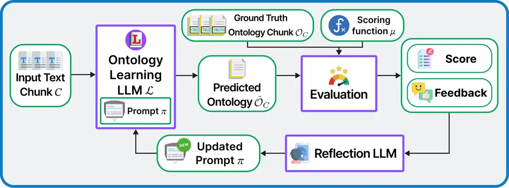
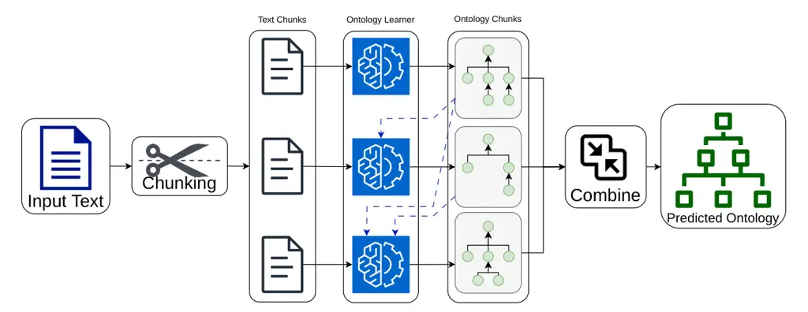
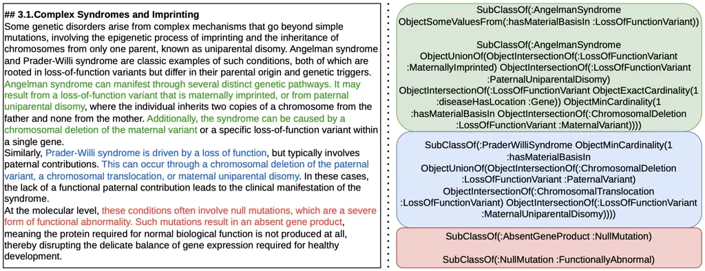

^(\*1) ¹

^(\*1) ¹

# APOLO: Automatic Prompt Optimization for Ontology Learning

Huu Tan Mai    Roman Kochnev    Cuong Xuan Chu    Lukas Lange    Heiko
Paulheim    Daria Stepanova

###### Abstract

Ontology Learning (OL) from text has advanced with the emergence of
Large Language Models (LLMs), but it remains challenging due to the
limited availability of annotated training data and the difficulty of
adapting LLMs to perform OL effectively. We address this via APOLO –
Automatic Prompt Optimization for Ontology Learning, by casting OL as an
explicit prompt optimization problem over LLM modules. To obtain
training data, we employ a multi-agent system that generates
text-ontology pairs from existing expert-curated ontologies. We then
propose two ontology learner architectures: a greedy and an
autoregressive learner, and optimize both using GEPA, a greedy
evolutionary prompt optimizer built on DSPy. Experiments on two
ontologies, a biomedical (DOID) and a plant ontology (PO), show
consistent improvements after optimization across nearly all model and
mode combinations, with autoregressive learners achieving the largest
gains. Our results demonstrate that prompt optimization is a viable and
lightweight alternative to fine-tuning for OL, and that the
autoregressive formulation better captures ontological structure than
the greedy approach.

###### keywords

Ontology Learning ,Automatic Prompt Optimization ,Large Language Models
,DSPy

^(†)^(†)copyrightyear: 2026^(†)^(†)copyright: Copyright for this paper
by its authors. Use permitted under Creative Commons License Attribution
4.0 International (CC BY 4.0).^(†)^(†)venue: ISWC 2026 Companion Volume,
October 25–29, 2026, Bari, Italy^(†)^(†)email:
huutan.mai@de.bosch.com^(†)^(†)email:
roman.kochnev@stud-mail.uni-wuerzburg.de^(†)^(†)address: Bosch Corporate
Research, Robert-Bosch-Campus 1, 71272 Renningen,
Germany^(†)^(†)address: Bosch Research North America, Sunnyvale,
California, USA^(†)^(†)address: University of Mannheim, Schloss, 68131
Mannheim, Germany^(†)^(†)address: University of Würzburg, Sanderring 2,
97070 Würzburg, Germany^(†)^(†)corresp: Corresponding
author.^(†)^(†)These authors contributed equally.

## 1 Introduction

Ontologies are formal frameworks for representing knowledge, enabling
trustworthy AI services, seamless integration of heterogeneous data, and
symbolic reasoning Hogan et al. (2021). Yet constructing domain
ontologies remains a costly, expertise-intensive process Buitelaar et
al. (2005). Ontology Learning (OL) seeks to automatically extract formal
knowledge from text, with the goal of reducing this burden. Recent
advances in Large Language Models (LLMs) and agentic AI are enabling the
automation of OL Giglou et al. (2023); Bakker et al. (2024); Rahnamoun
and Shamsfard (2025). However, the search for the right setup to carry
out the task optimally is time-consuming and resource-intensive. For
instance, given a pipeline of agents that execute subtasks (e.g.,
systems Rahnamoun and Shamsfard (2025) following the LLMs4OL
paradigm Giglou et al. (2023)), fine-tuning each LLM for its respective
subtask is costly. Similarly, although it has been shown that the
performance of LLMs on downstream tasks is highly sensitive to the
choice of prompt Liu et al. (2023), manually searching for a
high-performance prompt is time-consuming. To address these challenges,
automatic _prompt optimization_ offers a lightweight alternative: it
improves model behavior without any weight updates, making it
significantly cheaper than supervised fine-tuning or reinforcement
learning while remaining applicable to any LLM. Building on this
motivation, we make the following contributions:

- •
  We formalize OL as an explicit prompt optimization problem with
  respect to LLM prompts over text-ontology pairs – a framing that
  directly supports this approach.
- •
  We propose two learner architectures: a greedy learner and an
  autoregressive (AR) learner – both optimized using GEPA Agrawal et al.
  (2025), an evolutionary prompt optimizer built on DSPy Khattab et al.
  (2024).
- •
  We empirically show that APOLO yields consistent improvements for OL
  across nearly all LLM and method combinations on a challenging OL
  benchmark.

## 2 Approach



Figure 1: Overview of APOLO’s prompt optimization framework. An ontology
learner predicts an ontology from an input text chunk using prompt
$`\pi`$. The prediction is evaluated against a ground-truth ontology
chunk to produce a score and actionable feedback; a reflection LLM uses
both to iteratively improve $`\pi`$ while keeping the underlying LLM
fixed.

### Ontology Learning as Optimization.

An _ontology_ formally represents domain concepts and their
relationships as a collection of _axioms_ over classes, properties, and
individuals in Description Logics Baader (2003); Krötzsch et al. (2012).
We assume access to document-ontology pairs $`(D,\mathcal{O})`$, where
$`D`$ is an input document, and $`\mathcal{O}`$ its ground-truth
ontology, drawn from a distribution $`\mathcal{P}`$ (e.g., where $`D`$
is generated by an LLM from $`\mathcal{O}`$). An ontology learner
$`\mathcal{L}`$ maps a document $`D`$ to a predicted ontology
$`\hat{\mathcal{O}}=\mathcal{L}(D)`$. Given an evaluation metric
$`\mu(\hat{\mathcal{O}},\mathcal{O})`$ that scores a prediction against
ground truth, casting OL as an optimization problem amounts to
optimizing
$`\max_{\mathcal{L}}\ \mathbb{E}_{(D,\,\mathcal{O})\sim\mathcal{P}}\left[\mu(\mathcal{L}(D),\,\mathcal{O})\right]`$.
Alternatively, a document $`D`$ and its ontology $`\mathcal{O}`$ can be
split into corresponding text chunks $`C\in\mathrm{chunks}(D)`$, each
paired with the subontology $`\mathcal{O}_{C}`$ grounded in $`C`$. When
inference must operate on chunks (e.g., due to context length limits),
the learner predicts over a single chunk $`C`$ in the context of $`D`$.
Concretely, given multiple pairs $`(D^{(i)},\mathcal{O}^{(i)})`$, we
form a chunk-level dataset by pairing every chunk with its parent
document and the subontology it grounds,
$`\mathcal{T}=\bigl\{\,(C,\,D^{(i)},\,\mathcal{O}^{(i)}_{C})\;:\;C\in\mathrm{chunks}(D^{(i)})\,\bigr\},`$
where $`\mathcal{O}^{(i)}_{C}\subseteq\mathcal{O}^{(i)}`$ denotes a
subontology of $`\mathcal{O}^{(i)}`$ grounded in chunk $`C`$. We then
optimize the following objective

```math
\max_{\mathcal{L}}\;\mathbb{E}_{(C,D,\mathcal{O}_{C})\sim\mathcal{T}}\left[\mu\left(\mathcal{L}_{\pi}(C,D),\mathcal{O}_{C}\right)\right]. \tag{1}
```

### Prompt Optimization for OL.

We now fix the learner’s prompt $`\pi`$ as the only tunable parameter.
More specifically, let $`\mathcal{L}_{\pi}`$ denote the learner
parametrized by its prompt $`\pi`$ with the underlying weights kept
fixed. _Prompt optimization_ searches for a prompt $`\pi^{\star}`$ that
maximizes the expected score

```math
\pi^{\star}=\arg\max_{\pi}\;\mathbb{E}_{(C,\,D,\mathcal{O}_{C})\,\sim\,\mathcal{T}}\left[\mu\!\left(\mathcal{L}_{\pi}(C,D),\,\mathcal{O}_{C}\right)\right], \tag{2}
```

i.e., the empirical objective of Eq. 1 restricted to prompt-level
parameters. GEPA Agrawal et al. (2025) is one such optimizer: it
iteratively mutates prompt candidates and uses a separate LLM to reflect
on failure cases and propose improvements. Crucially, prompt
optimization leaves model weights unchanged, making it a lightweight
alternative to fine-tuning or reinforcement learning with a limited
budget of rollouts. Prior work applied this paradigm to knowledge graph
construction Mihindukulasooriya et al. (2025) using different prompt
optimizers; we extend it to the more general setting of extracting
ontological elements, and in particular, classes, individuals and OWL 2
axioms from text. This framework, which forms the core of APOLO, is
directly applicable to OL over text chunks. Figure 1 illustrates the
proposed application of the GEPA prompt optimization loop to OL. Given
an input text, the learner predicts an ontology using the current prompt
$`\pi`$, which is manually initialized. The prediction is evaluated
against the ground-truth ontology to produce both a quality score and
actionable feedback, which are used by a reflection LLM to iteratively
improve the prompt. Next, we define (a) an ontology learning
architecture to optimize w.r.t. a prompt, (b) an evaluation metric
$`\mu`$, and (c) actionable feedback in the context of GEPA.



Figure 2: Overview of Greedy and Autoregressive learners at inference
time. The Greedy learner splits documents into manageable chunks, each
of which is turned into a corresponding ontology chunk. Once all chunks
are constructed, they are concatenated into the resulting ontology. The
Autoregressive learner additionally takes prior ontology chunks as
context when generating a new chunk (dashed blue lines
$`\dashrightarrow`$).

### Ontology Learning LLM.

We propose two single-module (and therefore single-prompt) APOLO
learners, whose prompts can be optimized with GEPA Agrawal et al.
(2025). An overview is presented in Figure 2.

_Greedy Learner._ This learner consists of a chunk-level base learner
$`\mathcal{L}_{\pi}^{\mathrm{gbase}}`$ that processes each chunk $`C`$
separately conditioned on the full text $`D`$, and the resulting
ontologies are concatenated. In essence, this assumes that the global
solution can be reached by combining locally optimal ones. We optimize
the chunk-level surrogate objective (as per Equation 1) w.r.t. the
prompt $`\pi`$ of $`\mathcal{L}_{\pi}^{\mathrm{gbase}}`$ (see
Equation 2).

_Autoregressive Learner._ This learner likewise constructs an ontology
from chunk-level predictions, but its base learner additionally
conditions each chunk on axioms predicted for preceding chunks,
maintaining continuity across the document. During optimization,
_teacher forcing_ is applied: ground-truth axioms from preceding chunks
serve as context instead of the model’s own predictions to prevent error
accumulation.

### Evaluation.

While in the presented framework any evaluation function $`\mu`$ for
comparing the predicted ontology with the ground truth can be plugged
in, we instantiate $`\mu`$ as follows. Entity precision (EnP) and recall
(EnR) measure how well classes and individuals are recovered. Axiom
precision (AxP) and recall (AxR) use entailment-based matching computed
with the help of a reasoner, and measure the correctness, i.e.,
predicted axioms that are entailed by $`\mathcal{O}`$, and the
completeness, i.e., ground-truth axioms that are entailed by
$`\hat{\mathcal{O}}`$, of the prediction. The scoring function with
hyperparameters $`\beta\in[0,\infty)`$ and $`\delta\in(0,1)`$ is defined
as follows:

```math
\displaystyle\mu(\hat{\mathcal{O}},\mathcal{O})=\begin{cases}0&\text{if }\hat{\mathcal{O}}\text{ is inconsistent or unparsable,}\\
\delta\cdot\mathrm{EnF}(\beta)+(1\!-\!\delta)\cdot\mathrm{AxF}(\beta)&\text{otherwise,}\end{cases} \tag{3}
```

where $`\mathrm{EnF}(\beta)`$ and $`\mathrm{AxF}(\beta)`$ are the
F-$`\beta`$ scores induced by the respective precision/recall pairs.
Feedback should include error diagnostics such as: (a) explanations if
$`\hat{\mathcal{O}}`$ is inconsistent or unparsable; (b) axioms from
$`\mathcal{O}`$ not entailed by $`\hat{\mathcal{O}}`$; (c) axioms from
$`\hat{\mathcal{O}}`$ not entailed by $`\mathcal{O}`$; (d) entities from
$`\mathcal{O}`$ missing from $`\hat{\mathcal{O}}`$.

## 3 Experiments

### Setup.

A key obstacle for LLM-based OL from text is the near-absence of
text-ontology pairs in which sentences are grounded in formal OWL
axioms. Thus, we use a multi-agent system to generate annotated
text-ontology pairs from 12 publicly available ontologies spanning
diverse domains (biomedical, e-commerce, chemistry, building services).
The system comprises a Planner and Verifier for ontology decomposition
and consistency checking, and a Writer and Critic for the generation of
textual snippets from ontology axioms and their refinement. Figure 3
shows an example of a generated text-ontology pair. Two held-out
ontologies serve as the common testbed: DOID Schriml et al. (2012)
(human diseases, 1,407 words, 45 atomic axioms) and PO Avraham et al.
(2008) (plant structure, 2,384 words, 53 atomic, 10 complex axioms). The
remaining 10 ontologies, spanning different domains, are used for prompt
optimization. GEPA optimization uses gpt-5-mini as the reflection LLM.
We evaluate two prominent open-source LLMs as representatives:
Qwen3.5-27B Qwen Team (2026) and Devstral-Small-2-24B Rastogi et al.
(2025). We set $`\beta=3`$ and $`\delta=0.2`$ for the scoring function
used during optimization.



Figure 3: Example of a text-ontology training pair used for prompt
optimization. A text chunk generated from a subontology of the initial
domain ontology is annotated with corresponding entities and axioms,
each grounded in a supporting quote from the text.

### Results.

Table 1 shows that established OL baselines struggle on our benchmark,
while APOLO’s prompt-optimized learners achieve consistent improvements.
Most baselines result in near-zero axiom-level scores, with one timing
out. Bakker _et al._ (B) – the strongest baseline on DOID (AxP = 0.667)
– collapses on PO (AxP = 0.018), revealing a lack of cross-domain
generalization. For our learners, two findings stand out: _(i)_
Improvements after GEPA optimization are consistent across nearly all
model/mode combinations, suggesting that the generated data provides a
reliable training signal. _(ii)_ APOLO’s AR learners benefit most:
Qwen3.5-27B AR achieves a 47% improvement in AxP on DOID after
optimization (i.e., from AxP = 0.569 to AxP = 0.838), and surpasses all
off-the-shelf baselines across most axiom-level metrics. A qualitative
inspection reveals that optimized prompts typically become very verbose
(e.g., from 14 words to 1474 words for Qwen3.5-27B AR), thoroughly
detailing common patterns, formatting rules, quality goals, successful
strategies, and pitfalls to avoid for ontology extraction. Unlike
weight-update approaches, prompt optimization is compute-friendly:
hosting one model with $`M`$ optimized prompts is substantially cheaper
than $`M`$ fine-tuned models. In our experiments, GEPA optimization
completed in approximately 3–4 hours with no GPU memory required for
weight updates. Furthermore, GEPA is known to achieve large quality
gains from few rollouts Agrawal et al. (2025), making it especially
practical under limited compute budgets.

|                      |                                            |      |     |      |      |      |      |     |           |      |      |      |
| -------------------- | ------------------------------------------ | ---- | --- | ---- | ---- | ---- | ---- | --- | --------- | ---- | ---- | ---- |
| Model                | Method                                     | Opt. |     | DOID |      |      |      |     | PO        |      |      |      |
|                      |                                            |      |     | AxP  | AxR  | EnP  | EnR  |     | AxP       | AxR  | EnP  | EnR  |
| Qwen3.5-27B          | AutoRAGLearner Babaei Giglou et al. (2025) | N/A  |     | .006 | .044 | .026 | .071 |     | .006      | .048 | .057 | .141 |
|                      | SBU-NLP Rahnamoun and Shamsfard (2025)     | N/A  |     | .000 | .000 | .074 | .143 |     | .023      | .063 | .155 | .324 |
|                      | Kommineni *et al.* Kommineni et al. (2024) | N/A  |     | .064 | .111 | .552 | .381 |     | .000      | .000 | .189 | .099 |
|                      | Bakker *et al.* (A) Bakker et al. (2024)   | N/A  |     | .583 | .622 | .725 | .690 |     | .027      | .048 | .322 | .282 |
|                      | Bakker *et al.* (B) Bakker et al. (2024)   | N/A  |     | .667 | .578 | .675 | .643 |     | .018      | .048 | .180 | .282 |
|                      | Greedy (Ours)                              | ✗    |     | .457 | .689 | .569 | .690 |     | .063      | .063 | .337 | .493 |
|                      |                                            | ✓    |     | .585 | .689 | .580 | .690 |     | .071      | .111 | .281 | .507 |
|                      | AR (Ours)                                  | ✗    |     | .569 | .690 | .457 | .689 |     | .092      | .079 | .362 | .479 |
|                      |                                            | ✓    |     | .838 | .689 | .829 | .690 |     | .174      | .159 | .425 | .521 |
| Devstral-Small-2-24B | AutoRAGLearner Babaei Giglou et al. (2025) | N/A  |     | .000 | .067 | .018 | .071 |     | .005      | .063 | .022 | .085 |
|                      | SBU-NLP Rahnamoun and Shamsfard (2025)     | N/A  |     | .037 | .000 | .102 | .143 |     | Timed out |      |      |      |
|                      | Kommineni *et al.* Kommineni et al. (2024) | N/A  |     | .209 | .267 | .579 | .524 |     | .028      | .032 | .276 | .113 |
|                      | Bakker *et al.* (A) Bakker et al. (2024)   | N/A  |     | .000 | .000 | .700 | .666 |     | .000      | .000 | .000 | .000 |
|                      | Bakker *et al.* (B) Bakker et al. (2024)   | N/A  |     | .000 | .000 | .286 | .667 |     | .000      | .000 | .183 | .324 |
|                      | Greedy (Ours)                              | ✗    |     | .326 | .667 | .367 | .690 |     | .035      | .079 | .174 | .338 |
|                      |                                            | ✓    |     | .284 | .622 | .412 | .667 |     | .051      | .063 | .218 | .366 |
|                      | AR (Ours)                                  | ✗    |     | .500 | .577 | .533 | .571 |     | .009      | .016 | .244 | .422 |
|                      |                                            | ✓    |     | .644 | .622 | .528 | .667 |     | .094      | .047 | .326 | .408 |

Table 1: Comparison of baseline OL methods and prompt-optimized learners
(Ours) on DOID and PO. ✓/✗ denote after/before GEPA optimization;
improvements over unoptimized in bold. Results are from a single run.

### Limitations.

While we attempt to operationalize our evaluation as much as possible,
our scoring method has limitations: it does not penalize redundant
axioms – that is, predicted axioms entailed by $`\mathcal{O}`$ are
counted as correct regardless of redundancy; since optimization tends to
produce verbose prompts, predicted ontologies may become overgenerated.
Furthermore, to obtain ground-truth data for our text-ontology pairs, we
use existing domain ontologies; however, these underlying ontologies may
have been seen by the backbone LLMs during pretraining, which could
inflate performance estimates.

## 4 Conclusion

We formalized Ontology Learning as an explicit prompt optimization
problem over LLM modules, proposed two learner architectures – greedy
and autoregressive – and optimized both with GEPA using generated
text-ontology pairs. Experiments on two domain-specific benchmarks
(DOID, PO) show that prompt optimization yields consistent improvements
across nearly all model/mode combinations without any weight updates,
with autoregressive learners benefiting most. Prompt-optimized
Qwen3.5-27B AR surpasses all tested off-the-shelf baselines across most
axiom-level metrics, demonstrating that even single-module APOLO
learners can be meaningfully improved through this paradigm.

These results suggest that combining automatic data generation with
prompt optimization is a promising path towards better ontology learners
– one that scales naturally to multi-agent architectures and arbitrary
ontology domains. Future work will explore synthetic ontology generation
to further reduce data leakage concerns, and more robust evaluation
metrics for complex OWL 2 constructs.

## Declaration on Generative AI

Claude (Anthropic) was used exclusively for grammar and spelling checks,
as well as minor stylistic improvements. After using this tool, the
authors reviewed and edited the paper as needed and take full
responsibility for the content.

## References

- Agrawal et al. (2025) L. A. Agrawal, S. Tan, D. Soylu, N. Ziems, R.
  Khare, K. Opsahl-Ong, A. Singhvi, H. Shandilya, M. J. Ryan, M. Jiang,
  et al. GEPA: Reflective Prompt Evolution Can Outperform Reinforcement
  Learning. arXiv preprint arXiv:2507.19457. Cited by: 2nd item, §2, §2,
  §3.
- Avraham et al. (2008) S. Avraham, C. Tung, K. Ilic, P. Jaiswal, E. A.
  Kellogg, S. McCouch, A. Pujar, L. Reiser, S. Y. Rhee, M. M. Sachs, et
  al. The Plant Ontology Database: a community resource for plant
  structure and developmental stages controlled vocabulary and
  annotations. Nucleic Acids Research 36 (suppl_1), pp. D449–D454. Cited
  by: §3.
- Baader (2003) F. Baader The Description Logic Handbook: Theory,
  Implementation, and Applications. Cambridge University Press. Cited
  by: §2.
- Babaei Giglou et al. (2025) OntoLearner: A Modular Python Library for
  Ontology Learning with LLMs External Links:
  [Document](https://dx.doi.org/10.5281/zenodo.15399783),
  [Link](https://doi.org/10.5281/zenodo.15399783) Cited by: Table 1,
  Table 1.
- Bakker et al. (2024) R. M. Bakker, D. L. Di Scala, and M. H. de Boer
  Ontology Learning from Text: an Analysis on LLM Performance. In
  NLP4KGC@SEMANTiCS, pp. 70–87. Cited by: §1, Table 1, Table 1, Table 1,
  Table 1.
- Buitelaar et al. (2005) P. Buitelaar, P. Cimiano, and B. Magnini
  Ontology Learning from Text: Methods, Evaluation and Applications.
  Vol. 123, IOS Press Amsterdam. Cited by: §1.
- Giglou et al. (2023) H. B. Giglou, J. D’Souza, and S. Auer LLMs4OL:
  Large Language Models for Ontology Learning. External Links:
  2307.16648, [Link](https://arxiv.org/abs/2307.16648) Cited by: §1.
- Hogan et al. (2021) A. Hogan, E. Blomqvist, M. Cochez, C.
  d’Amato, G. d. Melo, C. Gutierrez, S. Kirrane, J. E. L. Gayo, R.
  Navigli, S. Neumaier, A. N. Ngomo, A. Polleres, S. M. Rashid, A.
  Rula, L. Schmelzeisen, J. Sequeda, S. Staab, and A. Zimmermann
  Knowledge Graphs. ACM Comput. Surv. 54 (4). External Links: ISSN
  0360-0300, [Link](https://doi.org/10.1145/3447772),
  [Document](https://dx.doi.org/10.1145/3447772) Cited by: §1.
- Khattab et al. (2024) O. Khattab, A. Singhvi, P. Maheshwari, Z.
  Zhang, K. Santhanam, S. Haq, A. Sharma, T. Joshi, H. Moazam, H.
  Miller, et al. DSPy: Compiling Declarative Language Model Calls into
  Self-Improving Pipelines. In International Conference on Learning
  Representations, pp. 54928–54958. Cited by: 2nd item.
- Kommineni et al. (2024) V. K. Kommineni, B. König-Ries, and S. Samuel
  From human experts to machines: An LLM supported approach to ontology
  and knowledge graph construction. arXiv preprint arXiv:2403.08345.
  Cited by: Table 1, Table 1.
- Krötzsch et al. (2012) M. Krötzsch, F. Simancik, and I. Horrocks A
  Description Logic Primer. arXiv preprint arXiv:1201.4089. Cited by:
  §2.
- Liu et al. (2023) P. Liu, W. Yuan, J. Fu, Z. Jiang, H. Hayashi, and G.
  Neubig Pre-train, Prompt, and Predict: A Systematic Survey of
  Prompting Methods in Natural Language Processing. ACM Computing
  Surveys 55 (9), pp. 1–35. Cited by: §1.
- Mihindukulasooriya et al. (2025) N. Mihindukulasooriya, N. S.
  D’Souza, F. Chowdhury, and H. Samulowitz Automatic Prompt Optimization
  for Knowledge Graph Construction: Insights from an Empirical Study.
  External Links: 2506.19773, [Link](https://arxiv.org/abs/2506.19773)
  Cited by: §2.
- Qwen Team (2026) Qwen Team Qwen3.5: Towards Native Multimodal Agents.
  External Links: [Link](https://qwen.ai/blog?id=qwen3.5) Cited by: §3.
- Rahnamoun and Shamsfard (2025) R. Rahnamoun and M. Shamsfard SBU-NLP
  at LLMs4OL 2025 Tasks A, B, and C: Stage-Wise Ontology Construction
  Through LLMs Without any Training Procedure. In Open Conference
  Proceedings, Vol. 6. Cited by: §1, Table 1, Table 1.
- Rastogi et al. (2025) A. Rastogi, A. Yang, A. Q. Jiang, A. H. Liu, A.
  Sablayrolles, A. Héliou, A. Martin, A. Agarwal, A. Ehrenberg, A. Lo,
  et al. Devstral: Fine-tuning Language Models for Coding Agent
  Applications. arXiv preprint arXiv:2509.25193. Cited by: §3.
- Schriml et al. (2012) L. M. Schriml, C. Arze, S. Nadendla, Y. W.
  Chang, M. Mazaitis, V. Felix, G. Feng, and W. A. Kibbe Disease
  Ontology: a backbone for disease semantic integration. Nucleic Acids
  Research 40 (D1), pp. D940–D946. Cited by: §3.
