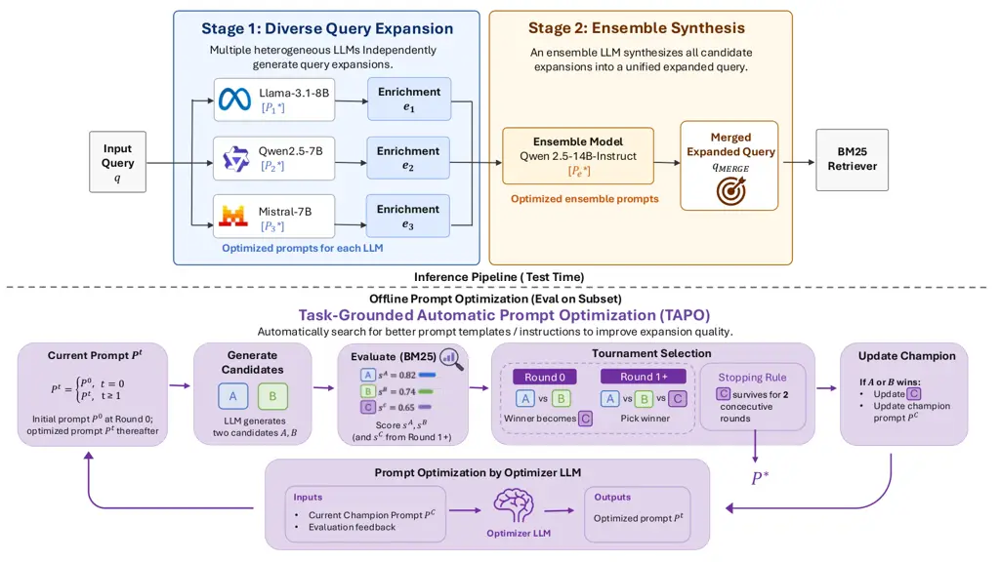

# MERGE: Multi-LLM Ensemble for Retrieval via Generative Enrichment

Tzu-I Ho ^(†)^(†)thanks: Equal contribution. Work done at Rakuten.
Affiliation: University of Waterloo
Email: [tzuiho.tw@gmail.com](mailto:)    Yung-Yu
Shih^(†)^(†)footnotemark: ^(†)^(†)thanks: Work done during an internship
at Taiwan Rakuten Ichiba, Inc. Affiliation: National Taiwan University
Email: [f12944007@ntu.edu.tw](mailto:)    Shang-Yu Su
Affiliation: Rakuten Group, Inc.
Email: [shangyu.su@rakuten.com](mailto:)    Dongzhe Wang
Affiliation: Rakuten Asia Pte. Ltd.
Email: [dongzhe.wang@rakuten.com](mailto:)    Yun-Nung Chen
Affiliation: National Taiwan University
Email: [y.v.chen@ieee.org](mailto:)

###### Abstract

Large Language Models (LLMs) are increasingly used to enrich user
queries in information retrieval (IR) so that a standard retriever such
as BM25 can bridge vocabulary gaps with the target corpus. Any single
LLM, however, is limited by its training data and architectural biases,
and its enrichment behavior depends on hand-crafted prompts that must be
re-engineered for each new model—an expensive and poorly scalable
process. We present MERGE (_Multi-LLM Ensemble for Retrieval via
Generative Enrichment_), a two-stage framework: three heterogeneous 7–8B
open-source LLMs independently produce candidate expansions, and a
larger LLM generatively synthesizes them into a single query. To make
prompt engineering scalable across the ensemble, we integrate a
_task-grounded_ Automatic Prompt Optimization (APO) loop into both
stages. Unlike APO methods that judge candidates with an LLM evaluator,
our loop scores each candidate by its downstream retrieval performance
and runs a small tournament between the current champion prompt and
optimizer-proposed drafts, terminating once the champion survives two
consecutive rounds; a history-augmented variant additionally feeds the
recent tournament trajectory back to the optimizer. MERGE is
retriever-agnostic and issues a single BM25 pass with no rank fusion, no
supervised document expansion, and no re-indexing. On five BEIR
benchmarks (NQ, SciFact, FiQA, Touché-2020, DBPedia), MERGE improves
BM25 nDCG@10 over the original queries by $`+2.1`$ to $`+14.9`$ points
and matches or outperforms strong LLM-based query-expansion baselines
despite using only compact open-source models. Ablations confirm that
the Stage-2 ensemble beats any single Stage-1 LLM, and that
task-grounded APO converts large seed-prompt _regressions_ into
consistent gains without hand-tuning.

## 1 Introduction

Large Language Models (LLMs) have become central components of modern
information retrieval (IR) pipelines (Zhu et al., 2023). For query-side
enrichment in particular, methods such as Query2Doc (Wang et al., 2023a)
and HyDE (Gao et al., 2023) use an LLM to generate pseudo-documents or
hypothetical answers that clarify user intent and improve retrieval. The
common thread is _contextual query enrichment_: an LLM rewrites the user
query so that a downstream retriever—often a strong lexical retriever
such as BM25—can more easily match it with relevant passages.

Two problems limit the practical impact of this line of work. First,
LLMs inherit biases and blind spots from their training data and
architecture (Bender et al., 2021), so a single model tends to produce
enrichments with a distinctive but narrow style—missing rephrasings,
hallucinating details, or over-committing to a specific interpretation
of an ambiguous query. Second, controlling enrichment behavior relies
heavily on hand-crafted prompts, and prompts that work well for one
model family (e.g., Qwen2.5) transfer poorly to another (e.g., Llama-3.3
or Mistral) without a further round of manual tuning. This burden grows
with the number of LLMs one wishes to combine, making multi-LLM
ensembles hard to scale and hard to justify on cost grounds.

We address both problems with MERGE (_Multi-LLM Ensemble for Retrieval
via Generative Enrichment_). MERGE processes an input query $`x`$
through two stages, illustrated in Figure 1:

- •
  Generation. Multiple heterogeneous LLMs independently produce enriched
  query candidates $`y_{1},\dots,y_{n}`$, exposing diverse but
  complementary views of the user’s intent. Each generator uses a prompt
  that has been automatically specialized to its own model.
- •
  Ensemble. An LLM _generatively_ synthesizes $`\{y_{1},\dots,y_{n}\}`$
  into a single unified query expansion $`\hat{y}`$, filtering likely
  hallucinations and merging complementary information under an
  APO-tuned ensemble prompt.

MERGE embodies _dual-level ensemble_: horizontal ensemble across
heterogeneous generators within Stage 1, and vertical ensemble across
the specialized Stage-1 / Stage-2 pipeline (Dietterich, 2000). Compared
to selection-based fusion (Jiang et al., 2023b; Tekin et al., 2024) it
retains full generative flexibility; compared to single-stage LLM
expansion (Wang et al., 2023a; Gao et al., 2023) it explicitly separates
_producing_ diverse candidates from _synthesizing_ them.

To address the scalability concern above, we integrate a _task-grounded_
Automatic Prompt Optimization (APO) loop into _both_ stages of MERGE.
Starting from hand-crafted seed prompts, our APO loop iteratively
rewrites and evolves each generator’s prompt and the ensemble prompt
under a retrieval-driven objective; each LLM ultimately runs with a
prompt specialized to itself rather than a one-size-fits-all template.
Unlike prior APO methods that rely on an LLM judge, our loop scores each
candidate prompt by its actual retrieval performance on a small labelled
subset and feeds this numerical signal, together with the history of
previously tried prompts, back into the optimizer LLM. As a result,
adding a new LLM to the generation stage no longer requires manual
prompt engineering, and improvements in one LLM’s prompt do not silently
degrade the ensemble’s behavior. Since APO is applied once and reused,
its optimization cost is amortized over all downstream retrieval runs.

We evaluate MERGE on five diverse BEIR benchmarks (Thakur et al.,
2021)—NQ (Kwiatkowski et al., 2019), SciFact (Wadden et al., 2020),
FiQA (Maia et al., 2018), Touché-2020 (Bondarenko et al., 2020), and
DBPedia (Hasibi et al., 2017)—covering open-domain QA, scientific claim
verification, financial opinion QA, argument retrieval, and entity
retrieval. Our contributions are as follows:

- •
  We propose MERGE, an IR-focused two-stage LLM ensemble that enriches
  user queries by combining heterogeneous multi-LLM generation with a
  generative ensemble step.
- •
  We introduce a _task-grounded_ APO loop that scores candidate prompts
  by their actual downstream retrieval performance rather than by an LLM
  judge, and apply it to _both_ stages of MERGE. This turns per-LLM
  prompt engineering from a manual, non-scalable step into an automatic,
  model-specific optimization.
- •
  MERGE is retriever-agnostic: its output is a plain-text query that can
  be fed to any retriever. Across five BEIR datasets, MERGE-enriched
  queries improve BM25 retrieval over the original queries on all five
  benchmarks and match or outperform strong LLM-based query-expansion
  baselines, with ablations that isolate the contributions of the
  ensemble stage and of APO. We adopt BM25 as the shared retrieval
  backbone in our experiments, matching the standard setup used in prior
  LLM-based query-expansion work, so that measured gains reflect _how_
  the query is manipulated rather than a jointly trained retriever.



Figure 1: Overview of MERGE. Given an input query, Stage 1 (Diverse
Query Expansion) runs three heterogeneous 7–8B instruction-tuned LLMs
(Llama-3.1-8B-Instruct, Qwen2.5-7B-Instruct, Mistral-7B-Instruct-v0.3)
in parallel to produce candidate expansions $`e_{1},e_{2},e_{3}`$;
Stage 2 (Ensemble Synthesis) uses Qwen2.5-14B-Instruct to generatively
fuse the candidates into a single merged expanded query, which is then
fed to a fixed BM25 retriever. Every prompt—each Stage-1 generator
prompt and the Stage-2 ensemble prompt—is specialized via our
task-grounded Automatic Prompt Optimization loop (bottom): starting from
a hand-crafted seed, the optimizer LLM rewrites the current champion
into two drafts, all three are scored on a 20% dev subset via BM25
nDCG@10, and a tournament selects the winner as the next champion. The
loop terminates when the champion survives two consecutive rounds.

## 2 Related Work

#### LLM Ensembles and Output Fusion.

Recent surveys (Lu et al., 2024) categorize LLM ensembles into
_ensemble-before-inference_ (routing (Shnitzer et al., 2023; Ong et al.,
2024)), _during-inference_ (token-level fusion (Huang et al., 2024;
Mavromatis et al., 2024; Xu et al., 2025)), and _after-inference_
(response-level selection (Li et al., 2024; Guha et al., 2024) or
regeneration (Jiang et al., 2023b; Tekin et al., 2024)).
LLM-Blender (Jiang et al., 2023b) pioneered selection-then-regeneration,
LLM-TOPLA (Tekin et al., 2024) maximizes response diversity in
selection, and self-consistency (Wang et al., 2023b) majority-votes over
reasoning paths. MERGE falls into the ensemble-after-inference family
and is distinctive in (a) targeting IR enrichment specifically and (b)
tuning every prompt in the ensemble automatically via task-grounded APO
with a retrieval objective.

#### Query Expansion for IR.

Classical query expansion uses relevance feedback (Rocchio, 1971) and
embedding-based extensions (Kuzi et al., 2016). Recent LLM-based
methods—Query2Doc (Wang et al., 2023a), HyDE (Gao et al., 2023), and
Exp4Fuse (Liu and Zhang, 2025)—use a single LLM to rewrite the query,
with Exp4Fuse additionally fusing two BM25 ranked lists; we use these as
our main baselines. doc2query (Nogueira et al., 2019; Gospodinov et al., 2023) and docT5query (Nogueira and Lin, 2019) target the same
query–corpus vocabulary gap but use a _supervised_ T5 fine-tuned on MS
MARCO to generate query-like text _from each document_, requiring corpus
access and re-indexing when the corpus changes. Closely related is
BEATS (Shih et al., 2026), a multi-stage LLM pipeline that enriches the
_corpus_ side of e-commerce search through a human-in-the-loop
prompt-refinement cycle. MERGE targets the same vocabulary gap without
supervision or corpus access—operating on the user query only with
zero-shot LLMs—and removes BEATS’s human step by grounding prompt
refinement in downstream retrieval scores.

#### Automatic Prompt Optimization.

APO methods treat prompts as optimizable objects: ProTeGi (Pryzant
et al., 2023) uses LLM-produced “textual gradients”; APE (Zhou et al., 2023) and OPRO (Yang et al., 2024) cast prompt design as black-box
optimization; evolutionary variants EvoPrompt (Guo et al., 2024) and
Promptbreeder (Fernando et al., 2023) maintain a prompt population;
SPO (Xiang et al., 2025) removes label supervision by using an LLM
evaluator over pairs of outputs. Recent surveys (Ramnath et al., 2025)
cover the space. Our loop builds on SPO but replaces the LLM evaluator
with the actual downstream IR score on a small labelled subset, and
feeds that numerical signal—together with the history of previously
tried prompts—back into the optimizer LLM (§3.4).

## 3 Methodology

### 3.1 Framework Overview

Given an input query $`x`$, MERGE produces an enriched query $`\hat{y}`$
via

```math
\hat{y}\;=\;M_{e}\!\left(P_{e}^{*},\;\big\{\,M_{i}(P_{i}^{*},x)\,\big\}_{i=1}^{n}\right), \tag{1}
```

where $`M_{1},\dots,M_{n}`$ are the $`n`$ heterogeneous Stage-1 LLMs,
$`M_{e}`$ is the ensemble LLM at Stage 2, and each starred prompt
$`P_{i}^{*}`$ (Stage 1) or $`P_{e}^{*}`$ (Stage 2) is produced by APO
from a hand-crafted seed. Figure 1 illustrates the pipeline. The
enriched query $`\hat{y}`$ is passed as-is to a BM25 retriever, and the
passage corpus is used unmodified. Because $`\hat{y}`$ is plain text,
MERGE is in principle retriever-agnostic and can also feed a dense
retriever; we focus on BM25 in this work to match the standard
evaluation protocol for LLM-based query expansion.

### 3.2 Stage 1: Multi-LLM Generation

We employ $`n`$ diverse LLMs $`\{M_{1},\dots,M_{n}\}`$ selected to
maximize heterogeneity in training data, architecture, and scale. Each
generator receives its own APO-optimized prompt $`P_{i}^{*}`$ and the
input query $`x`$, and produces a candidate
$`y_{i}=M_{i}(P_{i}^{*},x)`$. The seed prompt instructs the model to
clarify user intent, add plausible synonyms and related concepts, and
produce a refined search string aimed at improving recall. Terms that
could leak the answer directly—rather than help locate a relevant
passage—are discouraged.

### 3.3 Stage 2: Generative Ensemble

An ensemble model $`M_{e}`$ generatively synthesizes
$`\{y_{1},\dots,y_{n}\}`$ into a single enriched query $`\hat{y}`$. The
APO-optimized ensemble prompt $`P_{e}^{*}`$ instructs $`M_{e}`$ to (i)
identify the core search intent and high-value entities across
candidates, (ii) resolve semantic redundancies and prioritize terms
strongly aligned with the query, and (iii) synthesize a compact query
expansion inside explicit \<result\> tags. We keep $`M_{e}`$ strictly
distinct from every Stage-1 model to avoid self-preference bias in the
fusion step.

### 3.4 Task-Grounded Automatic Prompt Optimization

Hand-crafting prompts for each LLM at each stage does not scale as one
adds more models or moves to new model families. We remove this
bottleneck by wrapping every (stage, model) pair with a task-grounded
APO loop, applied to (a) each generator’s prompt $`P_{i}`$ in Stage 1
and (b) the ensemble prompt $`P_{e}`$ in Stage 2.

#### Starting point: Self-Supervised Prompt Optimization.

We build on Self-Supervised Prompt Optimization (SPO) (Xiang et al.,
2025), a recent APO framework in which an _optimizer LLM_ iteratively
rewrites a prompt while an _evaluator LLM_ decides which prompt to keep
by comparing pairs of outputs. SPO does not require ground-truth labels
because its evaluator is itself an LLM judge. This makes SPO attractive
as a starting point but leaves open a well-known concern for ensemble
settings: an LLM judge introduces its own biases and its evaluation
signal is only loosely coupled to the ultimate downstream metric one
cares about.

#### Our modification: task-grounded evaluation.

For MERGE, the downstream metric we care about is retrieval quality, and
it is cheap to measure. We therefore replace SPO’s LLM evaluator with
the actual downstream IR task: each candidate prompt is scored by
running the corresponding stage end-to-end on a fixed _20% subset_ of
the training data and measuring nDCG@10 with the same fixed BM25
retriever used at test time. This gives the optimizer a task-grounded
numerical signal rather than the pairwise LLM-judged preference used in
vanilla SPO.

#### Tournament-style optimization loop.

Rather than accepting or rejecting a single new prompt per round, each
round of our APO loop is framed as a small tournament (Algorithm 1). Two
LLM roles are involved: a _generator_ $`G`$ that produces
query-expansion sets from a prompt, and an _optimizer_ $`O`$ that
rewrites prompts. The tournament tracks tuples of the form (expansion
set, retrieval score, prompt-of-origin). In round 0, $`G`$ samples two
expansion sets $`A,B\sim G(P^{0})`$ from the hand-crafted seed prompt
$`P^{0}`$, each is scored on the evaluation subset via the fixed
retriever $`R`$, and the higher-scoring tuple becomes the initial
champion $`(C,s_{C},P^{C})`$ with $`P^{C}=P^{0}`$. From round
$`t\geq 1`$ onwards, $`O`$ first rewrites the champion prompt into a new
draft $`P^{t}=O(P^{C},\text{evidence}_{t})`$, then $`G`$ samples two
expansion sets $`A,B\sim G(P^{t})`$ from $`P^{t}`$, and the
highest-scoring tuple among the two challengers and the incumbent
champion becomes the new champion. When a challenger wins, the champion
tuple is replaced entirely (expansion, score, and prompt). Drawing _two_
expansions per prompt rather than one exposes more of what a prompt can
produce under stochastic decoding, guards against early convergence to a
champion whose lead came from a single lucky decode, and forces
challengers to clear a stricter bar before they can unseat the
incumbent. We treat the loop as _converged_ when the champion survives
two consecutive rounds without being beaten, signalling that the
optimizer has run out of profitable edits, and return $`P^{*}=P^{C}`$.

#### What the optimizer sees each round.

At each round $`O`$ rewrites the champion prompt $`P^{C}`$ into a new
draft prompt $`P^{t}`$ under a structured optimizer prompt that supplies
(a) a numerical signal comparing the previous round’s challenger
expansions to the champion’s expansion (score difference, 95% CI,
p-value on the evaluation subset), (b) automatically extracted _wins_
and _losses_ examples where a challenger’s expansion changed retrieval
outcome relative to the champion, and (c) _theme signals_ such as
gold-aligned terms the challengers are missing and noise terms they
introduce. $`O`$ is explicitly instructed to make a substantive edit
that addresses observed regressions while preserving working strategies.
We consider two variants of this optimizer prompt that differ only in
whether $`O`$ also sees a short _tournament history_ of the previous
rounds (winner, expansions produced, and BM25 scores):

- •
  MERGE (APO), our default: the optimizer sees only the current-round
  signals above.
- •
  MERGE (APO w/ history): the optimizer additionally sees the last five
  rounds so that it can condition its rewrite on _both_ the textual
  trajectory of past prompts and their measured scores.

APO is applied stage-wise: to every Stage-1 generator first, then to the
Stage-2 ensemble prompt with those Stage-1 prompts frozen.

Input: seed prompt $`P^{0}`$, generator $`G`$, optimizer $`O`$,
retriever $`R`$, eval subset $`\mathcal{D}_{e}`$, max rounds $`T`$  
Output: optimized prompt $`P^{*}`$

1:  *// Round 0: two expansion samples from the seed prompt*

2:  $`(A,B)\leftarrow G(P^{0})`$ _// two sampled expansions_

3:  $`s_{A}\leftarrow\text{IR}(A,R,\mathcal{D}_{e})`$; 
$`s_{B}\leftarrow\text{IR}(B,R,\mathcal{D}_{e})`$

4:  $`(C,s_{C},P^{C})\leftarrow`$ higher of
$`\{(A,s_{A},P^{0}),\,(B,s_{B},P^{0})\}`$

5:  $`\text{streak}\leftarrow 0`$

6:  for $`t=1`$ to $`T`$ do

7:   $`P^{t}\leftarrow O(P^{C},\text{evidence}_{t})`$ _// evolve prompt_

8:   $`(A,B)\leftarrow G(P^{t})`$ _// two new expansions from $`P^{t}`$_

9:   $`s_{A}\leftarrow\text{IR}(A,R,\mathcal{D}_{e})`$; 
$`s_{B}\leftarrow\text{IR}(B,R,\mathcal{D}_{e})`$

10:   $`(W,s_{W},P^{W})\leftarrow\arg\max\{(A,s_{A},P^{t}),`$
      $`(B,s_{B},P^{t}),\,(C,s_{C},P^{C})\}`$

11:   if $`P^{W}\equiv P^{C}`$ then

12:    $`\text{streak}\leftarrow\text{streak}+1`$

13:    if $`\text{streak}\geq 2`$ then

14:     break _// champion survived twice_

15:    end if

16:   else

17:    $`(C,s_{C},P^{C})\leftarrow(W,s_{W},P^{W})`$; 
$`\text{streak}\leftarrow 0`$

18:   end if

19:  end for

20:  return $`P^{*}\leftarrow P^{C}`$

Algorithm 1 Task-grounded APO for one (stage, model) pair.

#### Why task-grounded APO helps MERGE.

Our APO loop delivers three benefits that are essential for a multi-LLM
ensemble like MERGE. _(1) Scalability across LLMs._ Adding a new
generator no longer requires a human to hand-tune its prompt; the
tournament produces a model-specific prompt automatically. _(2) Cost._
The dominant cost of MERGE at inference time is running many LLMs;
hand-tuning prompts on top of this is a hidden but substantial developer
cost. APO amortizes this cost into a one-off optimization phase whose
budget the user can control. _(3) Consistency._ Because every prompt is
optimized against the same retrieval-driven objective, prompts across
the ensemble are tuned against a common yardstick, which makes the
Stage-2 ensemble output more predictable.

### 3.5 Dual-Level Ensemble

MERGE operates ensemble at two complementary levels (Dietterich, 2000).
_Horizontally_, Stage 1 aggregates heterogeneous LLMs that differ in
architecture, training data, and scale—analogous to bagging, where
diversity among base learners reduces variance and mitigates
single-model blind spots. _Vertically_, Stage 2 specializes in synthesis
(filtering hallucinations and merging complementary information into one
compact expansion)—analogous to stacking, where a meta-model integrates
base predictions. APO acts orthogonally to both levels, tuning _how_
each model plays its role without changing the overall dual-level
structure.

## 4 Experiments

### 4.1 Setup

#### Datasets and metric.

We evaluate on five heterogeneous BEIR (Thakur et al., 2021) benchmarks
spanning open-domain QA (NQ (Kwiatkowski et al., 2019)),
scientific-claim retrieval (SciFact (Wadden et al., 2020)), financial
opinion retrieval (FiQA (Maia et al., 2018)), argument retrieval
(Touché-2020 (Bondarenko et al., 2020)), and entity retrieval
(DBPedia (Hasibi et al., 2017)). This suite covers markedly different
domains, query styles, and passage-length regimes. MERGE (with APO-tuned
prompts) is applied to all queries; each passage corpus is left
unmodified. Following BEIR conventions we report nDCG@10.

#### Models and retriever.

Stage 1 uses three 7–8B instruction-tuned models from three different
families—Qwen2.5-7B-Instruct (Qwen Team, 2024),
Meta-Llama-3.1-8B-Instruct (AI@Meta, 2024; Touvron et al., 2023), and
Mistral-7B-Instruct-v0.3 (Jiang et al., 2023a)—keeping the pool at a
comparable scale so no single generator dominates by size while
different pretraining regimes provide the horizontal diversity Stage 2
exploits. Stage 2 uses Qwen2.5-14B-Instruct (Qwen Team, 2024), which is
also the APO optimizer. All methods share a fixed BM25 (Robertson and
Zaragoza, 2009) backbone, matching the standard setup for LLM-based
query expansion (Wang et al., 2023a; Gao et al., 2023) so that measured
gains reflect how the query is manipulated rather than a jointly trained
retriever. LLM inference uses vLLM (Kwon et al., 2023) on NVIDIA H100
GPUs.

#### Baselines.

All methods share the same BM25 retriever; they differ only in how
LLM-generated text is used to bridge the query–corpus vocabulary gap. We
compare MERGE against three published LLM-based expansion baselines and
a no-APO ablation: (i) Vanilla BM25: the original query with no
expansion, the reference point; (ii) docT5query (Nogueira and Lin,
2019): a _supervised, corpus-dependent_ baseline that fine-tunes T5 on
MS MARCO (document, query) pairs so it can predict queries from
documents, then runs T5 on every document in the corpus and appends the
predicted queries to that document in the BM25 index—the LLM’s input is
documents; (iii) BM25+Exp4Fuse (Liu and Zhang, 2025): an unsupervised,
query-only baseline that runs two BM25 passes (over the original query
and over an LLM-produced pseudo-document generated from the user query)
and combines the two ranked lists with a modified reciprocal-rank
fusion; (iv) docT5query+Exp4Fuse (Liu and Zhang, 2025; Nogueira and Lin,
2019): the stronger baseline reported by the Exp4Fuse paper, stacking
(ii) and (iii); (v) MERGE w/o APO: MERGE with the same two-stage
architecture but using only the hand-crafted seed prompts, to isolate
the effect of prompt optimization. Like Exp4Fuse variants and unlike
docT5query, MERGE takes only the user query as input to its LLMs; unlike
Exp4Fuse variants, MERGE issues a single BM25 pass with no rank fusion.

For MERGE with APO, we report both variants introduced in §3.4: MERGE
(APO), the default tournament optimizer, and MERGE (APO w/ history), the
history-augmented variant.

#### Reproducibility.

All experiments rely on publicly available BEIR benchmarks and
open-source model checkpoints (Qwen2.5-7B/14B-Instruct,
Llama-3.1-8B-Instruct, Mistral-7B-Instruct-v0.3) with a fixed BM25
backbone. The APO tournament (Algorithm 1), the two APO variants (§3.4),
the seed-prompt design (§3.4), and the 20% dev-subset scoring protocol
are fully described in the paper. Because MERGE requires only these
public inputs and a lexical retriever with standard hyperparameters—no
supervised training data, no proprietary corpus, no learned ranker—the
results in Tables 1 and 2 can be independently reimplemented from the
descriptions given here. Following widely used BM25 practice, we repeat
the original query several times and append the enrichment as the
retrieval input.

### 4.2 Main Results

Table 1 reports nDCG@10 on the five BEIR benchmarks. All rows share the
same BM25 retriever and differ only in how the query is manipulated
before it is fed to BM25. Numbers for BM25+Exp4Fuse and T5+Exp4Fuse are
taken from Liu and Zhang (2025) under the same BM25 evaluation protocol;
MERGE variants use the models described above with our task-grounded APO
applied to every prompt.

|                               |         |         |         |             |         |
| ----------------------------- | ------- | ------- | ------- | ----------- | ------- |
| Method                        | NQ      | SciFact | FiQA    | Touché-2020 | DBPedia |
| Vanilla BM25 (original query) | 30.48   | 67.62   | 23.85   | 44.23       | 31.99   |
| \+ docT5query                 | (38.10) | (67.50) | (25.20) | (34.70)     | (33.10) |
| \+ BM25 + Exp4Fuse            | (39.10) | (68.80) | (24.70) | (51.20)     | (36.10) |
| \+ docT5query + Exp4Fuse      | (42.80) | (71.30) | (26.30) | (39.90)     | (38.90) |
| \+ MERGE w/o APO              | 34.52   | 67.79   | 19.41   | 38.69       | 33.59   |
| + MERGE (APO)                 | 45.42   | 71.40   | 25.59   | 50.16       | 37.94   |
| + MERGE (APO w/ history)      | 42.50   | 70.01   | 25.91   | 51.67       | 37.84   |

Table 1: Retrieval results on five BEIR benchmarks (nDCG@10, %). All
rows share the same BM25 retriever and differ only in how the query is
expanded. Numbers in parentheses are reproduced from Liu and Zhang
(2025); docT5query is Nogueira and Lin (2019). Bold = best result in
each column; underline = second best.

#### MERGE vs. vanilla BM25.

Across all five datasets, MERGE with APO improves BM25 nDCG@10 over the
_no-expansion_ reference. The absolute gain is largest where the
original queries are furthest from the corpus vocabulary or style:
$`+14.9`$ points on NQ (from $`30.48`$ to $`45.42`$), $`+7.4`$ on
Touché-2020, $`+6.0`$ on DBPedia, and $`+3.8`$ on SciFact. On FiQA the
gain is smaller but still positive ($`+2.1`$ points,
$`23.85\!\to\!25.91`$). This is consistent with MERGE closing a
vocabulary/style gap on the query side, exactly where a lexical
retriever like BM25 is most vulnerable.

#### MERGE vs. LLM-expansion baselines.

Compared with docT5query alone—a supervised, corpus-dependent baseline
that runs T5 on every document—MERGE wins on all five benchmarks:
$`+7.3`$ on NQ, $`+3.9`$ on SciFact, $`+16.9`$ on Touché-2020, and
$`+4.8`$ on DBPedia; on FiQA the two are close (MERGE APO w/ history
25.91 vs. docT5query 25.20, a $`+0.7`$ win). Compared with
BM25+Exp4Fuse, MERGE (in either APO variant) is better on all five
datasets, with gains from $`+0.5`$ (Touché-2020) to $`+6.3`$ (NQ)
points. Compared with the stronger stacked baseline docT5query+Exp4Fuse,
MERGE wins clearly on NQ ($`+2.6`$) and Touché-2020 ($`+11.8`$), is
essentially tied on SciFact ($`+0.1`$), and loses narrowly on FiQA
($`-0.4`$) and DBPedia ($`-1.0`$). This is a favourable outcome: MERGE
beats every unsupervised LLM-based query-expansion baseline on 5/5
benchmarks and matches or exceeds the strongest supervised baseline on
3/5, using only compact 7–8B open-source models, no supervised
query–document pairs, and no access to the corpus.

#### Simplicity, cost, and productionizability.

Beyond raw retrieval numbers, MERGE is structurally simpler than the
alternatives in Table 1: docT5query is _supervised and corpus-dependent_
(needs a labelled MS MARCO training set, runs T5 on every document,
requires re-indexing when the corpus changes), and the Exp4Fuse variants
add two BM25 passes and a reciprocal-rank-fusion step with tunable
weights (Liu and Zhang, 2025). MERGE has none of these dependencies: its
LLMs see only the user query, are used zero-shot, and produce an
enriched query $`\hat{y}`$ that is issued to a single BM25 pass over the
original corpus. The only extra cost is the one-off APO tournament
(§3.4), which typically converges in under 10 rounds per (stage, model)
pair on a 20% dev subset (well under one hour on a single H100) and is
amortized over all downstream retrieval traffic. This substitutes a
small compute cost for the per-LLM manual prompt-engineering effort that
would otherwise dominate as the model pool grows; empirically (Table 1,
M0 vs. M1/M2), that compute cost translates directly into large
retrieval gains. Being corpus-agnostic also means MERGE can be applied
at query time for online retrieval or offline as training-data
augmentation for a downstream dense retriever, without changes when the
corpus changes.

#### Effect of APO (M0 vs. M1/M2).

Comparing MERGE w/o APO (M0) against the two APO variants isolates the
effect of prompt optimization. Without APO, seed prompts _hurt_
retrieval on two out of five datasets: on FiQA ($`-4.4`$ vs. vanilla
BM25) and Touché-2020 ($`-5.5`$)% ; a mis-specified prompt can actively
degrade BM25 by adding noisy terms. Adding APO turns those regressions
into consistent gains across all five datasets, without requiring any
additional manual engineering. Between M0 and the better APO variant we
see gains of $`+10.9`$ (NQ), $`+3.6`$ (SciFact), $`+6.5`$ (FiQA),
$`+13.0`$ (Touché-2020), and $`+4.4`$ (DBPedia) nDCG@10 points. This is
important not only because the absolute gain is large but because it
converts prompt tuning from a manual per-LLM step into an automatic one.

#### APO w/o vs. w/ history.

The two APO variants trade off in a query-dependent way. _MERGE (APO)_
is stronger on precise factoid/entity queries (NQ $`45.42`$ vs.
$`42.50`$; SciFact $`71.40`$ vs. $`70.01`$; DBPedia $`37.94`$ vs.
$`37.84`$), while _MERGE (APO w/ history)_ is stronger on broader,
multifaceted queries (Touché-2020 $`51.67`$ vs. $`50.16`$; FiQA
$`25.91`$ vs. $`25.59`$). We hypothesize that feeding the last five
rounds of the tournament back to the optimizer helps in domains where
useful expansions require exploring a wider space of phrasings
(financial and argumentative queries), while on entity-centric queries
the extra history noise can distract from the direct win/loss signal.

### 4.3 Ablation: Both Stages Contribute

Table 2 isolates the contribution of the Stage-2 ensemble by comparing
every individual Stage-1 generator’s enriched query against the final
MERGE output, on three representative benchmarks (NQ, SciFact, FiQA). To
keep the comparison apples-to-apples, all rows use the default APO
variant (_MERGE (APO)_) and the same BM25 retriever; the only thing that
varies is whether the query fed to BM25 is a single Stage-1 model’s
expansion or the Stage-2 ensemble of all three.

| Query fed to BM25             | NQ    | SciFact | FiQA  |
| ----------------------------- | ----- | ------- | ----- |
| Original query (no expansion) | 30.48 | 67.62   | 23.85 |
| Stage-1: Mistral-7B-v0.3      | 38.79 | 70.49   | 24.95 |
| Stage-1: Qwen2.5-7B           | 34.59 | 68.69   | 24.17 |
| Stage-1: Llama-3.1-8B         | 41.06 | 69.72   | 25.00 |
| Stage-2: Qwen2.5-14B (ours)   | 45.42 | 71.40   | 25.59 |

Table 2: Ablation on the effect of the two-stage architecture. nDCG@10
(%) with BM25 backbone; all methods use _MERGE (APO)_ (M1). Rows 1–3:
BM25 fed a single Stage-1 model’s expansion. Row 4: BM25 fed the Stage-2
ensemble expansion.

| Regime              | nDCG@10 | Stage-1 output (Llama-3.1-8B-Instruct)                                                                                                                                                                                                                                                   |
| ------------------- | ------- | ---------------------------------------------------------------------------------------------------------------------------------------------------------------------------------------------------------------------------------------------------------------------------------------- |
| M0 (no APO)         | 33.31   | “José Martí, Calixto García, Antonio Maceo, Carlos Manuel de Céspedes…” (short entity list, no context)                                                                                                                                                                                  |
| M1 (APO)            | 41.06   | “The Cuban revolt against Spain was led by José Martí, a Cuban poet and revolutionary. Martí was a key figure in the _Cuban War of Independence_, which began in _1895_ and lasted until _1898_. He advocated for Cuban independence and was a critic of Spanish colonial rule…”         |
| M2 (APO w/ history) | 40.14   | “The Cuban revolt against Spain was led by José Martí, a Cuban poet, writer, and revolutionary. Martí was a key figure in the Cuban independence movement and played a significant role in organizing the _Cuban Revolutionary Party_, which aimed to overthrow _Spanish rule_ in Cuba…” |

Table 3: APO effect at Stage 1. Input query (NQ): _“the cuban revolt
against spain was led by”_. Model: Llama-3.1-8B-Instruct. We show the
enriched query produced under the three APO regimes and its BM25 nDCG@10
on the NQ evaluation split. M0 uses the hand-crafted seed prompt; M1 and
M2 use tournament-optimized prompts without / with a 5-round history.

| Source                | Score | Enriched output                                                                                                                                                                                                                      |
| --------------------- | ----- | ------------------------------------------------------------------------------------------------------------------------------------------------------------------------------------------------------------------------------------ |
| Stage-1: Mistral-7B   | 38.79 | “The Cuban Revolution…was led by a group of individuals who sought to overthrow the _Spanish colonial rule_ and establish an independent Cuban government…armed conflicts from _1868_ to _1898_…”                                    |
| Stage-1: Qwen2.5-7B   | 34.59 | “…led by leaders, figures, insurgents, and activists who fought for, spearheaded, and initiated the…” (generic; no named entities)                                                                                                   |
| Stage-1: Llama-3.1-8B | 41.06 | “…led by _José Martí_, a Cuban poet and revolutionary…the _Cuban War of Independence_, which began in _1895_ and lasted until _1898_…”                                                                                               |
| Stage-2: Qwen2.5-14B  | 45.42 | “…led by a group of Cuban revolutionaries, including _José Martí_, _Máximo Gómez_, and _Antonio Maceo_. The revolt began in _1868_ and lasted until _1898_…Martí as the ideological leader and Gómez and Maceo as military leaders…” |

Table 4: Ensemble effect at Stage 2 on the NQ query _“the cuban revolt
against spain was led by”_. We show the three Stage-1 candidates (one
per LLM in the pool) and the Stage-2 ensemble output, all under
MERGE (APO). “Score” is BM25 nDCG@10 on the NQ evaluation split. Long
enrichments are elided as “…” but no substantive content is added.

Two observations. First, all three Stage-1 models with APO already
improve BM25 over the original query, but the gain varies noticeably
across models (e.g. on NQ, Llama beats Qwen by more than $`6`$ nDCG@10
points). Second, the Stage-2 ensemble strictly dominates the best
individual Stage-1 model on all three datasets, adding $`+4.4`$ (NQ),
$`+0.9`$ (SciFact), and $`+0.6`$ (FiQA) nDCG@10 on top of the best
Stage-1 candidate. This confirms that both stages contribute to
retrieval quality: Stage 1 provides diverse candidates, and Stage 2
extracts more than any single generator does alone. The MERGE w/o APO
row in the main table complements this ablation by isolating the effect
of the APO loop itself.

### 4.4 Qualitative Analysis

We illustrate the two levers introduced by MERGE with real enrichments
from our runs. Table 3 (_APO effect_) fixes a single query and a single
Stage-1 model and shows how the enrichment evolves as we move from no
APO (M0) through the two APO variants (M1, M2). Table 4 (_Ensemble
effect_) fixes MERGE (APO) and shows, for two representative queries,
all three Stage-1 candidates and the Stage-2 ensemble output. Long
enrichments are elided as “…” but no substantive content is added.

#### Observations.

Table 3 illustrates why APO helps: the seed prompt (M0) produces a bare
entity list that loses BM25 signal, while tournament-optimized prompts
(M1, M2) pair the same entities with retrieval-friendly context
(movements, dates)—exactly what BM25 needs to match relevant Wikipedia
passages. Table 4 makes the horizontal diversity across Stage-1 models
visible: Mistral supplies date ranges (_1868–1898_), Llama supplies the
key entity (_José Martí_) with biography, and Qwen contributes almost
nothing useful (score $`34.59`$). The Stage-2 ensemble fuses the useful
signals (_Martí_, _Gómez_, _Maceo_, _1868–1898_, ideological vs.
military leadership) into a single enrichment and reaches $`45.42`$,
outperforming every individual Stage-1 output. These patterns align with
Table 1: APO without history wins on precise entity queries (NQ) by
preserving entity focus, while APO w/ history wins on exploratory
queries (Touché-2020, FiQA) by broadening the expansion space.

Two properties of the APO loop itself are worth flagging. _Convergence._
Most tournaments hit the two-consecutive-wins termination in fewer than
10 rounds across models and datasets, which is what keeps the one-off
APO cost small in practice. _Optimizer-discovered prompts._ For some
Stage-1 models the converged prompt is substantially longer than the
seed and, while composed of real English words, reads more as a bag of
model-specific steering tokens than as a natural-language instruction—a
common by-product of optimizing prompts directly against a downstream
metric rather than against human readability. Importantly, the query
enrichments those prompts produce remain readable (Tables 3–4), so this
does not affect end-to-end usability.

## 5 Conclusion

We presented MERGE, a two-stage LLM-ensemble framework for query
enrichment that couples three heterogeneous 7–8B generators with a 14B
generative ensemble step, and integrated a task-grounded Automatic
Prompt Optimization (APO) loop into both stages: each prompt is scored
by BM25 nDCG@10 on a 20% dev subset, and a small tournament between the
current champion and two optimizer-proposed drafts terminates when the
champion survives two consecutive rounds; a history-augmented variant
additionally feeds the last five rounds back to the optimizer. On five
BEIR benchmarks with a shared BM25 backbone, MERGE improves nDCG@10 over
the original queries on all five datasets (up to $`+14.9`$ on NQ),
outperforms BM25+Exp4Fuse on every benchmark, and matches or exceeds the
stronger docT5query+Exp4Fuse baseline on 3/5—using only compact
open-source models and no supervised query–document pairs. Ablations
show that the Stage-2 ensemble strictly dominates the best Stage-1 model
and that task-grounded APO turns $`-4`$ to $`-5`$ point seed-prompt
regressions into consistent gains without manual tuning, converting
per-LLM prompt engineering from a manual step into an automatic one.
Because MERGE is corpus-agnostic, $`\hat{y}`$ can also feed a dense
retriever (at inference or as training-data augmentation), and the same
two-stage ensemble could be extended to passage-side enrichment as in
doc2query (Nogueira et al., 2019) or BEATS (Shih et al., 2026).

## References

- AI@Meta (2024) AI@Meta. 2024. [Llama 3 model
  card](https://github.com/meta-llama/llama3/blob/main/MODEL_CARD.md).
- Bender et al. (2021) Emily M Bender, Timnit Gebru, Angelina
  McMillan-Major, and Shmargaret Shmitchell. 2021. On the dangers of
  stochastic parrots: Can language models be too big? In _Proceedings of
  the 2021 ACM Conference on Fairness, Accountability, and
  Transparency_, pages 610–623.
- Bondarenko et al. (2020) Alexander Bondarenko, Maik Fröbe, Meriem
  Beloucif, Lukas Gienapp, Yamen Ajjour, Alexander Panchenko, Chris
  Biemann, Benno Stein, Henning Wachsmuth, Martin Potthast, and Matthias
  Hagen. 2020. Overview of Touché 2020: Argument retrieval. In _CLEF_.
- Dietterich (2000) Thomas G Dietterich. 2000. Ensemble methods in
  machine learning. In _International workshop on multiple classifier
  systems_, pages 1–15. Springer.
- Fernando et al. (2023) Chrisantha Fernando, Dylan Banarse, Henryk
  Michalewski, Simon Osindero, and Tim Rocktäschel. 2023. Promptbreeder:
  Self-referential self-improvement via prompt evolution. _arXiv
  preprint arXiv:2309.16797_.
- Gao et al. (2023) Luyu Gao, Xueguang Ma, Jimmy Lin, and Jamie
  Callan. 2023. Precise zero-shot dense retrieval without relevance
  labels. In _Proceedings of the 61st Annual Meeting of the Association
  for Computational Linguistics_, pages 1762–1777.
- Gospodinov et al. (2023) Mitko Gospodinov, Sean MacAvaney, and Craig
  Macdonald. 2023. Doc2Query–: When less is more. In _European
  Conference on Information Retrieval_, pages 414–422. Springer.
- Guha et al. (2024) Neel Guha, Mayee F Chen, Trevor Chow, Ishan S
  Khare, and Christopher Re. 2024. Smoothie: Label free language model
  routing. In _NeurIPS_.
- Guo et al. (2024) Qingyan Guo, Rui Wang, Junliang Guo, Bei Li, Kaitao
  Song, Xu Tan, Guoqing Liu, Jiang Bian, and Yujiu Yang. 2024.
  EvoPrompt: Connecting LLMs with evolutionary algorithms yields
  powerful prompt optimizers. In _International Conference on Learning
  Representations (ICLR)_.
- Hasibi et al. (2017) Faegheh Hasibi, Fedor Nikolaev, Chenyan Xiong,
  Krisztian Balog, Svein Erik Bratsberg, Alexander Kotov, and Jamie
  Callan. 2017. DBpedia-Entity v2: A test collection for entity search.
  _Proceedings of the 40th International ACM SIGIR Conference on
  Research and Development in Information Retrieval_.
- Huang et al. (2024) Yichong Huang, Xiaocheng Feng, Baohang Li, Yang
  Xiang, Hui Wang, Ting Liu, and Bing Qin. 2024. Ensemble learning for
  heterogeneous large language models with deep parallel collaboration.
  In _NeurIPS_.
- Jiang et al. (2023a) Albert Q Jiang, Alexandre Sablayrolles, Arthur
  Mensch, Chris Bamford, Devendra Singh Chaplot, Diego de las Casas,
  Florian Bressand, Gianna Lengyel, Guillaume Lample, Lucile Saulnier,
  and 1 others. 2023a. Mistral 7b. _arXiv preprint arXiv:2310.06825_.
- Jiang et al. (2023b) Dongfu Jiang, Xiang Ren, and Bill Yuchen Lin.
  2023b. LLM-Blender: Ensembling large language models with pairwise
  ranking and generative fusion. In _Proceedings of the 61st Annual
  Meeting of the Association for Computational Linguistics_, pages
  14165–14178.
- Kuzi et al. (2016) Saar Kuzi, Anna Shtok, and Oren Kurland. 2016.
  Query expansion using word embeddings. In _Proceedings of the 25th ACM
  International Conference on Information and Knowledge Management_,
  pages 1929–1932.
- Kwiatkowski et al. (2019) Tom Kwiatkowski, Jennimaria Palomaki, Olivia
  Redfield, Michael Collins, Ankur Parikh, Chris Alberti, Danielle
  Epstein, Illia Polosukhin, Jacob Devlin, Kenton Lee, and 1
  others. 2019. Natural questions: A benchmark for question answering
  research. _Transactions of the Association for Computational
  Linguistics_, 7:452–466.
- Kwon et al. (2023) Woosuk Kwon, Zhuohan Li, Siyuan Zhuang, Ying Sheng,
  Lianmin Zheng, Cody Hao Yu, Joseph E Gonzalez, Hao Zhang, and Ion
  Stoica. 2023. Efficient memory management for large language model
  serving with PagedAttention. In _SOSP_.
- Li et al. (2024) Junyou Li, Qin Zhang, Yangbin Yu, Qiang Fu, and
  Deheng Ye. 2024. More agents is all you need. _arXiv preprint
  arXiv:2402.05120_.
- Liu and Zhang (2025) Lingyuan Liu and Mengxiang Zhang. 2025. Exp4Fuse:
  A rank fusion framework for enhanced sparse retrieval using large
  language model-based query expansion. In _Findings of the Association
  for Computational Linguistics: ACL 2025_, pages 163–173.
- Lu et al. (2024) Jinliang Lu, Ziliang Pang, Min Xiao, Yaochen Zhu, Rui
  Xia, and Jiajun Zhang. 2024. Merge, ensemble, and cooperate! a survey
  on collaborative strategies in the era of large language models.
  _arXiv preprint arXiv:2407.06089_.
- Maia et al. (2018) Macedo Maia, Siegfried Handschuh, André Freitas,
  Brian Davis, Ross McDermott, Manel Zarrouk, and Alexandra
  Balahur. 2018. WWW’18 open challenge: Financial opinion mining and
  question answering. In _Companion Proceedings of the The Web
  Conference 2018_, pages 1941–1942.
- Mavromatis et al. (2024) Costas Mavromatis, Petros Karypis, and George
  Karypis. 2024. Pack of LLMs: Model fusion at test-time via perplexity
  optimization. _arXiv preprint arXiv:2404.11531_.
- Nogueira and Lin (2019) Rodrigo Nogueira and Jimmy Lin. 2019. From
  doc2query to docTTTTTquery. Online preprint.
  [https://cs.uwaterloo.ca/~jimmylin/publications/Nogueira_Lin_2019_docTTTTTquery-v2.pdf](https://cs.uwaterloo.ca/~jimmylin/publications/Nogueira_Lin_2019_docTTTTTquery-v2.pdf).
- Nogueira et al. (2019) Rodrigo Nogueira, Wei Yang, Jimmy Lin, and
  Kyunghyun Cho. 2019. Document expansion by query prediction. _arXiv
  preprint arXiv:1904.08375_.
- Ong et al. (2024) Isaac Ong, Amjad Almahairi, Vincent Wu, Wei-Lin
  Chiang, Tianhao Wu, Joseph E Gonzalez, M Waleed Kadous, and Ion
  Stoica. 2024. RouteLLM: Learning to route LLMs with preference data.
  _arXiv preprint arXiv:2406.18665_.
- Pryzant et al. (2023) Reid Pryzant, Dan Iter, Jerry Li, Yin Tat Lee,
  Chenguang Zhu, and Michael Zeng. 2023. Automatic prompt optimization
  with “gradient descent” and beam search. In _Proceedings of the 2023
  Conference on Empirical Methods in Natural Language Processing
  (EMNLP)_, pages 7957–7968.
- Qwen Team (2024) Qwen Team. 2024. Qwen2.5 technical report. _arXiv
  preprint arXiv:2412.15115_.
- Ramnath et al. (2025) Kiran Ramnath, Kang Zhou, Sheng Guan,
  Soumya Smruti Mishra, Xuan Qi, Zhengyuan Shen, Shuai Wang, Sangmin
  Woo, Sullam Jeoung Chen, Yawei Zhang, and 1 others. 2025. A systematic
  survey of automatic prompt optimization techniques. _arXiv preprint
  arXiv:2502.16923_.
- Robertson and Zaragoza (2009) Stephen Robertson and Hugo
  Zaragoza. 2009. The probabilistic relevance framework: BM25 and
  beyond. _Foundations and Trends in Information Retrieval_,
  3(4):333–389.
- Rocchio (1971) Joseph John Rocchio. 1971. Relevance feedback in
  information retrieval. In _The SMART Retrieval System: Experiments in
  Automatic Document Processing_, pages 313–323. Prentice-Hall.
- Shih et al. (2026) Yung-Yu Shih, Shang-Yu Su, Tzu-I Ho, Dongzhe Wang,
  and Yun-Nung Chen. 2026. [BEATS: Bootstrapping e-commerce attribute
  taxonomies for search through iterative human-AI
  collaboration](https://doi.org/10.1145/3805712.3808520). In
  _Proceedings of the 49th International ACM SIGIR Conference on
  Research and Development in Information Retrieval_, SIGIR ’26, pages
  4874–4879.
- Shnitzer et al. (2023) Tal Shnitzer, Anthony Ou, Mirian Silva, Kate
  Soule, Yuekai Sun, Justin Solomon, Neil Thompson, and Mikhail
  Yurochkin. 2023. Large language model routing with benchmark datasets.
  In _NeurIPS_.
- Tekin et al. (2024) Selim Tekin, Fatih Ilhan, Tiansheng Huang, Sihao
  Hu, and Ling Liu. 2024. LLM-TOPLA: Efficient LLM ensemble by
  maximising diversity. In _Findings of EMNLP_.
- Thakur et al. (2021) Nandan Thakur, Nils Reimers, Andreas Rücklé,
  Abhishek Srivastava, and Iryna Gurevych. 2021. BEIR: A heterogeneous
  benchmark for zero-shot evaluation of information retrieval models. In
  _NeurIPS Datasets and Benchmarks Track_.
- Touvron et al. (2023) Hugo Touvron, Louis Martin, Kevin Stone, Peter
  Albert, Amjad Almahairi, Yasmine Babaei, Nikolay Bashlykov, Soumya
  Batra, Prajjwal Bhargava, Shruti Bhosale, and 1 others. 2023. Llama 2:
  Open foundation and fine-tuned chat models. _arXiv preprint
  arXiv:2307.09288_.
- Wadden et al. (2020) David Wadden, Shanchuan Lin, Kyle Lo, Lucy Lu
  Wang, Madeleine van Zuylen, Arman Cohan, and Hannaneh
  Hajishirzi. 2020. Fact or fiction: Verifying scientific claims. In
  _Proceedings of the 2020 Conference on Empirical Methods in Natural
  Language Processing (EMNLP)_, pages 7534–7550.
- Wang et al. (2023a) Liang Wang, Nan Yang, and Furu Wei. 2023a.
  Query2Doc: Query expansion with large language models. In _Proceedings
  of the 2023 Conference on Empirical Methods in Natural Language
  Processing_, pages 9414–9423.
- Wang et al. (2023b) Xuezhi Wang, Jason Wei, Dale Schuurmans, Quoc V
  Le, Ed H Chi, Sharan Narang, Aakanksha Chowdhery, and Denny Zhou.
  2023b. Self-consistency improves chain of thought reasoning in
  language models. In _International Conference on Learning
  Representations_.
- Xiang et al. (2025) Jinyu Xiang, Jiayi Zhang, Zhaoyang Yu, Xinbing
  Liang, Fengwei Teng, Jinhao Tu, Fashen Ren, Xiangru Tang, Sirui Hong,
  Chenglin Wu, and Yuyu Luo. 2025. Self-supervised prompt optimization.
  In _Findings of the Association for Computational Linguistics: EMNLP
  2025_.
- Xu et al. (2025) Yangyifan Xu, Jianghao Chen, Junhong Wu, and Jiajun
  Zhang. 2025. Hit the sweet spot! span-level ensemble for large
  language models. In _COLING_, pages 8314–8325.
- Yang et al. (2024) Chengrun Yang, Xuezhi Wang, Yifeng Lu, Hanxiao Liu,
  Quoc V Le, Denny Zhou, and Xinyun Chen. 2024. Large language models as
  optimizers. In _International Conference on Learning Representations
  (ICLR)_.
- Zhou et al. (2023) Yongchao Zhou, Andrei Ioan Muresanu, Ziwen Han,
  Keiran Paster, Silviu Pitis, Harris Chan, and Jimmy Ba. 2023. Large
  language models are human-level prompt engineers. In _International
  Conference on Learning Representations (ICLR)_.
- Zhu et al. (2023) Yutao Zhu, Huaying Yuan, Shuting Wang, Jiongnan Liu,
  Wenhan Liu, Chenlong Deng, Zhicheng Dou, and Ji-Rong Wen. 2023. Large
  language models for information retrieval: A survey. _arXiv preprint
  arXiv:2308.07107_.
