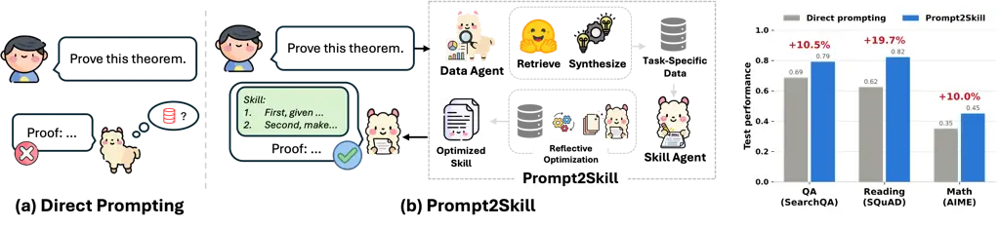
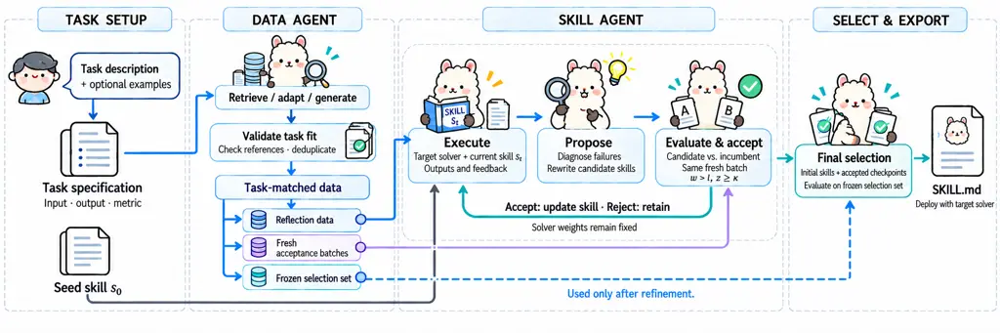
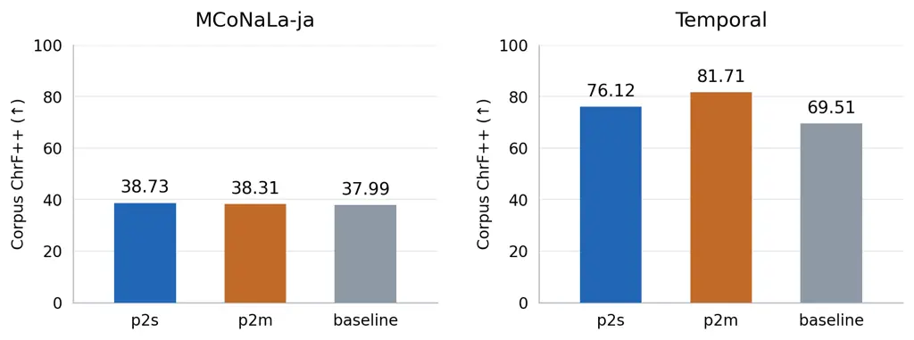

# Prompt2Skill: Unsupervised Skill Optimization From Natural Language Instructions

Bo Ni Affiliation: Vanderbilt University
Email: [bo.ni@vanderbilt.edu](mailto:)    Li Li Affiliation: University
of Southern California Email: [tyler.derr@vanderbilt.edu](mailto:)   
Ryan A. Rossi Affiliation: Adobe Systems Email: [lli@usc.edu](mailto:)
   Franck Dernoncourt Affiliation: Adobe Systems
Email: [ryrossi@adobe.com](mailto:)    Tyler Derr
Affiliation: Vanderbilt University Email: [dernonco@adobe.com](mailto:)

|     |
| --- |
|     |




Figure 1: Prompt2Skill vs. Direct Prompting.

## 1 Introduction

Large Language Models are increasingly deployed as models equipped with
skills, which are external artifacts that the model consumes at
inference time to improve its performance on specialized
tasks (Anthropic, 2025). Often, skills are human-readable markdown files
placed into the model’s context, equipping large language models with
specific procedures, domain conventions, and tool-use knowledge that
they do not reliably exhibit parametrically, and through which a
general-purpose model can improve performance on a specialized task
without any weight updates (Xu and Yan, 2026; Li et al., 2026).

Today, skills are predominantly authored by human experts (Li et al.,
2026; Anthropic, 2025), which limits scalability: each new task demands
domain knowledge, familiarity with the skill format, and iteration
against model behavior (Ni et al., 2026). To address this problem,
recent work explores automated skill creation from agent experience. For
example, Trace2Skill (Ni et al., 2026) consolidates execution
trajectories in parallel into a unified skill directory via inductive
reasoning, compressing recurring failures and workarounds into standard
operating procedures. SkillOpt (Yang et al., 2026), on the other hand,
casts skill creation as controllable text-space optimization: a separate
optimizer model turns scored rollouts into bounded add/delete/replace
edits on the skill document, accepting an edit only when it strictly
improves a held-out validation score. However, these optimizers
presuppose a curated, in-distribution set of training tasks with
reliable labels — the very resource a deployed user lacks. Prior work
shows that shrinking the training set to a single example collapses its
gains to the level of a data-blind draft (Yang et al., 2026), limiting a
more realistic setting where a user who has only a task in mind, and
perhaps a couple of examples: "I want a model that reads a wikipedia
passage and answers questions about it."

To this end, we present Prompt2Skill, a multi-agent framework that
builds an optimized skill from a natural-language task description
alone. From the prompt, the Data Agent derives a task specification,
including the input–output contract and answer format, and retrieves
candidate datasets from online resources. To adapt to a wide range of
requests, the agent then optionally processes or synthesizes data to fit
the task: reformatting retrieved items into the task’s interface, or
generating grounded items when none does. The Skill Agent then refines
the skill in a closed loop of rollouts and reflective editing: a
reflector model proposes candidate edits from the target model’s own
failures, and each edit is accepted only if it wins a statistically
significant paired comparison on a fresh batch of held-out items, with a
frozen validation set consulted exactly once for final selection.

We conduct extensive experiments on four domains, question answering,
reading comprehension, spreadsheet manipulation, and mathematical
reasoning, with models spanning open-source and commercial systems.
Across configurations, Prompt2Skill improves performance by an average
of 10.8% points, on average, and never significantly regresses. We also
compare against skills authored by a frontier LLM from the task
description alone, demonstrating the effectiveness of incorporating data
retrieval and optimization for skill authorization. In summary, our
contributions can be summarized as follows:

- •
  A prompt-to-skill framework. We present Prompt2Skill, to our knowledge
  the first end-to-end multi-agent framework that turns a bare
  natural-language task description into a model-optimized skill, via
  agentic data discovery and synthesis followed by closed-loop
  refinement on the skill, with no weight updates and no user-supplied
  data.
- •
  A comprehensive empirical study. Across four domains and five
  open-source and commercial target models, Prompt2Skill improves over
  direct prompting by 10.8% points on average and never significantly
  regresses. Extensive ablations and case studies further isolate the
  contribution of each component.

## 2 Problem Definition

##### Skills.

Let $`M`$ denote a Large Language Model with a finite token vocabulary
$`\Sigma`$. A _skill_ is a text artifact $`s\in\Sigma^{*}`$ that is
placed in $`M`$’s context at inference time, where $`\Sigma^{*}`$ is the
set of all finite sequences of tokens drawn from $`\Sigma`$. We write
$`M_{s}`$ for the resulting skill-equipped model, and $`M_{\emptyset}`$
for the model prompted directly. A task is characterized by a
distribution $`\mathcal{D}`$ over input–output pairs together with an
evaluation metric $`\mu`$; the value of a skill is

```math
J(s)\;=\;\mathbb{E}_{(x,y)\sim\mathcal{D}}\left[\,\mu\!\left(M_{s}(x),\,y\right)\right]. \tag{1}
```

##### Prompt-to-Skill.

Prior work on automated skill authoring and optimization assumes access
to a labeled training set $`\{(x_{i},y_{i})\}`$ drawn from
$`\mathcal{D}`$, on which candidate skills can be scored and selected.
We remove this assumption and study a more general problem in which
$`\mathcal{D}`$ is never observed: the system receives no samples from
the task distribution, and the task is specified only through a natural
language description. Specifically, let $`d\in\Sigma^{*}`$ be a natural
language description of the target task, for example _“I want a model
that reads a passage and answers questions about it.”_ The description
$`d`$ implicitly fixes both the task distribution $`\mathcal{D}`$ and
the metric $`\mu`$ in Eq. equation 1, but the system observes neither.
Optionally, $`d`$ is accompanied by a small set of examples
$`\mathcal{E}`$ that illustrate the intended input and output format.
The supervised setting of prior work is the special case in which
$`\mathcal{E}`$ is a large labeled sample from $`\mathcal{D}`$; we focus
on the regime where $`\mathcal{E}`$ is empty or holds only a handful of
examples, too few to score and select candidate skills reliably.
Formally, a method for this problem is a procedure
$`\mathcal{A}:(d,\mathcal{E},M,\mathcal{R},\mathcal{G},B)\mapsto\hat{s}`$,
and its quality is $`J(\hat{s})`$, which can be measured only after
optimization, on a test set drawn from $`\mathcal{D}`$.

## 3 Prompt2Skill



Figure 2: Overview of Prompt2Skill. The Data Agent turns the task
description into a task specification, a seed skill, and a pool of
validated items; the Skill Agent refines the seed in a closed loop of
rollouts, reflective edits, and statistical acceptance on fresh batches.
The final skill is chosen on a frozen validation set that is consulted
exactly once.

We present Prompt2Skill, an end-to-end framework that transforms a
natural-language task description and optional examples into a reusable
skill for a target model $`M`$. The framework consists of two agents.
The Data Agent translates the request into a task specification,
initializes a seed skill, and constructs a pool of validated items
through retrieval, processing, and grounded synthesis. The Skill Agent
refines the seed through repeated rollouts and reflective edits,
accepting a revision only when it passes a paired statistical acceptance
test on a fresh held-out batch. After refinement, a frozen validation
set is used in a single final selection stage. The resulting skill is
tailored to the specified task and target model and can be deployed
without updating the model’s parameters. Figure 2 summarizes the
framework. We describe task setup and the two agents below, and finally
Algorithm 1 recaps the complete procedure

### 3.1 Task Setup

The system receives a task description $`d\in\Sigma^{*}`$, optional
examples $`\mathcal{E}`$, and a target model $`M`$. Neither the target
distribution $`\mathcal{D}`$ nor its evaluation metric $`\mu`$ is
directly available. The setup stage therefore converts the request into
an operational task specification and an initial skill. Let
$`f_{\theta}(\cdot)`$ denote an LLM-based operator conditioned on an
instruction prompt $`\theta\in\Sigma^{*}`$, with the underlying model
parameters held fixed. We jointly generate the specification and seed
skill as

```math
(\tau,s_{0})=f_{\theta_{\mathrm{setup}}}(d,\mathcal{E}),\qquad s_{0}\in\Sigma^{*}. \tag{2}
```

The prompt $`\theta_{\mathrm{setup}}`$ specifies the required output
schema and instructs the model to infer the task requirements from
$`d`$, when available, to clarify the intended input and output format.

The specification $`\tau`$ records the input structure, task type,
language, expected answer style, and evaluation criterion. Establishing
these requirements before data acquisition provides a fixed reference
for assessing candidate sources and items. The evaluation criterion
determines an executable proxy metric $`\widehat{\mu}_{\tau}`$, such as
normalized exact matching, numeric equivalence, or answer containment.
We distinguish $`\widehat{\mu}_{\tau}`$ from $`\mu`$: the former
implements the system’s interpretation of the request, while the latter
defines performance on the target task.

The seed $`s_{0}`$ is a concise instruction that states the task and
required output format where the skill agent can optimize from. It is
generated before inspecting acquired data or observing model failures,
so its content depends only on the description and optional examples.
The Data Agent uses $`\tau`$ to guide subsequent data acquisition and
validation, while the Skill Agent uses $`s_{0}`$ to initialize
refinement. The setup prompt $`\theta_{\mathrm{setup}}`$ remains fixed
throughout optimization; its complete instantiation, including the
output schema and optional example block, is provided in Appendix F.

### 3.2 Data Agent

Given the task specification $`\tau`$ produced in the previous section,
the data agent constructs a pool of input-reference pairs for skill
optimization. Since the target distribution $`\mathcal{D}`$ is
unobserved, data acquisition is guided by the requirement inferred from
the requests. The agent will retrieve candidate sources, adapt their
records to the required format, and generate additional items if needed.
We discuss the agent in more details in the rest of this subsection.

##### Data Retrieval.

Let $`\mathcal{R}=\{r_{1},\ldots,r_{K}\}`$ denote the retrieval tools
available to the Data Agent. Each tool $`r_{k}`$ maps a query
$`q\in\Sigma^{*}`$ to a finite set of source identifiers, such as
dataset identifiers or article titles. Our implementation includes
interfaces to the Hugging Face dataset catalog and Wikipedia. The
framework specifies these interfaces, while the agent determines which
tools to invoke and what queries to issue.

Given the task specification $`\tau`$ and descriptions of the available
tools, the agent generates a set of retrieval requests:

```math
\mathcal{Q}_{\tau}=f_{\theta_{\mathrm{retrieve}}}(\tau,\mathcal{R})\subseteq\mathcal{R}\times\Sigma^{*}. \tag{3}
```

Each pair $`(r,q)\in\mathcal{Q}_{\tau}`$ specifies a retrieval tool and
its query. Queries may express task categories or descriptive keywords.
To improve dataset discovery, the agent also generates a hypothetical
description of a suitable dataset and derives search terms from it.

The requests are executed through the corresponding retrieval
interfaces, yielding the candidate source set

```math
\mathcal{C}_{\tau}=\bigcup_{(r,q)\in\mathcal{Q}_{\tau}}r(q). \tag{4}
```

Here, $`f_{\theta_{\mathrm{retrieve}}}`$ denotes LLM-based request
generation, whereas $`r(q)`$ denotes an external retrieval call. The
agent then inspects the returned sources, including their schemas when
available and samples of their content, to assess their suitability for
adaptation.

##### Data Adaptation and Generation.

Retrieved sources may contain relevant information without directly
providing instances of the requested task. For example, if the user
requests about a task on Wikipedia based question answering, the agent
needs further data processing on the retrieved articles to fit the
specific user requirements. They may use a different input format, lack
suitable reference answers, or omit required artifacts. The Data Agent
addresses these mismatches by adapting existing records or generating
new task instances from available material.

For each source $`b\in\mathcal{C}_{\tau}`$, let $`\mathcal{Z}_{b}`$
denote its retrieved records and $`h_{b}`$ its available schema and
metadata. When the required information is present, the agent inspects a
sample $`\widetilde{\mathcal{Z}}_{b}\subseteq\mathcal{Z}_{b}`$ and
proposes a conversion plan:

```math
\pi_{b}=f_{\theta_{\mathrm{adapt}}}\bigl(\tau,h_{b},\widetilde{\mathcal{Z}}_{b}\bigr). \tag{5}
```

The plan identifies the input and reference fields and specifies how
they should be assembled. An executable transformation $`T_{\pi_{b}}`$
converts each usable record $`z`$ into an input–reference pair
$`(x,y)`$; records that cannot be converted are discarded. For example,
adapting a reading comprehension dataset requires assembling the passage
and question into $`x`$ and extracting the accepted answers as $`y`$.
Here, $`f_{\theta_{\mathrm{adapt}}}`$ uses an LLM to propose the plan,
while $`T_{\pi_{b}}`$ executes the specified conversion.

When structural conversion is insufficient, the agent generates new
items that satisfy the task requirements. For text tasks, let
$`\mathcal{H}`$ denote the retrieved material or examples selected as
generation context. Candidate items are produced as

```math
\mathcal{U}_{\mathrm{gen}}=f_{\theta_{\mathrm{gen}}}(\tau,\mathcal{H}). \tag{6}
```

Depending on the task, generation may derive questions and references
from retrieved passages or construct new self-contained exercises using
retrieved examples as a format reference. When no suitable material is
available, $`\mathcal{H}`$ is empty and generation is guided by
$`\tau`$. After adaptation or generation, all resulting items undergo
validation before entering the optimization pool. The prompts
$`\theta_{\mathrm{adapt}}`$ and $`\theta_{\mathrm{gen}}`$ are provided
in Appendix F.

##### Validation.

Adapted and generated items are validated before entering the
optimization pool. Validation checks structural integrity, task
compatibility, and reference usability. Structural checks discard items
with empty inputs, missing references, or malformed fields. For
candidate datasets, the agent uses $`f_{\theta_{\mathrm{validate}}}`$ to
report the language, answer style, task type, and input completeness of
converted samples. These observed properties are compared against the
fixed specification $`\tau`$. For example, a source containing questions
and answers is unsuitable for passage-based question answering if its
converted inputs omit the passages.

The automatic text pipeline additionally applies an answerability screen
using the fixed task-derived seed $`s_{0}`$. Let
$`\mathcal{B}^{\mathrm{probe}}_{b}`$ denote a small sample from source
$`b`$. Using the binary correctness evaluator $`\widehat{\mu}_{\tau}`$,
the source passes this screen when

```math
\sum_{(x,y)\in\mathcal{B}^{\mathrm{probe}}_{b}}\widehat{\mu}_{\tau}\!\left(M_{s_{0}}(x),y\right)>0. \tag{7}
```

Sources on which the seed-equipped model fails every sampled item are
rejected. This heuristic screens for unusable references, input
mismatches, and tasks beyond the model’s demonstrated capabilities on
the sample.

Synthesized text items undergo an additional consistency check. An item
$`(x,y)`$ passes when either the seed-equipped model or a directly
prompted model produces an accepted answer:

```math
\max_{s\in\{s_{0},\emptyset\}}\widehat{\mu}_{\tau}\!\left(M_{s}(x),y\right)=1. \tag{8}
```

We write $`a_{\tau}(x,y)=1`$ when an item passes the applicable source
and item checks, and $`a_{\tau}(x,y)=0`$ otherwise. These checks provide
practical evidence of usability; solver agreement alone does not
establish reference correctness or representativeness of the target
distribution.

##### Pool Construction.

Let $`\mathcal{U}`$ denote the candidate items obtained through
adaptation and generation, and let $`a_{\tau}(x,y)\in\{0,1\}`$ indicate
whether an item passes the applicable source and item checks. We
summarize validation and duplicate filtering as

```math
\mathcal{P}=\operatorname{Dedup}\left(\left\{(x,y)\in\mathcal{U}:a_{\tau}(x,y)=1\right\}\right), \tag{9}
```

where $`\operatorname{Dedup}`$ denotes deterministic filtering based on
the pipeline’s item keys: normalized input keys for text items and item
identifiers for spreadsheet tasks. The pool can be extended during
refinement as additional items are retrieved or generated.

The data serve three roles. At round $`t`$, the reflection set
$`\mathcal{T}_{t}`$ supplies model rollouts and failure examples for
proposing skill edits. A fresh acceptance batch $`\mathcal{B}_{t}`$
supports comparisons between those proposals and the incumbent skill. A
frozen selection set $`\mathcal{V}`$ is established at initialization
and retains the same membership throughout optimization. Within each
round,

```math
\mathcal{T}_{t},\mathcal{B}_{t}\subseteq\mathcal{P}\setminus\mathcal{V},\qquad\mathcal{T}_{t}\cap\mathcal{B}_{t}=\varnothing. \tag{10}
```

For any nonempty batch $`\mathcal{B}\subseteq\mathcal{P}`$, the
empirical skill score is

```math
\widehat{J}_{\mathcal{B}}(s)=\frac{1}{|\mathcal{B}|}\sum_{(x,y)\in\mathcal{B}}\widehat{\mu}_{\tau}\!\left(M_{s}(x),y\right). \tag{11}
```

Acceptance compares the incumbent and proposed skills on the same
$`\mathcal{B}_{t}`$, evaluating edits on items beyond those used to
construct them. These scores guide optimization on the constructed proxy
data. Performance on the target distribution $`\mathcal{D}`$ is measured
afterward on the withheld target test set. The data acquisition and
validation prompts are provided in Appendix F.

### 3.3 Skill Agent

Given the items pool $`\mathcal{P}`$, The Skill Agent refines an initial
skill using reflective edits, and paired evaluation on fresh acceptance
batches. Each round produces candidate skills from observed failures,
evaluates them against the incumbent, and retains an update only when it
satisfies the acceptance criterion. After refinement, a comparison on
the frozen selection set determines the exported skill.

##### Rollouts and Executions.

Let $`s_{t}`$ denote the incumbent skill at round $`t`$, starting with
$`s_{1}=s_{0}`$ under task-derived initialization. Supplied or
data-informed initial skills can replace this starting incumbent. For
each item $`(x_{i},y_{i})\in\mathcal{T}_{t}`$, the agent executes the
skill-equipped model and evaluates the resulting output:

```math
o_{t,i}=M_{s_{t}}(x_{i}),\qquad r_{t,i}=\widehat{\mu}_{\tau}(o_{t,i},y_{i}). \tag{12}
```

The implemented evaluators return binary outcomes $`r_{t,i}\in\{0,1\}`$,
whose average gives $`\widehat{J}_{\mathcal{T}_{t}}(s_{t})`$.

##### Reflective Editing.

Following prior work (Agrawal et al., 2026; Yang et al., 2026), the
Skill Agent uses rollout feedback to identify failure patterns and
propose revisions to the incumbent skill. Let $`\mathcal{F}_{t}`$ denote
the available feedback from unsuccessful executions. This feedback can
contain input excerpts, reference answers, and the model’s incorrect
answers.

For a sampled subset $`\mathcal{F}_{t,j}\subseteq\mathcal{F}_{t}`$, the
agent proposes a candidate skill as

```math
s^{\prime}_{t,j}=f_{\theta_{\mathrm{edit}}}\left(\tau,s_{t},\widehat{J}_{\mathcal{T}_{t}}(s_{t}),\mathcal{F}_{t,j}\right). \tag{13}
```

The resulting candidates form
$`\mathcal{S}_{t}=\{s^{\prime}_{t,1},\ldots,s^{\prime}_{t,K_{t}}\}`$,
which are passed to the acceptance step below. The reflection prompts
and authoring procedures are provided in Appendix F.

##### Evaluation and Acceptance.

The agent evaluates each candidate $`s^{\prime}_{t,j}`$ and the
incumbent $`s_{t}`$ on the same fresh batch $`\mathcal{B}_{t}`$. Let
$`w_{t,j}`$ count items solved only by the candidate and $`\ell_{t,j}`$
those solved only by the incumbent. A candidate qualifies when
$`w_{t,j}>\ell_{t,j}`$ and $`z_{t,j}\geq\kappa`$, where

```math
z_{t,j}=\begin{cases}\displaystyle\frac{|w_{t,j}-\ell_{t,j}|-1}{\sqrt{w_{t,j}+\ell_{t,j}}},&w_{t,j}+\ell_{t,j}>0,\\[6.0pt]
0,&\text{otherwise}.\end{cases} \tag{14}
```

We use $`\kappa=1`$ as a per-candidate screening threshold. Among
qualifying candidates, the agent accepts the one with the largest net
gain $`w_{t,j}-\ell_{t,j}`$; if none qualifies, it retains $`s_{t}`$.
Accepted skills become the next incumbent and are saved as checkpoints
for final selection. The round budget and stopping criteria are
specified in Appendix D.

### 3.4 Selection and Export

Whenever a candidate is accepted and becomes the incumbent, Prompt2Skill
saves its skill text. Let $`\mathcal{S}_{\mathrm{acc}}`$ denote these
previously accepted skills and $`\mathcal{S}_{\mathrm{init}}`$ the
initial skills retained as fallback options. After refinement, all
eligible skills are evaluated on the frozen selection set
$`\mathcal{V}`$. For nonempty $`\mathcal{V}`$, the selected skill is

```math
\hat{s}\in\arg\max_{s\in\mathcal{S}_{\mathrm{init}}\cup\mathcal{S}_{\mathrm{acc}}}\widehat{J}_{\mathcal{V}}(s). \tag{15}
```

The common selection set makes skills accepted on different batches
comparable. Selection scores are not fed into subsequent refinement. The
selected skill is exported as SKILL.md and supplied to the target model
at inference time.

Intuitively, terminal selection can recover an earlier improvement when
later edits generalize less well, while retaining initial skills
provides fallback options. Under an independent selection sample and
bounded proxy mismatch, we bound the performance gap between the
exported skill and the best retained skill. Appendix A formalizes this
guarantee and its implications for the framework.

### 3.5 Algorithm

We present the Prompt2Skill algorithm in Algorithm 1. The procedure
constructs task-matched proxy data and refines an initial skill through
execution feedback, reflective editing, and paired acceptance on fresh
batches. After refinement, it compares the retained skills on a frozen
selection set and exports the selected artifact for inference.

Input: Task description $`d`$, optional examples $`\mathcal{E}`$, target
model $`M`$, acquisition tools, and refinement budget.  
Output: A skill artifact $`\hat{s}`$.

1.  1.  Establish the task specification $`\tau`$ and proxy evaluator
        $`\widehat{\mu}_{\tau}`$. Choose an initial incumbent $`s`$ and
        retain the eligible initial skills $`\mathcal{S}_{\mathrm{init}}`$.
2.  2.  Retrieve or generate task items, adapt their representations, and
        apply the applicable validation and duplicate checks. Establish the
        frozen selection set $`\mathcal{V}`$ and the initial reflection
        pool. Set $`\mathcal{S}_{\mathrm{acc}}\leftarrow\varnothing`$.
3.  3.  For each permitted refinement round $`t`$:

    1.  (a)
        Acquire additional reflection items as required by the task
        driver and form $`\mathcal{T}_{t}`$, excluding selection items.
    1.  (b)
        Execute $`M_{s}`$ on $`\mathcal{T}_{t}`$ and compute its proxy
        score and failure feedback $`\mathcal{F}_{t}`$.
    1.  (c)
        Propose the ordered candidates
        $`\mathcal{S}_{t}=(s^{\prime}_{t,1},\ldots,s^{\prime}_{t,K_{t}})`$
        using reflective editing.
    1.  (d)
        Acquire a fresh acceptance batch $`\mathcal{B}_{t}`$, excluding
        current reflection and selection items under the driver’s item
        keys. Evaluate the incumbent once on $`\mathcal{B}_{t}`$.
    1.  (e)
        Evaluate every candidate on the same $`\mathcal{B}_{t}`$.
        Compute paired wins $`w_{t,j}`$, losses $`\ell_{t,j}`$, and the
        statistic $`z_{t,j}`$ in Eq. equation 20.
    1.  (f)
        Among candidates with $`w_{t,j}>\ell_{t,j}`$ and
        $`z_{t,j}\geq 1`$, select the first candidate attaining the
        largest net gain $`w_{t,j}-\ell_{t,j}`$. If one exists, replace
        $`s`$ with its text and retain that text in
        $`\mathcal{S}_{\mathrm{acc}}`$.
    1.  (g)
        Record the round outcome and apply the driver’s stopping rule.

4.  4.  When $`\mathcal{V}`$ is nonempty, evaluate the eligible initial
        skills, the incumbent, and previously accepted skills on
        $`\mathcal{V}`$. Select the highest-scoring entry using the driver’s
        tie rule.
5.  5.  Export the selected text as SKILL.md.

Algorithm 1 Prompt2Skill construction and refinement.

## 4 Experiment

In this section, we evaluate whether Prompt2Skill can construct useful
skills from task descriptions across different tasks and target models,
following the prompt-to-skill setting in Section 2. Our experiments
compare the resulting skills with direct prompting and fixed skill
baselines, and examine sensitivity to initialization and optional
input–output examples. We also explore the application of Prompt2Skill
to NLP AutoML, using skill construction as an alternative to
task-specific fine-tuning. Preliminary experiments and analysis are
provided in Appendix B.

### 4.1 Experimental Setup

##### Task Prompts.

We evaluate Prompt2Skill in the prompt-to-skill setting: each task is
specified through a natural-language description $`d`$ of the desired
behavior. The main experiments use no user-provided examples. For
example, the reading-comprehension task is specified as _“I want a model
that reads a passage and answers questions about it.”_ This description
guides task setup, proxy-data acquisition, and skill refinement. The
resulting skill is then evaluated on the corresponding held-out
benchmark. The exact task descriptions and the prompt templates used by
the framework are provided in Appendix F.

##### Benchmarks.

We evaluate four tasks spanning factual question answering
(SearchQA (Dunn et al., 2017)), reading comprehension (SQuAD (Rajpurkar
et al., 2016)), mathematical reasoning (AIME (Zhang and Math-AI, 2025)),
and spreadsheet manipulation (SpreadsheetBench (Ma et al., 2024)). These
benchmarks measure the performance of the constructed skills on their
intended tasks. Dataset splits, evaluation metrics, and execution
settings are provided in Appendix E.

##### Target Models.

We consider three open-weight solvers: Qwen3-8B, Qwen3-32B, and
Llama-3.2-1B-Instruct; and two commercial solvers: Claude Haiku 4.5 and
GPT-5.5. The target model executes skills and supplies the outcomes used
during refinement, while GPT-5.5 provides reflective feedback for the
optimization runs.

##### Baselines.

We compare Prompt2Skill against four baselines. Direct supplies the task
instruction and required output format without an additional skill.
Off-the-shelf supplies an externally published skill selected for domain
relevance. LLM-generated uses a skill authored once by Qwen3-32B from a
domain description, without execution feedback or iterative refinement.
Details on the off-the-shelf skills and LLM-generated skills are
provided in Appendix F.4, and baselines details are provided in
Appendix E.3.

|             |                           | Method        | SearchQA            | SQuAD               | AIME                | Spreadsheet         | Avg. $`\Delta`$ |
| ----------- | ------------------------- | ------------- | ------------------- | ------------------- | ------------------- | ------------------- | --------------- |
| Open-source | Qwen3 \[-1pt\] 8B         | Direct        | 0.431 $`\pm`$ 0.002 | 0.738 $`\pm`$ 0.001 | 0.208 $`\pm`$ 0.014 | 0.044 $`\pm`$ 0.005 | 0.0%            |
|             |                           | Off-the-shelf | 0.496 $`\pm`$ 0.003 | 0.657 $`\pm`$ 0.004 | 0.128 $`\pm`$ 0.013 | 0.085 $`\pm`$ 0.007 | +14.7%          |
|             |                           | LLM-generated | 0.557 $`\pm`$ 0.003 | 0.611 $`\pm`$ 0.001 | 0.158 $`\pm`$ 0.017 | 0.082 $`\pm`$ 0.011 | +18.6%          |
|             |                           | P2S           | 0.640 $`\pm`$ 0.019 | 0.768 $`\pm`$ 0.097 | 0.175 $`\pm`$ 0.000 | 0.079 $`\pm`$ 0.011 | +29.1%          |
|             | Qwen3 \[-1pt\] 32B        | Direct        | 0.613 $`\pm`$ 0.002 | 0.694 $`\pm`$ 0.002 | 0.211 $`\pm`$ 0.017 | 0.152 $`\pm`$ 0.023 | 0.0%            |
|             |                           | Off-the-shelf | 0.537 $`\pm`$ 0.005 | 0.630 $`\pm`$ 0.003 | 0.136 $`\pm`$ 0.013 | 0.180 $`\pm`$ 0.012 | -9.7%           |
|             |                           | LLM-generated | 0.608 $`\pm`$ 0.002 | 0.632 $`\pm`$ 0.002 | 0.178 $`\pm`$ 0.013 | 0.179 $`\pm`$ 0.026 | -1.9%           |
|             |                           | P2S           | 0.778 $`\pm`$ 0.019 | 0.825 $`\pm`$ 0.009 | 0.222 $`\pm`$ 0.017 | 0.233 $`\pm`$ 0.019 | +26.1%          |
|             | Llama-3.2 \[-1pt\] 1B     | Direct        | 0.140 $`\pm`$ 0.003 | 0.207 $`\pm`$ 0.002 | 0.017 $`\pm`$ 0.000 | N/A                 | 0.0%^(c)        |
|             |                           | Off-the-shelf | 0.120 $`\pm`$ 0.004 | 0.048 $`\pm`$ 0.001 | 0.017 $`\pm`$ 0.000 | N/A                 | -30.4%          |
|             |                           | LLM-generated | 0.273 $`\pm`$ 0.007 | 0.090 $`\pm`$ 0.001 | 0.031 $`\pm`$ 0.005 | N/A                 | +40.3%          |
|             |                           | P2S           | 0.340 $`\pm`$ 0.064 | 0.492 $`\pm`$ 0.048 | 0.017 $`\pm`$ 0.014 | N/A                 | +93.5%          |
| Commercial  | Claude \[-1pt\] Haiku 4.5 | Direct        | 0.857 $`\pm`$ 0.000 | 0.416 $`\pm`$ 0.000 | 0.467 $`\pm`$ 0.014 | 0.297 $`\pm`$ 0.010 | 0.0%            |
|             |                           | Off-the-shelf | 0.891 $`\pm`$ 0.000 | 0.294 $`\pm`$ 0.001 | 0.511 $`\pm`$ 0.017 | 0.271 $`\pm`$ 0.014 | -6.2%           |
|             |                           | LLM-generated | 0.854 $`\pm`$ 0.000 | 0.499 $`\pm`$ 0.000 | 0.517 $`\pm`$ 0.008 | 0.300 $`\pm`$ 0.005 | +7.8%           |
|             |                           | P2S           | 0.839 $`\pm`$ 0.000 | 0.793 $`\pm`$ 0.004 | 0.508 $`\pm`$ 0.014 | 0.269 $`\pm`$ 0.012 | +22.0%          |
|             | GPT-5.5                   | Direct        | 0.839 $`\pm`$ 0.004 | 0.651 $`\pm`$ 0.002 | 0.525 $`\pm`$ 0.000 | 0.266 $`\pm`$ 0.009 | 0.0%            |
|             |                           | Off-the-shelf | 0.855 $`\pm`$ 0.003 | 0.512 $`\pm`$ 0.004 | 0.914 $`\pm`$ 0.013 | 0.264 $`\pm`$ 0.026 | +13.5%          |
|             |                           | LLM-generated | 0.876 $`\pm`$ 0.004 | 0.425 $`\pm`$ 0.016 | 0.883 $`\pm`$ 0.008 | 0.276 $`\pm`$ 0.016 | +10.4%          |
|             |                           | P2S           | 0.868 $`\pm`$ 0.016 | 0.852 $`\pm`$ 0.020 | 0.861 $`\pm`$ 0.005 | 0.263 $`\pm`$ 0.009 | +24.3%          |

Table 1: Main results comparing direct prompting, existing
general-purpose skills (Off-the-shelf), skills generated directly by an
LLM (LLM-generated), and Prompt2Skill (P2S). Llama-3.2-1B was not able
to complete any SpreadsheetBench task.

### 4.2 Main Results

We report our main results in Table 1. Prompt2Skill achieves the highest
average relative improvement for every target model, with gains ranging
from 22.0% to 29.1% for the Qwen and commercial models, and 93.5% for
Llama-3.2-1B over its three reported benchmarks. Although Prompt2Skill
does not achieve the best score in every setting, its improvements are
the most consistent across the evaluated settings. It also achieves the
highest mean score in 10 pairs, including all five solvers on SQuAD and
all four benchmarks for Qwen3-32B.

Fixed skills can also produce substantial regressions. For example, the
off-the-shelf skill reduces Llama-3.2-1B’s SQuAD score from 0.207 to
0.048, whereas Prompt2Skill raises its SQuAD score to 0.492. These
results illustrate that a skill’s usefulness depends on the target model
and task, and the fixed baselines are constructed or selected without
feedback from target-model executions.

##### Notes on Data Overlap and Test Leakage.

An audit of archived proxy data found no lexical overlap flags or
workbook-hash matches against the target tests; source details and
coverage appear in Appendix C.

### 4.3 Ablation Studies

##### Sensitivity to Initialization.

Figure 3(a) compares initializing Prompt2Skill with its default seed
skill $`s_{0}`$ or an off-the-shelf domain skill on SearchQA and SQuAD,
using Qwen3-8B, Qwen3-32B, and GPT-5.5. Neither initialization
consistently outperforms the other. For example, the off-the-shelf seed
improves SQuAD performance for Qwen3-8B but reduces it for GPT-5.5.
Overall, the two initializations yield broadly comparable performance,
suggesting that Prompt2Skill does not depend on a particular seed skill.

##### Optional Input–Output Examples.

We compare zero, one, and four demonstrations with Qwen3-8B on SearchQA
and SQuAD (Figure 3(b)). Direct prompting uses examples at inference,
while Prompt2Skill uses them only during skill construction. Additional
examples do not consistently improve performance: direct prompting on
SQuAD improves from 70.5% with zero examples to 79.0% with four, whereas
Prompt2Skill remains nearly unchanged on SearchQA between one and four
examples (61.1% versus 60.9%). These results support treating
user-provided demonstrations as optional, since Prompt2Skill retrieves
task-relevant data to support skill optimization.

##### Comparing to Skill Optimization

| Method   | SearchQA EM | SQuAD EM | SQuAD F1 |
| -------- | ----------- | -------- | -------- |
| SkillOpt | 45.79       | 81.30    | 90.50    |
| P2S      | 48.71       | 82.50    | 91.11    |

Table 2: Matched-budget results.

In order to assess whether the gains extend beyond proxy-data
acquisition, we compare Prompt2Skill with SkillOpt (Yang et al., 2026)
using the same proxy data and initial skill. Both methods use Qwen3-8B
as the solver and GPT-5.5 as the editor, with a cap of 7,400 solver
evaluations per task. As shown in Table 2, Prompt2Skill improves
SearchQA EM by 2.93 percentage points and SQuAD EM/F1 by 1.20/0.61
points. These results support the overall optimization and selection
procedure when the target distribution is unknown, showing the
effectiveness of the proposed optimization procedure.

(a) Sensitivity to seed initialization.

(b) Effect of optional demonstrations.

Figure 3: Ablations on SearchQA and SQuAD. Scores are percentages;
higher is better. Each ablation condition uses one run. Zero-example
Prompt2Skill scores in (b) are three-run means from the main table; the
matched zero-example runs failed during data acquisition.

## 5 Related Work

##### Skill Optimization.

Automatic prompt optimization improves model behavior by searching over
textual instructions. APE (Zhou et al., 2023) generates and selects
instruction candidates, while ProTeGi (Pryzant et al., 2023) uses
natural-language critiques of prediction errors to guide prompt edits.
GEPA (Agrawal et al., 2026) combines reflection on execution feedback
with Pareto-based candidate search. Recent work extends this approach to
reusable agent skills: Trace2Skill (Ni et al., 2026) consolidates
lessons from execution trajectories into transferable skill directories,
while SkillOpt (Yang et al., 2026) refines skill documents through
bounded edits and validation-gated updates.

##### AutoML.

Recent AutoML systems use language models to automate machine-learning
workflows. Prompt2Model (Viswanathan et al., 2023) converts task
descriptions into deployable models through dataset and model retrieval,
synthetic data generation, and supervised fine-tuning.
AutoML-Agent (Trirat et al., 2025) coordinates specialized agents to
automate the pipeline from data retrieval to model deployment, using
retrieval-augmented planning and multi-stage verification. MLZero (Fang
et al., 2025) combines multimodal data interpretation with memory-guided
code generation, while AIDE (Jiang et al., 2025) formulates
machine-learning engineering as tree search over executable solutions.

## 6 Conclusion

In this paper, we introduced Prompt2Skill, a framework that converts
natural-language task descriptions into reusable skills for frozen
language models, without requiring a supplied target-task training set.
The Data Agent constructs task-matched proxy data through retrieval,
adaptation, and generation, while the Skill Agent refines skills through
execution feedback, reflective editing, and statistical screening on
fresh batches. Across four benchmarks and five target models,
Prompt2Skill achieves average relative improvements of 36.1% over direct
prompting and 83.0% over off-the-shelf skills, averaged across the 19
evaluated model–benchmark pairs, demonstrating that task descriptions
alone can guide the automated construction of effective skills for
frozen language models.

## 7 AI Use Disclosure

In this work, we used generative AI tools for brainstorming research
idea, implementing part of the codebase, and formulate theoretical
proof. We have not used generative AI tools for autoresearch, propose
hypothesis, or provide feedback on methodology, and the rest of the
required disclosure tasks are not applicable to this work. Additionally,
we used generative AI tools for draft part of the research paper, create
or modify the teaser figure and images, and summarize existing landscape
in the research area that is within our interests. We have reviewed all
AI-assisted work. We checked LLM-generated research ideas for potential
plagiarism through a manual literature survey, and audited the claims
and code written by LLMs. We take responsibility for the final content
of this work, including text, claims or artifacts produced with the aid
of generative AI.

## References

- Agrawal et al. (2026) L. A. Agrawal, S. Tan, D. Soylu, N. Ziems, R.
  Khare, K. Opsahl-Ong, A. Singhvi, H. Shandilya, M. J. Ryan, M.
  Jiang, C. Potts, K. Sen, A. G. Dimakis, I. Stoica, D. Klein, M.
  Zaharia, and O. Khattab GEPA: reflective prompt evolution can
  outperform reinforcement learning. External Links: 2507.19457,
  [Link](https://arxiv.org/abs/2507.19457) Cited by: §3.3, §5.
- Anthropic (2025) Anthropic Equipping agents for the real world with
  Agent Skills. Note: Anthropic Engineering BlogAccessed 14 August 2026
  External Links:
  [Link](https://www.anthropic.com/engineering/equipping-agents-for-the-real-world-with-agent-skills)
  Cited by: §1, §1.
- Dunn et al. (2017) M. Dunn, L. Sagun, M. Higgins, V. U. Guney, V.
  Cirik, and K. Cho SearchQA: a new q&a dataset augmented with context
  from a search engine. External Links: 1704.05179,
  [Link](https://arxiv.org/abs/1704.05179) Cited by: §E.1, §4.1.
- Fang et al. (2025) H. Fang, B. Han, N. Erickson, X. Zhang, S. Zhou, A.
  Dagar, J. Zhang, A. C. Turkmen, C. Hu, H. Rangwala, Y. N. Wu, B. Wang,
  and G. Karypis MLZero: a multi-agent system for end-to-end machine
  learning automation. External Links: 2505.13941,
  [Link](https://arxiv.org/abs/2505.13941) Cited by: §5.
- Jiang et al. (2025) Z. Jiang, D. Schmidt, D. Srikanth, D. Xu, I.
  Kaplan, D. Jacenko, and Y. Wu AIDE: ai-driven exploration in the space
  of code. External Links: 2502.13138,
  [Link](https://arxiv.org/abs/2502.13138) Cited by: §5.
- Li et al. (2026) X. Li, Y. Liu, W. Chen, B. You, Z. Di, Y. He, S.
  Zheng, K. W. Choe, J. Sun, S. Wang, C. Tao, B. Li, X. Zhao, H.
  Geng, X. Wu, J. Zhou, X. Chen, H. Xing, Y. Li, Q. Zeng, D. Wang, Y.
  Wang, R. B. Chaim, P. Jiang, H. Shen, L. Kong, X. Liu, R. Wang, X.
  Liu, J. Li, X. Lan, Y. Lin, W. Ye, J. He, S. Li, Y. Zhang, Y. Gao, Y.
  Li, Z. Ma, L. Jing, T. Wang, K. Li, Y. Xue, H. Lyu, Y. He, Y. Tian, S.
  Wu, B. Wang, Y. Gao, B. Chen, L. Liu, S. Cheng, J. Bao, S. Tong, S.
  Xu, T. Y. Zhuo, T. Ye, Q. Qi, M. Li, L. Liao, Z. Tan, C. Shi, X.
  Tang, S. Tankasala, B. Yuan, Y. Qian, J. Tu, C. Wang, Y. Sun, W.
  Wang, A. Taylor, Z. Yang, C. Guan, Z. Dong, X. Zhang, S. Dillmann, H.
  Lee, and D. Song SkillsBench: benchmarking how well agent skills work
  across diverse tasks. External Links: 2602.12670,
  [Link](https://arxiv.org/abs/2602.12670) Cited by: §1, §1.
- Ma et al. (2024) Z. Ma, B. Zhang, J. Zhang, J. Yu, X. Zhang, X.
  Zhang, S. Luo, X. Wang, and J. Tang SpreadsheetBench: towards
  challenging real world spreadsheet manipulation. External Links:
  2406.14991, [Link](https://arxiv.org/abs/2406.14991) Cited by: §E.1,
  §4.1.
- Ni et al. (2026) J. Ni, Y. Liu, X. Liu, Y. Sun, M. Zhou, P. Cheng, D.
  Wang, E. Zhao, X. Jiang, and G. Jiang Trace2Skill: distill
  trajectory-local lessons into transferable agent skills. External
  Links: 2603.25158, [Link](https://arxiv.org/abs/2603.25158) Cited by:
  §E.1, §1, §5.
- Pryzant et al. (2023) R. Pryzant, D. Iter, J. Li, Y. T. Lee, C. Zhu,
  and M. Zeng Automatic prompt optimization with "gradient descent" and
  beam search. External Links: 2305.03495,
  [Link](https://arxiv.org/abs/2305.03495) Cited by: §5.
- Rajpurkar et al. (2016) P. Rajpurkar, J. Zhang, K. Lopyrev, and P.
  Liang SQuAD: 100,000+ questions for machine comprehension of text.
  External Links: 1606.05250, [Link](https://arxiv.org/abs/1606.05250)
  Cited by: §E.1, §4.1.
- Trirat et al. (2025) P. Trirat, W. Jeong, and S. J. Hwang
  AutoML-agent: a multi-agent llm framework for full-pipeline automl.
  External Links: 2410.02958, [Link](https://arxiv.org/abs/2410.02958)
  Cited by: §5.
- Viswanathan et al. (2023) V. Viswanathan, C. Zhao, A. Bertsch, T. Wu,
  and G. Neubig Prompt2Model: generating deployable models from natural
  language instructions. External Links: 2308.12261,
  [Link](https://arxiv.org/abs/2308.12261) Cited by: Figure 4, Appendix
  B, Appendix B, §5.
- Xu and Yan (2026) R. Xu and Y. Yan Agent skills for large language
  models: architecture, acquisition, security, and the path forward.
  External Links: 2602.12430, [Link](https://arxiv.org/abs/2602.12430)
  Cited by: §1.
- Yang et al. (2026) Y. Yang, Z. Gong, W. Huang, Q. Yang, Z. Zhou, Z.
  Huang, Y. Li, X. Gao, Q. Dai, B. Liu, K. Qiu, Y. Yang, D. Chen, X.
  Yang, and C. Luo SkillOpt: executive strategy for self-evolving agent
  skills. External Links: 2605.23904,
  [Link](https://arxiv.org/abs/2605.23904) Cited by: §E.1, §E.1, §1,
  §3.3, §4.3, §5.
- Zhang and Math-AI (2025) Y. Zhang and T. Math-AI American invitational
  mathematics examination (aime) 2025. Cited by: §E.1, §4.1.
- Zhou et al. (2023) Y. Zhou, A. I. Muresanu, Z. Han, K. Paster, S.
  Pitis, H. Chan, and J. Ba Large language models are human-level prompt
  engineers. External Links: 2211.01910,
  [Link](https://arxiv.org/abs/2211.01910) Cited by: §5.

## Appendix A Reliable Selection after Adaptive Skill Refinement

Refinement produces skills using execution feedback and comparisons on
different acceptance batches. The final incumbent need not be the best
skill encountered during this process. This motivates retaining initial
and previously accepted skills and comparing them on a separate
selection sample. The following result bounds the loss from selecting
among these retained skills. Candidate construction may be adaptive,
provided that it remains independent of the selection sample.

###### Theorem 1 (Final selection under proxy mismatch).

Fix the task specification $`\tau`$, its evaluator
$`\widehat{\mu}_{\tau}`$, and a proxy distribution
$`\widetilde{\mathcal{D}}`$ over input–reference pairs. Let
$`\mathcal{S}=(s^{(1)},\ldots,s^{(K)})`$ be a nonempty finite collection
of eligible skill entries, constructed independently of the selection
sample $`\mathcal{V}\sim\widetilde{\mathcal{D}}^{n}`$, where
$`n\geq 1`$. If identical skill texts are evaluated multiple times, each
evaluated entry is counted separately in $`K`$.

Assume that $`\mu`$ and $`\widehat{\mu}_{\tau}`$ take values in
$`[0,1]`$ and that

```math
\displaystyle\operatorname{TV}(\mathcal{D},\widetilde{\mathcal{D}}) \displaystyle\leq\epsilon_{\mathrm{dist}}, \tag{16}
```

```math
\displaystyle\max_{s\in\mathcal{S}}\mathbb{E}_{(x,y)\sim\widetilde{\mathcal{D}}}\left[\left|\mu(M_{s}(x),y)-\widehat{\mu}_{\tau}(M_{s}(x),y)\right|\right] \displaystyle\leq\epsilon_{\mathrm{eval}},
```

where $`\operatorname{TV}(P,Q)=\sup_{A}|P(A)-Q(A)|`$. For stochastic
solvers, expectations also include inference randomness. Selection
evaluations use fresh inference randomness, independent across items and
of candidate construction.

Then, for any $`\delta\in(0,1)`$, the selected skill
$`\hat{s}\in\arg\max_{s\in\mathcal{S}}\widehat{J}_{\mathcal{V}}(s)`$
satisfies, with probability at least $`1-\delta`$,

```math
\displaystyle J(\hat{s})\geq \displaystyle\max_{s\in\mathcal{S}}J(s)-2\bigl(\epsilon_{\mathrm{dist}}+\epsilon_{\mathrm{eval}}\bigr) \tag{17}
```

```math
\displaystyle-\sqrt{\frac{2\log(2K/\delta)}{n}}.
```

##### Proof intuition.

The argument separates proxy mismatch from selection error. Distribution
and evaluator mismatch bound the difference between each skill’s target
value and its population proxy value. An independent selection sample
then controls estimation error uniformly over the retained candidates.
Together, these bounds relate the empirically selected skill to the best
retained skill on the target distribution.

###### Proof.

Condition on the realized candidate collection $`\mathcal{S}`$. By
independence, $`\mathcal{V}`$ remains an i.i.d. sample from
$`\widetilde{\mathcal{D}}`$. Define

```math
\widetilde{J}(s)=\mathbb{E}_{(x,y)\sim\widetilde{\mathcal{D}}}\left[\widehat{\mu}_{\tau}(M_{s}(x),y)\right],\qquad\epsilon_{\mathrm{proxy}}:=\epsilon_{\mathrm{dist}}+\epsilon_{\mathrm{eval}}.
```

For every $`s\in\mathcal{S}`$, boundedness of the true metric and the
total-variation assumption give

```math
\displaystyle|J(s)-\widetilde{J}(s)|\leq \displaystyle\left|\mathbb{E}_{\mathcal{D}}[\mu(M_{s}(x),y)]-\mathbb{E}_{\widetilde{\mathcal{D}}}[\mu(M_{s}(x),y)]\right| \tag{18}
```

```math
\displaystyle+\mathbb{E}_{\widetilde{\mathcal{D}}}\left[\left|\mu(M_{s}(x),y)-\widehat{\mu}_{\tau}(M_{s}(x),y)\right|\right]
```

```math
\displaystyle\leq \displaystyle\epsilon_{\mathrm{proxy}}.
```

For each candidate, its selection score averages $`n`$ independent
observations in $`[0,1]`$. Hoeffding’s inequality and a union bound
therefore yield

```math
\Pr\left(\max_{s\in\mathcal{S}}\left|\widehat{J}_{\mathcal{V}}(s)-\widetilde{J}(s)\right|>\alpha\right)\leq 2K\exp(-2n\alpha^{2}).
```

Taking $`\alpha=\sqrt{\log(2K/\delta)/(2n)}`$ makes this probability at
most $`\delta`$.

On the resulting event, let
$`s^{\star}\in\arg\max_{s\in\mathcal{S}}J(s)`$. The empirical optimality
of $`\hat{s}`$ implies

```math
\displaystyle J(\hat{s}) \displaystyle\geq\widehat{J}_{\mathcal{V}}(\hat{s})-\alpha-\epsilon_{\mathrm{proxy}}
```

```math
\displaystyle\geq\widehat{J}_{\mathcal{V}}(s^{\star})-\alpha-\epsilon_{\mathrm{proxy}}
```

```math
\displaystyle\geq J(s^{\star})-2\alpha-2\epsilon_{\mathrm{proxy}}.
```

Substituting $`\alpha`$ proves the bound. The argument holds conditional
on every candidate collection satisfying the assumptions, so it also
covers adaptive candidate construction independent of $`\mathcal{V}`$. ∎

##### Implications for the framework.

Let $`\eta_{n}`$ denote the total error allowance in Eq. equation 17.
Retaining an initial skill $`s_{0}`$ gives

```math
J(\hat{s})\geq J(s_{0})-\eta_{n}.
```

If refinement discovers a retained skill $`s^{+}`$ satisfying
$`J(s^{+})\geq J(s_{0})+\gamma`$, then

```math
J(\hat{s})\geq J(s_{0})+\gamma-\eta_{n}.
```

Thus, terminal selection can preserve an improvement discovered anywhere
along the retained trajectory, up to the stated error allowance. This
motivates keeping the previously accepted skills, rather than exporting
only the last incumbent. It is worth noting that distribution and
evaluator mismatch from the data agent remain separate sources of error.

## Appendix B Application on NLP AutoML



Figure 4: AutoML Performance. P2S stands for Prompt2Skill, while P2M
stands for Prompt2Model (Viswanathan et al., 2023).

In addition to creating reusable agent skills, Prompt2Skill can be
viewed as an alternative approach to task specialization in NLP AutoML.
Prior work (Viswanathan et al., 2023) introduced Prompt2Model, which
converts natural-language task descriptions into task-specific models
through dataset and model retrieval, synthetic data generation, and
supervised fine-tuning. Prompt2Skill instead produces a reusable skill
that guides a frozen language model, enabling task adaptation without
updating its weights.

We explore this application on Japanese-to-Python code generation
(MCoNaLa-ja) and temporal expression normalization (Temporal). We
compare P2S with a modified Prompt2Model baseline that generates up to
1,000 training examples and fine-tunes a fixed Qwen-32B model. P2S uses
Qwen3-32B and receives a task description with three demonstrations.
Both methods are scored on 207 MCoNaLa-ja examples and a 400-example
Temporal subset, following  Viswanathan et al. (2023). Baseline is the
plain Qwen-32B model. Figure 4 shows comparable scores for P2S in this
exploratory comparison. These results illustrate the potential of
skill-based task adaptation as a strong alternative to NLP autoML tasks.

## Appendix C Data Sources and Test-Overlap Audit

Prompt2Skill requires no user-supplied training set, but permits
automatically acquired labeled supervision. One concern is that the
evaluation might provide an opportunity for hacking the metrics by
retrieving the exact data that the framework is evaluated on. We thus
audit the retrieved data source across datasets and report the results
in Table 3.

| Task             | Recorded sources                                                        | Text flags | Workbook matches |
| ---------------- | ----------------------------------------------------------------------- | ---------- | ---------------- |
| SearchQA         | openaccess-ai-collective/jeopardy                                       | 0          | —                |
| SQuAD            | allenai/sciq; hotpotqa/hotpot_qa                                        | 0          | —                |
| AIME             | nvidia/OpenMathInstruct-2; SuperSecureHuman/competition_math_hf_dataset | 0          | —                |
| SpreadsheetBench | Generated workbook tasks                                                | 0          | 0                |

Table 3: Recorded proxy sources and retrospective overlap findings.
Dataset identifiers refer to Hugging Face repositories. Text flags are
exact, containment, or near-text matches under the checks described
below. Workbook matches use two SHA-256 checks; a dash denotes not
applicable. Zero detected matches apply only to the audited artifacts.

##### Source records.

Table 3 lists configured or discovered source banks, not verified
item-level attribution. For SQuAD, HotpotQA was recorded but had no
bulk-fetch progress in most runs. Source cursors indicate attempted
fetching; they do not identify how many items from each source were
retained.

##### Text checks.

We normalize text using HTML unescaping, Unicode NFKC normalization,
case folding, and word-token extraction. We check exact questions and
full-question containment, with a minimum of four tokens and 20
characters for containment. For questions of at least eight tokens,
near-text checks use five-token-shingle Jaccard similarity of at least
$`0.8`$, or a SequenceMatcher character ratio of at least $`0.9`$; the
latter also requires a length ratio of at least $`0.8`$. Near-question
comparisons are restricted to pairs sharing a three-token shingle with
the stored input. For passages of at least 20 tokens, we check full
containment or coverage of at least $`80\%`$ of the target passage’s
five-token shingles. Matching answers alone does not trigger a flag. No
audited input was flagged.

##### Workbook checks.

The separate spreadsheet audit covers all 945 items in four archived
generation pools, including the initial 40-item draft-construction pool.
It compares 1,884 proxy workbook files with 560 target files from 280
held-out tasks, using whole-file SHA-256 and a second SHA-256 over
sorted workbook XML and relationship files under xl/. The second check
ignores ZIP metadata and document properties, but not XML serialization
differences. No instruction flags or workbook-hash matches were found.
Three manifest items have no declared workbook files and receive text
checks only.

## Appendix D Implementation Details

##### Paired acceptance.

We provide further details on the acceptance rule in Eq. equation 14. At
round $`t`$, each candidate is compared with the incumbent on the same
fresh batch $`\mathcal{B}_{t}`$. This paired evaluation measures
improvements and regressions on identical items, avoiding differences
caused by evaluating skills on separate batches. The incumbent’s
outcomes are computed once and reused across candidate comparisons.

For acceptance item $`i`$, let $`r_{t,i},r^{\prime}_{t,j,i}\in\{0,1\}`$
denote the correctness of the incumbent and candidate $`j`$,
respectively. We count candidate-only successes as wins and
incumbent-only successes as losses:

```math
\displaystyle w_{t,j} \displaystyle=\sum_{i=1}^{|\mathcal{B}_{t}|}r^{\prime}_{t,j,i}(1-r_{t,i}), \tag{19}
```

```math
\displaystyle\ell_{t,j} \displaystyle=\sum_{i=1}^{|\mathcal{B}_{t}|}r_{t,i}(1-r^{\prime}_{t,j,i}).
```

Items on which both skills succeed or both fail contribute neither a win
nor a loss. Consequently, the empirical accuracy gain is
$`(w_{t,j}-\ell_{t,j})/|\mathcal{B}_{t}|`$.

The acceptance statistic scales the win–loss imbalance by the number of
items on which the outcomes differ:

```math
z_{t,j}=\begin{cases}\dfrac{|w_{t,j}-\ell_{t,j}|-1}{\sqrt{w_{t,j}+\ell_{t,j}}},&w_{t,j}+\ell_{t,j}>0,\\[6.0pt]
0,&\text{otherwise}.\end{cases} \tag{20}
```

The subtraction of $`1`$ is a continuity correction that reduces the
statistic for small win–loss differences. A candidate qualifies only
when $`w_{t,j}>\ell_{t,j}`$ and $`z_{t,j}\geq\kappa`$, with
$`\kappa=1`$. The first condition establishes the direction of
improvement; the second screens the evidence supporting that
improvement. Among qualifying candidates, the agent accepts the one with
the largest net gain $`w_{t,j}-\ell_{t,j}`$, breaking ties in
candidate-generation order. If none qualifies, the incumbent is
retained.

Fresh batches separate acceptance from the examples used to propose the
current edits. However, $`\kappa=1`$ is a per-candidate screening
threshold, not a conventional $`5\%`$ significance criterion, and the
implementation does not adjust for comparisons across candidates or
rounds. The separate frozen selection set provides a common basis for
choosing among the retained skills after refinement.

## Appendix E Experimental Details

### E.1 Benchmark Inputs and Evaluation

The main experiments construct skills from task descriptions with
$`\mathcal{E}=\varnothing`$. Benchmark training examples are not
supplied as optimization data. The resulting skills are evaluated on the
fixed target subsets described below. The task descriptions are supplied
in Appendix F.1. These evaluation subsets are separated from the
retrieved or generated items used for reflection, acceptance, and final
selection.

##### SearchQA (Dunn et al., 2017).

We use the 1,400-item test partition of the SearchQA split following
prior work (Yang et al., 2026). The input contains the question alone;
the search snippets provided by the original benchmark are omitted to
match the request for a Jeopardy-question answerer. We extract the last
\<answer\> block, or use the complete response when that block is
absent. Answers are lowercased, stripped of articles and punctuation,
and whitespace-normalized.

##### SQuAD (Rajpurkar et al., 2016).

We evaluate 1,000 examples from the SQuAD v1.1 validation split,
obtained from Hugging Face.¹¹ 1
[https://huggingface.co/datasets/rajpurkar/squad](https://huggingface.co/datasets/rajpurkar/squad)
We shuffle example indices with seed 0 and retain the first 1,000,
caching this subset for every method. Each input contains the full
passage followed by its question. The extracted answer is compared with
every accepted reference span. Our scorer lowercases text, removes
articles, replaces non-alphanumeric characters with spaces, and
collapses whitespace; an item passes if the resulting prediction equals
at least one normalized reference. We report this exact-match score.
Token F1 is also recorded but is not the main-table metric.

##### AIME (Zhang and Math-AI, 2025).

We use 90 problems from the AI-MO AIME validation collection²² 2
[https://huggingface.co/datasets/AI-MO/aimo-validation-aime](https://huggingface.co/datasets/AI-MO/aimo-validation-aime)
and 30 from Math-AI’s AIME 2025 collection.³³ 3
[https://huggingface.co/datasets/math-ai/aime25](https://huggingface.co/datasets/math-ai/aime25)
All 120 problems are reserved for target evaluation, regardless of their
original partition labels. The input is the problem statement. We
extract the last \<answer\> block, falling back to the last \boxed{}
expression or the final response line. The scorer removes whitespace,
currency delimiters, commas, and leading zeros before comparing the
prediction with the reference. It also accepts numerically equivalent
representations within $`10^{-6}`$. We report the fraction of correctly
answered problems.

##### SpreadsheetBench (Ma et al., 2024).

We obtain the verified 400-task SpreadsheetBench collection from the
Trace2Skill release (Ni et al., 2026).⁴⁴ 4
[https://github.com/Qwen-Applications/Trace2Skill](https://github.com/Qwen-Applications/Trace2Skill)
We follow the partition used by SkillOpt (Yang et al., 2026), which
contains 80 training, 40 validation, and 280 test tasks, and use the
held-out test partition for target evaluation.

### E.2 Models, Inference, and Refinement Budgets

##### Model roles.

The target solvers are Qwen3-8B, Qwen3-32B, Llama-3.2-1B-Instruct,
Claude Haiku 4.5, and GPT-5.5. The target solver executes candidates and
supplies the outcomes used for acceptance and selection. GPT-5.5
supplies reflective feedback in the reported optimization runs. The
local inference configurations use a 32,768-token context and disable
Qwen’s thinking mode. Commercial endpoints are identified by the model
names used in the requests.

##### Decoding and tools.

For the three text benchmarks, the skill body is placed in the system
message and the task input in the user message. YAML packaging metadata
is removed. Test-time output limits are 300 tokens for SearchQA, 600 for
SQuAD, and 7,000 for AIME. Spreadsheet methods share the same tools,
preloaded-skill interface, and 40-turn interaction budget.

##### Proxy batch schedule.

The standard text loops request 400 initial proxy items, shuffle them
with seed 0, reserve 150 for terminal selection, and use the remaining
250 for reflection. Each subsequent round requests 150 additional
reflection items. Each candidate is compared with the incumbent on the
same newly acquired acceptance batch of 120 items. These are requested
sizes: source exhaustion and filtering can reduce the realized batch
size. The spreadsheet loop instead requests 22 initial generated tasks,
reserves 12 for selection, and requests eight new reflection tasks and
ten acceptance tasks per round. Generation sessions may yield more tasks
than requested, and the implementation retains that full yield.

### E.3 Baseline Construction

##### Direct.

The text baseline supplies a minimal task instruction and the required
answer-tag interface. SearchQA and SQuAD use “Answer the question. Reply
with only the answer, inside \<answer\>\</answer\> tags.” The reported
AIME Direct condition uses “Give the final answer to the problem inside
\<answer\>\</answer\> tags.” For spreadsheets, the additional skill body
is empty and the common execution harness remains in place. Thus, Direct
retains the application’s input, output, and tool instructions.

##### Off-the-shelf.

We select externally published skills for domain relevance and harness
compatibility before evaluating them. SearchQA and SQuAD share the
general-reasoning skill, and AIME uses math-logic-reasoning, both
obtained from the same public skill repository.⁵⁵ 5 Revision
c7fc50a45bd3:
[https://github.com/ahoynodnarb/reasoning-based-skills/tree/c7fc50a45bd3b8368ecd650eabb58ab37440e6de](https://github.com/ahoynodnarb/reasoning-based-skills/tree/c7fc50a45bd3b8368ecd650eabb58ab37440e6de)
SpreadsheetBench uses the publicly released xlsx-manipulation skill.⁶⁶ 6
Revision 9c4c7d5cd281:
[https://github.com/claude-office-skills/skills/tree/9c4c7d5cd2813a8936bf2c9fdb174ea883b85a11](https://github.com/claude-office-skills/skills/tree/9c4c7d5cd2813a8936bf2c9fdb174ea883b85a11)
These fixed skills are shared across target models. Referenced Markdown
guidance is included in full because the text solver cannot open
additional files, and the source instruction bodies are preserved. The
complete evaluated skill texts are reproduced in Appendix F. The math
skill includes general references to AIME/AMC, which are retained. The
source skills’ development-data provenance and human authorship have not
been independently established.

##### LLM-generated.

Qwen3-32B authors one skill per domain from a frozen domain brief,
without demonstrations, benchmark names, execution feedback,
off-the-shelf skill text, or iterative selection. The three domains are
factual question answering and reading comprehension, mathematical
reasoning, and spreadsheet manipulation. Each authoring request asks for
one self-contained SKILL.md of approximately 600–1,000 words and uses
temperature 0, seed 0, and a 6,000-token output limit. The same
generated artifacts are reused across target models. Their authoring
prompts and the framework’s task prompts are provided in Appendix F.

### E.4 Aggregation of Results

Let $`p_{m,b}^{A}`$ denote the reported mean score for method $`A`$,
target model $`m`$, and benchmark $`b`$. For model $`m`$, the main table
reports the arithmetic mean of relative changes over its available
benchmarks $`\mathcal{B}_{m}`$:

```math
\operatorname{Avg}\Delta_{m}(A)=\frac{100}{|\mathcal{B}_{m}|}\sum_{b\in\mathcal{B}_{m}}\frac{p_{m,b}^{A}-p_{m,b}^{\mathrm{Direct}}}{p_{m,b}^{\mathrm{Direct}}}. \tag{21}
```

There are four benchmarks for each model except Llama-3.2-1B, whose
average covers the three reported text benchmarks. For the aggregate
improvement over comparator $`A`$ in the conclusion, we give equal
weight to the 19 available model–benchmark pairs $`\mathcal{C}`$:

```math
\operatorname{Gain}(A)=\frac{100}{|\mathcal{C}|}\sum_{(m,b)\in\mathcal{C}}\frac{p_{m,b}^{\mathrm{P2S}}-p_{m,b}^{A}}{p_{m,b}^{A}}. \tag{22}
```

Using the displayed table means gives 36.1% over Direct and 83.0% over
Off-the-shelf. These are averages of relative changes, not
percentage-point accuracy gains or relative changes in a pooled
accuracy. Equal weighting also means that a pair with a small baseline
score can contribute a large relative change.

## Appendix F Task Descriptions and Prompt Templates

This section records the task descriptions and prompt text in the
accompanying implementation. In the listings, \<\<...\>\> denotes
content inserted at runtime, not text sent literally to the model. For
example, \<\<skill\>\> is the current skill and \<\<score:.0%\>\> is its
score formatted as a whole-number percentage. The notation in the method
section groups the following prompts:

|                                                                |                                                                                                                                                               |
| -------------------------------------------------------------- | ------------------------------------------------------------------------------------------------------------------------------------------------------------- |
| Prompt symbol                                                  | Implementation templates                                                                                                                                      |
| $`\theta_{\mathrm{setup}}`$                                    | Automatic text task setup; spreadsheet specification and consistency check.                                                                                   |
| $`\theta_{\mathrm{retrieve}}`$                                 | Dataset task-category selection and hypothetical dataset description; the tool-using agent also receives the retrieval instructions in its data-agent prompt. |
| $`\theta_{\mathrm{adapt}}`$                                    | Source relevance and column selection, followed by the code-based row conversion.                                                                             |
| $`\theta_{\mathrm{validate}}`$                                 | Converted-item compatibility report; structural checks and rollout-based screens are separate code operations.                                                |
| $`\theta_{\mathrm{gen}}`$                                      | Text-item generation, or spreadsheet data-agent instructions plus the generation session request.                                                             |
| $`\theta_{\mathrm{edit}}`$                                     | Reflective editing for the corresponding pipeline, implemented directly or through diagnosis and target-model rewriting.                                      |
| $`\theta_{\mathrm{diagnose}}`$, $`\theta_{\mathrm{rephrase}}`$ | Diagnosis and target-model rewriting in the generic text or SearchQA pipeline.                                                                                |

### F.1 Task Descriptions

The main experiments supply the following descriptions without
input–output demonstrations. The optional-example study appends examples
during task setup, as specified below.


### F.2 Automatic Text Pipeline

##### Task setup.

The setup request jointly produces the task specification and seed
skill. The selected matching mode is implemented by code rather than an
LLM judge.


##### Retrieval and adaptation.

The automatic pipeline requests Hugging Face task tags, generates a
hypothetical dataset card with search phrases, and also searches using
the first 80 characters of the original task description. These strings
are passed to retrieval tools; search itself is an external operation.
For each candidate source, the column-selection prompt examines
retrieved sample rows. Its selected columns are checked against the
actual schema, and accepted rows are converted by the deterministic row
mapper.


##### Task compatibility.

The next prompt reports observed properties of converted samples. Code
compares these properties with the previously established specification.
The displayed sample contains up to three inputs, each truncated to 500
characters, and the first reference answer truncated to 100 characters.
A separate answerability screen executes the seed-equipped target model
on a small source sample; it does not use a second LLM judging prompt.


##### Generation.

When synthesis is invoked, the prompt includes up to six existing items
as format references, together with the latest diagnosis when available.
The input of each displayed example is truncated to 800 characters. The
generation prompt does not contain the seed skill. After generation,
seed and direct-prompt rollouts are used to screen candidate items.


If no examples are available, the example block is replaced by the
following literal text.


When no diagnosis is available, its placeholder is replaced with (no
diagnosis yet - target generally challenging variations of the
examples). The direct screening instruction is Give the final answer
inside \<answer\>\</answer\> tags.

##### Reflective editing.

The automatic text loop supports direct editing and diagnosis followed
by rewriting. The reported SQuAD and AIME runs use direct editing. The
failure block contains at most eight failures; each shows a
200-character input excerpt, its first reference answer, and a
60-character excerpt of the model output. The score in these prompts is
measured on the reflection set, which is distinct from the terminal
selection set, despite the historical wording “held-out” in the
templates.


### F.3 LLM-Generated Baseline

The LLM-generated baseline is authored once per domain from the
following system instruction and domain brief. The same factual-QA skill
is used for SearchQA and SQuAD. These authoring requests contain no
proxy rollouts or target-model feedback. The generated skills are held
fixed across target solvers; the authoring model is Qwen3-32B.


For both off-the-shelf and LLM-generated text skills, the following
application-level instruction is prepended and appended to the skill
body. The spreadsheet baselines use the common spreadsheet execution
harness without this text-answer adapter.


### F.4 Off-the-Shelf Skills

We reproduce the complete instruction bodies used by the off-the-shelf
baselines. SearchQA and SQuAD share general-reasoning, while AIME uses
math-logic-reasoning; both are from the reasoning-based-skills
repository at revision c7fc50a45bd3.⁷⁷ 7
[https://github.com/ahoynodnarb/reasoning-based-skills/tree/c7fc50a45bd3b8368ecd650eabb58ab37440e6de](https://github.com/ahoynodnarb/reasoning-based-skills/tree/c7fc50a45bd3b8368ecd650eabb58ab37440e6de)
SpreadsheetBench uses xlsx-manipulation from the Claude Office Skills
repository at revision 9c4c7d5cd281.⁸⁸ 8
[https://github.com/claude-office-skills/skills/tree/9c4c7d5cd2813a8936bf2c9fdb174ea883b85a11](https://github.com/claude-office-skills/skills/tree/9c4c7d5cd2813a8936bf2c9fdb174ea883b85a11)
Each baseline skill is shared across target models. The listings include
bundled Markdown references and the answer-format adapters used in
evaluation. YAML packaging metadata is omitted, matching the skill
loaders; line endings and terminal blank lines are normalized for
display. The instruction bodies are otherwise preserved.


The spreadsheet source is distributed under the following license.


### F.5 Final Selected P2S Skills

We present one final selected skill for each model–task pair reported in
the main results, using the first completed run throughout. The listings
cover all five target models and all four tasks; the
Llama-3.2-1B–SpreadsheetBench pair is not reported in the main table.
The listings reproduce the artifacts used for the reported P2S
evaluations, including retained initial skills and data-informed
spreadsheet drafts. As above, the boxes reproduce the instruction bodies
supplied to the target models, with packaging metadata omitted and line
endings normalized.

#### F.5.1 SearchQA


#### F.5.2 SQuAD


#### F.5.3 AIME


#### F.5.4 SpreadsheetBench


