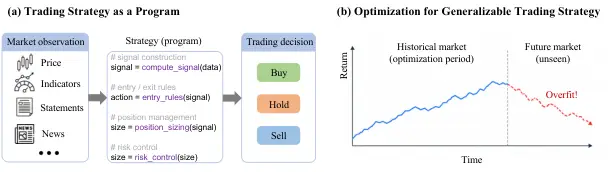
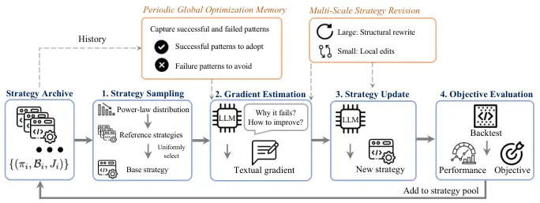
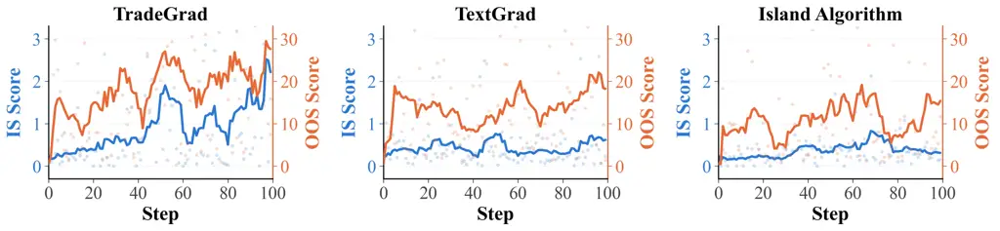
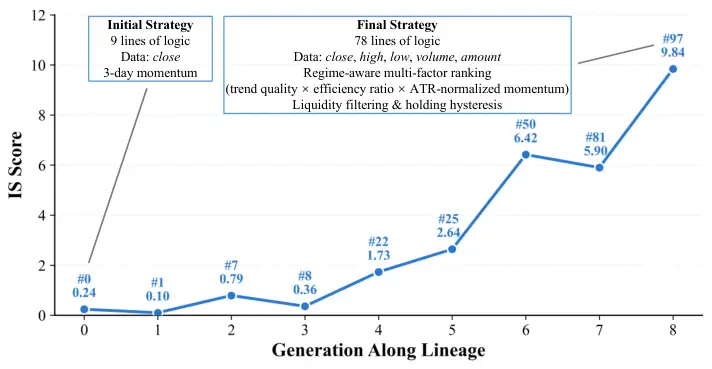

# Trading Strategy Optimization via Textual Gradient

Chaoqun Yang    Qian Wang    Fengbin Zhu ^(†)^(†)thanks: Corresponding
author    Xinyu Lin Affiliation: Bingsheng He   Roger
Zimmermann   Tat-Seng Chua Affiliation: National University of Singapore
Email: [chaoqun@yang.email.cn zhfengbin@gmail.com](mailto:)

###### Abstract

Quantitative trading strategy design aims to discover trading programs
from historical data that remain effective in future markets, which can
be viewed as a black-box program optimization problem. LLM-based textual
gradients offer a promising approach by providing explicit optimization
directions for iterative strategy refinement. However, directly applying
textual gradients faces two challenges: (1) optimization is myopic,
underutilizing experience from previous evaluations; and (2) aggregate
backtest feedback overlooks temporal robustness, potentially favoring
strategies that perform well only in specific market periods. To address
these challenges, we propose TradeGrad, an experience-guided
textual-gradient framework for robust trading strategy optimization.
TradeGrad leverages accumulated optimization experience to estimate
textual gradients and employs multi-scale revisions for both strategy
exploration and refinement. It further introduces the Cross-Period
Robust Objective (CPRO), which emphasizes performance in unfavorable
historical periods to promote temporal robustness. Experiments on
cross-sectional and time-series strategy design in Chinese A-share and
U.S. equity markets show that TradeGrad achieves the best in-sample and
out-of-sample performance across all four settings. Notably, its Chinese
cross-sectional strategy achieves 27.99% annualized return, 12.19%
maximum drawdown, and a Sharpe ratio of 1.63, approximately 68% higher
than the CSI 300 benchmark. Further analyses validate the proposed
components and show consistent improvements in both in-sample and
out-of-sample performance throughout optimization. The code is available
at
[https://github.com/transcend-0/TradeGrad](https://github.com/transcend-0/TradeGrad).

|     |
| --- |
|     |

## 1 Introduction

Quantitative trading strategies are systematic decision rules that map
market observations into trading decisions and play an important role in
modern investment (Guo et al., 2024). In practice, a strategy is
implemented as an executable program that integrates signal
construction, entry and exit rules, position management, and risk
control (Figure 1(a)). Trading strategy design can therefore be viewed
as searching over a vast space of programs (Allen and Karjalainen,
1999). However, unlike conventional program search under a fixed
evaluation setting, trading strategy design uses historical market data
to discover programs for deployment in future markets, where conditions
may differ substantially. The objective is thus to identify strategies
whose effectiveness extends beyond historical backtests to unseen future
market conditions (Bailey and López de Prado, 2014) (Figure 1(b)).

Traditionally, trading strategies were designed by quantitative
researchers through a combination of financial expertise, domain
intuition, and extensive empirical experimentation. The substantial
expertise and effort required have motivated research into automated
strategy design (Allen and Karjalainen, 1999; Lo et al., 2000). Recent
advances in Large Language Models (LLMs) offer new opportunities to
automate this process by combining code generation with evolutionary
search (Novikov et al., 2025; Lange et al., 2026; Yun et al., 2025).
Leveraging their prior knowledge of programming and finance, LLMs can
generate various strategy code and thereby facilitate the exploration of
the strategy space. Nevertheless, existing methods rely largely on
stochastic mutations, providing limited guidance on how a strategy
should be improved and thus requiring extensive search to discover
effective refinements.

Textual gradient optimization (Yuksekgonul et al., 2025) offers a more
direct paradigm for iterative program refinement. Analogous to numerical
gradients, it is defined as a natural-language optimization signal that
diagnoses weaknesses in the current program and suggests actionable
directions for revision. For example, if a momentum strategy performs
well in trending markets but suffers large drawdowns during volatile
reversals, a textual gradient may suggest normalizing momentum by recent
volatility or requiring stronger trend consistency before entering a
position. The LLM can then translate this semantic optimization
direction into concrete modifications of the strategy program.



Figure 1: (a) Trading Strategy as a Program. (b) Optimization for
Generalizable Trading Strategy.

However, directly applying textual gradients to trading strategy
optimization is unsatisfactory due to two key limitations. (1)
Textual-gradient optimization is myopic. A gradient inferred from the
current strategy captures only a narrow view of the strategy space.
Earlier successes and failures are easily forgotten, causing redundant
exploration and unstable optimization. Moreover, a fixed scale of
revision cannot meet the varying needs of the search process: exploring
alternative trading hypotheses requires structural changes, whereas
refining promising strategies calls for localized edits. (2) Aggregate
backtest feedback overlooks temporal robustness. Financial markets are
non-stationary, and strategy performance can vary substantially across
historical periods (Bailey and López de Prado, 2014; Bailey et al.,
2017; Arian et al., 2024). An aggregate backtest score can be dominated
by strong performance in favorable periods, even when the strategy
performs poorly in others. Textual gradients derived from such feedback
therefore direct optimization toward period-specific improvements that
fail to generalize across market regimes. Effective optimization
requires feedback that explicitly accounts for performance across
different historical periods.

To address the above limitations, we propose TradeGrad, an
experience-guided textual-gradient framework for robust trading strategy
optimization, built around two central ideas. (1) Experience-guided
textual-gradient estimation accumulates and reuses knowledge across
strategy revisions. TradeGrad maintains a global optimization memory
that distills successful and failure patterns from evaluated strategies.
To estimate textual gradients, it samples archived strategies with their
code and backtest results, providing comparative evidence for effective
modifications. TradeGrad further employs multi-scale revisions:
structural revisions explore alternative trading hypotheses, while
localized code edits refine promising strategies. (2) Cross-Period
Robust Objective (CPRO) promotes temporal robustness by evaluating
strategies across calendar-year windows. Within each window, CPRO
computes a composite score that integrates annualized return, maximum
drawdown, and a one-sided penalty for insufficient trading activity.
Inspired by Conditional Value-at-Risk (CVaR) (Rockafellar and Uryasev,
2002), CPRO aggregates the lower tail of these window-level scores,
emphasizing unfavorable periods rather than allowing a few favorable
periods to dominate.

We evaluate TradeGrad on cross-sectional and time-series strategy design
in both Chinese A-share and U.S. equity markets. Extensive experimental
results demonstrate that TradeGrad not only consistently achieves the
highest in-sample (IS) and out-of-sample (OOS) scores among the
evaluated strategy-design methods across all four settings but also
maintains favorable risk–return trade-offs. Notably, in the Chinese
market, its cross-sectional strategy achieves an annualized return of
$`27.99\%`$ with a maximum drawdown of only $`12.19\%`$ and a Sharpe
ratio of $`1.63`$, outperforming the CSI 300 index by about $`68\%`$ in
Sharpe ratio. Ablation studies confirm that all proposed components are
essential to TradeGrad’s optimization performance. Optimization
trajectory analysis shows that TradeGrad consistently improves both IS
and OOS performance throughout the optimization, whereas compared
methods tend to plateau or deteriorate.

The key contributions of this work are summarized as follows:

- •
  We formulate trading strategy design as a black-box program
  optimization problem, and identify two limitations of applying
  textual-gradient optimization in this setting: myopic optimization
  that makes insufficient use of accumulated search experience, and
  aggregate backtest feedback that overlooks temporal robustness.
- •
  We propose TradeGrad, an experience-guided textual-gradient framework
  for robust trading strategy optimization. By combining global
  optimization memory, sampling-based gradient estimation, and
  multi-scale strategy revisions, TradeGrad enables more efficient
  strategy optimization.
- •
  TradeGrad introduces the Cross-Period Robust Objective that evaluates
  strategies across multiple calendar-year windows and emphasizes
  lower-tail performance, thereby promoting improvements that remain
  effective across market periods and generalize to unseen markets.
- •
  Extensive experiments on cross-sectional and time-series strategy
  design in Chinese A-share and U.S. equity markets demonstrate that
  TradeGrad achieves the best IS and OOS performance among all evaluated
  methods and maintains favorable risk–return trade-offs. Ablation
  studies, hyperparameter analyses, and optimization trajectory analysis
  provide further insights into TradeGrad’s effectiveness.

## 2 Problem Formulation

### 2.1 Black-Box Optimization over Strategy Programs

We formulate automated trading strategy design as a black-box
optimization problem over executable programs. Let $`\Pi`$ denote the
space of executable strategy programs, and let
$`\mathcal{D}=\{x_{t}\}_{t=1}^{T}`$ denote a sequence of market
observations, where $`x_{t}`$ contains the information available at time
$`t`$. A trading strategy is represented by an executable program
$`\pi\in\Pi`$ that maps the observed market history to a trading
decision $`a_{t}=\pi(x_{\leq t})`$. A strategy may jointly specify
signal construction, entry and exit rules, position management,
portfolio allocation, and risk control.

Given a strategy $`\pi`$ and a market dataset $`\mathcal{D}`$, a
predefined backtesting procedure produces a backtest result
$`\mathcal{B}(\pi;\mathcal{D})`$, which contains performance statistics
such as annualized return, maximum drawdown, Sharpe ratio, and trading
frequency. The quality of a strategy is evaluated through an objective
function $`J(\mathcal{B})=J(\pi;\mathcal{D})`$. In general, strategy
evaluation may involve multiple objectives reflecting different aspects
of trading performance. For notational simplicity, we use a scalar $`J`$
throughout the paper to represent the objective used by the optimizer,
where multiple performance criteria can be aggregated into $`J`$ when
necessary.

The optimizer iteratively proposes new strategy programs based on
previously evaluated candidates. Specifically, a generic black-box
optimizer can be represented as a proposal operator $`\mathcal{U}`$,
which generates the strategy at iteration $`k`$ as
$`\pi_{k}=\mathcal{U}\left(\{(\pi_{i},\mathcal{B}_{i},J_{i})\}_{i=0}^{k-1}\right)`$,
where $`\mathcal{B}_{i}`$ denotes the backtest result of strategy
$`\pi_{i}`$, and $`J_{i}`$ denotes its corresponding objective value.

### 2.2 Optimization for Generalizable Trading Strategy

A distinctive challenge in trading strategy optimization is that
performance on the historical data available during optimization is not
itself the ultimate target. The goal is to obtain a strategy that
performs well on future and unseen markets. Let $`p_{\mathrm{future}}`$
denote the unknown distribution of future market data. Ideally, the
strategy should maximize

```math
\pi^{*}=\arg\max_{\pi\in\Pi}\mathbb{E}_{\mathcal{D}\sim p_{\mathrm{future}}}\left[J(\pi;\mathcal{D})\right]. \tag{1}
```

In practice, $`p_{\mathrm{future}}`$ is unavailable during strategy
development. We therefore divide the available historical data into an
IS period $`\mathcal{D}_{\mathrm{IS}}`$ and an OOS period
$`\mathcal{D}_{\mathrm{OOS}}`$. During optimization, the optimizer can
access only backtest evaluations on $`\mathcal{D}_{\mathrm{IS}}`$,
whereas $`\mathcal{D}_{\mathrm{OOS}}`$ is held out from the optimization
process and used only to evaluate whether the resulting strategies
generalize to unseen market periods.

## 3 Method

### 3.1 Overview



Figure 2: Overview of TradeGrad. TradeGrad iteratively samples archived
strategies, estimates textual gradients from backtest feedback and
optimization experience, updates strategies at varying revision scales,
and evaluates and archives the resulting strategies.

We propose TradeGrad, a textual-gradient optimization framework for
automated trading strategy design, as illustrated in Figure 2 and
Algorithm 1. TradeGrad maintains an archive of evaluated strategies and
reuses them as optimization experience. At each iteration, it samples
several strategies and selects one as the base strategy. An LLM compares
the sampled strategies and their backtest results, together with
experience summarized from previous iterations, to identify improvements
to the base strategy. The resulting textual gradient guides its
revision, ranging from structural rewrites to local edits. Finally, the
new strategy is evaluated across multiple historical periods and added
back to the archive, forming an iterative optimization loop.

### 3.2 Experience-Guided Textual Gradient Optimization

#### 3.2.1 Periodic Global Optimization Memory

As optimization proceeds, evaluated strategies and their backtest
outcomes accumulate in the archive $`\mathcal{A}_{k}`$. To avoid
repeatedly providing the growing archive to the LLM, TradeGrad maintains
a persistent global memory $`\mathcal{M}_{k}`$ that periodically
distills recent optimization experience into reusable successful and
failure patterns. Formally, every $`H`$ iterations, the preceding $`H`$
experiences are summarized and consolidated with the previous memory:

```math
\mathcal{M}_{k}=S_{\mathrm{global}}\left(\left\{S_{\mathrm{local}}(\pi_{i},\mathcal{B}_{i},J_{i})\right\}_{i=k-H}^{k-1},\mathcal{M}_{k-H}\right),\qquad k\bmod H=0. \tag{2}
```

Here, $`S_{\mathrm{local}}`$ extracts reusable successful and failure
patterns from an individual optimization experience, while
$`S_{\mathrm{global}}`$ consolidates these summaries with the existing
memory. Between refreshes, the latest memory is retained. The resulting
$`\mathcal{M}_{k}`$ provides persistent experience that complements the
strategies sampled from the current archive.

#### 3.2.2 Sampling-Based Textual Gradient Estimation

At iteration $`k`$, strategies in $`\mathcal{A}_{k-1}`$ are ranked by
their objective values $`J`$. We sample $`M`$ reference strategies
without replacement according to the power-law distribution

```math
P(\pi_{(r)})=\frac{r^{-\alpha_{s}}}{\sum_{j=1}^{|\mathcal{A}_{k-1}|}j^{-\alpha_{s}}}, \tag{3}
```

where $`\pi_{(r)}`$ denotes the strategy with rank $`r`$ and
$`\alpha_{s}>0`$ controls the preference for highly ranked strategies.
This produces a performance-biased reference set
$`\mathcal{S}_{k}=\{(\pi_{k}^{(j)},\mathcal{B}_{k}^{(j)},J_{k}^{(j)})\}_{j=1}^{M}`$.
We then uniformly select one strategy from $`\mathcal{S}_{k}`$ as the
base strategy $`\pi_{k}^{\mathrm{base}}`$. Thus, the reference context
is biased toward stronger strategies, while the update target can
originate from different quality levels.

Given the reference set $`\mathcal{S}_{k}`$, base strategy
$`\pi_{k}^{\mathrm{base}}`$, global memory $`\mathcal{M}_{k}`$, and
revision scale $`\eta_{k}`$, the LLM estimates a textual gradient

```math
\hat{g}_{k}=\mathrm{LLM}\left(\mathcal{S}_{k},\pi_{k}^{\mathrm{base}},\mathcal{M}_{k},\eta_{k}\right). \tag{4}
```

The textual gradient identifies weaknesses of the base strategy and
specifies actionable modifications by comparing strategy programs and
their backtest outcomes.

#### 3.2.3 Multi-Scale Strategy Revision

Program revisions can differ substantially in semantic magnitude, from
restructuring the core strategy logic to modifying a local trading
condition. To balance these behaviors, we sample a discrete revision
scale

```math
\eta_{k}=\begin{cases}\eta_{\mathrm{large}},&\text{with probability }p_{\mathrm{large}},\\
\eta_{\mathrm{small}},&\text{with probability }1-p_{\mathrm{large}}.\end{cases} \tag{5}
```

The revision scale $`\eta_{k}`$ specifies the intended scope of
modification during textual gradient generation and subsequently
determines how the program is revised. When
$`\eta_{k}=\eta_{\mathrm{large}}`$, the LLM is instructed to make
substantial changes to the core trading logic, and the resulting
strategy is implemented as a full rewrite of the base program. When
$`\eta_{k}=\eta_{\mathrm{small}}`$, the LLM focuses on localized
improvements while preserving the overall strategy structure, and the
revision is implemented through diff-based replacements of selected code
segments. Therefore, large-scale revisions promote structural
exploration, while small-scale revisions enable targeted refinement.

### 3.3 Cross-Period Robust Objective

#### 3.3.1 Cross-Period Evaluation

Aggregate backtest performance may favor strategies whose gains are
concentrated in a few favorable periods. Therefore, we evaluate each
strategy across multiple historical windows. Specifically, we partition
the in-sample data into $`N`$ non-overlapping historical windows,
$`\mathcal{D}_{\mathrm{IS}}=\left\{\mathcal{D}^{(1)},\ldots,\mathcal{D}^{(N)}\right\}`$.
For each window, annualized return $`AR_{n}(\pi)`$ and maximum drawdown
$`MDD_{n}(\pi)`$ are transformed into normalized scores:

```math
\displaystyle s_{\mathrm{AR}}^{(n)}(\pi) \displaystyle=\sigma\!\left(\lambda_{\mathrm{AR}}(AR_{n}(\pi)-r_{\mathrm{ref}})\right), \tag{6}
```

```math
\displaystyle s_{\mathrm{MDD}}^{(n)}(\pi) \displaystyle=\sigma\!\left(-\lambda_{\mathrm{MDD}}(MDD_{n}(\pi)-d_{\mathrm{ref}})\right), \tag{7}
```

where $`\sigma(x)=1/(1+e^{-x})`$ is the sigmoid function,
$`\lambda_{\mathrm{AR}}`$ and $`\lambda_{\mathrm{MDD}}`$ control the
sensitivities, and $`r_{\mathrm{ref}}`$ and $`d_{\mathrm{ref}}`$ are
reference levels for return and drawdown, respectively. This
transformation maps the two metrics to a common bounded scale while
favoring higher returns and lower drawdowns.

We combine the normalized scores with a one-sided trading-frequency
gate:

```math
s_{n}(\pi)=100\times\left(s_{\mathrm{AR}}^{(n)}(\pi)\right)^{\alpha}\left(s_{\mathrm{MDD}}^{(n)}(\pi)\right)^{1-\alpha}\left[\min\left(1,\frac{\tau_{n}(\pi)}{\tau_{0}}\right)\right]^{\gamma}, \tag{8}
```

where $`\alpha`$ controls the trade-off between return and drawdown,
$`\tau_{n}(\pi)`$ is the trading frequency, $`\tau_{0}`$ is the desired
minimum frequency, and $`\gamma`$ controls the penalty strength. The
gate penalizes insufficient trading activity without rewarding excessive
trading beyond $`\tau_{0}`$.

#### 3.3.2 Lower-Tail Robust Objective

Inspired by Conditional Value-at-Risk (CVaR) (Rockafellar and Uryasev,
2002), we focus on the lower tail of window-level performance to
emphasize unfavorable historical periods. Specifically, we sort the
window scores as $`s_{[1]}(\pi)\leq\cdots\leq s_{[N]}(\pi)`$ and
optimize the mean of the lowest $`30\%`$:

```math
J(\pi;\mathcal{D}_{\mathrm{IS}})=\frac{1}{q}\sum_{n=1}^{q}s_{[n]}(\pi),\qquad q=\left\lceil 0.3N\right\rceil. \tag{9}
```

We refer to this objective as the Cross-Period Robust Objective (CPRO).
By emphasizing lower-tail performance, CPRO prevents strong results in
favorable periods from fully compensating for poor performance
elsewhere, thereby promoting robustness across market periods.

After generating $`\pi_{k}`$, TradeGrad evaluates it using Equation (9)
and adds the strategy and its evaluation to the archive, which provides
experience for subsequent textual-gradient updates.

## 4 Experiments

In this section, we conduct extensive experiments to answer the
following research questions: RQ1: Does TradeGrad discover better
trading strategies than existing methods? RQ2: How do the proposed
mechanisms contribute to performance? RQ3: How do different
hyperparameters affect the performance? RQ4: How does the optimization
evolve throughout the search process?

### 4.1 Experimental Setup

Markets and Evaluation. We evaluate TradeGrad on two representative
markets: the Chinese A-share market and the U.S. stock market. For both
markets, we use daily market data from 2018 to 2025, chronologically
split into an IS optimization period and an OOS evaluation period with a
ratio of $`3{:}1`$. We consider two representative strategy-design
settings. The first is the cross-sectional setting, where strategies
trade individual stocks and construct portfolios by comparing assets at
the same point in time. We use the point-in-time constituents of the CSI
300 for the Chinese market and the S&P 500 for the U.S. market. The
second is the time-series setting, where strategies trade the
corresponding market index based on its historical temporal dynamics. We
evaluate strategies using IS Score (the value of the CPRO), OOS Score
(the value of the aggregate objective), Annualized Return (AR), Maximum
Drawdown (MDD), and Sharpe Ratio (SR). More implementation details are
provided in Appendix A.2.

Baselines. We compare TradeGrad against four groups of baselines: (1)
Market index. We report the corresponding market index as a passive
benchmark for each market. (2) Classical strategies. We consider
Momentum (Jegadeesh and Titman, 1993), Reversal (De Bondt and Thaler,
1985), Volatility (Ang et al., 2006), and Volume (Gervais et al., 2001)
for cross-sectional trading, and Grid Trading (Rundo et al., 2019),
Moving Average (MA) (Brock et al., 1992), Channel Breakout (Brock et
al., 1992), and Bollinger Bands (Bollinger, 2002) for time-series
trading. (3) Evolutionary program search. We consider two representative
baselines. The first is the Island Algorithm, which combines LLM-driven
code evolution with an island-based evolutionary framework and underlies
general-purpose program evolution methods such as AlphaEvolve (Novikov
et al., 2025) and ShinkaEvolve (Lange et al., 2026). The second is
QuantEvolve (Yun et al., 2025), a domain-specific extension that
incorporates financial guidance to tailor evolutionary search to
quantitative trading. (4) Textual-gradient optimization. We use
TextGrad (Yuksekgonul et al., 2025), which iteratively updates a single
strategy according to textual gradients derived from its evaluation
feedback.

### 4.2 Overall Performance (RQ1)

|                            |                  |                       |                        |                 |                    |                 |                       |                        |                 |                    |                 |
| -------------------------- | ---------------- | --------------------- | ---------------------- | --------------- | ------------------ | --------------- | --------------------- | ---------------------- | --------------- | ------------------ | --------------- |
|                            |                  | CSI 300               |                        |                 |                    |                 | S&P 500               |                        |                 |                    |                 |
| Setting                    | Method           | IS Score $`\uparrow`$ | OOS Score $`\uparrow`$ | AR $`\uparrow`$ | MDD $`\downarrow`$ | SR $`\uparrow`$ | IS Score $`\uparrow`$ | OOS Score $`\uparrow`$ | AR $`\uparrow`$ | MDD $`\downarrow`$ | SR $`\uparrow`$ |
| Market Index Reference     |                  | 1.63                  | 45.01                  | 17.69           | 15.66              | 0.97            | 5.44                  | 39.38                  | 20.76           | 18.90              | 1.26            |
| Cross-Sectional Strategies |                  |                       |                        |                 |                    |                 |                       |                        |                 |                    |                 |
| Classical                  | Momentum         | 0.52                  | 9.19                   | 5.76            | 28.49              | 0.35            | 9.02                  | 2.37                   | -15.35          | 31.13              | -1.58           |
|                            | Reversal         | 0.28                  | 14.51                  | 17.80           | 28.59              | 0.74            | 5.12                  | 26.76                  | 0.56            | 11.59              | 0.11            |
|                            | Volatility       | 7.56                  | 60.69                  | 18.59           | 8.74               | 1.41            | 4.41                  | 6.93                   | -9.38           | 23.79              | -0.79           |
|                            | Volume           | 1.51                  | 16.73                  | 6.92            | 23.03              | 0.41            | 13.62                 | 2.43                   | -16.08          | 30.54              | -2.57           |
| Evolution                  | Island Algorithm | 0.23                  | 2.52                   | -12.74          | 31.87              | -0.60           | 16.84                 | 0.60                   | -22.53          | 40.16              | -4.22           |
|                            | QuantEvolve      | 3.03                  | 4.42                   | -5.59           | 30.14              | -0.15           | 0.34                  | 0.16                   | -26.75          | 49.90              | -2.30           |
| Gradient                   | TextGrad         | 0.09                  | 4.40                   | -8.08           | 28.94              | -0.40           | 1.02                  | 3.51                   | -14.92          | 27.63              | -2.62           |
|                            | TradeGrad        | 10.69                 | 65.65                  | 27.99           | 12.19              | 1.63            | 21.36                 | 40.38                  | 6.05            | 3.93               | 1.07            |
| Time-Series Strategies     |                  |                       |                        |                 |                    |                 |                       |                        |                 |                    |                 |
| Classical                  | Grid             | 4.32                  | 35.52                  | 6.34            | 11.30              | 0.73            | 7.03                  | 7.59                   | -11.39          | 21.66              | -1.21           |
|                            | MA               | 12.48                 | 17.55                  | -0.22           | 18.52              | 0.04            | 0.67                  | 10.08                  | 24.09           | 33.54              | 0.88            |
|                            | Breakout         | 25.69                 | 28.11                  | 1.13            | 10.96              | 0.17            | 4.60                  | 30.42                  | 2.64            | 10.77              | 0.36            |
|                            | Bollinger        | 22.81                 | 13.63                  | -7.89           | 16.50              | -1.36           | 5.13                  | 3.80                   | -14.37          | 27.13              | -1.28           |
| Evolution                  | Island Algorithm | 26.04                 | 30.08                  | 3.50            | 12.26              | 0.38            | 14.22                 | 36.02                  | 11.57           | 15.77              | 1.06            |
|                            | QuantEvolve      | 9.73                  | 24.10                  | 2.94            | 16.14              | 0.30            | 20.18                 | 45.40                  | 9.64            | 7.10               | 1.09            |
| Gradient                   | TextGrad         | 0.89                  | 29.48                  | 0.05            | 6.49               | 0.03            | 0.65                  | 32.93                  | 2.23            | 6.18               | 0.34            |
|                            | TradeGrad        | 29.00                 | 41.54                  | 8.21            | 8.59               | 0.87            | 23.24                 | 50.08                  | 12.39           | 7.79               | 1.32            |

Table 1: Overall performance comparison. Results are averaged over three
runs; standard deviations are reported in Appendix A.3. Best and
second-best results are bolded and underlined, respectively.

We first answer RQ1 by evaluating the IS and OOS performance of the
designed strategies. From the results shown in Table 1, we have the
following findings.

Classical strategies remain competitive, while automated baselines
struggle with cross-sectional trading. Volatility ranks second in OOS
Score on CSI 300 cross-sectional trading, and Grid outperforms all
automated baselines on CSI 300 time-series trading. In contrast, Island
Algorithm, QuantEvolve, and TextGrad incur OOS losses in both
cross-sectional markets. These automated baselines fare better in
time-series trading, all achieving positive OOS returns in both markets,
with QuantEvolve ranking second in OOS Score on S&P 500.

TradeGrad combines effective IS optimization with strong OOS
generalization. TradeGrad achieves the highest IS and OOS Scores among
all compared strategy-design methods in all four settings. This
alignment distinguishes it from baselines whose historical success fails
to carry over: For example, Island Algorithm ranks second in IS Score on
S&P 500 cross-sectional trading but nearly last in OOS Score.
TradeGrad’s consistently leading performance on both splits supports its
ability to discover strong historical strategies whose advantage
persists on unseen data.

TradeGrad achieves favorable OOS risk–return trade-offs. TradeGrad
obtains the highest OOS Sharpe ratio among strategy-design methods in
all four settings. On CSI 300 cross-sectional trading, it achieves the
highest AR of $`27.99\%`$ with MDD of $`12.19\%`$. On S&P 500
cross-sectional trading, it delivers a positive AR of $`6.05\%`$ with
the lowest MDD of $`3.93\%`$. Its advantage also extends beyond
maximizing returns: on S&P 500 time-series trading, TradeGrad earns a
lower AR than MA but reduces MDD from $`33.54\%`$ to $`7.79\%`$ and
increases SR from $`0.88`$ to $`1.32`$.

### 4.3 Ablation Study (RQ2)

#### 4.3.1 Ablation of Experience-Guided Textual-Gradient Estimation

|                   |                                 |                                   |                                  |                                  |                                 |
| ----------------- | ------------------------------- | --------------------------------- | -------------------------------- | -------------------------------- | ------------------------------- |
| Method            | IS Score $`\uparrow`$           | OOS Score $`\uparrow`$            | AR $`\uparrow`$                  | MDD $`\downarrow`$               | SR $`\uparrow`$                 |
| Full Method       | $`\mathbf{10.69}_{\pm 1.06}`$   | $`\mathbf{65.65}_{\pm 12.15}`$    | $`\mathbf{27.99}_{\pm 4.19}`$    | $`12.19_{\pm 4.65}`$             | $`\mathbf{1.63}_{\pm 0.17}`$    |
| w/o Memory        | $`4.56_{\pm 0.42}`$             | $`35.62_{\pm 7.07}`$              | $`11.78_{\pm 1.73}`$             | $`16.09_{\pm 5.97}`$             | $`0.80_{\pm 0.08}`$             |
| w/o Sampling      | $`\underline{8.32}_{\pm 0.85}`$ | $`46.72_{\pm 10.68}`$             | $`12.98_{\pm 2.03}`$             | $`\underline{11.35}_{\pm 4.38}`$ | $`0.94_{\pm 0.10}`$             |
| w/o MSR (Diff)    | $`5.79_{\pm 0.54}`$             | $`46.88_{\pm 12.10}`$             | $`14.87_{\pm 1.14}`$             | $`13.04_{\pm 5.14}`$             | $`0.96_{\pm 0.10}`$             |
| w/o MSR (Rewrite) | $`7.42_{\pm 0.77}`$             | $`\underline{55.74}_{\pm 10.01}`$ | $`\underline{15.98}_{\pm 2.39}`$ | $`\mathbf{8.86}_{\pm 3.48}`$     | $`\underline{0.98}_{\pm 0.11}`$ |

Table 2: Ablation of experience-guided textual-gradient estimation.
Results are mean $`\pm`$ standard deviation over three runs. Best and
second-best means are bolded and underlined, respectively.

To answer RQ2, we first ablate the three textual-gradient optimization
mechanisms in Table 2: periodic global memory, sampling-based gradient
estimation, and multi-scale revision (MSR). Under the same CPRO and
evaluation budget, we remove memory or sampling, and replace MSR with
Diff-only or Rewrite-only updates.

All three optimization mechanisms contribute to the final performance.
Removing any proposed mechanism decreases both IS and OOS Scores. The
full method achieves an OOS Score of $`65.65`$, while removing sampling
or memory and replacing MSR with a single revision mode all lead to
substantial degradation. This consistent decline indicates that the
three mechanisms provide complementary benefits to textual-gradient
optimization.

Global memory makes the largest contribution to optimization. Removing
global memory causes the largest performance drop among all ablations,
reducing the OOS Score from $`65.65`$ to $`35.62`$. This suggests that
retaining optimization experience across iterations is critical for
guiding textual-gradient updates toward strategies that generalize
beyond the optimization period.

MSR balances local refinement and broader exploration. Both Diff-only
and Rewrite-only revisions underperform the full method, with
Rewrite-only performing better than Diff-only. This suggests that
broader revisions help escape weak search regions, while combining them
with fine-grained modifications enables MSR to balance exploration and
refinement more effectively.

#### 4.3.2 Ablation of the Cross-Period Robust Objective

|                       |                      |                                 |                                  |                                  |                                  |                                 |
| --------------------- | -------------------- | ------------------------------- | -------------------------------- | -------------------------------- | -------------------------------- | ------------------------------- |
| Objective             | IS OV $`\uparrow`$   | IS Score $`\uparrow`$           | OOS Score $`\uparrow`$           | AR $`\uparrow`$                  | MDD $`\downarrow`$               | SR $`\uparrow`$                 |
| CPRO                  | $`10.69_{\pm 1.06}`$ | $`\mathbf{10.69}_{\pm 1.06}`$   | $`\mathbf{65.65}_{\pm 12.15}`$   | $`\mathbf{27.99}_{\pm 4.19}`$    | $`\mathbf{12.19}_{\pm 4.65}`$    | $`\mathbf{1.63}_{\pm 0.17}`$    |
| CPRO w/o Freq Gate    | $`10.99_{\pm 1.07}`$ | $`\underline{8.10}_{\pm 0.79}`$ | $`\underline{40.24}_{\pm 8.68}`$ | $`10.43_{\pm 1.51}`$             | $`\underline{12.66}_{\pm 4.81}`$ | $`0.73_{\pm 0.07}`$             |
| Mean-Period Objective | $`37.72_{\pm 4.18}`$ | $`4.40_{\pm 0.40}`$             | $`23.37_{\pm 5.06}`$             | $`6.08_{\pm 0.93}`$              | $`18.70_{\pm 7.13}`$             | $`0.44_{\pm 0.05}`$             |
| Aggregate Objective   | $`5.11_{\pm 0.56}`$  | $`0.74_{\pm 0.07}`$             | $`35.63_{\pm 7.64}`$             | $`\underline{13.12}_{\pm 1.96}`$ | $`16.89_{\pm 6.38}`$             | $`\underline{0.77}_{\pm 0.09}`$ |

Table 3: Ablation of the CPRO. IS OV reports each variant’s own
objective value and is not directly comparable across rows. Results are
mean $`\pm`$ standard deviation over three runs. Best and second-best
means are bolded and underlined, respectively.

We further examine the effect of the optimization objective on OOS
generalization in Table 3, comparing CPRO with variants that remove the
frequency gate, average performance across periods, or evaluate
performance over the aggregated optimization period.

The trading-frequency gate improves both IS performance and OOS
generalization. Removing the frequency gate reduces the standardized IS
Score from $`10.69`$ to $`8.10`$ and the OOS Score from $`65.65`$ to
$`40.24`$. It also lowers OOS profitability and increases drawdown, with
SR declining from $`1.63`$ to $`0.73`$. These results support the gate’s
role in guiding search toward strategies that perform better under the
common evaluation criteria and retain their advantage out of sample.

Emphasizing weak periods is more effective than optimizing mean or
aggregate performance. CPRO achieves the highest standardized IS Score,
compared with $`4.40`$ for the Mean-Period Objective and $`0.74`$ for
the Aggregate Objective. Its advantage extends to OOS evaluation, where
it achieves a Score of $`65.65`$, versus $`23.37`$ and $`35.63`$,
respectively, together with higher AR and SR and lower MDD. These
results support emphasizing the lower tail of historical performance:
under the same search procedure and budget, this objective produces
strategies with stronger performance under both the common IS criterion
and held-out OOS evaluation.

### 4.4 Hyperparameter Analysis (RQ3)

Figure 3: Effect of different hyperparameters: Memory window for
summarizing optimization experience, sample size for textual-gradient
estimation, and probability of large-scale revision.

Figure 3 presents a sensitivity analysis of three key hyperparameters,
varying one at a time while keeping the others fixed. The analysis is
intended to characterize the sensitivity of TradeGrad and to examine
whether its behavior is consistent across the optimization and held-out
periods.

Global memory exhibits a non-monotonic sensitivity to its temporal
horizon. Performance improves as the memory window increases from $`3`$
to $`5`$, but generally declines with longer windows. One possible
explanation is that longer windows may incorporate stale or
heterogeneous experience that weakens subsequent updates.

The sample size shows different IS and OOS trends. A single sample
achieves the highest IS Score, whereas a sample size of $`3`$ shows
stronger OOS performance. Further increasing the sample size degrades
both metrics, suggesting that additional references may provide useful
comparative evidence but can also introduce irrelevant or conflicting
information.

MSR benefits from a mixture of revision scales. OOS performance
generally improves as the probability of large revisions increases, but
drops substantially at $`p_{\mathrm{large}}=0.9`$. Together with the MSR
ablation, this pattern is consistent with the motivation for combining
structural exploration with localized refinement.

### 4.5 Optimization Trajectories (RQ4)



Figure 4: Optimization trajectories of different methods. Points denote
the strategies generated at each optimization step, and curves show
their 10-step moving averages (MA(10)).

To further understand the search dynamics, we track the IS and OOS
Scores of the strategies generated throughout optimization. Figure 4
shows the strategy obtained at each step together with its 10-step
moving average (MA(10)), which highlights the overall optimization
trend.

TradeGrad achieves more sustained optimization and generalization than
the baselines. TradeGrad shows a clear upward trend in both IS and OOS
Scores throughout optimization, indicating that the search continues to
discover stronger strategies and transfers these improvements out of
sample. In contrast, TextGrad quickly plateaus after its initial gains,
while Island Algorithm exhibits smaller and less persistent improvements
with frequent regressions. Although all methods occasionally discover
high-OOS strategies, the steadily rising trajectories of TradeGrad show
that it more effectively accumulates optimization progress and
translates it into sustained OOS gains. A case study illustrating the
optimization process is provided in Appendix A.4.

## 5 Related Work

Automated Trading Strategy Design. Automated trading strategy design
aims to discover executable trading rules from market data with limited
human specification. Early work primarily used genetic algorithms to
evolve trading rules across equity, foreign-exchange, and futures
markets, jointly searching over strategy structures and
parameters (Allen and Karjalainen, 1999; Neely and Weller, 1999; Wang,
2000; Potvin et al., 2004; Hu et al., 2015). Because flexible program
search can overfit historical data, subsequent studies emphasize
robustness through risk-aware objectives, transaction costs,
out-of-sample evaluation, and evaluation across multiple market
segments (Neely, 2003; Esfahanipour and Mousavi, 2011; Berutich et al.,
2016). More recently, LLM-GA (Zhang et al., 2025), QuantEvolve (Yun et
al., 2025), and ProFiT (Siper et al., 2026) use LLMs to generate and
refine executable strategies, but remain within the evolutionary-search
paradigm. In contrast, our work explores textual-gradient optimization
for trading strategy design, with an explicit focus on out-of-sample
robustness. More related work is discussed in Appendix A.5.

## 6 Conclusion

In this work, we formulate trading strategy design as a black-box
program optimization problem and propose TradeGrad, an experience-guided
textual-gradient framework for robust trading strategy optimization.
TradeGrad leverages accumulated optimization experience to overcome the
myopic nature of textual gradients and introduces the CPRO to promote
temporal robustness across different market periods. Experiments on
cross-sectional and time-series strategy design in both Chinese A-share
and U.S. equity markets show that TradeGrad achieves strong in-sample
and out-of-sample performance while maintaining favorable risk–return
trade-offs, with further analyses validating the effectiveness of its
key components. Future work can extend TradeGrad to broader asset
classes and higher-frequency settings, incorporate richer market
information into textual-gradient estimation, and investigate robustness
under more diverse forms of distribution shift. More broadly, TradeGrad
provides a promising direction for LLM-based program optimization in
settings where solutions optimized on historical data need to generalize
to unseen environments.

### AI use statement

In this work, we used generative AI tools for implementing methods. We
have not used generative AI tools for generating synthetic datasets,
formulating mathematical claims, proposing or refining hypotheses,
designing or providing feedback on research methodology or experiments,
assisting with translation, cleaning and reformatting datasets,
supporting qualitative and thematic data analysis, interpreting results.
Providing critical ingredients for proving mathematical claims and
assisting in the writing of proofs are not applicable to this work.
Additionally, we used generative AI tools for creating or editing
software code, drafting parts of a research paper, summarizing or
analysing existing literature, sourcing/searching for information,
editing a research paper to improve readability, and identifying
relevant literature. We have reviewed all AI-assisted work. In
particular, all literature identified or listed with the assistance of
generative AI tools was independently checked by the authors for
accuracy and relevance. LLM-generated code was reviewed, tested, and
modified by the authors to verify its correctness and ensure that it
implemented the intended functionality. We take responsibility for the
final content of this work, including text, claims or artifacts produced
with the aid of generative AI.

### Reproducibility statement

We have taken several steps to ensure the reproducibility of our work.
The source code is available on GitHub. All datasets used in this work
are publicly accessible, with their sources and experimental splits
described in Section 4.1. We provide detailed implementation and
evaluation settings in Appendix A.2, including the evaluation metrics,
TradeGrad hyperparameters and CPRO configuration, accessible market
observations, optimization protocol, backtesting assumptions, and
evaluation scope. Together, the released code, publicly available
datasets, and documented experimental settings provide the necessary
resources for reproducing the reported experiments and results.

## References

- Agrawal et al. (2026) L. A. Agrawal, S. Tan, D. Soylu, N. Ziems, R.
  Khare, K. Opsahl-Ong, A. Singhvi, H. Shandilya, M. J. Ryan, M. Jiang,
  et al. GEPA: reflective prompt evolution can outperform reinforcement
  learning. In International Conference on Learning Representations,
  Vol. 2026, pp. 8479–8565. Cited by: §A.5.
- Allen and Karjalainen (1999) F. Allen and R. Karjalainen Using genetic
  algorithms to find technical trading rules. Journal of Financial
  Economics 51 (2), pp. 245–271. Cited by: §1, §1, §5.
- Ang et al. (2006) A. Ang, R. J. Hodrick, Y. Xing, and X. Zhang The
  cross-section of volatility and expected returns. The Journal of
  finance 61 (1), pp. 259–299. Cited by: §4.1.
- Arian et al. (2024) H. Arian, D. N. Mobarekeh, and L. Seco Backtest
  overfitting in the machine learning era: a comparison of out-of-sample
  testing methods in a synthetic controlled environment. Knowledge-Based
  Systems 305, pp. 112477. Cited by: §1.
- Bailey et al. (2017) D. Bailey, J. Borwein, M. Lopez de Prado,
  and Q. J. Zhu The probability of backtest overfitting. The Journal of
  Computational Finance 20 (4), pp. 39–69. Cited by: §1.
- Bailey and López de Prado (2014) D. H. Bailey and M. López de Prado
  The deflated sharpe ratio: correcting for selection bias, backtest
  overfitting and non-normality. Journal of Portfolio Management 40 (5),
  pp. 94–107. Cited by: §1, §1.
- Berutich et al. (2016) J. M. Berutich, F. López, F. Luna, and D.
  Quintana Robust technical trading strategies using gp for algorithmic
  portfolio selection. Expert Systems with Applications 46, pp. 307–315.
  Cited by: §5.
- Bollinger (2002) J. Bollinger Bollinger on bollinger bands.
  McGraw-Hill New York. Cited by: §4.1.
- Brock et al. (1992) W. Brock, J. Lakonishok, and B. LeBaron Simple
  technical trading rules and the stochastic properties of stock
  returns. The Journal of Finance 47 (5), pp. 1731–1764. Cited by: §4.1.
- De Bondt and Thaler (1985) W. F. De Bondt and R. Thaler Does the stock
  market overreact?. The Journal of Finance 40 (3), pp. 793–805. Cited
  by: §4.1.
- Ding et al. (2026) Z. Ding, J. Hong, Z. Shi, T. Wang, Z. Lin, L.
  Yin, M. Liu, Z. Wang, and Y. Chen Scaling textual gradients via
  sampling-based momentum. In ACM Conference on AI and Agentic Systems,
  pp. 917–952. Cited by: §A.5.
- Esfahanipour and Mousavi (2011) A. Esfahanipour and S. Mousavi A
  genetic programming model to generate risk-adjusted technical trading
  rules in stock markets. Expert Systems with Applications 38 (7),
  pp. 8438–8445. Cited by: §5.
- Gervais et al. (2001) S. Gervais, R. Kaniel, and D. H. Mingelgrin The
  high-volume return premium. The Journal of Finance 56 (3),
  pp. 877–919. Cited by: §4.1.
- Guo et al. (2024) J. Guo, S. Wang, L. M. Ni, and H. Shum Quant 4.0:
  engineering quantitative investment with automated, explainable, and
  knowledge-driven artificial intelligence. Frontiers of Information
  Technology & Electronic Engineering 25 (11), pp. 1421–1445. Cited by:
  §1.
- Hu et al. (2015) Y. Hu, K. Liu, X. Zhang, L. Su, E. Ngai, and M. Liu
  Application of evolutionary computation for rule discovery in stock
  algorithmic trading: a literature review. Applied Soft Computing 36,
  pp. 534–551. Cited by: §5.
- Jang and Choi (2025) Y. Jang and J. Choi A prompt optimization system
  based on center-aware textual gradients. Systems 13 (9), pp. 748.
  Cited by: §A.5.
- Jegadeesh and Titman (1993) N. Jegadeesh and S. Titman Returns to
  buying winners and selling losers: implications for stock market
  efficiency. The Journal of Finance 48 (1), pp. 65–91. Cited by: §4.1.
- Lange et al. (2026) R. Lange, Y. Imajuku, and E. Cetin ShinkaEvolve:
  towards open-ended and sample-efficient program evolution. In
  International Conference on Learning Representations, Vol. 2026,
  pp. 74026–74078. Cited by: §A.5, §1, §4.1.
- Liu et al. (2024) F. Liu, T. Xialiang, M. Yuan, X. Lin, F. Luo, Z.
  Wang, Z. Lu, and Q. Zhang Evolution of heuristics: towards efficient
  automatic algorithm design using large language model. In
  International Conference on Machine Learning, Cited by: §A.5.
- Lo et al. (2000) A. W. Lo, H. Mamaysky, and J. Wang Foundations of
  technical analysis: computational algorithms, statistical inference,
  and empirical implementation. The Journal of Finance 55 (4),
  pp. 1705–1765. Cited by: §1.
- Ma et al. (2024) Y. J. Ma, W. Liang, G. Wang, D. Huang, O. Bastani, D.
  Jayaraman, Y. Zhu, J. Fan, et al. Eureka: human-level reward design
  via coding large language models. In International Conference on
  Learning Representations, Vol. 2024, pp. 26516–26560. Cited by: §A.5.
- Neely and Weller (1999) C. J. Neely and P. A. Weller Technical trading
  rules in the european monetary system. Journal of International Money
  and Finance 18 (3), pp. 429–458. Cited by: §5.
- Neely (2003) C. J. Neely Risk-adjusted, ex ante, optimal technical
  trading rules in equity markets. International Review of Economics &
  Finance 12 (1), pp. 69–87. Cited by: §5.
- Novikov et al. (2025) A. Novikov, N. Vũ, M. Eisenberger, E. Dupont, P.
  Huang, A. Z. Wagner, S. Shirobokov, B. Kozlovskii, F. J. Ruiz, A.
  Mehrabian, et al. AlphaEvolve: a coding agent for scientific and
  algorithmic discovery. arXiv preprint arXiv:2506.13131. Cited by:
  §A.5, §1, §4.1.
- Peng et al. (2025) D. Peng, Y. Zhou, Q. Chen, J. Liu, J. Chen, L. Qin,
  and W. Che DLPO: towards a robust, efficient, and generalizable prompt
  optimization framework from a deep-learning perspective. In EMNLP
  (Findings), pp. 8311–8334. Cited by: §A.5.
- Potvin et al. (2004) J. Potvin, P. Soriano, and M. Vallée Generating
  trading rules on the stock markets with genetic programming. Computers
  & Operations Research 31 (7), pp. 1033–1047. Cited by: §5.
- Pryzant et al. (2023) R. Pryzant, D. Iter, J. Li, Y. Lee, C. Zhu,
  and M. Zeng Automatic prompt optimization with “gradient descent” and
  beam search. In Empirical Methods in Natural Language Processing,
  pp. 7957–7968. Cited by: §A.5.
- Rockafellar and Uryasev (2002) R. T. Rockafellar and S. Uryasev
  Conditional value-at-risk for general loss distributions. Journal of
  banking & finance 26 (7), pp. 1443–1471. Cited by: §1, §3.3.2.
- Romera-Paredes et al. (2024) B. Romera-Paredes, M. Barekatain, A.
  Novikov, M. Balog, M. P. Kumar, E. Dupont, F. J. Ruiz, J. S.
  Ellenberg, P. Wang, O. Fawzi, et al. Mathematical discoveries from
  program search with large language models. Nature 625 (7995),
  pp. 468–475. Cited by: §A.5.
- Rundo et al. (2019) F. Rundo, F. Trenta, A. L. di Stallo, and S.
  Battiato Grid trading system robot (gtsbot): a novel mathematical
  algorithm for trading fx market. Applied Sciences 9 (9), pp. 1796.
  Cited by: §4.1.
- Siper et al. (2026) M. Siper, A. Khalifa, L. Soros, M. Nasir, J.
  Azhang, and J. Togelius ProFiT: program search for financial trading.
  In Genetic and Evolutionary Computation Conference, pp. 727–734. Cited
  by: §5.
- Tang et al. (2025) X. Tang, X. Wang, W. X. Zhao, S. Lu, Y. Li, and J.
  Wen Unleashing the potential of large language models as prompt
  optimizers: analogical analysis with gradient-based model optimizers.
  In AAAI Conference on Artificial Intelligence, Vol. 39,
  pp. 25264–25272. Cited by: §A.5.
- Van Stein and Bäck (2024) N. Van Stein and T. Bäck LlaMEA: a large
  language model evolutionary algorithm for automatically generating
  metaheuristics. IEEE Transactions on Evolutionary Computation 29 (2),
  pp. 331–345. Cited by: §A.5.
- Wang (2000) J. Wang Trading and hedging in s&p 500 spot and futures
  markets using genetic programming. Journal of Futures Markets:
  Futures, Options, and Other Derivative Products 20 (10), pp. 911–942.
  Cited by: §5.
- Yang et al. (2024) C. Yang, X. Wang, Y. Lu, H. Liu, Q. V. Le, D. Zhou,
  and X. Chen Large language models as optimizers. In International
  Conference on Learning Representations, Vol. 2024, pp. 12028–12068.
  Cited by: §A.5.
- Ye et al. (2024) H. Ye, J. Wang, Z. Cao, F. Berto, C. Hua, H. Kim, J.
  Park, and G. Song ReEvo: large language models as hyper-heuristics
  with reflective evolution. Neural Information Processing Systems 37,
  pp. 43571–43608. Cited by: §A.5.
- Yuksekgonul et al. (2025) M. Yuksekgonul, F. Bianchi, J. Boen, S.
  Liu, P. Lu, Z. Huang, C. Guestrin, and J. Zou Optimizing generative ai
  by backpropagating language model feedback. Nature 639 (8055),
  pp. 609–616. Cited by: §A.5, §1, §4.1.
- Yun et al. (2025) J. Yun, H. J. Lee, and I. Jeon QuantEvolve:
  automating quantitative strategy discovery through multi-agent
  evolutionary framework. arXiv preprint arXiv:2510.18569. Cited by:
  §A.2.1, §1, §4.1, §5.
- Zhang et al. (2025) D. Zhang, Z. Jiang, Q. Ji, H. Liu, T. Wang, and A.
  Stefanidis LLM-guided evolutionary strategy generation for
  quantitative trading. In IEEE International Conference on Systems,
  Man, and Cybernetics (SMC), pp. 3665–3670. Cited by: §5.

## Appendix A Appendix

### A.1 Algorithm

The overall optimization procedure is summarized in Algorithm 1.

1: Initial strategy $`\pi_{0}`$, maximum optimization steps $`K`$

2: Optimized strategy $`\pi^{*}`$

3:
$`\mathcal{B}_{0}\leftarrow\mathcal{B}(\pi_{0};\mathcal{D}_{\mathrm{IS}})`$

4: $`J_{0}\leftarrow J(\mathcal{B}_{0})`$

5: $`\mathcal{A}\leftarrow\{(\pi_{0},\mathcal{B}_{0},J_{0})\}`$

6: $`\mathcal{M}\leftarrow\emptyset`$

7: for $`k=1,\ldots,K`$ do

8:   if $`k\bmod H=0`$ then

9:
   $`\mathcal{W}\leftarrow\{(\pi_{i},\mathcal{B}_{i},J_{i})\}_{i=k-H}^{k-1}`$

10:
   $`\mathcal{M}\leftarrow\textsc{UpdateMemory}(\mathcal{W},\mathcal{M})`$

11:   end if

12:   $`\mathcal{S}_{k}\sim\textsc{RankBasedSample}(\mathcal{A})`$

13:
  $`\pi_{k}^{\mathrm{base}}\sim\textsc{UniformSample}(\mathcal{S}_{k})`$

14:   $`\eta_{k}\leftarrow\textsc{SelectLR}()`$

15:
  $`\hat{g}_{k}\leftarrow\textsc{TextGradient}(\mathcal{S}_{k},\pi_{k}^{\mathrm{base}},\mathcal{M},\eta_{k})`$

16:
  $`\pi_{k}\leftarrow\textsc{Update}(\pi_{k}^{\mathrm{base}},\hat{g}_{k},\eta_{k})`$

17:
  $`\mathcal{B}_{k}\leftarrow\mathcal{B}(\pi_{k};\mathcal{D}_{\mathrm{IS}})`$

18:   $`J_{k}\leftarrow J(\mathcal{B}_{k})`$

19:
  $`\mathcal{A}\leftarrow\mathcal{A}\cup\{(\pi_{k},\mathcal{B}_{k},J_{k})\}`$

20: end for

21: $`\pi^{*}\leftarrow\arg\max_{(\pi,\mathcal{B},J)\in\mathcal{A}}J`$

22: return $`\pi^{*}`$

Algorithm 1 TradeGrad

### A.2 Implementation Details

#### A.2.1 Evaluation Metrics

For in-sample evaluation, to ensure a consistent basis for comparison,
we report the value of the CPRO as the IS Score for all methods. For
automatically searched strategies, the trading-frequency gate is
included when computing the reported IS Score, whereas for classical
strategies and the market-index reference, the frequency penalty is
omitted.

For the optimization signal, following common practice in trading
strategy optimization, the classical strategies and automated baselines
are optimized or selected according to IS SR, except QuantEvolve, which
follows the objective specified in its original method (Yun et al.,
2025). TradeGrad instead uses CPRO for both optimization and strategy
selection. Thus, the reported IS Score provides a common evaluation
criterion while preserving the original optimization protocol of each
method.

For out-of-sample evaluation, after strategy selection is completed
using IS data, the selected strategy is evaluated once on the strictly
held-out OOS period. We compute the OOS Score over the entire OOS period
as

```math
\mathrm{OOS\ Score}(\pi)=100\left(s_{\mathrm{AR}}^{\mathrm{OOS}}(\pi)\right)^{\alpha}\left(s_{\mathrm{MDD}}^{\mathrm{OOS}}(\pi)\right)^{1-\alpha}, \tag{10}
```

where $`s_{\mathrm{AR}}^{\mathrm{OOS}}(\pi)`$ and
$`s_{\mathrm{MDD}}^{\mathrm{OOS}}(\pi)`$ are computed from the
annualized return and maximum drawdown over the entire OOS period using
the transformations in Equation (7). Unlike IS Score, the OOS Score does
not perform cross-period lower-tail aggregation or apply the
trading-frequency gate.

We additionally report three standard OOS performance metrics:

- •
  Annualized Return (AR): annualized growth of portfolio value.
- •
  Maximum Drawdown (MDD): The largest peak-to-trough decline in
  cumulative returns.
- •
  Sharpe Ratio (SR): Risk-adjusted return relative to return volatility.

#### A.2.2 Experimental Protocol

Market Observations. At each trading step, a strategy can access up to
the preceding 252 trading days of historical market observations. For
the Chinese A-share market, the available daily fields are open, high,
low, close, volume, amount, and turnover. For the U.S. market, the
available daily fields are open, high, low, close, and volume. No
observations from the held-out OOS period are exposed to the optimizer
during strategy optimization or selection.

Optimization Protocol. All LLM-based methods use Gemini-3-Flash¹¹ 1
[https://storage.googleapis.com/deepmind-media/Model-Cards/Gemini-3-Flash-Model-Card.pdf](https://storage.googleapis.com/deepmind-media/Model-Cards/Gemini-3-Flash-Model-Card.pdf).
To ensure comparability, all LLM-based methods use the same strategy
representation, initial strategy information, accessible market
observations, backtesting environment, and transaction-cost assumptions.
Each method is given a maximum budget of 100 candidate strategies. We
use the number of generated candidate strategies as the primary search
budget because backtesting each candidate constitutes the common
black-box evaluation operation across methods.

Backtesting Assumptions. All backtests start with an initial capital of
$`1{,}000{,}000`$. We apply a proportional slippage rate of $`0.05\%`$
and a commission rate of $`0.05\%`$ per transaction. For the Chinese
A-share market, we additionally apply a stamp tax rate of $`0.1\%`$ on
applicable transactions. All transaction costs are directly incorporated
into strategy returns during backtesting. Chinese-market strategies are
restricted to long-only positions, whereas U.S.-market strategies can
take both long and short positions.

Evaluation Scope. The main experiments cover both markets and both
strategy settings. All ablation studies, hyperparameter analyses, and
optimization trajectory analyses are conducted in the CSI 300
cross-sectional setting. All reported results are averaged over three
independent runs. For readability, Table 1 reports the mean values,
while the corresponding standard deviations are provided in
Appendix A.3.

### A.3 Standard Deviations of Main Results

To assess the robustness of the experimental results, we repeat each
stochastic method three times with different random seeds. Table 4
reports the standard deviations corresponding to the mean results in
Table 1. Overall, the results exhibit consistent performance across
independent runs.

|                            |          |           |      |       |      |          |           |      |       |      |
| -------------------------- | -------- | --------- | ---- | ----- | ---- | -------- | --------- | ---- | ----- | ---- |
|                            | CSI 300  |           |      |       |      | S&P 500  |           |      |       |      |
| Method                     | IS Score | OOS Score | AR   | MDD   | SR   | IS Score | OOS Score | AR   | MDD   | SR   |
| Cross-Sectional Strategies |          |           |      |       |      |          |           |      |       |      |
| Island Algorithm           | 0.02     | 0.52      | 2.01 | 11.26 | 0.06 | 1.12     | 0.13      | 3.37 | 15.03 | 0.44 |
| QuantEvolve                | 0.31     | 0.94      | 0.84 | 11.04 | 0.02 | 0.03     | 0.03      | 4.02 | 18.54 | 0.24 |
| Vanilla TextGrad           | 0.01     | 0.97      | 1.21 | 11.50 | 0.04 | 0.10     | 0.74      | 2.23 | 10.09 | 0.27 |
| Ours                       | 1.06     | 12.15     | 4.19 | 4.65  | 0.17 | 2.67     | 8.39      | 0.94 | 1.50  | 0.11 |
| Time-Series Strategies     |          |           |      |       |      |          |           |      |       |      |
| Island Algorithm           | 2.56     | 4.49      | 0.53 | 4.86  | 0.04 | 1.40     | 7.79      | 1.74 | 6.02  | 0.12 |
| QuantEvolve                | 0.98     | 5.13      | 0.44 | 6.26  | 0.03 | 2.01     | 9.76      | 1.34 | 2.97  | 0.11 |
| Vanilla TextGrad           | 0.09     | 6.45      | 0.01 | 2.48  | 0.01 | 0.06     | 7.10      | 0.33 | 2.36  | 0.04 |
| Ours                       | 2.90     | 8.86      | 1.32 | 3.24  | 0.08 | 2.32     | 10.70     | 1.86 | 2.71  | 0.14 |

Table 4: Standard deviations of the main results over three independent
runs.

### A.4 Case Study



Figure 5: Evolution of a final strategy along its ancestral lineage.
Labels indicate program IDs and IS Scores.

To understand how TradeGrad transforms trading programs during
optimization, we trace the ancestral lineage of a representative final
strategy. Figure 5 shows how the strategy logic and IS Score evolve from
the initial program to the final solution.

##### TradeGrad evolves simple heuristics into substantially richer trading programs.

The initial strategy contains only nine lines of logic, using three-day
momentum computed solely from closing prices. Through successive
revisions, TradeGrad expands both the information set and the decision
structure. The final strategy contains 78 lines of logic and
incorporates price, volume, and trading-amount information. More
importantly, it evolves from a single momentum signal into a
regime-aware multi-factor strategy that combines trend quality,
efficiency ratio, and ATR-normalized momentum with liquidity filtering
and holding hysteresis. This evolution shows that TradeGrad searches
beyond parameter tuning or local signal adjustment, progressively
restructuring the executable trading logic.

##### Strategy evolution is non-monotonic but accumulates into substantial improvement.

The ancestral lineage does not follow monotonic hill climbing. Several
revisions temporarily reduce the IS Score, including
$`0.24\rightarrow 0.10`$, $`0.79\rightarrow 0.36`$, and
$`6.42\rightarrow 5.90`$, yet these programs remain on the lineage
leading to stronger descendants. Across eight generations, the strategy
ultimately evolves from an IS Score of $`0.24`$ to $`9.84`$. This case
illustrates the value of maintaining flexible program exploration:
revisions that are not immediately beneficial can introduce new logic
that becomes useful after subsequent refinement, allowing TradeGrad to
reach solutions that would be difficult to obtain through strictly
greedy updates.

### A.5 More Related Work

LLM-based Program Optimization. LLMs have recently emerged as powerful
operators for black-box program optimization, enabling search directly
over executable code. FunSearch (Romera-Paredes et al., 2024) combines
LLM-based program generation, automated evaluation, and evolutionary
selection, a paradigm subsequently extended to reward functions,
heuristics, and metaheuristics by Eureka (Ma et al., 2024), EoH (Liu et
al., 2024), ReEvo (Ye et al., 2024), and LLaMEA (Van Stein and Bäck,
2024), and further scaled or improved in AlphaEvolve (Novikov et al., 2025) and ShinkaEvolve (Lange et al., 2026). These methods primarily
optimize programs through evolutionary search, whereas textual gradients
provide explicit semantic directions for program revision. Moreover,
unlike typical program-optimization settings that optimize performance
on a given evaluation problem, trading strategies must generalize from
historical optimization data to unseen markets; our work studies
textual-gradient program optimization under this additional
generalization requirement.

Textual Gradient Optimization. Textual-gradient optimization uses
natural-language feedback as an optimization signal for discrete and
non-differentiable objects. Prior work has largely focused on prompt
optimization: ProTeGi (Pryzant et al., 2023) uses LLM-generated
critiques to guide revisions, OPRO (Yang et al., 2024) conditions
optimization on previously evaluated solutions, GPO (Tang et al., 2025)
studies gradient-inspired update directions and magnitudes, DLPO (Peng
et al., 2025) introduces textual learning rates and decay, and
GEPA (Agrawal et al., 2026) combines natural-language reflection with
evolutionary search. Beyond prompts, TextGrad (Yuksekgonul et al., 2025)
formalizes textual gradients that can propagate through computation
graphs to optimize code and other structured objects, while TSGD-M (Ding
et al., 2026) and Center-Aware Textual Gradients (Jang and Choi, 2025)
improve their stability and reliability. Applying this paradigm to
trading introduces two additional challenges: limited exploration from
single-trajectory updates and overfitting to historical backtests. We
address these challenges through population-based textual-gradient
optimization and a cross-period robust objective.
