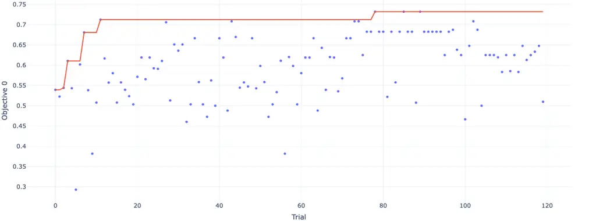

# Building LLM Agent Systems the Deep Learning Way: From Modular Design to Architecture Search

Tao Feng ^(†)^(†)thanks: Equal contribution.    Pengrui
Han¹¹footnotemark: 1    Zhongjie Dai¹¹footnotemark: 1    Jiaxuan You
^(†)^(†)thanks: Corresponding author. Affiliation: University of
Illinois Urbana-Champaign Affiliation: {taofeng2, phan12, zhongjie,
jiaxuan}@illinois.edu

###### Abstract

Large Language Models (LLMs) have revolutionized AI research and enabled
exciting agent systems. To build a complex LLM agent system, most
existing research relies on insights from other domains or heuristics to
manually build the agent system. However, this approach often requires
heavy hand-engineering and fails to fully optimize for the downstream
task of interest. Inspired by the tremendous success of deep learning,
we propose to construct LLM agent systems in a modular manner, similar
to building a deep neural network. Our key insight is to make analogies
between LLM building blocks, such as retrievals, memories, and prompting
strategies, and the successful deep learning modules, such as MLPs,
attention, and recurrent modules. We further design forward inference
and feedback mechanisms for LLMs, where prompts in LLMs are considered
as the weights in deep models, and the prompt optimization from feedback
is analogous to the back-propagation algorithm. We additionally leverage
a search algorithm to search for the best configuration of LLM agent
systems, similar to the neural architecture search (NAS) in deep
learning research. Comprehensive experimental results demonstrate that
the proposed deep learning recipe for LLM agent systems is highly
effective, in particular: (1) Organizing LLM modules into
deep-learning-style architectures yields noticeable performance gain;
(2) Automatic prompt optimization, equivalent to backpropagation, is
efficient in incorporating feedback from the task of interest and
achieves at least 5% performance improvement; (3) NAS equivalent
algorithm works well for further optimizing the LLM agent system
architecture with 11% performance gain compared with randomly designed
architectures. Overall, our research demonstrates the exciting
opportunity of transferring the success of deep learning to building LLM
agent systems.

## 1 Introduction

Large Language Models (LLMs) have demonstrated remarkable potential in
achieving Artificial General Intelligence (AGI) due to their impressive
planning and reasoning abilities (Wu et al., 2023b; Ge et al., 2023),
which has sparked an upsurge in studies investigating sophisticated LLM
agent systems (Zhao et al., 2023; Wang et al., 2023; Peng et al., 2023).
LLM agent systems usually involve various LLM building blocks (Packer et
al., 2023; Yao et al., 2023; Topsakal and Akinci, 2023; Pandya and
Holia, 2023; Jeong, 2023), such as retrieval (Robertson et al., 2009;
Izacard et al., 2022; Lin et al., 2023), memory modules (Zhao et al.,
2023; Wang et al., 2023), and prompting strategies (Yao et al., 2024).
We argue that the success of LLM agent systems relies on the integration
of multiple LLM modules (Zhao et al., 2023; Talebirad and Nadiri, 2023;
Wu et al., 2023a), which still receives limited attention from the
community. Therefore, our paper aims to raise attention to the pressing
research question: how to effectively and automatically construct LLM
agent systems based on basic building blocks.

Constructing effective LLM agent systems often involves leveraging
insights from various disciplines, such as neuroscience (Yao et al.,
2022; Shinn et al., 2023; Kwon et al., 2023) and computer architecture
(Packer et al., 2023; Talebirad and Nadiri, 2023). For example, MEMGPT
(Packer et al., 2023) draws inspiration from hierarchical memory systems
in traditional operating systems to construct an LLM agent system with
several manually designed LLM building blocks. However, applying such
interdisciplinary insights to LLM agent system construction has the
following shortcomings: (1) The approach is often domain-specific and
not generic, requiring heavy manual designs; (2) Designing the LLM agent
system necessitates extensive trial and error, making the process both
costly and inflexible.

The tremendous success of Deep Learning (DL) has brought us a new
perspective on solving the above problems. In the area of DL,
researchers have proposed various basic modules such as Recurrent Neural
Network (RNN) (Li et al., 2019; Selvin et al., 2017; Jordan, 1997) and
Attention Network (Wang et al., 2017; Fu et al., 2019; Hou et al., 2019)
to process various tasks. Constructing the basic modules into
complicated architectures like Transformer (Vaswani et al., 2017b; Han
et al., 2021) and further leveraging the forward and back propagation
(Johansson et al., 1991; Buscema, 1998) to train such architectures have
further contributed to the success of DL in tackling complex real-world
applications.

Inspired by the success of DL, we propose to design LLM agent systems
with a Deep Learning recipe. Our approach involves defining building
blocks of LLMs analogous to the DL modules, constructing LLM agent
systems similar to defining NN architectures, and developing the prompt
optimization algorithm of LLMs similar to the backpropagation algorithm.
Specifically, we explore LLM modules including: (1) vanilla LLM as a
single layer MultiLayer Perceptron (MLP) (Popescu et al., 2009); (2)
Memory processer (Zhang et al., 2023; Packer et al., 2023) as an RNN;
(3) Retrieval (Robertson et al., 2009; Izacard et al., 2022; Lin et al., 2023) as an attention network (Wang et al., 2017; Fu et al., 2019; Hou
et al., 2019); (4) prompting strategies (Besta et al., 2023; Yao et al., 2024) as Graph Neural Networks (GNNs) (Zhang et al., 2021; Shi et al.,
2019; Kenning et al., 2022). Based on the defined LLM modules, we could
construct more complex LLM agent systems by referencing successful DL
architectures, notably, Transformer (Vaswani et al., 2017a).
Furthermore, we design a meta prompt module similar to the training
parameters in DL to guide the forward inference, and a
feedback-propagation module that incorporates the external feedback and
iteratively updates the meta prompt similar to the backpropagation
algorithm. We additionally leverage a search algorithm to search for the
best configuration of LLM agent systems, similar to the neural
architecture search (NAS) (Liu et al., 2018) in DL research. In summary,
our main contributions are as follows:

- •
  The first work to investigate constructing LLM agent systems from the
  DL perspective and recipe, extending the science and engineering of
  LLM agent systems.
- •
  Proposing DL-style building blocks for LLMs and constructing a
  “Transformer” architecture for LLM agent systems. Observing at least
  5% performance gain by “backpropagating” through the LLM agent system
  via a novel feedback-propagation algorithm.
- •
  An automatic search algorithm for the best configuration of LLM agent
  systems, similar to NAS in DL, brings an 11% performance gain compared
  to prior practice.

## 2 Related Works

In this section, we first revisit the basic DL modules and how they are
used to build complex NN architectures. We then review the current
approaches in building LLM agent systems and discuss how we can bring
insights from the success of DL applications to LLM agent systems.

Modules of Deep Learning. In the area of DL, researchers have designed
various basic modules to tackle different tasks. In the early period of
DL design, researchers proposed MLP (Popescu et al., 2009) to solve
tasks such as classification, prediction, and regression. However, this
basic architecture is less effective for complex input data.
Consequently, researchers have developed specialized modules with
various functionalities. RNNs (Li et al., 2019; Selvin et al., 2017;
Jordan, 1997) are tailored for sequential data, maintaining a hidden
state to capture information across time steps. CNNs (Kiranyaz et al.,
2015; Kiranyaz et al., 2019) excel at capturing local patterns within
images. Additionally, Attention mechanism (Wang et al., 2017; Fu et al.,
2019; Hou et al., 2019) further refines model focus by emphasizing the
most salient segments within the data. By combining and arranging these
specialized modules, researchers have developed numerous powerful
architectures. For instance, the Transformer (Vaswani et al., 2017b; Han
et al., 2021), one of the most popular architectures today, relies on
the attention mechanism and simple feed-forward layers. It has
demonstrated surprising results in generative AI. Additionally, some
researchers have integrated the attention mechanism into RNNs, yielding
very promising outcomes (Wang and Tax, 2016; Merity, 2019). Researchers
have further developed automated architecture engineering, such as
Neural Architecture Search (NAS) (Liu et al., 2018; Zoph and Le, 2016;
Pham et al., 2018), aiming to find the optimized design of our machine
learning model.

Construction of LLM Agent Systems. Much of the current research on LLM
agent systems relies on the insights and observations from other domains
(Yao et al., 2022; Shinn et al., 2023; Kwon et al., 2023; Chen et al.,
2023). However, these designs are often problem-specific and do not
offer a systematic approach to defining a good LLM agent system
architecture. Recent efforts, like Langchain ¹¹ 1
https://www.langchain.com and LlamaIndex ²² 2 https://www.llamaindex.ai,
aim to offer standardized building blocks and modules for LLM agent
systems. However, they still lack a systematic approach to designing
different LLM agent systems for various tasks, providing limited
guidance on their integration for sophisticated and meaningful
architectural compositions. In response, we propose the development of
standardized modules for LLM agent system design, inspired by the proven
methodologies within the DL domain. In this work, we show that these
basic building blocks can be synthesized into a coherent framework,
offering a novel, modular approach to architectures in LLMs that builds
a bridge between LLMs and DL.

## 3 The Deep Learning Recipe for LLM Agent Systems

To explore the deep learning recipe for LLM agent systems, we first
introduce the basic building blocks of LLMs in Sec 3.1, which
demonstrates the relationships between DL and LLM building blocks.
Inspired by the success of DL’s training process, we then illustrate the
forward inference and feedback propagation of LLMs in Sec 3.2. Finally,
we introduce the instantiations of: building a “Transformer” with LLM
building blocks in Sec 3.3.

Figure 1: Basic Building Blocks of LLM agent systems. (a) A vanilla LLM
can be translated into a single layer MLP, which receives a query $`q`$
and outputs a response $`r`$; (b) Memory processor can be regarded as
RNN since they both utilize historical data for future planning; (c)
Retrieval is analogous to the attention network of DL because they both
extract the importance information of the corpus context; (d) Prompting
strategies, such as Tree/Graph of thoughts, are translated to GNNs since
they decompose query $`q`$ into interconnected thoughts, which are
connected and related to each other.

### 3.1 Deep-Learning-Style Building Blocks of LLM Agent Systems

To introduce the basic building blocks of LLMs and the relationship
between DL and LLMs, we “translate” the modules of LLMs into modules of
DL as shown in Figure 1.

Vanilla LLM as Single Layer MLP. As a basic component when constructing
an LLM agent system, an LLM receives a query $`q`$ and outputs a
response $`r`$. It can be translated as a single layer MLP, as shown in
Figure 1(a), which also plays a fundamental role in DL (Popescu et al.,
2009).

Memory Processor as Recurrent Neural Network. During the interaction
process of the LLM, it will store the knowledge obtained by the
interaction as memories $`\{m_{0},m_{1},...m_{n},q\}`$ and utilize these
memories for future responses (Shinn et al., 2023; Kwon et al., 2023) as
shown in Figure 1(b). Similarly, Recurrent Neural Network (RNN) excels
at processing sequential data due to its inherent structure that allows
for the storage and utilization of previous information (Li et al.,
2019; Selvin et al., 2017; Jordan, 1997). It achieves this by
maintaining hidden states $`h_{t}`$ that are updated at each time step
$`t`$, effectively encoding the history of the sequence
$`\{m_{0},m_{1},...m_{n},q\}`$ up to that point. Therefore, we regard
the memory processor as RNN.

Retrieval as Attention Network. When LLMs interact with factual
knowledge stored in the corpus context $`C`$, they utilize retrieval
(Robertson et al., 2009; Izacard et al., 2022; Lin et al., 2023) to
efficiently retrieve accurate context for future responses. As shown in
the left part of Figure 1(c), to retrieve the accurate context,
retrieval exploits the embedding similarity between query $`q`$ and
corpus context $`C`$ and obtains the retrieved context $`C_{r}`$ of the
top $`K`$ similarity ranking. This process is similar to the attention
network shown in the right part of Figure 1(c). They both utilize the
embedding similarity between query $`q`$ and corpus context $`C`$ to
obtain an importance score $`f`$, which determines the importance
weights of each context. From this perspective, we translate the
retrieval as an attention network. To be specific, single-query
retrieval can be interpreted as single-head attention and multi-query
retrieval can be regarded as multi-head attention (Wang et al., 2017; Fu
et al., 2019; Hou et al., 2019).

Prompting Strategies as Graph Neural Network. As shown in Figure 1(d),
common prompting strategies, such as Tree of Thoughts (ToT) (Yao et al., 2024) and Graph of Thoughts (GoT) (Besta et al., 2023) both decompose
query $`q`$ into interconnected thoughts, which are connected and
related to each other. These query and thought nodes and their
relationships can be abstracted into nodes and edges of Graph Neural
Networks, respectively. Since a tree is a special case of a graph, we
treat both ToT and GoT as instances of the GNN analogy in the subsequent
introduction, denoting the corresponding architectures as Tree and GNN,
respectively.

Figure 2: Forward and Back Propagation Algorithms for Large Language
Model. In this process, meta prompt is regarded as trainable parameters
in DL. For the forward inference, the input query goes through the
composition of LLM building blocks to obtain the response, which is
guided through the meta prompt. For the feedback propagation, the
feedback from the self-reflection updates the parameters (meta prompt)
of LLM.

### 3.2 Forward Inference and Feedback Propagation for LLM Agent Systems

The success of DL not only lies in the design of fundamental modules
discussed in Sec 3.1, but also in the training process containing
forward and back propagation (Buscema, 1998) that brings external
signals and feedback to the DL system. Inspired by this, we design the
forward inference and feedback propagation of LLMs as shown in Figure 2.

Parameters of the LLM agent system. The parameters can be divided into
two categories: training parameters and hyperparameters. Here, the meta
prompt in Figure 2 is equivalent to training parameters in deep
learning, since it guides forward inference and can be updated through
feedback propagation. Moreover, hyperparameters in LLM agent systems
include max tokens of each LLM (size of MLP); number of retrievals (head
number of attention network); retrieve number of each retrieval (mask);
node number or depth of tree/graph of thoughts (node number or layer
number of GNN); etc. These are predefined before using the LLM agent
systems.

Forward Inference. In the forward inference process of DL, the input
data passes through each block of the neural network to obtain the final
output (Buscema, 1998; Prabhushankar and AlRegib, 2022). Similar to
this, in the forward inference process of LLM, the input query goes
through the composition of LLM building blocks to obtain the response as
shown in Figure 2. Here we set up a meta prompt to guide the forward
inference of LLM, which contains the input query, previous responses,
and reflection returned by the self-reflection module.

Feedback Propagation. Many researchers attribute the success of DL to
the feedback propagation process of DL (Buscema, 1998; Luft, 2014),
which updates the parameters of DL through feedback of losses between
outputs and ground truths. Inspired by this, as illustrated in Figure 2,
we regard the meta prompt as parameters of LLM and design a
self-reflection module as the loss function to evaluate the effect of
response on input query and update the parameters of LLM. Specifically,
the self-reflection contains LLM Evaluation and Metric Calculation. For
some queries whose response quality has clear metrics, we will choose
Metric Calculation. Otherwise, we utilize LLM Evaluation to make LLM
judge the quality of the response. The generated reflections and
responses will be used to update the meta prompt to guide the LLM
response in the next round.

Figure 3: Build a Cross-attention Transformer with LLM Building Blocks.
The multi-query retrieval is equivalent to the cross-attention network,
and the LLM is translated to MLP in DL. Additionally, the process of
appending the raw query to the generated multiple queries is equivalent
to the residual.

### 3.3 Case study: Building a “Transformer” with LLM Building Blocks

In this section, we introduce how to build a (cross-attention)
Transformer with LLM building blocks. As illustrated in Figure 3, we
show the correspondence between the main modules of the cross-attention
transformer and LLM building blocks to illustrate how to utilize LLM
building blocks to build a transformer. For the cross-attention
transformer, the two different features of data will first go through a
cross-attention network, and the output will be obtained through an MLP
layer. To avoid the vanishing gradient problem or gradient explosion,
researchers will also add the residual module to improve the training
performance of the transformer (Vaswani et al., 2017b; Han et al.,
2021). The success of the transformer in integrating and processing
information from different features has inspired the design of LLM. As
shown in the right part of Figure 3, we analogize the raw query and the
corpus context into two different features of data, like $`Feature_{1}`$
and $`Feature_{2}`$. On this basis, we first design a meta prompt
containing raw queries to guide the LLM to generate multiple queries.
Then we propose a multi-query retrieval based on multiple queries to
retrieve relevant context from corpus context, which is equivalent to
the multi-head cross-attention network. Additionally, we add the raw
query to the generated multiple queries to ensure the effectiveness of
our LLM, which is similar to the design of the residual module. Finally,
an LLM will output the response like an MLP based on the retrieved
context and input query. We summarize the DL recipe for LLM agent
systems as a user instruction manual in Table 4 and please refer to
Appendix A for details.

## 4 Experimental Setup

### 4.1 Datasets and Tasks

We evaluate LLM agent systems on two major categories of tasks. They
differ in whether the LLMs interact with external knowledge (Sun et al.,
2023), such as external factual knowledge. Table 6 in Appendix A
summarizes the datasets and the number of cases used for evaluation.

#### LLM without External Knowledge.

We evaluate non-retrieval-based methods using two datasets: (1)Traveling
Salesman Problem (TSP) (Hahsler and Hornik, 2007), where we create
instances by randomly generating $`n`$ nodes with $`x`$ and $`y`$
coordinates in the $`[-10,10]`$ range. As a classic combinatorial
optimization problem, performance is evaluated by the length of the best
solution within the fixed exploration step. (2) GSM8k (Cobbe et al.,
2021), which contains high-quality, linguistically diverse grade-school
math word problems necessitating multi-step reasoning, crafted by expert
problem writers. Each problem includes a detailed reasoning process and
the correct final answer, with performance evaluated based on final
answer accuracy.

#### LLM with External Knowledge.

Our evaluation of retrieval-based frameworks utilizes two datasets: (1)
StrategyQA (Geva et al., 2021), a benchmark for open-domain commonsense
reasoning question-answering that highlights the importance of implicit
reasoning. It involves retrieving pertinent evidence paragraphs from a
corpus to correctly answer questions. We compare the retrieved
paragraphs with the ground truth and obtain Precision, Recall, and F1 as
evaluation metrics. (2) Related-multi (will be released after review),
designed to assess a language model’s capability to effectively use
extensive context from real-world academic papers for answering queries.
Specifically, the task is to write a related work section based on the
title and abstract of a target paper. LLM needs to use the title and
abstract as the query to retrieve text chunks to complete this task.
Text chunks depict the abstracts of several papers (each text chunk
corresponds to the abstract of a paper), where some papers are cited in
the related work section of the target paper, while others are randomly
sampled from the same broader field. The retrieved text chunks are
compared with the ground truth to obtain Precision, Recall, and F1 as
evaluation metrics.

Figure 4: An example of the meta prompt used for RNN-MLP on the GSM8K
dataset. The blue text contains input questions and previous
responses/evaluations. The purple text describes the output format
instructions.

### 4.2 Models: Various Architectures for LLM Agent Systems

We delve into the detailed descriptions of the architectures we
explored, with a particular emphasis on their implementations and the
methods employed for backward propagation across various modules. For
the two LLM datasets without external knowledge, we design the following
four basic architectures: (1) MLP: a single LLM; (2) RNN-MLP: previous
responses are appended to the meta prompt to guide the generation of
response; (3) Tree-MLP: utilizes ToT to generate multiple thoughts for
response generation; (4) GNN-MLP: GoT is exploited to develop various
thoughts for response generation.

We also develop four basic architectures for LLM agent systems with
external knowledge. In order to interact with external knowledge, the
four architectures are supplemented with the attention to retrieve
relevant information based on the above architectures: (1) Att-MLP: a
single retrieval to retrieve relevant information for LLM; (2)
RNN-Att-MLP: previous responses are appended into the meta prompt to
change the query for retrieval; (3) Tree-Att-MLP: utilize ToT to
generate new query for retrieval; (4) GNN-Att-MLP: GoT is exploited to
develop new query to retrieve. More details about the basic
architectures of LLM agent systems are introduced in Appendix C.
Additionally, we have shown an example of the meta prompt used for
RNN-MLP on the GSM8K dataset in Figure 4. Other meta prompts are also
summarized in Appendix B.

## 5 Results

|          |                            |          |
| -------- | -------------------------- | -------- |
| Type     | Without External Knowledge |          |
| Dataset  | TSP                        | GSM8k    |
| Method   | Length                     | Accuracy |
| MLP      | 79.2                       | 53.3%    |
| RNN-MLP  | 76.6                       | 60.0%    |
| Tree-MLP | 73.2                       | 66.7%    |
| GNN-MLP  | 73.9                       | 64.3%    |

Table 1: Performance of Different LLM agent systems on TSP and GSM8k.

|              |                         |        |      |               |        |      |
| ------------ | ----------------------- | ------ | ---- | ------------- | ------ | ---- |
| Type         | With External Knowledge |        |      |               |        |      |
| Dataset      | StrategeyQA             |        |      | Related-multi |        |      |
| Method       | Precision               | Recall | F1   | Precision     | Recall | F1   |
| Att-MLP      | 0.45                    | 0.40   | 0.42 | 0.31          | 0.17   | 0.22 |
| RNN-Att-MLP  | 0.72                    | 0.62   | 0.66 | 0.33          | 0.19   | 0.24 |
| Tree-Att-MLP | 0.53                    | 0.47   | 0.50 | 0.34          | 0.20   | 0.25 |
| GNN-Att-MLP  | 0.58                    | 0.51   | 0.54 | 0.29          | 0.16   | 0.21 |

Table 2: Performance of Different LLM agent systems on StrategeyQA and
Related-multi.

### 5.1 Performance of Different Architectures of LLM Agent Systems

Different Tasks Call for Different LLM Architectures. Our results across
two distinct types of datasets are illustrated in Tables 2 and 2,
demonstrating that the integration of RNN, Tree, and GNN generally
enhances the MLP’s performance across various tasks. Specifically, in
reasoning (GSM8K) and optimization (TSP) problems that do not require
external knowledge, GNN and Tree excel due to their strong logical
capabilities. For tasks involving reasoning (StrategyQA) and
long-context summary (Related-multi) that necessitate external
knowledge, RNNs proved most effective, in line with our expectations.
This effectiveness is attributed to their capability to process and
retain long sequences of information. Consistent with findings in DL,
combining RNNs with attention mechanisms has been shown to yield
promising results.

Feedback Propagation Effectively Optimizes LLM Agent System Performance
without Human Intervention. Through our experiments, we discover that
our automatic prompt optimization technique, akin to backward
propagation, consistently improves the performance of the LLM agent
systems in most scenarios. This verifies that LLM agent systems benefit
from integrating past experiences and self-evaluations. Figure 7
presents the results at different steps on the TSP datasets,
illustrating that feedback propagation can bring at least 5% performance
gain for LLM agent systems. Moreover, we can also observe that GNN-MLP
and Tree-MLP iterate faster than other architectures and obtain better
results. This is because they explore more solutions at each step and
improve the efficiency of optimization.

Figure 5: Optimization on transformer to maximize F1.

### 5.2 Case Study: Results of “Transformer-style” LLM Agent Systems

We utilize variants of the transformer as an example to show the role of
different LLM building blocks when building complex architectures. To be
specific, we set up the following variants. (1) Transformer: It denotes
transformer illustrated in Sec 3.3. (2) RNN-Transformer: We add previous
responses to the meta prompt of the transformer to utilize its memory,
which is commonly used in DL (Xia et al., 2019; Liu et al., 2019) when
processing historical data. (3) Tree-Transformer/GNN-Transformer:
ToT/GoT is added to transformer to guide multi-query generation, which
is similar to GraphTransformer (Yun et al., 2019; Hu et al., 2020;
Rampášek et al., 2022) in DL. We compare their performance on two
datasets with the same hyperparameters and report all the results in
Figure 7. It can be observed that the Transformer performs best in
StrategyQA. This is because StrategyQA’s tasks are relatively simple,
and Transformer is already relatively complex, therefore other variants
do not perform well. We can also observe that Tree-Transformer and
GNN-Transformer perform relatively better than other variants on
Related-multi. It is because writing related work requires more thinking
and divergence of thoughts (Randolph, 2019; Torraco, 2005).

Figure 6: The performance of LLM agent systems on the TSP dataset will
get better as the feedback propagation progresses.

Figure 7: Case Study: Using LLM Building Blocks to Build Variants of
Transformer.

### 5.3 Automatic Architecture Search of LLM Agent Systems

To automatically optimize the LLM agent system architecture like NAS, we
propose an optimization framework based on Optuna (Akiba et al., 2019),
which is an efficient and lightweight hyperparameter optimization
software. To better illustrate our framework, we take the optimization
of the transformer introduced in Sec 3.3 on Related-multi as an example.
As shown in Figure 5, we optimize the hyperparameters of each module
using Optuna. To be specific, we first conclude the hyperparameters and
define their optimization range in Table 5 of Appendix D: Output size
$`m_{1}`$ (max tokens) for LLM prompting, head num $`h`$ and retrieve
num $`n`$ of each head for multi-retrieval, output size $`m_{2}`$ for
output LLM, and output size $`m_{3}`$ for self-reflection. We utilize
30% of the dataset (training set) for searching for an optimization
architecture and 70% for testing (testing set) and further define F1 as
the optimization goal. For each set of hyperparameters
$`pr_{i}=(m_{1},m_{2},m_{3},h,n)`$, we calculate its F1 performance on
training set. As illustrated in Figure 16 of Appendix D, we can obtain
$`\{pr_{i},F1_{i}\}^{k}`$ via $`k`$ trials (120 trials in our
experiment) and optimize the architecture by maximizing F1. In addition,
as shown in Table 3, we select some points to illustrate that the LLM
agent system becomes better as the number of trials increases. Through
the experiment, we obtain the optimized hyperparameters
$`pr=(m_{1}=192,m_{2}=192,m_{3}=320,h=2,n=4)`$ with $`F1=0.712`$ on the
testing set, which has 11% better performance than randomly designed
architectures (obtained by conducting experiments in which $`m`$ groups
of hyperparameters were randomly selected and averaging the
corresponding F1 scores).

|          |       |       |       |       |
| -------- | ----- | ----- | ----- | ----- |
|          | 0     | 7     | 43    | 78    |
| F1 Score | 0.541 | 0.685 | 0.694 | 0.712 |

Table 3: As the number of LLM architecture searches increases, the LLM
agent system is getting better.

## 6 Conclusion and Discussion

#### Conclusion.

In conclusion, our work introduces a pioneering modular approach to the
construction of LLM agent systems, establishing parallels with DL. We
provide comprehensive methods and insights into viewing and assembling
LLM building blocks in a manner analogous to DL architectures. Through
extensive experimentation, we demonstrate that specific classic LLM
modules are optimized for distinct tasks, similar to those in DL, and
can be integrated in a manner reminiscent of DL configurations.
Moreover, our feedback system enhances the performance of LLMs,
paralleling the training mechanisms in DL. Finally, we propose an
automatic optimization method for identifying the most effective LLM
architectures, presenting a promising avenue for future research.

#### Discussion.

This work represents a pioneering effort in the development of
systematic and scientifically grounded LLM agent systems, drawing upon
DL insights to inaugurate a new era of efficiency and standardization in
the research and application of LLMs. By establishing fundamental LLM
agent systems, our objective is to reconcile the existing diversity of
paradigms within LLM research and, akin to DL, introduce classic and
standardized modules that enhance scientific rigor, effectiveness, and
innovation within the academic community. In the industrial context, the
adoption of foundational and systematic architectures enables the
creation of more efficient LLM building blocks, thus establishing a
solid basis for the field of LLM agent systems. These advanced LLM
building blocks possess the potential to streamline the deployment of
LLM products, thereby enabling significant real-world impact and
facilitating transformative changes across various sectors. Inspired by
the progression of DL, this work introduces a suite of standardized
modules within the LLM agent system, setting a foundation for future
research to explore multi-LLM settings, integrate more established DL
modules and architectures like CNN, and adopt self-exploration
algorithms akin to NAS to revolutionize the optimization of LLM agent
systems, potentially accelerating the discovery of innovative solutions.

## References

- Akiba et al. (2019) T. Akiba, S. Sano, T. Yanase, T. Ohta, and M.
  Koyama Optuna: a next-generation hyperparameter optimization
  framework. In Proceedings of the 25th ACM SIGKDD international
  conference on knowledge discovery & data mining, pp. 2623–2631. Cited
  by: §5.3.
- Besta et al. (2023) M. Besta, N. Blach, A. Kubicek, R.
  Gerstenberger, L. Gianinazzi, J. Gajda, T. Lehmann, M. Podstawski, H.
  Niewiadomski, P. Nyczyk, et al. Graph of thoughts: solving elaborate
  problems with large language models. arXiv preprint arXiv:2308.09687.
  Cited by: §1, §3.1.
- Buscema (1998) M. Buscema Back propagation neural networks. Substance
  use & misuse 33 (2), pp. 233–270. Cited by: §1, §3.2, §3.2, §3.2.
- Chen et al. (2023) W. Chen, Y. Su, J. Zuo, C. Yang, C. Yuan, C.
  Qian, C. Chan, Y. Qin, Y. Lu, R. Xie, et al. Agentverse: facilitating
  multi-agent collaboration and exploring emergent behaviors in agents.
  arXiv preprint arXiv:2308.10848. Cited by: §2.
- Cobbe et al. (2021) K. Cobbe, V. Kosaraju, M. Bavarian, M. Chen, H.
  Jun, L. Kaiser, M. Plappert, J. Tworek, J. Hilton, R. Nakano, et al.
  Training verifiers to solve math word problems, 2021. URL
  https://arxiv. org/abs/2110.14168. Cited by: §4.1.
- Fu et al. (2019) J. Fu, J. Liu, H. Tian, Y. Li, Y. Bao, Z. Fang,
  and H. Lu Dual attention network for scene segmentation. In
  Proceedings of the IEEE/CVF conference on computer vision and pattern
  recognition, pp. 3146–3154. Cited by: §1, §1, §2, §3.1.
- Ge et al. (2023) Y. Ge, Y. Ren, W. Hua, S. Xu, J. Tan, and Y. Zhang
  Llm as os (llmao), agents as apps: envisioning aios, agents and the
  aios-agent ecosystem. arXiv preprint arXiv:2312.03815. Cited by: §1.
- Geva et al. (2021) M. Geva, D. Khashabi, E. Segal, T. Khot, D. Roth,
  and J. Berant Did aristotle use a laptop? a question answering
  benchmark with implicit reasoning strategies. Transactions of the
  Association for Computational Linguistics 9, pp. 346–361. Cited by:
  §4.1.
- Hahsler and Hornik (2007) M. Hahsler and K. Hornik TSP-infrastructure
  for the traveling salesperson problem. Journal of Statistical Software
  23 (2), pp. 1–21. Cited by: §4.1.
- Han et al. (2021) K. Han, A. Xiao, E. Wu, J. Guo, C. Xu, and Y. Wang
  Transformer in transformer. Advances in neural information processing
  systems 34, pp. 15908–15919. Cited by: §1, §2, §3.3.
- Hou et al. (2019) R. Hou, H. Chang, B. Ma, S. Shan, and X. Chen Cross
  attention network for few-shot classification. Advances in neural
  information processing systems 32. Cited by: §1, §1, §2, §3.1.
- Hu et al. (2020) Z. Hu, Y. Dong, K. Wang, and Y. Sun Heterogeneous
  graph transformer. In Proceedings of the web conference 2020,
  pp. 2704–2710. Cited by: §5.2.
- Izacard et al. (2022) G. Izacard, M. Caron, L. Hosseini, S. Riedel, P.
  Bojanowski, A. Joulin, and E. Grave Unsupervised dense information
  retrieval with contrastive learning. External Links: 2112.09118 Cited
  by: §1, §1, §3.1.
- Jeong (2023) C. Jeong Generative ai service implementation using llm
  application architecture: based on rag model and langchain framework.
  Journal of Intelligence and Information Systems 29 (4), pp. 129–164.
  Cited by: §1.
- Johansson et al. (1991) E. M. Johansson, F. U. Dowla, and D. M.
  Goodman Backpropagation learning for multilayer feed-forward neural
  networks using the conjugate gradient method. International Journal of
  Neural Systems 2 (04), pp. 291–301. Cited by: §1.
- Jordan (1997) M. I. Jordan Serial order: a parallel distributed
  processing approach. In Advances in psychology, Vol. 121, pp. 471–495.
  Cited by: §1, §2, §3.1.
- Kenning et al. (2022) M. Kenning, J. Deng, M. Edwards, and X. Xie A
  directed graph convolutional neural network for edge-structured
  signals in link-fault detection. Pattern Recognition Letters 153,
  pp. 100–106. Cited by: §1.
- Kiranyaz et al. (2019) S. Kiranyaz, T. Ince, O. Abdeljaber, O. Avci,
  and M. Gabbouj 1-d convolutional neural networks for signal processing
  applications. In ICASSP 2019-2019 IEEE International Conference on
  Acoustics, Speech and Signal Processing (ICASSP), pp. 8360–8364. Cited
  by: §2.
- Kiranyaz et al. (2015) S. Kiranyaz, T. Ince, and M. Gabbouj Real-time
  patient-specific ecg classification by 1-d convolutional neural
  networks. IEEE transactions on biomedical engineering 63 (3),
  pp. 664–675. Cited by: §2.
- Kwon et al. (2023) W. Kwon, Z. Li, S. Zhuang, Y. Sheng, L.
  Zheng, C. H. Yu, J. Gonzalez, H. Zhang, and I. Stoica Efficient memory
  management for large language model serving with pagedattention. In
  Proceedings of the 29th Symposium on Operating Systems Principles,
  pp. 611–626. Cited by: §1, §2, §3.1.
- Li et al. (2019) Y. Li, R. Sun, and R. Horne Deep learning for well
  data history analysis. In SPE Annual Technical Conference and
  Exhibition?, pp. D011S008R002. Cited by: §1, §2, §3.1.
- Lin et al. (2023) S. Lin, A. Asai, M. Li, B. Oguz, J. Lin, Y.
  Mehdad, W. Yih, and X. Chen How to train your dragon: diverse
  augmentation towards generalizable dense retrieval. arXiv preprint
  arXiv:2302.07452. Cited by: §1, §1, §3.1.
- Liu et al. (2018) C. Liu, B. Zoph, M. Neumann, J. Shlens, W. Hua, L.
  Li, L. Fei-Fei, A. Yuille, J. Huang, and K. Murphy Progressive neural
  architecture search. In Proceedings of the European conference on
  computer vision (ECCV), pp. 19–34. Cited by: §1, §2.
- Liu et al. (2019) S. Liu, S. Zhang, X. Zhang, and H. Wang R-trans: rnn
  transformer network for chinese machine reading comprehension. IEEE
  Access 7, pp. 27736–27745. Cited by: §5.2.
- Luft (2014) C. D. B. Luft Learning from feedback: the neural
  mechanisms of feedback processing facilitating better performance.
  Behavioural brain research 261, pp. 356–368. Cited by: §3.2.
- Merity (2019) S. Merity Single headed attention rnn: stop thinking
  with your head. arXiv preprint arXiv:1911.11423. Cited by: §2.
- Packer et al. (2023) C. Packer, V. Fang, S. G. Patil, K. Lin, S.
  Wooders, and J. E. Gonzalez Memgpt: towards llms as operating systems.
  arXiv preprint arXiv:2310.08560. Cited by: §1, §1, §1, §1.
- Pandya and Holia (2023) K. Pandya and M. Holia Automating customer
  service using langchain: building custom open-source gpt chatbot for
  organizations. arXiv preprint arXiv:2310.05421. Cited by: §1.
- Peng et al. (2023) B. Peng, M. Galley, P. He, H. Cheng, Y. Xie, Y.
  Hu, Q. Huang, L. Liden, Z. Yu, W. Chen, et al. Check your facts and
  try again: improving large language models with external knowledge and
  automated feedback. arXiv preprint arXiv:2302.12813. Cited by: §1.
- Pham et al. (2018) H. Pham, M. Guan, B. Zoph, Q. Le, and J. Dean
  Efficient neural architecture search via parameters sharing. In
  International conference on machine learning, pp. 4095–4104. Cited by:
  §2.
- Popescu et al. (2009) M. Popescu, V. E. Balas, L. Perescu-Popescu,
  and N. Mastorakis Multilayer perceptron and neural networks. WSEAS
  Transactions on Circuits and Systems 8 (7), pp. 579–588. Cited by: §1,
  §2, §3.1.
- Prabhushankar and AlRegib (2022) M. Prabhushankar and G. AlRegib
  Introspective learning: a two-stage approach for inference in neural
  networks. Advances in Neural Information Processing Systems 35,
  pp. 12126–12140. Cited by: §3.2.
- Rampášek et al. (2022) L. Rampášek, M. Galkin, V. P. Dwivedi, A. T.
  Luu, G. Wolf, and D. Beaini Recipe for a general, powerful, scalable
  graph transformer. Advances in Neural Information Processing Systems
  35, pp. 14501–14515. Cited by: §5.2.
- Randolph (2019) J. Randolph A guide to writing the dissertation
  literature review. Practical assessment, research, and evaluation 14
  (1), pp. 13. Cited by: §5.2.
- Robertson et al. (2009) S. Robertson H. Zaragoza et al. The
  probabilistic relevance framework: bm25 and beyond. Foundations and
  Trends® in Information Retrieval 3 (4), pp. 333–389. Cited by: §1, §1,
  §3.1.
- Selvin et al. (2017) S. Selvin, R. Vinayakumar, E.
  Gopalakrishnan, V. K. Menon, and K. Soman Stock price prediction using
  lstm, rnn and cnn-sliding window model. In 2017 international
  conference on advances in computing, communications and informatics
  (icacci), pp. 1643–1647. Cited by: §1, §2, §3.1.
- Shi et al. (2019) L. Shi, Y. Zhang, J. Cheng, and H. Lu Skeleton-based
  action recognition with directed graph neural networks. In Proceedings
  of the IEEE/CVF conference on computer vision and pattern recognition,
  pp. 7912–7921. Cited by: §1.
- Shinn et al. (2023) N. Shinn, B. Labash, and A. Gopinath Reflexion: an
  autonomous agent with dynamic memory and self-reflection. arXiv
  preprint arXiv:2303.11366. Cited by: §1, §2, §3.1.
- Sun et al. (2023) K. Sun, Y. E. Xu, H. Zha, Y. Liu, and X. L. Dong
  Head-to-tail: how knowledgeable are large language models (llm)? aka
  will llms replace knowledge graphs?. arXiv preprint arXiv:2308.10168.
  Cited by: §4.1.
- Talebirad and Nadiri (2023) Y. Talebirad and A. Nadiri Multi-agent
  collaboration: harnessing the power of intelligent llm agents. arXiv
  preprint arXiv:2306.03314. Cited by: §1, §1.
- Topsakal and Akinci (2023) O. Topsakal and T. C. Akinci Creating large
  language model applications utilizing langchain: a primer on
  developing llm apps fast. In International Conference on Applied
  Engineering and Natural Sciences, Vol. 1, pp. 1050–1056. Cited by: §1.
- Torraco (2005) R. J. Torraco Writing integrative literature reviews:
  guidelines and examples. Human resource development review 4 (3),
  pp. 356–367. Cited by: §5.2.
- Vaswani et al. (2017a) A. Vaswani, N. Shazeer, N. Parmar, J.
  Uszkoreit, L. Jones, A. N. Gomez, Ł. Kaiser, and I. Polosukhin
  Attention is all you need. In Advances in Neural Information
  Processing Systems, Vol. 30, pp. . External Links:
  [Link](https://proceedings.neurips.cc/paper_files/paper/2017/file/3f5ee243547dee91fbd053c1c4a845aa-Paper.pdf)
  Cited by: §1.
- Vaswani et al. (2017b) A. Vaswani, N. Shazeer, N. Parmar, J.
  Uszkoreit, L. Jones, A. N. Gomez, Ł. Kaiser, and I. Polosukhin
  Attention is all you need. Advances in neural information processing
  systems 30. Cited by: §1, §2, §3.3.
- Wang et al. (2017) F. Wang, M. Jiang, C. Qian, S. Yang, C. Li, H.
  Zhang, X. Wang, and X. Tang Residual attention network for image
  classification. In Proceedings of the IEEE conference on computer
  vision and pattern recognition, pp. 3156–3164. Cited by: §1, §1, §2,
  §3.1.
- Wang and Tax (2016) F. Wang and D. M. Tax Survey on the attention
  based rnn model and its applications in computer vision. arXiv
  preprint arXiv:1601.06823. Cited by: §2.
- Wang et al. (2023) L. Wang, C. Ma, X. Feng, Z. Zhang, H. Yang, J.
  Zhang, Z. Chen, J. Tang, X. Chen, Y. Lin, et al. A survey on large
  language model based autonomous agents. arXiv preprint
  arXiv:2308.11432. Cited by: §1.
- Wu et al. (2023a) Q. Wu, G. Bansal, J. Zhang, Y. Wu, S. Zhang, E.
  Zhu, B. Li, L. Jiang, X. Zhang, and C. Wang Autogen: enabling next-gen
  llm applications via multi-agent conversation framework. arXiv
  preprint arXiv:2308.08155. Cited by: §1.
- Wu et al. (2023b) Y. Wu, X. Tang, T. M. Mitchell, and Y. Li Smartplay:
  a benchmark for llms as intelligent agents. arXiv preprint
  arXiv:2310.01557. Cited by: §1.
- Xia et al. (2019) R. Xia, M. Zhang, and Z. Ding RTHN: a
  rnn-transformer hierarchical network for emotion cause extraction.
  arXiv preprint arXiv:1906.01236. Cited by: §5.2.
- Yao et al. (2024) S. Yao, D. Yu, J. Zhao, I. Shafran, T. Griffiths, Y.
  Cao, and K. Narasimhan Tree of thoughts: deliberate problem solving
  with large language models. Advances in Neural Information Processing
  Systems 36. Cited by: §1, §1, §3.1.
- Yao et al. (2022) S. Yao, J. Zhao, D. Yu, N. Du, I. Shafran, K.
  Narasimhan, and Y. Cao React: synergizing reasoning and acting in
  language models. arXiv preprint arXiv:2210.03629. Cited by: §1, §2.
- Yao et al. (2023) S. Yao, J. Zhao, D. Yu, N. Du, I. Shafran, K.
  Narasimhan, and Y. Cao ReAct: synergizing reasoning and acting in
  language models.(2023). arXiv preprint arXiv:2210.03629. Cited by: §1.
- Yun et al. (2019) S. Yun, M. Jeong, R. Kim, J. Kang, and H. J. Kim
  Graph transformer networks. Advances in neural information processing
  systems 32. Cited by: §5.2.
- Zhang et al. (2023) K. Zhang, F. Zhao, Y. Kang, and X. Liu
  Memory-augmented llm personalization with short-and long-term memory
  coordination. arXiv preprint arXiv:2309.11696. Cited by: §1.
- Zhang et al. (2021) X. Zhang, Y. He, N. Brugnone, M. Perlmutter,
  and M. Hirn Magnet: a neural network for directed graphs. Advances in
  neural information processing systems 34, pp. 27003–27015. Cited by:
  §1.
- Zhao et al. (2023) A. Zhao, D. Huang, Q. Xu, M. Lin, Y. Liu, and G.
  Huang Expel: llm agents are experiential learners. arXiv preprint
  arXiv:2308.10144. Cited by: §1.
- Zoph and Le (2016) B. Zoph and Q. V. Le Neural architecture search
  with reinforcement learning. arXiv preprint arXiv:1611.01578. Cited
  by: §2.

## Appendix A User Instruction Manual

|                                    |                                    |
| ---------------------------------- | ---------------------------------- |
| LLM agent systems                  | Deep Learning Architecture         |
| Vanilla LLM                        | Single layer MLP                   |
| Memory processor                   | Recurrent neural network           |
| Retrieval                          | Attention Network                  |
| Prompting strategies (ToT & GoT)   | Graph neural network               |
| Prompts                            | Training parameters                |
| Max tokens of each LLM             | Size of MLP                        |
| Number of retrievals               | Head number of attention network   |
| Node number or depth of tree/graph | Node number or layer number of GNN |
| Forward inference of LLMs          | Forward inference                  |
| Feedback propagation               | Back propagation                   |
| Self-reflection                    | Loss function                      |
| Retrieve number of each retrieval  | Mask                               |

Table 4: Deep Learning Recipe for LLM Agent Systems.

## Appendix B Prompts

Figure 8: An example of the meta prompt used for RNN-MLP on the TSP
dataset. The blue text contains input questions and previous
responses/evaluations. The purple text describes the output format
instructions.

Figure 9: An example of the meta prompt used for Tree-MLP/GNN-MLP on the
TSP dataset. The blue text contains input questions and previous
responses/evaluations. The purple text describes the output format
instructions.

Figure 10: An example of the meta prompt used for RNN-MLP on GSM8K
dataset. The blue text contains input questions and previous
responses/evaluations. The purple text describes the output format
instructions.

Figure 11: An example of the meta prompt used for Tree-MLP/GNN-MLP on
GSM8K dataset. The blue text contains input questions and previous
responses/evaluations. The purple text describes the output format
instructions.

Figure 12: An example of the meta prompt used for RNN-Att-MLP on
StrategeyQA dataset. The blue text contains input questions and previous
responses/evaluations. The purple text describes the output format
instructions.

Figure 13: An example of the meta prompt used for
Tree-Att-MLP/GNN-Att-MLP on StrategeyQA dataset. The blue text contains
input questions and previous responses/evaluations. The purple text
describes the output format instructions.

Figure 14: An example of the meta prompt used for RNN-Att-MLP on
Related-multi dataset. The blue text contains input questions and
previous responses/evaluations. The purple text describes the output
format instructions.

Figure 15: An example of the meta prompt used for
Tree-Att-MLP/GNN-Att-MLP on Related-multi dataset. The blue text
contains input questions and previous responses/evaluations. The purple
text describes the output format instructions.

## Appendix C Details of Architectures for LLM Agent Systems

#### MLP.

For the single-layer MLP setup, as previously defined, the LLM processes
an input query $`q`$ and generates a corresponding output response
$`r`$. Subsequently, through a process of backpropagation, the LLM
undertakes a self-evaluation mechanism. The outcomes of this
self-evaluation $`e`$ and response $`r`$ are then integrated into the
original $`q`$, facilitating an updated $`r`$.

#### RNN-MLP.

In this RNN+MLP framework, the model processes a query $`q`$ and a
sequence of past experiences $`m_{0},m_{1},\ldots,m_{n}`$ with
evaluations $`e_{0},e_{1},\ldots,e_{n}`$. At each step, the latest three
experiences $`m_{n-2},m_{n-1},m_{n}`$ and evaluations
$`e_{n-2},e_{n-1},e_{n}`$ are integrated into the query $`q`$. This
enriched query is then utilized to generate the next response
$`m_{n+1}`$. After that, we evaluate it to get $`e_{n+1}`$. $`m_{n+1}`$
and $`e_{n+1}`$ are then fed back through backward propagation for
subsequent iterations. Figure 4 shows the example meta prompt for how
RNN+MLP works on GSM8K.

#### Tree-MLP.

In this setting, we use zero-shot ToT. Specifically, a query $`q`$ and a
meta prompt $`q_{m}`$ for decomposing $`q`$ into interconnected thoughts
are used to construct a comprehensive prompt $`p`$. This prompt serves
as input for an LLM, yielding a response $`r`$. During backward
propagation, a self-evaluation is performed, and the resulting
evaluation $`e`$ is utilized to refine $`q_{m}`$ into an updated version
$`q_{m}^{\prime}`$, leading to the formation of an updated prompt
$`p^{\prime}`$.

#### GNN-MLP.

This is similar to the Tree-MLP architecture, with the key difference
that we allow for deeper graph-based thoughts.

#### Att-MLP.

In our single retrieval Att-MLP model, an initial input query $`q`$ and
a meta query $`q_{m}`$ are used to generate an enhanced query $`p`$.
Information $`Cr`$ is retrieved from context $`C`$ based on $`p`$, and
both $`q`$ and $`Cr`$ are inputted into an LLM (MLP) to generate a
response $`r`$. A feedback system evaluates this response, producing an
evaluation $`e`$. Both $`r`$ and $`e`$ are then fed to $`q_{m}`$ which
is then utilized to update $`p`$.

#### RNN-Att-MLP.

In single retrieval with RNN, the model processes an input query $`q`$,
a meta query $`q_{m}`$, and a sequence of past experiences
$`m_{0},m_{1},\ldots,m_{n}`$ alongside their evaluations
$`e_{0},e_{1},\ldots,e_{n}`$. At each step, the latest three experiences
$`m_{n-2},m_{n-1},m_{n}`$ and their evaluations
$`e_{n-2},e_{n-1},e_{n}`$, combined with the input query $`q`$, are
integrated into the meta query $`q_{m}`$ to generate an enhanced query
$`p`$. Information $`Cr`$ is then retrieved from context $`C`$ based on
$`p`$, and both $`q`$ and $`Cr`$ are fed into an LLM (MLP) to produce a
response $`m_{n+1}`$. This response is evaluated by a feedback system,
generating an evaluation $`e_{n+1}`$. Both $`m_{n+1}`$ and $`e_{n+1}`$
are stored for future use.

#### Tree-Att-MLP.

The Tree-Att-MLP configuration implements zero-shot ToT before the
attention module. A query $`q`$, a meta prompt $`q_{m}`$, and a meta
query $`q_{n}`$ are provided. Initially, $`q`$ is processed through
$`q_{m}`$ to decompose into interconnected thoughts
$`T_{1},\ldots,T_{n}`$. Then we vote for the best thought as our
strategy $`s`$. This strategy $`s`$ along with $`q`$ are inputted into
$`q_{n}`$ to produce an enhanced query $`p`$. Based on $`p`$,
information $`Cr`$ is retrieved from the context $`C`$, and both $`q`$
and $`Cr`$ are fed into an LLM (MLP) to generate a response $`r`$. A
feedback system then evaluates $`r`$, yielding an evaluation $`e`$. This
evaluation $`e`$ is subsequently fed to $`q_{m}`$ for updated strategy
in the next iteration.

#### GNN-Att-MLP.

The GNN-Att-MLP setup is similar to the Tree-Att-MLP configuration but
introduces the capability to develop deeper graph-based strategies based
on previous ones. Initially, for a given query $`q`$, we generate a
series of thoughts $`T_{1},\ldots,T_{n}`$ and identify the best one
among them, denoted as $`T_{b}`$. Subsequently, we construct a second
layer of thoughts $`T_{1}^{\prime},\ldots,T_{n}^{\prime}`$ based on the
initial set $`T_{1},\ldots,T_{n}`$. The most effective strategy $`s`$ is
then selected from among $`T_{b}`$ and
$`T_{1}^{\prime},\ldots,T_{n}^{\prime}`$. This chosen strategy $`s`$
undergoes the same procedure as described in the Tree-Att-MLP setting.

## Appendix D Automatic Optimization

|                       |                            |
| --------------------- | -------------------------- |
|                       | Range                      |
| Output Size $`m_{1}`$ | \[64, 128, 192, 256, 320\] |
| Output Size $`m_{2}`$ | \[64, 128, 192, 256, 320\] |
| Output Size $`m_{3}`$ | \[64, 128, 192, 256, 320\] |
| Head Num $`h`$        | \[1, 2, 3, 4, 5\]          |
| Retrieve Num $`n`$    | \[1, 2, 3, 4, 5\]          |

Table 5: Optimization range of each hyperparameter.

Figure 16: The optimization process on transformer. The x-axis
represents the number of trials. For each trial, we will get a set of
$`pr,F1`$; the y-axis represents the $`F1`$ value.

|                            |                       |       |
| -------------------------- | --------------------- | ----- |
| Dataset                    | Task Type             | Cases |
| Without External Knowledge |                       |       |
| TSP                        | Optimization          | 1500  |
| GSM8K                      | Math Problem          | 1,319 |
| With External Knowledge    |                       |       |
| StrategyQA                 | Commonsense Reasoning | 2,290 |
| Related-multi              | Summary               | 1000  |

Table 6: Overview of Datasets.
