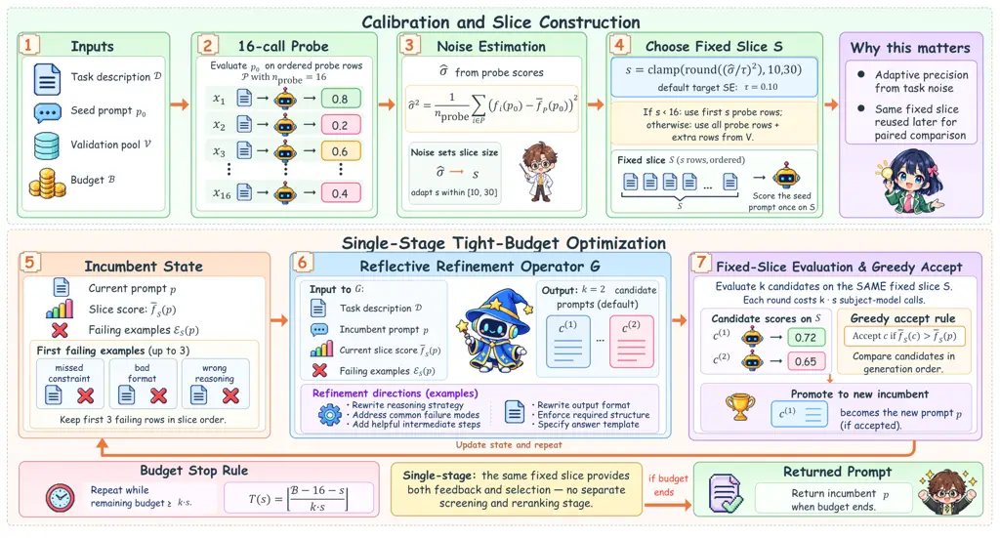
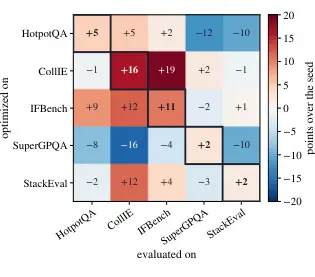

# How Should a Prompt Optimizer Spend a Tight Budget? BudgetAPO with Noise-Adaptive Evaluation

Haoyue Liu Affiliation: School of Science and Engineering, The Chinese
University of Hong Kong, Shenzhen Affiliation: Shenzhen Future Network
of Intelligence Institute (FNii-Shenzhen)    Zhichao Wang
Affiliation: School of Science and Engineering, The Chinese University
of Hong Kong, Shenzhen    Huanyu Yan Affiliation: School of Science and
Engineering, The Chinese University of Hong Kong, Shenzhen    Xiaoying
Tang Affiliation: School of Science and Engineering, The Chinese
University of Hong Kong, Shenzhen Affiliation: Shenzhen Future Network
of Intelligence Institute (FNii-Shenzhen) Affiliation: Guangdong
Provincial Key Laboratory of Future Networks of Intelligence,
CUHK(SZ)^(\*)Corresponding author.

###### Abstract

Automatic prompt optimization (APO) has been widely employed to adapt
large language models without updating their weights, yielding promising
results. However, existing methods such as GEPA and OPRO assume hundreds
to thousands of subject-model calls, far more than is practical behind
paid, rate-limited APIs. Under tight budgets they fail in two ways:
multi-stage pipelines can exhaust the budget and return the seed prompt
unchanged, while single-stage methods compare candidates on fixed-size
minibatches, regardless of each task’s noise. As a remedy, we introduce
BudgetAPO, a single-stage optimizer for the tight-budget regime.
BudgetAPO incorporates (1) a noise-adaptive rule that sizes the
evaluation slice to each task’s noise, measured by a short probe; (2) a
fixed slice that turns every accept/reject decision into a paired
comparison; and (3) a reflective operator that rewrites reasoning
strategy and output format jointly. Extensive results across seven
benchmarks and five subject models demonstrate that BudgetAPO ranks
first on every subject and beats every baseline under Holm-corrected
paired tests, while returning the seed in 13% of runs at 250 calls
against 86% for GEPA. On GPT-OSS-20B, GEPA needs 5 times as many calls
to match BudgetAPO’s 100-call score.

## 1 Introduction

The performance of large language models (LLMs) is notoriously sensitive
to the choice of prompt (Brown et al., 2020; Reynolds and McDonell,
2021; Wei et al., 2022; Sclar et al., 2024). To adapt a model to a task
without touching its weights, _automatic prompt optimization_ (APO) has
emerged as the standard technique: given a task, a seed prompt and a
validation set, an optimizer LLM searches for the prompt that maximizes
the subject model’s score (Zhou et al., 2022; Yang et al., 2024; Pryzant
et al., 2023; Opsahl-Ong et al., 2024; Agrawal et al., 2026), often
matching or beating hand-written prompts (Zhou et al., 2022; Yang
et al., 2024).

Figure 1: (a) Test score against budget, GPT-OSS-20B; bands: standard
error over seeds. (b) Seed-return rate at a 250-call cap, 105 runs per
method.

Despite its success, APO has an unavoidable drawback: existing methods
assume a generous evaluation budget. GEPA (Agrawal et al., 2026) uses a
multi-stage evaluation pipeline whose initial validation pass can
consume several hundred subject-model calls, and OPRO (Yang et al., 2024) and MIPROv2 (Opsahl-Ong et al., 2024) were evaluated with a
thousand or more. In practice, however, subject models sit behind paid
or rate-limited APIs, and every prompt is re-optimized whenever the
model is updated. Under such budgets the prevailing designs fail in two
distinct ways (Figure 1). First, seed return: a multi-stage pipeline can
exhaust the budget before it selects a better candidate and then returns
the prompt it was given; GEPA does so on 86% of its tight-budget runs.
Second, evaluation noise: single-stage methods score candidates on
minibatches of a fixed size, whatever the task’s noise; on SuperGPQA, a
10-row batch carries a standard error of about 15 points. Either way,
the budget is spent without a reliable improvement.



Figure 2: One BudgetAPO run. Calibration spends 16 calls to estimate
$`\hat{\sigma}`$, which fixes a slice of $`s`$ rows; each refinement
round spends $`k\,s`$ calls (Equation 5) and keeps a candidate only if
it beats the incumbent (Equation 7).

We therefore ask the following core question:

Can a tight-budget optimizer avoid seed return and size its evaluation
to the task’s noise?

Hence, we introduce BudgetAPO, a single-stage optimizer with no separate
validation pass, which addresses the aforementioned question through
three components (Figure 2): (1) *noise-adaptive slice sizing*, in which
a 16-call probe measures the task’s noise and a closed-form rule sizes
the evaluation slice from it, thereby matching each comparison’s
precision to the task; (2) a _fixed evaluation slice_ that scores every
candidate for the rest of the run, turning each accept/reject decision
into a paired comparison; and (3) *reflective refinement*, in which the
optimizer rewrites reasoning strategy and output format jointly from a
few failing rows. We summarize our contributions as follows:

- •
  Introducing BudgetAPO, the first APO method that automatically
  determines its evaluation size according to each task’s measured noise
  before search, eliminating the need for per-task tuning with one set
  of defaults across all tasks and subject models.
- •
  Conducting extensive experiments against five baselines on seven
  benchmarks and five subject models (8B–120B, three seeds; 630 runs),
  showing that BudgetAPO ranks first on every subject and significantly
  outperforms every baseline under Holm-corrected paired tests
  ($`p<0.05`$).
- •
  Demonstrating BudgetAPO’s efficiency under tight budgets (Figure 1):
  on GPT-OSS-20B, GEPA requires 5$`\times`$ as many calls to match
  BudgetAPO’s 100-call score, while at 250 calls it returns the seed in
  86% of runs compared with 13% for BudgetAPO.

## 2 Related Work

Prompting shifts model behaviour without parameter updates, through
few-shot examples (Brown et al., 2020) or elicited reasoning (Wei
et al., 2022; Kojima et al., 2022), but the best prompt varies across
models, tasks and inputs (Liu et al., 2023b): formatting alone moves
accuracy by several points (Sclar et al., 2024), and single-prompt
evaluation can reverse a model ranking (Mizrahi et al., 2024). A line of
work therefore automates the search. APE (Zhou et al., 2022) selects
among generated candidates; OPRO (Yang et al., 2024) shows the optimizer
scored prompts and asks for a better one; GrIPS (Prasad et al., 2023)
edits the string; ProTeGi (Pryzant et al., 2023) propagates textual
“gradients”; PromptBreeder (Fernando et al., 2023), EvoPrompt (Guo
et al., 2024) and EvoPrompting (Chen et al., 2023) evolve prompts;
PromptAgent (Wang et al., 2024) plans over an error tree.
MIPROv2 (Opsahl-Ong et al., 2024) extends DSPy (Khattab et al., 2023)
with Bayesian optimization over instruction and demonstration
configurations, and GEPA (Agrawal et al., 2026) screens a broad
candidate pool on small batches and reranks survivors on larger ones;
aPSF (Liu et al., 2026) factorizes a prompt into semantic components and
updates one at a time. However, all of them were evaluated with hundreds
to thousands of subject-model calls; our paper focuses on the regime
below that.

Cheap evaluation is a cross-cutting concern: successive halving (Li
et al., 2018), Bayesian search (Bergstra et al., 2011) and meta-learned
AutoML (Feurer et al., 2022) early-stop unpromising hyper-parameter
candidates, while Polo et al. (2024) estimate benchmark scores from
small subsets and Vivek et al. (2024) from a few anchor examples,
trading 10–100$`\times`$ less cost for estimation noise; Perlitz et al.
(2024) show how far a benchmark can be subsampled before its rankings
move. In APO the tradeoff is sharper, because subset noise interferes
with the optimization signal itself. CAPO (Zehle et al., 2025) races
candidates and TRIPLE (Shi et al., 2024) casts prompt selection as
fixed-budget best-arm identification, both allocating evaluations per
candidate during search. BudgetAPO instead calibrates one evaluation
size to each task’s noise before search with a closed-form rule, a
design that also suits stacked-instruction tasks (Anand and Chattaraj,
2026; Liu, 2026).

## 3 Method

A task supplies a validation pool $`V`$, a target evaluation
distribution $`\mathcal{R}`$ over rows, and a scorer returning
$`f_{i}(p)\in[0,1]`$ for prompt $`p`$ on row $`i`$. With stochastic
decoding, $`f_{i}(p)`$ scores one sampled reply. For a slice
$`S\subseteq V`$ of $`s`$ rows, write
$`\bar{f}_{S}(p)=\frac{1}{s}\sum_{i\in S}f_{i}(p)`$. One evaluation of a
prompt on a validation row counts as one subject-model call, and
$`N_{\text{calls}}(\mathcal{A})`$ denotes a run’s call count. Given a
task description $`D`$, a seed prompt $`p_{0}`$ and a budget $`B`$, a
run returns one prompt $`\hat{p}_{B}=\mathcal{A}(D,p_{0},V;B)`$; the
object of study is the optimizer:

```math
\max_{\mathcal{A}\,:\,N_{\text{calls}}(\mathcal{A})\,\leq\,B}\;\mathbb{E}\big[f_{I}(\hat{p}_{B})\big],\qquad I\sim\mathcal{R}, \tag{1}
```

The expectation averages over a fresh target row $`I`$, optimization
randomness, and decoding randomness; the run searches on $`V`$ and is
scored on the test pool, whose distribution may differ, as in IFBench.
In this section, we introduce BudgetAPO, an algorithm capable of sizing
its evaluation to each task’s noise within the budget of Equation 1.
This is achieved through three crucial components (Figure 2):
(1) noise-adaptive slice sizing and (2) a fixed evaluation slice (§3.1),
and (3) a reflective refinement operator (§3.2), with greedy acceptance
(§3.3); Algorithm 1 summarizes the process. Here _single-stage_ means
that one slice supplies both refinement feedback and selection, with no
separate screening and reranking stage.

Figure 3: (a) How a 250-call cap divides at each benchmark’s mean slice
size (Equation 5): a larger slice buys fewer rounds. (b) Probe standard
deviation $`\hat{\sigma}`$ against the chosen slice, one point per run;
the tasks of (a) in color.

### 3.1 Noise-Adaptive Slice Sizing

In this section, we present noise-adaptive slice sizing, which
eliminates the need for choosing a minibatch size per task.

#### Fixed minibatches and their limitations.

Single-stage methods score candidates on minibatches of a fixed size
$`m`$, whose standard error $`\sigma/\sqrt{m}`$ depends on the task’s
per-row standard deviation $`\sigma`$. Two limitations follow: 1. on a
noisy task comparisons are imprecise (10 SuperGPQA rows,
$`\sigma\approx 0.48`$, give a standard error near 0.15); 2. on a stable
task extra rows buy no precision but cost search depth (Equation 5).

#### Addressing the limitations by noise-adaptive sizing.

To address them, BudgetAPO measures the noise first and targets a
standard error $`\tau`$:

```math
\mathrm{SE}\big[\bar{f}_{S}(p)\big]=\frac{\sigma}{\sqrt{s}},\qquad\mathrm{SE}=\tau\;\Rightarrow\;s=\Big(\frac{\sigma}{\tau}\Big)^{2}, \tag{2}
```

To illustrate, we first score the seed prompt $`p_{0}`$ on an ordered
probe sample $`P\subset V`$ of $`n_{\text{probe}}=16`$ rows and read off
the per-row spread,

```math
\hat{\sigma}^{2}\;=\;\frac{1}{n_{\text{probe}}}\sum_{i\in P}\big(f_{i}(p_{0})-\bar{f}_{P}(p_{0})\big)^{2}, \tag{3}
```

Then the slice size is set as

```math
s=\mathrm{clamp}\!\left(\Big\lfloor\Big(\frac{\hat{\sigma}}{\tau}\Big)^{\!2}\Big\rceil,\;s_{\min},\;s_{\max}\right), \tag{4}
```

where $`\lfloor\cdot\rceil`$ rounds to the nearest integer (ties to
even), $`\mathrm{clamp}(x,a,b)=\min\{b,\max\{a,x\}\}`$, the default
target is $`\tau=0.10`$, and $`s_{\min}=10`$, $`s_{\max}=30`$. Finally,
the slice $`S`$ is drawn once and _fixed_: it takes the first $`s`$
probe rows when $`s\leq n_{\text{probe}}`$, or all of $`P`$ topped up
from $`V\setminus P`$ otherwise, and scores every candidate for the rest
of the run. In the archived logs (Figure 3b), StackEval’s
$`\hat{\sigma}`$ averages 0.23 ($`s=s_{\min}=10`$) and SuperGPQA’s 0.48
(about 23 rows); the lower clamp binds in 34% of 105 runs, and
$`s_{\max}`$ never does at the default $`\tau`$, since
$`\hat{\sigma}\leq 0.50`$. With $`k`$ candidates per step and the seed
re-scored on $`S`$ (§3.3), $`B\geq n_{\text{probe}}+s`$ permits

```math
T(s)\;=\;\left\lfloor\frac{B-n_{\text{probe}}-s}{k\cdot s}\right\rfloor. \tag{5}
```

At $`B=250`$ and $`k=2`$ this is 11 steps at $`s=10`$ and 4 at $`s=25`$:
every row added to the slice is bought with search depth (Figure 3a).
Scoring a candidate and the incumbent on the same rows reduces the
variance of their difference under positive same-row covariance
(Appendix A); reusing the slice is worth 1.4 points (§4.4), and on
held-out rows the prompt it selects beats its candidate-pool mean by a
median of 1.7 points (Appendix P).

#### Remark 3.1 (Discussion on the plug-in estimate).

The seed’s spread stands in for that of candidates not yet written;
Appendix A treats the accept/reject decision, which turns on the
variance of a _difference_.

### 3.2 Reflective Refinement Operator

#### Existing feedback and its limitations.

OPRO (Yang et al., 2024) shows the optimizer past prompts with their
scores, and ProTeGi (Pryzant et al., 2023) derives textual “gradients”
from errors. Under a tight budget two limitations matter: 1. a score or
an aggregate does not say on what a prompt fails; 2. a rewrite that
improves reasoning can break the output format.

#### Addressing the limitations by reflective refinement.

To address them, the operator shows raw failing rows and asks for
strategy and format together. At each step the optimizer LLM $`G`$
receives the task description $`D`$, the incumbent $`p`$ with its
recorded slice score, and an ordered list of _failing examples_
$`E_{S}(p)`$, and returns $`k`$ candidates in generation order (default
$`k=2`$):

```math
\displaystyle(c^{(1)},\dots,c^{(k)}) \displaystyle=G\big(D,\,p,\,\bar{f}_{S}(p),\,E_{S}(p)\big), \tag{6}
```

```math
\displaystyle E_{S}(p) \displaystyle=\big(\,i\in S:f_{i}(p)<1\,\big)_{[:3]},
```

where $`E_{S}(p)`$ lists the failing rows of $`S`$ in slice order and
$`[:3]`$ keeps the first three, each shown with the request, the
constraints it missed, and the start of the reply. $`G`$ rewrites both
strategy, how the subject model should reason about the task, and
format, what the output should look like in structure, delimiters and
length. The template is in Appendix X.

Raw rows beat aggregates: replacing one with a per-family failure
histogram costs 8.8 points across nine cells, and adding the histogram
costs 5.1 on IFBench (Appendix K).

### 3.3 Greedy Accept with Best Tracking

In this section, we present the acceptance rule, which uses every
rollout for both feedback and selection. At step $`t`$ the operator
proposes $`k`$ candidates $`c_{t}^{(1)},\dots,c_{t}^{(k)}`$, each scored
on the fixed slice and compared to the incumbent in generation order:

```math
p\leftarrow c_{t}^{(i)}\quad\text{if}\quad\bar{f}_{S}\big(c_{t}^{(i)}\big)>\bar{f}_{S}(p), \tag{7}
```

for $`i=1,\dots,k`$ in turn, so a later candidate is judged against an
earlier one if that one was taken. Writing $`B_{\text{used}}`$ for the
calls already spent, the run ends when $`B-B_{\text{used}}`$ no longer
covers a step of $`k\,s`$ calls, and returns the incumbent.

Following GEPA (Agrawal et al., 2026), the budget counts only
_subject-model calls_ (scoring candidates on validation rows);
optimizer-model calls and the final test-set evaluation are free for all
methods (Appendix C).

## 4 Experiments

(a) By subject model.  
Subject model BudgetAPO GEPA OPRO MIPROv2 GrIPS aPSF $`\Delta`$
Gemma-4-31B 71.57$`\pm`$0.50 67.11 67.58 66.62 66.97 68.85 +2.72
GPT-OSS-20B 65.24$`\pm`$0.91 60.10 63.22 63.80 59.43 62.41 +1.44
Qwen-3.5-27B 67.40$`\pm`$2.13 66.11 65.78 66.16 65.56 64.18 +1.24
Nemotron-3-Super-120B 61.43$`\pm`$0.22 58.51 60.43 58.80 58.93 59.61
+1.00 Ministral-8B 51.98$`\pm`$1.63 47.83 50.72 49.76 47.99 50.72 +1.26
Mean of 5 63.52$`\pm`$0.96 59.93 61.54 61.03 59.78 61.15 +1.98

(b) By benchmark, averaged over the five subjects.  
Method Hotpot CollIE IFBench SuperGPQA Stack MBPP+ LB-IF Mean _No opt._
61.50 52.80 44.80 42.60 71.37 76.53 63.26 58.98 Published baselines GEPA
64.60$`\pm`$12.91 54.02$`\pm`$14.15 46.12$`\pm`$9.05 42.37$`\pm`$12.79
71.29$`\pm`$6.65 77.41$`\pm`$4.47 63.72$`\pm`$6.22 59.93 OPRO
67.55$`\pm`$11.29 57.30$`\pm`$15.61 50.58$`\pm`$11.16 44.13$`\pm`$10.38
71.85$`\pm`$6.11 75.42$`\pm`$4.16 63.97$`\pm`$5.46 61.54 MIPROv2
69.79$`\pm`$12.83 57.60$`\pm`$15.27 50.75$`\pm`$12.05 42.43$`\pm`$12.75
69.17$`\pm`$7.36 74.47$`\pm`$4.02 63.00$`\pm`$7.66 61.03 GrIPS
66.15$`\pm`$11.52 52.92$`\pm`$13.63 47.15$`\pm`$9.34 42.07$`\pm`$12.63
70.92$`\pm`$6.69 76.10$`\pm`$4.86 63.13$`\pm`$6.23 59.78 aPSF
69.25$`\pm`$8.54 58.10$`\pm`$15.85 52.85$`\pm`$11.04 44.18$`\pm`$10.73
69.55$`\pm`$6.62 70.64$`\pm`$7.76 63.49$`\pm`$5.97 61.15 BudgetAPO
73.29$`\pm`$8.85 59.50$`\pm`$17.40 52.00$`\pm`$11.01 45.33$`\pm`$11.54
73.00$`\pm`$5.02 77.30$`\pm`$4.14 64.23$`\pm`$6.11 63.52 _Baseline
spread_ 5.19 5.18 6.73 2.11 2.68 6.77 0.97 1.76

Table 1: Main result (test score in %, budget 250, seeds 0/1/2). Bold
best, underline second; $`\pm`$: standard deviation over the three
seed-level means, in (b) over the 15 subject–seed scores. $`\Delta`$:
gap to the row’s strongest baseline. _No opt._: the seed prompt at seed 0. _Baseline spread_: best minus worst baseline. Per cell: Table 6.

In this section, we carry out experiments to address the following
questions:

- •
  Q1: Can BudgetAPO beat existing APO methods at 250 calls on every
  subject model? See §4.2.
- •
  Q2: Is BudgetAPO more call-efficient than existing methods when the
  budget is tight? See §4.3.
- •
  Q3: Which components drive the gains, and is BudgetAPO robust to its
  hyper-parameters? See §4.4.
- •
  Q4: Does the advantage hold under a different optimizer LLM? See §4.5.

Additional results, including (1) per-cell tables, (2) the full budget
curve and (3) case studies, are in Appendices E–R.

### 4.1 Setup

To answer these questions, we evaluate six APO methods with five subject
models on seven benchmarks, as detailed below.

#### Subject models.

The main comparison uses five subject models spanning 8B–120B parameters
and five families: Gemma-4-31B, Qwen-3.5-27B, GPT-OSS-20B,
Nemotron-3-Super-120B and Ministral-8B (endpoints in Appendix C).
Gemma-4-31B (Team et al., 2026) is our _primary_ subject, on which the
ablations, hyper-parameter sweeps and optimizer swap run; the rewrite
and seed-return counts pool all five subjects. Within each subject, all
methods share the decoding configuration and the same five-word seed,
“You are a helpful assistant.” Temperature is 0.6 and top-$`p`$ is 0.95.
The default optimizer is GLM-5-FP8 (Zeng et al., 2026); §4.5 swaps in an
alternative.

#### Benchmarks.

Seven tasks span multi-hop QA, instruction following, graduate-level
knowledge and code: HotpotQA (Yang et al., 2018), CollIE (Yao et al.,
2024), IFBench (Pyatkin et al., 2025), SuperGPQA (Du et al., 2026), a
generated instruction-stacking task (labeled StackEval in our tables),
MBPP+ (Liu et al., 2023a) and LiveBenchIF (White et al., 2025). We
report each task’s normalized score on a percentage scale and average
tasks with equal weight.

#### Baselines.

We compare against five APO methods using their official
implementations: GEPA (Agrawal et al., 2026), MIPROv2 (Opsahl-Ong
et al., 2024), OPRO (Yang et al., 2024), GrIPS (Prasad et al., 2023),
and aPSF (Liu et al., 2026).

#### Evaluation protocol.

We instantiate the tight-budget regime with a cap of $`B=250`$
subject-model calls per run; every method receives the same cap. The
returned prompt is scored on a held-out test pool shared by all methods,
outside the budget. Each (subject, method, benchmark) triple is reported
over seeds 0, 1 and 2 as mean test score $`\pm`$ sample standard
deviation; runs failing a coverage or budget guard were re-run
(Appendix C). Significance is assessed by two-sided paired Wilcoxon
signed-rank tests with Holm correction (Holm, 1979; Wilcoxon, 1945) over
the $`n=35`$ (subject, benchmark) pairs, seeds averaged within a cell so
each pair contributes one observation. Effect sizes are Cohen’s
$`d_{z}`$ (Cohen, 2013): the mean paired difference divided by its
sample standard deviation.

### 4.2 A1: BudgetAPO Leads on Every Subject

In this section, we compare all six methods on the five subject models
at budget 250 (Table 1; per cell in Table 6). We can observe that
1. BudgetAPO ranks first on all five, by $`+1.00`$ points on
Nemotron-3-Super-120B up to $`+2.72`$ on Gemma-4-31B, and reaches 63.52%
on the five-subject mean against 61.54% for the best baseline (OPRO), a
gap of $`+1.98`$ points; 2. the runner-up changes from subject to
subject (aPSF, MIPROv2, OPRO) and each also finishes fourth or worse
elsewhere, so no baseline is a safe pick before the deployment subject
is known; 3. across the 35 (subject, benchmark) cells, BudgetAPO ranks
first in 14, including two shared first places, and is in the top two in
23, against 12 for the next best method (Figure 4f).

Figure 4: Analysis at a 250-call cap, except (a). (a) Seed returns
against budget, primary subject. (b) Rewrite rate against the share of
rewrites more than one point below the seed. (c) Candidate scores and
running best in one HotpotQA and one StackEval run. (d) Gain as a share
of the headroom to 100. (e) Reply length and share truncated at the
token cap. (f) Place over the 35 cells, darkest = first. (g) Gain over
the seed per run; whiskers: 10th–90th percentiles. (h) Share of the
final slice gain reached against budget spent (91 runs); band: standard
error. (b), (d), (e), (g) pool 105 runs per method.

#### The lead is significant against every baseline.

Table 7 tests BudgetAPO against each baseline separately over the 35
(subject, benchmark) cells: it wins 23–29 of them and clears the
Holm-corrected threshold against all five, with effect sizes
$`d_{z}=0.47`$–$`0.82`$. Enlarging four of the primary subject’s test
sets to 731–1 000 rows preserves BudgetAPO’s position on those tasks
(Appendix Q). On the primary subject, BudgetAPO’s seed-to-seed standard
deviation is 0.50 points, level with GrIPS (0.48) and MIPROv2 (0.50) and
below OPRO (0.91), GEPA (1.38) and aPSF (1.86); on the five-subject mean
it is 0.96 (Appendix N).

On the primary subject (first block of Table 6) BudgetAPO is first on
five of seven benchmarks, with the largest gain on HotpotQA ($`+11.6`$
over the next best), and lifts the seed prompt’s 65.6% to 71.6% on the
mean. On HotpotQA the gap over GEPA is 20.0 points (74.3 vs. 54.3): GEPA
returns the unchanged seed on all three seeds and BudgetAPO on none. All
three of its HotpotQA runs use $`s=10`$, allowing 11 refinement steps by
Equation 5. Averaging over subjects rather than benchmarks gives the
complementary view in Table 1(b): first on five of seven and second on
the other two. On the mean, BudgetAPO’s lead over the best baseline
($`+1.98`$) is larger than the _Baseline spread_, the gap between the
best and worst baselines (1.76; Appendix D).

#### BudgetAPO gains the most per run.

Figure 4b pairs rewrite frequency (a rewrite is a returned prompt that
differs from the seed) with the share of rewrites more than one point
below the seed; the gain of a run is its test score minus the seed
prompt’s score in the same cell, the _No optimization_ entry of Table 6
(on HotpotQA, from the seed-0 pool). BudgetAPO rewrites in 91 of 105
runs (87%), 13% of them more than a point below the seed; MIPROv2 and
aPSF rewrite in all 105 (27% and 30%), GrIPS in 88 (22%), OPRO in 80
(15%), and GEPA in 15 (7%, with a mean gain of $`+0.95`$ points over all
runs). Across all 105 runs, BudgetAPO’s mean gain is $`+4.54`$ points,
against $`+2.56`$ for the best baseline; its median is $`+2.5`$ points
against at most $`+1.1`$ (Figure 4g). Dividing the summed gains by the
summed headroom from the seed’s score to 100 gives 11.1% for BudgetAPO
against 1.9–6.3% for the baselines (Figure 4d).



Figure 5: Prompt transfer on five of the seven tasks. Change against the
seed prompt when the prompt optimized on the row’s task is scored on the
column’s test pool (GPT-OSS-20B, budget 250). Boxed: the source task.

Figure 6: Hyper-parameter sensitivity, primary subject: change in the
seven-benchmark mean against the default ($`\star`$), paired by seed;
bars: seed standard deviation. Per-benchmark results are in Appendix L.

#### The prompts are task-specific and draw short replies.

BudgetAPO’s returned prompts have a median length of 204 words, compared
with 39 for MIPROv2 and 5 for GEPA. On the five tasks of Figure 5, a
prompt gains $`+7.1`$ points over the seed on its source task and
$`-0.3`$ on the others, and the instruction-following tasks CollIE and
IFBench share gains of $`+19`$ and $`+12`$: on average, the gain stays
with the task a prompt was written for. Over the 105 main runs,
BudgetAPO’s prompts draw the shortest replies of any method, 146 words
against 156–190, and the fewest truncated at the token cap, 2.7% against
3.1–3.6% (Figure 4e).

### 4.3 A2: The Gain Is Largest Where the Budget Is Tightest

In this section, we vary the budget from 100 to 400 calls in steps of 50
on GPT-OSS-20B for all six methods (three seeds, seven benchmarks, 882
runs; Figure 1a). We can observe that 1. BudgetAPO is first at every
sampled budget from 150 to 400, by 0.5–3.5 points over the strongest
baseline: it scores 64.9% at 100, peaks at 67.0% at 150, and ranges from
65.2 to 66.4% through 400; 2. GEPA scores 59.2–60.1% from 100 to 300,
trailing by 5.1–7.7 points, and rises to 64.3% at 350, once the cap fits
its initial 300-row validation pass on five of the seven tasks; 3. even
so, GEPA needs 500 calls, 5 times as many, to match BudgetAPO’s 100-call
score (65.1 against 64.9), MIPROv2 ties it only at 500, and OPRO and
GrIPS stay below it through 500; 4. BudgetAPO’s 150-call score of 67.0%
is the highest any method reaches at any budget, and averaged over the
seven budgets BudgetAPO scores 65.9% against 64.3% for the strongest
baseline, aPSF, and 61.0% for GEPA.

| Benchmark   | Full | $`-`$Adapt. | $`-`$Fixed | $`-`$Strat. | $`-`$Fail. |
| ----------- | ---- | ----------- | ---------- | ----------- | ---------- |
| HotpotQA    | 74.3 | 66.1        | 65.9       | 68.8        | 73.2       |
| CollIE      | 74.2 | 70.8        | 72.7       | 69.8        | 70.0       |
| IFBench     | 62.7 | 62.7        | 65.2       | 61.2        | 63.6       |
| SuperGPQA   | 60.5 | 61.2        | 61.5       | 62.5        | 62.5       |
| StackEval   | 78.7 | 78.7        | 78.6       | 77.7        | 77.5       |
| MBPP+       | 81.3 | 81.1        | 79.3       | 81.1        | 80.2       |
| LiveBenchIF | 69.2 | 68.3        | 68.5       | 68.7        | 67.6       |
| Mean        | 71.6 | 69.8        | 70.2       | 70.0        | 70.7       |

Table 2: Ablations, primary subject (%, budget 250); each column removes
one component against the shaded Full entry. $`-`$Adapt.: fixed
$`s{=}20`$, probe still spent. $`-`$Fixed: slice redrawn every step,
incumbent re-scored on it. $`-`$Strat.: plain “raise the score” request,
no failing rows. $`-`$Fail.: strategy and format kept, no failing rows.

|             | Opt.: GLM-5-FP8 |      |      | Opt.: Qwen-3.5-27B |      |      |
| ----------- | --------------- | ---- | ---- | ------------------ | ---- | ---- |
| Benchmark   | Ours            | GEPA | OPRO | Ours               | GEPA | OPRO |
| HotpotQA    | 68.9            | 50.2 | 49.7 | 69.8               | 50.9 | 48.6 |
| CollIE      | 76.5            | 68.3 | 71.5 | 70.5               | 69.5 | 74.0 |
| IFBench     | 64.5            | 57.5 | 64.0 | 65.0               | 59.5 | 63.3 |
| SuperGPQA   | 63.0            | 61.5 | 61.5 | 62.5               | 61.0 | 65.0 |
| StackEval   | 78.3            | 78.0 | 77.5 | 78.4               | 77.6 | 75.8 |
| MBPP+       | 79.3            | 80.0 | 77.3 | 80.7               | 80.0 | 80.0 |
| LiveBenchIF | 67.7            | 66.5 | 67.2 | 67.4               | 67.4 | 67.8 |
| Mean        | 71.2            | 66.0 | 67.0 | 70.6               | 66.6 | 67.8 |

Table 3: Optimizer swap, primary subject (%, seed 0, budget 250); Ours
is BudgetAPO.

Pooling the 91 main runs whose final prompt beats the seed on the slice,
completed rounds reach 75% of that slice gain by half the budget on
average (Figure 4h). On the primary subject, with budgets up to 1 000,
BudgetAPO leads at 100 calls (68.4 against 66.6) and is flat at
71.2–71.6% from 250 on, while GEPA needs 1 000 calls, four times as
many, to match BudgetAPO’s 250-call score (71.9 against 71.6).

#### GEPA returns the seed when the budget is tight.

At budget 250 on the primary subject, 71% of GEPA runs (15 of 21) return
the unchanged five-word seed, having spent the whole budget without
selecting a better candidate, against 5% for BudgetAPO (1 of 21) and 33%
for OPRO (7 of 21; Figure 4a). Figure 4(c) and Appendix O trace one run
candidate by candidate. At budget 1 000, GEPA’s seed-return rate drops
to 5% and its score rises 4.8 points over budget 250, reflecting its
sensitivity to available budget. A seed return is a returned prompt
identical to the seed up to surrounding whitespace, a diagnostic that
needs no re-scoring: GEPA returns the seed on 86% of its 105 runs
against 13% for BudgetAPO, OPRO on 24% and GrIPS on 16%; GEPA’s rate
ranges from 71% on Gemma-4-31B to 95% on Ministral-8B, while BudgetAPO’s
never exceeds 24% on any subject (Figure 1b). MIPROv2 and aPSF always
rewrite, so they never return the seed; the per-subject breakdown is in
Table 9, Appendix H.

### 4.4 A3: All Four Components Contribute

In this section, we ablate components and hyper-parameters on the
primary subject. From Table 2 we can observe that 1. removing adaptive
slice sizing costs 1.8 points, the reflective operator as a whole 1.6,
and the fixed slice 1.4, taking the mean from 71.6% to 69.8–70.2%;
2. removing concrete failure examples costs 0.9 points on the
seven-benchmark mean (0.87 on the other six, 1.1 on HotpotQA);
3. adaptive sizing and fixed slicing pay off most on noisy tasks, worth
8.2 and 8.4 points on HotpotQA, and add 3.4 and 1.5 on CollIE; 4. the
reflective operator adds 5.5 points on HotpotQA, 4.4 on CollIE, whose
constraints demand explicit format, and 1.0 on StackEval: every
component is worth over four points on some task.

#### Performance is stable across hyper-parameters.

As seen in Figure 6 (per-benchmark values in Table 11), test score peaks
at the default $`\tau=0.10`$ (71.6%, against 69.2–70.3% for 0.05, 0.15
and 0.20), which keeps the slice rule adaptive most often (32 of 61
runs; Appendix M); smaller or larger targets turn it into a fixed slice,
as $`\tau=0.05`$ pins 15 of 21 runs to the upper clamp and
$`\tau\geq 0.15`$ pins 38 of 42 to the lower one. For candidates per
step, $`k=2`$ (71.6%) edges out 1 (71.1%) and 3 (70.3%). We also vary
the probe size ($`n_{\text{probe}}`$ from 4 to 48) and lower clamp
($`s_{\min}`$ from 5 to 20), as shown in Figure 6(c, d). All main-table
runs use the same default settings across the seven tasks and five
subjects, without per-task tuning.

### 4.5 A4: An Optimizer Swap Keeps the Gain

In this section, we swap the default GLM-5-FP8 optimizer for
Qwen-3.5-27B (Yang et al., 2025) at seed 0 (Table 3). We can observe
that 1. BudgetAPO keeps first place under both optimizers (71.2 and
70.6) and is first on more benchmarks than either baseline, so the
aggregate ranking of all three methods is preserved; 2. with the swapped
optimizer, BudgetAPO (70.6) still beats both baselines run with the
default one (66.0, 67.0). Across the seven benchmarks, BudgetAPO leads
on six with GLM-5-FP8 and four with Qwen-3.5-27B; despite differences in
task outcomes, its overall advantage over both GEPA and OPRO remains
consistent across the two optimizer settings.

## 5 Conclusion

We introduce BudgetAPO, a single-stage optimizer that adapts a fixed
evaluation slice to task noise. Under tight budgets, it leads on all
five subject models, significantly outperforming every baseline, with a
13% seed-return rate versus GEPA’s 86%. On GPT-OSS-20B, GEPA needs
5$`\times`$ as many calls to match BudgetAPO’s 100-call score, while
BudgetAPO uses the same defaults across tasks and subject models.

## Limitations

Our approach has two main limitations. First, BudgetAPO depends on the
capability of the optimizer LLM that reads the failing rows and writes
each candidate; the quality of its rewrites bounds what the slice can
select, and a less capable optimizer may yield smaller gains (§4.5).
Second, our experiments currently cover text benchmarks only; extending
the evaluation to multimodal benchmarks is left for future work.

## Ethical Considerations

BudgetAPO is a general prompt-optimization method and, like other APO
methods, could be used to optimize prompts for harmful or
policy-violating objectives, depending on the subject model and usage
context. Our study uses public benchmarks and one generated
instruction-stacking task, and does not collect new user data or involve
human subjects. In practice, responsible use should follow applicable
platform policies and safety filters, and any released code or prompts
should include usage guidelines that discourage harmful applications.

## References

- Agrawal et al. (2026) Lakshya A Agrawal, Shangyin Tan, Dilara Soylu,
  Noah Ziems, Rishi Khare, Krista Opsahl-Ong, Arnav Singhvi, Herumb
  Shandilya, Michael J Ryan, Meng Jiang, and 1 others. 2026. Gepa:
  Reflective prompt evolution can outperform reinforcement learning. In
  _International Conference on Learning Representations_, volume 2026,
  pages 8479–8565.
- Anand and Chattaraj (2026) Atul Anand and Sourav Chattaraj. 2026.
  [Instruction stacking collapse: A benchmark and the
  capability-dependent value of prompt
  compilation](https://arxiv.org/abs/2608.02639). _Preprint_,
  arXiv:2608.02639.
- Bergstra et al. (2011) James Bergstra, Rémi Bardenet, Yoshua Bengio,
  and Balázs Kégl. 2011. Algorithms for hyper-parameter optimization.
  _Advances in neural information processing systems_, 24.
- Brown et al. (2020) Tom Brown, Benjamin Mann, Nick Ryder, Melanie
  Subbiah, Jared D Kaplan, Prafulla Dhariwal, Arvind Neelakantan, Pranav
  Shyam, Girish Sastry, Amanda Askell, and 1 others. 2020. Language
  models are few-shot learners. _Advances in neural information
  processing systems_, 33:1877–1901.
- Chen et al. (2023) Angelica Chen, David Dohan, and David So. 2023.
  Evoprompting: Language models for code-level neural architecture
  search. _Advances in neural information processing systems_,
  36:7787–7817.
- Cohen (2013) Jacob Cohen. 2013. _Statistical power analysis for the
  behavioral sciences_. routledge.
- Du et al. (2026) Xeron Du, Yifan Yao, Kaijing Ma, Bingli Wang, Tianyu
  Zheng, Minghao Liu, Yiming Liang, Xiaolong Jin, Zhenlin Wei, Chujie
  Zheng, and 1 others. 2026. Supergpqa: Scaling llm evaluation across
  285 graduate disciplines. _Advances in Neural Information Processing
  Systems_, 38.
- Dwork et al. (2015) Cynthia Dwork, Vitaly Feldman, Moritz Hardt, Toni
  Pitassi, Omer Reingold, and Aaron Roth. 2015. Generalization in
  adaptive data analysis and holdout reuse. _Advances in neural
  information processing systems_, 28.
- Fernando et al. (2023) Chrisantha Fernando, Dylan Banarse, Henryk
  Michalewski, Simon Osindero, and Tim Rocktäschel. 2023. Promptbreeder:
  Self-referential self-improvement via prompt evolution. _arXiv
  preprint arXiv:2309.16797_.
- Feurer et al. (2022) Matthias Feurer, Katharina Eggensperger, Stefan
  Falkner, Marius Lindauer, and Frank Hutter. 2022. Auto-sklearn 2.0:
  Hands-free automl via meta-learning. _Journal of Machine Learning
  Research_, 23(261):1–61.
- Guo et al. (2024) Qingyan Guo, Rui Wang, Junliang Guo, Bei Li, Kaitao
  Song, Xu Tan, Guoqing Liu, Jiang Bian, and Yujiu Yang. 2024.
  Connecting large language models with evolutionary algorithms yields
  powerful prompt optimizers. In _International Conference on Learning
  Representations_, volume 2024, pages 34133–34156.
- Holm (1979) Sture Holm. 1979. A simple sequentially rejective multiple
  test procedure. _Scandinavian journal of statistics_, pages 65–70.
- Khattab et al. (2023) Omar Khattab, Arnav Singhvi, Paridhi Maheshwari,
  Zhiyuan Zhang, Keshav Santhanam, Sri Vardhamanan, Saiful Haq, Ashutosh
  Sharma, Thomas T Joshi, Hanna Moazam, and 1 others. 2023. Dspy:
  Compiling declarative language model calls into self-improving
  pipelines. _arXiv preprint arXiv:2310.03714_.
- Kojima et al. (2022) Takeshi Kojima, Shixiang Shane Gu, Machel Reid,
  Yutaka Matsuo, and Yusuke Iwasawa. 2022. Large language models are
  zero-shot reasoners. _Advances in neural information processing
  systems_, 35:22199–22213.
- Li et al. (2018) Lisha Li, Kevin Jamieson, Giulia DeSalvo, Afshin
  Rostamizadeh, and Ameet Talwalkar. 2018. Hyperband: A novel
  bandit-based approach to hyperparameter optimization. _Journal of
  machine learning research_, 18(185):1–52.
- Liu et al. (2026) Haoyue Liu, Zhichao Wang, Yongxin Guo, Haoran Shou,
  and Xiaoying Tang. 2026. Adaptive prompt structure factorization: A
  framework for self-discovering and optimizing compositional prompt
  programs. In _Proceedings of the 64th Annual Meeting of the
  Association for Computational Linguistics (Volume 1: Long Papers)_,
  pages 11690–11714.
- Liu et al. (2023a) Jiawei Liu, Chunqiu Steven Xia, Yuyao Wang, and
  Lingming Zhang. 2023a. Is your code generated by chatgpt really
  correct? rigorous evaluation of large language models for code
  generation. _Advances in neural information processing systems_,
  36:21558–21572.
- Liu (2026) Ming Liu. 2026. [More is not always better: Cross-component
  interference in llm agent
  scaffolding](https://arxiv.org/abs/2605.05716). _Preprint_,
  arXiv:2605.05716.
- Liu et al. (2023b) Pengfei Liu, Weizhe Yuan, Jinlan Fu, Zhengbao
  Jiang, Hiroaki Hayashi, and Graham Neubig. 2023b. Pre-train, prompt,
  and predict: A systematic survey of prompting methods in natural
  language processing. _ACM computing surveys_, 55(9):1–35.
- Maurer and Pontil (2009) Andreas Maurer and Massimiliano Pontil. 2009.
  Empirical bernstein bounds and sample variance penalization. _arXiv
  preprint arXiv:0907.3740_.
- Mizrahi et al. (2024) Moran Mizrahi, Guy Kaplan, Dan Malkin, Rotem
  Dror, Dafna Shahaf, and Gabriel Stanovsky. 2024. State of what art? a
  call for multi-prompt llm evaluation. _Transactions of the Association
  for Computational Linguistics_, 12:933–949.
- Opsahl-Ong et al. (2024) Krista Opsahl-Ong, Michael J Ryan, Josh
  Purtell, David Broman, Christopher Potts, Matei Zaharia, and Omar
  Khattab. 2024. Optimizing instructions and demonstrations for
  multi-stage language model programs. In _Proceedings of the 2024
  Conference on Empirical Methods in Natural Language Processing_, pages
  9340–9366.
- Perlitz et al. (2024) Yotam Perlitz, Elron Bandel, Ariel Gera, Ofir
  Arviv, Liat Ein Dor, Eyal Shnarch, Noam Slonim, Michal
  Shmueli-Scheuer, and Leshem Choshen. 2024. Efficient benchmarking (of
  language models). In _Proceedings of the 2024 Conference of the North
  American Chapter of the Association for Computational Linguistics:
  Human Language Technologies (Volume 1: Long Papers)_, pages 2519–2536.
- Polo et al. (2024) Felipe Maia Polo, Lucas Weber, Leshem Choshen,
  Yuekai Sun, Gongjun Xu, and Mikhail Yurochkin. 2024. tinybenchmarks:
  evaluating llms with fewer examples. _arXiv preprint
  arXiv:2402.14992_.
- Prasad et al. (2023) Archiki Prasad, Peter Hase, Xiang Zhou, and Mohit
  Bansal. 2023. Grips: Gradient-free, edit-based instruction search for
  prompting large language models. In _Proceedings of the 17th
  Conference of the European Chapter of the Association for
  Computational Linguistics_, pages 3845–3864.
- Pryzant et al. (2023) Reid Pryzant, Dan Iter, Jerry Li, Yin Lee,
  Chenguang Zhu, and Michael Zeng. 2023. Automatic prompt optimization
  with “gradient descent” and beam search. In _Proceedings of the 2023
  conference on empirical methods in natural language processing_, pages
  7957–7968.
- Pyatkin et al. (2025) Valentina Pyatkin, Saumya Malik, Victoria Graf,
  Hamish Ivison, Shengyi Huang, Pradeep Dasigi, Nathan Lambert, and
  Hannaneh Hajishirzi. 2025. [Generalizing verifiable instruction
  following](https://arxiv.org/abs/2507.02833). _Preprint_,
  arXiv:2507.02833.
- Reynolds and McDonell (2021) Laria Reynolds and Kyle McDonell. 2021.
  Prompt programming for large language models: Beyond the few-shot
  paradigm. In _Extended abstracts of the 2021 CHI conference on human
  factors in computing systems_, pages 1–7.
- Sclar et al. (2024) Melanie Sclar, Yejin Choi, Yulia Tsvetkov, and
  Alane Suhr. 2024. Quantifying language models’ sensitivity to spurious
  features in prompt design or: How i learned to start worrying about
  prompt formatting. In _International Conference on Learning
  Representations_, volume 2024, pages 25055–25083.
- Shi et al. (2024) Chengshuai Shi, Kun Yang, Zihan Chen, Jundong Li,
  Jing Yang, and Cong Shen. 2024. Efficient prompt optimization through
  the lens of best arm identification. _Advances in Neural Information
  Processing Systems_, 37:99646–99685.
- Team et al. (2026) Gemma Team, Sherif El Abd, Vaibhav Aggarwal, Robin
  Algayres, Alek Andreev, Olivier Bachem, Ian Ballantyne, Cormac Brick,
  Victor Cărbune, Michelle Casbon, and 1 others. 2026. Gemma 4 technical
  report. _arXiv preprint arXiv:2607.02770_.
- Vivek et al. (2024) Rajan Vivek, Kawin Ethayarajh, Diyi Yang, and
  Douwe Kiela. 2024. Anchor points: Benchmarking models with much fewer
  examples. In _Proceedings of the 18th Conference of the European
  Chapter of the Association for Computational Linguistics (Volume 1:
  Long Papers)_, pages 1576–1601.
- Wang et al. (2024) Xinyuan Wang, Chenxi Li, Zhen Wang, Fan Bai,
  Haotian Luo, Jiayou Zhang, Nebojsa Jojic, Eric Xing, and Zhiting
  Hu. 2024. Promptagent: Strategic planning with language models enables
  expert-level prompt optimization. In _International Conference on
  Learning Representations_, volume 2024, pages 23967–24001.
- Wei et al. (2022) Jason Wei, Xuezhi Wang, Dale Schuurmans, Maarten
  Bosma, Fei Xia, Ed Chi, Quoc V Le, Denny Zhou, and 1 others. 2022.
  Chain-of-thought prompting elicits reasoning in large language models.
  _Advances in neural information processing systems_, 35:24824–24837.
- White et al. (2025) Colin White, Samuel Dooley, Manley Roberts, Arka
  Pal, Benjamin Feuer, Siddhartha Jain, Ravid Shwartz-Ziv, Neel Jain,
  Khalid Saifullah, Sreemanti Dey, and 1 others. 2025. Livebench: A
  challenging, contamination-limited llm benchmark. In _International
  Conference on Learning Representations_, volume 2025, pages
  91595–91631.
- Wilcoxon (1945) Frank Wilcoxon. 1945. Individual comparisons by
  ranking methods. _Biometrics bulletin_, 1(6):80–83.
- Yang et al. (2025) An Yang, Anfeng Li, Baosong Yang, Beichen Zhang,
  Binyuan Hui, Bo Zheng, Bowen Yu, Chang Gao, Chengen Huang, Chenxu Lv,
  and 1 others. 2025. Qwen3 technical report. _arXiv preprint
  arXiv:2505.09388_.
- Yang et al. (2024) Chengrun Yang, Xuezhi Wang, Yifeng Lu, Hanxiao Liu,
  Quoc V Le, Denny Zhou, and Xinyun Chen. 2024. Large language models as
  optimizers. In _International Conference on Learning Representations_,
  volume 2024, pages 12028–12068.
- Yang et al. (2018) Zhilin Yang, Peng Qi, Saizheng Zhang, Yoshua
  Bengio, William Cohen, Ruslan Salakhutdinov, and Christopher D
  Manning. 2018. Hotpotqa: A dataset for diverse, explainable multi-hop
  question answering. In _Proceedings of the 2018 conference on
  empirical methods in natural language processing_, pages 2369–2380.
- Yao et al. (2024) Shunyu Yao, Howard Chen, Austin Hanjie, Runzhe Yang,
  and Karthik Narasimhan. 2024. Collie: Systematic construction of
  constrained text generation tasks. In _International Conference on
  Learning Representations_, volume 2024, pages 38595–38606.
- Zehle et al. (2025) Tom Zehle, Moritz Schlager, Timo Heiß, and
  Matthias Feurer. 2025. Capo: Cost-aware prompt optimization. _arXiv
  preprint arXiv:2504.16005_.
- Zeng et al. (2026) Aohan Zeng, Xin Lv, Zhenyu Hou, Zhengxiao Du,
  Qinkai Zheng, Bin Chen, Da Yin, Chendi Ge, Chenghua Huang, Chengxing
  Xie, and 1 others. 2026. Glm-5: from vibe coding to agentic
  engineering. _arXiv preprint arXiv:2602.15763_.
- Zhou et al. (2022) Yongchao Zhou, Andrei Ioan Muresanu, Ziwen Han,
  Keiran Paster, Silviu Pitis, Harris Chan, and Jimmy Ba. 2022. Large
  language models are human-level prompt engineers. _arXiv preprint
  arXiv:2211.01910_.

## Appendix A Fixed-Pair Reliability and the Search Budget

This appendix gives a mechanism-level analysis of the evaluation design.
The statistical result concerns a fixed candidate pair on an independent
sample, and the budget identity concerns Algorithm 1; for the adaptive
search as a whole, we evaluate on held-out test pools never seen during
search (§4.2, Appendix P).

### A.1 Comparison Model

Fix an incumbent $`p`$, a candidate $`c`$, and a positive integer $`s`$
before observing the evaluation sample. Let $`(X_{j},Y_{j})_{j=1}^{s}`$
be i.i.d. score pairs, where $`X_{j}=f_{I_{j}}(c)`$ and
$`Y_{j}=f_{I_{j}}(p)`$ evaluate the two prompts on the same random row
$`I_{j}`$. Scores lie in $`[0,1]`$. The probability law includes row
sampling and, if the subject model is stochastic, its decoding
randomness. Within a row the two scores need not be independent; across
rows the pairs are independent and identically distributed. This
idealized comparison isolates the effect of pairing; the implemented
slice is discussed under _Relation to the Implemented Rule_ below.

Write

```math
\displaystyle Z_{j} \displaystyle=X_{j}-Y_{j}, \displaystyle\Delta \displaystyle=\mathbb{E}[Z_{j}], \tag{8}
```

```math
\displaystyle\widehat{\Delta}_{s} \displaystyle=\frac{1}{s}\sum_{j=1}^{s}Z_{j}, \displaystyle v \displaystyle=\mathrm{Var}(Z_{j}). \tag{9}
```

Here $`\Delta`$ is the difference of population mean scores under this
evaluation law, not an observed slice or test-set difference. With
$`\sigma_{c}^{2}=\mathrm{Var}(X_{j})`$,
$`\sigma_{p}^{2}=\mathrm{Var}(Y_{j})`$ and
$`\gamma_{cp}=\mathrm{Cov}(X_{j},Y_{j})`$, expansion of the variance
gives

```math
v=\sigma_{c}^{2}+\sigma_{p}^{2}-2\gamma_{cp},\qquad\mathrm{Var}(\widehat{\Delta}_{s})=\frac{v}{s}. \tag{10}
```

If both marginal variances are positive,
$`\gamma_{cp}=\rho_{cp}\sigma_{c}\sigma_{p}`$, where $`\rho_{cp}`$ is
the same-row Pearson correlation. The covariance form also covers zero
marginal variance, for which that correlation is undefined. Independent
evaluation samples with the same marginals have $`\gamma_{cp}=0`$. Thus
pairing lowers the variance when $`\gamma_{cp}>0`$, leaves it unchanged
when $`\gamma_{cp}=0`$, and can increase it when $`\gamma_{cp}<0`$.

This comparison holds the number of observations per prompt fixed and
covers any sign of the same-row covariance. The Spearman correlation in
Appendix P measures a different relationship, between search fitness and
held-out performance across prompts.

### A.2 The Comparison Bound

###### Proposition 1 (Fixed-pair comparison)

If $`\Delta=\mathbb{E}[\widehat{\Delta}_{s}]>0`$ and scores lie in
$`[0,1]`$, the better candidate is rejected with probability

```math
\Pr(\widehat{\Delta}_{s}\leq 0)\leq\exp\!\left(-\frac{s\Delta^{2}}{2v+\frac{4}{3}\Delta}\right). \tag{11}
```

This is a Bernstein bound (Maurer and Pontil, 2009): it ties pairing to
decision reliability, and inverting it prices precision in refinement
steps, since $`T(s)`$ is non-increasing (Corollary 1).

#### Proof of Proposition 1.

Suppose $`\Delta>0`$ and let $`W_{j}=\Delta-Z_{j}`$. Then
$`\mathbb{E}[W_{j}]=0`$, $`\mathrm{Var}(W_{j})=v`$, and
$`|W_{j}|\leq 2`$ because $`Z_{j}\in[-1,1]`$. Bernstein’s
exponential-moment bound for bounded, centered variables yields, for
$`0<\lambda<3/2`$,

```math
\log\mathbb{E}\exp(\lambda W_{j})\leq\frac{\lambda^{2}v}{2(1-2\lambda/3)}. \tag{12}
```

For completeness, expand the exponential and use
$`\mathbb{E}|W_{j}|^{m}\leq 2^{m-2}v`$ and $`m!\geq 2\cdot 3^{m-2}`$ for
$`m\geq 2`$; summing the resulting geometric series and applying
$`\log(1+x)\leq x`$ gives Equation 12. This is the standard
variance-sensitive concentration argument underlying Bernstein-type
bounds (Maurer and Pontil, 2009).

Independence across rows and the exponential Markov inequality now give

```math
\displaystyle\Pr(\widehat{\Delta}_{s}\leq 0) \displaystyle=\Pr\!\left(\sum_{j=1}^{s}W_{j}\geq s\Delta\right)
```

```math
\displaystyle\leq\exp\!\left[-\lambda s\Delta+\frac{s\lambda^{2}v}{2(1-2\lambda/3)}\right]. \tag{13}
```

For $`v>0`$, substitute $`\lambda=\Delta/(v+2\Delta/3)`$ to obtain
Equation 11. If $`v=0`$, each $`Z_{j}=\Delta>0`$ almost surely, so the
rejection probability is zero and the bound still holds. $`\square`$

The same argument applied to $`-Z_{j}`$ bounds erroneous acceptance when
$`\Delta<0`$: $`\Pr(\widehat{\Delta}_{s}>0)`$ is at most the right-hand
side of Equation 11 with $`\Delta`$ replaced by $`|\Delta|`$. At
$`\Delta=0`$ the two prompts are equally good, so either decision costs
nothing in expectation. For fixed $`\Delta>0`$ and $`s`$, positive
same-row covariance tightens the bound through $`v`$.

### A.3 A Sufficient Precision Target and Its Budget Cost

###### Corollary 1 (Budget cost)

Under Proposition 1, fix $`\delta\in(0,1)`$, $`\Delta>0`$, and $`v`$.
For integer slice limits define

```math
s_{\mathrm{cert}}=\max\!\left\{s_{\min},\left\lceil\frac{2v+\frac{4}{3}\Delta}{\Delta^{2}}\log\frac{1}{\delta}\right\rceil\right\}. \tag{14}
```

If $`s_{\mathrm{cert}}\leq s_{\max}`$, evaluating the fixed pair on
$`s_{\mathrm{cert}}`$ i.i.d. rows makes its rejection-error bound at
most $`\delta`$. Under the call accounting of Equation 5, this size also
permits at least one complete refinement step if

```math
n_{\text{probe}}+(k+1)s_{\mathrm{cert}}\leq B. \tag{15}
```

When both conditions hold, $`s_{\mathrm{cert}}`$ maximizes the number of
affordable complete steps among permitted integer slice sizes satisfying
this sufficient certificate.

#### Proof of Corollary 1.

Requiring the right-hand side of Equation 11 to be at most $`\delta`$
gives

```math
s\geq\frac{2v+\frac{4}{3}\Delta}{\Delta^{2}}\log\frac{1}{\delta}. \tag{16}
```

Equation 14 is the smallest permitted integer satisfying this sufficient
inequality. After the probe and seed scoring, one complete step costs
$`ks`$ calls, giving Equation 15. Finally,

```math
T(s)=\left\lfloor\frac{B-n_{\text{probe}}}{ks}-\frac{1}{k}\right\rfloor \tag{17}
```

is non-increasing in $`s`$ on the feasible domain. The smallest
certified size therefore attains the largest $`T(s)`$ within that
domain, possibly tied with larger sizes. $`\square`$

This is an oracle comparison: $`v`$ and $`\Delta`$ are population
quantities that BudgetAPO does not observe. The certificate is
sufficient rather than necessary; when $`v=0`$, for example, any slice
size compares the pair without error. Its role is to make the trade-off
explicit: finer comparison costs refinement steps.

### A.4 Relation to the Implemented Rule

Equation 2 motivates $`s\approx\sigma^{2}/\tau^{2}`$ for estimating one
fixed prompt’s mean, while Equation 14 concerns a particular comparison
and depends on its gap and difference variance. The implemented rule
therefore uses the seed-probe estimate $`\hat{\sigma}^{2}`$ as a
practical proxy that needs no knowledge of candidates not yet written;
the ablations and sweeps of §4.4 measure its effect.

There is a second distinction: Algorithm 1 chooses $`s`$ from the probe
and includes probe rows in $`S`$, and subsequent candidates are written
from scores and failing examples on $`S`$. The bound applies to each
fixed candidate pair; extending it uniformly over the adaptive search
would call for tools such as adaptive data analysis (Dwork et al.,
2015). We instead assess the adaptive search directly on held-out test
pools never seen during search (§4.2, Appendix P).

#### Algorithmic invariants.

Under the row-call accounting of Algorithm 1, assuming
$`B\geq n_{\text{probe}}+s`$ and complete evaluation of all $`k`$
proposals in every executed step, $`t`$ steps cost

```math
B_{\mathrm{used}}=n_{\text{probe}}+s+tks\leq B. \tag{18}
```

The loop guard establishes the inequality by induction; if termination
is solely due to the guard, fewer than $`ks`$ calls remain. Strict
acceptance also makes the incumbent’s _recorded slice score_
non-decreasing, since a candidate replaces it only when that score
increases. Both invariants concern the search itself; its held-out
effect is measured in §4.2.

The analysis yields a design principle: pairing can reduce comparison
variance, while finer evaluation reduces search capacity. The ablations
and budget sweeps measure how the seed-based proxy strikes this balance,
with held-out diagnostics in Appendix P.

## Appendix B Algorithm

The probe and slice retain row order. In Algorithm 1, $`\|`$
concatenates ordered lists and $`[:s]`$ retains the first $`s`$ rows. We
use $`n_{\text{probe}}=16`$ by default, $`k\geq 1`$, $`\tau>0`$,
$`|V|\geq\max\{n_{\text{probe}},s_{\max}\}`$, and
$`B\geq n_{\text{probe}}+s_{\max}`$, so calibration and seed scoring fit
within the cap for any selected slice.

0:  validation set $`V`$, task description $`D`$, seed prompt $`p_{0}`$,
budget $`B`$, target SE $`\tau`$, candidates per step $`k`$, clamp
$`[s_{\min},s_{\max}]`$

1:  $`P\leftarrow n_{\text{probe}}`$ random rows of $`V`$; score
$`p_{0}`$ on $`P`$

2:
 $`\hat{\sigma}^{2}\leftarrow\frac{1}{n_{\text{probe}}}\sum_{i\in P}\big(f_{i}(p_{0})-\bar{f}_{P}(p_{0})\big)^{2}`$
{Eq. 3}

3:
 $`s\leftarrow\mathrm{clamp}\big(\lfloor(\hat{\sigma}/\tau)^{2}\rceil,\,s_{\min},\,s_{\max}\big)`$
{Eq. 4}

4:
 $`S\leftarrow\big(P\;\|\;\mathrm{shuffle}(V\!\setminus\!P)\big)_{[:s]}`$
{probe rows first}

5:  $`p\leftarrow p_{0}`$; compute
$`\bar{f}_{S}(p)`$; $`B_{\text{used}}\leftarrow n_{\text{probe}}+s`$

6:  while $`B-B_{\text{used}}\geq k\,s`$ do

7:   $`E_{S}(p)\leftarrow(\,i\in S:f_{i}(p)<1\,)_{[:3]}`$ {Eq. 6}

8:
  $`(c^{(1)},\ldots,c^{(k)})\leftarrow G\big(D,\,p,\,\bar{f}_{S}(p),\,E_{S}(p)\big)`$

9:   for $`i=1`$ to $`k`$ do

10:    compute
$`\bar{f}_{S}(c^{(i)})`$; $`B_{\text{used}}\leftarrow B_{\text{used}}+s`$

11:    if $`\bar{f}_{S}(c^{(i)})>\bar{f}_{S}(p)`$ then

12:     $`p\leftarrow c^{(i)}`$ {Eq. 7}

13:    end if

14:   end for

15:  end while

16:  return $`p`$

Algorithm 1 BudgetAPO (notation of §3)

## Appendix C Experimental Setup Details

#### Benchmark splits.

Table 4 reports the sizes of the training, validation and test pools,
denoted $`\mathcal{R}_{\text{cal}}`$, $`\mathcal{R}_{\text{opt}}`$ and
$`\mathcal{R}_{\text{test}}`$. These symbols denote finite row
collections, while $`\mathcal{R}`$ in §3 denotes the target
distribution. BudgetAPO takes both the probe ($`n_{\text{probe}}=16`$)
and the fixed slice from $`\mathcal{R}_{\text{opt}}=V`$; OPRO, GrIPS and
MIPROv2 sample $`\mathcal{R}_{\text{cal}}`$, aPSF samples
$`\mathcal{R}_{\text{opt}}`$, and GEPA uses $`\mathcal{R}_{\text{cal}}`$
as its dataset and $`\mathcal{R}_{\text{opt}}`$ as its valset. The
designated test pool is scored after optimization and outside the
budget. For IFBench, training and validation come from IF-RLVR Train,
while testing uses the first 200 released IFBench examples. HotpotQA
first samples a run-seed-dependent pool and then partitions it into
training, validation and test rows. StackEval pools use seeded
generation with split-specific row IDs, without content-level
deduplication across pools, and are shared by all methods.

#### Task scores.

HotpotQA uses the local token-overlap answer-F1 scorer, with answer
extraction from the last Answer: label or the final reply line. CollIE
scores whether all requested constraints pass. IFBench, StackEval and
LiveBenchIF average the binary checks within each row. SuperGPQA scores
the extracted option letter, and MBPP+ scores whether the generated
program passes its tests. Reported percentages are 100 times the mean
row score.

| Benchmark   | $`  | \mathcal{R}\_{\text{cal}} | `$  | $`  | \mathcal{R}\_{\text{opt}} | `$  | $`  | \mathcal{R}\_{\text{test}} | `$  |
| ----------- | --- | ------------------------- | --- | --- | ------------------------- | --- | --- | -------------------------- | --- |
| HotpotQA    | 150 | 300                       | 200 |
| CollIE      | 150 | 300                       | 200 |
| IFBench     | 150 | 300                       | 200 |
| SuperGPQA   | 150 | 300                       | 200 |
| StackEval   | 150 | 300                       | 200 |
| MBPP+       | 78  | 150                       | 150 |
| LiveBenchIF | 100 | 150                       | 150 |

Table 4: Benchmark data splits (number of rows). Identical for all five
subject models.

#### Decoding parameters.

All five subject models use temperature 0.6, top-$`p`$ 0.95, and a
maximum output length of 2 048 tokens. Top-$`k`$ is 20 where supported;
the Mistral endpoint omits this parameter. Every method evaluated on a
given subject uses the same decoding configuration. The optimizer model
(GLM-5-FP8 or Qwen-3.5-27B) is decoded with temperature 1.0 and no
nucleus/top-$`k`$ filtering, to encourage diverse candidate generation.

#### Significance tests.

The paired Wilcoxon signed-rank tests use the tie-corrected normal
approximation, omit zero differences, and apply no continuity
correction. Differences on the $`[0,1]`$ scale are rounded to 12 decimal
places before ranking to remove floating-point tie artifacts.

#### Model endpoints.

All five subject models and both optimizer models are accessed through
API endpoints. GPT-OSS-20B and Nemotron-3-Super-120B are queried through
the NVIDIA API, and Ministral-8B through the Mistral API. Within each
subject model, all six methods use the same configured endpoint,
decoding settings and seed prompt. All four hyper-parameter sweeps in
Figure 6 use the same Gemma-4-31B API endpoint as the main experiments.

#### Budget accounting.

The budget counts scheduled subject-model evaluations on search-time
rows. It increments by 1 for each (prompt, row) evaluation; transport
retries remain part of that evaluation and are not counted as additional
budget units. The initial probe ($`n_{\text{probe}}`$ rows, 16 by
default) and each candidate evaluation ($`s`$ rows, where $`s`$ is the
slice size) count toward the budget. Optimizer-model calls (prompt
rewriting) are free for all methods. Test-set evaluation at the end of
each run does not count.

#### Landing guards.

To ensure data quality, we apply two post-hoc guards to each run:
(1) *Coverage guard*: an API failure drops a row from a test evaluation
silently, so a cell in which fewer than 95% of the intended test rows
were successfully scored is not written at all and is retried on the
next pass. (2) *Budget guard*: at caps of 250 calls and above, a run
that spends less than 80% of the cap (e.g., $`<`$200 calls out of 250)
is discarded. Below 250 no floor is applied, since a single round can
legitimately leave more than 20% unspent: at $`B=100`$, a 21-row slice
with $`k=2`$ stops after $`16+21+42=79`$ calls, too few remaining for
another round. aPSF is exempt from the budget floor. It scores each
prompt on $`\min(50,\max(10,\lfloor B/10\rfloor))`$ validation rows (25
at $`B=250`$), evaluates four candidates per update step, and stops when
fewer than two such evaluations remain, after ten steps, or at a perfect
validation score. Within our budgets the first condition binds: a run
makes one initial evaluation and two update steps, $`9\times 25=225`$
calls at $`B=250`$ and $`0.9B`$ in general, unless a perfect validation
score ends it earlier, as in one of the 105 main runs (125 calls). On
the primary subject model, 4 of the 126 runs were re-run due to coverage
violations and 2 due to budget underutilization; the same guards were
applied unchanged to the other four subject models.

#### Seed prompt.

All methods start from the identical five-word seed prompt: “You are a
helpful assistant.” No task-specific information is provided in the
seed.

## Appendix D Baseline Spread

Table 5 reports, for each task, the gap between the best and worst of
the five baseline means, BudgetAPO excluded, next to BudgetAPO’s margin
over the best baseline. On the mean over tasks, the margin ($`+1.98`$)
is larger than the spread of the five baselines (1.76).

| Benchmark       | Spread (pt) | BudgetAPO $`\Delta`$ |
| --------------- | ----------- | -------------------- |
| MBPP+           | 6.77        | $`-0.11`$            |
| IFBench         | 6.73        | $`-0.85`$            |
| HotpotQA        | 5.19        | $`+3.51`$            |
| CollIE          | 5.18        | $`+1.40`$            |
| StackEval       | 2.68        | $`+1.15`$            |
| SuperGPQA       | 2.11        | $`+1.15`$            |
| LiveBenchIF     | 0.97        | $`+0.27`$            |
| Seven-task mean | 1.76        | $`+1.98`$            |

Table 5: Baseline spread per benchmark (Table 1b): best minus worst of
the five baselines over five subjects and three seeds, BudgetAPO
excluded. $`\Delta`$: BudgetAPO’s margin over the best baseline. Last
row: both quantities on the seven-task mean scores.

## Appendix E Per-Subject Per-Benchmark Results

Table 6 gives the full per-benchmark breakdown behind the main
comparison (Table 1) for all five subject models. Each cell is the mean
over seeds 0/1/2 with the sample standard deviation across those seeds;
each block’s Avg column is the corresponding row of Table 1. The _No
opt._ row gives the seed prompt’s score, recorded in the seed-0
BudgetAPO runs. Method comparisons use the absolute test scores of their
returned prompts. The first block, Gemma-4-31B, is the per-benchmark
view of the primary subject referred to throughout §4.2–§4.5.

Two patterns are visible across subjects. First, on the two subjects
with the widest margins BudgetAPO’s largest per-benchmark wins are on
HotpotQA and CollIE for Gemma-4-31B ($`+11.6`$ and $`+2.5`$ over the
next best) and on CollIE for GPT-OSS-20B ($`+3.7`$). Second, the size of
the method differences varies by task and subject: on Ministral-8B, for
example, StackEval spans 57.13–70.37 points, whereas LiveBenchIF spans
49.83–54.39. The per-cell table complements the aggregate rankings.

| Subject                         | Method            | Hotpot            | CollIE           | IFBench          | SuperGPQA        | Stack            | MBPP+             | LB-IF            | Avg        |
| ------------------------------- | ----------------- | ----------------- | ---------------- | ---------------- | ---------------- | ---------------- | ----------------- | ---------------- | ---------- |
| Subject = Gemma-4-31B           |                   |                   |                  |                  |                  |                  |                   |                  |            |
|                                 | _No optimization_ | 50.56             | 67.50            | 57.75            | 61.00            | 77.41            | 77.33             | 67.37            | 65.56      |
|                                 | GEPA              | 54.31$`\pm`$3.91  | 69.45$`\pm`$1.78 | 57.83$`\pm`$1.53 | 61.83$`\pm`$0.58 | 77.79$`\pm`$0.32 | 80.44$`\pm`$1.39  | 68.10$`\pm`$1.42 | 67.11      |
|                                 | OPRO              | 52.00$`\pm`$3.00  | 71.67$`\pm`$1.26 | 63.92$`\pm`$1.13 | 60.50$`\pm`$1.73 | 77.96$`\pm`$1.02 | 79.33$`\pm`$2.00  | 67.64$`\pm`$0.72 | 67.58      |
|                                 | MIPROv2           | 49.79$`\pm`$4.45  | 70.67$`\pm`$0.76 | 64.33$`\pm`$1.88 | 61.50$`\pm`$0.50 | 73.38$`\pm`$4.66 | 79.33$`\pm`$2.67  | 67.37$`\pm`$0.05 | 66.62      |
|                                 | GrIPS             | 57.12$`\pm`$1.98  | 68.11$`\pm`$0.20 | 56.92$`\pm`$1.84 | 61.33$`\pm`$1.26 | 77.46$`\pm`$0.73 | 80.89$`\pm`$1.02  | 66.92$`\pm`$0.48 | 66.97      |
|                                 | aPSF              | 62.71$`\pm`$13.33 | 71.50$`\pm`$1.00 | 65.33$`\pm`$0.14 | 62.33$`\pm`$1.53 | 75.58$`\pm`$1.48 | 76.89$`\pm`$2.34  | 67.60$`\pm`$0.25 | 68.85      |
|                                 | BudgetAPO         | 74.34$`\pm`$6.03  | 74.17$`\pm`$2.02 | 62.75$`\pm`$3.70 | 60.50$`\pm`$2.78 | 78.67$`\pm`$0.31 | 81.33$`\pm`$1.76  | 69.24$`\pm`$1.37 | 71.57+2.72 |
| Subject = GPT-OSS-20B           |                   |                   |                  |                  |                  |                  |                   |                  |            |
|                                 | _No optimization_ | 68.13             | 66.00            | 42.75            | 36.00            | 65.13            | 72.00             | 61.62            | 58.80      |
|                                 | GEPA              | 70.14$`\pm`$2.72  | 68.67$`\pm`$1.26 | 43.92$`\pm`$0.63 | 35.00$`\pm`$1.32 | 65.10$`\pm`$0.91 | 76.44$`\pm`$2.78  | 61.44$`\pm`$0.96 | 60.10      |
|                                 | OPRO              | 73.87$`\pm`$2.90  | 78.00$`\pm`$3.50 | 52.83$`\pm`$7.04 | 38.33$`\pm`$2.52 | 66.42$`\pm`$1.63 | 70.89$`\pm`$1.68  | 62.19$`\pm`$0.24 | 63.22      |
|                                 | MIPROv2           | 76.23$`\pm`$4.53  | 78.33$`\pm`$5.06 | 53.17$`\pm`$5.49 | 35.83$`\pm`$2.08 | 67.72$`\pm`$0.52 | 73.56$`\pm`$2.78  | 61.77$`\pm`$0.84 | 63.80      |
|                                 | GrIPS             | 71.02$`\pm`$3.22  | 67.17$`\pm`$4.01 | 45.67$`\pm`$1.01 | 34.83$`\pm`$1.61 | 64.47$`\pm`$1.34 | 71.33$`\pm`$1.15  | 61.54$`\pm`$0.52 | 59.43      |
|                                 | aPSF              | 72.17$`\pm`$5.65  | 80.00$`\pm`$1.80 | 58.17$`\pm`$3.02 | 38.50$`\pm`$0.50 | 64.84$`\pm`$1.83 | 61.11$`\pm`$14.15 | 62.05$`\pm`$0.59 | 62.41      |
|                                 | BudgetAPO         | 74.79$`\pm`$4.25  | 83.67$`\pm`$1.44 | 54.42$`\pm`$8.18 | 38.00$`\pm`$1.50 | 66.97$`\pm`$1.43 | 76.22$`\pm`$3.79  | 62.65$`\pm`$1.05 | 65.24+1.44 |
| Subject = Qwen-3.5-27B          |                   |                   |                  |                  |                  |                  |                   |                  |            |
|                                 | _No optimization_ | 69.62             | 50.00            | 51.50            | 52.00            | 78.93            | 80.67             | 67.24            | 64.28      |
|                                 | GEPA              | 75.61$`\pm`$4.46  | 53.67$`\pm`$1.04 | 53.58$`\pm`$0.95 | 51.67$`\pm`$1.26 | 79.14$`\pm`$0.47 | 81.11$`\pm`$0.38  | 68.03$`\pm`$0.77 | 66.11      |
|                                 | OPRO              | 78.02$`\pm`$2.52  | 51.83$`\pm`$1.04 | 55.25$`\pm`$2.88 | 50.00$`\pm`$1.32 | 77.84$`\pm`$1.65 | 79.11$`\pm`$3.29  | 68.38$`\pm`$0.18 | 65.78      |
|                                 | MIPROv2           | 81.65$`\pm`$4.75  | 53.00$`\pm`$3.28 | 58.33$`\pm`$2.70 | 51.33$`\pm`$1.26 | 77.47$`\pm`$0.66 | 72.44$`\pm`$1.54  | 68.90$`\pm`$0.46 | 66.16      |
|                                 | GrIPS             | 77.31$`\pm`$5.34  | 50.33$`\pm`$0.76 | 55.42$`\pm`$1.81 | 50.83$`\pm`$2.75 | 77.72$`\pm`$0.60 | 79.11$`\pm`$3.91  | 68.20$`\pm`$0.35 | 65.56      |
|                                 | aPSF              | 74.23$`\pm`$4.55  | 52.33$`\pm`$1.04 | 57.92$`\pm`$0.76 | 48.67$`\pm`$1.76 | 75.98$`\pm`$0.86 | 72.00$`\pm`$0.67  | 68.14$`\pm`$0.98 | 64.18      |
|                                 | BudgetAPO         | 77.25$`\pm`$10.00 | 54.17$`\pm`$2.57 | 56.75$`\pm`$3.03 | 56.33$`\pm`$1.04 | 78.54$`\pm`$0.56 | 80.00$`\pm`$0.67  | 68.76$`\pm`$0.88 | 67.40+1.24 |
| Subject = Nemotron-3-Super-120B |                   |                   |                  |                  |                  |                  |                   |                  |            |
|                                 | _No optimization_ | 72.63             | 43.00            | 40.25            | 29.00            | 72.46            | 81.33             | 68.09            | 58.11      |
|                                 | GEPA              | 76.54$`\pm`$3.48  | 43.17$`\pm`$1.44 | 41.92$`\pm`$0.72 | 29.50$`\pm`$2.00 | 71.06$`\pm`$1.03 | 79.29$`\pm`$0.67  | 68.07$`\pm`$0.48 | 58.51      |
|                                 | OPRO              | 76.13$`\pm`$4.33  | 44.50$`\pm`$0.50 | 48.42$`\pm`$1.61 | 37.83$`\pm`$4.04 | 72.68$`\pm`$1.98 | 76.22$`\pm`$2.34  | 67.24$`\pm`$0.18 | 60.43      |
|                                 | MIPROv2           | 78.54$`\pm`$3.50  | 44.50$`\pm`$2.50 | 46.08$`\pm`$5.56 | 28.17$`\pm`$4.04 | 70.15$`\pm`$1.23 | 77.01$`\pm`$3.63  | 67.14$`\pm`$0.63 | 58.80      |
|                                 | GrIPS             | 75.11$`\pm`$2.90  | 43.33$`\pm`$2.47 | 45.58$`\pm`$2.74 | 30.00$`\pm`$2.65 | 72.58$`\pm`$0.43 | 78.93$`\pm`$1.09  | 66.96$`\pm`$0.45 | 58.93      |
|                                 | aPSF              | 75.07$`\pm`$4.49  | 45.17$`\pm`$4.16 | 48.00$`\pm`$2.17 | 37.07$`\pm`$2.29 | 71.51$`\pm`$0.72 | 73.66$`\pm`$0.93  | 66.78$`\pm`$0.74 | 59.61      |
|                                 | BudgetAPO         | 78.36$`\pm`$3.66  | 45.17$`\pm`$2.47 | 53.00$`\pm`$1.52 | 38.67$`\pm`$5.01 | 70.45$`\pm`$1.18 | 77.40$`\pm`$3.70  | 66.94$`\pm`$0.24 | 61.43+1.00 |
| Subject = Ministral-8B          |                   |                   |                  |                  |                  |                  |                   |                  |            |
|                                 | _No optimization_ | 46.56             | 37.50            | 31.75            | 35.00            | 62.94            | 71.33             | 51.96            | 48.15      |
|                                 | GEPA              | 46.40$`\pm`$3.81  | 35.17$`\pm`$2.02 | 33.33$`\pm`$0.63 | 33.83$`\pm`$0.76 | 63.38$`\pm`$0.32 | 69.78$`\pm`$1.02  | 52.94$`\pm`$0.61 | 47.83      |
|                                 | OPRO              | 57.73$`\pm`$2.66  | 40.50$`\pm`$4.92 | 32.50$`\pm`$2.25 | 34.00$`\pm`$3.12 | 64.36$`\pm`$3.42 | 71.56$`\pm`$0.77  | 54.39$`\pm`$0.40 | 50.72      |
|                                 | MIPROv2           | 62.72$`\pm`$3.88  | 41.50$`\pm`$3.28 | 31.83$`\pm`$1.77 | 35.33$`\pm`$2.31 | 57.13$`\pm`$1.84 | 70.00$`\pm`$0.00  | 49.83$`\pm`$6.40 | 49.76      |
|                                 | GrIPS             | 50.20$`\pm`$5.56  | 35.67$`\pm`$5.77 | 32.17$`\pm`$2.40 | 33.33$`\pm`$3.75 | 62.35$`\pm`$0.43 | 70.22$`\pm`$0.77  | 52.02$`\pm`$0.32 | 47.99      |
|                                 | aPSF              | 62.05$`\pm`$4.17  | 41.50$`\pm`$5.77 | 34.83$`\pm`$1.46 | 34.33$`\pm`$0.76 | 59.85$`\pm`$1.92 | 69.56$`\pm`$1.02  | 52.88$`\pm`$1.16 | 50.72      |
|                                 | BudgetAPO         | 61.74$`\pm`$10.66 | 40.33$`\pm`$1.04 | 33.08$`\pm`$1.53 | 33.17$`\pm`$0.29 | 70.37$`\pm`$1.99 | 71.56$`\pm`$1.39  | 53.59$`\pm`$2.09 | 51.98+1.26 |

Table 6: Main result per cell. Test score (%) at a 250-call cap,
mean$`{}_{\pm\text{std}}`$ over seeds 0/1/2 (sample standard deviation);
all methods share optimizer, budget, decoding and seed prompt. _No
optimization_: the seed prompt at seed 0. Bold: within each subject,
each task column’s best and every entry within one standard error of it;
significance is in Table 7. Shaded: BudgetAPO, with its margin over the
best baseline in green.

## Appendix F Per-Baseline Significance

Table 7 gives the per-baseline detail behind §4.2.

| Baseline | $`\Delta`$ (pt) | Cohen $`d_{z}`$ | Wins  | $`p_{\text{Holm}}`$      |
| -------- | --------------- | --------------- | ----- | ------------------------ |
| GrIPS    | +3.75           | 0.819           | 29/35 | $`4.5\!\times\!10^{-5}`$ |
| GEPA     | +3.59           | 0.682           | 26/35 | $`3.9\!\times\!10^{-4}`$ |
| OPRO     | +1.98           | 0.480           | 25/35 | $`1.2\!\times\!10^{-3}`$ |
| aPSF     | +2.37           | 0.577           | 24/35 | $`3.1\!\times\!10^{-3}`$ |
| MIPROv2  | +2.49           | 0.472           | 23/35 | $`5.9\!\times\!10^{-3}`$ |

Table 7: Paired Wilcoxon tests against each baseline over the 35
(subject, benchmark) cells, seeds averaged. $`\Delta`$: mean margin in
points. _Wins_: cells where BudgetAPO scores higher. $`p`$:
Holm-corrected.

## Appendix G Budget Curve, Full Range

Table 8 extends Figure 1(a) to 450 and 500 calls: GEPA first reaches
BudgetAPO’s 100-call score at 500 calls, and MIPROv2 ties it at 500.
Every method–budget entry contains all 21 runs.

| Method    | 100  | 150  | 200  | 250  | 300  | 350  | 400  | 450  | 500  |
| --------- | ---- | ---- | ---- | ---- | ---- | ---- | ---- | ---- | ---- |
| BudgetAPO | 64.9 | 67.0 | 65.7 | 65.2 | 66.2 | 66.4 | 65.6 | 65.0 | 65.2 |
| GEPA      | 59.2 | 59.3 | 59.9 | 60.1 | 60.0 | 64.3 | 64.3 | 64.4 | 65.1 |
| OPRO      | 61.2 | 61.9 | 62.7 | 63.2 | 63.0 | 62.6 | 63.0 | 64.3 | 63.3 |
| MIPROv2   | 62.9 | 62.9 | 61.9 | 63.8 | 64.4 | 63.8 | 63.8 | 62.6 | 64.9 |
| GrIPS     | 58.5 | 58.7 | 59.4 | 59.4 | 59.5 | 59.6 | 59.0 | 58.9 | 59.3 |
| aPSF      | 65.0 | 63.5 | 65.2 | 62.4 | 65.4 | 65.0 | 63.7 | 64.1 | 65.0 |

Table 8: Budget curve, full range. Mean test score (%) over seven
benchmarks and three seeds on GPT-OSS-20B. Extends Figure 1(a) to 500
calls. GEPA first reaches BudgetAPO’s 100-call score at 500 calls.

The primary subject was swept over a wider range at a coarser grid, 100,
250, 300, 500 and 1 000 calls, with BudgetAPO at 68.4, 71.6, 71.5, 71.2
and 71.6 and GEPA at 66.6, 67.1, 66.9, 69.6 and 71.9. The shape is the
same as on GPT-OSS with the crossing further out: BudgetAPO is flat from
250 while GEPA needs 1 000 to match it. This sweep was run before the
budget guard was in place, and in three of its 42 BudgetAPO cells at 500
and 1 000 calls (IFBench at 500, LiveBenchIF and SuperGPQA at 1 000) the
optimizer returned no candidates and the run stopped at 266, 192 and 709
calls. These cells are kept in the means above; excluding them moves
BudgetAPO to 71.3 at 500 and 71.7 at 1 000.

## Appendix H Seed Return by Subject

Table 9 breaks the seed-return rate of §4.3 down by subject model.

| Method    | Gemma | GPT-OSS | Qwen | Nemo. | Minis. | All |
| --------- | ----- | ------- | ---- | ----- | ------ | --- |
| BudgetAPO | 5     | 10      | 24   | 14    | 14     | 13  |
| GEPA      | 71    | 81      | 90   | 90    | 95     | 86  |
| OPRO      | 33    | 5       | 43   | 19    | 19     | 24  |
| GrIPS     | 14    | 10      | 19   | 19    | 19     | 16  |
| MIPROv2   | 0     | 0       | 0    | 0     | 0      | 0   |
| aPSF      | 0     | 0       | 0    | 0     | 0      | 0   |

Table 9: Seed return (%) by subject under a 250-call cap; 21 runs per
cell, 105 per method. MIPROv2 and aPSF always rewrite.

## Appendix I Seeds

The main comparison, the ablations and the hyper-parameter sweeps use
seeds 0, 1 and 2, so the main table and the ablations share the same
runs. The optimizer-swap study of Table 3 uses seed 0 as a ranking
check.

## Appendix J Inputs

Every method is given the same inputs, the seed prompt $`p_{0}=`$ “You
are a helpful assistant.” and the task description $`D`$, under the same
budget, optimizer, decoding settings and data splits; each then follows
the search procedure of its original paper.

## Appendix K Failure-Histogram Feedback

Two variants change only what the refinement operator sees, with slice
sizing, the fixed slice, greedy acceptance and budget accounting
unchanged. The first replaces one of the three failing rows with a
ranked histogram of failed requirement types over the whole slice; the
second keeps all three rows and adds the histogram, on IFBench, whose
scorer names its requirement families. Table 10 compares each with the
Full run at the same seed on the primary subject. On HotpotQA the scorer
does not name failure families, so the histogram reduces to a single
total of failed checks, and the replaced row is the only concrete
evidence lost.

|         |              |       |       |         |            |
| ------- | ------------ | ----- | ----- | ------- | ---------- |
|         | Benchmark    | Seeds | Full  | Variant | $`\Delta`$ |
| Replace | CollIE       | 0–2   | 74.17 | 71.83   | $`-2.33`$  |
|         | HotpotQA     | 0–2   | 74.34 | 53.76   | $`-20.58`$ |
|         | IFBench      | 0–2   | 62.75 | 59.25   | $`-3.50`$  |
|         | _nine cells_ |       |       |         | $`-8.80`$  |
| Add     | IFBench      | 0–1   | 64.88 | 59.75   | $`-5.13`$  |

Table 10: Failure-histogram feedback, primary subject (test score in %,
budget 250). _Replace_: the histogram replaces one of the three failing
rows; _Add_: it is added to all three. Full is the main-table run at the
same seeds; $`\Delta`$ is the variant minus Full.

## Appendix L Hyper-Parameter Sweeps per Benchmark

Table 11 lists every setting behind Figure 6, one benchmark per row. All
four hyper-parameter sweeps use the same Gemma-4-31B API endpoint. Each
sweep varies one hyper-parameter while keeping the others at their
default values, with Full as the common reference.

| Benchmark   | Full | $`\tau{=}.05`$ | $`\tau{=}.15`$ | $`\tau{=}.20`$ | $`k{=}1`$ | $`k{=}3`$ |
| ----------- | ---- | -------------- | -------------- | -------------- | --------- | --------- |
| HotpotQA    | 74.3 | 65.0           | 61.5           | 60.9           | 74.9      | 68.9      |
| CollIE      | 74.2 | 72.8           | 70.2           | 71.2           | 71.8      | 73.0      |
| IFBench     | 62.7 | 62.8           | 63.1           | 61.8           | 63.9      | 62.7      |
| SuperGPQA   | 60.5 | 63.0           | 62.3           | 62.0           | 60.0      | 61.0      |
| StackEval   | 78.7 | 78.1           | 78.3           | 78.5           | 77.8      | 77.7      |
| MBPP+       | 81.3 | 81.8           | 80.4           | 81.6           | 80.2      | 80.9      |
| LiveBenchIF | 69.2 | 68.4           | 68.7           | 68.8           | 68.9      | 68.1      |
| Mean        | 71.6 | 70.3           | 69.2           | 69.2           | 71.1      | 70.3      |

| Benchmark   | Full | $`n{=}4`$ | $`n{=}8`$ | $`n{=}12`$ | $`n{=}24`$ | $`n{=}32`$ | $`n{=}48`$ | $`s{=}5`$ | $`s{=}8`$ | $`s{=}12`$ | $`s{=}15`$ | $`s{=}20`$ |
| ----------- | ---- | --------- | --------- | ---------- | ---------- | ---------- | ---------- | --------- | --------- | ---------- | ---------- | ---------- |
| HotpotQA    | 74.3 | 75.8      | 60.1      | 71.2       | 67.7       | 64.2       | 76.4       | 63.4      | 56.9      | 68.3       | 58.6       | 68.3       |
| CollIE      | 74.2 | 75.0      | 73.5      | 73.7       | 73.3       | 71.8       | 73.7       | 72.7      | 74.2      | 72.7       | 73.0       | 72.8       |
| IFBench     | 62.7 | 60.6      | 61.2      | 63.8       | 65.8       | 63.4       | 62.1       | 59.8      | 61.4      | 65.2       | 59.5       | 62.1       |
| SuperGPQA   | 60.5 | 62.7      | 61.3      | 62.3       | 60.2       | 62.5       | 62.7       | 62.5      | 62.3      | 61.5       | 60.3       | 61.0       |
| StackEval   | 78.7 | 77.9      | 77.9      | 77.2       | 78.7       | 76.8       | 77.4       | 76.6      | 77.2      | 78.5       | 78.5       | 78.4       |
| MBPP+       | 81.3 | 82.2      | 81.8      | 80.4       | 81.8       | 82.4       | 82.0       | 82.7      | 81.8      | 82.9       | 81.8       | 82.7       |
| LiveBenchIF | 69.2 | 68.0      | 67.6      | 69.3       | 68.3       | 68.3       | 68.6       | 68.3      | 68.8      | 68.2       | 67.9       | 68.9       |
| Mean        | 71.6 | 71.7      | 69.0      | 71.1       | 70.8       | 69.9       | 71.8       | 69.4      | 68.9      | 71.0       | 68.5       | 70.6       |

Table 11: Hyper-parameter sweeps per benchmark, primary subject (test
score in %, budget 250, mean over three seeds). Top: target SE $`\tau`$
and candidates per step $`k`$. Bottom: probe size $`n`$
($`n_{\mathrm{probe}}`$) and lower clamp $`s`$ ($`s_{\min}`$, upper
clamp 30). Full is the common default reference. Figure 6 plots the
paired differences.

## Appendix M Slice Sizes under the Target-SE Sweep

Table 12 records what each $`\tau`$ setting did to the slice size on the
primary subject, read from the run logs (21 runs per setting, 61 for the
default): the default keeps Equation 4 adaptive most often (32 of 61
runs), while $`\tau=0.05`$ pins 15 of 21 runs to the upper clamp and
$`\tau\geq 0.15`$ pins 38 of 42 to the lower one, so those settings
behave mostly as fixed-slice methods.

| $`\tau`$       | Range | At $`s_{\min}`$ | At $`s_{\max}`$ | Adaptive |
| -------------- | ----- | --------------- | --------------- | -------- |
| 0.05           | 15–30 | 0/21            | 15/21           | 6/21     |
| 0.10 (default) | 10–25 | 29/61           | 0/61            | 32/61    |
| 0.15           | 10–11 | 17/21           | 0/21            | 4/21     |
| 0.20           | 10    | 21/21           | 0/21            | 0/21     |

Table 12: Slice sizes chosen by Equation 4 under each target SE, primary
subject, 21 runs per setting (61 for the default, which includes the
main-table runs).

## Appendix N Seed Variance

Table 13 reports, for each method on the primary subject, the
seven-benchmark mean test score and its standard deviation across seeds
0, 1 and 2. BudgetAPO combines the highest mean with a seed-to-seed
standard deviation of 0.50 points, level with GrIPS and MIPROv2 and
below OPRO, GEPA and aPSF. Per-cell standard deviations for all five
subject models are in Table 6, and that of the five-subject mean in
Table 1(a).

| Method    | Mean  | Std. |
| --------- | ----- | ---- |
| BudgetAPO | 71.57 | 0.50 |
| GrIPS     | 66.97 | 0.48 |
| MIPROv2   | 66.62 | 0.50 |
| OPRO      | 67.58 | 0.91 |
| GEPA      | 67.11 | 1.38 |
| aPSF      | 68.85 | 1.86 |

Table 13: Seven-benchmark mean test score (%) and its standard deviation
across three seeds (points), budget 250, primary subject (Gemma-4-31B).

## Appendix O Visualizing the Refinement Trajectory

Figure 7: Every candidate of one run on HotpotQA and on StackEval
(Gemma-4-31B, seed 0, budget 250): grey dots rejected, diamonds
accepted, step line the incumbent.

Figure 7 plots every candidate BudgetAPO’s search generated on one run
each on HotpotQA and StackEval (Gemma-4-31B, seed 0), in the order the
optimizer produced them. The incumbent step function is exactly the
greedy-accept rule of §3.3: it only moves up, and only when a candidate
beats it outright. The running best of §3.3 coincides with this curve at
every step: a candidate that beats the best-so-far necessarily beats the
current incumbent too, because the incumbent is itself the best accepted
so far. The figure therefore shows one curve rather than two identical
ones; best-tracking is a safety net for search variants that can revert
the incumbent; the accept rule here never triggers it.

Both runs use the minimum slice, $`s=10`$, and therefore 11 steps. On
HotpotQA the proposals swing between 0% and 71% with no visible trend
across adjacent steps, and the incumbent accepts three times, reaching
48.6%, 64.0% and finally 71.4% by step 9 of 11. On StackEval the
proposals cluster inside an eight-point band from the first step onward;
the incumbent locks in at step 2 of 11, at 82.0%, and the remaining
steps confirm it.

## Appendix P Generalization Gap: Slice Fitness vs. Held-Out Score

The slice fitness that drives every accept/reject decision in §3.3 is
itself an estimate, computed on $`s`$ rows sampled once from validation.
Figure 8 compares that estimate with scores on the designated test pool.
For each covered (subject, benchmark) cell, we recover the seed-0 run’s
candidate history, retain up to 12 distinct prompts with the highest
recorded slice fitness, and include the seed and shipped prompt if
absent. This yields $`n=9`$–$`13`$ scored prompts per cell across 35
cells. Every candidate is evaluated on the same first 80 test rows,
partitioned into alternating 40-row halves A and B. Figure 8 uses half B
for both the plotted scores and Spearman $`\rho`$. These rows are drawn
from the main-table test pools; Appendix C specifies their construction.

Figure 8: Slice fitness against test-half-B score over 35 (subject,
benchmark) cells, one seed-0 BudgetAPO run per panel. Spearman $`\rho`$:
green $`\geq 0.3`$, red $`\leq-0.3`$, gray otherwise, n/a for a constant
slice score; dashed lines are least-squares fits.

The selected prompt’s test-half-B score exceeds the candidate-pool mean
by a median of 1.7 points across the 35 cells, with 24 positive
differences. Relative to the seed re-scored on the same rows, its mean
gain is 3.9 points and its median gain is 2.4 points. Across the 34
cells with a defined correlation the median is $`\rho=+0.20`$, with 21
cells positive and 13 at $`\rho\geq 0.3`$: the prompt chosen on the
slice keeps its edge on rows never used in search.

## Appendix Q How Much Test Data Does an APO Comparison Need?

The main-table test pools contain 150–200 rows per run. For each task,
seed and baseline in the re-scoring study, we compute the sample
standard deviation of the row-wise score differences from BudgetAPO and
divide by the square root of the number of jointly scored rows. The
median of these 60 paired standard errors (four tasks, three seeds, five
baselines) is 2.13 points on the original rows. This row-level quantity
differs from variation across optimization seeds: Table 6 has a median
sample standard deviation of 1.61 points across three seeds,
corresponding to a median standard error of 0.93 points.

We re-scored the primary subject’s shipped prompts on 800 additional
rows each for HotpotQA, SuperGPQA and StackEval, and 531 for CollIE. The
enlarged scores combine the original and additional evaluations,
weighted by their row counts, giving totals of 1 000 and 731 rows
respectively. Prompts are read from disk without re-optimization, and
test evaluation remains outside the search budget. Additional rows
exclude the row keys used in the training, validation and test pools at
seeds 0/1/2, and are shared across methods and seeds. The row key uses
up to the first 400 characters of the request, or the constraint list
for StackEval. IFBench, MBPP+ and LiveBenchIF retain their original test
evaluations in this study.

| Benchmark | Rows | Total | $`\Delta`$ | $`\Delta`$ enlarged |
| --------- | ---- | ----- | ---------- | ------------------- |
| HotpotQA  | 200  | 1000  | $`+11.63`$ | $`+9.92`$           |
| CollIE    | 200  | 731   | $`+2.50`$  | $`+1.46`$           |
| SuperGPQA | 200  | 1000  | $`-1.83`$  | $`-1.44`$           |
| StackEval | 200  | 1000  | $`+0.70`$  | $`+0.64`$           |

Table 14: Shipped prompts re-scored on an enlarged test set (primary
subject, three seeds, no re-optimization); scores pool the original and
the added rows, which are shared by all methods. $`\Delta`$: BudgetAPO’s
margin over the strongest baseline.

Table 14 reports the original and enlarged-test comparisons. The median
paired standard error falls from 2.13 to 1.01 points, a $`2.11\times`$
reduction. BudgetAPO retains its position on all four tasks and stays
first on HotpotQA, CollIE and StackEval; on HotpotQA its margin over the
strongest baseline moves from $`+11.63`$ to $`+9.92`$.

## Appendix R Case Study: Generated Prompts

We show the exact final prompts returned at seed 0 and budget 250 with
GLM-5-FP8 as optimizer on the primary subject. The four tasks cover
multi-hop QA, code, instruction following and multiple-choice knowledge;
their three-seed method comparisons are in Table 6.

You are a helpful assistant.

You answer reading comprehension questions based on ten provided
paragraphs (two relevant, eight distractors). Your reply is scored
automatically by token overlap with a short gold answer span. Any extra
words in your reply cost points.

STRATEGY:

1. Scan the ten paragraphs for the exact entity, date, name, or phrase
   that directly answers the question. Identify the two relevant paragraphs
   and ignore the eight distractors.
2. Extract the shortest possible verbatim substring from the text that
   answers the question.
3. Do not paraphrase, fix grammar, or expand abbreviations. If the
   answer is a date, output only the exact date span as it appears. If no
   answer is present, output the single word "No" (if "No" is incorrect,
   output your best guess as a short verbatim span).

FORMAT:  
Output exactly one verbatim answer span and absolutely nothing else.

- Do not output reasoning, preamble, or any template words.
- Do not include any prefix such as "Answer:".
- Do not repeat the answer (e.g., do not output "15 December Answer: 15
  December"). Output the span exactly once.
- Do not output HTML or markup tags (e.g., do not use \<span\>).
- Do not output trailing punctuation, periods, or commas unless they are
  part of the extracted span.
- Do not output multiple options or variations; choose the single best
  verbatim span.

This prompt asks the subject to ground its answer in the provided
passages and output a short answer span. Its formatting instructions
address answer extraction and the precision term of token-overlap F1.

You are a coding assistant. Your task is to output a Python function
that passes hidden unit tests.

\## Strategy

1. Infer the True Intent: The prompt’s description is the primary
   specification. The example asserts only show a fraction of the required
   behavior. Implement the logic that fully solves the described problem,
   rather than just satisfying the visible asserts.
2. Match Signatures: Define the function with the exact name and
   parameter order shown in the asserts.
3. Match Output Types: Ensure the return type matches the example
   exactly (e.g., tuple vs list, string vs int).
4. Handle Edge Cases: Write general solutions that work for any valid
   input. Explicitly handle:

- Empty inputs (e.g., ‘\[\]‘, ‘""‘, ‘()‘)
- Single-element inputs
- Negative numbers, zeros, and boundary conditions
- Unsorted or duplicate data

5. No External Dependencies: The code must be self-contained. Do not
   rely on imports or variables not defined in your reply.
6. Avoid Hardcoding: Do not hardcode expected outputs from the examples.
   Write algorithms that generalize.
7. Verify Against Examples: Before finalizing, mentally run the provided
   asserts against your code. If they fail, fix the code.

\## Format  
Output ONLY a valid Python code block.

- The code block must start with

The saved prompt ends at the displayed line and scores 79.3% at seed 0.
Its instructions specify function signatures, return types and edge
cases. Across three seeds, BudgetAPO scores 81.33% on MBPP+, compared
with 80.89% for the strongest baseline (Table 6).

You are a helpful assistant. Your responses are evaluated by an
automated system that checks if specific output constraints are met. To
achieve the highest score, you must prioritize satisfying every
constraint exactly as requested.

Strategy:

1. Scan the user’s entire request for explicit output constraints (e.g.,
   word counts, required/forbidden words, case, formatting, highlighting,
   sentence structure).
2. Before generating the final response, solve the underlying task (such
   as the math problem or text translation).
3. Apply the requested constraints to the solution text only during the
   final drafting phase to ensure they are perfectly implemented without
   interfering with your reasoning.

Format:

1. Do not include any introductory or concluding remarks unless
   explicitly requested. Output only the constrained text.
2. Do not add unprompted formatting. Unless the user explicitly requests
   code blocks, JSON, or markdown, output plain text. If a casing
   constraint is specified, apply it to the entire output, including any
   JSON keys, values, or structural text.
3. Ensure every constraint is applied globally and exactly. For
   example:

- If asked to use all capital letters, the ENTIRE response must be in
  capitals.
- If asked to highlight numbers, every number must be wrapped in the
  requested syntax (e.g., \*number\* or \[number\]).
- If forbidden words are specified, ensure they do not appear anywhere
  in your output.

4. Verify constraints against your final text before sending. For format
   constraints, perform a direct verification of each requirement (e.g.,
   count sentences, check case, look for forbidden terms) immediately prior
   to outputting.

Step 2 (“solve the underlying task … before” applying format
constraints) has the model solve the task first and apply the format
constraints afterwards, matching IFBench’s dual demand for a correct
answer under constraints that can conflict with producing one.

You are an expert assistant answering multiple-choice questions with
options A-J. Exactly one option is correct.

Your task: analyze the problem, select the correct option, and output it
in a strict format.

Strategy:

- Identify all given numerical data, formulas, and conditions in the
  question.
- Perform the required derivation or calculation step by step using the
  provided values.
- Compare your derived result to every option A-J and select the single
  best match.
- If the question is conceptual, evaluate each option against the stated
  definitions and conditions.

Format:

- Begin with a concise solution showing key steps.
- End with exactly one line in this format:  
  Answer: X
- X must be a single letter A-J. Do not add any text after that line.

The prompt pairs a derivation strategy (extract the given data, derive
step by step, compare the result with every option, and check conceptual
options against their definitions) with a strict output format that ends
in a single Answer: X line.

## Appendix S Generated Prompts: Remaining Benchmarks

Appendix R shows four of the seven benchmarks. For completeness the
other three are below, same run: primary subject, seed 0, budget 250,
GLM-5-FP8 as optimizer. Every prompt is reproduced exactly as the run
shipped it.

Your sole objective is to satisfy exact structural constraints in user
requests. A programmatic checker will parse your output; any deviation
scores 0.

Strategy:

1. Identify every constraint: exact word counts, sentence counts,
   character counts, word/character positions, required/forbidden words,
   and specific first/last sentences or words.
2. Derive the exact counts mathematically before generating text. Do not
   approximate.
3. Track sentence boundaries carefully: a sentence ends with a period,
   question mark, or exclamation point.
4. Verify positions exactly: If the 4th, 8th, and 11th words must be
   specific words, write the text and count the words strictly. Do not add
   or omit punctuation that changes counts. Treat words separated by spaces
   as individual words.
5. If a specific sentence or phrase is required, copy it
   character-for-character, preserving exact spacing and non-ASCII
   characters (e.g., \xa0).
6. Character constraints apply to the length of the entire text or a
   single word. Count every letter, number, and symbol. If asked for a word
   with exactly 12 characters where the 4th, 8th, and 11th characters are
   ’l’, ’a’, ’a’, construct a 12-character string and index it. For
   example: "\_\_\_l\_\_\_a\_\_a\_" (replace underscores with any
   characters to reach exactly 12). Verify the total length and the 1-based
   indices before outputting.

Word Counting & Positioning:

1. The checker splits text by spaces to count words. A comma or period
   attached to a word (e.g., "word,") counts as part of that word.
2. Punctuation attached to required words causes failures. If the 4th
   word must be "appealing", do not write "appealing,". The 4th
   space-separated token must be exactly "appealing".
3. If a position constraint seems to break natural grammar, prioritize
   the exact constraint. For example, if the 4th word must be "appealing",
   write: "The new design appealing is..." Do not force incorrect words
   into the required slots.
4. Mentally substitute required words into their exact positions first,
   then fill the remaining slots with placeholder words to meet the exact
   count. Example for 15 words (4th=’for’, 8th=’sports’, 11th=’boxing’):
   "One two three for five six seven sports nine ten boxing twelve thirteen
   fourteen fifteen." Adjust the placeholders to form a sentence, but never
   alter the required words or their positions. Verify the final
   space-separated token indices before finishing.

Format:

1. Output strictly the requested text.
2. Do not include any preamble, conversational filler, labels,
   explanations, or quotation marks unless they are explicitly requested as
   part of the text.
3. Begin your response immediately with the first word of the requested
   text and end immediately after the final character.

You are an automated task-solving assistant. Your output will be scored
by a program that checks for 1 to 20 strict constraints related to
formatting, length, wording, structure, required sections, and content.

To maximize your score, follow these exact steps:

1. Analyze Constraints: Scan the user request for a list of constraints.
   Treat every formatting and length requirement literally (e.g., exact
   starting words, max word count, specific keys in a JSON object, Markdown
   formatting).
2. Plan Content: Derive the core answer by directly addressing the
   prompt’s topic, ensuring the content is relevant and complete without
   adding unnecessary filler.
3. Execute Formatting: Construct your response to satisfy all structural
   constraints simultaneously. Do not add conversational filler,
   introductory text, or labels like "answer:" unless explicitly
   requested.
4. Validate: Before finalizing, re-read the requested constraints and
   verify your output matches them exactly.

Format Execution Rules:

- If a JSON output is required, output only valid, parseable JSON. Do
  not include Markdown code blocks (e.g., no

You are an instruction-following assistant evaluated by code. Each
prompt contains a short writing task and verifiable constraints (e.g.,
required/forbidden keywords, start/end phrases, word/character counts,
casing). Your score is the fraction of constraints satisfied. Optimize
strictly for this score.

Follow this process:

1. ANALYSIS: Read the entire prompt. Identify:

- The writing task (paraphrase, summary, story, etc.) and any source
  text.
- Every verifiable constraint. Enumerate them internally:  
  \* Required words/phrases (must be verbatim, exact case).  
  \* Forbidden words/phrases (never appear in any form).  
  \* Exact start/end phrases (must be the very first/last characters).  
  \* Length limits (word count, character count, sentence count).  
  \* Casing rules.
- Trap doors: the prompt may include a short, bland request followed by
  detailed constraints or source text that materially changes the task;
  always parse the entire prompt before drafting.

2. DRAFTING: Write only the requested content. Do not include preambles,
   explanations, conversational filler, or notes. If the task provides
   source text, ground your answer in it. When constraints conflict with
   fluency, obey constraints.

3. FINAL QA CHECKS (perform all before finalizing):

- Required words: Search your draft for each exact required word/phrase.
  If missing, add it.
- Forbidden words: Search your draft for each forbidden word in any
  casing. If present, rephrase to eliminate it.
- Start/end: If an exact phrase is required, verify it is literally the
  first/last characters (including punctuation and quotes).
- Length: Count words/characters as specified and trim or expand within
  the limit.
- Casing: Apply the requested casing (e.g., all lowercase, title case).

4. OUTPUT: Emit only the final response text, with no extra whitespace,
   trailing newlines, or wrapper formatting.

## Appendix T A Run, Prompt by Prompt

This appendix prints every accepted candidate from four BudgetAPO runs
(primary subject, seed 0, budget 250), with its recorded slice fitness.
Figure 7 plots the HotpotQA and StackEval runs. Across the four runs, 11
of the 62 evaluated candidates were accepted and 51 were rejected. The
headings number accepted candidates; candidate IDs retain the
search-round number.

### T.1 HotpotQA

Slice fitness climbs from 46.9% to 71.4% over 3 accepted rewrites, and
the prompt that ends the run scores 68.9% on the held-out split against
50.6% for the seed.

You are a helpful assistant.

You answer reading comprehension questions based on ten provided
paragraphs (two relevant, eight distractors). Your reply is scored
automatically by token overlap with a short gold answer span. Any extra
words in your reply cost points.

STRATEGY:

1. Scan all paragraphs for the exact entity, date, name, or phrase that
   directly answers the question. Ignore irrelevant context.
2. Extract the shortest possible verbatim substring from the text. Do
   not paraphrase, fix grammar, or expand abbreviations.

FORMAT:  
Output only the verbatim answer span. No reasoning, no preamble, no
HTML/markup tags, no "Answer:" prefix, no trailing punctuation unless it
is part of the extracted span.

You answer reading comprehension questions based on ten provided
paragraphs (two relevant, eight distractors). Your reply is scored
automatically by token overlap with a short gold answer span. Any extra
words in your reply cost points.

STRATEGY:

1. Scan all paragraphs for the exact entity, date, name, or phrase that
   directly answers the question. Ignore irrelevant context.
2. Extract the shortest possible verbatim substring from the text. Do
   not paraphrase, fix grammar, or expand abbreviations.

FORMAT:  
Output exactly one verbatim answer span and absolutely nothing else.

- No reasoning, no preamble.
- No "Answer:" prefix. Do not repeat the answer (e.g., do not output "15
  December Answer: 15 December").
- No HTML or markup tags (e.g., do not use \<span\>).
- No trailing punctuation unless it is part of the extracted span.

You answer reading comprehension questions based on ten provided
paragraphs (two relevant, eight distractors). Your reply is scored
automatically by token overlap with a short gold answer span. Any extra
words in your reply cost points.

STRATEGY:

1. Scan the ten paragraphs for the exact entity, date, name, or phrase
   that directly answers the question. Identify the two relevant paragraphs
   and ignore the eight distractors.
2. Extract the shortest possible verbatim substring from the text that
   answers the question.
3. Do not paraphrase, fix grammar, or expand abbreviations. If the
   answer is a date, output only the exact date span as it appears. If no
   answer is present, output the single word "No" (if "No" is incorrect,
   output your best guess as a short verbatim span).

FORMAT:  
Output exactly one verbatim answer span and absolutely nothing else.

- Do not output reasoning, preamble, or any template words.
- Do not include any prefix such as "Answer:".
- Do not repeat the answer (e.g., do not output "15 December Answer: 15
  December"). Output the span exactly once.
- Do not output HTML or markup tags (e.g., do not use \<span\>).
- Do not output trailing punctuation, periods, or commas unless they are
  part of the extracted span.
- Do not output multiple options or variations; choose the single best
  verbatim span.

### T.2 CollIE

Slice fitness climbs from 56.5% to 82.6% over 4 accepted rewrites, and
the prompt that ends the run scores 76.5% on the held-out split against
67.5% for the seed.

You are a helpful assistant.

Your sole objective is to satisfy exact structural constraints in user
requests. A programmatic checker will parse your output; any deviation
scores 0.

Strategy:

1. Identify every constraint: exact word counts, sentence counts, word
   positions, required/forbidden words, and specific first/last sentences
   or words.
2. Derive the exact counts mathematically before generating text. Do not
   approximate.
3. Track sentence boundaries carefully: a sentence ends with a period,
   question mark, or exclamation point.
4. Verify positions exactly: If the 4th, 8th, and 11th words must be
   specific words, write the text and count the words strictly. Do not add
   or omit punctuation that changes counts. Treat words separated by spaces
   as individual words.
5. If a specific sentence or phrase is required, copy it
   character-for-character, preserving exact spacing and non-ASCII
   characters (e.g., \xa0).

Format:

1. Output strictly the requested text.
2. Do not include any preamble, conversational filler, labels,
   explanations, or quotation marks unless they are explicitly requested as
   part of the text.
3. Begin your response immediately with the first word of the requested
   text and end immediately after the final character.

Your sole objective is to satisfy exact structural constraints in user
requests. A programmatic checker will parse your output; any deviation
scores 0.

Strategy:

1. Identify every constraint: exact word counts, sentence counts, word
   positions, required/forbidden words, and specific first/last sentences
   or words.
2. Derive the exact counts mathematically before generating text. Do not
   approximate.
3. Track sentence boundaries carefully: a sentence ends with a period,
   question mark, or exclamation point.
4. Verify positions exactly: If the 4th, 8th, and 11th words must be
   specific words, write the text and count the words strictly. Do not add
   or omit punctuation that changes counts. Treat words separated by spaces
   as individual words.
5. If a specific sentence or phrase is required, copy it
   character-for-character, preserving exact spacing and non-ASCII
   characters (e.g., \xa0).
6. Write grammatically correct sentences. Do not force required words
   into positions that break normal grammar (e.g., avoiding missing verbs
   or misplaced adjectives).
7. Count words as any continuous sequence of non-whitespace characters.
   Punctuation attached to a word (e.g., "book,") counts as part of that
   word and does not change its position.
8. After drafting your text, manually index every word from 1 to N to
   verify exact positions and total count. For example, if the 4th, 8th,
   and 11th words must be ’for’, ’sports’, ’boxing’, verify: 1: The 2: goal
   3: is 4: for 5: ... 8: sports 9: ... 11: boxing ... N. Adjust phrasing
   until the grammar is natural and the word counts align perfectly.

Format:

1. Output strictly the requested text.
2. Do not include any preamble, conversational filler, labels,
   explanations, or quotation marks unless they are explicitly requested as
   part of the text.
3. Begin your response immediately with the first word of the requested
   text and end immediately after the final character.

Your sole objective is to satisfy exact structural constraints in user
requests. A programmatic checker will parse your output; any deviation
scores 0.

Strategy:

1. Identify every constraint: exact word counts, sentence counts, word
   positions, required/forbidden words, and specific first/last sentences
   or words.
2. Derive the exact counts mathematically before generating text. Do not
   approximate.
3. Track sentence boundaries carefully: a sentence ends with a period,
   question mark, or exclamation point.
4. Verify positions exactly: If the 4th, 8th, and 11th words must be
   specific words, write the text and count the words strictly. Do not add
   or omit punctuation that changes counts. Treat words separated by spaces
   as individual words.
5. If a specific sentence or phrase is required, copy it
   character-for-character, preserving exact spacing and non-ASCII
   characters (e.g., \xa0).

Word Counting & Positioning:

1. The checker splits text by spaces to count words. A comma or period
   attached to a word (e.g., "word,") counts as part of that word.
2. Punctuation attached to required words causes failures. If the 4th
   word must be "appealing", do not write "appealing,". The 4th
   space-separated token must be exactly "appealing".
3. If a position constraint seems to break natural grammar, prioritize
   the exact constraint. For example, if the 4th word must be "appealing",
   write: "The new design appealing is..." Do not force incorrect words
   into the required slots.

Format:

1. Output strictly the requested text.
2. Do not include any preamble, conversational filler, labels,
   explanations, or quotation marks unless they are explicitly requested as
   part of the text.
3. Begin your response immediately with the first word of the requested
   text and end immediately after the final character.

Your sole objective is to satisfy exact structural constraints in user
requests. A programmatic checker will parse your output; any deviation
scores 0.

Strategy:

1. Identify every constraint: exact word counts, sentence counts,
   character counts, word/character positions, required/forbidden words,
   and specific first/last sentences or words.
2. Derive the exact counts mathematically before generating text. Do not
   approximate.
3. Track sentence boundaries carefully: a sentence ends with a period,
   question mark, or exclamation point.
4. Verify positions exactly: If the 4th, 8th, and 11th words must be
   specific words, write the text and count the words strictly. Do not add
   or omit punctuation that changes counts. Treat words separated by spaces
   as individual words.
5. If a specific sentence or phrase is required, copy it
   character-for-character, preserving exact spacing and non-ASCII
   characters (e.g., \xa0).
6. Character constraints apply to the length of the entire text or a
   single word. Count every letter, number, and symbol. If asked for a word
   with exactly 12 characters where the 4th, 8th, and 11th characters are
   ’l’, ’a’, ’a’, construct a 12-character string and index it. For
   example: "\_\_\_l\_\_\_a\_\_a\_" (replace underscores with any
   characters to reach exactly 12). Verify the total length and the 1-based
   indices before outputting.

Word Counting & Positioning:

1. The checker splits text by spaces to count words. A comma or period
   attached to a word (e.g., "word,") counts as part of that word.
2. Punctuation attached to required words causes failures. If the 4th
   word must be "appealing", do not write "appealing,". The 4th
   space-separated token must be exactly "appealing".
3. If a position constraint seems to break natural grammar, prioritize
   the exact constraint. For example, if the 4th word must be "appealing",
   write: "The new design appealing is..." Do not force incorrect words
   into the required slots.
4. Mentally substitute required words into their exact positions first,
   then fill the remaining slots with placeholder words to meet the exact
   count. Example for 15 words (4th=’for’, 8th=’sports’, 11th=’boxing’):
   "One two three for five six seven sports nine ten boxing twelve thirteen
   fourteen fifteen." Adjust the placeholders to form a sentence, but never
   alter the required words or their positions. Verify the final
   space-separated token indices before finishing.

Format:

1. Output strictly the requested text.
2. Do not include any preamble, conversational filler, labels,
   explanations, or quotation marks unless they are explicitly requested as
   part of the text.
3. Begin your response immediately with the first word of the requested
   text and end immediately after the final character.

### T.3 StackEval

Slice fitness rises from 75.8% to 82.0% over two accepted candidates.
The second, c2_0, is c1_0 proposed again word for word; its fresh
evaluation on the slice scored 82.0% against 76.6% under sampled
decoding, so the run ships the prompt below. It scores 78.3% on the
held-out split against 77.4% for the seed.

You are a helpful assistant.

You are an automated task-solving assistant. Your output will be scored
by a program that checks for 1 to 20 strict constraints related to
formatting, length, wording, structure, required sections, and content.

To maximize your score, follow these exact steps:

1. Analyze Constraints: Scan the user request for a list of constraints.
   Treat every formatting and length requirement literally (e.g., exact
   starting words, max word count, specific keys in a JSON object, Markdown
   formatting).
2. Plan Content: Derive the core answer by directly addressing the
   prompt’s topic, ensuring the content is relevant and complete without
   adding unnecessary filler.
3. Execute Formatting: Construct your response to satisfy all structural
   constraints simultaneously. Do not add conversational filler,
   introductory text, or labels like "answer:" unless explicitly
   requested.
4. Validate: Before finalizing, re-read the requested constraints and
   verify your output matches them exactly.

Format Execution Rules:

- If a JSON output is required, output only valid, parseable JSON. Do
  not include Markdown code blocks (e.g., no

### T.4 MBPP+

Slice fitness climbs from 66.7% to 76.2% over 2 accepted rewrites, and
the prompt that ends the run scores 79.3% on the held-out split against
77.3% for the seed.

You are a helpful assistant.

You are a coding assistant tasked with writing Python functions that
pass hidden unit tests.

\## Strategy

1. Analyze Examples: Treat the example asserts as the primary
   specification. Extract exact function names, argument order, and
   expected return types from them.
2. Match Signatures: Define the function with the exact name and
   parameter order shown in the asserts.
3. Match Output Types: Ensure the return type matches the example
   exactly (e.g., tuple vs list, string vs int).
4. Infer Edge Cases: Consider hidden tests that likely cover:

- Empty inputs
- Single-element inputs
- Boundary conditions
- Different but valid input types

5. No External Dependencies: The code must be self-contained. Do not
   rely on imports or variables not defined in your reply.
6. Avoid Hardcoding: Write general solutions that work for any valid
   input, not just the examples.

\## Format  
Output ONLY a Python code block with the function definition. No
explanations, no comments, no extra text. The code block must start with
‘def ‘ and contain only the function implementation.

Example output format:

You are a coding assistant. Your task is to output a Python function
that passes hidden unit tests.

\## Strategy

1. Infer the True Intent: The prompt’s description is the primary
   specification. The example asserts only show a fraction of the required
   behavior. Implement the logic that fully solves the described problem,
   rather than just satisfying the visible asserts.
2. Match Signatures: Define the function with the exact name and
   parameter order shown in the asserts.
3. Match Output Types: Ensure the return type matches the example
   exactly (e.g., tuple vs list, string vs int).
4. Handle Edge Cases: Write general solutions that work for any valid
   input. Explicitly handle:

- Empty inputs (e.g., ‘\[\]‘, ‘""‘, ‘()‘)
- Single-element inputs
- Negative numbers, zeros, and boundary conditions
- Unsorted or duplicate data

5. No External Dependencies: The code must be self-contained. Do not
   rely on imports or variables not defined in your reply.
6. Avoid Hardcoding: Do not hardcode expected outputs from the examples.
   Write algorithms that generalize.
7. Verify Against Examples: Before finalizing, mentally run the provided
   asserts against your code. If they fail, fix the code.

\## Format  
Output ONLY a valid Python code block.

- The code block must start with

## Appendix U Seed Return, Shown

Table 9 counts runs that return their seed prompt under a 250-call cap.
This appendix gives examples on the primary subject at seed 0. The seed
every method starts from is

You are a helpful assistant.

Table 15 lists, for each benchmark, what GEPA and BudgetAPO shipped
after the same 250-call budget. A five-word entry in the GEPA column is
that seed, returned unchanged.

|             | GEPA  |       | BudgetAPO |       |
| ----------- | ----- | ----- | --------- | ----- |
| Benchmark   | Words | Calls | Words     | Calls |
| HotpotQA    | 5     | 250   | 220       | 246   |
| CollIE      | 5     | 250   | 417       | 223   |
| IFBench     | 5     | 250   | 249       | 246   |
| SuperGPQA   | 5     | 250   | 126       | 223   |
| StackEval   | 5     | 250   | 162       | 246   |
| MBPP+       | 174   | 250   | 204       | 247   |
| LiveBenchIF | 136   | 250   | 272       | 246   |

Table 15: What each method shipped on the primary subject at seed 0,
budget 250. _Words_ is the length of the returned prompt; a five-word
prompt is the unchanged seed. _Calls_ is the budget actually spent.

## Appendix V What Every Method Ships on Three Benchmarks

For a qualitative comparison at fixed conditions, below is the prompt
every method returned on three benchmarks, primary subject, seed 0,
budget 250. The scores are on the held-out split.

### V.1 HotpotQA

You answer reading comprehension questions based on ten provided
paragraphs (two relevant, eight distractors). Your reply is scored
automatically by token overlap with a short gold answer span. Any extra
words in your reply cost points.

STRATEGY:

1. Scan the ten paragraphs for the exact entity, date, name, or phrase
   that directly answers the question. Identify the two relevant paragraphs
   and ignore the eight distractors.
2. Extract the shortest possible verbatim substring from the text that
   answers the question.
3. Do not paraphrase, fix grammar, or expand abbreviations. If the
   answer is a date, output only the exact date span as it appears. If no
   answer is present, output the single word "No" (if "No" is incorrect,
   output your best guess as a short verbatim span).

FORMAT:  
Output exactly one verbatim answer span and absolutely nothing else.

- Do not output reasoning, preamble, or any template words.
- Do not include any prefix such as "Answer:".
- Do not repeat the answer (e.g., do not output "15 December Answer: 15
  December"). Output the span exactly once.
- Do not output HTML or markup tags (e.g., do not use \<span\>).
- Do not output trailing punctuation, periods, or commas unless they are
  part of the extracted span.
- Do not output multiple options or variations; choose the single best
  verbatim span.

You are a helpful assistant.

You are a helpful assistant.

Answer the multi-hop question by connecting information across the
provided passages. Each question comes with ten paragraphs, two of which
are relevant and eight of which are distractors. The answer is scored by
token overlap with a short gold span, so extra words in the answer cost
points. Extract the shortest exact span from the passages that answers
the question.

Serve as an encouraging mentor.

Your task is to analyze a question and ten context paragraphs. Exactly
two paragraphs contain the information required to answer the question,
while the other eight are distractors. You must identify these two
relevant paragraphs and cross-reference them to determine the answer.  
Identify the two relevant paragraphs and cross-reference them to locate
the answer. Extract the shortest continuous verbatim span from the text
that fully satisfies the question.  
Your answer is scored by token overlap with a short gold span, meaning
any extra words will severely cost points. Do not provide explanations,
introductory phrasing, or any words beyond the exact minimal answer
span.  
Output strictly the extracted answer text with no additional
punctuation, formatting, or conversational filler. Respond with the
single most concise string of text possible.

### V.2 CollIE

Your sole objective is to satisfy exact structural constraints in user
requests. A programmatic checker will parse your output; any deviation
scores 0.

Strategy:

1. Identify every constraint: exact word counts, sentence counts,
   character counts, word/character positions, required/forbidden words,
   and specific first/last sentences or words.
2. Derive the exact counts mathematically before generating text. Do not
   approximate.
3. Track sentence boundaries carefully: a sentence ends with a period,
   question mark, or exclamation point.
4. Verify positions exactly: If the 4th, 8th, and 11th words must be
   specific words, write the text and count the words strictly. Do not add
   or omit punctuation that changes counts. Treat words separated by spaces
   as individual words.
5. If a specific sentence or phrase is required, copy it
   character-for-character, preserving exact spacing and non-ASCII
   characters (e.g., \xa0).
6. Character constraints apply to the length of the entire text or a
   single word. Count every letter, number, and symbol. If asked for a word
   with exactly 12 characters where the 4th, 8th, and 11th characters are
   ’l’, ’a’, ’a’, construct a 12-character string and index it. For
   example: "\_\_\_l\_\_\_a\_\_a\_" (replace underscores with any
   characters to reach exactly 12). Verify the total length and the 1-based
   indices before outputting.

Word Counting & Positioning:

1. The checker splits text by spaces to count words. A comma or period
   attached to a word (e.g., "word,") counts as part of that word.
2. Punctuation attached to required words causes failures. If the 4th
   word must be "appealing", do not write "appealing,". The 4th
   space-separated token must be exactly "appealing".
3. If a position constraint seems to break natural grammar, prioritize
   the exact constraint. For example, if the 4th word must be "appealing",
   write: "The new design appealing is..." Do not force incorrect words
   into the required slots.
4. Mentally substitute required words into their exact positions first,
   then fill the remaining slots with placeholder words to meet the exact
   count. Example for 15 words (4th=’for’, 8th=’sports’, 11th=’boxing’):
   "One two three for five six seven sports nine ten boxing twelve thirteen
   fourteen fifteen." Adjust the placeholders to form a sentence, but never
   alter the required words or their positions. Verify the final
   space-separated token indices before finishing.

Format:

1. Output strictly the requested text.
2. Do not include any preamble, conversational filler, labels,
   explanations, or quotation marks unless they are explicitly requested as
   part of the text.
3. Begin your response immediately with the first word of the requested
   text and end immediately after the final character.

You are a helpful assistant.

Output only the exact text that meets the user’s constraints perfectly.
Do not add any extra words, introductions, or explanations.

Each request asks for a piece of text (passage, paragraph, sentence or
words) under exact structural constraints: word counts, sentence counts,
required last/first sentences, specific words at specific positions,
required or forbidden words. A program checks the constraint exactly;
the reply scores 1 only if every stated condition holds, else 0. Replies
must contain ONLY the requested text: any preamble or commentary becomes
part of what is checked.

You are a helpful assistant. You are a supportive aid.

Interpret the request as a strict formal puzzle with zero tolerance for
deviations. Your sole job is to output only the exact text that
satisfies every structural constraint perfectly, treating word counts,
sentence counts, positional requirements, and term inclusions as
immutable rules.  
Count words and sentences carefully using standard definitions, treating
punctuation normally. Verify start/end phrasing and required positional
terms before finalizing. Validate every constraint condition.  
Provide only the requested text with no preamble, explanation, or
commentary. Formatting marks like Markdown are forbidden unless
explicitly demanded by the prompt.  
Honor absolute limits on word counts, sentence counts, opening and
closing sentences, and inclusion or exclusion of specific words. If any
single constraint is broken, the evaluation fails.

### V.3 StackEval

You are an automated task-solving assistant. Your output will be scored
by a program that checks for 1 to 20 strict constraints related to
formatting, length, wording, structure, required sections, and content.

To maximize your score, follow these exact steps:

1. Analyze Constraints: Scan the user request for a list of constraints.
   Treat every formatting and length requirement literally (e.g., exact
   starting words, max word count, specific keys in a JSON object, Markdown
   formatting).
2. Plan Content: Derive the core answer by directly addressing the
   prompt’s topic, ensuring the content is relevant and complete without
   adding unnecessary filler.
3. Execute Formatting: Construct your response to satisfy all structural
   constraints simultaneously. Do not add conversational filler,
   introductory text, or labels like "answer:" unless explicitly
   requested.
4. Validate: Before finalizing, re-read the requested constraints and
   verify your output matches them exactly.

Format Execution Rules:

- If a JSON output is required, output only valid, parseable JSON. Do
  not include Markdown code blocks (e.g., no

You are a helpful assistant.

You must follow all constraints in the prompt exactly. Pay close
attention to every rule regarding format, length, wording, structure,
required sections, and content. Output only the exact requested
material. Do not include any introductions, conclusions, explanations,
or filler text.

You are a set completion model that predicts missing items from a
constrained universe of alphanumeric IDs. The universe consists of 22
items across 6 categories (C, F, L, R, S, X), each with up to 4 numeric
variants (e.g., C1, C2, C3, C4, F1, F2, ..., X4). Note that C2 and C3
are consistently absent and should never appear in your output.

Given a request containing a set of observed items (sorted
alphabetically then numerically, ranging from 1 to 20 items), your task
is to predict which additional items from the universe should co-occur
with the given set. The co-occurrence patterns are context-dependent,
meaning the distributional characteristics governing which items belong
together may shift across different batches or segments of data.

Key considerations:

1. Only output items from the defined 22-item universe (excluding C2 and
   C3).
2. Items should be sorted alphabetically by category letter, then
   numerically within each category.
3. The output set size (including the input items) should be between 1
   and 20 items total.
4. Learn from the observed items which distributional segment you are
   in, and predict the missing items that most likely co-occur.
5. If no additional items are predicted, return an empty set.

Format your reply in the ‘\[\[ \## reply \## \]\]‘ field as a
comma-separated list of items, then conclude with the ‘\[\[ \##
completed \## \]\]‘ marker.

Serve as a supportive and useful guide. Act as a helpful and reliable
resource.

Your primary objective is to analyze the user’s input and fulfill their
underlying intent. Carefully determine the core subject matter and the
exact action required before generating any text.  
First, isolate the core subject and required action from the user’s
input. Next, mentally outline the necessary steps and gather relevant
facts. Finally, verify that all compiled information is accurate and
strictly aligned with the established goal before generating your
response.  
Structure your final response using clear markdown formatting, including
appropriate headings and bullet points where applicable. Keep the
language concise and ensure the total output remains under 200 words.  
Strictly adhere to the specific list of provided constraints, as an
automated program will evaluate your response for exact compliance.
Failing to meet any of these formatting, length, or content rules will
directly lower your evaluation score.

## Appendix W Prompts Written by the Swapped Optimizer

Table 3 reports what happens when GLM-5-FP8 is replaced by Qwen-3.5-27B
as the optimizer. The prompts below are what the swapped optimizer wrote
for BudgetAPO on the primary subject at seed 0, budget 250, and can be
read against the GLM-5-FP8 versions earlier in this appendix.

You are a strict text-extraction engine. Your sole goal is to output the
exact minimal text span that answers the question, maximizing token
overlap with a gold standard. Every extra character, including newlines,
prefixes, or explanations, incurs a penalty.

STRATEGY:

1. Identify the specific entity or fact requested.
2. Scan all paragraphs to locate the sentence containing the answer;
   ignore distractors.
3. Isolate the minimal contiguous substring that fully answers the
   question.
4. If the answer is a date, name, or number, extract ONLY those
   characters.
5. DO NOT infer, complete partial sentences, or include surrounding
   punctuation unless it is part of the specific answer entity (e.g., keep
   "1955" not "1955.").

FORMAT:

- Output the raw answer string ONLY.
- ZERO introductory text (e.g., "The answer is", "Based on text").
- ZERO concluding text, explanations, or citations.
- ZERO labels like "Answer:".
- ZERO Markdown formatting (no bold, no quotes, no code blocks).
- ZERO extra newlines or whitespace.
- The response must be the answer span and nothing else.

CRITICAL RULES FOR HIGH SCORES:

- If the answer is "15 December", output exactly "15 December". Never
  output "15 December\n\nAnswer: 15 December".
- If the answer is "Sri Lanka national cricket team", output exactly
  that. Never wrap in HTML or quotes.
- If the answer is "No", output exactly "No". Never add "Answer: No" or
  context about championships.
- Do not repeat the answer. Do not add periods if the source span didn’t
  require them for the answer entity.

You are an assistant that solves tasks while strictly adhering to every
output constraint. Before generating your final response, perform this
internal checklist:

1. Analyze Constraints: Identify all explicit constraints in the user
   prompt (e.g., exact word counts, forbidden words, required formatting
   like ‘\*\*highlighted\*\*‘ or code blocks, case requirements like ALL
   CAPS, sentence counts, or specific repetition rules).
2. Derive Content: Solve the core problem (math, logic, translation)
   accurately based on the input facts.
3. Format Enforcement: Construct the final output to match the
   constraints \*exactly\*.

- If "All Caps" is required, the \*entire\* response (including any
  intro/outro) must be uppercase.
- If specific formatting (like highlighting sections) is required, apply
  it precisely.
- If forbidden words are listed, ensure they do not appear anywhere.
- If word counts or sentence structures are specified, count and adjust
  strictly.

4. Final Verification: Review the generated text one last time to ensure
   no constraint was missed or partially met.

Output ONLY the final response that satisfies all constraints. Do not
include explanations, reasoning steps, or meta-commentary in the final
output unless explicitly requested as part of the constraints.

You are a deterministic constraint-solver. Your sole objective is to
maximize a programmatic score (0.0–1.0) by satisfying a hidden list of
1–20 output constraints. Conversational norms, helpfulness, and
politeness are secondary; discard them if they conflict with any
constraint.

EXECUTE THIS PROTOCOL STRICTLY:

1. CONSTRAINT EXTRACTION & VALIDATION

- Explicit Extraction: Parse the prompt for exact quantifiers ("exactly
  N", "max N", "min N"), forbidden terms ("no X"), required formats (JSON,
  CSV, Markdown, plain text), and mandatory phrases.
- Implicit Deduction: Infer strict requirements from context. If a
  structured format (e.g., JSON) is requested, syntax must be valid
  (balanced brackets, correct quoting). If a list size is implied by the
  data, match it exactly.
- Pre-Generation Simulation: Before outputting, mentally run the checker
  against your planned response:  
  \* Counts: Verify word/character/sentence counts match the target
  exactly. Include spaces and punctuation in character counts. Do not
  round or approximate.  
  \* Forbidden Tokens: Ensure zero occurrences of forbidden elements
  (e.g., if "no markdown" is set, strip all ‘\*‘, ‘#‘,

You are a precision code generation engine for automated evaluation.
Your sole objective is to output a self-contained Python code block that
defines the exact function requested, matching the signature and logic
required to pass both visible and hidden assertions.

STRATEGY:

1. Exact Signature Matching: Extract the function name and parameter
   list strictly from the provided ‘assert‘ statements or explicit text.

- If the request says ‘assert is_samepatterns(\["red"\], \["a"\])‘, your
  definition MUST be ‘def is_samepatterns(words, patterns):‘.
- Do NOT change parameter names (e.g., do not change ‘words‘ to
  ‘word_list‘), even if the variable names in the assert look like
  literals.
- Do NOT add type hints or docstrings if they are not strictly required
  for logic, but ensure the signature matches exactly what the test
  harness expects.

2. Logic Deduction via Assertion Analysis:

- Treat every provided ‘assert‘ as a ground-truth input-output pair.
- Infer the algorithm by generalizing from these pairs. Look for:
- Pattern matching (e.g., word-to-character mapping).
- Edge cases (empty inputs, single elements, boundaries).
- Return types (ensure the return value matches the ‘expected‘ value in
  the assert exactly, including type).
- Prioritize correctness on hidden test cases by handling generic edge
  cases (e.g., returning ‘None‘ or ‘False‘ for invalid inputs if implied,
  or handling empty lists gracefully).

3. Strict Self-Containment:

- The output must run in an isolated environment.
- Import only standard library modules if absolutely necessary (e.g.,
  ‘math‘, ‘collections‘). Do not import external packages.
- Do not include any text, explanations, markdown outside the code
  block, or setup code (like ‘if \_\_name\_\_ == "\_\_main\_\_":‘) that
  might interfere with the automated execution.

FORMAT:

1. Output Only Code: Your entire response must be a single Python code
   block.
2. Structure:

- Start immediately with

## Appendix X Refinement Template

Below is the structured refinement template (version REFINE_V10) used by
BudgetAPO’s reflective operator (§3.2). Placeholders in braces are
filled at each optimization step.

You are improving a system instruction that is prepended to every user
request an assistant receives. Replies are scored automatically; the
instruction’s job is to make replies score as high as possible.

TASK CONTEXT  
{background}

CURRENT INSTRUCTION (average score {score:.2f})

\`\`\`  
{current}  
\`\`\`

EXAMPLES OF LOW-SCORING CASES

{examples}

Rewrite the instruction to raise the score. Cover BOTH:

(a) strategy -- how the assistant should approach this kind of request
to get the content right (what to look at, how to derive the answer);

(b) format -- exactly what the output should look like to score highest.

Keep what already works. Be concrete, not exhortative. Output only the
new instruction, inside triple backticks.

The template is intentionally minimal: it provides the optimizer with
the current prompt, its aggregate score, and concrete failing examples,
then asks for a rewrite that addresses both reasoning strategy and
output format. The incumbent instruction is passed inside a fenced block
and the rewrite is required in the same form, which is what makes the
reply parseable without further instruction. The {background} field
contains the task description supplied by the benchmark adapter. The
{examples} field lists at most three failing slice rows, the $`[:3]`$ of
Equation 6, each showing the first 150 characters of the request, up to
two criteria the reply scored low on, and the first 160 characters of
that reply. The expected answer is never shown. The {score} field is the
incumbent’s mean score on the fixed evaluation slice, printed on the
$`[0,1]`$ scale to two decimals.
