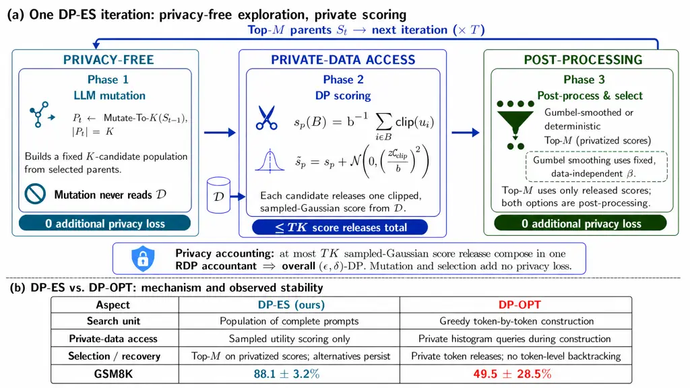
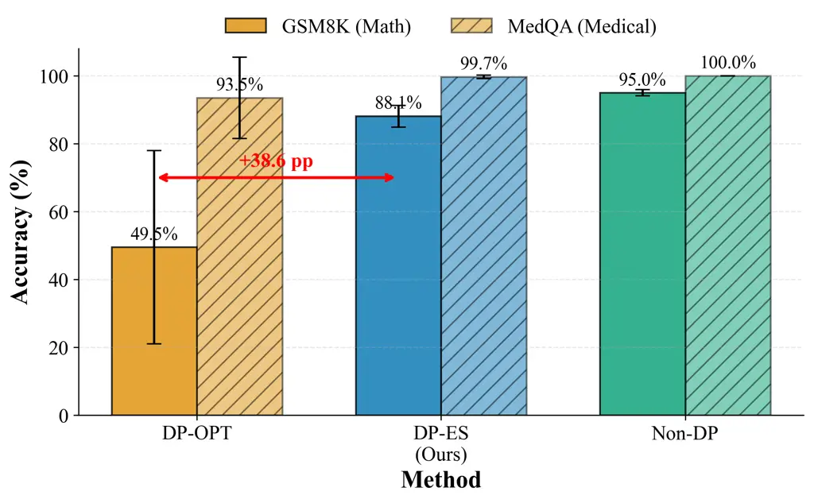
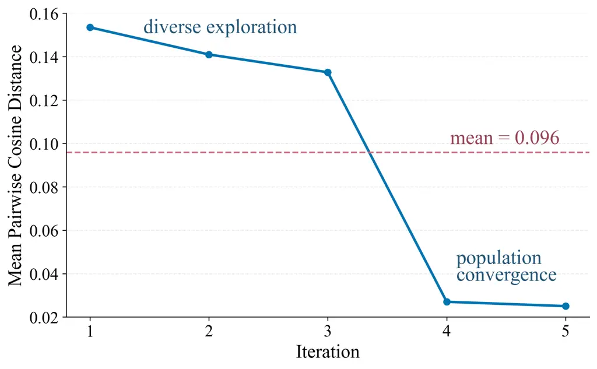

# DP-ES: Differentially Private Evolution Strategies for Prompt Optimization

Ziniu Liu Affiliation: National University of Defense Technology
Affiliation: {liuzn_nudt,liaiping,hanyue,yuhan17,zhangjunjian24,zhud,lichangjian23}@nudt.edu.cn
   Aiping Li Affiliation: National University of Defense Technology
Affiliation: {liuzn_nudt,liaiping,hanyue,yuhan17,zhangjunjian24,zhud,lichangjian23}@nudt.edu.cn
   Yue Han Affiliation: National University of Defense Technology
Affiliation: {liuzn_nudt,liaiping,hanyue,yuhan17,zhangjunjian24,zhud,lichangjian23}@nudt.edu.cn
   Han Yu Affiliation: National University of Defense Technology
Affiliation: {liuzn_nudt,liaiping,hanyue,yuhan17,zhangjunjian24,zhud,lichangjian23}@nudt.edu.cn
   Junjian Zhang Affiliation: National University of Defense Technology
Affiliation: {liuzn_nudt,liaiping,hanyue,yuhan17,zhangjunjian24,zhud,lichangjian23}@nudt.edu.cn
   Dong Zhu Affiliation: National University of Defense Technology
Affiliation: {liuzn_nudt,liaiping,hanyue,yuhan17,zhangjunjian24,zhud,lichangjian23}@nudt.edu.cn
   Changjian Li Affiliation: National University of Defense Technology
Affiliation: {liuzn_nudt,liaiping,hanyue,yuhan17,zhangjunjian24,zhud,lichangjian23}@nudt.edu.cn
   Shiqiang Zhang Affiliation: CRRC Zhuzhou Electric Locomotive Research
Institute Co., Ltd.China Academy of Railway Sciences
Affiliation: [zhangsq5@csrzic.com](mailto:zhangsq5@csrzic.com) ^(\*)Corresponding
author: [liaiping@nudt.edu.cn](mailto:liaiping@nudt.edu.cn)

###### Abstract

Token-level differentially private (DP) prompt optimization methods such
as DP-OPT can become unstable under tight privacy budgets: on GSM8K,
DP-OPT obtains $`49.5{\pm}28.5\%`$ across 30 runs, and a logged search
trajectory reveals prompt-template drift and noise-sensitive
irreversible choices. We diagnose these as structural consequences of
greedy token-by-token construction over privately aggregated counts. We
then propose DP-ES (Differentially Private Evolution Strategies), a
structurally cleaner alternative that maintains a population of full
prompts, mutates them via LLM calls that never access the private
dataset, and spends privacy only on sampled-Gaussian evaluation;
deterministic or Gumbel-smoothed selection is post-processing. Under a
conservative $`(\varepsilon{\leq}1.0,\delta{=}10^{-5})`$ guarantee,
DP-ES achieves 88.1% on GSM8K (+38.6 pp over DP-OPT, $`\sim`$9$`\times`$
lower std), 99.7% on MedQA, 73.5% on BANKING77, and 86.8% on Alpaca. It
is also 2.5$`\times`$ faster in wall-clock time and uses 3.3$`\times`$
fewer logged private-data call groups than DP-OPT. Selection and
population ablations, implementation-level noise checks, and a
200-profile exact-match memorization stress test complement the formal
guarantee. Scope. Our experiments establish optimization robustness
under DP noise, especially where prompt structure is critical;
end-to-end validation on genuinely sensitive, non-saturated deployment
data remains future work. Code:
[github.com/StephCpa/dp-es](https://github.com/StephCpa/dp-es).

## 1 Introduction

Large Language Models (LLMs) have demonstrated remarkable capabilities
through in-context learning Brown et al. (2020); Ouyang et al. (2022),
yet their performance heavily relies on carefully crafted prompts Liu et
al. (2023). Automatic prompt optimization Yuksekgonul et al. (2024);
Yang et al. (2024b) can bridge this gap, but when the optimization data
are sensitive (e.g., patient records, financial logs), the optimizer can
memorize and expose private information, as evidenced by recent
membership inference and extraction attacks Wang et al. (2023);
Shanmugarasa et al. (2025); Fu et al. (2023). For instance, a naive
optimizer might generate a prompt like “Remember how patient \#12847 had
atrial fibrillation…”, directly violating privacy. Any optimizer
intended for such settings must therefore satisfy formal Differential
Privacy (DP) guarantees Dwork et al. (2006)—and, crucially, the
optimization mechanism itself must remain robust under the noise that DP
introduces, which is the question we focus on in this work.

The Challenge: Task Complexity and Privacy Budgets. Applying DP to
prompt optimization is non-trivial due to the discrete nature of text.
Recent work like DP-OPT Hong et al. (2024) uses histogram-based token
generation with the exponential mechanism. Other approaches apply DP to
in-context learning via private few-shot generation or nearest neighbor
retrieval Tang et al. (2024); Koskela et al. (2025), but they rely on
additional retrieval or embedding machinery. While DP-OPT is effective
on simple tasks, it is unstable on our complex-reasoning setting: across
30 GSM8K runs it obtains $`49.5{\pm}28.5\%`$, and trajectory analysis
reveals prompt-template drift and noise-sensitive irreversible decisions
(Appendix C.2). This fragility is consistent with token-level myopia and
non-backtracking search under tight privacy constraints.

Private Evolution Perspective. Private Evolution (PE) is a training-free
DP paradigm for data synthesis via APIs Lin et al. (2024); Xie et al.
(2024); Lin et al. (2025). Its core advantage is structural: only
low-sensitivity evaluation touches private data, while
exploration/generation and selection over privatized scores are
post-processing. This yields a decoupling between exploration and
privacy expenditure—increasing the number or strength of mutations
improves search without consuming additional privacy budget. DP-ES is a
prompt-optimization instantiation of this PE principle.



Figure 1: DP-ES workflow and mechanism-level contrast with DP-OPT. Only
sampled-Gaussian scoring accesses the private dataset. LLM mutation and
deterministic or Gumbel-smoothed top-$`M`$ parent selection operate
without further private-data access and add no privacy loss. Mechanism
rows summarize canonical DP-OPT; the bottom panel reports our black-box
adaptation’s GSM8K mean and standard deviation across 30 runs without
imposing a post-hoc failure threshold.

Our Contribution: DP-ES. We frame this work as a _diagnostic and
methodological_ contribution for DP prompt optimization: we
systematically characterize the instability mechanisms of token-level DP
construction under tight privacy budgets and propose Differentially
Private Evolution Strategies (DP-ES), a structurally cleaner
alternative. Unlike methods that build prompts token by token from
privately aggregated counts, DP-ES maintains a population of full
prompts that evolve over time. The key design choice is to decouple
exploration from privacy consumption: using LLMs to generate semantic
mutations consumes zero privacy budget (by the post-processing
property), allowing the scarce privacy budget to be allocated strictly
to sampled-Gaussian evaluation.

Our contributions are:

1.  1.  Instability diagnosis: A 30-run analysis of DP-OPT on GSM8K,
        complemented by a concrete logged trajectory that exposes
        prompt-template drift and noise-sensitive irreversible selection in
        token-level construction (Section 5).
2.  2.  Method: A structurally cleaner evolution-based DP prompt optimizer
        with privacy-free mutations, sampled-Gaussian scoring under RDP
        accounting, and deterministic or Gumbel-smoothed post-processing
        selection.
3.  3.  Empirical robustness: $`\sim`$9$`\times`$ lower standard deviation
        than DP-OPT on GSM8K, plus strong or competitive results on MedQA,
        BANKING77, and Alpaca under a conservative
        $`(\varepsilon{\leq}1,\delta{=}10^{-5})`$ guarantee.
4.  4.  Efficiency: 2.5$`\times`$ faster wall-clock runtime and
        3.3$`\times`$ fewer logged private-data call groups than DP-OPT on
        GSM8K, with an explicit generation-vs-evaluation cost decomposition.
5.  5.  Privacy evidence: A reproducible RDP accounting calculation and
        noise-distribution checks, plus a 200-profile synthetic exact-match
        stress test (0 PII strings found for DP-ES vs. 40 for an adversarial
        non-DP control).

Scope of Empirical Evidence. Our experiments establish DP-ES as a
_structurally more robust DP prompt optimizer_ than token-level
alternatives, especially on tasks where prompt structure is critical.
They do not by themselves validate deployment on genuinely sensitive,
non-saturated datasets. The formal $`(\varepsilon,\delta)`$-DP guarantee
bounds record-level leakage independently of the benchmark, while the
implementation checks and exact-match stress test provide complementary
diagnostics. We make these scope boundaries explicit in the Limitations
section.

## 2 Related Work

Prompt Optimization. Gradient-free methods such as APE Zhou et al.
(2023) and OPRO Yang et al. (2024b) search over discrete prompt
candidates using LLM-generated variations, while gradient-based
approaches like TextGrad Yuksekgonul et al. (2024) use LLM feedback as
differentiable signals. Both families optimize prompts effectively but
assume unrestricted access to training data with no privacy guarantees
Edemacu and Wu (2025), making them unsuitable for sensitive domains such
as healthcare, finance, and education where data protection is legally
mandated.

Differential Privacy in Machine Learning. DP-SGD Abadi et al. (2016) and
PATE Papernot et al. (2018) provide formal $`(\varepsilon,\delta)`$-DP
guarantees for continuous model parameters during training. DP-LoRA Liu
et al. (2024b); Frery et al. (2025) extends this to parameter-efficient
fine-tuning of LLMs, achieving strong performance with reduced memory
overhead. However, all these methods require access to model weights,
precluding their use with black-box API-only LLMs—the dominant
deployment mode for state-of-the-art models such as GPT-4 and DeepSeek.

DP Prompt Optimization. For discrete prompts over black-box LLMs, DP-OPT
Hong et al. (2024) uses histogram-based token generation with the
exponential mechanism, constructing prompts token by token from
privately aggregated counts. While effective on classification and
factual QA, this greedy token-level approach is unstable in our GSM8K
experiments and can exhibit prompt-template drift and noise-sensitive
irreversible decisions (Section 5).

Other Approaches. Other directions include DP few-shot demonstration
generation for in-context learning Tang et al. (2024), which privately
selects exemplars but cannot optimize the instruction prompt itself;
private retrieval augmentation Koskela et al. (2025), which protects
retrieval queries but inherits the limitations of fixed prompt
templates; and PromptDPSGD Duan et al. (2023), which applies DP-SGD to
continuous soft prompt embeddings but requires white-box model access
and struggles on smaller models (Appendix C.3).

Private Evolution. Private Evolution (PE) Lin et al. (2024); Xie et al.
(2024); Lin et al. (2025) is a training-free DP framework originally
developed for data synthesis via APIs. Its key structural advantage is
that only a low-sensitivity evaluation step touches private data, while
API-based generation is pure post-processing. This creates a favorable
decoupling: exploration can be arbitrarily rich without consuming
privacy budget. DP-ES adapts this principle from data synthesis to
prompt optimization, inheriting the favorable privacy-exploration
trade-off while introducing population-based search over the discrete
prompt space.

Evolution Strategies and DP. Evolution strategies (ES) Rechenberg (1973)
are derivative-free algorithms that maintain and evolve populations of
candidate solutions. Prior non-private prompt optimizers, including
EvoPrompt Guo et al. (2024) and PromptBreeder Fernando et al. (2023),
already use LLM-driven mutation and population-based selection to
optimize discrete prompts. DP-ES builds on this
evolutionary-prompt-optimization line while introducing record-level DP
through sampled-Gaussian scoring and post-processing selection. The
population-based design provides natural robustness to noise-induced
regressions—a critical advantage under tight privacy budgets where
evaluation noise is substantial.

Privacy Auditing. Empirical privacy attacks and audits can reveal
implementation errors but cannot certify DP from a finite number of
trials Nasr et al. (2021); Jagielski et al. (2020). We therefore base
our guarantee on mechanism-level RDP accounting and use noise checks and
an exact-match memorization stress test only as complementary
diagnostics (Section 6).

Positioning of DP-ES. Table 1 summarizes the landscape. DP-ES uniquely
combines evolutionary exploration with sampled-Gaussian scoring and
post-processing selection, filling the gap for a robust,
black-box-compatible DP prompt optimization method that scales across
diverse task complexities—from structured classification to multi-step
reasoning.

|               |       |       |                     |
| ------------- | ----- | ----- | ------------------- |
| Method        | Priv. | Disc. | Mechanism           |
| TextGrad      | ×     | ✓     | LLM gradients       |
| OPRO          | ×     | ✓     | LLM scoring         |
| EvoPrompt     | ×     | ✓     | Evolutionary search |
| PromptBreeder | ×     | ✓     | Evolutionary search |
| DP-SGD        | ✓     | ×     | Gaussian noise      |
| DP-OPT        | ✓     | ✓     | Histogram + Exp     |
| DP-ES         | ✓     | ✓     | Evol. + Gauss       |

Table 1: Comparison of prompt optimization methods. DP-ES adds formal
record-level DP to evolutionary optimization over discrete prompts.

## 3 Methodology: DP-ES

Problem Formulation. Let $`\mathcal{D}=\{(x_{i},y_{i})\}_{i=1}^{n}`$ be
a private dataset where $`x_{i}`$ represents task inputs and $`y_{i}`$
represents desired outputs (e.g., question-answer pairs). Let
$`\mathcal{P}`$ denote the space of natural language prompts. Our goal
is to find a prompt $`p^{*}\in\mathcal{P}`$ that maximizes task
performance:

```math
p^{*}=\arg\max_{p\in\mathcal{P}}f(p,\mathcal{D}) \tag{1}
```

where $`f:\mathcal{P}\times\mathcal{D}\to\mathbb{R}`$ measures prompt
quality (e.g., accuracy on $`\mathcal{D}`$).

Privacy requirement: The optimization algorithm must satisfy
$`(\varepsilon,\delta)`$-differential privacy with respect to
$`\mathcal{D}`$, ensuring that any single record $`(x_{i},y_{i})`$ has
bounded influence on the output prompt. Table 2 summarizes the notation
used below.

|                       |                       |                     |                             |
| --------------------- | --------------------- | ------------------- | --------------------------- |
| $`\mathcal{D},n`$     | private data, size    | $`K,M,T`$           | candidates, parents, rounds |
| $`b,q`$               | batch size, $`q=b/n`$ | $`z`$               | Gaussian noise multiplier   |
| $`u_{i}(p)`$          | per-record utility    | $`C_{\text{clip}}`$ | clipping bound              |
| $`\widetilde{s}_{p}`$ | privatized score      | $`\beta`$           | Gumbel smoothing scale      |

Table 2: Notation used in DP-ES.

###### Definition 1 ($`(\varepsilon,\delta)`$-Differential Privacy).

A randomized algorithm $`\mathcal{M}:\mathcal{D}\to\mathcal{O}`$
satisfies $`(\varepsilon,\delta)`$-DP if for all neighboring datasets
$`\mathcal{D}\sim\mathcal{D}^{\prime}`$ (differing in one record) and
all measurable sets $`S\subseteq\text{Range}(\mathcal{M})`$:

```math
\mathbb{P}[\mathcal{M}(\mathcal{D})\in S]\leq e^{\varepsilon}\cdot\mathbb{P}[\mathcal{M}(\mathcal{D}^{\prime})\in S]+\delta \tag{2}
```

DP-ES Algorithm Overview. DP-ES (Algorithm 1) employs an evolution
strategy with three key components:

1.  1.  Mutation: Generate prompt variations using an LLM (privacy-free)
2.  2.  DP Evaluation: Score prompts on $`\mathcal{D}`$ with calibrated
        noise
3.  3.  Selection: Select top prompts from privatized scores
        (Gumbel-smoothed or deterministic)

0:  Private dataset $`\mathcal{D}`$, privacy budget
$`(\varepsilon_{\text{total}},\delta)`$, initial prompt $`p_{0}`$,
population size $`K`$, parent count $`M\leq K`$, iterations $`T`$

0:  Optimized prompt $`p^{*}`$ with
$`(\varepsilon_{\text{total}},\delta)`$-DP

1:  Initialize parent set $`\mathcal{S}_{0}\leftarrow\{p_{0}\}`$ and
best-so-far score $`\tilde{s}^{*}\leftarrow-\infty`$

2:  Calibrate $`z`$ for at most $`TK`$ sampled-Gaussian scores {RDP
accountant}

3:  for $`t=1`$ to $`T`$ do

4:   // Phase 1: Privacy-free mutation

5:   $`\mathcal{P}_{t}\leftarrow\text{Mutate-To-}K(\mathcal{S}_{t-1})`$
{$`|\mathcal{P}_{t}|=K`$}

6:   // Phase 2: Sampled-Gaussian scoring (RDP-accounted)

7:   for each $`p\in\mathcal{P}_{t}`$ do

8:    Sample $`B\subset\mathcal{D}`$, $`|B|=b`$; set
$`u_{i}(p)=\mathbb{1}[\text{LLM}(p,x_{i})=y_{i}]`$

9:
   $`s_{p}=\frac{1}{b}\sum_{i\in B}\text{clip}(u_{i}(p),[0,C_{\text{clip}}])`$
{$`C_{\text{clip}}=1.0`$}

10:    Add noise: $`\tilde{s}_{p}=s_{p}+\mathcal{N}(0,\sigma^{2})`$
{$`\sigma=zC_{\text{clip}}/b`$}

11:   end for

12:   Update $`p^{*},\tilde{s}^{*}`$ using
$`\arg\max_{p\in\mathcal{P}_{t}}\tilde{s}_{p}`$ {post-processing}

13:   // Phase 3: Selection over privatized scores

14:   Option A (default):
$`\hat{s}_{p}\leftarrow\tilde{s}_{p}+\text{Gumbel}(0,\beta)`$ {fixed
$`\beta`$; post-processing}

15:   Option B: $`\hat{s}_{p}\leftarrow\tilde{s}_{p}`$ {Deterministic
top-$`M`$; pure post-processing}

16:
  $`\mathcal{S}_{t}\leftarrow\text{top-}M(\mathcal{P}_{t},\{\hat{s}_{p}\})`$
{parents for next round}

17:  end for

18:  return $`p^{*}`$

Algorithm 1 DP-ES: Differentially Private Evolution Strategies

Privacy-Free Mutations. Key Innovation: Unlike gradient-based methods
that require DP protection for gradient computation, DP-ES sends only a
public or previously privatized parent prompt to the mutation LLM;
neither records from $`\mathcal{D}`$ nor record-derived feedback are
included. Mutation is therefore post-processing and consumes zero
additional privacy budget.

Proposition 1 (Mutation Privacy-Freeness). Let
$`\text{Mutate}:\mathcal{P}\to\mathcal{P}`$ be a function that generates
a new prompt from a parent prompt using an LLM, without accessing the
private dataset $`\mathcal{D}`$. Then Mutate consumes zero privacy
budget.

Proof. See Appendix D.

Proposition 2 (Decoupled Exploration). If mutation does not access
$`\mathcal{D}`$, then the privacy loss of DP-ES depends only on the
sampled-Gaussian score releases and is independent of the number or
strength of mutations per iteration. Proof. See Appendix D.

Mutation strategies: We implement 3 modes (EXPLORE, EXPLOIT, BALANCED);
details and prompt templates are provided in Appendix A.

DP Evaluation via Gaussian Mechanism. After mutation, each candidate is
evaluated on a uniformly sampled batch $`B\subset\mathcal{D}`$ of size
$`b`$. Its score is the mean of clipped per-record utilities:

```math
\displaystyle u_{i}(p) \displaystyle=\mathbb{1}[\text{LLM}(p,x_{i})=y_{i}], \tag{3}
```

```math
\displaystyle s_{p}(B) \displaystyle=\tfrac{1}{b}\sum_{i\in B}\operatorname{clip}(u_{i}(p),[0,C_{\text{clip}}]).
```

The batch sensitivity is $`\Delta_{B}=C_{\text{clip}}/b`$. We release
$`\tilde{s}_{p}=s_{p}+\mathcal{N}(0,(z\Delta_{B})^{2})`$ and account for
uniform sampling without replacement at rate $`q=b/n`$ using Rényi DP
(RDP), composed over at most $`TK`$ scoring operations and converted to
$`(\varepsilon,\delta)`$-DP Wang et al. (2019). The population is kept
at exactly $`K`$ candidates, and all $`K`$ candidates—including any
carried prompts—receive fresh privatized scores in each executed round,
giving at most $`TK`$ releases; early termination can only reduce this
count. In the reported optimization runs, $`n{=}200`$, $`b{=}10`$,
$`z{=}10`$, $`K{=}6`$, and $`T{=}3`$. AutoDP gives
$`\varepsilon\leq 0.71`$ at $`\delta=10^{-5}`$, so all results
conservatively satisfy the stated $`\varepsilon\leq 1`$ guarantee. Full
accounting details are in Appendix B.2.

Selection, Composition, End-to-End DP. Once the scores are privatized,
both deterministic top-$`M`$ (Option B) and our default Gumbel-smoothed
top-$`M`$ (Option A) are randomized post-processing Dwork and Roth
(2014); neither accesses $`\mathcal{D}`$ or incurs additional privacy
loss. The Gumbel perturbation uses a fixed, data-independent smoothing
scale $`\beta`$ only to smooth noise-induced rank inversions, not as a
second privacy mechanism. Composing at most $`TK`$ sampled-Gaussian
score releases with the RDP accountant therefore establishes end-to-end
$`(\varepsilon,\delta)`$-DP for Algorithm 1 (Theorem 3; Appendix D).





Figure 2: Performance and search dynamics. Left: Accuracy on GSM8K and
MedQA under the conservative $`(\varepsilon{\leq}1,\delta{=}10^{-5})`$
guarantee. Right: Mean pairwise prompt-embedding distance, showing early
population diversity followed by convergence.

## 4 Experimental Setup

We evaluate DP-ES on four tasks spanning diverse task families: GSM8K
Cobbe et al. (2021) (multi-step math reasoning; 200-example optimization
set and 1,319-example test set), MedQA Jin et al. (2021) (medical
multiple-choice QA, 200-question subset due to API cost constraints;
DP-ES already achieves near-ceiling performance at 99.7% on this subset,
limiting further discriminative power), BANKING77 Casanueva et al.
(2020) (77-class intent classification, 200 examples), and Alpaca Taori
et al. (2023) (open-ended instruction-following, 200 examples scored by
an LLM judge using DeepSeek-Chat). All experiments use the DeepSeek-V3.2
Liu et al. (2024a) API. We compare against DP-OPT Hong et al. (2024) and
a non-DP baseline—TextGrad Yuksekgonul et al. (2024). Unless otherwise
noted, we fix $`K=6`$, $`M=2`$, $`T=3`$, $`b=10`$, Gaussian noise
multiplier $`z=10`$, and $`\delta=10^{-5}`$ across tasks; these settings
are not selected using task utility. RDP accounting for uniform sampling
without replacement from $`n=200`$ gives $`\varepsilon\leq 0.71`$, so we
report the common conservative guarantee $`\varepsilon\leq 1`$. We also
run PromptDPSGD with a local Qwen-2.5-7B model as a soft-prompt tuning
baseline; results are summarized in Appendix C.3. Full dataset
descriptions, hyperparameters, evaluation metrics, and implementation
details are provided in Appendix A.

## 5 Results

Main Results. DP-ES consistently performs well across all four tasks
under the common conservative ceiling
$`(\varepsilon{\leq}1.0,\delta{=}10^{-5})`$. Table 3 summarizes the
results.

|                         |                 |                 |                |                |                            |
| ----------------------- | --------------- | --------------- | -------------- | -------------- | -------------------------- |
| Method                  | GSM8K           | MedQA           | BANK77         | Alpaca^(†)     | Privacy                    |
| Non-DP                  | 95.0$`\pm`$0.9  | 100.0$`\pm`$0.0 | 75.0$`\pm`$2.8 | 91.7$`\pm`$0.6 | None                       |
| DP-OPT                  | 49.5$`\pm`$28.5 | 93.5$`\pm`$12.0 | 75.3$`\pm`$2.8 | 87.1$`\pm`$1.4 | (1.0,$`10^{-5}`$)          |
| DP-ES                   | 88.1$`\pm`$3.2  | 99.7$`\pm`$0.5  | 73.5$`\pm`$2.2 | 86.8$`\pm`$0.8 | ($`\leq`$0.71,$`10^{-5}`$) |
| $`\Delta`$ (ES$`-`$Opt) | +38.6           | +6.2            | $`-`$1.8       | $`-`$0.3       | –                          |
| $`\Delta`$ (ES$`-`$Non) | $`-`$6.9        | $`-`$0.3        | $`-`$1.5       | $`-`$4.9       | –                          |

Table 3: Main Results on the task evaluation sets in Section 4 (mean
$`\pm`$ std; 30 runs for GSM8K and three seeds for the other tasks). DP
methods satisfy $`(\varepsilon{\leq}1.0,\delta{=}10^{-5})`$; DP-OPT is
reported at its stated $`\varepsilon=1`$ setting, while DP-ES’s
recomputed RDP bounds are no larger than 0.71. ^(†)Alpaca scores are
LLM-judge ratings scaled to percentages.

On GSM8K, DP-ES achieves 88.1% $`\pm`$ 3.2% (+38.6 pp over DP-OPT with
$`\sim`$9$`\times`$ lower std); on MedQA, 99.7% $`\pm`$ 0.5% (+6.2 pp).
On BANKING77 and Alpaca, both methods perform comparably ($`\sim`$73–75%
and $`\sim`$87%, respectively), confirming that DP-ES matches DP-OPT on
well-structured tasks while excelling on complex reasoning. Section 6
separately reports mechanism-level accounting and targeted
implementation diagnostics; these do not rely on illustrative prompts as
privacy evidence.


Figure 3: DP-OPT trajectory drift vs. DP-ES population search on GSM8K.
Top: selected prompts in an actual high-accuracy DP-OPT run (seed 42)
omit the {question} placeholder as search progresses; the harness
fallback appends the question, so omission is not treated as an
accuracy-failure label. Middle: why irreversible noisy choices can
redirect token-level construction. Bottom: a logged DP-ES prompt retains
the placeholder while complete alternatives persist across rounds.

DP-OPT Instability and Trajectory Analysis. Across 30 GSM8K runs, DP-OPT
obtains $`49.5{\pm}28.5\%`$, compared with DP-ES’s $`88.1{\pm}3.2\%`$.
Figure 3 reproduces a diagnostic DP-OPT trajectory from a
_high-accuracy_ seed (91%): 21/33 candidate prompts and 2/3 selected
prompts omit {question}. The evaluator explicitly appends the question
text when this placeholder is absent, so omission is not intrinsically a
zero-accuracy event; we therefore treat it as evidence of _template
drift_, not as a failure label. The trajectory nonetheless exposes a
structural weakness of unconstrained token-level construction, while
DP-ES’s complete-prompt population retains multiple alternatives when
noisy scores perturb a ranking (Appendix C.2).

Efficiency. DP-ES is 2.5$`\times`$ faster (17.9 vs. 45.7 hours on GSM8K)
and logs 3.3$`\times`$ fewer private-data evaluation/mutation call
groups (10 vs. 33 per representative run): DP-OPT’s token construction
and evaluation both query private aggregates, whereas DP-ES mutations do
not touch $`\mathcal{D}`$. DP-ES uses larger contexts
($`\sim`$2.8$`\times`$ more tokens), so the advantage is lower
wall-clock time and fewer private-data round trips rather than uniformly
lower provider cost. Full call-purpose and token breakdowns are in
Appendix C.1.

Local Validation (Qwen2.5-7B). To ensure the main trend is not
API-specific, we compare all methods locally with Qwen2.5-7B at the
common $`\varepsilon\leq 1`$ setting. DP-ES reaches $`53.8\pm 6.1`$% on
GSM8K versus DP-OPT’s $`37.4\pm 11.6`$%; on MedQA the methods are
comparable ($`81.2\pm 1.3`$% vs. $`83.0\pm 2.1`$%). Full results are in
Appendix C.3.

Why Evolution Strategies Excel Under DP. Private Evolution Lin et al.
(2024); Xie et al. (2024); Lin et al. (2025) restricts DP spending to
low-sensitivity evaluation while keeping exploration privacy-free. DP-ES
inherits this benefit: mutation can be arbitrarily rich without paying
privacy budget, enabling recovery from noise-induced regressions.
Figure 2 (right) shows population diversity (cosine distance
$`\approx 0.15`$) in early iterations before convergence, giving DP-ES
multiple hypotheses when Gaussian noise perturbs scores.

Selection Ablation: Deterministic vs. Gumbel-Smoothed Top-$`M`$. Both
selectors operate only on privatized scores and therefore have identical
privacy guarantees. Table 4 compares them at the default smoothing
setting on GSM8K (200 examples).

|                 |                 |                 |
| --------------- | --------------- | --------------- |
| Selector        | Accuracy (%)    | Privacy         |
| Gumbel-smoothed | $`88.8\pm 3.4`$ | post-processing |
| Deterministic   | $`88.6\pm 2.9`$ | post-processing |

Table 4: Selection ablation (five seeds). The two post-processing rules
have comparable accuracy; neither changes the RDP bound established by
the Gaussian scores.

The difference in mean accuracy is 0.2 pp and there is no consistent
variance advantage at this setting. We retain Gumbel smoothing as the
default randomized tie/rank smoother; deterministic top-$`M`$ is an
equally private alternative. Population-size ablations are in
Appendix C.

## 6 Privacy Guarantees

DP-ES inherits formal $`(\varepsilon,\delta)`$-DP from a Decoupled DP
Evolution view: mutations operate on public or previously privatized
prompts, and only sampled-Gaussian evaluation accesses $`\mathcal{D}`$.
RDP accounting composes at most $`TK`$ score releases; both
deterministic and Gumbel-smoothed selection are post-processing. The
worst reported bound is $`(\varepsilon{=}0.71,\delta{=}10^{-5})`$, which
we conservatively state as $`\varepsilon\leq 1`$. Full derivation and
reproducible accountant settings are in Appendix B.

Implementation Diagnostics. We record 1,000 injected-noise samples and
verify that their standardized distribution is consistent with the
configured Gaussian mechanism via a Kolmogorov–Smirnov test. We also
compare final-prompt behavior on a small set of neighboring datasets as
a debugging diagnostic. Because finite output samples cannot certify DP
or reliably estimate privacy loss in this high-dimensional discrete
space, we do not interpret this diagnostic as an empirical
$`\varepsilon`$; the guarantee comes from the mechanism-level RDP
accountant.

Synthetic Privacy Stress Test. To illustrate direct memorization risk,
we construct 200 synthetic customer profiles containing 1,200 sensitive
strings (six per profile: name, phone number, email, full address,
street-level address fragment, and account ID). Figure 4 reports exact
and near-verbatim matching in final prompts: no listed string is found
for DP-ES, while an intentionally adversarial non-DP control—which is
explicitly given raw records and instructed to embed a
directory—contains 40 strings (3.33%). This is a targeted sanity check,
not a semantic-leakage attack or a substitute for the formal guarantee.


Figure 4: Exact-match memorization stress test on 200 synthetic profiles
(1,200 sensitive strings). The intentionally adversarial Non-DP control
is shown raw records and asked to embed a directory; its final prompt
contains 40 strings (3.33%). DP-ES mutation never sees records, and its
final prompt contains none of the listed strings. Excerpts and counts
are reproduced from the saved run. This targeted diagnostic does not
test semantic leakage or replace the formal guarantee.

## 7 Conclusion

We presented a _diagnostic and methodological_ contribution for
differentially private prompt optimization. On the diagnostic side, a
30-run analysis shows substantial DP-OPT instability on GSM8K, while a
logged trajectory exposes prompt-template drift and noise-sensitive
irreversible decisions in token-level construction. On the
methodological side, we introduced DP-ES, a structurally cleaner
evolution-based alternative that maintains a population of full prompts,
mutates them without exposing private records, and restricts privacy
expenditure to sampled-Gaussian scoring; selection over privatized
scores is post-processing.

Across four tasks—GSM8K (88.1%), MedQA (99.7%), BANKING77 (73.5%), and
Alpaca (86.8%, LLM-judge)—DP-ES matches or exceeds DP-OPT under a
conservative $`\varepsilon\leq 1`$ guarantee, with $`\sim`$9$`\times`$
lower variance on GSM8K, 2.5$`\times`$ faster wall-clock runtime, and
3.3$`\times`$ fewer logged private-data call groups. Deterministic and
Gumbel-smoothed selection have comparable utility and identical privacy
guarantees because both post-process privatized scores.
Noise-distribution checks and a 200-profile exact-match memorization
stress test provide complementary diagnostics alongside the formal RDP
accounting.

Scope. The strongest evidence we provide is for _optimization robustness
under DP noise on benchmarks where prompt structure matters_, with the
largest gains on reasoning-heavy tasks where token-level construction is
most brittle. End-to-end validation on genuinely sensitive,
non-saturated deployment data—which would require benchmarks combining
record-level sensitivity with non-trivial semantic reasoning—remains
future work and is the most direct extension of this contribution.

## Limitations

We are explicit about the boundaries of what this work establishes.

Empirical Scope: No Sensitive-Data Deployment Validation. Our
experiments establish that DP-ES is a structurally more robust DP prompt
optimizer than token-level alternatives on benchmarks where prompt
structure matters. They do not validate end-to-end deployment on
genuinely sensitive, non-saturated datasets (e.g., real clinical
records, financial logs). Such validation would require benchmarks that
combine record-level sensitivity with non-trivial semantic reasoning,
which the current public benchmark landscape does not provide. The
formal $`(\varepsilon,\delta)`$-DP guarantee, by construction, bounds
record-level leakage independent of the benchmark, but a direct
sensitive-data deployment study remains future work.

MedQA Ceiling Effect. DP-ES reaches 99.7% on the 200-question MedQA
subset, with the Non-DP baseline saturating at 100.0$`\pm`$0.0. This
near-ceiling performance limits the discriminative power of MedQA for
studying privacy-utility trade-offs at $`\varepsilon{=}1.0`$; the 6.2 pp
improvement over DP-OPT on this saturated regime is informative but
should not be over-interpreted as evidence for a non-trivial
privacy-utility frontier on medical QA more broadly. A non-saturated
medical benchmark (e.g., a harder open-ended clinical reasoning task)
would provide stronger evidence.

Privacy Attack Coverage. The 200-profile synthetic memorization stress
test (Section 6) measures direct or near-verbatim sensitive-string
leakage against an intentionally adversarial non-DP control. It does not
test paraphrased memorization, rare-attribute disclosure, record
reconstruction, or membership inference. Moreover, the mutation LLM can
reproduce information already present in its parametric memory; DP-ES
bounds the incremental influence of the private optimization dataset,
not memorization inherited from pretraining. The formal
$`(\varepsilon,\delta)`$-DP guarantee is attack-agnostic, but a direct
empirical attack suite comparing DP-ES against DP-OPT under matched
bounds would provide useful complementary evidence and remains future
work.

Efficiency Reporting Scope. The cost decomposition by call purpose
(Appendix C.1, Table 7) is from a representative single-seed run on a
200-sample validation set. Aggregate wall-clock numbers across the full
1,319-sample test set are reported separately (Table 6); token-level and
call-purpose splits at full aggregate scale are not yet released. We
report the most granular reproducible numbers we have and treat
aggregate token-level reporting as future work.

Task Diversity. We evaluate on four tasks (GSM8K, MedQA, BANKING77,
Alpaca) covering math reasoning, medical QA, intent classification, and
instruction-following. Additional benchmarks (e.g., summarization, code
generation, open-ended clinical reasoning) would further characterize
cross-domain generalization.

Task-Dependent Advantage. DP-ES’s strongest gains over DP-OPT are on
complex reasoning tasks (GSM8K: +38.6 pp, MedQA: +6.2 pp). On
well-structured classification (BANKING77) and instruction-following
(Alpaca), both methods perform comparably, suggesting that DP-ES’s
population-based exploration is most beneficial when the prompt search
space is large and structured prompts are critical.

Privacy Budget Sweeps. Our verified experiments establish the common
conservative bound $`\varepsilon\leq 1`$ rather than a densely sampled
privacy–utility frontier. Re-running all methods with noise recalibrated
to several exact RDP targets would better characterize the trade-off.

Theoretical Analysis of Task Complexity. We empirically observe that
task complexity is a key determinant of the success of DP optimization.
A formal theoretical framework linking prompt search space
characteristics to privacy budget requirements is still needed.

Future Work. Beyond the scope items above, promising directions include
adaptive population sizing, multi-objective optimization (utility,
privacy, stability), and federated DP-ES for distributed sensitive data
settings.

## Ethics Statement

This work develops differentially private (DP) prompt-optimization
mechanisms motivated by settings where the underlying optimization data
may be sensitive. Our empirical evaluation is conducted on public
benchmarks; the considerations below concern both this study and any
downstream use of the released method.

Privacy Scope: DP-ES provides formal ($`\varepsilon,\delta`$)-DP
guarantees for prompt optimization under correct implementation and
accounting. The reported implementation diagnostics and exact-match
stress test do not certify DP or cover downstream deployment risks
beyond the mechanism.

Data Use: We use public benchmarks and do not collect new personal data.
Applications to real sensitive data should follow institutional review,
access control, and data governance requirements.

Dual-Use Concerns: As with any optimization technique, DP-ES could be
misused to refine harmful applications. Responsible deployment should
include access control, monitoring, and safety filtering.

Transparency and Reproducibility: We provide code and privacy accounting
details to enable verification of claims and independent audits.

## Acknowledgments

OpenAI Codex was used to assist with language polishing, manuscript
organization, code debugging, and consistency checks. The authors
independently verified all technical claims, calculations, citations,
and final wording and take full responsibility for the paper.

## References

- Abadi et al. (2016) M. Abadi, A. Chu, I. Goodfellow, H. B. McMahan, I.
  Mironov, K. Talwar, and L. Zhang Deep learning with differential
  privacy. In Proceedings of the 2016 ACM SIGSAC Conference on Computer
  and Communications Security, pp. 308–318. Cited by: §2.
- Brown et al. (2020) T. Brown, B. Mann, N. Ryder, M. Subbiah, J. D.
  Kaplan, P. Dhariwal, A. Neelakantan, P. Shyam, G. Sastry, A. Askell,
  et al. Language models are few-shot learners. In Advances in Neural
  Information Processing Systems, Vol. 33, pp. 1877–1901. Cited by: §1.
- Casanueva et al. (2020) I. Casanueva, T. Temčinas, D. Gerz, M.
  Henderson, and I. Vulić Efficient intent detection with dual sentence
  encoders. In Proceedings of the 2nd Workshop on Natural Language
  Processing for Conversational AI, pp. 38–45. Cited by: §A.1, §4.
- Cobbe et al. (2021) K. Cobbe, V. Kosaraju, M. Bavarian, M. Chen, H.
  Jun, L. Kaiser, M. Plappert, J. Tworek, J. Hilton, R. Nakano, et al.
  Training verifiers to solve math word problems. arXiv preprint
  arXiv:2110.14168. External Links: 2110.14168 Cited by: §A.1, §4.
- Duan et al. (2023) H. Duan, A. Dziedzic, N. Papernot, and F. Boenisch
  Flocks of stochastic parrots: differentially private prompt learning
  for large language models. In NeurIPS, Cited by: §A.2, §2.
- Dwork et al. (2006) C. Dwork, F. McSherry, K. Nissim, and A. Smith
  Calibrating noise to sensitivity in private data analysis. In Theory
  of Cryptography Conference, pp. 265–284. Cited by: §1.
- Dwork and Roth (2014) C. Dwork and A. Roth The algorithmic foundations
  of differential privacy. Foundations and Trends in Theoretical
  Computer Science 9 (3-4), pp. 211–407. Cited by: §D.1, §3.
- Edemacu and Wu (2025) K. Edemacu and X. Wu Privacy preserving prompt
  engineering: a survey. ACM Computing Surveys 57 (10), pp. 1–36.
  External Links: [Document](https://dx.doi.org/10.1145/3729219) Cited
  by: §2.
- Fernando et al. (2023) C. Fernando, D. Banarse, H. Michalewski, S.
  Osindero, and T. Rocktäschel Promptbreeder: self-referential
  self-improvement via prompt evolution. arXiv preprint
  arXiv:2309.16797. External Links:
  [Link](https://arxiv.org/abs/2309.16797) Cited by: §2.
- Frery et al. (2025) J. Frery, R. Bredehoft, J. Klemsa, A. Meyre,
  and A. Stoian Private lora fine-tuning of open-source llms with
  homomorphic encryption. arXiv preprint arXiv:2505.07329. Cited by: §2.
- Fu et al. (2023) W. Fu, H. Wang, C. Gao, G. Liu, Y. Li, and T. Jiang
  Practical membership inference attacks against fine-tuned large
  language models via self-prompt calibration. arXiv preprint
  arXiv:2311.06062. External Links: 2311.06062 Cited by: §1.
- Guo et al. (2024) Q. Guo, R. Wang, J. Guo, B. Li, K. Song, X. Tan, G.
  Liu, J. Bian, and Y. Yang Connecting large language models with
  evolutionary algorithms yields powerful prompt optimizers. In
  International Conference on Learning Representations, External Links:
  [Link](https://openreview.net/forum?id=ZG3RaNIsO8) Cited by: §2.
- Hong et al. (2024) J. Hong, J. T. Wang, C. Zhang, Z. Li, B. Li, and Z.
  Wang DP-OPT: make large language model your privacy-preserving prompt
  engineer. In International Conference on Learning Representations,
  Cited by: §A.2, §1, §2, §4.
- Jagielski et al. (2020) M. Jagielski, J. Ullman, and A. Oprea Auditing
  differentially private machine learning: how private is private SGD?.
  In Advances in Neural Information Processing Systems, Vol. 33,
  pp. 22205–22216. Cited by: §2.
- Jin et al. (2021) D. Jin, E. Pan, N. Oufattole, W. Weng, H. Fang,
  and P. Szolovits What disease does this patient have? a large-scale
  open domain question answering dataset from medical exams. Applied
  Sciences 11 (14), pp. 6421. Cited by: §A.1, §4.
- Koskela et al. (2025) A. Koskela, T. Kulkarni, and L. Zumot
  Differentially private in-context learning with nearest neighbor
  search. arXiv preprint arXiv:2511.04332. Cited by: §1, §2.
- Lin et al. (2025) Z. Lin, T. Baltrusaitis, W. Wang, and S. Yekhanin
  Differentially private synthetic data via apis 3: using simulators
  instead of foundation model. arXiv preprint arXiv:2502.05505. External
  Links: 2502.05505 Cited by: §1, §2, §5.
- Lin et al. (2024) Z. Lin, S. Gopi, J. Kulkarni, H. Nori, and S.
  Yekhanin Differentially private synthetic data via foundation model
  apis 1: images. In International Conference on Learning
  Representations, Cited by: §1, §2, §5.
- Liu et al. (2024a) A. Liu, B. Feng, B. Xue, et al. DeepSeek-v3
  technical report. arXiv preprint arXiv:2412.19437. Cited by: §4.
- Liu et al. (2023) P. Liu, W. Yuan, J. Fu, Z. Jiang, H. Hayashi, and G.
  Neubig Pre-train, prompt, and predict: a systematic survey of
  prompting methods in natural language processing. ACM Computing
  Surveys 55 (9), pp. 1–35. Cited by: §1.
- Liu et al. (2024b) X. Liu, R. Zhu, D. Zha, J. Gao, S. Zhong, M. White,
  and M. Qiu Differentially private low-rank adaptation of large
  language model using federated learning. arXiv preprint
  arXiv:2312.17493. External Links: 2312.17493 Cited by: §2.
- Nasr et al. (2021) M. Nasr, S. Song, A. Thakurta, N. Papernot, and N.
  Carlini Adversary instantiation: lower bounds for differentially
  private machine learning. In IEEE Symposium on Security and Privacy
  (SP), pp. 866–882. Cited by: §2.
- Ouyang et al. (2022) L. Ouyang, J. Wu, X. Jiang, D. Almeida, C.
  Wainwright, P. Mishkin, C. Zhang, S. Agarwal, K. Slama, A. Ray, et al.
  Training language models to follow instructions with human feedback.
  In Advances in Neural Information Processing Systems, Vol. 35,
  pp. 27730–27744. Cited by: §1.
- Papernot et al. (2018) N. Papernot, S. Song, I. Mironov, A.
  Raghunathan, K. Talwar, and Ú. Erlingsson Scalable private learning
  with PATE. In International Conference on Learning Representations
  (ICLR), Cited by: §2.
- Rechenberg (1973) I. Rechenberg Evolutionsstrategie: optimierung
  technischer systeme nach prinzipien der biologischen evolution.
  Frommann-Holzboog Stuttgart. Cited by: §2.
- Shanmugarasa et al. (2025) Y. Shanmugarasa, M. Ding, C. M. Arachchige,
  and T. Rakotoarivelo SoK: the privacy paradox of large language
  models: advancements, privacy risks, and mitigation. In Proceedings of
  the 20th ACM Asia Conference on Computer and Communications Security,
  pp. 425–441. Cited by: §1.
- Tang et al. (2024) X. Tang, R. Shin, H. A. Inan, A. Manoel, F.
  Mireshghallah, Z. Lin, S. Gopi, J. Kulkarni, and R. Sim
  Privacy-preserving in-context learning with differentially private
  few-shot generation. In International Conference on Learning
  Representations, Cited by: §1, §2.
- Taori et al. (2023) R. Taori, I. Gulrajani, T. Zhang, Y. Dubois, X.
  Li, C. Guestrin, P. Liang, and T. B. Hashimoto Stanford alpaca: an
  instruction-following llama model. Note:
  [https://github.com/tatsu-lab/stanford_alpaca](https://github.com/tatsu-lab/stanford_alpaca)
  External Links: [Link](https://github.com/tatsu-lab/stanford_alpaca)
  Cited by: §A.1, §4.
- Wang et al. (2023) B. Wang, W. Chen, H. Pei, C. Xie, M. Kang, C.
  Zhang, C. Xu, Z. Xiong, R. Dutta, R. Schaeffer, et al. DecodingTrust:
  a comprehensive assessment of trustworthiness in gpt models. arXiv
  preprint arXiv:2306.11698. External Links: 2306.11698 Cited by: §1.
- Wang et al. (2019) Y. Wang, B. Balle, and S. P. Kasiviswanathan
  Subsampled Rényi differential privacy and analytical moments
  accountant. In Proceedings of the 22nd International Conference on
  Artificial Intelligence and Statistics, pp. 1226–1235. Cited by: §B.1,
  §3.
- Wang (2019) Y. Wang autodp: automating differential privacy
  computation. Note:
  [https://github.com/yuxiangw/autodp](https://github.com/yuxiangw/autodp)GitHub
  repository External Links: [Link](https://github.com/yuxiangw/autodp)
  Cited by: §A.4, §B.2.
- Xie et al. (2024) C. Xie, Z. Lin, A. Backurs, S. Gopi, D. Yu, H. A.
  Inan, H. Nori, H. Jiang, H. Zhang, Y. T. Lee, B. Li, and S. Yekhanin
  Differentially private synthetic data via foundation model apis 2:
  text. In Proceedings of the 41st International Conference on Machine
  Learning, Proceedings of Machine Learning Research, Vol. 235,
  pp. 54531–54560. Cited by: §1, §2, §5.
- Yang et al. (2024a) A. Yang, B. Yang, B. Zhang, et al. Qwen2.5
  technical report. arXiv preprint arXiv:2412.15115. Cited by: §C.3.
- Yang et al. (2024b) C. Yang, X. Wang, Y. Lu, H. Liu, Q. V. Le, D.
  Zhou, and X. Chen Large language models as optimizers. In
  International Conference on Learning Representations, Cited by: §1,
  §2.
- Yuksekgonul et al. (2024) M. Yuksekgonul, F. Bianchi, J. Boen, S.
  Liu, Z. Huang, C. Guestrin, and J. Zou TextGrad: automatic
  "differentiation" via text. arXiv preprint arXiv:2406.07496. External
  Links: 2406.07496 Cited by: §A.2, §1, §2, §4.
- Zhou et al. (2023) Y. Zhou, A. I. Muresanu, Z. Han, K. Paster, S.
  Pitis, H. Chan, and J. Ba Large language models are human-level prompt
  engineers. In International Conference on Learning Representations
  (ICLR), Cited by: §2.

## Appendix A Experimental Setup

This appendix provides comprehensive experimental setup details,
including tasks, baselines, hyperparameters, and implementation
specifics.

### A.1 Datasets

GSM8K Cobbe et al. (2021): Grade school math word problems requiring
multi-step arithmetic reasoning. We use the full official test set of
1,319 examples from the original benchmark for final evaluation. During
prompt optimization, we use a separate 200-example validation subset to
compute fitness scores, ensuring that no test data leakage occurs.
Problems involve operations like addition, multiplication, and
percentages. Success requires prompts that guide the step-by-step
generation of solutions.

MedQA Jin et al. (2021): Medical question answering from the USMLE exam.
We use 200 questions covering disease diagnosis, treatment, and
pathophysiology. Evaluation uses choice-only accuracy on this
200-question subset; we do not fine-tune model weights (prompt-only
optimization), avoiding training-set leakage. This task probes
performance on a specialized domain and high-accuracy regimes.

BANKING77 Casanueva et al. (2020): Fine-grained intent classification
with 77 banking-related intent categories (e.g., card_arrival,
exchange_rate, lost_or_stolen_card). We use 200 randomly sampled
examples for evaluation. This task tests DP-ES on a classification
problem with a large label space, where prompt optimization must convey
category structure without memorizing individual examples.

Alpaca Taori et al. (2023): Open-ended instruction-following evaluated
by an LLM judge. We use 200 instructions sampled from the Alpaca
evaluation set. Quality is scored on a $`[0,1]`$ rubric by DeepSeek-Chat
(temperature 0.0, max 64 tokens), assessing instruction adherence,
factual accuracy, and response quality. This task represents a
fundamentally different evaluation paradigm (generative quality via
LLM-judge rather than exact-match accuracy), testing whether DP-ES
generalizes beyond closed-form metrics.

### A.2 Baselines

DP-OPT (black-box adaptation) Hong et al. (2024): DP-OPT’s canonical
method uses histogram-based token generation with the exponential
mechanism. Because the original implementation targets a white-box local
model, our API comparison uses a black-box adaptation that preserves
private candidate evaluation and exponential-mechanism selection but is
not an exact reproduction of the original Vicuna-based implementation.
We provide the original implementation link for reference¹¹ 1
[https://github.com/VITA-Group/DP-OPT](https://github.com/VITA-Group/DP-OPT)
and interpret the resulting numbers as an adapted baseline.

Non-DP: Standard prompt optimization without privacy constraints,
implemented using the TextGrad²² 2
[https://github.com/zou-group/textgrad](https://github.com/zou-group/textgrad)
Yuksekgonul et al. (2024) method. This serves as a non-private reference
rather than a formal upper bound, since optimization procedures can
differ in search behavior and local optima.

PromptDPSGD (local) Duan et al. (2023): DP-SGD on soft prompt
embeddings. We run PromptDPSGD with local Qwen-2.5-7B, prompt length 20,
10 epochs, learning rate 0.005, max grad norm 1.0, batch size 2 or 4.
Results are summarized in Appendix C.3.

### A.3 Hyperparameters

DP-ES configuration:

- •
  Population size: $`K=6`$ prompts per generation; $`M=2`$ parents
  selected per round
- •
  Iterations: $`T=3`$; sampled scoring batch $`b=10`$
- •
  Gaussian mechanism: score sensitivity $`1/b`$, noise standard
  deviation $`1.0`$ (noise multiplier $`z=10`$)
- •
  Selection: Gumbel-smoothed top-$`M`$ over privatized scores (default);
  deterministic top-$`M`$ is an alternative
- •
  Accounting: uniform subsampling without replacement and RDP
  composition over at most $`TK=18`$ score releases, converted at
  $`\delta=10^{-5}`$
- •
  Mutation mode: BALANCED (mix of exploration and exploitation)
- •
  Randomness: run counts are reported with each experiment; the
  three-seed validation studies use seeds \[42, 123, 456\]

DP-OPT configuration: We use 6 candidate prompts per iteration, 3
iterations, and its reported $`(\varepsilon{=}1,\delta{=}10^{-5})`$
setting. DP-ES is compared under the same conservative ceiling; its
recomputed bound is tighter ($`\varepsilon\leq 0.71`$).

Initial prompt: For both methods, we use a generic starting prompt:
“Answer the following question carefully.”

### A.4 Implementation

LLM API: We use DeepSeek-V3.2 (deepSeek-chat) via the OpenAI-compatible
API³³ 3 [https://api.deepseek.com/v1](https://api.deepseek.com/v1).

Privacy accounting: We use the autodp library Wang (2019) with the Rényi
DP accountant for tight composition bounds.

Reproducibility: We report run counts with each result (30 runs for the
GSM8K stability analysis, five seeds for the selector ablation, and
three seeds for the validation studies). Code, prompts, accountant
inputs, and evaluation scripts accompany the final paper.

### A.5 Mutation Strategies and Templates

Mutation strategies: We implement three modes:

- •
  EXPLORE: Generate semantically diverse variations
- •
  EXPLOIT: Make small refinements to successful prompts
- •
  BALANCED: Mix exploration and exploitation

The mutation prompt template is:

> “You are a prompt optimization assistant. Generate \[K\] creative
> variations of the following prompt that might improve performance:
> \[parent prompt\]. Make \[large/small\] semantic changes.”

## Appendix B Privacy Guarantees and Verification

### B.1 Theoretical Framework: Decoupled DP Evolution

We restate the privacy argument in full. Let $`\mathcal{D}`$ be the
private dataset and $`\mathcal{P}_{1}`$ an initial population generated
without access to $`\mathcal{D}`$. For $`t=1,\dots,T`$ define

```math
\displaystyle Z_{t} \displaystyle=\mathcal{Q}_{t}(\mathcal{D},\mathcal{P}_{t}), \displaystyle\mathcal{S}_{t} \displaystyle=\mathrm{Sel}_{t}(Z_{t}),
```

```math
\displaystyle\mathcal{P}_{t+1} \displaystyle=G_{t}(\mathcal{S}_{t},U_{t}).
```

where $`\mathcal{Q}_{t}`$ releases $`K`$ sampled-Gaussian scores in each
executed round, $`\mathrm{Sel}_{t}`$ retains $`M`$ parents from those
privatized scores, and $`G_{t}`$ mutates selected prompts using only
public randomness $`U_{t}`$. Both $`\mathrm{Sel}_{t}`$ and $`G_{t}`$ are
post-processing. Thus the total privacy cost is that of at most $`TK`$
adaptively composed sampled-Gaussian score releases.

###### Proof sketch.

Step 1 (Privacy source). At each round $`t`$, only $`\mathcal{Q}_{t}`$
touches $`\mathcal{D}`$. Each candidate score uses a uniformly sampled
batch of size $`b`$, clips per-record utility to $`[0,1]`$, averages it,
and adds Gaussian noise with standard deviation $`z/b`$.

Step 2 (Post-processing). Selection sees only privatized scores;
mutation sees only public or previously privatized prompts. Neither
operation adds privacy loss.

Step 3 (RDP composition). We apply the without-replacement subsampling
bound of Wang et al. (2019) to each score release, add RDP across at
most $`TK`$ adaptive releases, and convert to
$`(\varepsilon,\delta)`$-DP. Post-processing then gives the same
guarantee for the released final prompt.

Intuition. Private data influence the search only through noisy scalar
scores. Every later operation—ranking, randomized smoothing, LLM
mutation, and final choice—uses already privatized outputs. ∎

### B.2 Supplementary Derivations

Sampled-Gaussian accounting. For a batch mean with clipped per-record
utility in $`[0,1]`$, replace-one sensitivity is $`\Delta_{B}=1/b`$.
Adding noise $`\mathcal{N}(0,(z/b)^{2})`$ is a Gaussian mechanism with
noise multiplier $`z`$. We apply uniform subsampling without replacement
at rate $`q=b/n`$, compose at most $`TK`$ mechanisms in RDP, and convert
at $`\delta=10^{-5}`$ using AutoDP Wang (2019). Reported runs use
$`b=10`$ and $`z=10`$. With $`K=6`$ and $`T=3`$, the resulting
worst-case bound is given in Table 5.

|                                 |       |       |                                       |
| ------------------------------- | ----- | ----- | ------------------------------------- |
| Setting                         | $`n`$ | $`q`$ | $`\varepsilon`$ at $`\delta=10^{-5}`$ |
| All reported sampled-score runs | 200   | 0.05  | $`\leq 0.71`$                         |

Table 5: Recomputed worst-case privacy bound for at most 18
sampled-Gaussian score releases in the reported DP-ES configuration. We
report the common conservative ceiling $`\varepsilon\leq 1`$.

Gumbel-smoothed selection. For smoothing only, we add independent Gumbel
noise to each privatized score before ranking, with $`\beta`$ fixed
independently of $`\mathcal{D}`$:

```math
\hat{s}_{p}=\tilde{s}_{p}+\operatorname{Gumbel}(0,\beta). \tag{4}
```

Because this operation is a function only of already privatized scores
and fresh randomness, it is post-processing for every $`\beta\geq 0`$.
Deterministic top-$`M`$ is the $`\beta=0`$ special case. Table 4
compares their utility.

### B.3 Comparison with DP-OPT Privacy

DP-OPT is evaluated at its reported
$`(\varepsilon{=}1.0,\delta{=}10^{-5})`$ setting; DP-ES satisfies the
same ceiling with a tighter recomputed bound. DP-ES achieves:

- •
  Better utility on complex tasks: +38.6 pp on GSM8K and +6.2 pp on
  MedQA under the common $`\varepsilon\leq 1`$ ceiling
- •
  Competitive on simpler tasks: Within 2 pp of DP-OPT on BANKING77 and
  Alpaca
- •
  Decoupled exploration: Only sampled-Gaussian scores consume privacy;
  mutation and selection are post-processing
- •
  Reproducible accounting: The released accountant inputs yield
  $`\varepsilon\leq 0.71`$ for all reported DP-ES tasks

This comparison shows that changing the search structure can improve
utility while satisfying an equal or stronger privacy bound.

### B.4 Threat Model and Assumptions

Our privacy guarantees assume:

1.  1.  Trusted curator: The party running DP-ES has access to the private
        dataset $`\mathcal{D}`$ but releases only the final prompt with DP
        guarantees.
2.  2.  Record-level privacy: The privacy unit is one data record
        $`(x_{i},y_{i})`$. Group privacy (protecting multiple records per
        individual) requires scaling $`\varepsilon`$ by group size.
3.  3.  Trusted computation boundary: The curator and any model endpoint
        used for private-data evaluation are trusted processors. The
        released prompt is protected; DP does not hide API inputs from the
        provider receiving them.
4.  4.  Mutation isolation: The mutation LLM receives only a parent prompt,
        never records or record-derived text feedback. PII memorized
        independently in the pretrained model’s parameters is outside this
        record-level threat model and should be handled by provider
        safeguards.
5.  5.  Post-processing safety: The released prompt may be used by
        downstream applications without additional loss about
        $`\mathcal{D}`$, although new downstream data require their own
        privacy analysis.

These assumptions are standard in the DP literature and match those of
DP-OPT and other DP-ML methods.

### B.5 Implementation Diagnostics

We log the exact noise draws used by the scorer. For both GSM8K and
MedQA, 1,000 standardized samples are consistent with the configured
Gaussian distribution under a Kolmogorov–Smirnov check. We also rerun
the optimizer on five neighboring datasets as a debugging exercise. The
resulting nearest-neighbor output-distance statistic is degenerate on
near-ceiling MedQA and is not a calibrated likelihood-ratio estimator;
accordingly, we do not report it as an observed privacy parameter. These
checks can catch missing noise or gross data-flow errors, but only the
accountant in Table 5 establishes the formal guarantee.

## Appendix C Additional Results and Analyses

Main results appear in Section 5. This appendix provides efficiency
comparisons, DP-OPT stability and trajectory analysis, local validation
(including PromptDPSGD), ablations, accounting details, and
implementation diagnostics.

### C.1 Efficiency Comparison

Table 6 presents detailed runtime comparisons between DP-ES and DP-OPT
across both API and local deployments.

|                                                                            |             |              |                |
| -------------------------------------------------------------------------- | ----------- | ------------ | -------------- |
| Task                                                                       | DP-OPT      | DP-ES (Ours) | Speedup        |
| DeepSeek API ($`\varepsilon\leq 1.0`$, 1,319 test examples, 3 iterations): |             |              |                |
| GSM8K                                                                      | 45.7 hours  | 17.9 hours   | 2.5$`\times`$  |
| MedQA                                                                      | 18.4 hours  | 7.0 hours    | 2.6$`\times`$  |
| Local Qwen2.5-7B ($`\varepsilon\leq 1.0`$, 200 examples):                  |             |              |                |
| GSM8K                                                                      | 14.60 hours | 7.37 hours   | 1.98$`\times`$ |
| MedQA                                                                      | 3.24 hours  | 1.87 hours   | 1.73$`\times`$ |

Table 6: Efficiency Comparison (wall-clock). DP-ES is consistently
faster than DP-OPT across both API and local deployments due to
efficient population-based evaluation.

Cost Breakdown by Call Purpose. Wall-clock runtime alone does not
isolate where the efficiency gain comes from. Table 7 decomposes a
representative GSM8K run (seed 42, 200-example optimization set,
$`\varepsilon\leq 1.0`$) by call purpose, separating mutation from
private-data evaluation. Two observations:

- •
  DP-OPT’s mutation calls also consume the DP budget. DP-OPT’s
  histogram-based token construction queries private counts at every
  token, so its 3 mutation calls (90 token-level votes in total) are not
  free—they enter the privacy accountant alongside the 30 evaluation
  calls.
- •
  DP-ES mutation is post-processing. DP-ES generates whole-prompt
  mutations via LLM calls that never touch the private dataset; only its
  evaluation call groups access private records. Although DP-ES uses
  larger contexts, the number of private-data call groups is 3$`\times`$
  smaller.

The resulting efficiency profile is best described as trade tokens for
robustness: DP-ES uses privacy-free mutation and fewer private-data call
groups. Wall-clock runtime drops by 2.5$`\times`$ because fewer serial
round-trips dominate latency, not because token count is lower.

|                                       |        |          |                      |
| ------------------------------------- | ------ | -------- | -------------------- |
| Cost component                        | DP-OPT | DP-ES    | Ratio                |
| Logged private-data call groups:      |        |          |                      |
| Mutation (token-level / privacy-free) | 3 (DP) | 0 (free) | —                    |
| Evaluation (Gaussian-noised)          | 30     | 10       | 3.0$`\times`$ fewer  |
| Total private-data groups             | 33     | 10       | 3.3$`\times`$ fewer  |
| Token usage:                          |        |          |                      |
| Input tokens                          | 1,309  | 6,120    | 4.7$`\times`$ more   |
| Output tokens                         | 2,707  | 5,000    | 1.8$`\times`$ more   |
| Total tokens                          | 4,016  | 11,120   | 2.8$`\times`$ more   |
| Wall-clock:                           |        |          |                      |
| Runtime (hours)                       | 16.6   | 6.5      | 2.5$`\times`$ faster |
| Accuracy (single run)                 | 91.0%  | 86.5%    | —                    |

Table 7: Efficiency breakdown by call purpose (GSM8K, seed 42,
$`\varepsilon\leq 1`$, 200-example optimization set). Counts are
logger-level call groups, not individual per-example model requests.
DP-ES uses more tokens but fewer private-data round trips, yielding
2.5$`\times`$ lower wall-clock time in this setting. Provider pricing
and validation size can change the cost comparison.

### C.2 DP-OPT Stability and Trajectory Analysis

Across 30 GSM8K runs, DP-OPT achieves $`49.5{\pm}28.5\%`$, whereas DP-ES
achieves $`88.1{\pm}3.2\%`$. We use these distributional statistics
directly rather than imposing a post-hoc accuracy threshold to label
runs as failures. Table 8 summarizes the aggregate statistics and
representative trajectory diagnostic. The main-text visualization
(Figure 3) reproduces an actual DP-OPT trajectory and illustrates two
mechanisms consistent with the observed instability: prompt-template
drift during token-level construction and irreversible propagation of
noisy ranking decisions.

|                           |      |                     |                                  |
| ------------------------- | ---- | ------------------- | -------------------------------- |
| Method / diagnostic       | Runs | Accuracy            | Observed structure               |
| DP-OPT aggregate          | 30   | $`49.5{\pm}28.5\%`$ | high run-to-run variance         |
| DP-ES aggregate           | 30   | $`88.1{\pm}3.2\%`$  | lower run-to-run variance        |
| DP-OPT seed 42 trajectory | 1    | 91.0%               | 21/33 candidates omit {question} |

Table 8: DP-OPT stability and trajectory diagnostics. The seed-42
trajectory is deliberately reported alongside its high final accuracy:
the evaluation harness appends the question when {question} is absent,
so placeholder omission is a structural-drift diagnostic rather than a
direct failure criterion.

Root Cause Analysis:

1. Token-Level Myopia: DP-OPT generates prompts token by token using a
   histogram-based exponential mechanism. At each position, it votes on the
   next token across data partitions. This greedy process lacks global
   coherence checking, allowing it to:

- •
  Omit critical placeholders like {question} during generation
- •
  Create syntactically valid but semantically meaningless prompts
- •
  Drift toward generic text unrelated to the task

2. Non-Backtracking Search: Once a token is selected, DP-OPT cannot
   revise it. If early tokens lead to a poor prompt structure, the
   algorithm is permanently stuck. This contrasts with DP-ES, which
   maintains a diverse population and can recover from individual poor
   candidates.

3. Sample-Based Evaluation Noise: DP-OPT evaluates candidates on small
   samples (typically 10-20 examples). A prompt that performs well by
   chance on this sample may be selected and propagated, even if it
   generalizes poorly. DP-ES mitigates this through population
   diversity—multiple independent candidates reduce the risk of overfitting
   to evaluation noise.

Noise-sensitive selection. DP noise can reverse the ordering of
candidates with similar utility. DP-OPT commits to each token-level
decision without backtracking, so an early rank inversion can
permanently redirect construction. DP-ES does not eliminate rank
inversions; instead, its population retains multiple complete hypotheses
and can recover in later rounds.

Why DP-ES Improves Stability:

- •
  Prompt-level generation: Mutations operate on complete prompts,
  preserving global structure
- •
  Population diversity: Even if one candidate is degraded by noise,
  others can compensate
- •
  Privacy-free exploration: Mutations don’t consume privacy budget,
  allowing extensive search

This analysis offers a mechanism-level explanation consistent with the
38.6 pp mean performance gap and the substantially lower variance of
DP-ES on GSM8K.

### C.3 Local Validation with Qwen2.5-7B

To check whether the main task-dependent trend transfers beyond the API
model, we evaluate four methods with a local Qwen2.5-7B model Yang et
al. (2024a) under the common verified $`\varepsilon\leq 1`$ setting.
Table 9 reports the results.

#### C.3.1 Experimental Setup

Model: Qwen2.5-7B-Instruct (local deployment)  
Methods: Non-DP, DP-ES, DP-OPT, PromptDPSGD  
Tasks: GSM8K, MedQA  
Privacy guarantee: $`\varepsilon\leq 1`$, $`\delta=10^{-5}`$

|             |                  |                  |
| ----------- | ---------------- | ---------------- |
| Method      | GSM8K            | MedQA            |
| DP-ES       | $`53.8\pm 6.1`$  | $`81.2\pm 1.3`$  |
| DP-OPT      | $`37.4\pm 11.6`$ | $`83.0\pm 2.1`$  |
| PromptDPSGD | $`20.0\pm 5.8`$  | $`34.8\pm 19.0`$ |
| Non-DP      | $`26.2\pm 10.2`$ | $`79.5\pm 4.2`$  |

Table 9: Local Qwen2.5-7B validation at the common $`\varepsilon\leq 1`$
setting (three seeds; mean $`\pm`$ std). Non-DP is a reference rather
than an upper bound because the methods use different search procedures.

#### C.3.2 Key Findings

- •
  GSM8K: DP-ES exceeds DP-OPT by 16.4 pp and halves the standard
  deviation, reproducing the reasoning-task advantage.
- •
  MedQA: DP-ES and DP-OPT are comparable, consistent with the
  task-dependent pattern in the API results.
- •
  PromptDPSGD: The soft-prompt baseline trails both discrete methods on
  this 7B model.

### C.4 Ablation Studies

To validate our design choices, we conduct ablations on GSM8K under the
common $`\varepsilon\leq 1`$ guarantee.

Population Size Ablation (Table 10): We vary population size while
keeping $`K\times T\leq 24`$. $`K=6,T=3`$ gives the best observed
diversity–depth balance; smaller populations explore too narrowly, while
larger populations use fewer refinement rounds under the fixed
search-call cap.

|            |            |          |                        |
| ---------- | ---------- | -------- | ---------------------- |
| Population | Iterations | Accuracy | $`\Delta`$ vs Baseline |
| 3          | 4          | 78.5%    | -8.0 pp                |
| 6          | 3          | 86.5%    | –                      |
| 9          | 2          | 82.0%    | -4.5 pp                |
| 12         | 2          | 82.0%    | -4.5 pp                |

Table 10: Population Size Ablation. $`K=6`$, $`Iterations=3`$ provides
an optimal diversity-depth tradeoff.

### C.5 Practitioner Hyperparameter Guide

Start with $`K=6,T=3`$ and recompute the RDP bound whenever $`K`$,
$`T`$, $`b`$, $`n`$, or $`z`$ changes. Increasing $`KT`$ increases both
evaluation cost and composed privacy loss; reducing $`K`$ narrows
exploration, while reducing $`T`$ limits iterative refinement.

### C.6 Selection Mechanism Ablation (Extended)

Table 4 reports the five-seed comparison at the default setting.
Gumbel-smoothed and deterministic top-$`M`$ are statistically similar
(88.8% vs. 88.6%) and have identical privacy accounting because both
post-process privatized scores. We use smoothing by default but do not
claim a consistent variance advantage.

### C.7 Population Diversity Analysis

To understand DP-ES’s exploration-exploitation dynamics, we analyzed
population diversity over 5 iterations using sentence-BERT embeddings
(all-mpnet-base-v2). We measure diversity as the average pairwise cosine
distance between prompt embeddings. Figure 2 (right) visualizes this
trajectory.

## Appendix D Proofs

### D.1 Proof of Proposition 3

By the post-processing property of differential privacy Dwork and Roth
(2014), a function of public inputs or previously privatized outputs
adds no privacy loss. Mutate receives only a parent prompt and public
randomness, never $`\mathcal{D}`$ or record-derived feedback; it is
therefore post-processing.

### D.2 Proof of Proposition 3

Because mutation and candidate generation do not access $`\mathcal{D}`$,
they incur zero additional privacy loss. Therefore, for any number of
mutations, privacy loss is determined entirely by the sampled-Gaussian
score releases.

### D.3 Proof of Theorem 3

Mutations consume zero budget (Proposition 3). Each executed iteration
releases $`K`$ sampled-Gaussian scores. Applying the without-replacement
RDP amplification bound to each release, composing the resulting RDP
guarantees over at most $`TK`$ adaptive calls, and converting at the
target $`\delta`$ yields Table 5. Selection and subsequent mutation are
post-processing, so the final prompt inherits the same
$`(\varepsilon,\delta)`$ guarantee.
