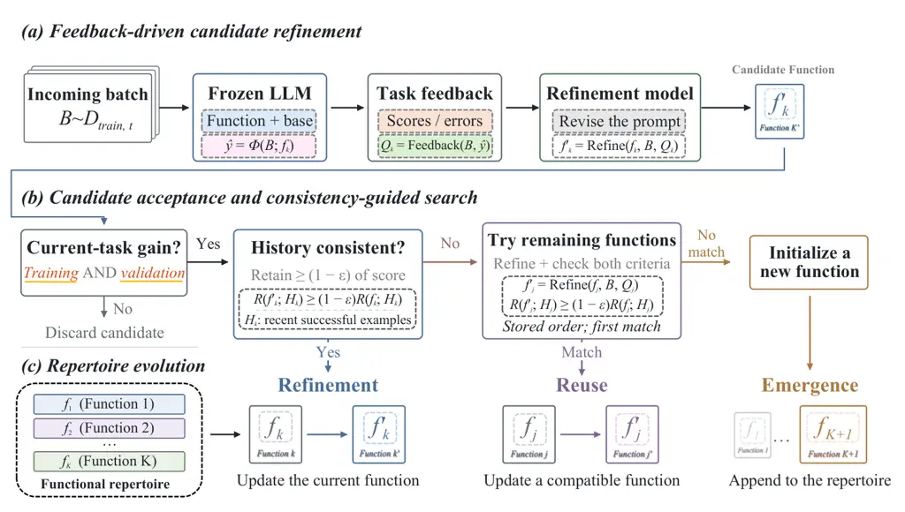

# From a Prompt to Repertoires: Evolving Functional REpertoires Enable LLM Continual Learning

Fengyuan Liu Affiliation: The Chinese University of Hong Kong, Shenzhen
   Yue Wang Affiliation: Shanghai AI Laboratory Affiliation: University
of Science and Technology of China    Hangxi Guo Affiliation: The
Chinese University of Hong Kong, Shenzhen    Fengyuan Liu
Affiliation: Independent Researcher    Chenxu Wu Affiliation: University
of Science and Technology of China    Yanguang Liu Affiliation: New
Jersey Institute of Technology    Mengnan Du
Email: [liuferry708@gmail.com, mengnandu@cuhk.edu.cn^(†)Corresponding
author](mailto:Corresponding%20author) Affiliation: The Chinese
University of Hong Kong, Shenzhen

###### Abstract

Continual learning remains challenging for large language models, which
must enable models to acquire new skills and knowledge without degrading
existing capabilities. Existing approaches typically address this
challenge by carefully designing how model parameters are updated. In
contrast, prompt optimization avoids costly parameter updates while
achieving competitive or even superior performance to reinforcement
learning methods such as GRPO on individual knowledge-intensive and
reasoning tasks. This raises a natural question: Can prompt
optimization, as an efficient adaptation approach, be directly applied
to continual learning? Our analysis shows that, under sequential task
adaptation, it suffers from catastrophic forgetting, while optimized
prompts accumulate rules that overfit to local task distributions. To
address these limitations, we propose _Evolving Functional REpertoires_
(EFRE), which replaces a single prompt with a repertoire of functions
that evolves as new tasks arrive: compatible updates refine existing
functions, while conflicting updates trigger the emergence of new ones.
On a three-task continual-learning stream, EFRE achieves a final average
performance 7.50 percentage points higher than GRPO. Moreover, after
adaptation to the Bio task, its performance on FinQA decreases by only
1.56 percentage points, compared with 25.10 percentage points for the
base prompt optimization method. We further instantiate EFRE in a
minimal agent system and observe consistent improvements across
different backbone models. Overall, these results demonstrate EFRE’s
strong performance in continual learning for large language models and
highlight its substantial potential for continual learning in advanced
agent systems.

|     |
| --- |
|     |

## 1 Introduction

Continual learning is becoming increasingly important for large language
models (LLMs), which need to continually acquire new knowledge and
skills while preserving what they have already learned (Harrington et
al., 2026; Asawa et al., 2026). Most existing approaches address this
challenge by controlling how model parameters are updated, for example
through low-rank adaptation (LoRA) (Hu et al., 2021), replay-based
training (Lopez-Paz and Ranzato, 2017), or reinforcement-learning-based
optimization such as GRPO (Shao et al., 2024) rely on reliable
rewards (Tian et al., 2026; Liu et al., 2026). Although effective, these
methods incur substantial training overhead. Enabling efficient
continual learning remains an open challenge.

Recently, prompt optimization (Pryzant et al., 2023; Yuksekgonul et al.,
2025; Agrawal et al., 2026; Zhang et al., 2026) has emerged as an
efficient approach to adapting LLMs to downstream tasks without
parameter updates. These methods have achieved strong performance on
knowledge-intensive and reasoning tasks, in some cases outperforming
reinforcement learning methods such as GRPO. This naturally raises the
question: Can prompt optimization, as a powerful and efficient
optimization method, be directly applied to continual learning? Our
analysis and prior studies (Harrington et al., 2026) suggest otherwise:
under sequential multi-task learning, repeated prompt updates overwrite
previously learned knowledge and accumulate case-specific rules rather
than generalizable principles, limiting their effectiveness in continual
learning.

Motivated by these limitations, we introduce _Evolving Functional
REpertoires_ (EFRE), a continual learning method that evolves both the
capabilities and composition of a functional repertoire as new learning
tasks arrive. Each function is represented by an optimized prompt.
Historical consistency checks guide this evolution: compatible updates
refine existing functions and enable reuse across tasks, while updates
that cannot be absorbed without compromising historical capabilities
trigger the emergence of new functions. Through this process, functional
specialization and reuse arise automatically, reducing interference
between new and previously learned capabilities.

We evaluate EFRE on the ToolUse (Tang et al., 2023) $`\rightarrow`$
FinQA (Chen et al., 2021) $`\rightarrow`$ SciKE-Bio (Feng et al., 2024)
continual-learning sequence and several single-task benchmarks. With
Qwen3-8B (Qwen Team, 2025a), EFRE achieves a final average score of
58.75, outperforming GRPO (Shao et al., 2024) and GEPA (Agrawal et al.,
2026), while limiting forgetting on previously learned tasks after Bio
to 1.57 points, versus 8.32 for GRPO and 11.82 for GEPA. EFRE also
consistently improves over prompt-optimization and GRPO baselines on
single-task benchmarks. In a minimal agent system spanning six
continual-learning tasks, EFRE similarly outperforms ICL (Brown et al., 2020) and GEPA: it attains average scores of 18.0 with Qwen3-8B (vs.
$`-3.5`$ and 9.5) and 36.3 with GPT-5.6-Luna (OpenAI, 2026) (vs. 22.2
and 29.5). Together, these results demonstrate EFRE’s effectiveness for
both standard and agent continual learning.

Our key contributions are threefold:

- •
  We identify two key limitations of prompt optimization in continual
  learning: updates overwrite previously learned knowledge, causing
  forgetting, and prompts accumulate case-specific rules rather than
  generalizable principles.
- •
  We introduce EFRE, a non-parametric continual learning method whose
  functional repertoire evolves with incoming tasks through the
  refinement and reuse of existing functions and the emergence of new
  ones, guided by historical consistency checks.
- •
  We empirically demonstrate that EFRE improves both continual learning
  and single-task optimization, outperforming existing prompt
  optimization methods and GRPO in overall performance. Further gains in
  agent continual-learning settings highlight its potential for
  continual learning in real-world intelligent systems.

## 2 Related Work

Continual Learning. Continual learning is a learning paradigm that
requires a model to acquire new capabilities while preserving previously
learned knowledge and behaviors. Existing approaches mainly address the
stability–plasticity trade-off through replay (Lopez-Paz and Ranzato,
2017), regularization (Kirkpatrick et al., 2017), parameter
isolation (Rusu et al., 2016), parameter-efficient tuning (Hu et al.,
2021), and reinforcement-learning-based optimization (Shao et al.,
2024). Recent work has further extended continual learning to LLMs and
language agents, where models must continually adapt to new tasks,
knowledge, and interaction environments (Shenfeld et al., 2026; Asawa et
al., 2026). EFRE studies this problem from a non-parametric perspective,
maintaining and evolving external functional contexts rather than
continually updating model parameters.

Non-Parametric Optimization. Non-parametric optimization is a class of
lightweight optimization methods that improves model behavior without
updating model parameters, with prompt optimization being a
representative approach (Pryzant et al., 2023; Yuksekgonul et al.,
2025). Existing methods optimize prompts, contexts, memories, or other
external textual states using task feedback, reflection, or iterative
search (Shinn et al., 2023; Agrawal et al., 2026; Zhang et al., 2026).
Recent prompt optimization methods have demonstrated strong performance
across reasoning, knowledge-intensive, and agent tasks, showing that
textual states can serve as effective optimization targets (Agrawal et
al., 2026; Zhang et al., 2026). Building on this, EFRE organizes the
evolving non-parametric learning state into a repertoire of functional
contexts, enabling prompt optimization to support continual learning
across sequential tasks.



Figure 1: Overview of Evolving Functional REpertoires (EFRE). Each
function is represented by a prompt and evolves through feedback-driven
refinement on incoming data. Candidates that improve current performance
undergo a historical consistency check: compatible updates refine the
current function, while incompatible updates trigger a sequential search
for another function that can absorb them. If no compatible update is
found, a new function emerges. The repertoire thus evolves through
functional refinement, reuse, and emergence, enabling continual
adaptation while preserving previously learned capabilities.

## 3 Methodology

In this section, we introduce _Evolving Functional REpertoires_ (EFRE) .
We first formulate continual learning with frozen LLMs. We then describe
prompt optimization for continual learning and discuss its limitations.
Finally, we present EFRE, which uses historical consistency checks to
guide the refinement of existing functions and the emergence of new ones
as learning tasks arrive (Figure 1).

### 3.1 Problem Statement

We study continual learning for a pretrained language model $`\Phi`$
whose parameters remain fixed. At stage $`t`$, the learner receives a
training batch $`D_{\mathrm{train},t}`$ and updates its external textual
state through $`S_{t}=\mathcal{U}(S_{t-1},D_{\mathrm{train},t})`$, where
$`\mathcal{U}`$ is the update procedure. The state may contain prompts,
skills, or other textual information that guides the model’s behavior.
The objective is to acquire new capabilities while preserving those
learned at earlier stages.

For an evaluation set $`D_{\mathrm{eval}}`$, we define performance as:

```math
R(S;D_{\mathrm{eval}})=\mathrm{Eval}\!\left(\Phi(\cdot;S),D_{\mathrm{eval}}\right), \tag{1}
```

where $`\mathrm{Eval}`$ scores the model conditioned on $`S`$, with
higher values indicating better performance. We use the notation $`R`$
when scoring training, validation, and history data. For
continual-learning evaluation, $`D_{\mathrm{eval},i}`$ denotes the
held-out evaluation set for stage $`i`$ and is never used to update
$`S`$.

Plasticity and Stability. We characterize each update through two
classical properties of continual learning. _Plasticity_ measures its
performance gain on the current task:

```math
\mathcal{J}_{\mathrm{plas}}^{(t)}=R(S_{t};D_{\mathrm{eval},t})-R(S_{t-1};D_{\mathrm{eval},t}). \tag{2}
```

A larger value indicates more effective learning from the incoming data.
_Stability_ measures the average performance change on previously
encountered tasks:

```math
\mathcal{J}_{\mathrm{stab}}^{(t)}=\frac{1}{t-1}\sum_{i=1}^{t-1}\left[R(S_{t};D_{\mathrm{eval},i})-R(S_{t-1};D_{\mathrm{eval},i})\right],\;t>1. \tag{3}
```

Negative values indicate average forgetting, zero indicates no net
change in historical performance, and positive values indicate
beneficial backward transfer (Lopez-Paz and Ranzato, 2017). Effective
continual learning should achieve positive plasticity while limiting
degradation on previous tasks.

### 3.2 Prompt Optimization for Continual Learning

In a continual learning setting, prompt optimization implements
$`S_{t}=\mathcal{U}(S_{t-1},D_{\mathrm{train},t})`$ by rewriting the
prompt represented by $`S_{t-1}`$. At stage $`t`$, the frozen model runs
on $`D_{\mathrm{train},t}`$ using the current prompt. The task
environment returns feedback $`\mathcal{Q}_{t}`$, including performance
scores and, when available, textual feedback such as test results, error
messages, or explanations of incorrect answers. An external refinement
model $`M_{\mathrm{refine}}`$ uses this feedback and the training data
to revise $`S_{t-1}`$:

```math
S_{t}^{\prime}=M_{\mathrm{refine}}(S_{t-1},D_{\mathrm{train},t},\mathcal{Q}_{t}). \tag{4}
```

The candidate replaces the current prompt only if it improves
performance on both the training batch and a separate validation set:

```math
\displaystyle R(S_{t}^{\prime};D_{\mathrm{train},t}) \displaystyle>R(S_{t-1};D_{\mathrm{train},t}), \tag{5}
```

```math
\displaystyle R(S_{t}^{\prime};D_{\mathrm{val},t}) \displaystyle>R(S_{t-1};D_{\mathrm{val},t}).
```

Otherwise, $`S_{t}=S_{t-1}`$. The validation set $`D_{\mathrm{val},t}`$
is used for update selection and is distinct from the held-out
evaluation set $`D_{\mathrm{eval},t}`$.

Our analysis identifies limitations in both stability and plasticity.
The acceptance rule checks current performance but does not explicitly
assess retention on previous tasks. Repeated rewriting can therefore
overwrite instructions that support previously learned capabilities,
causing catastrophic forgetting. Meanwhile, prompts can accumulate
case-specific rules rather than generalizable principles, making new
requirements difficult to accommodate. These limitations motivate EFRE,
which checks historical consistency before accepting updates and allows
functions to emerge when updates cannot be incorporated into existing
functions without compromising historical performance.

### 3.3 EFRE: Evolving Functional REpertoires

We first define functions and their associated repertoire, then describe
how the repertoire evolves during continual learning and supports
inference.

Functions and Functional Repertoire. A _function_ $`f_{k}`$ is a prompt
encoding a learned capability, such as a reasoning procedure or
instructions for handling particular inputs. A _functional repertoire_
$`\mathcal{F}_{t}=\{f_{1},\ldots,f_{K_{t}}\}`$ contains the $`K_{t}`$
functions available at stage $`t`$. Each function maintains a history
$`D_{\mathrm{history},k}`$ of at most $`H`$ recent examples successfully
absorbed by that function. Functions are not assigned to tasks in
advance: one function may serve multiple tasks, and one task may involve
multiple functions. As learning proceeds, both individual functions and
the composition of the repertoire evolve. For local evaluation,
$`R(f_{k};D)`$ denotes the performance of the frozen LLM $`\Phi`$ on
dataset $`D`$, directly conditioned on $`f_{k}`$ and shared base
instructions $`p_{\mathrm{base}}`$.

Repertoire Evolution and Inference. EFRE starts with one function and
subsequently attempts each update on the branch accepted by the most
recent successful update. At stage $`t`$, the frozen LLM runs on
$`D_{\mathrm{train},t}`$ using the current function $`f_{k}`$. The
environment returns feedback $`\mathcal{Q}_{t,k}`$, such as correctness
scores, test results, or execution errors, which the refinement model
uses to propose

```math
f_{k}^{\prime}=M_{\mathrm{refine}}(f_{k},D_{\mathrm{train},t},\mathcal{Q}_{t,k}). \tag{6}
```

Following Equation 5, the candidate must improve performance on both
$`D_{\mathrm{train},t}`$ and $`D_{\mathrm{val},t}`$. If either condition
fails, it is discarded without evaluating other functions.

A candidate that improves current performance must also pass a
_historical consistency check_:

```math
R(f_{k}^{\prime};D_{\mathrm{history},k})\geq(1-\epsilon)\,R(f_{k};D_{\mathrm{history},k}), \tag{7}
```

where scores are nonnegative and $`\epsilon\in[0,1]`$ specifies the
maximum proportional decrease in historical performance. For example,
$`\epsilon=0.1`$ requires retention of at least $`90\%`$ of the original
score. The check is skipped when the history is empty. A passing
candidate replaces the current function, and successfully absorbed
examples are appended to its history, retaining the most recent $`H`$
examples.

If the candidate improves current performance but fails historical
consistency, EFRE searches the remaining functions in their stored
order. For each function, it obtains feedback on the incoming batch and
generates a revision using Equation 6. The search stops at the first
candidate that improves both training and validation performance
relative to its original function and passes Equation 7 on that
function’s own history. Only the matched function and its history
change; the original branch remains unchanged. This enables _functional
reuse_ through compatible updates from different tasks.

If no compatible update is found, the refinement model proposes a new
function using the incoming data and feedback from the failed attempts.
The new function is added only if it improves training and validation
performance relative to the current prompt before this update. Its
history is initialized with up to $`H`$ examples that it successfully
handles. We call this automatic creation of a new function _functional
emergence_. The repertoire can contain at most 50 functions; when this
limit is reached, an update that cannot be absorbed by an existing
function is discarded. After an accepted refinement, reuse, or
emergence, the accepted branch becomes the current function for the next
update. The repertoire thus evolves by incorporating compatible
capabilities into existing functions and creating new ones when
historical incompatibility prevents reuse.

At inference time, a textual selector $`\sigma`$ receives the input and
current function prompts, selects a function, and directs the frozen LLM
to generate a response:

```math
k(x)=\sigma(x;\mathcal{F}_{t}),\;\hat{y}=\Phi\!\left(x;p_{\mathrm{base}},f_{k(x)}\right). \tag{8}
```

The selector uses fixed instructions; its available function prompts
change as the repertoire evolves. No task labels are required. The
shared instructions, repertoire, histories, and selector constitute the
external state $`S_{t}`$. Learning updates this textual state while
keeping the parameters of $`\Phi`$ fixed. Further methodological details
are provided in Appendix D.

## 4 Experiments

We evaluate EFRE on the ToolUse $`\rightarrow`$ FinQA $`\rightarrow`$
SciKE-Bio sequence to assess its continual-learning performance. We
conduct ablation studies and mechanism analyses to examine historical
consistency, function selection, and functional specialization and
reuse. Finally, we evaluate EFRE on benchmarks such as HotpotQA to
assess its effectiveness in single-task optimization.

Figure 2: Functional reuse patterns in continual-learning and
single-task settings. Curves show utilization of the six most-used
functions. (a), (b) report utilization on ToolUse, FinQA, and SciKE-Bio.
(c) compares both refinement configurations for single-task
optimization, with a separate vertical scale. $`\dagger`$ denotes
GPT-5.6-Luna as the refinement model; Qwen3-8B is used otherwise.

Figure 3: Continual-learning performance along the ToolUse
$`\rightarrow`$ FinQA $`\rightarrow`$ SciKE-Bio sequence. Each panel
shows one method, with curves tracking performance on all three tasks
before adaptation and after each learning stage. Stars mark performance
immediately after training on the corresponding task, and shaded regions
indicate the task introduced at each stage. The two color palettes
distinguish Qwen3-8B and GPT-5.6-Luna backbones. EFRE variants are
grouped in the rightmost column; EFRE uses Qwen3-8B for refinement by
defualt; $`\dagger`$ indicates GPT-5.6-Luna instead.

| Setting                | Cross-task reuse | Shared Func. | Func. | Example learned function                                                                                                |
| ---------------------- | ---------------- | ------------ | ----- | ----------------------------------------------------------------------------------------------------------------------- |
| Continual Learning     | 41.7%            | 2            | 7     | Identify the next required action, select a tool, and check its arguments against the tool schema before execution.     |
| Continual Learning^(†) | 56.3%            | 6            | 19    | Extract the relevant financial values and units, write the calculation, and verify its result against the source table. |
| Single-task            | –                | –            | 8     | Decompose the question into two linked subquestions, gather evidence, and synthesize a supported answer.                |
| Single-task^(†)        | –                | –            | 12    | Translate the conditions into equations, solve them, and verify candidates against the original constraints.            |

Table 1: Functional organization of the learned repertoires. For
continual learning, Cross-task reuse denotes the percentage of
evaluation instances routed to functions used by at least two tasks,
averaged equally across ToolUse, FinQA, and SciKE-Bio. Shared Func.
counts functions used by at least two tasks, while Func. denotes total
repertoire size. Cross-task reuse is not defined for single-task
settings, where each benchmark is optimized independently. The final
column illustrates a learned function. Rows marked with $`\dagger`$ use
GPT-5.6-Luna for refinement; others use Qwen3-8B.

### 4.1 Experimental Setup

Benchmark Datasets. We construct a continual-learning sequence using
ToolUse (Tang et al., 2023), FinQA (Chen et al., 2021), and
SciKE-Bio (Feng et al., 2024). After each learning stage, we evaluate
performance on the current and previously encountered tasks. We
additionally conduct single-task experiments on HotpotQA (Yang et al.,
2018), IFBench (Pyatkin et al., 2025), AIME-2025 (Mathematical
Association of America, n.d.), and LiveBench-Math (White et al., 2025),
and evaluate continual learning in agent settings using Continual
Learning Bench (Asawa et al., 2026). We report the benchmark-specific
evaluation metrics. For continual-learning experiments, we also measure
plasticity and stability as defined in Section  3.1, which quantify
improvement on the current task and changes in performance on previous
tasks, respectively.

Comparing Baselines. We compare EFRE with methods that adapt model
parameters or external textual states. Among parameter-based methods,
SFT learns directly from demonstrations through supervised fine-tuning.
SDFT (Shenfeld et al., 2026) performs on-policy self-distillation using
the model conditioned on demonstrations as its teacher. SDPO (Hübotter
et al., 2026) distills predictions from a feedback-conditioned
self-teacher into the policy. GRPO (Shao et al., 2024) performs
reinforcement learning using relative rewards within groups of sampled
responses. In-Place TTT (Feng et al., 2026) adapts selected MLP
projection weights during inference. Among methods that keep model
parameters fixed, GEPA (Agrawal et al., 2026) optimizes prompts through
natural-language reflection on execution traces and evaluation feedback,
while ACE (Zhang et al., 2026) accumulates and refines contextual
playbooks through generation, reflection, and curation. Detailed
baseline configurations are provided in Appendix B.

Implementation Details. For the main experiments and agent
continual-learning experiments, we use Qwen3-8B (Qwen Team, 2025a) and
GPT-5.6-Luna (OpenAI, 2026) as backbone models and also use these two
models for refinement. For ablation studies and mechanism analyses, we
use Qwen3-8B as the backbone and GPT-5.6-Luna as the refinement model.
For single-task experiments, we fix the backbone to Qwen3-8B and
evaluate Qwen3-8B and GPT-5.6-Luna separately as refinement models. All
models are configured with low reasoning effort. Unless otherwise
specified, we set the historical consistency tolerance to
$`\epsilon=0.1`$ and retain the most recent $`H=20`$ successfully
absorbed examples for each function. We use the refinement model with a
dedicated routing prompt to select functions. Single-task optimization
runs once; other experiments are repeated three times, reporting mean
and standard deviation. Further implementation details are provided in
Appendix B.

|                                 |                                         |                                         |                                         |                                         |                                         |                                         |
| ------------------------------- | --------------------------------------- | --------------------------------------- | --------------------------------------- | --------------------------------------- | --------------------------------------- | --------------------------------------- |
| Setting                         | after ToolUse                           |                                         | after FinQA                             |                                         | after Bio                               |                                         |
|                                 | $`\mathcal{J}_{\mathrm{plas}}\uparrow`$ | $`\mathcal{J}_{\mathrm{stab}}\uparrow`$ | $`\mathcal{J}_{\mathrm{plas}}\uparrow`$ | $`\mathcal{J}_{\mathrm{stab}}\uparrow`$ | $`\mathcal{J}_{\mathrm{plas}}\uparrow`$ | $`\mathcal{J}_{\mathrm{stab}}\uparrow`$ |
| GEPA                            | +1.07 ± 0.42                            | –                                       | +30.48 ± 1.73                           | -0.49 ± 0.28                            | +4.59 ± 0.86                            | -11.82 ± 1.24                           |
| GRPO                            | +10.28 ± 0.94                           | –                                       | +39.46 ± 1.65                           | -0.40 ± 0.31                            | +20.58= ± 1.29                          | -8.32 ± 1.07                            |
| History Retention               |                                         |                                         |                                         |                                         |                                         |                                         |
| Last-20                         | +8.60 ± 0.73                            | –                                       | +44.58 ± 1.36                           | +1.49 ± 0.24                            | +19.52 ± 1.08                           | -0.31 ± 0.19                            |
| Last-50                         | +6.76 ± 0.91                            | –                                       | +40.19 ± 1.62                           | +1.48 ± 0.31                            | +16.04 ± 1.27                           | -1.33 ± 0.38                            |
| Last-20+$`D_{val}`$             | +7.69 ± 0.68                            | –                                       | +42.29 ± 1.45                           | +1.59 ± 0.27                            | +17.85 ± 1.16                           | -0.81 ± 0.26                            |
| Tolerance $`\epsilon`$ Settings |                                         |                                         |                                         |                                         |                                         |                                         |
| 0                               | +3.56 ± 0.57                            | –                                       | +31.57 ± 1.84                           | +0.88 ± 0.32                            | +11.46 ± 1.39                           | -3.78 ± 0.61                            |
| 0.1                             | +8.60 ± 0.73                            | –                                       | +44.58 ± 1.36                           | +1.49 ± 0.24                            | +19.52 ± 1.08                           | -0.31 ± 0.19                            |
| 0.2                             | +7.46 ± 0.82                            | –                                       | +41.82 ± 1.51                           | +1.37 ± 0.29                            | +17.35 ± 1.22                           | -0.90 ± 0.34                            |
| 0.5                             | +5.74 ± 0.76                            | –                                       | +37.52 ± 1.68                           | +1.26 ± 0.26                            | +15.29 ± 1.31                           | -1.44 ± 0.43                            |
| 1.0                             | +4.53 ± 0.64                            | –                                       | +34.12 ± 1.79                           | +1.12 ± 0.35                            | +13.04 ± 1.46                           | -2.57 ± 0.52                            |
| Function Selection              |                                         |                                         |                                         |                                         |                                         |                                         |
| First                           | +5.70 ± 0.88                            | –                                       | +38.40 ± 1.67                           | +1.07 ± 0.33                            | +15.43 ± 1.34                           | -1.61 ± 0.46                            |
| Random                          | +5.25 ± 1.12                            | –                                       | +37.61 ± 2.04                           | +1.18 ± 0.41                            | +15.17 ± 1.63                           | -1.44 ± 0.57                            |
| Embedding-20                    | +5.84 ± 0.79                            | –                                       | +38.59 ± 1.58                           | +1.35 ± 0.28                            | +15.75 ± 1.25                           | -1.45 ± 0.39                            |
| Embedding-50                    | +8.34 ± 0.77                            | –                                       | +44.30 ± 1.42                           | +1.46 ± 0.26                            | +19.31 ± 1.14                           | -0.29 ± 0.22                            |
| LLM-selector                    | +8.60 ± 0.73                            | –                                       | +44.58 ± 1.36                           | +1.49 ± 0.24                            | +19.52 ± 1.08                           | -0.31 ± 0.19                            |
| Oracle                          | +12.06 ± 0.65                           | –                                       | +50.76 ± 1.21                           | +1.94 ± 0.23                            | +24.35 ± 0.97                           | -0.32 ± 0.18                            |

Table 2: Ablation studies on history retention, parameter settings, and
function selection along the ToolUse $`\rightarrow`$ FinQA
$`\rightarrow`$ Bio stream. $`\mathcal{J}_{\mathrm{plas}}`$ measures the
score change on the current task, while $`\mathcal{J}_{\mathrm{stab}}`$
measures the mean score change over previously encountered tasks with
equal weights. Values are reported in percentage points; higher is
better. Stability is undefined at the first stage and denoted by –.
Baselines are shown in light beige, default configurations are shaded
light blue, and the oracle reference is shown in gray. Bold means with
pale gold shading indicate the best result in each column within each
ablation group, excluding the baseline and oracle references.

### 4.2 Main Results

Observation 1: EFRE achieves strong continual-learning performance and
exhibits functional reuse and specialization. We evaluate Qwen3-8B and
GPT-5.6-Luna as backbone models; $`\dagger`$ denotes GPT-5.6-Luna
refinement, while variants without $`\dagger`$ use Qwen3-8B. Figure 3
shows that EFRE learns new tasks while largely preserving earlier gains.
With Qwen3-8B, EFRE^(†) loses only 1.56 percentage points on FinQA after
Bio adaptation, compared with 25.10 for GEPA and 9.43 for ACE, and
reaches final ToolUse/FinQA/Bio scores of $`66.21/68.26/54.83`$. With
GPT-5.6-Luna, it retains $`73.76\%`$ FinQA accuracy, versus $`46.24\%`$
for GEPA and $`47.28\%`$ for ACE. Together, these results show a
stronger balance between new-task adaptation and retention of previously
learned capabilities. Figures 2(a,b) further show that the learned
repertoire combines specialization with cross-task reuse. For example,
in panel (a), $`f_{1}`$, $`f_{3}`$, and $`f_{5}`$ predominantly serve
ToolUse, FinQA, and Bio, respectively, whereas $`f_{6}`$ is shared
across all three tasks, with utilization rates of $`17\%`$, $`16\%`$,
and $`19\%`$. Table 1 quantifies this behavior through cross-task reuse
and the number of shared functions, while the example prompts illustrate
distinct functional roles. Thus, EFRE does not simply allocate an
independent prompt to each task, but develops specialized and reusable
functional contexts.

### 4.3 Ablation Study and Mechanism Analysis

Observation 2: Historical consistency improves continual-learning
performance by better balancing plasticity and stability. Table 2 varies
history retention and tolerance separately, holding other
hyperparameters fixed. We compare the most recent 20 examples (Last-20),
50 examples (Last-50), and 20 examples supplemented with validation data
(Last-20+$`D_{\mathrm{val}}`$), using plasticity and stability defined
in Equation. 2 and 3. Last-20 yields the highest plasticity at every
stage and the least historical degradation after Bio, showing that more
history does not necessarily improve learning. Among the tested
tolerances, $`\epsilon=0.1`$ achieves the best plasticity and stability
at every applicable stage. Its Bio-stage plasticity is +19.52 points,
versus +11.46 with strict preservation ($`\epsilon=0`$) and +13.04
without a historical performance constraint ($`\epsilon=1`$). It exceeds
GEPA (+4.59) and approaches GRPO (+20.58), with stability of -0.31
points, versus -11.82 and -8.32, respectively. These results favor a
moderate constraint supporting new learning while preserving earlier
capabilities.

|            |          |         |           |                |           |             |
| ---------- | -------- | ------- | --------- | -------------- | --------- | ----------- |
| Method     | HotpotQA | IFBench | AIME-2025 | LiveBench Math | Aggregate | Improvement |
| Base       | 42.33    | 36.90   | 27.33     | 48.70          | 38.82     | –           |
| GRPO       | 43.33    | 35.88   | 38.00     | 51.26          | 42.12     | +3.30       |
| ACE        | 60.00    | 35.72   | 31.00     | 52.76          | 44.87     | +6.06       |
| GEPA       | 62.33    | 38.61   | 32.00     | 51.95          | 46.22     | +7.41       |
| GEPA+Merge | 64.33    | 28.23   | 32.00     | 51.95          | 44.13     | +5.31       |
| EFRE       | 70.67    | 39.26   | 34.33     | 51.88          | 49.04     | +10.22      |
| EFRE^(†)   | 72.33    | 42.38   | 36.00     | 54.32          | 51.26     | +12.44      |

Table 3: Performance comparison across four benchmarks. Both EFRE
configurations use Qwen3-8B as the backbone. EFRE and EFRE^(†) use
Qwen3-8B and GPT-5.6-Luna as the refinement model, respectively.
Aggregate is the unweighted mean across benchmarks, and Improvement is
the percentage-point gain over Base. EFRE and EFRE^(†) are shaded light
blue and darker blue, respectively. Bold means indicate the best result
in each column.

Observation 3: LLM-based selection enables effective use of the
functional repertoire. Table 2 compares selection strategies with other
hyperparameters fixed. First always selects the first function, while
Random samples uniformly. Embedding-20 and Embedding-50 use
Qwen3-Embedding-0.6B fine-tuned on 20 and 50 historical examples per
function for retrieval. The LLM selector chooses from the function
prompts based on the input, whereas Oracle evaluates all functions and
selects the highest-scoring output, providing an upper-bound reference
within the repertoire. The LLM selector achieves the highest non-oracle
plasticity at every stage and better stability than First and Random.
Embedding-50 yields slightly better Bio-stage stability (-0.29 versus
-0.31 points), but lower plasticity throughout. Oracle further improves
Bio-stage plasticity from +19.52 to +24.35 with comparable stability,
indicating room to improve selection within the existing repertoire.

Observation 4: Functional repertoires also benefit single-task
optimization. Table 3 shows that EFRE achieves an aggregate score of
49.04 across four benchmarks, compared with 46.22 for GEPA, 44.87 for
ACE, and 42.12 for GRPO. Using GPT-5.6-Luna for refinement further
improves the aggregate score to 51.26. Figure 2(c) shows that, even
within independently optimized single-task settings, utilization is
distributed across multiple functions rather than concentrated in a
single context. Table 1 reports repertoires of 8 and 12 functions under
the two refinement settings, with example functions capturing distinct
procedures such as evidence decomposition and equation-based reasoning.
These results suggest that functional differentiation is useful beyond
continual learning: multiple specialized procedures can emerge within a
single task even without task transitions.

| Method       | Blind Spectrum Monitoring | Codebase Adaptation | Cohort Studies | Database Exploration | Exploitable Poker | Sales Prediction |
| ------------ | ------------------------- | ------------------- | -------------- | -------------------- | ----------------- | ---------------- |
| Qwen3-8B     |                           |                     |                |                      |                   |                  |
| \+ ICL       | 12.0 ± 5.6                | -32.0 ± 8.4         | -28.0 ± 7.9    | 10.0 ± 5.1           | -8.0 ± 6.7        | 25.0 ± 6.2       |
| \+ GEPA      | 26.0 ± 4.8                | -15.0 ± 7.2         | -18.0 ± 6.8    | 22.0 ± 4.6           | 0.0 ± 5.9         | 42.0 ± 5.3       |
| \+ ACE       | 2.0 ± 4.4                 | -10.0 ± 6.9         | -24.0 ± 7.3    | 5.0 ± 4.8            | -5.0 ± 5.6        | 15.0 ± 5.9       |
| + EFRE       | 35.0 ± 4.1                | -5.0 ± 6.2          | -10.0 ± 6.0    | 30.0 ± 4.2           | 6.0 ± 5.1         | 52.0 ± 4.7       |
| GPT-5.6-Luna |                           |                     |                |                      |                   |                  |
| \+ ICL       | 36.0 ± 4.3                | 12.0 ± 6.4          | 0.0 ± 5.8      | 27.0 ± 4.5           | -2.0 ± 5.3        | 60.0 ± 4.8       |
| \+ GEPA      | 44.0 ± 3.8                | 18.0 ± 5.7          | 4.0 ± 5.4      | 35.0 ± 4.0           | 8.0 ± 4.8         | 68.0 ± 4.2       |
| \+ ACE       | 8.0 ± 4.1                 | 25.0 ± 5.9          | -7.0 ± 6.1     | 12.0 ± 4.4           | 2.0 ± 5.0         | 18.0 ± 5.2       |
| + EFRE       | 52.0 ± 3.5                | 25.0 ± 5.2          | 8.0 ± 4.9      | 42.0 ± 3.7           | 15.0 ± 4.4        | 76.0 ± 3.9       |

Table 4: Minimal agent results across six interactive environments with
two backbones. Each backbone uses ICL, GEPA, ACE, or EFRE. Values are
mean ± standard deviation; higher is better. EFRE rows are light blue.
Bold means indicate the best result within each backbone, including
ties.

## 5 Extension: EFRE for Agent Continual Learning

Motivated by EFRE’s effectiveness in LLM continual learning, we extend
it to a minimal agent system to examine whether its learning mechanism
remains effective when training data arise from environmental
interactions.

A Minimal Continual-Learning Agent. We adopt the lightweight scaffold
from Continual Learning Bench (Asawa et al., 2026) and integrate all
methods into the same agent–environment interaction loop. In EFRE, a
single frozen LLM performs task execution, function selection, and
refinement. Given the current observation, it selects a function and
generates actions under its prompt. Interaction feedback guides
functional updates, while historical consistency checks govern their
acceptance, reuse in another branch, or functional emergence. Adaptation
updates the external repertoire while keeping the selector instructions
and model parameters fixed.

Evaluation Results. We evaluate six tasks from Continual Learning Bench:
Blind Spectrum Monitoring, Codebase Adaptation, Cohort Studies, Database
Exploration, Exploitable Poker, and Sales Prediction. Table 4 shows that
EFRE achieves the highest mean score on all six tasks with Qwen3-8B. Its
unweighted average is 18.0, versus 9.5 for GEPA (Agrawal et al., 2026)
and -3.5 for ICL (Brown et al., 2020). Gains include Codebase Adaptation
(-5.0 versus GEPA’s -15.0) and Sales Prediction (52.0 versus 42.0). With
GPT-5.6-Luna (OpenAI, 2026), EFRE averages 36.3, versus 29.5 for GEPA
and 22.2 for ICL. It exceeds the strongest baseline on five tasks and
matches ACE on Codebase Adaptation. These gains across environments and
backbones extend EFRE’s benefits to agent continual learning through
learning from ongoing environmental interactions.

## 6 Conclusions

We introduced EFRE, a non-parametric continual learning method that
evolves a repertoire of functions represented by prompts while keeping
the underlying LLM fixed. Historical consistency checks guide the
refinement and reuse of existing functions and the emergence of new
ones, allowing the repertoire to adapt as learning tasks arrive.
Experiments show that EFRE reduces forgetting and improves overall
continual-learning performance, with functional specialization and reuse
also benefiting single-task optimization. Ablation studies support the
roles of historical consistency and function selection, while an
extension to a minimal agent system demonstrates gains in interactive
environments. Together, these findings suggest that evolving functional
repertoires offer a promising approach to continual learning without
model parameter updates. Moreover, EFRE can be naturally extended to
agent settings, where its evolving functional repertoire supports
continual adaptation from ongoing interactions with dynamic
environments.

## References

- Agrawal et al. (2026) L. A. Agrawal, S. Tan, D. Soylu, N. Ziems, R.
  Khare, K. Opsahl-Ong, A. Singhvi, H. Shandilya, M. J. Ryan, M.
  Jiang, C. Potts, K. Sen, A. Dimakis, I. Stoica, D. Klein, M. Zaharia,
  and O. Khattab GEPA: reflective prompt evolution can outperform
  reinforcement learning. In International Conference on Learning
  Representations, External Links:
  [Link](https://proceedings.iclr.cc/paper_files/paper/2026/hash/0e9e708b6f48e14fd0ac29e167413f76-Abstract-Conference.html)
  Cited by: §1, §1, §2, §4.1, §5.
- Asawa et al. (2026) P. Asawa, C. M. Glaze, G. Orlanski, R.
  Ramakrishnan, B. Xu, A. Biswal, V. S. Chen, F. Sala, M. Zaharia,
  and J. E. Gonzalez Continual learning bench: evaluating frontier AI
  systems in real-world stateful environments. arXiv preprint
  arXiv:2606.05661. External Links:
  [Link](https://arxiv.org/abs/2606.05661) Cited by: 1st item, §B.3, §1,
  §2, §4.1, §5.
- Brown et al. (2020) T. B. Brown, B. Mann, N. Ryder, M. Subbiah, J.
  Kaplan, P. Dhariwal, A. Neelakantan, P. Shyam, G. Sastry, A.
  Askell, S. Agarwal, A. Herbert-Voss, G. Krueger, T. Henighan, R.
  Child, A. Ramesh, D. M. Ziegler, J. Wu, C. Winter, C. Hesse, M.
  Chen, E. Sigler, M. Litwin, S. Gray, B. Chess, J. Clark, C. Berner, S.
  McCandlish, A. Radford, I. Sutskever, and D. Amodei Language models
  are few-shot learners. In Advances in Neural Information Processing
  Systems, Vol. 33. External Links:
  [Link](https://papers.nips.cc/paper/2020/hash/1457c0d6bfcb4967418bfb8ac142f64a-Abstract.html)
  Cited by: §1, §5.
- Chen et al. (2021) Z. Chen, W. Chen, C. Smiley, S. Shah, I. Borova, D.
  Langdon, R. Moussa, M. Beane, T. Huang, B. Routledge, and W. Y. Wang
  FinQA: a dataset of numerical reasoning over financial data. In
  Proceedings of the 2021 Conference on Empirical Methods in Natural
  Language Processing, pp. 3697–3711. External Links:
  [Link](https://aclanthology.org/2021.emnlp-main.300/),
  [Document](https://dx.doi.org/10.18653/v1/2021.emnlp-main.300) Cited
  by: 2nd item, §1, §4.1.
- Feng et al. (2026) G. Feng, S. Luo, K. Hua, G. Zhang, D. He, W. Huang,
  and T. Cai In-place test-time training. External Links: 2604.06169,
  [Link](https://arxiv.org/abs/2604.06169) Cited by: §4.1.
- Feng et al. (2024) K. Feng, X. Shen, W. Wang, X. Zhuang, Y. Tang, Q.
  Zhang, and K. Ding SciKnowEval: evaluating multi-level scientific
  knowledge of large language models. arXiv preprint arXiv:2406.09098.
  External Links: [Link](https://arxiv.org/abs/2406.09098) Cited by: 3rd
  item, §1, §4.1.
- Harrington et al. (2026) A. Harrington, N. Saxena, M. Murphy, A.
  Borovykh, Z. Yun, S. Kamath, A. E. Kyi, T. Darrell, J. Malik, and Y.
  Bai When does continual learning require learning. arXiv preprint
  arXiv:2607.07847. External Links:
  [Link](https://arxiv.org/abs/2607.07847) Cited by: §A.1, §B.2, §1, §1.
- Hu et al. (2021) E. J. Hu, Y. Shen, P. Wallis, Z. Allen-Zhu, Y. Li, S.
  Wang, L. Wang, and W. Chen LoRA: low-rank adaptation of large language
  models. External Links: 2106.09685,
  [Link](https://arxiv.org/abs/2106.09685) Cited by: §1, §2.
- Hübotter et al. (2026) J. Hübotter, F. Lübeck, L. Behric, A.
  Baumann, M. Bagatella, D. Marta, I. Hakimi, I. Shenfeld, T. Kleine
  Buening, C. Guestrin, and A. Krause Reinforcement learning via
  self-distillation. External Links: 2601.20802,
  [Link](https://arxiv.org/abs/2601.20802) Cited by: §4.1.
- Kirkpatrick et al. (2017) J. Kirkpatrick, R. Pascanu, N.
  Rabinowitz, J. Veness, G. Desjardins, A. A. Rusu, K. Milan, J.
  Quan, T. Ramalho, A. Grabska-Barwinska, D. Hassabis, C. Clopath, D.
  Kumaran, and R. Hadsell Overcoming catastrophic forgetting in neural
  networks. Proceedings of the National Academy of Sciences 114 (13),
  pp. 3521–3526. External Links:
  [Document](https://dx.doi.org/10.1073/pnas.1611835114),
  [Link](https://doi.org/10.1073/pnas.1611835114) Cited by: §2.
- Liu et al. (2026) F. Liu, Y. Miao, Z. He, Y. Liu, F. Sun, and M. Du
  DynaCF: mitigating shortcut learning in reward models via dynamic
  counterfactual sensitivity. arXiv preprint arXiv:2606.09043. External
  Links: [Document](https://dx.doi.org/10.48550/arXiv.2606.09043),
  [Link](https://arxiv.org/abs/2606.09043) Cited by: §1.
- Lopez-Paz and Ranzato (2017) D. Lopez-Paz and M. Ranzato Gradient
  episodic memory for continual learning. In Advances in Neural
  Information Processing Systems, Vol. 30. External Links:
  [Link](https://papers.nips.cc/paper/2017/hash/f87522788a2be2d171666752f97ddebb-Abstract.html)
  Cited by: §B.3, §1, §2, §3.1.
- Loshchilov and Hutter (2019) I. Loshchilov and F. Hutter Decoupled
  weight decay regularization. In International Conference on Learning
  Representations, External Links:
  [Link](https://openreview.net/forum?id=Bkg6RiCqY7) Cited by: §B.1.
- Mathematical Association of America (n.d.) Mathematical Association of
  America MAA invitational competitions. Note: Section: American
  Invitational Mathematics Examination (AIME) External Links:
  [Link](https://maa.org/maa-invitational-competitions/) Cited by: 3rd
  item, §4.1.
- OpenAI (2026) OpenAI GPT-5.6 Luna model. Note: OpenAI API model
  documentation External Links:
  [Link](https://developers.openai.com/api/docs/models/gpt-5.6-luna)
  Cited by: 3rd item, §1, §4.1, §5.
- Pryzant et al. (2023) R. Pryzant, D. Iter, J. Li, Y. Lee, C. Zhu,
  and M. Zeng Automatic prompt optimization with “gradient descent” and
  beam search. In Proceedings of the 2023 Conference on Empirical
  Methods in Natural Language Processing, pp. 7957–7968. External Links:
  [Link](https://aclanthology.org/2023.emnlp-main.494/),
  [Document](https://dx.doi.org/10.18653/v1/2023.emnlp-main.494) Cited
  by: §1, §2.
- Pyatkin et al. (2025) V. Pyatkin, S. Malik, V. Graf, H. Ivison, S.
  Huang, P. Dasigi, N. Lambert, and H. Hajishirzi Generalizing
  verifiable instruction following. In Advances in Neural Information
  Processing Systems, Vol. 38. External Links:
  [Link](https://proceedings.neurips.cc/paper_files/paper/2025/hash/46499a0622ecf568b72d17b61e45dbd5-Abstract-Datasets_and_Benchmarks_Track.html),
  [Document](https://dx.doi.org/10.52202/085713-1645) Cited by: 2nd
  item, §4.1.
- Qwen Team (2025a) Qwen Team Qwen3-8B model card. Note: Hugging
  FaceAccessed September 23, 2026 External Links:
  [Link](https://huggingface.co/Qwen/Qwen3-8B) Cited by: 2nd item, §1,
  §4.1.
- Qwen Team (2025b) Qwen Team Qwen3-Embedding-0.6B model card. Note:
  Hugging FaceAccessed September 23, 2026 External Links:
  [Link](https://huggingface.co/Qwen/Qwen3-Embedding-0.6B) Cited by: 1st
  item.
- Rusu et al. (2016) A. A. Rusu, N. C. Rabinowitz, G. Desjardins, H.
  Soyer, J. Kirkpatrick, K. Kavukcuoglu, R. Pascanu, and R. Hadsell
  Progressive neural networks. arXiv preprint arXiv:1606.04671. External
  Links: [Link](https://arxiv.org/abs/1606.04671) Cited by: §2.
- Shao et al. (2024) Z. Shao, P. Wang, Q. Zhu, R. Xu, J. Song, X. Bi, H.
  Zhang, M. Zhang, Y. K. Li, Y. Wu, and D. Guo DeepSeekMath: pushing the
  limits of mathematical reasoning in open language models. arXiv
  preprint arXiv:2402.03300. External Links:
  [Link](https://arxiv.org/abs/2402.03300) Cited by: §1, §1, §2, §4.1.
- Shenfeld et al. (2026) I. Shenfeld, M. Damani, J. Hübotter, and P.
  Agrawal Self-distillation enables continual learning. External Links:
  2601.19897, [Link](https://arxiv.org/abs/2601.19897) Cited by: §2,
  §4.1.
- Shinn et al. (2023) N. Shinn, F. Cassano, A. Gopinath, K. Narasimhan,
  and S. Yao Reflexion: language agents with verbal reinforcement
  learning. In Advances in Neural Information Processing Systems, Vol. 36. External Links:
  [Link](https://papers.nips.cc/paper_files/paper/2023/hash/1b44b878bb782e6954cd888628510e90-Abstract-Conference.html),
  [Document](https://dx.doi.org/10.52202/075280-0377) Cited by: §2.
- Tang et al. (2023) Q. Tang, Z. Deng, H. Lin, X. Han, Q. Liang, B. Cao,
  and L. Sun ToolAlpaca: generalized tool learning for language models
  with 3000 simulated cases. arXiv preprint arXiv:2306.05301. External
  Links: [Link](https://arxiv.org/abs/2306.05301) Cited by: 1st item,
  §1, §4.1.
- Tian et al. (2026) J. Tian, F. Liu, J. Han, Y. Jiang, Y. Wu, Y.
  Liu, H. Li, F. Xu, and W. Li Auto-Rubric as reward: from implicit
  preferences to explicit multimodal generative criteria. arXiv preprint
  arXiv:2605.08354. External Links:
  [Document](https://dx.doi.org/10.48550/arXiv.2605.08354),
  [Link](https://arxiv.org/abs/2605.08354) Cited by: §1.
- White et al. (2025) C. White, S. Dooley, M. Roberts, A. Pal, B.
  Feuer, S. Jain, R. Shwartz-Ziv, N. Jain, K. Saifullah, S. Dey,
  Shubh-Agrawal, S. Sandha, S. Naidu, C. Hegde, Y. LeCun, T.
  Goldstein, W. Neiswanger, and M. Goldblum LiveBench: a challenging,
  contamination-limited LLM benchmark. In International Conference on
  Learning Representations, External Links:
  [Link](https://proceedings.iclr.cc/paper_files/paper/2025/hash/e4a46394ba5378b3f9a186a5b4c650d1-Abstract-Conference.html)
  Cited by: 4th item, §4.1.
- Yang et al. (2018) Z. Yang, P. Qi, S. Zhang, Y. Bengio, W. W.
  Cohen, R. Salakhutdinov, and C. D. Manning HotpotQA: a dataset for
  diverse, explainable multi-hop question answering. In Proceedings of
  the 2018 Conference on Empirical Methods in Natural Language
  Processing, pp. 2369–2380. External Links:
  [Link](https://aclanthology.org/D18-1259/),
  [Document](https://dx.doi.org/10.18653/v1/D18-1259) Cited by: 1st
  item, §4.1.
- Yuksekgonul et al. (2025) M. Yuksekgonul, F. Bianchi, J. Boen, S.
  Liu, P. Lu, Z. Huang, C. Guestrin, and J. Zou Optimizing generative AI
  by backpropagating language model feedback. Nature 639, pp. 609–616.
  External Links:
  [Link](https://www.nature.com/articles/s41586-025-08661-4),
  [Document](https://dx.doi.org/10.1038/s41586-025-08661-4) Cited by:
  §1, §2.
- Zhang et al. (2026) Q. Zhang, C. Hu, S. Upasani, B. Ma, F. Hong, V.
  Kamanuru, J. Rainton, C. Wu, M. Ji, H. Li, U. Thakker, J. Zou, and K.
  Olukotun Agentic Context Engineering: evolving contexts for
  self-improving language models. In International Conference on
  Learning Representations, External Links:
  [Link](https://openreview.net/forum?id=eC4ygDs02R) Cited by: §1, §2,
  §4.1.

## Appendix A Datasets, Benchmarks, and Models

### A.1 Datasets and Benchmarks

LLM Continual Learning. We use the ToolUse, FinQA, and SciKE-Bio
datasets and evaluation protocols provided by (Harrington et al., 2026),
following the sequence ToolUse $`\rightarrow`$ FinQA $`\rightarrow`$
SciKE-Bio.

- •
  ToolUse. ToolUse evaluates tool selection and argument construction
  from natural-language requests. It is derived from ToolAlpaca, which
  contains 3,938 simulated tool-use instances covering over 400 APIs
  across 50 categories (Tang et al., 2023). Each input provides a
  request and relevant tool information, and the model produces the
  corresponding tool calls. We use it to study the acquisition and
  retention of tool-use capabilities.
- •
  FinQA. FinQA is a financial question-answering dataset containing
  expert-annotated questions over financial reports, together with
  numerical answers and reasoning programs (Chen et al., 2021).
  Questions require integrating evidence from text and tables and
  performing calculations involving quantities such as percentages,
  changes, and ratios. We use it to study continual learning of
  financial numerical reasoning.
- •
  SciKE-Bio. SciKE-Bio is a multiple-choice biology subset derived from
  SciKnowEval, a benchmark covering scientific knowledge in biology,
  chemistry, physics, and materials science (Feng et al., 2024). As the
  final task in the sequence, it allows us to examine scientific
  knowledge acquisition and its effects on previously learned
  capabilities.

Single-Task Optimization. We use four benchmarks to assess whether EFRE
also improves learning within individual tasks.

- •
  HotpotQA. HotpotQA is a Wikipedia-based multi-hop question-answering
  benchmark with annotated answers and supporting facts (Yang et al.,
  2018). Its questions require combining evidence across documents,
  including identifying connections between entities and comparing their
  attributes. We use it to assess multi-hop reasoning and evidence-based
  question answering.
- •
  IFBench. IFBench evaluates instruction following through automatically
  verifiable constraints, including output formatting, lexical
  requirements, and combinations of instructions (Pyatkin et al., 2025).
  It emphasizes generalization to constraints beyond those encountered
  during training. We use it to assess the model’s ability to follow
  diverse instructions.
- •
  AIME-2025. AIME-2025 contains the 30 problems from the two 2025
  American Invitational Mathematics Examinations (Mathematical
  Association of America, n.d.). These problems require
  competition-level mathematical reasoning and have integer answers. We
  use it to assess mathematical problem solving.
- •
  LiveBench-Math. LiveBench-Math is the mathematical subset of
  LiveBench, a regularly updated benchmark with automatically checkable
  answers (White et al., 2025). We use it to assess mathematical
  reasoning on an additional set of problems.

Agent Continual Learning.

- •
  Continual Learning Bench. Continual Learning Bench evaluates continual
  adaptation through sequential interactions in stateful
  environments (Asawa et al., 2026). Its tasks require agents to
  accumulate information, learn recurring environmental structure, and
  adapt to changes across interactions. We evaluate six environments:
  Blind Spectrum Monitoring, Codebase Adaptation, Cohort Studies,
  Database Exploration, Exploitable Poker, and Sales Prediction.
  Together, they test whether EFRE supports continual learning from
  agent–environment interactions.

### A.2 Models

- •
  Qwen3-Embedding-0.6B. Qwen3-Embedding-0.6B is an instruction-aware
  text embedding model with approximately 0.6 billion parameters, a
  32K-token context window, and configurable embedding dimensions from
  32 to 1,024 (Qwen Team, 2025b). We use it for the Embedding-20 and
  Embedding-50 function-selection baselines, fine-tuning on 20 and 50
  historical examples per function, respectively.
- •
  Qwen3-8B. Qwen3-8B is an open-weight language model with 8.2 billion
  parameters and a native context window of 32,768 tokens, supporting
  both thinking and non-thinking modes (Qwen Team, 2025a). We use it as
  a backbone, refinement model, and function selector in the
  corresponding experimental configurations. Its parameters remain fixed
  under EFRE.
- •
  GPT-5.6-Luna. GPT-5.6-Luna is an API-served language model supporting
  reasoning, tool calling, and structured outputs (OpenAI, 2026). We use
  it as a backbone, refinement model, and function selector, with
  reasoning effort set to Low. EFRE^(†) uses GPT-5.6-Luna for
  refinement, whereas EFRE without $`\dagger`$ uses Qwen3-8B.

## Appendix B Implementation Details

### B.1 Hyperparameters

Table 5 summarizes the default EFRE configuration. Unless otherwise
specified, we use a micro-batch size of 3, retain the 20 most recent
successfully absorbed examples per function, and set the historical
consistency tolerance to 0.1. The maximum repertoire size is 50. The
backbone and refinement models follow the configurations reported in
each experiment. All experiments are repeated three times.

|                                               |                          |
| --------------------------------------------- | ------------------------ |
| Hyperparameter                                | Setting                  |
| Micro-batch size                              | 3                        |
| History capacity $`H`$                        | 20 examples per function |
| Historical consistency tolerance $`\epsilon`$ | 0.1                      |
| Maximum number of functions                   | 50                       |
| Backbone model                                | Qwen3-8B, GPT-5.6-Luna   |
| Refinement model                              | Qwen3-8B, GPT-5.6-Luna   |
| Backbone reasoning effort                     | Low                      |
| Refinement reasoning effort                   | Low                      |
| Embedding model                               | Qwen3-Embedding-0.6B     |

Table 5: Default EFRE hyperparameters. Model choices correspond to the
experimental configurations reported in the main text.

Table 6 summarizes optimizer and batch-size settings for the comparison
methods. Parameter-updating methods use AdamW (Loshchilov and Hutter, 2019) with a batch size of 16; GEPA and ACE use batches of 3 examples
for textual updates. The Embedding-20 and Embedding-50 ablations
restrict embedding-model training to 20 and 50 historical examples per
function, respectively.

| Method       | Optimizer | Batch size |
| ------------ | --------- | ---------- |
| SFT          | AdamW     | 16         |
| SDFT         | AdamW     | 16         |
| SDPO         | AdamW     | 16         |
| GRPO         | AdamW     | 16         |
| In-Place TTT | AdamW     | 16         |
| GEPA         | –         | 3          |
| ACE          | –         | 3          |
| ICL          | –         | –          |

Table 6: Optimizer and batch-size settings for comparison methods. A
dash indicates that the setting is not applicable.

### B.2 Dataset Setup

For LLM continual learning, we follow the dataset setup of (Harrington
et al., 2026), with tasks arriving in the order ToolUse $`\rightarrow`$
FinQA $`\rightarrow`$ SciKE-Bio. Each single-task benchmark is optimized
independently. Training, validation, and evaluation splits are disjoint
and shared across methods. Training data provide optimization examples
and feedback, validation data support update selection, and evaluation
data measure performance. Function histories are drawn from training
data; the Last-20+$`D_{\mathrm{val}}`$ ablation additionally uses
validation data for consistency checks. For AIME-2025, training and
validation questions come from 2022–2024, while evaluation uses the 30
questions from 2025. Agent continual learning follows ordered
interactions in Continual Learning Bench rather than a static three-way
split. Updates use only information available from completed
interactions.

### B.3 Evaluation Protocols

Task Scoring. We evaluate each benchmark on its held-out evaluation set
$`D_{\mathrm{eval}}`$ using the official scoring criteria. Evaluation
examples are excluded from training, prompt refinement, and update
selection. The same evaluation sets and scoring procedures are used
across methods.

Evaluation Matrix. Let $`T`$ denote the number of tasks in the
continual-learning sequence, $`S_{0}`$ the initial learner state, and
$`S_{t}`$ the state after learning task $`t`$. For EFRE, $`S_{t}`$
includes the functional repertoire and selector, while the backbone
parameters remain fixed. For parameter-updating baselines, evaluation
uses the model checkpoint obtained after the corresponding stage.

We evaluate every task before learning begins and after each learning
stage, forming the performance matrix

```math
A_{t,i}=R(S_{t};D_{\mathrm{eval},i}),\;0\leq t\leq T,\quad 1\leq i\leq T, \tag{9}
```

where $`A_{t,i}`$ is the score on task $`i`$ after stage $`t`$. Each row
therefore describes one learner state across all tasks, and each column
tracks performance on one task throughout learning. Row $`t=0`$ contains
the initial scores before any adaptation.

Evaluation leaves the learner unchanged. For EFRE, each input is routed
by the function selector, and the selected function is used to generate
the response. Reported scores thus evaluate the complete system,
including function selection. Oracle selection is used only in the
explicitly designated oracle ablation. For the LLM continual-learning
experiments, we express $`A_{t,i}`$ on a 0–100 scale; differences
between these scores are reported in percentage points.

Plasticity. Plasticity measures how much learning at stage $`t`$
improves performance on the current task:

```math
\mathcal{J}_{\mathrm{plas}}^{(t)}=A_{t,t}-A_{t-1,t}. \tag{10}
```

Here, $`A_{t-1,t}`$ is the score on task $`t`$ immediately before
learning it, and $`A_{t,t}`$ is the score immediately afterward. The
comparison therefore isolates the performance change during the current
stage, including when earlier learning has already affected the current
task. A positive value indicates improvement, zero indicates no change,
and a negative value indicates degradation.

For the ToolUse $`\rightarrow`$ FinQA $`\rightarrow`$ SciKE-Bio
sequence, the three plasticity values are

```math
\displaystyle\mathcal{J}_{\mathrm{plas}}^{(1)} \displaystyle=A_{1,1}-A_{0,1}, \tag{11}
```

```math
\displaystyle\mathcal{J}_{\mathrm{plas}}^{(2)} \displaystyle=A_{2,2}-A_{1,2},
```

```math
\displaystyle\mathcal{J}_{\mathrm{plas}}^{(3)} \displaystyle=A_{3,3}-A_{2,3}.
```

For example, FinQA plasticity compares its score after FinQA adaptation
with its score after ToolUse adaptation, rather than with the initial
model’s FinQA score.

Stability. Stability measures how learning at stage $`t`$ changes
performance on previously learned tasks:

```math
\mathcal{J}_{\mathrm{stab}}^{(t)}=\frac{1}{t-1}\sum_{i=1}^{t-1}\left(A_{t,i}-A_{t-1,i}\right),\;t>1. \tag{12}
```

For each previous task, we compare its scores immediately before and
after the current stage, then average these changes with equal weight
across tasks. This weighting prevents tasks with larger evaluation sets
from dominating the measure.

A negative value indicates average forgetting, zero indicates no net
change in previous-task performance, and a positive value indicates
average improvement. Because the measure averages across tasks, gains on
one task can offset losses on another. We therefore report individual
task scores alongside the aggregate stability measure. Stability is
undefined at the first stage, when no previous tasks exist, and is
denoted by “–”.

For the three-task sequence,

```math
\displaystyle\mathcal{J}_{\mathrm{stab}}^{(2)} \displaystyle=A_{2,1}-A_{1,1}, \tag{13}
```

```math
\displaystyle\mathcal{J}_{\mathrm{stab}}^{(3)} \displaystyle=\frac{1}{2}\left[(A_{3,1}-A_{2,1})+(A_{3,2}-A_{2,2})\right].
```

Thus, stability after FinQA measures the change on ToolUse, while
stability after SciKE-Bio averages the changes on ToolUse and FinQA.
This definition measures the effect of the current learning stage. It
differs from cumulative backward transfer (Lopez-Paz and Ranzato, 2017),
which compares each previous task’s current score with its score
immediately after that task was originally learned.

Aggregation and Uncertainty. Final continual-learning performance is the
unweighted mean of all task scores after the last stage:

```math
\overline{A}_{\mathrm{final}}=\frac{1}{T}\sum_{i=1}^{T}A_{T,i}. \tag{14}
```

For single-task optimization, we similarly report the unweighted mean of
the four benchmark scores. Each benchmark contributes equally to the
aggregate, regardless of its evaluation-set size.

All experiments are repeated three times. We first compute task
aggregates, plasticity, and stability separately within each run, and
then calculate their means and sample standard deviations across runs.
For any reported quantity $`z`$, let $`z^{(r)}`$ denote its value in run
$`r`$. We compute

```math
\bar{z}=\frac{1}{3}\sum_{r=1}^{3}z^{(r)},\;s_{z}=\sqrt{\frac{1}{2}\sum_{r=1}^{3}\left(z^{(r)}-\bar{z}\right)^{2}}. \tag{15}
```

Results with uncertainty estimates are reported as $`\bar{z}\pm s_{z}`$.
For plasticity and stability, the before-and-after scores are paired
within the same run before computing the standard deviation. Their
uncertainty cannot be recovered from the separate checkpoint standard
deviations alone, because the scores within a run may be correlated.
Tables calculated from aggregate checkpoint scores therefore report
means only. Small rounding differences may arise when calculations use
displayed scores rather than the original unrounded values.

Agent Evaluation. We evaluate agents through the ordered interaction
schedule of each environment in Continual Learning Bench (Asawa et al.,
2026). For environment $`e`$, let $`r_{e,j}`$ be the native reward on
interaction instance $`j`$, and let $`N_{e}`$ be the number of evaluated
instances. The environment-level mean reward is

```math
\bar{r}_{e}=\frac{1}{N_{e}}\sum_{j=1}^{N_{e}}r_{e,j}. \tag{16}
```

Native reward definitions differ across environments. We therefore
report the benchmark’s normalized reward:

```math
\widehat{r}_{e}=100\,\frac{\bar{r}_{e}-r_{e}^{\mathrm{ref}}}{r_{e}^{\max}-r_{e}^{\mathrm{ref}}}, \tag{17}
```

where $`r_{e}^{\mathrm{ref}}`$ is the benchmark’s fixed reference reward
and $`r_{e}^{\max}`$ is its designated upper reference value, with
$`r_{e}^{\max}>r_{e}^{\mathrm{ref}}`$. The same normalization constants
are used for all methods evaluated in that environment. A normalized
reward of zero matches the reference, 100 matches the upper reference
value, and a negative value indicates performance below the reference.
These scores are normalized rewards, not accuracy percentages.

Table 4 reports normalized reward for each environment. The overall
agent score assigns equal weight to the six environments:

```math
\overline{r}_{\mathrm{agent}}=\frac{1}{6}\sum_{e=1}^{6}\widehat{r}_{e}. \tag{18}
```

Normalization and aggregation are performed within each run before
summarizing results across the three runs.

Normalized reward differs from normalized gain, which compares an
adapting agent with its own stateless counterpart:

```math
\widehat{g}_{e}=100\,\frac{\bar{r}_{e}^{\mathrm{stateful}}-\bar{r}_{e}^{\mathrm{stateless}}}{r_{e}^{\max}-\bar{r}_{e}^{\mathrm{stateless}}}. \tag{19}
```

Normalized gain requires a separate stateless evaluation and a positive
denominator. Our agent results report normalized reward; normalized gain
is not used. Neither quantity is the stage-local stability measure
$`\mathcal{J}_{\mathrm{stab}}`$ defined for the sequential LLM tasks
above.

## Appendix C Additional Results

### C.1 Full Results

Tables 7 and 8 report stage-wise performance for all 12 configurations.
EFRE^(†) uses GPT-5.6-Luna for refinement, whereas unmarked EFRE uses
Qwen3-8B. With Qwen3-8B as the backbone, EFRE^(†) achieves a final
average of 63.10, exceeding GRPO and GEPA by 7.50 and 22.52 points,
respectively. Its Bio-stage plasticity is +19.52, close to GRPO’s
+20.58, while its stability is substantially higher (-0.31 versus
-8.32). Using Qwen3-8B for refinement also yields a final average of
58.75 with Bio-stage stability of -1.57. With GPT-5.6-Luna as the
backbone, EFRE^(†) reaches 68.96, compared with 55.28 for GEPA and 53.54
for ACE. These results show that EFRE combines effective adaptation with
stronger retention across both backbones.

|              |         |       |       |               |       |       |             |       |       |           |       |       |            |
| ------------ | ------- | ----- | ----- | ------------- | ----- | ----- | ----------- | ----- | ----- | --------- | ----- | ----- | ---------- |
| Method       | Base    |       |       | After ToolUse |       |       | After FinQA |       |       | After Bio |       |       | Final Avg. |
|              | ToolUse | FinQA | Bio   | ToolUse       | FinQA | Bio   | ToolUse     | FinQA | Bio   | ToolUse   | FinQA | Bio   |            |
| Qwen3-8B     |         |       |       |               |       |       |             |       |       |           |       |       |            |
| SFT          | 58.17   | 24.31 | 29.84 | 60.26         | 21.73 | 26.18 | 56.79       | 29.24 | 28.36 | 57.82     | 10.27 | 36.74 | 34.94      |
| SDFT         | 57.28   | 24.16 | 30.22 | 63.76         | 28.34 | 34.81 | 64.21       | 69.74 | 29.36 | 62.18     | 68.83 | 43.27 | 58.09      |
| SDPO         | 58.11   | 23.79 | 30.26 | 64.83         | 30.21 | 35.17 | 65.24       | 62.78 | 33.69 | 64.72     | 58.31 | 53.18 | 58.74      |
| GRPO         | 57.86   | 26.23 | 33.78 | 68.14         | 26.37 | 35.82 | 67.74       | 65.83 | 29.28 | 51.22     | 65.71 | 49.86 | 55.60      |
| GEPA         | 55.24   | 23.17 | 31.84 | 56.31         | 22.76 | 32.19 | 55.82       | 53.24 | 31.73 | 57.28     | 28.14 | 36.32 | 40.58      |
| ACE          | 54.16   | 22.83 | 32.27 | 52.31         | 23.18 | 31.76 | 51.79       | 44.26 | 32.14 | 53.24     | 34.83 | 38.29 | 42.12      |
| In-Place TTT | 57.81   | 24.27 | 29.76 | 52.23         | 24.82 | 30.14 | 45.18       | 23.76 | 27.82 | 31.24     | 22.17 | 34.26 | 29.22      |
| EFRE         | 55.21   | 23.14 | 31.86 | 60.32         | 26.18 | 31.27 | 62.24       | 65.83 | 35.16 | 61.18     | 63.76 | 51.32 | 58.75      |
| EFRE^(†)     | 55.18   | 23.21 | 31.82 | 63.78         | 25.24 | 32.16 | 65.27       | 69.82 | 35.31 | 66.21     | 68.26 | 54.83 | 63.10      |
| GPT-5.6-Luna |         |       |       |               |       |       |             |       |       |           |       |       |            |
| GEPA         | 66.24   | 29.18 | 37.83 | 71.26         | 30.17 | 39.24 | 70.82       | 68.31 | 41.16 | 69.76     | 46.24 | 49.83 | 55.28      |
| ACE          | 67.18   | 29.24 | 38.16 | 63.82         | 30.26 | 38.81 | 64.27       | 55.78 | 40.23 | 65.16     | 47.28 | 48.19 | 53.54      |
| EFRE^(†)     | 66.27   | 29.16 | 38.23 | 75.24         | 33.18 | 41.27 | 76.31       | 77.82 | 44.24 | 74.83     | 73.76 | 58.29 | 68.96      |

Table 7: Full continual-learning results. Each stage reports ToolUse,
FinQA, and SciKE-Bio accuracy (%); Bio denotes SciKE-Bio. Final Avg. is
the unweighted mean after Bio. Bold values indicate the highest score in
each column within each backbone, including ties. Light and dark blue
rows denote EFRE and EFRE^(†), respectively.

|              |                                         |                                         |                                         |                                         |                                         |                                         |
| ------------ | --------------------------------------- | --------------------------------------- | --------------------------------------- | --------------------------------------- | --------------------------------------- | --------------------------------------- |
| Method       | After ToolUse                           |                                         | After FinQA                             |                                         | After Bio                               |                                         |
|              | $`\mathcal{J}_{\mathrm{plas}}\uparrow`$ | $`\mathcal{J}_{\mathrm{stab}}\uparrow`$ | $`\mathcal{J}_{\mathrm{plas}}\uparrow`$ | $`\mathcal{J}_{\mathrm{stab}}\uparrow`$ | $`\mathcal{J}_{\mathrm{plas}}\uparrow`$ | $`\mathcal{J}_{\mathrm{stab}}\uparrow`$ |
| Qwen3-8B     |                                         |                                         |                                         |                                         |                                         |                                         |
| SFT          | +2.09                                   | —                                       | +7.51                                   | -3.47                                   | +8.38                                   | -8.97                                   |
| SDFT         | +6.48                                   | —                                       | +41.40                                  | +0.45                                   | +13.91                                  | -1.47                                   |
| SDPO         | +6.72                                   | —                                       | +32.57                                  | +0.41                                   | +19.49                                  | -2.50                                   |
| GRPO         | +10.28                                  | —                                       | +39.46                                  | -0.40                                   | +20.58                                  | -8.32                                   |
| GEPA         | +1.07                                   | —                                       | +30.48                                  | -0.49                                   | +4.59                                   | -11.82                                  |
| ACE          | -1.85                                   | —                                       | +21.08                                  | -0.52                                   | +6.15                                   | -3.99                                   |
| In-Place TTT | -5.58                                   | —                                       | -1.06                                   | -7.05                                   | +6.44                                   | -7.77                                   |
| EFRE         | +5.11                                   | —                                       | +39.65                                  | +1.92                                   | +16.16                                  | -1.57                                   |
| EFRE^(†)     | +8.60                                   | —                                       | +44.58                                  | +1.49                                   | +19.52                                  | -0.31                                   |
| GPT-5.6-Luna |                                         |                                         |                                         |                                         |                                         |                                         |
| GEPA         | +5.02                                   | —                                       | +38.14                                  | -0.44                                   | +8.67                                   | -11.57                                  |
| ACE          | -3.36                                   | —                                       | +25.52                                  | +0.45                                   | +7.96                                   | -3.81                                   |
| EFRE^(†)     | +8.97                                   | —                                       | +44.64                                  | +1.07                                   | +14.05                                  | -2.77                                   |

Table 8: Stage-local plasticity and stability calculated from Table 7,
in percentage points (higher is better). Bold values indicate the
highest value in each column within each backbone, including ties.
First-stage stability is undefined and shown as a dash. Light and dark
blue rows denote EFRE and EFRE^(†), respectively.

### C.2 Cross-Model Analysis of Functional Repertoires

We consider transfer between Qwen3-8B and GPT-5.6-Luna, using
GPT-5.6-Luna as the refinement model throughout. The source model is the
backbone used to learn a repertoire; the target model is the backbone
used to execute it. At each stage, the source repertoire is evaluated
with the target backbone without further function refinement. The
same-model configurations provide reference scores. The base columns
correspond to the target model before adaptation.

| Source $`\rightarrow`$ Target | Base    |       |       | After ToolUse |       |       | After FinQA |       |       | After Bio |       |       | Final Avg. |
| ----------------------------- | ------- | ----- | ----- | ------------- | ----- | ----- | ----------- | ----- | ----- | --------- | ----- | ----- | ---------- |
|                               | ToolUse | FinQA | Bio   | ToolUse       | FinQA | Bio   | ToolUse     | FinQA | Bio   | ToolUse   | FinQA | Bio   |            |
| Q $`\rightarrow`$ Q           | 55.18   | 23.21 | 31.82 | 63.78         | 25.24 | 32.16 | 65.27       | 69.82 | 35.31 | 66.21     | 68.26 | 54.83 | 63.10      |
| Q $`\rightarrow`$ L           | 66.27   | 29.16 | 38.23 | 72.86         | 31.94 | 40.58 | 74.12       | 75.46 | 43.17 | 72.38     | 71.84 | 57.17 | 67.13      |
| L $`\rightarrow`$ Q           | 55.18   | 23.21 | 31.82 | 65.42         | 27.06 | 33.18 | 67.83       | 72.14 | 37.62 | 68.47     | 70.31 | 56.28 | 65.02      |
| L $`\rightarrow`$ L           | 66.27   | 29.16 | 38.23 | 75.24         | 33.18 | 41.27 | 76.31       | 77.82 | 44.24 | 74.83     | 73.76 | 58.29 | 68.96      |

Table 9: Cross-model evaluation of functional repertoires. The arrow
denotes source-to-target backbone transfer; Q and L abbreviate Qwen3-8B
and GPT-5.6-Luna. All configurations use GPT-5.6-Luna refinement. Each
stage reports ToolUse, FinQA, and SciKE-Bio accuracy (%). Final Avg.
averages the three scores after Bio. Bold values mark column maxima,
including ties.

Table 9 shows that functional repertoires remain useful when transferred
between backbones, while performance also depends on the model executing
them. Transferring the GPT-5.6-Luna repertoire to Qwen3-8B raises its
final average from 63.10 to 65.02 (+1.92 points), with gains on all
three tasks. Conversely, executing the Qwen3-8B repertoire with
GPT-5.6-Luna achieves 67.13, exceeding its original Qwen3-8B execution
by 4.03 points and the reverse-transfer configuration by 2.11 points.
The same repertoire performs better with GPT-5.6-Luna in both
comparisons: by 4.03 points for the Qwen3-8B repertoire and 3.94 points
for the GPT-5.6-Luna repertoire. Nevertheless, GPT-5.6-Luna achieves its
best result with its own repertoire (68.96), exceeding the transferred
Qwen3-8B repertoire by 1.83 points. Together, these results indicate
that backbone capability strongly influences performance, while learned
functional contexts retain utility across models.

### C.3 Training Cost

We report adaptation costs over the complete three-stage
continual-learning sequence in Table 10. The accounting includes rollout
generation, prompt refinement, candidate evaluation, historical
consistency checks, function reuse attempts, and parameter updates, as
applicable to each method. Final held-out evaluation is excluded.

Local computation uses up to four NVIDIA A100-80GB GPUs.
Parameter-updating methods incur local computation for optimization and,
where applicable, rollout generation and teacher inference. Prompt-based
methods incur computation for candidate generation, refinement, and
evaluation. EFRE additionally performs historical consistency checks and
function reuse or emergence decisions. With Qwen3-8B as the backbone,
GEPA and ACE use hosted refinement, default EFRE operates locally, and
EFRE^(†) uses GPT-5.6-Luna for refinement. With GPT-5.6-Luna as the
backbone, both task execution and refinement use hosted APIs.

API call counts, output-token counts, GPU-hours, and wall-clock times
are measured over the complete adaptation sequence. We calculate API
output cost at \$1.20 per million output tokens and local GPU cost at
\$2.00 per GPU-hour. The reported accounted cost is the sum of these two
components:

```math
C_{\mathrm{accounted}}=1.20\,N_{\mathrm{out}}^{(\mathrm{M})}+2.00\,H_{\mathrm{GPU}},
```

where $`N_{\mathrm{out}}^{(\mathrm{M})}`$ is the API output-token count
in millions and $`H_{\mathrm{GPU}}`$ is the aggregate local GPU usage in
GPU-hours. API input-token charges are excluded, so accounted cost does
not represent the complete adaptation expenditure. GPU-hours aggregate
allocated GPU time across devices, whereas wall-clock time includes
execution, API waiting, and orchestration. Hosted computation is not
counted as local GPU usage.

|              |           |                   |                       |           |                      |               |
| ------------ | --------- | ----------------- | --------------------- | --------- | -------------------- | ------------- |
| Method       | API calls | Output tokens (M) | API output cost (USD) | GPU hours | Accounted cost (USD) | Wall time (h) |
| Qwen3-8B     |           |                   |                       |           |                      |               |
| SFT          | 0         | 0.00              | 0.00                  | 18.2      | 36.40                | 4.8           |
| SDFT         | 0         | 0.00              | 0.00                  | 40.6      | 81.20                | 10.5          |
| SDPO         | 0         | 0.00              | 0.00                  | 50.4      | 100.80               | 13.0          |
| GRPO         | 0         | 0.00              | 0.00                  | 75.6      | 151.20               | 19.5          |
| GEPA         | 1,400     | 9.60              | 11.52                 | 6.0       | 23.52                | 3.7           |
| ACE          | 2,300     | 17.40             | 20.88                 | 12.8      | 46.48                | 7.1           |
| In-Place TTT | 0         | 0.00              | 0.00                  | 32.2      | 64.40                | 8.4           |
| EFRE         | 0         | 0.00              | 0.00                  | 6.8       | 13.60                | 3.9           |
| EFRE^(†)     | 1,050     | 7.20              | 8.64                  | 5.0       | 18.64                | 4.9           |
| GPT-5.6-Luna |           |                   |                       |           |                      |               |
| GEPA         | 2,100     | 15.00             | 18.00                 | 0.0       | 18.00                | 3.8           |
| ACE          | 3,400     | 26.40             | 31.68                 | 0.0       | 31.68                | 6.5           |
| EFRE^(†)     | 2,650     | 19.20             | 23.04                 | 0.0       | 23.04                | 4.7           |

Table 10: Measured adaptation workloads and elapsed times for 12
configurations over a complete three-stage run. API output cost is
calculated at \$1.20 per million output tokens, and local GPU cost at
\$2.00 per GPU-hour. Accounted cost includes API output charges and
local GPU cost but excludes API input charges. EFRE^(†) uses
GPT-5.6-Luna for refinement. Blue rows identify EFRE variants.

With Qwen3-8B, default EFRE uses 6.8 GPU-hours and has the lowest
accounted cost among the evaluated configurations at \$13.60. Its local
GPU usage is slightly higher than GEPA’s 6.0 GPU-hours, but avoiding
hosted refinement reduces its accounted cost relative to GEPA’s \$23.52.
Their wall-clock times are 3.9 and 3.7 hours, respectively. EFRE^(†)
reduces local GPU usage to 5.0 GPU-hours while incurring \$8.64 in API
output charges, resulting in an accounted cost of \$18.64 and a
wall-clock time of 4.9 hours. Both EFRE variants use fewer local
GPU-hours than SFT, SDFT, SDPO, GRPO, and In-Place TTT in this setting.
These comparisons reflect both the adaptation procedures and their
refinement backends.

With GPT-5.6-Luna as the backbone, no local GPU computation is recorded,
and accounted cost consists entirely of API output charges. EFRE^(†)
uses 19.20 million output tokens and costs \$23.04, compared with
\$18.00 for GEPA and \$31.68 for ACE. Its wall-clock time of 4.7 hours
also falls between GEPA’s 3.8 hours and ACE’s 6.5 hours. Thus, EFRE^(†)
incurs lower output-token cost and shorter elapsed time than ACE, while
GEPA is less costly and faster in this setting. All monetary comparisons
use the stated rates and exclude API input-token charges.

## Appendix D EFRE Details

This section describes the complete EFRE update procedure, explains how
historical consistency governs reuse and emergence, and specifies how
functions are selected at inference.

### D.1 Algorithm Workflow

Stages and Update Batches. Algorithm 1 describes learning across task
stages, while Algorithm 2 describes the update performed on one training
batch. At stage $`t`$, EFRE processes micro-batches drawn from
$`D_{\mathrm{train},t}`$, using a default micro-batch size of 3. The
repertoire persists across batches and stages. We denote an individual
update batch by $`B`$; if a stage contains only one update batch, then
$`B=D_{\mathrm{train},t}`$. Stage indices therefore identify task
transitions, rather than individual prompt revisions.

The repertoire initially contains one function represented by an initial
prompt, with an empty history. This is the current function for the
first batch. Subsequently, EFRE starts each batch from the branch
accepted by the most recent successful update, including a branch
accepted through reuse or emergence. If an update is rejected, the
current branch remains unchanged. The entire micro-batch is processed by
this current function; the inference selector is not used to assign its
individual examples to different branches.

Candidate Evaluation. For compactness, the pseudocode writes
$`V=D_{\mathrm{val},t}`$ and $`H_{k}=D_{\mathrm{history},k}`$, and uses
$`\mathcal{D}`$ for the collection of per-function histories. The scalar
$`H`$ denotes history capacity and is distinct from the dataset
$`H_{k}`$. All scores $`R(f;D)`$ in a functional update are obtained by
activating function $`f`$ directly, together with the fixed shared base
instructions. Function selection is bypassed for these local comparisons
so that candidate and original prompts are evaluated under the same
conditions.

The frozen backbone first runs on $`B`$ with the current function. The
refinement model receives the function prompt, batch, and execution
feedback, and produces a candidate $`f_{k}^{\prime}`$. The candidate
must improve both training and validation scores:

```math
R(f_{k}^{\prime};B)>R(f_{k};B),\;R(f_{k}^{\prime};V)>R(f_{k};V). \tag{20}
```

Both comparisons use the original function $`f_{k}`$ as the baseline. A
tie on either dataset does not satisfy this improvement rule. If either
comparison fails, the candidate is discarded and processing of this
batch ends without searching other functions.

Historical Consistency and Update Outcomes. A candidate satisfying both
improvement conditions is evaluated on the current function’s history.
It passes if

```math
R(f_{k}^{\prime};H_{k})\geq(1-\epsilon)R(f_{k};H_{k}), \tag{21}
```

where scores are nonnegative and $`\epsilon\in[0,1]`$ is the maximum
permitted proportional decrease. For example, $`\epsilon=0.1`$ permits a
decrease of at most 10% of the original historical score. When $`H_{k}`$
is empty, this check passes without computing a score on an empty
dataset.

A passing candidate replaces the current function in place. Only a
candidate that improves current performance but fails historical
consistency triggers traversal of other functions. The search accepts
the first compatible revision. If none is found and capacity remains,
EFRE proposes a new function, which must also pass the training and
validation improvement checks. Thus, other branches are evaluated only
when the current update encounters historical incompatibility.
Algorithm 2 returns the updated repertoire, its histories, and the index
of the function that absorbed the batch. An empty index indicates that
no update was accepted.

The maximum repertoire size is 50. Existing functions can still be
refined or reused at this limit. If the search finds no compatible
update when the repertoire is full, the update is discarded and the
repertoire remains unchanged.

1: Frozen $`\Phi`$, refinement model $`M_{\mathrm{refine}}`$; initial
function $`f_{1}`$; fixed textual selector $`\sigma`$; stage datasets;
history capacity $`H`$; tolerance $`\epsilon`$; capacity $`K_{\max}=50`$

2: $`\mathcal{F}\leftarrow\{f_{1}\}`$; $`H_{1}\leftarrow\varnothing`$;
$`\mathcal{D}\leftarrow\{H_{1}\}`$; $`k\leftarrow 1`$

3: Evaluate the initial system to obtain $`A_{0,i}`$ for every task
$`i`$

4: for $`t=1,\ldots,T`$ do

5:   for each update batch $`B`$ from $`D_{\mathrm{train},t}`$ do

6:
   $`(\mathcal{F},\mathcal{D},j)\leftarrow\textsc{UpdateFunction}(\mathcal{F},\mathcal{D},k,B,D_{\mathrm{val},t},H,\epsilon,K_{\max})`$

7:    if $`j\neq\varnothing`$ then

8:      $`k\leftarrow j`$ $`\triangleright`$ Continue from the accepted
branch

9:    end if

10:   end for

11:   Save $`S_{t}`$ containing the repertoire, histories, shared
instructions, and selector

12:   Set $`A_{t,i}\leftarrow R(S_{t};D_{\mathrm{eval},i})`$ for every
task $`i`$, without state changes

13: end for

14: return $`S_{T}`$ and the evaluation matrix $`A`$

Algorithm 1 EFRE across a sequence of learning stages

1: Access to frozen $`\Phi`$, $`M_{\mathrm{refine}}`$, and shared base
instructions

2: function
UpdateFunction($`\mathcal{F},\mathcal{D},k,B,V,H,\epsilon,K_{\max}`$)

3:   Run $`\Phi`$ with $`f_{k}`$ on $`B`$ and obtain feedback
$`\mathcal{Q}_{k}`$

4:
  $`f_{k}^{\prime}\leftarrow M_{\mathrm{refine}}(f_{k},B,\mathcal{Q}_{k})`$

5:   if either improvement condition in Equation 20 fails then

6:    return $`(\mathcal{F},\mathcal{D},\varnothing)`$
$`\triangleright`$ No search or emergence

7:   end if

8:   if $`H_{k}`$ is empty or Equation 21 holds then

9:    Replace $`f_{k}`$ by $`f_{k}^{\prime}`$ at the same position

10:    Append successfully absorbed training examples to $`H_{k}`$; keep
the newest $`H`$

11:    return $`(\mathcal{F},\mathcal{D},k)`$

12:   end if

13:   Record the current failed proposal and its feedback

14:   for each $`j\neq k`$ in the stored repertoire order do

15:    Run $`\Phi`$ with $`f_{j}`$ on $`B`$ and obtain
$`\mathcal{Q}_{j}`$

16:
   $`f_{j}^{\prime}\leftarrow M_{\mathrm{refine}}(f_{j},B,\mathcal{Q}_{j})`$

17:    if both improvement conditions hold for $`j`$ then

18:      if $`H_{j}`$ is empty or historical consistency holds for $`j`$
then

19:       Replace $`f_{j}`$ by $`f_{j}^{\prime}`$ at the same position

20:       Append successfully absorbed examples to $`H_{j}`$; keep the
newest $`H`$

21:       return $`(\mathcal{F},\mathcal{D},j)`$ $`\triangleright`$
First compatible branch

22:      end if

23:    end if

24:    Record the failed proposal and evaluation feedback

25:   end for

26:   if $`|\mathcal{F}|\geq K_{\max}`$ then

27:    return $`(\mathcal{F},\mathcal{D},\varnothing)`$

28:   end if

29:   Initialize $`f_{\mathrm{new}}`$ with $`M_{\mathrm{refine}}`$ using
$`B`$ and failed-attempt feedback

30:   if $`R(f_{\mathrm{new}};B)\leq R(f_{k};B)`$ or
$`R(f_{\mathrm{new}};V)\leq R(f_{k};V)`$ then

31:    return $`(\mathcal{F},\mathcal{D},\varnothing)`$

32:   end if

33:   Evaluate $`f_{\mathrm{new}}`$ to identify successfully handled
examples in $`B`$

34:   Append $`f_{\mathrm{new}}`$ to $`\mathcal{F}`$; add its history of
at most $`H`$ successful examples to $`\mathcal{D}`$

35:   return $`(\mathcal{F},\mathcal{D},|\mathcal{F}|)`$

36: end function

Algorithm 2 One EFRE update: refinement, conditional reuse, and
emergence

### D.2 Reuse and Emergence

Searching for a Compatible Function. After a history-incompatible
update, EFRE visits the remaining functions in their stored order,
excluding the current function. For each alternative $`f_{j}`$, it runs
the incoming batch using that function, obtains function-specific
feedback, and generates a new candidate $`f_{j}^{\prime}`$. The
candidate is compared with $`f_{j}`$ on $`B`$ and $`V`$, and with
$`f_{j}`$ on its own history $`H_{j}`$. It is not compared with the
original branch $`f_{k}`$. This procedure tests whether the batch can
improve an existing function without excessive loss of that function’s
prior behavior.

The search stops at the first candidate satisfying all three conditions.
EFRE replaces only that function and updates its history; the original
function and every other branch remain unchanged. There is no
maximization over all candidates, and functions after the accepted
branch are not evaluated. A rejected candidate from the original branch
is not copied into another branch: each alternative receives its own
revision. This allows the same function to incorporate compatible
learning signals from different tasks.

Creating a New Function. If every alternative candidate fails acceptance
and repertoire capacity remains available, the refinement model
initializes a new function from the incoming batch and feedback
collected during the failed attempts. Before admission, it must improve
both training and validation performance relative to the previous
prompt, taken here as the current function $`f_{k}`$ before this batch
update:

```math
R(f_{\mathrm{new}};B)>R(f_{k};B),\;R(f_{\mathrm{new}};V)>R(f_{k};V). \tag{22}
```

If either condition fails, the new candidate is discarded. Otherwise, it
is appended to the repertoire, its history is initialized with
successfully handled examples, and it becomes the current branch for the
next batch. It has no previous history to preserve. This automatic
expansion is termed functional emergence. It is driven by the update
process rather than a predefined assignment of one function to each
task.

Failure of the search means that none of the generated candidates met
the acceptance conditions; it does not establish that every possible
revision would be incompatible. Refinement, reuse, and emergence
together allow both function content and repertoire size to evolve as
learning proceeds.

Maintaining Function Histories. Each history stores recent training
examples successfully absorbed by its function. Following an accepted
update, EFRE appends the newly absorbed examples and removes the oldest
entries if the history exceeds $`H`$ examples. Rejected candidates
change neither the stored prompt nor its history. Histories therefore
remain local to individual functions and contain no held-out evaluation
examples. The training data contain no duplicate examples.

Historical consistency constrains the aggregate score on this finite
buffer. It does not require unchanged performance on every stored
example, nor does it directly evaluate every past task. Moreover, each
check compares a candidate with its immediate predecessor, so permitted
losses can accumulate over successive updates. System-level retention is
therefore measured separately on the held-out task sets using
$`\mathcal{J}_{\mathrm{stab}}`$.

Feedback in Interactive Environments. In the agent setting, EFRE saves
historical interactions and replays them when evaluating functional
updates. Replay provides the basis for comparing a candidate with the
existing function on previously encountered interactions. Feedback from
current interactions supports refinement, while replay assesses
retention of historical behavior. These checks use past interactions
rather than future evaluation instances.

### D.3 Function Selector and Inference

Selecting and Executing a Function. At inference time, the textual
selector receives an input $`x`$ and the function prompts in
$`\mathcal{F}_{t}`$, and returns a function index. The frozen backbone
then generates the answer using the selected function and the shared
base instructions:

```math
k(x)=\sigma(x;\mathcal{F}_{t}),\;\hat{y}=\Phi(x;p_{\mathrm{base}},f_{k(x)}). \tag{23}
```

The selector does not receive task labels, reference answers, or
evaluation scores. Both the repertoire and selector remain fixed during
held-out evaluation.

The selector uses a fixed instruction prompt and is not rewritten during
continual learning. Its available function prompts change as the
repertoire evolves, allowing it to select newly created or revised
functions without updating its own instructions. Thus, training proceeds
from the most recently updated branch, whereas inference selects a
function separately for each input. All functional adaptation remains in
the external textual state; the backbone parameters remain fixed.

## Appendix E Illustrative Examples and Prompts

Figure 4: Prompt for selecting a function from the function library.

Figure 5: Prompt for refining a functional context using feedback and
three queries.
