# SharP: Soft and Hard Prompt-Guided Augmentation with LLM for Low Resource Fake News Detection Note: Author manuscript of the article published in Expert Systems with Applications 309 (2026), 131178. The Version of Record is available at [https://doi.org/10.1016/j.eswa.2026.131178](https://doi.org/10.1016/j.eswa.2026.131178). © 2026. This manuscript version is made available under the [CC BY-NC-ND 4.0 license](https://creativecommons.org/licenses/by-nc-nd/4.0/).

Ziyu Luo Email: <ziyu.luo@stu.cqu.edu.cn> Address: Key Laboratory of
Dependable Service Computing in Cyber Physical Society (Chongqing
University), Ministry of Education, Chongqing 401331, China
Address: School of Big Data and Software Engineering, Chongqing
University, Chongqing 400044, China    Wei Li
Email: <liwei00128@cqu.edu.cn> Address: Department of Plastic Surgery,
Chongqing University Central Hospital, Chongqing Emergency Medical
Center, Chongqing 400000, China    Haoping Huang
Email: <haoping_huang@stu.cqu.edu.cn> Address: School of Big Data and
Software Engineering, Chongqing University, Chongqing 400044, China   
Kecheng Liu Email: <k.liu@henley.ac.uk> Address: Informatics Research
Centre, University of Reading, Reading, United Kingdom    Min Gao
Email: <gaomin@cqu.edu.cn> Corresponding author: Corresponding author.
Address: Key Laboratory of Dependable Service Computing in Cyber
Physical Society (Chongqing University), Ministry of Education,
Chongqing 401331, China Address: School of Big Data and Software
Engineering, Chongqing University, Chongqing 400044, China

###### Abstract

Fake news detection under low resource conditions is challenged by the
scarcity of labeled data and the difficulty of capturing subtle
deceptive patterns. In this work, we focus on _low resource_ fake news
detection, where only a small labeled set is available for training,
while evaluation is performed under a fixed and unchanged test protocol.
This setting is practically motivated by the high cost and ambiguity of
expert fact-checking, as well as the rapid emergence of new topics and
domains that are weakly covered by existing benchmarks, which together
make large-scale, fully supervised training difficult to sustain.
Existing data augmentation methods, such as synonym substitution,
generative adversarial networks, and large language model (LLM)-based
generation, often produce fluent but overly generic content, lacking the
task-specific relevance needed for accurate detection. To address this,
we propose SharP, a boundary-aware text generation framework guided by
soft and hard prompts, which leverages LLMs as tools adapted to produce
task-specific synthetic samples. SharP employs a dual prompt mechanism:
hard prompts provide structured guidance and factual constraints, while
soft prompts introduce learned semantic patterns from the data. These
two types of prompts are combined to guide the generation process,
enabling the model to produce samples that closely align with the
characteristics of news. To further enhance detection performance, we
incorporate a boundary-aware strategy that steers generation toward
areas where the classifier is less confident, helping to clarify subtle
distinctions between real and fake content. In addition, we adopt a dual
objective optimization that balances semantic alignment with the source
data and classifier feedback. This encourages the generation of samples
that are both domain-consistent and helpful for refining decision
boundaries, ultimately improving model robustness and generalization in
low resource fake news detection.

###### Keywords: 

Fake News Detection , Large Language Models , Soft and Hard Prompting ,
Data Augmentation , Low Resource Learning

## 1 Introduction

The proliferation of fake news has emerged as a pressing global issue,
driven by the unprecedented speed and reach of information dissemination
enabled by social media platforms. Misinformation can severely distort
public perception and trigger widespread consequences across domains
such as politics, economics, and public health. Notable real-world
examples include coordinated disinformation campaigns during elections
and the circulation of false medical claims during the COVID-19
pandemic. Given its broad societal impact, fake news detection has
become a focal research area across natural language processing,
information retrieval, and computational journalism.

In recent years, a variety of techniques have been developed to tackle
fake news detection, including textual content analysis, social
propagation modeling, and multimodal fusion methods. However, the
effectiveness of such models fundamentally relies on access to
large-scale, high-quality labeled datasets. While existing benchmark
datasets have facilitated significant progress, they remain limited in
coverage, especially for emerging misinformation topics and early-stage
detection tasks. Manual annotation of fake news is expensive,
domain-specific, and subject to ambiguity, making the scalability of
supervised learning approaches a persistent challenge. Consequently,
enhancing model performance under low resource conditions has become a
critical concern.

Data augmentation has emerged as a practical strategy to alleviate this
bottleneck by expanding training sets with synthetic or transformed
examples. Traditional text augmentation methods, such as synonym
substitution, function word deletion, and back-translation, have shown
effectiveness in improving model generalization (Kapusta et al., 2024).
More recent efforts have introduced contrastive learning (Hua et al.,
2023), multimodal synthesis, and GAN-based generation to further enrich
the diversity of training data. With the advent of large-scale
pre-trained language models, such as GPT and T5, researchers have begun
to explore their potential for generating high-quality augmented samples
in NLP tasks (Choi et al., 2025). These models offer strong semantic
representation and generative capabilities, presenting a new frontier
for data augmentation in fake news detection.

Nevertheless, existing LLM-based augmentation techniques often treat the
generation process as a general-purpose paraphrasing task, lacking
task-specific alignment and domain-level control. While these methods
produce grammatically correct and fluent samples, they frequently fail
to capture the deceptive stylistic patterns and subtle linguistic cues
that distinguish fake news from real news. Moreover, most approaches do
not consider the evolving weaknesses of the detection model during
training. This results in a gap between the augmented data and the
actual regions in the input space where the model is uncertain or
error-prone.

Several recent studies have highlighted both the potential and the
limitations of LLMs in this domain. Chen et al. (2025) empirically
demonstrated that LLMs are effective at identifying textual
misinformation but struggle to model propagation structures and social
context. Raza et al. (2025) compared BERT-like encoders with
autoregressive LLMs, finding that the former achieve better
classification accuracy while the latter offer stronger robustness under
noisy inputs. Liu et al. (2025) proposed a few-shot LLM-based framework
that integrates external evidence and reasoning chains to enhance
detection under ambiguity. These works collectively point to the need
for more targeted LLM utilization strategies in fake news detection.

This paper addresses a central question: How can LLMs be guided to
generate augmented samples that are consistent with the domain, preserve
the original labels, and effectively inform the classifier, thereby
improving fake news detection in low resource settings? We argue that
effective augmentation must satisfy three key requirements: maintaining
semantic fidelity to preserve the true labels, ensuring domain
specificity to capture deceptive traits, and being sensitive to the
model’s uncertain predictions in order to improve classification
performance.

To this end, we propose SharP, a boundary-aware text generation
framework guided by soft and hard prompts. SharP transforms LLMs into
task-aligned generators through prompt engineering, active boundary
sampling, and dual objective optimization. The core idea is to control
both how and where samples are generated: not only by instructing the
model to preserve stylistic and semantic constraints, but also by
strategically augmenting high-uncertainty regions in the classifier’s
decision space.

Specifically, we develop a dual prompt architecture that combines
structured hard prompts, which encode generation rules to enforce
factual stance and stylistic fidelity, with soft prompt that are
continuously optimized to inject domain-aware inductive bias into the
LLM’s attention layers. This enables fine-grained control over the
generation process without altering the model’s parameters. In addition,
we introduce a boundary-sensitive dynamic augmentation strategy, which
integrates an active learning loop to identify samples close to the
classifier’s decision boundary. These samples are often associated with
the uncertainty of the model and provide the most informative training
signals. By focusing augmentation on these regions, SharP not only
increases data diversity but also enhances model discrimination where it
is most needed. Finally, we propose a dual objective optimization
mechanism that jointly enforces feature-level semantic alignment and
classification performance. The first objective ensures that augmented
samples remain close to the originals in the feature space, maintaining
semantic fidelity. The second uses the classifier’s error feedback on
generated samples to iteratively refine the soft prompts, guiding the
augmentation process to improve task relevance.

In this work, we define _low resource_ fake news detection as a
label-scarce training regime instantiated by restricting the amount of
labeled training data. Concretely, we construct low resource settings by
subsampling the labeled training set at multiple ratios, yielding
progressively larger labeled pools while keeping the overall
experimental setting consistent. All methods are trained under the same
sampling ratios to enable a controlled comparison across different
levels of supervision scarcity.

Taken together, SharP represents a principled integration of
prompt-based control, uncertainty-driven sampling, and
optimization-aware generation. By aligning augmentation with domain
knowledge and classifier behavior, it substantially enhances model
robustness and generalization in low resource fake news detection
scenarios.

The contributions of this work are summarized as follows:

- 1.  A prompt-guided LLM-based augmentation framework was developed, in
      which structured hard prompts were integrated with learnable soft
      prompts to enable domain-consistent and label-preserving generation
      across diverse news topics. This framework was implemented and
      empirically validated on the PHEME dataset.
- 2.  A boundary-aware sample selection strategy was proposed, leveraging
      classifier uncertainty to dynamically guide augmentation toward
      informative regions in the decision space.
- 3.  A dual objective optimization scheme was designed to jointly promote
      semantic fidelity and discriminative enhancement, enabling end-to-end
      coordination between the augmentation module and the detection model.
      The contribution of this scheme was validated via hyperparameter
      sensitivity analysis, confirming its role in enhancing model
      performance.

The source code for SharP is available at
[https://github.com/Fujizzz/SharP](https://github.com/Fujizzz/SharP).

## 2 Related Work

### 2.1 Rumor Detection

Rumor detection on social media has evolved rapidly as misinformation
becomes more prevalent and time-sensitive. An early milestone in neural
rumor detection was to model textual signals for timely identification;
for example, Gao et al. (2020) combined a character-level bidirectional
language model with stacked LSTMs to capture sequential cues for early
detection. A subsequent milestone was the shift from plain-text modeling
toward leveraging richer supervision signals, incorporating
heterogeneous user-generated context and multimodal evidence. For
example, Qian et al. (2021) proposed a cross-modal detection framework
that integrates textual content, social comments, and image-level
sentiment information to improve robustness under diverse scenarios.

More recently, the literature has increasingly emphasized robustness
under limited supervision, where labeled rumors are scarce and newly
emerging events deviate from past distributions. To alleviate label
scarcity, Sun et al. (2022) combined self-supervised learning with
augmentation to improve representation stability in rumor detection. In
parallel, feature fusion architectures have been advanced for
platform-specific settings; Wang et al. (2022) studied Chinese social
media and combined textual, visual, and user-level features via ERNIE
and VGG-19 to strengthen multimodal integration.

Overall, the field has progressed from sequence-based textual modeling
to multimodal and context-aware learning, and further toward
augmentation- and self-supervision-driven robustness. Despite
substantial progress, rumor detection still faces a persistent
bottleneck in low resource and evolving-event scenarios, where
annotation is costly and ambiguous and models must learn from limited,
shifting evidence—motivating the need for task-aligned augmentation
under scarce supervision.

### 2.2 Benchmark Datasets for Fake News and Rumor Detection

To situate our study on low resource fake news detection, we briefly
review representative benchmarks that are widely used to evaluate models
under controlled label budgets. A major line of work focuses on
social-platform rumor verification, where the input often comes with
conversational or event structures, such as the breaking-news threads in
PHEME (Zubiaga et al., 2016) and the event-centric Twitter15/16
benchmarks (Ma et al., 2017a; Ma et al., 2017b); complementary to
English Twitter benchmarks, the Weibo rumor dataset provides a widely
used Chinese microblog testbed, reflecting the linguistic and platform
diversity of misinformation benchmarks (Ma et al., 2016). Another line
targets claim/news-based fake news detection, including LIAR with
fine-grained veracity labels for short fact-checked claims (Wang, 2017)
and FakeNewsNet, which pairs news articles with associated social
context from PolitiFact and GossipCop (Shu et al., 2020). In addition,
CoAID offers a domain-specific benchmark for COVID-19 healthcare
misinformation (Cui and Lee, 2020), enabling evaluation under rapidly
evolving topics. Importantly, these datasets differ in annotation
granularity, instance structure (e.g., claim-, article-, or
thread-level), and available auxiliary signals; therefore, low resource
settings are typically instantiated by subsampling the labeled pool
while keeping the evaluation protocol fixed. This makes them well-suited
for assessing whether augmentation methods can improve generalization
when labeled supervision is scarce, which is the primary setting
addressed in our work.

| Dataset                                           | Source               | Lang. | Scale                         | Labels / Structure                                              |
| ------------------------------------------------- | -------------------- | ----- | ----------------------------- | --------------------------------------------------------------- |
| Social rumor verification                         |                      |       |                               |                                                                 |
| PHEME (Zubiaga et al., 2016)                      | Twitter events       | EN    | 330/4.8k                      | Conversation threads; rumor verification / rumor vs. non-rumor. |
| Twitter15/16 (Ma et al., 2017a; Ma et al., 2017b) | Twitter events       | EN    | 1490/818                      | Event-level rumor detection with reply structure.               |
| Weibo (rumor) (Ma et al., 2016)                   | Sina Weibo           | ZH    | 2,560 (1280 fake + 1280 true) | Post-level rumor vs. non-rumor (common benchmark variants).     |
| News/claim fake news detection                    |                      |       |                               |                                                                 |
| LIAR (Wang, 2017)                                 | PolitiFact claims    | EN    | 12.8k                         | 6-way truthfulness; often binarized in detection.               |
| FakeNewsNet (Shu et al., 2020)                    | PolitiFact/GossipCop | EN    | 1.1k/22.1k                    | Article-level fake/real with associated social context.         |
| CoAID (Cui and Lee, 2020)                         | COVID-19 content     | EN    | 1.9k (news articles)          | Health misinformation benchmark (release-dependent labeling).   |

Table 1: Representative benchmark datasets for fake news and rumor
detection

### 2.3 Data Augmentation for Fake News Detection

Data augmentation is a widely adopted strategy for improving text
classification under limited labeled data, and it has been extensively
explored in fake news detection. Early augmentation methods relied on
syntactic or lexical perturbations. Back-Translation (Sennrich et al., 2016) generates semantically preserved paraphrases through round-trip
translation, and EDA (Wei and Zou, 2019) further popularized lightweight
operations such as synonym replacement, random insertion, swapping, and
deletion. Subsequent work investigated interpolation-style augmentation
at the representation level; MixText (Chen et al., 2020) extends the
Mixup principle to textual inputs by mixing latent features to
synthesize new training instances. In addition, Cheng et al. (2020)
combined back-translation with adversarial training to promote diversity
and robustness.

A major milestone in text augmentation is the emergence of large
pre-trained language models, which shifts the paradigm from heuristic
perturbations toward controllable, prompt-guided generation.
LM-CPPF (Abaskohi et al., 2023) explored prompt-based few-shot
paraphrasing with large models such as GPT-3 and OPT-175B, and Kesgin
and Amasyali (2024) proposed leveraging the fill-mask capability within
Transformer-based models for augmentation. Despite these advances,
existing augmentation methods often produce fluent yet task-agnostic
samples and underutilize domain-specific deceptive cues, underscoring
the need for controllable, label-preserving, and domain-aligned
generation in low resource fake news detection.

### 2.4 Soft Prompting in LLMs

Parameter-efficient prompting has emerged as an appealing alternative to
full-model fine-tuning for adapting large language models. Early work
demonstrated that optimizing continuous prompt representations can
effectively steer model behavior with a small number of trainable
parameters. A milestone in this line is Prefix-Tuning (Li and Liang,
2021), which learns task-specific continuous prefix vectors to condition
generation while keeping the backbone frozen. Soon after, Prompt
Tuning (Lester et al., 2021) further demonstrated that optimizing
continuous prompt embeddings alone can be competitive for downstream
tasks, solidifying “trainable prompts” as a practical paradigm for
parameter-efficient adaptation. These techniques have been particularly
attractive for few-shot and low resource settings due to their reduced
training cost. Complementing prompt optimization, Zhao et al. (2021)
proposed contextual calibration to mitigate prediction biases in
few-shot language models, improving accuracy and reducing sensitivity to
prompt formats, demonstration selection, and demonstration order. More
recently, Zhu et al. (2024) proposed Soft Knowledgeable Prompt-Tuning
(SKPT), integrating external knowledge to enhance short-text
classification under limited-label regimes.

Overall, the literature has progressed from discrete prompt engineering
to continuous, trainable prompting, and further toward incorporating
structured priors such as external knowledge. Despite the effectiveness
of prompting, directly applying it to fake news augmentation remains
challenging because misinformation spans multiple domains and styles:
hard prompts may lack adaptability, while soft prompts require
task-aligned optimization signals to generate domain-consistent and
label-preserving samples.

| Work               | LLM role                                                     | Datasets / key results (as reported in the original papers)                                                                                                                                           |
| ------------------ | ------------------------------------------------------------ | ----------------------------------------------------------------------------------------------------------------------------------------------------------------------------------------------------- |
| Chen et al. (2025) | Prompted LLM as detector                                     | On FND23, GPT-3.5-turbo with a task-specific prompt reports Acc=0.875 and Macro-$`F_{1}`$=0.528; the paper additionally benchmarks multiple datasets/prompting variants.                              |
| Raza et al. (2025) | LLMs vs. BERT-like (zero-/few-shot, fine-tune)               | The authors report $`F_{1}`$: on their GPT-labeled dataset vs. NELA-GT, RoBERTa achieves 0.897 (vs. 0.836), while Mistral-7B-v0.2 fine-tuned achieves 0.802 (vs. 0.737).                              |
| Choi et al. (2025) | LLM-based data augmentation                                  | Finds LLM-generated augmentation yields limited or inconsistent gains for COVID-19 misinformation stance detection across settings, cautioning that fluency does not guarantee task-useful diversity. |
| This work (SharP)  | Boundary-aware LLM-guided augmentation (hard + soft prompts) | PHEME (5 events, 1%–70% labeled): Acc improves from 0.760 (1%) to 0.938 (70%); consistently outperforms strong baselines under low resource splits (see Table 6).                                     |

Table 2: Representative LLM-related studies for fake news detection and
their reported results

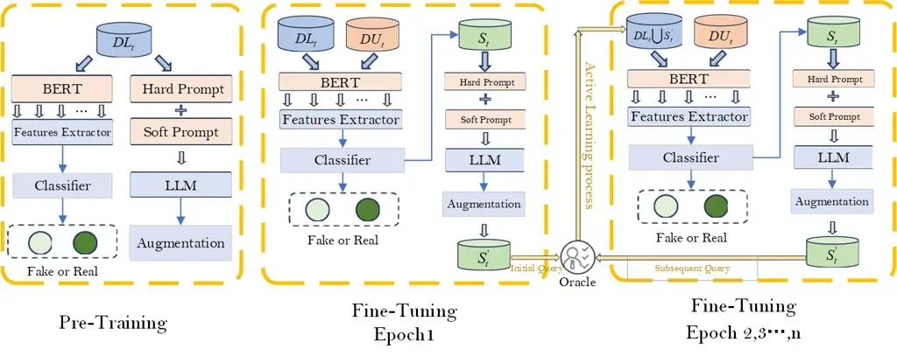

Figure 1: Model Architecture of SharP

## 3 Method

In this section, we first formally describe the problem, then introduce
the key modules of the fake news detection model, and provide a detailed
explanation of the data augmentation strategy and tuning methods. As
shown in Figure 1, the proposed model consists of two core modules: the
classifier module and the data augmentation module. The classifier
module integrates a feature extractor and a classifier, responsible for
identifying the authenticity of fake news. The data augmentation module,
centered on an LLM, combines hard prompts and soft prompts to guide the
model in generating augmented text, aiming to alleviate the problem of
scarce training samples and improve the model’s detection ability and
generalization performance in low resource environments.

| Symbol                                           | Description                                                                                                                             |
| ------------------------------------------------ | --------------------------------------------------------------------------------------------------------------------------------------- |
| $`DL_{t}=(X_{L},Y_{L})`$                         | Labeled pool at round $`t`$, where $`X_{L}`$ and $`Y_{L}`$ denote labeled texts and their labels.                                       |
| $`DU_{t}=X_{U}`$                                 | Unlabeled pool at round $`t`$, where $`X_{U}`$ denotes unlabeled texts.                                                                 |
| $`S_{t}`$                                        | Queried unlabeled batch selected from $`DU_{t}`$ at round $`t`$.                                                                        |
| $`S_{t}^{\prime}`$                               | Augmented labeled set generated from $`S_{t}`$ (inherits labels).                                                                       |
| $`b`$                                            | Query batch size in each active learning round.                                                                                         |
| $`T`$                                            | Total number of active learning rounds.                                                                                                 |
| $`x_{u}^{(i)}`$ / $`T_{\text{in}}^{(i)}`$        | Input text sequence of the $`i`$-th queried instance (we use $`x_{u}^{(i)}\equiv T_{\text{in}}^{(i)}`$ when convenient).                |
| $`x_{u}^{(i)\prime}`$ / $`T_{\text{out}}^{(i)}`$ | Augmented (generated) text for the $`i`$-th queried instance (we use $`x_{u}^{(i)\prime}\equiv T_{\text{out}}^{(i)}`$ when convenient). |
| $`\mathcal{H}(x)`$                               | Predictive entropy (uncertainty) of the classifier for input $`x`$.                                                                     |
| $`P(y\mid x)`$                                   | Predicted posterior probability of $`y\in\{0,1\}`$ for input $`x`$.                                                                     |
| $`\tau`$                                         | Entropy threshold for selecting boundary samples.                                                                                       |
| $`\mathcal{B}_{t}`$                              | Boundary sample set at round $`t`$ selected by $`\mathcal{H}(x)\geq\tau`$.                                                              |
| $`T_{h}`$                                        | Hard prompt (discrete instruction tokens).                                                                                              |
| $`T_{s}`$                                        | Soft prompt vector (learnable continuous prefix).                                                                                       |
| $`\oplus`$                                       | Concatenation operator.                                                                                                                 |
| $`\odot`$                                        | Element-wise (Hadamard) product.                                                                                                        |
| $`T_{\text{concat}}`$                            | Input concatenated with hard prompt.                                                                                                    |
| $`E_{\text{combined}}`$                          | Combined embedding fed into the LLM (after adding $`T_{s}`$).                                                                           |
| $`H_{\text{out}}`$                               | Last-layer hidden representation of the LLM output.                                                                                     |
| $`F(\cdot)`$                                     | Feature extractor.                                                                                                                      |
| $`D(\cdot)`$                                     | Classifier.                                                                                                                             |
| $`F_{\text{in}},F_{\text{out}}`$                 | Feature vectors of the input and generated representations.                                                                             |
| $`c,\;c^{*}`$                                    | Classifier score and target score.                                                                                                      |
| $`\lambda_{1},\lambda_{2}`$                      | Weights for combining the two objectives in prompt tuning.                                                                              |
| $`\lambda_{\text{reg}},\delta`$                  | Regularization weight and minimum-distance margin.                                                                                      |
| $`\eta`$                                         | Learning rate.                                                                                                                          |
| $`N_{1},N_{2},N`$                                | Epochs for training $`D/F`$, training $`T_{s}`$, and fine-tuning $`D`$ per round.                                                       |

Table 3: Notation used in the Method section

### 3.1 Problem Definition

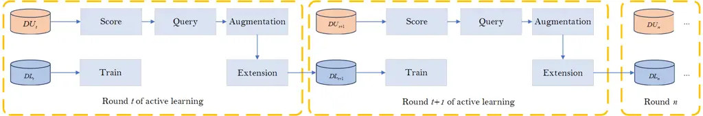

Figure 2: Method Flow

Figure 2 summarizes the iterative learning process. We initialize the
labeled sample pool as $`DL_{0}=(X_{L},Y_{L})`$ and the unlabeled sample
pool as $`DU_{0}=X_{U}`$. At the $`t`$-th round of active learning
($`t=0,\dots,T-1`$), we denote the current labeled and unlabeled pools
by $`DL_{t}`$ and $`DU_{t}`$, respectively. A mini-batch of unlabeled
instances is queried for labeling, where $`b`$ is the query batch size.
After obtaining labels $`\{y_{u}^{(i)}\}_{i=1}^{b}`$ for the queried
instances, we denote the labeled queried set as:

```math
S_{t}=\left\{(x_{u}^{(i)},y_{u}^{(i)})\right\}_{i=1}^{b}. \tag{1}
```

The corresponding labels $`\{y_{u}^{(i)}\}_{i=1}^{b}`$ are obtained
(e.g., from human annotators or an auxiliary labeling model), and the
classifier is subsequently retrained on the enlarged labeled set. For
each queried instance $`x_{u}^{(i)}`$, the augmentation module generates
a synthetic counterpart $`x_{u}^{(i)\prime}`$, resulting in the
augmented set:

```math
S_{t}^{\prime}=\left\{(x_{u}^{(i)\prime},y_{u}^{(i)})\right\}_{i=1}^{b} \tag{2}
```

where each synthetic sample inherits the label of its source instance,
i.e., $`(x_{u}^{(i)\prime},y_{u}^{(i)})`$.

Finally, the labeled and unlabeled pools are updated as follows:

```math
\displaystyle DL_{t+1} \displaystyle=DL_{t}\cup S_{t}\cup S_{t}^{\prime}, \tag{3}
```

```math
\displaystyle DU_{t+1} \displaystyle=DU_{t}\setminus\{x\mid(x,y)\in S_{t}\}.
```

### 3.2 Active Learning Module

We design a classifier model integrated with a feature extractor and
combine it with an active learning strategy to select samples near the
model’s decision boundary, i.e., those for which the model exhibits the
highest uncertainty in its predictions. These samples are highly
valuable for model training and will be used for data augmentation in
subsequent steps, further enhancing model performance.

To effectively extract emotional features, we construct emotion
representations based on five categories of emotional lexicons: Emotion,
Sentiment, Morality, Imageability, and Hyperbole. We use the NRC Emotion
Lexicon (Mohammad and Turney, 2013) to extract 8 emotional features, and
the NRC Sentiment Lexicon and the Moral Foundations Dictionary (Graham
et al., 2009) to extract emotional and moral features (2 and 10,
respectively). Additionally, we leverage the MRC Psycholinguistic
Database (Wilson, 1988) to extract 2 Imageability-related features and
construct emotional features by analyzing approximately 350 hyperbole
words.

Finally, these multi-dimensional emotional features are integrated into
a unified emotional vector, representing the diverse emotional
information in the news.

We design a dual feature extraction model that combines sentiment and
textual features based on feature extraction. The model comprises two
key components: the first component uses Convolutional Neural Networks
to extract word-level latent representations of the text
($`v_{\text{word}}`$). Specifically, the input text sequence is encoded
by BERT as $`S=\{w_{1},w_{2},\dots,w_{n}\}`$, where $`w_{i}`$ is the
embedding of the $`i`$-th word. The CNN applies multi-scale convolutions
to the word embeddings, using kernel sizes of 3, 4, and 5 to extract
vertical features. The max pooling layer selects the maximum value from
each feature map generated by the convolution operations, forming a
pooled feature vector and producing the text’s latent representation
($`v_{\text{word}}`$):

```math
v_{\text{word}}=\text{MaxPool}(CNN(w_{i})). \tag{4}
```

The second component uses a Bidirectional Gated Recurrent Unit to
capture sentiment flow in the text, producing a sentiment representation
($`v_{\text{affect}}`$). Here, $`e`$ represents the sentiment vector:

```math
v_{\text{affect}}=\text{Bi-GRU}(e). \tag{5}
```

After obtaining the word-level representation ($`v_{\text{word}}`$) and
sentiment features ($`v_{\text{affect}}`$), we combine them using
element-wise multiplication to generate a unified text-sentiment
representation ($`v_{\text{fuse}}`$). This step deeply fuses sentiment
and text information, enhancing the model’s ability to perceive
sentiment within the text:

```math
v_{\text{fuse}}=v_{\text{word}}\odot v_{\text{affect}}. \tag{6}
```

The classifier, which utilizes the features extracted by the feature
extractor, distinguishes between real and fake samples. It is a
multilayer perceptron consisting of a fully connected layer and a
softmax layer.

During the pre-training phase, the feature extractor and classifier are
jointly trained to learn initial feature representations and
classification abilities. In the fine-tuning phase, an active learning
strategy is applied to guide the sample selection process.

Based on the classifier’s current predictions, we select samples near
the decision boundary, i.e., those with the highest predictive
uncertainty. In classification tasks, entropy is adopted as the
uncertainty measure for the model’s prediction on each sample. Sun et
al. (2025)

For a binary classification task, given a sample $`x`$, the classifier
$`D(x)`$ outputs the posterior probability of belonging to class 1 as
$`P(y=1\mid x)`$, and to class 0 as $`P(y=0\mid x)=1-P(y=1\mid x)`$. The
predictive entropy $`\mathcal{H}(x)`$ is computed as:

```math
\mathcal{H}(x)=-P(y=1\mid x)\log(P(y=1\mid x))-P(y=0\mid x)\log(P(y=0\mid x)). \tag{7}
```

Using a threshold $`\tau`$, we define the boundary sample set as:

```math
\mathcal{B}_{t}=\{x\in DU_{t}\mid\mathcal{H}(x)\geq\tau\}. \tag{8}
```

These samples are highly valuable for enhancing model performance. The
selected samples are annotated either manually or via automated labeling
tools to ensure label accuracy. Once labeled, the samples are forwarded
to the data augmentation module, where augmented texts are generated via
a hybrid strategy of hard and soft prompts. These augmented samples
retain the semantics and labels of the original inputs, thereby
increasing the diversity of the training set. The augmented and original
labeled samples are jointly used to fine-tune the model in the current
training round.

This process is performed iteratively: after each round of fine-tuning,
the active learning module selects a new batch of samples for
augmentation and training, thereby progressively improving model
performance.

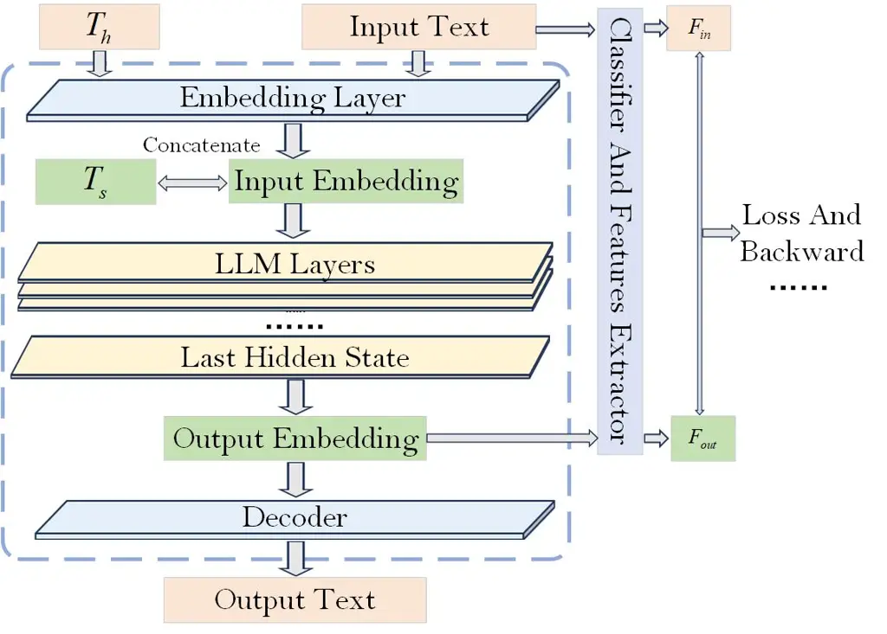

Figure 3: Architecture of Data Augmentation Module

### 3.3 Data Augmentation Module

Figure 3 illustrates the architecture of the data augmentation module,
whose core lies in the training of soft prompts. By learning soft
prompts, implicit knowledge from the fake news domain, such as
high-frequency argumentation structures, is injected into the
Transformer attention mechanism. This effectively guides the large model
to perform data augmentation on news samples from specific domains,
thereby enhancing the domain adaptability of the large model and
achieving fine-grained generation control.

Specifically, we first define a list of hard prompts containing various
instructions to guide the large model in generating texts with different
styles. These hard prompts are combined with the input text, and after
passing through the embedding layer of the large model, we obtain the
embedded representation of the input text. Next, we initialize a soft
prompt vector and concatenate it with the input text’s embedding vector,
using the concatenated result as input to the large model. The soft
prompt vector, serving as prefix information of the input text, after
training, will contain guiding information specific to the task context
within the large model.

```math
T_{\text{concat}}=T_{\text{in}}\oplus T_{h}, \tag{9}
```

```math
E_{\text{combined}}=\text{Embed}(T_{\text{concat}})\oplus T_{s}. \tag{10}
```

Since the model needs to adapt to news samples from different domains,
training soft prompt vectors to effectively guide the large model in
performing data augmentation tasks on specific datasets is crucial.
Experimental results validate the effectiveness of this method,
demonstrating that soft prompt vectors can significantly enhance the
model’s adaptability and generalization across multiple datasets,
thereby improving performance in cross-domain fake news detection tasks.

To avoid the gradient truncation issue that may arise from the softmax
and sampling operations during the decoding stage of the large model, we
use the vector from the last hidden layer output by the large model
$`H_{\text{out}}`$ as the embedded representation of the output text.
This representation, along with the input text embedding, is fed into
the feature extractor to obtain the respective feature vectors. Here,
$`F`$ denotes the feature extractor.

```math
H_{\text{out}}=\text{Hidden}(E_{\text{combined}}), \tag{11}
```

```math
F_{\text{out}}=F(H_{\text{out}}),\quad F_{\text{in}}=F(\text{Embed}(T_{\text{in}})). \tag{12}
```

It is important to note that although our feature extractor is based on
BERT encoding, the large models used for data augmentation are typically
those that perform better in text generation (such as GPT, Llama, and in
our case, zephyr-7b-beta) (Tunstall et al., 2023). Therefore, directly
using text embeddings generated by these large models is not suitable
for the BERT-based feature extractor.

To address this issue, we first extract the vocabulary of the large
model used for data augmentation and establish a mapping relationship
with the BERT embedding vocabulary, as illustrated in Figure 4. Through
this mapping, we can convert the text embeddings generated by the large
model into BERT-compatible encodings, allowing the generated text to be
directly fed into the feature extractor to obtain the text’s feature
vector.

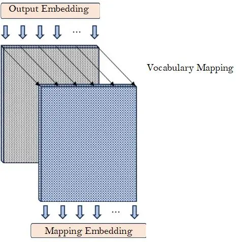

Figure 4: Vocabulary Mapping

It is worth noting that the input texts entering the data augmentation
module are all located near the decision boundary of the classifier,
representing the samples that are most challenging for the classifier to
distinguish. The closer the generated augmented samples are to the
original input text in the feature space, the more difficult it is for
the classifier to classify them, thereby effectively enhancing the
model’s ability to identify instances near the decision boundary.

Moreover, we explicitly require the large model, through hard prompts,
to maintain the main content of the news event unchanged during the
generation process, ensuring semantic consistency. This allows the
generated augmented text to inherit the label of the input news sample.
This design not only avoids the need for additional manual labeling of
generated samples but also ensures that the augmented samples extend the
decision boundary while maintaining label consistency, thereby further
enhancing the model’s generalization ability.

Based on this, we first calculate the cosine similarity between the
input text and the generated text in the feature space and use it as the
first loss objective optimization function. This loss function ensures
that the generated augmented samples maintain a high degree of semantic
consistency with the input text, while simultaneously enhancing the
classifier’s discrimination ability near the decision boundary, thereby
improving the overall performance of the fake news detection model.

```math
\text{Sim}_{\text{cos}}(F_{\text{in}},F_{\text{out}})=\frac{F_{\text{in}}\cdot F_{\text{out}}}{\|F_{\text{in}}\|\|F_{\text{out}}\|}. \tag{13}
```

To avoid generating trivial samples (i.e., those that entirely overlap
with the input in the feature space), we introduce a regularization
term. When the Euclidean distance between the input and generated sample
falls below a predefined threshold, a penalty is applied, effectively
enforcing a minimum distance between them. This promotes diversity in
the generated samples and improves the overall quality of augmentation.

Here, $`\lambda_{\text{reg}}`$ denotes the regularization weight,
$`\delta`$ is the minimum acceptable distance, and
$`D_{\text{euclid}}(F_{\text{in}},F_{\text{out}})`$ represents the
Euclidean distance:

```math
\text{Loss}_{1}=-\text{Sim}_{\text{cos}}(F_{\text{in}},F_{\text{out}})+\text{Reg}, \tag{14}
```

```math
\text{Reg}=\lambda_{\text{reg}}\cdot\max(0,\delta-D_{\text{euclid}}(F_{\text{in}},F_{\text{out}})). \tag{15}
```

To achieve end-to-end joint training and the collaborative goal of
semantic fidelity and decision optimization, we further introduce a
second loss function, integrating the training of the data augmentation
module and the classifier module. Specifically, the generated text is
evaluated by the classifier, and the loss returned by the classifier
serves as the second loss function.

```math
c=D(H_{\text{out}}),\quad\text{Loss}_{2}=(c-c^{*})^{2}. \tag{16}
```

Through this design, we ensure that the generated news samples exhibit
high uncertainty for the classifier, thereby enhancing the model’s
ability to learn from hard-to-classify samples. Finally, we perform a
weighted summation of the first objective loss (feature space similarity
loss) and the second objective loss (classifier loss) to form the total
objective loss. We then optimize the soft prompt vectors at the input
end of the large model through backpropagation. This optimization
process not only improves the generation quality of the data
augmentation module but also achieves collaborative optimization with
the classifier module, thereby further enhancing the overall performance
of the model in fake news detection tasks.

```math
\text{Loss}_{\text{total}}=\lambda_{1}\cdot\text{Loss}_{1}+\lambda_{2}\cdot\text{Loss}_{2}, \tag{17}
```

```math
T_{s}\leftarrow T_{s}-\eta\nabla_{T_{s}}\text{Loss}_{\text{total}}. \tag{18}
```

### 3.4 Algorithm Optimization

The training pipeline consists of two major stages: pre-training and
fine-tuning. The model architecture comprises two key modules: a
classifier and a data augmentation module. To maximize detection
performance, we separately optimize the classifier and the augmentation
module during each stage.

Pre-training Stage: In the pre-training stage, we begin by training the
classifier. The feature extractor encodes both textual and emotional
information into feature representations, which serve as inputs to the
classifier. The classifier is trained to minimize detection loss,
enabling the model to distinguish fake news from real news based on the
initial labeled dataset and laying a foundation for subsequent
fine-tuning and augmentation.

Following this, the data augmentation module is trained. The goal of
this stage is to initialize and optimize the soft prompt vectors,
enabling the language model to generate high-quality augmented texts
conditioned on the input. Through a dual objective optimization
mechanism, the soft prompts enforce semantic consistency between the
generated and original texts, while also increasing the sample density
near the decision boundary to support the classifier in later stages.

Fine-tuning Stage:

During the fine-tuning phase, we adopt an active learning loop to
progressively expand supervision and refine both the prompt-based
augmentation module and the classifier. At round $`t`$, the current
classifier first scores unlabeled instances in $`DU_{t}`$ and selects a
batch $`S_{t}`$ near its decision boundary for annotation. After
obtaining labels for $`S_{t}`$, we first fine-tune the soft prompt
vector $`T_{s}`$ on these newly labeled samples, while freezing all
parameters of the LLM backbone. This prompt-tuning step adapts $`T_{s}`$
to the current data distribution and makes the generation process more
task- and domain-aligned.

Next, the augmentation module uses the _fine-tuned_ $`T_{s}`$ (together
with hard prompts $`T_{h}`$) to generate an augmented set
$`S_{t}^{\prime}`$ from $`S_{t}`$, inheriting labels from their
corresponding inputs. The labeled pool is then updated by merging the
newly labeled samples and their augmentations. Finally, we fine-tune the
classifier by standard supervised training on the updated labeled pool,
so that it can better separate hard instances around the boundary.
Repeating this procedure for multiple rounds yields a jointly refined
augmentation module (via prompt tuning) and classifier (via supervised
fine-tuning under the expanded labeled pool), enabling robust detection
in label-scarce scenarios.

Input: Initial labeled pool $`DL_{0}=(X_{L},Y_{L})`$, Hard prompt
$`T_{h}`$, Feature extractor $`F(\cdot)`$, Classifier $`D(\cdot)`$;
Learning rate $`\eta`$, Number of epochs $`N_{1}`$ and $`N_{2}`$

Output: Trained soft prompt vector $`T_{s}`$, Updated model parameters
of $`F`$ and $`D`$

Step 1: Train classifier and feature extractor on $`DL_{0}`$

for _$`epoch=1`$ to $`N_{1}`$_ do

   Sample $`(x_{L},y_{L})\sim DL_{0}`$;

```math
\mathcal{L}_{D}=\text{Loss}_{D}\big(D(x_{L}),y_{L}\big)
```

```math
\mathcal{L}_{F}=\text{Loss}_{F}\big(F(x_{L}),y_{L}\big)
```

```math
D\leftarrow D-\eta\nabla_{D}\mathcal{L}_{D},\qquad F\leftarrow F-\eta\nabla_{F}\mathcal{L}_{F}
```

Step 2: Train soft prompt $`T_{s}`$ on $`DL_{0}`$

Initialize soft prompt vector $`T_{s}`$;

for _$`epoch=1`$ to $`N_{2}`$_ do

   Sample $`(x_{L},y_{L})\sim DL_{0}`$;

```math
T_{\text{concat}}=x_{L}\oplus T_{h}
```

```math
E_{\text{combined}}=\text{Embed}(T_{\text{concat}})\oplus T_{s}
```

```math
H_{\text{out}}=\text{Hidden}(E_{\text{combined}})
```

```math
F_{\text{out}}=F(H_{\text{out}}),\quad F_{\text{in}}=F\big(\text{Embed}(x_{L})\big)
```

```math
\text{Sim}_{\text{cos}}(F_{\text{in}},F_{\text{out}})=\frac{F_{\text{in}}\cdot F_{\text{out}}}{\|F_{\text{in}}\|\,\|F_{\text{out}}\|}
```

```math
\text{Loss}_{1}=-\text{Sim}_{\text{cos}}(F_{\text{in}},F_{\text{out}})+\text{Reg}
```

```math
T_{s}\leftarrow T_{s}-\eta\nabla_{T_{s}}\text{Loss}_{1}
```

return Trained soft prompt vector $`T_{s}`$, Updated model parameters of
$`F`$ and $`D`$

Algorithm 1 Model Pre-training Process

Input: Initial labeled pool $`DL_{0}=(X_{L},Y_{L})`$, Initial unlabeled
pool $`DU_{0}=X_{U}`$, Trained soft prompt vector $`T_{s}`$, Hard prompt
$`T_{h}`$, Feature extractor $`F(\cdot)`$, Classifier $`D(\cdot)`$;
Learning rate $`\eta`$, Number of active learning rounds $`T`$, Query
batch size $`b`$; Number of epochs $`N_{2}`$ and $`N`$ per round;
Weights $`\lambda_{1},\lambda_{2}`$, Target score $`c^{*}`$

Output: Fine-tuned model parameters, Final labeled pool $`DL_{T}`$

Initialize $`DL_{0}=(X_{L},Y_{L})`$, $`DU_{0}=X_{U}`$;

for _$`t=0`$ to $`T-1`$_ do

    Step 1: Active learning and labeling

    Select and query $`b`$ instances from $`DU_{t}`$ according to the
active learning strategy, and obtain labels to form

```math
S_{t}=\{(x_{u}^{(i)},y_{u}^{(i)})\}_{i=1}^{b}.
```

```math
DU_{t+1}=DU_{t}\setminus\{x\mid(x,y)\in S_{t}\}.
```

    Step 2: Fine-tune soft prompt $`T_{s}`$ (loss differs from
pre-training)

    Update $`T_{s}`$ by repeating the soft prompt training procedure in
Step 2 of Algorithm 1 on the batch $`S_{t}`$, except that the objective
is replaced by

```math
\text{Loss}_{\text{total}}=\lambda_{1}\cdot\text{Loss}_{1}+\lambda_{2}\cdot\text{Loss}_{2},\hskip 9.24994pt\text{Loss}_{2}=(c-c^{*})^{2},\hskip 9.24994ptc=D(H_{\text{out}}),
```

while all other computations (including $`T_{\text{concat}}`$,
$`E_{\text{combined}}`$, $`H_{\text{out}}`$, $`F_{\text{in}}`$,
$`F_{\text{out}}`$ and $`\text{Loss}_{1}`$) follow Algorithm 1;

```math
T_{s}\leftarrow T_{s}-\eta\nabla_{T_{s}}\text{Loss}_{\text{total}}
```

    Step 3: Generate augmented set $`S_{t}^{\prime}`$ from $`S_{t}`$
using the updated $`T_{s}`$

    Initialize $`S_{t}^{\prime}=\varnothing`$;

    for _$`i=1`$ to $`b`$_ do

        

```math
T_{\text{concat}}^{(i)}=x_{u}^{(i)}\oplus T_{h}
```

```math
E_{\text{combined}}^{(i)}=\text{Embed}(T_{\text{concat}}^{(i)})\oplus T_{s}
```

```math
H_{\text{out}}^{(i)}=\text{Hidden}(E_{\text{combined}}^{(i)})
```

```math
T_{\text{out}}^{(i)}=\text{Decode}(H_{\text{out}}^{(i)})
```

Add $`(T_{\text{out}}^{(i)},y_{u}^{(i)})`$ to $`S_{t}^{\prime}`$;

    

```math
S_{t}^{\prime}=\{(T_{\text{out}}^{(i)},y_{u}^{(i)})\}_{i=1}^{b}
```

    Step 4: Update labeled pool and train classifier

    

```math
DL_{t+1}=DL_{t}\cup S_{t}\cup S_{t}^{\prime}
```

    for _$`epoch=1`$ to $`N`$_ do

        Sample $`(x,y)\sim DL_{t+1}`$;

```math
\mathcal{L}_{D}=\text{Loss}_{D}\big(D(x),y\big)
```

```math
D\leftarrow D-\eta\nabla_{D}\mathcal{L}_{D}
```

return Fine-tuned model parameters, Final labeled pool $`DL_{T}`$

Algorithm 2 Model Fine-tuning Process

## 4 Experiments

In the experimental section, we aim to address the following key
questions:

- 1.  Does the SharP model demonstrate significant performance advantages in
      low resource environments while maintaining satisfactory performance
      under varying resource conditions?
- 2.  Does the model exhibit good generalization ability across news data
      from different domains?
- 3.  Can the texts generated by the data augmentation module effectively
      enhance the classifier’s detection performance?
- 4.  Do different hard prompts and other hyperparameter choices have a
      significant impact on the model’s performance?

We systematically evaluate SharP by first describing the experimental
setup and then conducting comprehensive tests across various conditions
to validate its effectiveness in fake news detection.

### 4.1 Experimental Setup

Datasets: In Group A, we evaluate our model on five distinct
event-specific datasets: Germanwings-crash, Sydneysiege, Ottawashooting,
Charliehebdo, and Ferguson. These subsets are derived from the PHEME
dataset (Zubiaga et al., 2016), which consists of multimodal Twitter
data, including users’ social information, posted content, and annotated
labels. The PHEME dataset is particularly well-suited for fake news
detection tasks, as it not only offers rich textual content but also
provides sentiment annotations and propagation path information for each
tweet. In our experimental design, we proportionally divide the training
samples within each subset to comprehensively test model performance
under varying sample sizes and across diverse news scenarios.

In addition to the event-specific evaluation on PHEME, we further
conduct a cross-benchmark study (Group B) on two widely used
misinformation benchmarks, LIAR (Wang, 2017) and Twitter15/16 (Ma et
al., 2017a; Ma et al., 2017b), to assess the robustness of SharP across
datasets with different data characteristics. LIAR consists of short,
fact-checked political claims annotated with fine-grained veracity
labels, which are commonly consolidated into binary labels for fake news
detection. Twitter15/16 are event-centric rumor detection benchmarks
built from Twitter conversations with reply structures, providing
complementary evaluation beyond the PHEME breaking-news threads.

| Dataset             | Cha. | Fer. | Ger. | Ott. | Syd. | Total |
| ------------------- | ---- | ---- | ---- | ---- | ---- | ----- |
| Labeled Fake News   | 318  | 144  | 95   | 330  | 382  | 1269  |
| Labeled Real News   | 1481 | 719  | 94   | 280  | 559  | 3133  |
| Unlabeled Fake News | 140  | 140  | 143  | 140  | 140  | 703   |
| Unlabeled Real News | 140  | 140  | 137  | 140  | 140  | 697   |

Table 4: Dataset statistics for Group A (PHEME) used in our
labeled/unlabeled pool setting

|                     |        |              |
| ------------------- | ------ | ------------ |
| Dataset             | LIAR   | Twitter15/16 |
| Labeled Fake News   | 5,514  | 445          |
| Labeled Real News   | 6,997  | 429          |
| Unlabeled Fake News | 143    | 134          |
| Unlabeled Real News | 137    | 146          |
| Total               | 12,791 | 1,154        |

Table 5: Dataset statistics for Group B (LIAR and Twitter15/16) used in
our labeled/unlabeled pool setting

Experimental Details: To comprehensively evaluate the model’s
performance under varying resource conditions, we divide the
experimental dataset into three subsets: the first group is the labeled
data pool used for pre-training, the second group is a fixed-size
unlabeled data pool, and the third group is the test data pool.

During the pre-training phase, the model is trained on the labeled data
pool to acquire fundamental text classification capabilities.
Subsequently, the model proceeds to the fine-tuning phase, where it
undergoes further optimization using the unlabeled data pool. In this
phase, an active learning strategy is employed to select samples near
the decision boundary for labeling and training, thereby enhancing the
model’s performance through targeted sample selection.

In the experiment, we operationalize _low resource_ fake news detection
by constraining the size of the labeled training pool. Concretely, for
each dataset, we construct a series of label budgets by randomly
sampling {1%, 5%, 10%, 15%, 20%, 25%, 30%, 35%, 40%, 45%, 50%, 70%} of
instances from the labeled pool for training. To reduce sampling bias
under small budgets, we adopt stratified sampling to preserve the
fake/real ratio (and keep the split as balanced as possible). We then
evaluate performance across these budget levels to assess robustness
under varying degrees of supervision scarcity, with particular attention
to whether the proposed augmentation strategy yields consistent gains
when labeled data are limited. Unless otherwise specified, all other
settings are kept unchanged across budget levels.

### 4.2 Baseline

In the baseline experiments, we select a series of classical and
advanced fake news detection methods as baseline models. We evaluate and
compare their performance with the proposed method under the same
datasets and experimental settings, with a primary focus on assessing
the model robustness and generalization ability in low resource
environments.

Here are the baseline models we selected:

HAN (2016): A fake news detection method based on the Hierarchical
Attention Network (HAN). This method utilizes a hierarchical attention
mechanism to model different levels of information in news text (such as
words, sentences, and paragraphs), thereby capturing essential semantic
features. HAN effectively focuses on critical information within the
text and combines structural features of long texts, enhancing the
model’s classification performance in fake news detection tasks (Yang et
al., 2016).

dEFEND (2019): A multimodal fake news detection model that integrates
textual content and user comments. dEFEND uses explainable attention
mechanisms to identify suspicious words and responses, enhancing model
interpretability and robustness (Shu et al., 2019).

HMCAN (2021): A fake news detection method based on a hierarchical
multimodal contextual attention network, which integrates text and
social network comment information. It leverages CNNs and hierarchical
attention to extract features from multimodal data, aiming to improve
classification accuracy (Qian et al., 2021).

DDT (2025): A fake news detection method based on active learning, which
enhances the model’s discrimination ability by combining textual
features and emotional features. In addition, DDT employs an active
learning strategy, dynamically selecting uncertain samples near the
decision boundary for manual annotation and fine-tuning during training.
This approach maximizes the model’s learning efficiency under limited
labeled data conditions. (Hu et al., 2025)

DeepSeek (2024): A general-purpose language model based on the
Transformer architecture, incorporating various structural optimization
techniques, such as RMSNorm, SwiGLU activation function, and RoPE
(Rotary Positional Embedding), to improve performance in long-text
modeling and reasoning efficiency. The model is pre-trained on
large-scale bilingual (Chinese and English) corpora, demonstrating
strong cross-linguistic understanding and generalization capabilities.
In this study’s baseline experiments, we fine-tune DeepSeek-7B-Base
using LoRA (Low-Rank Adaptation) on data with different resource
proportions to evaluate its performance and adaptability in the fake
news detection task (Liu et al., 2024).

#### 4.2.1 Group A: Event-specific evaluation on PHEME

To evaluate performance under varying levels of labeled data
availability, we consider twelve label-budget configurations: 1%, 5%,
10%, 15%, 20%, 25%, 30%, 35%, 40%, 45%, 50%, and 70%. For each
configuration, we randomly sample the corresponding proportion of
labeled training data and independently train and evaluate each method
on the five PHEME event-specific sub-datasets. This setup allows us to
examine performance across different label budgets and event domains.

This experimental setup not only reflects the model’s adaptability under
extreme few-shot conditions but also allows for measuring the
performance trend as data resources increase. This provides empirical
evidence for data augmentation strategies in future low resource text
classification tasks.

| Dataset           | Stra.       | 1%    | 5%    | 10%   | 15%   | 20%   | 25%   | 30%   | 35%   | 40%   | 45%   | 50%   | 70%   |
| ----------------- | ----------- | ----- | ----- | ----- | ----- | ----- | ----- | ----- | ----- | ----- | ----- | ----- | ----- |
| Germanwings-crash | HAN         | 0.500 | 0.734 | 0.713 | 0.691 | 0.691 | 0.745 | 0.734 | 0.755 | 0.723 | 0.766 | 0.745 | 0.713 |
|                   | dEFEND      | 0.670 | 0.745 | 0.723 | 0.702 | 0.745 | 0.755 | 0.745 | 0.787 | 0.681 | 0.745 | 0.755 | 0.713 |
|                   | HMCAN       | 0.250 | 0.272 | 0.652 | 0.757 | 0.766 | 0.712 | 0.610 | 0.727 | 0.651 | 0.750 | 0.768 | 0.813 |
|                   | DDT         | 0.740 | 0.729 | 0.760 | 0.781 | 0.792 | 0.823 | 0.833 | 0.854 | 0.865 | 0.854 | 0.885 | 0.927 |
|                   | Deepseek-7b | 0.617 | 0.617 | 0.617 | 0.617 | 0.628 | 0.628 | 0.628 | 0.617 | 0.606 | 0.617 | 0.617 | 0.606 |
|                   | SharP       | 0.760 | 0.802 | 0.792 | 0.833 | 0.833 | 0.813 | 0.854 | 0.885 | 0.875 | 0.875 | 0.917 | 0.938 |
| Sydneysiege       | HAN         | 0.500 | 0.638 | 0.681 | 0.638 | 0.670 | 0.713 | 0.691 | 0.723 | 0.660 | 0.670 | 0.702 | 0.745 |
|                   | dEFEND      | 0.606 | 0.660 | 0.628 | 0.617 | 0.681 | 0.691 | 0.660 | 0.691 | 0.702 | 0.691 | 0.702 | 0.681 |
|                   | HMCAN       | 0.250 | 0.272 | 0.630 | 0.714 | 0.734 | 0.695 | 0.667 | 0.749 | 0.651 | 0.750 | 0.768 | 0.813 |
|                   | DDT         | 0.677 | 0.708 | 0.771 | 0.771 | 0.760 | 0.771 | 0.823 | 0.865 | 0.906 | 0.885 | 0.885 | 0.906 |
|                   | Deepseek-7b | 0.462 | 0.441 | 0.462 | 0.462 | 0.462 | 0.462 | 0.462 | 0.462 | 0.462 | 0.462 | 0.462 | 0.462 |
|                   | SharP       | 0.760 | 0.750 | 0.823 | 0.802 | 0.833 | 0.844 | 0.833 | 0.875 | 0.906 | 0.927 | 0.906 | 0.906 |
| Ottawashooting    | HAN         | 0.500 | 0.649 | 0.681 | 0.723 | 0.638 | 0.670 | 0.713 | 0.606 | 0.638 | 0.681 | 0.691 | 0.660 |
|                   | dEFEND      | 0.670 | 0.638 | 0.691 | 0.660 | 0.681 | 0.649 | 0.691 | 0.596 | 0.617 | 0.660 | 0.670 | 0.660 |
|                   | HMCAN       | 0.250 | 0.272 | 0.630 | 0.714 | 0.766 | 0.737 | 0.667 | 0.727 | 0.651 | 0.727 | 0.750 | 0.813 |
|                   | DDT         | 0.583 | 0.688 | 0.646 | 0.698 | 0.740 | 0.792 | 0.802 | 0.833 | 0.771 | 0.896 | 0.885 | 0.906 |
|                   | Deepseek-7b | 0.500 | 0.500 | 0.500 | 0.500 | 0.489 | 0.489 | 0.500 | 0.489 | 0.489 | 0.489 | 0.489 | 0.489 |
|                   | SharP       | 0.695 | 0.719 | 0.750 | 0.813 | 0.740 | 0.823 | 0.854 | 0.844 | 0.854 | 0.917 | 0.896 | 0.927 |
| Charliehebdo      | HAN         | 0.500 | 0.702 | 0.734 | 0.691 | 0.734 | 0.702 | 0.713 | 0.691 | 0.734 | 0.723 | 0.755 | 0.755 |
|                   | dEFEND      | 0.691 | 0.691 | 0.702 | 0.638 | 0.723 | 0.702 | 0.755 | 0.638 | 0.734 | 0.702 | 0.691 | 0.766 |
|                   | HMCAN       | 0.250 | 0.272 | 0.735 | 0.757 | 0.766 | 0.737 | 0.631 | 0.727 | 0.651 | 0.764 | 0.768 | 0.817 |
|                   | DDT         | 0.708 | 0.750 | 0.792 | 0.792 | 0.823 | 0.833 | 0.844 | 0.885 | 0.865 | 0.865 | 0.896 | 0.885 |
|                   | Deepseek-7b | 0.362 | 0.362 | 0.372 | 0.372 | 0.372 | 0.372 | 0.372 | 0.372 | 0.383 | 0.372 | 0.383 | 0.383 |
|                   | SharP       | 0.813 | 0.792 | 0.823 | 0.813 | 0.833 | 0.844 | 0.844 | 0.854 | 0.906 | 0.865 | 0.927 | 0.917 |
| Ferguson          | HAN         | 0.500 | 0.755 | 0.723 | 0.713 | 0.681 | 0.691 | 0.755 | 0.766 | 0.734 | 0.809 | 0.787 | 0.723 |
|                   | dEFEND      | 0.638 | 0.723 | 0.702 | 0.691 | 0.723 | 0.734 | 0.713 | 0.755 | 0.691 | 0.723 | 0.734 | 0.702 |
|                   | HMCAN       | 0.250 | 0.272 | 0.735 | 0.757 | 0.745 | 0.737 | 0.610 | 0.727 | 0.651 | 0.764 | 0.768 | 0.817 |
|                   | DDT         | 0.708 | 0.729 | 0.750 | 0.781 | 0.813 | 0.813 | 0.771 | 0.854 | 0.844 | 0.865 | 0.875 | 0.927 |
|                   | Deepseek-7b | 0.681 | 0.681 | 0.692 | 0.681 | 0.692 | 0.692 | 0.692 | 0.702 | 0.692 | 0.702 | 0.692 | 0.681 |
|                   | SharP       | 0.792 | 0.813 | 0.813 | 0.833 | 0.844 | 0.844 | 0.865 | 0.875 | 0.875 | 0.883 | 0.918 | 0.948 |

Table 6: Performance comparison on Group A datasets (Acc.)

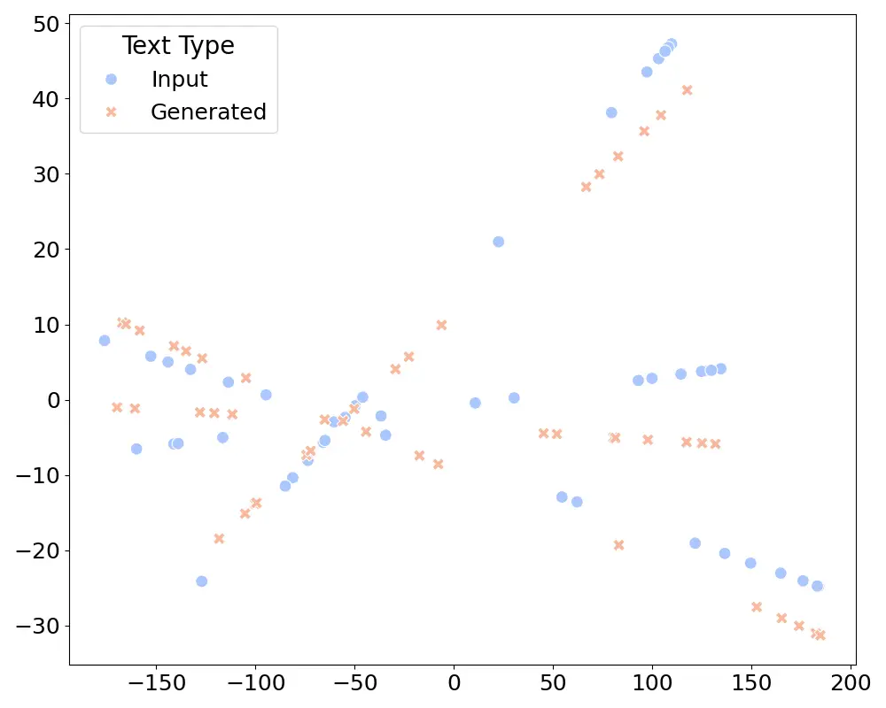

(a) PCA Projection

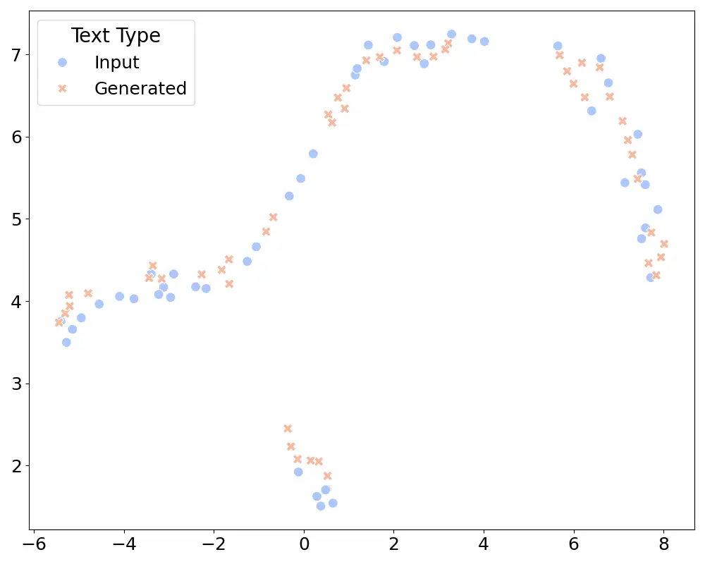

(b) UMAP Projection

Figure 5: Sample Space Visualization

Figure 5 presents the visualization results of the sample space,
intuitively showing the distribution relationship between input samples
and generated samples in the feature space. The visualization results
demonstrate that the trained model is capable of generating enhanced
texts that closely align with input samples within the feature space.
This verifies the effectiveness of the dual prompt mechanism (hard
prompt and soft prompt) and the dual objective optimization strategy
(fidelity and discriminability). Furthermore, the results indicate that
the generated samples are effectively guided towards the vicinity of the
classifier’s decision boundary, enhancing the model’s ability to learn
from hard-to-classify samples, thereby providing the most valuable
augmented data for training.

Table 6 displays the experimental results of various baseline models.
Compared to existing fake news detection methods, the proposed model
exhibits significant overall performance improvements, particularly in
experimental settings with low sample ratios. The introduction of the
data augmentation module effectively improves detection accuracy, fully
validating the effectiveness and practicality of the proposed method in
low resource environments.

As the number of training samples increases, although the performance
gap between models narrows, the proposed method consistently maintains a
leading position across multiple datasets and various sample
configurations. This result indicates that the proposed augmentation
mechanism significantly alleviates the problem of insufficient labeled
samples, enhancing the model’s robustness and detection capability in
data-scarce scenarios.

Moreover, even in cases with sufficient samples, the proposed method
still exhibits superior detection performance compared to other baseline
models, further demonstrating its universality and advantage in the fake
news detection task.

#### 4.2.2 Group B: Cross-benchmark evaluation

As a complement to the Group A evaluation, we further assess SharP on
LIAR and Twitter15/16 to examine its cross-benchmark generalization and
discrimination capability across different misinformation domains and
instance formats. For LIAR, we collapse the original six-way veracity
labels—pants-fire, false, barely-true, half-true, mostly-true, and
true—into a binary setting (Fake vs. Real) by mapping {pants-fire,
false, barely-true} to Fake and {half-true, mostly-true, true} to Real.
For Twitter15/16, we adopt the commonly used binary rumor verification
setting (rumor vs. non-rumor) and map it to Fake/Real, reporting results
on the merged Twitter15/16 benchmark. We follow the same low resource
protocol as in Group A, including identical label budgets (1%–70%) with
stratified sampling and the same training configuration unless stated
otherwise.

| Dataset                   | Stra.       | 1%    | 5%    | 10%   | 15%   | 20%   | 25%   | 30%   | 35%   | 40%   | 45%   | 50%   | 70%   |
| ------------------------- | ----------- | ----- | ----- | ----- | ----- | ----- | ----- | ----- | ----- | ----- | ----- | ----- | ----- |
| PHEME (Germanwings-crash) | HAN         | 0.500 | 0.734 | 0.713 | 0.691 | 0.691 | 0.745 | 0.734 | 0.755 | 0.723 | 0.766 | 0.745 | 0.713 |
|                           | dEFEND      | 0.670 | 0.745 | 0.723 | 0.702 | 0.745 | 0.755 | 0.745 | 0.787 | 0.681 | 0.745 | 0.755 | 0.713 |
|                           | HMCAN       | 0.250 | 0.272 | 0.652 | 0.757 | 0.766 | 0.712 | 0.610 | 0.727 | 0.651 | 0.750 | 0.768 | 0.813 |
|                           | DDT         | 0.740 | 0.729 | 0.760 | 0.781 | 0.792 | 0.823 | 0.833 | 0.854 | 0.865 | 0.854 | 0.885 | 0.927 |
|                           | Deepseek-7b | 0.617 | 0.617 | 0.617 | 0.617 | 0.628 | 0.628 | 0.628 | 0.617 | 0.606 | 0.617 | 0.617 | 0.606 |
|                           | SharP       | 0.760 | 0.802 | 0.792 | 0.833 | 0.833 | 0.813 | 0.854 | 0.885 | 0.875 | 0.875 | 0.917 | 0.938 |
| LIAR                      | HAN         | 0.318 | 0.436 | 0.564 | 0.564 | 0.439 | 0.564 | 0.406 | 0.564 | 0.482 | 0.557 | 0.466 | 0.564 |
|                           | dEFEND      | 0.564 | 0.564 | 0.564 | 0.436 | 0.564 | 0.549 | 0.549 | 0.549 | 0.564 | 0.564 | 0.549 | 0.564 |
|                           | HMCAN       | 0.185 | 0.185 | 0.185 | 0.259 | 0.431 | 0.431 | 0.259 | 0.259 | 0.185 | 0.185 | 0.259 | 0.431 |
|                           | DDT         | 0.526 | 0.573 | 0.641 | 0.630 | 0.651 | 0.688 | 0.714 | 0.719 | 0.766 | 0.724 | 0.781 | 0.859 |
|                           | Deepseek-7b | 0.583 | 0.582 | 0.585 | 0.585 | 0.588 | 0.586 | 0.584 | 0.587 | 0.585 | 0.584 | 0.578 | 0.565 |
|                           | SharP       | 0.609 | 0.615 | 0.662 | 0.688 | 0.688 | 0.703 | 0.734 | 0.734 | 0.750 | 0.740 | 0.807 | 0.880 |
| Twitter15/16              | HAN         | 0.481 | 0.589 | 0.654 | 0.706 | 0.710 | 0.645 | 0.701 | 0.736 | 0.654 | 0.823 | 0.861 | 0.628 |
|                           | dEFEND      | 0.502 | 0.498 | 0.632 | 0.727 | 0.576 | 0.706 | 0.498 | 0.727 | 0.498 | 0.714 | 0.805 | 0.723 |
|                           | HMCAN       | 0.250 | 0.250 | 0.333 | 0.250 | 0.500 | 0.333 | 0.667 | 0.500 | 0.500 | 0.667 | 0.750 | 0.750 |
|                           | DDT         | 0.687 | 0.748 | 0.786 | 0.809 | 0.765 | 0.791 | 0.826 | 0.896 | 0.861 | 0.861 | 0.817 | 0.870 |
|                           | Deepseek-7b | 0.504 | 0.504 | 0.504 | 0.504 | 0.548 | 0.504 | 0.504 | 0.548 | 0.549 | 0.504 | 0.548 | 0.549 |
|                           | SharP       | 0.783 | 0.835 | 0.878 | 0.844 | 0.844 | 0.870 | 0.844 | 0.870 | 0.878 | 0.887 | 0.852 | 0.896 |

Table 7: Performance comparison on Group B datasets (Acc.)

As reported in Table 7, SharP achieves strong performance on both LIAR
and Twitter15/16. Across the 24 label-budget configurations evaluated on
LIAR and Twitter15/16, SharP achieves the highest accuracy in 21
configurations and ranks second in the remaining three, demonstrating
competitive performance across both benchmarks and a range of label
budgets. These complementary experiments further demonstrate that SharP
generalizes well across heterogeneous benchmarks, including fact-checked
political claims from LIAR and conversational microblog threads from
Twitter15/16, which differ in domains, topics, and writing styles. This
supports the robustness of our approach under diverse benchmarks and
input characteristics.

### 4.3 Ablation Study

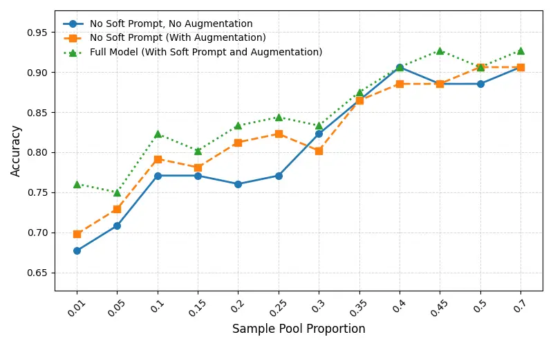

Figure 6: Ablation Study

To comprehensively evaluate the model’s performance under different
component configurations, we designed an ablation study to test the
following three scenarios: a single classifier without data
augmentation, a large model with data augmentation but without soft
prompts, and a large model with data augmentation incorporating the dual
prompt architecture. In the experiment, we conducted tests with various
proportions of training samples to thoroughly assess the contribution of
each component to the model’s detection performance.

The results of the ablation study in Figure 6 further confirm the
crucial role of the data augmentation module in the model. After
incorporating the data augmentation module, the model’s performance
improved significantly. Furthermore, when the soft prompt guidance was
added, the model exhibited further improvements across all evaluation
metrics, with the effects being particularly pronounced in low-sample
settings. These results demonstrate that introducing large model data
augmentation can significantly facilitate model training under low
resource conditions. Additionally, the introduction of the dual prompt
architecture enables the large model to better understand the generation
requirements specific to the current dataset, leading to the creation of
higher-quality augmented texts and further enhancing the overall model
performance.

### 4.4 Hyperparameter Sensitivity Analysis

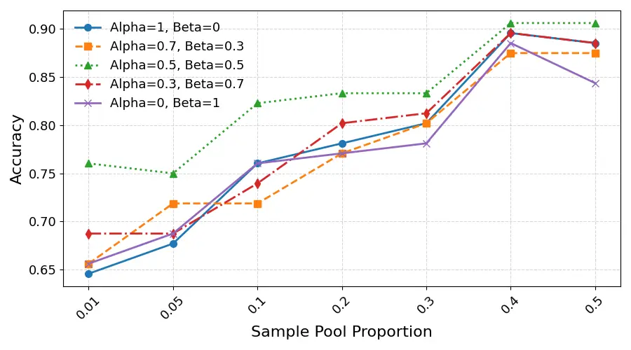

(a) Dual Objective Optimization Weight

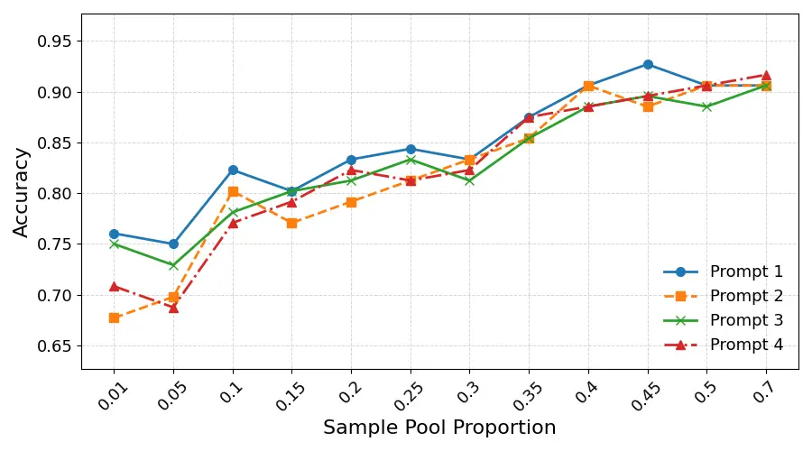

(b) Hard Prompt Selection

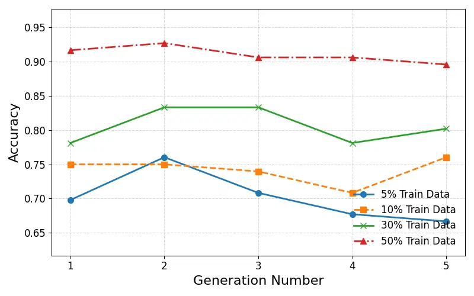

(c) Number of Generated Text

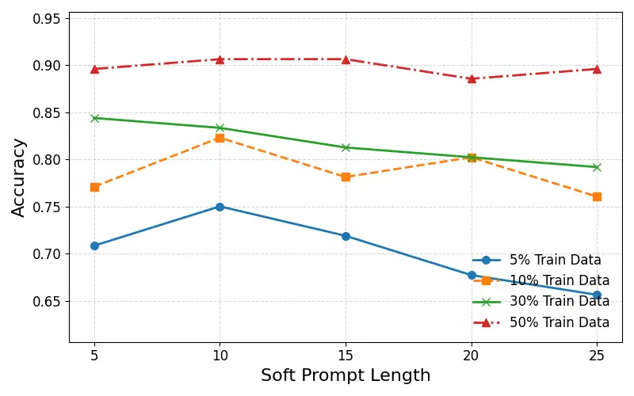

(d) Soft Prompt Length

Figure 7: Hyperparameter Sensitivity Analysis

To further verify the robustness and stability of our model, we
conducted a detailed hyperparameter sensitivity analysis, aiming to
evaluate the impact of different hyperparameter settings on model
performance. Hyperparameters play a crucial role in training deep
learning models as they directly determine the convergence speed,
generalization ability, and final detection performance. Therefore,
selecting and adjusting hyperparameters appropriately not only enhances
the model’s performance but also ensures its effectiveness across
different tasks and datasets.

In this experiment, we focused on the following key hyperparameters: the
choice of hard prompt categories, the size of soft prompt
initialization, the number of generated data augmentation texts, and the
weight settings of dual objective optimization. Adjusting each
hyperparameter can influence the training dynamics of the model, thereby
affecting the final detection outcomes.

By systematically analyzing these key hyperparameters, we identified
which hyperparameters have the most significant impact on model
performance and gained deeper insights into their functional mechanisms.
This analysis provides a scientific basis and optimization direction for
hyperparameter selection in practical applications. Ultimately, the
hyperparameter sensitivity analysis enabled us to identify the most
suitable hyperparameter combination for this task, further enhancing the
model’s overall performance and generalization ability.

Figure 7 presents the experimental results of the hyperparameter
analysis. In the analysis of hard prompt category selection, we observed
that performance differences between different hard prompt categories
were minimal when the number of training samples was large. However,
when the number of training samples was small, the performance of
certain hard prompt categories was significantly lower.

We hypothesize that this discrepancy may result from the classifier’s
preference for specific text styles. For example, hard prompt 3 (which
uses a more aggressive tone) performed better than hard prompt 4 (which
uses a more declarative tone), likely because fake news often employs a
more provocative and attention-grabbing style, making such texts easier
to identify during classification. As the amount of training data
increases, the influence of this preference on model performance
gradually diminishes, leading to a reduction in performance differences.

Across the evaluated sample pool proportions, hard prompt 1, which uses
simpler and more straightforward expressions, achieved the best or
joint-best accuracy in most settings. We therefore adopted hard prompt 1
as the default hard prompt in our experiments.

In the hyperparameter sensitivity analysis, we evaluated the
hyperparameters under varying training data proportions (specifically
5%, 10%, 30%, and 50%) to assess their impact on model performance
across different resource levels.

The experimental results indicate that as the initialization length of
the soft prompt increases, the model performance gradually improves,
reaching a peak before subsequently declining. This phenomenon can be
attributed to the following reasons: when the soft prompt length is too
short, it fails to adequately encode guiding information for the large
model, resulting in lower performance. On the other hand, when the soft
prompt length is too long, it occupies a substantial proportion of the
input after concatenation with the model’s textual input. This excessive
additional information hinders the model’s ability to effectively
understand the task objective, leading to a performance decline.

In the hyperparameter analysis of the number of generated data
augmentation texts, we observed that as the generation number increases,
the model performance initially rises briefly, reaches a peak, and then
continuously declines. Notably, when the training data volume is
relatively low, the performance peak occurs with a delay.

This phenomenon can be attributed to the following reasons: when the
training data is relatively sufficient, an excessive number of augmented
texts can result in a surplus of semantically similar training data in
the next training round, thereby inhibiting performance improvement. In
contrast, when the training data volume is low, the increase in
generated text quantity enhances data diversity. In this case, the
addition of more training data primarily contributes to performance
improvement, resulting in a delayed arrival of the performance peak.

Finally, in the hyperparameter analysis of dual objective optimization
weight settings, we found that models using only a single loss function
performed worse under all three sample conditions compared to models
that combined both loss functions. When appropriate weights were set and
both loss functions were jointly adjusted, the model performance
improved significantly. This result demonstrates the effectiveness of
dual objective functions in optimizing the quality of generated samples
and enhancing the overall model performance.

## 5 Conclusion and Future Work

In this paper, we proposed an LLM-based text data augmentation technique
guided by dual prompt engineering, which combines structured hard
prompts with learnable soft prompts. This approach was successfully
applied to the task of fake news detection under low resource settings.
Experimental results demonstrate that the proposed method significantly
improves the classifier’s discriminative performance by generating
diverse samples that are consistent with the domain and preserve the
original labels. Particularly in low resource environments, our
framework significantly enhances detection precision and overall
classification accuracy by supplying diverse, high-quality augmented
training samples.

Beyond empirical performance, our method provides a flexible and model
independent solution that can be adapted to various LLM architectures
and training setups, making it applicable to a wide range of real world
misinformation detection scenarios. In addition, the sample selection
strategy, which focuses on uncertain prediction regions, enables more
efficient use of annotation resources in active learning settings,
further demonstrating the method’s practical value.

In future work, we plan to extend this augmentation framework to a wider
range of text classification tasks, including sentiment analysis, topic
classification, and intent detection. We are also interested in
evaluating the method’s effectiveness across multilingual datasets and
under distribution shifts. In addition, we aim to explore the
integration of multimodal data, such as images and user metadata, to
further enhance the model’s contextual understanding and scalability in
practical applications like social media content moderation and news
verification systems.

## 6 Acknowledgements

This research was supported by the National Natural Science Foundation
of China (Grant No. 62176028).

## References

- Abaskohi et al. (2023) A. Abaskohi, S. Rothe, and Y. Yaghoobzadeh
  LM-CPPF: paraphrasing-guided data augmentation for contrastive
  prompt-based few-shot fine-tuning. In Proceedings of the 61st Annual
  Meeting of the Association for Computational Linguistics (Volume 2:
  Short Papers), pp. 670–681. External Links:
  [Document](https://dx.doi.org/10.18653/v1/2023.acl-short.59) Cited by:
  §2.3.
- Chen et al. (2020) J. Chen, Z. Yang, and D. Yang MixText:
  linguistically-informed interpolation of hidden space for
  semi-supervised text classification. In Proceedings of the 58th Annual
  Meeting of the Association for Computational Linguistics (ACL 2020),
  pp. 2147–2157. External Links:
  [Document](https://dx.doi.org/10.18653/v1/2020.acl-main.194) Cited by:
  §2.3.
- Chen et al. (2025) M. Chen, L. Wei, H. Cao, W. Zhou, and S. Hu Explore
  the potential of LLMs in misinformation detection: an empirical study.
  In Proceedings of the AAAI 2025 Workshop on Preventing and Detecting
  LLM Misinformation (PDLM), External Links:
  [Link](https://openreview.net/forum?id=W2zawmik8i) Cited by: §1, Table 2.
- Cheng et al. (2020) Y. Cheng, L. Jiang, W. Macherey, and J. Eisenstein
  AdvAug: robust adversarial augmentation for neural machine
  translation. In Proceedings of the 58th Annual Meeting of the
  Association for Computational Linguistics (ACL 2020), pp. 5961–5970.
  External Links:
  [Document](https://dx.doi.org/10.18653/v1/2020.acl-main.529) Cited by:
  §2.3.
- Choi et al. (2025) E. C. Choi, A. Balasubramanian, J. Qi, and E.
  Ferrara Limited effectiveness of LLM-based data augmentation for
  COVID-19 misinformation stance detection. In Companion Proceedings of
  the ACM Web Conference 2025 (WWW ’25 Companion), Sydney, Australia.
  Note: Apr 28–May 2, 2025, 4 pages External Links:
  [Document](https://dx.doi.org/10.1145/3701716.3715521) Cited by: §1,
  Table 2.
- Cui and Lee (2020) L. Cui and D. Lee CoAID: COVID-19 healthcare
  misinformation dataset. arXiv preprint arXiv:2006.00885. Note:
  COVID-19 misinformation dataset External Links:
  [Document](https://dx.doi.org/10.48550/ARXIV.2006.00885) Cited by:
  §2.2, Table 1.
- Gao et al. (2020) J. Gao, S. Han, X. Song, and F. Ciravegna RP-DNN: a
  tweet level propagation context based deep neural networks for early
  rumor detection in social media. In Proceedings of the 12th
  International Conference on Language Resources and Evaluation (LREC
  2020), Marseille, France. External Links:
  [Link](https://arxiv.org/abs/2002.12683) Cited by: §2.1.
- Graham et al. (2009) J. Graham, J. Haidt, and B. A. Nosek Liberals and
  conservatives rely on different sets of moral foundations. Journal of
  Personality and Social Psychology 96 (5), pp. 1029–1046. External
  Links: [Document](https://dx.doi.org/10.1037/a0015141) Cited by: §3.2.
- Hu et al. (2025) L. Hu, G. Han, S. Liu, Y. Ren, X. Wang, Z. Yang,
  and F. Jiang Dual-aspect active learning with domain-adversarial
  training for low-resource misinformation detection. Mathematics 13
  (11), pp. 1752. External Links:
  [Document](https://dx.doi.org/10.3390/math13111752) Cited by: §4.2.
- Hua et al. (2023) J. Hua, X. Cui, X. Li, K. Tang, and P. Zhu
  Multimodal fake news detection through data augmentation-based
  contrastive learning. Applied Soft Computing 136, pp. Article 110125.
  External Links:
  [Document](https://dx.doi.org/10.1016/j.asoc.2023.110125) Cited by:
  §1.
- Kapusta et al. (2024) J. Kapusta, D. Držík, K. Šteflovič, and K. S.
  Nagy Text data augmentation techniques for word embeddings in fake
  news classification. IEEE Access 12, pp. 31538–31550. External Links:
  [Document](https://dx.doi.org/10.1109/ACCESS.2024.3369918) Cited by:
  §1.
- Kesgin and Amasyali (2024) H. T. Kesgin and M. F. Amasyali Iterative
  mask filling: an effective text augmentation method using masked
  language modeling. In Communications in Computer and Information
  Science, Vol. 1983, pp. 450–463. External Links:
  [Document](https://dx.doi.org/10.1007/978-3-031-50920-9%5F35) Cited
  by: §2.3.
- Lester et al. (2021) B. Lester, R. Al-Rfou, and N. Constant The power
  of scale for parameter-efficient prompt tuning. In Proceedings of the
  2021 Conference on Empirical Methods in Natural Language Processing
  (EMNLP 2021), pp. 3045–3059. External Links:
  [Document](https://dx.doi.org/10.18653/v1/2021.emnlp-main.243) Cited
  by: §2.4.
- Li and Liang (2021) X. L. Li and P. Liang Prefix-Tuning: optimizing
  continuous prompts for generation. In Proceedings of the 59th Annual
  Meeting of the Association for Computational Linguistics (ACL-IJCNLP
  2021), pp. 4582–4597. External Links:
  [Document](https://dx.doi.org/10.18653/v1/2021.acl-long.353) Cited by:
  §2.4.
- Liu et al. (2024) A. Liu, B. Feng, B. Xue, B. Wang, B. Wu, et al.
  DeepSeek-V3 technical report. External Links: 2412.19437,
  [Link](https://doi.org/10.48550/arXiv.2412.19437) Cited by: §4.2.
- Liu et al. (2025) Y. Liu, J. Zhu, X. Liu, H. Tang, Y. Zhang, K.
  Zhang, X. Zhou, and E. Chen Detect, investigate, judge and determine:
  a knowledge-guided framework for few-shot fake news detection. Note:
  arXiv preprintarXiv:2407.08952 External Links:
  [Link](https://arxiv.org/abs/2407.08952) Cited by: §1.
- Ma et al. (2016) J. Ma, W. Gao, P. Mitra, S. Kwon, B. J. Jansen, K.
  Wong, and M. Cha Detecting rumors from microblogs with recurrent
  neural networks. Note: Weibo rumor dataset Cited by: §2.2, Table 1.
- Ma et al. (2017a) J. Ma, W. Gao, and K. Wong Detect rumors in
  microblog posts using propagation structure via kernel learning. Note:
  Twitter15 dataset External Links:
  [Document](https://dx.doi.org/10.18653/v1/P17-1066) Cited by: §2.2,
  Table 1, §4.1.
- Ma et al. (2017b) J. Ma, W. Gao, and K. Wong Detect rumors in
  microblog posts using propagation structure via kernel learning. Note:
  Twitter16 dataset External Links:
  [Document](https://dx.doi.org/10.18653/v1/P17-1066) Cited by: §2.2,
  Table 1, §4.1.
- Mohammad and Turney (2013) S. M. Mohammad and P. D. Turney
  Crowdsourcing a word–emotion association lexicon. Computational
  Intelligence 29 (3), pp. 436–465. External Links:
  [Document](https://dx.doi.org/10.1111/j.1467-8640.2012.00460.x) Cited
  by: §3.2.
- Qian et al. (2021) S. Qian, J. Wang, J. Hu, Q. Fang, and C. Xu
  Hierarchical multi-modal contextual attention network for fake news
  detection. In Proceedings of the 44th International ACM SIGIR
  Conference on Research and Development in Information Retrieval (SIGIR
  2021), pp. 2272–2276. External Links:
  [Document](https://dx.doi.org/10.1145/3404835.3462871) Cited by: §2.1,
  §4.2.
- Raza et al. (2025) S. Raza, D. Paulen-Patterson, and C. Ding Fake news
  detection: comparative evaluation of BERT-like models and large
  language models with generative AI-annotated data. Knowledge and
  Information Systems 67, pp. 3267–3292. External Links:
  [Link](https://link.springer.com/article/10.1007/s10115-024-02321-1)
  Cited by: §1, Table 2.
- Sennrich et al. (2016) R. Sennrich, B. Haddow, and A. Birch Improving
  neural machine translation models with monolingual data. In
  Proceedings of the 54th Annual Meeting of the Association for
  Computational Linguistics (ACL 2016), pp. 86–96. External Links:
  [Document](https://dx.doi.org/10.18653/v1/P16-1009) Cited by: §2.3.
- Shu et al. (2019) K. Shu, L. Cui, S. Wang, D. Lee, and H. Liu dEFEND:
  explainable fake news detection. In Proceedings of the 25th ACM SIGKDD
  International Conference on Knowledge Discovery & Data Mining (KDD
  2019), pp. 395–405. External Links:
  [Document](https://dx.doi.org/10.1145/3292500.3330935) Cited by: §4.2.
- Shu et al. (2020) K. Shu, D. Mahudeswaran, S. Wang, D. Lee, and H. Liu
  FakeNewsNet: a data repository with news content, social context, and
  spatiotemporal information for studying fake news on social media. Big
  Data 8. Note: FakeNewsNet dataset External Links:
  [Document](https://dx.doi.org/10.1089/big.2020.0062) Cited by: §2.2,
  Table 1.
- Sun et al. (2022) T. Sun, Z. Qian, S. Dong, P. Li, and Q. Zhu Rumor
  detection on social media with graph adversarial contrastive learning.
  In Proceedings of the 31st International World Wide Web Conference
  (WWW 2022), Lyon, France, pp. 2789–2797. External Links:
  [Document](https://dx.doi.org/10.1145/3485447.3512051) Cited by: §2.1.
- Sun et al. (2025) Z. Sun, J. Bai, Z. Chen, C. Li, W. Rong, and Z.
  Xiong Selecting text classification model through maximizing posterior
  evidence over informative sub-space. Frontiers of Computer Science 19.
  Note: In press, accepted 7 May 2025 External Links:
  [Document](https://dx.doi.org/10.1007/s11704-025-41380-7) Cited by:
  §3.2.
- Tunstall et al. (2023) L. Tunstall, E. Beeching, N. Lambert, N.
  Rajani, K. Rasul, Y. Belkada, S. Huang, L. von Werra, C. Fourrier, N.
  Habib, N. Sarrazin, O. Sanseviero, A. M. Rush, and T. Wolf Zephyr:
  direct distillation of LM alignment. External Links: 2310.16944,
  [Link](https://arxiv.org/abs/2310.16944) Cited by: §3.3.
- Wang et al. (2022) H. Wang, S. Wang, and Y. Han Detecting fake news on
  Chinese social media based on hybrid feature fusion method. Expert
  Systems with Applications 208, pp. 118111. External Links:
  [Document](https://dx.doi.org/10.1016/j.eswa.2022.118111) Cited by:
  §2.1.
- Wang (2017) W. Y. Wang “Liar, Liar pants on Fire”: A New Benchmark
  Dataset for Fake News Detection. Note: LIAR dataset External Links:
  [Document](https://dx.doi.org/10.18653/v1/P17-2067) Cited by: §2.2,
  Table 1, §4.1.
- Wei and Zou (2019) J. Wei and K. Zou EDA: easy data augmentation
  techniques for boosting performance on text classification tasks. In
  Proceedings of the 2019 Conference on Empirical Methods in Natural
  Language Processing and the 9th International Joint Conference on NLP
  (EMNLP-IJCNLP 2019), pp. 6382–6388. External Links:
  [Document](https://dx.doi.org/10.18653/v1/D19-1670) Cited by: §2.3.
- Wilson (1988) M. D. Wilson MRC psycholinguistic database:
  machine-usable dictionary, version 2.00. Behavior Research Methods,
  Instruments, & Computers 20 (1), pp. 6–10. External Links:
  [Document](https://dx.doi.org/10.3758/BF03202594) Cited by: §3.2.
- Yang et al. (2016) Z. Yang, D. Yang, C. Dyer, X. He, A. Smola, and E.
  Hovy Hierarchical attention networks for document classification. In
  Proceedings of the 2016 Conference of the North American Chapter of
  the Association for Computational Linguistics: Human Language
  Technologies (NAACL-HLT 2016), pp. 1480–1489. External Links:
  [Document](https://dx.doi.org/10.18653/v1/N16-1174) Cited by: §4.2.
- Zhao et al. (2021) Z. Zhao, E. Wallace, S. Feng, D. Klein, and S.
  Singh Calibrate before use: improving few-shot performance of language
  models. In Proceedings of the 38th International Conference on Machine
  Learning (ICML 2021), pp. 12697–12706. Note: arXiv:2102.09690 External
  Links: [Link](https://doi.org/10.48550/ARXIV.2102.09690) Cited by:
  §2.4.
- Zhu et al. (2024) Y. Zhu, Y. Wang, J. Mu, Y. Li, J. Qiang, Y. Yuan,
  and X. Wu Short text classification with soft knowledgeable
  prompt-tuning. Expert Systems with Applications 246, pp. 123248.
  External Links:
  [Document](https://dx.doi.org/10.1016/j.eswa.2024.123248) Cited by:
  §2.4.
- Zubiaga et al. (2016) A. Zubiaga, M. Liakata, R. Procter, G. Wong Sak
  Hoi, and P. Tolmie Analysing how people orient to and spread rumours
  in social media by looking at conversational threads. PLOS ONE 11 (3),
  pp. e0150989. Note: Introduces the PHEME rumour-threads dataset (330
  threads, 4,842 tweets) collected from 9 breaking-news events External
  Links: [Document](https://dx.doi.org/10.1371/journal.pone.0150989)
  Cited by: §2.2, Table 1, §4.1.

## Appendix A Hard Prompt Templates

| Item                                 | Content                                                                                                                                                                                                                                |
| ------------------------------------ | -------------------------------------------------------------------------------------------------------------------------------------------------------------------------------------------------------------------------------------- |
| Template $`T_{h}(x,s_{t})`$          | Rewrite this ONE sentence using \<s_t\> word choices (minimal substitutions). Keep meaning/facts; keep names/numbers unchanged. Return ONE sentence only, no extra text. \<x\>                                                         |
| Style tokens                         | $`s_{t}\in\{\textit{common},\textit{professional},\textit{intense},\textit{neutral}\}`$                                                                                                                                                |
| Example instantiation (common style) |                                                                                                                                                                                                                                        |
| Prompt ($`s_{t}=\textit{common}`$)   | Rewrite this ONE sentence using common word choices (minimal substitutions). Keep meaning/facts; keep names/numbers unchanged. Return ONE sentence only, no extra text. The government announced a \$5 million relief plan on Tuesday. |

Table 8: Hard prompt template used for style-controlled rewriting, and
an example instantiation with the common style (the best-performing
style token in our experiments)
