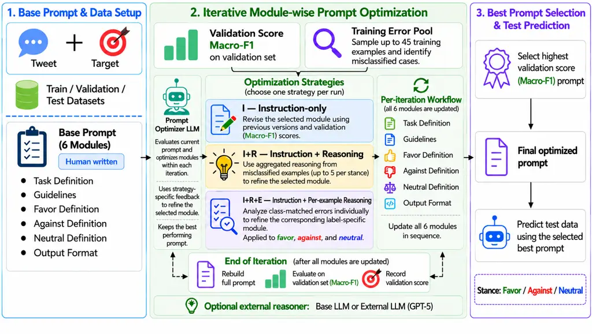
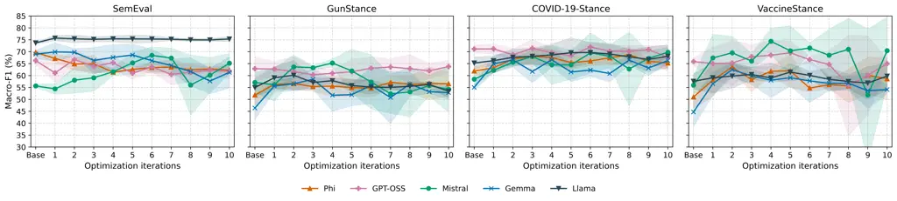
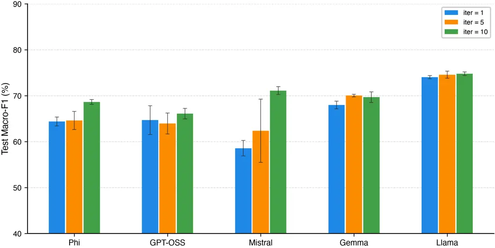
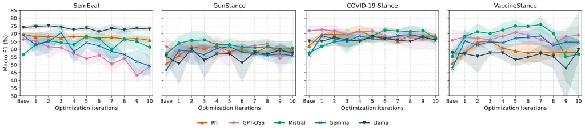
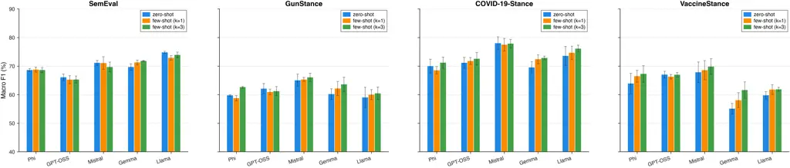

# MoPrO-SD: Modular Prompt Optimization for Stance Detection

Meysam Sabbaghan^(1,\*) Nikesh Gyawali^(1,\*) Arman Zareian Jahromi¹
Sebastian Loera-Lozano¹ Doina Caragea¹ Cornelia Caragea²  
¹Kansas State University ²University of Illinois Chicago  
{meysamsabbaghan,gnikesh,zareian,sloera,dcaragea}@ksu.edu  
cornelia@uic.edu

###### Abstract

Stance detection remains challenging for large language models (LLMs)
due to implicit opinions, sarcasm, and context-dependent expressions of
stance. Although automatic prompt optimization offers an alternative to
fine-tuning without updating model parameters, existing structured
approaches are not specifically designed around stance-label semantics
and class-specific ambiguities. We introduce MoPrO-SD, a stance-specific
prompt optimization framework that decomposes prompts into functional
semantic modules and refines them sequentially using LLM-based feedback.
We study three refinement strategies—instruction-only optimization (I),
instruction with reasoning (I+R), and instruction with per-example
reasoning (I+R+E)—using class-conditioned errors for stance-label
refinement. We also introduce VaccineStance, a new human-annotated
benchmark for vaccine stance detection. Experiments across four datasets
and five open-weight LLMs show that MoPrO-SD improves upon the
human-written Base prompt in many settings. On SemEval-2016,
class-conditioned feedback achieves higher mean Macro-F1 than pooled
feedback for four of five backbones. Both reasoning-based strategies,
I+R and I+R+E, achieve strong performance, with their relative
effectiveness varying across models and datasets, while remaining
competitive with recent prompt optimization methods. The MoPrO-SD code
and VaccineStance dataset are available on GitHub.¹¹ 1
[https://anonymous.4open.science/r/labeled-vaccines-tweets](https://anonymous.4open.science/r/labeled-vaccines-tweets)

^(\*)^(\*)footnotetext: Equal contribution.

## 1 Introduction

Stance detection identifies the attitude toward a target or claim,
typically categorized as In-Favor, Against, or Neutral (Mohammad et al.,
2016). It supports applications including misinformation detection,
political opinion analysis, public health monitoring, and social media
analytics (Küçük and Can, 2020; ALDayel and Magdy, 2021). Despite
advances in large language models (LLMs), stance detection remains
challenging due to sarcasm, implicit opinions, and context-dependent
expressions (Yakura, 2024; Gole et al., 2024; Li et al., 2025).

Prompting offers an alternative to fine-tuning without updating model
parameters, but LLMs are sensitive to prompt wording, demonstrations,
and example ordering (Zhao et al., 2021; Lu et al., 2022; Shi et al.,
2024). Semantically similar prompts can yield different
performance (Kojima et al., 2022; Zhou et al., 2023), and effective
prompts are often task- and model-dependent (Chen et al., 2023a),
motivating automated prompt optimization (Chang et al., 2024).

Recent methods include OPRO (Yang et al., 2024), EvoPrompt (Guo et al.,
2024), and CAPO (Zehle et al., 2025), while UniPrompt (Juneja et al., 2025) and SCULPT (Kumar et al., 2025) optimize structured prompt
components. Reasoning-based prompting has also shown promise for stance
detection (Ma et al., 2024; Gül et al., 2024; Aiyappa et al., 2024).
However, existing optimization frameworks are largely task-general
rather than organized around stance-specific class structure, where
guidelines, label definitions, and output constraints serve distinct
roles.

We introduce MoPrO-SD (Modular Prompt Optimization for Stance
Detection), which decomposes a stance prompt into six functional modules
and refines them sequentially. We study instruction-only (I),
instruction with reasoning (I+R), and instruction with per-example
reasoning (I+R+E) optimization. Reasoning-based strategies use
misclassification feedback for targeted refinement, with
class-conditioned errors informing stance-label modules.

We evaluate MoPrO-SD on SemEval-2016 (Mohammad et al., 2016),
COVID-19-Stance (Glandt et al., 2021), GunStance (Gyawali et al., 2024),
and VaccineStance using five open-weight LLMs, comparing against
OPRO (Yang et al., 2024), CAPO (Zehle et al., 2025),
EvoPrompt-GA/DE (Guo et al., 2024), UniPrompt (Juneja et al., 2025), and
SCULPT (Kumar et al., 2025). MoPrO-SD improves over the human-written
base prompt across many model–dataset settings. We also introduce
VaccineStance, a new human-annotated benchmark constructed from
vaccine-related social media posts collected between 2013 and 2022.

Our contributions are:

- •
  We introduce MoPrO-SD, combining stance-specific modular refinement
  with class-conditioned error feedback.
- •
  We evaluate it across four datasets and five LLMs against established
  baselines, with analyses of modularity, optimization budget, cost,
  module contributions, few-shot prompting, and external-reasoner
  transfer.
- •
  We introduce VaccineStance, a new human-annotated benchmark.

## 2 Related Work

#### Prompting for Stance Detection.

LLM-based stance detection uses prompting and reasoning
strategies (Pangtey et al., 2025). Chain-of-Stance (Ma et al., 2024) and
Stance Reasoner (Taranukhin et al., 2024) use explicit reasoning, while
other work explores rationale-augmented prompting (Lee et al., 2024) and
zero-shot instruction and decoding strategies (Aiyappa et al., 2024).
Supervised adaptation (Gül et al., 2024) can achieve strong performance
but requires additional training. In contrast, we optimize the stance
prompt without updating the target LLM.

#### Automated and Structured Prompt Optimization.

Automatic prompt optimization spans instruction generation, feedback,
search, reinforcement learning, and evolutionary approaches (Ramnath et
al., 2025). Representative methods include APE (Zhou et al., 2023),
ProTeGi (Pryzant et al., 2023), RLPrompt (Deng et al., 2022), MAPO (Chen
et al., 2023b), PRewrite (Kong et al., 2024), Auto Evol-Instruct (Zeng
et al., 2024), PromptAgent (Wang et al., 2024b), and Align-Pro (Trivedi
et al., 2025). OPRO (Yang et al., 2024) uses evaluated solutions to
guide optimization, EvoPrompt (Guo et al., 2024) combines LLMs with
evolutionary algorithms, and CAPO (Zehle et al., 2025) incorporates
optimization cost.

Structured approaches include Decomposed Prompting (Khot et al., 2023),
modular LLM programs in DSPy (Khattab et al., 2024), structure-aware
optimization in Symbolic Prompt Program Search (Schnabel and Neville,
2024), content–format optimization in CFPO (Liu et al., 2025b), and
section-wise modular prompt optimization (Sharma and Henley, 2026). DS2
(Pang et al., 2025) and DeLLMa (Liu et al., 2025a) explore data- or
decision-aware selection, while Prompt Selection and Augmentation (Wu et
al., 2024), BRIDGE (Wan et al., 2025), APT-Pipe (Zhu et al., 2024), and
Mixture of Demonstrations (Wang et al., 2024a) study demonstration
selection and organization.

Related work includes UniPrompt (Juneja et al., 2025), SCULPT (Kumar et
al., 2025), and modular prompt optimization (Sharma and Henley, 2026).
While these methods optimize structured prompt components, MoPrO-SD
specializes this paradigm to stance detection through fixed functional
modules, sequential refinement, and class-conditioned misclassification
feedback for stance-label modules.

Figure 1: Overview of MoPrO-SD. Starting from a six-module base prompt,
MoPrO-SD sequentially refines the modules using instruction-only (I),
instruction with reasoning (I+R), or instruction with per-example
reasoning (I+R+E). After each iteration, the updated prompt is evaluated
using validation Macro-F1, and the highest-scoring prompt is selected
for final test evaluation.

## 3 Methodology

We introduce MoPrO-SD, a Modular Prompt Optimization framework for
Stance Detection. MoPrO-SD decomposes a stance prompt into semantically
distinct modules and iteratively refines them using LLM-based feedback.
We study three strategies: instruction-only (I), instruction with
reasoning (I+R), and instruction with per-example reasoning (I+R+E).
Figure 1 summarizes the framework.

### 3.1 Stance Detection Prompt Modules

The base prompt consists of six modules: task definition, guidelines,
favor definition, against definition, neutral definition, and output
format. This design follows prior work on decomposing long prompts for
more stable and controllable optimization (Kumar et al., 2025; Khot et
al., 2023; Tang et al., 2025). The task module specifies the stance
detection objective; guidelines provide general decision criteria,
including sarcasm, implicit stance, and context-dependent expressions;
the three label-specific modules define favor, against, and neutral and
may include representative examples to reduce label ambiguity (Mohammad
et al., 2016); and the output module enforces label-only predictions.
The complete modular base prompt is provided in Appendix A.1.

### 3.2 Proposed MoPrO-SD Framework

Starting from a manually designed six-module base prompt, MoPrO-SD first
evaluates the full prompt on a validation set using Macro-F1 and then
refines the modules sequentially in a fixed order: task definition,
guidelines, favor definition, against definition, neutral definition,
and output format. During each update, only the target module is
rewritten using feedback determined by the optimization strategy below.

After all six modules are processed, the full prompt is re-evaluated on
the validation set. One pass over the six modules constitutes an
iteration, and the prompt with the highest validation Macro-F1 across
iterations is selected for final test evaluation. This procedure
resembles coordinate descent in prompt space, preserving prompt
substructures while refining individual modules. In the main
experiments, the optimizer/reasoner is the same backbone as the stance
classifier; we separately evaluate a stronger external optimizer.

### 3.3 Prompt Optimization Strategies

#### Instruction-only Optimization (I).

All six modules are refined using instruction-only updates. For each
module, the optimizer uses its previous variants and the validation
Macro-F1 recorded for their corresponding iterations to propose a new
version, without explicit analysis of misclassified examples (Zhou et
al., 2023).

#### Instruction with Reasoning Optimization (I+R).

The guidelines and three label-specific modules are refined using
aggregated reasoning over misclassified training examples, while the
task definition and output format use instruction-only refinement. For
each label-specific module, only errors whose gold label corresponds to
that module are used; for example, the favor definition uses errors with
gold label favor. For the guidelines module, errors from all three
stance classes are considered. The aggregated reasoning identifies
problems in the current module and guides its refinement (Shin and Kim,
2025).

#### Instruction with Per-example Reasoning Optimization (I+R+E).

For the three label-specific modules, misclassified training examples
are analyzed individually. Following Tang et al. (2025), the optimizer
generates an explanation for each error, summarizes these explanations,
and uses the feedback to revise the corresponding module. The task
definition, guidelines, and output format continue to use
instruction-only updates within the same optimization loop. If no
relevant errors are available for a label-specific module, that module
remains unchanged for that iteration. Example meta-prompts are provided
in Appendix A.2.

I+R and I+R+E are treated as alternative configurations, as they differ
in both reasoning granularity and the treatment of the guidelines
module.

## 4 Experimental Setup

### 4.1 Stance Detection Datasets

We evaluate MoPrO-SD on three existing stance detection benchmarks—
SemEval-2016 Task 6, GunStance, and COVID-19-Stance—and our new
human-annotated VaccineStance benchmark.

1.  1.  SemEval-2016 Task 6 (Mohammad et al., 2016) contains tweets labeled
        as Favor, Against, or None across multiple controversial targets. We
        exclude Donald Trump because it has no training instances and map
        None to Neutral for consistency across datasets.
2.  2.  GunStance (Gyawali et al., 2024) contains stance-labeled tweets on
        gun-control debates, including the targets Banning Guns and
        Regulating Guns.
3.  3.  COVID-19-Stance (Glandt et al., 2021) contains stance-labeled tweets
        on COVID-19 measures, including face masks, school closures, and
        stay-at-home orders.
4.  4.  VaccineStance is a new human-annotated stance detection benchmark
        introduced in this work. We curated 2,000 vaccine-relevant tweets
        from the corpus of Gyawali et al. Gyawali et al. (2025) and obtained
        human annotations for Favor, Against, and Neutral, with Fleiss’
        $`\kappa=0.778`$. The dataset comprises 500 training, 500
        validation, and 1,000 test instances.

Detailed dataset statistics, VaccineStance construction and
preprocessing, and split distributions are provided in Appendix B.

### 4.2 Large Language Models

We evaluate five LLMs spanning different model families and scales:
Phi-4-14B (Abdin et al., 2024), GPT-OSS-20B (OpenAI, 2025b),
Mistral-Small-3.2-24B (Mistral AI, 2025), Gemma-3-27B (Gemma Team et
al., 2025), and Llama-3.3-70B (Meta, 2024). Tables abbreviate them as
Phi, GPT-OSS, Mistral, Gemma, and Llama.

### 4.3 Baselines

We compare MoPrO-SD with the original zero-shot Base prompt and several
prompting baselines built on the same Base prompt: chain-of-thought
(Base+CoT) (Wei et al., 2022), few-shot prompting ($`k=3`$;
Base+FS) (Brown et al., 2020), their combination (Base+CoT+FS), and
Chain-of-Stance (Base+CoS) (Ma et al., 2024). We also compare against
automated prompt optimization methods OPRO (Yang et al., 2024),
CAPO (Zehle et al., 2025), and EvoPrompt with differential evolution
(DE) and genetic algorithm (GA) variants (Guo et al., 2024).
Additionally, on SemEval-2016, we compare with the structured prompt
optimization methods UniPrompt (Juneja et al., 2025) and SCULPT (Kumar
et al., 2025) using Mistral, Gemma, and Llama.

### 4.4 Implementation Details

All experiments optimize prompts without fine-tuning model weights.
MoPrO-SD uses 10 optimization iterations, with the six modules processed
sequentially in a fixed order. After each iteration, the full prompt is
evaluated on the validation set, and the prompt with the highest
validation Macro-F1 across iterations is selected for final test
evaluation. All methods in Table 1 were run in our experimental pipeline
using fixed dataset splits and three independent runs per method. Across
runs, validation subsampling, training-example sampling, and stochastic
LLM generation can vary. Optimization budgets vary across methods.

Unless otherwise specified, the same backbone serves as the stance
classifier and optimizer/reasoner. We additionally evaluate GPT-5 as a
stronger external reasoner (OpenAI, 2025a). In frozen-module ablations,
one module remains fixed while the others are optimized.

### 4.5 Evaluation Metrics

We use three-class Macro-F1, computed as the unweighted mean of the F1
scores for Favor, Against, and Neutral, as the primary evaluation
metric. This differs from the official SemEval-2016 metric, which
averages F1 over Favor and Against only. Prompt selection is based on
validation Macro-F1, and final test results are reported as mean $`\pm`$
standard deviation across three independent runs.

| Dataset         | Method           | Phi                | GPT-OSS            | Mistral            | Gemma              | Llama              |
| --------------- | ---------------- | ------------------ | ------------------ | ------------------ | ------------------ | ------------------ |
| SemEval         | Base (zero-shot) | 55.37 $`\pm`$ 0.12 | 60.02 $`\pm`$ 0.44 | 53.90 $`\pm`$ 0.28 | 65.82 $`\pm`$ 0.20 | 73.52 $`\pm`$ 0.14 |
|                 | Base+CoT         | 66.60 $`\pm`$ 0.74 | 57.90 $`\pm`$ 0.87 | 67.06 $`\pm`$ 0.25 | 67.45 $`\pm`$ 0.43 | 71.77 $`\pm`$ 0.30 |
|                 | Base+FS          | 57.90 $`\pm`$ 1.48 | 62.17 $`\pm`$ 0.79 | 64.69 $`\pm`$ 0.35 | 69.30 $`\pm`$ 0.05 | 72.28 $`\pm`$ 0.11 |
|                 | Base+CoT+FS      | 64.85 $`\pm`$ 0.44 | 59.89 $`\pm`$ 0.28 | 67.32 $`\pm`$ 0.56 | 66.98 $`\pm`$ 0.11 | 70.41 $`\pm`$ 0.12 |
|                 | Base+CoS         | 53.40 $`\pm`$ 0.81 | 60.18 $`\pm`$ 1.67 | 63.94 $`\pm`$ 0.37 | 59.92 $`\pm`$ 2.12 | 62.96 $`\pm`$ 1.45 |
|                 | OPRO             | 67.49 $`\pm`$ 0.74 | 66.59 $`\pm`$ 0.94 | 56.61 $`\pm`$ 3.19 | 64.76 $`\pm`$ 1.39 | 73.45 $`\pm`$ 0.27 |
|                 | CAPO             | 63.71 $`\pm`$ 0.60 | 67.32 $`\pm`$ 1.05 | 60.32 $`\pm`$ 0.12 | 67.80 $`\pm`$ 2.02 | 74.87 $`\pm`$ 0.82 |
|                 | EvoPrompt(DE)    | 68.02 $`\pm`$ 0.37 | 65.59 $`\pm`$ 0.89 | 65.35 $`\pm`$ 1.47 | 67.96 $`\pm`$ 1.67 | 74.83 $`\pm`$ 1.14 |
|                 | EvoPrompt(GA)    | 67.28 $`\pm`$ 1.79 | 64.85 $`\pm`$ 1.53 | 62.32 $`\pm`$ 3.61 | 69.11 $`\pm`$ 0.39 | 72.51 $`\pm`$ 2.51 |
|                 | I (ours)         | 61.63 $`\pm`$ 1.38 | 59.62 $`\pm`$ 0.63 | 61.93 $`\pm`$ 4.00 | 68.26 $`\pm`$ 1.73 | 73.42 $`\pm`$ 0.43 |
|                 | I+R (ours)       | 69.65 $`\pm`$ 1.62 | 62.96 $`\pm`$ 1.26 | 67.85 $`\pm`$ 1.15 | 69.64 $`\pm`$ 2.08 | 74.85 $`\pm`$ 0.26 |
|                 | I+R+E (ours)     | 68.63 $`\pm`$ 0.53 | 66.10 $`\pm`$ 1.14 | 71.12 $`\pm`$ 0.85 | 69.68 $`\pm`$ 1.14 | 74.78 $`\pm`$ 0.38 |
| GunStance       | Base (zero-shot) | 39.55 $`\pm`$ 1.49 | 60.34 $`\pm`$ 0.77 | 56.24 $`\pm`$ 0.30 | 47.09 $`\pm`$ 0.14 | 54.85 $`\pm`$ 0.22 |
|                 | Base+CoT         | 61.17 $`\pm`$ 0.26 | 59.76 $`\pm`$ 0.56 | 57.55 $`\pm`$ 0.20 | 52.48 $`\pm`$ 0.09 | 56.27 $`\pm`$ 0.11 |
|                 | Base+FS          | 51.47 $`\pm`$ 1.54 | 60.60 $`\pm`$ 0.25 | 64.13 $`\pm`$ 0.17 | 58.03 $`\pm`$ 0.06 | 58.12 $`\pm`$ 0.20 |
|                 | Base+CoT+FS      | 59.32 $`\pm`$ 0.68 | 58.85 $`\pm`$ 0.64 | 61.72 $`\pm`$ 0.30 | 63.56 $`\pm`$ 0.38 | 59.01 $`\pm`$ 0.14 |
|                 | Base+CoS         | 43.16 $`\pm`$ 0.44 | 50.20 $`\pm`$ 1.25 | 62.55 $`\pm`$ 1.07 | 59.30 $`\pm`$ 1.59 | 49.74 $`\pm`$ 0.38 |
|                 | OPRO             | 55.90 $`\pm`$ 2.66 | 59.10 $`\pm`$ 1.80 | 57.36 $`\pm`$ 1.96 | 45.63 $`\pm`$ 0.45 | 54.28 $`\pm`$ 1.00 |
|                 | CAPO             | 56.69 $`\pm`$ 1.44 | 60.47 $`\pm`$ 0.46 | 62.19 $`\pm`$ 1.13 | 53.97 $`\pm`$ 2.06 | 54.38 $`\pm`$ 1.80 |
|                 | EvoPrompt(DE)    | 55.41 $`\pm`$ 3.67 | 58.42 $`\pm`$ 1.02 | 59.40 $`\pm`$ 1.86 | 52.20 $`\pm`$ 2.07 | 57.05 $`\pm`$ 1.02 |
|                 | EvoPrompt(GA)    | 56.14 $`\pm`$ 1.78 | 59.54 $`\pm`$ 1.64 | 59.14 $`\pm`$ 0.92 | 54.88 $`\pm`$ 2.16 | 53.83 $`\pm`$ 1.70 |
|                 | I (ours)         | 53.69 $`\pm`$ 2.41 | 61.82 $`\pm`$ 0.66 | 61.43 $`\pm`$ 2.45 | 58.53 $`\pm`$ 1.60 | 57.55 $`\pm`$ 0.44 |
|                 | I+R (ours)       | 60.99 $`\pm`$ 3.13 | 61.07 $`\pm`$ 0.71 | 63.68 $`\pm`$ 1.87 | 64.05 $`\pm`$ 0.85 | 58.98 $`\pm`$ 1.40 |
|                 | I+R+E (ours)     | 59.74 $`\pm`$ 0.26 | 62.12 $`\pm`$ 1.76 | 65.01 $`\pm`$ 2.18 | 60.21 $`\pm`$ 1.84 | 59.03 $`\pm`$ 3.58 |
| COVID-19-Stance | Base (zero-shot) | 50.36 $`\pm`$ 1.71 | 73.20 $`\pm`$ 1.45 | 61.15 $`\pm`$ 0.83 | 59.52 $`\pm`$ 0.19 | 66.50 $`\pm`$ 0.36 |
|                 | Base+CoT         | 67.10 $`\pm`$ 1.26 | 73.85 $`\pm`$ 0.54 | 71.08 $`\pm`$ 0.43 | 64.93 $`\pm`$ 0.54 | 71.27 $`\pm`$ 0.41 |
|                 | Base+FS          | 53.72 $`\pm`$ 0.92 | 73.73 $`\pm`$ 0.39 | 67.93 $`\pm`$ 0.30 | 66.97 $`\pm`$ 0.43 | 72.69 $`\pm`$ 0.14 |
|                 | Base+CoT+FS      | 62.63 $`\pm`$ 2.21 | 73.46 $`\pm`$ 0.43 | 71.41 $`\pm`$ 0.62 | 67.29 $`\pm`$ 0.36 | 72.51 $`\pm`$ 0.13 |
|                 | Base+CoS         | 49.68 $`\pm`$ 0.26 | 60.43 $`\pm`$ 1.05 | 61.47 $`\pm`$ 0.25 | 59.54 $`\pm`$ 1.24 | 57.96 $`\pm`$ 0.75 |
|                 | OPRO             | 62.82 $`\pm`$ 0.68 | 69.43 $`\pm`$ 0.89 | 60.59 $`\pm`$ 0.80 | 57.37 $`\pm`$ 0.86 | 66.17 $`\pm`$ 0.94 |
|                 | CAPO             | 62.89 $`\pm`$ 0.30 | 73.83 $`\pm`$ 0.36 | 64.10 $`\pm`$ 1.01 | 61.85 $`\pm`$ 1.13 | 66.49 $`\pm`$ 1.61 |
|                 | EvoPrompt(DE)    | 62.60 $`\pm`$ 2.27 | 72.08 $`\pm`$ 0.41 | 64.50 $`\pm`$ 1.68 | 65.05 $`\pm`$ 2.54 | 66.38 $`\pm`$ 1.62 |
|                 | EvoPrompt(GA)    | 64.69 $`\pm`$ 2.79 | 72.33 $`\pm`$ 1.48 | 65.00 $`\pm`$ 0.73 | 66.43 $`\pm`$ 1.30 | 67.31 $`\pm`$ 1.75 |
|                 | I (ours)         | 60.82 $`\pm`$ 1.06 | 72.50 $`\pm`$ 0.32 | 67.36 $`\pm`$ 1.23 | 64.56 $`\pm`$ 1.64 | 64.80 $`\pm`$ 1.30 |
|                 | I+R (ours)       | 72.26 $`\pm`$ 1.77 | 74.79 $`\pm`$ 1.56 | 73.99 $`\pm`$ 2.79 | 73.01 $`\pm`$ 2.28 | 71.78 $`\pm`$ 2.62 |
|                 | I+R+E (ours)     | 69.97 $`\pm`$ 2.43 | 71.14 $`\pm`$ 1.89 | 78.03 $`\pm`$ 2.24 | 69.55 $`\pm`$ 1.96 | 73.58 $`\pm`$ 3.29 |
| VaccineStance   | Base (zero-shot) | 49.47 $`\pm`$ 0.31 | 58.84 $`\pm`$ 1.37 | 55.58 $`\pm`$ 0.69 | 37.78 $`\pm`$ 0.24 | 60.23 $`\pm`$ 0.47 |
|                 | Base+CoT         | 54.93 $`\pm`$ 0.56 | 59.46 $`\pm`$ 0.35 | 59.98 $`\pm`$ 0.74 | 52.36 $`\pm`$ 0.25 | 60.80 $`\pm`$ 0.32 |
|                 | Base+FS          | 49.88 $`\pm`$ 1.00 | 62.37 $`\pm`$ 0.60 | 65.24 $`\pm`$ 0.24 | 54.26 $`\pm`$ 0.25 | 60.51 $`\pm`$ 0.13 |
|                 | Base+CoT+FS      | 62.94 $`\pm`$ 0.30 | 63.53 $`\pm`$ 0.94 | 63.95 $`\pm`$ 0.44 | 62.72 $`\pm`$ 0.37 | 62.45 $`\pm`$ 0.20 |
|                 | Base+CoS         | 53.83 $`\pm`$ 0.54 | 61.14 $`\pm`$ 0.65 | 63.18 $`\pm`$ 0.96 | 58.89 $`\pm`$ 0.87 | 54.48 $`\pm`$ 0.43 |
|                 | OPRO             | 53.48 $`\pm`$ 6.45 | 62.59 $`\pm`$ 0.60 | 58.80 $`\pm`$ 3.15 | 48.53 $`\pm`$ 1.29 | 56.90 $`\pm`$ 3.93 |
|                 | CAPO             | 57.37 $`\pm`$ 0.41 | 61.76 $`\pm`$ 0.20 | 59.15 $`\pm`$ 0.99 | 54.18 $`\pm`$ 4.76 | 58.41 $`\pm`$ 0.41 |
|                 | EvoPrompt(DE)    | 58.04 $`\pm`$ 1.07 | 60.74 $`\pm`$ 0.26 | 55.73 $`\pm`$ 2.17 | 46.26 $`\pm`$ 3.24 | 58.04 $`\pm`$ 0.37 |
|                 | EvoPrompt(GA)    | 56.45 $`\pm`$ 8.25 | 62.67 $`\pm`$ 1.80 | 55.66 $`\pm`$ 5.66 | 55.00 $`\pm`$ 1.03 | 56.94 $`\pm`$ 0.74 |
|                 | I (ours)         | 54.83 $`\pm`$ 5.98 | 62.74 $`\pm`$ 0.52 | 58.90 $`\pm`$ 2.88 | 40.02 $`\pm`$ 3.77 | 60.39 $`\pm`$ 1.65 |
|                 | I+R (ours)       | 60.21 $`\pm`$ 0.06 | 65.35 $`\pm`$ 1.61 | 68.96 $`\pm`$ 2.00 | 66.00 $`\pm`$ 1.72 | 59.06 $`\pm`$ 1.74 |
|                 | I+R+E (ours)     | 63.87 $`\pm`$ 3.57 | 66.99 $`\pm`$ 1.20 | 67.85 $`\pm`$ 3.59 | 55.12 $`\pm`$ 1.83 | 59.76 $`\pm`$ 1.27 |

Table 1: Average Macro-F1 across targets for each dataset, model, and
prompting strategy. I = instruction-only; I+R = instruction with
reasoning; I+R+E = instruction with per-example reasoning. Base =
human-written prompt; CoT = chain-of-thought prompting; FS = few-shot
prompting; CoS = Chain-of-Stance prompting. Results are reported as mean
$`\pm`$ standard deviation across three independent runs. Shaded cells
indicate differences relative to the Base score within each
dataset–model column: gray denotes improvements, red denotes decreases,
and darker shades indicate larger absolute differences. The best score
within each dataset–model column is shown in bold.

## 5 Results and Discussion

We evaluate MoPrO-SD from both performance and diagnostic perspectives.
We first examine optimization dynamics and aggregate Macro-F1
performance across datasets and models, followed by comparisons with
structured prompt optimization methods, external-reasoner effects,
computational cost, modular versus full-prompt optimization, and
module-level ablations.

### 5.1 Optimization Dynamics

Figure 2 shows validation Macro-F1 trajectories across 10 optimization
iterations using I+R+E. Most models improve over the Base prompt during
the early iterations, while later iterations show smaller gains and
greater fluctuations. Some trajectories exhibit sharp drops followed by
recovery, particularly on VaccineStance, indicating variation across
optimization iterations. The shaded regions also show run-to-run
variability in validation performance. Overall, the trajectories show
that useful refinements are often identified early and that continued
optimization does not guarantee monotonic improvement. The trajectories
for I and I+R are provided in Appendix D.

Figure 2: Validation Macro-F1 trajectories across 10 optimization
iterations using I+R+E. Curves show mean validation Macro-F1 across
three independent runs, with shaded regions indicating the corresponding
standard deviation.

### 5.2 Main Performance Results

Table 1 summarizes Macro-F1 across datasets, backbone models, and
prompting strategies, with per-target results provided in Appendix E.
I+R+E improves over the human-written Base prompt in 18 of 20
dataset–model combinations. The improvements are nevertheless model- and
dataset-dependent: I+R outperforms I+R+E in several settings, indicating
that the preferred reasoning-based refinement configuration depends on
the model and dataset.

The largest I+R+E gains over Base are observed for Phi on GunStance
($`39.55\rightarrow 59.74`$, $`+20.19`$ Macro-F1), Phi on
COVID-19-Stance ($`50.36\rightarrow 69.97`$, $`+19.61`$), and Gemma on
VaccineStance ($`37.78\rightarrow 55.12`$, $`+17.34`$). Across all
methods, CAPO with Llama obtains the highest SemEval score (74.87),
while I+R+E achieves 74.78. I+R+E with Mistral also performs strongly on
GunStance (65.01) and achieves the highest score on COVID-19-Stance
(78.03), while I+R with Mistral obtains the highest VaccineStance score
(68.96).

Static prompting also yields substantial improvements in some settings.
For example, Base+FS increases Mistral from 53.90 to 64.69 on SemEval
and from 55.58 to 65.24 on VaccineStance. MoPrO-SD frequently improves
further, suggesting that iterative module refinement can provide gains
beyond static prompt augmentation. However, the variation across models,
datasets, and refinement strategies indicates that no single
optimization strategy dominates in every setting. Additional zero-shot
and few-shot comparisons are provided in Appendix F.

#### Comparison with Structured Prompt Optimization.

We further compare MoPrO-SD with UniPrompt and SCULPT, two related
structured prompt optimization methods. As shown in Table 2, I+R+E
achieves 71.12, 69.68, and 74.78 Macro-F1 with Mistral, Gemma, and
Llama, respectively. Its performance is similar to both UniPrompt
settings on Mistral and Gemma, while achieving the highest numerical
score on Llama (74.78). Overall, MoPrO-SD performs comparably to recent
structured prompt optimization approaches; computational cost is
examined separately in Section 5.3.

| Method                     | Mistral                    | Gemma                      | Llama                      |
| -------------------------- | -------------------------- | -------------------------- | -------------------------- |
| UniPrompt (Original Init.) | $`71.06\pm 0.68`$          | $`69.82\pm 0.62`$          | $`73.99\pm 0.11`$          |
| UniPrompt (Shared Init.)   | $`\mathbf{71.42\pm 1.94}`$ | $`\mathbf{69.90\pm 2.49}`$ | $`73.33\pm 0.73`$          |
| SCULPT                     | $`53.93\pm 0.40`$          | $`65.41\pm 0.01`$          | $`74.19\pm 0.48`$          |
| I+R+E (Ours)               | $`71.12\pm 0.85`$          | $`69.68\pm 1.14`$          | $`\mathbf{74.78\pm 0.38}`$ |

Table 2: Comparison with structured prompt optimization methods on
SemEval-2016. Results are Macro-F1 (%), reported as mean $`\pm`$
standard deviation across runs. Exploratory two-sided Welch tests are
unadjusted for multiple comparisons; Mistral–SCULPT gives $`p<0.001`$
and Gemma–SCULPT $`p=0.023`$, with all others $`p>0.05`$.

#### External Reasoner Comparison.

We evaluate GPT-5 (OpenAI, 2025a) as an external reasoner for the three
label-specific I+R+E modules, while retaining the target backbone for
classification and other module updates. This tests whether stronger
reasoning during optimization improves prompts without replacing the
target classifier. Table 3 shows gains in 17 of 20 dataset–model
combinations, with substantial variation across settings.

The largest gains occur for Gemma on VaccineStance (+11.64), Llama on
GunStance (+9.42), and Llama on COVID-19-Stance (+9.23). However,
Mistral on SemEval declines by 5.82 points, showing that stronger
reasoning does not always improve optimization. Overall, reasoning
quality can substantially affect optimization outcomes, but its benefits
remain model- and dataset-dependent.

|               | GPT-5 vs. Same LLM ($`\Delta`$ Macro-F1) |           |           |        |       |
| ------------- | ---------------------------------------- | --------- | --------- | ------ | ----- |
| Dataset       | Phi                                      | GPT-OSS   | Mistral   | Gemma  | Llama |
| SemEval       | +0.48                                    | +0.25     | $`-`$5.82 | +2.23  | +1.68 |
| GunStance     | +1.87                                    | $`-`$1.56 | $`-`$0.87 | +2.78  | +9.42 |
| COVID-19      | +0.10                                    | +0.07     | +1.04     | +8.44  | +9.23 |
| VaccineStance | +2.27                                    | +1.02     | +3.66     | +11.64 | +8.55 |

Table 3: Effect of using GPT-5 as the external reasoner for the
label-specific modules in I+R+E. Values report $`\Delta`$ Macro-F1 =
GPT-5 $`-`$ Same LLM. Full results are in Appendix G.

### 5.3 Token Cost Analysis

| Method        | Calls  | In.    | Out.   | Total  | Rel.            |
| ------------- | ------ | ------ | ------ | ------ | --------------- |
| Base          | 1,249  | 768.9K | 4.4K   | 773.4K | 1.00$`\times`$  |
| Base+FS       | 1,249  | 1.14M  | 4.3K   | 1.14M  | 1.48$`\times`$  |
| Base+CoT      | 2,521  | 1.85M  | 423.4K | 2.27M  | 2.94$`\times`$  |
| Base+CoT+FS   | 2,520  | 2.60M  | 420.8K | 3.02M  | 3.91$`\times`$  |
| SCULPT        | 9,680  | 6.08M  | 306.5K | 6.38M  | 8.26$`\times`$  |
| I+R+E (FP-5)  | 7,851  | 6.25M  | 133.8K | 6.39M  | 8.26$`\times`$  |
| I             | 7,741  | 6.14M  | 376.9K | 6.52M  | 8.43$`\times`$  |
| Base+CoS      | 7,494  | 5.96M  | 1.24M  | 7.19M  | 9.30$`\times`$  |
| I+R+E (FP-BM) | 9,563  | 10.98M | 142.7K | 11.12M | 14.38$`\times`$ |
| I+R           | 9,878  | 13.67M | 332.9K | 14.00M | 18.10$`\times`$ |
| OPRO          | 36,035 | 17.03M | 181.4K | 17.21M | 22.25$`\times`$ |
| I+R+E (Mod.)  | 12,568 | 18.34M | 1.16M  | 19.50M | 25.21$`\times`$ |
| UniPrompt-O   | 36,944 | 15.84M | 8.47M  | 24.31M | 31.43$`\times`$ |
| UniPrompt-S   | 30,211 | 21.49M | 3.30M  | 24.79M | 32.05$`\times`$ |
| CAPO          | 48,224 | 29.80M | 363.2K | 30.17M | 39.01$`\times`$ |
| EvoPrompt-GA  | 53,437 | 28.79M | 2.83M  | 31.61M | 40.88$`\times`$ |
| EvoPrompt-DE  | 40,972 | 39.72M | 7.50M  | 47.22M | 61.05$`\times`$ |

Table 4: LLM cost on SemEval-2016 using Mistral for one run across five
targets. Costs include all algorithmic LLM calls under each evaluated
protocol, including one final test pass. Relative cost is normalized by
Base (773,391 tokens). FP-5 and FP-BM denote five-iteration and
best-only-memory full-prompt I+R+E; Mod. denotes modular I+R+E.

As shown in Table 4, I, I+R, and modular I+R+E consume 8.43$`\times`$,
18.10$`\times`$, and 25.21$`\times`$ the Base token budget,
respectively. Modular I+R+E uses fewer tokens than both UniPrompt
variants, CAPO, and both EvoPrompt variants, but more than OPRO and the
evaluated full-prompt variants. These costs reflect prompt development
and evaluation under the specified protocol; once optimized, the
selected prompt requires no additional optimization calls at inference.

### 5.4 Ablation Studies

#### Modular vs. Full-Prompt Optimization.

Table 5 compares modular I+R+E with full-prompt optimization on
SemEval-2016. Modular optimization achieves higher mean Macro-F1 for
four of five backbones, with the largest gain for Mistral (+3.49), while
Llama remains nearly unchanged (+0.05) and Gemma favors full-prompt
optimization ($`-0.85`$).

| Method                                          | Phi                | GPT-OSS            | Mistral            | Gemma              | Llama              |
| ----------------------------------------------- | ------------------ | ------------------ | ------------------ | ------------------ | ------------------ |
| Base                                            | 55.37 $`\pm`$ 0.12 | 60.02 $`\pm`$ 0.44 | 53.90 $`\pm`$ 0.28 | 65.82 $`\pm`$ 0.20 | 73.52 $`\pm`$ 0.14 |
| I+R+E (Full Prompt, 5 iter.)                    | 65.69 $`\pm`$ 1.88 | 65.46 $`\pm`$ 0.62 | 67.02 $`\pm`$ 1.08 | 70.82 $`\pm`$ 0.39 | 74.03 $`\pm`$ 0.83 |
| I+R+E (Full Prompt, Best-Only Memory, 10 iter.) | 66.67 $`\pm`$ 0.76 | 65.10 $`\pm`$ 0.94 | 67.63 $`\pm`$ 0.61 | 70.53 $`\pm`$ 0.58 | 74.73 $`\pm`$ 0.77 |
| I+R+E (Modular, 10 iter.)                       | 68.63 $`\pm`$ 0.53 | 66.10 $`\pm`$ 1.14 | 71.12 $`\pm`$ 0.85 | 69.68 $`\pm`$ 1.14 | 74.78 $`\pm`$ 0.38 |

Table 5: Comparison of full-prompt and modular I+R+E optimization on
SemEval-2016 (Macro-F1, mean $`\pm`$ standard deviation over three
runs). Standard full-prompt optimization uses five iterations due to
context growth; the best-only-memory and modular variants use ten. Bold
indicates the best optimized result for each backbone.

#### Module Ablation.

Frozen Module Phi GPT-OSS Mistral Gemma Llama Macro-F1
$`\boldsymbol{\Delta}`$F1 Macro-F1 $`\boldsymbol{\Delta}`$F1 Macro-F1
$`\boldsymbol{\Delta}`$F1 Macro-F1 $`\boldsymbol{\Delta}`$F1 Macro-F1
$`\boldsymbol{\Delta}`$F1 None (All Modules Optimized) 68.63 $`\pm`$
0.53 – 66.10 $`\pm`$ 1.14 – 71.12 $`\pm`$ 0.85 – 69.68 $`\pm`$ 1.14 –
74.78 $`\pm`$ 0.38 – Favor definition 59.29 $`\pm`$ 2.32 $`-9.34`$ 59.93
$`\pm`$ 2.77 $`-6.17`$ 63.39 $`\pm`$ 1.43 $`-7.73`$ 65.18 $`\pm`$ 1.07
$`-4.50`$ 73.88 $`\pm`$ 0.90 $`-0.90`$ Neutral definition 61.74 $`\pm`$
1.66 $`-6.89`$ 65.16 $`\pm`$ 1.24 $`-0.94`$ 67.52 $`\pm`$ 0.41 $`-3.60`$
68.32 $`\pm`$ 1.62 $`-1.36`$ 74.15 $`\pm`$ 0.39 $`-0.63`$ Task
definition 61.49 $`\pm`$ 1.91 $`-7.14`$ 62.45 $`\pm`$ 1.35 $`-3.65`$
64.96 $`\pm`$ 0.73 $`-6.16`$ 67.82 $`\pm`$ 0.64 $`-1.86`$ 73.23 $`\pm`$
1.21 $`-1.55`$ Guidelines 65.09 $`\pm`$ 2.39 $`-3.54`$ 62.97 $`\pm`$
0.34 $`-3.13`$ 65.46 $`\pm`$ 2.76 $`-5.66`$ 69.17 $`\pm`$ 1.03 $`-0.51`$
73.00 $`\pm`$ 1.04 $`-1.78`$ Against definition 61.02 $`\pm`$ 2.41
$`-7.61`$ 59.51 $`\pm`$ 1.46 $`-6.59`$ 61.46 $`\pm`$ 2.53 $`-9.66`$
68.02 $`\pm`$ 1.28 $`-1.66`$ 73.22 $`\pm`$ 0.65 $`-1.56`$ Output format
60.40 $`\pm`$ 4.09 $`-8.23`$ 63.18 $`\pm`$ 1.09 $`-2.92`$ 66.64 $`\pm`$
2.28 $`-4.48`$ 70.10 $`\pm`$ 0.75 $`+0.42`$ 75.11 $`\pm`$ 0.51 $`+0.33`$

Table 6: Frozen-module ablation on SemEval-2016 under I+R+E optimization
(Macro-F1, mean $`\pm`$ standard deviation over three runs). Each row
freezes one module while optimizing the remainder. $`\Delta`$F1 is
relative to optimizing all modules.

Table 6 presents the frozen-module ablation results on SemEval-2016
under I+R+E optimization, where each experiment freezes one module at
its base-prompt version while optimizing the remaining modules.

Freezing the Favor definition produces the largest degradation for Phi
($`-9.34`$) and Gemma ($`-4.50`$), whereas freezing the Against
definition has the largest effect for GPT-OSS ($`-6.59`$) and Mistral
($`-9.66`$). Llama is comparatively less sensitive, with its largest
degradation ($`-1.78`$) occurring when Guidelines is frozen. Notably,
the Output format is the only module for which freezing does not
consistently reduce performance, yielding small improvements for Gemma
($`+0.42`$) and Llama ($`+0.33`$). Overall, these results indicate that
the contribution of individual prompt modules varies substantially
across backbone models. Qualitative examples are provided in
Appendix H.1.

#### Class-Conditioned Error Routing.

We compare I+R+E with a pooled-error variant using the same initial
prompt, ten iterations, and training batches of up to 45 examples.
Validation subsets are fixed within each run and shared across variants
with the same run ID. Class-conditioned routing uses all errors of the
corresponding gold label, whereas pooled routing samples an equal number
across labels. Modules with no class-specific errors remain unchanged.
Table 7 shows higher mean Macro-F1 for four of five backbones: Phi
(+3.40), GPT-OSS (+1.05), Mistral (+4.99), and Gemma (+2.21), while
Llama decreases by 0.15 points.

| Routing           | Phi                        | GPT                        | Mistral                    | Gemma                      | Llama                      |
| ----------------- | -------------------------- | -------------------------- | -------------------------- | -------------------------- | -------------------------- |
| Pooled            | $`65.23\pm 3.87`$          | $`65.05\pm 1.01`$          | $`66.13\pm 1.94`$          | $`67.47\pm 1.48`$          | $`\mathbf{74.93\pm 0.89}`$ |
| Class-conditioned | $`\mathbf{68.63\pm 0.53}`$ | $`\mathbf{66.10\pm 1.14}`$ | $`\mathbf{71.12\pm 0.85}`$ | $`\mathbf{69.68\pm 1.14}`$ | $`74.78\pm 0.38`$          |

Table 7: Class-conditioned versus pooled error routing on SemEval-2016.
Values are mean Macro-F1 $`\pm`$ standard deviation over three runs,
averaged across five targets.

### 5.5 Error Analysis

We qualitatively examine cases where optimization corrects Base-prompt
errors. The examples illustrate improvements on challenging phenomena
such as implicit stance, sarcasm, and ambiguous expressions. Additional
cases are provided in Appendix H.2.

 Base:

 I:

 I+R:

 I+R+E:

Analysis: The tweet uses sarcasm to criticize a creationist position,
requiring the stance toward the target to be inferred beyond surface
polarity. The Base and I+R prompts predict _against_, whereas I and
I+R+E recover the gold _favor_ label.

## 6 Conclusion

We introduced MoPrO-SD, a modular prompt optimization framework for
stance detection that refines prompt components without model
fine-tuning. Across four datasets and multiple LLM backbones, MoPrO-SD
improves over the Base prompt in many settings, although performance
varies by model and refinement strategy.

Class-conditioned error feedback achieves higher mean Macro-F1 than
pooled feedback for four of five backbones on SemEval-2016, supporting
the value of label-specific refinement. Modular optimization also
outperforms full-prompt optimization for several models, with varying
module contributions. Despite higher development-time costs, MoPrO-SD
requires no additional optimization at inference.

## Limitations

MoPrO-SD has several limitations. First, although it improves
performance across multiple stance detection datasets, its
generalizability to other NLP tasks remains unexplored. Second,
optimized prompts are model- and domain-dependent, so transferring them
across backbone models or datasets may require re-optimization. Third,
the current framework uses a fixed modular structure tailored to stance
detection, with explicit favor, against, and neutral definition modules;
extending this design to tasks with larger label spaces or more complex
reasoning requirements remains future work. Fourth, MoPrO-SD incurs
additional optimization-time cost due to repeated validation and
optimizer calls, especially for reasoning-based strategies. Finally,
experiments involving API-based LLMs may be affected by model updates
over time, which can impact reproducibility.

## References

- Abdin et al. (2024) M. Abdin, J. Aneja, H. Behl, S. Bubeck, R.
  Eldan, S. Gunasekar, M. Harrison, R. J. Hewett, M. Javaheripi, P.
  Kauffmann, et al. Phi-4 technical report. Technical report Technical
  Report MSR-TR-2024-57, Microsoft Research. Cited by: §4.2.
- Aiyappa et al. (2024) R. Aiyappa, S. Senthilmani, J. An, H. Kwak,
  and Y. Ahn Benchmarking zero-shot stance detection with FlanT5-XXL:
  insights from training data, prompting, and decoding strategies into
  its near-SoTA performance. arXiv preprint arXiv:2403.00236. Cited by:
  §1, §2.
- ALDayel and Magdy (2021) A. ALDayel and W. Magdy Stance detection on
  social media: state of the art and trends. Information Processing &
  Management 58 (4), pp. 102597. Cited by: §1.
- Brown et al. (2020) T. B. Brown, B. Mann, N. Ryder, M. Subbiah, J.
  Kaplan, P. Dhariwal, A. Neelakantan, P. Shyam, G. Sastry, A.
  Askell, S. Agarwal, A. Herbert-Voss, G. Krueger, T. Henighan, R.
  Child, A. Ramesh, D. M. Ziegler, J. Wu, C. Winter, C. Hesse, M.
  Chen, E. Sigler, M. Litwin, S. Gray, B. Chess, J. Clark, C. Berner, S.
  McCandlish, A. Radford, I. Sutskever, and D. Amodei Language models
  are few-shot learners. In Advances in Neural Information Processing
  Systems, Vol. 33, pp. 1877–1901. Cited by: §4.3.
- Chang et al. (2024) K. Chang, S. Xu, C. Wang, Y. Luo, X. Liu, T. Xiao,
  and J. Zhu Efficient prompting methods for large language models: a
  survey. arXiv preprint arXiv:2404.01077. Cited by: §1.
- Chen et al. (2023a) J. Chen, L. Chen, H. Huang, and T. Zhou When do
  you need chain-of-thought prompting for ChatGPT?. arXiv preprint
  arXiv:2304.03262. Cited by: §1.
- Chen et al. (2023b) Y. Chen, Z. Wen, G. Fan, Z. Chen, W. Wu, D.
  Liu, Z. Li, B. Liu, and Y. Xiao MAPO: boosting large language model
  performance with model-adaptive prompt optimization. In Findings of
  the Association for Computational Linguistics: EMNLP 2023, Singapore,
  pp. 3279–3304. External Links:
  [Document](https://dx.doi.org/10.18653/v1/2023.findings-emnlp.215),
  [Link](https://aclanthology.org/2023.findings-emnlp.215/) Cited by:
  §2.
- Deng et al. (2022) M. Deng, J. Wang, C. Hsieh, Y. Wang, H. Guo, T.
  Shu, M. Song, E. Xing, and Z. Hu RLPrompt: optimizing discrete text
  prompts with reinforcement learning. In Proceedings of the 2022
  Conference on Empirical Methods in Natural Language Processing,
  pp. 3369–3391. Cited by: §2.
- Gemma Team et al. (2025) Gemma Team, A. Kamath, J. Ferret, S.
  Pathak, N. Vieillard, R. Merhej, S. Perrin, T. Matejovicova, A.
  Ramé, M. Rivière, et al. Gemma 3 technical report. arXiv preprint
  arXiv:2503.19786. Cited by: §4.2.
- Glandt et al. (2021) K. Glandt, S. Khanal, Y. Li, D. Caragea, and C.
  Caragea Stance detection in COVID-19 tweets. In Proceedings of the
  59th Annual Meeting of the Association for Computational Linguistics
  and the 11th International Joint Conference on Natural Language
  Processing (Volume 1: Long Papers), pp. 1596–1611. External Links:
  [Document](https://dx.doi.org/10.18653/v1/2021.acl-long.127),
  [Link](https://aclanthology.org/2021.acl-long.127/) Cited by: §1,
  item 3.
- Gole et al. (2024) M. Gole, W. Nwadiugwu, and A. Miranskyy On sarcasm
  detection with OpenAI GPT-based models. In 2024 34th International
  Conference on Collaborative Advances in Software and COmputiNg
  (CASCON), pp. 1–6. External Links:
  [Document](https://dx.doi.org/10.1109/CASCON62161.2024.10837875) Cited
  by: §1.
- Gül et al. (2024) I. Gül, R. Lebret, and K. Aberer Stance detection on
  social media with fine-tuned large language models. arXiv preprint
  arXiv:2404.12171. Cited by: §1, §2.
- Guo et al. (2024) Q. Guo, R. Wang, J. Guo, B. Li, K. Song, X. Tan, G.
  Liu, J. Bian, and Y. Liu Connecting large language models with
  evolutionary algorithms yields powerful prompt optimizers. In The
  Twelfth International Conference on Learning Representations, External
  Links: [Link](https://openreview.net/forum?id=ZG3RaNIsO8) Cited by:
  §1, §1, §2, §4.3.
- Gyawali et al. (2025) N. Gyawali, D. Caragea, C. Caragea, and S. M.
  Mohammad The shifting landscape of vaccine discourse: insights from a
  decade of pre- to post-COVID-19 vaccine posts on social media. PLOS
  ONE 20 (12), pp. e0337911. External Links:
  [Document](https://dx.doi.org/10.1371/journal.pone.0337911) Cited by:
  §B.2, item 4.
- Gyawali et al. (2024) N. Gyawali, I. Sirbu, T. Sosea, S. Khanal, D.
  Caragea, T. Rebedea, and C. Caragea GunStance: stance detection for
  gun control and gun regulation. In Proceedings of the 62nd Annual
  Meeting of the Association for Computational Linguistics (Volume 1:
  Long Papers), pp. 12027–12044. External Links:
  [Document](https://dx.doi.org/10.18653/v1/2024.acl-long.650),
  [Link](https://aclanthology.org/2024.acl-long.650/) Cited by: §1,
  item 2.
- Juneja et al. (2025) G. Juneja, G. Jajoo, H. Li, J. Jiao, N.
  Natarajan, and A. Sharma Task facet learning: a structured approach to
  prompt optimization. In Findings of the Association for Computational
  Linguistics: ACL 2025, Vienna, Austria, pp. 23473–23496. External
  Links:
  [Document](https://dx.doi.org/10.18653/v1/2025.findings-acl.1206),
  [Link](https://aclanthology.org/2025.findings-acl.1206/) Cited by: §1,
  §1, §2, §4.3.
- Khattab et al. (2024) O. Khattab, A. Singhvi, P. Maheshwari, Z.
  Zhang, K. Santhanam, S. Vardhamanan, S. Haq, A. Sharma, T. T.
  Joshi, H. Moazam, et al. DSPy: compiling declarative language model
  calls into state-of-the-art pipelines. In The Twelfth International
  Conference on Learning Representations, Cited by: §2.
- Khot et al. (2023) T. Khot, H. Trivedi, M. Finlayson, Y. Fu, K.
  Richardson, P. Clark, and A. Sabharwal Decomposed prompting: a modular
  approach for solving complex tasks. In The Eleventh International
  Conference on Learning Representations, External Links:
  [Link](https://openreview.net/forum?id=_nGgzQjzaRy) Cited by: §2,
  §3.1.
- Kojima et al. (2022) T. Kojima, S. S. Gu, M. Reid, Y. Matsuo, and Y.
  Iwasawa Large language models are zero-shot reasoners. In Advances in
  Neural Information Processing Systems, Vol. 35, pp. 22199–22213. Cited
  by: §1.
- Kong et al. (2024) W. Kong, S. Hombaiah, M. Zhang, Q. Mei, and M.
  Bendersky PRewrite: prompt rewriting with reinforcement learning. In
  Proceedings of the 62nd Annual Meeting of the Association for
  Computational Linguistics (Volume 2: Short Papers), pp. 594–601. Cited
  by: §2.
- Küçük and Can (2020) D. Küçük and F. Can Stance detection: a survey.
  ACM Computing Surveys 53 (1), pp. 1–37. Cited by: §1.
- Kumar et al. (2025) S. Kumar, A. Y. Venkata, S. Khandelwal, B.
  Santra, P. Agrawal, and M. Gupta SCULPT: systematic tuning of long
  prompts. In Proceedings of the 63rd Annual Meeting of the Association
  for Computational Linguistics (Volume 1: Long Papers), Vienna,
  Austria, pp. 14996–15029. External Links:
  [Document](https://dx.doi.org/10.18653/v1/2025.acl-long.730),
  [Link](https://aclanthology.org/2025.acl-long.730/) Cited by: §1, §1,
  §2, §3.1, §4.3.
- Lee et al. (2024) W. Lee, J. Lee, and H. Kim LOGIC: LLM-originated
  guidance for internal cognitive improvement of small language models
  in stance detection. PeerJ Computer Science 10, pp. e2585. Cited by:
  §2.
- Li et al. (2025) Q. Li, Z. Li, W. Liu, X. He, and Y. Pan Sarcasm-GPT:
  advancing sarcasm detection with large language models. The Computer
  Journal 68 (10), pp. 1523–1534. External Links:
  [Document](https://dx.doi.org/10.1093/comjnl/bxaf055) Cited by: §1.
- Liu et al. (2025a) O. Liu, D. Fu, D. Yogatama, and W. Neiswanger
  DeLLMa: decision making under uncertainty with large language models.
  In The Thirteenth International Conference on Learning
  Representations, Cited by: §2.
- Liu et al. (2025b) Y. Liu, J. Xu, L. L. Zhang, Q. Chen, X. Feng, Y.
  Chen, Z. Guo, Y. Yang, and P. Cheng Beyond prompt content: enhancing
  LLM performance via content-format integrated prompt optimization.
  arXiv preprint arXiv:2502.04295. Cited by: §2.
- Lu et al. (2022) Y. Lu, M. Bartolo, A. Moore, S. Riedel, and P.
  Stenetorp Fantastically ordered prompts and where to find them:
  overcoming few-shot prompt order sensitivity. In Proceedings of the
  60th Annual Meeting of the Association for Computational Linguistics
  (Volume 1: Long Papers), pp. 8086–8098. Cited by: §1.
- Ma et al. (2024) J. Ma, C. Wang, H. Xing, D. Zhao, and Y. Zhang Chain
  of stance: stance detection with large language models. In Natural
  Language Processing and Chinese Computing, pp. 82–94. External Links:
  [Document](https://dx.doi.org/10.1007/978-981-97-9443-0%5F7) Cited by:
  §1, §2, §4.3.
- Meta (2024) Meta Llama-3.3-70b-instruct. Note: Hugging Face model card
  External Links:
  [Link](https://huggingface.co/meta-llama/Llama-3.3-70B-Instruct) Cited
  by: §B.2, §4.2.
- Mistral AI (2025) Mistral AI Mistral-small-3.2-24b-instruct-2506.
  Note: Hugging Face model card External Links:
  [Link](https://huggingface.co/mistralai/Mistral-Small-3.2-24B-Instruct-2506)
  Cited by: §4.2.
- Mohammad et al. (2016) S. Mohammad, S. Kiritchenko, P. Sobhani, X.
  Zhu, and C. Cherry SemEval-2016 task 6: detecting stance in tweets. In
  Proceedings of the 10th International Workshop on Semantic Evaluation
  (SemEval-2016), pp. 31–41. Cited by: §1, §1, §3.1, item 1.
- OpenAI (2025a) OpenAI GPT-5 system card. Note: OpenAI External Links:
  [Link](https://cdn.openai.com/gpt-5-system-card.pdf) Cited by: §4.4,
  §5.2.
- OpenAI (2025b) OpenAI Introducing gpt-oss. Note: OpenAI External
  Links: [Link](https://openai.com/index/introducing-gpt-oss/) Cited by:
  §4.2.
- Pang et al. (2025) J. Pang, J. Wei, A. P. Shah, Z. Zhu, Y. Wang, C.
  Qian, Y. Liu, Y. Bao, and W. Wei Improving data efficiency via
  curating LLM-driven rating systems. In The Thirteenth International
  Conference on Learning Representations, Cited by: §2.
- Pangtey et al. (2025) L. Pangtey, A. Bhatnagar, S. Bansal, S. S. Dar,
  and N. Kumar Large language models meet stance detection: a survey of
  tasks, methods, applications, challenges and future directions. arXiv
  preprint arXiv:2505.08464. Cited by: §2.
- Pryzant et al. (2023) R. Pryzant, D. Iter, J. Li, Y. Lee, C. Zhu,
  and M. Zeng Automatic prompt optimization with “gradient descent” and
  beam search. In Proceedings of the 2023 Conference on Empirical
  Methods in Natural Language Processing, Singapore, pp. 7957–7968.
  External Links:
  [Document](https://dx.doi.org/10.18653/v1/2023.emnlp-main.494),
  [Link](https://aclanthology.org/2023.emnlp-main.494/) Cited by: §2.
- Ramnath et al. (2025) K. Ramnath, K. Zhou, S. Guan, S. S. Mishra, X.
  Qi, Z. Shen, S. Wang, S. Woo, S. Jeoung, Y. Wang, et al. A systematic
  survey of automatic prompt optimization techniques. In Proceedings of
  the 2025 Conference on Empirical Methods in Natural Language
  Processing, pp. 33078–33110. External Links:
  [Document](https://dx.doi.org/10.18653/v1/2025.emnlp-main.1681),
  [Link](https://aclanthology.org/2025.emnlp-main.1681/) Cited by: §2.
- Schnabel and Neville (2024) T. Schnabel and J. Neville Symbolic prompt
  program search: a structure-aware approach to efficient compile-time
  prompt optimization. In Findings of the Association for Computational
  Linguistics: EMNLP 2024, Miami, Florida, USA, pp. 670–686. External
  Links:
  [Document](https://dx.doi.org/10.18653/v1/2024.findings-emnlp.37),
  [Link](https://aclanthology.org/2024.findings-emnlp.37/) Cited by: §2.
- Sharma and Henley (2026) P. Sharma and A. Z. Henley Modular prompt
  optimization: optimizing structured prompts with section-local textual
  gradients. arXiv preprint arXiv:2601.04055. Cited by: §2, §2.
- Shi et al. (2024) Z. Shi, J. Wei, Z. Xu, and Y. Liang Why larger
  language models do in-context learning differently?. In Proceedings of
  the 41st International Conference on Machine Learning,
  pp. 44991–45013. Cited by: §1.
- Shin and Kim (2025) S. Shin and Y. Kim Enhancing graph of thought:
  enhancing prompts with LLM rationales and dynamic temperature control.
  In The Thirteenth International Conference on Learning
  Representations, Cited by: §3.3.
- Tang et al. (2025) X. Tang, X. Wang, W. X. Zhao, S. Lu, Y. Li, and J.
  Wen Unleashing the potential of large language models as prompt
  optimizers: analogical analysis with gradient-based model optimizers.
  In Proceedings of the AAAI Conference on Artificial Intelligence, Vol.
  39, pp. 25264–25272. Cited by: §3.1, §3.3.
- Taranukhin et al. (2024) M. Taranukhin, V. Shwartz, and E. Milios
  Stance reasoner: zero-shot stance detection on social media with
  explicit reasoning. In Proceedings of the 2024 Joint International
  Conference on Computational Linguistics, Language Resources and
  Evaluation (LREC-COLING 2024), Torino, Italia, pp. 15257–15272.
  External Links: [Link](https://aclanthology.org/2024.lrec-main.1326/)
  Cited by: §2.
- Trivedi et al. (2025) P. Trivedi, S. Chakraborty, A. Reddy, V.
  Aggarwal, A. S. Bedi, and G. K. Atia Align-pro: a principled approach
  to prompt optimization for llm alignment. In Proceedings of the AAAI
  Conference on Artificial Intelligence, Vol. 39, pp. 27653–27661.
  External Links:
  [Document](https://dx.doi.org/10.1609/aaai.v39i26.34979) Cited by: §2.
- Wan et al. (2025) X. Wan, H. Zhou, R. Sun, H. Nakhost, K. Jiang,
  and S. Ö. Arık From few to many: self-improving many-shot reasoners
  through iterative optimization and generation. In The Thirteenth
  International Conference on Learning Representations, Cited by: §2.
- Wang et al. (2024a) S. Wang, Z. Chen, C. Shi, C. Shen, and J. Li
  Mixture of demonstrations for in-context learning. Advances in Neural
  Information Processing Systems 37, pp. 88091–88116. Cited by: §2.
- Wang et al. (2024b) X. Wang, C. Li, Z. Wang, F. Bai, H. Luo, J.
  Zhang, N. Jojic, E. P. Xing, and Z. Hu PromptAgent: strategic planning
  with language models enables expert-level prompt optimization. In The
  Twelfth International Conference on Learning Representations, Cited
  by: §2.
- Wei et al. (2022) J. Wei, X. Wang, D. Schuurmans, M. Bosma, B.
  Ichter, F. Xia, E. Chi, Q. V. Le, and D. Zhou Chain-of-thought
  prompting elicits reasoning in large language models. In Advances in
  Neural Information Processing Systems, Vol. 35, pp. 24824–24837. Cited
  by: §4.3.
- Wu et al. (2024) O. T. Wu, F. K. S. Chan, Z. Zhang, Y. N. Law, B.
  Drescher, and E. S. B. Lai Prompt selection and augmentation for few
  examples code generation in large language model and its application
  in robotics control. arXiv preprint arXiv:2403.12999. Cited by: §2.
- Yakura (2024) H. Yakura Evaluating large language models’ ability
  using a psychiatric screening tool based on metaphor and sarcasm
  scenarios. Journal of Intelligence 12 (7), pp. 70. Cited by: §1.
- Yang et al. (2024) C. Yang, X. Wang, Y. Lu, H. Liu, Q. V. Le, D. Zhou,
  and X. Chen Large language models as optimizers. In The Twelfth
  International Conference on Learning Representations, External Links:
  [Link](https://openreview.net/forum?id=Bb4VGOWELI) Cited by: §1, §1,
  §2, §4.3.
- Zehle et al. (2025) T. Zehle, M. Schlager, T. Heiß, and M. Feurer
  CAPO: cost-aware prompt optimization. In Proceedings of the Fourth
  International Conference on Automated Machine Learning, Proceedings of
  Machine Learning Research, Vol. 293, pp. 18/1–45. External Links:
  [Link](https://proceedings.mlr.press/v293/zehle25a.html) Cited by: §1,
  §1, §2, §4.3.
- Zeng et al. (2024) W. Zeng, C. Xu, Y. Zhao, J. Lou, and W. Chen
  Automatic instruction evolving for large language models. In
  Proceedings of the 2024 Conference on Empirical Methods in Natural
  Language Processing, pp. 6998–7018. External Links:
  [Document](https://dx.doi.org/10.18653/v1/2024.emnlp-main.397),
  [Link](https://aclanthology.org/2024.emnlp-main.397/) Cited by: §2.
- Zhao et al. (2021) Z. Zhao, E. Wallace, S. Feng, D. Klein, and S.
  Singh Calibrate before use: improving few-shot performance of language
  models. In Proceedings of the 38th International Conference on Machine
  Learning, pp. 12697–12706. Cited by: §1.
- Zhou et al. (2023) Y. Zhou, A. I. Muresanu, Z. Han, K. Paster, S.
  Pitis, H. Chan, and J. Ba Large language models are human-level prompt
  engineers. In The Eleventh International Conference on Learning
  Representations, External Links:
  [Link](https://openreview.net/forum?id=92gvk82DE-) Cited by: §1, §2,
  §3.3.
- Zhu et al. (2024) Y. Zhu, Z. Yin, G. Tyson, E. Haq, L. Lee, and P. Hui
  APT-Pipe: a prompt-tuning tool for social data annotation using
  ChatGPT. In Proceedings of the ACM Web Conference 2024, pp. 245–255.
  Cited by: §2.

## Appendix A Modular Prompt Design and Meta-Prompts

### A.1 Complete Prompt Template

### A.2 Meta Prompts

Carefully analyze the previous prompts and their Macro-F1 scores, and
write a new, improved prompt to replace the prompt below:

Wrap the new improved prompt between START and END tags. Do not explain
your changes or include any other text.

This prompt gets the following examples wrong. You should analyze the
differences between wrong predictions and ground truth answers, and
carefully consider why this prompt led to incorrect predictions. Below
are the examples with Tweets, Wrong predictions, and Ground truth
answers.

Give a reason why the prompt could have gotten these examples wrong, and
how we can improve the prompt? Wrap the reason with START and END tags.

Below are the problems with this prompt.

Carefully analyze the previous prompt and the problems with this prompt.
Write a concise, new, improved prompt. Wrap the new improved prompt
between START and END tags. Do NOT explain your changes or include any
other text between START and END tags.

You should analyze the differences between the wrong prediction and the
ground truth answer. Below is an example with a Tweet, a Wrong
prediction, and the Ground truth answer.

Give a reason why the prompt could have gotten this example wrong, and
how we can improve the prompt? Wrap the reason with START and END tags.

Write a short and concise summary between START and END tags. Do NOT
explain your changes or include any other text between START and END
tags.

Below is an example with a Tweet, Wrong prediction, and Ground truth
answer.

Below are the problems with this prompt.

Carefully analyze the previous prompt and the problems with this prompt.
Write a short, concise and improved prompt to replace the current prompt
without losing the important information. The current prompt is:

Wrap the new improved prompt between \<START\> and \<END\> tags. Do NOT
explain your changes or include any other text between \<START\> and
\<END\> tags.

## Appendix B Additional Experimental Details

### B.1 Dataset Statistics

Table T1 summarizes the target-wise train, validation, and test
distributions for the four datasets used in our experiments.

|                 |                                  |       |       |       |       |
| --------------- | -------------------------------- | ----- | ----- | ----- | ----- |
| Dataset         | Target                           | Train | Valid | Test  | Total |
| COVID-19-Stance | Anthony Fauci                    | 1,464 | 200   | 200   | 1,864 |
|                 | Face Masks                       | 1,307 | 200   | 200   | 1,707 |
|                 | School Closures                  | 790   | 200   | 200   | 1,190 |
|                 | Stay at Home Orders              | 972   | 200   | 200   | 1,372 |
|                 | Total                            | 4,533 | 800   | 800   | 6,133 |
| GunStance       | Guns Should Be Banned            | 900   | 900   | 900   | 2,700 |
|                 | Guns Should Be Regulated         | 936   | 932   | 932   | 2,800 |
|                 | Total                            | 1,836 | 1,832 | 1,832 | 5,500 |
| SemEval-2016    | Atheism                          | 389   | 124   | 220   | 733   |
|                 | Climate Change Is a Real Concern | 324   | 71    | 169   | 564   |
|                 | Feminist Movement                | 536   | 128   | 285   | 949   |
|                 | Hillary Clinton                  | 557   | 132   | 295   | 984   |
|                 | Legalization of Abortion         | 525   | 128   | 280   | 933   |
|                 | Total                            | 2,331 | 583   | 1,249 | 4,163 |
| VaccineStance   | Vaccines                         | 500   | 500   | 1,000 | 2,000 |
|                 | Total                            | 500   | 500   | 1,000 | 2,000 |

Table T1: Target-wise train, validation, and test distributions for the
stance detection benchmarks.

### B.2 VaccineStance Construction and Annotation

We construct VaccineStance from the vaccine-discourse corpus of Gyawali
et al. Gyawali et al. (2025), comprising public English-language posts
collected from X (formerly Twitter) using the Full Archive Search API
between January 2013 and December 2022. Preprocessing retained original
posts, limited users to one post per day, removed reposts, URLs,
emoticons, non-ASCII characters, and user mentions, and filtered
references to the band “The Vaccines” using Sentence-Transformer
similarity. The resulting corpus contained approximately 18.7 million
posts from 5.8 million users.

From this corpus, we sampled 240,000 tweets (2,000 per month) and used
Llama-3.3 Meta (2024) to identify posts relevant to vaccine stance
detection. We then selected 2,000 tweets for human stance annotation.
Each tweet was independently labeled by three annotators as Favor,
Against, or Neutral, achieving Fleiss’ $`\kappa=0.778`$. The resulting
benchmark contains 724 Favor (36.2%), 464 Against (23.2%), and 812
Neutral (40.6%) instances, divided into 500 training, 500 validation,
and 1,000 test instances. All tweet identifiers and texts are unique,
with no exact overlap across splits.

### B.3 Sample Annotated VaccineStance Examples

Representative VaccineStance examples with Llama-3.3 stance predictions
and final human annotations are shown below. These stance predictions
are distinct from the relevance-filtering step used during candidate
selection.

 Human:

 Human:

 Human:

 Human:

| Split      | Favor | Against | Neutral | Total |
| ---------- | ----- | ------- | ------- | ----- |
| Train      | 159   | 103     | 238     | 500   |
| Validation | 169   | 102     | 229     | 500   |
| Test       | 396   | 259     | 345     | 1,000 |
| Total      | 724   | 464     | 812     | 2,000 |

Table T2: Class distribution of VaccineStance across the train,
validation, and test splits.

## Appendix C Effect of Optimization Budget

We examine the effect of optimization budget under the I+R+E setting by
varying the number of optimization iterations among 1, 5, and 10 on
SemEval-2016. Figure S1 reports test Macro-F1 across all five backbone
models.

Figure S1: Effect of optimization budget on SemEval-2016 under the I+R+E
setting. Bars show mean test Macro-F1 over three independent runs using
1, 5, and 10 optimization iterations; error bars denote standard
deviation.

Increasing the optimization budget from 1 to 10 iterations improves mean
Macro-F1 for all five backbones, although the magnitude of the gain
varies across models. The largest improvement is observed for Mistral
($`+12.55`$ points), followed by Phi ($`+4.23`$), with smaller gains for
GPT-OSS, Gemma, and Llama. Paired two-sided $`t`$-tests across the three
runs show significant improvements from 1 to 10 iterations for Mistral
($`p=0.0018`$), Gemma ($`p=0.0210`$), and Phi ($`p=0.0211`$), but not
for GPT-OSS or Llama. For 5 versus 10 iterations, no statistically
significant difference is detected for any backbone with three runs
($`p>0.05`$).

### C.1 Implementation Details

All LLM calls are performed through remote APIs, with OpenRouter as the
primary provider. Stance classification uses a temperature of 0.2,
whereas reasoning-generation steps use a temperature of 0.7. For
few-shot evaluation, the final optimized I+R+E prompts are kept frozen
and augmented at inference time with training-set demonstrations
retrieved by embedding similarity. We evaluate $`k=1`$ and $`k=3`$
demonstrations per stance class.

## Appendix D Additional Optimization Trajectories

Figures S2 and S3 present the validation Macro-F1 trajectories for the I
and I+R optimization strategies, respectively. Each curve represents the
mean validation Macro-F1 across three independent runs, while the shaded
regions indicate the corresponding standard deviation. In both figures,
“Base” denotes the validation Macro-F1 of the original prompt before
optimization.

Figure S2: Validation Macro-F1 trajectories over 10 optimization
iterations across the four datasets using the I strategy. Curves show
the mean across three independent runs, and shaded regions denote
standard deviation. “Base” denotes the validation Macro-F1 of the
original prompt before optimization.

Figure S3: Validation Macro-F1 trajectories over 10 optimization
iterations across the four datasets using the I+R strategy. Curves show
the mean across three independent runs, and shaded regions denote
standard deviation. “Base” denotes the validation Macro-F1 of the
original prompt before optimization.

## Appendix E Detailed Dataset-Specific Results

This section provides detailed target-level Macro-F1 results for the
SemEval-2016, GunStance, and COVID-19-Stance datasets discussed in the
main paper. Since VaccineStance contains a single target, its full
results are reported in the main paper.

Table T3 reports the detailed target-level results for SemEval-2016.
Table T4 reports the detailed target-level results for GunStance.
Table T5 reports the detailed target-level results for COVID-19-Stance.

|                                  |               |                    |                    |                     |                    |                    |
| -------------------------------- | ------------- | ------------------ | ------------------ | ------------------- | ------------------ | ------------------ |
|                                  |               | Model              |                    |                     |                    |                    |
| Target                           | Method        | Phi                | GPT-OSS            | Mistral             | Gemma              | Llama              |
| Atheism                          | Base          | 37.88 $`\pm`$ 1.41 | 42.71 $`\pm`$ 0.96 | 20.15 $`\pm`$ 0.98  | 60.48 $`\pm`$ 0.22 | 63.74 $`\pm`$ 1.36 |
|                                  | Base+CoT      | 64.11 $`\pm`$ 0.56 | 33.65 $`\pm`$ 1.53 | 55.71 $`\pm`$ 0.50  | 63.34 $`\pm`$ 0.74 | 64.09 $`\pm`$ 0.34 |
|                                  | Base+FS       | 45.92 $`\pm`$ 2.87 | 52.47 $`\pm`$ 1.98 | 51.08 $`\pm`$ 0.97  | 65.84 $`\pm`$ 0.03 | 72.25 $`\pm`$ 0.23 |
|                                  | Base+CoT+FS   | 66.17 $`\pm`$ 0.57 | 44.94 $`\pm`$ 1.62 | 59.68 $`\pm`$ 1.61  | 61.99 $`\pm`$ 0.04 | 68.84 $`\pm`$ 0.56 |
|                                  | Base+CoS      | 51.23 $`\pm`$ 1.34 | 55.08 $`\pm`$ 3.22 | 56.77 $`\pm`$ 2.57  | 58.10 $`\pm`$ 0.93 | 64.56 $`\pm`$ 1.80 |
|                                  | OPRO          | 62.97 $`\pm`$ 3.37 | 59.13 $`\pm`$ 1.74 | 28.76 $`\pm`$ 10.81 | 56.10 $`\pm`$ 5.85 | 62.32 $`\pm`$ 1.87 |
|                                  | CAPO          | 47.49 $`\pm`$ 5.59 | 61.00 $`\pm`$ 5.34 | 33.23 $`\pm`$ 2.05  | 64.18 $`\pm`$ 3.10 | 69.33 $`\pm`$ 0.76 |
|                                  | EvoPrompt(DE) | 59.11 $`\pm`$ 4.07 | 58.20 $`\pm`$ 3.46 | 51.13 $`\pm`$ 5.33  | 63.80 $`\pm`$ 0.37 | 66.20 $`\pm`$ 0.88 |
|                                  | EvoPrompt(GA) | 60.68 $`\pm`$ 6.53 | 56.82 $`\pm`$ 6.42 | 47.79 $`\pm`$ 15.26 | 65.91 $`\pm`$ 3.39 | 61.76 $`\pm`$ 3.68 |
|                                  | I             | 42.63 $`\pm`$ 0.68 | 41.06 $`\pm`$ 2.80 | 40.34 $`\pm`$ 16.36 | 61.01 $`\pm`$ 2.15 | 60.34 $`\pm`$ 2.43 |
|                                  | I+R           | 63.09 $`\pm`$ 4.86 | 66.31 $`\pm`$ 4.80 | 60.31 $`\pm`$ 3.77  | 64.94 $`\pm`$ 5.47 | 71.67 $`\pm`$ 0.63 |
|                                  | I+R+E         | 60.77 $`\pm`$ 6.30 | 70.64 $`\pm`$ 2.34 | 67.46 $`\pm`$ 2.35  | 67.56 $`\pm`$ 2.42 | 66.92 $`\pm`$ 1.30 |
| Climate change is a real concern | Base          | 45.44 $`\pm`$ 2.30 | 63.98 $`\pm`$ 0.86 | 58.42 $`\pm`$ 0.71  | 55.43 $`\pm`$ 0.26 | 76.53 $`\pm`$ 0.44 |
|                                  | Base+CoT      | 66.55 $`\pm`$ 2.20 | 60.91 $`\pm`$ 2.81 | 67.07 $`\pm`$ 0.76  | 65.10 $`\pm`$ 0.08 | 78.18 $`\pm`$ 0.11 |
|                                  | Base+FS       | 51.51 $`\pm`$ 2.42 | 65.38 $`\pm`$ 3.35 | 66.59 $`\pm`$ 1.09  | 64.59 $`\pm`$ 0.15 | 73.29 $`\pm`$ 0.48 |
|                                  | Base+CoT+FS   | 53.94 $`\pm`$ 0.76 | 62.50 $`\pm`$ 1.20 | 64.12 $`\pm`$ 0.64  | 64.91 $`\pm`$ 0.10 | 77.35 $`\pm`$ 0.96 |
|                                  | Base+CoS      | 61.03 $`\pm`$ 3.49 | 67.51 $`\pm`$ 0.41 | 69.03 $`\pm`$ 3.49  | 68.91 $`\pm`$ 7.52 | 70.48 $`\pm`$ 2.88 |
|                                  | OPRO          | 59.22 $`\pm`$ 0.97 | 70.61 $`\pm`$ 3.02 | 59.61 $`\pm`$ 0.66  | 54.97 $`\pm`$ 0.53 | 76.72 $`\pm`$ 0.88 |
|                                  | CAPO          | 62.13 $`\pm`$ 1.90 | 68.65 $`\pm`$ 2.40 | 65.01 $`\pm`$ 0.63  | 64.67 $`\pm`$ 5.03 | 78.49 $`\pm`$ 1.94 |
|                                  | EvoPrompt(DE) | 64.81 $`\pm`$ 1.50 | 66.24 $`\pm`$ 4.11 | 67.60 $`\pm`$ 14.32 | 66.06 $`\pm`$ 2.95 | 79.30 $`\pm`$ 5.44 |
|                                  | EvoPrompt(GA) | 63.67 $`\pm`$ 2.31 | 66.42 $`\pm`$ 2.28 | 62.98 $`\pm`$ 2.07  | 66.49 $`\pm`$ 2.86 | 75.87 $`\pm`$ 9.80 |
|                                  | I             | 58.58 $`\pm`$ 1.86 | 61.34 $`\pm`$ 3.07 | 59.67 $`\pm`$ 9.46  | 62.18 $`\pm`$ 4.07 | 79.84 $`\pm`$ 0.26 |
|                                  | I+R           | 75.43 $`\pm`$ 4.06 | 55.90 $`\pm`$ 2.15 | 68.46 $`\pm`$ 4.32  | 73.08 $`\pm`$ 3.64 | 77.56 $`\pm`$ 0.60 |
|                                  | I+R+E         | 67.25 $`\pm`$ 3.62 | 61.64 $`\pm`$ 5.86 | 73.40 $`\pm`$ 1.77  | 66.00 $`\pm`$ 3.95 | 81.79 $`\pm`$ 0.67 |
| Feminist movement                | Base          | 59.82 $`\pm`$ 1.68 | 61.78 $`\pm`$ 1.86 | 58.37 $`\pm`$ 0.98  | 67.69 $`\pm`$ 0.02 | 72.94 $`\pm`$ 0.50 |
|                                  | Base+CoT      | 63.95 $`\pm`$ 1.70 | 61.80 $`\pm`$ 0.43 | 68.83 $`\pm`$ 0.94  | 65.50 $`\pm`$ 0.36 | 68.96 $`\pm`$ 0.97 |
|                                  | Base+FS       | 61.45 $`\pm`$ 2.47 | 61.52 $`\pm`$ 1.69 | 62.46 $`\pm`$ 0.47  | 68.78 $`\pm`$ 0.20 | 68.24 $`\pm`$ 0.68 |
|                                  | Base+CoT+FS   | 64.39 $`\pm`$ 2.26 | 63.22 $`\pm`$ 1.84 | 64.26 $`\pm`$ 0.34  | 65.49 $`\pm`$ 0.14 | 69.47 $`\pm`$ 0.26 |
|                                  | Base+CoS      | 50.08 $`\pm`$ 3.94 | 53.26 $`\pm`$ 1.61 | 60.45 $`\pm`$ 0.06  | 56.20 $`\pm`$ 2.38 | 55.91 $`\pm`$ 2.21 |
|                                  | OPRO          | 67.06 $`\pm`$ 3.93 | 68.22 $`\pm`$ 2.34 | 59.33 $`\pm`$ 4.39  | 67.45 $`\pm`$ 0.19 | 74.63 $`\pm`$ 1.16 |
|                                  | CAPO          | 64.67 $`\pm`$ 1.26 | 68.99 $`\pm`$ 0.79 | 64.53 $`\pm`$ 0.36  | 65.80 $`\pm`$ 2.72 | 74.14 $`\pm`$ 1.70 |
|                                  | EvoPrompt(DE) | 68.96 $`\pm`$ 0.49 | 66.26 $`\pm`$ 1.19 | 67.66 $`\pm`$ 1.51  | 67.32 $`\pm`$ 3.63 | 75.00 $`\pm`$ 3.02 |
|                                  | EvoPrompt(GA) | 67.48 $`\pm`$ 1.53 | 65.59 $`\pm`$ 1.94 | 60.59 $`\pm`$ 3.77  | 64.54 $`\pm`$ 0.31 | 73.11 $`\pm`$ 3.72 |
|                                  | I             | 63.84 $`\pm`$ 2.68 | 62.27 $`\pm`$ 1.01 | 64.38 $`\pm`$ 5.64  | 70.59 $`\pm`$ 3.27 | 74.81 $`\pm`$ 0.06 |
|                                  | I+R           | 63.15 $`\pm`$ 1.71 | 60.44 $`\pm`$ 1.97 | 62.29 $`\pm`$ 3.01  | 67.13 $`\pm`$ 4.16 | 73.64 $`\pm`$ 1.40 |
|                                  | I+R+E         | 67.11 $`\pm`$ 1.30 | 64.69 $`\pm`$ 0.88 | 68.20 $`\pm`$ 1.36  | 67.86 $`\pm`$ 2.36 | 73.43 $`\pm`$ 0.59 |
| Hillary Clinton                  | Base          | 73.31 $`\pm`$ 0.31 | 74.59 $`\pm`$ 1.59 | 73.86 $`\pm`$ 0.54  | 80.94 $`\pm`$ 0.21 | 83.81 $`\pm`$ 0.51 |
|                                  | Base+CoT      | 74.42 $`\pm`$ 3.97 | 74.35 $`\pm`$ 2.21 | 81.25 $`\pm`$ 0.20  | 78.66 $`\pm`$ 0.18 | 82.27 $`\pm`$ 0.46 |
|                                  | Base+FS       | 66.52 $`\pm`$ 2.00 | 75.34 $`\pm`$ 0.58 | 81.07 $`\pm`$ 1.11  | 80.25 $`\pm`$ 0.49 | 82.46 $`\pm`$ 0.43 |
|                                  | Base+CoT+FS   | 78.68 $`\pm`$ 3.02 | 76.05 $`\pm`$ 1.00 | 81.59 $`\pm`$ 0.86  | 77.14 $`\pm`$ 0.30 | 78.96 $`\pm`$ 0.20 |
|                                  | Base+CoS      | 56.69 $`\pm`$ 0.46 | 67.36 $`\pm`$ 1.61 | 75.12 $`\pm`$ 0.71  | 58.72 $`\pm`$ 0.73 | 64.53 $`\pm`$ 3.34 |
|                                  | OPRO          | 81.56 $`\pm`$ 0.42 | 75.50 $`\pm`$ 1.78 | 75.91 $`\pm`$ 2.28  | 80.78 $`\pm`$ 0.41 | 84.05 $`\pm`$ 0.39 |
|                                  | CAPO          | 80.10 $`\pm`$ 2.22 | 79.45 $`\pm`$ 0.81 | 78.01 $`\pm`$ 0.39  | 78.50 $`\pm`$ 4.65 | 83.14 $`\pm`$ 1.46 |
|                                  | EvoPrompt(DE) | 83.03 $`\pm`$ 0.10 | 77.90 $`\pm`$ 2.05 | 78.58 $`\pm`$ 2.21  | 79.40 $`\pm`$ 0.42 | 83.36 $`\pm`$ 0.61 |
|                                  | EvoPrompt(GA) | 80.88 $`\pm`$ 0.67 | 77.54 $`\pm`$ 2.69 | 79.32 $`\pm`$ 2.31  | 81.98 $`\pm`$ 2.06 | 82.63 $`\pm`$ 2.38 |
|                                  | I             | 80.13 $`\pm`$ 2.27 | 75.49 $`\pm`$ 0.54 | 83.67 $`\pm`$ 2.47  | 80.77 $`\pm`$ 0.67 | 84.13 $`\pm`$ 0.41 |
|                                  | I+R           | 80.47 $`\pm`$ 1.62 | 75.34 $`\pm`$ 0.78 | 82.58 $`\pm`$ 1.97  | 80.82 $`\pm`$ 1.01 | 84.47 $`\pm`$ 0.72 |
|                                  | I+R+E         | 82.65 $`\pm`$ 1.74 | 75.71 $`\pm`$ 1.80 | 83.93 $`\pm`$ 1.21  | 79.75 $`\pm`$ 1.79 | 84.68 $`\pm`$ 0.55 |
| Legalization of abortion         | Base          | 60.39 $`\pm`$ 0.74 | 57.05 $`\pm`$ 1.19 | 58.71 $`\pm`$ 0.57  | 64.55 $`\pm`$ 1.00 | 70.58 $`\pm`$ 0.73 |
|                                  | Base+CoT      | 62.10 $`\pm`$ 1.39 | 57.02 $`\pm`$ 1.15 | 62.44 $`\pm`$ 0.68  | 66.52 $`\pm`$ 1.35 | 65.16 $`\pm`$ 0.94 |
|                                  | Base+FS       | 64.12 $`\pm`$ 2.10 | 56.16 $`\pm`$ 1.31 | 62.24 $`\pm`$ 0.80  | 67.05 $`\pm`$ 0.31 | 65.16 $`\pm`$ 0.87 |
|                                  | Base+CoT+FS   | 63.06 $`\pm`$ 4.10 | 56.88 $`\pm`$ 1.20 | 66.93 $`\pm`$ 0.15  | 64.13 $`\pm`$ 0.32 | 61.56 $`\pm`$ 0.54 |
|                                  | Base+CoS      | 48.00 $`\pm`$ 4.50 | 57.71 $`\pm`$ 1.48 | 58.31 $`\pm`$ 0.18  | 57.66 $`\pm`$ 0.47 | 59.33 $`\pm`$ 0.61 |
|                                  | OPRO          | 66.65 $`\pm`$ 0.59 | 59.47 $`\pm`$ 2.32 | 59.44 $`\pm`$ 0.76  | 64.51 $`\pm`$ 1.53 | 69.53 $`\pm`$ 0.16 |
|                                  | CAPO          | 64.15 $`\pm`$ 2.14 | 58.51 $`\pm`$ 1.20 | 60.83 $`\pm`$ 0.21  | 65.84 $`\pm`$ 1.65 | 69.23 $`\pm`$ 0.68 |
|                                  | EvoPrompt(DE) | 64.18 $`\pm`$ 0.13 | 59.36 $`\pm`$ 0.57 | 61.78 $`\pm`$ 0.91  | 63.23 $`\pm`$ 0.99 | 70.28 $`\pm`$ 2.47 |
|                                  | EvoPrompt(GA) | 63.71 $`\pm`$ 2.53 | 57.86 $`\pm`$ 3.37 | 60.93 $`\pm`$ 0.62  | 66.63 $`\pm`$ 1.40 | 69.16 $`\pm`$ 1.18 |
|                                  | I             | 62.94 $`\pm`$ 2.74 | 57.92 $`\pm`$ 1.93 | 61.59 $`\pm`$ 1.40  | 66.77 $`\pm`$ 2.33 | 67.99 $`\pm`$ 1.27 |
|                                  | I+R           | 66.11 $`\pm`$ 0.51 | 56.81 $`\pm`$ 1.67 | 65.61 $`\pm`$ 1.61  | 62.22 $`\pm`$ 6.23 | 66.89 $`\pm`$ 0.38 |
|                                  | I+R+E         | 65.36 $`\pm`$ 0.75 | 57.84 $`\pm`$ 1.53 | 62.62 $`\pm`$ 0.47  | 67.20 $`\pm`$ 1.44 | 67.10 $`\pm`$ 0.30 |

Table T3: Per-target results on SemEval-2016 using Macro-F1. I =
instruction-only; I+R = instruction + reasoning; I+R+E = instruction +
per-example reasoning. Base = original prompt; CoT = chain-of-thought
prompting; FS = few-shot prompting; CoS = Chain-of-Stance prompting.
Values are mean $`\pm`$ standard deviation across three runs. Shaded
cells indicate differences from the corresponding Base score: gray
denotes improvements, red denotes decreases, and darker shades indicate
larger absolute differences. The best score for each target across all
models and methods is shown in bold.

| Target                   | Method        | Phi                | GPT-OSS            | Mistral            | Gemma              | Llama              |
| ------------------------ | ------------- | ------------------ | ------------------ | ------------------ | ------------------ | ------------------ |
| Guns should be banned    | Base          | 39.84 $`\pm`$ 1.92 | 57.53 $`\pm`$ 0.81 | 53.75 $`\pm`$ 0.56 | 43.49 $`\pm`$ 0.23 | 52.17 $`\pm`$ 0.50 |
|                          | Base+CoT      | 60.73 $`\pm`$ 1.24 | 57.26 $`\pm`$ 1.20 | 54.44 $`\pm`$ 0.43 | 49.46 $`\pm`$ 0.08 | 54.66 $`\pm`$ 0.81 |
|                          | Base+FS       | 51.99 $`\pm`$ 2.07 | 58.69 $`\pm`$ 0.70 | 62.86 $`\pm`$ 0.13 | 57.18 $`\pm`$ 0.14 | 53.61 $`\pm`$ 0.29 |
|                          | Base+CoT+FS   | 59.92 $`\pm`$ 0.53 | 56.41 $`\pm`$ 0.76 | 58.77 $`\pm`$ 0.58 | 62.44 $`\pm`$ 0.08 | 55.84 $`\pm`$ 1.10 |
|                          | Base+CoS      | 42.52 $`\pm`$ 1.06 | 50.39 $`\pm`$ 1.50 | 62.19 $`\pm`$ 1.11 | 57.98 $`\pm`$ 0.49 | 46.87 $`\pm`$ 0.63 |
|                          | OPRO          | 54.13 $`\pm`$ 3.03 | 56.74 $`\pm`$ 3.02 | 54.09 $`\pm`$ 0.62 | 42.60 $`\pm`$ 0.71 | 52.14 $`\pm`$ 0.84 |
|                          | CAPO          | 54.64 $`\pm`$ 1.57 | 58.79 $`\pm`$ 1.18 | 60.73 $`\pm`$ 2.23 | 49.45 $`\pm`$ 2.95 | 52.96 $`\pm`$ 3.35 |
|                          | EvoPrompt(DE) | 55.32 $`\pm`$ 3.46 | 55.76 $`\pm`$ 0.16 | 55.28 $`\pm`$ 2.28 | 49.04 $`\pm`$ 6.53 | 57.56 $`\pm`$ 1.13 |
|                          | EvoPrompt(GA) | 55.49 $`\pm`$ 3.44 | 58.05 $`\pm`$ 1.99 | 56.10 $`\pm`$ 1.78 | 52.83 $`\pm`$ 4.08 | 51.82 $`\pm`$ 3.33 |
|                          | I             | 50.80 $`\pm`$ 2.01 | 60.34 $`\pm`$ 0.48 | 60.10 $`\pm`$ 5.70 | 56.14 $`\pm`$ 3.19 | 54.71 $`\pm`$ 1.46 |
|                          | I+R           | 57.96 $`\pm`$ 5.38 | 60.51 $`\pm`$ 1.93 | 62.82 $`\pm`$ 3.24 | 61.81 $`\pm`$ 1.56 | 57.00 $`\pm`$ 3.56 |
|                          | I+R+E         | 58.02 $`\pm`$ 1.75 | 60.07 $`\pm`$ 3.16 | 64.78 $`\pm`$ 1.89 | 57.50 $`\pm`$ 4.79 | 56.58 $`\pm`$ 4.40 |
| Guns should be regulated | Base          | 39.27 $`\pm`$ 1.26 | 63.16 $`\pm`$ 0.74 | 58.73 $`\pm`$ 0.50 | 50.69 $`\pm`$ 0.38 | 57.54 $`\pm`$ 0.44 |
|                          | Base+CoT      | 61.62 $`\pm`$ 0.68 | 62.27 $`\pm`$ 0.30 | 60.65 $`\pm`$ 0.71 | 55.49 $`\pm`$ 0.06 | 57.88 $`\pm`$ 0.47 |
|                          | Base+FS       | 50.95 $`\pm`$ 1.67 | 62.50 $`\pm`$ 0.53 | 65.40 $`\pm`$ 0.42 | 58.88 $`\pm`$ 0.13 | 62.63 $`\pm`$ 0.24 |
|                          | Base+CoT+FS   | 58.71 $`\pm`$ 0.66 | 61.29 $`\pm`$ 0.98 | 64.66 $`\pm`$ 0.34 | 64.68 $`\pm`$ 0.73 | 62.19 $`\pm`$ 0.91 |
|                          | Base+CoS      | 43.81 $`\pm`$ 0.55 | 50.02 $`\pm`$ 1.04 | 62.90 $`\pm`$ 1.45 | 60.61 $`\pm`$ 2.69 | 52.60 $`\pm`$ 0.14 |
|                          | OPRO          | 57.66 $`\pm`$ 2.55 | 61.46 $`\pm`$ 1.12 | 60.64 $`\pm`$ 4.46 | 48.65 $`\pm`$ 1.60 | 56.42 $`\pm`$ 1.29 |
|                          | CAPO          | 58.73 $`\pm`$ 3.21 | 62.15 $`\pm`$ 0.36 | 63.65 $`\pm`$ 0.58 | 58.49 $`\pm`$ 1.21 | 55.80 $`\pm`$ 0.78 |
|                          | EvoPrompt(DE) | 55.51 $`\pm`$ 3.87 | 61.06 $`\pm`$ 1.87 | 63.52 $`\pm`$ 1.44 | 55.36 $`\pm`$ 2.39 | 56.54 $`\pm`$ 0.91 |
|                          | EvoPrompt(GA) | 56.79 $`\pm`$ 0.86 | 61.03 $`\pm`$ 1.34 | 62.17 $`\pm`$ 0.20 | 56.93 $`\pm`$ 2.21 | 55.85 $`\pm`$ 1.26 |
|                          | I             | 56.57 $`\pm`$ 2.82 | 63.31 $`\pm`$ 1.77 | 62.76 $`\pm`$ 2.67 | 60.91 $`\pm`$ 0.12 | 60.38 $`\pm`$ 1.14 |
|                          | I+R           | 64.01 $`\pm`$ 1.78 | 61.63 $`\pm`$ 0.56 | 64.53 $`\pm`$ 0.70 | 66.29 $`\pm`$ 0.74 | 60.97 $`\pm`$ 0.94 |
|                          | I+R+E         | 61.47 $`\pm`$ 1.79 | 64.16 $`\pm`$ 0.76 | 65.24 $`\pm`$ 2.73 | 62.93 $`\pm`$ 2.94 | 61.48 $`\pm`$ 3.73 |

Table T4: Per-target results on GunStance using Macro-F1. I =
instruction-only; I+R = instruction + reasoning; I+R+E = instruction +
per-example reasoning. Base = original prompt; CoT = chain-of-thought
prompting; FS = few-shot prompting; CoS = Chain-of-Stance prompting.
Values are mean $`\pm`$ standard deviation across three runs. Shaded
cells indicate differences from the corresponding Base score within each
model column: gray denotes improvements, red denotes decreases, and
darker shades indicate larger absolute differences. The best score for
each target across all models and methods is shown in bold.

| Target              | Method        | Phi                 | GPT-OSS            | Mistral            | Gemma              | Llama               |
| ------------------- | ------------- | ------------------- | ------------------ | ------------------ | ------------------ | ------------------- |
| Anthony Fauci       | Base          | 57.47 $`\pm`$ 1.84  | 70.76 $`\pm`$ 3.03 | 72.65 $`\pm`$ 0.13 | 58.08 $`\pm`$ 0.43 | 70.91 $`\pm`$ 0.33  |
|                     | Base+CoT      | 66.75 $`\pm`$ 0.46  | 73.35 $`\pm`$ 1.36 | 73.71 $`\pm`$ 0.83 | 61.95 $`\pm`$ 1.35 | 69.71 $`\pm`$ 0.42  |
|                     | Base+FS       | 63.23 $`\pm`$ 2.49  | 73.28 $`\pm`$ 0.96 | 75.20 $`\pm`$ 0.77 | 64.53 $`\pm`$ 0.34 | 73.28 $`\pm`$ 0.50  |
|                     | Base+CoT+FS   | 63.29 $`\pm`$ 0.86  | 74.83 $`\pm`$ 0.84 | 70.62 $`\pm`$ 0.63 | 67.22 $`\pm`$ 0.54 | 71.31 $`\pm`$ 1.10  |
|                     | Base+CoS      | 53.62 $`\pm`$ 2.26  | 52.93 $`\pm`$ 0.69 | 62.66 $`\pm`$ 1.01 | 57.88 $`\pm`$ 3.59 | 60.67 $`\pm`$ 3.26  |
|                     | OPRO          | 70.12 $`\pm`$ 0.32  | 69.48 $`\pm`$ 2.32 | 72.61 $`\pm`$ 2.42 | 59.12 $`\pm`$ 0.50 | 69.39 $`\pm`$ 0.49  |
|                     | CAPO          | 72.77 $`\pm`$ 0.44  | 73.30 $`\pm`$ 1.53 | 70.45 $`\pm`$ 2.74 | 58.74 $`\pm`$ 1.44 | 69.17 $`\pm`$ 0.54  |
|                     | EvoPrompt(DE) | 69.43 $`\pm`$ 1.34  | 72.81 $`\pm`$ 2.32 | 71.45 $`\pm`$ 0.49 | 63.48 $`\pm`$ 0.45 | 72.16 $`\pm`$ 2.74  |
|                     | EvoPrompt(GA) | 73.01 $`\pm`$ 0.72  | 72.24 $`\pm`$ 1.88 | 72.87 $`\pm`$ 1.75 | 63.49 $`\pm`$ 1.65 | 73.66 $`\pm`$ 3.40  |
|                     | I             | 69.42 $`\pm`$ 1.22  | 75.42 $`\pm`$ 1.36 | 72.75 $`\pm`$ 1.19 | 59.96 $`\pm`$ 3.58 | 70.02 $`\pm`$ 0.33  |
|                     | I+R           | 74.75 $`\pm`$ 1.18  | 74.80 $`\pm`$ 2.10 | 77.76 $`\pm`$ 1.81 | 67.47 $`\pm`$ 7.64 | 69.91 $`\pm`$ 0.29  |
|                     | I+R+E         | 75.65 $`\pm`$ 3.43  | 72.77 $`\pm`$ 2.26 | 80.62 $`\pm`$ 1.36 | 61.79 $`\pm`$ 4.26 | 75.40 $`\pm`$ 2.44  |
| Face masks          | Base          | 51.62 $`\pm`$ 2.71  | 75.62 $`\pm`$ 1.27 | 66.12 $`\pm`$ 0.73 | 67.78 $`\pm`$ 0.00 | 78.26 $`\pm`$ 0.09  |
|                     | Base+CoT      | 76.28 $`\pm`$ 3.36  | 75.89 $`\pm`$ 1.73 | 75.88 $`\pm`$ 0.88 | 71.37 $`\pm`$ 1.20 | 78.13 $`\pm`$ 1.00  |
|                     | Base+FS       | 54.71 $`\pm`$ 1.11  | 73.60 $`\pm`$ 0.67 | 73.59 $`\pm`$ 0.85 | 72.63 $`\pm`$ 0.92 | 75.04 $`\pm`$ 0.48  |
|                     | Base+CoT+FS   | 71.08 $`\pm`$ 2.20  | 71.82 $`\pm`$ 0.48 | 79.68 $`\pm`$ 1.20 | 73.45 $`\pm`$ 0.18 | 77.47 $`\pm`$ 0.30  |
|                     | Base+CoS      | 62.44 $`\pm`$ 3.54  | 68.43 $`\pm`$ 0.51 | 69.94 $`\pm`$ 3.85 | 68.81 $`\pm`$ 1.02 | 67.20 $`\pm`$ 0.52  |
|                     | OPRO          | 66.16 $`\pm`$ 4.32  | 72.57 $`\pm`$ 1.53 | 67.85 $`\pm`$ 0.08 | 64.03 $`\pm`$ 3.75 | 78.84 $`\pm`$ 0.54  |
|                     | CAPO          | 64.51 $`\pm`$ 2.35  | 77.00 $`\pm`$ 0.46 | 73.62 $`\pm`$ 1.93 | 66.63 $`\pm`$ 4.40 | 79.71 $`\pm`$ 2.49  |
|                     | EvoPrompt(DE) | 67.36 $`\pm`$ 6.46  | 74.59 $`\pm`$ 3.18 | 71.34 $`\pm`$ 0.59 | 75.10 $`\pm`$ 0.57 | 80.16 $`\pm`$ 2.54  |
|                     | EvoPrompt(GA) | 66.08 $`\pm`$ 3.90  | 75.27 $`\pm`$ 2.15 | 71.51 $`\pm`$ 1.81 | 73.43 $`\pm`$ 2.07 | 80.27 $`\pm`$ 1.71  |
|                     | I             | 66.40 $`\pm`$ 3.62  | 75.44 $`\pm`$ 1.46 | 75.04 $`\pm`$ 6.50 | 69.77 $`\pm`$ 3.67 | 76.45 $`\pm`$ 4.37  |
|                     | I+R           | 78.69 $`\pm`$ 1.74  | 73.91 $`\pm`$ 0.84 | 79.08 $`\pm`$ 2.26 | 76.02 $`\pm`$ 2.43 | 78.75 $`\pm`$ 3.19  |
|                     | I+R+E         | 70.89 $`\pm`$ 1.54  | 76.67 $`\pm`$ 2.30 | 80.34 $`\pm`$ 0.88 | 76.03 $`\pm`$ 1.48 | 81.49 $`\pm`$ 1.90  |
| School closures     | Base          | 33.87 $`\pm`$ 2.22  | 70.74 $`\pm`$ 1.77 | 40.97 $`\pm`$ 0.93 | 39.44 $`\pm`$ 0.31 | 40.45 $`\pm`$ 0.73  |
|                     | Base+CoT      | 50.85 $`\pm`$ 1.11  | 70.20 $`\pm`$ 1.70 | 59.90 $`\pm`$ 1.20 | 51.02 $`\pm`$ 0.28 | 60.60 $`\pm`$ 0.32  |
|                     | Base+FS       | 35.91 $`\pm`$ 2.51  | 71.77 $`\pm`$ 1.49 | 48.65 $`\pm`$ 0.73 | 51.44 $`\pm`$ 0.00 | 61.93 $`\pm`$ 0.91  |
|                     | Base+CoT+FS   | 44.34 $`\pm`$ 3.68  | 72.21 $`\pm`$ 1.52 | 58.17 $`\pm`$ 0.68 | 47.16 $`\pm`$ 0.87 | 61.10 $`\pm`$ 1.20  |
|                     | Base+CoS      | 39.31 $`\pm`$ 1.36  | 55.01 $`\pm`$ 0.21 | 43.67 $`\pm`$ 1.48 | 43.21 $`\pm`$ 4.74 | 34.36 $`\pm`$ 0.97  |
|                     | OPRO          | 45.76 $`\pm`$ 3.54  | 62.98 $`\pm`$ 1.06 | 34.50 $`\pm`$ 5.96 | 37.60 $`\pm`$ 2.42 | 41.67 $`\pm`$ 3.48  |
|                     | CAPO          | 42.39 $`\pm`$ 2.61  | 69.84 $`\pm`$ 1.31 | 42.57 $`\pm`$ 1.90 | 50.63 $`\pm`$ 1.96 | 43.29 $`\pm`$ 1.69  |
|                     | EvoPrompt(DE) | 44.59 $`\pm`$ 3.22  | 66.35 $`\pm`$ 0.72 | 45.91 $`\pm`$ 2.56 | 47.70 $`\pm`$ 7.79 | 40.60 $`\pm`$ 0.11  |
|                     | EvoPrompt(GA) | 50.53 $`\pm`$ 7.20  | 68.50 $`\pm`$ 3.60 | 45.24 $`\pm`$ 3.49 | 57.24 $`\pm`$ 4.26 | 42.62 $`\pm`$ 9.11  |
|                     | I             | 42.65 $`\pm`$ 0.29  | 65.00 $`\pm`$ 1.29 | 48.33 $`\pm`$ 8.60 | 50.79 $`\pm`$ 1.72 | 39.06 $`\pm`$ 2.89  |
|                     | I+R           | 62.66 $`\pm`$ 4.68  | 74.47 $`\pm`$ 2.97 | 62.04 $`\pm`$ 6.18 | 71.70 $`\pm`$ 6.74 | 63.87 $`\pm`$ 6.00  |
|                     | I+R+E         | 60.23 $`\pm`$ 12.69 | 70.41 $`\pm`$ 3.83 | 74.30 $`\pm`$ 6.67 | 63.79 $`\pm`$ 7.58 | 60.62 $`\pm`$ 15.46 |
| Stay at home orders | Base          | 58.47 $`\pm`$ 0.32  | 75.67 $`\pm`$ 0.83 | 64.88 $`\pm`$ 3.53 | 72.80 $`\pm`$ 0.49 | 76.36 $`\pm`$ 0.50  |
|                     | Base+CoT      | 74.52 $`\pm`$ 1.42  | 75.96 $`\pm`$ 0.66 | 74.83 $`\pm`$ 0.71 | 75.32 $`\pm`$ 0.42 | 76.01 $`\pm`$ 0.36  |
|                     | Base+FS       | 61.04 $`\pm`$ 1.98  | 76.26 $`\pm`$ 1.68 | 74.30 $`\pm`$ 1.20 | 79.29 $`\pm`$ 0.50 | 80.53 $`\pm`$ 0.00  |
|                     | Base+CoT+FS   | 74.34 $`\pm`$ 4.20  | 75.85 $`\pm`$ 1.46 | 79.54 $`\pm`$ 1.22 | 81.33 $`\pm`$ 0.55 | 80.14 $`\pm`$ 0.04  |
|                     | Base+CoS      | 43.38 $`\pm`$ 3.39  | 65.35 $`\pm`$ 2.80 | 69.61 $`\pm`$ 3.33 | 68.27 $`\pm`$ 2.37 | 69.61 $`\pm`$ 0.69  |
|                     | OPRO          | 69.24 $`\pm`$ 4.80  | 72.69 $`\pm`$ 4.86 | 67.41 $`\pm`$ 0.34 | 68.73 $`\pm`$ 3.41 | 74.81 $`\pm`$ 1.47  |
|                     | CAPO          | 71.90 $`\pm`$ 3.91  | 75.20 $`\pm`$ 1.73 | 69.74 $`\pm`$ 0.65 | 71.38 $`\pm`$ 3.11 | 73.80 $`\pm`$ 4.01  |
|                     | EvoPrompt(DE) | 69.04 $`\pm`$ 0.73  | 74.57 $`\pm`$ 0.04 | 69.30 $`\pm`$ 4.27 | 73.92 $`\pm`$ 1.36 | 72.59 $`\pm`$ 1.10  |
|                     | EvoPrompt(GA) | 69.12 $`\pm`$ 1.15  | 73.30 $`\pm`$ 2.69 | 70.36 $`\pm`$ 2.27 | 71.55 $`\pm`$ 4.65 | 72.67 $`\pm`$ 3.28  |
|                     | I             | 64.83 $`\pm`$ 2.97  | 74.15 $`\pm`$ 1.88 | 73.30 $`\pm`$ 4.56 | 77.73 $`\pm`$ 1.64 | 73.67 $`\pm`$ 2.45  |
|                     | I+R           | 72.93 $`\pm`$ 3.22  | 75.99 $`\pm`$ 0.86 | 77.10 $`\pm`$ 3.33 | 76.85 $`\pm`$ 0.55 | 74.58 $`\pm`$ 1.38  |
|                     | I+R+E         | 73.12 $`\pm`$ 0.87  | 64.73 $`\pm`$ 8.46 | 76.85 $`\pm`$ 2.68 | 76.59 $`\pm`$ 3.89 | 76.81 $`\pm`$ 3.72  |

Table T5: Per-target results on COVID-19-Stance using Macro-F1. I =
instruction-only; I+R = instruction + reasoning; I+R+E = instruction +
per-example reasoning. Base = original prompt; CoT = chain-of-thought
prompting; FS = few-shot prompting; CoS = Chain-of-Stance prompting.
Values are mean $`\pm`$ standard deviation across three runs. Shaded
cells indicate differences from the corresponding Base score: gray
denotes improvements, red denotes decreases, and darker shades indicate
larger absolute differences. The best score for each target across all
models and methods is shown in bold.

## Appendix F Few-Shot Prompting Analysis

We further evaluate whether retrieved demonstrations improve the final
I+R+E prompts. We compare I+R+E without in-context demonstrations at
inference (zero-shot) with few-shot variants using $`k=1`$ and $`k=3`$
retrieved demonstrations per stance class across all four datasets and
five backbone models.

As shown in Figure S4, the effect of few-shot prompting varies across
models and datasets. Retrieved demonstrations improve Macro-F1 in
several settings, particularly on GunStance and VaccineStance, but
provide smaller gains or decreases in others. Increasing $`k`$ from 1 to
3 also does not consistently improve performance, indicating that
additional demonstrations are not uniformly beneficial after I+R+E
optimization.

Figure S4: Macro-F1 comparison of zero-shot and few-shot prompting with
the final I+R+E prompts across four benchmark datasets. Zero-shot uses
no in-context demonstrations at inference; few-shot uses $`k=1`$ or
$`k=3`$ retrieved demonstrations per stance class. Bars show means over
three runs; error bars denote standard deviation.

## Appendix G External Reasoner Results

Table T6 reports the full results of the external-reasoner experiment
summarized in Table 3 of the main paper. We compare I+R+E using the
classifier itself as the reasoner (Same) with GPT-5 as an external
reasoner (GPT-5) across all four datasets and five backbone models.

| Dataset         | Reasoner      | Phi                | GPT-OSS            | Mistral            | Gemma              | Llama              |
| --------------- | ------------- | ------------------ | ------------------ | ------------------ | ------------------ | ------------------ |
| SemEval         | I+R+E (Same)  | 68.63 $`\pm`$ 0.53 | 66.10 $`\pm`$ 1.14 | 71.12 $`\pm`$ 0.85 | 69.68 $`\pm`$ 1.14 | 74.78 $`\pm`$ 0.38 |
|                 | I+R+E (GPT-5) | 69.11 $`\pm`$ 0.26 | 66.35 $`\pm`$ 1.17 | 65.30 $`\pm`$ 2.46 | 71.91 $`\pm`$ 1.21 | 76.46 $`\pm`$ 0.27 |
| GunStance       | I+R+E (Same)  | 59.74 $`\pm`$ 0.26 | 62.12 $`\pm`$ 1.76 | 65.01 $`\pm`$ 2.18 | 60.21 $`\pm`$ 1.84 | 59.03 $`\pm`$ 3.58 |
|                 | I+R+E (GPT-5) | 61.61 $`\pm`$ 1.40 | 60.56 $`\pm`$ 0.04 | 64.14 $`\pm`$ 1.08 | 62.99 $`\pm`$ 1.34 | 68.45 $`\pm`$ 1.75 |
| COVID-19-Stance | I+R+E (Same)  | 69.97 $`\pm`$ 2.43 | 71.14 $`\pm`$ 1.89 | 78.03 $`\pm`$ 2.24 | 69.55 $`\pm`$ 1.96 | 73.58 $`\pm`$ 3.29 |
|                 | I+R+E (GPT-5) | 70.07 $`\pm`$ 1.07 | 71.21 $`\pm`$ 0.57 | 79.07 $`\pm`$ 0.26 | 77.99 $`\pm`$ 0.17 | 82.81 $`\pm`$ 0.10 |
| VaccineStance   | I+R+E (Same)  | 63.87 $`\pm`$ 3.57 | 66.99 $`\pm`$ 1.20 | 67.85 $`\pm`$ 3.59 | 55.12 $`\pm`$ 1.83 | 59.76 $`\pm`$ 1.27 |
|                 | I+R+E (GPT-5) | 66.14 $`\pm`$ 1.67 | 68.01 $`\pm`$ 1.28 | 71.51 $`\pm`$ 0.58 | 66.76 $`\pm`$ 3.21 | 68.31 $`\pm`$ 1.85 |

Table T6: Macro-F1 comparison of I+R+E using the classifier itself
(Same) or GPT-5 as an external reasoner. Results are mean $`\pm`$
standard deviation across three independent runs. Shaded GPT-5 cells
indicate differences relative to the corresponding Same setting; gray
denotes improvement and red denotes degradation, with darker shading
indicating larger absolute differences.

## Appendix H Additional Qualitative Examples

### H.1 Qualitative Examples of Frozen-Module Ablation

To analyze the effect of freezing stance-definition modules during
optimization, we examine cases where the full I+R+E configuration
predicts the correct stance label but the corresponding frozen-module
variant fails. These examples illustrate cases in which freezing
individual modules is associated with errors involving implicit stance
cues and neutrality-related expressions.

The following examples present prediction flips from the frozen-module
ablation analysis using Mistral3.2 on SemEval-2016.

    Full I+R+E:

    Frozen:

  Full I+R+E:

  Frozen:

  Full I+R+E:

  Frozen:

### H.2 Qualitative Case Studies

To illustrate how the optimized prompts affect individual stance
predictions, we examine representative cases in which optimization
corrects errors made by the Base prompt. The examples highlight cases
involving implicit stance and neutrality disambiguation, where different
levels of optimization lead to different predictions.

 Base:

 I:

 I+R:

 I+R+E:

Why optimization succeeds: The tweet implicitly supports environmental
concerns despite its negative tone. While the Base prompt relies on
surface sentiment and predicts _against_, the optimized variants
correctly identify the underlying supportive stance.

 Base:

 I:

 I+R:

 I+R+E:

Why optimization succeeds: The tweet presents scientific evidence about
climate change without explicit advocacy. While Base and I predict
_neutral_, the reasoning-enhanced variants correctly identify the
implicit supportive stance.
