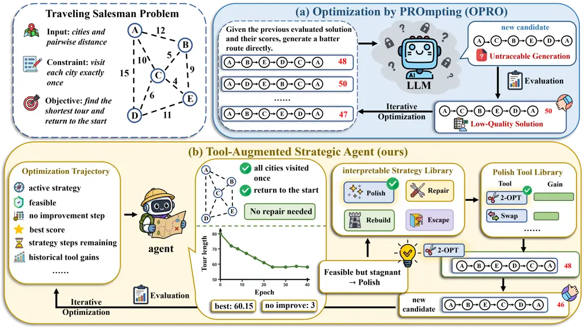
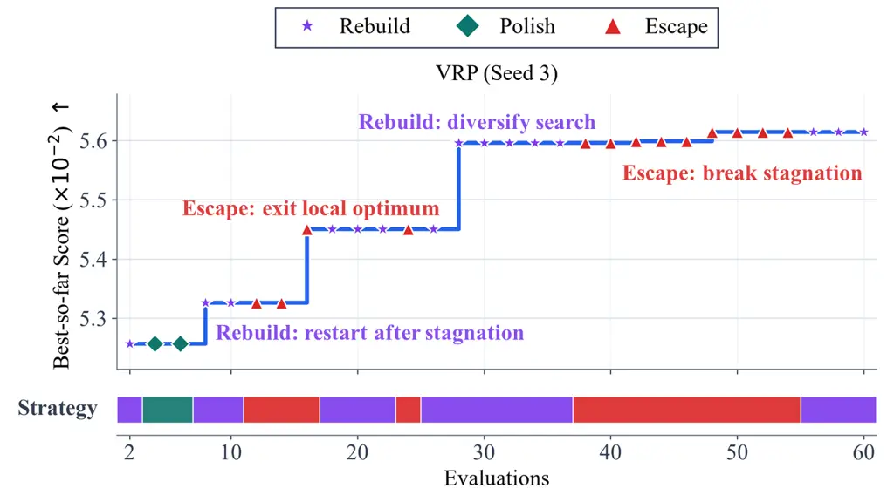
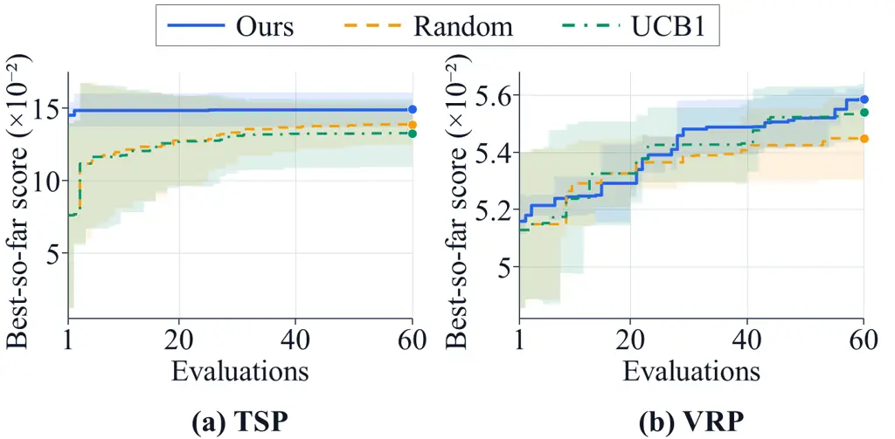
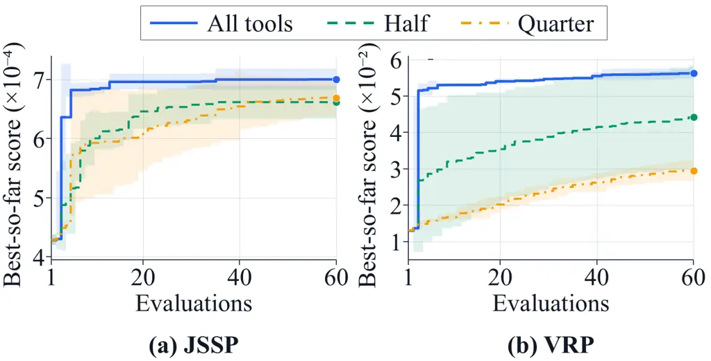
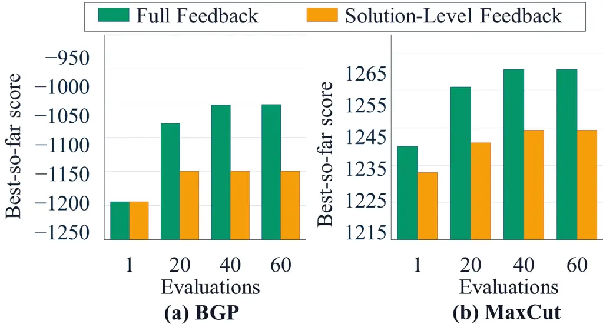

# Think in Strategies, Act with Tools: Traceable Agentic Optimization for Combinatorial Problems

Zhongnian Li    Shi Xu    Peng Ying    Weikang Gong    Zhixiao Wang   
Xinzheng Xu ^(†)^(†)thanks: Corresponding author: xxzheng@cumt.edu.cn
Affiliation: School of Computer Science and Technology / School of
Artificial Intelligence Affiliation: China University of Mining and
Technology Affiliation: Xuzhou, China
Email: [{zhongnianli,xushi,pengying,wkgong,zhxwang,xxzheng}@cumt.edu.cn](mailto:)

###### Abstract

Optimization by PROmpting (OPRO) directly leverages Large Language
Models (LLMs) to generate candidate solutions through natural-language
prompting. However, OPRO’s optimization process is difficult to track,
which prevents LLMs from capturing useful information accumulated over
previous iterations, thereby limiting solution quality. To address this
limitation, we propose a Tool-Augmented Strategic Agent (TASA) which
summarizes and exploits trajectory to improve solution quality.
Specifically, TASA plans the strategy for each step based on the
optimization trajectory, which decomposes the optimization process into
traceable strategy selections. Moreover, we leverage LLM to construct
problem-specific tools and introduce a strategy-guided adaptive tool
planner, which efficiently utilizes the information of trajectory to
update solutions. We establish local convergence under persistent
exploration and evaluate the complete framework under a shared
candidate-evaluation budget. The results support its solution quality
and the traceability of strategy-guided search.

|     |
| --- |
|     |

## 1 Introduction

Recent advances in Large Language Models (LLMs) Team et al. (2024);
Grattafiori et al. (2024); Guo et al. (2025); Yang et al. (2025)
substantially improve their capabilities in reasoning Wei et al. (2022);
Gao et al. (2023), planning Yao et al. (2023a); Zhou et al. (2024), and
decision-making Yao et al. (2023b), providing possibilities for using
LLMs to solve optimization problems. Optimization by PROmpting
(OPRO) Yang et al. (2024) leverages an LLM as the optimizer to generate
candidate solutions by iterative prompting process. Specifically, OPRO
prompts the LLM to directly generate promising candidate solutions by
constructing a prompt that contains a description of the optimization
problem and previously evaluated solutions. Due to its advantages, OPRO
attracts considerable attention, inspiring broader research on LLM-based
optimization Guo et al. (2023); Liu et al. (2024b); van Stein and Bäck
(2025); Zheng et al. (2025); Ye et al. (2025).

Unfortunately, the limited traceability of OPRO’s optimization process
makes it difficult for LLMs to capture useful information from previous
iterations, thereby limiting solution quality. As illustrated in
Figure 1(a), the LLM directly outputs a candidate solution without
explicitly stating the intention or trajectory behind its generation.
Consequently, OPRO retains only the candidate solutions generated across
iterations, without an explicit account of how each new solution is
generated. This lack of the information hinders LLM from accurately
assessing the current search state, thereby limiting ability of OPRO to
identify promising search directions. For example, when the candidate
set is dominated by similar solutions, the OPRO may struggle to escape
the corresponding region of the solution space and discover a better
solution.

To address this limitation, we propose a Tool-Augmented Strategic Agent
(TASA) to plan the strategy for each step based on the optimization
trajectory. Specifically, TASA constructs an explicit optimization
trajectory by continuously recording information about its optimization
process, primarily the selected optimization strategies and tool
invocations. As illustrated in Figure 1, after constructing the
trajectory, the agent analyzes the recorded information and accordingly
selects the polish strategy to further shorten the current tour through
local adjustments. TASA aims to enable agent to exploit the optimization
trajectory for more informed optimization decisions by shifting the
LLM’s role from directly generating candidate solutions to planning
optimization strategies.

In this paper, we leverage an LLM to construct a library of
problem-specific tools according to the characteristics of each
optimization problem. The resulting library organizes executable,
problem-adaptive tools by optimization strategy. Building on this tool
library, we introduce a strategy-guided adaptive tool planner, which
efficiently translates the optimization strategies selected by agent
into concrete solution updates. This mechanism balances the exploitation
of previously well-performing tools, the exploration of underexplored
tools, and the avoidance of repeatedly selecting poorly performing
tools. Finally, the planner applies the selected tool to the candidate
solution, enabling the efficient execution of the LLM-planned strategy.
Moreover, we analyze the probabilistic local convergence of TASA under
strategy-conditioned tool neighborhoods. Experimental results across
diverse combinatorial optimization problems demonstrate that TASA not
only makes the optimization process traceable but also improves solution
quality.

Our main contributions are summarized below.

- •
  We propose a tool-augmented strategic agent for traceable
  combinatorial optimization and provide a theoretical analysis of its
  probabilistic local convergence under strategy-conditioned tool
  neighborhoods.
- •
  We construct problem-specific tools and introduce a strategy-guided
  adaptive tool planner that invokes these tools to efficiently update
  solutions.
- •
  Experimental results across diverse combinatorial optimization
  problems demonstrate that TASA not only makes the optimization process
  traceable but also improves solution quality.



Figure 1: _Motivation and overview of our Tool-Augmented Strategic
Agent._ TASA shifts the role of the LLM from directly generating
solutions to planning optimization strategies from optimization
trajectories, and executes these strategies through strategy-guided
adaptive tool planner.

## 2 Related Work

### 2.1 LLM-Based Combinatorial Optimization

Large Language Models (LLMs) Grattafiori et al. (2024); Team et al.
(2024); Guo et al. (2025); Yang et al. (2025) apply to combinatorial
optimization through both direct solution generation and automatic
heuristic design Da Ros et al. (2026). Optimization by PROmpting
(OPRO) Yang et al. (2024) treats the LLM as an optimizer and generates
new candidates from previously evaluated solutions.
FunSearch Romera-Paredes et al. (2024) combines a LLM with an evaluator
to evolve program components in function space, while Evolution of
Heuristics (EoH) Liu et al. (2024a) jointly evolves natural-language
heuristic ideas and their executable implementations. These methods
demonstrate the potential of LLMs to optimize over both candidate
solutions and heuristic programs. TASA complements these approaches with
explicit links between trajectory-conditioned strategies, executable
tool updates, and observed search outcomes.

### 2.2 Tool-Augmented Agents

Tool-augmented agents Karpas et al. (2022); Paranjape et al. (2023);
Shen et al. (2023); Song et al. (2023); Hao et al. (2023); Patil et al.
(2024); Qin et al. (2024); Tang et al. (2023); Lu et al. (2023); Xu et
al. (2023); Wu et al. (2024); Kong et al. (2024); Gao et al. (2024)
extend LLMs by enabling them to interact with external tools and
environments Cai et al. (2024); Qian et al. (2023); Yuan et al. (2024).
ReAct Yao et al. (2023b) integrates reasoning with action generation,
allowing LLMs to update their plans based on observations from the
environment, while Toolformer Schick et al. (2023) trains language
models to determine which APIs to invoke, when to invoke them, and how
to incorporate their outputs. In optimization Li et al. (2023);
Ahmaditeshnizi et al. (2024), OptiGuide translates natural-language
queries into code that modifies and invokes existing solvers, supporting
solution interpretation and what-if analysis.

However, these methods mainly target general task interaction or
solver-assisted analysis, rather than treating tools as structured
operators for iterative solution improvement. In contrast, TASA
constructs problem-specific tools and employs a strategy-guided adaptive
tool planner that selects them according to optimization trajectory.

## 3 Method

### 3.1 Problem Formalization

In this paper, we consider a combinatorial optimization problem $`P`$
defined over a finite discrete candidate space $`\Omega_{P}`$. Since
candidate solutions generated during optimization may violate problem
constraints, we utilize $`v_{P}(x)`$ to represent the
constraint-violation status of a candidate $`x`$. Each component of
$`v_{P}(x)`$ corresponds to a specific constraint, taking the value 0 if
the constraint is satisfied and 1 if it is violated. The vector is
divided into a hard-constraint component $`v_{P}^{\mathrm{hard}}(x)`$
and a soft-constraint component $`v_{P}^{\mathrm{soft}}(x)`$ (when the
problem contain soft-constraint). Hard constraints determine the
feasibility of a candidate, whereas soft constraints express desirable
but nonmandatory requirements. A candidate is considered feasible if
none of its hard constraints are violated. Accordingly, the feasible
solution set is defined as

```math
\mathcal{X}_{P}=\left\{x\in\Omega_{P}\mid v_{P}^{\mathrm{hard}}(x)=0\right\} \tag{1}
```

To unify the optimization directions of different combinatorial
optimization problems, we transform original objective function
$`g_{P}(x)`$ of each problem into a higher-is-better score by a
problem-specific transformation function $`\phi_{P}(\cdot)`$. The
unified internal scoring function $`f_{P}(x)`$ defined as

```math
f_{P}(x)=\phi_{P}\!\left(g_{P}(x)\right)-\mathcal{P}_{P}\!\left(v_{P}(x)\right) \tag{2}
```

where $`\mathcal{P}_{P}(\cdot)`$ is a problem-specific penalty function
used to penalize constraint violations and guide the search toward the
feasible region.

Under this formulation, our goal is to identify the best feasible
solution found within a budget of $`M`$ candidate evaluations as

```math
\hat{x}_{P}^{M}\in\arg\max_{x\in\mathcal{X}_{P}\cap\mathcal{E}_{M}}f_{P}(x) \tag{3}
```

where $`\mathcal{E}_{M}={x^{1},x^{2},\ldots,x^{M}}`$ denotes the set of
candidates evaluated during the search.

### 3.2 Problem-Specific Tools Construction

To maintain adaptability of TASA across tasks, we utilize an LLM to
construct a problem-specific tools library based on the characteristics
of each optimization problem. TASA constructs tool library through the
following two coupled stages.

#### Tool Archetype Generation.

Given a structured context containing the problem description,
constraints, candidate-solution schema, and strategy definitions, the
LLM generates tool archetypes for each of the four strategies. Each
archetype describes the intended functionality and behavior rather than
providing directly executable code.

#### Problem-Specific Tool Archetype Instantiation.

Once generated, the tool archetypes are validated for structural
correctness, safety, and compatibility with the available primitive
operators. Valid archetypes are then bound to registered operators and
instantiated as callable tools adapted to the current problem, while
invalid archetypes are corrected or rejected.

The LLM specifies each tool’s strategy, operator sequence, and
parameters. Registered operators execute these updates and may perform
multiple updates per candidate. Tool-construction prompts appear in the
supplementary material.

### 3.3 Optimization Strategy Planning

TASA uses an LLM to select optimization strategies from the problem
description, available tools, and optimization trajectory. This allows
the agent to relate the current search state to the purpose of the next
solution update. We let
$`z\in\mathcal{Z}:=\{\texttt{rebuild},\texttt{repair},\texttt{polish},\texttt{escape}\}`$
denote an optimization strategy, with the four strategies defined as
follows.

- •
  rebuild reconstructs a solution from a different structural
  configuration, enabling the exploration of a new region of the search
  space.
- •
  repair focuses on reducing constraint violations and restoring the
  feasibility of the current solution.
- •
  polish performs local refinement around a promising feasible solution
  to further improve score.
- •
  escape applies stronger structural perturbations to move away from a
  stagnant search region.

The allocation among these intentions adapts to the search state. At
each replanning iteration $`k`$, $`s_{k}`$ summarizes solution quality,
feasibility, stagnation, remaining budget, and tool feedback from the
recorded trajectory. This representation connects the observed search
progress to the next optimization intention. Based on this
representation, the strategy planner produces
$`z_{k}=\Phi_{\mathrm{LLM}}(s_{k})`$, where $`\Phi_{\mathrm{LLM}}`$
denotes an inference-time decision process induced by a prompt, and
$`z_{k}`$ denotes the optimization strategy selected at iteration $`k`$.

### 3.4 Strategy-Guided Adaptive Tool Planner

To translate the strategy selected by the agent into concrete solution
updates, we introduce a strategy-guided adaptive tool planner that
balances tool exploration and optimization gain. The strategy $`z_{k}`$
represents the optimization intention at iteration $`k`$, but does not
directly specify which tool should be executed.

#### Candidate Tool Library Construction.

The planner first constructs a candidate tool library that is compatible
with both the problem structure and the current strategy, given by
$`\mathcal{C}_{k}=\mathcal{T}(P)\cap\mathcal{T}(z_{k})`$, where
$`\mathcal{T}(P)`$ denotes the set of tools applicable to problem $`P`$,
and $`\mathcal{T}(z_{k})`$ denotes the set of tools consistent with
strategy $`z_{k}`$. Their intersection maps the abstract optimization
strategy to a library of executable candidate tools.

#### Balancing Tool Exploration and Optimization Gain.

After constructing the candidate tool library, the planner balances
exploration and exploitation by evaluating less-tested tools while
prioritizing those with proven effectiveness. Let
$`\mathcal{C}_{k}^{0}=\left\{t\in\mathcal{C}_{k}\mid n_{t}=0\right\}`$
denote the set of untried candidate tools, and define
$`\mathcal{C}_{k}^{\min}=\left\{t\in\mathcal{C}_{k}\;\middle|\;n_{t}=\min_{s\in\mathcal{C}_{k}}n_{s}\right\}`$
as the set of candidate tools with the smallest invocation count. Here,
$`n_{t}`$ denotes the number of times tool $`t`$ has been invoked. We
further define the gain-maximizing tool as
$`t_{k}^{\star}=\arg\max_{t\in\mathcal{C}_{k}}p_{k}(t)`$, where
$`p_{k}(t)`$ denotes the priority score assigned to tool $`t`$ at
iteration $`k`$.

Conditioned on the optimization trajectory $`s_{k}`$, the tool $`t_{k}`$
is selected according to the following probability distribution

```math
\Pr\!\left(t_{k}=t\mid s_{k}\right)=\begin{cases}\displaystyle\frac{\mathbb{I}\!\left[t\in\mathcal{C}_{k}^{0}\right]}{\left|\mathcal{C}_{k}^{0}\right|},&\mathcal{C}_{k}^{0}\neq\varnothing,\\[10.0pt]
\begin{aligned} &\displaystyle\epsilon\frac{\mathbb{I}\!\left[t\in\mathcal{C}_{k}^{\min}\right]}{\left|\mathcal{C}_{k}^{\min}\right|}\\[-1.0pt]
&\displaystyle\quad+(1-\epsilon)\mathbb{I}\!\left[t=t_{k}^{\star}\right]\end{aligned}&\mathcal{C}_{k}^{0}=\varnothing.\end{cases} \tag{4}
```

where $`\mathbb{I}[\cdot]`$ is the indicator function and
$`\epsilon\in[0,1]`$ controls the exploration rate. If untried tools
remain, the planner selects one uniformly from $`\mathcal{C}_{k}^{0}`$,
prioritizing the evaluation of previously unused candidates. Once all
current candidate tools have been invoked, the planner explores with
probability $`\epsilon`$ by selecting uniformly from the least-invoked
tools in $`\mathcal{C}_{k}^{\min}`$. With probability $`1-\epsilon`$,
the planner follows the current optimization trajectory by selecting
highest-priority tool $`t_{k}^{\star}`$. This mechanism maintains tool
diversity and prevents premature concentration on a small subset of
tools.

#### Dynamic Tool Priority $`p_{k}(t)`$.

When randomized exploration is not performed, the planner selects the
tool with the highest dynamic priority, defined as

```math
p_{k}(t)=\alpha\bar{r}_{t}+(1-\alpha)r_{t}^{\max}-\lambda\zeta_{t}, \tag{5}
```

where $`\bar{r}_{t}`$ and $`r_{t}^{\max}`$ respectively denote the
average and maximum historical gains of tool $`t`$, and
$`\alpha\in[0,1]`$ controls their relative contributions. Moreover,
$`\zeta_{t}`$ is the number of consecutive invocations without
improvement, and $`\lambda\geq 0`$ controls the stagnation penalty. Once
the tool produces an improvement, $`\zeta_{t}`$ is reset to zero.

The planner thus maintains tool diversity through initial and randomized
exploration while progressively allocating more resources to tools that
produce larger and more reliable improvements.

### 3.5 Probabilistic Local Convergence Analysis

At each replanning time, the agent maps the optimization trajectory to a
strategy $`z`$. Rather than updating the candidate solutions directly,
TASA activates the compatible tool library
$`\mathcal{C}(z):=\mathcal{T}(P)\cap\mathcal{T}(z)`$, from which the
tool planner selects an executable tool. We first characterize the
neighborhoods induced by the strategies and their compatible tools, and
then establish the corresponding local convergence result.

#### Definition 1 (Strategy-Conditioned Tool Neighborhood)

For each $`t\in\mathcal{C}(z)`$, let $`q_{t}(x^{\prime}\mid x)`$ denote
the probability that tool $`t`$ generates a feasible candidate
$`x^{\prime}`$ using the reference solution $`x`$. The neighborhood
induced by strategy $`z`$ is

```math
\mathcal{N}_{\mathcal{T}}(x\mid z):=\bigcup_{t\in\mathcal{C}(z)}\{x^{\prime}\in\mathcal{X}_{P}:q_{t}(x^{\prime}\mid x)>0\}. \tag{6}
```

Since TASA may activate different strategies, we aggregate their
neighborhoods to define the overall local search region.

#### Definition 2 (TASA-Induced Local Optimum)

Define the overall reachable neighborhood
$`\mathcal{N}_{\mathrm{TASA}}(x)`$ and the improving set
$`\mathcal{I}_{\mathrm{TASA}}(x)`$ of TASA, respectively, as

```math
\displaystyle\mathcal{N}_{\mathrm{TASA}}(x) \displaystyle:=\bigcup_{z\in\mathcal{Z}}\mathcal{N}_{\mathcal{T}}(x\mid z), \tag{7}
```

```math
\displaystyle\mathcal{I}_{\mathrm{TASA}}(x) \displaystyle:=\{x^{\prime}\in\mathcal{N}_{\mathrm{TASA}}(x):f_{P}(x^{\prime})>f_{P}(x)\}. \tag{8}
```

A feasible solution is TASA-locally optimal if
$`\mathcal{I}_{\mathrm{TASA}}(x)=\varnothing`$. The set of all
TASA-locally optimal solutions is denoted by
$`\mathcal{L}_{\mathrm{TASA}}`$.

At iteration $`k`$, $`\hat{x}_{P}^{k}`$ denotes the best feasible
solution found so far. $`\mathcal{B}_{k}`$ denotes the generated batch.
$`x_{k}`$ denote the reference solution. $`x^{\prime}_{k}`$ denote the
candidate solution.

#### Assumption 3 (Strict Improvements)

The feasible set $`\mathcal{X}_{P}`$ is finite. Assume an initial
feasible solution is available. TASA updates

```math
\hat{x}_{P}^{k+1}=\arg\max_{x\in\{\hat{x}_{P}^{k}\}\cup(\mathcal{B}_{k}\cap\mathcal{X}_{P})}f_{P}(x), \tag{9}
```

breaking ties in favor of $`\hat{x}_{P}^{k}`$. Thus, the best feasible
solution changes only after a strict improvement. Since strict
improvements can occur only finitely many times, persistent exploration
is needed to ensure that TASA does not remain at a solution that is not
locally optimal.

#### Assumption 4 (Persistent Local Exploration)

Let $`\mathcal{F}_{k}`$ contain the full search history before batch
$`\mathcal{B}_{k}`$. For every $`x\notin\mathcal{L}_{\mathrm{TASA}}`$,
there exists $`p_{x}>0`$, uniform over iterations and histories with
$`\hat{x}_{P}^{k}=x`$, such that almost surely

```math
\Pr\!\left(\mathcal{B}_{k}\cap\mathcal{I}_{\mathrm{TASA}}(x)\neq\varnothing\mid\mathcal{F}_{k}\right)\geq p_{x}. \tag{10}
```

Assumptions 3 and 4 ensure finite improvement steps and exclude
non-locally optimal solutions as limiting states. To formalize these
implications, we establish two auxiliary lemmas, whose statements and
proofs are deferred to supplementary material.

#### Theorem 5 (TASA-Local Convergence)

Under Assumptions 3 and 4, the probability that the best feasible
solution reaches a TASA-induced local optimum in finite time and remains
unchanged thereafter is given by

```math
\displaystyle\Pr\!\bigl( \displaystyle\exists\,K<\infty,\;\exists\,x_{\infty}\in\mathcal{L}_{\mathrm{TASA}}, \tag{11}
```

```math
\displaystyle\text{such that }\hat{x}_{P}^{k}=x_{\infty}\text{ for all }k\geq K\bigr)=1.
```

Here, $`K`$ is a finite random time and $`x_{\infty}`$ is the random
limiting best feasible solution. The proof appears in the supplementary
material. Assumption 4 requires persistent exploration through strategy
planning and tool execution, whereas equation 4 describes tool selection
for the current strategy. Together with strict improvement, this
assumption yields local convergence.

|                            |                  |                                |                                |                                |                                |
| -------------------------- | ---------------- | ------------------------------ | ------------------------------ | ------------------------------ | ------------------------------ |
| Category                   | Method           | KP                             | MaxCut                         | BGP                            | TSP                            |
| Approximate Global-Optimum | RefSolver        | $`\mathbf{1.227\pm 0.069}`$    | $`1.001\pm 0.163`$             | $`\mathbf{1.912\pm 0.118}`$    | $`\underline{1.693\pm 0.097}`$ |
| Traditional Optimization   | RandSearch       | $`-1.510\pm 0.255`$            | $`-0.650\pm 0.302`$            | $`-0.635\pm 0.186`$            | $`-0.754\pm 0.048`$            |
|                            | BO               | $`-0.053\pm 0.086`$            | $`-0.501\pm 0.255`$            | $`-0.353\pm 0.077`$            | $`-0.719\pm 0.054`$            |
|                            | GA               | $`-0.855\pm 0.342`$            | $`-0.469\pm 0.196`$            | $`-0.122\pm 0.152`$            | $`-0.687\pm 0.060`$            |
|                            | CB               | $`\underline{1.221\pm 0.063}`$ | $`-0.617\pm 0.204`$            | $`-0.635\pm 0.186`$            | $`1.365\pm 0.064`$             |
| Direct LLM Solver          | OPRO             | $`0.008\pm 0.286`$             | $`-1.033\pm 0.173`$            | $`-1.069\pm 0.136`$            | $`-0.709\pm 0.082`$            |
|                            | E2E Solver       | $`0.235\pm 0.179`$             | —                              | —                              | $`-0.870\pm 0.014`$            |
|                            | Block E2E Solver | $`0.094\pm 0.119`$             | $`1.148\pm 0.117`$             | $`-0.109\pm 0.169`$            | $`0.364\pm 0.016`$             |
|                            | Block-LS         | $`0.463\pm 0.022`$             | $`\underline{1.183\pm 0.176}`$ | $`-0.100\pm 0.181`$            | $`0.368\pm 0.053`$             |
| LLM-Generated Heuristic    | FunSearch        | $`-0.526\pm 0.414`$            | $`-0.309\pm 0.336`$            | $`0.009\pm 0.248`$             | $`-0.704\pm 0.047`$            |
|                            | EoH              | $`-0.023\pm 1.845`$            | $`0.297\pm 1.081`$             | $`0.676\pm 0.982`$             | $`-0.744\pm 0.104`$            |
|                            | CoT              | $`-1.510\pm 0.255`$            | $`-1.509\pm 0.638`$            | $`-1.083\pm 0.203`$            | $`-0.551\pm 0.053`$            |
| Ours                       | TASA             | $`\mathbf{1.227\pm 0.069}`$    | $`\mathbf{1.459\pm 0.009}`$    | $`\underline{1.903\pm 0.132}`$ | $`\mathbf{1.949\pm 0.051}`$    |

|                            |                  |                                |                                |                                |                                |
| -------------------------- | ---------------- | ------------------------------ | ------------------------------ | ------------------------------ | ------------------------------ |
| Category                   | Method           | VRP                            | PDR                            | JSSP                           | MS                             |
| Approximate Global-Optimum | RefSolver        | $`\underline{2.290\pm 0.069}`$ | $`\mathbf{2.740\pm 0.063}`$    | $`\underline{1.690\pm 0.372}`$ | $`\underline{1.920\pm 0.361}`$ |
| Traditional Optimization   | RandSearch       | $`-0.452\pm 0.013`$            | $`-0.718\pm 0.087`$            | $`-0.250\pm 0.111`$            | $`-0.009\pm 0.271`$            |
|                            | BO               | $`-0.401\pm 0.038`$            | $`-0.288\pm 0.174`$            | $`-0.248\pm 0.138`$            | $`-0.241\pm 0.514`$            |
|                            | GA               | $`-0.439\pm 0.013`$            | $`-0.209\pm 0.171`$            | $`-0.428\pm 0.206`$            | $`-0.272\pm 0.165`$            |
|                            | CB               | $`-0.452\pm 0.013`$            | $`-0.718\pm 0.087`$            | $`-1.287\pm 0.160`$            | $`-0.009\pm 0.271`$            |
| Direct LLM Solver          | OPRO             | $`-0.405\pm 0.016`$            | $`-0.039\pm 0.249`$            | $`-0.372\pm 0.310`$            | $`-0.939\pm 0.399`$            |
|                            | E2E Solver       | $`-0.487\pm 0.021`$            | $`-0.464\pm 0.613`$            | $`-1.356\pm 0.601`$            | $`-0.939\pm 0.399`$            |
|                            | Block E2E Solver | $`-0.441\pm 0.028`$            | $`-0.138\pm 0.246`$            | $`-0.402\pm 0.209`$            | $`-0.939\pm 0.399`$            |
|                            | Block-LS         | $`-0.413\pm 0.026`$            | $`-0.047\pm 0.135`$            | $`-0.347\pm 0.182`$            | $`-0.772\pm 0.114`$            |
| LLM-Generated Heuristic    | FunSearch        | $`-0.375\pm 0.022`$            | $`-0.516\pm 0.152`$            | $`-0.269\pm 0.211`$            | $`-0.412\pm 0.518`$            |
|                            | EoH              | $`-0.325\pm 0.039`$            | $`-0.480\pm 0.413`$            | $`0.449\pm 0.815`$             | $`0.601\pm 0.713`$             |
|                            | CoT              | $`-0.492\pm 0.009`$            | $`-0.718\pm 0.087`$            | $`0.917\pm 0.391`$             | $`-0.009\pm 0.271`$            |
| Ours                       | TASA             | $`\mathbf{2.393\pm 0.068}`$    | $`\underline{1.595\pm 0.138}`$ | $`\mathbf{1.903\pm 0.383}`$    | $`\mathbf{2.020\pm 0.285}`$    |

Table 1: Performance comparison on eight benchmark tasks. Results are
reported as mean $`z`$-score $`\pm`$ standard deviation over seeds 1–3.
Higher values indicate better performance. The best result for each task
is shown in bold, and the second-best result is underlined. — indicates
that no feasible solution was obtained for at least one seed.

## 4 Experiments

### 4.1 Experimental Setup

#### Datasets.

To comprehensively evaluate our method, we consider eight representative
combinatorial optimization problems in two groups. The first group
includes discrete structure optimization problems, namely the 0–1
Knapsack Problem (KP), Maximum Cut Problem (MaxCut), Balanced Graph
Partition Problem (BGP), and Traveling Salesman Problem (TSP). These
problems assess the adaptability of our method to diverse solution
representations and combinatorial search spaces. The second group covers
routing and scheduling problems, namely the Capacitated Vehicle Routing
Problem (VRP), Pickup-Delivery Routing Problem (PDR), Job-Shop
Scheduling Problem (JSSP), and Unrelated Parallel-Machine Scheduling
Problem (MS). They evaluate the method’s ability to handle complex
constraints, including capacity limits, precedence relations, resource
competition, and load balancing. Detailed instance sizes, parameter
settings, and generation procedures are provided in the supplementary
material.

#### Baselines.

We compare our method with twelve baselines, including one approximate
global-optimum baseline, four traditional optimization baseline, four
direct LLM baseline, and three LLM-generated heuristic baseline.

Approximate Global-Optimum Baseline. RefSolver (_Reference
Solver_) Perron et al. (2023) applies an exact algorithm when tractable
and otherwise returns a solution produced by a deterministic strong
heuristic. Traditional optimization baselines. RandSearch (_Random
Search_) Bergstra and Bengio (2012) independently samples candidate
solutions without exploiting evaluation history. BO (_Bayesian
Optimization_) uses a lightweight kernel-regression model to estimate
objective values and selects candidates based on an upper confidence
bound. GA (_Genetic Algorithm_) maintains a population of candidate
solutions and generates new candidates through selection, crossover, and
mutation. CB (_Combinatorial Bandit_) treats solution components as
bandit arms and constructs candidates according to their estimated
rewards and exploration bonuses.

Direct LLM solver baselines. OPRO (_Optimization by PROmpting_) Yang et
al. (2024) prompts the LLM with the problem description and previously
evaluated solutions to directly generate complete candidate solutions.
E2E Solver (_End-to-End LLM Solver_) Jiang et al. (2025) uses a fixed
prompt to directly generate complete candidate solutions for problem
instance, without using previously evaluated solutions or optimization
feedback. Block E2E Solver (_Block-wise End-to-End LLM Solver_) Zheng et
al. (2024) decomposes a high-dimensional solution into blocks and asks
the LLM to update one block at a time. Block-LS (_Block-wise LLM Solver
with Local Search_) Jiang et al. (2025); Zheng et al. (2024) alternates
block-wise LLM candidate generation with local refinement.

LLM-generated heuristic baselines. FunSearch Romera-Paredes et al.
(2024) is a lightweight archive-guided search proxy that periodically
injects randomly generated candidates and otherwise mutates high-scoring
historical solutions. EoH (_Evolution of Heuristics_) Liu et al. (2024a)
periodically introduces random candidates and otherwise recombines and
mutates high-scoring historical solutions. CoT (_CoT Direct
Solver_) Sprague et al. (2025) uses chain-of-thought prompting to guide
the LLM through step-by-step problem analysis and directly generate
candidate solutions. Detailed implementation settings are provided in
the supplementary material. The supplementary material details these
implementations, including LLM-call limits and subsequent local-search
operations.

#### Implementation Details.

Qwen-Plus Yang et al. (2025) is accessed via API and used as the
language model. Each experiment is conducted using random seeds 1, 2,
and 3. Under each seed, all methods are evaluated on the same problem
instance, with randomness in instance generation and initialization
controlled by the corresponding seed. Each run is limited to 60
candidate solution evaluations with a batch size of 2. The budget counts
generated candidates. Tool construction, LLM calls, and computations
within tools depend on the method, so results compare solution quality
under this budget and the reported implementations.

#### Metrics.

For fair comparison across problems with different objective scales and
optimization directions, all native objectives are converted into
higher-is-better scores. For problem $`p`$, seed $`s`$, and method
$`m`$, the best feasible score is standardized as
$`z_{p,s,m}=\frac{y_{p,s,m}-\mu_{p,s}}{\sigma_{p,s}}`$. Here,
$`y_{p,s,m}`$ denotes the best feasible value of $`f_{P}(x)`$ achieved
by method $`m`$. Details of the computation of $`f_{P}(x)`$ are provided
in the supplementary material. For each problem $`p`$ and seed $`s`$,
$`\mu_{p,s}`$ is the mean of these values across all methods that
produce a feasible solution, and $`\sigma_{p,s}`$ is the corresponding
population standard deviation. Accordingly, $`z_{p,s,m}>0`$ indicates
above-average performance, whereas $`z_{p,s,m}<0`$ indicates
below-average performance for the corresponding problem and seed.

### 4.2 Comparative Performance on Benchmark Tasks

From the results presented in Table 1, it can be observed that TASA
achieves the strictly best mean score on five tasks, ties RefSolver for
the best result on KP, and ranks second on BGP and PDR. On BGP, it
nearly matches RefSolver, with a gaps of only 0.009. Its average
$`z`$-score across all tasks is 1.806, almost identical to RefSolver’s
1.809. These results show that, under the same evaluation budget, TASA
is competitive with specialized solvers while retaining a unified
framework across problems with diverse structures and constraints.

TASA also consistently outperforms direct LLM-based methods. It exceeds
OPRO on every task by 2.376 $`z`$-score points on average and surpasses
the strongest direct LLM baseline by an average of 1.762 points. The
advantage is particularly clear on BGP, VRP, JSSP, and MS, where direct
LLM solvers obtain negative mean scores while TASA remains strongly
positive. These negative values arise from $`z`$-score normalization, as
a method receives a negative score when its best feasible score falls
below the cross-method mean for the corresponding problem and seed.
These results support the combined use of optimization trajectories,
strategy planning, and problem-specific tools in TASA under the reported
settings.

Finally, TASA finds feasible solutions for every seed on all eight tasks
and has a standard deviation below 0.2 on six tasks, demonstrating
reliable performance across repeated runs. Because some baselines do not
reliably produce feasible solutions across random seeds, we use “—” in
Table 1 to indicate that no feasible solution was obtained for at least
one seed. On four of the five tasks where it ranks first, its standard
deviation is no larger than that of RefSolver. Its main weakness is PDR,
where it trails RefSolver by 1.145 points, suggesting that more
specialized routing and repair tools are needed. Overall, the results
demonstrate the effectiveness, generality, and robustness of our method.



Figure 2: Traceability of TASA over 60 evaluations on a representative
run of VRP (Seed 3). The curve shows the best-so-far scores, while the
markers and colored timelines indicate the optimization strategies
selected throughout the search.



Figure 3: Effect of the tool-planning mechanism on best-so-far
performance over 60 evaluations for TSP and VRP. The curves show the
mean best-so-far scores over seeds 1-3, and the shaded regions indicate
one standard deviation around the mean. Ours denotes the strategy-guided
adaptive tool planner, while Random and UCB1 are alternative
tool-planning policies.



Figure 4: Effect of tool-library size on best-so-far performance over 60
evaluations for JSSP and VRP. The curves show the mean scores over seeds
1–3, and the shaded regions indicate one standard deviation around the
mean. All Tools uses the full library, while Half Tools and Quarter
Tools retain one-half and one-quarter of the tools, respectively.



Figure 5: Effect of feedback granularity on best-so-far performance for
BGP and MaxCut. The bars report the mean best-so-far scores over seeds
1–3 at evaluations 1, 20, 40, and 60. Full Feedback provides the
strategy planner with the recorded optimization trajectory, whereas
Solution-Level Feedback retains only solution-level information.

#### Traceability of TASA.

Figure 2 makes strategy selections and subsequent score improvements
traceable in a representative VRP run. Rebuild precedes improvements
near evaluations 8 and 28, and escape near 16 and 49.

### 4.3 Effect of the Tool Planner.

To evaluate the effectiveness of the tool-planning mechanism, we compare
our strategy-guided adaptive tool planner with random selection and
UCB1. As shown in Figure 3, our planner achieves the highest final
scores on both TSP and VRP. On TSP, it rapidly reaches 14.92, whereas
Random and UCB1 converge to only 13.88 and 13.27. These results support
using historical tool gains and consecutive invocations without
improvement to select effective tools for the intended optimization
strategy.

### 4.4 Effect of Tool Library Size.

To evaluate the effect of tool-library size, we compare TASA using all
tools with variants retaining one-half or one-quarter of the library. As
shown in Figure 4, the full library achieves the best final scores on
both JSSP and VRP, reaching 7.01 and 5.63, respectively. The advantage
is especially pronounced on VRP, where using half and one-quarter of the
tools yields only 4.42 and 2.95. The larger tool library provides more
problem-specific tools for executing the selected strategies, supporting
the contribution of tool diversity to solution quality.

### 4.5 Effect of Feedback Granularity.

To evaluate the effect of feedback granularity, we compare Full Feedback
with Solution-Level Feedback. As shown in Figure 5, Full Feedback
achieves higher scores on both BGP and MaxCut. On BGP, Solution-Level
Feedback plateaus by 20th evaluation, whereas Full Feedback continues to
improve in subsequent evaluations. On MaxCut, both variants improve
until around 40th evaluation and then change little, but Full Feedback
consistently maintains higher scores. These results support using the
optimization trajectory to provide the LLM strategy planner with
information about search progress and stagnation.

## 5 Conclusion

In this paper, we propose TASA, which shifts the role of the LLM from
directly generating solutions to planning optimization strategies based
on optimization trajectories and executing them through a
strategy-guided adaptive tool planner. Experimental results on eight
benchmark problems demonstrate that TASA provides an effective and
traceable framework for LLM-based combinatorial optimization.

## References

- Ahmaditeshnizi et al. (2024) A. Ahmaditeshnizi, W. Gao, and M. Udell
  OptiMUS: scalable optimization modeling with (MI)LP solvers and large
  language models. In Proceedings of the 41st International Conference
  on Machine Learning, Proceedings of Machine Learning Research, Vol.
  235, pp. 577–596. External Links:
  [Link](https://proceedings.mlr.press/v235/ahmaditeshnizi24a.html)
  Cited by: §2.2.
- Bergstra and Bengio (2012) J. Bergstra and Y. Bengio Random search for
  hyper-parameter optimization. Journal of Machine Learning Research 13
  (10), pp. 281–305. External Links:
  [Link](http://jmlr.org/papers/v13/bergstra12a.html) Cited by: §4.1.
- Cai et al. (2024) T. Cai, X. Wang, T. Ma, X. Chen, and D. Zhou Large
  language models as tool makers. In The Twelfth International
  Conference on Learning Representations, ICLR 2024, Vienna, Austria,
  May 7-11, 2024, External Links:
  [Link](https://openreview.net/forum?id=qV83K9d5WB) Cited by: §2.2.
- Da Ros et al. (2026) F. Da Ros, M. Soprano, L. Di Gaspero, and K.
  Roitero Large language models for combinatorial optimization: a
  systematic review. ACM Comput. Surv. 58 (11). External Links: ISSN
  0360-0300, [Link](https://doi.org/10.1145/3801961),
  [Document](https://dx.doi.org/10.1145/3801961) Cited by: §2.1.
- Gao et al. (2023) L. Gao, A. Madaan, S. Zhou, U. Alon, P. Liu, Y.
  Yang, J. Callan, and G. Neubig PAL: program-aided language models. In
  Proceedings of the 40th International Conference on Machine Learning,
  Proceedings of Machine Learning Research, Vol. 202, pp. 10764–10799.
  External Links: [Link](https://proceedings.mlr.press/v202/gao23f.html)
  Cited by: §1.
- Gao et al. (2024) S. Gao, Z. Shi, M. Zhu, B. Fang, X. Xin, P. Ren, Z.
  Chen, J. Ma, and Z. Ren Confucius: iterative tool learning from
  introspection feedback by easy-to-difficult curriculum. In
  Thirty-Eighth AAAI Conference on Artificial Intelligence, AAAI 2024,
  Thirty-Sixth Conference on Innovative Applications of Artificial
  Intelligence, IAAI 2024, Fourteenth Symposium on Educational Advances
  in Artificial Intelligence, EAAI 2024, February 20-27, 2024,
  Vancouver, Canada, pp. 18030–18038. External Links:
  [Link](https://doi.org/10.1609/aaai.v38i16.29759),
  [Document](https://dx.doi.org/10.1609/AAAI.V38I16.29759) Cited by:
  §2.2.
- Grattafiori et al. (2024) A. Grattafiori, A. Dubey, A. Jauhri, A.
  Pandey, A. Kadian, A. Al-Dahle, A. Letman, A. Mathur, A. Schelten, A.
  Vaughan, et al. The llama 3 herd of models. arXiv preprint
  arXiv:2407.21783. Cited by: §1, §2.1.
- Guo et al. (2025) D. Guo, D. Yang, H. Zhang, J. Song, P. Wang, Q.
  Zhu, R. Xu, R. Zhang, S. Ma, X. Bi, et al. Deepseek-r1: incentivizing
  reasoning capability in llms via reinforcement learning. arXiv
  preprint arXiv:2501.12948. Cited by: §1, §2.1.
- Guo et al. (2023) P. Guo, Y. Chen, Y. Tsai, and S. Lin Towards
  optimizing with large language models. CoRR abs/2310.05204. External
  Links: [Link](https://doi.org/10.48550/arXiv.2310.05204),
  [Document](https://dx.doi.org/10.48550/ARXIV.2310.05204), 2310.05204
  Cited by: §1.
- Hao et al. (2023) S. Hao, T. Liu, Z. Wang, and Z. Hu ToolkenGPT:
  augmenting frozen language models with massive tools via tool
  embeddings. In Advances in Neural Information Processing Systems 36:
  Annual Conference on Neural Information Processing Systems 2023,
  NeurIPS 2023, New Orleans, LA, USA, December 10 - 16, 2023, External
  Links:
  [Link](http://papers.nips.cc/paper_files/paper/2023/hash/8fd1a81c882cd45f64958da6284f4a3f-Abstract-Conference.html)
  Cited by: §2.2.
- Jiang et al. (2025) X. Jiang, Y. Wu, M. Li, Z. Cao, and Y. Zhang Large
  language models as end-to-end combinatorial optimization solvers. In
  Advances in Neural Information Processing Systems, Vol. 38,
  pp. 164787–164826. External Links:
  [Link](https://proceedings.neurips.cc/paper_files/paper/2025/file/f0c6c93e1dbff84daf6082fef7e1a094-Paper-Conference.pdf)
  Cited by: §4.1.
- Karpas et al. (2022) E. Karpas, O. Abend, Y. Belinkov, B. Lenz, O.
  Lieber, N. Ratner, Y. Shoham, H. Bata, Y. Levine, K. Leyton-Brown, D.
  Muhlgay, N. Rozen, E. Schwartz, G. Shachaf, S. Shalev-Shwartz, A.
  Shashua, and M. Tennenholtz MRKL systems: A modular, neuro-symbolic
  architecture that combines large language models, external knowledge
  sources and discrete reasoning. CoRR abs/2205.00445. External Links:
  [Link](https://doi.org/10.48550/arXiv.2205.00445),
  [Document](https://dx.doi.org/10.48550/ARXIV.2205.00445), 2205.00445
  Cited by: §2.2.
- Kong et al. (2024) Y. Kong, J. Ruan, Y. Chen, B. Zhang, T. Bao, S.
  Shi, D. Qing, X. Hu, H. Mao, Z. Li, X. Zeng, R. Zhao, and X. Wang
  TPTU-v2: boosting task planning and tool usage of large language
  model-based agents in real-world industry systems. In Proceedings of
  the 2024 Conference on Empirical Methods in Natural Language
  Processing: EMNLP 2024 - Industry Track, Miami, Florida, USA, November
  12-16, 2024, pp. 371–385. External Links:
  [Link](https://doi.org/10.18653/v1/2024.emnlp-industry.27),
  [Document](https://dx.doi.org/10.18653/V1/2024.EMNLP-INDUSTRY.27)
  Cited by: §2.2.
- Li et al. (2023) B. Li, K. Mellou, B. Zhang, J. Pathuri, and I.
  Menache Large language models for supply chain optimization. CoRR
  abs/2307.03875. External Links:
  [Link](https://doi.org/10.48550/arXiv.2307.03875),
  [Document](https://dx.doi.org/10.48550/ARXIV.2307.03875), 2307.03875
  Cited by: §2.2.
- Liu et al. (2024a) F. Liu, T. Xialiang, M. Yuan, X. Lin, F. Luo, Z.
  Wang, Z. Lu, and Q. Zhang Evolution of heuristics: towards efficient
  automatic algorithm design using large language model. In Proceedings
  of the 41st International Conference on Machine Learning, Vol. 235,
  pp. 32201–32223. External Links:
  [Link](https://proceedings.mlr.press/v235/liu24bs.html) Cited by:
  §2.1, §4.1.
- Liu et al. (2024b) S. Liu, C. Chen, X. Qu, K. Tang, and Y. Ong Large
  language models as evolutionary optimizers. In IEEE Congress on
  Evolutionary Computation, CEC 2024, Yokohama, Japan, June 30 - July 5,
  2024, pp. 1–8. External Links:
  [Link](https://doi.org/10.1109/CEC60901.2024.10611913),
  [Document](https://dx.doi.org/10.1109/CEC60901.2024.10611913) Cited
  by: §1.
- Lu et al. (2023) P. Lu, B. Peng, H. Cheng, M. Galley, K. Chang, Y. N.
  Wu, S. Zhu, and J. Gao Chameleon: plug-and-play compositional
  reasoning with large language models. In Advances in Neural
  Information Processing Systems, Vol. 36, pp. 43447–43478. External
  Links: [Document](https://dx.doi.org/10.52202/075280-1882),
  [Link](https://proceedings.neurips.cc/paper_files/paper/2023/file/871ed095b734818cfba48db6aeb25a62-Paper-Conference.pdf)
  Cited by: §2.2.
- Paranjape et al. (2023) B. Paranjape, S. M. Lundberg, S. Singh, H.
  Hajishirzi, L. Zettlemoyer, and M. T. Ribeiro ART: automatic
  multi-step reasoning and tool-use for large language models. CoRR
  abs/2303.09014. External Links:
  [Link](https://doi.org/10.48550/arXiv.2303.09014),
  [Document](https://dx.doi.org/10.48550/ARXIV.2303.09014), 2303.09014
  Cited by: §2.2.
- Patil et al. (2024) S. G. Patil, T. Zhang, X. Wang, and J. E. Gonzalez
  Gorilla: large language model connected with massive apis. In Advances
  in Neural Information Processing Systems 37: Annual Conference on
  Neural Information Processing Systems 2024, NeurIPS 2024, Vancouver,
  BC, Canada, December 10 - 15, 2024, External Links:
  [Link](http://papers.nips.cc/paper_files/paper/2024/hash/e4c61f578ff07830f5c37378dd3ecb0d-Abstract-Conference.html)
  Cited by: §2.2.
- Perron et al. (2023) L. Perron, F. Didier, and S. Gay The CP-SAT-LP
  Solver. In 29th International Conference on Principles and Practice of
  Constraint Programming (CP 2023), Leibniz International Proceedings in
  Informatics (LIPIcs), Vol. 280, Dagstuhl, Germany, pp. 3:1–3:2. Note:
  Keywords: Constraint Programming, Operations Research, Sat Solver
  External Links: ISBN 978-3-95977-300-3, ISSN 1868-8969,
  [Link](https://drops.dagstuhl.de/entities/document/10.4230/LIPIcs.CP.2023.3),
  [Document](https://dx.doi.org/10.4230/LIPIcs.CP.2023.3) Cited by:
  §4.1.
- Qian et al. (2023) C. Qian, C. Han, Y. R. Fung, Y. Qin, Z. Liu, and H.
  Ji CREATOR: tool creation for disentangling abstract and concrete
  reasoning of large language models. In Findings of the Association for
  Computational Linguistics: EMNLP 2023, Singapore, December 6-10, 2023,
  Findings of ACL, Vol. EMNLP 2023, pp. 6922–6939. External Links:
  [Link](https://doi.org/10.18653/v1/2023.findings-emnlp.462),
  [Document](https://dx.doi.org/10.18653/V1/2023.FINDINGS-EMNLP.462)
  Cited by: §2.2.
- Qin et al. (2024) Y. Qin, S. Liang, Y. Ye, K. Zhu, L. Yan, Y. Lu, Y.
  Lin, X. Cong, X. Tang, B. Qian, S. Zhao, L. Hong, R. Tian, R. Xie, J.
  Zhou, M. Gerstein, D. Li, Z. Liu, and M. Sun ToolLLM: facilitating
  large language models to master 16000+ real-world apis. In The Twelfth
  International Conference on Learning Representations, ICLR 2024,
  Vienna, Austria, May 7-11, 2024, External Links:
  [Link](https://openreview.net/forum?id=dHng2O0Jjr) Cited by: §2.2.
- Romera-Paredes et al. (2024) B. Romera-Paredes, M. Barekatain, A.
  Novikov, M. Balog, M. P. Kumar, E. Dupont, F. J. Ruiz, J. S.
  Ellenberg, P. Wang, O. Fawzi, et al. Mathematical discoveries from
  program search with large language models. Nature 625 (7995),
  pp. 468–475. External Links:
  [Link](https://doi.org/10.1038/s41586-023-06924-6) Cited by: §2.1,
  §4.1.
- Schick et al. (2023) T. Schick, J. Dwivedi-Yu, R. Dessì, R.
  Raileanu, M. Lomeli, E. Hambro, L. Zettlemoyer, N. Cancedda, and T.
  Scialom Toolformer: language models can teach themselves to use tools.
  In Advances in Neural Information Processing Systems 36: Annual
  Conference on Neural Information Processing Systems 2023, NeurIPS
  2023, New Orleans, LA, USA, December 10 - 16, 2023, External Links:
  [Link](http://papers.nips.cc/paper_files/paper/2023/hash/d842425e4bf79ba039352da0f658a906-Abstract-Conference.html)
  Cited by: §2.2.
- Shen et al. (2023) Y. Shen, K. Song, X. Tan, D. Li, W. Lu, and Y.
  Zhuang HuggingGPT: solving AI tasks with chatgpt and its friends in
  hugging face. In Advances in Neural Information Processing Systems 36:
  Annual Conference on Neural Information Processing Systems 2023,
  NeurIPS 2023, New Orleans, LA, USA, December 10 - 16, 2023, External
  Links:
  [Link](http://papers.nips.cc/paper_files/paper/2023/hash/77c33e6a367922d003ff102ffb92b658-Abstract-Conference.html)
  Cited by: §2.2.
- Song et al. (2023) Y. Song, W. Xiong, D. Zhu, C. Li, K. Wang, Y. Tian,
  and S. Li RestGPT: connecting large language models with real-world
  applications via restful apis. CoRR abs/2306.06624. External Links:
  [Link](https://doi.org/10.48550/arXiv.2306.06624),
  [Document](https://dx.doi.org/10.48550/ARXIV.2306.06624), 2306.06624
  Cited by: §2.2.
- Sprague et al. (2025) Z. R. Sprague, F. Yin, J. D. Rodriguez, D.
  Jiang, M. Wadhwa, P. Singhal, X. Zhao, X. Ye, K. Mahowald, and G.
  Durrett To cot or not to cot? chain-of-thought helps mainly on math
  and symbolic reasoning. In The Thirteenth International Conference on
  Learning Representations, ICLR 2025, Singapore, April 24-28, 2025,
  External Links: [Link](https://openreview.net/forum?id=w6nlcS8Kkn)
  Cited by: §4.1.
- Tang et al. (2023) Q. Tang, Z. Deng, H. Lin, X. Han, Q. Liang, B. Cao,
  and L. Sun ToolAlpaca: generalized tool learning for language models
  with 3000 simulated cases. External Links: 2306.05301,
  [Link](https://arxiv.org/abs/2306.05301) Cited by: §2.2.
- Team et al. (2024) G. Team, P. Georgiev, V. I. Lei, R. Burnell, L.
  Bai, A. Gulati, G. Tanzer, D. Vincent, Z. Pan, S. Wang, et al. Gemini
  1.5: unlocking multimodal understanding across millions of tokens of
  context. arXiv preprint arXiv:2403.05530. Cited by: §1, §2.1.
- van Stein and Bäck (2025) N. van Stein and T. Bäck LLaMEA: A large
  language model evolutionary algorithm for automatically generating
  metaheuristics. IEEE Trans. Evol. Comput. 29 (2), pp. 331–345.
  External Links: [Link](https://doi.org/10.1109/TEVC.2024.3497793),
  [Document](https://dx.doi.org/10.1109/TEVC.2024.3497793) Cited by: §1.
- Wei et al. (2022) J. Wei, X. Wang, D. Schuurmans, M. Bosma, B.
  Ichter, F. Xia, E. H. Chi, Q. V. Le, and D. Zhou Chain-of-thought
  prompting elicits reasoning in large language models. In Proceedings
  of the 36th International Conference on Neural Information Processing
  Systems, NIPS ’22, Red Hook, NY, USA. External Links: ISBN
  9781713871088 Cited by: §1.
- Wu et al. (2024) Q. Wu, W. Liu, J. Luan, and B. Wang ToolPlanner: A
  tool augmented LLM for multi granularity instructions with path
  planning and feedback. In Proceedings of the 2024 Conference on
  Empirical Methods in Natural Language Processing, EMNLP 2024, Miami,
  FL, USA, November 12-16, 2024, pp. 18315–18339. External Links:
  [Link](https://doi.org/10.18653/v1/2024.emnlp-main.1018),
  [Document](https://dx.doi.org/10.18653/V1/2024.EMNLP-MAIN.1018) Cited
  by: §2.2.
- Xu et al. (2023) B. Xu, Z. Peng, B. Lei, S. Mukherjee, Y. Liu, and D.
  Xu ReWOO: decoupling reasoning from observations for efficient
  augmented language models. CoRR abs/2305.18323. External Links:
  [Link](https://doi.org/10.48550/arXiv.2305.18323),
  [Document](https://dx.doi.org/10.48550/ARXIV.2305.18323), 2305.18323
  Cited by: §2.2.
- Yang et al. (2025) A. Yang, A. Li, B. Yang, B. Zhang, B. Hui, B.
  Zheng, B. Yu, C. Gao, C. Huang, C. Lv, et al. Qwen3 technical report.
  arXiv preprint arXiv:2505.09388. Cited by: §1, §2.1, §4.1.
- Yang et al. (2024) C. Yang, X. Wang, Y. Lu, H. Liu, Q. V. Le, D. Zhou,
  and X. Chen Large language models as optimizers. In International
  Conference on Learning Representations, Vol. 2024, pp. 12028–12068.
  External Links:
  [Link](https://proceedings.iclr.cc/paper_files/paper/2024/file/3339f19c5fcee3ad74502947a32be9e6-Paper-Conference.pdf)
  Cited by: §1, §2.1, §4.1.
- Yao et al. (2023a) S. Yao, D. Yu, J. Zhao, I. Shafran, T.
  Griffiths, Y. Cao, and K. Narasimhan Tree of thoughts: deliberate
  problem solving with large language models. In Advances in Neural
  Information Processing Systems, Vol. 36, pp. 11809–11822. External
  Links: [Document](https://dx.doi.org/10.52202/075280-0517),
  [Link](https://proceedings.neurips.cc/paper_files/paper/2023/file/271db9922b8d1f4dd7aaef84ed5ac703-Paper-Conference.pdf)
  Cited by: §1.
- Yao et al. (2023b) S. Yao, J. Zhao, D. Yu, N. Du, I. Shafran, K. R.
  Narasimhan, and Y. Cao ReAct: synergizing reasoning and acting in
  language models. In The Eleventh International Conference on Learning
  Representations, External Links:
  [Link](https://openreview.net/forum?id=WE_vluYUL-X) Cited by: §1,
  §2.2.
- Ye et al. (2025) H. Ye, H. Xu, A. Yan, and Y. Cheng Large language
  model-driven large neighborhood search for large-scale MILP problems.
  In Forty-second International Conference on Machine Learning, ICML
  2025, Vancouver, BC, Canada, July 13-19, 2025, Proceedings of Machine
  Learning Research, Vol. 267. External Links:
  [Link](https://proceedings.mlr.press/v267/ye25j.html) Cited by: §1.
- Yuan et al. (2024) L. Yuan, Y. Chen, X. Wang, Y. Fung, H. Peng, and H.
  Ji CRAFT: customizing llms by creating and retrieving from specialized
  toolsets. In The Twelfth International Conference on Learning
  Representations, ICLR 2024, Vienna, Austria, May 7-11, 2024, External
  Links: [Link](https://openreview.net/forum?id=G0vdDSt9XM) Cited by:
  §2.2.
- Zheng et al. (2025) Z. Zheng, Z. Xie, Z. Wang, and B. Hooi Monte carlo
  tree search for comprehensive exploration in llm-based automatic
  heuristic design. In Forty-second International Conference on Machine
  Learning, ICML 2025, Vancouver, BC, Canada, July 13-19, 2025,
  Proceedings of Machine Learning Research, Vol. 267. External Links:
  [Link](https://proceedings.mlr.press/v267/zheng25o.html) Cited by: §1.
- Zheng et al. (2024) Z. Zheng, C. Zhou, X. Tong, M. Yuan, and Z. Wang
  UDC: a unified neural divide-and-conquer framework for large-scale
  combinatorial optimization problems. In Advances in Neural Information
  Processing Systems, Vol. 37, pp. 6081–6125. External Links:
  [Document](https://dx.doi.org/10.52202/079017-0197),
  [Link](https://proceedings.neurips.cc/paper_files/paper/2024/file/0b8e4c8468273ee3bafb288229c0acbc-Paper-Conference.pdf)
  Cited by: §4.1.
- Zhou et al. (2024) A. Zhou, K. Yan, M. Shlapentokh-Rothman, H. Wang,
  and Y. Wang Language agent tree search unifies reasoning, acting, and
  planning in language models. In Proceedings of the 41st International
  Conference on Machine Learning, Proceedings of Machine Learning
  Research, Vol. 235, pp. 62138–62160. External Links:
  [Link](https://proceedings.mlr.press/v235/zhou24r.html) Cited by: §1.
