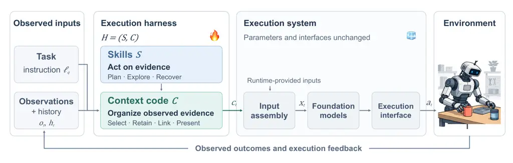
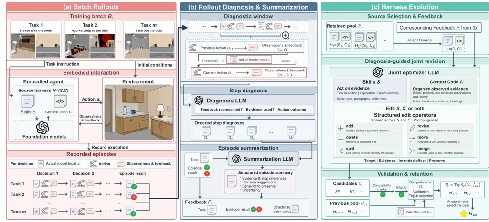
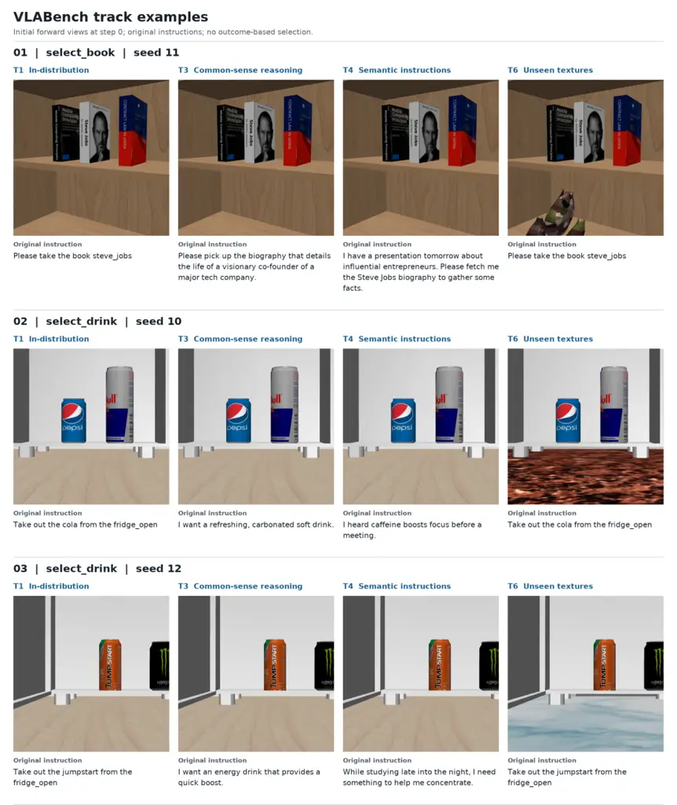
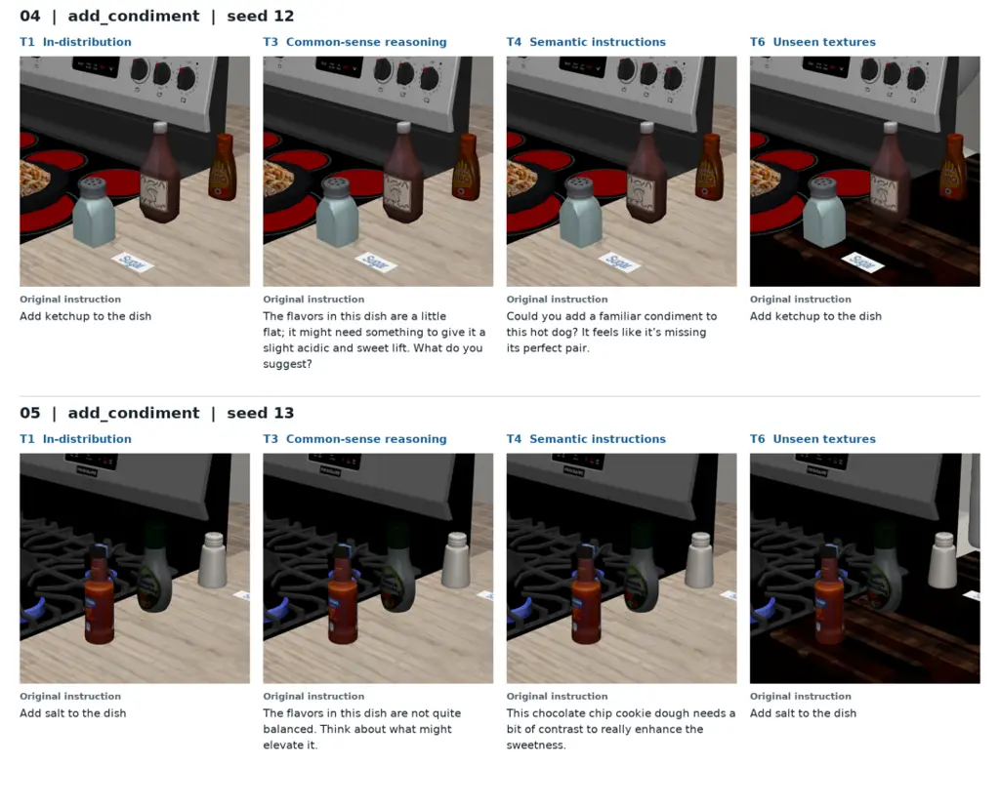

# EnactOpt: Diagnosis-Guided Harness Evolution for Embodied Agents

ZhiYuan Feng ^(†)^(†)thanks: Equal contribution.^(†)^(†)thanks: Work
done during an internship at Kling AI.    Zhuoshi Pan¹¹footnotemark: 1
 ²²footnotemark: 2    Zhaolu Kang¹¹footnotemark: 1 Affiliation: Tsinghua
University Peking University    Zhongxia Chen ^(†)^(†)thanks: Project
leads.    Shuo Yang³³footnotemark: 3    Sen Ye Affiliation: Tsinghua
University Peking University    Heng Wang Affiliation: Kling
AI University of Illinois at Urbana-Champaign    Han Li

###### Abstract

Embodied agents built on foundation models rely on an execution harness
to organize observations, guide actions, and incorporate execution
feedback into subsequent decisions. Failures can arise not only from
limited model capabilities, but also from how the harness presents
evidence and guides its use. These model-external mechanisms provide an
adaptation target without updating model parameters, but task-specific
interaction experience can be costly to collect. Task-level outcomes
alone do not reveal whether relevant evidence was missing from the model
input or was available but inadequately used. Moreover, these two
aspects are coupled: effective action guidance may require evidence that
the current context omits, while exposing that evidence alone does not
ensure an appropriate response. We introduce EnactOpt, which uses
limited execution feedback to jointly evolve reusable textual skills and
context-construction code while keeping the underlying models and
runtime fixed. It diagnoses adjacent decisions by relating action
feedback to the actual model input and subsequent action. Structured
episode summaries guide joint revisions through prompt-level edit
operators, and candidate harnesses undergo compatibility checks and
validation-based retention. Across VLABench, ALFWorld, and Embodied
Agent Interface (EAI), EnactOpt improves task success by approximately
10–27 percentage points over the initial harnesses and outperforms the
evaluated GEPA, TextGrad, and Trace2Skill baselines. These gains extend
to task conditions not used for harness evolution or candidate
selection. The results support a complementary route to embodied
adaptation: turning limited execution experience into reusable
behavioral improvements by jointly refining how evidence is presented
and acted upon.

|     |
| --- |
|     |

## 1 Introduction

Foundation models provide embodied agents with multimodal reasoning
(Driess et al., 2023; Hurst et al., 2024; Bai et al., 2025; Comanici et
al., 2025) and sensorimotor control (Kim et al., 2024; Physical
Intelligence et al., 2025b; Li et al., 2025; Ye et al., 2026). Effective
execution, however, depends on how observations become model inputs,
model outputs become actions, and execution feedback informs subsequent
decisions (Shi et al., 2025). We call the reusable, model-external
guidance and control logic supporting this interaction the execution
harness. We focus on two editable components (Figure 1): reusable
textual skills $`S`$ that guide actions and context-construction code
$`C`$ that selects and presents observed evidence. Model parameters and
the execution interface remain fixed during harness adaptation.



Figure 1: Execution harness for embodied agents. The editable harness
$`H=(S,C)`$ comprises textual skills $`S`$ for action guidance and
context-construction code $`C`$ for organizing observed evidence. The
fixed runtime assembles the complete model input $`x_{t}`$ from
constructed context $`c_{t}`$ and any additional runtime-provided
inputs; model parameters and runtime interfaces remain unchanged during
harness evolution.

An initial harness encodes assumptions about how tasks are expressed and
what evidence is available during execution. Changes in instructions or
visual conditions can make its action guidance or evidence selection
inadequate. Revising the harness still requires task-specific
experience, which can be costly to collect in physical environments (Kim
et al., 2024; Tang et al., 2025). Prior work on reflection and
experience-guided learning shows that such experience can be retained as
reusable guidance (Shinn et al., 2023; Zhao et al., 2024). The challenge
is therefore to turn limited execution evidence into revisions that
improve the harness on later tasks, rather than corrections confined to
the episode that produced it.

Feedback-driven adaptation already spans reusable skill optimization
(Yang et al., 2026; Ju et al., 2026) and executable harness evolution
(Lee et al., 2026; Lin et al., 2026), including skill-and-context
adaptation for embodied agents (Wang et al., 2026b). Useful revisions,
however, require more than a task-level success signal. A failure may
reflect feedback omitted from the actual model input, an inadequate
response to available feedback, or both. This motivates examining what
evidence reached each decision and how the agent responded. At the same
time, a proposed skill revision may depend on observed evidence not yet
presented to the model. Evaluating that revision together with the
corresponding change to context construction allows their combined
effect to be assessed as one harness candidate, rather than treating the
two edits as independent improvements.

We introduce EnactOpt, a framework for diagnosis-guided joint revision
of textual skills and context-construction code (Figure 2). It diagnoses
adjacent decisions in training rollouts, relating action feedback to the
actual model input and the agent’s response. Structured episode
summaries consolidate the reported evidence, uncertainty, and repair and
preservation suggestions into feedback for a single LLM optimizer. Given
the source harness and this feedback, the optimizer uses prompt-guided
edit operators to organize targeted changes to $`S`$, $`C`$, or both
within one harness candidate. Interface and runtime compatibility checks
screen candidates before validation-based pool retention. The retained
versions supply subsequent iterations, and the final validation-selected
harness is fixed for testing.

We evaluate benchmark-specific EnactOpt harnesses on VLABench (Zhang et
al., 2025b), ALFWorld (Shridhar et al., 2020), and Embodied Agent
Interface (EAI) (Li et al., 2024), spanning low-level policy execution
and high-level action interfaces. Under the reported configurations,
EnactOpt improves task success by approximately 10–27 percentage points
over the initial harnesses and outperforms the evaluated GEPA (Agrawal
et al., 2026), TextGrad (Yuksekgonul et al., 2024), and Trace2Skill (Ni
et al., 2026) baselines on all three benchmarks (Table 1). The gains
extend to within-benchmark task conditions not used for evolution or
candidate selection. On VLABench, the ablation comparisons show larger
performance gaps under shifted conditions than in-distribution. Joint
revision also achieves higher generalization success with fewer
optimization passes than separate skill and code updates (Table 2).

Our contributions are threefold:

- •
  We introduce EnactOpt, a framework that treats textual skills and
  context-construction code as a coupled adaptation target. A single
  proposal can revise either or both components, enabling their combined
  behavior to be evaluated while models and runtime remain fixed.
- •
  We develop a diagnosis-to-revision feedback interface that relates
  action feedback to actual model inputs and subsequent responses.
  Structured episode summaries convey reported evidence and uncertainty,
  while prompt-guided edit operators organize targeted changes and
  preservation requests.
- •
  We report gains over initial harnesses and evaluated baselines across
  three embodied benchmarks, including gains beyond the evolution
  conditions. VLABench ablations show that comparable in-distribution
  success can mask differences in generalization, and that joint
  revision attains higher generalization success with fewer optimization
  passes than separate updates.

## 2 Related Work

### 2.1 Embodied Agent Adaptation

Adaptation in embodied agents spans adjustments during execution and
updates retained for later tasks. Hierarchical models and code-based
policies connect task-level instructions to executable behavior (Shi et
al., 2025; Liang et al., 2023). TaskGround grounds complete household
scenes into task-relevant context and infers executable task structure
from situated requests before generating skill-level action sequences
(Feng et al., 2026). Closed-loop systems use observations and execution
feedback to revise plans and recover from failures (Huang et al., 2023;
Zhi et al., 2025). Beyond these within-task adjustments, policy
parameters can be adapted through demonstration-based fine-tuning (Kim
et al., 2024) or reinforcement learning from deployment experience
(Physical Intelligence et al., 2025a). Experience can also be retained
outside model parameters: DROC distills human language corrections into
retrievable knowledge (Zha et al., 2024), whereas ASPIRE autonomously
refines robot control programs and consolidates validated repairs into a
reusable skill library (Lu et al., 2026). EnactOpt follows this latter
direction by jointly revising reusable textual skills and
context-construction code while keeping the underlying models fixed.

### 2.2 Agent Harness Optimization

Feedback-driven optimization differs in both the artifact revised and
how experience is consolidated. ExpeL and Voyager retain experience as
reusable natural-language guidance and executable skills, respectively
(Zhao et al., 2024; Wang et al., 2023). TextGrad propagates textual
feedback through computation graphs, while GEPA evolves prompts through
trajectory-based reflection (Yuksekgonul et al., 2024; Agrawal et al.,
2026). For reusable guidance, ACE incrementally updates structured
playbooks, whereas Trace2Skill consolidates lessons from a pool of
trajectories into skills (Zhang et al., 2026; Ni et al., 2026). Skill
revision further addresses update control and attribution through
bounded, validation-gated edits (Yang et al., 2026), distinctions
between skill defects and execution lapses (Ju et al., 2026), and
preservation-aware structural reorganization informed by accumulated
diagnoses and success–failure contrasts (Wang et al., 2026a).

For executable harnesses, AFlow formulates workflow construction as
search over code (Zhang et al., 2025a). A central distinction is the
evidence exposed to the optimizer: Meta-Harness provides access to prior
code, scores, and raw trajectories, whereas AHE organizes experience
into a layered evidence corpus and links edits to predicted effects
through change manifests (Lee et al., 2026; Lin et al., 2026). Selection
also depends on the available supervision: RHO uses retrospective
self-validation and self-consistency followed by pairwise
self-preference (Pan et al., 2026), while HarnessEvolve diagnoses
failures against verified, answer-conditioned reference trajectories and
gates updates by quality and task performance (Jiang et al., 2026).

In embodied settings, Zetta revises critics, recovery strategies, and
tools (Ding et al., 2026), whereas SHAPER evolves skills and
context-construction code with context-aware diagnosis and prompts
requesting local edits and preservation of successful behavior (Wang et
al., 2026b). EnactOpt diagnoses adjacent decisions by relating action
feedback to the actual model input and action at the next decision,
while limiting editor-visible execution feedback to structured summaries
without raw-trajectory retrieval. Unlike SHAPER’s reported
skill-then-code schedule, EnactOpt permits either or both components to
change in one proposal, with prompts specifying six edit operators and
requesting supporting evidence and behavior to preserve.

## 3 Problem Setup

### 3.1 Embodied Task Setting

We consider an embodied task $`q`$ specified by an environment
$`\mathcal{E}_{q}`$ with initial conditions, an instruction
$`\ell_{q}`$, and a task-level success criterion. At decision step
$`t`$, the agent selects an action $`a_{t}`$ using information drawn
from $`\ell_{q}`$, the current observation $`o_{t}`$, and the available
interaction history $`h_{t}`$ of prior observations, actions, and
feedback. Executing $`a_{t}`$ yields the next observation $`o_{t+1}`$
and any available execution feedback $`f_{t+1}`$; interaction continues
until termination. The agent is not assumed to observe the full
environment state or information reserved for task evaluation.

Let $`\mathcal{M}`$ denote the fixed model configuration used for task
execution and $`\mathcal{R}`$ the non-editable runtime responsible for
model-input assembly, model invocation, output parsing, and action
execution. Depending on the benchmark, $`\mathcal{M}`$ may include a
reasoning model coupled to a low-level policy, or a language model that
directly issues commands through a high-level action interface. The
index $`t`$ counts agent decisions rather than individual control steps,
so one action $`a_{t}`$ may invoke a low-level policy for multiple
control steps. Both $`\mathcal{M}`$ and $`\mathcal{R}`$ remain fixed
during harness evolution; benchmark-specific configurations are
described in Section 5.1.

### 3.2 Execution Harness

We represent the editable part of the execution harness as

```math
H=(S,C), \tag{1}
```

where $`S`$ contains reusable textual skills that guide task execution,
exploration, and failure recovery. The executable context-construction
code $`C`$ selects, retains, links, and presents information derived
from available observations and interaction history. It processes
observed evidence rather than providing access to unobserved environment
state. Harness adaptation is restricted to $`S`$ and $`C`$; the model
configuration $`\mathcal{M}`$ and runtime $`\mathcal{R}`$ remain fixed.

At decision step $`t`$, we write the context produced by $`C`$
schematically as

```math
c_{t}=C(\ell_{q},S,o_{t},h_{t}).
```

The fixed runtime $`\mathcal{R}`$ assembles $`c_{t}`$ with any
additional runtime-provided observations or messages to form $`x_{t}`$,
the complete input delivered to the decision-making model. Consequently,
information omitted from $`c_{t}`$ may still be present in $`x_{t}`$.
Whether feedback was presented to the model must therefore be assessed
against $`x_{t}`$, rather than the constructed context alone.

The artifacts $`S`$ and $`C`$ remain fixed throughout each rollout,
whereas $`c_{t}`$ and $`x_{t}`$ are constructed at each decision. For a
task $`q`$, the fixed execution system $`(\mathcal{M},\mathcal{R})`$ and
harness $`H`$ induce a rollout

```math
\xi\sim\operatorname{Rollout}(\mathcal{E}_{q},\ell_{q};\mathcal{M},\mathcal{R},H), \tag{2}
```

where $`\xi`$ denotes the recorded episode, including decision-level
observations, actual model inputs, actions, and returned feedback,
together with the task outcome reported at termination. How these
records are converted into feedback for the optimizer is specified in
Section 4.2.

### 3.3 Harness Adaptation Objective

With the model configuration $`\mathcal{M}`$ and runtime $`\mathcal{R}`$
fixed, adaptation optimizes only the harness $`H=(S,C)`$. Let
$`\mathcal{H}`$ denote the space of admissible harnesses that respect
the component boundaries and runtime-interface requirements defined
above. Let $`p_{\mathrm{target}}`$ be the target task distribution and
$`R_{q}(\xi)`$ the task-level score assigned to a rollout $`\xi`$ of
task $`q`$, with larger values indicating better performance.

Our objective is to maximize the expected task score under
$`p_{\mathrm{target}}`$:

```math
\displaystyle J(H) \displaystyle=\mathbb{E}_{q\sim p_{\mathrm{target}}}\mathbb{E}_{\xi\sim\operatorname{Rollout}(\mathcal{E}_{q},\ell_{q};\mathcal{M},\mathcal{R},H)}\bigl[R_{q}(\xi)\bigr], \tag{3}
```

```math
\displaystyle H^{\star} \displaystyle\in\operatorname*{arg\,max}_{H\in\mathcal{H}}J(H).
```

For binary task-success scores, $`J(H)`$ is the expected success rate
over the target task distribution. Here, $`H^{\star}`$ denotes an ideal
optimal harness rather than the output guaranteed by the adaptation
procedure.

In practice, $`J(H)`$ is not directly observed during adaptation.
EnactOpt proposes revisions using finite execution feedback collected on
training tasks $`\mathcal{D}_{\mathrm{train}}`$ and selects candidates
according to empirical performance on validation tasks
$`\mathcal{D}_{\mathrm{val}}`$. The target distribution may include task
conditions absent from both adaptation sets. Validation therefore
provides a criterion for candidate selection, while generalization
beyond the adaptation conditions is assessed separately.

## 4 EnactOpt: Diagnosis-Guided Harness Evolution



Figure 2: Overview of EnactOpt. (a) A source harness $`H=(S,C)`$
executes training batch $`B_{r}`$, recording actual model inputs,
actions, observations, and episode outcomes. (b) Adjacent-decision
diagnoses and episode summaries form its feedback $`F_{r}`$. (c) A joint
optimizer uses the same $`H`$ and $`F_{r}`$ to propose candidates
$`\mathcal{C}_{r}`$ through prompt-guided structured edit operators.
Compatible candidates are compared with the previous pool
$`\mathcal{P}_{r-1}`$ on validation tasks to form $`\mathcal{P}_{r}`$.
Scenes are illustrative, not experimental results.

### 4.1 Evolution Overview

Figure 2 summarizes EnactOpt’s iterative evolution loop. Starting from
$`H_{0}=(S_{0},C_{0})`$, EnactOpt maintains a pool of retained harnesses
while keeping $`\mathcal{M}`$ and $`\mathcal{R}`$ fixed. At evolution
iteration $`r`$, a source harness $`H=(S,C)`$ is selected from
$`\mathcal{P}_{r-1}`$ to execute a batch $`B_{r}`$ from the training set
$`\mathcal{D}_{\mathrm{train}}`$, producing rollouts and their native
execution outcomes.

Each rollout is analyzed through adjacent-decision diagnoses, which are
aggregated into a structured episode summary. The task descriptions,
native outcomes, and complete summaries form the feedback $`F_{r}`$
associated with the source harness. A single joint optimizer receives
this same $`H`$ together with $`F_{r}`$ to propose candidate harnesses
$`\mathcal{C}_{r}`$, each comprising complete skill and context-code
files. Either component may remain unchanged in a proposal.

Candidates undergo local interface and runtime compatibility checks
before evaluation on $`\mathcal{D}_{\mathrm{val}}`$. Validation-based
selection updates the retained pool $`\mathcal{P}_{r}`$, which supplies
source versions for subsequent iterations. At the end of the search, a
harness $`H_{\mathrm{sel}}`$ is selected by validation performance and
fixed for test evaluation.

### 4.2 Execution Diagnosis and Feedback Construction

##### Adjacent-decision diagnosis.

Task-level outcomes alone do not reveal whether relevant feedback was
missing from the model input or was available but inadequately used. We
therefore examine adjacent decisions (Figure 2(b)). At decision $`t`$,
the diagnostic window relates the preceding action $`a_{t-1}`$ and its
returned observation and feedback $`(o_{t},f_{t})`$ to the current model
input $`x_{t}`$ and action $`a_{t}`$. It also includes the observation
and feedback $`(o_{t+1},f_{t+1})`$ returned by $`a_{t}`$ to assess the
current action’s outcome. The first step has no preceding action
feedback; the final step remains assessable because no subsequent
decision is required.

The diagnostic LLM produces a report $`D_{t}`$ assessing whether
preceding feedback is faithfully presented in $`x_{t}`$, whether the
current action reflects appropriate use of that feedback, and what
outcome the action produces. The presentation check uses the full input
$`x_{t}`$, not $`c_{t}`$ alone, because the runtime may append
observations or messages. Missing or misrepresented evidence may suggest
a revision to $`C`$; an inadequate response to available evidence may
suggest a revision to $`S`$. These are nonexclusive revision hypotheses,
not causal proofs. Ambiguous or incomplete evidence is retained as
uncertainty.

##### Structured episode feedback.

The episode summarizer receives the task description, native episode
outcome, and all ordered diagnoses $`D_{1},\ldots,D_{T}`$, where $`T`$
is the number of decisions; it does not receive the raw trajectory. Its
prompt requests a structured summary retaining concrete conditions,
observations and explanations reported by the diagnoses, and step
references for supporting and conflicting evidence. It also requests
repair suggestions, behavior to preserve, and unresolved uncertainty, so
that proposed changes account for useful existing behavior as well as
observed problems. The summarized evidence remains diagnosis-mediated:
step references do not independently verify an interpretation or
guarantee lossless summarization.

For a batch $`B_{r}`$ executed by the source harness $`H`$, the task
descriptions, native outcomes, and complete episode summaries form
$`F_{r}`$. The optimizer receives $`H`$ and $`F_{r}`$ without attached
raw-trajectory windows, actor replies, or context-history excerpts. Step
references indicate the evidence reported in the diagnoses, but do not
trigger raw-log retrieval. Raw logs remain available locally for
inspection, outside the optimizer’s feedback interface. This feedback
guides the joint revision of $`S`$ and $`C`$ in Section 4.3.

### 4.3 Joint Revision with Structured Edit Operators

Given $`H=(S,C)`$ and its batch feedback $`F_{r}`$, one joint optimizer
LLM proposes complete replacement files for both components:

```math
H^{\prime}=(S^{\prime},C^{\prime})=\operatorname{Optimizer}(S,C,F_{r}). \tag{4}
```

Each proposal yields a candidate $`H^{\prime}\in\mathcal{C}_{r}`$, with
either component allowed to remain unchanged. Context-construction code
selects, processes, and organizes existing observations and interaction
history into task-relevant context, including structured state
representations. Skills guide task execution, further exploration, and
failure recovery. Both affect action selection; new environment
observations arise through agent actions or tool calls, not direct
environment interaction by the context builder.

The optimizer is prompted to use six structured edit operators: add,
revise, delete, move, split, and merge. Editable units are Markdown
items, paragraphs, or table rows in skills, and functions, constants, or
local logic in context-construction code. For each proposed edit, the
optimizer is prompted to identify its target in the source harness, the
selected operator, supporting feedback, the intended effect, and
behavior to preserve. These prompt-level conventions guide incremental
revision while the optimizer returns complete files; preservation of
untouched content is requested rather than programmatically enforced.

### 4.4 Validation and Harness Retention

Each candidate in $`\mathcal{C}_{r}`$ first undergoes local interface
and runtime compatibility checks under the fixed execution system. Only
compatible candidates proceed to evaluation on
$`\mathcal{D}_{\mathrm{val}}`$. Their empirical validation score
$`\hat{J}_{\mathrm{val}}(H)`$ is computed from the task-level scores
$`R_{q}(\xi)`$; for binary outcomes, it is the validation success rate.
Compatibility checks determine eligibility for evaluation, not
behavioral preservation or improved task performance.

Let $`\mathcal{U}_{r}`$ denote the comparison set comprising compatible
new candidates and the previously retained harnesses
$`\mathcal{P}_{r-1}`$. Following the top-$`k`$ retention scheme in
Figure 2(c), these versions are ranked by $`\hat{J}_{\mathrm{val}}`$,
and up to $`k`$ harnesses are retained:

```math
\mathcal{P}_{r}=\operatorname{TopK}_{k}\!\left(\mathcal{U}_{r};\,\hat{J}_{\mathrm{val}}\right), \tag{5}
```

where $`k`$ is the pool capacity and $`\operatorname{TopK}_{k}`$ selects
the highest-scoring versions. Thus, a new proposal competes with
existing versions rather than automatically replacing its source.

The updated pool $`\mathcal{P}_{r}`$ supplies source harnesses for
subsequent iterations under the experiment’s search schedule. At the end
of the search, the retained harness with the highest validation score is
selected as $`H_{\mathrm{sel}}`$ and fixed for test evaluation. Training
feedback thus guides proposal generation, whereas validation performance
guides retention and final selection; performance beyond the adaptation
conditions is assessed separately at test time.

## 5 Experiments

|                    |              |              |              |
| ------------------ | ------------ | ------------ | ------------ |
| Method             | VLABench     | ALFWorld     | EAI          |
| Reference Systems  |              |              |              |
| Naive              | 40.87        | 51.46        | 68.09        |
| $`H_{0}`$          | 47.39 +6.52  | 66.06 +14.60 | 72.34 +4.26  |
| Adaptation Methods |              |              |              |
| TextGrad^(†)       | 36.09 -4.78  | 86.50 +35.04 | 71.63 +3.55  |
| Trace2Skill^(†)    | 40.54 -0.33  | 78.83 +27.37 | 72.70 +4.61  |
| GEPA               | 44.46 +3.59  | 83.21 +31.75 | 86.88 +18.79 |
| EnactOpt           | 57.83 +16.96 | 92.70 +41.24 | 95.74 +27.66 |

Table 1: Task success rates (%, higher is better) across three
benchmarks. Bold indicates the best result in each column. Colored
annotations show percentage-point differences from Naive (green:
positive; red: negative). $`\dagger`$ denotes our skill-only
implementations of TextGrad and Trace2Skill.

### 5.1 Experimental Setup

Benchmarks and protocol. We evaluate separately evolved harnesses on
VLABench (Zhang et al., 2025b), ALFWorld (Shridhar et al., 2020), and
EAI’s VirtualHome Action Sequencing (Li et al., 2024). All MLLM
components use GPT-5.4 mini (OpenAI, 2026); VLABench additionally uses
the benchmark-released $`\pi_{0}`$ policy (Black et al., 2024), fixed
during evolution. ALFWorld and EAI use high-level action interfaces.
Train/validation/test sizes are 30/30/920 for VLABench and 30/30/282 for
EAI. For VLABench, adaptation and candidate selection use the
in-distribution track (T1); testing covers T1, commonsense-based target
selection (T3), context-rich instruction understanding (T4), and unseen
textures (T6). GEPA and EnactOpt share a frozen ALFWorld 30/30/274
split, with 140 Seen and 134 Unseen test instances. GEPA’s unscored
Unseen instance is counted as a failure.

Evolution settings. Motivated by the cost of collecting embodied
interaction data, we restrict EnactOpt to 30 training task instances per
benchmark. These tasks form three fixed, disjoint batches of ten, with
one batch per evolution iteration, yielding one training epoch. Here, an
epoch counts task coverage, not the total rollouts collected by
different source harnesses. Candidates passing compatibility checks are
evaluated on the full 30-instance validation set. The default pool
capacity is $`k=2`$: after each iteration, the top two harnesses among
the new candidates and the previous pool are retained by validation
success rate. After the third iteration, the retained harness with the
highest validation success rate is selected and fixed for test
evaluation.

Baselines and metrics. Naive uses each benchmark’s official pipeline
without our additional harness; $`H_{0}`$ is the initial harness without
adaptation. TextGrad (Yuksekgonul et al., 2024) and Trace2Skill (Ni et
al., 2026) are our skill-only implementations, with context-construction
code kept fixed. GEPA (Agrawal et al., 2026) and EnactOpt start from
$`H_{0}`$. We report task success rates (%) and differences in
percentage points. These comparisons are not matched-compute
evaluations. Benchmark-specific data protocols are described in
Appendix A. The evolution procedure is described in Section 4, and
Appendix B provides the evolved skills and context-construction code for
each benchmark.

Optimization cost. For the VLABench ablations, we count complete
optimization passes: candidate generation, evaluation on the full
validation set, and pool retention for one batch. EnactOpt and the
diagnosis and edit-operator ablations use one pass per batch; separate
$`S`$/$`C`$ revision uses two, one per component. The three-batch
schedule therefore requires three versus six passes, normalized to
$`1\times`$ and $`2\times`$ relative to EnactOpt; $`H_{0}`$ is not
optimized.

### 5.2 Main Results

With 30 training task instances per benchmark, EnactOpt improves on the
initial harness across both low-level policy execution and high-level
action interfaces (Table 1). Its gains over $`H_{0}`$ are 10.43, 26.64,
and 23.40 percentage points on VLABench, ALFWorld, and EAI,
respectively. These gains extend beyond the benefit of constructing
$`H_{0}`$: execution experience supports further refinement of an
already configured agent without changing its underlying models.

EnactOpt also outperforms every evaluated adaptation baseline, but the
relative strengths of those baselines vary by benchmark. Our skill-only
TextGrad implementation is the strongest adaptation baseline on
ALFWorld, whereas GEPA leads the alternatives on VLABench and EAI. On
VLABench, however, even GEPA’s adaptation from $`H_{0}`$ falls below the
unchanged $`H_{0}`$ reference. Thus, the ability to revise
model-external artifacts does not by itself ensure a better harness.
These complete-pipeline comparisons motivate examining the diagnostic
and revision choices in Section 5.4, rather than attributing the gains
to editable components alone.

### 5.3 Generalization across Test Conditions

Adaptation on VLABench T1 transfers to other test conditions, but the
gains vary with the type of shift (Figure 3). Although evolution and
candidate selection use only T1, EnactOpt improves T3 and T4 over
$`H_{0}`$ by 16.00 and 16.25 percentage points, compared with 5.00
points on T6; it also exceeds GEPA on all three tracks. The revisions
thus remain useful beyond the adaptation conditions, with the largest
improvements on the tracks that change how the target or request must be
interpreted, rather than visual appearance.

ALFWorld complements this comparison with a change in scene rather than
evaluation track. On Unseen scenes, EnactOpt exceeds both $`H_{0}`$ and
GEPA, with a 3.73-percentage-point advantage over GEPA in the runs
shown. The advantage therefore persists against an adapted baseline, not
only the initial harness. Unseen retains the same task families; both
benchmarks assess within-benchmark transfer without test-time harness
revision, rather than transfer of one harness across benchmarks.

Figure 3: Generalization on VLABench T3/T4/T6 and ALFWorld Unseen. Bars
show task success rates (%); horizontal dashed lines denote the Naive
baseline. Adaptation is performed separately for each benchmark. The
plotted results come from the same evaluation runs as Table 1, which
reports overall success rates on the full test sets.

### 5.4 Ablation Studies

We examine diagnostic evidence, structured edit operators, and joint
revision on VLABench (Table 2). _w/o Adjacent-Decision Diagnosis_
retains joint revision and edit operators but uses only task
descriptions and terminal outcomes as diagnostic evidence. Relative to
$`H_{0}`$, it gains 3.75 percentage points on In-Distribution but loses
1.91 points on Generalization, whereas EnactOpt improves both groups.
This contrast shows why in-distribution improvement alone is not a
sufficient measure of a reusable revision: the gain from outcome-only
feedback does not extend to the shifted test conditions.

_w/o Structured Edit Operators_ retains diagnosis and joint revision but
removes prompt-level editing conventions. Its success rates fall below
$`H_{0}`$ in both groups, by 2.08 percentage points In-Distribution and
2.50 points on Generalization. Retaining diagnostic feedback is
therefore not sufficient to obtain useful revisions in this comparison.
The result points to the importance of how the optimizer uses that
evidence to organize edits, not only whether it receives the evidence.

_w/o Joint Revision_ still edits both $`S`$ and $`C`$, but separately.
Its In-Distribution success remains close to EnactOpt (63.33% vs.
63.75%), whereas Generalization is lower (50.88% vs. 55.74%), despite
using twice as many optimization passes. The comparison concerns how
revisions are proposed and evaluated, not whether both components can
change. Additional component-wise passes do not recover the
generalization performance of joint revision in these runs.

| Variant                         | In-Distribution | Generalization | Optimization cost |
| ------------------------------- | --------------- | -------------- | ----------------- |
| $`H_{0}`$                       | 58.33           | 43.53          | –                 |
| w/o Adjacent-Decision Diagnosis | 62.08 +3.75     | 41.62 -1.91    | $`1\times`$       |
| w/o Structured Edit Operators   | 56.25 -2.08     | 41.03 -2.50    | $`1\times`$       |
| w/o Joint Revision              | 63.33 +5.00     | 50.88 +7.35    | $`2\times`$       |
| EnactOpt                        | 63.75 +5.42     | 55.74 +12.21   | $`1\times`$       |

Table 2: VLABench ablations on T1 (In-Distribution) and T3/T4/T6
(Generalization). Rates (%); subscripts: percentage-point changes from
$`H_{0}`$. Cost: optimization passes relative to EnactOpt.

## 6 Discussion

The results point to a distinction between the capabilities of an
underlying model and the way an agent uses those capabilities. Skills
and context-construction code can change how observed evidence is
organized and acted upon while model parameters and runtime interfaces
remain fixed. This makes the execution harness a complementary
adaptation target, rather than a substitute for model or policy
training. Improvements at this level do not demonstrate new perception
or low-level control capabilities.

The harness artifacts in Appendix B show concrete changes in memory use,
recovery, and controller-facing instructions. ALFWorld expands the
retained-history window from two to 50 turns and revises search and
responses to ineffective actions. EAI replaces stopping after one
correction with continued attempts within budget, while emphasizing
current state and the latest feedback. VLABench explicitly presents
observed entity names and prescribes short, canonical commands that
preserve their exact spelling. These are observed differences between
harnesses, not isolated attributions of the performance gains.

Our evaluation focuses on within-benchmark adaptation. These simulated
and text-based evaluations do not establish safe operation on physical
robots; deploying evolved execution code would require additional safety
validation and oversight. Future work could investigate the transfer of
evolved harnesses across benchmarks, their application to broader task
compositions, and their reliability on physical robots. Controlled,
matched-budget studies on independent test data would help disentangle
the contributions of skill revision, context-code revision, and
diagnostic feedback. Measuring both evolution and execution costs would
also clarify the trade-off between task performance and overall resource
use.

## 7 Conclusion

We presented EnactOpt, which uses execution diagnosis to jointly evolve
skills and context-construction code while keeping the underlying models
fixed. Evaluations on VLABench, ALFWorld, and EAI show improved task
success, with gains also observed under the evaluated within-benchmark
shifts. The VLABench ablations show that variants with similar
in-distribution success can generalize differently; joint revision also
achieves higher generalization success with fewer optimization passes
than separate updates. These findings motivate treating evidence
presentation and action guidance as a coupled adaptation target, and
assessing harness revisions by whether they remain useful beyond the
conditions used for evolution.

### Acknowledgments

Generative AI tools, including GitHub Copilot, assisted with manuscript
drafting and editing, literature lookup, citation formatting, LaTeX
tables, and figure-preparation code. The authors remain responsible for
the final text, claims, and research artifacts.

## References

- Agrawal et al. (2026) L. A. Agrawal, S. Tan, D. Soylu, N. Ziems, R.
  Khare, K. Opsahl-Ong, A. Singhvi, H. Shandilya, M. J. Ryan, M.
  Jiang, C. Potts, K. Sen, A. Dimakis, I. Stoica, D. Klein, M. Zaharia,
  and O. Khattab GEPA: reflective prompt evolution can outperform
  reinforcement learning. In International Conference on Learning
  Representations, External Links:
  [Link](https://arxiv.org/abs/2507.19457v2) Cited by: §1, §2.2, §5.1.
- Bai et al. (2025) S. Bai, Y. Cai, R. Chen, K. Chen, X. Chen, Z.
  Cheng, L. Deng, W. Ding, C. Gao, C. Ge, et al. Qwen3-VL technical
  report. arXiv preprint arXiv:2511.21631. Cited by: §1.
- Black et al. (2024) K. Black, N. Brown, D. Driess, A. Esmail, M.
  Equi, C. Finn, N. Fusai, L. Groom, K. Hausman, B. Ichter, et al.
  $`\pi_{0}`$: a vision-language-action flow model for general robot
  control. arXiv preprint arXiv:2410.24164. Cited by: §5.1.
- Comanici et al. (2025) G. Comanici, E. Bieber, M. Schaekermann, I.
  Pasupat, N. Sachdeva, I. Dhillon, M. Blistein, O. Ram, D. Zhang, E.
  Rosen, et al. Gemini 2.5: pushing the frontier with advanced
  reasoning, multimodality, long context, and next generation agentic
  capabilities. arXiv preprint arXiv:2507.06261. Cited by: §1.
- Ding et al. (2026) X. Ding, L. Mi, M. Huang, Z. Wang, C. Zhang, Z.
  Hao, F. Chen, X. Li, Y. Zheng, Y. Guo, W. Wang, K. Li, H. Wu, Y. Liu,
  and T. Cao Zetta $`\zeta`$: an efficient closed-loop embodied harness
  for self-evolving physical intelligence. External Links: 2608.16590,
  [Link](https://arxiv.org/abs/2608.16590) Cited by: §2.2.
- Driess et al. (2023) D. Driess, F. Xia, M. S. M. Sajjadi, C. Lynch, A.
  Chowdhery, B. Ichter, A. Wahid, J. Tompson, Q. Vuong, T. Yu, et al.
  PaLM-E: an embodied multimodal language model. arXiv preprint
  arXiv:2303.03378. External Links:
  [Link](https://arxiv.org/abs/2303.03378) Cited by: §1.
- Feng et al. (2026) Z. Feng, Y. Deng, R. An, Z. Liu, Q. Li, K. Wu, Z.
  Du, W. Wang, H. Wang, S. Chen, et al. TaskGround: structured
  executable task inference for full-scene household reasoning. arXiv
  preprint arXiv:2605.18109. Cited by: §2.1.
- Huang et al. (2023) W. Huang, F. Xia, T. Xiao, H. Chan, J. Liang, P.
  Florence, A. Zeng, J. Tompson, I. Mordatch, Y. Chebotar, P.
  Sermanet, N. Brown, T. Jackson, L. Luu, S. Levine, K. Hausman, and B.
  Ichter Inner Monologue: embodied reasoning through planning with
  language models. In Proceedings of The 6th Conference on Robot
  Learning, Proceedings of Machine Learning Research, Vol. 205,
  pp. 1769–1782. External Links:
  [Link](https://proceedings.mlr.press/v205/huang23c.html) Cited by:
  §2.1.
- Hurst et al. (2024) A. Hurst, A. Lerer, A. P. Goucher, A. Perelman, A.
  Ramesh, A. Clark, A. Ostrow, A. Welihinda, A. Hayes, A. Radford, et
  al. GPT-4o system card. arXiv preprint arXiv:2410.21276. Cited by: §1.
- Jiang et al. (2026) W. Jiang, M. Chu, Y. Tian, Q. Zhang, H. Yang, R.
  Yang, Y. Liu, T. Lv, and F. Li HarnessEvolve: learning from reference
  trajectories for reliable agent self-evolution. arXiv preprint
  arXiv:2609.00829. External Links:
  [Link](https://arxiv.org/abs/2609.00829v1) Cited by: §2.2.
- Ju et al. (2026) R. Ju, X. Wang, X. Ding, Y. Yang, H. Wu, S. Jiang, Q.
  Zhang, H. Wen, X. Li, W. Wang, K. Li, Y. Liu, H. Dai, W. Wang, and T.
  Cao EmbodiSkill: skill-aware reflection for self-evolving embodied
  agents. External Links: 2605.10332,
  [Link](https://arxiv.org/abs/2605.10332v2) Cited by: §1, §2.2.
- Kim et al. (2024) M. J. Kim, K. Pertsch, S. Karamcheti, T. Xiao, A.
  Balakrishna, S. Nair, R. Rafailov, E. Foster, G. Lam, P. Sanketi, et
  al. OpenVLA: an open-source vision-language-action model. arXiv
  preprint arXiv:2406.09246. Cited by: §1, §1, §2.1.
- Lee et al. (2026) Y. Lee, R. Nair, Q. Zhang, K. Lee, O. Khattab,
  and C. Finn Meta-Harness: end-to-end optimization of model harnesses.
  External Links: 2603.28052, [Link](https://arxiv.org/abs/2603.28052)
  Cited by: §1, §2.2.
- Li et al. (2024) M. Li, S. Zhao, Q. Wang, K. Wang, Y. Zhou, S.
  Srivastava, C. Gokmen, T. Lee, L. E. Li, R. Zhang, et al. Embodied
  Agent Interface: benchmarking LLMs for embodied decision making. In
  Advances in Neural Information Processing Systems, Vol. 37,
  pp. 100428–100534. External Links:
  [Document](https://dx.doi.org/10.52202/079017-3188),
  [Link](https://doi.org/10.52202/079017-3188) Cited by: §1, §5.1.
- Li et al. (2025) Q. Li, Y. Deng, Y. Liang, L. Luo, L. Zhou, C. Yao, L.
  Zeng, Z. Feng, H. Liang, S. Xu, et al. Scalable vision-language-action
  model pretraining for robotic manipulation with real-life human
  activity videos. arXiv preprint arXiv:2510.21571. Cited by: §1.
- Liang et al. (2023) J. Liang, W. Huang, F. Xia, P. Xu, K. Hausman, B.
  Ichter, P. Florence, and A. Zeng Code as Policies: language model
  programs for embodied control. In 2023 IEEE International Conference
  on Robotics and Automation (ICRA), pp. 9493–9500. External Links:
  [Document](https://dx.doi.org/10.1109/ICRA48891.2023.10160591),
  [Link](https://doi.org/10.1109/ICRA48891.2023.10160591) Cited by:
  §2.1.
- Lin et al. (2026) J. Lin, S. Liu, C. Pan, L. Lin, S. Dou, Z. Xi, X.
  Huang, H. Yan, Z. Han, T. Gui, and Y. Jiang Agentic harness
  engineering: observability-driven automatic evolution of coding-agent
  harnesses. External Links: 2604.25850,
  [Link](https://arxiv.org/abs/2604.25850v4) Cited by: §1, §2.2.
- Lu et al. (2026) R. Lu, Y. Wu, E. Kou, L. Fu, W. Xiao, A.
  Mandlekar, Y. Xu, G. Shi, K. Goldberg, A. Chen, M. Chowdhury, Y.
  Zhu, L. “. Fan, and G. Wang ASPIRE: agentic /skills discovery for
  robotics. arXiv preprint arXiv:2607.00272. External Links:
  [Link](https://arxiv.org/abs/2607.00272v1) Cited by: §2.1.
- Ni et al. (2026) J. Ni, Y. Liu, X. Liu, Y. Sun, M. Zhou, P. Cheng, D.
  Wang, E. Zhao, X. Jiang, and G. Jiang Trace2Skill: distill
  trajectory-local lessons into transferable agent skills. External
  Links: 2603.25158, [Link](https://arxiv.org/abs/2603.25158) Cited by:
  §1, §2.2, §5.1.
- OpenAI (2026) OpenAI GPT-5.4 Thinking System Card. Note:
  [https://openai.com/index/gpt-5-4-thinking-system-card/](https://openai.com/index/gpt-5-4-thinking-system-card/)
  Cited by: §5.1.
- Pan et al. (2026) W. Pan, S. Liu, C. Lin, J. Zeng, X. Tang, X.
  Zhou, Y. Lu, and X. Jia Evolving agents in the dark: retrospective
  harness optimization via self-preference. arXiv preprint
  arXiv:2606.05922. External Links:
  [Link](https://arxiv.org/abs/2606.05922v3) Cited by: §2.2.
- Physical Intelligence et al. (2025a) Physical Intelligence, A.
  Amin, R. Aniceto, A. Balakrishna, K. Black, K. Conley, G. Connors, J.
  Darpinian, K. Dhabalia, J. DiCarlo, et al. $`\pi^{*}_{0.6}`$: a VLA
  that learns from experience. arXiv preprint arXiv:2511.14759. External
  Links: [Link](https://arxiv.org/abs/2511.14759) Cited by: §2.1.
- Physical Intelligence et al. (2025b) Physical Intelligence, K.
  Black, N. Brown, J. Darpinian, K. Dhabalia, D. Driess, A. Esmail, M.
  Equi, C. Finn, N. Fusai, et al. $`\pi_{0.5}`$: a
  vision-language-action model with open-world generalization. arXiv
  preprint arXiv:2504.16054. Cited by: §1.
- Shi et al. (2025) L. X. Shi, B. Ichter, M. Equi, L. Ke, K. Pertsch, Q.
  Vuong, J. Tanner, A. Walling, H. Wang, N. Fusai, et al. Hi Robot:
  open-ended instruction following with hierarchical
  vision-language-action models. arXiv preprint arXiv:2502.19417.
  External Links: [Link](https://arxiv.org/abs/2502.19417) Cited by: §1,
  §2.1.
- Shinn et al. (2023) N. Shinn, F. Cassano, A. Gopinath, K. Narasimhan,
  and S. Yao Reflexion: language agents with verbal reinforcement
  learning. In Advances in Neural Information Processing Systems, Vol.
  36, pp. 8634–8652. External Links:
  [Document](https://dx.doi.org/10.52202/075280-0377),
  [Link](https://doi.org/10.52202/075280-0377) Cited by: §1.
- Shridhar et al. (2020) M. Shridhar, X. Yuan, M. Côté, Y. Bisk, A.
  Trischler, and M. Hausknecht ALFWorld: aligning text and embodied
  environments for interactive learning. arXiv preprint
  arXiv:2010.03768. External Links:
  [Link](https://arxiv.org/abs/2010.03768) Cited by: §1, §5.1.
- Tang et al. (2025) C. Tang, B. Abbatematteo, J. Hu, R. Chandra, R.
  Martín-Martín, and P. Stone Deep reinforcement learning for robotics:
  a survey of real-world successes. Annual Review of Control, Robotics,
  and Autonomous Systems 8 (1), pp. 153–188. External Links:
  [Document](https://dx.doi.org/10.1146/annurev-control-030323-022510),
  [Link](https://doi.org/10.1146/annurev-control-030323-022510) Cited
  by: §1.
- Wang et al. (2023) G. Wang, Y. Xie, Y. Jiang, A. Mandlekar, C.
  Xiao, Y. Zhu, L. Fan, and A. Anandkumar Voyager: an open-ended
  embodied agent with large language models. arXiv preprint
  arXiv:2305.16291. External Links:
  [Link](https://arxiv.org/abs/2305.16291) Cited by: §2.2.
- Wang et al. (2026a) H. Wang, Y. Lan, B. Cao, L. Lin, and J. Chen
  SkillGrad: optimizing agent skills like gradient descent. arXiv
  preprint arXiv:2605.27760. External Links:
  [Link](https://arxiv.org/abs/2605.27760v1) Cited by: §2.2.
- Wang et al. (2026b) P. Wang, Z. Ma, Y. Chang, X. Luo, Y. Zhang, Z.
  Wang, X. Yang, S. Feng, Y. Yang, and D. Li Self-evolving embodied
  agents via skill-harness evolution. External Links: 2608.11350,
  [Link](https://arxiv.org/abs/2608.11350v2) Cited by: §1, §2.2.
- Yang et al. (2026) Y. Yang, Z. Gong, W. Huang, Q. Yang, Z. Zhou, Z.
  Huang, Y. Li, X. Gao, Q. Dai, B. Liu, K. Qiu, Y. Yang, D. Chen, X.
  Yang, and C. Luo SkillOpt: executive strategy for self-evolving agent
  skills. External Links: 2605.23904,
  [Link](https://arxiv.org/abs/2605.23904v2) Cited by: §1, §2.2.
- Ye et al. (2026) S. Ye, Y. Ge, K. Zheng, S. Gao, S. Yu, G. Kurian, S.
  Indupuru, Y. L. Tan, C. Zhu, J. Xiang, et al. World action models are
  zero-shot policies. arXiv preprint arXiv:2602.15922. Cited by: §1.
- Yuksekgonul et al. (2024) M. Yuksekgonul, F. Bianchi, J. Boen, S.
  Liu, Z. Huang, C. Guestrin, and J. Zou TextGrad: automatic
  “differentiation” via text. arXiv preprint arXiv:2406.07496. External
  Links: [Link](https://arxiv.org/abs/2406.07496) Cited by: §1, §2.2,
  §5.1.
- Zha et al. (2024) L. Zha, Y. Cui, L. Lin, M. Kwon, M. G. Arenas, A.
  Zeng, F. Xia, and D. Sadigh Distilling and retrieving generalizable
  knowledge for robot manipulation via language corrections. In 2024
  IEEE International Conference on Robotics and Automation (ICRA),
  pp. 15172–15179. External Links:
  [Document](https://dx.doi.org/10.1109/ICRA57147.2024.10610455),
  [Link](https://doi.org/10.1109/ICRA57147.2024.10610455) Cited by:
  §2.1.
- Zhang et al. (2025a) J. Zhang, J. Xiang, Z. Yu, F. Teng, X. Chen, J.
  Chen, M. Zhuge, X. Cheng, S. Hong, J. Wang, B. Zheng, B. Liu, Y. Luo,
  and C. Wu AFlow: automating agentic workflow generation. In The
  Thirteenth International Conference on Learning Representations,
  External Links: [Link](https://openreview.net/forum?id=z5uVAKwmjf)
  Cited by: §2.2.
- Zhang et al. (2026) Q. Zhang, C. Hu, S. Upasani, B. Ma, F. Hong, V.
  Kamanuru, J. Rainton, C. Wu, M. Ji, H. Li, U. Thakker, J. Zou, and K.
  Olukotun Agentic context engineering: evolving contexts for
  self-improving language models. In International Conference on
  Learning Representations, External Links:
  [Link](https://arxiv.org/abs/2510.04618v3) Cited by: §2.2.
- Zhang et al. (2025b) S. Zhang, Z. Xu, P. Liu, X. Yu, Y. Li, Q. Gao, Z.
  Fei, Z. Yin, Z. Wu, Y. Jiang, et al. VLABench: a large-scale benchmark
  for language-conditioned robotics manipulation with long-horizon
  reasoning tasks. In 2025 IEEE/CVF International Conference on Computer
  Vision (ICCV), pp. 11142–11152. External Links:
  [Document](https://dx.doi.org/10.1109/ICCV51701.2025.01037),
  [Link](https://doi.org/10.1109/ICCV51701.2025.01037) Cited by: §1,
  §5.1.
- Zhao et al. (2024) A. Zhao, D. Huang, Q. Xu, M. Lin, Y. Liu, and G.
  Huang ExpeL: LLM agents are experiential learners. In Proceedings of
  the AAAI Conference on Artificial Intelligence, Vol. 38,
  pp. 19632–19642. External Links:
  [Document](https://dx.doi.org/10.1609/aaai.v38i17.29936),
  [Link](https://doi.org/10.1609/aaai.v38i17.29936) Cited by: §1, §2.2.
- Zhi et al. (2025) P. Zhi, Z. Zhang, Y. Zhao, M. Han, Z. Zhang, Z.
  Li, Z. Jiao, B. Jia, and S. Huang Closed-loop open-vocabulary mobile
  manipulation with GPT-4V. In 2025 IEEE International Conference on
  Robotics and Automation (ICRA), pp. 4761–4767. External Links:
  [Document](https://dx.doi.org/10.1109/ICRA55743.2025.11127975),
  [Link](https://doi.org/10.1109/ICRA55743.2025.11127975) Cited by:
  §2.1.

## Appendix

### Contents

## Appendix A EnactOpt Implementation and Evaluation Details

This appendix records implementation and evaluation details.

### A.1 VLABench Protocol

We use six primitive tasks: select_chemistry_tube, select_poker,
select_drink, add_condiment, select_book, and select_toy. The
VLABench-released pi0-primitive-10task checkpoint¹¹ 1
[https://huggingface.co/VLABench/pi0-primitive-10task](https://huggingface.co/VLABench/pi0-primitive-10task)
remains frozen during harness evolution. Task selection was informed by
the checkpoint’s reported T1 performance and T1–T4 performance gaps,
rather than random sampling of primitive tasks.

We use the official T1 (In-Distribution), T3 (Common Sense), T4
(Semantic Instruction), and T6 (Unseen Texture) tracks.²² 2
[https://github.com/OpenMOSS/VLABench#evaluate](https://github.com/OpenMOSS/VLABench#evaluate)
T3 and T4 concern commonsense target identification and context-rich
instruction understanding, respectively; their reasoning demands can
overlap. T6 changes textures, materials, and backgrounds; it is not a
texture-only, single-factor intervention. Figures 4 and 5 illustrate
these tracks with initial observations and task instructions.

We partition the official task–track episode lists using the fixed
indices in Table 3. Train30 and Val30 use T1 only. Test920 contains 240,
200, 240, and 240 episodes from T1, T3, T4, and T6, respectively. T3
excludes select_poker; T2 is not included.

| Use                         | Track          | Indices | Episodes |
| --------------------------- | -------------- | ------- | -------- |
| Harness evolution (Train30) | T1             | 0–4     | 30       |
| Candidate selection (Val30) | T1             | 5–9     | 30       |
| Test                        | T1, T3, T4, T6 | 10–49   | 920      |

Table 3: Fixed VLABench episode splits. Indices are zero-based and
inclusive within each official task–track list. Counts include only
valid selected task–track pairs.

For EnactOpt, Train30 is partitioned into three fixed, disjoint Train10
batches, each containing all six tasks with one or two episodes per
task. Their union is Train30, but this membership partition does not
bound the total number of training rollouts. Val30 is used for candidate
selection.

Episode identities remain fixed across iterations, but simulator
realizations and policy actions need not be deterministic. Exclusion
from harness evolution does not establish exclusion from policy
pretraining or prior fine-tuning.



Figure 4: VLABench track examples for book and drink selection. Each row
compares initial forward views and task instructions across T1, T3, T4,
and T6. T3/T4 illustrate changes in the instruction, while T6
illustrates changes in the visual setting. The images show initial
states, not execution outcomes.



Figure 5: VLABench track examples for condiment addition. The columns
follow the same T1/T3/T4/T6 order as Figure 4, showing initial forward
views and task instructions for two further episodes.

### A.2 ALFWorld Protocol

We use ALFWorld 0.4.2 with AlfredTWEnv and all six supported task
families. Following the text-environment loader, we exclude unsupported
movable and sliced variants and require valid game files and
solvable=true. The filtered official pools contain 3,553 training, 140
Seen, and 134 Unseen instances. Eligibility uses dataset annotations,
not screening by agent success.

Train30 and Val30 are selected from the official training pool. We
hash-order its 108 scenes with seed 42 and divide them into two disjoint
pools of 54 scenes. Within each pool, game identifiers are hash-ordered
separately for each task family using the same seed, and the first five
instances per family are selected (Table 4). This deterministic,
task-stratified procedure yields 30 instances per partition. Train30 and
Val30 span 23 and 20 scenes, respectively, share neither instances nor
scenes, and remain fixed throughout harness evolution.

| Task family      | Train30 | Val30 | Seen | Unseen |
| ---------------- | ------- | ----- | ---- | ------ |
| Pick & Place     | 5       | 5     | 35   | 24     |
| Pick Two & Place | 5       | 5     | 24   | 17     |
| Examine in Light | 5       | 5     | 13   | 18     |
| Clean & Place    | 5       | 5     | 27   | 31     |
| Heat & Place     | 5       | 5     | 16   | 23     |
| Cool & Place     | 5       | 5     | 25   | 21     |
| Total            | 30      | 30    | 140  | 134    |

Table 4: Task-family counts for the fixed ALFWorld Train30/Val30 split
and the complete Seen/Unseen evaluation sets.

We partition the fixed Train30 into three disjoint Train10 batches by
task-stratified shuffling with random.Random(42). Each batch contains
one or two instances per family, and the three batches cover Train30
exactly once. Training rollouts supply harness-revision feedback without
updating model parameters; Val30 is used for candidate selection.

The selected harness is fixed for evaluation on all 140 official
valid_seen and 134 valid_unseen instances, without further subsampling.
These sets are instance-disjoint from Train30 and Val30, but Seen shares
some scenes with the development sets. Unseen denotes scenes absent from
the official training pool.

### A.3 EAI Protocol

We use all 342 VirtualHome Action Sequencing instances in scene_1,
covering 26 official activity categories. All partitions come from this
same scene; no instances are excluded based on model performance.

We form indivisible groups by taking the transitive closure of two
relations: a shared numeric identifier prefix, or equivalence of
symbolic initial-state graphs and public goal specifications under
attributed directed-graph isomorphism. The comparison uses the full
symbolic graphs with geometric attributes removed; reference action
sequences are not used. This yields 310 groups, comprising 278
singletons and 32 pairs, while retaining all 342 instances. Each group
is assigned wholly to one partition.

Each of the 23 categories with at least three instances receives a quota
of one training and one validation instance. The seven most frequent
eligible categories receive a second instance in each development
partition, with frequency ties broken by label. Each partition therefore
contains $`16\times 1+7\times 2=30`$ instances covering 23 categories.
The official categories “Brush teeth” (two instances), “Get some water”
(one), and “Take shower” (two) are assigned entirely to testing. These
quotas prioritize category coverage rather than proportional sampling.

Following a seed-42 hash ordering of groups, we try assigning each group
to Train, then Val, then Test. We commit the first choice for which an
integer-programming feasibility check confirms that the remaining groups
can still satisfy the remaining category quotas. All instances outside
Train30 and Val30 form Test282, with no additional test subsampling.
Table 5 summarizes the fixed partition.

| Partition | Instances | Categories | Use                   |
| --------- | --------- | ---------- | --------------------- |
| Train     | 30        | 23         | Harness evolution     |
| Val       | 30        | 23         | Candidate selection   |
| Test      | 282       | 26         | Evaluation            |
| Total     | 342       | 26         | All scene_1 instances |

Table 5: Frozen custom EAI split for VirtualHome Action Sequencing in
scene_1. Category counts are distinct official activity labels within
each partition.

Train30 contains only singleton groups. We divide it deterministically
into three disjoint Train10 batches, each containing ten distinct
activity labels. Their union is Train30. These counts describe instance
membership, not the total number of training rollouts.

## Appendix B Benchmark Harness Artifacts

### B.1 VLABench

#### B.1.1 Evolved Harness

The following boxes reproduce the planner skill and context-construction
code obtained after EnactOpt evolution for VLABench.

\# Primitive Planner Skill

You are the high-level planner for a \*\*primitive\*\* VLABench
manipulation task.

Each episode is a single short manipulation, not a long multi-stage
plan.

\## What you see

Each round you receive:

\- the task instruction

\- the current camera views

\- the prior execution history

\- the scene spellings in ‘entities‘

\- the current state, including what is held and the end-effector pose

\## Your job

Emit exactly \*\*one\*\* short command for the low-level controller.

The controller is frozen and weak at paraphrase. It works best on short,
canonical

commands that preserve the benchmark’s exact target and container
tokens.

\## Core rule

Use the shortest command that still preserves the task’s exact target
and final

desired state.

Do \*\*not\*\*:

\- invent new object names

\- normalize token-like labels into space-separated words

\- add extra spatial qualifiers

\- add strategy text or explanations

\- repeat a failed command unchanged if the visible scene has changed

\## Preserve exact scene spellings

When the scene provides a token-like label, copy that spelling exactly.

Keep underscores, capitals, and container suffixes exactly as shown in
‘entities‘

and in the task instruction.

Examples of exact spellings:

\- ‘contract_law_in_japan‘

\- ‘CuCl2‘

\- ‘jumpstart‘

\- ‘fridge_open‘

\- ‘giftbox_seen‘

\- ‘ace_of_hearts‘

Do not rewrite these into natural language forms.

\## Canonical command forms

Prefer these literal patterns when they match the task:

\- ‘Add \<condiment\> to the dish‘

\- ‘Please take the book \<title\>‘

\- ‘Take out the \<chemical\> solution‘

\- ‘Take out the \<drink\> from the fridge_open‘

\- ‘Please pick the poker \<card\>‘

\- ‘Put the \<toy\> into the giftbox_seen‘

If the instruction already matches one of these forms, keep the command
equally

short and literal, preserving the exact target token.

\## Poker tasks

For poker episodes, the card name must be the exact scene entity
spelling,

such as ‘ace_of_hearts‘ or ‘7_of_hearts‘.

Do not write card names with spaces.

Example:

\- task/instruction: ‘Please pick the poker ace of hearts‘

\- preferred subgoal: ‘Please pick the poker ace_of_hearts‘

\## History use

Look at the latest scene and history to decide whether the task is
already done,

partially done, or still untouched.

\- If the target is untouched, issue the direct canonical command.

\- If the target is already grasped or removed, keep the same
final-state goal but

do not add new narration.

\- If a previous attempt failed and the visible scene changed, adapt
only by

choosing the still-missing primitive outcome.

Do not blindly repeat a failed sentence if the scene has moved on.

\## Style

\- one command only

\- no bullets in the subgoal

\- no commentary inside the command

\- no mention of cameras, state, or history

\## Good behavior

\- stay literal

\- preserve exact benchmark tokens

\- use the smallest command that can still be executed

\- avoid paraphrases that change the object spelling

”””Context builder for primitive VLABench manipulation tasks.

This version keeps the context compact and grounded:

\- preserve literal task wording

\- surface current state facts (held objects, ee pose, entities, track)

\- summarize history briefly instead of replaying everything verbatim

\- attach only the most recent completed-round frames plus live views

\- keep live forward/right/wrist images last so truncation preserves
them

”””

from \_\_future\_\_ import annotations

CAMERA_ORDER = (”forward”, ”right”, ”wrist”)

MAX_HISTORY_TEXT_ROUNDS = 4

MAX_HISTORY_IMAGE_ROUNDS = 2

def \_map_get(obj, key, default=None):

if obj is None:

return default

try:

getter = obj.get

except Exception:

getter = None

if getter is not None:

try:

return getter(key, default)

except Exception:

pass

try:

return obj\[key\]

except Exception:

return default

def \_short(text, limit=120):

if text is None:

return ””

try:

s = str(text)

except Exception:

s = repr(text)

s = s.replace(”\\n”, ” ”).strip()

if len(s) \<= limit:

return s

return s\[: max(0, limit - 1)\].rstrip() + ”…”

def \_fmt_num(value):

try:

return f”{float(value):.3f}”

except Exception:

return \_short(value, 20)

def \_iter_items(value):

if value is None:

return \[\]

if isinstance(value, str):

return \[value\]

if hasattr(value, ”tolist”) and not isinstance(value, (list, tuple, set,
dict)):

try:

value = value.tolist()

except Exception:

pass

if isinstance(value, dict):

items = \[\]

for k, v in value.items():

if isinstance(k, str):

items.append(k)

elif isinstance(v, str):

items.append(v)

if items:

return items

return \[str(value)\]

try:

return list(value)

except Exception:

return \[value\]

def \_format_sequence(value, limit_items=8, item_limit=40):

items = \[\]

seen = set()

for item in \_iter_items(value):

s = \_short(item, item_limit)

if not s:

continue

if s in seen:

continue

seen.add(s)

items.append(s)

if len(items) \>= limit_items:

break

if not items:

return ””

extra = 0

try:

total = len(list(\_iter_items(value)))

extra = max(0, total - len(items))

except Exception:

extra = 0

text = ”, ”.join(items)

if extra:

text += f”, …(+{extra})”

return text

def \_format_pose(ee_pose):

if ee_pose is None:

return ””

try:

if hasattr(ee_pose, ”tolist”):

ee_pose = ee_pose.tolist()

except Exception:

pass

if isinstance(ee_pose, (list, tuple)) and ee_pose:

vals = list(ee_pose)

if len(vals) \>= 4:

pos = ”, ”.join(\_fmt_num(v) for v in vals\[:3\])

grip = \_fmt_num(vals\[-1\])

return f”pos=\[{pos}\], gripper={grip}”

return ”\[” + ”, ”.join(\_short(v, 20) for v in vals) + ”\]”

return \_short(ee_pose, 80)

def \_first_nonempty(\*values):

for v in values:

if v is None:

continue

if isinstance(v, str) and not v.strip():

continue

if v == {} or v == \[\] or v == ():

continue

return v

return None

def \_round_summary(index, record):

planner = \_map_get(record, ”planner_output”, {}) or {}

parts = \[\]

sent = \_first_nonempty(

\_map_get(record, ”actor_subgoal”, None),

\_map_get(planner, ”subgoal”, None),

)

if sent is not None:

parts.append(f”sent={\_short(sent, 120)\!r}”)

steps_used = \_first_nonempty(

\_map_get(record, ”actor_steps_used”, None),

\_map_get(record, ”steps_used”, None),

)

step_budget = \_first_nonempty(

\_map_get(record, ”actor_step_budget”, None),

\_map_get(record, ”step_budget”, None),

)

if steps_used is not None:

if step_budget is not None:

parts.append(f”steps={steps_used}/{step_budget}”)

else:

parts.append(f”steps={steps_used}”)

status = \_first_nonempty(

\_map_get(record, ”status”, None),

\_map_get(record, ”actor_status”, None),

\_map_get(record, ”execution_status”, None),

)

runtime_error = \_first_nonempty(

\_map_get(record, ”runtime_error”, None),

\_map_get(record, ”error”, None),

)

if status is not None:

parts.append(f”status={\_short(status, 40)}”)

if runtime_error is not None:

parts.append(f”error={\_short(runtime_error, 80)}”)

progress = \_first_nonempty(\_map_get(planner, ”progress”, None))

if progress is not None:

parts.append(f”progress={\_short(progress, 120)\!r}”)

if not parts:

parts.append(”no recorded details”)

return f”r{index}: ” + ”; ”.join(parts)

def \_get_camera_frame(images, camera):

frame = \_map_get(images, camera, None)

if frame is not None:

return frame

try:

return getattr(images, camera)

except Exception:

return None

def build_context(task: str, history: list\[dict\], observation, skill:
str, llm=None) -\> dict:

del skill \# read-only planner prompt is already selected; keep builder
deterministic.

del llm \# no evidence-based benefit for extra summarization here.

history = history or \[\]

extra = getattr(observation, ”extra”, None) or {}

state = getattr(observation, ”state”, None) or {}

live_images = getattr(observation, ”images”, None) or {}

task_text = (task or \_map_get(observation, ”instruction”, ””) or
””).strip()

if not task_text:

task_text = ”No task text provided.”

track = \_map_get(extra, ”track”, None)

entities_raw = \_map_get(extra, ”entities”, None)

grasped_raw = \_map_get(state, ”grasped”, None)

ee_pose_raw = \_map_get(state, ”ee_pose”, None)

entities_text = \_format_sequence(entities_raw, limit_items=12,
item_limit=50)

held_text = \_format_sequence(grasped_raw, limit_items=8, item_limit=50)

ee_pose_text = \_format_pose(ee_pose_raw)

\# Build current-state text first.

state_lines = \[\]

if track is not None:

state_lines.append(f”track: {\_short(track, 50)}”)

if held_text:

state_lines.append(f”held: {held_text}”)

else:

state_lines.append(”held: none reported”)

if ee_pose_text:

state_lines.append(f”ee_pose: {ee_pose_text}”)

if entities_text:

state_lines.append(f”scene entities: {entities_text}”)

\# Summarize history compactly.

history_lines = \[\]

if not history:

history_lines.append(”No completed rounds yet.”)

else:

show_from = max(0, len(history) - MAX_HISTORY_TEXT_ROUNDS)

if show_from \> 0:

history_lines.append(f”{show_from} earlier completed rounds omitted from
text to reduce stale context.”)

for idx in range(show_from, len(history)):

rec = history\[idx\] or {}

history_lines.append(\_round_summary(idx, rec))

\# Attach images: most recent completed rounds first, then live views
last.

images = \[\]

tags = \[\]

frame_history = \_map_get(extra, ”frame_history”, None) or \[\]

if not isinstance(frame_history, list):

try:

frame_history = list(frame_history)

except Exception:

frame_history = \[\]

paired_rounds = min(len(frame_history), len(history))

start_round = max(0, paired_rounds - MAX_HISTORY_IMAGE_ROUNDS)

for idx in range(start_round, paired_rounds):

frame_dict = frame_history\[idx\] or {}

for camera in CAMERA_ORDER:

frame = \_get_camera_frame(frame_dict, camera)

if frame is None:

continue

images.append(frame)

tags.append(f”round{idx}\_after\_{camera}”)

live_present = \[\]

for camera in CAMERA_ORDER:

frame = \_get_camera_frame(live_images, camera)

if frame is None:

continue

images.append(frame)

tags.append(f”now\_{camera}”)

live_present.append(camera)

text_sections = \[

”# Task\\n” + task_text,

”# Current state\\n” + ”\\n”.join(state_lines),

”# History\\n” + ”\\n”.join(history_lines),

”# Views\\n”

- (

”Attached images are ordered from older history to the live scene; the
live forward/right/wrist views are last.”

if images

else ”No camera images available.”

),

\]

hints = \[\]

if track is not None:

hints.append(f”track={\_short(track, 60)}”)

if held_text:

hints.append(f”held={held_text}”)

else:

hints.append(”held=none”)

if entities_text:

hints.append(f”entities={entities_text}”)

if not history:

hints.append(”fresh round”)

hints.append(”use exact scene spellings”)

hints.append(”live views are last”)

metadata = {

”builder”: ”context_compact_state_v1”,

”task”: task_text,

”track”: track,

”history_rounds”: len(history),

”history_text_rounds_shown”: len(history_lines) - (1 if len(history) \>
MAX_HISTORY_TEXT_ROUNDS else 0),

”history_image_rounds_shown”: paired_rounds - start_round,

”images_attached”: len(images),

”current_cameras”: live_present,

”held”: \_iter_items(grasped_raw) if grasped_raw is not None else \[\],

”ee_pose”: ee_pose_text,

”entities_preview”: \_iter_items(entities_raw)\[:12\] if entities_raw is
not None else \[\],

}

return {

”text”: ”\\n\\n”.join(text_sections),

”images”: images,

”image_tags”: tags,

”hints”: hints,

”metadata”: metadata,

}

### B.2 ALFWorld

#### B.2.1 Evolved Harness

The following boxes reproduce the final evolved ALFWorld skill and
context code. The skill’s original H0 heading is retained verbatim.

\# ALFWorld H0: SkillOpt-Aligned Task Strategy

\## Interface

Solve household tasks using text observations and the admissible
commands

provided for the current step. Choose a command from that list,
preserving

its exact object names and numbers. Return \<think\>…\</think\> followed
by

\<action\>one command\</action\>. The environment alone determines task
success.

\## Six Task Families

\| Task \| Ordered plan \|

\| — \| — \|

\| Pick and place \| Locate the object, take it, reach the destination,
place it. \|

\| Pick two and place \| Locate, take and deliver the first object;
repeat for a distinct second object. \|

\| Examine in light \| Find and hold the object, reach the specified
lamp, use the lamp. \|

\| Clean and place \| Find and take the object, clean it at the sink,
deliver it to the destination. \|

\| Heat and place \| Find and take the object, heat it at the microwave,
deliver it to the destination. \|

\| Cool and place \| Find and take the object, cool it at the fridge,
deliver it to the destination. \|

\## Decision Priorities

1. Read the goal and identify the target, required state change,
   destination

and number of objects. Work through locate, acquire, transform and
deliver.

2. Search surfaces and containers systematically. Open a closed
   container

before concluding that it has no target. Keep a short frontier of

unsearched locations from the latest evidence; once several checks have

been negative or the frontier is exhausted, move to a genuinely new

plausible location rather than revisiting unchanged spots.

3. When the required object is visible and reachable and your hand is
   free,

take it immediately instead of continuing to wander.

4. Finish any required cleaning, heating or cooling before final
   delivery.

Check the feedback; issuing a command does not prove its success.

5. Once carrying the required object in the required state, go directly
   to

the destination and place it using the command in the admissible list.

6. Track distinct objects delivered and the remaining count. Do not
   confuse

one successful placement with completion of a two-object task.

7. Avoid action loops. Do not issue the same command more than twice in
   a

row without changed evidence. If a command produces ”Nothing happens.”

or otherwise leaves the state unchanged, treat it as a failed

transition and replan immediately by checking preconditions or searching

an unexplored location rather than repeatedly toggling or examining an

object.

8. Do not invent commands or object identifiers. A listed action is
   executable,

not necessarily useful; choose it according to the task and current
evidence.

\## Common Errors

Do not ignore a reachable target, skip a required transformation,
repeatedly

search an unchanged container, or declare completion without observed
evidence.

Inventory and location may change after an action; use the latest
feedback.

HISTORY_LENGTH = 50

def \_clip(text, limit=180):

text = ”” if text is None else str(text)

text = text.replace(”\\n”, ” ”)

if len(text) \> limit:

return text\[:limit\].rstrip() + ”…”

return text

def build_context(task, history, observation, skill):

recent = history\[-HISTORY_LENGTH:\]

start = len(history) - len(recent)

lines = \[\]

for index, record in enumerate(recent, start + 1):

lines.append(

f”\[Observation {index}: ’{\_clip(record.get(’observation’, ”))}’, ”

f”Action {index}: ’{\_clip(record.get(’action’, ”))}’\]”

)

return {

”history_text”: ”\\n”.join(lines),

”retained_turns”: list(range(start, len(history))),

}

### B.3 EAI

#### B.3.1 Evolved Harness

The following boxes reproduce the evolved EAI skill and
context-construction code.

Generate a nonempty ordered action plan from the current state using
only supported action names and exact object IDs.

When feedback reports format_error or parse_error before any actions
execute, repair the JSON envelope first; do not change the task logic
until the submission is parseable.

If proximity to a target object is uncertain, WALK or FIND to the exact
object before any direct interaction, and do not assume room membership
implies range.

Treat facing, proximity, and possession as separate prerequisites: if
LOOKAT/WATCH fails, TURNTO the same target first and then retry the
observation before continuing.

When execution feedback reports a failure, use the updated state and
specific failure cause to repair that unmet precondition instead of
replaying the same blocked prefix; if that branch remains blocked,
switch to another valid branch rather than repeating the blocker.

Prefer the shortest legal sequence that matches the visible affordances,
and keep repeated action-goal actions in the required order.

Keep attempting while budget remains; do not stop after a review or
failed correction, do not declare success or abandon the task, and let
the environment’s success signal end execution.

import json

def \_render_value(value):

if value is None:

return ’null’

if isinstance(value, str):

text = value.strip()

return text if text else ’\<empty\>’

try:

return json.dumps(value, ensure_ascii=True, sort_keys=True, indent=2)

except TypeError:

return str(value)

def \_section(title, value):

return f’{title}:\\n{\_render_value(value)}’

def build_context(task, history, observation, skill):

prompt = task\[’llm_prompt’\]

if not isinstance(prompt, str) or not prompt.strip():

raise ValueError(’The complete official baseline prompt is required’)

if not isinstance(skill, str) or not skill.strip():

raise ValueError(’A non-empty Skill is required’)

latest_history = None

if isinstance(history, list) and history:

latest_history = history\[-1\]

runtime_sections = \[

\_section(’Current observation (authoritative state)’, observation),

\]

if latest_history is not None:

runtime_sections.append(\_section(’Latest decision history item’,
latest_history))

runtime_sections.append(\_section(’Full decision history’, history))

return {

’messages’: \[

{’role’: ’user’, ’content’: ’Official task prompt (initial problem
statement):\\n’ + prompt},

{’role’: ’user’, ’content’: ’Skill guidance:\\n’ + skill},

{

’role’: ’user’,

’content’: ’Runtime evidence (authoritative current state; only executed
actions have effects; use the latest feedback and state, not the stale
initial prompt):\\n’

- ’\\n\\n’.join(runtime_sections),

},

\]

}
