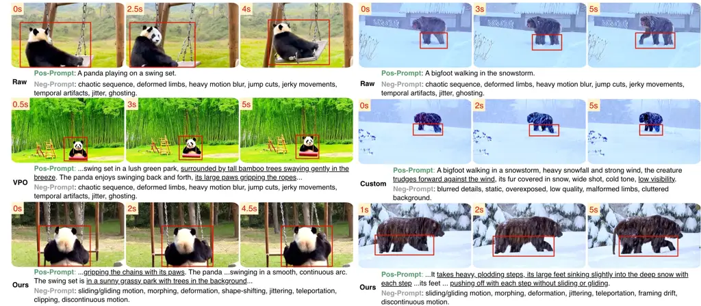

# TIDE: Trajectory-Informed Skill Distillation for Efficient Text-to-Video Prompt Optimization

Chengxing Zhou    Yuliang Huang    Jingwei Song ^(†)^(†)thanks:
^(†)Corresponding author. Email: u3638265@connect.hku.hk

###### Abstract

Text-to-video (T2V) models are highly sensitive to prompt specificity,
while iterative prompt optimization typically improves generation
quality only through repeated video generation and vision-language model
evaluation at inference time. We propose TIDE, a framework that distills
this costly search process into an interpretable and reusable
prompt-rewriting Skill. TIDE formulates prompt rewriting as a set of
source-conditioned rule modules, each targeting a distinct semantic
dimension. Once distilled, the frozen Skill activates the relevant rules
and generates both positive and negative prompts in a single LLM call,
followed by only one T2V generation, without test-time visual search or
backbone fine-tuning. Evolved using only 100 prompts over 14 hours, TIDE
achieves prompt-optimization performance comparable to computationally
expensive search-based methods. Moreover, when transferred to previously
unseen video-generation models, TIDE outperforms existing approaches
specifically designed or trained for those models. Code is available
[here](https://github.com/xiningin/TIDE_T2V).

###### Index Terms: 

text-to-video generation, prompt optimization, trajectory distillation,
test-time optimization

^(†)^(†)address: ¹ Sun Yat-sen University, China   ²The University of
Hong Kong, China

## 1 Introduction

Video generation has advanced rapidly in recent years, catalyzed by the
emergence of Sora \[2\]. Building on this momentum, models \[3, 16, 8,
1\] can generate visually compelling and temporally coherent videos from
text. Their broad applicability—from advertising and creative design to
film production and world simulation—has begun to yield real-world
deployments and emerging commercial applications, underscoring the
field’s substantial practical potential.

However, a gap remains between users’ concise prompts and the detailed
descriptions needed to fully exploit these models, motivating prompt
optimization for video generation. One-shot methods use an LLM with a
fixed prompting strategy or handcrafted templates to rewrite or augment
prompts efficiently at inference time \[14, 21\]. A complementary line
amortizes optimization by training prompt rewriters offline on curated
or optimized prompts using supervised, reinforcement-learning, or
preference-based objectives \[9, 4, 10, 6, 7\]. These paradigms lack
direct visual feedback at inference time and therefore cannot adapt to
prompt-specific generation failures. More recent approaches perform
dynamic, test-time optimization using feedback from generated visual
content \[15, 13\]: they repeatedly generate candidates, assess their
quality, and revise prompts until satisfactory results are obtained. In
T2V generation, this feedback-driven process adapts to each prompt, is
generally agnostic to the underlying generator, and often achieves
stronger optimization than one-shot rewriting. These advantages come at
a steep computational cost, however, as repeated video generation and
model calls can take hours for a single prompt while producing only
seconds of video.

This trade-off motivates our central question: _Can the experience
accumulated during iterative optimization be retained in a compact
artifact, so that a subsequent one-shot rewrite can achieve the benefits
of iterative search?_ Rather than learning solely from offline optimized
prompt pairs, we distill experience into an interpretable and reusable
prompt-rewriting Skill. Unlike prompt-pair fine-tuning, which typically
supervises only the initial and optimized endpoints, our approach also
distills intermediate critiques, suggestions, candidate comparisons, and
dimension-specific corrections from each trajectory, yielding a richer
supervision signal and making fuller use of the collected optimization
experience. The resulting Skill is model-agnostic and exposes its
learned behavior as explicit rewriting rules, while requiring only one
LLM call and one video generation at inference time. We call this
framework TIDE, which organizes the acquired knowledge into distinct
semantic dimensions, including motion specification, camera framing,
identity preservation, and other semantic aspects. Accordingly, we
formulate the rewriting policy as independent, source-triggered rule
modules, each targeting a specific aspect of prompt quality. As
illustrated in Fig. 1, we continuously mine dimension-specific patches
from online-generated optimization trajectories to update its rule
modules and synchronize them with the Skill.

In summary, we introduce TIDE, a framework that distills iterative
prompt-optimization experience into an interpretable, reusable, and
inference-efficient Skill through modular, source-triggered rule
updates. Distilled from optimization trajectories of only 100 prompts on
a single T2V backbone, TIDE matches the source iterative optimizer and
transfers effectively to other backbones, consistently outperforming
prompt-optimization methods designed or fine-tuned for them.

Figure 1: Pipeline of the proposed TIDE framework. (1) Prompt Rewriting:
Given a raw prompt—typically a short user query—the rewriter activates
relevant Skill rules to produce an enhanced prompt. (2) Trajectory
Generation: The generated video is critiqued, suggestions guide revised
prompt candidates, and tournament selection chooses the next-round
incumbent; this loop repeats to iteratively improve generation quality.
(3) Experience Distillation: Prompt-optimization trajectories yield
reusable, dimension-specific patches for the corresponding rule pools.
Once full, a pool’s patches update the associated rule and synchronize
it with the Skill for subsequent rewriting.

## 2 Method

### 2.1 Skill Architecture

Our central design premise is that the knowledge discovered during
iterative test-time optimization decomposes into multiple, distinct
semantic dimensions rather than forming a single monolithic rewriting
policy. Concretely, the Skill comprises three conceptual components: (i)
a system prompt, (ii) source-trigger specifications, and (iii) a
collection of rule modules, as depicted in stage (1) of Fig. 1. We
encode these components at revision $`t`$ as the tuple

```math
\mathcal{S}^{(t)}=\left(s_{\mathrm{sys}},\{r_{d}^{(t)}\}_{d\in\mathcal{D}}\right),r_{d}^{(t)}=\bigl(\tau_{d},a_{d},\iota_{d},\nu_{d},\kappa_{d}\bigr), \tag{1}
```

where $`s_{\mathrm{sys}}`$ denotes the system prompt of the Skill,
$`\mathcal{D}`$ denotes the set of semantic dimensions and
$`r_{d}^{(t)}`$ is the Rule associated with dimension $`d`$. The trigger
specifications $`(\tau_{d},a_{d})`$ implement Trigger Match, while
$`(\iota_{d},\nu_{d},\kappa_{d})`$ define the corresponding rewriting
rule. More specifically, $`\tau_{d}`$ denotes a source-dependent trigger
predicate, $`a_{d}`$ its responsibility axis, $`\iota_{d}`$ the
rewriting instruction, $`\nu_{d}`$ a set of conditional artifact terms
for negative prompting, and $`\kappa_{d}`$ the module’s capability
scope. The system prompt defines the global rewriting policy and output
format, enforcing source fidelity and executable temporal–visual
descriptions while keeping the output focused on visual content. This
explicit design keeps the routing and rewriting processes interpretable
and auditable.

Given a raw prompt $`x`$, Trigger Match evaluates each source-dependent
trigger and activates the rules whose semantic dimensions are supported
by $`x`$, together with the global rules. Let
$`\mathcal{G}\subseteq\mathcal{D}`$ denote the dimensions with globally
active rules and let $`\tau_{d}(x)\in\{0,1\}`$ indicate whether the
source satisfies the trigger of dimension $`d`$; the activated set is

```math
\mathcal{A}(x)=\mathcal{G}\cup\left\{d\notin\mathcal{G}:\tau_{d}(x)=1\right\}. \tag{2}
```

Each conditional trigger is evaluated only along its designated axis,
and multiple rules may be activated when the source supports multiple
dimensions. The rewriter then conditions on the system prompt and the
activated rules to produce an enhanced positive prompt and a
rule-conditioned negative prompt:

```math
\bigl(p^{+},\widetilde{n}\bigr)=R_{\theta}^{\mathrm{LLM}}\!\left(x,s_{\mathrm{sys}},\left\{r_{d}^{(t)}:d\in\mathcal{A}(x)\right\}\right). \tag{3}
```

$`p^{+}`$ preserves all explicit source constraints and adds only
executable details supported by the activated instructions. Each
activated rule contributes its instruction $`\iota_{d}`$ to the rewrite
and its artifact terms $`\nu_{d}`$ to the rule-conditioned negative
prompt. Following prior work on automated negative prompting \[17\], we
use concise and non-redundant artifact phrases. The rule-conditioned
negative prompt $`\widetilde{n}`$ is restricted to the allowed term set
$`\mathcal{N}(x)=\bigcup_{d\in\mathcal{A}(x)}\nu_{d}`$ and capped at
eight terms per rewrite. The LLM rewriter parameters remain frozen
during Skill evolution; only the explicit Rule contents are updated from
distilled optimization experience.

### 2.2 Iterative Prompt-Optimization Trajectories

Our trajectory-generation module, corresponding to stage (2) in Fig. 1,
adapts the prompt self-improvement procedure of VISTA \[13\], retaining
its visual feedback loop while discarding audio-specific components.
Starting from the enhanced prompt $`p_{i}^{(0)}`$ produced by the Skill,
the text-to-video generator renders a video at each optimization round.
A group of judges critique the video’s quality and alignment with the
source prompt. A re-thinker converts these critiques into actionable
suggestions, which guide the construction of multiple revised prompt
candidates. Their generated videos are compared in a pairwise
tournament, and the winning candidate becomes the incumbent for the next
round.

For every training prompt, we retain the complete optimization record as
a prompt-optimization trajectory:

```math
\mathcal{T}_{i}=\left\{x_{i},\left(p_{i}^{(k)},c_{i}^{(k)},s_{i}^{(k)},\mathcal{P}_{i}^{(k)},w_{i}^{(k)}\right)_{k=1}^{K}\right\}, \tag{4}
```

where $`x_{i}`$ is the source prompt, $`p_{i}^{(k)}`$ the incumbent
prompt, $`c_{i}^{(k)}`$ the judges’ critique, $`s_{i}^{(k)}`$ the
re-thinker’s suggestions, $`\mathcal{P}_{i}^{(k)}`$ the revised
candidate prompts, and $`w_{i}^{(k)}`$ the tournament outcomes together
with their decision rationales. These trajectories are subsequently used
to distill reusable rule patches that encode dimension-specific
optimization experience.

### 2.3 Experience-Aggregated Rule Refinement

Our experience-distillation module, corresponding to stage (3) in
Fig. 1, extracts reusable rule updates from the collected trajectories.
For each trajectory $`\mathcal{T}_{i}`$, let
$`\mathcal{A}_{i}=\mathcal{A}(x_{i})`$ denote the dimensions activated
for its source prompt. A Patch Proposer examines the evidence along
every activated dimension $`d\in\mathcal{A}_{i}`$ and determines whether
it supports a reusable modification of the corresponding rule
$`r_{d}^{(t)}`$. When such evidence is present, it emits one or more
dimension-specific patches, potentially spanning multiple dimensions and
multiple corrections within the same dimension. Each patch is associated
with a trajectory–dimension pair and must encode a generalizable
correction within the rule’s responsibility axis $`a_{d}`$ and
capability scope $`\kappa_{d}`$, rather than memorize a particular
prompt, entity, video, seed, or benchmark example. The proposed change
may refine the rewriting instruction $`\iota_{d}`$ and the conditional
artifact terms $`\nu_{d}`$; the trigger $`\tau_{d}`$ is modified only
when the trajectory provides explicit evidence of a routing error.

To prevent noisy evidence from a single example from causing unstable or
over-specialized rule changes, accepted patches are stored in
independent, dimension-specific Patch Pools $`\{Q_{d}\}`$. Patches from
different dimensions are never mixed. A rule becomes eligible for
refinement only after its pool contains a complete batch of $`B`$
patches; the rule optimizer then synthesizes the earliest batch into a
complete replacement:

```math
r_{d}^{(t+1)}=U\!\left(r_{d}^{(t)},Q_{d}[:B]\right),|Q_{d}|\geq B. \tag{5}
```

After a successful update, the consumed patches are removed from
$`Q_{d}`$. If validation still fails after schema repair, the batch
update is aborted: the Rule is not applied and the selected patches
remain in the pool. When multiple rules are eligible, the scheduler
prioritizes the least recently updated rule (with never-updated rules
first), preventing starvation and balancing updates across dimensions.

## 3 Experiments

### 3.1 Experiment Setting

Implementation Details. We evolve the prompt-rewriting Skill with
SANA-Video-2B \[5\], generating 5-second, 480p videos with 81 frames.
DeepSeek-V4-Flash \[11\] handles text-only stages, including rewriting,
candidate generation, trajectory distillation, and rule updates, while
Qwen3.6-35B-A3B \[22\] evaluates videos sampled at 2 FPS for quality
assessment, critique generation, and tournament selection. During the
Trajectory Generation stage, we perform two optimization rounds,
generating four candidate prompts in each round; a rule is updated after
four dimension-specific patches accumulate. The Skill is evolved on 100
prompts collected from EvalCrafter \[12\]. Training takes 14 hours on
four NVIDIA A100 GPUs, including 12.4 hours for trajectory collection.

Evaluation Benchmarks. We draw evaluation prompts from VBench2 \[24\]
and T2V-CompBench \[19\]. The VBench2 subset contains 431 canonical
prompts across nine dimensions, while T2V-CompBench contains 200 prompts
each for object interactions and generative numeracy. Unless otherwise
specified, each prompt is rendered with three random seeds. For the
matched comparison in Table 1, all methods use an 80-prompt subset
sampled from VBench2 because of the high cost of iterative search.
Within each backbone, all methods use identical generation settings and
seeds. SANA-Video-2B and CogVideoX1.5-5B \[23\] use $`832\times 480`$
resolution, 81 frames at 16 FPS, 50 denoising steps, and guidance scale
6.0. Wan2.2-TI2V-5B \[20\] uses the same spatial, temporal, and
denoising settings with its default guidance scale and sampling shift.

Across all tables, we abbreviate the VBench2 dimensions as SC (subject
consistency), MS (motion smoothness), DD (dynamic degree), AQ (aesthetic
quality), IQ (imaging quality), OC (overall consistency), MO (multiple
objects), HA (human action), and SR (spatial relationship), and the
T2V-CompBench dimensions as GN (generative numeracy) and OI (object
interactions).

Comparison Methods. We compare against VISTA \[13\] on the matched
VBench2 subset using SANA-Video-2B, VPO-5B \[6\] on CogVideoX1.5-5B, and
*Custom* \[18\], a community-authored Skill tailored to Wan2.2, on
Wan2.2-TI2V-5B. For VISTA, we follow its original protocol of four
optimization rounds and use the final video selected by its search. We
additionally include each backbone’s official prompt-extension procedure
as a baseline to measure improvements over native prompt extension. For
a fair comparison, all Skill-based rewriting uses DeepSeek-V4-Flash. To
evaluate transferability, TIDE is trained only once with SANA-Video-2B
and remains frozen when applied to other backbones.

### 3.2 Main Results

|                |       |       |       |       |       |       |       |       |       |
| -------------- | ----- | ----- | ----- | ----- | ----- | ----- | ----- | ----- | ----- |
| Method         | SC    | MS    | DD    | AQ    | IQ    | OC    | MO    | HA    | SR    |
| Raw            | 95.64 | 98.55 | 87.50 | 61.25 | 67.79 | 28.97 | 78.91 | 81.25 | 81.59 |
| VISTA          | 96.60 | 98.70 | 75.00 | 61.28 | 70.67 | 27.61 | 98.83 | 93.75 | 82.89 |
| Ours\_(init)   | 95.35 | 98.59 | 79.17 | 60.73 | 65.78 | 28.22 | 92.45 | 97.92 | 82.94 |
| Ours\_(distil) | 96.22 | 98.63 | 77.08 | 61.07 | 66.43 | 28.24 | 91.28 | 100.0 | 88.43 |

Table 1: Comparison of TIDE with multi-round iterative prompt
optimization across the nine VBench2 dimensions. The average scores of
Raw, VISTA, $`\mathrm{Ours}_{\mathrm{init}}`$, and
$`\mathrm{Ours}_{\mathrm{distil}}`$ are 75.72, 78.37, 77.91, and 78.60,
respectively. $`\mathrm{Ours}_{\mathrm{init}}`$ denotes the Skill before
trajectory distillation, while $`\mathrm{Ours}_{\mathrm{distil}}`$
denotes the final Skill distilled from VISTA’s optimization
trajectories. The best and second-best results are highlighted in bold
and underlined, respectively.

|                 |       |         |       |       |       |       |       |       |       |       |              |       |
| --------------- | ----- | ------- | ----- | ----- | ----- | ----- | ----- | ----- | ----- | ----- | ------------ | ----- |
|                 |       | VBench2 |       |       |       |       |       |       |       |       | T2VCompBench |       |
| Method          | Avg.  | SC      | MS    | DD    | AQ    | IQ    | OC    | MO    | HA    | SR    | GN           | OI    |
| CogVideoX1.5-5B |       |         |       |       |       |       |       |       |       |       |              |       |
| Raw             | 54.83 | 96.18   | 99.07 | 16.20 | 56.66 | 62.35 | 24.45 | 49.95 | 72.00 | 49.83 | 33.95        | 42.50 |
| Baseline        | 60.73 | 94.31   | 98.94 | 33.33 | 60.24 | 61.65 | 26.35 | 58.82 | 83.67 | 58.23 | 34.80        | 57.75 |
| VPO             | 61.58 | 95.11   | 98.66 | 34.26 | 58.31 | 60.36 | 26.06 | 61.94 | 92.33 | 50.20 | 39.12        | 61.00 |
| Ours            | 61.87 | 95.50   | 98.96 | 34.26 | 56.39 | 59.56 | 25.62 | 68.67 | 91.00 | 51.75 | 42.96        | 55.90 |
| Wan2.2-TI2V-5B  |       |         |       |       |       |       |       |       |       |       |              |       |
| Raw             | 53.69 | 97.16   | 98.98 | 8.33  | 58.68 | 66.66 | 23.34 | 43.19 | 68.33 | 57.57 | 25.31        | 43.04 |
| Baseline        | 63.64 | 96.47   | 99.10 | 24.54 | 66.70 | 67.21 | 25.46 | 64.00 | 88.67 | 66.19 | 29.96        | 71.78 |
| Custom          | 61.89 | 95.59   | 98.89 | 21.30 | 60.95 | 66.11 | 27.28 | 66.59 | 95.33 | 61.52 | 24.60        | 62.62 |
| Ours            | 67.29 | 96.11   | 99.03 | 24.07 | 62.91 | 65.40 | 26.97 | 81.02 | 97.33 | 73.61 | 40.62        | 73.14 |

Table 2: Comparison with other prompt optimization methods across
CogVideoX1.5 and Wan2.2.

|                     |       |         |       |       |       |       |       |       |       |       |              |       |
| ------------------- | ----- | ------- | ----- | ----- | ----- | ----- | ----- | ----- | ----- | ----- | ------------ | ----- |
|                     |       | VBench2 |       |       |       |       |       |       |       |       | T2VCompBench |       |
| Method              | Avg.  | SC      | MS    | DD    | AQ    | IQ    | OC    | MO    | HA    | SR    | GN           | OI    |
| Random Selection    | 66.76 | 94.94   | 98.94 | 31.94 | 62.12 | 64.42 | 27.07 | 77.57 | 96.67 | 73.81 | 35.34        | 71.54 |
| w/o Rule Selection  | 66.81 | 94.92   | 98.65 | 30.09 | 63.31 | 65.36 | 27.60 | 72.26 | 97.00 | 78.54 | 34.99        | 72.21 |
| w/o NP Distil       | 65.46 | 94.89   | 99.25 | 21.76 | 61.06 | 61.75 | 27.18 | 79.60 | 93.33 | 74.59 | 35.10        | 71.55 |
| w/o Anti-Starvation | 66.97 | 94.63   | 98.90 | 35.65 | 62.23 | 64.08 | 26.96 | 78.23 | 96.00 | 75.65 | 34.18        | 70.12 |
| Ours                | 67.30 | 96.11   | 99.03 | 24.07 | 62.91 | 65.40 | 26.97 | 81.02 | 97.33 | 73.61 | 40.62        | 73.14 |

Table 3: Ablation results for rule selection, negative-prompt
distillation, and anti-starvation scheduling on Wan2.2.

Effective Distillation of Exploration Experience. As shown in Table 1,
even before trajectory distillation, $`\mathrm{Ours}_{\mathrm{init}}`$
improves the average score over Raw prompts (77.91 vs. 75.72),
demonstrating the effectiveness of the initial rewriting Skill. After
distilling the exploration experience from VISTA’s optimization
trajectories, $`\mathrm{Ours}_{\mathrm{distil}}`$ further improves the
average score to 78.60, matching and slightly surpassing VISTA’s 78.37.
This result demonstrates that TIDE captures and distills the experience
accumulated through VISTA’s multi-round iterative exploration into
reusable rewriting rules, transferring its optimization benefits to a
compact, single-pass Skill. While VISTA and
$`\mathrm{Ours}_{\mathrm{distil}}`$ exhibit complementary strengths
across different dimensions, the distilled Skill achieves the best
overall performance without requiring test-time visual search.

Cross-Model Generalization and Advantages. As shown in Table 2, the
Skill trained on SANA-Video generalizes to Wan2.2 and CogVideoX1.5
without additional training, achieving the best overall performance for
both backbones. The improvements are most evident on
controllability-oriented dimensions, including multiple-object
understanding, human action, and spatial relationships, while preserving
competitive subject fidelity and motion quality. Compared with VPO and
the manually customized Skill, our method delivers more balanced gains
across quality and semantic control, demonstrating that exploration
experience distilled into the Skill transfers effectively across
video-generation architectures.

Qualitative Results. Fig. 2 compares the optimized prompts and visual
results. For “A panda playing on a swing set,” both VPO and Ours add a
gripping action to make the panda–swing interaction more plausible.
However, Ours better preserves the focus of the raw prompt, keeping the
panda and swing visually dominant while achieving cleaner composition
and higher visual quality. For “A bigfoot walking in the snowstorm,” the
Raw result inadequately expresses the intended walking action, with
noticeable leg movement appearing only near the end of the video. Both
Custom and Ours address this issue by strengthening the motion
description: Custom specifies that the creature “trudges forward against
the wind,” while Ours further describes heavy steps and explicit
foot–snow interaction, producing a more continuous and grounded walking
motion. The targeted negative prompts suppress structural and temporal
artifacts, improving subject consistency and motion smoothness.



Figure 2: Qualitative comparison of prompt optimization. Left: Ours and
VPO on CogVideoX1.5. Right: Ours and Custom on Wan2.2.

### 3.3 Ablation Studies

We ablate three key components of TIDE: rule selection, negative-prompt
distillation, and anti-starvation scheduling. For rule selection, “w/o
Rule Selection” activates all rules for every prompt, while “Random
Selection” retains global rules and randomly samples the remaining rules
under a budget of three. “w/o NP Distil” replaces dimension-conditioned
negative prompts with a shared fixed one, and “w/o Anti-Starvation”
removes recency-based prioritization during rule updates. All variants
use the same settings as the full Skill.

As shown in Table 3, Ours achieves the highest average score of 67.30,
compared with 66.76 for Random Selection, 66.81 for w/o Rule Selection,
65.46 for w/o NP Distil, and 66.97 for w/o Anti-Starvation. The largest
drop occurs without negative-prompt distillation (-1.84), with notable
degradation in imaging quality, human action, generative numeracy, and
object interaction. Although the rule-selection variants improve some
dynamic-degree or spatial-relation scores, their lower averages indicate
a weaker balance across dimensions. Similarly, removing anti-starvation
increases dynamic degree but reduces the average by 0.33, confirming
that balanced rule updates benefit overall performance.

## 4 CONCLUSION

We introduce TIDE, a trajectory-informed framework that distills
iterative text-to-video prompt optimization into an interpretable,
reusable rewriting skill. By distilling iterative visual search, TIDE
alleviates this trade-off: it retains the strong performance and
model-agnostic applicability of iterative methods while replacing costly
multi-round generation, evaluation, and revision with a single LLM
rewrite and T2V generation, matching search-based optimization from only
100 prompts on a single backbone and surpassing methods designed or
fine-tuned for unseen generators. Despite these advantages, TIDE still
has limitations. Distilled from trajectories collected on a single
backbone with a small prompt set, its rules leave rarely triggered
dimensions under-refined and may encode backbone- or judge-specific
biases. Future work will therefore explore learning from more diverse
optimization trajectories to improve robustness, and extend TIDE to
audio-aware video optimization.

## References

- \[1\] Black Forest Labs (2026) FLUX 3 Video, Part 1: Generation. Note:
  [https://bfl.ai/blog/flux-3-video](https://bfl.ai/blog/flux-3-video)Accessed:
  2026-09-08 Cited by: §1.
- \[2\] T. Brooks, B. Peebles, C. Holmes, W. DePue, Y. Guo, L. Jing, D.
  Schnurr, J. Taylor, T. Luhman, E. Luhman, C. Ng, R. Wang, and A.
  Ramesh (2024) Video generation models as world simulators. Note:
  [https://openai.com/research/video-generation-models-as-world-simulators](https://openai.com/research/video-generation-models-as-world-simulators)
  Cited by: §1.
- \[3\] ByteDance Seed (2026) Seedance 2.5. Note:
  [https://seed.bytedance.com/en/seedance2_5](https://seed.bytedance.com/en/seedance2_5)
  Cited by: §1.
- \[4\] T. Cao, C. Wang, B. Liu, Z. Wu, J. Zhu, and J. Huang (2023)
  Beautifulprompt: towards automatic prompt engineering for
  text-to-image synthesis. In Proceedings of the 2023 Conference on
  Empirical Methods in Natural Language Processing: Industry Track,
  pp. 1–11. Cited by: §1.
- \[5\] J. Chen, Y. Zhao, J. Yu, R. Chu, J. Chen, S. Yang, X. Wang, Y.
  Pan, D. Zhou, H. Ling, H. Liu, H. Yi, H. Zhang, M. Li, Y. Chen, H.
  Cai, S. Fidler, P. Luo, S. Han, and E. Xie (2026) SANA-Video:
  efficient video generation with block linear diffusion transformer. In
  International Conference on Learning Representations, External Links:
  2509.24695 Cited by: §3.1.
- \[6\] J. Cheng, R. Lyu, X. Gu, X. Liu, J. Xu, Y. Lu, J. Teng, Z.
  Yang, Y. Dong, J. Tang, H. Wang, and M. Huang (2025) VPO: aligning
  text-to-video generation models with prompt optimization. In
  Proceedings of the IEEE/CVF International Conference on Computer
  Vision, pp. 15636–15645. External Links:
  [Document](https://dx.doi.org/10.1109/ICCV51701.2025.01451),
  2503.20491 Cited by: §1, §3.1.
- \[7\] B. Gao, Q. Ma, X. Wu, S. Yang, G. Lan, H. Zhao, J. Chen, Q.
  Liu, Y. Qiao, X. Chen, Y. Wang, and L. Niu (2025) RAPO++: cross-stage
  prompt optimization for text-to-video generation via data alignment
  and test-time scaling. arXiv preprint arXiv:2510.20206. External
  Links: 2510.20206 Cited by: §1.
- \[8\] Google DeepMind (2026) Veo. Note:
  [https://deepmind.google/models/veo/](https://deepmind.google/models/veo/)
  Cited by: §1.
- \[9\] Y. Hao, Z. Chi, L. Dong, and F. Wei (2023) Optimizing prompts
  for text-to-image generation. Advances in Neural Information
  Processing Systems 36, pp. 66923–66939. Cited by: §1.
- \[10\] Y. Ji, J. Zhang, J. Wu, S. Zhang, S. Chen, C. Ge, P. Sun, W.
  Chen, W. Shao, X. Xiao, et al. (2025) Prompt-a-video: prompt your
  video diffusion model via preference-aligned llm. In 2025 IEEE/CVF
  International Conference on Computer Vision (ICCV), pp. 18725–18735.
  Cited by: §1.
- \[11\] A. Liu, B. Feng, B. Xue, B. Wang, B. Wu, C. Lu, C. Zhao, C.
  Deng, C. Zhang, C. Ruan, et al. (2024) Deepseek-v3 technical report.
  arXiv preprint arXiv:2412.19437. Cited by: §3.1.
- \[12\] Y. Liu, X. Cun, X. Liu, X. Wang, Y. Zhang, H. Chen, Y. Liu, T.
  Zeng, R. Chan, and Y. Shan (2024) EvalCrafter: benchmarking and
  evaluating large video generation models. In Proceedings of the
  IEEE/CVF Conference on Computer Vision and Pattern Recognition,
  pp. 22139–22149. External Links:
  [Document](https://dx.doi.org/10.1109/CVPR52733.2024.02090),
  2310.11440 Cited by: §3.1.
- \[13\] D. X. Long, X. Wan, H. Nakhost, C. Lee, T. Pfister, and S. Ö.
  Arık (2026) VISTA: a test-time self-improving video generation agent.
  In Proceedings of the IEEE/CVF Conference on Computer Vision and
  Pattern Recognition, pp. 6021–6032. External Links: 2510.15831 Cited
  by: §1, §2.2, §3.1.
- \[14\] S. Ma, H. Xu, M. Li, H. Li, X. Yang, Y. Li, Y. Wu, and Y.
  Wang (2026) POS: a prompts optimization suite for augmenting
  text-to-video generation. ACM Transactions on Multimedia Computing,
  Communications, and Applications 22 (8), pp. 1–17. External Links:
  [Document](https://dx.doi.org/10.1145/3820056),
  [Link](https://doi.org/10.1145/3820056) Cited by: §1.
- \[15\] O. Mañas, P. Astolfi, M. Hall, C. Ross, J. Urbanek, A.
  Williams, A. Agrawal, A. Romero-Soriano, and M. Drozdzal (2024)
  Improving text-to-image consistency via automatic prompt optimization.
  arXiv preprint arXiv:2403.17804. Cited by: §1.
- \[16\] MiniMax (2026) MiniMax H3. Note:
  [https://www.minimax.io/news/minimax-h3-open-source](https://www.minimax.io/news/minimax-h3-open-source)
  Cited by: §1.
- \[17\] S. Park, E. Kim, Y. Oh, J. Choi, and S. Yoon (2026) Guiding
  what not to generate: automated negative prompting for text-image
  alignment. In 2026 IEEE/CVF Winter Conference on Applications of
  Computer Vision, pp. 6664–6675. External Links:
  [Document](https://dx.doi.org/10.1109/WACV61042.2026.00644) Cited by:
  §2.1.
- \[18\] Square-Zero-Labs (2026) Video prompting (agent skill). Note:
  [https://github.com/Square-Zero-Labs/video-prompting-skill](https://github.com/Square-Zero-Labs/video-prompting-skill)
  Cited by: §3.1.
- \[19\] K. Sun, K. Huang, X. Liu, Y. Wu, Z. Xu, Z. Li, and X.
  Liu (2025) T2v-compbench: a comprehensive benchmark for compositional
  text-to-video generation. In 2025 IEEE/CVF Conference on Computer
  Vision and Pattern Recognition (CVPR), pp. 8406–8416. Cited by: §3.1.
- \[20\] T. Wan, A. Wang, B. Ai, B. Wen, C. Mao, C. Xie, D. Chen, F.
  Yu, H. Zhao, J. Yang, et al. (2025) Wan: open and advanced large-scale
  video generative models. arXiv preprint arXiv:2503.20314. Cited by:
  §3.1.
- \[21\] L. Wang, X. Xing, Y. Cheng, Z. Zhao, D. Li, T. Hang, J. Tao, Q.
  Wang, R. Li, C. Chen, X. Li, M. Wu, X. Deng, S. Gu, C. Wang, and Q.
  Lu (2025) PromptEnhancer: a simple approach to enhance text-to-image
  models via chain-of-thought prompt rewriting. arXiv preprint
  arXiv:2509.04545. External Links: 2509.04545 Cited by: §1.
- \[22\] A. Yang, A. Li, B. Yang, B. Zhang, B. Hui, B. Zheng, B. Yu, C.
  Gao, C. Huang, C. Lv, et al. (2025) Qwen3 technical report. arXiv
  preprint arXiv:2505.09388. Cited by: §3.1.
- \[23\] Z. Yang, J. Teng, W. Zheng, M. Ding, S. Huang, J. Xu, Y.
  Yang, W. Hong, X. Zhang, G. Feng, D. Yin, Y. Zhang, W. Wang, Y.
  Cheng, B. Xu, X. Gu, Y. Dong, and J. Tang (2025) CogVideoX:
  text-to-video diffusion models with an expert transformer. In
  International Conference on Learning Representations, External Links:
  2408.06072 Cited by: §3.1.
- \[24\] D. Zheng, Z. Huang, H. Liu, K. Zou, Y. He, F. Zhang, L. Gu, Y.
  Zhang, J. He, W. Zheng, et al. (2025) Vbench-2.0: advancing video
  generation benchmark suite for intrinsic faithfulness. arXiv preprint
  arXiv:2503.21755. Cited by: §3.1.
