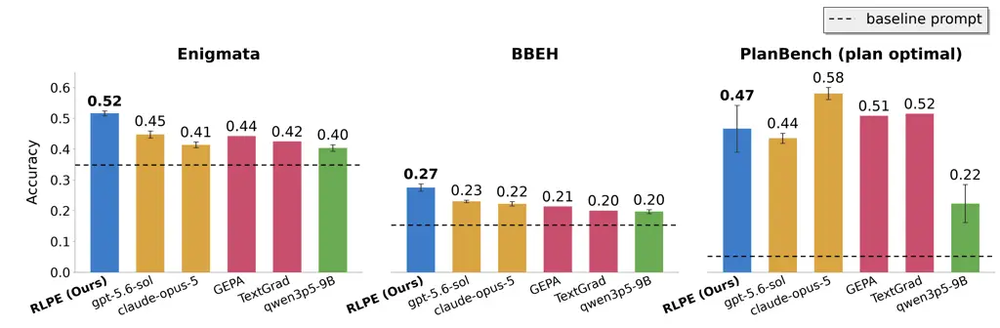
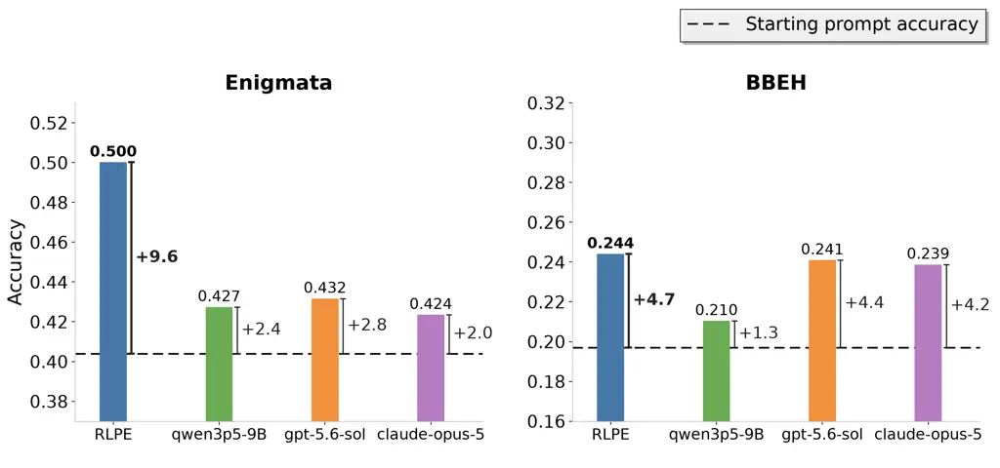
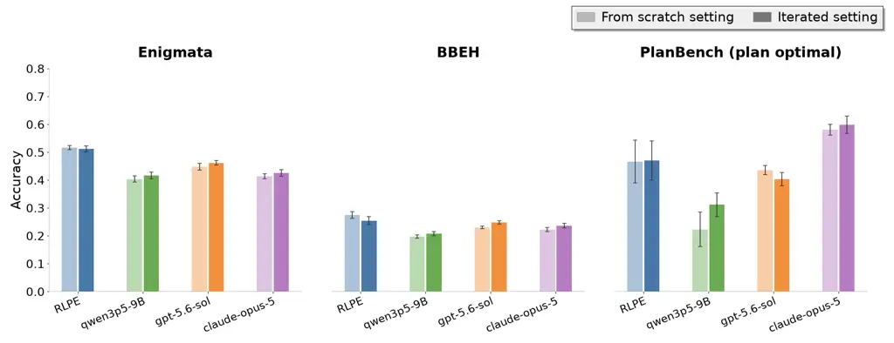
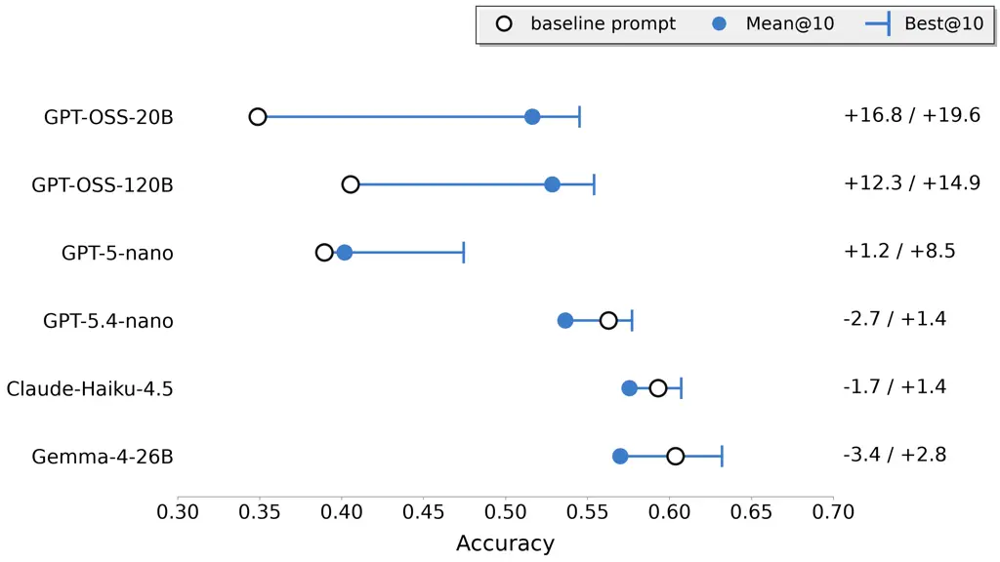
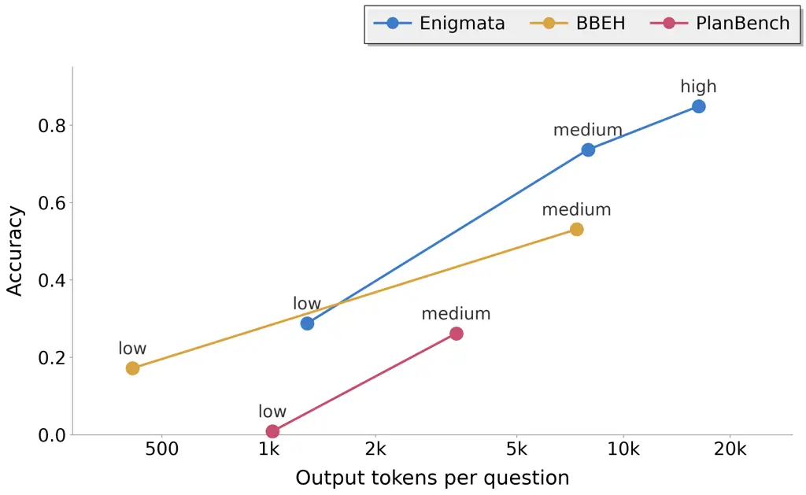
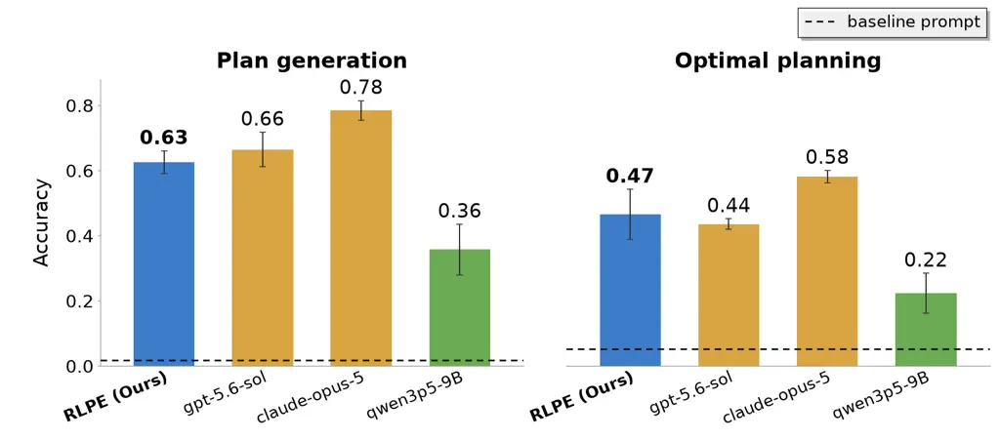

# RLPE: Teaching LLMs to Prompt with Reinforcement Learning

Rahul Singhal Email: [rahul@distyl.ai](mailto:)    Karime Maamari
Email: [karime@distyl.ai](mailto:)    Pradyumna Tambwekar
Email: [pradyumna.tambwekar@distyl.ai](mailto:)

###### Abstract

Prompting is a widely used method for adapting general-purpose LLMs to
domain-specific tasks. Effective prompts can be tedious to create
manually, so prompt writing is increasingly handed to LLMs, with recent
work training LLMs to write prompts for other models. These techniques
either write prompts without observing how the task model behaves, blind
to the failure modes the prompt should address, or must run alongside
the task LLM at inference time, adding overhead to every query. Neither
reflects how prompt engineering is often practiced. To close this gap,
we introduce Reinforcement Learned Prompt Engineering (RLPE), which
trains a model to analyze traces of a separate task model and write a
prompt targeting the failures it observes. RLPE rewards the trained
model strictly on prompt performance, so it learns the prompting
strategies that improve the task model. The prompt is generated once and
reused across the task, so inference does not require the trained model.
Since RLPE needs only query access to the model it prompts, it is also
compatible with closed-source models. We apply RLPE to Enigmata,
BIG-Bench Extra Hard, and PlanBench. We train a 9B-parameter model that
writes better prompts than state-of-the-art frontier models (gpt-5.6-sol
and claude-opus-5) and prompt optimizers (GEPA and TextGrad) on 2/3
benchmarks. Although the model is never explicitly trained to iterate on
prompts, this capability emerges at a level that matches or beats
frontier models. The learned prompting capability also generalizes, with
the trained model improving task models 6x larger than the one it
trained with, including ones from entirely different model families, and
matching claude-opus-5 on a fourth benchmark held out from training.

## 1 Introduction

General-purpose large language models (LLMs) are adapted to specific
tasks largely through prompting (Liu et al., 2023), so finding effective
prompts grows more valuable as LLMs take on more tasks. Automated
prompt-optimization tools use LLMs to generate and search for
high-performing prompts and have shown broad success (Agrawal et al.,
2025; Yuksekgonul et al., 2024). But these tools are bounded by the
prompting ability of the models powering them, which remains largely
understudied.

Recent work has begun directly training models to write prompts.
PRewrite (Kong et al., 2024), PRL (Batorski et al., 2025), and
Prompt-MII (Xiao et al., 2025) train models to produce prompts from task
descriptions or labeled examples. Trained this way, a model never
observes the prompted model’s behavior, making it unclear what its
prompts should correct. Advisor Models (Asawa et al., 2025) and
Prompt-R1 (Liu et al., 2025) train a model that works alongside the
prompted model, advising it on each query. Here the trained model does
observe the prompted model’s behavior, but it must run with the prompted
model on every query, adding inference overhead and limiting practical
use. Neither captures the process of prompt engineering: inspecting
outputs, spotting failure modes, and incorporating the fixes into a
reusable prompt.

We introduce Reinforcement Learned Prompt Engineering (RLPE), which
trains a prompt-writing model under conditions that better mirror prompt
engineering practice. We train an advisor model to write prompts for a
task model, the model performing the task. To write a prompt, the
advisor is shown a batch of traces, each with a question the task model
attempted, its response, and the response’s correctness, exposing
precisely how the task model performs. The advisor generates a static
prompt used for every question the task model answers, so the advisor
never runs per query. During training, we run the task model with each
prompt and reward the advisor by the measured performance. RLPE is
practical to use. It needs only query access to the task model, so it is
compatible with closed-source models (Section 5.3). Also, RLPE training
is cheap, requiring modest compute and no reference prompts or LLM
judges, since performance alone provides the reward.

We train a 9B-parameter model via Group Relative Policy Optimization
(GRPO) (Shao et al., 2024) that writes more performant prompts than
state-of-the-art frontier models and prompt optimizers. It surpasses
gpt-5.6-sol, claude-opus-5, GEPA, and TextGrad on Enigmata (Chen et al.,
2025a) and BIG-Bench Extra Hard (BBEH) (Kazemi et al., 2025), and
matches nearly all baselines on PlanBench (Valmeekam et al., 2022)
(Figure 1). These prompts are written from scratch, using only traces
with no existing prompt to build on. Practitioners more often revise
prompts than write new ones (Tafreshipour et al., 2025), so we evaluate
iteration as a skill, in which the advisor is given a prompt to revise
as well. Although prompt iteration is never directly trained, the
capability emerges, with RLPE matching or beating frontier models at
revising prompts (Figure 2).

Training for effective prompting is far less useful without transfer
beyond the task model and dataset used in training. We test the advisor
along these generalization axes. Although trained with one task model,
our advisor improves task models six times larger and models from other
model families (Figure 4). On JustLogic (Chen et al., 2025b), a fourth,
held-out benchmark, the trained model consistently beats the untrained
policy and is competitive with frontier models (Table 1). These results
suggest the learned prompting ability is general, not narrowly tuned to
its training setup.



Figure 1: RLPE writes the strongest prompts on 2/3 benchmarks. Bars =
prompt performance (SE bars if performance is averaged); dashed line =
baseline prompt performance. RLPE (bolded) leads on Enigmata (0.52 RLPE
vs. 0.45 gpt-5.6-sol) and BBEH (0.27 RLPE vs. 0.23 gpt-5.6-sol), and on
PlanBench is competitive with every method except claude-opus-5 (0.47
RLPE vs. 0.58 claude-opus-5). One untrained-policy generation on
PlanBench failed to parse (scored 0).

An overview of our contributions is as follows:

- •
  We introduce Reinforcement Learned Prompt Engineering (RLPE), a
  training framework that mirrors prompt engineering more faithfully
  than previous work: an advisor model reads task-model traces, writes a
  prompt, and is rewarded by how well that prompt performs.
- •
  We train a 9B-parameter advisor model that beats state-of-the-art
  frontier models (gpt-5.6-sol and claude-opus-5) and prompt-optimizer
  tools (GEPA and TextGrad) on two out of three benchmarks. This advisor
  also effectively iterates on prompts, a capability that emerges
  without direct training and matches or exceeds frontier models.
- •
  We provide evidence that the learned prompting capability generalizes.
  The trained advisor improves task models six times larger than its
  training task model, as well as models from entirely different model
  families. Additionally, all trained advisors beat the untrained policy
  and match claude-opus-5 on a held-out benchmark not seen during
  training.

## 2 Related Work

##### RL for LLMs.

Reinforcement learning is now a widely used post-training method for
improving targeted capabilities such as mathematical reasoning, coding,
and agentic tool use (Qian et al., 2025). Beginning with reinforcement
learning from human feedback (RLHF), the field trained models toward
human preferences (Ouyang et al., 2022). More recently, focus has
shifted to reinforcement learning with verifiable rewards (RLVR), which
samples many rollouts per prompt and updates the model toward the highly
rewarded ones (DeepSeek-AI et al., 2025). We apply the same technique,
but instead of improving a model’s own task performance, we train it to
write prompts that improve the performance of a separate task model we
may only be able to query.

##### Prompt optimization.

Prompt-optimization tools automate the search for a prompt that
maximizes task performance. Early methods such as APE (Zhou et al., 2023) and OPRO (Yang et al., 2024) treat the LLM entirely as a prompt
generator, sampling instructions and keeping the highest-scoring ones.
More recent tools instead have the LLM read the task model’s failures
and revise prompts: GEPA (Agrawal et al., 2025) uses an evolutionary
approach to refine prompts, TextGrad (Yuksekgonul et al., 2024) performs
gradient-descent-style optimization with natural-language feedback, and
PrefPO (Singhal et al., 2026) drives revisions with pairwise preferences
over outputs. These tools are only as good as the LLM behind them, which
is particularly problematic because prompting ability is not often
evaluated directly. We respond by measuring how well models prompt
across different settings and training a model to improve that
capability.

##### RL for prompting.

A growing line of work trains prompting models (Deng et al., 2022; Kong
et al., 2024). Some approaches train a model that steers the task model
one query at a time: Advisor Models (Asawa et al., 2025) appends advice
to each question, Prompt-R1 (Liu et al., 2025) runs a multi-turn agent
that prompts the task model and answers itself, and others write
per-instance critiques or reflections (Xie et al., 2025; Yao et al.,
2023). These approaches must run the trained model alongside the task
model for every query, making it harder to scale. Other approaches avoid
this per-query overhead by training a model to write one shared prompt
for the task. PRL (Batorski et al., 2025) trains a prompt generator that
writes prompts from just task descriptions, and Prompt-MII (Xiao et al., 2025) learns to generate instructions from labeled examples across many
datasets. These approaches do not observe the task model’s behavior,
hiding what the prompt must fix. Our advisor addresses both shortcomings
of prior work. Its output is a standalone prompt, so the advisor is
unnecessary at inference time, and its input is the task model’s traces,
exposing remaining failure modes.

## 3 RLPE: Reinforcement Learned Prompt Engineering

### 3.1 Problem Statement

##### Preliminaries.

We train an advisor model, $`\pi_{\mathrm{adv}}`$, a policy that writes
prompts for a separate task model based on observed traces of its
behavior. The task model, $`\pi_{M}`$, is a fixed language model we wish
to prompt effectively; we assume only query access to it. We define a
prompt $`p`$ as a system prompt and a user prompt template into which a
given question $`q`$ is inserted. We write $`p(q)`$ for the prompt with
question $`q`$ in place and sample responses
$`y\sim\pi_{M}(\cdot\mid p(q))`$ (full example prompts in Appendix A.1).
Throughout our experiments, we use a baseline prompt, which keeps the
system prompt empty and passes the question through unchanged as the
user prompt, adding brief answer-formatting instructions when a question
does not specify them (the exception is PlanBench, whose baseline is the
benchmark’s official query containing the rules of the world and a
one-shot example). A task is a pair $`(\mathcal{D},R)`$, a distribution
over questions and a programmatic verifier $`R(q,y)\in\{0,1\}`$ that
scores a response. A trace $`\tau=(q,y,r)`$ records a question, the task
model’s response to it under some prompt, and the score $`r=R(q,y)`$; we
write $`T=\{\tau_{1},\dots,\tau_{k}\}`$ for a batch of $`k`$ traces.

##### Two prompt engineering settings.

We divide prompt engineering into two main settings, corresponding to
two ways of conditioning $`\pi_{\mathrm{adv}}`$: from-scratch and
iterative generation.

For from-scratch generation, the advisor is shown only a batch of traces
$`T`$ produced under the baseline prompt and must write a new prompt for
the benchmark, inferring from the traces what the task model gets wrong
and what instructions would fix it:

```math
p\;\sim\;\pi_{\mathrm{adv}}(\cdot\mid T).
```

For iterative generation, the advisor is additionally shown the prompt
$`p`$ currently in use, together with the corresponding traces $`T`$
produced by running $`p`$, and must write a revised prompt that
addresses the issues $`p`$ has:

```math
p^{\prime}\;\sim\;\pi_{\mathrm{adv}}(\cdot\mid p,T).
```

Separating prompt engineering into these two settings aligns our setup
with real practice, where practitioners both generate new prompts and
iterate on existing ones.

##### Objective.

Both settings share a single goal: produce a prompt $`p`$ that performs
as well as possible on the benchmark, that is, that maximizes

```math
\mathrm{Acc}(p)\;=\;\mathbb{E}_{q\sim\mathcal{D}}\,\mathbb{E}_{y\sim\pi_{M}(\cdot\mid p(q))}\big[R(q,y)\big],
```

the expected accuracy of $`\pi_{M}`$ under $`p`$ over the task’s full
question distribution $`\mathcal{D}`$. We study from-scratch and
iterative generation as two methods of pursuing this same objective.

### 3.2 Training Procedure

We train $`\pi_{\mathrm{adv}}`$ with GRPO on the from-scratch setting
only. Each emitted prompt $`p`$ is rewarded by

```math
\mathrm{Acc}_{T}(p)\;=\;\frac{1}{|T|}\sum_{(q,y,r)\in T}\mathbb{E}_{y^{\prime}\sim\pi_{M}(\cdot\mid p(q))}\big[R(q,y^{\prime})\big],
```

the accuracy over the shown traces $`T`$, since this is what we can
feasibly compute during training. If the advisor’s output is
misformatted, it is penalized, and the task model is never run.

We deliberately train only on the from-scratch setting. We are
particularly interested in whether the trained advisor can iterate on
prompts without explicit training, to better understand if our training
procedure can generalize to unseen prompt engineering settings. We treat
joint training as a natural extension for future work.

## 4 Experimental Setup

### 4.1 Data

We use three benchmarks across model capabilities for training: BBEH
(multi-step reasoning problems), Enigmata (various self-contained
puzzles), and PlanBench (block-stacking plan-generation questions). We
additionally evaluate on JustLogic (deductive logic reasoning problems)
as a held-out benchmark never seen during training. We selected
benchmarks against two criteria. First, each benchmark must be
reasoning-sensitive, showing large accuracy gains when increasing
gpt-oss-20b’s reasoning effort from low, since we believe most of a
prompt’s effect is guiding reasoning (full details in Appendix B.1).
Second, each benchmark must provide a programmatic verifier, which keeps
grading cheap and fast for the many prompt evaluations training
requires.

We split BBEH’s original data into train, validation, and test sets. For
Enigmata and PlanBench we add synthetic examples from the benchmarks’
official generators¹¹ 1
[https://github.com/BytedTsinghua-SIA/Enigmata](https://github.com/BytedTsinghua-SIA/Enigmata)
and
[https://github.com/karthikv792/LLMs-Planning](https://github.com/karthikv792/LLMs-Planning).
to the original data. This extra data is needed because our
prompt-sensitivity filtering, applied only to the training data,
requires more raw questions than the benchmarks provide. For PlanBench,
we train on its official plan-generation task but evaluate on its
official optimal-planning variant, defined over the same questions but
additionally requiring plans to be as short as possible, which resolves
an ambiguity in the original task (Appendix B.5). For JustLogic, which
serves only as a held-out generalization test, we draw traces from the
benchmark’s official train split and score on a stratified sample of its
official validation split. Exact splits for every benchmark are listed
in Appendix B.2.

##### Prompt-sensitivity filtering.

Many benchmark questions are insensitive to prompting, meaning the task
model answers them correctly, or fails them, regardless of the prompt
provided. These questions provide no training signal, so we filter them
out of the training data, leaving the validation and test splits
untouched. To identify them, we ran high-performing and low-performing
prompts over the data and kept only the questions answered correctly
more often under the high-performing prompts. For some benchmarks this
cut the training data by up to 50% (full details in Appendix B.4).

### 4.2 Models

##### Advisor models.

We train qwen-3.5-9b (Qwen Team, 2026), a strong open-weight model with
far fewer parameters than both the frontier models and the task model it
writes prompts for. We compare against several other models that we use
to write prompts without training, including frontier models gpt-5.6-sol
(OpenAI, 2026a) and claude-opus-5 (Anthropic, 2026), and the untrained
qwen-3.5-9b to isolate the effect of training.

##### Task models.

The primary task model, used for training and our main results, is
gpt-oss-20b (OpenAI, 2025) (low reasoning effort, temperature 1.0). To
test generalization across task models, we additionally evaluate trained
prompts on gemma-4-26b (Gemma Team, 2026), gpt-oss-120b (OpenAI, 2025),
gpt-5-nano (OpenAI, 2026c), and gpt-5.4-nano (OpenAI, 2026b), all at low
reasoning effort, and claude-haiku-4-5 (Anthropic, 2025) with a
32,000-token thinking budget.

### 4.3 Training Setup

##### Training configuration.

We train a separate advisor per benchmark with GRPO (LoRA rank 32,
learning rate $`3\times 10^{-5}`$, KL penalty 0) for 50 steps with 32
groups per step and 8 rollouts per group, totaling 12,800 rollouts. The
trained model generates up to 32,768 tokens at temperature 1.0 per
rollout. Each rollout shows the advisor $`k=10`$ traces and instructs it
to create a new prompt (full instructions in Appendix A.2). The traces
are generated with the baseline prompt. We settled on ten traces as an
intentional tradeoff: enough for a reliable read on prompt performance,
but few enough that the method stays usable in low-data settings.
Training and inference ran on NVIDIA B200 GPUs (full compute details in
Appendix B.6).

##### Reward.

Rollouts are rewarded by $`\mathrm{Acc}_{T}(p)`$, as defined in
Section 3.2; a misformatted output from the trained policy receives a
fixed reward of $`-0.1`$.

### 4.4 Baseline Configurations

Frontier models. gpt-5.6-sol and claude-opus-5 are passed the same
instructions used during training, at medium reasoning effort and
default temperature, with a 32,768-token output cap.

Untrained policy. We run the qwen-3.5-9b base model with the same
instructions used during training, at medium reasoning effort and
temperature 1.0.

GEPA. GEPA is an evolutionary prompt optimizer that leverages an LLM to
read the task model’s failures and propose a revision (Agrawal et al.,
2025). We run it at its highest optimization budget (auto="heavy") with
default parameters otherwise.

TextGrad. TextGrad casts prompt optimization as gradient descent in
natural language, using LLMs to produce textual feedback on the current
prompt’s failures and apply it as an update (Yuksekgonul et al., 2024).
We run with default parameters.

Both GEPA and TextGrad use gpt-5.6-sol at medium reasoning effort with a
32,768-token cap as the LLM powering the optimization. The final prompt
for each is selected as the highest-scoring candidate on the full
validation set (full details in Appendix B.3). This feedback is
unavailable to the advisor models, making the optimizers particularly
well-resourced baselines.

### 4.5 Evaluation

##### Prompt optimizers.

Each optimizer’s best-performing prompt is scored on the test set.

##### Advisor models.

For each benchmark, we draw $`B=10`$ batches each with $`k=10`$ traces
from the validation set. In the from-scratch setting, each advisor model
receives one batch at a time with the same instructions used during
training, and writes one prompt per batch (full from-scratch
instructions in Appendix A.2). We score the $`B`$ prompts on the test
set and report their mean accuracy. In the iterative setting, each
advisor model additionally receives an initial prompt to revise in its
instructions, together with the traces the task model produced under
that prompt (full iteration instructions in Appendix A.3). We again
report the mean test-set accuracy of the $`B`$ revised prompts. All
reported error bars are one standard error of the mean, computed across
the $`B`$ prompt scores.

## 5 Results

We train three advisor models with RLPE, one each on Enigmata, BBEH, and
PlanBench. The following sections evaluate them in the from-scratch and
iterative settings and test generalization.



Figure 2: RLPE matches or beats frontier models at iterating on prompts.
Every advisor model (trained, untrained, and frontier) revises the same
ten starting prompts, taken from the untrained policy’s from-scratch
prompts in Figure 1. Bars = mean score of the ten revised prompts;
dashed line = starting prompts’ score; brackets = performance gains. On
Enigmata, RLPE (bolded) gains more than triple any other advisor model
(+9.6 vs. +2.8 gpt-5.6-sol), and on BBEH, RLPE (+4.7) is on par with the
frontier models (+4.4 gpt-5.6-sol and +4.2 claude-opus-5).

### 5.1 From-Scratch Setting

##### Setup.

We compare the trained advisor against the untrained qwen-3.5-9b policy,
the frontier models, and the prompt optimizers in the from-scratch
setting across all three datasets, following the protocol in
Section 4.5, with the baseline prompt as a reference point.

##### Results.

Figure 1 shows RLPE more than doubles the untrained policy’s gains over
the baseline prompt on every benchmark (16.8 vs. 5.5 points on Enigmata,
12.2 vs. 4.4 on BBEH, and 41.4 vs. 17.1 on PlanBench). RLPE beats
frontier models on Enigmata (0.516 RLPE vs. 0.448 gpt-5.6-sol and 0.414
claude-opus-5) and BBEH (0.275 RLPE vs. 0.230 gpt-5.6-sol and 0.222
claude-opus-5). On both benchmarks, RLPE also beats the prompt
optimizers, even though they select their strongest prompt on the
validation set. On PlanBench, the trained advisor is competitive with
gpt-5.6-sol and both prompt optimizers (0.466 RLPE vs. 0.435
gpt-5.6-sol, 0.508 GEPA, and 0.515 TextGrad), though claude-opus-5
remains clearly ahead (0.581).

### 5.2 Iterative Setting

##### Setup.

While the from-scratch setting has the advisor write a prompt from
traces alone, the iterative setting also gives it a starting prompt to
revise and the traces produced by running that prompt. We evaluate this
capability with two experiments.

The first experiment gives every advisor model the same starting prompt,
so that each model’s iteration ability can be compared directly. We use
the untrained qwen-3.5-9b policy’s ten from-scratch prompts from
Section 5.1 as starting prompts. We choose these prompts because they
are genuine attempts at improvement, so gains over them are not trivial.
Still, the from-scratch results show more effective prompts exist, so
headroom remains for further improvement. Each starting prompt is run on
the same questions as the from-scratch experiment, producing fresh
traces of the starting prompt’s performance. Each advisor model then
produces a revised prompt, and we report the mean gain over the starting
prompt’s score across the ten batches. We run this experiment on
Enigmata and BBEH only, since one of the untrained policy’s ten
PlanBench generations in the from-scratch experiment failed to parse,
leaving no valid starting prompt for that batch.

In the second experiment, each advisor model revises its own prompts.
This tests whether gains can compound when a model is applied to its own
output. We take a model’s ten from-scratch prompts, rerun them to
collect fresh traces, and give each prompt and its traces back to the
same model for a revised prompt. We report the mean test-set scores of
the ten revisions.

##### Results.

In the first experiment, where every advisor model revises the same
starting prompt, the trained advisor shows the largest performance gains
(Figure 2). On Enigmata the trained advisor more than triples every
other model’s gain (+9.6 RLPE vs. +2.8 gpt-5.6-sol and +2.0
claude-opus-5), while on BBEH it is competitive with the frontier models
(+4.7 RLPE vs. +4.4 gpt-5.6-sol and +4.2 claude-opus-5) but still much
better than the untrained policy (+1.3). In the second experiment,
models gain little from revising their own prompts. The gains for almost
all advisor models are under 3 points on every benchmark (Figure 3). The
exception is the untrained policy on PlanBench, which improves its weak
starting prompts by roughly 9 points.



Figure 3: Self-iteration results in limited gains. Each advisor model
revises its own ten from-scratch prompts. Light bars = starting prompts’
mean score (from Figure 1); dark bars = revisions’ mean score, with SE
bars. No advisor model gains more than 3 points on any benchmark, except
the untrained policy on PlanBench (+9), whose weak starting prompts
leave more headroom.

### 5.3 Generalization

#### 5.3.1 Task-Model Generalization

##### Setup.

We test whether the trained advisor still improves task models it never
observed during training. We run each new task model (gpt-oss-120b,
gpt-5-nano, gpt-5.4-nano, claude-haiku-4-5, and gemma-4-26b) on
Enigmata. For each new task model, we collect its traces under the
baseline prompt on the same ten validation batches used in Section 5.1.
The Enigmata-trained advisor then writes a from-scratch prompt per
batch, and each prompt is scored with the same task model on the test
set. Along with the mean score of the ten prompts, we report the best of
the ten (Best@10) to show whether the advisor was able to improve the
task models at all.

##### Results.

Figure 4 shows the advisor’s prompt-writing capability transfers
strongly within the gpt-oss family and more weakly beyond it. Despite
having six times more total parameters than the training task model,
gpt-oss-120b gains +12.3 points on average, near the +16.8 on
gpt-oss-20b. Gains on other model families occur but are less reliable:
the advisor can achieve a large gain on gpt-5-nano (+8.5 Best@10) but
smaller average gains (+1.2 mean). The two remaining frontier models see
small average losses ($`-2.7`$ gpt-5.4-nano and $`-1.7`$
claude-haiku-4-5). Similarly, gemma-4-26b sees a small average loss
($`-3.4`$), though its Best@10 remains positive ($`+2.8`$).



Figure 4: The trained advisor improves task models it never trained on.
Each row runs the RLPE advisor, trained only with gpt-oss-20b, against a
new task model on Enigmata. Open circle = baseline-prompt score; filled
circle = mean of the advisor’s ten from-scratch prompts; tick = Best@10;
right-hand labels = mean / best gains. Mean gains are large on
gpt-oss-120b (+12.3) despite the model having 6x more parameters than
the training task model. The advisor also improves models from entirely
different families, such as gpt-5-nano (+8.5 Best@10), though on average
it slightly hurts two strong task models ($`-2.7`$ gpt-5.4-nano and
$`-1.7`$ claude-haiku-4-5).

#### 5.3.2 Dataset Generalization

##### Setup.

We also test whether the learned skill generalizes to a benchmark never
seen during training. We evaluate on JustLogic, a deductive logic
reasoning benchmark, running all three trained advisors from Enigmata,
BBEH, and PlanBench under the same from-scratch protocol, comparing
against the other advisor models and prompt optimizers.

##### Results.

Despite being trained on entirely different benchmarks, all three
trained advisors land within 1.4 points of one another (0.544
Enigmata-trained, 0.541 PlanBench-trained, and 0.530 BBEH-trained,
Table 1) and each beats the untrained policy (0.500). The trained
advisors also perform similarly to claude-opus-5 (0.554), though
gpt-5.6-sol (0.596) does better. These results may suggest training
develops a general prompt-writing capability rather than a
domain-specific one, though further study is needed. GEPA and TextGrad
also perform well (0.655 and 0.584, respectively).

## 6 Discussion and Limitations

##### Prompt-writing is a learnable skill.

With no custom dataset and relatively low compute, we trained a
9B-parameter advisor that writes better prompts than far larger frontier
models gpt-5.6-sol and claude-opus-5 on two of our three benchmarks. The
trained advisor also beats the prompt optimizer tools on these two
benchmarks, even with these tools leveraging frontier model and
selecting for the best prompt by evaluating on the validation set. The
trained advisor is also the strongest prompt editor, improving the same
prompt by three times as much as either frontier model, without ever
being trained to revise prompts. These results reflect that writing
prompts for another model is a trainable skill, one that today’s
frontier models have not saturated. The prompting ability of models has
received little direct study, especially for the most recent frontier
models, making these results among the first direct measurements of this
capability and pointing to meaningful room for improvement.

|                         |                     |
| ----------------------- | ------------------- |
| Method                  | Accuracy            |
| baseline prompt         | 0.484               |
| qwen-3.5-9b (untrained) | 0.500 $`\pm`$ 0.009 |
| RLPE (BBEH)             | 0.530 $`\pm`$ 0.016 |
| RLPE (PlanBench)        | 0.541 $`\pm`$ 0.010 |
| RLPE (Enigmata)         | 0.544 $`\pm`$ 0.010 |
| claude-opus-5           | 0.554 $`\pm`$ 0.012 |
| TextGrad                | 0.584               |
| gpt-5.6-sol             | 0.596 $`\pm`$ 0.006 |
| GEPA                    | 0.655               |

Table 1: Trained advisors generalize to a held-out benchmark. Scores on
JustLogic, which no advisor model was trained on. Advisor-model rows =
mean score of ten from-scratch prompts $`\pm`$ one SE; the three RLPE
rows are the trained policies from Figure 1. All three land within 1.4
points of each other (0.530–0.544), each beating the untrained policy
(0.500) and staying competitive with claude-opus-5 (0.554). GEPA
(bolded) is the best overall (0.655).

##### The learned skill shows signs of generalization.

Multiple results indicate the advisor learns a general prompt-writing
skill rather than one tied to its specific training environment. In
addition to prompt iteration emerging without direct training, the three
trained policies are all competitive with claude-opus-5 on the held-out
JustLogic benchmark while clearly beating the untrained policy. Beyond
datasets, the skill transfers across task models. Despite training with
a single one (gpt-oss-20b), the advisor improves task models six times
larger and models from other model families. The advisor even shows
gains on gpt-5-nano, demonstrating the approach extends to closed-source
models. Still, the skill transfer is not perfect. The prompt optimizer
tools and one of the frontier models did substantially better on the
held-out dataset, and gains on some of the new task models were limited.
A fuller understanding of this generalization will require further
experimentation, such as training a single advisor across multiple
datasets and task models.

##### Limitations.

As one of the few works on training models to write prompts, we
deliberately kept each training run minimal, training on a single
prompting setting, a single benchmark, and a single task model. This let
us isolate the effects of training and study its generalization. We see
joint training on both settings (from scratch and iterative),
multi-benchmark training, and training against multiple task models as
natural extensions. Our benchmarks are also all single-turn tasks with
programmatic verifiers. We hope to study multi-turn and more agentic
tasks, including open-ended ones graded by an LLM judge. Finally, as
noted above, our results are not uniformly strong, with the advisors
trailing stronger baselines on PlanBench and JustLogic. We expect these
gaps to narrow with more training and larger advisor models.

## 7 Conclusion

Using RLPE, we trained a 9B-parameter advisor model that beats or is
competitive with state-of-the-art frontier models and prompt optimizer
tools across multiple benchmarks. The advisor also improves far larger
task models than it trained with, and transfers to a held-out benchmark.
RLPE achieves this by modeling prompt engineering more faithfully than
prior work, rewarding the advisor for the performance of prompts written
from observing the task model’s behavior. Our framework is also easy to
apply. Training needs only modest compute and the task dataset itself,
since reward is computed directly from performance, and the advisor
writes a prompt from just ten traces, remaining useful when data is
scarce. We see this work as particularly timely because progress in AI
systems increasingly comes from orchestrating multiple models, and
prompting is a critical part of that orchestration. Our results may
suggest this capability remains underdeveloped in current models, with
substantial headroom even for frontier models. There are many
interesting variations on the RLPE recipe, including adding more
prompting tasks, extending the reward beyond task accuracy to
incorporate cost or latency, and more intelligently sampling the traces
the advisor sees.

## References

- Agrawal et al. (2025) L. A. Agrawal, S. Tan, D. Soylu, N. Ziems, R.
  Khare, K. Opsahl-Ong, A. Singhvi, H. Shandilya, M. J. Ryan, M.
  Jiang, C. Potts, K. Sen, A. G. Dimakis, I. Stoica, D. Klein, M.
  Zaharia, and O. Khattab GEPA: Reflective Prompt Evolution Can
  Outperform Reinforcement Learning. arXiv. Note: arXiv:2507.19457
  \[cs\] External Links: [Link](http://arxiv.org/abs/2507.19457),
  [Document](https://dx.doi.org/10.48550/arXiv.2507.19457) Cited by: §1,
  §2, §4.4.
- Anthropic (2025) Anthropic Claude Haiku 4.5 System Card. External
  Links: [Link](https://www.anthropic.com/claude-haiku-4-5-system-card)
  Cited by: §4.2.
- Anthropic (2026) Anthropic Claude Opus 5 System Card. External Links:
  [Link](https://www.anthropic.com/claude-opus-5-system-card) Cited by:
  §4.2.
- Asawa et al. (2025) P. Asawa, A. Zhu, A. O’Neill, M. Zaharia, A. G.
  Dimakis, and J. E. Gonzalez How to Train Your Advisor: Steering
  Black-Box LLMs with Advisor Models. arXiv. External Links:
  [Link](https://arxiv.org/abs/2510.02453),
  [Document](https://dx.doi.org/10.48550/arXiv.2510.02453) Cited by: §1,
  §2.
- Batorski et al. (2025) P. Batorski, A. Kosmala, and P. Swoboda PRL:
  Prompts from Reinforcement Learning. arXiv. External Links:
  [Link](https://arxiv.org/abs/2505.14412),
  [Document](https://dx.doi.org/10.48550/arXiv.2505.14412) Cited by: §1,
  §2.
- Chen et al. (2025a) J. Chen, Q. He, S. Yuan, A. Chen, Z. Cai, W.
  Dai, H. Yu, Q. Yu, X. Li, J. Chen, H. Zhou, and M. Wang Enigmata:
  Scaling Logical Reasoning in Large Language Models with Synthetic
  Verifiable Puzzles. arXiv. External Links:
  [Link](https://arxiv.org/abs/2505.19914),
  [Document](https://dx.doi.org/10.48550/arXiv.2505.19914) Cited by: §1.
- Chen et al. (2025b) M. K. Chen, X. Zhang, and D. Tao JustLogic: A
  Comprehensive Benchmark for Evaluating Deductive Reasoning in Large
  Language Models. arXiv. External Links:
  [Link](https://arxiv.org/abs/2501.14851),
  [Document](https://dx.doi.org/10.48550/arXiv.2501.14851) Cited by: §1.
- DeepSeek-AI et al. (2025) DeepSeek-AI, D. Guo, D. Yang, H. Zhang, J.
  Song, P. Wang, Q. Zhu, R. Xu, R. Zhang, S. Ma, X. Bi, X. Zhang, X.
  Yu, Y. Wu, Z. F. Wu, Z. Gou, Z. Shao, Z. Li, Z. Gao, A. Liu, B.
  Xue, B. Wang, B. Wu, B. Feng, C. Lu, C. Zhao, C. Deng, C. Zhang, C.
  Ruan, D. Dai, D. Chen, D. Ji, E. Li, F. Lin, F. Dai, F. Luo, G.
  Hao, G. Chen, G. Li, H. Zhang, H. Bao, H. Xu, H. Wang, H. Ding, H.
  Xin, H. Gao, H. Qu, H. Li, J. Guo, J. Li, J. Wang, J. Chen, J.
  Yuan, J. Qiu, J. Li, J. L. Cai, J. Ni, J. Liang, J. Chen, K. Dong, K.
  Hu, K. Gao, K. Guan, K. Huang, K. Yu, L. Wang, L. Zhang, L. Zhao, L.
  Wang, L. Zhang, L. Xu, L. Xia, M. Zhang, M. Zhang, M. Tang, M. Li, M.
  Wang, M. Li, N. Tian, P. Huang, P. Zhang, Q. Wang, Q. Chen, Q. Du, R.
  Ge, R. Zhang, R. Pan, R. Wang, R. J. Chen, R. L. Jin, R. Chen, S.
  Lu, S. Zhou, S. Chen, S. Ye, S. Wang, S. Yu, S. Zhou, S. Pan, S. S.
  Li, S. Zhou, S. Wu, S. Ye, T. Yun, T. Pei, T. Sun, T. Wang, W.
  Zeng, W. Zhao, W. Liu, W. Liang, W. Gao, W. Yu, W. Zhang, W. L.
  Xiao, W. An, X. Liu, X. Wang, X. Chen, X. Nie, X. Cheng, X. Liu, X.
  Xie, X. Liu, X. Yang, X. Li, X. Su, X. Lin, X. Q. Li, X. Jin, X.
  Shen, X. Chen, X. Sun, X. Wang, X. Song, X. Zhou, X. Wang, X.
  Shan, Y. K. Li, Y. Q. Wang, Y. X. Wei, Y. Zhang, Y. Xu, Y. Li, Y.
  Zhao, Y. Sun, Y. Wang, Y. Yu, Y. Zhang, Y. Shi, Y. Xiong, Y. He, Y.
  Piao, Y. Wang, Y. Tan, Y. Ma, Y. Liu, Y. Guo, Y. Ou, Y. Wang, Y.
  Gong, Y. Zou, Y. He, Y. Xiong, Y. Luo, Y. You, Y. Liu, Y. Zhou, Y. X.
  Zhu, Y. Xu, Y. Huang, Y. Li, Y. Zheng, Y. Zhu, Y. Ma, Y. Tang, Y.
  Zha, Y. Yan, Z. Z. Ren, Z. Ren, Z. Sha, Z. Fu, Z. Xu, Z. Xie, Z.
  Zhang, Z. Hao, Z. Ma, Z. Yan, Z. Wu, Z. Gu, Z. Zhu, Z. Liu, Z. Li, Z.
  Xie, Z. Song, Z. Pan, Z. Huang, Z. Xu, Z. Zhang, and Z. Zhang
  DeepSeek-R1: Incentivizing Reasoning Capability in LLMs via
  Reinforcement Learning. arXiv. External Links:
  [Link](https://arxiv.org/abs/2501.12948),
  [Document](https://dx.doi.org/10.48550/arXiv.2501.12948) Cited by: §2.
- Deng et al. (2022) M. Deng, J. Wang, C. Hsieh, Y. Wang, H. Guo, T.
  Shu, M. Song, E. P. Xing, and Z. Hu RLPrompt: Optimizing Discrete Text
  Prompts with Reinforcement Learning. arXiv. Note: arXiv:2205.12548
  \[cs\] External Links: [Link](http://arxiv.org/abs/2205.12548),
  [Document](https://dx.doi.org/10.48550/arXiv.2205.12548) Cited by: §2.
- Gemma Team (2026) Gemma Team Gemma 4 Technical Report. arXiv. Note:
  arXiv:2607.02770 \[cs\] External Links:
  [Link](http://arxiv.org/abs/2607.02770),
  [Document](https://dx.doi.org/10.48550/arXiv.2607.02770) Cited by:
  §4.2.
- Kazemi et al. (2025) M. Kazemi, B. Fatemi, H. Bansal, J. Palowitch, C.
  Anastasiou, S. V. Mehta, L. K. Jain, V. Aglietti, D. Jindal, P.
  Chen, N. Dikkala, G. Tyen, X. Liu, U. Shalit, S. Chiappa, K.
  Olszewska, Y. Tay, V. Q. Tran, Q. V. Le, and O. Firat BIG-Bench Extra
  Hard. arXiv. External Links: [Link](https://arxiv.org/abs/2502.19187),
  [Document](https://dx.doi.org/10.48550/arXiv.2502.19187) Cited by: §1.
- Kong et al. (2024) W. Kong, S. A. Hombaiah, M. Zhang, Q. Mei, and M.
  Bendersky PRewrite: Prompt Rewriting with Reinforcement Learning.
  arXiv. External Links: [Link](https://arxiv.org/abs/2401.08189),
  [Document](https://dx.doi.org/10.48550/arXiv.2401.08189) Cited by: §1,
  §2.
- Liu et al. (2023) P. Liu, W. Yuan, J. Fu, Z. Jiang, H. Hayashi, and G.
  Neubig Pre-train, Prompt, and Predict: A Systematic Survey of
  Prompting Methods in Natural Language Processing. ACM Computing
  Surveys 55 (9), pp. 1–35. External Links:
  [Link](https://doi.org/10.1145/3560815),
  [Document](https://dx.doi.org/10.1145/3560815) Cited by: §1.
- Liu et al. (2025) W. Liu, H. Luo, X. Lin, H. Liu, T. Shen, J. Wang, R.
  Mao, and E. Cambria Prompt-R1: Collaborative Automatic Prompting
  Framework via End-to-end Reinforcement Learning. arXiv. External
  Links: [Link](https://arxiv.org/abs/2511.01016),
  [Document](https://dx.doi.org/10.48550/arXiv.2511.01016) Cited by: §1,
  §2.
- OpenAI (2025) OpenAI Gpt-oss-120b & gpt-oss-20b Model Card. arXiv.
  Note: arXiv:2508.10925 \[cs\] External Links:
  [Link](http://arxiv.org/abs/2508.10925),
  [Document](https://dx.doi.org/10.48550/arXiv.2508.10925) Cited by:
  §4.2.
- OpenAI (2026a) OpenAI GPT-5.6 System Card. External Links:
  [Link](https://deploymentsafety.openai.com/gpt-5-6) Cited by: §4.2.
- OpenAI (2026b) OpenAI Introducing GPT-5.4 mini and nano. External
  Links:
  [Link](https://openai.com/index/introducing-gpt-5-4-mini-and-nano/)
  Cited by: §4.2.
- OpenAI (2026c) OpenAI OpenAI GPT-5 System Card. arXiv. Note:
  arXiv:2601.03267 \[cs\] External Links:
  [Link](http://arxiv.org/abs/2601.03267) Cited by: §4.2.
- Ouyang et al. (2022) L. Ouyang, J. Wu, X. Jiang, D. Almeida, C. L.
  Wainwright, P. Mishkin, C. Zhang, S. Agarwal, K. Slama, A. Ray, J.
  Schulman, J. Hilton, F. Kelton, L. Miller, M. Simens, A. Askell, P.
  Welinder, P. Christiano, J. Leike, and R. Lowe Training language
  models to follow instructions with human feedback. arXiv. Note:
  arXiv:2203.02155 \[cs\] External Links:
  [Link](http://arxiv.org/abs/2203.02155),
  [Document](https://dx.doi.org/10.48550/arXiv.2203.02155) Cited by: §2.
- Qian et al. (2025) C. Qian, E. C. Acikgoz, Q. He, H. Wang, X. Chen, D.
  Hakkani-Tür, G. Tur, and H. Ji ToolRL: Reward is All Tool Learning
  Needs. arXiv. Note: arXiv:2504.13958 \[cs\] External Links:
  [Link](http://arxiv.org/abs/2504.13958),
  [Document](https://dx.doi.org/10.48550/arXiv.2504.13958) Cited by: §2.
- Qwen Team (2026) Qwen Team Qwen3.5: Towards Native Multimodal Agents.
  External Links: [Link](https://qwen.ai/blog?id=qwen3.5) Cited by:
  §4.2.
- Shao et al. (2024) Z. Shao, P. Wang, Q. Zhu, R. Xu, J. Song, X. Bi, H.
  Zhang, M. Zhang, Y. K. Li, Y. Wu, and D. Guo DeepSeekMath: Pushing the
  Limits of Mathematical Reasoning in Open Language Models. arXiv. Note:
  arXiv:2402.03300 \[cs\] External Links:
  [Link](http://arxiv.org/abs/2402.03300),
  [Document](https://dx.doi.org/10.48550/arXiv.2402.03300) Cited by: §1.
- Singhal et al. (2026) R. Singhal, P. Tambwekar, and K. Maamari PrefPO:
  Pairwise Preference Prompt Optimization. arXiv. External Links:
  [Link](https://arxiv.org/abs/2603.19311),
  [Document](https://dx.doi.org/10.48550/arXiv.2603.19311) Cited by: §2.
- Tafreshipour et al. (2025) M. Tafreshipour, A. Imani, E. Huang, E.
  Almeida, T. Zimmermann, and I. Ahmed Prompting in the Wild: An
  Empirical Study of Prompt Evolution in Software Repositories. arXiv.
  Note: arXiv:2412.17298 \[cs\] External Links:
  [Link](http://arxiv.org/abs/2412.17298),
  [Document](https://dx.doi.org/10.48550/arXiv.2412.17298) Cited by: §1.
- Valmeekam et al. (2022) K. Valmeekam, M. Marquez, A. Olmo, S.
  Sreedharan, and S. Kambhampati PlanBench: An Extensible Benchmark for
  Evaluating Large Language Models on Planning and Reasoning about
  Change. arXiv. External Links:
  [Link](https://arxiv.org/abs/2206.10498),
  [Document](https://dx.doi.org/10.48550/arXiv.2206.10498) Cited by:
  §B.5, §1.
- Xiao et al. (2025) E. Xiao, Y. Zeng, A. Chen, C. Li, A. Bertsch,
  and G. Neubig Prompt-MII: Meta-Learning Instruction Induction for
  LLMs. arXiv. External Links: [Link](https://arxiv.org/abs/2510.16932),
  [Document](https://dx.doi.org/10.48550/arXiv.2510.16932) Cited by: §1,
  §2.
- Xie et al. (2025) Z. Xie, J. Chen, L. Chen, W. Mao, J. Xu, and L. Kong
  Teaching Language Models to Critique via Reinforcement Learning.
  arXiv. External Links: [Link](https://arxiv.org/abs/2502.03492),
  [Document](https://dx.doi.org/10.48550/arXiv.2502.03492) Cited by: §2.
- Yang et al. (2024) C. Yang, X. Wang, Y. Lu, H. Liu, Q. V. Le, D. Zhou,
  and X. Chen Large Language Models as Optimizers. arXiv. Note:
  arXiv:2309.03409 \[cs\] External Links:
  [Link](http://arxiv.org/abs/2309.03409),
  [Document](https://dx.doi.org/10.48550/arXiv.2309.03409) Cited by: §2.
- Yao et al. (2023) W. Yao, S. Heinecke, J. C. Niebles, Z. Liu, Y.
  Feng, L. Xue, R. Murthy, Z. Chen, J. Zhang, D. Arpit, R. Xu, P.
  Mui, H. Wang, C. Xiong, and S. Savarese Retroformer: Retrospective
  Large Language Agents with Policy Gradient Optimization. arXiv.
  External Links: [Link](https://arxiv.org/abs/2308.02151),
  [Document](https://dx.doi.org/10.48550/arXiv.2308.02151) Cited by: §2.
- Yuksekgonul et al. (2024) M. Yuksekgonul, F. Bianchi, J. Boen, S.
  Liu, Z. Huang, C. Guestrin, and J. Zou TextGrad: Automatic
  "Differentiation" via Text. arXiv. Note: arXiv:2406.07496 \[cs\]
  External Links: [Link](http://arxiv.org/abs/2406.07496),
  [Document](https://dx.doi.org/10.48550/arXiv.2406.07496) Cited by: §1,
  §2, §4.4.
- Zhou et al. (2023) Y. Zhou, A. I. Muresanu, Z. Han, K. Paster, S.
  Pitis, H. Chan, and J. Ba Large Language Models Are Human-Level Prompt
  Engineers. arXiv. Note: arXiv:2211.01910 \[cs\] External Links:
  [Link](http://arxiv.org/abs/2211.01910),
  [Document](https://dx.doi.org/10.48550/arXiv.2211.01910) Cited by: §2.

## Appendix A Prompts and Rendering

### A.1 Prompt Format Example

We reproduce the four baseline prompts and one advisor-written example
prompt $`p=(s,u)`$ below. None of the baselines uses a system prompt.
The BBEH baseline appends one formatting sentence to the question so
that answers can be graded; the Enigmata baseline is the bare question,
since every Enigmata question already carries its own output-format
instructions. The PlanBench baseline is the benchmark’s official
one-shot query. Its rules text is fixed across all test instances and
shown verbatim; the worked \[STATEMENT\]/\[PLAN\] example varies per
instance (the box shows one instance’s), and {{QUESTION}} is the
instance’s own \[STATEMENT\] block, which ends with an open \[PLAN\] tag
for the model to complete. On PlanBench, the rules and one-shot example
are shown to the advisor model alongside the traces during training, and
it has to learn whether to include them in the prompt it generates. The
JustLogic baseline wraps the question (a paragraph of premises and a
statement) with the task framing and a formatting sentence. The final
box is a real prompt the advisor wrote during a BBEH training rollout;
here it splits its instructions between the system prompt and a
user-prompt template that wraps the question.

=== SYSTEM PROMPT ===

(none)

=== USER PROMPT ===

{{QUESTION}}

Finish your response with a final line of exactly this form: "The answer
is X." where X is your final answer.

=== SYSTEM PROMPT ===

(none)

=== USER PROMPT ===

{{QUESTION}}

=== SYSTEM PROMPT ===

(none)

=== USER PROMPT ===

I am playing with a set of blocks where I need to arrange the blocks
into stacks. Here are the actions I can do

Pick up a block

Unstack a block from on top of another block

Put down a block

Stack a block on top of another block

I have the following restrictions on my actions:

I can only pick up or unstack one block at a time.

I can only pick up or unstack a block if my hand is empty.

I can only pick up a block if the block is on the table and the block is
clear. A block is clear if the block has no other blocks on top of it
and if the block is not picked up.

I can only unstack a block from on top of another block if the block I
am unstacking was really on top of the other block.

I can only unstack a block from on top of another block if the block I
am unstacking is clear.

Once I pick up or unstack a block, I am holding the block.

I can only put down a block that I am holding.

I can only stack a block on top of another block if I am holding the
block being stacked.

I can only stack a block on top of another block if the block onto which
I am stacking the block is clear.

Once I put down or stack a block, my hand becomes empty.

Once you stack a block on top of a second block, the second block is no
longer clear.

\[STATEMENT\]

As initial conditions I have that, the red block is clear, the blue
block is clear, the yellow block is clear, the hand is empty, the blue
block is on top of the orange block, the red block is on the table, the
orange block is on the table and the yellow block is on the table.

My goal is to have that the orange block is on top of the blue block.

My plan is as follows:

\[PLAN\]

unstack the blue block from on top of the orange block

put down the blue block

pick up the orange block

stack the orange block on top of the blue block

\[PLAN END\]

{{QUESTION}}

=== SYSTEM PROMPT ===

(none)

=== USER PROMPT ===

You are given a paragraph of facts/premises, followed by a statement.
Using only propositional logic on the paragraph (no prior knowledge;
assume all premises are true), determine whether the statement is TRUE
(the premises entail it), FALSE (the premises contradict it), or
UNCERTAIN (neither).

{{QUESTION}}

End your response with exactly one line: "The answer is TRUE." or "The
answer is FALSE." or "The answer is UNCERTAIN."

=== SYSTEM PROMPT ===

You are an Advanced Reasoning Engine. Your task is to solve complex
problems with extreme accuracy. Your behavior must adhere to the
following constraints:

1. \*\*NO GUESSING:\*\* You are strictly forbidden from using words or
   phrases indicating uncertainty. Do not say "I guess," "I think,"
   "probably," "likely," "maybe," "assume," or "it’s too complex." If a
   path leads to a blockage, analyze deeper or revisit previous
   assumptions, but never stop to output a guess.

2. \*\*FULL COMPUTATION:\*\* For any arithmetic, date, or logic problem
   requiring calculation or inference, you must trace every step
   explicitly. Do not skip intermediate steps. If a puzzle has many clues
   (e.g., \>10), list them and verify constraints sequentially.

3. \*\*VERIFICATION:\*\* Before outputting your final answer, mentally
   simulate the verification step once to ensure it aligns with the
   derivation.

4. \*\*PERFORMANCE:\*\* You are expected to solve the highest difficulty
   reasoning tasks. Do not lower your effort based on the apparent
   complexity of the prompt.

5. \*\*OUTPUT FORMAT:\*\* You will provide a reasoning section followed
   by a single final line strictly formatted as: "The answer is X." where X
   is the final calculated or deduced value.

Your primary goal is correctness. Assume every problem is solvable.

=== USER PROMPT ===

You are about to solve a hard reasoning problem. The complexity may be
high, but precision is required.

INSTRUCTIONS:

\- Perform all calculations and logical deductions thoroughly.

\- If you have to track multiple variables or constraints, create a
structured list mentally or via text.

\- Do not output any statement that suggests you are stopping early or
settling for an estimate.

\- Ensure your final answer is derived directly from your reasoning.

\- Conclude your response with the exact line: "The answer is X." where
X is your result.

—- QUESTION BELOW —-

{{QUESTION}}

### A.2 The From-Scratch Prompt

The full from-scratch prompt given to the advisor models for each
benchmark is reproduced below. All four share the same skeleton and
differ in the task description, the guidance on reading traces, and the
benchmark’s answer-extraction rules. The {{TRACES}} placeholder is
replaced with the ten rendered traces, and the advisor must emit the
{{QUESTION}} placeholder verbatim inside the user template it writes.
After the four prompts, we reproduce a single real rendered trace from
an Enigmata baseline run, so the reader can see exactly what fills
{{TRACES}}; the batch shown to the advisor is ten such blocks
concatenated. In the PlanBench prompt, the puzzle world’s rules and the
worked example appear verbatim in the “WHAT THE MODEL SAW BEFORE EACH
QUESTION” block, since they are necessary for solving the problem. These
instructions had to be surfaced somewhere, and we decided against adding
them to each generated prompt automatically. We instead only expose them
to the advisor to test whether it learns to include the rules in the
prompt it writes, without which the task model cannot produce plans the
grader accepts.

=== SYSTEM PROMPT ===

You are a master prompt engineer. You write system+user prompt templates
for a large language model that solves logic puzzles, and you are judged
based on that model’s measured accuracy when it uses your prompt.

=== USER MESSAGE ===

Below are 10 real traces from the large language model you are prompting
on some logic puzzles. Each trace shows the question exactly as the
model saw it, its internal reasoning, its final reply, whether that
reply was scored correct or wrong, and the correct answer.

{{TRACES}}

\## What the parts of each trace mean

\- \[QUESTION\] is the puzzle exactly as the model received it.

\- \[REASONING\] is the model’s internal chain of thought. The grader
never sees it. It is where you can watch the model actually think –
whether it had a search strategy or was flailing, whether it
mis-transcribed a grid cell by cell, whether it applied a rule
backwards, whether it stopped.

\- \[FINAL OUTPUT\] is the visible reply. This is the only thing the
verifier reads, and the only thing that gets scored.

\- \[VERDICT\] is whether that reply was scored CORRECT or WRONG by the
automatic verifier.

\- \[GOLD ANSWER\] is the correct answer, so you can see exactly where
and how the attempt went wrong. Some puzzles have more than one valid
solution – this shows just one correct answer.

Use all of it. Just remember where the points are: only the final output
is graded, so a fix that improves the model’s thinking but leaves its
reply unchanged is worth nothing.

\## What you are writing

The same prompt is used verbatim for EVERY task in the benchmark (grid
puzzles, logic word problems, ciphers, board placements, arithmetic
targets, path finding, …) by the large language model. Do not specialise
it to one puzzle type: it must not hurt the tasks it was not written
for.

\## How the answer is extracted for the benchmark

An automatic verifier reads the model’s reply. It does not read prose:

\- For most tasks it takes the last fenced code block in the reply.

\- star_battle and campsite are read from \<begin_board\> …
\<end_board\> tags.

\- zebra_logic is read from the last markdown table in the reply.

Every question already states the exact answer format it requires. Your
prompt should help the model comply with the format the question asks
for.

\## Output format for the two parts of the prompt

Reply with exactly these two tags:

\<system_prompt\>

…the system prompt for the large language model, or leave empty if you
want none…

\</system_prompt\>

\<user_prompt\>

…the user prompt template. It MUST contain the literal token
{{QUESTION}} exactly where the puzzle text should be substituted…

\</user_prompt\>

Hard requirements:

1. \<user_prompt\> MUST contain the literal token {{QUESTION}}.
   Substitution is a plain string replace, so write it literally – do not
   rename it, do not wrap it in quotes or braces of your own.

2. Use these tags, NOT JSON. Prompt text is full of newlines, braces and
   backticks, and JSON escaping breaks constantly. Raw text inside the tags
   is shipped exactly as written.

3. Anything outside the two tags is ignored. Put commentary before the
   first tag if you want it.

Now diagnose what is actually costing accuracy across these 10 traces,
then write one system+user prompt pair that fixes as much of it as you
can.

=== SYSTEM PROMPT ===

You are a master prompt engineer. You write system+user prompt templates
for a large language model that solves hard reasoning problems, and you
are judged based on that model’s measured accuracy when it uses your
prompt.

=== USER MESSAGE ===

Below are 10 real traces from the large language model you are prompting
on some hard reasoning problems. Each trace shows the question exactly
as the model saw it, its internal reasoning, its final reply, whether
that reply was scored correct or wrong, and the correct answer.

{{TRACES}}

\## What the parts of each trace mean

\- \[QUESTION\] is the problem exactly as the model received it.

\- \[REASONING\] is the model’s internal chain of thought. The grader
never sees it. It is where you can watch the model actually think –
whether it worked the problem or gave up, whether it lost track of a
long input, whether it applied a rule backwards, whether it stopped.

\- \[FINAL OUTPUT\] is the visible reply. This is the only thing the
grader reads, and the only thing that gets scored.

\- \[VERDICT\] is whether that reply was scored CORRECT or WRONG by the
automatic grader.

\- \[GOLD ANSWER\] is the correct answer, so you can see exactly where
and how the attempt went wrong.

Use all of it. Just remember where the points are: only the final output
is graded, so a fix that improves the model’s thinking but leaves its
reply unchanged is worth nothing.

\## What you are writing

The same prompt is used verbatim for EVERY question in the benchmark
(multi-hop logic, long buggy tables, boolean expressions, causal
judgment, word and spatial puzzles, time arithmetic, humour and sarcasm
understanding, …) by the large language model. Do not specialise it to
one task type: it must not hurt the tasks it was not written for.

\## How the answer is extracted for the benchmark

An automatic grader reads the model’s reply. It does not read prose:

\- It looks for a final line of the exact form "The answer is X." and
grades only the X.

\- If that line is missing, it falls back to reading the FIRST line of
the reply, and the answer is usually lost.

\- Matching against the correct answer is exact after light
normalization. There is no partial credit.

Your prompt must make the model always finish with that exact line.

\## Output format for the two parts of the prompt

Reply with exactly these two tags:

\<system_prompt\>

…the system prompt for the large language model, or leave empty if you
want none…

\</system_prompt\>

\<user_prompt\>

…the user prompt template. It MUST contain the literal token
{{QUESTION}} exactly where the question text should be substituted…

\</user_prompt\>

Hard requirements:

1. \<user_prompt\> MUST contain the literal token {{QUESTION}}.
   Substitution is a plain string replace, so write it literally – do not
   rename it, do not wrap it in quotes or braces of your own.

2. Use these tags, NOT JSON. Prompt text is full of newlines, braces and
   backticks, and JSON escaping breaks constantly. Raw text inside the tags
   is shipped exactly as written.

3. Anything outside the two tags is ignored. Put commentary before the
   first tag if you want it.

Now diagnose what is actually costing accuracy across these 10 traces,
then write one system+user prompt pair that fixes as much of it as you
can.

=== SYSTEM PROMPT ===

You are a master prompt engineer. You write system+user prompt templates
for a large language model that solves planning puzzles, and you are
judged based on that model’s measured accuracy when it uses your prompt.

=== USER MESSAGE ===

Below are 10 real traces from the large language model you are prompting
on some planning puzzles. In every trace, the prompt the model received
was: the rules of the puzzle world and one worked example (shown once
here, since they were identical in all 10 traces), followed by that
trace’s question.

===== WHAT THE MODEL SAW BEFORE EACH QUESTION (identical in all 10
traces) =====

I am playing with a set of blocks where I need to arrange the blocks
into stacks. Here are the actions I can do

Pick up a block

Unstack a block from on top of another block

Put down a block

Stack a block on top of another block

I have the following restrictions on my actions:

I can only pick up or unstack one block at a time.

I can only pick up or unstack a block if my hand is empty.

I can only pick up a block if the block is on the table and the block is
clear. A block is clear if the block has no other blocks on top of it
and if the block is not picked up.

I can only unstack a block from on top of another block if the block I
am unstacking was really on top of the other block.

I can only unstack a block from on top of another block if the block I
am unstacking is clear.

Once I pick up or unstack a block, I am holding the block.

I can only put down a block that I am holding.

I can only stack a block on top of another block if I am holding the
block being stacked.

I can only stack a block on top of another block if the block onto which
I am stacking the block is clear.

Once I put down or stack a block, my hand becomes empty.

Once you stack a block on top of a second block, the second block is no
longer clear.

\[STATEMENT\]

As initial conditions I have that, the blue block is clear, the orange
block is clear, the white block is clear, the hand is empty, the orange
block is on top of the yellow block, the yellow block is on top of the
red block, the red block is on the table, the blue block is on the table
and the white block is on the table.

My goal is to have that the blue block is on top of the white block and
the orange block is on top of the red block.

My plan is as follows:

\[PLAN\]

unstack the orange block from on top of the yellow block

put down the orange block

pick up the blue block

stack the blue block on top of the white block

unstack the yellow block from on top of the red block

put down the yellow block

pick up the orange block

stack the orange block on top of the red block

\[PLAN END\]

===== END =====

Each trace below shows the question, the model’s internal reasoning, its
final reply, whether that reply was scored correct or wrong, and a
correct plan.

{{TRACES}}

\## What the parts of each trace mean

\- \[QUESTION\] is the puzzle statement exactly as the model received
it, appended after the shared context above.

\- \[REASONING\] is the model’s internal chain of thought. The grader
never sees it. It is where you can watch the model actually think –
whether it tracked the state of the stacks or hallucinated it, whether
it understood what was being asked, whether it stopped.

\- \[FINAL OUTPUT\] is the visible reply. This is the only thing the
grader reads, and the only thing that gets scored.

\- \[VERDICT\] is whether that reply was scored CORRECT or WRONG by the
automatic grader.

\- \[GOLD PLAN\] is a correct plan, so you can see exactly where and how
the attempt went wrong. Any valid plan is accepted – this shows just one
correct plan (a shortest one).

Use all of it. Just remember where the points are: only the final output
is graded, so a fix that improves the model’s thinking but leaves its
reply unchanged is worth nothing.

\## What you are writing

The same prompt is used verbatim for EVERY question in the benchmark by
the large language model. Do not specialise it to any single puzzle: it
must not hurt the questions it was not written for.

Your prompt is EVERYTHING the model receives besides the question itself
– nothing is added for you. In particular, the rules of the puzzle world
only reach the model if your prompt includes them, and without some
version of the rules the puzzles are basically impossible to solve. You
will likely want to include a version of the rules (it does not have to
be the exact official text – if you can write a version that works
better, do). Feel free to also keep the worked example if that helps,
but it is not required.

\## How the answer is extracted for the benchmark

An automatic grader reads the model’s reply and simulates the plan it
finds there. It does not read prose:

\- It scans EVERY line of the reply. A line becomes one plan step only
if it contains exactly one action phrase with fully-named objects, e.g.
"unstack the yellow block from on top of the orange block" or "pick up
the red block". Argument order is the word order in the line.

\- Lines with no action phrase are ignored. A line with several actions
in it is dropped entirely.

\- There is no way to mark text as "not my plan": any action-phrased
line anywhere in the reply – including inside visible working – is taken
as a plan step, in order.

\- The extracted steps are replayed from the initial state; the reply is
correct only if every step is legal and the goal holds at the end. Any
valid plan counts; it does not have to match the gold plan or be
shortest.

\## Output format for the two parts of the prompt

Reply with exactly these two tags:

\<system_prompt\>

…the system prompt for the large language model, or leave empty if you
want none…

\</system_prompt\>

\<user_prompt\>

…the user prompt template. It MUST contain the literal token
{{QUESTION}} exactly where the question text should be substituted…

\</user_prompt\>

Hard requirements:

1. \<user_prompt\> MUST contain the literal token {{QUESTION}}.
   Substitution is a plain string replace, so write it literally – do not
   rename it, do not wrap it in quotes or braces of your own.

2. Use these tags, NOT JSON. Prompt text is full of newlines and braces,
   and JSON escaping breaks constantly. Raw text inside the tags is shipped
   exactly as written.

3. Anything outside the two tags is ignored. Put commentary before the
   first tag if you want it.

Now diagnose what is actually costing accuracy across these 10 traces,
then write one system+user prompt pair that fixes as much of it as you
can.

=== SYSTEM PROMPT ===

You are a master prompt engineer. You write system+user prompt templates
for a large language model that solves logical deduction problems, and
you are judged based on that model’s measured accuracy when it uses your
prompt.

=== USER MESSAGE ===

Below are 10 real traces from the large language model you are prompting
on some logical deduction problems. Each trace shows the question
exactly as the model saw it, its internal reasoning, its final reply,
whether that reply was scored correct or wrong, and the correct answer.

{{TRACES}}

\## What the parts of each trace mean

\- \[QUESTION\] is the problem exactly as the model received it.

\- \[REASONING\] is the model’s internal chain of thought. The grader
never sees it. It is where you can watch the model actually think –
whether it formalized the premises or skimmed them, whether it attempted
the derivation or just scanned for a direct mention, whether it treated
two similar-sounding claims as the same proposition, whether it stopped.

\- \[FINAL OUTPUT\] is the visible reply. This is the only thing the
verifier reads, and the only thing that gets scored.

\- \[VERDICT\] is whether that reply was scored CORRECT or WRONG by the
automatic verifier.

\- \[GOLD ANSWER\] is the correct answer, so you can see exactly where
and how the attempt went wrong.

Use all of it. Just remember where the points are: only the final output
is graded, so a fix that improves the model’s thinking but leaves its
reply unchanged is worth nothing.

\## What you are writing

The same prompt is used verbatim for EVERY problem in the benchmark by
the large language model. Every problem has the same shape: a paragraph
of natural-language premises, followed by a single statement to judge.
The correct answer is exactly one of TRUE (the premises entail the
statement), FALSE (the premises contradict the statement), or UNCERTAIN
(neither). Problems range from single-step inferences to deeply nested
multi-step derivations, and the premises are deliberately worded in
varied, sometimes convoluted natural language. The problem must be
solved from the paragraph alone – outside knowledge about whether the
claims happen to be true in the real world is irrelevant and misleading.
Do not specialise your prompt to one difficulty level or phrasing style:
it must not hurt the problems it was not written for.

\## How the answer is extracted for the benchmark

An automatic verifier reads the model’s reply. It does not read prose:

\- It looks for the pattern "The answer is TRUE" / "The answer is FALSE"
/ "The answer is UNCERTAIN" (case-insensitive) and takes the LAST
occurrence in the reply.

\- If that pattern is absent anywhere, it falls back to the last bare
TRUE / FALSE / UNCERTAIN word in the reply.

\- A reply from which neither rule extracts a label is scored wrong.

Your prompt should make the model end its reply with exactly one line of
the form "The answer is TRUE." (or FALSE, or UNCERTAIN).

\## Output format for the two parts of the prompt

Reply with exactly these two tags:

\<system_prompt\>

…the system prompt for the large language model, or leave empty if you
want none…

\</system_prompt\>

\<user_prompt\>

…the user prompt template. It MUST contain the literal token
{{QUESTION}} exactly where the problem text should be substituted…

\</user_prompt\>

Hard requirements:

1. \<user_prompt\> MUST contain the literal token {{QUESTION}}.
   Substitution is a plain string replace, so write it literally – do not
   rename it, do not wrap it in quotes or braces of your own.

2. Use these tags, NOT JSON. Prompt text is full of newlines, braces and
   backticks, and JSON escaping breaks constantly. Raw text inside the tags
   is shipped exactly as written.

3. Anything outside the two tags is ignored. Put commentary before the
   first tag if you want it.

Now diagnose what is actually costing accuracy across these 10 traces,
then write one system+user prompt pair that fixes as much of it as you
can.

—– TRACE 1 —–

\[QUESTION\]

Solution for the 24 Game

\# Description:

You are given four or five or six integers, ranging from 1 to 13,
provide an arithmetic expression that results in 24.

\# Rules:

You must use all the given numbers, each exactly once.

The operators you can use include: addition (+), subtraction (-),
multiplication (\*), and division (/).

You can use parentheses to change the order of operations.

\*\*Response format:\*\*

\- Please output your answer within a code block (“‘) as follows:

“‘

\<result\>

“‘

\- If there is a solution, \<result\> is the sequence of numbers and
operators that results in 24, for example:

“‘

(8 / 2) \* (8 - 2)

“‘

\- If there is no solution, \<result\> is "cannot form 24".

\# Input:

2,2,13,7

Please provide a solution for the 24 game according to the above rules
and input.

\[REASONING\] (internal chain of thought; the verifier never sees this)

We need use 2,2,13,7 to get 24. Try: 13+7=20, 20+2=22, 22+2=24. So
(13+7)+(2+2)=24. Output that.

\[FINAL OUTPUT\] (the visible reply; this is what the verifier reads)

“‘

(13 + 7) + (2 + 2)

“‘

\[VERDICT\]

CORRECT

\[GOLD ANSWER\]

The answer is: (2+2)+(13+7) = 24

### A.3 The Iteration Prompt

The iterative task uses the same prompt as the from-scratch task with
small modifications: the prompt being revised is shown in an additional
section, its traces are identified as coming from that prompt, and the
closing instruction asks for a prompt that performs better than the
current one. The full iteration prompts for Enigmata and BBEH are
reproduced below.

=== SYSTEM PROMPT ===

You are a master prompt engineer. You write system+user prompt templates
for a large language model that solves logic puzzles, and you are judged
based on that model’s measured accuracy when it uses your prompt.

=== USER MESSAGE ===

Below are 10 real traces from the large language model you are prompting
on some logic puzzles. The model was running with the current prompt
shown below – every trace was produced using it. Each trace shows the
question exactly as the model saw it, its internal reasoning, its final
reply, whether that reply was scored correct or wrong, and the correct
answer.

\## The current prompt

{{CURRENT_PROMPT}}

\## The traces produced with the current prompt

{{TRACES}}

\## What the parts of each trace mean

\- \[QUESTION\] is the puzzle exactly as the model received it.

\- \[REASONING\] is the model’s internal chain of thought. The grader
never sees it. It is where you can watch the model actually think –
whether it had a search strategy or was flailing, whether it
mis-transcribed a grid cell by cell, whether it applied a rule
backwards, whether it stopped.

\- \[FINAL OUTPUT\] is the visible reply. This is the only thing the
verifier reads, and the only thing that gets scored.

\- \[VERDICT\] is whether that reply was scored CORRECT or WRONG by the
automatic verifier.

\- \[GOLD ANSWER\] is the correct answer, so you can see exactly where
and how the attempt went wrong. Some puzzles have more than one valid
solution – this shows just one correct answer.

Use all of it. Just remember where the points are: only the final output
is graded, so a fix that improves the model’s thinking but leaves its
reply unchanged is worth nothing.

\## What you are writing

The same prompt is used verbatim for EVERY task in the benchmark (grid
puzzles, logic word problems, ciphers, board placements, arithmetic
targets, path finding, …) by the large language model. Do not specialise
it to one puzzle type: it must not hurt the tasks it was not written
for.

\## How the answer is extracted for the benchmark

An automatic verifier reads the model’s reply. It does not read prose:

\- For most tasks it takes the last fenced code block in the reply.

\- star_battle and campsite are read from \<begin_board\> …
\<end_board\> tags.

\- zebra_logic is read from the last markdown table in the reply.

Every question already states the exact answer format it requires. Your
prompt should help the model comply with the format the question asks
for.

\## Output format for the two parts of the prompt

Reply with exactly these two tags:

\<system_prompt\>

…the system prompt for the large language model, or leave empty if you
want none…

\</system_prompt\>

\<user_prompt\>

…the user prompt template. It MUST contain the literal token
{{QUESTION}} exactly where the puzzle text should be substituted…

\</user_prompt\>

Hard requirements:

1. \<user_prompt\> MUST contain the literal token {{QUESTION}}.
   Substitution is a plain string replace, so write it literally – do not
   rename it, do not wrap it in quotes or braces of your own.

2. Use these tags, NOT JSON. Prompt text is full of newlines, braces and
   backticks, and JSON escaping breaks constantly. Raw text inside the tags
   is shipped exactly as written.

3. Anything outside the two tags is ignored. Put commentary before the
   first tag if you want it.

Now diagnose what is actually costing accuracy across these 10 traces,
then write a new system+user prompt pair that performs even better than
the current prompt.

=== SYSTEM PROMPT ===

You are a master prompt engineer. You write system+user prompt templates
for a large language model that solves hard reasoning problems, and you
are judged based on that model’s measured accuracy when it uses your
prompt.

=== USER MESSAGE ===

Below are 10 real traces from the large language model you are prompting
on some hard reasoning problems. The model was running with the current
prompt shown below – every trace was produced using it. Each trace shows
the question exactly as the model saw it, its internal reasoning, its
final reply, whether that reply was scored correct or wrong, and the
correct answer.

\## The current prompt

{{CURRENT_PROMPT}}

\## The traces produced with the current prompt

{{TRACES}}

\## What the parts of each trace mean

\- \[QUESTION\] is the problem exactly as the model received it.

\- \[REASONING\] is the model’s internal chain of thought. The grader
never sees it. It is where you can watch the model actually think –
whether it worked the problem or gave up, whether it lost track of a
long input, whether it applied a rule backwards, whether it stopped.

\- \[FINAL OUTPUT\] is the visible reply. This is the only thing the
grader reads, and the only thing that gets scored.

\- \[VERDICT\] is whether that reply was scored CORRECT or WRONG by the
automatic grader.

\- \[GOLD ANSWER\] is the correct answer, so you can see exactly where
and how the attempt went wrong.

Use all of it. Just remember where the points are: only the final output
is graded, so a fix that improves the model’s thinking but leaves its
reply unchanged is worth nothing.

\## What you are writing

The same prompt is used verbatim for EVERY question in the benchmark
(multi-hop logic, long buggy tables, boolean expressions, causal
judgment, word and spatial puzzles, time arithmetic, humour and sarcasm
understanding, …) by the large language model. Do not specialise it to
one task type: it must not hurt the tasks it was not written for.

\## How the answer is extracted for the benchmark

An automatic grader reads the model’s reply. It does not read prose:

\- It looks for a final line of the exact form "The answer is X." and
grades only the X.

\- If that line is missing, it falls back to reading the FIRST line of
the reply, and the answer is usually lost.

\- Matching against the correct answer is exact after light
normalization. There is no partial credit.

Your prompt must make the model always finish with that exact line.

\## Output format for the two parts of the prompt

Reply with exactly these two tags:

\<system_prompt\>

…the system prompt for the large language model, or leave empty if you
want none…

\</system_prompt\>

\<user_prompt\>

…the user prompt template. It MUST contain the literal token
{{QUESTION}} exactly where the question text should be substituted…

\</user_prompt\>

Hard requirements:

1. \<user_prompt\> MUST contain the literal token {{QUESTION}}.
   Substitution is a plain string replace, so write it literally – do not
   rename it, do not wrap it in quotes or braces of your own.

2. Use these tags, NOT JSON. Prompt text is full of newlines, braces and
   backticks, and JSON escaping breaks constantly. Raw text inside the tags
   is shipped exactly as written.

3. Anything outside the two tags is ignored. Put commentary before the
   first tag if you want it.

Now diagnose what is actually costing accuracy across these 10 traces,
then write a new system+user prompt pair that performs even better than
the current prompt.

## Appendix B Data Construction

### B.1 Reasoning-Effort Sensitivity

To measure each benchmark’s sensitivity to reasoning, we ran gpt-oss-20b
with the baseline prompt over each benchmark’s training data at each
reasoning effort, recording accuracy and the average output tokens per
question (Figure 5). We selected benchmarks where increased reasoning
effort produced a large accuracy gain, roughly 10–15 points or more. At
high reasoning effort the model often reasoned for longer than the
maximum output its context length allows, truncating its responses, so
we omit high measurements for some benchmarks.



Figure 5: Accuracy versus reasoning effort on the training benchmarks.
Each point is a gpt-oss-20b run at the given reasoning effort under the
baseline prompt for each dataset, plotted at its average output tokens
per question.

### B.2 Split Sizes

Table 2 lists the number of questions in each benchmark’s train,
validation, and test sets. The train counts for Enigmata, BBEH, and
PlanBench are after prompt-sensitivity filtering (Appendix B.4). We do
not train on JustLogic; its train count is the 100 questions (ten
collections of ten) drawn from its official train split to produce
traces for the advisor models, and it is scored on a 560-question
stratified sample of its official validation split rather than a
separate test set. The splits used by the prompt optimizers are detailed
in Appendix B.3.

| Benchmark | Train | Validation | Test |
| --------- | ----- | ---------- | ---- |
| Enigmata  | 1,000 | 565        | 565  |
| BBEH      | 1,101 | 678        | 678  |
| PlanBench | 979   | 601        | 600  |
| JustLogic | 100   | 560        | –    |

Table 2: Train, validation, and test set sizes for each benchmark.

### B.3 Data Splits for the Prompt Optimizers

Table 3 lists the data GEPA and TextGrad used on each benchmark. GEPA
scores every candidate prompt it accepts during its search on the
selection set and returns the highest-scoring one as its final prompt.
TextGrad instead uses the selection set as a revert gate, re-scoring the
prompt after each update, undoing any update that lowers the score, and
returning the highest-scoring prompt it found. On Enigmata, BBEH, and
PlanBench these are the same filtered train, validation, and test sets
used everywhere else in the paper (Table 2). JustLogic has no separate
test set, so its selection and scoring sets are disjoint partitions of
the official validation split, and its search data is the official train
split, the same one the advisor models’ traces are drawn from.

| Benchmark | Search | Selection | Final scoring |
| --------- | ------ | --------- | ------------- |
| Enigmata  | 1,000  | 565       | 565           |
| BBEH      | 1,101  | 678       | 678           |
| PlanBench | 979    | 601       | 600           |
| JustLogic | 4,900  | 490       | 560           |

Table 3: Number of questions used by the prompt optimizers on each
benchmark.

### B.4 Prompt-Sensitivity Filter

For each benchmark, we assembled a small set of high-performing prompts
identified during preliminary experimentation, and a small set of
low-performing prompts consisting of the baseline prompt and weaker
prompts from the same experimentation. We then ran five to six runs of
the training questions under each set. For a question $`q`$, let
$`p_{\mathrm{high}}(q)`$ and $`p_{\mathrm{low}}(q)`$ denote the fraction
of high-performing and low-performing runs in which the task model
answered $`q`$ correctly. A question is kept only if

```math
p_{\mathrm{high}}(q)>p_{\mathrm{low}}(q),
```

that is, if the better prompts actually help on it. Questions the task
model always answers correctly or always fails are removed automatically
by this rule, since both fractions tie. The filter uses training data
only; the validation and test sets are left in each benchmark’s natural
distribution.

### B.5 PlanBench Optimal-Planning Evaluation

PlanBench \[Valmeekam et al., 2022\] poses block-stacking problems. Each
question gives an initial arrangement of blocks and a goal arrangement,
and the model must produce a sequence of pick-up, put-down, stack, and
unstack actions that reaches the goal. The benchmark defines several
official tasks over the same questions. Its plan-generation task accepts
any valid plan and leaves it ambiguous in the instructions whether a
plan longer than necessary is penalized. The frontier advisor models
discovered that it is not penalized. Many of their prompts instruct the
task model to unstack every block onto the table and then rebuild the
goal arrangement from scratch, a procedure that is valid for any
instance but far longer than necessary; one such prompt states directly
that “extra moves cost nothing – only legality and the final goal
matter.” The qwen-3.5-9b-based advisors never discovered this exploit,
and many of the trained advisor’s prompts instead push the task model
toward minimal plans.

We did not catch this ambiguity until after training, so the advisor was
trained on the plan-generation task. For evaluation we instead use
PlanBench’s official optimal-planning task, which poses the same
questions with the ambiguity resolved. Its question text attaches a
one-minute cost to every action in the plan and asks the model to
minimize the total time taken, and its grader accepts a plan only if it
is valid and matches the certified optimal plan length. We view this as
the fairer comparison, since it fixes the ambiguity in the task itself
rather than rewarding whichever advisor happened to guess the grader’s
behavior. Figure 6 shows the test results under both tasks, with each
advisor model writing its prompts from traces of the corresponding task.
The ordering is largely unchanged, but the frontier models drop the most
once optimality is enforced (gpt-5.6-sol $`-23.0`$ and claude-opus-5
$`-20.3`$ points, against $`-15.9`$ for RLPE).



Figure 6: Frontier models drop the most when optimality is enforced.
PlanBench test accuracy under the benchmark’s two official tasks, plan
generation (any valid plan counts) and optimal planning (only a shortest
valid plan counts). Bars = mean accuracy of each advisor model’s ten
from-scratch prompts, with SE bars; dashed line = baseline prompt
performance. Moving to optimal planning costs gpt-5.6-sol 23.0 points
and claude-opus-5 20.3, against 15.9 for RLPE.

### B.6 Compute Details

All training, and all inference for the advisor and task models, ran on
NVIDIA B200 (180 GB) GPUs on Fireworks AI (cloud); frontier prompt
writers used as advisor models or within a prompt optimizer were
accessed through their native APIs. Each training run used five B200s in
total: a two-GPU trainer that holds and updates the 9B advisor, a
single-GPU deployment serving the current advisor snapshot for rollout
sampling, and two single-GPU deployments serving gpt-oss-20b for rollout
grading. A 50-step run completes in 9–14 hours of wall-clock time for
each of Enigmata, BBEH, and PlanBench. Evaluation used one to seven
additional single-GPU B200 deployments serving the task model, plus a
single-GPU deployment serving each qwen-based prompt writer.

### B.7 Licenses

Enigmata’s code and evaluation set are released under Apache 2.0, and
its training data under CC BY-NC 4.0. BBEH’s code is released under
Apache 2.0 and its benchmark data under CC BY 4.0. PlanBench and
JustLogic (code and data) are MIT-licensed. The open-weight models
(qwen-3.5-9b, gpt-oss-20b, gpt-oss-120b, and gemma-4-26b) are all
released under Apache 2.0. The proprietary models (gpt-5.6-sol,
gpt-5-nano, gpt-5.4-nano, claude-opus-5, and claude-haiku-4-5) were
accessed through their providers’ public APIs under the corresponding
terms of service. GEPA (both the standalone package and its DSPy
implementation) and TextGrad are MIT-licensed. All assets were used for
research purposes in accordance with these licenses and terms.
