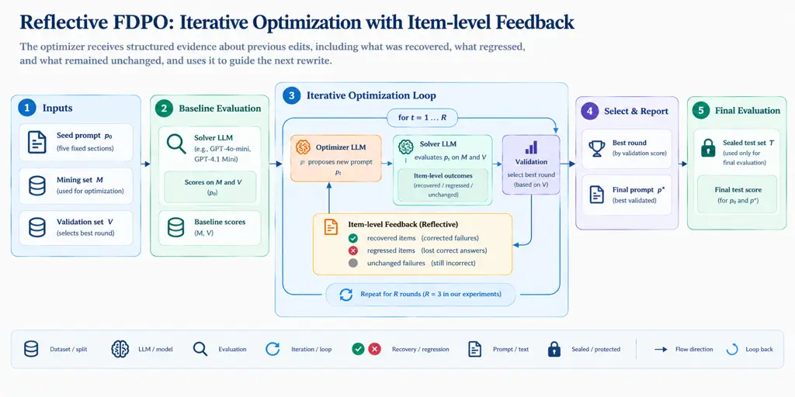

# Beyond Aggregate Accuracy: Item-Level Transitions in Prompt Optimization

Chinmoy Mitra    Tarek Mahmud Affiliation: Texas A&M
University–Kingsville, Kingsville, Texas, USA    Department of Computer
Science & Engineering    Rajshahi University of Engineering & Technology
   Rajshahi    Bangladesh

###### Abstract

Automatic prompt optimization (APO) uses feedback from model responses
to improve prompts automatically. However, its effectiveness is usually
measured through overall scores, which do not reveal which questions
become correct, which previously correct answers become wrong, or
whether improvements extend to unseen questions. We introduce Reflective
Feedback-Driven Prompt Optimization (RFDPO), a tool that tracks
recoveries (incorrect to correct), regressions (correct to incorrect),
and churn (all changed outcomes). RFDPO uses this feedback to guide
subsequent revisions and records prompt changes throughout optimization.
We evaluate RFDPO across five benchmarks covering law, knowledge,
instruction following, mathematics, and privacy, using GPT-5 as the
optimizer and GPT-4o-mini and GPT-4.1 Mini as solvers. Our results show
that overall accuracy can hide substantial changes: in five of nine
configurations, churn was at least five times the absolute net change,
and a single-item net change concealed up to 17 changed outcomes.
Average validation gains were 7.9 percentage points, compared with 5.2
points on held-out tests. An exploratory ablation showed that item-level
feedback reduced churn but did not improve test accuracy. These findings
motivate reporting recovery, regression, churn, and performance on
unseen data alongside overall accuracy.

## 1 Introduction



Figure 1: The RFDPO loop. The solver evaluates prompts on mining set
$`M`$ and validation set $`V`$. From the second round, the optimizer
receives the item-level effect of its previous edit before proposing a
new prompt. Every changed candidate is committed, and RFDPO returns the
candidate with the highest validation accuracy, breaking ties by mining
accuracy. Test set $`T`$ is excluded from feedback and selection and
evaluated only for the seed and the returned prompt.

Large language models (LLMs) are increasingly used for document
classification, information extraction, question answering, and
instruction-following tasks. Their behavior is commonly controlled
through natural-language prompts that specify task instructions,
relevant context, constraints, and expected output formats. However,
even minor changes in prompt wording or structure can substantially
affect model performance (Sclar et al., 2024). Developing effective
prompts therefore often requires repeated revisions and evaluations.
Automatic prompt optimization (APO) seeks to automate this process by
iteratively refining prompts using feedback from model outputs (Zhou et
al., 2023b; Yang et al., 2024; Pryzant et al., 2023). In LLM-based APO,
an optimizer proposes prompt revisions based on evaluation feedback,
while a solver executes the task using the revised instructions.

Despite advances in APO, evaluating optimization effectiveness remains
challenging. Existing studies primarily report aggregate performance
before and after optimization, such as accuracy improvements on
benchmark datasets. Although these metrics indicate whether a revised
prompt performs better overall, they do not reveal which previously
incorrect examples were fixed or which correct examples became
incorrect. This distinction is important for practical LLM applications,
where prompt revisions may introduce unexpected failures even when
overall performance improves. For example, Ma et al. (2024) found that
10.9% of individual predictions regressed across hosted LLM API updates
for toxicity detection, and previously correct predictions broke in
87.9% of cases where aggregate accuracy improved. Developers have also
reported difficulties debugging inconsistent LLM behavior across prompt
variations (Errica et al., 2025). These observations highlight the
importance of examining behavioral changes beyond aggregate scores.

Consider two prompt revisions that each improve accuracy by two
examples. The first may correct two previously incorrect examples
without introducing new failures, while the second may correct ten
examples but break eight previously correct ones. Although both
revisions achieve the same net improvement, their effects on individual
examples differ substantially. Aggregate accuracy alone cannot
distinguish these outcomes, making it difficult to assess the trade-offs
introduced by optimization or identify which changes should inform
subsequent revisions.

Another concern is whether improvements observed during optimization
generalize to unseen examples. APO methods commonly select prompts using
validation performance, and some also expose validation examples as
optimization feedback. Consequently, improvements on these tuning
examples may not translate into comparable improvements on held-out
data (Recht et al., 2019). Understanding prompt optimization therefore
requires examining both item-level behavioral changes and the
relationship between tuning and test performance.

To address these concerns, we introduce _Reflective Feedback-Driven
Prompt Optimization_ (RFDPO), an auditable prompt optimization tool that
explicitly tracks the effects of individual prompt revisions (Figure 1).
RFDPO identifies _recoveries_ (incorrect-to-correct transitions),
_regressions_ (correct-to-incorrect transitions), and _churn_ (the total
number of changed outcomes). Unlike approaches that primarily use
aggregate scores, current errors, or execution traces to guide
revisions, RFDPO returns the observed consequences of the preceding edit
to the optimizer. Beginning with the second round, this feedback
identifies recovered and regressed examples, their associated outputs,
and the prompt sections modified by the previous revision. RFDPO also
records prompt versions, evaluation outcomes, and resource consumption
to support analysis of optimization trajectories.

We evaluate RFDPO on five benchmarks—LegalBench-Hearsay, MMLU, IFBench,
AIME, and PUPA—using GPT-4o-mini and GPT-4.1 Mini as solver models. Our
results show that aggregate accuracy can conceal substantial behavioral
changes: in five of nine configurations, churn was at least five times
the absolute net change, and a single-item net change concealed up to 17
changed outcomes. Across edited-prompt returns, average held-out test
improvements were approximately 61% of average validation improvements.
We further examine how prompt revisions evolve across optimization
rounds. An exploratory ablation on LegalBench-Hearsay shows that
providing item-level feedback is associated with approximately 40% lower
mining-set churn at similar net gains, although it does not improve test
accuracy.

Our main contributions are:

- •
  An auditable prompt optimization tool. We develop RFDPO, which
  incorporates item-level recovery and regression feedback into
  iterative prompt revision and records prompt versions, evaluation
  outcomes, and resource consumption (§3).
- •
  An empirical characterization of prompt revisions. We analyze
  recovery, regression, and churn across five benchmarks, demonstrating
  how aggregate accuracy conceals changes in individual outcomes and how
  validation improvements differ from held-out test performance (§5).
- •
  An analysis of feedback and editing behavior. We examine prompt
  modifications across optimization rounds and conduct an exploratory
  ablation to investigate how item-level feedback affects outcome churn.
  Based on these findings, we discuss implications for evaluating and
  reporting APO behavior (§5.3, §6).

Overall, our findings motivate incorporating recovery, regression,
churn, and validation-to-test transfer into the evaluation of automatic
prompt optimization, alongside conventional aggregate performance
metrics.

## 2 Related Work

#### Automatic prompt optimization.

Automatic prompt optimization (APO) has been explored through discrete
token search (Shin et al., 2020), instruction generation and
selection (Zhou et al., 2023b), LLM-based optimization (Yang et al.,
2024), textual gradients (Pryzant et al., 2023; Yuksekgonul et al.,
2025), and evolutionary approaches (Guo et al., 2024; Fernando et al.,
2024). Other methods optimize multi-stage pipelines or structured
prompts (Opsahl-Ong et al., 2024; Schnabel and Neville, 2024; Khattab et
al., 2024). Among these, MPO (Sharma and Henley, 2026) uses the same
five-section prompt structure as RFDPO and applies section-local textual
gradients. More closely related to our feedback mechanism, GEPA (Agrawal
et al., 2026) uses reflective prompt mutation and Pareto-based
selection, while Trace2Policy (Zha et al., 2026) clusters errors and
applies a regression gate when refining decision rules. Self-feedback
methods also guide revisions through verbal critiques (Madaan et al.,
2023; Shinn et al., 2023). While existing methods use scored histories,
execution traces, or regression checks to guide optimization, RFDPO
explicitly returns the observed item-level consequences of the preceding
edit to the optimizer, identifying recovered and regressed examples and
the prompt sections modified. Unlike regression-gated approaches, RFDPO
retains changed candidates even when validation performance decreases,
allowing subsequent revisions to build on earlier edits while recording
their effects.

#### Behavioral evaluation and regression tracking.

Aggregate accuracy can conceal important changes in model behavior.
CheckList (Ribeiro et al., 2020) demonstrates the limitations of
aggregate evaluation, while negative flips have motivated
regression-free model updating (Yan et al., 2021). Paired outcome
comparisons also have a long history in statistical evaluation (McNemar,
1947). For LLM applications, Ma et al. (2024) highlight how previously
correct behavior can break following API updates. Related studies show
that small prompt changes can alter model predictions (Salinas and
Morstatter, 2024), motivating sensitivity and consistency
measures (Errica et al., 2025). However, some apparent prompt
sensitivity may result from evaluation artifacts (Hua et al., 2025).
Unlike evaluations of prompt perturbations or model updates, our work
tracks labeled recoveries and regressions across successive prompt
optimization revisions using benchmark-specific correctness criteria. We
additionally measure churn to distinguish the extent of behavioral
change from the net accuracy difference. This distinction is
particularly relevant when several recovered examples are offset by
regressions, leaving aggregate performance nearly unchanged.

#### Evaluation protocols and generalization.

Prompt optimization results depend on evaluation settings, including
data splits, solver models, baseline prompts, and feedback availability.
Consequently, published APO scores are not directly comparable across
different protocols (Appendix A.3, Table 6). Moreover, improvements on
tuning data may not generalize to unseen examples (Recht et al., 2019),
and benchmark contamination presents additional evaluation
concerns (Oren et al., 2023). Test-set exposure is particularly
relevant: Trace2Policy reports a refinement round informed by held-out
errors (Zha et al., 2026). In our diagnostic experiment, providing test
examples as feedback yielded an accuracy of 95.3%, compared with 73.4%
when they were withheld (Appendix D.2). This diagnostic illustrates the
importance of distinguishing optimization feedback from held-out
evaluation. RFDPO excludes test examples from feedback and prompt
selection within each optimization run. Because validation examples also
contribute feedback, we treat validation performance as a tuning measure
and separately report performance changes on test examples to examine
generalization.

## 3 RFDPO

We introduce Reflective Feedback-Driven Prompt Optimization (RFDPO) that
uses item-level evaluation outcomes to guide prompt revisions. RFDPO
extends conventional feedback-driven optimization by explicitly
identifying examples that become correct or incorrect after each
revision and returning these changes to the optimizer. Figure 1
illustrates the overall workflow.

### 3.1 Prompt Representation and Evaluation

RFDPO uses a solver LLM to execute tasks and an optimizer LLM to revise
prompts, without modifying the solver’s parameters. Following
MPO (Sharma and Henley, 2026), each prompt contains five sections:
System Role, Context, Task Details, Constraints, and Output Format.
These sections remain fixed throughout optimization, allowing RFDPO to
track which parts of a prompt are modified.

The tool operates on three disjoint sets: mining ($`M`$), validation
($`V`$), and test ($`T`$). Mining examples provide feedback for prompt
revisions, while validation examples are used for candidate selection
and, from the second round, also contribute feedback. The test set is
excluded from optimization and evaluated only with the initial and
returned prompts.

### 3.2 Item-Level Transition Tracking

RFDPO measures the effect of each revision by comparing example-level
correctness before and after an edit. Let $`c_{i}(p)\in\{0,1\}`$ denote
the observed correctness of example $`i`$ under prompt $`p`$. Given two
prompts $`p`$ and $`q`$ evaluated on the same example set $`D`$, we
define the recovered ($`R`$) and regressed ($`G`$) examples as

```math
R=\{i\in D:c_{i}(p)=0,\ c_{i}(q)=1\}, \tag{1}
```

```math
G=\{i\in D:c_{i}(p)=1,\ c_{i}(q)=0\}. \tag{2}
```

We further define the net change $`N`$ and churn $`C`$ as

```math
N=|R|-|G|,\qquad C=|R|+|G|. \tag{3}
```

The net change corresponds to $`|D|`$ times the accuracy difference,
whereas churn captures the total number of examples whose correctness
changes. Thus, revisions with the same accuracy change may exhibit
substantially different recovery and regression patterns, as illustrated
in Figure 2.

Figure 2: Example of item-level transitions. Three examples are
recovered and two regress, producing a net gain of one correct example
and a churn of five.

Transitions are measured between consecutive revisions on $`M`$ and
$`V`$, and between the initial and returned prompts on $`T`$, using
matched evaluable example IDs.

### 3.3 Feedback-Driven Prompt Revision

Algorithm 1 presents the RFDPO optimization procedure. The solver first
evaluates the initial prompt, and the optimizer generates a revision
using the observed outcomes. From the second round, the optimizer
additionally receives the recoveries and regressions caused by the
preceding revision on $`M`$ and $`V`$, together with the affected
questions, solver responses, gold answers, previous text of modified
sections, and validation accuracy changes.

Each valid, changed candidate is evaluated and committed as the starting
point for the next round, even if its validation accuracy decreases.
This allows subsequent revisions to build on earlier edits without a
regression-based acceptance gate.

Under best-validation selection, RFDPO returns the committed candidate
with the highest validation accuracy, breaking ties by mining accuracy
and candidate order. Once a candidate is committed, the seed is not
reconsidered; if no candidate is committed, the seed is retained.

RFDPO also records prompt versions, modified sections, item-level
outcomes, and model-call token usage and costs. These records support
analysis of optimization trajectories, behavioral changes, and resource
consumption.

1: seed $`p_{0}`$; disjoint $`M,V,T`$; Opt; Solve; round budget $`B`$

2:
$`s_{0},v_{0}\leftarrow\textsc{Solve}(p_{0},M),\ \textsc{Solve}(p_{0},V)`$

3: $`\tau_{0}\leftarrow\textsc{Solve}(p_{0},T)`$ $`\triangleright`$
baseline; measured only

4: $`\mathcal{H}\leftarrow\emptyset`$;
$`(p,s,v)\leftarrow(p_{0},s_{0},v_{0})`$; $`\rho\leftarrow\emptyset`$

5: for $`t=1`$ to $`B`$ do

6:   if skip threshold reached, or no mining failures then

7:    break

8:   end if

9:   $`q\leftarrow\textsc{Opt}(p,s,v,\rho)`$ $`\triangleright`$ mining
items and feedback

10:   if $`q=p`$ then

11:    continue

12:   end if

13:
  $`s^{\prime},v^{\prime}\leftarrow\textsc{Solve}(q,M),\ \textsc{Solve}(q,V)`$

14:
  $`\rho\leftarrow((R,G)(s\!\to\!s^{\prime}),(R,G)(v\!\to\!v^{\prime}))`$

15:   append $`(q,s^{\prime},v^{\prime})`$ to $`\mathcal{H}`$
$`\triangleright`$ no regression gate

16:   $`(p,s,v)\leftarrow(q,s^{\prime},v^{\prime})`$

17: end for

18: $`p^{*}\leftarrow p_{0}`$ if $`\mathcal{H}=\emptyset`$; otherwise
select from $`\mathcal{H}`$

19:    by validation accuracy, then mining accuracy

20: $`\tau^{*}\leftarrow\textsc{Solve}(p^{*},T)`$ $`\triangleright`$
measured only

21: return $`p^{*}`$, and $`(R,G)(\tau_{0}\!\to\!\tau^{*};T)`$

Algorithm 1 RFDPO optimization with edit-effect feedback

## 4 Experimental Setup

We evaluate 5 benchmarks using RFDPO and 2 solver models, covering
different task types, answer formats, and scoring criteria. Table 1
summarizes the benchmark configurations.

### 4.1 Benchmarks

We select five benchmarks covering diverse tasks, including legal
reasoning, general knowledge, instruction following, mathematical
reasoning, and privacy preservation.

LegalBench-Hearsay (Guha et al., 2023) evaluates binary classification
of statements under U.S. hearsay law.

MMLU (Hendrycks et al., 2021) consists of four-way multiple-choice
questions. We select six subjects: college mathematics, computer
security, econometrics, high school biology, philosophy, and
professional law, optimizing each independently and reporting
macro-averaged accuracy.

IFBench (Pyatkin et al., 2025) evaluates compliance with verifiable
output constraints. An example is correct only when all applicable
constraints are satisfied, using a programmatic verifier.  (Zhou et al.,
2023a).

AIME (Mathematical Association of America, 2025) evaluates mathematical
reasoning with integer answers between 0 and 999. We use problems from
2022–2024 for optimization and the 30 problems from 2025 for testing.

PUPA (Li et al., 2025) evaluates privacy-conscious delegation to an
external LLM. We optimize only the query-redaction prompt. Correctness
requires a composite score $`(\mathrm{quality}+1-\mathrm{leakage})/2`$
of at least $`0.7`$.

| Benchmark                           | Task                         | Reported metric                   | Train $`\rightarrow`$ $`M`$/$`V`$ | Test    |
| ----------------------------------- | ---------------------------- | --------------------------------- | --------------------------------- | ------- |
| LegalBench-Hearsay                  | Binary classification        | Accuracy                          | $`50\rightarrow 25/25`$           | 49      |
| MMLU (6 subjects)                   | Multiple choice              | Accuracy, macro-avg.              | $`50\rightarrow 25/25`$           | 66 each |
| IFBench                             | Instruction following        | Accuracy                          | $`40\rightarrow 26/14`$           | 42      |
| AIME (2022–24 $`\rightarrow`$ 2025) | Mathematical reasoning       | Accuracy                          | $`90\rightarrow 58/32`$           | 30      |
| PUPA                                | Privacy-conscious delegation | Accuracy (composite $`\geq 0.7`$) | $`60\rightarrow 30/30`$           | 40      |

Table 1: Benchmarks and evaluation splits. MMLU splits are per subject.
Test sizes precede provider-block exclusions.

### 4.2 Models and Experimental Protocol

We use GPT-4o-mini (OpenAI, 2024) and GPT-4.1 Mini (OpenAI, 2025b) as
solvers, both with temperature $`0`$, and GPT-5 (OpenAI, 2025a) as the
optimizer with temperature $`0.7`$. PUPA additionally uses a fixed
GPT-4.1 external model and GPT-5 as its quality judge.

All experiments use seed $`0`$ and at most three optimization rounds.
Optimization is skipped when initial mining accuracy reaches $`95\%`$,
except for PUPA.

The evaluation includes 19 baseline/final records: seven non-MMLU
configurations and twelve independently optimized MMLU subjects. Both
endpoints of each matched pair are evaluated within the same run. Two
earlier AIME runs, which used a 2,048-token output limit, are reported
separately in Appendix C.5 and excluded from the analyses.

We report test accuracy, validation accuracy changes, recovery,
regression, and churn. We also examine revision-level transitions and
recorded token consumption. Detailed run configurations, scoring
procedures, and optimizer instructions are provided in Appendices A,
A.2, and B.

## 5 Results

### 5.1 Item-Level Performance Changes

We first examine how prompt optimization affects individual test
examples. Table 2 reports test accuracy before and after optimization,
validation accuracy changes, and the number of recovered and regressed
examples. Figure 3 visualizes these transitions, while Appendix C.1
provides the individual accuracy records.

| Benchmark    | Solver       | Test accuracy (%) |       |              | $`\Delta V`$ (pp) | Test transitions |     |           |
| ------------ | ------------ | ----------------- | ----- | ------------ | ----------------- | ---------------- | --- | --------- | --- | --- | --- | --------- |
|              |              | Seed              | Final | $`\Delta T`$ |                   | $`               | R   | `$        | $`  | G   | `$  | Churn (%) |
| AIME         | GPT-4.1 Mini | 53.3              | 50.0  | $`-3.3`$     | $`+6.2`$          | 3                | 4   | 7 (23.3)  |
| PUPA         | GPT-4o-mini  | 55.3              | 65.8  | $`+10.5`$    | $`+13.3`$         | 7                | 3   | 10 (26.3) |
| PUPA         | GPT-4.1 Mini | 44.7              | 71.1  | $`+26.3`$    | $`+23.3`$         | 10               | 0   | 10 (26.3) |
| IFBench      | GPT-4o-mini  | 40.5              | 45.2  | $`+4.8`$     | $`+15.8`$         | 6                | 4   | 10 (23.8) |
| IFBench      | GPT-4.1 Mini | 42.9              | 66.7  | $`+23.8`$    | $`+14.3`$         | 12               | 2   | 14 (33.3) |
| Hearsay      | GPT-4o-mini  | 71.4              | 69.4  | $`-2.0`$     | $`+12.0`$         | 8                | 9   | 17 (34.7) |
| Hearsay      | GPT-4.1 Mini | 71.4              | 73.5  | $`+2.0`$     | $`+20.0`$         | 7                | 6   | 13 (26.5) |
| MMLU (macro) | GPT-4o-mini  | 75.1              | 77.2  | $`+2.0`$     | $`+5.5`$          | 31               | 23  | 54 (13.7) |
| MMLU (macro) | GPT-4.1 Mini | 81.0              | 83.3  | $`+2.3`$     | $`-0.7`$          | 17               | 8   | 25 (6.4)  |

Table 2: Seed-to-returned test accuracy, validation accuracy change, and
item-level transitions. Green rows indicate positive test changes. Churn
percentages use evaluated test items. MMLU accuracy is macro-averaged
across six subjects, while transitions sum 393 items. PUPA (38 items)
and professional law (63 items) exclude provider-blocked examples.
Earlier AIME runs with other solvers are described in Appendix C.5.

Figure 3: Recovered and regressed test examples across benchmarks and
solvers. Diamonds indicate net changes. MMLU transitions are aggregated
across six subjects.

Test accuracy increased in seven of the nine reported configurations,
with the largest gain of 26.3 percentage points on PUPA using GPT-4.1
Mini. However, aggregate improvements do not fully represent the changes
in individual predictions.

On LegalBench-Hearsay, a net change of only one correct example
concealed 13–17 changed outcomes, corresponding to 27–35% of the test
set. Similarly, IFBench with GPT-4.1 Mini recovered 12 examples but
regressed two, yielding a net gain of ten. On MMLU with GPT-4o-mini, 54
examples changed correctness despite a net improvement of only eight.

Across five configurations, churn was at least five times the absolute
net change. These results show that small accuracy differences can
conceal substantial recovery and regression, motivating item-level
analysis alongside aggregate performance.

### 5.2 Validation-to-Test Transfer

We next examine whether improvements observed during optimization
transfer to held-out test examples. Among the 19 records, 17 returned
edited prompts. Of these, validation accuracy increased in 12, remained
unchanged in three, and decreased in two. Table 3 summarizes the
corresponding validation and test changes.

| Edited-prompt returns | Runs | Val. $`\uparrow`$ | Val. $`\uparrow`$ test $`\downarrow`$ | $`\overline{\Delta V}`$ | $`\overline{\Delta T}`$ |
| --------------------- | ---- | ----------------- | ------------------------------------- | ----------------------- | ----------------------- |
| Non-MMLU              | 7    | 7                 | 2                                     | $`+15.0`$               | $`+8.9`$                |
| MMLU subjects         | 10   | 5                 | 1                                     | $`+2.9`$                | $`+2.6`$                |
| All matched           | 17   | 12                | 3                                     | $`\mathbf{+7.9}`$       | $`\mathbf{+5.2}`$       |

Table 3: Mean validation and test accuracy changes for 17 edited-prompt
returns; two additional records retained the seed. Means weight runs
equally and are reported in percentage points. The fourth column counts
runs with improved validation accuracy but decreased test accuracy.

Of the 12 runs with improved validation accuracy, nine also improved
test accuracy, while three lost one test example each. These cases
occurred on AIME with GPT-4.1 Mini ($`+6.2`$ validation, $`-3.3`$ test
points), Hearsay with GPT-4o-mini ($`+12.0`$, $`-2.0`$), and MMLU
computer security with GPT-4o-mini ($`+8.0`$, $`-1.5`$).

Across the 17 edited-prompt returns, validation accuracy improved by 7.9
percentage points on average, compared with 5.2 points on test data. The
test gain was therefore approximately 66% of the average validation
gain. The difference was smaller for MMLU ($`+2.9`$ validation versus
$`+2.6`$ test) than for the other benchmarks ($`+15.0`$ versus
$`+8.9`$). Since validation examples also provide optimization feedback,
these results describe the transfer of tuning gains to held-out examples
rather than improvements on an independent validation set.

#### Verbatim overlap.

Because the optimizer sees every failure and success on its working set,
it could inflate tuning accuracy by pasting those items, or paraphrases
of them, into the prompt. Its instructions therefore forbid reusing the
scenario of any shown item and prefer abstract rules (Appendix B). We
also checked whether returned prompts contained eight-word sequences
copied from benchmark examples. Sixteen of the 19 prompts showed no such
overlap. The remaining three contained either a generic mathematical
phrase or a True/False answer template (Appendix D.3). The check detects
only verbatim copying; paraphrase is guarded by the instruction alone.

### 5.3 Prompt Revision Behavior

We analyze how the optimizer modifies prompts across successive rounds.
In round 1, where no effect report of a previous edit is available, the
optimizer modified an average of 4.3 of the five prompt sections,
compared with 1.3 in rounds 2–3, where it receives recovery and
regression feedback on its previous edit. Revisions thus became more
localized after the initial round.

#### Effect-report ablation (exploratory).

To see what the effect report contributes beyond the optimization round,
we ran an exploratory ablation on LegalBench-Hearsay using GPT-4o-mini.
Both conditions replayed the same round-1 prompt and continued through
rounds 2 and 3. They differed in whether the optimizer received the
item-level effect report and its accompanying instructions
(Appendix B.1). We performed five runs per condition (Appendix C.4).

Without the report, round-2 revisions already modified only 1.6 prompt
sections on average, compared with 2.0 when the report was included.
Thus, narrower edits also occur without the report.

The report did change the number of changed outcomes. With it, an
average of 3.1 mining examples changed correctness per round, compared
with 5.2 without it ($`p=0.024`$, exact permutation test over runs,
uncorrected). This average pools rounds 2 and 3, and round 3 starts from
different parent prompts in the two conditions. Both conditions achieved
similar net gains of 0.3 and 0.2 mining examples per round,
respectively.

Test accuracy fell in both conditions, by 5.3 and 5.7 percentage points
with and without the report, respectively, so neither condition improved
test accuracy. We therefore treat the churn difference as exploratory
evidence about what item-level feedback changes in this setting, not as
evidence that it improves accuracy.

### 5.4 Resource Consumption

Finally, we examine the computational resources recorded during
optimization. Table 4 summarizes optimizer calls, token consumption, and
logged inference costs across the matched configurations.

| Benchmark           | Solver       | Optimizer calls | Optimizer input (K) | Optimizer output (K) | All-role tokens (K) | Logged cost (USD) |
| ------------------- | ------------ | --------------- | ------------------- | -------------------- | ------------------- | ----------------- |
| AIME                | GPT-4.1 Mini | 3               | 498.4               | 5.4                  | 2,666.6             | 3.81              |
| PUPA                | GPT-4o-mini  | 3               | 73.8                | 13.7                 | 1,651.2             | 4.44              |
| PUPA                | GPT-4.1 Mini | 3               | 68.5                | 15.6                 | 1,570.4             | 4.80              |
| IFBench             | GPT-4o-mini  | 3               | 23.4                | 12.0                 | 300.9               | 0.21              |
| IFBench             | GPT-4.1 Mini | 3               | 20.2                | 10.1                 | 240.1               | 0.35              |
| Hearsay             | GPT-4o-mini  | 3               | 17.1                | 14.9                 | 241.3               | 0.22              |
| Hearsay             | GPT-4.1 Mini | 3               | 14.1                | 20.5                 | 246.6               | 0.37              |
| MMLU (six subjects) | GPT-4o-mini  | 18              | 123.0               | 77.1                 | 2,014.2             | 1.32              |
| MMLU (six subjects) | GPT-4.1 Mini | 11              | 75.7                | 34.2                 | 1,170.8             | 1.10              |

Table 4: Inference consumption across matched configurations. K denotes
1,000 tokens. All-role totals include solver, optimizer, and applicable
external-model and judge calls, including seed and final evaluations.
Costs use configured prices. MMLU aggregates six subjects; two GPT-4.1
Mini subject runs skipped optimization.

Resource consumption varied considerably across tasks. Three optimizer
calls required approximately 498K input tokens for AIME with GPT-4.1
Mini, compared with 14K for Hearsay, a difference of roughly 35 times.
PUPA incurred additional costs from external-model responses and quality
judgments, while MMLU totals aggregate independent optimization runs
across six subjects.

These measurements document the resource requirements of RFDPO across
different benchmark configurations.

## 6 Discussion

#### Beyond aggregate accuracy.

Our findings highlight the limitations of evaluating prompt optimization
solely through aggregate accuracy. In five of the nine configurations,
churn was at least five times the absolute net change, with a
single-item improvement or decline concealing up to 17 changed outcomes.
Such changes are important in practice because an optimized prompt may
introduce failures on examples that previously worked. Recovery and
regression tracking makes these changes visible, allowing developers to
distinguish newly corrected examples from newly introduced failures.
This aligns with regression testing for LLM applications, where
previously correct behavior must be monitored as systems evolve (Ma et
al., 2024).

#### Role of item-level feedback.

The optimizer made more localized revisions in later rounds, but our
ablation shows that this behavior cannot be attributed solely to the
effect report. Nevertheless, providing item-level feedback reduced
average mining-set churn from 5.2 to 3.1 examples per round while
maintaining similar net gains. This suggests that explicit recovery and
regression feedback may help limit unintended changes without
necessarily improving overall accuracy. However, the evidence remains
exploratory, as the ablation covers one benchmark and solver with five
runs per condition, pools two rounds, and includes additional optimizer
instructions with the report. Test accuracy declined in both conditions,
so we do not interpret the reduced churn as improved generalization.

#### Generalization and reporting implications.

Improvements during optimization do not necessarily transfer to unseen
examples. Across edited-prompt returns, average test gains were
approximately 61% of average validation gains, and four runs experienced
test declines despite validation improvements. Because validation
examples also guide optimization, their performance should be
interpreted as tuning results rather than independent evidence of
generalization. We therefore recommend reporting recovery, regression,
and churn alongside validation and test accuracy, prompt versions,
evaluation exclusions, and resource consumption. These measurements can
be obtained from existing item-level evaluations without additional
solver calls. RFDPO automatically records this information, supporting
more transparent analysis of prompt optimization (Appendix D.4).

## 7 Conclusion

Aggregate accuracy captures the overall effect of prompt optimization
but obscures which examples improve or regress. We presented RFDPO, an
auditable optimizer that tracks item-level recoveries, regressions, and
churn and incorporates this feedback into subsequent revisions. Across
five benchmarks and two solver models, a single-item net change
concealed up to 17 changed outcomes, while churn was at least five times
the absolute net change in five of nine configurations. Average held-out
test gains were approximately 61% of validation gains. An exploratory
Hearsay ablation showed that item-level feedback reduced churn at
similar net gains but did not improve test accuracy. These findings
highlight that prompt optimization can introduce failures despite
aggregate improvements, motivating the reporting of recovery,
regression, churn, and validation-to-test transfer alongside accuracy.

## Limitations

#### Evaluation scope.

Our evaluation covers five benchmarks, two closed-weight solvers, and
one optimizer, with a single seed and relatively small test sets. We did
not evaluate open-weight models or longer optimization trajectories.
Differences in selection rules and evaluation configurations also limit
cross-model comparisons.

#### Evaluation variability.

Observed recovery and regression may partly reflect model output
variability rather than prompt changes, as shown by unchanged-prompt
re-evaluations. PUPA additionally relies on an LLM judge, while the
IFBench verifier supports only a subset of constraint types.

#### Feedback ablation.

Our exploratory ablation covers one benchmark and solver, with five runs
per condition. It combines two optimization rounds, and the effect
report includes additional optimizer instructions. Although feedback
reduced mining-set churn, it did not improve test accuracy, and its
effect may not generalize.

#### Generalization and data exposure.

Validation examples are used for both feedback and selection,
potentially inflating tuning gains. Test examples remain excluded from
feedback within each run, but small test sets limit generalization
claims. Our verbatim-overlap check also cannot detect paraphrased
copying or semantic memorization.

## Ethical Considerations

Data come from public benchmarks, resplit as described in Table 1. PUPA
contains personal information from public user–LLM conversations. Hosted
solver and optimizer APIs receive the original queries during evaluation
and feedback; redaction protects only the designated external model.
String-matched leakage does not capture paraphrased or inferred
information. Released traces would contain item IDs and outcomes only,
without raw inputs, predictions, or gold text (Appendix D.4).

## References

- Agrawal et al. (2026) L. A. Agrawal, S. Tan, D. Soylu, N. Ziems, R.
  Khare, K. Opsahl-Ong, A. Singhvi, H. Shandilya, M. J. Ryan, M.
  Jiang, C. Potts, K. Sen, A. G. Dimakis, I. Stoica, D. Klein, M.
  Zaharia, and O. Khattab GEPA: reflective prompt evolution can
  outperform reinforcement learning. In International Conference on
  Learning Representations (ICLR), Cited by: Table 6, Table 6, §2.
- Anthropic (2025) Anthropic Introducing Claude Haiku 4.5. Note:
  [https://www.anthropic.com/news/claude-haiku-4-5](https://www.anthropic.com/news/claude-haiku-4-5)Accessed
  2026 Cited by: §C.5.
- Chen et al. (2025) K. Chen, Y. Wang, H. Almosapeeh, and H. Wang
  Knowing how to edit: reliable evaluation signals for diagnosing and
  optimizing prompts at query level. External Links: 2511.19829 Cited
  by: Table 6.
- Errica et al. (2025) F. Errica, D. Sanvito, G. Siracusano, and R.
  Bifulco What did I do wrong? quantifying LLMs’ sensitivity and
  consistency to prompt engineering. In Proceedings of the 2025
  Conference of the Nations of the Americas Chapter of the Association
  for Computational Linguistics: Human Language Technologies (Volume 1:
  Long Papers), Albuquerque, New Mexico, pp. 1543–1558. External Links:
  [Document](https://dx.doi.org/10.18653/v1/2025.naacl-long.73),
  2406.12334 Cited by: §1, §2.
- Fernando et al. (2024) C. Fernando, D. Banarse, H. Michalewski, S.
  Osindero, and T. Rocktäschel Promptbreeder: self-referential
  self-improvement via prompt evolution. In Proceedings of the 41st
  International Conference on Machine Learning (ICML), Cited by: §2.
- Guha et al. (2023) N. Guha, J. Nyarko, D. E. Ho, C. Ré, A. Chilton, et
  al. LegalBench: a collaboratively built benchmark for measuring legal
  reasoning in large language models. In Advances in Neural Information
  Processing Systems (NeurIPS), Datasets and Benchmarks Track, External
  Links: 2308.11462 Cited by: §4.1.
- Guo et al. (2024) Q. Guo, R. Wang, J. Guo, B. Li, K. Song, X. Tan, G.
  Liu, J. Bian, and Y. Yang Connecting large language models with
  evolutionary algorithms yields powerful prompt optimizers. In The
  Twelfth International Conference on Learning Representations (ICLR),
  External Links: 2309.08532 Cited by: §2.
- Hendrycks et al. (2021) D. Hendrycks, C. Burns, S. Basart, A. Zou, M.
  Mazeika, D. Song, and J. Steinhardt Measuring massive multitask
  language understanding. In International Conference on Learning
  Representations (ICLR), External Links: 2009.03300 Cited by: §4.1.
- Hua et al. (2025) A. Hua, K. Tang, C. Gu, J. Gu, E. Wong, and Y. Qin
  Flaw or artifact? rethinking prompt sensitivity in evaluating LLMs. In
  Proceedings of the 2025 Conference on Empirical Methods in Natural
  Language Processing (EMNLP), External Links: 2509.01790 Cited by: §2.
- Khattab et al. (2024) O. Khattab, A. Singhvi, P. Maheshwari, Z.
  Zhang, K. Santhanam, S. Vardhamanan, S. Haq, A. Sharma, T. T.
  Joshi, H. Moazam, H. Miller, M. Zaharia, and C. Potts DSPy: compiling
  declarative language model calls into state-of-the-art pipelines. In
  International Conference on Learning Representations (ICLR), External
  Links: 2310.03714 Cited by: §2.
- Li et al. (2025) S. Li, V. C. Raghuram, O. Khattab, J. Hirschberg,
  and Z. Yu PAPILLON: privacy preservation from internet-based and local
  language model ensembles. In Proceedings of the 2025 Conference of the
  Nations of the Americas Chapter of the Association for Computational
  Linguistics (NAACL), External Links: 2410.17127 Cited by: §4.1.
- Ma et al. (2024) W. Ma, C. Yang, and C. Kästner (Why) is my prompt
  getting worse? rethinking regression testing for evolving LLM APIs. In
  Proceedings of the 3rd IEEE/ACM International Conference on AI
  Engineering – Software Engineering for AI (CAIN), pp. 166–171.
  External Links:
  [Document](https://dx.doi.org/10.1145/3644815.3644950), 2311.11123
  Cited by: §1, §2, §6.
- Madaan et al. (2023) A. Madaan, N. Tandon, P. Gupta, S. Hallinan, L.
  Gao, S. Wiegreffe, U. Alon, N. Dziri, et al. Self-refine: iterative
  refinement with self-feedback. In Advances in Neural Information
  Processing Systems (NeurIPS), External Links: 2303.17651 Cited by: §2.
- Mathematical Association of America (2025) Mathematical Association of
  America American Invitational Mathematics Examination (AIME). Note:
  [https://maa.org/maa-invitational-competitions/](https://maa.org/maa-invitational-competitions/)Problems
  for 2022–2025 editions; accessed 2026 Cited by: §4.1.
- McNemar (1947) Q. McNemar Note on the sampling error of the difference
  between correlated proportions or percentages. Psychometrika 12 (2),
  pp. 153–157. External Links:
  [Document](https://dx.doi.org/10.1007/BF02295996) Cited by: §2.
- OpenAI (2024) OpenAI GPT-4o system card. External Links: 2410.21276
  Cited by: §4.2.
- OpenAI (2025a) OpenAI GPT-5 system card. Note:
  [https://openai.com/index/gpt-5-system-card/](https://openai.com/index/gpt-5-system-card/)Accessed
  2026 Cited by: §4.2.
- OpenAI (2025b) OpenAI Introducing GPT-4.1 in the API. Note:
  [https://openai.com/index/gpt-4-1/](https://openai.com/index/gpt-4-1/)Accessed
  2026 Cited by: §4.2.
- Opsahl-Ong et al. (2024) K. Opsahl-Ong, M. J. Ryan, J. Purtell, D.
  Broman, C. Potts, M. Zaharia, and O. Khattab Optimizing instructions
  and demonstrations for multi-stage language model programs. In
  Proceedings of the 2024 Conference on Empirical Methods in Natural
  Language Processing (EMNLP), pp. 9340–9366. Cited by: §2.
- Oren et al. (2023) Y. Oren, N. Meister, N. Chatterji, F. Ladhak,
  and T. B. Hashimoto Proving test set contamination in black box
  language models. External Links: 2310.17623 Cited by: §2.
- Pryzant et al. (2023) R. Pryzant, D. Iter, J. Li, Y. Lee, C. Zhu,
  and M. Zeng Automatic prompt optimization with “gradient descent” and
  beam search. In Proceedings of the 2023 Conference on Empirical
  Methods in Natural Language Processing (EMNLP), External Links:
  2305.03495 Cited by: §1, §2.
- Pyatkin et al. (2025) V. Pyatkin, S. Malik, V. Graf, H. Ivison, S.
  Huang, P. Dasigi, N. Lambert, and H. Hajishirzi Generalizing
  verifiable instruction following. In Advances in Neural Information
  Processing Systems (NeurIPS), Datasets and Benchmarks Track, External
  Links: 2507.02833 Cited by: §4.1.
- Recht et al. (2019) B. Recht, R. Roelofs, L. Schmidt, and V. Shankar
  Do ImageNet classifiers generalize to ImageNet?. In Proceedings of the
  36th International Conference on Machine Learning (ICML), External
  Links: 1902.10811 Cited by: §1, §2.
- Ribeiro et al. (2020) M. T. Ribeiro, T. Wu, C. Guestrin, and S. Singh
  Beyond accuracy: behavioral testing of NLP models with CheckList. In
  Proceedings of the 58th Annual Meeting of the Association for
  Computational Linguistics (ACL), pp. 4902–4912. External Links:
  2005.04118 Cited by: §2.
- Salinas and Morstatter (2024) A. Salinas and F. Morstatter The
  butterfly effect of altering prompts: how small changes and jailbreaks
  affect large language model performance. External Links: 2401.03729
  Cited by: §2.
- Schnabel and Neville (2024) T. Schnabel and J. Neville SAMMO: a
  general-purpose framework for prompt optimization. In Findings of the
  Association for Computational Linguistics: EMNLP 2024, External Links:
  2404.02319 Cited by: §2.
- Sclar et al. (2024) M. Sclar, Y. Choi, Y. Tsvetkov, and A. Suhr
  Quantifying language models’ sensitivity to spurious features in
  prompt design or: how I learned to start worrying about prompt
  formatting. In International Conference on Learning Representations
  (ICLR), External Links: 2310.11324 Cited by: §1.
- Sharma and Henley (2026) P. Sharma and A. Z. Henley Modular prompt
  optimization: optimizing structured prompts with section-local textual
  gradients. External Links: 2601.04055 Cited by: Table 6, §2, §3.1.
- Shin et al. (2020) T. Shin, Y. Razeghi, R. L. Logan IV, E. Wallace,
  and S. Singh AutoPrompt: eliciting knowledge from language models with
  automatically generated prompts. In Proceedings of the 2020 Conference
  on Empirical Methods in Natural Language Processing (EMNLP), External
  Links: 2010.15980 Cited by: §2.
- Shinn et al. (2023) N. Shinn, F. Cassano, E. Berman, A. Gopinath, K.
  Narasimhan, and S. Yao Reflexion: language agents with verbal
  reinforcement learning. In Advances in Neural Information Processing
  Systems (NeurIPS), External Links: 2303.11366 Cited by: §2.
- Yan et al. (2021) S. Yan, Y. Xiong, K. Kundu, S. Yang, S. Deng, M.
  Wang, W. Xia, and S. Soatto Positive-congruent training: towards
  regression-free model updates. In Proceedings of the IEEE/CVF
  Conference on Computer Vision and Pattern Recognition (CVPR), External
  Links: 2011.09161 Cited by: §2.
- Yang et al. (2024) C. Yang, X. Wang, Y. Lu, H. Liu, Q. V. Le, D. Zhou,
  and X. Chen Large language models as optimizers. In International
  Conference on Learning Representations (ICLR), External Links:
  2309.03409 Cited by: §1, §2.
- Yuksekgonul et al. (2025) M. Yuksekgonul, F. Bianchi, J. Boen, S.
  Liu, P. Lu, Z. Huang, C. Guestrin, and J. Zou Optimizing generative AI
  by backpropagating language model feedback. Nature 639, pp. 609–616.
  Cited by: §2.
- Zha et al. (2026) J. Zha, J. Wang, C. Zhou, and X. Song Trace2Policy:
  from expert behavior traces to self-evolving decision agents. External
  Links: 2606.10457 Cited by: Table 6, Table 6, §2, §2.
- Zhou et al. (2023a) J. Zhou, T. Lu, S. Mishra, S. Brahma, S. Basu, Y.
  Luan, D. Zhou, and L. Hou Instruction-following evaluation for large
  language models. External Links: 2311.07911 Cited by: §4.1.
- Zhou et al. (2023b) Y. Zhou, A. I. Muresanu, Z. Han, K. Paster, S.
  Pitis, H. Chan, and J. Ba Large language models are human-level prompt
  engineers. In International Conference on Learning Representations
  (ICLR), External Links: 2211.01910 Cited by: §1, §2.

Appendix Contents

ARun Configuration and Scoring . A

A.1Analysis Population and Settings . A.1

A.2Scoring and Evaluable Items . A.2

A.3Related-Work Protocol Comparison . A.3

BPrompt and Feedback Specification . B

B.1Optimizer System Prompt . B.1

B.2Task-Specific Insertions . B.2

B.3Seed Prompt Example . B.3

B.4Per-Round Feedback . B.4

CDetailed Results and Trajectories . C

C.1Paired Accuracy and Test Transitions . C.1

C.2Round-by-Round Trajectories . C.2

C.3Worked Prompt Changes . C.3

C.4Effect-Report Ablation . C.4

C.5Additional AIME Runs . C.5

DEvaluation Checks and Artifacts . D

D.1Re-evaluation of an Unchanged Prompt . D.1

D.2Test-Exposure Diagnostic . D.2

D.3Verbatim-Overlap Check . D.3

D.4Artifacts and Reproducibility . D.4

## Appendix A Run Configuration and Scoring

### A.1 Analysis Population and Settings

The analysis uses 19 completed records: seven non-MMLU runs and twelve
independently optimized MMLU subjects, taking the latest completed
record within each fixed run group.

All recorded solvers use temperature 0.0 and the GPT-5 optimizer uses
0.7, with at most three rounds and one optimizer call per round. Table 5
gives the configured solver output limits and splits for both solvers.
The response ledgers identify GPT-4o-mini-2024-07-18,
GPT-4.1-mini-2025-04-14, and GPT-5-2025-08-07; some entries retain model
aliases rather than dated identifiers. PUPA additionally uses GPT-4.1 as
its fixed external model and GPT-5 as judge.

| Benchmark          | Solver   | Assigned $`M/V`$ | Val. fraction | Solver limit |
| ------------------ | -------- | ---------------- | ------------- | ------------ |
| AIME               | 4.1 Mini | 58/32            | 0.35          | 16,000       |
| PUPA               | 4o-mini  | 30/30            | 0.50          | 2,048        |
| PUPA               | 4.1 Mini | 30/30            | 0.50          | 2,048        |
| IFBench            | 4o-mini  | 26/14            | 0.35          | 2,048        |
| IFBench            | 4.1 Mini | 26/14            | 0.35          | 4,096        |
| Hearsay            | both     | 25/25            | 0.50          | 2,048        |
| MMLU (per subject) | 4o-mini  | 25/25            | 0.50          | 2,048        |
| MMLU (per subject) | 4.1 Mini | 25/25            | 0.50          | 2,048        |

Table 5: Recorded settings for the matched runs. Solver limit is the
configured maximum output tokens, not observed consumption. Assigned
pools precede provider-block exclusions: GPT-4o-mini IFBench evaluates
19 validation items and GPT-4.1 Mini evaluates 25 mining items. Actual
resource use is in Table 4.

#### Candidate handling.

Every changed candidate is committed and becomes the next parent.
Best-validation selection compares committed candidates, breaking ties
by mining accuracy and then retaining the earlier candidate; the seed is
excluded once a candidate commits. Eight matched runs used final-round
selection instead (GPT-4o-mini PUPA, IFBench, and six MMLU subjects).
Optimization is skipped at seed mining accuracy $`\geq 0.95`$, except on
PUPA. This retained the seed for GPT-4.1 Mini college mathematics and
biology. IFBench with GPT-4.1 Mini proposed no change in round 2.

### A.2 Scoring and Evaluable Items

#### Answer extraction.

MMLU and Hearsay outputs are scored by extracting Answer: \<letter\> and
Answer: Yes/No, respectively, and comparing with the gold label. AIME
uses exact integer match on \#### \<number\> (0–999). Visible reasoning
before these answer markers is not itself scored. IFBench checks only
the content following FINAL RESPONSE:; an item passes when every
supported constraint is satisfied. The verifier implements 32 of the 83
constraint types in IFEval and IFBench combined, and evaluated items use
the supported types.

#### PUPA pipeline and metrics.

The optimized solver prompt rewrites a private query into a redacted
request. Fixed GPT-4.1 answers that request; the solver then synthesizes
a final answer under a fixed instruction, using the original query and
external response. Leakage is the fraction of annotated PII strings
present in the redacted request. A GPT-5 judge scores final-answer
quality against the reference on a 0–1 scale, with up to 4,096
completion tokens. An item is correct when the composite
$`(\text{quality}+1-\text{leakage})/2`$ reaches 0.7; reported PUPA
accuracy uses this criterion. Only the rewrite prompt is optimized.

#### Denominators and accounting.

Provider-blocked items are excluded rather than scored as incorrect:
PUPA evaluates 38 of 40 test items and MMLU professional law 63 of 66,
identically for both solvers. Transitions are computed over common
evaluated IDs, so $`\Delta\mathrm{acc}=(|R|-|G|)/|D|`$ and
$`C=|R|+|G|=|N|+2\min(|R|,|G|)`$; MMLU transitions sum subjects while
its accuracy is macro-averaged.

### A.3 Related-Work Protocol Comparison

Table 6 expands the protocol comparison in Related Work. Rows differ in
task variant, baseline, data, models, and feedback, so the reported
changes describe each protocol rather than rank optimizers.

|                                                                             |                                                                                             |                                                        |                                                  |                                                                  |
| --------------------------------------------------------------------------- | ------------------------------------------------------------------------------------------- | ------------------------------------------------------ | ------------------------------------------------ | ---------------------------------------------------------------- |
| Work                                                                        | Items: optimization / validation / test                                                     | Solver models                                          | Feedback and optimizer                           | Reported change (%)                                              |
| LegalBench-Hearsay                                                          |                                                                                             |                                                        |                                                  |                                                                  |
| Trace2Policy, human-written refinements (Zha et al., 2026)                  | 30 iteration / 64 held-out, from 94 items                                                   | Claude Opus 4.6, Haiku 4.5, Kimi K2.5                  | human curator; round 1 also read held-out errors | Haiku 4.5: $`79.7\rightarrow 93.8`$                              |
| Trace2Policy, LLM-written refinements (Zha et al., 2026)                    | 61 test items                                                                               | DeepSeek-v3.2, Kimi K2.5, Kimi K2.6 (mean)             | LLM, with a regression gate                      | $`69.4\rightarrow 72.7`$                                         |
| Chen et al. (2025) (definition classification, a different LegalBench task) | 100 train / 100 test (50 / 50 if under 200 items)                                           | LLaMA-3-8B, LLaMA-3.1-8B, GPT-4o                       | evaluator-guided rewriting, up to 3 iterations   | $`55\rightarrow 70`$; $`56\rightarrow 69`$; $`83\rightarrow 90`$ |
| This paper                                                                  | 25 / 25 / 49, recut from 99 items                                                           | GPT-4o-mini, GPT-4.1 Mini                              | GPT-5, item-level effect report                  | $`71.4\rightarrow 69.4`$; $`71.4\rightarrow 73.5`$               |
| MMLU                                                                        |                                                                                             |                                                        |                                                  |                                                                  |
| MPO (Sharma and Henley, 2026)                                               | 3,000 train / 1,400 test, all subjects                                                      | LLaMA-3-8B-Instruct, Mistral-7B-Instruct               | critic LLM, section-local gradients              | $`57.21\rightarrow 61.50`$; $`53.79\rightarrow 55.50`$           |
| This paper                                                                  | six subjects, 25 / 25 / 66 each                                                             | GPT-4o-mini, GPT-4.1 Mini                              | GPT-5, item-level effect report                  | $`75.1\rightarrow 77.2`$; $`81.0\rightarrow 83.3`$               |
| AIME                                                                        |                                                                                             |                                                        |                                                  |                                                                  |
| GEPA (Agrawal et al., 2026)                                                 | 2022–24 problems (90) split into train and validation; test: 2025, 30 problems, 5 runs each | Qwen3-8B, GPT-4.1 Mini; DSPy chain-of-thought baseline | reflective LLM, Pareto selection                 | $`27.33\rightarrow 32.00`$; $`49.33\rightarrow 59.33`$           |
| This paper                                                                  | 58 / 32 / 30; bare seed prompt                                                              | GPT-4.1 Mini                                           | GPT-5, item-level effect report                  | $`53.3\rightarrow 50.0`$                                         |
| PUPA                                                                        |                                                                                             |                                                        |                                                  |                                                                  |
| GEPA (Agrawal et al., 2026)                                                 | 111 / 111 / 221                                                                             | Qwen3-8B, GPT-4.1 Mini                                 | reflective LLM, Pareto selection                 | $`80.82\rightarrow 91.85`$; $`78.57\rightarrow 94.47`$           |
| This paper                                                                  | 30 / 30 / 40 (38 scored)                                                                    | GPT-4o-mini, GPT-4.1 Mini                              | GPT-5, item-level effect report                  | $`68.5\rightarrow 79.9`$; $`68.2\rightarrow 80.7`$               |

Table 6: Published evaluation protocols on shared benchmarks. Rows
differ in data, solver, baseline prompt, feedback access, and evaluation
budget. Changes follow solver-column order; PUPA changes are composite
scores, as reported by GEPA.

## Appendix B Prompt and Feedback Specification

The specification below comprises the optimizer system prompt,
task-specific insertions, and per-round feedback. The quoted template is
the best-validation version; runs using final-round selection received
an earlier version stating that the last round is returned.

### B.1 Optimizer System Prompt

{task_description} and {max_rounds} are filled per benchmark and run.
The template’s wording is preserved, with reflowed lines and ASCII
arrows typeset as $`\rightarrow`$.


#### No-report variant.

In the ablation of Appendix C.4, the no-report arm receives the same
prompt without points 2, 3, and 5, without the effect-report entry in
the list of inputs, and without the references to validation items in
the example rule. Point 4 keeps its shipping rule without the remark on
validation accuracy, and the response-format note asks for a hypothesis
about the failures instead of a diagnosis of the previous edit. The user
message contains no effect report and no promise of one. Everything else
is identical.

### B.2 Task-Specific Insertions

{task_description} supplies fixed task-specific guidance, quoted below.
The MMLU guidance distinguishes computational from recall subjects.


### B.3 Seed Prompt Example

The AIME seed illustrates the five-section schema. Other benchmark seeds
are included in the source archive. Only line breaks are adjusted below.

```ltx_verbatim
## System Role
You are a competition mathematician.

## Context
You will be given a competition-style math problem whose answer is always
an integer between 0 and 999.

## Task Details
Solve the problem.

## Constraints
The final answer must be an integer between 0 and 999.

## Output Format
After your work, write the final numeric answer on its own line in exactly
this form:
#### <number>
```

### B.4 Per-Round Feedback

The user message contains the iteration number and budget, the current
prompt, every mining failure (question, wrong output, gold answer), and
every mining success (question and gold). From round 2, its effect
report adds the previous text of changed sections, recovered and
regressed items on both $`M`$ and $`V`$, and before/after validation
accuracy. Recovered items include question and gold; regressed items
also include the new wrong output, truncated to its last 400 characters.
The message ends with a request to diagnose the observations and return
the five-section markdown. The parser discards an optional \## Analysis
preamble; a no-change response does not commit a new version. IFBench
pins Output Format to preserve its answer marker; the other four
sections remain editable.

## Appendix C Detailed Results and Trajectories

The following records expand the aggregate results: paired accuracy and
test transitions, then round-level tuning outcomes, followed by prompt
excerpts illustrating the recorded revisions.

### C.1 Paired Accuracy and Test Transitions

Table 7 lists all 19 matched records, including each MMLU subject. It
combines the tuning/test accuracy pairs with the test recoveries and
regressions. Summing the subject counts gives the MMLU totals in
Table 2. “Edited” distinguishes returned candidates from retained seeds,
not an improvement gate.

|                      |          |        |                                              |              |                                        |              |           |
| -------------------- | -------- | ------ | -------------------------------------------- | ------------ | -------------------------------------- | ------------ | --------- |
| Run                  | Solver   | Edited | Validation (%) seed $`\rightarrow`$ returned | $`\Delta V`$ | Test (%) seed $`\rightarrow`$ returned | $`\Delta T`$ | Rec./Reg. |
| AIME                 | 4.1 Mini | yes    | 62.5 $`\rightarrow`$ 68.8                    | $`+6.2`$     | 53.3 $`\rightarrow`$ 50.0              | $`-3.3`$     | 3/4       |
| PUPA                 | 4o-mini  | yes    | 40.0 $`\rightarrow`$ 53.3                    | $`+13.3`$    | 55.3 $`\rightarrow`$ 65.8              | $`+10.5`$    | 7/3       |
| PUPA                 | 4.1 Mini | yes    | 46.7 $`\rightarrow`$ 70.0                    | $`+23.3`$    | 44.7 $`\rightarrow`$ 71.1              | $`+26.3`$    | 10/0      |
| IFBench              | 4o-mini  | yes    | 36.8 $`\rightarrow`$ 52.6                    | $`+15.8`$    | 40.5 $`\rightarrow`$ 45.2              | $`+4.8`$     | 6/4       |
| IFBench              | 4.1 Mini | yes    | 57.1 $`\rightarrow`$ 71.4                    | $`+14.3`$    | 42.9 $`\rightarrow`$ 66.7              | $`+23.8`$    | 12/2      |
| Hearsay              | 4o-mini  | yes    | 68.0 $`\rightarrow`$ 80.0                    | $`+12.0`$    | 71.4 $`\rightarrow`$ 69.4              | $`-2.0`$     | 8/9       |
| Hearsay              | 4.1 Mini | yes    | 76.0 $`\rightarrow`$ 96.0                    | $`+20.0`$    | 71.4 $`\rightarrow`$ 73.5              | $`+2.0`$     | 7/6       |
| MMLU college math.   | 4o-mini  | yes    | 84.0 $`\rightarrow`$ 80.0                    | $`-4.0`$     | 75.8 $`\rightarrow`$ 77.3              | $`+1.5`$     | 6/5       |
| MMLU computer sec.   | 4o-mini  | yes    | 72.0 $`\rightarrow`$ 80.0                    | $`+8.0`$     | 90.9 $`\rightarrow`$ 89.4              | $`-1.5`$     | 1/2       |
| MMLU econometrics    | 4o-mini  | yes    | 60.0 $`\rightarrow`$ 72.0                    | $`+12.0`$    | 66.7 $`\rightarrow`$ 72.7              | $`+6.1`$     | 10/6      |
| MMLU high sch. biol. | 4o-mini  | yes    | 92.0 $`\rightarrow`$ 96.0                    | $`+4.0`$     | 87.9 $`\rightarrow`$ 89.4              | $`+1.5`$     | 2/1       |
| MMLU philosophy      | 4o-mini  | yes    | 80.0 $`\rightarrow`$ 84.0                    | $`+4.0`$     | 77.3 $`\rightarrow`$ 80.3              | $`+3.0`$     | 5/3       |
| MMLU prof. law       | 4o-mini  | yes    | 59.1 $`\rightarrow`$ 68.2                    | $`+9.1`$     | 52.4 $`\rightarrow`$ 54.0              | $`+1.6`$     | 7/6       |
| MMLU college math.   | 4.1 Mini | no     | –                                            | 0.0          | 92.4 $`\rightarrow`$ 92.4              | 0.0          | 0/0       |
| MMLU computer sec.   | 4.1 Mini | yes    | 80.0 $`\rightarrow`$ 76.0                    | $`-4.0`$     | 87.9 $`\rightarrow`$ 90.9              | $`+3.0`$     | 3/1       |
| MMLU econometrics    | 4.1 Mini | yes    | 80.0 $`\rightarrow`$ 80.0                    | 0.0          | 81.8 $`\rightarrow`$ 80.3              | $`-1.5`$     | 1/2       |
| MMLU high sch. biol. | 4.1 Mini | no     | –                                            | 0.0          | 87.9 $`\rightarrow`$ 87.9              | 0.0          | 0/0       |
| MMLU philosophy      | 4.1 Mini | yes    | 88.0 $`\rightarrow`$ 88.0                    | 0.0          | 80.3 $`\rightarrow`$ 86.4              | $`+6.1`$     | 4/0       |
| MMLU prof. law       | 4.1 Mini | yes    | 81.8 $`\rightarrow`$ 81.8                    | 0.0          | 55.6 $`\rightarrow`$ 61.9              | $`+6.3`$     | 9/5       |

Table 7: All matched accuracy pairs and test transition counts. Deltas
are percentage points computed before rounding; green rows have positive
test deltas. MMLU subjects have 66 assigned test items (63 evaluated for
professional law). Dashes denote unmeasured validation after a
high-baseline skip; zero $`\Delta V`$ denotes the retained seed.

### C.2 Round-by-Round Trajectories

Table 8 records the seven matched non-MMLU trajectories. Round 0 is the
seed; each later row compares with the preceding committed prompt, not
with the seed. Stars mark best-validation returns and daggers
final-round returns. MMLU subject-level endpoints remain in Table 7;
full committed trajectories are in the analysis records.

| Benchmark | Solver   | Round | $`M`$ acc.                   | $`V`$ acc. | $`M`$ rec./reg. | $`V`$ rec./reg. | Sections changed     |
| --------- | -------- | ----- | ---------------------------- | ---------- | --------------- | --------------- | -------------------- |
| AIME      | 4.1 Mini | 0     | 46.6                         | 62.5       | –               | –               | –                    |
|           |          | 1^(∗) | 51.7                         | 68.8       | 9/6             | 5/3             | Con, TD              |
|           |          | 2     | 48.3                         | 65.6       | 6/8             | 2/3             | TD                   |
|           |          | 3     | 46.6                         | 59.4       | 6/7             | 3/5             | TD                   |
| PUPA      | 4o-mini  | 0     | 69.0                         | 40.0       | –               | –               | –                    |
|           |          | 1     | 79.3                         | 56.7       | 6/3             | 5/0             | Con, Ctx, TD         |
|           |          | 2     | 86.2                         | 63.3       | 4/2             | 5/3             | TD                   |
|           |          | 3^(†) | 82.8                         | 53.3       | 1/2             | 0/3             | TD                   |
| PUPA      | 4.1 Mini | 0     | 72.4                         | 46.7       | –               | –               | –                    |
|           |          | 1     | 75.9                         | 63.3       | 4/3             | 6/1             | Con, Ctx, TD         |
|           |          | 2     | 69.0                         | 63.3       | 1/3             | 0/0             | TD                   |
|           |          | 3^(∗) | 75.9                         | 70.0       | 3/1             | 3/1             | TD                   |
| IFBench   | 4o-mini  | 0     | 40.0                         | 36.8       | –               | –               | –                    |
|           |          | 1     | 60.0                         | 52.6       | 4/0             | 4/1             | Con, Ctx, OF, SR, TD |
|           |          | 2     | 55.0                         | 68.4       | 0/1             | 3/0             | TD                   |
|           |          | 3^(†) | 50.0                         | 52.6       | 0/1             | 0/3             | TD                   |
| IFBench   | 4.1 Mini | 0     | 48.0                         | 57.1       | –               | –               | –                    |
|           |          | 1^(∗) | 52.0                         | 71.4       | 3/2             | 2/0             | Con, Ctx, SR, TD     |
|           |          | 2     | optimizer proposed no change |            |                 |                 |                      |
|           |          | 3     | 40.0                         | 71.4       | 2/5             | 0/0             | Con                  |
| Hearsay   | 4o-mini  | 0     | 72.0                         | 68.0       | –               | –               | –                    |
|           |          | 1     | 68.0                         | 44.0       | 3/4             | 1/7             | Con, Ctx, TD         |
|           |          | 2     | 68.0                         | 72.0       | 2/2             | 7/0             | Ctx, TD              |
|           |          | 3^(∗) | 76.0                         | 80.0       | 3/1             | 2/0             | TD                   |
| Hearsay   | 4.1 Mini | 0     | 80.0                         | 76.0       | –               | –               | –                    |
|           |          | 1     | 88.0                         | 92.0       | 2/0             | 4/0             | Con, Ctx, TD         |
|           |          | 2^(∗) | 80.0                         | 96.0       | 1/3             | 1/0             | Ctx, TD              |
|           |          | 3     | 80.0                         | 84.0       | 1/1             | 0/3             | TD                   |

Table 8: Round-by-round trajectories (accuracy in %). Sections: SR
system role, Ctx context, TD task details, Con constraints, OF output
format. In IFBench with GPT-4.1 Mini, rounds 1 and 3 tie on validation
and round 1 is returned on its higher mining accuracy.

Across the 20 committed rounds in Table 8, nine regressed more mining
items than they recovered and six lowered validation accuracy.

### C.3 Worked Prompt Changes

The excerpts below show the returned Task Details of two runs. Context
and Constraints also changed in Hearsay; System Role and Output Format
were unchanged there, and IFBench’s Output Format was pinned.

#### Hearsay, GPT-4.1 Mini.

The seed’s Task Details consisted of “Decide whether the given statement
is hearsay.” The returned round-2 section is reproduced below with
formatting adjusted. Validation changed from 76.0% to 96.0%, while test
accuracy changed from 35/49 to 36/49: seven recoveries and six
regressions. The explicit procedure raised validation sharply while
moving thirteen test outcomes for a one-item net gain.


#### IFBench, GPT-4.1 Mini.

The seed’s Task Details was “Answer the user’s request.” Round 1 rewrote
four sections, adding constraint extraction, planning, and verification;
the excerpt below shows its Task Details. Validation changed from 57.1%
to 71.4%, and test accuracy from 18/42 to 28/42 (twelve recoveries, two
regressions). The FINAL RESPONSE: marker stayed fixed, so only the
post-marker answer was checked.


### C.4 Effect-Report Ablation

Both arms use the seed prompt, splits (25 mining, 25 validation, and 49
test items), solver, optimizer, and selection rule of the main Hearsay
GPT-4o-mini run. Each run replays that run’s round-1 prompt, which
changes Context, Task Details, and Constraints, and then runs rounds 2
and 3. The arms differ only in what the optimizer is shown: with the
report it receives the item-level effect of its previous edit; without
it, it receives the current failures and successes only, and the
report-specific instructions are removed from its system prompt
(Appendix B.1). We ran five runs per arm and alternated which arm ran
first. Table 9 gives edit sizes and item transitions per round; Table 10
gives run-level means.

| Round | Arm       | Sections changed | Single-section | Mining rec./reg. | Validation rec./reg. |
| ----- | --------- | ---------------- | -------------- | ---------------- | -------------------- |
| 2     | report    | 2.00             | 1/5            | 12/7             | 26/2                 |
|       | no report | 1.60             | 3/5            | 17/14            | 26/6                 |
| 3     | report    | 1.00             | 5/5            | 5/7              | 10/3                 |
|       | no report | 2.00             | 0/5            | 10/11            | 18/12                |
| 2–3   | report    | 1.50             | 6/10           | 17/14            | 36/5                 |
|       | no report | 1.80             | 3/10           | 27/25            | 44/18                |

Table 9: Edit sizes and item transitions of the five runs per arm,
summed over runs. Round 3 starts from different round-2 prompts in the
two arms, so only round 2 compares edits from an identical parent
prompt.

|                                              |          |           |       |
| -------------------------------------------- | -------- | --------- | ----- |
| Run-level mean                               | Report   | No report | $`p`$ |
| Mining items changing outcome, per round     | 3.1      | 5.2       | 0.024 |
| Mining net gain, per round                   | 0.3      | 0.2       | 1.000 |
| Mining regressions, per round                | 1.4      | 2.5       | 0.024 |
| Validation items changing outcome, per round | 4.1      | 6.2       | 0.206 |
| Validation gain (points)                     | 4.8      | 2.4       | 0.571 |
| Test items changing outcome, per run         | 14.2     | 17.2      | 0.270 |
| Test regressions, per run                    | 8.4      | 10.0      | 0.127 |
| Test change from seed (points)               | $`-5.3`$ | $`-5.7`$  | 1.000 |

Table 10: Run-level means over five runs per arm. Per-round metrics
average the two optimizer rounds of a run. $`p`$ is an exact two-sided
permutation test on run means, uncorrected for multiple comparisons.

Validation and test differences between the arms are within run-to-run
variation.

### C.5 Additional AIME Runs

Two earlier AIME runs used a 2,048-token output limit and the earlier
final-round selection rule, and are excluded from the matched analyses.
With Claude Haiku 4.5 (Anthropic, 2025) as solver, three rounds were
committed and the third was returned; validation accuracy rose from
62.5% to 78.1% and test accuracy from 26.7% to 33.3% (8/30 to 10/30, two
recoveries and no regressions). With GPT-4o-mini, the last round’s
validation accuracy (12.5%) fell below the baseline’s (15.6%), so the
seed prompt was returned. Its two test evaluations of this identical
prompt solved 4 and 3 of 30 problems. Table 11 also lists later
re-evaluations of that prompt, and of the round-1 prompt returned in the
GPT-4.1 Mini run (Table 2), with GPT-4o-mini as solver. The 16,000-token
limit used for GPT-4.1 Mini solved one more problem than the 2,048-token
limit, and the GPT-4.1 Mini prompt regressed three problems against the
baseline at the same limit.

|                  |                                |             |              |
| ---------------- | ------------------------------ | ----------- | ------------ |
| Solver           | Evaluated prompt               | Token limit | Test correct |
| Claude Haiku 4.5 | seed                           | 2,048       | 8/30         |
|                  | returned (round 3)             | 2,048       | 10/30        |
| GPT-4o-mini      | seed                           | 2,048       | 4/30         |
|                  | returned (the seed, unchanged) | 2,048       | 3/30         |
|                  | seed, re-evaluated             | 2,048       | 4/30         |
|                  | seed, re-evaluated             | 16,000      | 5/30         |
|                  | GPT-4.1 Mini round-1 prompt    | 16,000      | 2/30         |

Table 11: Problems solved out of the 30 AIME 2025 test problems in the
earlier runs and in re-evaluations of fixed prompts. The GPT-4o-mini
returned prompt is identical to its seed, so the 4/30 and 3/30 rows
differ only by re-evaluation noise.

## Appendix D Evaluation Checks and Artifacts

### D.1 Re-evaluation of an Unchanged Prompt

A GPT-4o-mini IFBench run that returned no edited prompt re-evaluated an
unchanged prompt on the same 42 test items: one outcome changed (no
recoveries, one regression). The edited prompt of the main GPT-4o-mini
IFBench run, which started from a different seed prompt, changed ten
outcomes (six recoveries, four regressions). A GPT-4o-mini AIME run that
returned its seed prompt shows the same effect: two evaluations of the
identical prompt solved 4 and 3 of 30 problems (Appendix C.5).

### D.2 Test-Exposure Diagnostic

A diagnostic on LegalBench-Hearsay used an earlier variant of the
optimizer with GPT-5, seed 42, two rounds, 30 training items, and 64
test items. With the test items held out, accuracy changed from 44/64 to
47/64 (68.8% to 73.4%). Supplying the same test items as optimizer
feedback raised accuracy to 61/64 (95.3%), a gain more than five times
the held-out gain. This run is excluded from all other analyses.

### D.3 Verbatim-Overlap Check

For each run we lowercase the returned prompt (the seed when none was
returned), keep alphanumeric tokens, and intersect its word 8-grams with
all string fields in the train and test dataset files, including
answer-option text. Sixteen of the 19 prompts share none, and three
share some (Table 12). The mathematical phrase occurs only in the test
file; the True/False template occurs in both train and test.

| Run                | Solver   | Prompt | Shared | Example (lowercased)                  |
| ------------------ | -------- | ------ | ------ | ------------------------------------- |
| MMLU college math. | 4o-mini  | 885    | 1      | the set of all finite subsets of r    |
| MMLU computer sec. | 4o-mini  | 655    | 5      | false false c true false d false true |
| MMLU computer sec. | 4.1 Mini | 1033   | 5      | false false c true false d false true |

Table 12: Runs with any shared 8-gram. “Prompt” is the number of
distinct 8-grams in the returned prompt. The shared strings are a
generic mathematical phrase and a True/False answer-option pattern.

The optimizer prompt also prohibits reusing the scenario of any shown
item (Appendix B).

### D.4 Artifacts and Reproducibility

The anonymous source archive contains the implementation, seed prompts,
the analysis scripts that produce every table, tests, the dependency
lock, and setup instructions; credentials, endpoints, local paths,
repository history, and dataset corpora are excluded. Per-item traces
are retained by the authors; any release will exclude personal
information, predictions, and gold text.
