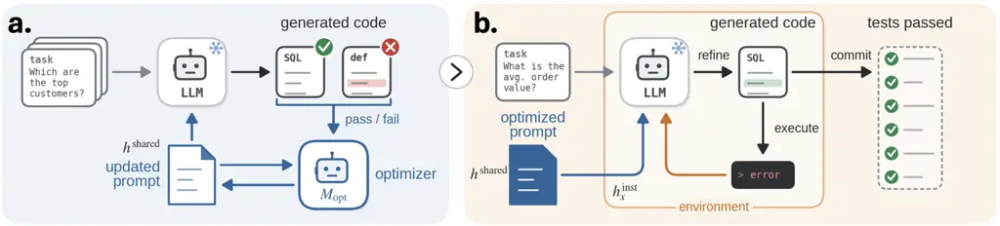

# HERO: Harnessing Evidence for Test-time Refinement and Prompt Optimization in Program Generation

Mingyu Lu ^(†)^(†)thanks: Work done during internship at Microsoft
Research. Affiliation: University of Washington Affiliation: Microsoft
Research Email: [mingyulu@cs.washington.edu](mailto:)    Timothy
Ossowski Affiliation: Microsoft Research    Tristan Naumann
Affiliation: Microsoft Research    Hoifung Poon Affiliation: Recursion
   Peniel Argaw Affiliation: Microsoft Research

###### Abstract

Harness optimization improves LLMs by refining reusable prompts and
scaffolding, yet requires further adaptation for program generation
tasks such as text-to-SQL and text-to-Python. Existing methods often
rely on LLM reflectors to propose harness updates, which can fix
observed failures but also disrupt previously correct behavior.
Text-to-code tasks offer a natural way to mitigate this issue: we can
execute generated outputs, allowing us to evaluate and verify the
effects of proposed updates directly. Building on this signal, we
introduce HERO (Harnessing Evidence for Refinement and Optimization),
which combines offline and test-time harness optimization. At the first
stage, HERO learns reusable prompt updates from execution-verified
successes and failures and validates candidate revisions before
adoption. At test time, we treat the generated code as an
instance-specific harness and refine it using execution feedback. Across
four SQL, Cypher, and Python benchmarks, HERO achieves the best offline
performance, improving pass@1 by $`7.6`$ points over the initial prompt,
while test-time refinement adds another $`2.0`$ points and improves
execution efficiency.

## 1 Introduction

LLM agents are increasingly employed to interact with external
environments through tools, often by generating executable programs such
as SQL and Cypher queries and Python functions (Li et al., 2023; Schick
et al., 2023; Feng et al., 2025; Zhuo et al., 2025; Ouyang et al.,
2026). These artifacts provide a flexible interface for models to
perform computation and interact with external systems (Gao et al.,
2023; Wang et al., 2024). Their quality depends not only on the
underlying model, but also on the surrounding _harness_—the prompts,
tools, and memory that shape generation (Khattab et al., 2024; Lee et
al., 2026; Li et al., 2026; Lopopolo, 2026). This makes the harness a
natural target for improving LLM agent performance. Accordingly,
existing work has pursued two related directions: optimizing reusable
harness components across tasks (Lee et al., 2026; Lin et al., 2026;
Yang et al., 2026; Agrawal et al., 2026), and using test-time feedback
to select or refine generated outputs (Ni et al., 2023; Chen et al.,
2024; Madaan et al., 2023).

Improving program generation through these directions presents two
linked challenges. First, reusable updates must correct recurring errors
without degrading behavior that already works. LLM-generated feedback
can be unreliable without external grounding (Huang et al., 2024; Kamoi
et al., 2024), and prompt revisions that resolve failures can introduce
regressions on previously successful cases (Wu et al., 2024b). The
challenge is therefore to derive grounded diagnoses of what to change
and preserve from execution outcomes, and translate these diagnoses into
reusable guidance. Second, this general guidance must be complemented by
feedback specific to the current instance. An optimized prompt captures
strategies learned across training tasks, but a generated program may
still encounter errors that require observations from its own execution.
Approaches such as Dynamic Cheatsheet (DC) and ACE accumulate experience
through evolving shared contexts (Suzgun et al., 2026; Zhang et al.,
2026). When shared context is updated at test time, unreliable or overly
specific feedback can become persistent guidance, allowing errors from
one instance to affect subsequent tasks. Together, these challenges
motivate grounding offline harness updates in execution evidence while
keeping test-time corrections local to the current program.

To address these challenges, we introduce HERO (Harnessing Evidence for
Refinement and Optimization), a two-level framework that grounds
reusable guidance updates in execution evidence and confines test-time
adaptation to the current program. Our contributions are threefold:

- •
  A unified two-level formulation. We formulate program generation as a
  two-level optimization problem that couples offline prompt
  optimization with test-time refinement of instance-specific programs.
- •
  Execution-grounded feedback and verification. Offline, we use
  execution evidence from successful and failed programs under prior
  prompts to identify what to correct and preserve. At test time,
  execution feedback and retrieved verified training examples guide
  program revisions, which are accepted only when supported by evidence.
- •
  Empirical evaluation and analysis. We demonstrate correctness gains
  over existing offline harness optimizers across diverse
  query-generation and programming tasks, with further improvements from
  test-time refinement. We further evaluate execution efficiency and
  computational cost, finding that the learned prompts remain compact
  across tasks.



Figure 1: Overview of HERO. (a) HERO-O: Offline prompt optimization
learns a shared prompt across training tasks. (b) HERO-T: Test-time
refinement refines the generated artifact using environment feedback.

## 2 Related Works

Prompt and harness optimization. Prompt and harness optimization
improves frozen LLMs by adapting reusable components around them. MIPRO
(Opsahl-Ong et al., 2024) jointly optimizes instructions and few-shot
demonstrations using task-level feedback. Reflection-based approaches
include GEPA (Agrawal et al., 2026), which uses trajectory feedback to
propose prompt revisions, and STRAGO (Wu et al., 2024b), which derives
refinement strategies from both successful and failed examples to
mitigate prompt drift. Other approaches broaden the optimization target:
ACE (Zhang et al., 2026) maintains an evolving context through
generation, reflection, and curation; SkillOpt (Yang et al., 2026)
optimizes reusable textual skills; and Meta-Harness (Lee et al., 2026)
searches over harness implementations using source code, scores, and
execution traces. Building on this line of work, HERO adopts a similar
offline optimization loop but enriches reflection with execution
feedback from successful and failed programs generated under prior
prompt revisions, aiming to improve program generation while limiting
regressions.

Test-time refinement. Test-time methods refine model outputs using
feedback available during inference. ReAct (Yao et al., 2022)
interleaves reasoning, actions, and environment observations, while
Reflexion and related self-refinement methods use feedback from earlier
attempts to revise subsequent outputs (Shinn et al., 2023; Madaan et
al., 2023). Dynamic Cheatsheet (DC) (Suzgun et al., 2026) further
accumulates self-curated strategies across queries through persistent
memory. These methods emphasize adaptation from test-time experience.
HERO complements this adaptation with reusable guidance learned through
offline prompt optimization. The optimized prompt remains fixed during
inference, while execution feedback and retrieved, verified training
examples guide refinement of the current program.

## 3 Harness Optimization for Program Generation

### 3.1 Problem Setup: Program Generation

In this work, we focus on program generation—tasks that map natural
language specifications to programs, including text-to-SQL,
text-to-Cypher, and text-to-Python function generation. Each instance
$`x`$ contains a specification and available task context, such as a
database schema or function signature. An LLM generates a candidate
program $`y`$, whose execution yields observations such as runtime
errors, returned values, and execution traces (Wang et al., 2024). We
denote its task performance by an execution-based evaluation reward
$`R(y,x)\in\mathbb{R}`$. We distinguish this evaluation reward from the
feedback available during refinement: in our setting, test-time
refinement can access execution observations but not test reference
solutions or hidden correctness labels.

### 3.2 A Unified View of Harness Optimization

Prior work improves fixed LLMs through reusable prompt or harness
optimization (Agrawal et al., 2026; Lee et al., 2026) and
feedback-driven refinement across attempts (Shinn et al., 2023). We
represent these forms of adaptation through a harness comprising
external state that conditions a fixed policy $`\pi_{\theta}`$ or
mediates its interaction with the environment. For an instance $`x`$, we
decompose this state as

```math
h_{x}=\left(h^{\mathrm{shared}},h_{x}^{\mathrm{inst}}\right), \tag{1}
```

where $`h^{\mathrm{shared}}`$ is reused across instances and
$`h_{x}^{\mathrm{inst}}`$ contains instance-specific state. During
refinement, previously generated programs, their execution feedback, and
retrieved examples can become part of $`h_{x}^{\mathrm{inst}}`$,
conditioning subsequent revisions. Given the harness, the policy
generates the next candidate program:

```math
y\sim\pi_{\theta}(\cdot\mid x;h_{x}). \tag{2}
```

Optimizing shared state targets the expected reward across instances,
whereas optimizing instance-specific state targets the current instance.

## 4 Method

Building on this unified view, we propose HERO, a two-stage framework
that optimizes the harness at complementary scopes while keeping the
underlying LLM fixed. The first stage, offline optimization (HERO-O),
learns a shared harness $`h^{\mathrm{shared}}`$ from execution feedback
across training tasks (Figure 1(a)). The second stage, test-time
refinement (HERO-T), keeps the shared harness fixed while adapting an
instance-specific harness $`h_{x}^{\mathrm{inst}}`$ using evidence from
the current test instance (Figure 1(b)). The overall procedure is
summarized in Algorithm 1.

### 4.1 HERO-O: Offline Prompt Optimization

1: Initial prompt $`h_{0}^{\mathrm{shared}}`$; diagnostic set
$`\mathcal{D}_{\mathrm{diag}}`$; update set
$`\mathcal{D}_{\mathrm{upd}}`$; selection set
$`\mathcal{D}_{\mathrm{sel}}`$; optimizer LLM $`M_{\mathrm{opt}}`$;
candidates per iteration $`N`$; iterations $`T`$; program-refinement
operator $`\Phi_{B}`$ with per-query action budget $`B`$

2: Stage 1: Prompt Optimization

3:
$`\mathcal{A}\leftarrow\{h_{0}^{\text{shared}}\}`$; $`\mathcal{R}_{-1}\leftarrow\emptyset`$

4: for $`t=0,\ldots,T-1`$ do

5:
  $`F_{t}\leftarrow{M_{\mathrm{opt}}}(h_{t}^{\text{shared}},\mathcal{R}_{t-1},\mathcal{D}_{\mathrm{diag}})`$
$`\triangleright`$ reflect on diagnostic programs and execution outcomes

6:
  $`\mathcal{H}_{t}\leftarrow\{M_{\mathrm{edit}}^{(i)}(h_{t}^{\text{shared}},F_{t})\}_{i=1}^{N}`$
$`\triangleright`$ propose candidate prompts

7:
  $`(h_{t+1}^{\text{shared}},\mathcal{H}_{t}^{+})\leftarrow\textsc{ScreenAndAccept}(h_{t}^{\text{shared}},\mathcal{H}_{t},\mathcal{D}_{\mathrm{upd}})`$
$`\triangleright`$ Algorithm 2

8:
  $`\mathcal{R}_{t}\leftarrow\mathcal{H}_{t}\setminus\{h_{t+1}^{\text{shared}}\}`$

9:   $`\mathcal{A}\leftarrow\mathcal{A}\cup\mathcal{H}_{t}^{+}`$

10: end for

11:
$`\hat{h}^{\mathrm{shared}}\leftarrow\arg\max_{h\in\mathcal{A}}\operatorname{Acc}(h,\mathcal{D}_{\mathrm{sel}})`$

12: Stage 2: Test-Time Refinement

13: for all test instances $`x`$ do

14:
  $`y_{0}(x)\sim\pi_{\theta}(\cdot\mid x;\hat{h}^{\mathrm{shared}})`$

15:
  $`\hat{y}(x)\leftarrow\Phi_{B}(x,y_{0}(x);\hat{h}^{\mathrm{shared}})`$

16: end for

17: return $`\hat{h}^{\text{shared}}`$ and refined programs
$`\{\hat{y}(x)\}`$

Algorithm 1 HERO

Stage 1 of HERO instantiates the $`h^{\mathrm{shared}}`$ optimization by
learning a reusable prompt across training tasks. We denote
$`h_{t}^{\text{shared}}`$ for the accepted prompt at iteration $`t`$.
Starting from $`h_{0}^{\text{shared}}`$, optimization alternates between
diagnosing the current prompt, proposing revisions, and validating them
on held-out examples. To prevent overfitting, we use three data splits
with distinct roles: $`\mathcal{D}_{\mathrm{diag}}`$ provides evidence
for proposing revisions, $`\mathcal{D}_{\mathrm{upd}}`$ determines
whether a revision is accepted, and $`\mathcal{D}_{\mathrm{sel}}`$
selects the final prompt. Thus, examples used to propose an update are
not used to determine its acceptance.

1: Current prompt $`h_{t}^{\dagger}`$; candidates $`\mathcal{H}_{t}`$;
update set $`\mathcal{D}_{\mathrm{upd}}`$ partitioned into chunks
$`C_{1},\dots,C_{K}`$; budget $`b`$; margin $`\tau`$; confidence
multiplier $`z`$

2: Pull $`C_{1}`$ for all $`h\in\mathcal{H}_{t}`$

3: while $`b>0`$ and not Resolved($`\mathcal{H}_{t}`$) do

4:
  $`(\hat{\Delta}_{h},\hat{\sigma}_{h})\leftarrow\textsc{PairedDelta}(h,h_{t})`$
for all $`h\in\mathcal{H}_{t}`$

5:
  $`\ell\leftarrow\arg\max_{h}\hat{\Delta}_{h}`$; $`c\leftarrow\arg\max_{h\neq\ell}(\hat{\Delta}_{h}+z\hat{\sigma}_{h})`$

6:   $`\textsc{Pull}(\ell,C_{n_{\ell}+1})`$; $`b\leftarrow b-1`$

7:   if $`b>0`$ and $`\hat{\Delta}_{c}+z\hat{\sigma}_{c}>\tau`$ then

8:    $`\textsc{Pull}(c,C_{n_{c}+1})`$; $`b\leftarrow b-1`$

9:   end if

10: end while

11:
$`(\hat{\Delta}_{h},\hat{\sigma}_{h})\leftarrow\textsc{PairedDelta}(h,h_{t})`$
for all $`h\in\mathcal{H}_{t}`$

12: $`\ell\leftarrow\arg\max_{h}\hat{\Delta}_{h}`$

13: $`h_{t+1}\leftarrow\begin{cases}\ell,&\hat{\Delta}_{\ell}>\tau,\\
h_{t},&\text{otherwise}\end{cases}`$

14:
$`\mathcal{H}_{t}^{+}\leftarrow\{h\in\mathcal{H}_{t}:\hat{\Delta}_{h}>\tau\}`$

15: return $`h_{t+1},\mathcal{H}_{t}^{+}`$

Algorithm 2 ScreenAndAccept - line 5 of Algorithm 1

#### 4.1.1 Textual Gradients from Execution-grounded Experience

Prompt optimization can be viewed as a discrete analogue of
gradient-based optimization, where natural language critiques or
reflections serve as “textual gradients” for prompt updates (Pryzant et
al., 2023; Yuksekgonul et al., 2024). Prior work uses LLM reflection to
guide prompt updates (Pryzant et al., 2023; Lin et al., 2026; Agrawal et
al., 2026), but such feedback can be unreliable without external
grounding (Huang et al., 2024; Kamoi et al., 2024). Following Wu et al.
(2024b), we use both successful and failed cases but enrich reflection
with execution outcomes and traces from programs generated under prior
prompt revisions to identify what to correct and preserve. This connects
prior edits to observed program behavior, providing concrete context for
diagnosing what to correct and preserve. At iteration $`t`$, the
optimizer LLM reviews the prompt edits proposed at $`t-1`$, along with
$`k`$ generated programs from both successful and failed cases and their
corresponding execution outcomes (e.g., failure errors or predicted
output mismatches). Correct programs indicate behaviors to preserve,
while incorrect programs identify behaviors to revise. The optimizer
summarizes this evidence into feedback $`F_{t}`$, providing an
execution-grounded direction for updating the current
$`h_{t}^{\text{shared}}`$.

Conditioned on $`h_{t}^{\text{shared}}`$ and $`F_{t}`$, the same
optimizer LLM proposes $`N`$ candidate shared harnesses,

```math
\mathcal{H}_{t}=\left\{M_{\mathrm{opt}}^{(i)}(h_{t}^{\text{shared}},F_{t})\right\}_{i=1}^{N}. \tag{3}
```

We instruct the optimizer to propose revisions as reusable rules rather
than instance-specific fixes, and reject candidates that copy
instance-specific content or reference answers using deterministic
filters, e.g., filtering out prompts that memorize training answers.

#### 4.1.2 Adaptive Paired Acceptance

Prior work has explored bandit-based candidate selection (Pryzant et
al., 2023) and minibatch comparisons of prompt revisions against their
parent prompts (Agrawal et al., 2026). Our acceptance procedure combines
these strategies to improve the reliability and efficiency of prompt
updates: paired comparisons capture both fixes and regressions relative
to the current prompt, uncertainty-guided allocation focuses evaluation
on uncertain candidates, and a minimum improvement margin guards against
accepting marginal gains (Algorithm 2). For each candidate prompt
$`h\in\mathcal{H}_{t}`$, we compute the per-instance improvement

```math
d_{h}(x)=R(y_{h},x)-R(y_{t},x), \tag{4}
```

where $`y_{h}\sim\pi_{\theta}(\cdot\mid x;h)`$ and
$`y_{t}\sim\pi_{\theta}(\cdot\mid x;h_{t}^{\mathrm{shared}})`$ are
generated by the candidate and current shared prompts, respectively, on
the same instance $`x`$. For the binary correctness reward used during
acceptance, $`d_{h}(x)\in\{-1,0,+1\}`$, corresponding to a regression,
unchanged correctness, or a fix. The mean paired improvement therefore
measures net fixes per evaluated instance. We denote its estimate by
$`\hat{\Delta}_{h}`$ and its estimated standard error by
$`\hat{\sigma}_{h}`$.

All candidates are initially evaluated on a common subset of
$`\mathcal{D}_{\mathrm{upd}}`$. At each allocation step, we identify the
leader with the largest $`\hat{\Delta}_{h}`$ and the alternative with
the highest upper confidence bound (UCB)-inspired score
$`\hat{\Delta}_{h}+z\hat{\sigma}_{h}`$ (Auer et al., 2002), where $`z`$
controls the uncertainty bonus. The leader receives the next evaluation
chunk, while the alternative receives additional evaluations only if its
score exceeds the acceptance margin $`\tau`$. This continues until the
decision is resolved or the budget is exhausted (Algorithm 2 ). The
candidate with the largest final $`\hat{\Delta}_{h}`$ replaces the
current prompt only if $`\hat{\Delta}_{h}>\tau`$; otherwise, the current
prompt is retained.

After $`T`$ iterations, we select the final shared harness
$`\hat{h}^{\mathrm{shared}}`$ from the archive $`\mathcal{A}`$ using the
separate selection set $`\mathcal{D}_{\mathrm{sel}}`$. This decouples
per-iteration acceptance from final harness selection and allows an
earlier candidate to be recovered if later updates generalize less well.

### 4.2 HERO-T: Evidence-Grounded Test-Time Refinement

Stage 2 of HERO adapts the instance-specific harness while keeping the
learned shared prompt fixed. Given a test instance $`x`$, we first
generate

```math
y_{0}\sim\pi_{\theta}(\cdot\mid x;\hat{h}^{\mathrm{shared}}). \tag{5}
```

We then refine this program for at most $`B`$ steps using only evidence
available at test time, without access to the test solution or
correctness label.

#### 4.2.1 Two Sources of Refinement Evidence

Refinement draws on two complementary sources. _Execution evidence_
includes execution traces, runtime errors, returned outputs, and
environment probes that help identify instance-specific problems.
_Retrieved demonstration evidence_ consists of execution-verified
training examples that provide implementation patterns, such as
library-specific conventions, that execution feedback alone may not
reveal.

The refiner combines environment interaction and execution-based program
refinement (Yao et al., 2022; Chen et al., 2024) with instance-specific
demonstration retrieval. Unlike MIPROv2, which selects demonstrations
during offline optimization (Opsahl-Ong et al., 2024), we select
demonstrations separately for each test instance. Specifically, we
retrieve up to $`n`$ verified training examples using lexical
similarity, then let the refiner select at most three relevant
demonstrations.

#### 4.2.2 Evidence-gated Refinement

At refinement step $`k`$, let $`e_{k}`$ denote newly gathered execution
observations and, when available, retrieved demonstrations. The
instance-specific harness contains the current program and accumulated
evidence:

```math
h_{x,k}^{\mathrm{inst}}=\left(y_{k-1},e_{1:k}\right). \tag{6}
```

Conditioned on this state and the fixed shared prompt, the same LLM used
for initial generation proposes a revised program:

```math
\displaystyle\tilde{y}_{k}\sim\pi_{\theta}\left(\cdot\mid x;\hat{h}^{\mathrm{shared}},h_{x,k}^{\mathrm{inst}}\right),\qquad k=1,\ldots,B. \tag{7}
```

We apply an evidence gate rather than accepting every revision. First,
the controller executes $`\tilde{y}_{k}`$ and rejects it if it fails the
available programmatic checks. For revisions that pass, the same LLM
compares $`y_{k-1}`$ and $`\tilde{y}_{k}`$ using both the accumulated
evidence $`e_{1:k}`$ and the revision’s execution results. It assesses
whether the changes address an observed issue or implement a convention
supported by the retrieved demonstrations. A revision is accepted only
if it passes the programmatic checks and the LLM judges its changes to
be supported by the evidence.

Let $`G_{k}\in\{0,1\}`$ denote this combined acceptance decision. We
update

```math
y_{k}=\begin{cases}\tilde{y}_{k},&G_{k}=1,\\
y_{k-1},&G_{k}=0.\end{cases} \tag{8}
```

Rejected revisions leave the current program unchanged; accepted
revisions become the starting point for the next step. After $`K\leq B`$
refinement steps, we return $`y_{K}`$.

## 5 Experimental Setup

### 5.1 Benchmarks

We evaluate on four text-to-function generation benchmarks spanning SQL,
Cypher, and Python generation.

BIRD-SQL (Li et al., 2023). BIRD-SQL evaluates text-to-SQL generation
over realistic SQLite databases from diverse application domains. Given
a natural-language question, database schema, and optional external
knowledge, the model generates an executable SQL query.

CypherBench (Feng et al., 2025). CypherBench evaluates text-to-Cypher
generation over large-scale Neo4j property graphs derived from Wikidata,
covering query patterns such as multi-hop retrieval, aggregation,
comparison, and temporal reasoning.

BigCodeBench-Instruct (Zhuo et al., 2025). BigCodeBench-Instruct
evaluates text-to-Python function generation from text instruction
across diverse programming and library-use tasks.

DSCodeBench (Ouyang et al., 2026). DSCodeBench evaluates text-to-Python
function generation for practical data-science tasks spanning ten widely
used libraries.

For each benchmark, we construct a diagnostic set
$`\mathcal{D}_{\mathrm{diag}}`$ to provide examples and execution
feedback for prompt optimization, and an update set
$`\mathcal{D}_{\mathrm{upd}}`$ to evaluate candidate revisions. For
final harness selection, we use a separate set
$`\mathcal{D}_{\mathrm{sel}}`$ where dataset size permits; otherwise, we
reuse $`\mathcal{D}_{\mathrm{upd}}`$. Split sizes are reported in
Table 4, with further details on preprocessing, split construction, and
evaluation procedures in Appendix A.

|              |              |                             |              |              |              |              |                      |              |                |                |                      |
| ------------ | ------------ | --------------------------- | ------------ | ------------ | ------------ | ------------ | -------------------- | ------------ | -------------- | -------------- | -------------------- |
|              | Baseline     | Offline Prompt Optimization |              |              |              |              | Test-Time Adaptation |              |                |                | Harness Optimization |
| Dataset      | Seed         | HERO-O                      | SkillOpt     | GEPA         | MIPROv2      | ACE          | DC-Cu                | HERO-O+T     | HERO-O + ReAct | HERO-O + DC-Cu | Meta- Harness        |
| BIRD DEV     | 59.39 (0.32) | 63.55 (0.21)                | 61.31 (1.19) | 62.59 (0.59) | 60.87 (0.57) | 60.87 (0.10) | 60.22 (0.79)         | 64.81 (0.21) | 63.12 (1.03)   | 62.44 (1.43)   | 58.24 (2.18)         |
| BigCodeBench | 47.93 (0.74) | 52.59 (0.31)                | 51.81 (0.47) | 50.13 (1.00) | 50.65 (0.59) | 51.96 (1.25) | 44.79 (0.83)         | 53.79 (0.33) | 52.64 (0.24)   | 51.70 (0.89)   | 45.26 (2.52)         |
| DSCodeBench  | 44.74 (0.24) | 54.84 (1.87)                | 51.87 (1.50) | 52.14 (1.99) | 51.73 (1.76) | 51.31 (0.43) | 42.81 (0.24)         | 56.04 (1.87) | 56.22 (2.87)   | 54.70 (0.87)   | 45.99 (0.52)         |
| CypherBench  | 74.00 (0.44) | 85.50 (1.40)                | 84.10 (1.30) | 78.73 (1.53) | 78.27 (3.04) | 77.13 (1.74) | 77.13 (1.74)         | 89.93 (1.46) | 87.00 (0.21)   | 81.77 (2.98)   | 77.03 (2.59)         |

Table 1: Performance across four code-generation benchmarks. Results
(pass@1) are reported as mean (standard deviation) over three runs. Bold
highlights the best mean within each category.

### 5.2 Models and Baselines

We compare against three classes of methods: (i) offline prompt
optimization¹¹ 1 We do not include Wu et al. (2024b) because no publicly
available implementation is provided., including GEPA (Agrawal et al.,
2026), MIPROv2 (Opsahl-Ong et al., 2024), ACE (Zhang et al., 2026), and
SkillOpt (Yang et al., 2026); (ii) test-time refinement, including ReAct
(Yao et al., 2022) and Dynamic Cheatsheet (DC-Cu) (Suzgun et al., 2026);
and (iii) end-to-end harness optimization, represented by Meta-Harness
(Lee et al., 2026). Offline optimizers start from the same seed prompt
(Appendix G) and use the same optimization data and execution-based
correctness signal. Test-time methods use only information available at
inference time, without access to reference solutions, reference
outputs, or correctness labels.

For each benchmark, we set a fixed rollout budget based on GEPA’s
auto=heavy setting (Table 4) and apply the same budget to HERO and all
baselines, matching rollout counts as closely as their procedures
permit. Unless otherwise stated, all methods use GPT-5 with medium
reasoning effort as the backbone model. We report results over three
seeds. Additional implementation details for HERO and the baselines are
provided in Appendix C.

### 5.3 Evaluation Metrics

Execution accuracy. Our primary metric is pass@1. We generate one
solution for each instance and report the fraction that satisfies the
benchmark’s correctness criteria.

Execution efficiency. Accuracy alone does not distinguish between
correct programs with different execution costs (Waghjale et al., 2024).
We therefore measure runtime efficiency using the Valid Efficiency Score
(VES) (Li et al., 2023),

```math
\mathrm{VES}=\tfrac{1}{N}\sum_{n=1}^{N}\mathbf{1}(V_{n}=\hat{V}_{n})\sqrt{\tfrac{E(Y_{n})}{E(\hat{Y}_{n})}}, \tag{9}
```

where $`V_{n}`$ and $`\hat{V}_{n}`$ denote the reference and predicted
execution results, and $`E(Y_{n})`$ and $`E(\hat{Y}_{n})`$ their
corresponding execution times. Incorrect solutions receive zero credit,
while faster correct solutions receive higher scores. Detailed timing
and scoring protocols are provided in Section C.3.

Cumulative fix-to-break ratio. To characterize how reliably performance
improves during offline optimization, we track whether accepted prompt
updates fix previously incorrect instances or break previously correct
ones. At optimization progress $`t`$, we define

```math
\rho(t)=\tfrac{\sum_{s=0}^{t}\mathrm{fixed}_{s}}{\sum_{s=0}^{t}\mathrm{broken}_{s}}, \tag{10}
```

where $`\mathrm{fixed}_{s}`$ and $`\mathrm{broken}_{s}`$ count
incorrect-to-correct and correct-to-incorrect transitions induced by
accepted updates at iteration $`s`$. A ratio $`\rho(t)>1`$ indicates
that accepted updates cumulatively correct more instances than they
disrupt.

## 6 Results

### 6.1 Fixes and Regressions During Prompt Optimization

We first examine how offline prompt optimization affects program
generation. While validation accuracy captures the net effect of an
update, it does not reveal the balance between fixing incorrect
instances and introducing regressions on previously correct ones. We
therefore analyze the cumulative fix-to-break ratio (Equation 10) to
characterize this balance over optimization.

As shown in Figure 2, HERO-O maintains more fixes than regressions
throughout optimization and achieves the highest ratios overall. On
BIRD-SQL, HERO-O reaches a cumulative ratio of approximately $`3.0`$,
compared with $`2.0`$ for MIPROv2 and SkillOpt, $`1.5`$ for GEPA, and
$`1.2`$ for ACE. ACE, which incrementally accumulates instance-derived
strategy bullets, initially favors fixes but gradually approaches a
ratio of $`1.0`$, whereas methods that make broader prompt revisions
maintain higher ratios. A similar pattern holds on BigCodeBench, where
HERO-O reaches approximately $`2.2`$, comparable to GEPA and higher than
MIPROv2 ($`1.4`$) and ACE ($`1.2`$). Our ablation further shows that
using only failed cases reduces the average fix-to-break ratio from
$`2.23`$ to $`1.91`$ (Table 7), suggesting that combining successful and
failed cases provides more informative feedback for prompt revisions
than failures alone. These results suggest that our feedback design
helps accumulate fixes while limiting regressions during prompt
optimization.

Figure 2: Cumulative fix-to-break ratio. The y-axis reports the
cumulative ratio across optimization iterations on the x-axis. The
dashed line indicates an equal number of fixes and regressions.

### 6.2 Benchmark Performance of Offline Prompt Optimization

We next evaluate whether the resulting prompts improve pass@1 on
held-out text-to-SQL, text-to-Cypher, and text-to-Python code-generation
tasks.

As shown in Table 1, HERO-O improves pass@1 over the initial prompt
across all four benchmarks, with gains of $`4.16`$ points on BIRD-SQL,
$`4.66`$ on BigCodeBench, $`10.1`$ on DSCodeBench, and $`11.5`$ on
CypherBench. HERO-O also achieves the highest mean pass@1 among offline
prompt optimizers on all four benchmarks. It reaches $`63.5`$ on
BIRD-SQL, compared with $`62.5`$ for GEPA and $`61.3`$ for SkillOpt;
$`52.5`$ on BigCodeBench, compared with $`51.9`$ for ACE and $`51.8`$
for SkillOpt; $`54.8`$ on DSCodeBench, compared with $`52.1`$ for GEPA;
and $`85.5`$ on CypherBench, compared with $`84.1`$ for SkillOpt. By
contrast, Meta-Harness, which optimizes the end-to-end harness, does not
consistently improve performance and can underperform the initial
prompt, achieving $`58.2`$ on BIRD-SQL and $`45.3`$ on BigCodeBench.

Figure 3: BIRD-SQL DEV pass@1 by question difficulty (simple
$`n{=}923`$, moderate $`n{=}463`$, challenging $`n{=}144`$ scored
instances). Bars are the mean over three seeds; error bars are the
sample standard deviation.

We further examine performance across pre-specified BIRD-SQL difficulty
levels (Figure 3). HERO-O achieves pass@1 scores of $`70.5`$, $`53.6`$,
and $`51.4`$ on simple, moderate, and challenging questions,
respectively. Its advantage is largest on challenging questions, where
HERO-O reaches $`51.4`$, outperforming the next-best method, GEPA
($`46.8`$), by $`4.6`$ points. These results show that the gains from
grounded prompt optimization persist across difficulty levels and are
most pronounced on challenging instances.

##### Learned prompts and optimization cost.

|               |                 |                        |
| ------------- | --------------- | ---------------------- |
| Method        | Tokens/call (K) | Prompt length (tokens) |
| ACE           | 31.89 (1.17)    | 35,881 (7,563)         |
| MIPROv2       | 3.47 (0.02)     | 2,704 (70)             |
| SkillOpt      | 2.87 (0.10)     | 2,021 (628)            |
| GEPA          | 2.47 (0.24)     | 2,003 (541)            |
| HERO-O (Ours) | 2.79 (0.18)     | 1,949 (389)            |

Table 2: Optimization context and token cost. Input plus output tokens
per LLM call during optimization and the length of the final prompt.
Averaged over four benchmarks per seed; mean (SD) over three seeds.

We next examine whether these performance gains come at the cost of
larger prompts or greater per-call token usage (Table 2). HERO-O, GEPA,
and SkillOpt produce compact instruction sets, whereas MIPROv2
additionally selects few-shot demonstrations and ACE accumulates a
substantially larger playbook. Averaged across benchmarks, HERO-O
produces the shortest final prompts (1,949 tokens), compared with 2,003
for GEPA, 2,704 for MIPROv2, and 35,881 for ACE. Our cost analysis also
shows that more compact prompts generally correspond to lower per-call
token usage: HERO-O averages 2.79K tokens per optimization call,
comparable to GEPA (2.47K) and SkillOpt (2.87K), and substantially below
ACE (31.89K).

Upon inspection of the learned prompt, we found that HERO-O primarily
retains general task-level instructions (Figure 9), whereas other
optimizers preserve varying amounts of training-specific content
(Figures 11 and 10). Together, these results suggest that HERO learns
compact, reusable guidance rather than accumulating instance-specific
details, while achieving its performance gains without substantially
larger prompts (Figure 5).

### 6.3 Test-Time Refinement Complements Offline Prompt Optimization

Offline prompt optimization captures reusable task-level guidance but
may leave instance-specific errors unresolved. We therefore evaluate
whether HERO-T—evidence-grounded test-time refinement—provides
additional gains and how it compares with alternative test-time
adaptation strategies. For each dataset, we initialize test-time
refinement with the best offline prompt obtained from HERO-O.

As shown in Table 1, HERO-T improves pass@1 on all benchmarks , by
$`1.26`$ points on BIRD-SQL, $`1.20`$ on BigCodeBench, $`1.20`$ on
DSCodeBench, and $`4.43`$ on CypherBench, for an average gain of
$`2.02`$ points. The resulting system achieves the highest mean pass@1
on three of four benchmarks; on DSCodeBench, ReAct is marginally higher
($`56.22`$ vs. $`56.04`$). Alternative test-time methods are less
consistent: ReAct improves performance on three benchmarks but slightly
degrades BIRD-SQL, while DC-Cu decreases performance on all four when
applied after offline optimization. To distinguish whether this behavior
arises from combining DC-Cu with offline optimization, we also apply
DC-Cu directly to the initial prompt. The results remain mixed: it
improves BIRD-SQL and CypherBench by $`0.83`$ and $`3.13`$ points,
respectively, but decreases BigCodeBench and DSCodeBench by $`3.14`$ and
$`1.93`$ points.

These results suggest that the two stages of HERO are complementary:
offline optimization captures reusable task-level guidance, while
test-time refinement provides additional improvements for individual
instances.

### 6.4 Execution Efficiency

|                                    |             |              |             |              |
| ---------------------------------- | ----------- | ------------ | ----------- | ------------ |
| Method                             | BIRD        | BigCodeBench | DSCodeBench | CypherBench  |
| Seed prompt                        | 79.1 (5.0)  | 61.2 (3.6)   | 48.7 (0.5)  | 85.6 (1.5)   |
| Stage Offline Harness Optimization |             |              |             |              |
| GEPA                               | 73.1 (3.6)  | 69.1 (3.9)   | 56.0 (2.2)  | 86.7 (3.8)   |
| MIPROv2                            | 77.9 (7.1)  | 69.7 (2.7)   | 55.4 (1.3)  | 86.5 (3.2)   |
| ACE                                | 72.3 (2.2)  | 71.3 (2.5)   | 55.3 (0.5)  | 103.8 (15.2) |
| SkillOpt                           | 75.9 (4.0)  | 69.7 (1.0)   | 54.8 (1.0)  | 137.7 (50.8) |
| Metaharness                        | 74.5 (10.3) | 58.5 (3.0)   | 84.8 (4.3)  | 50.5 (0.7)   |
| HERO-O                             | 91.9 (6.4)  | 75.0 (3.5)   | 59.8 (1.7)  | 109.8 (39.8) |
| Stage Test-Time Adaption           |             |              |             |              |
| DC-Cu                              | 83.7 (4.5)  | 54.5 (7.2)   | 48.8 (0.8)  | 74.2 (1.9)   |
| HERO-O + DC-Cu                     | 91.4 (4.9)  | 70.6 (1.9)   | 60.0 (1.2)  | 92.6 (16.0)  |
| HERO-O + ReAct                     | 92.3 (7.6)  | 76.2 (3.6)   | 60.7 (2.3)  | 110.1 (42.8) |
| HERO-O + T                         | 93.4 (6.1)  | 76.2 (3.6)   | 61.5 (1.4)  | 101.7 (7.8)  |

Table 3: Valid Efficiency Score (VES) of generated programs. Results are
mean (SD) over three seeds; higher is better. Bold denotes the best
mean.

For SQL queries and Python code, correctness alone does not fully
capture solution quality: programs that produce the same correct result
can differ substantially in execution cost (Li et al., 2023). We
therefore report VES alongside pass@1 to assess whether improvements in
correctness also preserve execution efficiency.

As shown in Table 3, HERO-O achieves the highest mean VES on three of
four benchmarks: BIRD-SQL ($`91.9`$), BigCodeBench ($`75.0`$), and
DSCodeBench ($`57.8`$). Together with the corresponding pass@1 gains,
these results indicate that the improved correctness on these tasks is
not achieved at the expense of execution efficiency. On CypherBench,
SkillOpt attains the highest mean VES ($`137.7`$), though with
substantial variability across runs (SD $`50.8`$). With HERO-T, VES
further improves on BIRD-SQL, BigCodeBench, and DSCodeBench, alongside
the corresponding gains in pass@1. On CypherBench, however, pass@1
increases from $`85.5`$ to $`89.93`$, while VES decreases from $`109.8`$
to $`101.7`$. This divergence highlights a correctness–efficiency
trade-off: test-time refinement solves more instances, but the resulting
programs are less efficient under VES. Overall, HERO delivers concurrent
gains in correctness and execution efficiency on three of four
benchmarks, demonstrating that its performance improvements generally
extend beyond accuracy alone.

### 6.5 Ablation Study and Sensitivity Analysis

We ablate the main components of offline optimization on BIRD-SQL and
BigCodeBench and examine sensitivity to the amount of diagnostic
evidence and optimization budget.

Figure 4: Sensitivity to the number of rendered diagnostic cases. Pass@1
as the number of cases rendered varies. Results are the mean $`\pm`$ SD
over three seeds.

##### Ablation study.

Removing the rendered success and failure cases consistently reduces
performance: pass@1 drops from $`63.55`$ to $`59.15`$ on BIRD-SQL and
from $`52.5`$ to $`50.08`$ on BigCodeBench (Figure 4). This indicates
that validation signals alone do not provide sufficient guidance for
prompt revision; concrete execution examples help the optimizer identify
what to correct and what to preserve.

##### Sensitivity analysis and model generalization.

HERO remains relatively stable across a range of configurations,
including the number of candidates, optimization rounds, and rendered
diagnostic examples, with performance consistently above the seed
prompt. Similarly, increasing the test-time refinement budget yields
limited additional gains beyond the default $`B=3`$ (Section D.2). These
results suggest that the observed improvements are not highly sensitive
to hyperparameter choices or prolonged refinement. Experiments with
GPT-5.4 (Table 9) further show consistent gains over the evaluated
baselines, indicating that the approach extends beyond the GPT-5
backbone.

## 7 Conclusion

In this work, we introduced HERO, a two-stage harness framework for
program generation that combines grounded offline prompt optimization
with evidence-grounded test-time refinement. Across four SQL, Cypher,
and Python benchmarks, HERO consistently outperforms the initial prompt
and existing prompt optimization baselines, with test-time refinement
providing further gains on every benchmark. Our analyses show that
execution-grounded updates reduce regressions during optimization, while
the learned prompts remain compact and robust across optimization
settings. Together, these results support combining reusable cross-task
optimization with instance-specific refinement for more effective
program generation.

## Limitations

##### Budgeting and computational cost.

Our evaluation uses fixed, benchmark-specific budgets, which may limit
the gains that some methods could achieve with longer searches.
Substantially expanding these budgets is computationally demanding: even
under the evaluated budgets, ACE and Meta-Harness require approximately
12 and 24 hours of wall-clock time, respectively, on BigCodeBench in our
setup. To support controlled comparisons within these practical
constraints, we use task-rollout counts as a common measure of
evaluation effort and match budgets as closely as method-specific
procedures permit. This measure, however, does not fully capture
differences in the costs of reflection, candidate generation, and
selection. Nevertheless, we have sought to make the comparisons as fair
and transparent as possible within these computational and
methodological constraints.

##### Model dependency.

Our main evaluation relies on proprietary GPT-5 and GPT-5.4 models,
whose future updates or deprecation may affect exact harness
reproducibility. However, HERO operates entirely at the harness level
and does not require access to or modification of model weights,
allowing the same optimization procedure to be applied to other
compatible backbones. Learned prompts may still require re-optimization
when the underlying model changes.

## References

- Agrawal et al. (2026) L. A. Agrawal, S. Tan, D. Soylu, N. Ziems, R.
  Khare, K. Opsahl-Ong, A. Singhvi, H. Shandilya, M. J. Ryan, M. Jiang,
  et al. Gepa: reflective prompt evolution can outperform reinforcement
  learning. In International Conference on Learning Representations,
  Vol. 2026, pp. 8479–8565. Cited by: §B.1, §1, §2, §3.2, §4.1.1,
  §4.1.2, §5.2.
- Auer et al. (2002) P. Auer, N. Cesa-Bianchi, and P. Fischer
  Finite-time analysis of the multiarmed bandit problem. Machine
  learning 47 (2), pp. 235–256. Cited by: §4.1.2.
- Chen et al. (2024) X. Chen, M. Lin, N. Schärli, and D. Zhou Teaching
  large language models to self-debug. In International Conference on
  Learning Representations, Vol. 2024, pp. 8746–8825. Cited by: §1,
  §4.2.1.
- Feng et al. (2025) Y. Feng, S. Papicchio, and S. Rahman Cypherbench:
  towards precise retrieval over full-scale modern knowledge graphs in
  the llm era. In Proceedings of the 63rd Annual Meeting of the
  Association for Computational Linguistics (Volume 1: Long Papers),
  pp. 8934–8958. Cited by: Appendix A, §1, §5.1.
- Gao et al. (2023) L. Gao, A. Madaan, S. Zhou, U. Alon, P. Liu, Y.
  Yang, J. Callan, and G. Neubig Pal: program-aided language models. In
  International conference on machine learning, pp. 10764–10799. Cited
  by: §1.
- Huang et al. (2024) J. Huang, X. Chen, S. Mishra, H. S. Zheng, A.
  Yu, X. Song, and D. Zhou Large language models cannot self-correct
  reasoning yet. In International conference on learning
  representations, Vol. 2024, pp. 32808–32824. Cited by: §1, §4.1.1.
- Kamoi et al. (2024) R. Kamoi, Y. Zhang, N. Zhang, J. Han, and R. Zhang
  When can llms actually correct their own mistakes? a critical survey
  of self-correction of llms. Transactions of the Association for
  Computational Linguistics 12, pp. 1417–1440. Cited by: §1, §4.1.1.
- Khattab et al. (2024) O. Khattab, A. Singhvi, P. Maheshwari, Z.
  Zhang, K. Santhanam, S. Haq, A. Sharma, T. Joshi, H. Moazam, H.
  Miller, et al. Dspy: compiling declarative language model calls into
  state-of-the-art pipelines. In International Conference on Learning
  Representations, Vol. 2024, pp. 54928–54958. Cited by: §1.
- Lee et al. (2026) Y. Lee, R. Nair, Q. Zhang, K. Lee, O. Khattab,
  and C. Finn Meta-harness: end-to-end optimization of model harnesses.
  arXiv preprint arXiv:2603.28052. Cited by: §B.3, §1, §2, §3.2, §5.2.
- Li et al. (2023) J. Li, B. Hui, G. Qu, J. Yang, B. Li, B. Li, B.
  Wang, B. Qin, R. Geng, N. Huo, et al. Can llm already serve as a
  database interface? a big bench for large-scale database grounded
  text-to-sqls. Advances in Neural Information Processing Systems 36,
  pp. 42330–42357. Cited by: Appendix A, §C.3, §C.3, §1, §5.1, §5.3,
  §6.4.
- Li et al. (2026) J. Li, X. Xiao, Y. Zhang, C. Liu, L. Zhao, X.
  Liao, Y. Ji, J. Wang, J. Gu, Y. Ge, et al. Agent harness engineering:
  a survey. OpenReview preprint. Cited by: §1.
- Lin et al. (2026) J. Lin, S. Liu, C. Pan, L. Lin, S. Dou, Z. Xi, X.
  Huang, H. Yan, Z. Han, T. Gui, et al. Agentic harness engineering:
  observability-driven automatic evolution of coding-agent harnesses.
  arXiv preprint arXiv:2604.25850. Cited by: §1, §4.1.1.
- Lopopolo (2026) R. Lopopolo Harness engineering: leveraging codex in
  an agent-first world. URL https://openai.
  com/zh-Hans-CN/index/harness-engineering. Cited by: §1.
- Madaan et al. (2023) A. Madaan, N. Tandon, P. Gupta, S. Hallinan, L.
  Gao, S. Wiegreffe, U. Alon, N. Dziri, S. Prabhumoye, Y. Yang, et al.
  Self-refine: iterative refinement with self-feedback. Advances in
  neural information processing systems 36, pp. 46534–46594. Cited by:
  §1, §2.
- Ni et al. (2023) A. Ni, S. Iyer, D. Radev, V. Stoyanov, W. Yih, S.
  Wang, and X. V. Lin Lever: learning to verify language-to-code
  generation with execution. In International Conference on Machine
  Learning, pp. 26106–26128. Cited by: §1.
- Opsahl-Ong et al. (2024) K. Opsahl-Ong, M. J. Ryan, J. Purtell, D.
  Broman, C. Potts, M. Zaharia, and O. Khattab Optimizing instructions
  and demonstrations for multi-stage language model programs. In
  Proceedings of the 2024 Conference on Empirical Methods in Natural
  Language Processing, pp. 9340–9366. Cited by: §B.1, §2, §4.2.1, §5.2.
- Ouyang et al. (2026) S. Ouyang, D. Huang, J. Guo, Z. Sun, Q. Zhu,
  and J. M. Zhang Dscodebench: a realistic benchmark for data science
  code generation. In Proceedings of the AAAI Conference on Artificial
  Intelligence, Vol. 40, pp. 32628–32636. Cited by: Appendix A, §1,
  §5.1.
- Pryzant et al. (2023) R. Pryzant, D. Iter, J. Li, Y. Lee, C. Zhu,
  and M. Zeng Automatic prompt optimization with “gradient descent” and
  beam search. In Proceedings of the 2023 conference on empirical
  methods in natural language processing, pp. 7957–7968. Cited by:
  §4.1.1, §4.1.2.
- Schick et al. (2023) T. Schick, J. Dwivedi-Yu, R. Dessì, R.
  Raileanu, M. Lomeli, E. Hambro, L. Zettlemoyer, N. Cancedda, and T.
  Scialom Toolformer: language models can teach themselves to use tools.
  Advances in neural information processing systems 36, pp. 68539–68551.
  Cited by: §1.
- Shinn et al. (2023) N. Shinn, F. Cassano, A. Gopinath, K. Narasimhan,
  and S. Yao Reflexion: language agents with verbal reinforcement
  learning. Advances in neural information processing systems 36,
  pp. 8634–8652. Cited by: §2, §3.2.
- Suzgun et al. (2026) M. Suzgun, M. Yuksekgonul, F. Bianchi, D.
  Jurafsky, and J. Zou Dynamic cheatsheet: test-time learning with
  adaptive memory. In Proceedings of the 19th Conference of the European
  Chapter of the Association for Computational Linguistics (Volume 1:
  Long Papers), pp. 7080–7106. Cited by: §B.2, §1, §2, §5.2.
- Waghjale et al. (2024) S. Waghjale, V. Veerendranath, Z. Wang, and D.
  Fried ECCO: can we improve model-generated code efficiency without
  sacrificing functional correctness?. In Proceedings of the 2024
  Conference on Empirical Methods in Natural Language Processing,
  pp. 15362–15376. Cited by: §5.3.
- Wang et al. (2024) X. Wang, Y. Chen, L. Yuan, Y. Zhang, Y. Li, H.
  Peng, and H. Ji Executable code actions elicit better llm agents.
  arXiv preprint arXiv:2402.01030. Cited by: §1, §3.1.
- Wu et al. (2024a) C. Wu, Z. R. Tam, C. Lin, Y. Chen, and H. Lee
  Streambench: towards benchmarking continuous improvement of language
  agents. Advances in Neural Information Processing Systems 37,
  pp. 107039–107063. Cited by: Appendix A.
- Wu et al. (2024b) Y. Wu, Y. Gao, B. B. Zhu, Z. Zhou, X. Sun, S.
  Yang, J. Lou, Z. Ding, and L. Yang Strago: harnessing strategic
  guidance for prompt optimization. In Findings of the Association for
  Computational Linguistics: EMNLP 2024, pp. 10043–10061. Cited by: §1,
  §2, §4.1.1, footnote 1.
- Yang et al. (2026) Y. Yang, Z. Gong, W. Huang, Q. Yang, Z. Zhou, Z.
  Huang, Y. Li, X. Gao, Q. Dai, B. Liu, et al. Skillopt: executive
  strategy for self-evolving agent skills. arXiv preprint
  arXiv:2605.23904. Cited by: §1, §2, §5.2.
- Yao et al. (2022) S. Yao, J. Zhao, D. Yu, N. Du, I. Shafran, K.
  Narasimhan, and Y. Cao React: synergizing reasoning and acting in
  language models. arXiv preprint arXiv:2210.03629. Cited by: §B.2, §2,
  §4.2.1, §5.2.
- Yuksekgonul et al. (2024) M. Yuksekgonul, F. Bianchi, J. Boen, S.
  Liu, Z. Huang, C. Guestrin, and J. Zou Textgrad: automatic"
  differentiation" via text. arXiv preprint arXiv:2406.07496. Cited by:
  §4.1.1.
- Zhang et al. (2026) Q. Zhang, C. Hu, S. Upasani, B. Ma, F. Hong, V.
  Kamanuru, J. Rainton, C. Wu, M. Ji, H. Li, et al. Agentic context
  engineering: evolving contexts for self-improving language models. In
  International Conference on Learning Representations, Vol. 2026,
  pp. 86069–86100. Cited by: §B.1, §1, §2, §5.2.
- Zhuo et al. (2025) T. Y. Zhuo, M. C. Vu, J. Chim, H. Hu, W. Yu, R.
  Widyasari, I. N. B. Yusuf, H. Zhan, J. He, I. Paul, et al.
  Bigcodebench: benchmarking code generation with diverse function calls
  and complex instructions. In International Conference on Learning
  Representations, Vol. 2025, pp. 66602–66656. Cited by: Appendix A, §1,
  §5.1.

## Appendix

## Appendix A Datasets Details

|              |                |                                 |                                |                                |                                 |                |
| ------------ | -------------- | ------------------------------- | ------------------------------ | ------------------------------ | ------------------------------- | -------------- |
| Dataset      | Task           | $`\mathcal{D}_{\mathrm{diag}}`$ | $`\mathcal{D}_{\mathrm{upd}}`$ | $`\mathcal{D}_{\mathrm{sel}}`$ | $`\mathcal{D}_{\mathrm{test}}`$ | Rollout budget |
| BIRD-SQL     | Text-to-SQL    | 500                             | 250                            | 1,400                          | 1,530                           | 5,400          |
| CypherBench  | Text-to-Cypher | 250                             | 250                            | 250                            | 1,000                           | 3,700          |
| BigCodeBench | Python         | 250                             | 250                            | 250                            | 637                             | 5,400          |
| DSCodeBench  | Python         | 250                             | 250                            | 250                            | 482                             | 3,600          |

Table 4: Benchmarks, data splits, and optimization budgets. Rollout
budgets cap task executions during offline optimization.

Here, we provide additional details on each benchmark and our
preprocessing and splitting procedures. Three conventions apply across
all datasets. First, all splits are constructed once using a fixed
dataset-level seed before any experiment, and pool membership is held
fixed across methods and run seeds. Second, the diagnosis pool
$`\mathcal{D}_{\mathrm{diag}}`$, update pool
$`\mathcal{D}_{\mathrm{upd}}`$, and, when applicable, selection pool
$`\mathcal{D}_{\mathrm{sel}}`$ are disjoint at the instance level.
Third, the evaluation split is never accessed during optimization and is
used only for final evaluation of the selected prompt.

##### BIRD-SQL (Li et al., 2023).

BIRD-SQL is a large-scale text-to-SQL benchmark designed to evaluate SQL
generation in realistic database settings, where models must reason over
database contents in addition to schemas. It contains 12,751
natural-language–SQL pairs across 95 SQLite databases and 37 application
domains: 9,428 training examples over 69 databases, 1,534 development
examples over 11 databases, and 1,789 examples over 15 databases in a
concealed test set. Among the training and development databases, 32%
originate from Kaggle, 48% from the CTU Prague Relational Learning
Repository, and the remaining 20% from other publicly available tables.
Each instance includes a natural-language question, a reference SQL
query, the associated database, and optional expert-annotated external
knowledge. The development set spans three difficulty levels: 925
simple, 465 moderate, and 144 challenging examples, categorized based on
question understanding, external knowledge requirements, database
complexity, and SQL complexity. BIRD also evaluates execution
efficiency, enabling assessment of both correctness and runtime
behavior.

##### Preprocessing and splits.

Following StreamBench (Wu et al., 2024a), we use the official TRAIN
split for optimization and the official DEV split for evaluation, both
downloaded from ²² 2
[https://bird-bench.github.io/](https://bird-bench.github.io/); the
concealed test set is not used. To evaluate cross-database transfer, we
partition TRAIN at the database level. We reserve 14 of the 69 training
databases for final prompt selection, sampling at most 100 questions per
database. Of the remaining 55 databases, 15 are reserved exclusively for
the update pool, from which we sample 250 questions, while the
500-question diagnosis pool is sampled from the remaining 40 databases
with every database represented. Thus, the diagnosis, update, and
selection pools are disjoint at the database level.

Before sampling, we exclude examples whose reference queries fail to
execute or return empty results. For final evaluation, we use the 1,534
DEV examples and exclude four whose reference queries fail under our
evaluator, yielding 1,530 scored examples. Correctness is determined
using the official execution-accuracy comparator: predicted and
reference outputs are compared as sets of tuples, ignoring row order and
duplicates while preserving column order.

##### BigCodeBench-Instruct (Zhuo et al., 2025).

BigCodeBench evaluates Python function generation on practical
programming tasks requiring complex instruction following and
composition of multiple library APIs. The benchmark contains 1,140
function-level tasks spanning seven application domains and 139
libraries, covering 723 distinct function calls. Tasks are derived from
ODEX examples originating from Stack Overflow and are subsequently
refactored, tested, and manually curated through a human–LLM
collaborative process. Each task includes an executable reference
implementation and unit tests, with an average of 5.6 tests and 99%
branch coverage. BigCodeBench provides two prompt variants over the same
tasks: _BigCodeBench-Complete_, which uses structured docstrings, and
_BigCodeBench-Instruct_, which converts them into concise
natural-language instructions. We use the BigCodeBench-Instruct release
from ³³ 3
[https://huggingface.co/datasets/bigcode/bigcodebench](https://huggingface.co/datasets/bigcode/bigcodebench).

##### Preprocessing and splits.

Because BigCodeBench does not provide an official training split, we
first audit all reference solutions in the official Docker environment.
We exclude three tasks whose reference solutions do not pass their own
tests: tasks 590 and 1005 depend on live network endpoints, while task
461 exceeds the canonical execution-time limit. We then shuffle the
remaining 1,137 tasks once using a fixed seed. The first 500 form the
optimization pool, divided equally into 250 diagnosis and 250 update
examples; the remaining 637 examples form a frozen evaluation set. No
separate selection pool is used, so final prompt selection is performed
on the update pool.

The model is given the benchmark’s instruct_prompt as input and
generates a single code block. We evaluate generated programs using the
official execution protocol and Docker environment with the benchmark’s
hidden unit tests. We additionally apply the official post-processing
procedure to extract valid function implementations and remove code
unrelated to the target entry point. During optimization, the model
receives only pass/fail feedback and exception types; assertion messages
containing expected outputs are withheld. Because the model endpoint
does not support explicit temperature control, pass@1 is computed from a
single generation using the default decoding configuration. For
stratified sampling, tasks are grouped by their primary library into ten
groups.

##### CypherBench (Feng et al., 2025).

CypherBench evaluates natural-language-to-Cypher generation over
large-scale Neo4j property graphs. It is designed to assess whether LLMs
can query realistic knowledge graphs without relying on simplified
schemas or external entity-linking pipelines. The benchmark contains 11
property graphs derived from an April 2024 Wikidata snapshot, comprising
approximately 7.8 million entities across domains including art,
biology, sports, companies, geography, movies, and politics. Questions
cover 12 graph-query patterns, including multi-hop reasoning,
aggregation, comparison, temporal reasoning, grouping, and global
retrieval, and are constructed using templates followed by LLM-based
rewriting and verification. We use the released CypherBench dataset from
Hugging Face,⁴⁴ 4
[https://huggingface.co/datasets/megagonlabs/cypherbench](https://huggingface.co/datasets/megagonlabs/cypherbench)
which contains 10,882 question–Cypher pairs across 11 property graphs.

##### Preprocessing and splits.

Rather than using the original graph-level train/test partition, we
combine all 10,882 released questions and construct fixed question-level
splits stratified by graph and query pattern. Using proportional
sampling, we select 250 examples for the diagnosis pool, 250 for the
update pool, and 1,000 for evaluation; the remaining examples are
unused. We do not use a separate selection pool, and final prompt
selection is performed on the update pool. Because the same graphs may
appear in both the optimization and evaluation sets, this setting
evaluates performance on previously observed graphs rather than
generalization to unseen graphs.

Before constructing the splits, we execute all reference queries against
the corresponding Neo4j graphs. All queries execute successfully within
the 120 s timeout and return non-empty results, so no examples are
excluded. The model is given the graph schema in the official
PropertyGraphSchema format together with the natural-language question
and generates a Cypher query. Generated queries are executed in a
read-only Neo4j session. Following the benchmark evaluation protocol,
predicted and reference outputs are compared as multisets while allowing
column permutations. Row order is considered only when the reference
query explicitly specifies an ordering, and queries that result in a
Neo4j execution error are marked incorrect. We use a 60 s query timeout
during optimization and a 120 s timeout during final evaluation. For
stratified sampling and analysis, examples are grouped by graph.

##### DSCodeBench (Ouyang et al., 2026).

DSCodeBench evaluates realistic data-science code generation across ten
Python libraries. It contains 1,000 function-generation problems
covering NumPy (131), Pandas (92), SciPy (112), Scikit-learn (108),
Matplotlib (105), Seaborn (83), TensorFlow (110), PyTorch (101), Keras
(104), and LightGBM (54). The benchmark is constructed using examples
from DS-1000 and highly rated Stack Overflow answers to retrieve
realistic implementations from public GitHub repositories. Retrieved
code is converted into self-contained functions, filtered and perturbed
to reduce direct code reuse and potential data leakage, and paired with
natural-language problem descriptions and execution-based test cases,
followed by manual verification. Each problem is evaluated using 200
test cases. We use the dataset released at ⁵⁵ 5
[https://github.com/ShuyinOuyang/DSCodeBench](https://github.com/ShuyinOuyang/DSCodeBench).

##### Preprocessing and splits.

Because DSCodeBench does not provide an official training split, we
first validate all reference solutions in the benchmark’s pinned CPU
environment. Each reference solution is executed twice on the official
200 seeded inputs and evaluated using the benchmark’s official
comparator. We exclude 18 problems: seven whose reference solutions are
incompatible with our evaluation setting because they fail under the
official comparator, require GPU-only operations, or exceed a 30-minute
timeout, and eleven that produce inconsistent outputs across repeated
executions. We randomly shuffle the remaining 982 problems using a fixed
seed. The first 500 form the optimization set, split evenly into 250
diagnosis and 250 update examples, while the remaining 482 form the
evaluation set. We do not use a separate selection set; final prompt
selection is performed on the update set.

The model is given the benchmark’s problem description as input and
generates Python code. Following the official evaluation harness, we
extract the first generated code block and invoke its final top-level
function. A prediction is considered correct only if its outputs match
the reference outputs on all 200 seeded inputs according to the
benchmark’s type-specific comparator, with a 200-second execution limit
per candidate. Reference outputs are precomputed and reused across
candidate solutions. The test script is not provided to the model, and
evaluation messages containing expected outputs are withheld during
optimization. We use the same initial prompt as for BigCodeBench.

### Software Environment

Benchmark-specific execution environments follow the official
implementations where available. BIRD-SQL queries are executed with
SQLite 3.53.4 through Python’s sqlite3 module.⁶⁶ 6
[https://docs.python.org/3/library/sqlite3.html](https://docs.python.org/3/library/sqlite3.html)
BigCodeBench programs are evaluated using the official Docker image
(v0.2.1.post7),⁷⁷ 7
[https://hub.docker.com/r/bigcodebench/bigcodebench-evaluate/tags](https://hub.docker.com/r/bigcodebench/bigcodebench-evaluate/tags)
including the official code post-processing procedure. CypherBench
queries are executed against Neo4j 5.20.0 Community Edition⁸⁸ 8
[https://neo4j.com/](https://neo4j.com/) using the neo4j Python driver
v6.3.1⁹⁹ 9
[https://pypi.org/project/neo4j/6.3.1/](https://pypi.org/project/neo4j/6.3.1/)
in read-only sessions. DSCodeBench programs are evaluated on CPU using
the benchmark’s pinned Python environment.¹⁰¹⁰ 10
[https://github.com/ShuyinOuyang/DSCodeBench](https://github.com/ShuyinOuyang/DSCodeBench)

## Appendix B Baseline Methods

We compare against methods that optimize different components of the
harness defined in Equation 1. Offline prompt optimization methods
modify the shared harness $`h^{\mathrm{shared}}`$ using optimization
data; test-time methods adapt external state during inference while
keeping the model parameters fixed; and Meta-Harness searches over a
broader shared harness that may include both prompts and executable
control logic. Unless otherwise stated, all methods use the same initial
prompt, task interface, and execution-based evaluator as our method.

### B.1 Offline Prompt Optimization

Offline prompt optimizers modify only the shared harness while leaving
instance-specific state unchanged. Given optimization data
$`\mathcal{D}`$, they can be viewed as searching for

```math
\displaystyle\hat{h}^{\mathrm{shared}} \displaystyle=\arg\max_{h^{\mathrm{shared}}\in\mathcal{H}}\frac{1}{|\mathcal{D}|}\sum_{x\in\mathcal{D}} \tag{11}
```

```math
\displaystyle\mathbb{E}_{y\sim\pi_{\theta}(\cdot\mid x;h^{\mathrm{shared}})}\left[R(y,x)\right].
```

with different methods defining different representations and update
procedures for $`h^{\mathrm{shared}}`$.

##### GEPA (Agrawal et al., 2026).

GEPA is a reflective prompt optimizer that uses execution trajectories
and evaluator feedback to iteratively improve the shared system prompt.
An LLM reflects on the behavior of existing prompt candidates,
identifies failure modes, and proposes targeted modifications. Candidate
prompts are evaluated on task examples, and a Pareto frontier over
per-instance performance guides subsequent proposal and selection. In
our formulation, GEPA optimizes $`h^{\mathrm{shared}}`$ with the system
prompt as its only mutable component.

Implementation details. We use gepa package (v0.1.1)¹¹¹¹ 11
[https://github.com/gepa-ai/gepa](https://github.com/gepa-ai/gepa) with
its default configuration, including Pareto-based selection, reflection
minibatches of three, and no prompt merging. The system prompt is
initialized from our common seed prompt. The diagnosis and update pools
serve as GEPA’s training and validation sets, respectively, and
reflection records contain the execution verdict, failure category, and
evaluator feedback. We evaluate 21 candidates on BIRD-SQL and 20 on
BigCodeBench; for CypherBench and DSCodeBench, we use metric-call
budgets of 3,700 and 3,600, respectively.

##### MIPROv2 (Opsahl-Ong et al., 2024).

MIPROv2 optimizes a shared prompt configuration consisting of an
instruction and a set of few-shot demonstrations. It generates candidate
instructions from task and data summaries and uses Bayesian optimization
to search over instruction–demonstration combinations. In our
formulation, $`h^{\mathrm{shared}}`$ comprises the optimized instruction
and selected demonstrations.

Implementation details. We adapt the reference mipro_optimizer_v2
implementation from DSPy¹²¹² 12
[https://github.com/stanfordnlp/dspy](https://github.com/stanfordnlp/dspy)
to our setting using Optuna v5.0.0¹³¹³ 13
[https://github.com/optuna/optuna](https://github.com/optuna/optuna)
with a TPE sampler. We retain the three-stage optimization procedure,
using 18 candidate instructions and 18 demonstration sets with up to
four demonstrations each. Demonstrations are bootstrapped using the
initial program and supplemented with labeled examples when necessary.
Candidate configurations are evaluated on minibatches of 35 examples,
with a full evaluation on the update pool every five trials. We use
metric-call budgets of 5,400 for BIRD-SQL and BigCodeBench, 3,700 for
CypherBench, and 3,600 for DSCodeBench. The final shared harness
consists of the selected instruction and its four demonstrations.

##### ACE (Zhang et al., 2026).

Agentic Context Engineering (ACE) represents the shared harness as an
evolving playbook of reusable strategies. Its
Generator–Reflector–Curator procedure solves training tasks, extracts
lessons from execution trajectories and evaluator feedback, and
incrementally incorporates these lessons into the playbook. In our
formulation, the learned playbook augments the initial prompt as part of
$`h^{\mathrm{shared}}`$.

Implementation details. We use the authors’ offline batched
implementation,¹⁴¹⁴ 14
[https://github.com/ace-agent/ace](https://github.com/ace-agent/ace)
retaining the original prompts and seven-section playbook format. We use
three epochs with up to three Reflector rounds per epoch on BIRD-SQL,
and five epochs with up to five Reflector rounds per epoch on
BigCodeBench, CypherBench, and DSCodeBench. The diagnosis pool is
processed in batches of 25, with the Curator constructing a delta
context after every 10 reflections and incrementally updating the
playbook. The token budget is treated as a soft constraint. For
BIRD-SQL, we select among intermediate playbook snapshots using the
held-out selection set; for the remaining benchmarks, we use the final
playbook.

### B.2 Test-Time Adaptation

Test-time methods modify external state during inference while keeping
the learned shared prompt and model parameters fixed. For methods that
refine the current instance, we write the update generically as

```math
h_{x,t+1}^{\mathrm{inst}}=\mathcal{U}\left(h_{x,t}^{\mathrm{inst}},x,e_{t}\right), \tag{12}
```

where $`e_{t}`$ denotes evidence obtained from the current interaction
with the execution environment.

##### Dynamic Cheatsheet (DC-Cu) (Suzgun et al., 2026).

Dynamic Cheatsheet maintains a textual memory that is updated during
inference. We use its cumulative mode, DC-Cu, in which the model
generates a solution conditioned on the current memory and subsequently
updates the memory based on the problem and generated output. Because
this memory persists across evaluation examples, it acts as an
online-updated component of $`h^{\mathrm{shared}}`$.

Implementation details. We use the authors’ reference
implementation,¹⁵¹⁵ 15
[https://github.com/suzgunmirac/dynamic-cheatsheet](https://github.com/suzgunmirac/dynamic-cheatsheet)
adapting the generator instructions to each task family while retaining
the original curator prompt. For each example, the model may execute its
generated program or query up to three times before the memory is
updated. The update uses only the problem and model-generated outputs;
no reference solutions, correctness labels, or evaluator verdicts are
provided. The current memory and task-specific generator instructions
are included in the model context for subsequent examples. We limit the
memory to 20,000 characters and maintain five independent memory streams
over the evaluation set to reduce sensitivity to example ordering.

##### ReAct (Yao et al., 2022).

ReAct interleaves language-model reasoning with actions in an external
environment. We use ReAct as an instance-level refinement baseline: the
shared harness $`h^{\mathrm{shared}}`$ remains fixed, while the current
program and interaction history constitute $`h_{x}^{\mathrm{inst}}`$.
Execution feedback from the current instance is used to iteratively
revise the generated program.

Implementation details. Because the original ReAct implementation¹⁶¹⁶ 16
[https://github.com/ysymyth/ReAct](https://github.com/ysymyth/ReAct)
uses free-form prompting for text-based tasks, we adapt ReAct to our
test-time interaction framework. An initial candidate is first generated
using the fixed shared prompt. During refinement, the model can invoke
three tools through native function calling: a read-only diagnostic
probe, execution of the current candidate, and submission of the final
solution. We allow up to $`B=3`$ environment interactions, excluding the
final submission, and provide no few-shot ReAct trajectories. Model
reasoning remains internal rather than being emitted as explicit
thought–action traces.

### B.3 End-to-End Harness Optimization

##### Meta-Harness (Lee et al., 2026).

Meta-Harness optimizes a broader shared harness than prompt-only
methods. An agentic proposer generates candidate harness implementations
using information from previously evaluated candidates, including their
source code, execution traces, and validation performance. In our
formulation, Meta-Harness optimizes $`h^{\mathrm{shared}}`$ over a
search space that includes prompting, memory, multi-call control flow,
and self-verification, while keeping the underlying policy
$`\pi_{\theta}`$ fixed.

Implementation details. We build on the authors’ reference
implementation,¹⁷¹⁷ 17
[https://github.com/stanford-iris-lab/meta-harness](https://github.com/stanford-iris-lab/meta-harness)
retaining its optimization loop and Pareto-frontier selection procedure
while adapting the data interface to our four benchmarks. We use GPT-5
as the proposer through the OpenAI Codex CLI and generate three
candidate harnesses per iteration using the original skill instructions.
Candidate harnesses may use read-only diagnostic tools, while evaluation
examples and reference labels are not accessible during optimization.
Each candidate is optimized on 100 diagnosis examples for BIRD-SQL and
BigCodeBench and 50 for CypherBench and DSCodeBench, and evaluated on
the full update pool. Search terminates when the corresponding rollout
budget is reached, requiring 4–11 iterations across benchmarks. The
final harness is selected based on update-pool performance, with the
initial harness retained when no candidate achieves better performance.

### B.4 Software environment.

All optimization, baseline, and evaluation pipelines run under Python
3.12.14. We use GPT-5 (snapshot 2025-08-07) as the generator for all
methods through Azure OpenAI. Generation uses a maximum of 16,384
completion tokens and the deployment’s default sampling and reasoning
settings. Additional baseline-specific dependencies and configurations
are described in Appendix B.

## Appendix C Implementation Details of HERO

##### Model configuration.

We use GPT-5 (snapshot 2025-08-07) for program generation, prompt
optimization, and test-time refinement, with a maximum of 16,384
completion tokens and the deployment’s default sampling and reasoning
settings.

### C.1 Offline Prompt Optimization

We run $`T=5`$ optimization rounds with no early stopping. In each
round, we evaluate the current prompt on the full diagnosis set and
uniformly sample 32 incorrect and 32 correct examples. For incorrect
examples, the reflector receives the task input, generated output,
failure category, evaluator feedback, and available reference
information; correct examples are included to identify behaviors that
should be preserved. The optimization context also includes aggregate
failure statistics and complementary feedback from the previous round.
Based on this information, the reflector independently proposes four
candidate prompt revisions, with up to eight edits per candidate.
Proposals are rejected if they cannot be parsed, leave the prompt
unchanged, or introduce task-specific values or identifiers found only
in reference solutions.

##### Candidate evaluation and acceptance.

In each optimization round, we compare four candidate prompts with the
current prompt using adaptive paired evaluation (Algorithm 2). All
candidates are initially evaluated on the same 50 examples from the
250-example update set, with a budget of two additional 50-example pulls
allocated by the algorithm. Candidate scores are paired improvements in
execution accuracy, macro-averaged across observed databases or domains.
Standard errors are computed from the sample standard deviation of group
means divided by the square root of the number of observed groups,
floored by the pooled row-level standard error with minimum per-row
variance $`0.02`$. We set $`z=1`$ for evaluation allocation and early
stopping, but accept an update only if the best candidate’s estimated
mean improvement exceeds $`\tau=0.01`$. Accepted prompts and any
additional candidates exceeding this threshold are archived for final
selection.

##### Final selection.

After five optimization rounds, we select the final prompt through a
second adaptive race over the archive, with a budget equal to $`75\%`$
of the evaluations needed to score every archived prompt on the full
selection set.

### C.2 Test-Time Refinement

We apply test-time refinement independently to each evaluation instance
after offline prompt optimization, without access to reference solutions
or correctness labels. Each episode starts from the initial output
generated by the selected offline prompt; therefore, $`B=0`$ recovers
the corresponding unrefined prediction. Refinement is evaluated on the
full evaluation set using the same execution-based evaluator as offline
evaluation.

##### Tools and interaction budget.

The refiner has access to four tools: (i) a read-only diagnostic probe
for inspecting the database, graph, or program behavior; (ii) execution
of the current candidate; (iii) retrieval of verified examples; and (iv)
submission of the final candidate. We use an interaction budget of
$`B=3`$, counting diagnostic, execution, and retrieval actions; final
submission does not consume the budget. Diagnostic probes and candidate
execution do not expose hidden evaluation tests or reference outputs.

##### Verified-example retrieval.

The retrieval store is constructed exclusively from the offline
optimization data; evaluation examples are never included. At the start
of each episode, we construct a lexical shortlist of up to 20 examples
based on task-text overlap and, for code tasks, shared libraries. The
refiner may retrieve up to three examples, receiving their task
descriptions and verified reference artifacts. These examples are used
to identify reusable conventions rather than instance-specific
solutions, and the refiner is instructed not to copy task-specific
values or identifiers.

##### Refinement and verification.

The refiner uses execution evidence and retrieved examples to determine
whether the initial candidate should be revised. Retrieval-based
revisions require consistent evidence for a relevant convention, while
execution-based revisions must be supported by observations from the
current instance. Any revised candidate must execute successfully before
submission. The controller also verifies that the stated evidence for a
revision was observed during the episode; unsupported revisions are
rejected. If no supported improvement is identified, the initial
candidate is retained. The ReAct baseline in Appendix B uses the same
interaction framework without verified-example retrieval or
evidence-based acceptance.

### C.3 VES Details

We follow the VES definition of Li et al. (2023). For an instance $`x`$
with reference artifact $`y`$ and prediction $`\hat{y}`$, let
$`E(\cdot)`$ denote wall-clock execution time and
$`R(x)=E(y)/E(\hat{y})`$. The Valid Efficiency Score (VES) is

```math
\mathrm{VES}=\frac{100}{N}\sum_{x}\mathbf{1}[\hat{y}\text{ correct}]\sqrt{R(x)},
```

where correctness follows each benchmark’s official execution-based
evaluation (Appendix A); incorrect predictions receive zero reward.
Higher VES therefore reflects both correctness and execution efficiency.

To estimate $`E(\cdot)`$, we perform a separate timing pass over cached
evaluation outputs without additional generation. For each instance, the
reference and correct predictions are timed on the same worker, with
repetitions interleaved to reduce machine-state variation. We execute
each artifact $`k`$ times, where $`k`$ is benchmark-specific, remove
timings outside mean $`\pm 3`$ standard deviations following Li et al.
(2023), and average the remaining runs. Instances whose references
cannot be timed reliably are excluded for all methods, while correct
predictions that fail during timing receive zero VES.

##### BIRD-SQL.

We evaluate all 1,530 scored DEV questions. Queries execute with Python
sqlite3 against read-only databases using the official $`30`$s deadline.
Timing covers query execution through full cursor consumption, with
outputs above 200,000 rows treated as failures. We use $`k=100`$
repetitions.

##### BigCodeBench-Instruct.

Of the 637 TEST tasks, 440 are included in efficiency evaluation.
Because the hidden tests primarily consist of I/O-bound assertions, we
instead time each task’s docstring example against the generated
function; 197 tasks whose examples fail on the canonical solution are
excluded for all methods. Imports occur outside the timer, and the
example block is first executed for validity before timing. We use
$`k=100`$ repetitions with a $`20`$s per-execution and $`600`$s per-task
limit.

##### CypherBench.

We evaluate all 1,000 frozen TEST questions against the 11 Neo4j 5.20
graphs using the official read-only execution setup and $`120`$s
timeout. Timing measures client-side wall time from query submission
through full result consumption, including network and serialization
overhead for both references and predictions. We use $`k=10`$
repetitions.

##### DSCodeBench.

Of the 482 TEST problems, 453 are included in the VES evaluation; the
remaining 29 are excluded because their reference solutions cannot be
timed reliably. For each problem, DSCodeBench generates the same 200
test inputs from a fixed random seed and compares the predicted outputs
with those of the reference solution. We use this same 200-input
workload for runtime measurement in the benchmark’s CPU-only environment
with the official $`200\,\mathrm{s}`$ limit. The reference and correct
predictions are first validated and then timed over $`k=3`$ interleaved
repetitions, with $`R`$ computed from their cleaned mean runtimes.

## Appendix D Additional Results

### D.1 Token Consumption and prompt length

|                        |                       |                       |                      |                      |
| ---------------------- | --------------------- | --------------------- | -------------------- | -------------------- |
| Method                 | BIRD-SQL              | BigCodeBench          | CypherBench          | DSCodeBench          |
| Tokens per call (K)    |                       |                       |                      |                      |
| ACE                    | 38.46 $`\pm`$ 1.06    | 31.51 $`\pm`$ 6.16    | 20.84 $`\pm`$ 1.66   | 36.63 $`\pm`$ 1.97   |
| MIPROv2                | 2.17 $`\pm`$ 0.11     | 2.41 $`\pm`$ 0.33     | 1.82 $`\pm`$ 0.10    | 7.47 $`\pm`$ 0.12    |
| SkillOpt               | 3.17 $`\pm`$ 0.43     | 2.52 $`\pm`$ 0.19     | 2.36 $`\pm`$ 0.43    | 3.41 $`\pm`$ 0.40    |
| GEPA                   | 2.42 $`\pm`$ 0.29     | 1.86 $`\pm`$ 0.12     | 2.24 $`\pm`$ 0.22    | 3.36 $`\pm`$ 0.49    |
| Ours                   | 3.10 $`\pm`$ 0.48     | 2.10 $`\pm`$ 0.18     | 2.57 $`\pm`$ 0.09    | 3.36 $`\pm`$ 0.18    |
| Prompt length (tokens) |                       |                       |                      |                      |
| ACE                    | 17,079 $`\pm`$ 25,735 | 45,702 $`\pm`$ 11,125 | 28,113 $`\pm`$ 2,891 | 52,631 $`\pm`$ 5,026 |
| MIPROv2                | 1,192 $`\pm`$ 125     | 2,139 $`\pm`$ 415     | 1,068 $`\pm`$ 538    | 6,418 $`\pm`$ 177    |
| SkillOpt               | 2,119 $`\pm`$ 1,011   | 2,350 $`\pm`$ 1,420   | 1,905 $`\pm`$ 608    | 1,710 $`\pm`$ 459    |
| GEPA                   | 2,053 $`\pm`$ 878     | 1,339 $`\pm`$ 243     | 1,882 $`\pm`$ 818    | 2,736 $`\pm`$ 2,258  |
| Ours                   | 2,223 $`\pm`$ 741     | 1,655 $`\pm`$ 533     | 2,538 $`\pm`$ 80     | 1,378 $`\pm`$ 425    |

Table 5: Optimization cost across datasets. Input plus output tokens per
LLM call during optimization (top) and token length of the final prompt
(bottom); mean $`\pm`$ SD over three seeds. Bold marks the lowest value
per dataset.

Table 5 compares methods along two dimensions: average tokens per LLM
call during optimization and final prompt length, which affects
recurring inference costs. ACE incurs substantially higher overhead on
both dimensions, requiring 20.8–38.5K tokens per optimization call and
producing playbooks of 17–53K tokens (8–38$`\times`$ longer than those
of other methods). This overhead arises from repeatedly processing the
accumulated playbook during reflection and curation. In contrast, the
remaining methods generally require 1.8–3.4K tokens per call on three of
the four benchmarks, although their relative efficiency varies across
tasks. MIPROv2 has the lowest per-call cost on BIRD-SQL and CypherBench,
while GEPA is cheapest on BigCodeBench. However, MIPROv2’s cost
increases to 7.5K tokens per call on DSCodeBench, with a 6.4K-token
final prompt, due to lengthy bootstrapped demonstrations.

Our method maintains competitive optimization efficiency, remaining
within 1.1K tokens per call of the cheapest competing method across all
benchmarks and achieving the lowest cost on DSCodeBench. Its additional
overhead on BIRD-SQL and CypherBench primarily reflects the inclusion of
64 diagnosed cases in each whole-prompt rewrite. Importantly, our final
prompts remain compact (1.4–2.5K tokens), achieving the shortest length
on DSCodeBench and remaining within $`2\times`$ of the shortest prompts
elsewhere. Prompt lengths are also stable across seeds (e.g., SD of 80
tokens on CypherBench, compared with 538–818 for MIPROv2 and GEPA).
Since prompt length contributes to the input-token cost of each
downstream query, these results indicate that the performance
improvements in Table 1 are achieved without substantially increasing
the shared prompt overhead at inference time.

Figure 5: Pass@1 versus cost. Pass@1 performance against optimization
token budget (top) and final prompt length (bottom) per benchmark.
Points show 3-seed means with standard deviation (log-scale x-axes).

### D.2 Hyperparameter Sensitivity

##### Rendered diagnostic examples.

|                            |                  |              |              |
| -------------------------- | ---------------- | ------------ | ------------ |
| Hyperparameter             | Value            | BIRD-SQL     | BigCodeBench |
| Candidates per round $`K`$ | $`4^{\dagger}`$  | 63.55 (0.21) | 51.96 (0.00) |
|                            | 6                | 61.90 (1.25) | 52.07 (0.66) |
|                            | 8                | 62.39 (1.52) | 51.38 (0.55) |
|                            | 10               | 61.74 (1.61) | 51.65 (1.41) |
|                            | 12               | 62.83 (0.81) | 51.81 (1.34) |
| Search rounds $`T`$        | 3                | 61.66 (1.52) | 51.86 (0.81) |
|                            | 4                | 62.00 (1.56) | 51.65 (0.96) |
|                            | $`5^{\dagger}`$  | 63.55 (0.21) | 51.96 (0.00) |
|                            | 6                | 61.52 (0.37) | 52.33 (0.24) |
|                            | 7                | 62.90 (0.56) | 51.39 (0.50) |
| Rendered cases per outcome | 0                | 59.15 (0.93) | 50.08 (1.55) |
|                            | 8                | 62.38 (1.19) | 51.54 (1.81) |
|                            | 16               | 61.39 (1.62) | 50.97 (1.19) |
|                            | $`32^{\dagger}`$ | 63.55 (0.21) | 52.59 (0.31) |
|                            | 64               | 63.16 (0.39) | 51.39 (0.36) |

Table 6: Offline search hyperparameter sensitivity. Pass@1 (mean (SD),
three seeds) on BIRD-SQL DEV and BigCodeBench. Each section varies one
setting; $`\dagger`$ marks defaults ($`K=4`$, $`T=5`$, 32 rendered cases
per outcome). Bold denotes the best mean per section and benchmark.

Rendered diagnostic cases provide concrete evidence of failures to
correct and successful behaviors to preserve. We examine whether this
evidence improves prompt revision and how performance depends on its
amount (Table 6). Removing all rendered cases lowers mean pass@1 by 4.40
percentage points on BIRD-SQL and 2.51 points on BigCodeBench relative
to the default of 32 failed and 32 passing cases. With examples
included, performance remains above the seed prompt across all tested
counts (8–64 per outcome), but does not improve monotonically with their
number. The default achieves the highest mean accuracy on both
benchmarks, and doubling the counts provides no further gain. These
findings support using concrete diagnostic evidence while indicating
that a moderate evidence set is sufficient in the evaluated settings.

|              |          |              |             |             |      |
| ------------ | -------- | ------------ | ----------- | ----------- | ---- |
| Setting      | BIRD-SQL | BigCodeBench | DSCodeBench | CypherBench | Mean |
| Full         | 3.01     | 1.61         | 1.70        | 2.06        | 2.10 |
| Failure-only | 2.61     | 1.71         | 1.49        | 1.41        | 1.81 |

Table 7: Effect of successful diagnostic examples. Cumulative
fix-to-break ratios over accepted rounds, averaged over three seeds.
Full: 32 failed + 32 passing cases; failure-only: 32 failed cases. Mean
averages the four benchmarks.

##### Role of successful examples.

Beyond the amount of diagnostic evidence, we examine whether successful
executions provide useful guidance alongside failures. Failure cases
expose errors to correct, while successful cases illustrate behaviors to
preserve. To assess this balance, Table 7 compares the fix-to-break
ratio under combined success-and-failure feedback and failure-only
feedback. Including successful examples raises the mean ratio from 1.81
to 2.10, with improvements on three of four benchmarks. The largest
increase occurs on CypherBench (1.41 to 2.06), although BigCodeBench
slightly favors failure-only feedback (1.71 versus 1.61). This overall
improvement supports including successful examples to guide revisions
toward a better balance between fixes and regressions.

##### Offline search settings.

We next examine whether the gains depend on specific choices of search
breadth and depth (Table 6). Varying the number of candidates per round
($`K=4`$–$`12`$) and optimization rounds ($`T=3`$–$`7`$) yields mean
pass@1 scores of 61.52–63.55 on BIRD-SQL and 51.38–52.33 on
BigCodeBench. All tested configurations remain above the seed prompt,
but increasing either $`K`$ or $`T`$ does not consistently improve
accuracy. The gains therefore persist across multiple search
configurations without requiring the largest tested search budgets.

##### Test-time refinement budget.

|              |              |                         |              |                          |              |              |              |                  |
| ------------ | ------------ | ----------------------- | ------------ | ------------------------ | ------------ | ------------ | ------------ | ---------------- |
|              |              | Refinement budget $`B`$ |              |                          |              |              |              | ReAct            |
| Dataset      | Metric       | 0                       | 2            | $`\mathbf{3}^{\dagger}`$ | 4            | 6            | 8            | $`\mathbf{B=3}`$ |
| BIRD-SQL     | Pass@1 (%)   | 62.53 (1.82)            | 63.38 (1.83) | 63.59 (1.43)             | 63.53 (1.53) | 63.77 (1.47) | 64.05 (1.57) | 63.12 (1.02)     |
|              | Env. actions | 0                       | 1.35         | 1.59                     | 1.66         | 1.76         | 1.78         | 0.79             |
|              | LLM calls    | 0                       | 3.15         | 3.33                     | 3.40         | 3.46         | 3.43         | 1.93             |
| BigCodeBench | Pass@1 (%)   | 52.59 (0.31)            | 53.38 (0.87) | 53.79 (0.33)             | 53.95 (0.74) | 54.06 (0.33) | 53.85 (0.31) | 52.64 (0.24)     |
|              | Env. actions | 0                       | 1.88         | 2.31                     | 2.40         | 2.49         | 2.50         | 1.91             |
|              | LLM calls    | 0                       | 3.91         | 4.33                     | 4.44         | 4.52         | 4.52         | 3.84             |

Table 8: Test-time refinement budget sensitivity. $`B`$ caps environment
actions per query; $`\dagger`$ marks the default. $`B=0`$ denotes no
refinement. Pass@1: mean (SD) over three seeds. Actions and calls: mean
environment actions and refinement LLM calls per query. Bold denotes the
highest mean pass@1 per benchmark.

We similarly examine whether refinement gains require a large per-query
interaction budget (Table 8). Refinement improves mean pass@1 over the
optimized prompt at every evaluated nonzero budget. At the default
$`B=3`$, scores increase from 62.53 to 63.59 on BIRD-SQL and from 52.59
to 53.79 on BigCodeBench. The best scores at larger budgets add only
0.46 and 0.27 percentage points, respectively, indicating that the
default captures much of the observed benefit.

The resource-usage figures help interpret these budget comparisons.
Figures 6 and 7 show that actual computation largely plateaus beyond
$`B=3`$: increasing $`B`$ from 3 to 8 adds just 0.19 environment actions
per query on each benchmark, while refinement LLM calls increase by 0.10
on BIRD-SQL and 0.19 on BigCodeBench. Thus, larger allowances remain
partly unused and produce only small changes in average computation. At
the same cap of $`B=3`$, our refinement also exceeds ReAct’s mean pass@1
by 0.47 and 1.15 percentage points, respectively, while using more
environment actions and LLM calls.

Figure 6: Refinement resource usage on BigCodeBench. Mean environment
actions (left) and LLM calls (right) per query versus budget $`B`$.
Hollow points: optimized prompt only; dashed lines: full budget
utilization; gray points: plain ReAct ($`B=3`$).

Figure 7: Refinement resource usage on BIRD-SQL. Mean environment
actions (left) and LLM calls (right) per query versus budget $`B`$.
Hollow points: optimized prompt only; dashed lines: full budget
utilization; gray points: plain ReAct ($`B=3`$).

### D.3 Model Generalization

|              |              |                             |              |              |              |              |                      |               |              |              |                      |
| ------------ | ------------ | --------------------------- | ------------ | ------------ | ------------ | ------------ | -------------------- | ------------- | ------------ | ------------ | -------------------- |
|              | Baseline     | Offline Prompt Optimization |              |              |              |              | Test-Time Adaptation |               |              |              | Harness Optimization |
| Dataset      | Seed         | Ours                        | SkillOpt     | GEPA         | MIPROv2      | ACE          | DC-Cu                | Ours + Refine | Ours + ReAct | Ours + DC-Cu | Meta- Harness        |
| BIRD DEV     | 58.91 (0.44) | 63.66 (1.18)                | 64.38 (1.21) | 63.01 (1.30) | 63.03 (0.84) | 63.36 (1.57) | 62.14 (0.27)         | 65.38 (1.13)  | 63.57 (1.10) | 64.12 (0.69) | 58.52 (0.72)         |
| BigCodeBench | 52.22 (0.77) | 52.43 (0.57)                | 52.96 (0.36) | 52.69 (0.48) | 52.54 (1.94) | 52.49 (0.36) | 50.71 (1.77)         | 52.59 (0.57)  | 53.48 (0.50) | 53.38 (1.13) | 51.49 (0.28)         |
| DSCodeBench  | 50.83 (0.55) | 55.39 (1.70)                | 54.56 (0.72) | 53.94 (0.55) | 54.84 (0.94) | 55.26 (1.22) | 45.09 (1.69)         | 54.63 (0.32)  | 54.08 (0.43) | 54.49 (0.21) | 50.14 (2.80)         |
| CypherBench  | 73.13 (0.45) | 83.67 (1.10)                | 79.00 (1.37) | 76.87 (2.05) | 79.37 (2.36) | 82.17 (2.10) | 73.83 (1.01)         | 88.63 (2.02)  | 87.87 (1.42) | 81.13 (3.20) | 82.47 (1.96)         |

Table 9: Performance across four code-generation benchmarks using
GPT-5.4. Results (pass@1) are reported as mean (standard deviation) over
three runs. Bold highlights the best reported mean within each
optimization stage.

##### Results on GPT-5.4

To assess generalization across model backbones, we extend our
evaluation to GPT-5.4 on all four benchmarks. As shown in Table 9, our
offline optimization improves over the seed prompt across all
benchmarks, with gains of 4.75, 0.21, 4.56, and 10.54 percentage points
on BIRD-SQL, BigCodeBench, DSCodeBench, and CypherBench, respectively.
Our method achieves the highest offline pass@1 on DSCodeBench (55.39)
and CypherBench (83.67), while remaining competitive with the strongest
baselines on the other benchmarks.

Test-time refinement further improves performance on BIRD-SQL (63.66 to
65.38) and CypherBench (83.67 to 88.63), achieving the highest overall
pass@1 on both benchmarks. However, gains are smaller on BigCodeBench
(+0.16 points), and performance decreases slightly on DSCodeBench (-0.76
points), where offline optimization alone achieves the best result. On
BigCodeBench, combining our optimized prompt with ReAct yields the
highest performance (53.48). Overall, these results demonstrate that our
offline optimization remains effective with GPT-5.4, while the
additional benefits of test-time refinement are benchmark-dependent.

## Appendix E AI Use Statement

In this work, we used generative AI tools to assist with figure
generation from experimental results, language and grammar editing, code
generation for method implementation, experiment execution, and
statistical analysis. All AI-assisted code was reviewed, verified, and
tested for correctness by the authors. Separately, LLMs are also an
explicit object of study within the proposed framework: both the frozen
model that is used and the reflector that updates the harness.

We did not use generative AI to generate research ideas, formulate or
refine hypotheses, generate scientific claims, develop theoretical or
conceptual frameworks, formulate mathematical claims or proofs, or
generate synthetic datasets. The authors take full responsibility for
all text, claims, code, figures, and other artifacts in the final work.

## Appendix F Ethical Statement

HERO aims to improve the reliability and efficiency of automated code
generation. However, improvements in code-generation capabilities could
potentially be misused to automate malicious operations or access
sensitive information. Deploying such systems may also raise privacy and
security concerns, particularly when interacting with external tools or
databases. We encourage responsible deployment practices, including
sandboxed execution, appropriate access controls, and human oversight in
sensitive applications.

## Appendix G Prompt Templates


Figure 8: Seed system prompts across benchmarks. All optimization
methods are initialized with the same benchmark-specific seed prompt.
Task-specific inputs are provided separately in the user message.

### G.1 Optimized Prompt for BIRD-SQL


Figure 9: Example optimized system prompt produced by HERO on BIRD-SQL.
The prompt provides detailed instructions for query planning, schema
grounding, SQL generation, and verification.


Figure 10: Example GEPA-optimized system prompt on BIRD-SQL.


Figure 11: Example ACE-optimized system prompt on BIRD-SQL. ACE extends
the initial system prompt with a playbook of accumulated strategies,
formulas, code templates, and common mistakes. Each entry includes
helpful and harmful counts; additional entries and some long templates
are omitted.


Figure 12: Example MIPRO-v2-optimized system prompt for BIRD-SQL. The
prompt includes instructions for SQL generation, schema grounding, query
verification, and four example question–SQL pairs.
