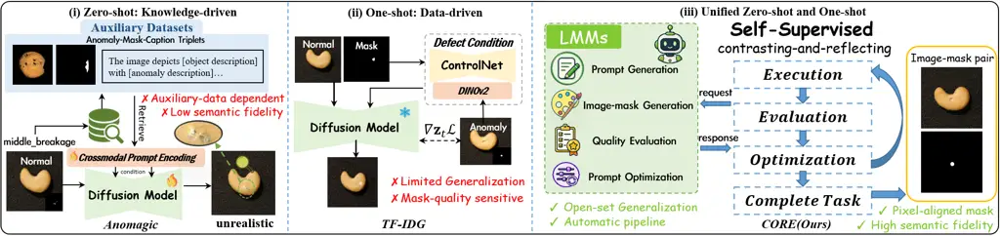
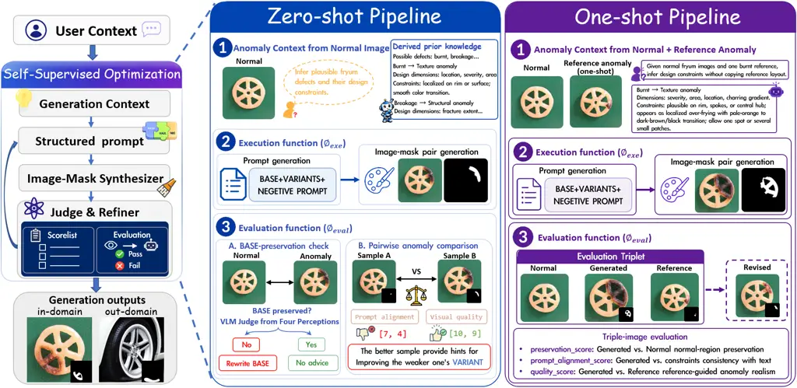
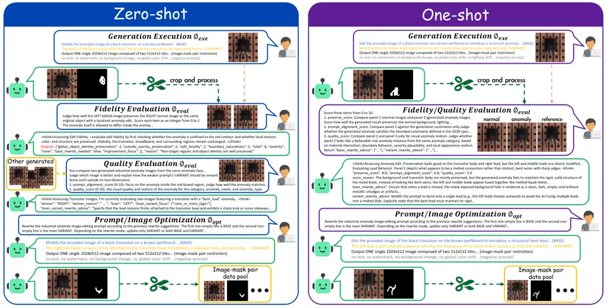
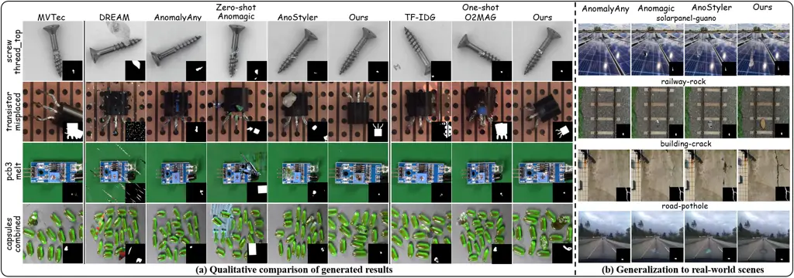

# CORE: Contrast-and-Reflect for Self-Supervised Prompt Optimization in Anomaly Synthesis

Haoxiang Rao    Fang Zhao    Zhao Wang    Weijia Li    Chenyang Si   
Caifeng Shan

###### Abstract

Industrial anomaly detection (AD) is bottlenecked by the scarcity of
anomalous samples, making high-fidelity anomaly synthesis crucial for
improving downstream performance. However, existing methods either rely
on scarce real anomaly references or auxiliary data, while lacking
complex reasoning and iterative optimization capabilities for generating
realistic defects in open-set scenarios. To address these challenges, we
propose CORE, a cost-efficient and training-free prompt optimization
framework based on Large Multimodal Models (LMMs), which unifies
zero-shot and one-shot anomaly synthesis. CORE first introduces an
Anomaly Context Grounding module to transform sparse user context into
defect-aware generation context, which is subsequently instantiated as
structured anomaly prompts that disentangle normal-region preservation
from anomaly-specific variation, enabling controllable and faithful
defect generation. Furthermore, CORE autonomously refines prompts
through a self-supervised contrast-and-reflect mechanism. This design
empowers general-purpose LMMs to synthesize realistic anomalies under
both zero-shot and one-shot settings without task-specific training.
Extensive experiments on MVTec-AD and VisA demonstrate that CORE
synthesizes realistic and diverse anomalies, yielding superior
improvements in downstream AD performance. Furthermore, its
model-agnostic and plug-and-play paradigm enables effortless integration
with diverse LMMs, facilitating adaptation to unseen open-set scenarios.

¹School of Intelligence Science and Technology, Nanjing University
 ²China Mobile Zijin Innovation Institute

²²footnotetext: Corresponding Authors.

## Introduction



Figure 1: Comparison of representative anomaly synthesis paradigms,
where existing (i) zero-shot and (ii) one-shot methods are limited by
their reliance on auxiliary datasets and scarce anomaly references,
respectively, while (iii) CORE unifies both settings through
self-supervised closed-loop optimization for realistic and generalizable
anomaly synthesis.

Industrial anomaly detection (AD) plays a crucial role in inspection and
quality control by identifying, localizing, and categorizing visual
defects (Liu et al. 2024; Huang et al. 2025). However, industrial data
suffer from severe data imbalance, where normal samples are abundant
while anomalous samples are scarce. Although models trained (Li et al.
2024; Guo et al. 2025) solely on normal data can detect distributional
deviations, their ability to localize and classify anomalies in complex
scenarios remains limited due to insufficient modeling of real defect
patterns. This motivates anomaly synthesis as an effective means to
enrich defect distributions and improve supervised AD. Therefore,
synthesizing realistic and diverse anomalies has emerged as a key
strategy to enhance supervised AD.

Anomaly synthesis methods can be broadly categorized into zero-shot and
few-shot settings according to the availability of real anomalous
samples. Zero-shot methods are attractive for defect-scarce industrial
scenarios (Zhang et al. 2024; Sun et al. 2025), but early cut-paste
strategies (Li et al. 2021; Zavrtanik et al. 2021) often lack structural
consistency and contextual realism. Recent diffusion-based approaches
improve visual quality by leveraging pretrained generative priors, e.g.,
anomaly-related attention strengthen (Sun et al. 2025) or text-guided
style transfer (So and Kang 2026). However, such internal guidance
provides limited anomaly-specific knowledge, while Anomagic (Jiang et
al. 2026) retrieves relevant anomalous pairs from purpose-built
auxiliary data, as shown in Fig. 1(i), making its performance highly
dependent on data quality and retrieval accuracy. These dependencies
introduce substantial computational and data-preparation overhead,
hindering efficient adaptation to open-set scenarios.

Few-shot methods leverage real anomalies to improve synthesis fidelity,
yet training-based approaches are prone to overfitting when anomalies
are extremely scarce (Hu et al. 2024; Dai et al. 2025). More practical
one-shot training-free methods (Xu et al. 2025; Rao et al. 2026), as
illustrated in Fig. 1(ii), use a single anomaly reference to guide
generation, yet rely on anomaly masks for defect placement and remain
sensitive to spatially implausible locations. Moreover, their limited
ability to model logical and abstract anomalies restricts coverage of
complex defects. These limitations motivate a unified framework capable
of synthesizing realistic and diverse anomalies across zero-shot and
one-shot settings.

Recent advances in Large Multimodal Models (LMMs) have demonstrated
strong open-world visual understanding, reasoning, and generation
capabilities (Wu et al. 2025; Deng et al. 2025; Seedream et al. 2025).
Although LMMs have been explored for anomaly detection (Li et al. 2023;
Gu et al. 2024), their potential for industrial anomaly synthesis
remains underexplored. Due to limited domain-specific knowledge and weak
sensitivity to fine-grained local defects, directly using
general-purpose LMMs often fails to stably generate realistic,
localized, and semantically accurate anomalies. To address these
limitations, we propose CORE, a cost-efficient and training-free
LMM-based framework that achieves high-fidelity anomaly synthesis via
self-supervised prompt optimization.

As illustrated in Fig. 1(iii), CORE provides a unified training-free
framework for both zero-shot and one-shot anomaly synthesis. In
industrial inspection, anomalies typically manifest as local deviations
from otherwise normal products. Accordingly, we formulate anomaly
synthesis as an image editing task to introduce plausible defect
patterns into a given normal image without modifying its non-anomalous
content. To enable controllable anomaly editing, CORE first grounds
available visual and semantic contexts into defect-aware generation
context, which is then instantiated as structured prompts. Following the
normal-anomaly separability principle (Duan et al. 2025; Rao et al.
2026), CORE decomposes the generation prompt into three complementary
parts: BASE to preserve normal content, VARIANT to specify
anomaly-related variations, and NEGATIVE to suppress undesired artifacts
and irrelevant modifications. To further improve generation quality,
CORE introduces a contrasting-and-reflecting mechanism inspired by
LLM-as-a-judge studies (Zheng et al. 2023; Wang et al. 2024; Yuksekgonul
et al. 2025), forming a closed-loop optimization process.

In the zero-shot setting, the key challenge is optimizing anomaly
prompts without access to real anomalous references. CORE addresses this
challenge by observing that prompt quality can be reflected through the
generated results: a well-designed anomaly prompt should simultaneously
achieve semantic consistency, local defect realism, and faithful
preservation of non-anomalous regions. Instead of relying on human
annotations or real anomaly references, CORE derives self-supervised
optimization signals by contrasting candidates generated from different
prompts. The comparison results expose prompt-level weaknesses in
semantic consistency, local realism, and preservation of normal regions,
and the resulting reflective feedback is used to revise weaker prompts.
In the one-shot setting, CORE incorporates a single real anomaly
reference as a weak visual anchor for category-level realism rather than
a template for direct replication. This enables the model to capture
defect appearance and material interaction while avoiding overfitting to
the reference’s specific shape, location, or extent. In this way, CORE
treats both generated outputs and limited anomaly references as feedback
sources for prompt refinement, enabling realistic and diverse anomaly
synthesis without task-specific training.

Our main contributions are summarized as follows:

- •
  We propose CORE, a cost-efficient and training-free unified framework
  for both zero-shot and one-shot industrial anomaly synthesis, reducing
  reliance on real anomalies, finetuning, and auxiliary datasets.
- •
  We introduce a contrasting-and-reflecting mechanism that converts
  generated results and limited references into self-supervised feedback
  for prompt optimization.
- •
  Experiments on MVTec-AD and VisA demonstrate that CORE achieves
  superior generation quality and downstream AD performance, while
  enabling plug-and-play transfer across LMM backends and strong
  generalization to unseen objects in open-world scenarios.

## Related Work

### Anomaly Generation

Few-shot Anomaly Generation. Few-shot anomaly generation synthesizes
diverse anomalies from limited real samples in the target category.
Recent methods have evolved from GAN-based generation (Goodfellow et al.
2020; Duan et al. 2023) to diffusion models with stronger generative
capacity. Some approaches freeze the diffusion backbone and learn
anomaly-specific embeddings (Hu et al. 2024; Gui et al. 2024; Lu et al.
2025; Gal et al. 2023), while others (Jin et al. 2025; Song et al. 2025;
Dai et al. 2025; Tong et al. 2026) finetune the backbone following
DreamBooth personalization (Ruiz et al. 2023). However, when anomalous
samples are extremely scarce, training-based methods are prone to
overfitting and unreliable distribution modeling, motivating
training-free anomaly generation. Among training-free methods,
TF-IDG (Xu et al. 2025) guides anomaly appearance by minimizing the
distribution discrepancy between generated and real defects, while
O2MAG (Rao et al. 2026) transfers anomaly patterns by manipulating
multiple diffusion processes via self-attention grafting. Nevertheless,
both methods are sensitive to spatial plausibility of anomaly masks and
provide limited support for logical anomalies.

Zero-shot Anomaly Generation. Zero-shot anomaly generation aims to
synthesize realistic defects for unseen categories without requiring
anomalous samples. Early cut-paste methods (Li et al. 2021; Zavrtanik et
al. 2021) overlay external textures onto normal images, but lack
structural consistency and contextual realism. AnomalyAny (Sun et al. 2025) enhances anomaly-related token responses by modifying the
cross-attention mechanism (Vaswani et al. 2017) of Stable Diffusion, yet
token-level guidance remains limited in capturing complex anomaly
semantics. Anomagic (Jiang et al. 2026) introduces cross-modal prompts
and auxiliary retrieval, but its performance depends on auxiliary data
quality and retrieval accuracy. AnoStyler (So and Kang 2026) formulates
anomaly generation as text-guided style transfer and fine-tunes a
stylization network at test time. Overall, these methods remain
constrained by limited anomaly-specific guidance and struggle to
generate realistic defects.

### Large Multimodal Models (LMMs)

Large Multimodal Models (LMMs) (Hurst et al. 2024; Team et al. 2023)
have shown strong capabilities in open-world visual understanding,
reasoning and generation. Representative systems such as Gemini (Team et
al. 2023) and GPT (Hurst et al. 2024) demonstrate the potential of
general-purpose multimodal models as flexible generators conditioned on
visual and textual inputs. While recent studies have explored LMMs for
industrial anomaly detection (Zhang et al. 2025; Li et al. 2026), their
ability to synthesize realistic industrial anomalies remains
underexplored. Since LMMs are trained on broad Internet-scale data and
lack domain-specific defect priors, directly using them may cause
inaccurate anomaly semantics or unintended changes to non-anomalous
regions. CORE addresses this by treating LMMs as black-box backends and
performing self-supervised prompt optimization through a
contrast-and-reflect mechanism.

## Method

We formulate anomaly synthesis as a constrained image editing task, with
the goal of autonomously optimizing the anomaly prompt $`P`$ to generate
anomalous image-mask pairs. To bridge the domain knowledge gap between
general-purpose Large Multimodal Models (LMMs) and industrial anomaly
synthesis while minimizing human intervention, we propose CORE, a
self-supervised framework that constructs and optimizes anomaly prompts
through a contrast-and-reflect mechanism. CORE derives setting-specific
feedback signals to guide prompt optimization under both zero-shot and
one-shot synthesis scenarios. The following subsections introduce the
overall framework, structured prompt formulation, and prompt
optimization mechanism.



Figure 2: Overview of the CORE framework. CORE unifies zero-shot and
one-shot anomaly synthesis within a self-supervised
Execute-Evaluate-Optimize loop. Starting from user-provided inputs, CORE
derives anomaly generation context and iteratively evaluates and refines
the generation process, enabling realistic and diverse anomaly
generation.

### Framework Overview

As shown in Fig. 2, CORE is a self-supervised prompt optimization
framework composed of three fundamental functions: (1) Execution
function $`\phi_{\mathrm{exe}}`$ takes the current prompt $`P`$ and
invokes the LMM to generate an anomalous image-mask pair
$`(I^{a},M^{a})`$; (2) Evaluation function $`\phi_{\mathrm{eval}}`$
assesses the quality of the generated anomaly image and produces
feedback $`F`$, which serves as guidance for subsequent prompt
optimization; (3) Optimization function $`\phi_{\mathrm{opt}}`$ updates
the current anomaly prompt according to the feedback $`F`$ and feeds the
revised prompt $`P^{\star}`$ back to $`\phi_{\mathrm{exe}}`$ for
image-mask regeneration, enabling iterative refinement throughout the
optimization process.

These functions form a closed loop of execution, evaluation, and
optimization. Starting from an initial prompt, CORE automatically
generates anomaly image-mask pairs, diagnoses their failure modes, and
refines the structured prompt for the next iteration. Through this
feedback-driven refinement process, CORE converts generated results into
optimization feedback, enabling iterative prompt refinement with
black-box LMMs without manual intervention.

### Structured Prompt Formulation

To bridge the context gap between sparse user context and defect-aware
generation context, CORE decomposes prompt formulation into two stages.
It first derives anomaly design dimensions and generation constraints
from the normal images, optionally supplemented by one anomaly
reference, and then instantiates them into a structured prompt for
image–mask generation and refinement. This formulation reduces the
ambiguity of direct prompting and avoids implausible anomalies and
unintended changes to normal regions.

Anomaly Context Grounding. Given two normal images, optionally
supplemented with one anomaly reference in the one-shot setting, CORE
derives anomaly generation contexts from two complementary aspects:
design dimensions $`D`$ and generation constraints $`G`$. The design
dimensions specify the admissible variation space of the target anomaly,
whereas the constraints restrict their instantiation to semantically
consistent, structurally plausible, and material-consistent
manifestations while preserving normal regions and suppressing
irrelevant changes. This separation distinguishes the anomaly variation
space from the validity conditions governing generation and defines a
constrained anomaly space that provides a unified basis for prompt
construction, result evaluation, and prompt optimization. In the
zero-shot setting, CORE relies solely on the normal images and leverages
the LMM’s internal knowledge to infer plausible anomaly variations and
object-specific generation constraints. In the one-shot setting, one
real anomaly reference further enriches the context with informative
visual cues about defect appearance and material interaction, without
encouraging instance-level copying.



Figure 3: A running example of feedback-driven prompt optimization in
CORE. Starting from an initial structured prompt, CORE performs
generation, evaluation, and prompt optimization to progressively improve
the synthesized image–mask pairs.

Structured Anomaly Prompt. Based on the grounded anomaly context, CORE
instantiates the executable anomaly prompt as $`P=\{B,V,N\}`$, where
$`B`$, $`V`$, and $`N`$ denote BASE, VARIANT, and NEGATIVE,
respectively. BASE encodes the preservation constraints in $`G`$,
specifying the source content that should remain invariant during
editing. VARIANT instantiates anomaly-specific attributes from the
design dimensions $`D`$, including anomaly location, morphology, texture
and material interaction, while remaining consistent with the
constraints defined in $`G`$. NEGATIVE is a general-purpose clause to
suppress irrelevant artifacts, global appearance shifts and implausible
deformations, and remains fixed throughout optimization. During
execution, a fixed mask instruction $`M`$ is inserted, enabling joint
generation of an aligned anomaly image–mask pair. Through this
decomposition, CORE explicitly disentangles normal-region preservation
from anomaly semantic variation, reducing editing drift. Moreover, the
component-wise prompt structure aligns evaluation feedback with the
corresponding prompt component, enabling targeted and interpretable
refinement.

### Self-Supervised Prompt Optimization

CORE optimizes the structured anomaly prompt by converting generated
results into self-supervised feedback signals. The key observation is
that prompt quality is implicitly reflected in the generated outputs: a
high-quality anomaly prompt should produce defects that are semantically
aligned with the intended anomaly, locally realistic for the target
material, and faithful to the normal regions of the input image. Instead
of manual prompt tuning, CORE identifies generation deficiencies and
revises the corresponding prompt components through a
contrast-and-reflect mechanism.

Given a normal image $`I^{n}`$ and a structured anomaly prompt
$`P=\{B,V,N\}`$, the execution function $`\phi_{\mathrm{exe}}`$ invokes
the black-box LMM to generate an anomaly image-mask pair:

```math
(I^{a},M^{a})=\phi_{\mathrm{exe}}(I^{n},P), \tag{1}
```

where $`I^{a}`$ and $`M^{a}`$ denote the synthesized anomalous image and
its corresponding anomaly mask. The generated result is then evaluated
under a setting-specific feedback function:

```math
F=\phi_{\mathrm{eval}}\left(I^{n},G,P,(I^{a},M^{a}),\mathcal{R}^{(s)}\right),\quad P_{\mathrm{opt}}=\phi_{\mathrm{opt}}(P,F), \tag{2}
```

where $`s\in\{\mathrm{zero},\mathrm{one}\}`$ denotes the synthesis
setting. Based on the failure modes identified in $`F`$, the
optimization function selectively rewrites BASE or VARIANT, while the
shared NEGATIVE component $`N`$ remains unchanged.

Zero-shot. In the zero-shot setting, no real anomaly reference is
available for assessing anomaly realism. CORE addresses this challenge
by deriving self-supervised optimization signals from the relative
evaluation of its generated outputs. Given a user-specified number of
candidates $`K`$, CORE constructs a candidate pool from multiple prompt
variants:

```math
\mathcal{C}=\left\{(P_{k},I_{k}^{a},M_{k}^{a})\right\}_{k=1}^{K}, \tag{3}
```

where each candidate is generated from a different structured prompt.
Since no ground-truth anomaly is available, CORE decouples the
evaluation into normal-region preservation and anomaly-region quality.

For normal-region preservation, CORE compares each generated result with
the input normal image:

```math
F_{\mathrm{BASE},k}=\phi_{\mathrm{eval}}^{\mathrm{BASE}}\left(I_{k}^{n},(I_{k}^{a},M_{k}^{a})\right). \tag{4}
```

This evaluation focuses on whether regions outside the anomaly mask are
faithfully preserved, thereby identifying BASE-related failures such as
background changes, lighting shifts, material inconsistency, or
object-identity distortion.

For anomaly-region quality, CORE performs pairwise output comparison
between generated candidates:

```math
F_{\mathrm{VARIANT}}^{i,j}=\phi_{\mathrm{eval}}^{\mathrm{OvO}}\left((P_{i},I_{i}^{a},M_{i}^{a}),(P_{j},I_{j}^{a},M_{j}^{a})\right),\quad i\neq j. \tag{5}
```

Here, OvO denotes Output vs. Output evaluation, which contrasts outputs
from different prompts to derive relative quality feedback while
accommodating multiple valid defect appearances. The LMM evaluates each
pair by prompt alignment with $`G`$ and anomaly quality in terms of
local realism, structural plausibility, and material consistency. The
preferred candidate provides evidence for identifying deficiencies in
the weaker candidate, enabling targeted correction without encouraging
appearance-level imitation. Pairwise feedback assigned to each candidate
is then aggregated as $`F_{\mathrm{VARIANT},k}`$, and the corresponding
prompt is refined by

```math
P_{\mathrm{opt},k}=\phi_{\mathrm{opt}}\left(P_{k},F_{\mathrm{BASE},k},F_{\mathrm{VARIANT},k}\right). \tag{6}
```

CORE thus derives reference-free optimization feedback from its
generated candidates, enabling zero-shot prompt refinement without real
anomaly samples.

One-shot. In the one-shot setting, CORE incorporates a single real
anomaly reference $`(I_{\mathrm{ref}},M_{\mathrm{ref}})`$ as weak visual
guidance. Rather than serving as a template for direct replication, the
reference provides evidence about defect appearance, structural
plausibility, and material interaction. Given a generated result
$`(I^{a},M^{a})`$, CORE performs Output vs. Ground Truth (OvG)
evaluation by jointly assessing the source normal image, generated
anomaly and real anomaly reference:

```math
F_{\mathrm{OvG}}=\phi_{\mathrm{eval}}^{\mathrm{OvG}}\left(I^{n},G,P,(I^{a},M^{a}),(I_{\mathrm{ref}},M_{\mathrm{ref}})\right). \tag{7}
```

The LMM evaluates the generated result along three dimensions:
preservation score, measuring the fidelity of normal regions;
prompt-alignment score, measuring consistency with the textual
constraints $`G`$; and quality score, assessing anomaly realism under
the guidance of the real reference. Together, these scores and their
diagnostic feedback constitute $`F_{\mathrm{OvG}}`$, which determines
whether the current prompt is retained or whether Base, Variant, or both
are refined. The optimized prompt is obtained as

```math
P_{\mathrm{opt}}=\phi_{\mathrm{opt}}(P,F_{\mathrm{OvG}}). \tag{8}
```

Consequently, CORE derives feedback directly from generated outputs in
the zero-shot setting and incorporates weak reference guidance in the
one-shot setting, providing a unified formulation for anomaly synthesis.
Detailed scoring and refinement rules are provided in the appendix.

## Experiments

|                               |          |      |      |       |      |      |      |       |      |      |       |      |      |      |
| ----------------------------- | -------- | ---- | ---- | ----- | ---- | ---- | ---- | ----- | ---- | ---- | ----- | ---- | ---- | ---- |
|                               | MVTec-AD |      |      |       |      |      |      | VisA  |      |      |       |      |      |      |
| Method                        | I-AUC    | I-AP | I-F1 | P-AUC | P-AP | P-F1 | PRO  | I-AUC | I-AP | I-F1 | P-AUC | P-AP | P-F1 | PRO  |
| One-Shot Anomaly Generation   |          |      |      |       |      |      |      |       |      |      |       |      |      |      |
| TF-IDG (Xu et al. 2025)       | 89.9     | 95.6 | 93.0 | 88.5  | 48.6 | 50.2 | 76.2 | 90.9  | 93.1 | 86.9 | 93.7  | 44.3 | 47.4 | 80.6 |
| O2MAG (Rao et al. 2026)       | 95.9     | 98.3 | 94.9 | 89.4  | 51.2 | 51.7 | 83.2 | 91.7  | 94.1 | 88.1 | 94.8  | 47.5 | 50.7 | 83.8 |
| CORE (Ours)                   | 96.5     | 98.7 | 96.3 | 96.5  | 66.7 | 64.6 | 87.2 | 92.5  | 94.5 | 88.7 | 97.9  | 53.0 | 55.1 | 84.9 |
| Zero-Shot Anomaly Generation  |          |      |      |       |      |      |      |       |      |      |       |      |      |      |
| DRAEM (Zavrtanik et al. 2021) | 92.2     | 96.2 | 92.5 | 85.5  | 43.4 | 45.1 | 74.2 | 85.7  | 87.8 | 82.9 | 89.7  | 20.0 | 26.4 | 75.9 |
| AnomalyAny (Sun et al. 2025)  | 86.8     | 94.1 | 89.8 | 89.7  | 37.1 | 40.8 | 74.7 | 83.5  | 85.6 | 82.5 | 90.3  | 17.7 | 22.8 | 72.8 |
| Anomagic (Jiang et al. 2026)  | 92.0     | 96.4 | 92.4 | 88.1  | 44.5 | 46.9 | 79.5 | 87.5  | 90.0 | 83.8 | 89.2  | 20.7 | 27.5 | 75.9 |
| AnoStyler (So and Kang 2026)  | 89.1     | 95.1 | 91.5 | 82.7  | 37.5 | 39.2 | 71.1 | 88.4  | 92.0 | 85.3 | 89.9  | 23.8 | 30.4 | 82.5 |
| CORE (Ours)                   | 96.4     | 98.9 | 95.7 | 96.4  | 62.8 | 61.6 | 87.4 | 90.9  | 92.3 | 86.7 | 96.2  | 38.5 | 44.3 | 82.6 |

Table 1: Comparison of one-shot and zero-shot anomaly synthesis methods
on MVTec-AD and VisA. All results are reported as percentages, with the
best and second-best results within each setting highlighted in bold and
underlined, respectively.

### Experiment Settings

Datasets. We conduct experiments on two representative industrial
anomaly detection benchmarks: MVTec-AD (Bergmann et al. 2019) and
VisA (Zou et al. 2022). MVTec-AD contains 10 object categories and 5
texture categories, while VisA includes 12 categories of complex
industrial objects. To simulate realistic industrial inspection
scenarios with scarce anomalies, we evaluate CORE under two settings:
(1) zero-shot setting, where no anomalous samples are used for
synthesis; and (2) one-shot setting, where one anomalous sample is
provided as the reference for each defect type and excluded from
downstream evaluation, ensuring no overlap between the reference and
evaluation sets.

|                              |                   |                 |                   |                 |
| ---------------------------- | ----------------- | --------------- | ----------------- | --------------- |
|                              | MVTec-AD          |                 | VisA              |                 |
| Method                       | IC-L $`\uparrow`$ | IS $`\uparrow`$ | IC-L $`\uparrow`$ | IS $`\uparrow`$ |
| Zero-Shot Anomaly Generation |                   |                 |                   |                 |
| AnomalyAny (Sun et al. 2025) | 0.29              | 2.04            | 0.10              | 1.66            |
| Anomagic (Jiang et al. 2026) | 0.28              | 2.09            | 0.34              | 1.83            |
| AnoStyler (So and Kang 2026) | 0.27              | 1.59            | 0.31              | 1.37            |
| CORE (Ours)                  | 0.28              | 2.13            | 0.34              | 1.54            |
| One-Shot Anomaly Generation  |                   |                 |                   |                 |
| TF-IDG (Xu et al. 2025)      | 0.23              | 1.73            | 0.25              | 1.32            |
| O2MAG (Rao et al. 2026)      | 0.27              | 1.56            | 0.31              | 1.41            |
| CORE (Ours)                  | 0.28              | 2.08            | 0.33              | 1.51            |

Table 2: Comparison of anomaly generation on MVTec-AD and VisA under
zero-shot and one-shot anomaly synthesis settings. Bold and underline
represent optimal and sub-optimal results. On VisA, some zero-shot
methods introduce larger changes at implausible locations, which may
artificially inflate their IS.

Baselines. We evaluate the training-free CORE framework under both
zero-shot and one-shot settings. In the zero-shot setting, we compare
CORE with DRAEM (Zavrtanik et al. 2021) (handcrafted synthesis),
AnomalyAny (Sun et al. 2025) (training-free method), Anomagic (Jiang et
al. 2026) (fine-tuning with inpainting Stable Diffusion model), and
AnoStyler (So and Kang 2026) (fine-tuning with stylization network). In
the one-shot setting, we compare CORE with recent training-free methods
TF-IDG (Xu et al. 2025) and O2MAG (Rao et al. 2026). Training-based
few-shot methods are excluded because they are designed for few-shot
protocols, typically using one-third of the anomalous images in each
defect category as reference data for generation. Under the stricter
one-shot setting, their training process becomes unstable and prone to
overfitting.

Implementation Details. We use Gemini-3.1-Pro as the text-side agent for
prompt generation, evaluation, and optimization, and Nano Banana 2 as
the image generator. To further validate the generality of CORE, we also
adopt OpenAI’s GPT-5 Mini and GPT-Image-2 for prompt optimization and
image synthesis in the ablation study. For cost efficiency, we perform
one iteration of the Execute-Evaluate-Optimize loop, which already
yields substantial gains in downstream anomaly detection. Fig. 3
illustrates an example of CORE’s optimization process. The text-side
stages average 9 seconds and \$0.01 per sample, while image generation
requires $`18`$ seconds/\$0.06 with Nano Banana 2 and $`15`$
seconds/\$0.03 with GPT-Image-2. More details are supplied in
Appendix B.



Figure 4: Qualitative comparison of anomaly synthesis results. (a)
compares CORE with representative zero-shot and one-shot anomaly
synthesis methods on MVTec-AD and VisA, showing that CORE produces more
realistic and localized anomalies while better preserving non-anomalous
regions; (b) further illustrates its generalization to real-world
scenes.

| Setting   | Variant       | MVTec-AD |      |      |       |      |      |      | VisA  |      |      |       |      |      |      |
| --------- | ------------- | -------- | ---- | ---- | ----- | ---- | ---- | ---- | ----- | ---- | ---- | ----- | ---- | ---- | ---- |
|           |               | I-AUC    | I-AP | I-F1 | P-AUC | P-AP | P-F1 | PRO  | I-AUC | I-AP | I-F1 | P-AUC | P-AP | P-F1 | PRO  |
| One-shot  | w/o ACG       | 93.2     | 97.2 | 93.8 | 94.7  | 59.7 | 58.6 | 85.1 | 88.6  | 91.0 | 85.3 | 96.2  | 43.1 | 45.7 | 78.4 |
|           | Initial (ACG) | 94.2     | 97.9 | 94.6 | 95.3  | 63.5 | 61.6 | 85.2 | 91.3  | 93.2 | 87.3 | 96.0  | 45.1 | 49.3 | 83.0 |
|           | Google        | 96.5     | 98.7 | 96.3 | 96.5  | 66.7 | 64.6 | 87.2 | 92.5  | 94.5 | 88.7 | 97.9  | 53.0 | 55.1 | 84.9 |
|           | OpenAI        | 95.3     | 98.3 | 95.3 | 97.2  | 67.4 | 64.4 | 88.3 | 91.8  | 94.1 | 88.3 | 97.5  | 50.0 | 53.6 | 86.5 |
| Zero-shot | w/o ACG       | 93.1     | 97.3 | 94.2 | 95.2  | 57.6 | 57.3 | 83.7 | 88.6  | 90.6 | 84.9 | 95.3  | 35.0 | 40.2 | 80.5 |
|           | Initial (ACG) | 93.0     | 97.7 | 93.9 | 95.4  | 60.1 | 59.0 | 84.5 | 88.8  | 91.3 | 85.0 | 95.5  | 36.8 | 42.4 | 81.4 |
|           | Google        | 96.4     | 98.9 | 95.7 | 96.4  | 62.8 | 61.6 | 87.4 | 90.9  | 92.3 | 86.7 | 96.2  | 38.5 | 44.3 | 82.6 |
|           | OpenAI        | 95.2     | 98.5 | 95.7 | 96.1  | 66.0 | 63.2 | 87.4 | 89.3  | 92.0 | 86.0 | 96.0  | 41.6 | 44.5 | 83.8 |

Table 3: Ablation study of ACG and prompt optimization with different
image generators. Initial (ACG) is shared by the Google and OpenAI
optimization backends, while w/o ACG removes anomaly context grounding.

### Anomaly Generation Results

Following the full-shot experimental setting of AnomalyAny, we generate
100 anomalous images for each defect type. DRAEM (Zavrtanik et al. 2021)
is excluded because it synthesizes anomalies using random textures
cropped from external datasets. We adopt Inception Score (IS) (Salimans
et al. 2016) and Intra-Cluster pairwise LPIPS distance (IC-L) (Ojha et
al. 2021) to evaluate generation quality and diversity, respectively.

As shown in Table 2, CORE achieves the best performance across all
metrics in the one-shot setting, demonstrating that it effectively
leverages a single anomaly reference as a weak visual prior while
preserving generation diversity and avoiding appearance-level
overfitting. CORE also achieves competitive performance in the zero-shot
setting. Anomagic obtains the highest class-wise IS on VisA, whereas the
examples in Fig. 4(a) reveal that AnomalyAny introduces unintended
changes to the board texture and component appearance, and Anomagic
generates a prominent metallic structure extending beyond the local
component region. Since IS evaluates full-image statistics, such salient
changes may improve the score without necessarily enhancing localized
defect fidelity. Additionally, existing zero-shot methods often struggle
to synthesize complex logical anomalies, whereas one-shot baselines
remain sensitive to the spatial plausibility of anomaly masks. By
contrast, CORE better preserves normal content while generating
content-aware logical anomalies and structurally consistent image-mask
pairs. Fig. 4(b) further demonstrates its generalization to unseen
objects in open-world scenarios, with additional qualitative examples
provided in Appendix E.

### Anomaly Detection Results

We further evaluate the downstream effectiveness of different anomaly
synthesis methods for anomaly detection and localization, following the
evaluation protocols of O2MAG (Rao et al. 2026) and TF-IDG (Xu et al.
2025). For each defect type, we synthesize 100 anomalous images and use
them to train a U-Net segmentation model that predicts pixel-level
anomaly masks from input images. We report Area Under ROC Curve (AUROC),
Average Precision (AP), and F1-score at both the image level and pixel
level. We additionally report Per-Region Overlap (PRO) to assess
region-level anomaly localization. Table 1 reports the results averaged
over categories within each benchmark dataset. The full category-wise
results of CORE are provided in Appendix D. Under both zero-shot and
one-shot settings, CORE achieves state-of-the-art anomaly detection
performance on MVTec-AD and VisA, highlighting its strong generalization
ability.

### Ablation Study

Table 3 evaluates the effectiveness of ACG and prompt optimization,
along with CORE’s cross-backend generalization.

Effect of Anomaly Context Grounding. We compare ACG with direct
prompting under the Google configuration with Gemini-3.1-Pro and Nano
Banana 2, while keeping the visual inputs and all other experimental
settings unchanged. As shown in Table 3, ACG consistently improves
performance by transforming sparse user input into the defect-aware
generation context required by general-purpose LMMs.

Effect of Prompt Optimization. Starting from this shared ACG
initialization, the Google configuration consistently improves
downstream anomaly detection and localization through prompt
optimization. These gains validate the effectiveness of the proposed
contrast-and-reflect mechanism in refining anomaly prompts and enhancing
the downstream utility of synthesized samples.

Generalization across Model Backends. We further replace the
optimization-stage LMM and regeneration backend with GPT-5 Mini and
GPT-Image-2 while keeping the shared initialization fixed. The resulting
improvements under both zero-shot and one-shot settings demonstrate its
model-agnostic generalization across model backends. Detailed
category-wise results are provided in Appendix D.

## Conclusion

In this paper, we introduced CORE, a cost-efficient and training-free
prompt optimization framework that unifies zero-shot and one-shot
industrial anomaly synthesis. Through Anomaly Context Grounding, CORE
transforms sparse user-provided context into the defect-aware generation
context required by general-purpose LMMs and produces structured prompts
that disentangle normal-content preservation from anomaly-specific
variation. CORE further enables automatic prompt optimization through a
self-supervised contrast-and-reflect mechanism, without task-specific
training or manual prompt tuning. Extensive experiments on MVTec-AD and
VisA demonstrate that CORE improves both generation quality and
downstream anomaly detection performance. Its model-agnostic design
further enables plug-and-play transfer across different LMM backends and
generalization to unseen objects in open-world scenarios.

## References

- Bergmann et al. (2019) P. Bergmann, M. Fauser, D. Sattlegger, and C.
  Steger MVTec ad–a comprehensive real-world dataset for unsupervised
  anomaly detection. In Proceedings of the IEEE/CVF conference on
  computer vision and pattern recognition, pp. 9592–9600. Cited by:
  Experiment Settings.
- Dai et al. (2025) Z. Dai, S. Zeng, H. Liu, X. Li, F. Xue, and Y. Zhou
  Seas: few-shot industrial anomaly image generation with separation and
  sharing fine-tuning. In Proceedings of the IEEE/CVF International
  Conference on Computer Vision, pp. 23135–23144. Cited by:
  Introduction, Anomaly Generation.
- Deng et al. (2025) C. Deng, D. Zhu, K. Li, C. Gou, F. Li, Z. Wang, S.
  Zhong, W. Yu, X. Nie, Z. Song, et al. Emerging properties in unified
  multimodal pretraining. External Links: 2505.14683,
  [Link](https://arxiv.org/abs/2505.14683) Cited by: Introduction.
- Duan et al. (2025) Y. Duan, W. Xu, Q. Wu, G. Xie, F. Zhao, and C. Shan
  AnomalyControl: highly-aligned anomalous image generation with
  controlled diffusion model. In Proceedings of the 33rd ACM
  International Conference on Multimedia, pp. 8048–8057. Cited by:
  Introduction.
- Duan et al. (2023) Y. Duan, Y. Hong, L. Niu, and L. Zhang Few-shot
  defect image generation via defect-aware feature manipulation. In
  Proceedings of the AAAI conference on artificial intelligence, Vol.
  37, pp. 571–578. Cited by: Anomaly Generation.
- Gal et al. (2023) R. Gal, Y. Alaluf, Y. Atzmon, O. Patashnik, A. H.
  Bermano, G. Chechik, and D. Cohen-Or An image is worth one word:
  personalizing text-to-image generation using textual inversion. In The
  Eleventh International Conference on Learning Representations,
  External Links: [Link](https://openreview.net/forum?id=NAQvF08TcyG)
  Cited by: Anomaly Generation.
- Goodfellow et al. (2020) I. Goodfellow, J. Pouget-Abadie, M. Mirza, B.
  Xu, D. Warde-Farley, S. Ozair, A. Courville, and Y. Bengio Generative
  adversarial networks. Communications of the ACM 63 (11), pp. 139–144.
  Cited by: Anomaly Generation.
- Gu et al. (2024) Z. Gu, B. Zhu, G. Zhu, Y. Chen, M. Tang, and J. Wang
  Anomalygpt: detecting industrial anomalies using large vision-language
  models. In Proceedings of the AAAI conference on artificial
  intelligence, Vol. 38, pp. 1932–1940. Cited by: Introduction.
- Gui et al. (2024) G. Gui, B. Gao, J. Liu, C. Wang, and Y. Wu Few-shot
  anomaly-driven generation for anomaly classification and segmentation.
  In European conference on computer vision, pp. 210–226. Cited by:
  Anomaly Generation.
- Guo et al. (2025) J. Guo, S. Lu, W. Zhang, F. Chen, H. Li, and H. Liao
  Dinomaly: the less is more philosophy in multi-class unsupervised
  anomaly detection. In Proceedings of the Computer Vision and Pattern
  Recognition Conference, pp. 20405–20415. Cited by: Introduction.
- Hu et al. (2024) T. Hu, J. Zhang, R. Yi, Y. Du, X. Chen, L. Liu, Y.
  Wang, and C. Wang Anomalydiffusion: few-shot anomaly image generation
  with diffusion model. In Proceedings of the AAAI conference on
  artificial intelligence, Vol. 38, pp. 8526–8534. Cited by:
  Introduction, Anomaly Generation.
- Huang et al. (2025) H. Huang, P. Wang, J. Pei, J. Wang, S. Alexanian,
  and D. Niyato Deep learning advancements in anomaly detection: a
  comprehensive survey. IEEE Internet of Things Journal. Cited by:
  Introduction.
- Hurst et al. (2024) A. Hurst, A. Lerer, A. P. Goucher, A. Perelman, A.
  Ramesh, A. Clark, A. J. Ostrow, A. Welihinda, A. Hayes, A. Radford, et
  al. GPT-4o system card. External Links: 2410.21276,
  [Link](https://arxiv.org/abs/2410.21276) Cited by: Large Multimodal
  Models (LMMs).
- Jiang et al. (2026) Y. Jiang, W. Luo, H. Zhang, Q. Chen, H. Yao, W.
  Shen, and Y. Cao Anomagic: crossmodal prompt-driven zero-shot anomaly
  generation. In Proceedings of the AAAI Conference on Artificial
  Intelligence, Vol. 40, pp. 5485–5493. Cited by: Introduction, Anomaly
  Generation, Experiment Settings, Table 1, Table 2.
- Jin et al. (2025) Y. Jin, J. Peng, Q. He, T. Hu, J. Wu, H. Chen, H.
  Wang, W. Zhu, M. Chi, J. Liu, et al. Dual-interrelated diffusion model
  for few-shot anomaly image generation. In Proceedings of the IEEE/CVF
  conference on computer vision and pattern recognition,
  pp. 30420–30429. Cited by: Anomaly Generation.
- Li et al. (2021) C. Li, K. Sohn, J. Yoon, and T. Pfister Cutpaste:
  self-supervised learning for anomaly detection and localization. In
  Proceedings of the IEEE/CVF conference on computer vision and pattern
  recognition, pp. 9664–9674. Cited by: Introduction, Anomaly
  Generation.
- Li et al. (2024) X. Li, Z. Zhang, X. Tan, C. Chen, Y. Qu, Y. Xie,
  and L. Ma Promptad: learning prompts with only normal samples for
  few-shot anomaly detection. In Proceedings of the IEEE/CVF Conference
  on Computer Vision and Pattern Recognition, pp. 16838–16848. Cited by:
  Introduction.
- Li et al. (2026) Y. Li, Y. Cao, C. Liu, Y. Xiong, X. Dong, and C.
  Huang Iad-r1: reinforcing consistent reasoning in industrial anomaly
  detection. In Proceedings of the AAAI Conference on Artificial
  Intelligence, Vol. 40, pp. 6583–6591. Cited by: Large Multimodal
  Models (LMMs).
- Li et al. (2023) Y. Li, H. Wang, S. Yuan, M. Liu, D. Zhao, Y. Guo, C.
  Xu, G. Shi, and W. Zuo Myriad: large multimodal model by applying
  vision experts for industrial anomaly detection. External Links:
  2310.19070, [Link](https://arxiv.org/abs/2310.19070) Cited by:
  Introduction.
- Liu et al. (2024) J. Liu, G. Xie, J. Wang, S. Li, C. Wang, F. Zheng,
  and Y. Jin Deep industrial image anomaly detection: a survey. Machine
  Intelligence Research 21 (1), pp. 104–135. Cited by: Introduction.
- Lu et al. (2025) Y. Lu, J. Lin, L. Xie, K. Zhao, Y. Qu, S. Zhang, L.
  Cao, and R. Ji Generate aligned anomaly: region-guided few-shot
  anomaly image-mask pair synthesis for industrial inspection. In
  Proceedings of the 33rd ACM International Conference on Multimedia,
  pp. 11259–11268. Cited by: Anomaly Generation.
- Ojha et al. (2021) U. Ojha, Y. Li, J. Lu, A. A. Efros, Y. J. Lee, E.
  Shechtman, and R. Zhang Few-shot image generation via cross-domain
  correspondence. In Proceedings of the IEEE/CVF conference on computer
  vision and pattern recognition, pp. 10743–10752. Cited by: Anomaly
  Generation Results.
- Rao et al. (2026) H. Rao, Z. Wang, C. Si, Y. Lyu, Y. Duan, F. Zhao,
  and C. Shan One-to-more: high-fidelity training-free anomaly
  generation with attention control. In Proceedings of the IEEE/CVF
  Conference on Computer Vision and Pattern Recognition,
  pp. 28492–28501. Cited by: Introduction, Introduction, Anomaly
  Generation, Experiment Settings, Anomaly Detection Results, Table 1,
  Table 2.
- Ruiz et al. (2023) N. Ruiz, Y. Li, V. Jampani, Y. Pritch, M.
  Rubinstein, and K. Aberman Dreambooth: fine tuning text-to-image
  diffusion models for subject-driven generation. In Proceedings of the
  IEEE/CVF conference on computer vision and pattern recognition,
  pp. 22500–22510. Cited by: Anomaly Generation.
- Salimans et al. (2016) T. Salimans, I. Goodfellow, W. Zaremba, V.
  Cheung, A. Radford, and X. Chen Improved techniques for training gans.
  Advances in neural information processing systems 29. Cited by:
  Anomaly Generation Results.
- Seedream et al. (2025) T. Seedream, Y. Chen, Y. Gao, L. Gong, M.
  Guo, Q. Guo, Z. Guo, X. Hou, W. Huang, Y. Huang, et al. Seedream 4.0:
  toward next-generation multimodal image generation. External Links:
  2509.20427, [Link](https://arxiv.org/abs/2509.20427) Cited by:
  Introduction.
- So and Kang (2026) Y. So and S. Kang Anostyler: text-driven localized
  anomaly generation via lightweight style transfer. In Proceedings of
  the AAAI Conference on Artificial Intelligence, Vol. 40,
  pp. 15734–15742. Cited by: Introduction, Anomaly Generation,
  Experiment Settings, Table 1, Table 2.
- Song et al. (2025) J. Song, D. Park, K. Baek, S. Lee, J. Choi, E. Kim,
  and S. Yoon Defectfill: realistic defect generation with inpainting
  diffusion model for visual inspection. In Proceedings of the Computer
  Vision and Pattern Recognition Conference, pp. 18718–18727. Cited by:
  Anomaly Generation.
- Sun et al. (2025) H. Sun, Y. Cao, H. Dong, and O. Fink Unseen visual
  anomaly generation. In Proceedings of the Computer Vision and Pattern
  Recognition Conference, pp. 25508–25517. Cited by: Introduction,
  Anomaly Generation, Experiment Settings, Table 1, Table 2.
- Team et al. (2023) G. Team, R. Anil, S. Borgeaud, J. Alayrac, J.
  Yu, R. Soricut, J. Schalkwyk, A. M. Dai, A. Hauth, K. Millican, et al.
  Gemini: a family of highly capable multimodal models. External Links:
  2312.11805, [Link](https://arxiv.org/abs/2312.11805) Cited by: Large
  Multimodal Models (LMMs).
- Tong et al. (2026) X. Tong, Y. Lin, J. Lin, X. Mai, H. Wang, Z.
  Tao, Y. Yao, R. Wang, and W. Zhang CADiff: context-aware diffusion for
  controllable anomaly generation in anomaly detection. In Proceedings
  of the AAAI Conference on Artificial Intelligence, Vol. 40,
  pp. 9557–9565. Cited by: Anomaly Generation.
- Vaswani et al. (2017) A. Vaswani, N. Shazeer, N. Parmar, J.
  Uszkoreit, L. Jones, A. N. Gomez, Ł. Kaiser, and I. Polosukhin
  Attention is all you need. Advances in neural information processing
  systems 30. Cited by: Anomaly Generation.
- Wang et al. (2024) X. Wang, C. Li, Z. Wang, F. Bai, H. Luo, J.
  Zhang, N. Jojic, E. Xing, and Z. Hu PromptAgent: strategic planning
  with language models enables expert-level prompt optimization. In The
  Twelfth International Conference on Learning Representations, External
  Links: [Link](https://openreview.net/forum?id=22pyNMuIoa) Cited by:
  Introduction.
- Wu et al. (2025) C. Wu, P. Zheng, R. Yan, S. Xiao, X. Luo, Y. Wang, W.
  Li, X. Jiang, Y. Liu, J. Zhou, et al. OmniGen2: towards
  instruction-aligned multimodal generation. External Links: 2506.18871,
  [Link](https://arxiv.org/abs/2506.18871) Cited by: Introduction.
- Xu et al. (2025) R. Xu, Y. Chiu, T. Chen, O. Chew, Y. Chuang, and W.
  Cheng Training-free industrial defect generation with diffusion
  models. In Proceedings of the IEEE/CVF International Conference on
  Computer Vision, pp. 24214–24223. Cited by: Introduction, Anomaly
  Generation, Experiment Settings, Anomaly Detection Results, Table 1,
  Table 2.
- Yuksekgonul et al. (2025) M. Yuksekgonul, F. Bianchi, J. Boen, S.
  Liu, P. Lu, Z. Huang, C. Guestrin, and J. Zou Optimizing generative ai
  by backpropagating language model feedback. Nature 639, pp. 609–616.
  Cited by: Introduction.
- Zavrtanik et al. (2021) V. Zavrtanik, M. Kristan, and D. Skočaj
  Draem-a discriminatively trained reconstruction embedding for surface
  anomaly detection. In Proceedings of the IEEE/CVF international
  conference on computer vision, pp. 8330–8339. Cited by: Introduction,
  Anomaly Generation, Experiment Settings, Anomaly Generation Results,
  Table 1.
- Zhang et al. (2025) J. Zhang, G. Wang, Y. Jin, and D. Huang Towards
  training-free anomaly detection with vision and language foundation
  models. In Proceedings of the IEEE/CVF Conference on Computer Vision
  and Pattern Recognition, pp. 15204–15213. Cited by: Large Multimodal
  Models (LMMs).
- Zhang et al. (2024) X. Zhang, M. Xu, and X. Zhou Realnet: a feature
  selection network with realistic synthetic anomaly for anomaly
  detection. In Proceedings of the IEEE/CVF conference on computer
  vision and pattern recognition, pp. 16699–16708. Cited by:
  Introduction.
- Zheng et al. (2023) L. Zheng, W. Chiang, Y. Sheng, S. Zhuang, Z.
  Wu, Y. Zhuang, Z. Lin, Z. Li, D. Li, E. Xing, et al. Judging
  llm-as-a-judge with mt-bench and chatbot arena. Advances in neural
  information processing systems 36, pp. 46595–46623. Cited by:
  Introduction.
- Zou et al. (2022) Y. Zou, J. Jeong, L. Pemula, D. Zhang, and O. Dabeer
  Spot-the-difference self-supervised pre-training for anomaly detection
  and segmentation. In European conference on computer vision,
  pp. 392–408. Cited by: Experiment Settings.
