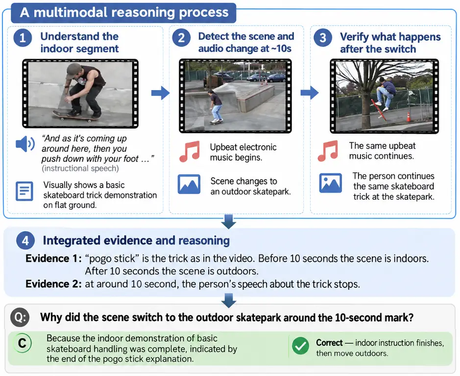
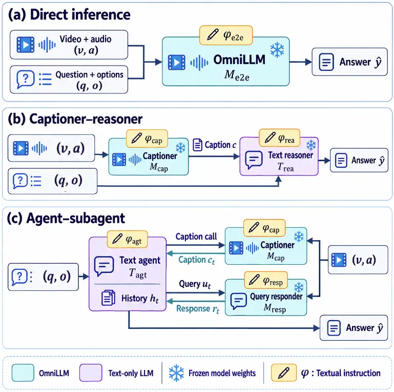

# DESIGNING TEXTUAL INTERFACES TO ENHANCE LLM REASONING ON AUDIO-VISUAL QUESTION ANSWERING

Yi Wang    Tianzi Wang    Tong Lei    Dahan Wang    Peter Bell

###### Abstract

Automatic prompt optimization (APO) has shown strong effectiveness for
text-based LLMs and LLM systems, but its application to audio-visual
understanding systems requires suitable textual interfaces through which
multimodal reasoning can be exposed to text-based optimizers. We
investigate how the design of textual interfaces affects prompt
optimization for multimodal reasoning, on the audio-visual question
answering task. We compare three interface designs, including a direct
inference system consisting of a single omni-modal large language model
(OmniLLM), a captioner-reasoner system, and an agentic architecture in
which a primary agent orchestrates subagent OmniLLMs. Experiments with
Qwen3-Omni and Gemini show that direct prompt optimization provides
model-dependent gains; the captioner-reasoner system and the agentic
system expose more interpretable optimization interfaces but are harder
to optimize, where error analysis of cases affected by optimization is
conducted. Our study highlights textual interface design as an important
factor in making prompt optimization effective for omni-modal reasoning
systems. Our implementation details are specified in GitHub, with code
also being released there ¹¹ 1
[https://github.com/yiwang454/interface_AVQA](https://github.com/yiwang454/interface_AVQA).

###### Index Terms: 

Prompt Optimization, Multimodal Reasoning, Omni-modal Large Language
Models, Audio-Visual Question Answering, Textual Interface

^(†)^(†)address: ¹School of Informatics, University of Edinburgh, UK  
²Department of Systems Engineering and Engineering Management,  
Chinese University of Hong Kong, Hong Kong SAR  
³Key Laboratory of Modern Acoustics, Institute of Acoustics, Nanjing
University, China  
{Wang.Yi, Peter.Bell}@ed.ac.uk, twang@se.cuhk.ed.hk
^(†)^(†)footnotetext: This work has been submitted to the IEEE for
possible publication. Copyright may be transferred without notice, after
which this version may no longer be accessible.

## 1 Introduction

Multimodal reasoning requires integrating evidence from multiple
modalities to support a decision. In audio-visual question answering
(AVQA) task, for example, this may involve identifying relevant evidence
from both audio and video, and reasoning over the evidence to answer a
question, as illustrated in Fig. 1. Prior work has improved multimodal
reasoning by enhancing chain-of-thought in MLLMs \[25, 5\], while
another approach is to verbalize multimodal evidence into text for
subsequent language-based reasoning, where rich and faithful textual
descriptions, combined with additional reasoning by text LLMs, have been
shown to improve downstream performance \[23, 6, 9, 11\]. These findings
motivate viewing text as an explicit interface through which multimodal
reasoning can be structured and improved.

Recent omni-modal large language models (OmniLLMs), which jointly
process audio, video, and text, have achieved strong performance on
audio-visual multimodal reasoning tasks \[14, 19, 20, 3, 16\]. However,
their outputs can be sensitive to how the task is instructed. Different
prompt instructions for the same audio-visual input may elicit different
perceptual details or organize the resulting evidence differently \[13,
10\], which may make manual prompt design brittle. Automatic prompt
optimization (APO) addresses this problem by using task feedback to
iteratively search for refined instructions. Given proper optimization
signals and evidence, they usually propose prompt that performs better
on downstream tasks than heuristic designs \[8, 12, 1\].



Figure 1: Demonstration of LLM reasoning on AVQA.



Figure 2: Overview of the three systems we investigated and compared for
instruction optimization.

APO methods optimize textual prompts based on text feedback \[8, 12,
1\]. Recent multimodal APO methods \[10, 2\] may additionally
incorporate multimodal feedback, but the optimized prompts themselves
are still represented in text. Therefore, applying APO to a multimodal
reasoning system requires the system to expose a textual optimization
interface, specifying which textual instructions the optimizer can
modify and what feedback or intermediate information is available to
guide prompt updates.

The designs of vision-language interfaces for prompt optimization have
been studied in previous works \[2, 10\], but less on omni-modal
reasoning over audio-visual information. To this end, we raise the
research question: does exposing intermediate multimodal reasoning
through explicit textual interfaces make APO more effective than
optimizing an end-to-end OmniLLM instruction directly? Thus we explore
two types of audio-visual reasoning systems consisting of multi-LLMs,
providing different explicit textual optimization interfaces, 1) a
captioner-reasoner system that externalizes multimodal evidence into a
textual caption before a separate language model produce an answer to
the downstream task; 2) an agentic system where a text-based LLM agent
raises queries to OmniLLM subagents to collect multimodal evidence for
downstream task. And we compare them with the direct inference system,
where a single OmniLLM directly consumes multimodal input to conduct the
downstream task.

We study these questions through AVQA benchmarks, where a model must
answer questions that depend jointly on the auditory and visual streams
of a video \[26, 21, 7\]. AVQA provides a natural testbed because it
requires both retrieving sparsely distributed multimodal evidence and
reasoning over the retrieved evidence. Both systems we study are
established paradigms for video QA (VQA) or AVQA. Previous works \[23,
13, 4\] conducted caption-based VQA/AVQA focusing on properly
aggregating captions from frames, inducing question-conditioned
descriptions, etc. Agentic video systems instead acquire
question-relevant evidence iteratively through OmniLLM observation and
tool use \[17, 24, 18, 15\], achieving strong performances. We therefore
study captioner-reasoner and agentic systems as representative
interfaces for _static evidence externalization_ and _dynamic evidence
acquisition_, respectively.

While prior work primarily designs such systems to improve task
performance, we instead study how effectively their intermediate textual
interfaces interact with APO, compared with direct OmniLLM inference. To
our knowledge, this is the first systematic study of textual interface
design for APO in audio-visual reasoning systems. Through controlled
experiments and error analyses of reasoning trajectories and action
traces, we identify distinct limitations in captioner-reasoner and
agentic systems, providing insights into further investigation on design
and optimization of textual interfaces for audio-visual reasoning.

## 2 Method

In AVQA, the audio-visual reasoning system aims to predict the correct
answer $`y`$, given a video $`v`$ with audio $`a`$, a question $`q`$,
and answer options $`o`$. This section introduces three system
architectures that differ in how audio-visual evidence is exposed
through textual interfaces and, consequently, where textual instructions
can be optimized. All LLM parameters are kept frozen. Three systems
consist of OmniLLMs and optionally text-only LLMs. In following
sections, $`\mathcal{M}`$ denotes an OmniLLM and $`\mathcal{T}`$ denotes
a text-only LLM, with subscripts indicating their functional roles.
$`\phi`$ denotes each optimizable prompt, belonging to its corresponding
LLM component constructing different systems.

### 2.1 Direct OmniLLM Inference

We first consider the simplest setting, where an end-to-end (e2e)
OmniLLM directly performs AVQA. The model jointly receives the video
$`v`$, audio $`a`$, question $`q`$, and answer options $`o`$, and makes
prediction
$`\hat{y}=\mathcal{M}_{\mathrm{e2e}}(v,a,q,o;\phi_{\mathrm{e2e}})`$.
$`\mathcal{M}_{\mathrm{e2e}}`$ denotes the OmniLLM used for end-to-end
inference and $`\phi_{\mathrm{e2e}}`$ is its textual task instruction,
informing the model that it should conduct the AVQA task and optionally
the procedures and rules to follow. This system exposes the
direct-inference textual interface $`\phi_{\mathrm{e2e}}`$.

### 2.2 Captioner-reasoner System

We next consider a two-stage captioner-reasoner system. The captioner
produces $`c=\mathcal{M}_{\mathrm{cap}}(v,a;\phi_{\mathrm{cap}})`$,
without knowing the question and options. $`\mathcal{M}_{\mathrm{cap}}`$
denotes the OmniLLM captioner, and $`\phi_{\mathrm{cap}}`$ is its
textual instruction. A text-only reasoner then predicts
$`\hat{y}=\mathcal{T}_{\mathrm{rea}}(q,o,c;\phi_{\mathrm{rea}})`$, where
$`\mathcal{T}_{\mathrm{rea}}`$ denotes the reasoning LLM and
$`\phi_{\mathrm{rea}}`$ its instruction. This system exposes two
optimizable instructions: the captioner instruction
$`\phi_{\mathrm{cap}}`$ and the reasoner instruction
$`\phi_{\mathrm{rea}}`$.

### 2.3 Agent-Subagent System

We further consider an agent-subagent system where the text-based LLM
agent interactively acquires audio-visual evidence from OmniLLM
subagents, and then makes the answer decision. The primary agent cannot
inspect the raw video or directly answer the question without calling a
subagent. However, it provides longer context window length not consumed
by the large amount of multimodal input, allowing itself to memorize
information collected from multiple interaction turns with subagents and
reason from such memory.

We adopt one subagent for captioning and another for responding to
multimodal evidence-collection queries issued by the text agent. The
captioner summarizes globally salient events and provides temporal
information about these events, while details omitted from the caption
can be further collected through targeted queries, conditioned on the
current evidence in captions. These two types of tools are widely
adopted in agentic audio and video understanding systems and have
demonstrated their effectiveness \[15\] .

At each interaction step $`t`$, the text agent
$`\mathcal{T}_{\mathrm{agt}}`$ takes an action based on $`q`$, $`o`$,
and interaction history $`h_{t}`$. The workflow always begins with a
captioning call to obtain a description of the audio-visual content. At
each subsequent step, $`\mathcal{T}_{\mathrm{agt}}`$ decides its next
action:
$`z_{t}=\mathcal{T}_{\mathrm{agt}}(q,o,h_{t};\phi_{\mathrm{agt}}).`$ The
action $`z_{t}`$ can be requesting another caption, raising a follow-up
query $`u_{t}`$ to a query-response component to collect information
useful for answering the original question, or producing the final
answer once adequate evidence has been collected. Both the captioning
component and the query-response component are OmniLLMs, just playing
different roles. The captioner component is defined as
$`c_{t}=\mathcal{M}_{\mathrm{cap}}(v,a;\phi_{\mathrm{cap}})`$, and the
follow-up query responder component as
$`r_{t}=\mathcal{M}_{\mathrm{resp}}(v,a,u_{t};\phi_{\mathrm{resp}})`$.

This system exposes multiple textual prompts for optimization, most
notably $`\phi_{\mathrm{agt}}`$. The perception-side prompts
$`\phi_{\mathrm{cap}}`$ and $`\phi_{\mathrm{resp}}`$ are also
optimizable, and can be adaptively raised by the text agent.

### 2.4 Automatic Prompt Optimization

During optimization, the system is executed on training examples, whose
ground truths are available, using the current instruction $`\phi`$. The
optimizer $`\mathcal{F}`$, which is a text-based LLM, observes
optimization evidence $`e`$ together with the predicted answer
$`\hat{y}`$ and ground-truth answer $`y`$, and proposes a revised
instruction,

```math
\phi^{\prime}=\mathcal{F}_{\mathrm{opt}}(\phi,e,y,\hat{y}). \tag{1}
```

The evidence may include the model response, intermediate reasoning
trajectory, or, for the agent-subagent system, the interaction trace
containing agent actions and subagent observations.

The optimizer iteratively searches over candidate instructions using the
training examples. We use QA accuracy as the task-level optimization
objective for all APO algorithms. Candidate instructions produced during
the search are evaluated on the validation set, and the instruction with
the highest validation accuracy within the specified optimization budget
is selected as the final optimized instruction, to be evaluated on the
held-out test set.

## 3 Experiments

We evaluate APO for AVQA on Daily-Omni \[26\], comparing direct
single-MLLM inference, captioner-reasoner pipelines, and agentic system,
particularly their compatibilities with an APO algorithm GEPA \[1\],
with brief reference experiment on APO algorithm COPRO \[12\].

### 3.1 Evaluation Dataset

We evaluate on Daily-Omni \[26\], which contains 1,197 audio-visual
multiple-choice QA examples spanning six task categories. Since APO
requires examples for prompt search and validation-based candidate
selection, we stratify the benchmark into 125 training, 125 validation,
and 947 held-out test examples, preserving the overall task-category
distribution. The training set is used during prompt optimization, the
validation set for selecting candidate instructions, and the held-out
test set as the primary measure of optimization effectiveness. We
additionally report full-benchmark accuracy in case for comparison.

### 3.2 Models and Systems

For direct single-MLLM inference, we evaluate Qwen3-Omni-30B-A3B in both
its Instruct²² 2 Model from:
[https://huggingface.co/Qwen/Qwen3-Omni-30B-A3B-Instruct](https://huggingface.co/Qwen/Qwen3-Omni-30B-A3B-Instruct)
and Thinking³³ 3 Model from:
[https://huggingface.co/Qwen/Qwen3-Omni-30B-A3B-Thinking](https://huggingface.co/Qwen/Qwen3-Omni-30B-A3B-Thinking)
variants, as well as Gemini-2.5-Flash⁴⁴ 4 Model information:
[https://ai.google.dev/gemini-api/docs/models/gemini](https://ai.google.dev/gemini-api/docs/models/gemini).
Qwen3-Omni is served locally, while Gemini-2.5-Flash is accessed via the
Google API. For the captioner-reasoner system, Gemini-2.5-Flash
generates an audio-visual caption and GPT-4.1⁵⁵ 5 Model card:
[https://openai.com/index/gpt-4-1/](https://openai.com/index/gpt-4-1/)
performs text-only reasoning. The agent-subagent system similarly uses
GPT-4.1 as the primary text agent and Gemini-2.5-Flash for audio-visual
perception. We initially tested Qwen3-Omni variants as captioners, but
did not carry them forward to these two systems because they exhibited
brittle instruction-following behavior in applying APO for caption
instructions, presenting repetitive and meaningless captions.

### 3.3 APO Algorithms

We evaluate two APO algorithms: COPRO \[12\] as a simpler APO for
reference method and GEPA \[1\] as the primary reflective optimizer.
GPT-4.1 serves as the optimizer LLM for both methods. To make their
search effort comparable, we use the same optimization budget of 2,500
trials for COPRO and GEPA. Candidate instructions are evaluated on the
validation set, and the best validation-performing instruction across
the corresponding search runs is selected for held-out evaluation. Full
optimization and inference configurations are provided in our GitHub
repository ⁶⁶ 6
[https://github.com/yiwang454/interface_AVQA](https://github.com/yiwang454/interface_AVQA).

| Model               | Optimizer | Accuracy (%) |         |            |                 |
| ------------------- | --------- | ------------ | ------- | ---------- | --------------- |
|                     |           | Val (125)    | Overall | Test (947) | $`\Delta`$ Test |
| Qwen3-Omni Instruct | None      | 72.80        | 72.18   | 71.81      | -               |
|                     | COPRO     | 71.20        | 71.93   | 71.59      | -0.22           |
|                     | GEPA      | 75.20        | 72.01   | 71.49      | -0.32           |
| Qwen3-Omni Think    | None      | 69.60        | 69.76   | 69.06      | -               |
|                     | COPRO     | 71.20        | 69.26   | 68.85      | -0.21           |
|                     | GEPA      | 72.80        | 69.92   | 70.01      | +0.95           |

val (125) denotes the validation set containing 125 samples. Test (947)
denotes the test set containing 947 samples. Same for all other tables.

Table 1: Direct QA prompt optimization on Qwen3-Omni. $`\Delta`$ Test is
relative to the corresponding unoptimized model.

| Model            | Optimizer | Accuracy (%) |         |            |                 |
| ---------------- | --------- | ------------ | ------- | ---------- | --------------- |
|                  |           | Val (125)    | Overall | Test (947) | $`\Delta`$ Test |
| Gemini 2.5-Flash | None      | 77.60        | 77.03   | 75.71      | -               |
|                  | COPRO     | 72.80        | 78.11   | 78.25      | 2.54            |
|                  | GEPA      | 79.20        | 79.62   | 79.83      | 4.12            |

Table 2: Direct QA prompt optimization on Gemini-2.5-Flash.

|                                     |           |          |                       |              |         |          |
| ----------------------------------- | --------- | -------- | --------------------- | ------------ | ------- | -------- |
| System                              | Captioner | Reasoner | Optimizable Component | Accuracy (%) |         |          |
|                                     |           |          |                       | Val 125      | Overall | Test 947 |
| Direct Inference system as baseline |           |          |                       |              |         |          |
| Gemini                              | –         | –        | –                     | 77.60        | 77.03   | 75.71    |
| Same Caption, Reasoner Control      |           |          |                       |              |         |          |
| Captioner- Reasoner                 | Gemini    | Gemini   | None                  | 68.00        | 69.17   | 69.27    |
|                                     |           | GPT-4.1  |                       | 68.00        | 69.50   | 70.01    |
| Captioner-Reasoner Optimization     |           |          |                       |              |         |          |
| Captioner- Reasoner                 | Gemini    | GPT-4.1  | GEPA on Caption       | 79.20        | 68.50   | 67.90    |
|                                     |           |          | GEPA on Reasoner      | 71.20        | 70.01   | 69.90    |

Table 3: Effect of the captioner-reasoner interface and prompt
optimization. The direct Gemini inference result is included as a
reference. Gemini stands for Gemini-2.5-Flash model.

|        |              |              |         |          |
| ------ | ------------ | ------------ | ------- | -------- |
| System | Optimization | Accuracy (%) |         |          |
|        |              | Val 125      | Overall | Test 947 |
| Gemini | None         | 77.60        | 77.03   | 75.71    |
| ReAct  | None         | 74.40        | 76.11   | 76.03    |
|        | GEPA         | 76.80        | 75.77   | 76.03    |

Table 4: Effect of the agentic system and prompt optimization on the
text agent workflow instruction.

## 4 Results and Analysis

### 4.1 APO on the Direct-Inference Interface

We first evaluate whether automatic prompt optimization (APO) can
improve the direct QA interface of an OmniLLM. Tables 1 and 2 report the
results on Qwen3-Omni and Gemini-2.5-Flash, respectively.

For Qwen3-Omni, neither COPRO nor GEPA consistently improves direct QA
performance. On Qwen3-Omni-Instruct, both optimizers slightly reduce
test accuracy relative to the unoptimized prompt. Qwen3-Omni-Think
exhibits a similar pattern: results after executing COPRO and GEPA is
comparable with baseline accuracy on the test set, suggesting that
exposing a more explicit chain-of-thought reasoning process does not
make APO more effective on the direct interface.

In contrast, Gemini-2.5-Flash (abbreviated to Gemini) benefits clearly
from GEPA. The test accuracy improves from $`75.71\%`$ to $`79.83\%`$
(by 4.12%), with overall accuracy also showing an increase. COPRO also
brings about an accuracy gain of $`2.54\%`$. The performance gain
obtained by APO on Gemini may be due to the stronger
instruction-following capacity of the model, compared to with the
Qwen3-Omni models. We therefore primarily use Gemini as the OmniLLM, and
GEPA as the APO due to its more stable performance gain across the
validation and test splits, in the following case studies on the other
two reasoning systems.

### 4.2 APO on the Captioner-Reasoner Interface

The results of experimenting APO on the captioner-reasoner system are
shown in Table 3. The captioner-reasoner decomposition itself incurs a
substantial performance drop compared with direct Gemini inference.
Using the same Gemini-generated captions, both Gemini and GPT-4.1
reasoners obtain around 5% accuracy less than the direct inference. The
discrepancy between the reasoner and captioner models did not lead to
further accuracy drops. The drop is possibly because caption forms an
information bottleneck between perception and reasoning: the captioner
must compress the audio-visual input to text descriptions without
knowing which details are key to the question. The downstream reasoner
has to make decision on ambiguous observations.

Moreover, providing additional textual interfaces, from only
$`\phi_{e2e}`$ to $`\phi_{cap}`$ and $`\phi_{rea}`$, does not make this
architecture easier to optimize. Applying APO to either the caption
instruction or the reasoner instruction fails to improve accuracy on the
held-out test split. In both cases, validation accuracy increases more
strongly than test accuracy. For caption optimization, the validation
accuracy rises drastically, while test accuracy decreases from
$`2.01\%`$ This large discrepancy suggests that the captioning interface
is especially brittle to prompt changes, making it an unreliable target
for APO in this setting. Optimizing the reasoner is stable, but does not
provide improvement.

| Interface | Selected optimized-instruction excerpt                                                                                                                                                                   | Main scope                                   |
| --------- | -------------------------------------------------------------------------------------------------------------------------------------------------------------------------------------------------------- | -------------------------------------------- |
| Direct    | “Using only what is directly seen or heard in the video …identify the single answer choice …best supported by the video evidence at the relevant moment.”                                                | Evidence grounding and final decision        |
| ReAct     | “When reviewing the caption, carefully map each answer option to specific visual or audio events and their sequence. …identify any ambiguity …formulate a single, highly specific perceptual question …” | Caption acquisition, query formulation, etc. |

Table 5: Selected excerpts from GEPA-optimized instructions for direct
Gemini inference and the ReAct agent.

### 4.3 APO on the Agent-subagent Interface

We implemented the agent-subagent system as a ReAct-style pipeline
\[22\], and applied GEPA. As shown in Table 4, its performance remains
comparable to direct Gemini inference, while GEPA does not improve
held-out accuracy.

To understand the behavior of the agentic interface, we inspect samples
whose correctness changes between direct inference and ReAct. Among
direct-correct but ReAct-wrong cases, the dominant failures are
conflicting perception evidence (61.7%) and incorrect reasoning over
otherwise useful evidence (27.3%). Conversely, ReAct improvements mainly
come from retrieving additional useful evidence or richer captions.
Thus, active evidence acquisition in the agent system can recover
missing information, but can also introduce extra failure points.

When applying GEPA on the agentic system, it succeeded in finding an
optimized prompt with improved validation accuracy during prompt search,
but the improvement does not transfer to test. This discrepancy suggests
that the agentic interface is difficult to optimize reliably. Table 5
further shows that GEPA acts on different scopes in the two interfaces.
The optimized direct prompt mainly constrains evidence grounding at the
final decision, whereas the optimized ReAct prompt changes a longer
chain involving caption interpretation, query formulation, evidence
acquisition, and integration. Accordingly, GEPA substantially changes
the interaction strategy, reducing the calls to query-responder by 35.8%
and total tool calls by 15.0%, yet yielding no gains in held-out
accuracy. There are few potential explanations. One is that final-answer
correctness alone may provide a weak optimization signal for a
multi-stage agentic interface. Or the perception and reasoning ability
of the LLM components set limits on how the agentic system can perform.

## 5 Conclusions

We study whether externalize audio-visual reasoning of OmniLLM-based
systems through explicit textual interfaces makes APO more effective
than directly optimizing an OmniLLM instruction,which we found is not
uniformly the case. APO substantially improves direct Gemini inference,
reaching 79.62% overall accuracy on Daily-Omni, despite it not producing
much gain on Qwen3-Omni models. In contrast, the captioner-reasoner and
agentic systems expose more interpretable optimization interfaces but
obtain no reliable improvement from APO. Our error and trajectory
analyses reveal interface-specific failure modes, including information
loss in captioning, conflicting perception evidence, and downstream
reasoning errors. Our results suggest that explicit textual interfaces
make multimodal reasoning easier to inspect and steer, but not
necessarily make APO more effective.

## 6 Acknowledgments

This work was supported by the UKRI Centre for Doctoral Training (CDT)
in Natural Language Processing, funded by the UKRI grant EP/S022481/1
and the University of Edinburgh. We would like to thank Dr. Yiwen Shao,
Dr. Rohit Saxena, and Dr. Pasquale Minervini for useful discussion.

Generative AI tools were used to assist with language editing and
grammar checking of the manuscript, as well as with code development and
visualization. Any AI-generated content used in this work was thoroughly
reviewed, edited, and verified by the authors. All scientific content,
analyses, interpretations, and findings were developed and verified by
the authors, who take full responsibility for the content of the
manuscript.

## References

- \[1\] L. A. Agrawal, S. Tan, D. Soylu, N. Ziems, R. Khare, K.
  Opsahl-Ong, A. Singhvi, H. Shandilya, M. J. Ryan, M. Jiang, et
  al. (2025) Gepa: reflective prompt evolution can outperform
  reinforcement learning. In First Workshop on Foundations of Reasoning
  in Language Models, Cited by: §1, §1, §3.3, §3.
- \[2\] Y. Choi, D. Kim, J. Baek, and S. J. Hwang (2026) Multimodal
  prompt optimization: why not leverage multiple modalities for mllms.
  In International Conference on Learning Representations, Vol. 2026,
  pp. 66235–66264. Cited by: §1, §1.
- \[3\] G. Comanici, E. Bieber, M. Schaekermann, I. Pasupat, N.
  Sachdeva, I. Dhillon, M. Blistein, O. Ram, D. Zhang, E. Rosen, et
  al. (2025) Gemini 2.5: pushing the frontier with advanced reasoning,
  multimodality, long context, and next generation agentic capabilities.
  arXiv preprint arXiv:2507.06261. Cited by: §1.
- \[4\] D. Galanopoulos, A. Goulas, A. Leventakis, I. Patras, and V.
  Mezaris (2025) An llm framework for long-form video retrieval and
  audio-visual question answering using qwen2/2.5. In 2025 IEEE/CVF
  Conference on Computer Vision and Pattern Recognition Workshops
  (CVPRW), pp. 3730–3739. Cited by: §1.
- \[5\] J. Gao, Y. Li, Z. Cao, and W. Li (2025) Interleaved-modal
  chain-of-thought. In 2025 IEEE/CVF Conference on Computer Vision and
  Pattern Recognition (CVPR), pp. 19520–19529. Cited by: §1.
- \[6\] J. Gkountouras and I. Titov (2025) Clarification as supervision:
  reinforcement learning for vision-language interfaces. arXiv preprint
  arXiv:2509.26594. Cited by: §1.
- \[7\] J. Hong, S. Yan, J. Cai, X. Jiang, Y. Hu, and W. Xie (2025)
  Worldsense: evaluating real-world omnimodal understanding for
  multimodal llms. arXiv preprint arXiv:2502.04326. Cited by: §1.
- \[8\] O. Khattab, A. Singhvi, P. Maheshwari, Z. Zhang, K.
  Santhanam, S. Haq, A. Sharma, T. Joshi, H. Moazam, H. Miller, et
  al. (2024) Dspy: compiling declarative language model calls into
  state-of-the-art pipelines. In International Conference on Learning
  Representations, Vol. 2024, pp. 54928–54958. Cited by: §1, §1.
- \[9\] S. Kumar, P. Seetharaman, K. Chen, O. Nieto, J. Su, Z. Wang, R.
  Kumar, D. Manocha, N. J. Bryan, Z. Jin, et al. (2026) Tac: timestamped
  audio captioning. arXiv preprint arXiv:2602.15766. Cited by: §1.
- \[10\] H. Liu, X. Ma, Y. Chen, Y. Zou, and X. Tang (2026) Are prompt
  optimizers blind? cross-modal visual feedback for automatic prompt
  optimization. arXiv preprint arXiv:2607.24354. Cited by: §1, §1, §1.
- \[11\] Z. Ma, R. Xu, Z. Xing, Y. Chu, Y. Wang, J. He, J. Xu, P.
  Heng, K. Yu, J. Lin, et al. (2026) Omni-captioner: data pipeline,
  models, and benchmark for omni detailed perception. In International
  Conference on Learning Representations, Vol. 2026, pp. 132277–132304.
  Cited by: §1.
- \[12\] K. Opsahl-Ong, M. J. Ryan, J. Purtell, D. Broman, C. Potts, M.
  Zaharia, and O. Khattab (2024) Optimizing instructions and
  demonstrations for multi-stage language model programs. In Proceedings
  of the 2024 Conference on Empirical Methods in Natural Language
  Processing, pp. 9340–9366. Cited by: §1, §1, §3.3, §3.
- \[13\] D. Romero and T. Solorio (2024) Question-instructed visual
  descriptions for zero-shot video question answering. arXiv preprint
  arXiv:2402.10698. Cited by: §1, §1.
- \[14\] C. Tang, Y. Li, Y. Yang, J. Zhuang, G. Sun, W. Li, Z. Ma,
  and C. Zhang (2025) Video-salmonn 2: caption-enhanced audio-visual
  large language models. arXiv preprint arXiv:2506.15220. Cited by: §1.
- \[15\] K. Tao, W. Du, B. Yu, W. Wang, J. Liu, and H. Wang (2025)
  OmniAgent: audio-guided active perception agent for omnimodal
  audio-video understanding. arXiv preprint arXiv:2512.23646. Cited by:
  §1, §2.3.
- \[16\] Q. Team (2026) Qwen3. 5-omni technical report. arXiv preprint
  arXiv:2604.15804. Cited by: §1.
- \[17\] X. Wang, Y. Zhang, O. Zohar, and S. Yeung-Levy (2024)
  Videoagent: long-form video understanding with large language model as
  agent. In European Conference on Computer Vision, pp. 58–76. Cited by:
  §1.
- \[18\] Z. Wang, H. Zhou, S. Wang, J. Li, C. Xiong, S. Savarese, M.
  Bansal, M. S. Ryoo, and J. C. Niebles (2025) Active video perception:
  iterative evidence seeking for agentic long video understanding. arXiv
  preprint arXiv:2512.05774. Cited by: §1.
- \[19\] J. Xu, Z. Guo, H. Hu, Y. Chu, X. Wang, J. He, Y. Wang, X.
  Shi, T. He, X. Zhu, et al. (2025) Qwen3-omni technical report. arXiv
  preprint arXiv:2509.17765. Cited by: §1.
- \[20\] Q. Yang, S. Yao, W. Chen, S. Fu, D. Bai, J. Zhao, B. Sun, B.
  Yin, X. Wei, and J. Zhou (2025) Humanomniv2: from understanding to
  omni-modal reasoning with context. arXiv preprint arXiv:2506.21277.
  Cited by: §1.
- \[21\] Y. Yang, J. Zhuang, G. Sun, C. Tang, Y. Li, P. Li, Y. Jiang, W.
  Li, Z. Ma, and C. Zhang (2025) Audio-centric video understanding
  benchmark without text shortcut. In Proceedings of the 2025 Conference
  on Empirical Methods in Natural Language Processing, pp. 6580–6598.
  Cited by: §1.
- \[22\] S. Yao, J. Zhao, D. Yu, N. Du, I. Shafran, K. Narasimhan,
  and Y. Cao (2022) React: synergizing reasoning and acting in language
  models. arXiv preprint arXiv:2210.03629. Cited by: §4.3.
- \[23\] C. Zhang, T. Lu, M. M. Islam, Z. Wang, S. Yu, M. Bansal, and G.
  Bertasius (2024) A simple llm framework for long-range video
  question-answering. In Proceedings of the 2024 Conference on Empirical
  Methods in Natural Language Processing, pp. 21715–21737. Cited by: §1,
  §1.
- \[24\] X. Zhang, Z. Jia, Z. Guo, J. Li, B. Li, H. Li, and Y. Lu (2026)
  Deep video discovery: agentic search with tool use for long-form video
  understanding. Advances in Neural Information Processing Systems 38,
  pp. 89863–89895. Cited by: §1.
- \[25\] Z. Zhang, A. Zhang, M. Li, H. Zhao, G. Karypis, and A.
  Smola (2023) Multimodal chain-of-thought reasoning in language models.
  arXiv preprint arXiv:2302.00923. Cited by: §1.
- \[26\] Z. Zhou, R. Wang, Z. Wu, and Y. Jiang (2025) Daily-omni:
  towards audio-visual reasoning with temporal alignment across
  modalities. arXiv preprint arXiv:2505.17862. Cited by: §1, §3.1, §3.
