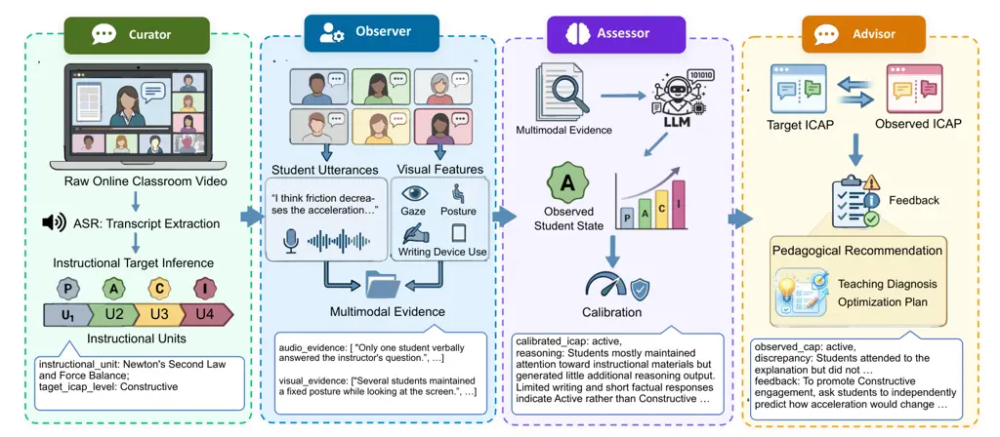
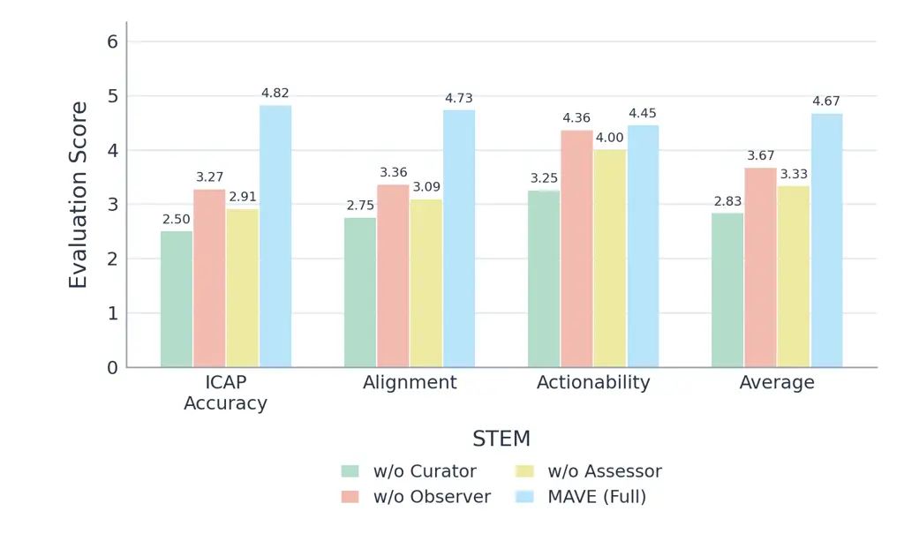
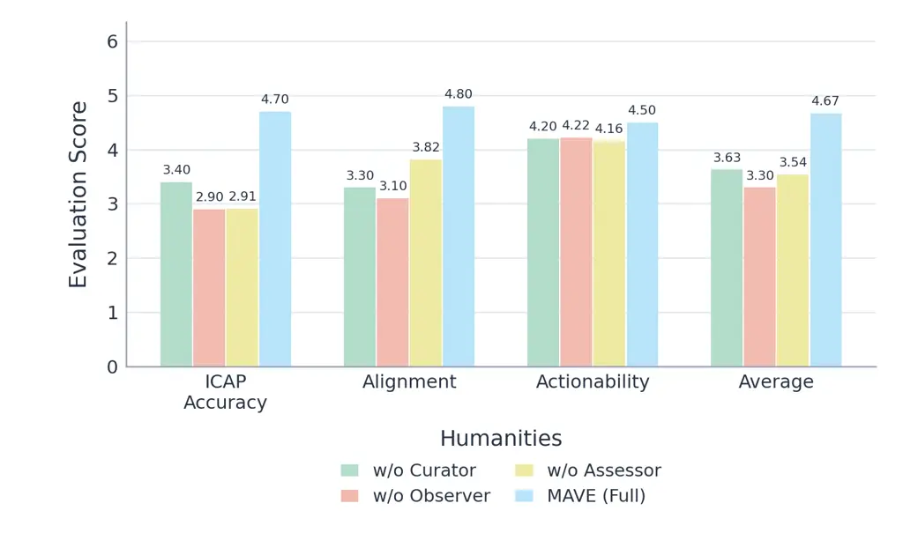
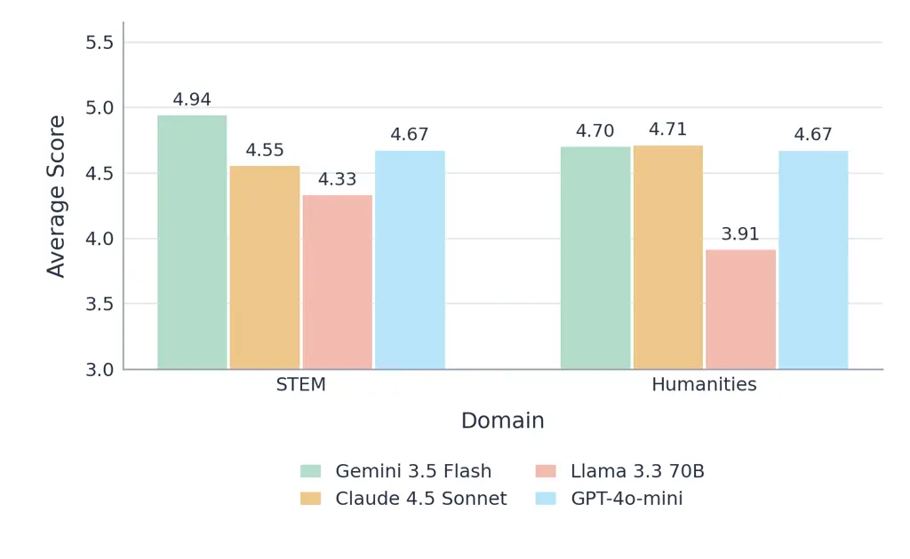
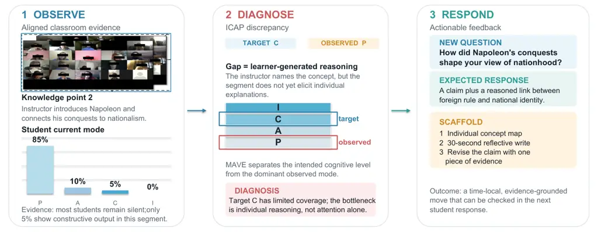

# MAVE: A Multi-Agent Framework for Grounded Pedagogical Feedback from Online Class Videos

Qingyue Chen¹   Huaiyuan Yao¹   Wanpeng Xu¹   Varun Shourie¹  
Qianwen Wang²   Hua Wei¹  
¹ Arizona State University  ² University of Minnesota

###### Abstract

Timely pedagogical feedback is difficult to scale in online classes,
where long and noisy videos make student responses hard to locate and
automated systems often produce generic advice weakly grounded in actual
classroom behavior. The key challenge is to connect the instructional
goal of a specific lesson segment with temporally aligned multimodal
evidence of student responses, and then translate the observed gap into
an actionable teaching move. We introduce MAVE (Multi-Agents for
Video-based Educational Feedback), a multi-agent framework for grounded
pedagogical feedback from online-class videos. MAVE decomposes feedback
generation into four roles: the Curator structures the lesson and infers
expected student activity; the Observer extracts aligned speech, visual,
and interaction evidence; the Assessor estimates the activity supported
by student behavior; and the Advisor generates gap-conditioned teaching
recommendations. To evaluate this capability, we introduce MAVEBench, a
benchmark designed to measure whether feedback systems can ground
diagnoses in multimodal student evidence, and generate actionable
pedagogical feedback. MAVEBench contains 173 knowledge-point segments
from approximately 20 hours of authentic online-class videos across STEM
and Humanities, together with comprehensive simulation. Experiments show
that MAVE outperforms direct prompting, Reflexion, and TextGrad in
diagnostic correctness, instructional alignment, and actionability. Our
code is available at
[https://github.com/DaRL-GenAI/MAVE](https://github.com/DaRL-GenAI/MAVE)

## 1 Introduction

Online instruction increasingly takes place in screen-sharing-heavy
classrooms, where instructors present materials while student responses
are distributed across compressed video tiles, chat, and other
fragmented channels. This distribution makes it difficult to monitor how
students respond to instructional activities in real time \[1\]. In such
settings, student responses are often delayed, muted, or only partially
observable, making it difficult to distinguish passive listening from
productive but hidden activity. Although expert supervisors can convert
classroom observations into actionable pedagogical feedback \[2\], such
observation does not scale across large courses.

As a result, instructors receive little interpretable evidence about
when student engagement breaks down, why specific instructional
activities fail, or how interaction patterns could be improved \[3, 4\];
instructional refinement remains anecdotal and cannot be replicated
across cohorts. We therefore study the task of generating
instructor-facing pedagogical feedback from online-class videos. As
illustrated in Figure 1, the input is a local instructional segment with
aligned student-side evidence, and the output is a teaching-oriented
diagnosis and concrete instructional move grounded in that evidence.
Useful automation must therefore go beyond a single global engagement
score: it should identify and interpret behaviors within long videos,
relate them to the instructional goal of the corresponding segment, and
tie each recommendation to the student evidence behind it.

Figure 1: Illustrative MAVE input–output transformation. For one
instructional segment, MAVE places the intended ICAP target and the
state supported by aligned student evidence on the ordinal ICAP scale,
measures the intended and observed gap, and returns a time-local
teaching move with an observable success criterion. Arrows indicate data
flow rather than causal effects.

Meeting this requirement is hard for three reasons, as shown in Fig. 2.
First, classroom videos are long and noisy: extended exposition,
off-task movement, filler speech, and fragmented participation make
engagement cues sparse and segment-local \[5\]. Second, student
engagement is multimodal and temporally distributed: note-taking,
delayed verbal responses, gaze shifts, and discussion occur
asynchronously across modalities. Third, the feedback gap goes
unmeasured: existing engagement-analysis systems collapse each segment
to a single global label or affect category, and LLM-based feedback
approaches rely on unconstrained self-reflection \[6, 7\] or rubric
scoring \[8, 9\], so neither compares what the lesson aimed to elicit
with what students actually showed. Current systems therefore cannot
tell whether low engagement reflects expected passive learning, missing
instructional scaffolding, or a mismatch between intent and response.

Our central premise is that pedagogical feedback must be grounded in
real student responses. LLM judges and rubric scores can help evaluate
feedback quality, but they should not be the sole basis for generating
feedback. Otherwise, a system may learn to produce recommendations that
satisfy rubric language while remaining weakly connected to what
students actually did, creating a reward-hacking failure mode. For
instructor-facing feedback, a recommendation is useful only when it can
be traced to observable student behavior and translated into a concrete
teaching move. We therefore frame automated pedagogical feedback as a
grounded reasoning chain linking _instructional intent_, _observed
student evidence_, and _pedagogical action_.To ground student-state
modeling in educational theory, we adopt the ICAP framework \[10\]
provides the shared scale for this chain: each segment can be assigned
an intended cognitive demand and an observed student-response state as
Passive, Active, Constructive, or Interactive. The intended–observed gap
makes the problem diagnosable, but diagnosis alone is not enough. Useful
feedback must also select an intervention that matches the direction of
the gap, cite the evidence behind it, and provide an observable success
criterion.

To operationalize this chain, we introduce MAVE, a multi-agent framework
for actionable pedagogical feedback from authentic online-class videos.
The Curator structures long videos into instructional segments and
infers the intended cognitive-engagement target; the Observer extracts
time-aligned speech, visual, and interaction evidence; the Assessor
estimates the student-response state and the intended–observed gap; and
the Advisor converts this gap into an evidence-grounded teaching
recommendation. This decomposition addresses the main challenges of
online-class feedback: long and noisy videos, scattered multimodal
evidence, and the lack of an explicit feedback gap.

(a) Long, noisy videos.

(b) Scattered multimodal evidence.

(c) Unmeasured feedback gap.

Figure 2: Three challenges of generating pedagogical feedback from
online classes. (a) Classroom recordings are long and noisy, so
engagement cues occupy a small fraction of the runtime and live inside
individual instructional segments. (b) A single student response is
scattered across modalities (gaze, notes, speech, chat) and arrives with
delays of seconds to minutes after the instructor’s prompt. (c) Existing
systems collapse a session into one global engagement label and never
compare the intended cognitive demand of each segment with the
engagement students actually exhibit.

#### Our Core Contributions.

\(1\) We formulate instructor-facing pedagogical feedback generation as
an evidence-grounded task that connects instructional goals, multimodal
student responses, and an actionable teaching move. (2) We propose MAVE,
a multi-agent framework with four inspectable roles: the Curator
structures the lesson and infers the intended cognitive target; the
Observer extracts time-aligned multimodal evidence; the Assessor
estimates the observed student-response state and resulting gap; and the
Advisor generates evidence-grounded recommendations with observable
success criteria. (3) We introduce MAVEBench, a benchmark of 173
knowledge-point segments from approximately 20 hours of authentic
online-class videos across STEM and Humanities. Experiments show that
MAVE outperforms all baselines in diagnostic correctness, instructional
alignment, and actionability.

## 2 Related Work

### 2.1 AI in Educational Analytics and Feedback

Automated classroom analysis has used computer vision, audio processing,
and multimodal sensing to infer attention and behavior from faces, gaze,
posture, physiological signals, and classroom context \[11, 12, 13\].
Engagement is typically formulated as multiclass classification or
regression \[14, 15\]; although ordinal prediction is well studied
elsewhere \[16\], classroom pipelines rarely use that structure to
represent uncertainty. Systems such as EmotionCues \[17\], Zheng et al.
\[18\], and Gao et al. \[19\] provide behavioral or domain-specific
signals, while adaptive learning methods use explicit preferences or
scalar rewards \[20, 21, 22\]. These approaches provide useful but
isolated engagement signals, without linking them to the instructional
purpose. They therefore do not explain whether student responses match
what the instructor intended to elicit, or translate that mismatch into
an executable teaching move. MAVE addresses this gap by aligning the
instructional segment, the student-response window, and the evidence
supporting the ICAP label.

### 2.2 Multi-Agent LLMs for Feedback Generation

LLM agents can be composed through role decomposition, debate, and
cross-verification \[23, 24\]. Reflexion \[6\] and TextGrad \[7\] refine
outputs through self-critique or textual gradients, and educational
applications use LLMs to assess teaching quality and propose
instructional suggestions \[25, 26, 8, 9\]. Their optimization signal,
however, usually comes from critiques or rubric scores, with limited
grounding in student responses. MAVE makes temporal-aligned student
evidence an explicit intermediate artifact and uses multiple agents to
condition feedback on the resulting intent-response gap.

Figure 3: MAVEBench overview. Left: nested composition of the 173 KPs.
Middle: per-video face crops and frames after cleaning. Right: topic
vocabulary.

## 3 MAVE Benchmark

### 3.1 Dataset

To rigorously evaluate MAVE in realistic environments, we introduce
MAVEBench—a representative multimodal benchmark bridging authentic
classroom dynamics with structured pedagogical assessment. Collected
from diverse open-source online lectures, MAVEBench enforces stringent
selection criteria: structured pedagogical sequences, recoverable
student visual tiles, and clear speech interactions. The curated
benchmark offers broad ecological representativeness, spanning both STEM
and Humanities across four distinct educational tiers (K–12, higher
education, adult/vocational training, and teacher professional
development). This heterogeneous corpus encapsulates diverse teaching
formats, noise distributions, and student response modalities. As
illustrated in Figure 3, MAVEBench exhibits balanced domain coverage,
rich multimodal volume, and diverse instructional durations.

#### Statistics.

MAVEBench provides 173 KPs totaling 1,025 minutes of retained
instructional segments, and contains about 5.8K cleaned frames and 110K
face crops. The STEM samples contribute 106 KPs, while the Humanities
samples contribute 67 KPs. KPs are LLM-segmented and converted into
contiguous KP bundles for the controlled transition study. Recoverable
class sizes average $`\approx`$18 students per video (range 6–30), i.e.,
$`\approx`$360 student–video instances (students are not re-identified
across videos). The long, noisy context and sparse A/C/I behaviors make
MAVEBench a challenging testbed for evidence-grounded feedback.

#### Multimodal preprocessing.

Each video is transcribed with ASR and segmented by an LLM into
semantically coherent KPs with topics and temporal boundaries; these KPs
are the atomic units for intended/observed ICAP comparison in MAVE. In
parallel, we sample frames, detect Zoom layouts (gallery / sidebar /
spotlight), and crop per-student face windows. All facial and vocal
identifiers are anonymized. Segmentation is constrained to cover the
retained instructional timeline with contiguous, non-overlapping
intervals. A boundary is placed at a change in knowledge objective or
instructional activity rather than at a fixed number of frames. The
aligned bundle for KP $`k`$ contains its transcript, temporal interval,
sampled classroom views, and recoverable student crops. Consequently,
all methods are evaluated on the same evidence bundle and cannot obtain
an advantage from choosing easier boundaries or a different temporal
context.

#### Visual data cleaning.

Online classroom screenshots contain substantial non-behavioral noise.
We therefore apply a dedicated cleaning stage before engagement
analysis: (i) _black frames_—empty or near-black student tiles with no
visible person; (ii) _icon-only frames_—tiles showing only avatars,
profile icons, or static placeholders without a real face; and (iii)
_unreadable PPT / slide content_—frames dominated by presentation slides
or screen-share regions whose text/graphics cannot be reliably
recognized as student behavior evidence. Excluded items are recorded in
per-video black/icon/PPT exclusion lists and removed from the Observer’s
visual evidence stream, so ICAP assessment is grounded on observable
student activity.

#### Benchmark unit and quality control.

The KP is the benchmark unit because it is the shortest interval for
which an instructional objective and its student response can be
compared meaningfully. Segment boundaries are checked for temporal
continuity and coverage, and the associated transcript is retained
alongside sampled student views. Preprocessing records why evidence is
removed, so an excluded avatar or slide is not silently interpreted as
disengagement. This design separates three sources of uncertainty:
whether the relevant moment was localized, whether student behavior was
recoverable, and whether that behavior supports an ICAP label.
Downstream agents can therefore abstain on a missing modality while
still using the remaining evidence. MAVEBench is intended for
segment-level feedback evaluation.

The benchmark deliberately preserves missingness. Camera-off tiles,
occlusion, unreadable slides, and ambiguous speakers are recorded as
unavailable evidence, not converted into Passive labels. Class-level
proportions use only recoverable student windows and are accompanied by
the recoverable count. This prevents a method from appearing confident
simply because a modality failed. Because the videos are public but
contain identifiable classroom behavior, released artifacts use
anonymized identifiers and derived evidence rather than presenting
identity as an analytic variable.



Figure 4: Overview of MAVE. Given a raw online classroom video, the
Curator segments the lecture and infers the intended ICAP objective for
each instructional unit. The Observer extracts multimodal student
evidence from the corresponding temporal window. The Assessor routes
each student to an observed ICAP state and optionally calibrates a finer
engagement level for Passive students in detail mode. Finally, the
Advisor compares the intended target with the observed state
distribution and generates time-aligned pedagogical feedback grounded in
classroom evidence.

### 3.2 Evaluation Protocol

Unlike conventional engagement analysis, pedagogical feedback is not
valued only for predicting a student state. A useful recommendation must
correctly diagnose the intended–observed gap, remain aligned with the
instructional objective, and translate the diagnosis into an executable
teaching move. We therefore evaluate MAVE with two complementary
protocols: expert rubric evaluation and controlled student-agent
simulation.

#### Expert Rubric Evaluation.

The primary evaluation asks expert raters to score one evidence-grounded
recommendation for each KP. All method outputs are anonymized and
presented in a shared format. Experts rate each output on three 1–5
dimensions: (i) _ICAP Accuracy_—whether the feedback identifies the
observed cognitive-engagement state and the intended–observed gap; (ii)
_Alignment_—whether the proposed intervention preserves the KP objective
and targets the requested transition; and (iii) _Actionability_—whether
the feedback provides concrete teacher language, timing, or steps that
can be executed within the segment. Generic advice such as ”increase
engagement” cannot receive a high Actionability score unless it
specifies both the activity and the observable evidence criterion. As
complementary state-estimation metrics, we also compare the Assessor
label with the expert label using classification accuracy and ordinal
mean absolute error (MAE), mapping $`P,A,C,I`$ to $`0,1,2,3`$:

```math
\mathrm{Acc}_{\mathrm{ICAP}}=\frac{1}{N}\sum_{k=1}^{N}\mathbb{1}[y_{k}=\hat{y}_{k}],\quad\mathrm{MAE}_{\mathrm{ICAP}}=\frac{1}{N}\sum_{k=1}^{N}|y_{k}-\hat{y}_{k}|. \tag{1}
```

Accuracy treats all mistakes equally, whereas MAE distinguishes a
neighboring mistake from a P–I reversal.

#### Controlled Student-Agent Simulation.

Expert rubrics assess whether feedback is well grounded and actionable,
but they do not directly test whether a recommendation can move students
toward the intended cognitive state. To evaluate this mechanism, we
introduce a paired student-agent simulation that measures state
improvement relative to a controlled baseline.

For each knowledge point $`k`$, let $`t_{k}\in\{C,I\}`$ denote the
intended target state. We consider two teacher conditions: a baseline
teacher $`\alpha`$, which receives the original excerpt and broad
whole-class checks, and a guided teacher $`\beta`$, which additionally
receives MAVE’s rewrite, scaffold, and focus question. Each episode
contains a hidden Session Controller, one Teacher agent, and four
Student agents initialized at $`P,A,C,I`$. The controller makes four
instructional decisions from teaching, next_page, and interaction. A
student simulator $`\phi`$ produces student utterances under teacher
condition $`m\in\{\alpha,\beta\}`$:

```math
U_{k}^{m}=\phi(k,T^{m},s_{0}), \tag{2}
```

where $`T^{m}`$ is the teacher input under condition $`m`$ and $`s_{0}`$
denotes the shared initial student states. An independent judge $`J`$
labels the resulting utterances using a withheld reference answer:

```math
\hat{s}_{k}^{m}=J(U_{k}^{m}),\quad\hat{s}_{k}^{m}\in\{P,A,C,I\}. \tag{3}
```

Absolute post-interaction state is not sufficient, because some students
may already begin near the target state. We therefore evaluate the
contribution of MAVE by comparing the guided condition against the
paired baseline with identical initial states:

```math
\Delta_{k}=g(\hat{s}_{k}^{\beta},t_{k})-g(\hat{s}_{k}^{\alpha},t_{k}), \tag{4}
```

where $`g(\hat{s},t)`$ is a transition score, such as whether the
student reaches the target, the ordinal upgrade in cognitive level, or
whether the labeled utterance is at or above the target. Higher
$`\Delta_{k}`$ indicates that MAVE’s recommendation induces stronger
movement toward the intended state than the baseline teacher prompt.

|             |            |                   |                   |                   |                   |                       |
| ----------- | ---------- | ----------------- | ----------------- | ----------------- | ----------------- | --------------------- |
| Framework   | Domain     | ICAP Accuracy     | Actionability     | Alignment         | Average           | $`p`$ (Avg. vs. MAVE) |
| Prompting   | STEM       | 3.50 $`\pm`$ 0.29 | 3.88 $`\pm`$ 0.70 | 3.50 $`\pm`$ 0.29 | 3.62 $`\pm`$ 0.36 | $`<\!0.001`$          |
| Reflexion   | STEM       | 3.36 $`\pm`$ 0.25 | 2.36 $`\pm`$ 0.25 | 3.55 $`\pm`$ 0.27 | 3.09 $`\pm`$ 0.22 | $`<\!0.001`$          |
| TextGrad    | STEM       | 3.91 $`\pm`$ 0.09 | 4.27 $`\pm`$ 0.82 | 4.00 $`\pm`$ 0.00 | 4.06 $`\pm`$ 0.15 | 0.001                 |
| MAVE (Ours) | STEM       | 4.82 $`\pm`$ 0.40 | 4.73 $`\pm`$ 0.65 | 4.45 $`\pm`$ 0.32 | 4.67 $`\pm`$ 0.33 | –                     |
| Prompting   | Humanities | 3.50 $`\pm`$ 0.33 | 3.75 $`\pm`$ 0.25 | 3.50 $`\pm`$ 0.33 | 3.58 $`\pm`$ 0.25 | $`<\!0.001`$          |
| Reflexion   | Humanities | 3.57 $`\pm`$ 0.53 | 2.57 $`\pm`$ 0.53 | 3.57 $`\pm`$ 0.53 | 3.24 $`\pm`$ 0.53 | $`<\!0.001`$          |
| TextGrad    | Humanities | 4.00 $`\pm`$ 0.00 | 4.50 $`\pm`$ 0.28 | 4.10 $`\pm`$ 0.10 | 4.20 $`\pm`$ 0.03 | 0.008                 |
| MAVE (Ours) | Humanities | 4.70 $`\pm`$ 0.48 | 4.80 $`\pm`$ 0.42 | 4.50 $`\pm`$ 0.53 | 4.67 $`\pm`$ 0.40 | –                     |

Table 1: Expert human evaluation across frameworks (1–5 rubric). “ICAP
Accuracy” is the expert-rated correctness of the identified ICAP state.
$`p`$: Welch’s $`t`$-test of each baseline vs. MAVE on the Average
score.

## 4 Method

#### Overview.

As shown in figure 4, we formulate automated teaching feedback as a
discrepancy reasoning problem between the instructor’s intended ICAP
objective and the students’ observed ICAP state. Given a raw online
classroom video $`\mathcal{V}`$, MAVE decomposes the problem into four
coordinated agents: the Curator (pedagogical structuring and target
inference), the Observer (multimodal evidence extraction), the Assessor
(ICAP state estimation), and the Advisor (feedback generation), detailed
in the subsections below.

#### Task Formulation.

Formally, let the classroom video be partitioned into $`K`$
instructional segments $`\{\mathcal{V}_{k}\}_{k=1}^{K}`$ and let
$`m\in\{1,\ldots,M_{k}\}`$ index the recoverable student windows in
segment $`k`$. For each segment, MAVE estimates (1) an intended ICAP
target $`c_{k}\in\mathcal{Y}`$, where $`\mathcal{Y}=\{P,A,C,I\}`$, (2)
per-student observed states $`q_{k,m}\in\mathcal{Y}`$, (3) optional
Passive-student engagement levels $`e_{k,m}\in\{0,1,2,3\}`$ in detail
mode, and (4) a feedback text $`\mathcal{F}_{k}`$ that explains the
discrepancy between $`c_{k}`$ and the observed classroom distribution.

The Assessor is responsible only for measuring student cognitive
engagement. It first routes each student–segment pair through
complementary linguistic and visual classifiers, and it invokes the
finer engagement analysis only for students ultimately assigned to the
Passive state in detail mode. The Advisor is responsible only for acting
on the pedagogical gap: given the intended level, the distribution of
observed ICAP states, and the passive-student engagement summary, it
synthesizes feedback. This separation keeps diagnostic measurement
independent from recommendation generation.

### 4.1 Curator: Pedagogical Structuring

The Curator reconstructs the pedagogical structure of the lecture from
the raw classroom stream, which aims to infer the cognitively
appropriate ICAP objective. In other words, the agent estimates what
level of student cognitive engagement a particular knowledge unit should
ideally elicit according to pedagogical principles.

#### Instructional parsing.

As an auxiliary tool, the Curator first invokes a Transformer-based
automatic speech recognition (ASR) module to obtain a timestamp-aligned
transcript $`\mathcal{T}=\{(w_{n},t_{n})\}_{n=1}^{N}`$, where $`w_{n}`$
denotes the recognized token and $`t_{n}`$ denotes its temporal
boundary. The transcript is aligned with the classroom timeline and
grouped into contiguous instructional windows.

#### Instructional unit construction.

Based on the transcript and temporal structure, the Curator partitions
the lecture into pedagogically coherent instructional units
$`\mathcal{U}_{k}=(\mathcal{W}_{k},\tau_{k})`$, where
$`\mathcal{W}_{k}`$ denotes the instructional content within the segment
and $`\tau_{k}=[t_{k}^{s},t_{k}^{e}]`$ denotes its temporal interval.
Each instructional unit corresponds to a relatively self-contained
knowledge delivery episode. This segmentation establishes a stable
temporal abstraction for downstream multimodal reasoning and enables
direct alignment between instructional context and student responses.

ICAP target inference. For each instructional unit $`\mathcal{U}_{k}`$,
the Curator analyzes the instructional content, discourse structure, and
pedagogical interaction patterns to infer the cognitively appropriate
ICAP target $`c_{k}\in\{P,A,C,I\}`$. Instead of predicting what the
teacher subjectively intended, the Curator estimates what form of
cognitive engagement the knowledge component should ideally promote. For
example, factual exposition may correspond to Passive or Active
engagement, while conceptual synthesis, reasoning prompts, or
collaborative problem solving are expected to induce Constructive or
Interactive engagement. The inferred ICAP target serves as the
pedagogical reference state for the subsequent discrepancy analysis.

In practice, feedback should specify a realizable next step rather than
demand maximal interaction everywhere. We therefore use Constructive (C)
and Interactive (I) states as actionable targets: Constructive
engagement asks each learner to generate an explanation, prediction, or
solution beyond the presented material, whereas Interactive engagement
additionally requires responsive knowledge construction across learners.
The target combines conceptual demand, lesson position, and evidence of
readiness. Concretely, the rule-based gate forces an Interactive target
when Interactive behavior is already present or the recoverable
Constructive coverage is at least 50%; otherwise it forces a
Constructive target. A soft early-stage safeguard overrides Interactive
for the first 30% of a lecture, when exposition and orientation are
still dominant. The Curator then supplies the target-specific rationale
and question, so an Interactive target cannot degenerate into a generic
recommendation to “add discussion.”

4.2  Observer: Learner Feedback Modeling

Rather than predicting engagement labels directly, the Observer converts
multimodal classroom signals into temporally aligned natural-language
evidence for downstream pedagogical reasoning.

#### Audio interaction parsing.

For each instructional unit $`\mathcal{U}_{k}`$, the Observer invokes an
automatic speech recognition (ASR) module to obtain timestamp-aligned
classroom transcripts. Based on speaker turns and interaction context,
the Observer further separates student utterances from the instructor’s
speech, yielding a student-side interaction transcript
$`\mathcal{A}_{k}=\{(s_{i},t_{i})\}`$, where $`s_{i}`$ denotes a student
utterance and $`t_{i}`$ denotes its temporal location. These parsed
responses provide linguistic evidence about participation, reasoning
behaviors, and collaborative interaction patterns.

#### Visual evidence extraction.

For the visual stream, the Observer invokes a video parsing tool to
decompose the online classroom layout into individual student
sub-windows. Frames are then sampled from each student region at fixed
temporal intervals within $`\tau_{k}`$. The sampled frames are converted
into factual natural-language descriptions that summarize observable
behaviors such as gaze direction, posture, writing activity, device
usage, and interaction with learning materials.

Formally, the extracted visual evidence for the $`k`$-th instructional
unit is represented as
$`\mathcal{B}_{k}=\{v_{k}^{1},v_{k}^{2},\dots,v_{k}^{M_{k}}\}`$, where
each $`v_{k}^{m}`$ denotes the textual behavioral description of the
$`m`$-th student window.

The Observer aggregates the linguistic and visual evidence into a
temporally aligned multimodal evidence summary
$`\mathcal{E}_{k}=\{\mathcal{A}_{k},\mathcal{B}_{k}\}`$. This
representation preserves local classroom behaviors while reducing
frame-level noise, thereby providing a stable foundation for downstream
ICAP assessment and discrepancy reasoning.

Evidence is aligned by instructional segment and student window rather
than pooled across the recording. Delayed answers, note taking, and gaze
changes retain timestamps so that a response remains associated with the
prompt that elicited it. Missing cameras, occluded faces,
presentation-only frames, and ambiguous speakers are marked unavailable
or uncertain instead of becoming negative evidence. The Observer
describes what is visible or audible but does not infer ICAP; this
provenance boundary makes later decisions auditable and limits
behavioral over-interpretation.

### 4.3 Assessor: ICAP State Estimation

The Assessor estimates an ICAP state for each student and instructional
unit rather than assigning one label to the whole classroom. Its outputs
are consumed by the Advisor and are not used to generate recommendations
directly. We use a conservative routing rule with three complementary
prompts. A discourse prompt returns “Passive/Active” when no student
speech is detected, “Constructive” when one student produces
constructive output, and “Interactive” only when at least two students
contribute constructive turns with evidence of turn taking. A separate
visual-action detector resolves the “Passive/Active” case to Active when
overt learning-related motor activity (e.g., writing, drawing, or
manipulating a learning object) is observed; otherwise the student
remains Passive. Thus, a silent student is not promoted to Constructive
or Interactive merely because a face is visible or a posture is stable.

#### Detail-mode Passive monitoring.

When the routed state is $`P`$ and detail mode is enabled, the
Observer’s cleaned student crop is analyzed at a finer temporal
resolution. Frames are sampled at fixed intervals, aggregated into
one-minute factual narratives, and grouped into non-overlapping
three-minute windows. For student $`m`$ in window $`t`$, an engagement
judge selects an ordinal anchor $`a_{m,t}\in\{0,1,2,3\}`$ based on
observable evidence and makes binary plausibility judgments for
neighboring levels. Specifically, $`a_{m,t}=0`$ indicates frequent
looking away/down or obvious inattentiveness; $`a_{m,t}=1`$ indicates
weak or unstable attention, such as inconsistent orientation or posture;
$`a_{m,t}=2`$ indicates generally forward and stable attention with only
minor lapses; and $`a_{m,t}=3`$ indicates stronger observable engagement
cues, such as nodding, leaning in, speaking, or active hand movements
without sustained distraction. These levels refine engagement _within_
the Passive state and do not alter the student’s ICAP classification.

#### Ordinal calibration.

To reduce local LLM variability, the binary judgments are converted into
an ordinal-consistent distribution. Let $`d_{m,t}(j)`$ be zero for the
anchor, one (two) for an acceptable one-level (two-level) deviation, and
a maximal penalty otherwise, with $`d_{m,t}(j)\geq|j-a_{m,t}|`$. We use

```math
w_{m,t}(j)=\exp\!\left[-\alpha d_{m,t}(j)\right],\qquad p_{m,t}(j)=\frac{w_{m,t}(j)}{\sum_{r=0}^{3}w_{m,t}(r)}, \tag{5}
```

and select the risk-minimizing engagement level

```math
e_{m,t}=\arg\min_{j\in\{0,1,2,3\}}\sum_{r=0}^{3}|j-r|p_{m,t}(r). \tag{6}
```

In our implementation $`\alpha=0.7`$. A candidate deviation receives
distance one or two only when the judge accepts the corresponding one-
or two-level alternative; rejected deviations receive a maximal penalty
of three. We then enforce $`d_{m,t}(j)\geq|j-a_{m,t}|`$ before
normalization. Windows with no usable student evidence (e.g.,
presentation-only or excluded frames) are skipped rather than assigned
an engagement score. The Advisor receives both the ICAP-state
proportions and the distribution of $`e_{m,t}`$ among Passive students,
allowing it to distinguish a broad Passive bottleneck from a small
number of highly distracted individuals.

The detail branch follows a fixed evidence path. The cleaner first
removes black, icon-only, and presentation-dominated frames. The visual
narrator then summarizes up to six sampled frames from each one-minute
interval in factual prose, and consecutive summaries are grouped into
non-overlapping three-minute windows. The judge reads the three
summaries, selects one anchor level, and returns binary plausibility
judgments for neighboring ordinal levels. A two-level deviation cannot
be accepted when its corresponding one-level deviation is rejected. The
prompt instructs the judge to use only visible behavior, select one 0–3
anchor from the overall three-minute tendency, avoid defaulting to level
2, and return the anchor, four binary deviation judgments, and a brief
evidence-grounded reason as strict JSON. Stable forward orientation or
strong focus cues support level 3, whereas recurring distraction
supports levels 0 or 1.

Aggregating per-student decisions also exposes _coverage_: a segment may
contain one strong constructive answer while most of the class remains
Passive. MAVE reports both the highest supported ICAP behavior and the
fraction of recoverable students at each state, avoiding the common
error of treating a vocal minority as evidence that the objective was
achieved class-wide.

(a) Guided ICAP transitions.



(b) Ablation (STEM).



(c) Ablation (Humanities).

Figure 5: Additional analyses. (a) Student-Agent Transition simulation:
per-metric means, Baseline vs. ICAP-guided, with paired deltas. (b, c)
Ablations: removing the Curator, Observer, or Assessor degrades all
expert-rated metrics vs. full MAVE on both domains.

### 4.4 Advisor: Feedback Generation

The Advisor synthesizes teacher-side context, Assessor outputs, and
student evidence into time-aligned teaching recommendations. It does not
re-estimate ICAP levels from raw video; it reasons over $`c_{k}`$, the
empirical distribution of $`q_{k,m}`$, the optional Passive-student
engagement levels $`e_{k,m}`$, and $`\mathcal{E}_{k}`$ to explain why a
segment succeeded or failed relative to the intended pedagogical
objective.

#### Pedagogical Gap Diagnosis.

For each instructional unit $`\mathcal{U}_{k}`$, the Advisor compares
the intended ICAP target $`c_{k}`$ with the observed state distribution
$`\{q_{k,m}\}_{m=1}^{M_{k}}`$. The resulting gap indicates whether the
instructional design and the actual student response are aligned:

```math
\Delta_{k}=\phi\!\left(c_{k},\{q_{k,m}\}_{m=1}^{M_{k}},\{e_{k,m}:q_{k,m}=P\}\right), \tag{7}
```

where $`\phi(\cdot)`$ measures the pedagogical gap between intended and
observed cognitive states, including coverage of the target state and,
when available, the within-Passive engagement profile.

The gap is directional and coverage-aware. If the target is Constructive
but the class is predominantly Passive, the first priority is to make
thinking externally observable with an individual prediction or
explanation; peer interaction is not yet required. If several learners
reach Constructive but coverage remains low, the Advisor expands
participation before raising the cognitive level. When Constructive
engagement is broadly established and the target is Interactive, the
recommendation instead introduces turn-taking in which students build
on, challenge, or reconcile peers’ contributions. Conversely, if the
target has already been reached, the Advisor preserves the successful
activity and suggests only a small refinement. This ordering
distinguishes increasing _coverage_ at the current level from moving a
smaller set of learners to a higher one.

#### Recommendation synthesis.

Conditioned on the instructional content $`\mathcal{U}_{k}`$, the
student evidence $`\mathcal{E}_{k}`$, and the discrepancy
$`\Delta_{k}`$, the Advisor generates a time-local recommendation:

```math
\mathcal{F}_{k}=\Psi(\mathcal{U}_{k},\mathcal{E}_{k},\Delta_{k}). \tag{8}
```

The generated feedback is grounded in concrete classroom evidence and is
explicitly aligned with the intended ICAP transition. For example, when
the instructor intends to elicit Constructive or Interactive engagement
but the observed state remains Passive or Active, the Advisor can
recommend adding prompts, peer discussion, wait time, or more scaffolded
questioning.

Each output contains a diagnosis, a concise rewrite of the relevant
teaching move, one or two operational scaffolds, a target-level
question, and a reference answer. These fields force the recommendation
to identify _where_ the gap occurred, _what_ the instructor can say or
do, and _what evidence_ would demonstrate improvement. For a
Constructive target, the proposed question must elicit new
learner-generated content without relying on peer exchange. For an
Interactive target, it must require at least two learners to respond to
one another. The reference answer constrains domain correctness, while
citations to the transcript and student evidence constrain behavioral
grounding.

|               |            |                   |                   |           |       |
| ------------- | ---------- | ----------------- | ----------------- | --------- | ----- |
| Metric        | Domain     | LLM Score         | Human Score       | Agreement | $`p`$ |
| ICAP Accuracy | STEM       | 4.95 $`\pm`$ 0.04 | 4.82 $`\pm`$ 0.40 | 90.9%     | 0.31  |
|               | Humanities | 4.90 $`\pm`$ 0.09 | 4.70 $`\pm`$ 0.48 | 80.0%     | 0.23  |
| Actionability | STEM       | 5.00 $`\pm`$ 0.00 | 4.73 $`\pm`$ 0.65 | 81.8%     | 0.37  |
|               | Humanities | 4.80 $`\pm`$ 0.16 | 4.80 $`\pm`$ 0.42 | 85.0%     | 1.00  |
| Alignment     | STEM       | 4.22 $`\pm`$ 0.28 | 4.45 $`\pm`$ 0.52 | 81.8%     | 0.22  |
|               | Humanities | 4.60 $`\pm`$ 0.24 | 4.50 $`\pm`$ 0.53 | 85.3%     | 0.60  |

Table 2: Consistency between expert human and LLM-as-a-Judge evaluation
on the double-annotated reliability subset. Agreement is normalized
score proximity; $`p`$: Welch’s $`t`$-test, human vs. LLM.

## 5 Experiment

We conduct comprehensive experiments to validate MAVE’s ability to
generate evidence-grounded and actionable pedagogical feedback from
online classroom videos.

Our evaluation addresses four key research questions: (RQ1) Does MAVE
improve pedagogical feedback quality over baselines? (RQ2) Which
specialized agents contribute to MAVE’s improvement? (RQ3) Can
MAVE-guided recommendations induce the intended cognitive-state
transitions in a controlled student-agent simulation? (RQ4) How
sensitive are MAVE’s quality and cost to different backbone models?

### 5.1 Experiment Setup

We evaluate all methods on MAVEBench, which contains 173 KP-level
instructional segments from approximately 20 hours of authentic
online-class videos (Section 3.1). Following the evaluation protocol in
Section 3.2, we report two complementary evaluations: offline expert
rubric evaluation for feedback quality and controlled student-agent
simulation for state transitions. For offline evaluation, expert scores
are computed on the 173 rated KP-level outputs by five expert evaluators
with university-level teaching experience. All methods receive the same
anonymized evidence, KP boundaries, transcripts, output schemas,
decoding settings, retry policy, and GPT-4o-mini backbone. This matched
setup ensures that differences reflect agent specialization, routing,
and gap-conditioned reasoning rather than differences in preprocessing
or perceptual inputs. The controlled simulation uses the same 173 KPs
with paired baseline/guided conditions and five random seeds; only this
simulation uses GPT-5 for student-agent runs.

### 5.2 Comparisons and Baselines

Because evidence-grounded pedagogical feedback from online-class videos
is a new task, there is no established education-specific baseline that
directly matches our input-output setting. We therefore adapt several
general feedback generation and refinement methods to this domain, while
keeping the evidence, instructional context, and output schema identical
across methods. We compare with a directly prompted VLM (Prompting),
Reflexion \[6\], and TextGrad \[7\]. Each receives the same transcript,
instructional context, student evidence, and output schema. Prompting
tests direct evidence-to-advice generation; Reflexion adds iterative
self-critique and memory; TextGrad optimizes a draft with textual
feedback. The comparison thus spans one-pass, reflective, and
optimization-based generation. Only MAVE explicitly separates target
inference, evidence description, state estimation, and gap-conditioned
advising.

### 5.3 Main Results (RQ1)

Table 1 reports expert-rated feedback quality, showing that MAVE leads
all baselines on all three metrics in both domains. Its average is 4.67
versus 4.06 for the strongest STEM baseline and 4.67 versus 4.20 in
Humanities, gains of 0.58 and 0.43 points. The largest consistent
separation is in ICAP Accuracy: MAVE reaches 4.82/4.70, whereas the
strongest baseline reaches 3.91/4.00. TextGrad narrows the Actionability
gap, showing that iterative optimization can produce well-formed
interventions, but its weaker diagnosis limits their grounding.
Reflexion’s lower Actionability likewise shows that more critique does
not guarantee executable advice. MAVE’s nearly identical STEM and
Humanities averages (4.67 vs. 4.67) indicate that its structured gap
representation transfers across subject matter. Together with Fig. 5,
the results attribute the gain to explicit targets and student evidence
rather than fluency alone.

#### Evaluation Reliability

Section 3.2 specifies the evaluation method and metrics. We report
expert judgments as the primary evidence and use the independent LLM
judge only to check whether the same rubric can be applied consistently
at scale. Average scores are computed from unrounded per-item values.
Table 2 uses the double-annotated reliability subset, so its human means
differ slightly from the full-set means in Table 1. Human and LLM means
do not differ significantly on any metric in either domain (Welch’s
$`t`$ on per-item scores, all $`p>0.2`$). “Agreement” is normalized
score proximity. For human and LLM scores $`h_{i}`$ and $`\ell_{i}`$ on
the double-annotated subset, it is
$`100[1-N^{-1}\sum_{i}|h_{i}-\ell_{i}|/5]`$.

|                      |          |        |            |                   |       |              |
| -------------------- | -------- | ------ | ---------- | ----------------- | ----- | ------------ |
| Metric               | Baseline | Guided | $`\Delta`$ | 95% CI            | $`d`$ | $`p`$        |
| Upgrade Rate         | 0.069    | 0.375  | +0.307     | \[+0.289,+0.324\] | 2.63  | $`<10^{-3}`$ |
| Upgrade Rate (P/A/C) | 0.091    | 0.501  | +0.409     | \[+0.386,+0.433\] | 2.63  | $`<10^{-3}`$ |
| Mean Upgrade         | 0.078    | 0.525  | +0.447     | \[+0.420,+0.475\] | 2.44  | $`<10^{-3}`$ |
| Reached Target       | 0.406    | 0.623  | +0.217     | \[+0.196,+0.239\] | 1.53  | $`<10^{-3}`$ |
| CI $`\geq`$ Target   | 0.566    | 0.659  | +0.093     | \[+0.054,+0.132\] | 0.36  | $`<10^{-3}`$ |

Table 3: Student-Agent Transition Simulation: paired per-KP results over
173 KPs and five seeds.

### 5.4 Component Analysis (RQ2)

Figure 5b–c removes the Curator, Observer, or Assessor while holding the
backbone, inputs, and rubric fixed. Every removal reduces the average
score in both domains (per-item Welch tests, all $`p<0.05`$). Removing
the Curator causes the largest overall degradation because the advice no
longer has an intended-target reference. Removing the Observer most
directly weakens ICAP Accuracy: transcript-only reasoning can recognize
a spoken answer but cannot determine how broadly participation extends
across the class. Removing the Assessor makes results less stable
because raw evidence reaches the Advisor without conservative P/A/C/I
routing or Passive calibration. Actionability is comparatively
resilient, showing that a model can write a plausible activity without
correctly diagnosing why it is needed. The full pipeline makes that
activity evidence-grounded and level-appropriate.

The magnitude and location of these drops separate the agents’ roles.
Relative to full MAVE, removing the Curator lowers Average by 1.81
points in STEM and 1.00 in Humanities; removing the Observer lowers it
by 0.97 and 1.33 points. The larger Humanities penalty for the Observer
is consistent with discussion-centered segments, where distributed
verbal and visible responses are needed to estimate coverage. Removing
the Assessor causes intermediate losses of 1.31 and 1.09 points.
Intended-level inference is therefore most consequential in STEM,
whereas multimodal coverage is especially consequential in Humanities.
Passing raw observations directly to the Advisor cannot replace an
explicit, calibrated state summary. This asymmetric pattern also
cautions against treating Average alone as a complete explanation: the
same pipeline stage can fail differently as instructional evidence
changes across domains.

|               |                   |                 |                   |                   |
| ------------- | ----------------- | --------------- | ----------------- | ----------------- |
| Method        | Tokens (M)        | Latency (s)     | Time (min)        | Cost (\$)         |
| Prompting     | 0.02 $`\pm`$ 0.02 | 1.4 $`\pm`$ 0.2 | 0.03 $`\pm`$ 0.01 | 0.01 $`\pm`$ 0.01 |
| Reflexion     | 1.69 $`\pm`$ 0.04 | 1.8 $`\pm`$ 0.3 | 0.15 $`\pm`$ 0.04 | 0.76 $`\pm`$ 0.02 |
| TextGrad      | 1.20 $`\pm`$ 0.02 | 1.8 $`\pm`$ 0.3 | 0.12 $`\pm`$ 0.03 | 0.54 $`\pm`$ 0.01 |
| MAVE          | 0.75 $`\pm`$ 0.07 | 1.9 $`\pm`$ 0.4 | 0.20 $`\pm`$ 0.05 | 0.34 $`\pm`$ 0.03 |
| MAVE detailed | 2.22 $`\pm`$ 0.54 | 2.5 $`\pm`$ 0.5 | 0.65 $`\pm`$ 0.18 | 1.00 $`\pm`$ 0.16 |

Table 4: Efficiency per video over the 20 MAVEBench videos. Tokens
combine input and output; latency is wall-clock time per model request,
time is the end-to-end pipeline time, and cost uses the observed token
mix.



Figure 6: Average performance across backbone LLMs and domains.

### 5.5 Student-Agent Transition Simulation (RQ3)

In a separate controlled simulation covering all 5.8K cleaned frames and
110K face crops. (the same 173 KPs; five seeds; 865 paired KP–seed
comparisons), GPT-5-simulated students receiving ICAP-guided instruction
upgrade more often and further: Upgrade Rate rises from 0.069 to 0.375,
Mean Upgrade from 0.078 to 0.525 ICAP levels, and the share of students
reaching the target mode from 0.406 to 0.623, with large paired effect
sizes (Cohen’s $`d`$ up to 2.63; Fig. 5a). These simulation results are
reported separately from the offline video scores. The paired setup and
metric definitions appear in Section 3.2. Guidance improves all five
metrics (Table 3), including upgrade rate among P/A/C starters (0.091 to
0.501). The smaller gain in utterance-level CI-at-target (+0.093) than
in student-level upgrades indicates that MAVE mainly broadens and
deepens participation rather than merely increasing high-level phrases.
Because participants and judge are simulated, this tests the mechanism
under controlled conditions, not realized learning gains. Each pair
starts from the same KP, states, seed, and reference answer. Stronger
student-level than utterance-level gains are consistent with first
broadening participation or moving a learner one level. Table 3 reports
paired per-KP results. Every difference is significant under paired
$`t`$-tests over the 173 KPs ($`\mathrm{df}=172`$; largest
$`p=4.9{\times}10^{-6}`$).

### 5.6 Sensitivity Analysis (RQ4)

Replacing the backbone with Gemini 3.5 Flash, Claude 4.5 Sonnet, or
Llama 3.3 70B keeps performance strong and broadly stable across
backbones. This suggests MAVE’s advantage is structural—multimodal
grounding and discrepancy reasoning—not an artifact of GPT-4o-mini.

Gemini and Claude remain close to the GPT-4o-mini reference, while Llama
3.3 70B declines most clearly, especially on Humanities Alignment (Fig
6). MAVE therefore transfers across model families, although weaker
backbones still affect domain reasoning. Efficiency shows a
complementary trade-off (Table 4): standard MAVE averages 0.75M tokens
and \$0.34 per video, below iterative Reflexion and TextGrad in token
use and cost but above direct Prompting. Detail mode rises to 2.22M
tokens and \$1.00 because Passive cases require repeated frame
narratives and ordinal judgments. Since A/C/I cases bypass this branch,
it can be reserved for segments where diagnosing widespread Passive
behavior warrants the cost.

Only the additional within-Passive trajectory is deferred in the
conditional detail branch. An instructor can request the cheaper
segment-level diagnosis first and expand selected cases when
distinguishing inattention from quiet but sustained participation
changes the recommendation. Relative to GPT-4o-mini, only Llama 3.3 70B
degrades significantly (Humanities $`p<0.001`$, STEM $`p=0.04`$); Gemini
is significantly higher only on STEM ($`p=0.04`$), while Claude and the
remaining comparisons are not significant ($`p\geq 0.05`$). Figure 6
visualizes the cross-backbone averages, and gives the domain-specific
scores.

### 5.7 Efficiency

Table 4 reports per-video means over MAVEBench, with input and output
tokens combined. Cost uses the pipeline’s input/output mix (blended
approximately \$0.45/M tokens). Standard MAVE remains feasible for
offline analysis. Detailed MAVE adds frame-to-narrative calls and one
ordinal judgment per three-minute Passive window; A/C/I students do not
incur this refinement.



Figure 7: Illustrative MAVE case study. Multimodal observations support
the inferred ICAP gap and the resulting time-local pedagogical
recommendation.

### 5.8 Qualitative Case Study

Figure 7 illustrates a representative Humanities segment in which the
instructor explains a multi-step solution and the Curator assigns a
Constructive target. The Observer finds limited student speech and
infrequent note taking across the recoverable student windows; the
Assessor consequently routes the segment to a predominantly Passive
state. Rather than responding with the generic instruction to “increase
interaction,” the Advisor localizes the gap to the intermediate
reasoning step, rewrites it as an individual prediction-and-explanation
prompt, supplies a scaffold, and states a reference answer against which
the response can be checked. This example shows how the agent interfaces
preserve a trace from visible or audible evidence, through an ICAP
diagnosis, to a teacher action.

Prompting offers a broad participation suggestion without tying it to
the observed behavior. Reflexion improves the wording but does not
identify which cognitive output is missing. TextGrad produces a more
structured activity, yet parts of it are weakly connected to the local
evidence. MAVE’s advantage is therefore not simply longer feedback: its
recommendation identifies the target, the coverage bottleneck, and the
observable response that would close the gap.

## 6 Discussion and Conclusion

We presented MAVE, a multi-agent framework that grounds pedagogical
feedback in ICAP theory and multimodal classroom evidence. The central
idea is to represent feedback as a gap between the cognitive activity
appropriate for an instructional segment and the activity supported by
student evidence in that same segment. This shifts classroom analytics
from aggregate descriptions of attention to a specific, actionable
diagnosis of where instructional intent and student response diverge.
MAVE operationalizes this idea through inspectable intermediate
artifacts. The Curator constructs knowledge-point units and ICAP
targets; the Observer extracts time-aligned speech and visible behavior
while preserving missingness; the Assessor conservatively estimates ICAP
states and, when needed, refines Passive cases with ordinal calibration;
and the Advisor generates feedback from both cognitive level and
classroom coverage. This staged design keeps measurement separate from
recommendation, reducing the risk that fluent advice silently changes
the diagnosis. It also distinguishes two pedagogically different moves:
broadening participation at the current level versus moving
already-constructive learners toward interaction.

Across real-world STEM and Humanities lectures, MAVE achieves the
highest expert ratings under matched evidence and model inputs.
Ablations further show that target reference, multimodal grounding, and
calibrated state estimates each provide distinct value. Under controlled
student-agent simulations, MAVE’s rewrites and scaffolds induce more
frequent and deeper ICAP upgrades.

## References

- \[1\] Ratneswary Rasiah, Harpaljit Kaur, and Vinitha Guptan. Business
  continuity plan in the higher education industry: University students’
  perceptions of the effectiveness of academic continuity plans during
  covid-19 pandemic. _Applied System Innovation_, 3(4):51, 2020.
- \[2\] Darren Paul Fisher, Gaelle Brotto, Iris Lim, and Colette
  Southam. The impact of timely formative feedback on university student
  motivation. _Assessment & Evaluation in Higher Education_,
  50(4):622–631, 2025.
- \[3\] Nadezhda Gorbunova, Eduard Vorsin, Yelena Spirina, Saule
  Zhumagulova, and Nadezhda Popova. Barriers to artificial intelligence
  adoption among instructors of it-related disciplines in higher
  education: a survey-based study. In _Frontiers in Education_, volume
  11, page 1804254. Frontiers Media SA, 2026.
- \[4\] Huaiyuan Yao, Wanpeng Xu, Justin Turnau, Nadia Kellam, and Hua
  Wei. Instructional agents: Reducing teaching faculty workload through
  multi-agent instructional design. In Vera Demberg, Kentaro Inui, and
  Lluís Marquez, editors, _Proceedings of the 19th Conference of the
  European Chapter of the Association for Computational Linguistics
  (Volume 1: Long Papers)_, pages 4087–4109, Rabat, Morocco, March 2026.
  Association for Computational Linguistics. ISBN 979-8-89176-380-7.
  [10.18653/v1/2026.eacl-long.191](https://doi.org/10.18653/v1/2026.eacl-long.191).
  URL
  [https://aclanthology.org/2026.eacl-long.191/](https://aclanthology.org/2026.eacl-long.191/).
- \[5\] Arsha Nagrani, Sachit Menon, Ahmet Iscen, Shyamal Buch, Ramin
  Mehran, Nilpa Jha, Anja Hauth, Yukun Zhu, Carl Vondrick, Mikhail
  Sirotenko, et al. Minerva: Evaluating complex video reasoning. In
  _Proceedings of the IEEE/CVF International Conference on Computer
  Vision_, pages 23968–23978, 2025.
- \[6\] Noah Shinn, Federico Cassano, Ashwin Gopinath, Karthik
  Narasimhan, and Shunyu Yao. Reflexion: Language agents with verbal
  reinforcement learning. _Advances in neural information processing
  systems_, 36:8634–8652, 2023.
- \[7\] Mert Yuksekgonul, Federico Bianchi, Joseph Boen, Sheng Liu, Zhi
  Huang, Carlos Guestrin, and James Zou. Textgrad: Automatic"
  differentiation" via text. _arXiv preprint arXiv:2406.07496_, 2024.
- \[8\] Dongping Chen, Ruoxi Chen, Shilin Zhang, Yaochen Wang, Yinuo
  Liu, Huichi Zhou, Qihui Zhang, Yao Wan, Pan Zhou, and Lichao Sun.
  Mllm-as-a-judge: Assessing multimodal llm-as-a-judge with
  vision-language benchmark. In _Forty-first International Conference on
  Machine Learning_, 2024.
- \[9\] Yihan Hong, Huaiyuan Yao, Bolin Shen, Wanpeng Xu, Hua Wei, and
  Yushun Dong. Rulers: Locked rubrics and evidence-anchored scoring for
  robust llm evaluation. _arXiv preprint arXiv:2601.08654_, 2026.
- \[10\] Michelene T. H. Chi and Ruth Wylie. The icap framework: Linking
  cognitive engagement to active learning outcomes. _Educational
  Psychologist_, 49(4):219–243, 2014.
  [10.1080/00461520.2014.965823](https://doi.org/10.1080/00461520.2014.965823).
  URL
  [https://doi.org/10.1080/00461520.2014.965823](https://doi.org/10.1080/00461520.2014.965823).
- \[11\] Jacob Whitehill, Zewelanji Serpell, Yi-Ching Lin, Aysha Foster,
  and Javier R Movellan. The faces of engagement: Automatic recognition
  of student engagementfrom facial expressions. _IEEE Transactions on
  Affective Computing_, 5(1):86–98, 2014.
- \[12\] Paulo Blikstein. Multimodal learning analytics. In _Proceedings
  of the third international conference on learning analytics and
  knowledge_, pages 102–106, 2013.
- \[13\] Qingtang Liu, Xinyu Jiang, and Ruyi Jiang. Classroom behavior
  recognition using computer vision: A systematic review. _Sensors_,
  25(2):373, 2025.
- \[14\] Jennifer A Fredricks, Phyllis C Blumenfeld, and Alison H Paris.
  School engagement: Potential of the concept, state of the evidence.
  _Review of educational research_, 74(1):59–109, 2004.
- \[15\] Hamed Monkaresi, Nigel Bosch, Rafael A Calvo, and Sidney K
  D’Mello. Automated detection of engagement using video-based
  estimation of facial expressions and heart rate. _IEEE Transactions on
  Affective Computing_, 8(1):15–28, 2016.
- \[16\] Pedro Antonio Gutiérrez, Maria Perez-Ortiz, Javier
  Sanchez-Monedero, Francisco Fernandez-Navarro, and Cesar
  Hervas-Martinez. Ordinal regression methods: survey and experimental
  study. _IEEE Transactions on Knowledge and Data Engineering_,
  28(1):127–146, 2015.
- \[17\] Haipeng Zeng, Xinhuan Shu, Yanbang Wang, Yong Wang, Liguo
  Zhang, Ting-Chuen Pong, and Huamin Qu. Emotioncues: Emotion-oriented
  visual summarization of classroom videos. _IEEE transactions on
  visualization and computer graphics_, 27(7):3168–3181, 2020.
- \[18\] Rui Zheng, Fei Jiang, and Ruimin Shen. Intelligent student
  behavior analysis system for real classrooms. pages 9244–9248.
  IEEE, 2020.
- \[19\] Xian Gao, Jiacheng Ruan, Jingsheng Gao, Mingye Xie, Zongyun
  Zhang, Ting Liu, and Yuzhuo Fu. From motion signals to insights: A
  unified framework for student behavior analysis and feedback in
  physical education classes. _arXiv preprint arXiv:2503.06525_, 2025.
- \[20\] Rafael Rafailov, Archit Sharma, Eric Mitchell, Christopher D
  Manning, Stefano Ermon, and Chelsea Finn. Direct preference
  optimization: Your language model is secretly a reward model.
  _Advances in neural information processing systems_,
  36:53728–53741, 2023.
- \[21\] Fumiya Okubo, Tetsuya Shiino, Tsubasa Minematsu, Yuta
  Taniguchi, and Atsushi Shimada. Adaptive learning support system based
  on automatic recommendation of personalized review materials. _IEEE
  Transactions on Learning Technologies_, 16(1):92–105, 2022.
- \[22\] Lixiang Yan, Vanessa Echeverria, Yueqiao Jin, Gloria
  Fernandez-Nieto, Linxuan Zhao, Xinyu Li, Riordan Alfredo, Zachari
  Swiecki, Dragan Gašević, and Roberto Martinez-Maldonado.
  Evidence-based multimodal learning analytics for feedback and
  reflection in collaborative learning. _British Journal of Educational
  Technology_, 55(5):1900–1925, 2024.
- \[23\] Yilun Du, Shuang Li, Antonio Torralba, Joshua B Tenenbaum, and
  Igor Mordatch. Improving factuality and reasoning in language models
  through multiagent debate. In _Forty-first international conference on
  machine learning_, 2024.
- \[24\] Tian Liang, Zhiwei He, Wenxiang Jiao, Xing Wang, Yan Wang, Rui
  Wang, Yujiu Yang, Shuming Shi, and Zhaopeng Tu. Encouraging divergent
  thinking in large language models through multi-agent debate. In
  _Proceedings of the 2024 conference on empirical methods in natural
  language processing_, pages 17889–17904, 2024.
- \[25\] Emrah Emirtekin. Large language model-powered automated
  assessment: a systematic review. _Applied Sciences_,
  15(10):5683, 2025.
- \[26\] Xin Yi, Yue Li, Dongsheng Shi, Linlin Wang, Xiaoling Wang, and
  Liang He. Unified defense for large language models against jailbreak
  and fine-tuning attacks in education. _arXiv preprint
  arXiv:2511.14423_, 2025.
