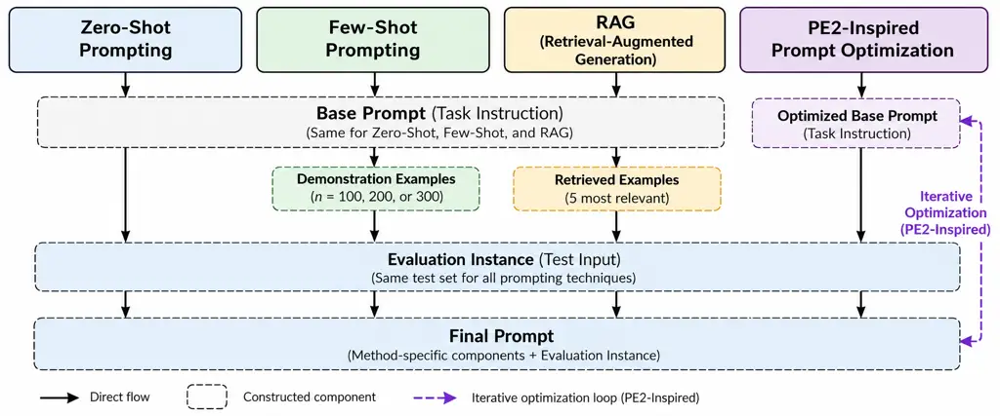
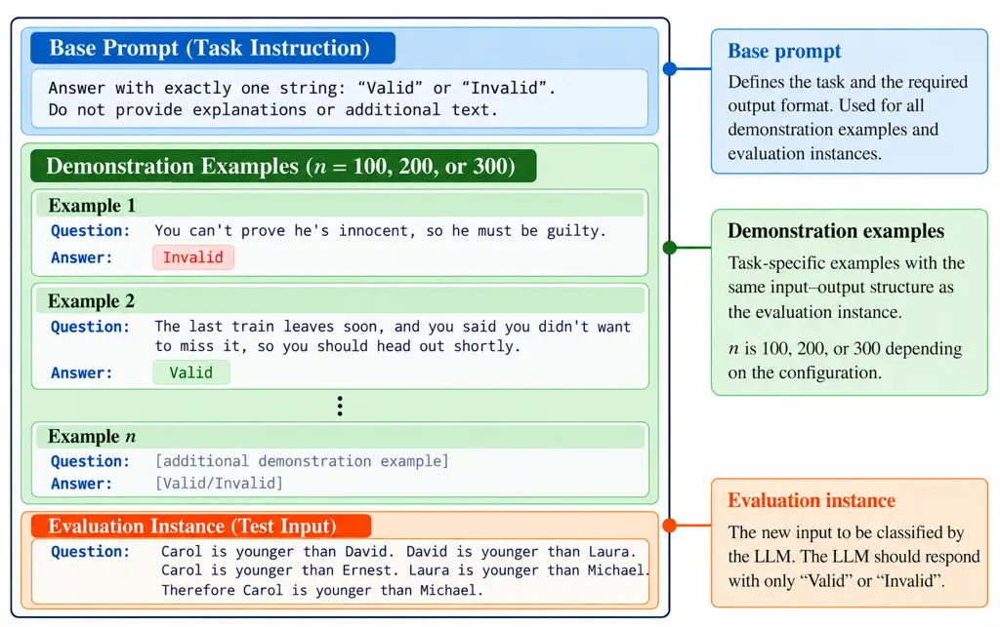
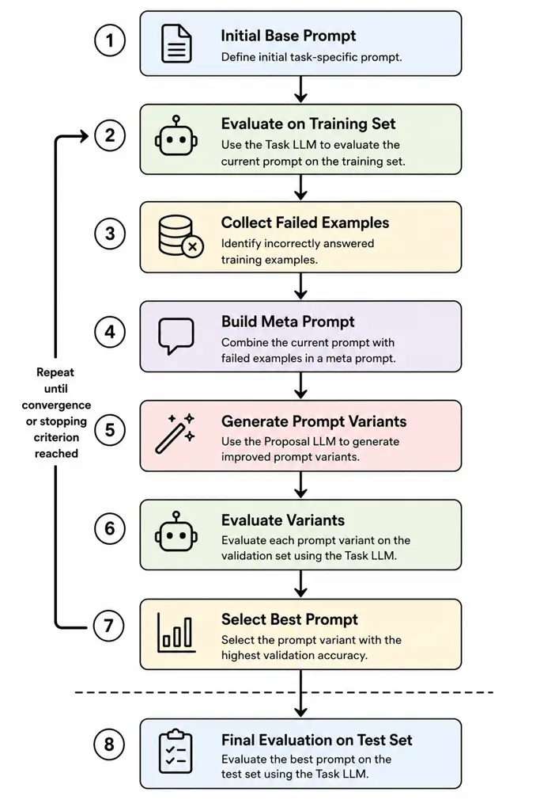

# A Cross-Domain Evaluation of Prompting Techniques for Large Language Models

Kevin Krazius, Tim Schlippe, Paul Libbrecht Affiliation: IU
International University of Applied Sciences  
Germany  
tim.schlippe@iu.org

###### Abstract

Prompt engineering has become a central mechanism for guiding the
behavior of Large Language Models (LLMs) across a wide range of
reasoning and language understanding tasks \[1, 2\]. However, existing
studies frequently evaluate prompting techniques using different LLMs,
datasets, or task settings, making direct comparisons across methods and
domains difficult \[3\]. Consequently, in this paper we present a
controlled cross-domain evaluation of Zero-Shot prompting, Few-Shot
prompting, Retrieval-Augmented Generation (RAG), and automatic prompt
optimization based on a PE2-inspired optimization pipeline \[4, 5, 6\].
All experiments were conducted with the same LLM and evaluated on six
benchmark datasets covering arithmetic reasoning, logical reasoning,
commonsense reasoning, and factual verification. The results show that
no prompting strategy consistently outperforms the others across all
domains, and pairwise statistical comparisons of the highest-performing
configurations revealed no significant differences. RAG achieves the
highest overall average accuracy of 78.33% when 300 examples are
available for retrieval, while Few-Shot Prompting achieves comparatively
high accuracies across several structured reasoning tasks. Zero-Shot
Prompting remains competitive on tasks with self-contained inputs,
whereas the PE2-inspired optimization approach produces stable but not
systematically superior results compared to the other evaluated
prompting techniques. Furthermore, increasing the number of
task-specific examples does not consistently improve performance across
prompting techniques, indicating strong domain and task dependency.
These findings suggest that prompting techniques should be selected
adaptively based on task characteristics rather than treated as
universally applicable optimization strategies.

###### Index Terms: 

Prompt Engineering, Large Language Models, RAG, Few-Shot Learning

## I Introduction

Large Language Models (LLMs) have fundamentally transformed Natural
Language Processing (NLP) by enabling strong performance across a broad
range of language understanding and reasoning tasks without
task-specific parameter updates or supervised fine-tuning \[4, 7\].
Instead of modifying model parameters for individual downstream tasks,
many modern approaches rely on prompting techniques that guide LLM
behavior through natural language instructions and contextual examples
\[2, 1\].

Among the most widely used prompting techniques are Zero-Shot Prompting,
Few-Shot Prompting, Retrieval-Augmented Generation (RAG), and automatic
prompt optimization approaches \[8, 9, 6\]. Zero-Shot Prompting relies
exclusively on task instructions without providing demonstration
examples, whereas Few-Shot Prompting incorporates example-based
demonstrations directly into the prompt context \[4\]. RAG extends the
prompting process by retrieving external knowledge or task-relevant
context before response generation, thereby improving access to
information beyond the LLM’s parametric knowledge \[5, 10, 11\]. More
recently, automatic prompt optimization approaches have attempted to
improve prompt quality algorithmically instead of relying solely on
manual prompt engineering \[6\].

Although numerous studies report significant performance improvements
through advanced prompting strategies, the comparability of existing
results remains limited: Many evaluations use different LLMs, benchmark
datasets, evaluation metrics, and experimental configurations, making it
difficult to isolate the actual impact of individual prompting
techniques \[3\]. Furthermore, several studies focus primarily on a
single reasoning domain, such as mathematical reasoning or factual
question answering, rather than evaluating prompting techniques
consistently across multiple reasoning tasks.

Consequently, our paper addresses these limitations through a controlled
cross-domain evaluation of prompting techniques using a unified
experimental setup. GPT-4o-mini was used as a representative LLM across
all experiments to isolate differences between prompting techniques from
differences between LLMs. Identical evaluation procedures were applied
across six benchmark datasets covering arithmetic reasoning, logical
reasoning, commonsense reasoning, and factual verification tasks. The
evaluated prompting techniques include Zero-Shot Prompting, Few-Shot
Prompting, Retrieval-Augmented Generation, and a PE2-inspired automatic
prompt optimization pipeline. These techniques were selected as they
represent four fundamentally different prompting paradigms:
instruction-only prompting, example-based prompting, retrieval-augmented
prompting, and automatic prompt optimization.

The primary objective of our paper is to analyze how different prompting
techniques influence LLM performance across reasoning domains and
whether more complex prompting approaches consistently outperform
simpler prompting strategies. In addition, our paper investigates the
extent to which automatically optimized prompts generalize across
benchmark datasets compared to manually designed prompts.

Our main contributions are summarized as follows:

- •
  A controlled comparative evaluation of multiple prompting techniques
  using the same LLM and a unified experimental setup.
- •
  A cross-domain benchmark analysis covering arithmetic reasoning,
  logical reasoning, commonsense reasoning, and factual verification
  tasks.
- •
  An empirical evaluation of a PE2-inspired \[6\] automatic prompt
  optimization pipeline.
- •
  An analysis of the relationship between prompt complexity,
  example-based context integration, and reasoning performance.

To support reproducibility and facilitate future research, all
experimental results generated in this study have been made publicly
available¹¹ 1
[https://github.com/dieKrake/prompting-techniques](https://github.com/dieKrake/prompting-techniques).

The remainder of this paper is structured as follows: Section II reviews
related work on LLMs, prompting techniques, and prompt optimization.
Section III describes the experimental setup, benchmark datasets, and
evaluation methodology. Section IV presents the experimental results and
cross-domain analysis. Finally, Section VI summarizes the findings,
discusses limitations, and outlines directions for future research.

## II Related Work

This section reviews prior work on prompting techniques,
retrieval-augmented generation, and automatic prompt optimization and
subsequently summarizes the research gap addressed in our study.

### II-A Prompting Techniques

Prompting has become a central approach for adapting LLM behavior
without updating LLM parameters \[4, 2, 1\]. In contrast to supervised
fine-tuning, prompting relies on task descriptions, contextual
information, and examples provided at inference time \[4\]. Zero-Shot
Prompting represents the simplest prompting setting, where the LLM
receives only a task instruction and the input instance \[4\]. Few-Shot
Prompting extends this setup by adding demonstration examples to the
prompt context, enabling the LLM to infer the desired task format from
examples \[4\]. Prior work has shown that the choice, order, and
relevance of examples can substantially affect Few-Shot Prompting
performance \[12\].

### II-B Retrieval-Augmented Generation

RAG combines LLM prompting with information retrieval by adding
retrieved context to the prompt before response generation \[5\]. This
approach is particularly relevant for knowledge-intensive tasks as it
allows the LLM to condition its response on external information instead
of relying only on parametric knowledge \[5\]. Retrieval-based LLM
approaches have shown that retrieved passages or examples can improve
factual grounding and task performance, depending on the quality and
relevance of the retrieved context \[5, 13\]. While a broad diversity of
RAG approaches exists \[9\], this study evaluates an example-based RAG
configuration in which semantically relevant examples are dynamically
retrieved from a task-specific example pool and added to the prompt
context.

### II-C Automatic Prompt Optimization

Automatic prompt optimization aims to reduce manual prompt engineering
by generating, modifying, and evaluating prompts algorithmically \[14,
15, 6\]. The Automatic Prompt Engineer (APE) approach showed that LLMs
can generate and rank candidate instructions for downstream tasks
\[14\]. The ProTeGi approach introduced an optimization procedure that
uses textual gradients and beam search to iteratively improve prompts
based on observed errors \[15\]. PE2 further investigates the use of
prompt engineering methods to construct improved prompt engineers \[6\].
Since the original PE2 implementation is not publicly available, our
paper evaluates a PE2-inspired optimization pipeline that follows the
same general idea of iterative error-based prompt improvement.

### II-D Research Gaps

Despite extensive work on individual prompting techniques, direct
comparisons between Zero-Shot Prompting, Few-Shot Prompting, RAG, and
automatic prompt optimization under identical experimental conditions
remain limited \[3, 1\]. In particular, many studies focus on individual
reasoning domains or evaluate prompting techniques using different
experimental setups, making it difficult to determine whether observed
performance differences result from the prompting technique itself or
from dataset-specific and setup-specific factors \[3\]. To address this
gap, our paper evaluates multiple prompting techniques using the same
LLM, the same benchmark datasets, and the same evaluation metric across
several reasoning domains.

## III Methodology

This section describes the experimental setup, benchmark datasets,
prompting techniques, and evaluation procedure used in this paper.
Figure 1 summarizes how the evaluated prompting techniques construct the
final prompt used during inference. Zero-Shot Prompting relies only on
the base prompt, Few-Shot Prompting extends the base prompt with fixed
demonstration examples, and RAG dynamically retrieves semantically
relevant examples from a pool of task-specific examples. PE2 differs
from the other approaches by iteratively optimizing the base prompt
before evaluation. For all prompting techniques, the resulting
method-specific components are combined with the same evaluation
instance.

Fig. 1: Overview of the evaluated prompting techniques and prompt
construction workflow.

### III-A LLM Configuration

We conducted all experiments using GPT-4o-mini through the OpenAI Chat
Completions API \[16\]. The LLM was selected as it provides strong
reasoning capabilities while maintaining efficient inference performance
across large benchmark evaluations.

To ensure comparability across prompting techniques, identical inference
settings were used for all experiments. Responses were generated with a
temperature of 0.0, and each benchmark instance was processed through
isolated API requests to avoid unintended context leakage between
evaluation samples.

The experimental pipeline was implemented in Python using the OpenAI API
and the HuggingFace Datasets library \[17\].

### III-B Benchmark Datasets

The prompting techniques were evaluated on six benchmark datasets
covering multiple reasoning domains:

- •
  Elementary Math QA for arithmetic and mathematical reasoning tasks
  \[18\]
- •
  Logical Fallacy Detection for logical reasoning and fallacy
  classification tasks \[18\]
- •
  Navigate for spatial and abstract logical reasoning tasks \[18\]
- •
  BoolQ for boolean question answering and reading comprehension \[19\]
- •
  Social IQA for social commonsense reasoning and understanding of human
  interactions \[20\]
- •
  Fact Checker for factual verification and fact-based reasoning tasks
  \[18\]

For each dataset, 200 test instances were used consistently across all
prompting techniques to enable controlled within-dataset comparisons
while keeping the number of API evaluations manageable across the full
experimental setup. These test instances were kept separate from the
additional task-specific examples used by the prompting techniques.
Separate sets of 100, 200, and 300 examples were used as demonstration
examples for Few-Shot Prompting, as examples available for retrieval for
RAG, and during prompt optimization for PE2. These three sizes were
selected to enable a controlled comparison of how the amount of
available task-specific examples affects the evaluated prompting
techniques while keeping the experimental scope manageable.

The selected datasets cover arithmetic reasoning, logical reasoning,
commonsense reasoning, reading comprehension, and factual verification
to evaluate prompting behavior in diverse reasoning domains.

The datasets derived from BIG-bench were based on the publicly available
task implementations provided in the BIG-bench benchmark suite \[18\].

### III-C Zero-Shot Prompting

As illustrated in Figure 1, Zero-Shot Prompting used only a
task-specific base prompt together with the evaluation instance. No
demonstration examples were added to the prompt context.

The prompts were designed to constrain the expected output format and
reduce ambiguous LLM outputs. Depending on the dataset, the prompts
instructed the LLM to return binary decisions, multiple-choice answers,
or concise factual outputs without additional explanations.

For example, the Navigate dataset used a restrictive binary
classification prompt requiring the LLM to answer exclusively with
“True” or “False”, while Elementary Math QA used a multiple-choice
instruction format requiring the LLM to output only the correct answer
option.

### III-D Few-Shot Prompting

Few-Shot Prompting extended the base prompt with examples sampled from
the corresponding dataset. The examples followed the same input-output
structure as the evaluation task and were inserted before the evaluation
instance within the prompt context.

Unlike Zero-Shot Prompting, the LLM therefore received demonstrations of
expected task behavior and output structure. The examples were selected
from the available dataset subsets and remained fixed during evaluation.

The Few-Shot prompt consisted of the base prompt, fixed demonstration
examples, and the evaluation instance. Figure 2 illustrates this
structure using actual examples from the Logical Fallacy Detection
experiments.

Fig. 2: Few-Shot prompt structure for Logical Fallacy Detection.

In the complete Few-Shot prompts, $`n`$ was 100, 200, or 300 depending
on the configuration; Figure 2 shows only two demonstration examples for
readability. The complete prompts and experimental results are available
in our repository.

### III-E Retrieval-Augmented Generation

For RAG, semantically relevant examples were dynamically retrieved from
the same task-specific example pools used to construct the Few-Shot
configurations. Following related work using five retrieved in-context
examples \[21\], we fixed the number of retrieved examples at $`k=5`$
across all RAG configurations.

The resulting prompt followed the same general structure illustrated in
Figure 2. Unlike Few-Shot Prompting, RAG selected the examples
separately for each evaluation instance.

The retrieval pipeline used Azure AI Search with embedding-based
similarity matching. For each evaluation instance, the five most similar
examples were retrieved from the corresponding task-specific example
pool and added to the prompt context. The size of this pool varied
between 100, 200, and 300 examples across the evaluated RAG
configurations.

Within the experimental setup of this paper, RAG therefore functioned as
retrieval-based example augmentation rather than as retrieval from an
external knowledge corpus. This design maintained the controlled
experimental setting by using task-specific examples from the same
benchmark datasets as the other example-based prompting techniques.

### III-F Automatic Prompt Optimization

Automatic prompt optimization was implemented using an iterative
approach inspired by PE2 \[6\]. As the original PE2 implementation was
not publicly available, we implemented a PE2-inspired optimization
procedure that iteratively used incorrectly answered examples to
generate and select revised prompt variants.

Figure 3 illustrates the optimization workflow. The 100, 200, and 300
examples used for optimization were equally divided into training and
validation sets. Training examples were used to identify failures for
prompt revision, while the validation set was used to select prompt
variants. The separate test set was used only for the final evaluation
of the selected prompt.

Fig. 3: PE2-inspired iterative prompt optimization pipeline.

The optimization process consisted of the following steps:

1.  1.  Define an initial task-specific base prompt.
2.  2.  Evaluate the current prompt on the training set.
3.  3.  Collect incorrectly answered examples.
4.  4.  Construct a meta-prompt containing the current prompt and failed
        examples.
5.  5.  Generate revised prompt variants using the proposal LLM.
6.  6.  Evaluate the generated variants on a validation set.
7.  7.  Select the highest-performing prompt variant.
8.  8.  Evaluate the selected prompt on the test set.

The meta-prompt contained the current prompt and incorrectly answered
training examples and instructed the proposal LLM to analyze the
observed failures and generate revised prompts while preserving the task
and output format. Both the task and proposal roles used GPT-4o-mini.
The optimization was limited to three iterations and used a beam-like
selection strategy based on validation accuracy. The complete
meta-prompt and PE2-inspired implementation are available in our
repository.

Unlike Few-Shot Prompting and RAG, PE2 therefore attempted to improve
the prompt instructions themselves rather than modifying the contextual
examples provided during inference.

|                           | Zero-Shot | Few-Shot |       |       | RAG   |       |       | PE2   |       |       |
| ------------------------- | --------- | -------- | ----- | ----- | ----- | ----- | ----- | ----- | ----- | ----- |
| Dataset                   | –         | 100      | 200   | 300   | 100   | 200   | 300   | 100   | 200   | 300   |
| Elementary Math QA        | 54.5      | 62.5     | 60.5  | 58.5  | 60.5  | 65.5  | 66.0  | 51.5  | 56.0  | 53.0  |
| Logical Fallacy Detection | 78.0      | 81.5     | 85.0  | 80.0  | 79.0  | 80.0  | 85.5  | 77.5  | 75.0  | 77.5  |
| Navigate                  | 66.5      | 69.5     | 69.5  | 71.5  | 64.0  | 68.0  | 66.0  | 69.0  | 66.5  | 66.0  |
| BoolQ                     | 90.0      | 88.5     | 88.5  | 88.0  | 89.5  | 89.0  | 87.5  | 87.5  | 88.5  | 89.5  |
| Social IQA                | 77.5      | 78.0     | 77.0  | 78.0  | 77.0  | 74.5  | 78.5  | 79.0  | 78.0  | 78.5  |
| Fact Checker              | 80.5      | 81.5     | 86.5  | 85.5  | 84.5  | 86.5  | 86.5  | 80.0  | 81.5  | 79.5  |
| Average                   | 74.50     | 76.92    | 77.83 | 76.92 | 75.75 | 77.25 | 78.33 | 74.08 | 74.25 | 74.00 |

TABLE I: Accuracy (%) across prompting techniques and configurations.
The best result per dataset is shown in bold.

### III-G Evaluation Procedure

For each benchmark instance, the generated response was compared against
the corresponding ground-truth label. Performance was measured using
accuracy, defined as the proportion of correctly answered instances
within the evaluation set. Accuracy was used as a common metric as each
benchmark instance had a single ground-truth answer, enabling consistent
performance comparisons across the different task formats.

The experiments focused on controlled comparisons between prompting
techniques across reasoning domains rather than on estimating
state-of-the-art benchmark performance. The same test instances were
therefore used for all prompting techniques within each dataset.

To assess whether differences between the highest-performing
configurations were statistically significant, we used two-sided exact
McNemar tests for paired binary outcomes \[22, 23\]. Outcomes were
paired within each test instance, while the test instances were treated
as independent observations. For each dataset with a unique
highest-performing configuration, this configuration was compared with
the configuration achieving the second-highest accuracy on the same 200
test instances. If multiple configurations shared the second-highest
accuracy, each was compared separately with the highest-performing
configuration. No significance test was conducted when multiple
configurations shared the highest accuracy, since in these cases no
unique highest-performing configuration existed for the predefined
best-versus-second-best comparison. The exact McNemar test was used for
all pairwise comparisons as some comparisons contained only a small
number of instances for which the two configurations differed in
correctness. To account for multiple comparisons, the resulting
$`p`$-values were adjusted using the Holm procedure \[24\]. Statistical
significance was assessed at the conventional threshold of
$`\alpha=0.05`$.

## IV Results

Table I summarizes the accuracy scores for all prompting techniques
across the benchmark datasets and evaluated configurations. Zero-Shot
Prompting is reported as a single configuration as it does not use
additional task-specific examples. For Few-Shot Prompting, 100, 200, and
300 refer to the number of demonstration examples, while for PE2 they
refer to the number of examples used for optimization. For RAG, these
numbers refer to the number of examples available for retrieval, of
which five were retrieved for each evaluation instance.

Few-Shot Prompting achieved its highest average accuracy of 77.83% with
200 demonstration examples. RAG showed the clearest positive scaling
behavior as the number of examples available for retrieval increased,
reaching the highest overall average accuracy of 78.33% with 300
examples.

The highest individual result across all experiments was achieved by
Zero-Shot Prompting on BoolQ with 90.0% accuracy. In contrast, the best
results for arithmetic and logical reasoning tasks were generally
obtained with Few-Shot Prompting or RAG using larger numbers of
examples. RAG with 300 examples available for retrieval achieved the
highest observed accuracy on both Elementary Math QA (66.0%) and Logical
Fallacy Detection (85.5%).

The results further show that no prompting technique consistently
outperformed all others across all reasoning domains. Few-Shot Prompting
achieved comparatively high accuracies on structured reasoning tasks
such as Navigate and Logical Fallacy Detection. On Fact Checker,
Few-Shot Prompting with 200 demonstration examples and RAG with 200 or
300 examples available for retrieval jointly achieved the highest
accuracy of 86.5%. PE2 achieved the best performance on Social IQA with
79.0% accuracy but did not outperform the other prompting techniques on
average.

Increasing the number of task-specific examples affected the prompting
techniques differently. Few-Shot Prompting improved slightly from 76.92%
to 77.83% when the number of demonstration examples increased from 100
to 200 but did not improve further with 300 examples. In contrast, RAG
showed a more consistent scaling trend, improving from 75.75% to 78.33%
as the number of examples available for retrieval increased from 100 to 300. PE2 remained comparatively stable as the number of examples used
for optimization increased and did not show a clear positive scaling
effect.

Overall, the results show substantial variation in the relative
performance of the prompting techniques across datasets. Few-Shot
Prompting and RAG achieved the highest average accuracies in several
configurations, while Zero-Shot Prompting remained competitive on some
datasets and PE2 achieved the highest accuracy on Social IQA.

The statistical comparisons showed that none of the observed differences
between the highest-performing and second-highest-performing
configurations in Table I were statistically significant. Across the
eight pairwise comparisons, the smallest unadjusted $`p`$-value was
obtained for Navigate, where Few-Shot Prompting with 300 examples (71.5%
accuracy) was compared with Few-Shot Prompting using 100 and 200
examples (69.5% accuracy in both cases; exact McNemar $`p=0.219`$ in
both comparisons). The other six comparisons yielded $`p=1.000`$. After
correcting the eight comparisons for multiple testing using the Holm
procedure, all adjusted $`p`$-values were 1.000. Thus, the observed
numerical differences in accuracy between the compared configurations
were not statistically significant at $`\alpha=0.05`$.

## V Discussion

The results demonstrate that no prompting technique consistently
outperformed all others across all reasoning domains. Instead, the
effectiveness of Zero-Shot Prompting, Few-Shot Prompting, RAG, and PE2
strongly depended on the structure and characteristics of the benchmark
tasks. None of the differences between the highest-performing and
second-highest-performing configurations reached statistical
significance. The observed accuracy differences should therefore be
interpreted as descriptive differences within the present evaluation
rather than as evidence that one configuration is statistically superior
to another. The observed task dependence is consistent with prior work
showing that prompting performance varies substantially across tasks,
prompt formulations, and reasoning requirements \[4, 18, 1\].

Few-Shot Prompting achieved its highest average accuracy of 77.83% with
200 demonstration examples and comparatively high accuracies on Logical
Fallacy Detection and Navigate. On these tasks, fixed demonstrations may
help communicate task-specific input-output patterns and expected answer
formats. This interpretation is consistent with prior work showing that
in-context examples can substantially affect LLM task performance \[4,
12\].

However, the scaling behavior of Few-Shot Prompting was inconsistent.
Increasing the number of demonstration examples from 100 to 200 slightly
improved average performance, while further increasing the number to 300
did not produce additional gains. This suggests that the effectiveness
of Few-Shot Prompting depends not only on the number of examples but
also on their relevance and compatibility with the evaluation task.
Previous studies similarly showed that example selection and prompt
composition can significantly influence Few-Shot performance \[12, 25\].

RAG showed the clearest positive trend in average accuracy as the number
of examples available for retrieval increased, reaching the highest
overall average accuracy with a pool of 300 examples. The largest gains
from the 100- to 300-example retrieval pools occurred on Logical Fallacy
Detection and Elementary Math QA, where accuracy increased by 6.5 and
5.5 absolute percentage points, respectively. This pattern is consistent
with the idea that a larger retrieval pool can increase the opportunity
to retrieve relevant examples, although the effect was task-dependent.
On BoolQ, accuracy decreased as the retrieval pool increased, while on
Navigate RAG remained below the best Few-Shot result. Thus,
retrieval-based example augmentation did not provide uniform gains
across tasks. This task dependence is consistent with prior work
emphasizing the importance of the quality and relevance of retrieved
context \[5, 13\].

Zero-Shot Prompting achieved the highest result on BoolQ with 90.0%
accuracy. BoolQ provides the passage needed to answer each binary
question within the input itself \[19\]. In the present experiments,
neither fixed demonstration examples nor dynamically retrieved examples
improved on the Zero-Shot result. This suggests that additional
contextual examples are not necessarily beneficial when the information
required for the decision is already contained in the evaluation
instance.

PE2 produced comparatively stable average results across the three
optimization sizes, with average accuracies of 74.08%, 74.25%, and
74.00% for 100, 200, and 300 optimization examples, respectively.
Although it did not exceed the best Few-Shot or RAG configurations on
average, PE2 achieved the highest accuracy on Social IQA. Increasing the
number of examples used for optimization therefore did not translate
into higher average performance in the present setup. The PE2-inspired
optimization was limited to three iterations, so these findings
characterize automated prompt optimization under the specific search
procedure and optimization budget evaluated in this study rather than
the potential of automated prompt optimization more generally.

Overall, the findings suggest that prompting techniques should not be
treated as universally interchangeable optimization strategies. Instead,
their relative effectiveness varies across the evaluated tasks and
depends on how contextual examples are incorporated. Few-Shot Prompting
achieves comparatively high accuracies on several structured reasoning
tasks, while the evaluated RAG configuration shows higher average
accuracy with a larger pool of examples available for retrieval.
Zero-Shot Prompting remains competitive and achieves the highest result
on BoolQ, whereas the PE2-inspired approach does not outperform Few-Shot
Prompting or RAG on average. These differences reinforce the need to
evaluate prompting techniques in relation to the characteristics of the
target task rather than assuming that a more complex prompting strategy
will consistently improve performance.

### V-A Limitations

Several limitations should be considered when interpreting the results
of this study. First, GPT-4o-mini was used as a representative LLM and
held constant across all experiments to enable a controlled comparison
of prompting techniques. Consequently, the findings characterize
prompting behavior for this LLM and may not generalize directly to other
LLM architectures or model sizes.

Second, the evaluation was limited to six benchmark datasets and 200
test instances per dataset. While this setup enabled controlled
comparisons across prompting techniques, larger evaluation sets and
additional domains could produce more robust conclusions regarding
prompting behavior across tasks. In addition, each configuration was
evaluated once per test instance without repeated generations. Although
a temperature of 0.0 was used consistently across all experiments,
repeated runs could provide additional insight into potential output
variability. The statistical comparisons therefore assess differences in
paired correctness outcomes on the evaluated test instances rather than
variability across repeated LLM generations.

Third, the evaluation used accuracy as the common performance metric
across all six datasets to enable consistent cross-domain comparisons.
However, the test sets were not necessarily perfectly balanced across
answer classes, which can affect the interpretation of accuracy.
Moreover, accuracy does not capture class-specific error patterns or
qualitative differences in reasoning behavior.

In addition, the implemented RAG setup retrieved task-specific examples
rather than information from an external knowledge base. The experiments
therefore evaluated retrieval-based example augmentation rather than
knowledge-grounded RAG.

Finally, the PE2 implementation was adapted specifically for the
experimental setup of this study. Differences in optimization strategy,
search space design, or meta-prompt configuration may influence the
observed results and could lead to different outcomes in alternative
implementations.

### V-B Implications

The findings have practical implications for the design of LLM-based
systems. Rather than selecting prompting techniques based solely on
their complexity, practitioners should evaluate them on the target task.
The results also show that providing more task-specific examples does
not necessarily improve performance: Few-Shot Prompting achieved its
highest average accuracy with 200 demonstration examples, whereas RAG
continued to improve on average as the pool of examples available for
retrieval increased to 300. Consequently, both the choice of prompting
technique and the amount of contextual information should be treated as
task-dependent design decisions rather than fixed defaults.

## VI Conclusion and Future Work

This section summarizes the main findings and outlines directions for
future research.

### VI-A Conclusion

Our paper compared Zero-Shot Prompting, Few-Shot Prompting,
Retrieval-Augmented Generation (RAG), and PE2-inspired automatic prompt
optimization across multiple reasoning domains under a controlled
experimental setup. All prompting techniques were evaluated using the
same LLM, benchmark datasets, evaluation metric, and inference settings
in order to ensure direct comparability.

The results showed that no prompting technique consistently outperformed
all others across all benchmark datasets. None of the pairwise
differences between the highest-performing and second-highest-performing
configurations reached statistical significance after Holm correction
for multiple comparisons. Few-Shot Prompting achieved comparatively high
accuracies on several structured reasoning tasks, while RAG showed the
clearest positive trend in average accuracy as the number of examples
available for retrieval increased. Zero-Shot Prompting remained
competitive and achieved the highest accuracy on BoolQ. The PE2-inspired
approach achieved the highest accuracy on Social IQA but did not
outperform the best Few-Shot or RAG configurations on average.

Overall, the findings indicate that prompting effectiveness strongly
depends on task structure and reasoning domain. Prompting techniques
should therefore not be treated as universally optimal strategies but
instead selected according to the characteristics and contextual
requirements of the target task.

### VI-B Future Work

Future research should extend the evaluation to additional reasoning
domains, benchmark datasets, and LLM architectures in order to improve
the generalizability of the findings. In particular, evaluating
prompting techniques on larger and more diverse datasets may provide
deeper insights into domain-specific prompting behavior.

Furthermore, future work could investigate more advanced prompting
strategies such as Chain-of-Thought Prompting, Few-Shot
Chain-of-Thought, or hybrid approaches combining retrieval mechanisms
with automated prompt optimization. Exploring adaptive retrieval
strategies, example selection methods, and larger prompt optimization
search spaces may further improve prompting robustness and performance
across complex reasoning tasks.

Finally, future studies could complement quantitative evaluation metrics
with qualitative analyses of reasoning behavior, explanation
consistency, and robustness under noisy or ambiguous inputs in order to
better understand the strengths and limitations of different prompting
approaches.

## References

- \[1\] S. Schulhoff, M. Ilie, N. Balepur, K. Kahadze, A. Liu, C. Si, Y.
  Li, A. Gupta, H. Han, S. Schulhoff, P. S. Dulepet, S. Vidyadhara, D.
  Ki, S. Agrawal, C. Pham, G. Kroiz, F. Li, H. Tao, A. Srivastava,
  and P. Resnik (2025) The Prompt Report: A Systematic Survey of Prompt
  Engineering Techniques. arXiv preprint arXiv:2406.06608. Cited by: §I,
  §II-A, §II-D, §V, Abstract.
- \[2\] P. Liu, W. Yuan, J. Fu, Z. Jiang, H. Hayashi, and G.
  Neubig (2023) Pre-train, Prompt, and Predict: A Systematic Survey of
  Prompting Methods in Natural Language Processing. ACM Computing
  Surveys 55 (9), pp. 1–35. External Links:
  [Document](https://dx.doi.org/10.1145/3560815) Cited by: §I, §II-A,
  Abstract.
- \[3\] Y. Chang, X. Wang, J. Wang, Y. Wu, L. Yang, K. Zhu, H. Chen, X.
  Yi, C. Wang, Y. Wang, W. Ye, Y. Zhang, Y. Chang, P. S. Yu, Q. Yang,
  and X. Xie (2024) A Survey on Evaluation of Large Language Models. ACM
  Transactions on Intelligent Systems and Technology 15 (3), pp. 1–45.
  External Links: [Document](https://dx.doi.org/10.1145/3641289) Cited
  by: §I, §II-D, Abstract.
- \[4\] T. B. Brown, B. Mann, N. Ryder, M. Subbiah, J. Kaplan, P.
  Dhariwal, A. Neelakantan, P. Shyam, G. Sastry, A. Askell, S.
  Agarwal, A. Herbert-Voss, G. Krueger, T. Henighan, R. Child, A.
  Ramesh, D. M. Ziegler, J. Wu, C. Winter, C. Hesse, M. Chen, E.
  Sigler, M. Litwin, S. Gray, B. Chess, J. Clark, C. Berner, S.
  McCandlish, A. Radford, I. Sutskever, and D. Amodei (2020) Language
  Models are Few-Shot Learners. In The 34th Conference on Neural
  Information Processing Systems, pp. 1877–1901. Cited by: §I, §I,
  §II-A, §V, §V, Abstract.
- \[5\] P. Lewis, E. Perez, A. Piktus, F. Petroni, V. Karpukhin, N.
  Goyal, H. Küttler, M. Lewis, W. Yih, T. Rocktäschel, S. Riedel, and D.
  Kiela (2020) Retrieval-Augmented Generation for Knowledge-Intensive
  NLP Tasks. In The 34th Conference on Neural Information Processing
  Systems, pp. 9459–9474. Cited by: §I, §II-B, §V, Abstract.
- \[6\] Q. Ye, M. Ahmed, R. Pryzant, and F. Khani (2024) Prompt
  Engineering a Prompt Engineer. In Findings of the Association for
  Computational Linguistics: ACL 2024, pp. 355–385. External Links:
  [Document](https://dx.doi.org/10.18653/v1/2024.findings-acl.21) Cited
  by: 3rd item, §I, §II-C, §III-F, Abstract.
- \[7\] OpenAI (2023) GPT-4 Technical Report. arXiv preprint
  arXiv:2303.08774. External Links:
  [Document](https://dx.doi.org/10.48550/arXiv.2303.08774) Cited by: §I.
- \[8\] J. Wei, X. Wang, D. Schuurmans, M. Bosma, B. Ichter, F.
  Xia, E. H. Chi, Q. V. Le, and D. Zhou (2022) Chain-of-Thought
  Prompting Elicits Reasoning in Large Language Models. In The 36th
  Conference on Neural Information Processing Systems, Cited by: §I.
- \[9\] J. Feng, M. Ariannejad, I. I. Idrus, Z. K. Goh, J. D. Tan, C. C.
  Kang, M. A. S. Byuiyan, and W. H. Tee (2025) Retrieval-Augmented
  Generation: A Comprehensive Survey of Foundations, Evolution,
  Applications, Limitations, and Future Directions. In The 9th
  International Conference on Recent Advances and Innovations in
  Engineering (ICRAIE), Vol. , pp. 148–153. Cited by: §I, §II-B.
- \[10\] P. Kivroglou, T. Schlippe, and S. Martin (2025) Investigating
  Retrieval Augmented Generation for LLM-Based Code Generation. In The
  3rd International Conference on Foundation and Large Language Models
  (FLLM), Vienna, Austria. External Links:
  [Link](https://ieeexplore.ieee.org/document/11391177) Cited by: §I.
- \[11\] T. Schlippe, S. Martin, and M. Marketsmüller (2026) RAG
  Strategies for Natural Language-Based SQL Query and REST API Call
  Generation. In The 3rd International Conference on Foundation and
  Large Language Models (FLLM), Barcelona, Spain. Cited by: §I.
- \[12\] J. Liu, D. Shen, Y. Zhang, B. Dolan, L. Carin, and W.
  Chen (2022) What Makes Good In-Context Examples for GPT-3?. In The 3rd
  Workshop on Deep Learning Inside Out: Knowledge Extraction and
  Integration for Deep Learning Architectures, pp. 100–114. External
  Links: [Document](https://dx.doi.org/10.18653/v1/2022.deelio-1.10)
  Cited by: §II-A, §V, §V.
- \[13\] S. Borgeaud, A. Mensch, J. Hoffmann, T. Cai, E. Rutherford, K.
  Millican, G. van den Driessche, J. Lespiau, B. Damoc, A. Clark, D. de
  Las Casas, A. Guy, J. Menick, R. Ring, T. Hennigan, S. Huang, L.
  Maggiore, C. Jones, A. Cassirer, and L. Sifre (2022) Improving
  Language Models by Retrieving from Trillions of Tokens. In The 39th
  International Conference on Machine Learning, pp. 2206–2240. Cited by:
  §II-B, §V.
- \[14\] Y. Zhou, A. I. Muresanu, Z. Han, K. Paster, S. Pitis, H. Chan,
  and J. Ba (2023) Large Language Models are Human-Level Prompt
  Engineers. In The Eleventh International Conference on Learning
  Representations, Cited by: §II-C.
- \[15\] R. Pryzant, D. Iter, J. Li, Y. T. Lee, C. Zhu, and M.
  Zeng (2023) Automatic Prompt Optimization with “Gradient Descent” and
  Beam Search. In The 2023 Conference on Empirical Methods in Natural
  Language Processing, pp. 7957–7968. External Links:
  [Document](https://dx.doi.org/10.18653/v1/2023.emnlp-main.494) Cited
  by: §II-C.
- \[16\] OpenAI (2024) Hello GPT-4o. Note:
  [https://openai.com/index/hello-gpt-4o/](https://openai.com/index/hello-gpt-4o/)Accessed:
  2026-05-15 Cited by: §III-A.
- \[17\] Q. Lhoest, C. Delangue, G. Matussière, P. von Platen, M.
  Drame, Y. Jernite, S. Bekman, P. Cistac, J. Goehringer, V. Mustar, et
  al. (2021) Datasets: A Community Library for Natural Language
  Processing. In The 2021 Conference on Empirical Methods in Natural
  Language Processing: System Demonstrations, pp. 175–184. Cited by:
  §III-A.
- \[18\] A. Srivastava, A. Rastogi, A. Rao, et al. (2023) Beyond the
  imitation game: quantifying and extrapolating the capabilities of
  language models. Transactions on Machine Learning Research. Cited by:
  1st item, 2nd item, 3rd item, 6th item, §III-B, §V.
- \[19\] C. Clark, K. Lee, M. Chang, T. Kwiatkowski, M. Collins, and K.
  Toutanova (2019) BoolQ: Exploring the Surprising Difficulty of Natural
  Yes/No Questions. In The 2019 Conference of the North American Chapter
  of the Association for Computational Linguistics: Human Language
  Technologies, pp. 2924–2936. External Links:
  [Document](https://dx.doi.org/10.18653/v1/N19-1300) Cited by: 4th
  item, §V.
- \[20\] M. Sap, H. Rashkin, D. Chen, R. LeBras, and Y. Choi (2019)
  SocialIQA: Commonsense Reasoning about Social Interactions. In The
  2019 Conference on Empirical Methods in Natural Language Processing
  and the 9th International Joint Conference on Natural Language
  Processing, pp. 4463–4473. External Links:
  [Document](https://dx.doi.org/10.18653/v1/D19-1454) Cited by: 5th
  item.
- \[21\] A. Tejaswi, Y. Lee, S. Sanghavi, and E. Choi (2025) RARe:
  Retrieval Augmented Retrieval with In-Context Examples. In Conference
  on Language Modeling, Cited by: §III-E.
- \[22\] Q. McNemar (1947) Note on the Sampling Error of the Difference
  Between Correlated Proportions or Percentages. Psychometrika 12 (2),
  pp. 153–157. External Links:
  [Document](https://dx.doi.org/10.1007/BF02295996) Cited by: §III-G.
- \[23\] P. H. Westfall, J. F. Troendle, and G. Pennello (2010) Multiple
  McNemar Tests. Biometrics. External Links:
  [Document](https://dx.doi.org/10.1111/j.1541-0420.2010.01408.x) Cited
  by: §III-G.
- \[24\] S. Holm (1979) A Simple Sequentially Rejective Multiple Test
  Procedure. Scandinavian Journal of Statistics 6 (2), pp. 65–70. Cited
  by: §III-G.
- \[25\] H. Su, J. Kasai, C. H. Wu, W. Shi, T. Wang, J. Xin, R.
  Zhang, M. Ostendorf, L. Zettlemoyer, N. A. Smith, and T. Yu (2022)
  Selective Annotation Makes Language Models Better Few-Shot Learners.
  arXiv preprint arXiv:2209.01975. Cited by: §V.
